# Phần giới thiệu — Thời gian đang cạn dần

## Ý chính

**Guillén cho rằng thế giới quen thuộc của thế kỷ 20 sẽ không còn vào năm 2030, vì tám xu hướng lớn đang tích lũy từng chút một rồi cùng lúc đạt đỉnh và tác động lẫn nhau; muốn nắm bắt cơ hội, ta phải bỏ lối nghĩ tuyến tính, tách bạch từng vấn đề, và chuyển sang tư duy đa chiều.**

Ông mở đầu bằng hai cảnh tưởng tượng năm 2030 (một phụ nữ Kenya ngạc nhiên vì nước Anh còn dùng tiền mặt; một sinh viên Philippines đọc báo Mỹ viết rằng lần đầu tiên số ông bà nhiều hơn số cháu) và bằng chuyện Ấn Độ đưa tàu thăm dò vào quỹ đạo sao Hỏa năm 2014 ngay lần đầu, với ngân sách chỉ 74 triệu USD, ít hơn chi phí làm phim *Interstellar* (165 triệu USD) và *The Martian* (108 triệu USD).

Ông dự báo thế giới năm 2030 sẽ có nhiều người già hơn người trẻ ở hầu hết các nước, thị trường trung lưu châu Á lớn hơn Mỹ và châu Âu cộng lại, phụ nữ sở hữu nhiều tài sản hơn nam giới, nhiều robot hơn công nhân và nhiều loại tiền hơn (bản dịch viết "nhiều loại tiền hơn trong một quốc gia"; tên Chương 8 là "Nhiều loại tiền hơn số quốc gia").

Các thành phố chỉ chiếm 1% diện tích đất nhưng chứa 55% dân số và tiêu thụ 80% năng lượng; dân số đô thị tăng 1,5 triệu người mỗi tuần; người trên 60 tuổi đang sở hữu 80% tài sản nước Mỹ.

Hai hình minh họa tóm tắt cách đọc cả cuốn: Hình 1 xếp tám xu hướng thành một chuỗi nối tiếp (cách trình bày theo thứ tự chương), còn Hình 2 xếp chúng thành vòng tròn trong đó mỗi xu hướng tương tác với bảy xu hướng còn lại.

Ví dụ Airbnb (người già thiếu tiền hưu cho thuê phòng trống thay vì thế chấp nhà) và Kodak (phá sản năm 2012 vì không thấy tín hiệu yếu của ảnh kỹ thuật số) minh họa lợi ích của tư duy đa chiều và cái giá của việc không có nó.

## Sơ đồ

### Thông tin sách và giới thiệu bìa sau (trang PDF 2–3)

```text
       2030: NHỮNG XU HƯỚNG LỚN SẼ ĐỊNH HÌNH THẾ GIỚI TƯƠNG LAI
       (2030: How Today's Biggest Trends Will Collide and Reshape
        the Future of Everything)
       · Tác giả Mauro F. Guillén, dịch giả Vũ Kiều Linh
       · Non-fiction, 360 trang, 15,5 x 23,5 cm, bìa mềm có tay gập
       · Phương Nam Book phát hành, NXB Thế Giới, 02/2022
       · Sách bán chạy quốc tế: Wall Street Journal; Financial Times
         Best Books of 2020; Porchlight; JP Morgan NextList 2021;
         Yahoo Finance Favorite Business Books of 2020
                                │
                                ▼
       THẾ GIỚI CŨ (bìa sau mô tả)
       · giàu và nghèo phân biệt rõ rệt
       · dân số trẻ, tài chính bảo đảm, người lao động nhiều hơn
         người về hưu
       · công ty lớn không cần vươn ra ngoài Mỹ và châu Âu
       · người bình thường ở nước phát triển chỉ cần siêng năng là
         có tương lai ổn định
                                │
                                ▼
       THẾ GIỚI NĂM 2030 (bìa sau dự báo)
       · ông bà nhiều hơn cháu chắt
       · trung lưu châu Á và châu Phi Hạ Sahara đông hơn Mỹ và châu Âu
         cộng lại
       · lần đầu tiên kinh tế toàn cầu do nhu cầu phi phương Tây dẫn dắt
       · nữ sở hữu tài sản nhiều hơn nam
       · nhiều robot hơn người lao động
                                │
                                ▼
       Lời khen: Adam Grant (Originals), Dambisa Moyo (Edge of Chaos),
       Richard Florida (The Rise of the Creative Class)
```

### Tác giả trên tay gập và lời giới thiệu của Richard Florida (trang PDF 4–5)

```text
       MAURO F. GUILLÉN (sinh 30/9/1964)
       · học Xã hội học ở Đại học Yale, Kinh tế học ở Tây Ban Nha
       · giáo sư Zandman về quản lý quốc tế, Trường Wharton; dạy
         giám đốc điều hành, MBA và sinh viên đại học
       · nay là Giám đốc, Hiệu trưởng Trường Kinh doanh Cambridge Judge,
         thành viên Queen's College, Đại học Cambridge
       · sách khác: The Architecture of Collapse, Global Turning Points,
         Emerging
                                │
                                ▼
       Richard Florida: thay đổi về cách sống, làm việc, chính trị,
       văn hóa đang tạo ra biến động lớn nhất lịch sử nhân loại; cuốn
       sách giúp ta sống kiên cường trong thế giới mới
```

### Một vài dữ kiện và con số (trang PDF 6–7)

```text
       CHÂU PHI                     PHỤ NỮ                 ĂN UỐNG
       Tiểu vùng Sahara châu Phi    Tỷ lệ tài sản thế giới  Thiếu ăn:
       sẽ là nơi khởi phát cách     do nữ sở hữu:           2017: 821 triệu
       mạng công nghiệp tiếp theo   2000: 15%               2030: 200 triệu
       vì có 500 triệu mẫu Anh      2030: 55%               Béo phì:
       đất nông nghiệp phì nhiêu    "Lehman Sisters" thì    2017: 650 triệu
       chưa khai thác, bằng diện    đã không có khủng       2030: 1.100 triệu
       tích Mexico                  hoảng toàn cầu          Mỹ 2030: 50% béo phì

       THÀNH PHỐ năm 2030                    TRUNG LƯU
       · 1,1% diện tích đất thế giới         · lớn nhất hiện nay: Mỹ và
       · 60% dân số thế giới                   Tây Âu
       · 87% lượng phát thải carbon          · lớn nhất năm 2030: Trung Quốc
       · 80% dân số đô thị sống gần vùng     · thêm 1 tỷ người trung lưu ở
         mực nước biển dâng cao                thị trường mới nổi
                                             · trung lưu Mỹ: 223 triệu
                                               (hiện nay) xuống 209 triệu
                                               (năm 2030)
```

### Năm 2030: Rehema ở Nairobi và Angel ở New York (trang PDF 8–9)

```text
       Đề từ: "Người ta thường chỉ thấy những gì họ muốn thấy, và nghe
       những gì họ muốn nghe" (thẩm phán Taylor, Giết con chim nhại)
                                │
                                ▼
       NĂM 2030 (cảnh tưởng tượng)
       ┌────────────────────────────────┬─────────────────────────────────┐
       │ REHEMA, về Nairobi (Kenya) sau │ ANGEL, người Philippines, xếp   │
       │ hai tuần ở London              │ hàng hải quan ở sân bay JFK     │
       ├────────────────────────────────┼─────────────────────────────────┤
       │ · Tây Âu nóng bất thường       │ · sắp học Thạc sĩ 2 năm ở Đại   │
       │ · ngạc nhiên vì Anh còn dùng   │   học New York                  │
       │   tiền mặt; ở Kenya điện thoại │ · New York Times: lần đầu ở Mỹ  │
       │   đã thay ví tiền từ lâu       │   ông bà nhiều hơn con cháu,    │
       │ · người Anh ngạc nhiên vì cô   │   trái với Philippines          │
       │   học trường trực tuyến từ     │ · người già Mỹ dùng robot chăm  │
       │   năm 6 tuổi, như bạn bè       │   sóc, cho thuê phòng trống vì  │
       │ · nước Anh từng là đế quốc     │   lương hưu không đủ            │
       │   thực dân chưa đầy một thế    │ · phụ nữ vượt nam giới về sở    │
       │   kỷ trước                     │   hữu tài sản                   │
       │                                │ · hàng người nước ngoài chậm;   │
       │                                │   công dân Mỹ dùng hộ chiếu     │
       │                                │   blockchain, xe tự lái đón     │
       └────────────────────────────────┴─────────────────────────────────┘
```

### Năm 2020: "Trung Quốc sẽ dẫn đầu mọi lĩnh vực" (trang PDF 9–10)

```text
       Câu nói phổ biến: Trung Quốc sẽ dẫn đầu; Mỹ và Trung Quốc tranh
       ngôi thống trị. Guillén cho rằng các câu ấy có phần đúng nhưng
       không phải bức tranh toàn cảnh
                                │
                                ▼
       ẤN ĐỘ, NĂM 2014: đưa tàu thăm dò vào quỹ đạo sao Hỏa NGAY LẦN ĐẦU
       · Mỹ, Nga, châu Âu: chưa tới một nửa số lần phóng thành công
       · chi phí so sánh:
           Ấn Độ (Tổ chức Nghiên cứu Vũ trụ Ấn Độ)   74 triệu USD
           phim The Martian                         108 triệu USD
           phim Interstellar                        165 triệu USD
           một phi vụ sao Hỏa thông thường          450 triệu USD
                                │
                                ▼
       Không phải ăn may: năm 2009, lần đầu lên Mặt trăng, Ấn Độ đưa ra
       bằng chứng đầu tiên về nước tập trung ở các cực; NASA mất 10 năm
       mới xác nhận
                                │
                                ▼
       Kết luận: niềm tin "thám hiểm vũ trụ chỉ dành cho siêu cường,
       cực kỳ đắt đỏ" đã thành quá khứ
```

### Thế giới quen thuộc biến mất (trang PDF 10–12)

```text
       THẾ GIỚI NGÀY TRƯỚC                 THẾ GIỚI NĂM 2030
       · giàu và lạc hậu phân cực rõ       · nhiều người già hơn người
       · nhiều trẻ em                        trẻ ở hầu hết các nước
       · lao động nhiều hơn hưu trí        · trung lưu châu Á lớn hơn Mỹ
       · ai cũng muốn sở hữu nhà, xe         và châu Âu cộng lại
       · công ty chỉ cần nhìn Mỹ, châu Âu  · nữ sở hữu nhiều tài sản hơn
       · tiền giấy là tiền pháp định       · nhiều robot hơn công nhân,
       · luật chơi học ở trường giữ          máy tính hơn trí óc người,
         nguyên suốt đời                     cảm biến hơn mắt người
                                           · nhiều loại tiền hơn
                    ─────────────────────────▶
                                │
                                ▼
       Guillén (giáo sư Wharton) trình bày số liệu cho giám đốc, chính
       trị gia, sinh viên, học sinh, hàng chục ngàn người trực tuyến
       Người nghe lần nào cũng phản ứng bằng hoang mang, lo sợ
                                │
                                ▼
       Dự báo không bao giờ chính xác hoàn toàn, nhưng có giả định khá
       chắc chắn:
       · phần lớn thế hệ chịu tác động ĐÃ ĐƯỢC SINH RA
       · tính được số người sống tới 80, 90 tuổi
       · dự đoán được tỷ lệ người già cần chăm sóc (người hoặc robot)
                                │
                                ▼
       "Chúng ta không còn nhiều thời gian": 2030 đang đến gần
       Thông điệp lạc quan: mỗi kết cục mở ra cơ hội nếu ta dự đoán xu
       hướng, chủ động ứng biến và ra quyết định tốt cho bản thân, gia
       đình, công ty
```

### Quá trình thẩm thấu từ từ: các xu hướng đan xen (trang PDF 12–14)

```text
       Từng giọt thay đổi tích lũy dần như nước nhỏ vào bình;
       tiếng nhỏ giọt nhắc rằng thời gian đang trôi;
       đến lúc nước ĐỘT NHIÊN TRÀN thì mọi việc bỗng khác đi
                                │
                                ▼
       DÂN SỐ: năm 2030 Nam Á và Tiểu vùng Sahara châu Phi tranh ngôi
       khu vực đông dân nhất (cuối thế kỷ 20 là Đông Á)
       · Kenya, Nigeria: số trẻ sơ sinh giảm nhưng vẫn cao hơn hầu hết
         các nước; tuổi thọ cải thiện
                                │ nhân với số tiền họ có
                                ▼
       THỊ TRƯỜNG: châu Á (không tính Nhật Bản) đủ lớn để kéo trọng tâm
       tiêu thụ toàn cầu về phía Đông; các công ty buộc phải đi theo
                                │ thêm các xu hướng khác đan xen
                                ▼
       · tỷ lệ sinh giảm khiến dân số già đi nhanh
       · phụ nữ học cao, theo đuổi sự nghiệp nên muốn ít con hơn
       · sắp có nhiều nữ triệu phú hơn nam
       · dân số thành phố tăng 1,5 triệu người MỖI TUẦN
       · thành phố chiếm 1% diện tích đất, chứa 55% dân số, tiêu thụ 80%
         năng lượng (và khí thải carbon), nên đô thị là nơi cần tập
         trung nỗ lực chống biến đổi khí hậu
       · Millennials dẫn đầu nền kinh tế chia sẻ nhưng được chú ý quá mức
       · người trên 60 tuổi sẽ là nhóm đông nhất thập niên tới; họ sở
         hữu 80% tài sản nước Mỹ và tạo thành "thị trường đầu bạc", lực
         lượng tiêu dùng lớn nhất; công ty nên chuyển một phần trọng
         tâm sang người cao tuổi
```

### Hình 1: chuỗi các thay đổi nhỏ móc nối với nhau (trang PDF 14–16)

```text
       HÌNH 1 (trang PDF 15): tám mũi tên cong xếp dọc, mỗi mũi tên
       móc vào mũi tên kế tiếp; xung quanh là những giọt nước
       (gợi hình ảnh từng giọt thay đổi)

         ( Số trẻ sơ sinh giảm )                     Chương 1
                   ▼
         ( Các thế hệ dân số mới )                   Chương 2
                   ▼
         ( Tầng lớp trung lưu mới )                  Chương 3
                   ▼
         ( Nhiều phụ nữ giàu có hơn )                Chương 4
                   ▼
         ( Phong cách sống thành thị )               Chương 5
                   ▼
         ( Công nghệ đột phá )                       Chương 6
                   ▼
         ( Nền kinh tế chia sẻ )                     Chương 7
                   ▼
         ( Đồng tiền điện tử )                       Chương 8
                                │
                                ▼
       Đứng riêng lẻ, không thay đổi nào gây biến động toàn cầu; ta
       đối phó được từng cái nếu tách riêng
                                │
                                ▼
       CƠ CHẾ PHÂN TÁCH TÂM TRÍ (phòng vệ tâm lý vô thức): tách mọi việc
       riêng ra để khỏi choáng trước tác động cộng hưởng
                                │
                                ▼
       Đọc chuỗi theo lời Guillén (trang PDF 16):
       dân số già ở Mỹ, Tây Âu │ người trẻ chiếm phần lớn trung lưu ở
       thị trường mới nổi, nhiều khát vọng hơn │ phụ nữ tích lũy nhiều
       của cải hơn nam │ cả hai sống ở đô thị, đến từ làn sóng di cư
       lên thành phố │ đô thị sinh ra nhà phát minh, doanh nhân │
       công nghệ thay đổi thói quen, chạm tới nhà, văn phòng, xe, đồ
       dùng │ tiền mới: phân phối rộng hơn, phi tập trung hơn, dễ dùng
       hơn
                                │
                                ▼
       Một số xu hướng đạt đỉnh khoảng năm 2030; sự kiện lịch sử như
       COVID-19 làm tất cả nhanh hơn (bàn ở Lời bạt)
       Chuỗi tuyến tính này CHỈ để sắp thứ tự chương; thế giới thật
       không vận hành như vậy
```

### Phạm trù, phân tách, và ví dụ về khái niệm nghỉ hưu (trang PDF 16–17)

```text
       Nhà nhân chủng học, xã hội học: con người chia thế giới thành
       PHẠM TRÙ để giảm phức tạp; phạm trù là khung tham chiếu giúp ta
       thấy an tâm rằng mọi việc vẫn trong tầm kiểm soát
                                │
                                ▼
       Công ty cũng phân tách:
       · khách hàng: "tiên phong", "thích nghi nhanh", "lạc hậu"
       · sản phẩm (ma trận BCG): "ngôi sao", "bò sữa", "chó", "dấu hỏi"
         theo thị phần hiện tại và tiềm năng tăng trưởng
       · nhân viên: "hợp tác đội nhóm", "tham vọng"
                                │
                                ▼
       NHƯNG phân tách làm ta KHÔNG THẤY khả năng mới
                                │
                                ▼
       VÍ DỤ NGHỈ HƯU: phát minh lớn cuối thế kỷ 19 (cùng đèn điện,
       điện thoại, xe hơi); từ đó đời người được chia ba giai đoạn:
       lớn lên, đi làm, nghỉ hưu
                                │ ít trẻ em + động lực mới giữa các thế hệ
                                ▼
       · người cao tuổi là người tiêu dùng có lối sống riêng
       · thích nghi công nghệ nhanh như Millennials, có khi nhanh hơn
       · thực tế ảo, trí tuệ nhân tạo, robot thay đổi phần cuối đời
       · có thể quay lại trường học kỹ năng mới
       · New York Times 2019: "Thiếu trẻ em, một ngôi trường ở Hàn Quốc
         nhận dạy cả những người già mù chữ"
```

### Tư duy đa chiều, tầm nhìn ngoại vi và bài học Kodak (trang PDF 17–18)

```text
       TRÁNH tư duy tuyến tính ("một chiều") như Hình 1
                                │
                                ▼
       TƯ DUY ĐA CHIỀU (Edward de Bono): "không nhằm xử lý những mảnh
       ghép hiện hữu mà tìm cách thay đổi những mảnh ghép đó"
       Nghĩa là đặt lại câu hỏi, giải quyết theo nhiều hướng, bỏ giả
       định, phá quy tắc
       · Picasso và Braque: tranh lập thể, bỏ quy tắc phối cảnh
       · Le Corbusier: bỏ tường, cửa sổ chạy hết mặt tiền, phô thép,
         kính, xi măng thô
       · Proust: khám phá thực sự là có góc nhìn mới
                                │
                                ▼
       TẦM NHÌN NGOẠI VI (George Day, Paul Schoemaker, Wharton): tổ
       chức phải nhận ra và hành động theo TÍN HIỆU YẾU ở ngoài vùng
       đang tập trung
                                │
                                ▼
       KODAK
       1888: thành lập; lãi lớn từ phim máy ảnh suốt thế kỷ 20
       đầu 1990: kỹ sư thấy ảnh kỹ thuật số sắp tới
       lãnh đạo: tập trung ngắn hạn, tin khách vẫn thích ảnh giấy
       2012: đệ đơn phá sản
       Guillén giải thích bằng câu của thẩm phán Taylor: "Người ta
       thường chỉ thấy những gì họ muốn thấy"
```

### Hình 2: tám xu hướng tương tác với nhau (trang PDF 19–20)

```text
       HÌNH 2 (trang PDF 19): tám vòng tròn đen xếp thành vòng lớn, theo
       chiều kim đồng hồ bắt đầu từ trên cùng

                         ( Số trẻ sơ sinh giảm )
       ( Đồng tiền điện tử )              ( Các thế hệ dân số mới )

       ( Nền kinh tế chia sẻ )                ( Tầng lớp trung lưu mới )

       ( Công nghệ đột phá )              ( Nhiều phụ nữ giàu có hơn )
                       ( Phong cách sống thành thị )

       · Mũi tên LỚN ở mép ngoài chạy theo chiều kim đồng hồ từ vòng
         này sang vòng kế bên: đó là chuỗi tuyến tính của Hình 1 uốn
         thành vòng tròn
       · Mũi tên MẢNH hai đầu nối MỌI cặp vòng tròn với nhau, cắt
         chéo qua lòng hình: mỗi xu hướng tương tác với 7 xu hướng còn
         lại (tổng cộng 28 cặp quan hệ, phép tính minh họa của người
         tổng hợp)
                                │
                                ▼
       Sai lầm nếu chỉ nhìn các liên kết tuyến tính trên vòng ngoài;
       các chương sau giải thích từng tương tác đa chiều và việc chúng
       HỘI TỤ vào năm 2030
```

### Ví dụ Airbnb và cách tiếp cận thế giới mới (trang PDF 20–21)

```text
       Airbnb cạnh tranh với khách sạn NHƯNG còn lấy khách của NGÂN HÀNG
                                │ vì sao?
                                ▼
       Người lớn tuổi: tiền tiết kiệm không đủ cho hưu trí, nhưng có
       tài sản lớn là căn nhà
       ┌───────────────────────┬────────────────────────┬────────────────────────┐
       │ Thế chấp nhà vay ngân │ Thế chấp ngược         │ Cho thuê qua Airbnb    │
       │ hàng                  │                        │                        │
       ├───────────────────────┼────────────────────────┼────────────────────────┤
       │ mang nợ, áp lực trả   │ trừ dần vào giá trị    │ cho thuê phòng dư ngắn │
       │ hàng tháng            │ nhà; con cháu không    │ hạn, hoặc cả nhà khi đi│
       │                       │ còn nhà thừa kế        │ xa; vừa có tiền vừa    │
       │                       │                        │ giữ được nhà           │
       └───────────────────────┴────────────────────────┴────────────────────────┘
                                │
                                ▼
       Airbnb thành công nhờ HỘI TỤ: tỷ lệ sinh giảm + tuổi thọ dài
       hơn + lo lương hưu không đủ + điện thoại thông minh và ứng dụng
       phổ biến + thích chia sẻ hơn sở hữu
                                │
                                ▼
       Thế giới mới đầy cơ hội và nguy cơ; Phần kết đưa ra nguyên tắc
       để nắm bắt thực tiễn mới; "tất cả sẽ diễn ra trong thời đại này"
```

## Ba câu hỏi phần này trả lời

1. **Thế giới năm 2030 sẽ khác thế giới quen thuộc ở những điểm nào?** Theo Guillén, thế giới cũ có nhiều trẻ em, nhiều người lao động hơn người hưu trí, ranh giới rõ giữa nước giàu và nước nghèo, các công ty chỉ cần nhìn Mỹ và châu Âu, và tiền giấy do nhà nước phát hành.

   Năm 2030 sẽ có nhiều người già hơn người trẻ ở hầu hết các nước, thị trường trung lưu châu Á lớn hơn Mỹ và châu Âu cộng lại, phụ nữ sở hữu nhiều tài sản hơn nam giới, nhiều robot hơn công nhân, nhiều cảm biến hơn mắt người và nhiều loại tiền hơn. Phần "Một vài dữ kiện và con số" bổ sung: Trung Quốc sẽ là thị trường trung lưu lớn nhất, thêm 1 tỷ người gia nhập tầng lớp trung lưu ở các thị trường mới nổi, trong khi tầng lớp trung lưu Mỹ giảm từ 223 xuống 209 triệu người.
2. **Vì sao các xu hướng ấy khó nhận ra và khó ứng phó?** Vì mỗi xu hướng tích lũy từng chút một như những giọt nước nhỏ vào bình, đến lúc tràn thì mọi việc đột nhiên khác đi. Thêm vào đó, con người và tổ chức có thói quen tách mọi việc thành các phạm trù riêng (cơ chế phân tách tâm trí) để khỏi bị choáng ngợp. Xét riêng lẻ thì mỗi thay đổi đều có vẻ xử lý được, nên ta không thấy tác động cộng hưởng khi tám xu hướng cùng đạt đỉnh và tác động lẫn nhau vào khoảng năm 2030.
3. **Nên đọc cuốn sách và nhìn thế giới theo cách nào?** Tám chương được xếp theo một chuỗi tuyến tính (Hình 1) chỉ để tiện trình bày. Guillén đề nghị dùng tư duy đa chiều (Edward de Bono) và tầm nhìn ngoại vi (George Day, Paul Schoemaker): xem mỗi xu hướng tương tác với bảy xu hướng còn lại (Hình 2), chú ý tín hiệu yếu ngoài vùng mình đang tập trung, và tìm cơ hội ở chỗ các xu hướng hội tụ, như Airbnb đã làm. Kodak là ví dụ ngược lại: thấy công nghệ mới nhưng chỉ nhìn điều mình muốn thấy, nên phá sản.

## Khái niệm cần biết

**Tám xu hướng lớn.** Là tám thay đổi mà Guillén chọn làm trục của cuốn sách: số trẻ sơ sinh giảm, các thế hệ dân số mới, tầng lớp trung lưu mới, nhiều phụ nữ giàu có hơn, phong cách sống thành thị, công nghệ đột phá, nền kinh tế chia sẻ và đồng tiền điện tử. Ví dụ có số trong phần này: dân số thành phố tăng 1,5 triệu người mỗi tuần. Khái niệm này quan trọng vì mỗi chương 1–8 dành cho một xu hướng, và Hình 1, Hình 2 đều được dựng từ đúng tám xu hướng này.

**Quá trình thẩm thấu từ từ và thời điểm quy luật đổi thay.** Là hình ảnh Guillén dùng để mô tả cách thay đổi lịch sử diễn ra: từng thay đổi nhỏ tích lũy như từng giọt nước rơi vào bình, đến một thời điểm nước tràn và "đột nhiên mọi việc đều trở nên khác đi". Ví dụ của sách: cuối thế kỷ 20 Đông Á là khu vực đông dân nhất, còn năm 2030 Nam Á và Tiểu vùng Sahara châu Phi sẽ tranh nhau vị trí đó. Khái niệm này quan trọng vì nó giải thích vì sao người ta thường bị bất ngờ dù các xu hướng đã hiện ra từ lâu; các giọt nước trong Hình 1 chính là hình ảnh này.

**Cơ chế phân tách tâm trí (nhận thức phân ly).** Là cơ chế phòng vệ tâm lý vô thức, trong đó người ta tách các xu hướng, sự kiện, nhận thức hay xung đột cảm xúc thành từng ngăn riêng để khỏi khó chịu, lo lắng hay bị choáng ngợp trước tác động cộng hưởng của chúng. Ví dụ của sách: các công ty chia khách hàng, sản phẩm và nhân viên thành những nhóm cố định. Khái niệm này quan trọng vì theo Guillén, chính cơ chế này khiến ta không thấy những khả năng mới.

**Tư duy tuyến tính ("tư duy một chiều").** Là cách nhìn các thay đổi như một chuỗi nối tiếp, cái này dẫn tới cái kia theo một hướng. Ví dụ: Hình 1 xếp tám xu hướng thành tám mũi tên nối nhau từ "Số trẻ sơ sinh giảm" tới "Đồng tiền điện tử". Khái niệm này quan trọng vì Guillén dùng nó để sắp xếp chương nhưng cảnh báo rằng thế giới thật không vận hành như vậy.

**Tư duy đa chiều (lateral thinking).** Là khái niệm của Edward de Bono: một cách tiếp cận "không nhằm xử lý những mảnh ghép hiện hữu mà tìm cách thay đổi những mảnh ghép đó", tức đặt lại câu hỏi, bỏ giả định, phá quy tắc và giải quyết vấn đề theo nhiều hướng. Ví dụ của sách: Picasso và Braque bỏ quy tắc phối cảnh để tạo ra trường phái lập thể; Airbnb nhận ra mình cạnh tranh cả với ngân hàng chứ không chỉ khách sạn. Khái niệm này quan trọng vì đây là cách đọc mà Guillén đề nghị cho cả cuốn sách.

**Tầm nhìn ngoại vi và tín hiệu yếu.** Là khái niệm của George Day và Paul Schoemaker (Trường Wharton): giống mắt người, một tổ chức chỉ hoạt động hiệu quả khi ý thức được, hiểu được và hành động theo những tín hiệu yếu đến từ vùng nằm ngoài khu vực nó đang tập trung. Ví dụ của sách: Kodak thấy ảnh kỹ thuật số từ đầu những năm 1990 nhưng vẫn tin khách hàng thích ảnh giấy, và phá sản năm 2012. Khái niệm này quan trọng vì nó là công cụ thực hành của tư duy đa chiều.

**Sự hội tụ của các xu hướng.** Là việc nhiều xu hướng cùng đạt đỉnh và tác động lẫn nhau, tạo ra hiệu ứng lớn hơn từng xu hướng riêng lẻ. Ví dụ của sách: Airbnb thành công nhờ năm yếu tố gặp nhau là tỷ lệ sinh giảm, tuổi thọ dài hơn, nỗi lo lương hưu không đủ sống, điện thoại thông minh phổ biến và xu thế thích chia sẻ hơn sở hữu. Khái niệm này quan trọng vì nó nằm ngay trong nhan đề gốc của sách: các xu hướng sẽ "va chạm" (*collide*) với nhau.

**Thị trường đầu bạc.** Là thị trường của những người từ 60 tuổi trở lên, theo Guillén sẽ là lực lượng tiêu dùng lớn nhất trong thập niên tới. Ví dụ của sách: nhóm này đang sở hữu 80% tài sản nước Mỹ. Khái niệm này quan trọng vì Guillén cho rằng công ty lớn hay nhỏ đều phải chuyển một phần trọng tâm sang người cao tuổi nếu muốn tồn tại, và Chương 2 phát triển ý này.

**Nền kinh tế chia sẻ.** Là mô hình trong đó người ta dùng chung, thuê hoặc cho thuê tài sản thay vì sở hữu riêng, thường qua ứng dụng trên điện thoại. Ví dụ của sách: người già có nhà rộng cho du khách thuê phòng qua Airbnb. Khái niệm này quan trọng vì nó là xu hướng thứ bảy và là ví dụ chính của phần này về tư duy đa chiều; thế hệ Millennials (sinh khoảng 1980–2000) được xem là đi đầu trong nền kinh tế này.

**Thế chấp ngược.** Theo chú thích của dịch giả, là "một hình thức vay và trừ dần vào giá trị căn nhà": chủ nhà (thường là người già) nhận tiền mà không phải trả góp hàng tháng, còn khoản vay được trừ vào giá trị căn nhà (bản dịch ghi kèm "từ bỏ tài sản chủ sở hữu"). Ví dụ của sách: cách này có nhược điểm là con cháu sau này không còn nhà để thừa kế. Khái niệm này quan trọng vì nó là một trong ba cách để người già lấy tiền từ căn nhà mà Guillén so sánh với Airbnb.

**Ma trận BCG.** Là công cụ của Boston Consulting Group xếp sản phẩm vào bốn ô theo thị phần hiện tại và tiềm năng tăng trưởng: "ngôi sao", "bò sữa", "chó" và "dấu hỏi". Khái niệm này quan trọng ở đây vì Guillén dùng nó làm ví dụ cho thói quen phân tách của các công ty.

## Nội dung chi tiết

### 1. Thông tin sách và giới thiệu bìa sau (trang PDF 2–3)

Trang đầu của ebook ghi thông tin bản dịch: *2030: Những xu hướng lớn sẽ định hình thế giới tương lai*, nguyên tác *2030: How Today's Biggest Trends Will Collide and Reshape the Future of Everything*, tác giả Mauro F. Guillén, dịch giả Vũ Kiều Linh, thể loại sách phi hư cấu (non-fiction), 360 trang, khổ 15,5 x 23,5 cm, bìa mềm có tay gập, Phương Nam Book phát hành, NXB Thế Giới xuất bản tháng 02/2022. Sách được giới thiệu là sách bán chạy quốc tế: nằm trong danh sách bán chạy của *Wall Street Journal*, danh sách sách hay nhất năm 2020 của *Financial Times*, danh sách bán chạy của Porchlight Book, danh sách chọn lọc JP Morgan NextList 2021 và danh sách sách kinh doanh được yêu thích năm 2020 của Yahoo Finance.

Lời giới thiệu ở bìa sau mở bằng câu hỏi: thế giới mà bạn biết sắp kết thúc, bạn sẽ chuẩn bị gì cho những điều xảy ra tiếp theo? Thế giới cũ được mô tả như sau: giàu và nghèo phân biệt rõ rệt; dân số trẻ; tài chính được bảo đảm; người lao động nhiều hơn người về hưu; các công ty lớn không thấy cần bành trướng ra ngoài Mỹ và châu Âu; một người bình thường ở nước phát triển chỉ cần siêng năng làm việc là có tương lai ổn định. Đến năm 2030, thế giới đó sẽ khác ở năm điểm:

- ông bà sẽ nhiều hơn cháu chắt;
- giới trung lưu ở châu Á và châu Phi Hạ Sahara sẽ đông hơn dân số Mỹ và châu Âu cộng lại;
- lần đầu tiên trong lịch sử, kinh tế toàn cầu sẽ do nhu cầu của các nước ngoài phương Tây dẫn dắt;
- phụ nữ sẽ sở hữu nhiều tài sản hơn nam giới;
- sẽ có nhiều robot hơn người lao động.

Bìa sau nói năm 2030 không còn xa xôi mà đang đến rất gần, nên cần gấp rút chuẩn bị cho cả cơ hội lẫn thách thức. Cuốn sách hứa giúp người đọc hiểu ý nghĩa của các chuyển biến, đưa ra thông điệp lạc quan dù vẫn còn những lo lắng hiện tại, chỉ ra nên làm gì và nên tránh gì, và phân tích cả cách COVID-19 đang đẩy nhanh mọi thay đổi lớn.

Ba lời khen in ở bìa sau:

| Người viết | Tác phẩm tiêu biểu | Ý chính của lời khen |
|---|---|---|
| Adam Grant | *Originals* | Sách táo bạo, khiêu khích, giải thích vì sao tỷ lệ sinh giảm, giới trung lưu trì trệ, thất nghiệp biến động và những thế lực mới vươn lên |
| Dambisa Moyo | *Edge of Chaos* | Từ chuyển đổi nhân khẩu học, tốc độ đô thị hóa, quan hệ giữa giới tính và của cải, biến động công nghệ (bản dịch ghi "sự sụt giảm công nghệ") đến điều chỉnh của kinh tế toàn cầu, Guillén nhắc ta về tính liên kết và những lỗ hổng của chúng ta; sách phải đọc |
| Richard Florida | *The Rise of the Creative Class* | Thay đổi trong cách sống, làm việc, chính trị, văn hóa và cả thời gian tồn tại của con người tạo nên những thay đổi lớn trong lịch sử; sách phải đọc cho lãnh đạo doanh nghiệp, lãnh đạo chính trị, nhà quy hoạch đô thị và mọi người quan tâm đến tương lai |

Cuối trang PDF 3 có ghi chú rằng ebook được làm theo tinh thần thiện nguyện, phi lợi nhuận, cho người đọc chưa có điều kiện mua sách giấy (nhóm TVE-4U).

### 2. Tác giả trên tay gập và lời giới thiệu của Richard Florida (trang PDF 4–5)

Tay gập giới thiệu Mauro F. Guillén (sinh ngày 30/9/1964) là chuyên gia về xu hướng thị trường toàn cầu, diễn giả và nhà tư vấn có uy tín cho nhiều doanh nghiệp. Ông tốt nghiệp ngành Xã hội học ở Đại học Yale và ngành Kinh tế học ở Tây Ban Nha. Ông là học giả và giảng viên từng đoạt giải thưởng ở Trường Wharton, nơi ông giữ chức giáo sư Zandman về quản lý quốc tế, giảng dạy trong Chương trình Quản lý Nâng cao và nhiều khóa cho giám đốc điều hành, học viên MBA và sinh viên đại học. Lúc bản dịch ra đời, ông là Giám đốc và Hiệu trưởng Trường Kinh doanh Cambridge Judge và là thành viên Queen's College, Đại học Cambridge. Các sách khác của ông gồm *The Architecture of Collapse*, *Global Turning Points* và *Emerging*.

Trang PDF 5 in lại một đoạn lời giới thiệu khác của Richard Florida: những thay đổi về cách sống, cách làm việc, chính trị và văn hóa trên trái đất đang tạo nên biến động lớn nhất trong lịch sử nhân loại, và cuốn sách giúp ta sống kiên cường trong thế giới mới này.

### 3. Một vài dữ kiện và con số (trang PDF 6–7)

Trước Phần giới thiệu, Guillén đặt một trang liệt kê các dữ kiện ngắn gọn để gây ấn tượng. Toàn bộ các dòng, theo đúng thứ tự trong sách:

| # | Dữ kiện | Con số / câu trả lời |
|---|---|---|
| 1 | Nơi sản sinh cuộc cách mạng công nghiệp tiếp theo | Tiểu vùng Sahara châu Phi |
| 2 | Lý do | Có 500 triệu mẫu Anh đất nông nghiệp phì nhiêu chưa được phát triển |
| 3 | Kích thước Mexico | 500 triệu mẫu Anh |
| 4 | Tỷ lệ tài sản phụ nữ sở hữu trong tổng tài sản thế giới năm 2000 | 15% |
| 5 | Tỷ lệ tài sản phụ nữ sở hữu trong tổng tài sản thế giới năm 2030 | 55% |
| 6 | Giả sử không phải Lehman Brothers (Anh em) mà là Lehman Sisters (Chị em) | Khủng hoảng tài chính toàn cầu đã không xảy ra |
| 7 | Số người thiếu ăn trên thế giới năm 2017 | 821 triệu người |
| 8 | Số người thiếu ăn trên thế giới năm 2030 | 200 triệu người |
| 9 | Số người béo phì trên thế giới năm 2017 | 650 triệu người |
| 10 | Số người béo phì trên thế giới năm 2030 | 1.100 triệu người |
| 11 | Tỷ lệ người Mỹ dự kiến bị béo phì năm 2030 | 50% |
| 12 | Tỷ lệ diện tích thành thị trong tổng diện tích đất đai thế giới năm 2030 | 1,1% |
| 13 | Tỷ lệ dân số thế giới sống ở các thành phố năm 2030 | 60% |
| 14 | Tỷ lệ phát thải carbon của thành phố trong tổng lượng phát thải carbon thế giới năm 2030 | 87% |
| 15 | Tỷ lệ dân số đô thị sống gần khu vực mực nước biển dâng cao năm 2030 | 80% |
| 16 | Thị trường tiêu dùng trung lưu lớn nhất hiện nay | Mỹ và Tây Âu |
| 17 | Thị trường tiêu dùng trung lưu lớn nhất năm 2030 | Trung Quốc |
| 18 | Số người gia nhập tầng lớp trung lưu ở các thị trường mới nổi đến năm 2030 | 1 tỷ người |
| 19 | Số người thuộc tầng lớp trung lưu Mỹ hiện nay | 223 triệu người |
| 20 | Số người thuộc tầng lớp trung lưu Mỹ năm 2030 | 209 triệu người |

Cách đọc các dòng này: dòng 1–3 nói châu Phi Hạ Sahara có một diện tích đất nông nghiệp màu mỡ chưa khai thác bằng cả diện tích nước Mexico (500 triệu mẫu Anh, khoảng 200 triệu hécta, phép đổi đơn vị của người tổng hợp). Dòng 4–6 nói phụ nữ sẽ tăng tỷ phần tài sản từ 15% lên 55% trong ba mươi năm, kèm câu đùa rằng nếu ngân hàng Lehman là "chị em" thay vì "anh em" thì đã không có khủng hoảng tài chính 2008.

Dòng 7–11 cho thấy hai chiều ngược nhau: số người thiếu ăn được dự báo giảm từ 821 xuống 200 triệu, còn số người béo phì gần gấp đôi, từ 650 triệu lên 1,1 tỷ, và một nửa người Mỹ sẽ béo phì. Dòng 12–15 nói thành phố chỉ chiếm khoảng 1% đất nhưng chứa 60% dân số, phát thải 87% carbon, và phần lớn dân đô thị sống ở vùng dễ bị nước biển dâng. Dòng 16–20 nói trọng tâm của tầng lớp trung lưu dịch chuyển: Trung Quốc thay Mỹ và Tây Âu làm thị trường trung lưu lớn nhất, thêm 1 tỷ người trung lưu ở các nước mới nổi, trong khi tầng lớp trung lưu Mỹ co lại 14 triệu người.

Theo mục nguồn tham khảo, số liệu về nông nghiệp châu Phi lấy từ Ngân hàng Phát triển châu Phi; dự báo về tài sản của phụ nữ lấy từ Báo cáo Tài sản Thế giới 2014 của Capgemini và RBC Wealth Management; dự báo về nạn đói và béo phì lấy từ các tài liệu của Liên Hợp Quốc (mục tiêu "Xóa đói"), của Tổ chức Y tế Thế giới và từ nghiên cứu của T. Kelly và cộng sự trên *Tạp chí Quốc tế về Béo phì* (2008); số liệu thành phố lấy từ Chương 5 và số liệu tầng lớp trung lưu lấy từ Chương 3.

### 4. Năm 2030: Rehema ở Nairobi và Angel ở New York (trang PDF 8–9)

Phần giới thiệu mở bằng đề từ lấy từ lời thẩm phán Taylor trong tiểu thuyết *Giết con chim nhại* của Harper Lee: người ta thường chỉ thấy những gì họ muốn thấy và nghe những gì họ muốn nghe. Câu này sẽ được nhắc lại khi Guillén kể chuyện Kodak.

Tiếp đó là hai cảnh tưởng tượng đặt vào năm 2030. Từ Paris đến Berlin, Tây Âu nóng lên bất thường, báo chí quốc tế liên tục báo động. Rehema, một phụ nữ Kenya, vừa bay từ London về Nairobi sau hai tuần thăm họ hàng xa. Cô ngẫm về sự khác biệt giữa quê mình và nước Anh, một quốc gia mà chưa đầy một thế kỷ trước còn là đế quốc thực dân đứng đầu hành tinh. Cô sửng sốt vì người Anh vẫn dùng tiền mặt, trong khi ở Kenya thanh toán trực tuyến đã phổ biến từ lâu và điện thoại đã thay luôn chiếc ví. Trên taxi về nhà, cô kể với tài xế rằng người Anh ngạc nhiên khi nghe cô nói mình đã "theo học" trường trực tuyến từ năm sáu tuổi, giống hầu hết bạn bè hàng xóm.

Cùng lúc ấy, ở sân bay JFK (New York), Angel, một phụ nữ Philippines, đang chờ làm thủ tục hải quan để bắt đầu chương trình Thạc sĩ Khoa học hai năm ở Đại học New York. Cô đọc tờ *New York Times*: bài mở đầu nói lần đầu tiên trong lịch sử nước Mỹ, thế hệ ông bà đông hơn thế hệ con cháu, trái ngược hẳn với Philippines. Bài báo kể hàng chục ngàn người Mỹ lớn tuổi dùng robot chăm sóc và cho thuê phòng trống trong nhà để trang trải cuộc sống, vì lương hưu không còn bảo đảm tài chính như họ từng mong.

Một bài khác của một phóng viên độc lập phê phán gay gắt việc phụ nữ đang vượt nam giới về sở hữu tài sản, và tác giả bài viết lo ngại cho tương lai kinh tế Mỹ. Hàng người nước ngoài dài và chậm, trong khi hàng dành cho công dân và thường trú nhân đi nhanh. Angel nghe họ nói rằng người Mỹ có thể làm thủ tục hộ chiếu bằng công nghệ blockchain (chuỗi khối), với nhiều tiện ích như tính thuế hàng mua ở nước ngoài hay đặt sẵn một chiếc xe tự lái chờ ngay sau khi lấy hành lý.

Theo nhận xét của người tổng hợp, hai cảnh này gói sẵn gần như mọi xu hướng của cuốn sách: biến đổi khí hậu và thành phố, thanh toán qua điện thoại và tiền mới, giáo dục trực tuyến, dân số già, robot chăm sóc, cho thuê phòng (nền kinh tế chia sẻ), phụ nữ giàu hơn, blockchain và xe tự lái. Đáng chú ý, người đi trước về công nghệ trong cảnh này là người Kenya, không phải người Anh.

### 5. Năm 2020: "Trung Quốc sẽ dẫn đầu mọi lĩnh vực" (trang PDF 9–10)

Guillén quay về năm 2020, khi câu "Trung Quốc sẽ dẫn đầu mọi lĩnh vực" và câu "Mỹ và Trung Quốc sẽ đấu đá giành vị trí thống trị toàn cầu" rất phổ biến. Ông nói điều đó có phần đúng nhưng không phải bức tranh toàn cảnh, và lấy Ấn Độ làm ví dụ.

Năm 2014, Ấn Độ khiến thế giới sửng sốt khi đưa tàu thăm dò vào quỹ đạo quanh sao Hỏa, trở thành quốc gia đầu tiên làm được việc này ngay lần phóng đầu tiên. Từ buổi đầu thời đại không gian, chưa tới một nửa số vụ phóng tàu của Mỹ, Nga và châu Âu thành công (bản dịch không nói rõ là phóng tàu lên sao Hỏa hay mọi vụ phóng; theo ngữ cảnh có lẽ là các phi vụ sao Hỏa), nên thành quả của Ấn Độ càng phi thường. Tổ chức Nghiên cứu Vũ trụ Ấn Độ làm được điều đó với ngân sách rất thấp. Guillén so sánh chi phí như sau (theo bài của Ipsita Agarwal trên *Wired* và bài của BBC):

| Hạng mục | Chi phí |
|---|---|
| Phi vụ sao Hỏa của Ấn Độ | 74 triệu USD |
| Làm phim *The Martian* (*Người về từ sao Hỏa*) | 108 triệu USD |
| Làm phim *Interstellar* (*Hố đen tử thần*) | 165 triệu USD |
| Một phi vụ phóng tàu lên sao Hỏa thông thường | có thể tới 450 triệu USD |

Như vậy Ấn Độ đưa tàu thật lên sao Hỏa với chi phí thấp hơn cả việc làm một bộ phim về sao Hỏa. Theo cách nói của nhà văn Tom Wolfe (tác giả cuốn *The Right Stuff*, tạm dịch "Đúng chất", theo chú thích của dịch giả), người Ấn Độ đã chứng minh họ cũng "đúng chất": họ có công nghệ đẳng cấp thế giới, làm hiệu quả và đúng hạn.

Đây không phải thành công ăn may. Trước đó, năm 2009, ngay lần đầu đưa tàu lên Mặt trăng, Ấn Độ đã đưa ra những bằng chứng đầu tiên về sự tồn tại của nước trên Mặt trăng, theo báo *The Guardian* là nước "rõ ràng tập trung tại các cực và có thể được hình thành bởi gió mặt trời". NASA mất mười năm mới xác nhận được phát hiện này.

Guillén rút ra rằng hầu hết chúng ta lớn lên với niềm tin rằng thám hiểm vũ trụ là lĩnh vực cực kỳ đắt đỏ, do các nhà khoa học tên lửa nghĩ ra, được các siêu cường rót nguồn lực khổng lồ, do các phi hành gia anh hùng và chuyên gia tài năng thực hiện; sự phức tạp, chi phí và danh tính các nước làm được việc này được coi là hiển nhiên. Thực tế ấy giờ đã thành quá khứ.

### 6. Thế giới quen thuộc biến mất (trang PDF 10–12)

Guillén mô tả thế giới "ngày trước": thế giới phân cực rõ giữa nền kinh tế thịnh vượng và lạc hậu; có rất nhiều trẻ em; người lao động nhiều hơn người hưu trí; ai cũng muốn sở hữu nhà và xe; các công ty không cần nhìn xa hơn châu Âu và Mỹ mà vẫn làm ăn tốt; tiền giấy là đồng tiền pháp định cho mọi khoản nợ, công cũng như tư. Ở trường, ta được dạy luật chơi và lớn lên tin rằng luật ấy không đổi, dù khi có việc làm đầu tiên, lập gia đình, con cái trưởng thành hay nghỉ hưu.

Thế giới quen thuộc ấy đang nhanh chóng biến mất, nhường chỗ cho một thực tế mới gây hoang mang, vận hành theo luật chơi mới. Chẳng bao lâu nữa, ở hầu hết các nước sẽ có nhiều người già hơn người trẻ; thị trường trung lưu châu Á sẽ lớn hơn thị trường trung lưu Mỹ và châu Âu cộng lại; phụ nữ sẽ sở hữu nhiều tài sản hơn nam giới; quanh ta sẽ có nhiều robot hơn công nhân, nhiều máy tính hơn trí óc con người, nhiều cảm biến hơn mắt người và nhiều loại tiền hơn trong một quốc gia. "Đó sẽ là thế giới năm 2030."

Guillén kể rằng vài năm gần đây ông nghiên cứu triển vọng của mười năm tới. Là giáo sư Trường Wharton (trường kinh doanh thuộc Đại học Pennsylvania, theo chú thích của dịch giả), ông không chỉ lo cho tình hình kinh doanh mà còn cho tác động của làn sóng thay đổi lên người lao động và người tiêu dùng. Ông đã trình bày số liệu của cuốn sách nhiều lần cho giám đốc điều hành, chính trị gia, quản lý cấp trung, sinh viên đại học và học sinh trung học, và trao đổi với hàng chục ngàn người qua mạng xã hội và các khóa học trực tuyến. Lần nào người nghe cũng phản ứng bằng sự hoang mang, lo sợ trước tương lai ông trình bày. Cuốn sách được viết để giúp họ tìm đường vượt qua biến động sắp tới.

Ông thừa nhận không ai biết chắc tương lai, và đùa rằng nếu ai biết thì hãy báo ông để cùng kiếm một đống tiền. Dù vậy, có thể đưa ra một số giả định khá chắc chắn cho thập niên tới:

- phần lớn các thế hệ chịu tác động của những dự báo trong sách đã được sinh ra, nên có thể mô tả đặc điểm của họ dựa trên trình độ giáo dục và thói quen dùng mạng xã hội;
- có thể tính với độ chính xác hợp lý số người sống tới 80, 90 tuổi;
- có thể dự đoán khá tin cậy tỷ lệ người cao niên cần người chăm sóc, dù đó là con người hay robot. Về robot, ông mời người đọc hình dung những cỗ máy nói được nhiều thứ tiếng với nhiều giọng, không cứng đầu, không xin nghỉ và không lợi dụng người bệnh về tài chính hay bất cứ điều gì khác.

"Chúng ta không còn nhiều thời gian": năm 2030 không còn là thời điểm xa xôi mà đang đến rất gần, và thế giới ta biết hôm nay sẽ không còn vào năm 2030. Với nhiều người, các xu hướng này vừa khó lường vừa rất bất ổn; câu hỏi đặt ra là đó là dấu hiệu suy tàn hay một sự bùng nổ. Guillén nói cuốn sách sẽ giúp nắm ý nghĩa của các chuyển biến, đưa ra thông điệp lạc quan dù còn những lo lắng hiện tại, giúp vượt qua biến động lịch sử, và chỉ ra nên làm gì, nên tránh gì.

Theo ông, mỗi kết cục đều mở ra một chân trời mới đầy cơ hội, nếu ta dám suy nghĩ sâu để dự đoán xu hướng, chủ động ứng biến thay vì trốn tránh, và học cách ra quyết định tốt cho bản thân, con cái, vợ chồng, gia đình tương lai, công ty, vì ai cũng sẽ bị ảnh hưởng.

### 7. Quá trình thẩm thấu từ từ: các xu hướng đan xen (trang PDF 12–14)

Guillén đề nghị xem sự chuyển hóa lịch sử như một quá trình thẩm thấu từ từ: mỗi giọt thay đổi đưa ta gần hơn tới thời điểm quy luật đổi thay, khi đột nhiên mọi việc đều khác đi. Ta hay quên rằng mỗi thay đổi, dù nhỏ, đều tích lũy, như từng giọt nước dần lấp đầy chiếc bình, và tiếng nước nhỏ đều đều nhắc rằng thời gian đang trôi. Ta sẽ giật mình khi nước đột nhiên tràn ra.

Ví dụ đầu tiên là dân số. Năm 2030, Nam Á và Tiểu vùng Sahara châu Phi sẽ tranh nhau vị trí khu vực đông dân nhất thế giới. Đây là thay đổi rất lớn so với cuối thế kỷ 20, chỉ hai thập niên trước, khi Đông Á (Trung Quốc, Hàn Quốc, Nhật Bản và một số nước khác) đứng đầu về số dân. Số trẻ sơ sinh ở các nước như Kenya hay Nigeria sẽ giảm, nhưng vẫn cao hơn rất nhiều so với hầu hết các nước khác, và tuổi thọ ở các khu vực này đang được cải thiện đáng kể.

Quy mô dân số quan trọng vì khi nhân số người tăng thêm với số tiền họ sẽ có trong những năm tới, ta thấy đến năm 2030 thị trường châu Á, thậm chí không tính Nhật Bản, sẽ lớn đến mức kéo trọng tâm tiêu thụ toàn cầu về phía Đông. Các công ty sẽ buộc phải theo xu hướng thị trường ở phần này của thế giới, với sản phẩm và dịch vụ mới hợp thị hiếu người tiêu dùng châu Á.

Guillén mời người đọc dừng lại suy nghĩ, rồi hình dung khi có thêm các xu hướng khác đan xen:

- Tỷ lệ sinh giảm ở hầu hết các nơi cho thấy ta đang nhanh chóng tiến tới một dân số già.
- Phần lớn thay đổi nhân khẩu học này bắt nguồn từ phụ nữ: ngày càng nhiều phụ nữ muốn học lên cao và theo đuổi sự nghiệp (không chỉ là một việc làm) ngoài xã hội, nên muốn ít con hơn. Chẳng bao lâu sẽ có nhiều nữ triệu phú hơn nam triệu phú.
- Sự giàu có ngày càng mang tính đô thị, với dân số thành phố tăng 1,5 triệu người mỗi tuần. Các thành phố chỉ chiếm 1% diện tích đất thế giới nhưng chứa 55% dân số và tiêu thụ 80% năng lượng (và khí thải carbon), nên đô thị là nơi cần tập trung mọi nỗ lực chống biến đổi khí hậu.
- Các thế hệ khác nhau có mong ước khác nhau. Thế hệ Millennials (sinh khoảng 1980–2000, còn gọi là thế hệ Y, theo chú thích của dịch giả) đi đầu trong nền kinh tế chia sẻ và không màng sở hữu riêng, nhưng theo Guillén đang được chú ý quá mức cần thiết. Trong thập niên tới, nhóm đông nhất sẽ là người trên 60 tuổi; họ đang sở hữu 80% tài sản nước Mỹ và tạo thành "thị trường đầu bạc", lực lượng tiêu dùng lớn nhất. Công ty lớn hay nhỏ đều nên chuyển một phần trọng tâm sang người cao tuổi nếu muốn tồn tại.

### 8. Hình 1: chuỗi các thay đổi nhỏ móc nối với nhau (trang PDF 14–16)

Hình 1 (trang PDF 15) là một cột dọc gồm tám mũi tên cong, mỗi mũi tên móc vào mũi tên kế tiếp như các mắt xích, xung quanh rải những giọt nước, gợi lại hình ảnh từng giọt thay đổi. Tám mắt xích, từ trên xuống, là:

| Thứ tự | Mắt xích trong Hình 1 | Chương của sách bàn về xu hướng này |
|---|---|---|
| 1 | Số trẻ sơ sinh giảm | Chương 1 — Trẻ em cho ta biết điều gì? |
| 2 | Các thế hệ dân số mới | Chương 2 — Công dân "đầu bạc" sẽ là thế hệ "xanh" mới |
| 3 | Tầng lớp trung lưu mới | Chương 3 — Theo kịp với nhà Singh và nhà Wang |
| 4 | Nhiều phụ nữ giàu có hơn | Chương 4 — Người phụ nữ mới |
| 5 | Phong cách sống thành thị | Chương 5 — Cái chết của đô thị |
| 6 | Công nghệ đột phá | Chương 6 — Điện thoại còn nhiều hơn nhà vệ sinh |
| 7 | Nền kinh tế chia sẻ | Chương 7 — Một thế giới không tư hữu |
| 8 | Đồng tiền điện tử | Chương 8 — Nhiều loại tiền hơn số quốc gia |

(Cột thứ ba là đối chiếu của người tổng hợp với mục lục sách; Hình 1 chỉ ghi tên tám xu hướng.)

Guillén nói nếu đứng riêng, không thay đổi nào trong chuỗi thực sự gây biến động toàn cầu, và ta hoàn toàn đối phó được với từng thay đổi nếu tách riêng chúng. Con người rất giỏi phân tách tâm trí, một cơ chế phòng vệ tâm lý vô thức: ta dùng cơ chế nhận thức phân ly này để tự bảo vệ khỏi sự khó chịu, lo lắng trước quá nhiều xu hướng, sự kiện, nhận thức hay xung đột cảm xúc. Mấu chốt của cơ chế này là tách mọi việc ra để khỏi bị choáng ngợp trước tác động cộng hưởng.

Sau đó ông đọc chuỗi Hình 1 thành một câu chuyện liền mạch. Dân số già đi đang phổ biến ở Mỹ và Tây Âu, trong khi thế hệ trẻ hơn chiếm phần lớn tầng lớp trung lưu ở các thị trường mới nổi; họ là lực lượng tiêu dùng rất khác thế hệ trước, chẳng hạn có nhiều khát vọng hơn. Cùng với sự lớn lên của tầng lớp trung lưu, ngày càng nhiều phụ nữ tích lũy được nhiều của cải hơn nam giới, dù cả hai đều sống theo lối đô thị và đến từ làn sóng di cư lên thành phố diễn ra khắp thế giới.

Đô thị cũng là nơi sinh ra hàng loạt nhà phát minh và doanh nhân có ý tưởng làm đảo lộn thế giới bằng cải tiến và công nghệ. Công nghệ thay đổi thói quen và lối sống, hình thành cách nghĩ mới, chạm tới mọi thứ từ nhà cửa, văn phòng đến xe cộ và đồ dùng cá nhân. Từ đó xuất hiện khái niệm về một loại tiền mới, có thể phân phối rộng hơn, phi tập trung hơn và dễ dùng hơn.

Một số xu hướng tuy đã lộ diện nhưng chỉ đạt đỉnh vào khoảng năm 2030. Tất cả sẽ diễn ra nhanh hơn khi có một sự kiện lịch sử như đại dịch COVID-19, mà Guillén bàn chi tiết ở Lời bạt. Ông nhấn mạnh rằng cách trình bày các thay đổi theo chuỗi tuyến tính như vậy chỉ để tiện sắp thứ tự các chương; đó không phải cách thế giới thực sự vận hành.

### 9. Phạm trù, phân tách, và ví dụ về khái niệm nghỉ hưu (trang PDF 16–17)

Các nhà nhân chủng học và xã hội học từ lâu đã biết rằng để giảm phức tạp, con người chia thế giới thành các phạm trù để giải quyết vấn đề, lập chiến lược, ra quyết định và tiếp tục sống. Phạm trù là khung tham chiếu giúp ta xác định bản chất vốn mơ hồ của môi trường xung quanh, nhờ đó ta yên tâm rằng mọi việc vẫn trong tầm kiểm soát.

Các công ty và tổ chức cũng làm vậy. Họ chia khách hàng thành các nhóm như "tiên phong", "thích nghi nhanh", "lạc hậu". Họ xếp sản phẩm vào các ô "ngôi sao", "bò sữa", "chó" hay "dấu hỏi" theo thị phần hiện tại và tiềm năng tăng trưởng (đây là các ô của ma trận BCG, theo chú thích của dịch giả). Họ chia nhân viên thành dạng "hợp tác đội nhóm" hay "tham vọng" theo thái độ, hành vi và tiềm năng. Nhưng theo Guillén, cơ chế phân tách khiến ta không thấy những khả năng mới.

Ví dụ của ông là khái niệm nghỉ hưu. Cuối thế kỷ 19, bên cạnh đèn điện, điện thoại và xe hơi, một phát minh lớn là khái niệm nghỉ hưu: một khoảng thời gian dành riêng cho sở thích và gia đình, cũng là dịp ngẫm lại những gì đã đạt được. Từ thế kỷ ấy, ta thừa hưởng ý niệm đời người chia thành các giai đoạn riêng biệt (lớn lên, đi làm, rồi nghỉ hưu) mà ta mong được tận hưởng.

Với số trẻ sơ sinh giảm và động lực mới giữa các thế hệ, xã hội tương lai có thể phải nghĩ lại cách sống truyền thống này. Người cao tuổi cũng là người tiêu dùng với lối sống riêng, và họ có thể thích nghi với công nghệ nhanh như Millennials, nếu không nói là nhanh hơn.

Thực tế ảo, trí tuệ nhân tạo và robot sẽ tác động lớn tới phần cuối đời của chúng ta. Trật tự cũ có thể không còn: khác trước đây, ta có thể quay lại trường học nhiều kỹ năng mới trước khi qua đời. Guillén dẫn một tiêu đề của *New York Times* năm 2019: "Thiếu trẻ em, một ngôi trường ở Hàn Quốc nhận dạy cả những người già mù chữ". Theo cách đọc của người tổng hợp, ví dụ này cho thấy hai xu hướng (ít trẻ em, nhiều người già) gặp nhau và phá vỡ một phạm trù tưởng như cố định (trường học dành cho trẻ em).

### 10. Tư duy đa chiều, tầm nhìn ngoại vi và bài học Kodak (trang PDF 17–18)

Guillén mong người đọc tránh lối nghĩ tuyến tính, đôi khi gọi là tư duy "một chiều", như trong Hình 1, và tiếp cận thay đổi từ nhiều góc nhìn. Nhà phát minh, nhà cố vấn Edward de Bono đưa ra khái niệm tư duy đa chiều: cách tiếp cận "không nhằm xử lý những mảnh ghép hiện hữu mà tìm cách thay đổi những mảnh ghép đó", nghĩa là đặt lại câu hỏi và giải quyết vấn đề theo nhiều hướng. Không thể đột phá nếu không thoát khỏi các mô thức định sẵn; cần bỏ giả định, phá quy tắc và để sự sáng tạo thăng hoa. Ba ví dụ từ nghệ thuật:

- Picasso và Braque mở đường cho trường phái lập thể khi gạt bỏ các giả định và quy tắc quen thuộc về tỷ lệ phối cảnh.
- Kiến trúc sư Le Corbusier đặt nền móng cho kiến trúc hiện đại bằng cách bỏ các bức tường để tạo không gian mở, cho cửa sổ chạy hết chiều dài mặt tiền, và phô vẻ đẹp của thép, kính và xi măng thô mà không cần trang trí bên ngoài.
- Nhà văn Marcel Proust viết rằng hành trình khám phá thực sự không phải là tìm phong cảnh mới mà là có góc nhìn mới (câu này trong tập *The Captive*, tập 5 của bộ *Đi tìm thời gian đã mất*, theo nguồn tham khảo của sách).

Tư duy đa chiều được hỗ trợ bởi "tầm nhìn ngoại vi", khái niệm của George Day và Paul Schoemaker, hai đồng nghiệp của Guillén ở Wharton (trong cuốn *Peripheral Vision: Detecting the Weak Signals That Will Make or Break Your Company*, 2006). Giống thị giác của con người, công ty và các tổ chức khác không thể hoạt động hiệu quả nếu không ý thức được, hiểu được và hành động theo các tín hiệu yếu đến từ vùng nằm ngoài khu vực họ đang tập trung.

Ví dụ là Kodak. Thành lập năm 1888, Kodak thu lợi nhuận khổng lồ từ phim máy ảnh và sản phẩm liên quan suốt thế kỷ 20. Đầu những năm 1990, các kỹ sư của công ty đã ý thức được khả năng xuất hiện ảnh kỹ thuật số, nhưng ban lãnh đạo cấp cao tập trung vào mục tiêu ngắn hạn và tin rằng mọi người sẽ tiếp tục thích ảnh in trên giấy. Năm 2012, Kodak đệ đơn phá sản. Guillén nói họ là nạn nhân của đúng điều mà thẩm phán Taylor trong *Giết con chim nhại* đã nói: người ta thường chỉ thấy những gì họ muốn thấy và nghe những gì họ muốn nghe; Kodak đã không thấy những điều bất ngờ, bất thường ở vùng ngoại vi.

### 11. Hình 2: tám xu hướng tương tác với nhau (trang PDF 19–20)

Hình 2 (trang PDF 19) trình bày cùng tám xu hướng theo một cách khác. Tám vòng tròn đen được xếp thành một vòng lớn. Đi theo chiều kim đồng hồ từ trên cùng: Số trẻ sơ sinh giảm (đỉnh), Các thế hệ dân số mới (trên bên phải), Tầng lớp trung lưu mới (bên phải), Nhiều phụ nữ giàu có hơn (dưới bên phải), Phong cách sống thành thị (đáy), Công nghệ đột phá (dưới bên trái), Nền kinh tế chia sẻ (bên trái), Đồng tiền điện tử (trên bên trái). Giữa hai vòng tròn kề nhau có một mũi tên lớn chỉ theo chiều kim đồng hồ ở mép ngoài. Ngoài ra, mọi cặp vòng tròn đều được nối với nhau bằng các mũi tên mảnh hai đầu, cắt chéo dày đặc qua lòng hình.

Guillén giải thích: các mũi tên lớn chạy theo chiều kim đồng hồ quanh mép biểu đồ thể hiện chiều tuyến tính của chuỗi xu hướng, về cơ bản giống Hình 1 nhưng xếp theo vòng tròn. Sẽ là sai lầm nếu chỉ tập trung vào các liên kết tuyến tính trên vòng tròn ấy. Mỗi xu hướng trong tám vòng tròn nhỏ đều tương tác với bảy xu hướng còn lại.

Như phép tính minh họa của người tổng hợp, tám xu hướng tạo thành 28 cặp quan hệ, trong đó chỉ 8 cặp nằm trên vòng ngoài (chuỗi của Hình 1, kể cả cặp nối "Đồng tiền điện tử" quay về "Số trẻ sơ sinh giảm"), còn 20 cặp kia là những liên hệ chéo mà lối nghĩ tuyến tính bỏ qua. Ông hứa các chương sau sẽ giải thích chi tiết từng tương tác đa chiều, giới thiệu các xu hướng đan xen và quá trình chúng diễn ra trên toàn cầu, nhất là khi chúng hội tụ vào năm 2030.

### 12. Ví dụ Airbnb và cách tiếp cận thế giới mới (trang PDF 20–21)

Để cho thấy tư duy đa chiều trong hành động, Guillén nêu ví dụ Airbnb. Airbnb cạnh tranh với khách sạn, nhưng cũng làm ngân hàng mất khách. Lý do: đến một lúc, nhiều người lớn tuổi nhận ra tiền tiết kiệm không đủ cho giai đoạn hưu trí, trong khi họ có một tài sản rất giá trị là căn nhà. Có hai cách truyền thống để lấy tiền từ căn nhà mà không phải bán nó, và Airbnb thêm cách thứ ba:

| Cách | Người già làm gì | Nhược điểm / ưu điểm theo Guillén |
|---|---|---|
| Thế chấp nhà để vay ngân hàng | Vay tiền với căn nhà làm tài sản bảo đảm | Mang tiếng nợ nần và chịu áp lực trả nợ hàng tháng |
| Thế chấp ngược | Vay và trừ dần vào giá trị căn nhà (bản dịch ghi "từ bỏ tài sản chủ sở hữu") | Về sau con cháu không còn nhà để thừa kế |
| Cho thuê qua Airbnb | Cho du khách thuê phòng dư trong thời gian ngắn; nếu hay đi du lịch hay đi thăm con cháu thì cho thuê cả ngôi nhà ngắn hạn | Giao dịch linh hoạt cho cả hai bên; vừa có tiền vừa giữ được nhà |

Airbnb sẽ không thành công đến vậy nếu không có sự hội tụ của nhiều xu hướng: tỷ lệ sinh giảm, tuổi thọ dài hơn, nỗi lo lương hưu không đủ sống, điện thoại thông minh và ứng dụng phổ biến rộng rãi, cùng với xu thế thích cộng tác, chia sẻ hơn sở hữu. Guillén hứa sẽ giải thích quá trình các xu hướng tương thuộc này diễn ra và đạt đỉnh vào năm 2030.

Ông kết Phần giới thiệu bằng nhận xét rằng thế giới mới đầy cơ hội lẫn nguy cơ, và mỗi người, mỗi công ty, mỗi tổ chức có điểm mạnh và điểm yếu riêng khi đối phó với nó. Tuy vậy, như ông sẽ nói ở Phần kết, tất cả chúng ta đều cần tiếp cận thế giới này khác trước; các trang cuối sách sẽ đưa ra một số nguyên tắc và cách tiếp cận để nắm bắt thực tiễn mới và tận dụng các cơ hội đang đến. Câu cuối nhắc rằng mọi điều này sẽ diễn ra ngay trong thời đại của chúng ta và đã đến rất gần.

## Luận điểm cốt lõi

### 1. Thế giới năm 2030 sẽ vận hành theo luật chơi khác hẳn thế kỷ 20

- **Lập luận:** các giả định nền tảng của thế kỷ 20 (nhiều trẻ em, nhiều người lao động hơn người hưu, phương Tây là trung tâm tiêu dùng, nam giới nắm phần lớn tài sản, tiền do nhà nước phát hành, nghề nghiệp ổn định) đang đảo ngược cùng lúc.
- **Bằng chứng trong phần này:** Ấn Độ lên sao Hỏa với 74 triệu USD; Trung Quốc thành thị trường trung lưu lớn nhất; tầng lớp trung lưu Mỹ giảm từ 223 xuống 209 triệu người; tỷ phần tài sản của phụ nữ tăng từ 15% lên 55%.
- **Trong ngôn ngữ hôm nay:** đây là luận điểm về "thay đổi cấu trúc" (*structural shift*) chứ không phải biến động theo chu kỳ.

### 2. Thay đổi lớn đến từ tích lũy nhỏ, nên ta thường bị bất ngờ

- **Lập luận:** mỗi xu hướng tiến từng giọt; khi đạt ngưỡng thì mọi thứ đột nhiên khác. Vì đa số những người chịu tác động đã được sinh ra, các xu hướng nhân khẩu học là phần dự báo đáng tin nhất.
- **Hệ quả:** chờ đến khi thay đổi hiển nhiên mới hành động là quá muộn; "chúng ta không còn nhiều thời gian".
- **Trong ngôn ngữ hôm nay:** "điểm bùng phát" (*tipping point*) và "nhân khẩu học là định mệnh" (*demography is destiny*) là hai cách nói gần với ý của Guillén.

### 3. Thói quen phân loại và tách bạch che mất cơ hội

- **Lập luận:** con người và tổ chức chia thế giới thành phạm trù (khách hàng, sản phẩm, nhân viên, các giai đoạn đời người) để thấy an toàn; điều đó khiến họ không thấy những khả năng nằm ở chỗ giao nhau giữa các phạm trù.
- **Ví dụ:** khái niệm nghỉ hưu ra đời cuối thế kỷ 19 đang bị thách thức; một trường ở Hàn Quốc thiếu trẻ em nhận dạy người già mù chữ.
- **Trong ngôn ngữ hôm nay:** "tư duy theo ô" (*silo thinking*) và "điểm mù chiến lược" (*strategic blind spot*).

### 4. Giá trị nằm ở chỗ các xu hướng hội tụ, không ở từng xu hướng riêng lẻ

- **Lập luận:** mỗi xu hướng tương tác với bảy xu hướng còn lại (Hình 2); doanh nghiệp thắng là doanh nghiệp nhìn thấy các kết nối chéo. Airbnb là giao điểm của dân số già, tuổi thọ dài, nỗi lo lương hưu, điện thoại thông minh và nền kinh tế chia sẻ; nhờ vậy nó cạnh tranh với cả ngân hàng.
- **Phương pháp:** tư duy đa chiều (de Bono) và tầm nhìn ngoại vi (Day và Schoemaker).
- **Trong ngôn ngữ hôm nay:** "tư duy hệ thống" (*systems thinking*) và "phân tích kịch bản" (*scenario planning*).

### 5. Không thấy tín hiệu yếu thì mất cả ngành kinh doanh

- **Lập luận:** Kodak có kỹ sư thấy trước ảnh kỹ thuật số nhưng lãnh đạo chỉ thấy điều mình muốn thấy, nên phá sản năm 2012.
- **Trong ngôn ngữ hôm nay:** "thế lưỡng nan của nhà đổi mới" (*innovator's dilemma*, khái niệm của Clayton Christensen, theo hiểu biết của người tổng hợp; Guillén không dùng chữ này).

### 6. Thông điệp cuối cùng là lạc quan

- **Lập luận:** Guillén không coi các xu hướng là dấu hiệu suy tàn; mỗi kết cục mở ra cơ hội cho ai dự đoán trước, chủ động ứng biến và ra quyết định tốt.

## Thuật ngữ

| Tiếng Việt (theo bản dịch) | Tiếng Anh | Giải thích |
|---|---|---|
| Thời gian đang cạn dần | time is running out (theo hiểu biết của người tổng hợp, chưa đối chiếu nguyên tác) | Tên Phần giới thiệu: năm 2030 đang đến gần, cần chuẩn bị ngay |
| Một vài dữ kiện và con số | facts and figures | Trang liệt kê số liệu gây ấn tượng trước Phần giới thiệu |
| Cơ chế phân tách tâm trí; nhận thức phân ly | compartmentalization | Phòng vệ tâm lý: tách các vấn đề thành ngăn riêng để khỏi choáng ngợp |
| Tư duy "một chiều"; lối suy nghĩ tuyến tính | linear thinking | Nhìn thay đổi như một chuỗi nối tiếp một hướng |
| Tư duy đa chiều | lateral thinking (Edward de Bono) | Thay đổi chính các mảnh ghép, đặt lại câu hỏi, bỏ giả định; nhiều bản dịch sách khác gọi là "tư duy theo chiều ngang" |
| Tầm nhìn ngoại vi | peripheral vision (George Day, Paul Schoemaker) | Khả năng nhận ra tín hiệu yếu ngoài vùng đang tập trung |
| Tín hiệu yếu | weak signals | Dấu hiệu sớm, mờ nhạt của một thay đổi lớn |
| Thị trường đầu bạc | silver market (theo hiểu biết của người tổng hợp) | Thị trường người tiêu dùng trên 60 tuổi |
| Nền kinh tế chia sẻ | sharing economy | Dùng chung, thuê, cho thuê thay vì sở hữu |
| Thế hệ Millennials (thế hệ Y) | Millennials, Generation Y | Sinh khoảng 1980–2000 |
| Thế chấp ngược | reverse mortgage | Vay và trừ dần vào giá trị căn nhà |
| Ma trận BCG: ngôi sao, bò sữa, chó, dấu hỏi | BCG matrix: stars, cash cows, dogs, question marks | Phân loại sản phẩm theo thị phần và tăng trưởng |
| Tầng lớp trung lưu | middle class | Nhóm có thu nhập đủ để tiêu dùng ngoài nhu cầu thiết yếu |
| Công nghệ chuỗi khối | blockchain | Sổ cái phân tán; trong sách dùng cho hộ chiếu tương lai |
| Đồng tiền điện tử | digital currency, cryptocurrency | Tiền mới phân phối rộng, phi tập trung, dễ dùng hơn |
| Tổ chức Nghiên cứu Vũ trụ Ấn Độ | Indian Space Research Organisation (ISRO) | Cơ quan vũ trụ của Ấn Độ |
| Tiểu vùng Sahara châu Phi; châu Phi Hạ Sahara | Sub-Saharan Africa | Phần châu Phi phía nam sa mạc Sahara |
| Mẫu Anh | acre | Đơn vị diện tích, khoảng 0,405 hécta |

## Câu nói đáng nhớ

> "Người ta thường chỉ thấy những gì họ muốn thấy, và nghe những gì họ muốn nghe." — thẩm phán Taylor trong *Giết con chim nhại* của Harper Lee (đề từ của Phần giới thiệu)

Câu này mở Phần giới thiệu và được dùng lại để giải thích vì sao Kodak phá sản.

> "Đó sẽ là thế giới năm 2030." — Guillén

Câu chốt sau danh sách dự báo: nhiều người già hơn người trẻ, nhiều robot hơn công nhân, nhiều loại tiền hơn.

> "Không ai biết chắc tương lai sẽ ra sao. Nếu bạn biết thì cho tôi hay - chúng ta chắc sẽ kiếm được một đống tiền." — Guillén

Sự khiêm tốn về dự báo, đi kèm khẳng định rằng vẫn có những giả định khá chắc chắn.

> "Chúng ta không còn nhiều thời gian. Năm 2030 không còn là một thời điểm xa xôi trong tương lai mù mịt." — Guillén

Ý của tên phần "Thời gian đang cạn dần".

> "Điều quan trọng là mỗi kết cục đều sẽ mở ra một chân trời mới tràn đầy cơ hội" — Guillén

Thông điệp lạc quan của cả cuốn sách.

> tư duy đa chiều là cách tiếp cận "không nhằm xử lý những mảnh ghép hiện hữu mà tìm cách thay đổi những mảnh ghép đó" — Edward de Bono

Định nghĩa của phương pháp mà Guillén đề nghị.

> "Hành trình khám phá thực sự không phải là tìm những phong cảnh mới, mà là có góc nhìn mới." — Marcel Proust

Lý do để đọc tám xu hướng theo Hình 2 thay vì Hình 1.

> "Hãy nhớ tất cả sẽ diễn ra trong thời đại này của chúng ta và đã đến rất gần." — Guillén (câu kết Phần giới thiệu)

## Đánh giá và phát hiện đáng chú ý

### Cấu trúc hai hình là đóng góp phương pháp quan trọng nhất của phần này

Hình 1 và Hình 2 dùng cùng tám xu hướng nhưng nói hai điều khác nhau. Hình 1 là cách sách được tổ chức: mỗi chương một xu hướng. Hình 2 là cách Guillén muốn người đọc suy nghĩ: các liên kết chéo quan trọng hơn chuỗi tuần tự. Người đọc nên giữ Hình 2 trong đầu khi đọc từng chương, vì mỗi chương đều có những đoạn nối sang xu hướng khác (ví dụ Chương 4 về phụ nữ nối với Chương 1 về tỷ lệ sinh). Điểm yếu (nhận xét của người tổng hợp): Hình 2 vẽ mọi liên kết giống nhau, trong khi trên thực tế có cặp liên hệ mạnh (tỷ lệ sinh với dân số già) và có cặp liên hệ yếu (tỷ lệ sinh với tiền điện tử); hình không cho biết cặp nào quan trọng hơn.

### Dự báo nào đã và chưa diễn ra tới năm 2026 (theo hiểu biết của người tổng hợp)

| Dự báo hoặc nhận định trong phần này | Tình hình đến năm 2026 (theo hiểu biết của người tổng hợp) |
|---|---|
| Ấn Độ là cường quốc vũ trụ giá rẻ, không chỉ Mỹ và Trung Quốc | Được củng cố: tàu Chandrayaan-3 của Ấn Độ hạ cánh gần cực nam Mặt trăng năm 2023, lần đầu tiên có tàu hạ cánh ở vùng này |
| Điện thoại thay ví tiền ở Kenya; nước Anh còn dùng tiền mặt | Thanh toán di động ở Kenya (M-Pesa) đúng là phổ biến từ trước khi sách ra đời; ở Anh tiền mặt giảm mạnh sau COVID-19 nhưng chưa biến mất |
| Học trực tuyến từ nhỏ | COVID-19 buộc hàng trăm triệu học sinh học trực tuyến năm 2020–2021, nhưng sau đó phần lớn quay lại trường; học trực tuyến từ năm sáu tuổi chưa thành phổ biến |
| Hộ chiếu blockchain, xe tự lái đón ở sân bay | Chưa thành hiện thực ở quy mô lớn; xe tự lái chở khách thương mại mới hoạt động ở một số thành phố |
| Ông bà nhiều hơn cháu ở Mỹ | Các dự báo của Cục Điều tra Dân số Mỹ đặt mốc số người từ 65 tuổi trở lên vượt số người dưới 18 tuổi vào khoảng đầu thập niên 2030, tức sát hoặc muộn hơn mốc 2030 một chút; đến năm 2026 chưa xảy ra |
| Số người thiếu ăn còn 200 triệu năm 2030 | Rất khó đạt: số người thiếu ăn tăng trở lại từ 2019 và các dự báo gần đây cho năm 2030 vẫn ở mức vài trăm triệu |
| Béo phì tăng lên khoảng 1,1 tỷ người | Phù hợp xu hướng: các ước tính gần đây đã cho thấy số người béo phì toàn cầu vượt 1 tỷ |
| Nhiều robot hơn công nhân | Chưa đúng theo nghĩa đen; số robot công nghiệp tăng nhanh nhưng vẫn rất nhỏ so với lực lượng lao động; trí tuệ nhân tạo tạo sinh (từ cuối 2022) là làn sóng công nghệ mà sách không dự đoán cụ thể |
| Nhiều loại tiền hơn | Đúng một phần: stablecoin và tiền điện tử phát triển, nhiều ngân hàng trung ương thử nghiệm tiền số, nhưng tiền pháp định vẫn thống trị |
| Airbnb là ví dụ về tư duy đa chiều | Airbnb tiếp tục lớn, nhưng nhiều thành phố (ví dụ New York năm 2023) siết quy định cho thuê ngắn hạn, cho thấy xu hướng còn va chạm với chính sách nhà ở |

### Giả định ngầm của phần giới thiệu

- **Nhân khẩu học là phần chắc chắn nhất của dự báo.** Guillén lập luận rằng những người sẽ sống năm 2030 phần lớn đã ra đời. Điều này đúng cho cơ cấu tuổi, nhưng các phần khác của dự báo (tài sản của phụ nữ, tiền điện tử, nạn đói) phụ thuộc chính sách và công nghệ nên kém chắc chắn hơn nhiều; phần giới thiệu trình bày chúng với cùng một giọng tự tin (nhận xét của người tổng hợp).
- **Xu hướng tiếp diễn theo hướng hiện tại.** Các con số năm 2030 chủ yếu là ngoại suy; sách viết trước COVID-19 và chỉ thêm Lời bạt sau đó, nên các cú sốc như đại dịch, chiến tranh Nga – Ukraine hay lạm phát 2021–2023 không nằm trong các con số này (theo hiểu biết của người tổng hợp).
- **Góc nhìn doanh nghiệp.** Phần lớn ví dụ (thị trường đầu bạc, Airbnb, Kodak, ma trận BCG) viết cho người làm kinh doanh; câu hỏi chính là "cơ hội ở đâu", ít bàn về người thua cuộc của các xu hướng.

### Điểm mạnh và điểm yếu của lập luận

- **Điểm mạnh:** mở đầu bằng cảnh cụ thể (Rehema, Angel) và ví dụ gây bất ngờ (Ấn Độ rẻ hơn Hollywood), nên người đọc dễ nhớ; khung tám xu hướng rõ ràng; ví dụ Airbnb cho thấy cụ thể "tương tác chéo" nghĩa là gì.
- **Điểm yếu:** trang "Một vài dữ kiện và con số" đưa số liệu không kèm định nghĩa (thế nào là "tài sản phụ nữ sở hữu", "trung lưu", "gần khu vực nước biển dâng") và có chỗ không khớp với số trong Phần giới thiệu (dân số thành phố 55% và 60%, carbon 80% và 87%). Câu "Lehman Sisters" là một nhận định gây tranh cãi được trình bày như một dữ kiện.

### Liên hệ với các phần khác

- Mỗi mắt xích của Hình 1 ứng với một chương (xem bảng ở mục 8 của phần Nội dung chi tiết).
- Ví dụ nghỉ hưu và trường học Hàn Quốc được phát triển ở Chương 2 ([C02-cong-dan-dau-bac-the-he-xanh-moi.md](C02-cong-dan-dau-bac-the-he-xanh-moi.md)); Airbnb và nền kinh tế chia sẻ ở Chương 7 ([C07-mot-the-gioi-khong-tu-huu.md](C07-mot-the-gioi-khong-tu-huu.md)); thanh toán qua điện thoại ở châu Phi và các loại tiền mới ở Chương 8 ([C08-nhieu-loai-tien-hon-so-quoc-gia.md](C08-nhieu-loai-tien-hon-so-quoc-gia.md)).
- Lời hứa "các trang cuối sẽ cung cấp nguyên tắc" được thực hiện ở Phần kết ([C09-phan-ket-bi-quyet-de-ton-tai-nam-2030.md](C09-phan-ket-bi-quyet-de-ton-tai-nam-2030.md)); tác động của COVID-19 ở Lời bạt ([C10-loi-bat-covid-19.md](C10-loi-bat-covid-19.md)).

### Vận dụng

- **Công việc và kinh doanh:** lấy tám xu hướng của Hình 2 làm danh sách kiểm tra. Với sản phẩm hoặc ngành của mình, hỏi lần lượt: xu hướng nào tác động trực tiếp, và quan trọng hơn, cặp xu hướng nào gặp nhau tạo ra khách hàng hoặc đối thủ mới (như Airbnb lấy khách của ngân hàng). Đặt riêng một người hoặc một buổi định kỳ để theo dõi tín hiệu yếu ở vùng ngoại vi, vì bài học Kodak là lãnh đạo thường gạt đi những gì kỹ sư đã thấy.
- **Đầu tư:** các xu hướng nhân khẩu học (dân số già, trung lưu châu Á và châu Phi) là phần đáng tin nhất của sách, nên phù hợp làm luận điểm dài hạn hơn các dự báo công nghệ. Tuy nhiên, biết một xu hướng là đúng không có nghĩa giá cổ phiếu liên quan chưa phản ánh nó; và như bảng đối chiếu ở trên cho thấy, nhiều con số năm 2030 trong sách (nạn đói, robot, tiền điện tử) đã lệch so với thực tế (nhận xét của người tổng hợp).
- **Đời sống cá nhân:** ý tưởng "nghỉ hưu là phát minh của thế kỷ 19" gợi ý không nên mặc định đời mình theo ba giai đoạn học, làm, nghỉ. Nên kế hoạch tài chính cho tuổi thọ dài hơn, sẵn sàng học lại kỹ năng ở tuổi trung niên, và cân nhắc những cách dùng tài sản (như căn nhà) linh hoạt hơn khi về già.

## Bản đồ tư duy

Toàn cảnh Phần giới thiệu trên một trang: năm nhánh lớn đi theo các mục 1–12 của phần Nội dung chi tiết (bìa sau và một vài dữ kiện, con số; năm 2030 tưởng tượng, Ấn Độ và thế giới quen thuộc biến mất; quá trình thẩm thấu từ từ và chuỗi tám xu hướng; phân tách, tư duy đa chiều và Kodak; tám xu hướng tương tác và ví dụ Airbnb), mỗi nhánh ghi dự báo, số liệu, cơ chế và ví dụ then chốt; nhánh cuối là thông điệp xuyên suốt.

```mermaid
%%{init: {"flowchart": {"curve": "step", "nodeSpacing": 18, "rankSpacing": 50}}}%%
flowchart LR
  classDef root fill:#b4c7e7,stroke:#333,color:#000,font-weight:bold
  classDef branch fill:#d4e0f0,stroke:#333,color:#000,font-weight:bold
  classDef leaf fill:#eef3fa,stroke:#333,color:#000
  n0["`Phần giới thiệu: tám xu hướng tích lũy từng chút sẽ cùng đạt đỉnh và tác động lẫn nhau vào năm 2030, cần bỏ tư duy tuyến tính`"]
  n1["`Mục 1–3 — Bìa sau và một vài dữ kiện, con số`"]
  n0 --- n1
  n2["`Năm 2030 ông bà nhiều hơn cháu chắt, nhiều robot hơn người lao động`"]
  n1 --- n2
  n3["`Lần đầu tiên kinh tế toàn cầu do nhu cầu của các nước ngoài phương Tây dẫn dắt`"]
  n1 --- n3
  n4["`Châu Phi Hạ Sahara có 500 triệu mẫu Anh đất nông nghiệp chưa khai thác, bằng diện tích Mexico`"]
  n1 --- n4
  n5["`Tỷ lệ tài sản thế giới do phụ nữ sở hữu: 15% năm 2000 lên 55% năm 2030`"]
  n1 --- n5
  n6["`Thiếu ăn giảm từ 821 triệu (2017) xuống 200 triệu, béo phì tăng từ 650 triệu lên 1,1 tỷ người`"]
  n1 --- n6
  n7["`Thành phố năm 2030: 1,1% diện tích đất, 60% dân số, 87% lượng phát thải carbon`"]
  n1 --- n7
  n8["`Trung Quốc thành thị trường trung lưu lớn nhất, thêm 1 tỷ người trung lưu ở thị trường mới nổi`"]
  n1 --- n8
  n9["`Tầng lớp trung lưu Mỹ co từ 223 triệu xuống 209 triệu người`"]
  n1 --- n9
  n10["`Mục 4–6 — Năm 2030 tưởng tượng, Ấn Độ và thế giới quen thuộc biến mất`"]
  n0 --- n10
  n11["`Rehema người Kenya ngạc nhiên vì nước Anh còn dùng tiền mặt, ở Kenya điện thoại đã thay ví`"]
  n10 --- n11
  n12["`Angel đọc New York Times: lần đầu ở Mỹ thế hệ ông bà đông hơn con cháu`"]
  n10 --- n12
  n13["`Người già Mỹ dùng robot chăm sóc, cho thuê phòng trống vì lương hưu không đủ`"]
  n12 --- n13
  n14["`Ấn Độ đưa tàu vào quỹ đạo sao Hỏa năm 2014 ngay lần đầu, chỉ tốn 74 triệu USD`"]
  n10 --- n14
  n15["`Rẻ hơn làm phim The Martian (108 triệu) và Interstellar (165 triệu), phi vụ thường tới 450 triệu USD`"]
  n14 --- n15
  n16["`Năm 2009, lần đầu lên Mặt trăng, Ấn Độ đưa ra bằng chứng đầu tiên về nước ở các cực`"]
  n14 --- n16
  n17["`Câu #quot;Trung Quốc sẽ dẫn đầu mọi lĩnh vực#quot; có phần đúng nhưng không phải bức tranh toàn cảnh`"]
  n10 --- n17
  n18["`Thế giới cũ: nhiều trẻ em, lao động nhiều hơn hưu trí, công ty chỉ nhìn Mỹ và châu Âu, tiền giấy pháp định`"]
  n10 --- n18
  n19["`Năm 2030: trung lưu châu Á lớn hơn Mỹ và châu Âu cộng lại, nhiều cảm biến hơn mắt người, nhiều loại tiền hơn`"]
  n10 --- n19
  n20["`Giả định khá chắc chắn: phần lớn các thế hệ chịu tác động đã được sinh ra`"]
  n10 --- n20
  n21["`Tính được số người sống tới 80, 90 tuổi và tỷ lệ người già cần chăm sóc, bởi người hay robot`"]
  n20 --- n21
  n22["`Người nghe Guillén lần nào cũng hoang mang, lo sợ, nhưng mỗi kết cục mở ra chân trời mới`"]
  n10 --- n22
  n23["`Mục 7–8 — Thẩm thấu từ từ và chuỗi tám xu hướng nối tiếp`"]
  n0 --- n23
  n24["`Từng giọt thay đổi tích lũy như nước nhỏ vào bình, đến lúc tràn thì mọi việc đột nhiên khác đi`"]
  n23 --- n24
  n25["`Năm 2030 Nam Á và châu Phi Hạ Sahara tranh ngôi đông dân nhất, cuối thế kỷ 20 là Đông Á`"]
  n23 --- n25
  n26["`Số dân nhân với số tiền họ có kéo trọng tâm tiêu thụ toàn cầu về châu Á, kể cả không tính Nhật Bản`"]
  n25 --- n26
  n27["`Phụ nữ học cao, theo đuổi sự nghiệp nên muốn ít con, sắp có nhiều nữ triệu phú hơn nam`"]
  n23 --- n27
  n28["`Dân số thành phố tăng 1,5 triệu người mỗi tuần, thành phố chiếm 1% đất, 55% dân số, 80% năng lượng`"]
  n23 --- n28
  n29["`Người trên 60 tuổi sở hữu 80% tài sản nước Mỹ, tạo thành thị trường đầu bạc, lực lượng tiêu dùng lớn nhất`"]
  n23 --- n29
  n30["`Millennials đi đầu nền kinh tế chia sẻ nhưng được chú ý quá mức cần thiết`"]
  n29 --- n30
  n31["`Tám mắt xích: trẻ sơ sinh giảm, thế hệ mới, trung lưu mới, phụ nữ giàu hơn, sống thành thị, công nghệ đột phá, kinh tế chia sẻ, tiền điện tử`"]
  n23 --- n31
  n32["`Đứng riêng thì không thay đổi nào gây biến động toàn cầu, ta đối phó được từng cái`"]
  n31 --- n32
  n33["`Một số xu hướng đạt đỉnh khoảng năm 2030, COVID-19 làm tất cả diễn ra nhanh hơn`"]
  n23 --- n33
  n34["`Chuỗi tuyến tính chỉ để sắp thứ tự chương, thế giới thật không vận hành như vậy`"]
  n23 --- n34
  n35["`Mục 9–10 — Phân tách che mất cơ hội, tư duy đa chiều và bài học Kodak`"]
  n0 --- n35
  n36["`Cơ chế phân tách tâm trí: tách mọi việc thành ngăn riêng để khỏi choáng ngợp trước tác động cộng hưởng`"]
  n35 --- n36
  n37["`Công ty chia khách hàng #quot;tiên phong#quot;, #quot;lạc hậu#quot;, sản phẩm theo ma trận BCG, nhân viên #quot;tham vọng#quot;`"]
  n36 --- n37
  n38["`Phân tách khiến ta không thấy những khả năng mới`"]
  n36 --- n38
  n39["`Nghỉ hưu là phát minh cuối thế kỷ 19, chia đời người thành lớn lên, đi làm, nghỉ hưu`"]
  n35 --- n39
  n40["`Người cao tuổi thích nghi công nghệ nhanh như Millennials và có thể quay lại trường học kỹ năng mới`"]
  n39 --- n40
  n41["`Thiếu trẻ em, một trường ở Hàn Quốc nhận dạy người già mù chữ (New York Times 2019)`"]
  n39 --- n41
  n42["`Tư duy đa chiều của de Bono: không xử lý mảnh ghép hiện hữu mà thay đổi chính các mảnh ghép`"]
  n35 --- n42
  n43["`Picasso và Braque bỏ quy tắc phối cảnh, Le Corbusier bỏ tường để tạo không gian mở`"]
  n42 --- n43
  n44["`Tầm nhìn ngoại vi (Day và Schoemaker): hành động theo tín hiệu yếu ngoài vùng đang tập trung`"]
  n35 --- n44
  n45["`Kodak: kỹ sư thấy ảnh kỹ thuật số từ đầu thập niên 1990, lãnh đạo tin khách vẫn thích ảnh giấy, phá sản 2012`"]
  n44 --- n45
  n46["`Người ta thường chỉ thấy những gì họ muốn thấy (thẩm phán Taylor, Giết con chim nhại)`"]
  n45 --- n46
  n47["`Mục 11–12 — Tám xu hướng tương tác với nhau và ví dụ Airbnb`"]
  n0 --- n47
  n48["`Xếp tám xu hướng thành vòng tròn, mỗi xu hướng tương tác với bảy xu hướng còn lại`"]
  n47 --- n48
  n49["`28 cặp quan hệ, chỉ 8 cặp nằm trên vòng ngoài, 20 liên hệ chéo bị lối nghĩ tuyến tính bỏ qua`"]
  n48 --- n49
  n50["`Airbnb cạnh tranh với khách sạn nhưng còn làm ngân hàng mất khách`"]
  n47 --- n50
  n51["`Thế chấp nhà vay ngân hàng: mang nợ, chịu áp lực trả nợ hàng tháng`"]
  n50 --- n51
  n52["`Thế chấp ngược: trừ dần vào giá trị nhà, con cháu không còn nhà để thừa kế`"]
  n50 --- n52
  n53["`Cho du khách thuê phòng dư qua Airbnb: vừa có tiền vừa giữ được nhà`"]
  n50 --- n53
  n54["`Airbnb thành công nhờ hội tụ: tỷ lệ sinh giảm, tuổi thọ dài, lo lương hưu, điện thoại thông minh, thích chia sẻ hơn sở hữu`"]
  n47 --- n54
  n55["`Thông điệp xuyên suốt`"]
  n0 --- n55
  n56["`Thời gian đang cạn dần: năm 2030 đã rất gần, thế giới quen thuộc sẽ không còn`"]
  n55 --- n56
  n57["`Cơ hội nằm ở chỗ các xu hướng hội tụ, không ở từng xu hướng riêng lẻ`"]
  n55 --- n57
  n58["`Nhân khẩu học là phần dự báo đáng tin nhất vì phần lớn người chịu tác động đã ra đời`"]
  n55 --- n58
  n59["`Cá nhân và công ty cần dự đoán xu hướng, chủ động ứng biến, chuyển một phần trọng tâm sang người cao tuổi`"]
  n55 --- n59
  class n0 root
  class n1,n10,n23,n35,n47,n55 branch
  class n2,n3,n4,n5,n6,n7,n8,n9,n11,n12,n13,n14,n15,n16,n17,n18,n19,n20,n21,n22,n24,n25,n26,n27,n28,n29,n30,n31,n32,n33,n34,n36,n37,n38,n39,n40,n41,n42,n43,n44,n45,n46,n48,n49,n50,n51,n52,n53,n54,n56,n57,n58,n59 leaf
```



## Nguồn

Mauro F. Guillén, *2030: How Today's Biggest Trends Will Collide and Reshape the Future of Everything* (St. Martin's Press, 8/2020); bản dịch tiếng Việt *2030: Những xu hướng lớn sẽ định hình thế giới tương lai*, dịch giả Vũ Kiều Linh, NXB Thế Giới và Phương Nam Book, 02/2022 (ebook PDF 404 trang, không có số trang in). Phần này gồm: trang thông tin sách và giới thiệu bìa sau (trang PDF 2–3), giới thiệu tác giả trên tay gập (trang PDF 4), lời giới thiệu của Richard Florida (trang PDF 5), "Một vài dữ kiện và con số" (trang PDF 6–7) và "Phần giới thiệu: Thời gian đang cạn dần" (trang PDF 8–21).

## Tác giả

Mauro F. Guillén, sinh ngày 30/9/1964, chuyên gia về xu hướng thị trường toàn cầu; khi viết sách là giáo sư Zandman về quản lý quốc tế ở Trường Wharton (Đại học Pennsylvania); theo tay gập của bản dịch, lúc bản dịch ra đời ông là Giám đốc và Hiệu trưởng Trường Kinh doanh Cambridge Judge (Đại học Cambridge).

## Vị trí trong lập luận của cả cuốn sách

Phần giới thiệu đặt khung cho toàn bộ cuốn sách. Nó nêu tám xu hướng mà tám chương sau lần lượt phân tích: số trẻ sơ sinh giảm ([C01-tre-em-cho-ta-biet-dieu-gi.md](C01-tre-em-cho-ta-biet-dieu-gi.md)), các thế hệ dân số mới và "thị trường đầu bạc" ([C02-cong-dan-dau-bac-the-he-xanh-moi.md](C02-cong-dan-dau-bac-the-he-xanh-moi.md)), tầng lớp trung lưu mới ở các thị trường mới nổi ([C03-theo-kip-nha-singh-va-nha-wang.md](C03-theo-kip-nha-singh-va-nha-wang.md)), phụ nữ giàu có hơn ([C04-nguoi-phu-nu-moi.md](C04-nguoi-phu-nu-moi.md)), phong cách sống thành thị ([C05-cai-chet-cua-do-thi.md](C05-cai-chet-cua-do-thi.md)), công nghệ đột phá ([C06-dien-thoai-nhieu-hon-nha-ve-sinh.md](C06-dien-thoai-nhieu-hon-nha-ve-sinh.md)), nền kinh tế chia sẻ ([C07-mot-the-gioi-khong-tu-huu.md](C07-mot-the-gioi-khong-tu-huu.md)) và đồng tiền điện tử ([C08-nhieu-loai-tien-hon-so-quoc-gia.md](C08-nhieu-loai-tien-hon-so-quoc-gia.md)).

Phần giới thiệu cũng hứa hẹn Phần kết ([C09-phan-ket-bi-quyet-de-ton-tai-nam-2030.md](C09-phan-ket-bi-quyet-de-ton-tai-nam-2030.md)) sẽ đưa ra các nguyên tắc để thích ứng, và Lời bạt ([C10-loi-bat-covid-19.md](C10-loi-bat-covid-19.md)) sẽ bàn về việc đại dịch COVID-19 đẩy nhanh các xu hướng.

## Lưu ý

- **Phần giới thiệu không có tên mục con.** Bản dịch chỉ chia đoạn bằng dấu ■ (sau đoạn mở đầu "Năm 2030." và sau đoạn "Năm 2020"). Các tiêu đề ### trong file này do người tổng hợp đặt theo chính câu chữ của bản dịch ở đầu mỗi đoạn, kèm trang PDF.
- **"Tư duy đa chiều" là chữ bản dịch dùng cho khái niệm *lateral thinking* của Edward de Bono** (mục nguồn tham khảo ở trang PDF 352 ghi bài "How to Apply Lateral Thinking to Your Creative Work" làm nguồn của câu trích de Bono). Nhiều bản dịch sách khác gọi khái niệm này là "tư duy theo chiều ngang" (theo hiểu biết của người tổng hợp); bản dịch này không dùng chữ đó. Bản dịch dùng "tư duy đa chiều" thống nhất ở Phần giới thiệu và ở các chương sau, nên file này giữ chữ "tư duy đa chiều". Tương tự, "tư duy một chiều" trong bản dịch là lối nghĩ tuyến tính (*linear thinking*).
- **"Sự sụt giảm công nghệ"** trong lời giới thiệu của Dambisa Moyo (trang PDF 3) gần như chắc là dịch sai cụm *technological disruption* (sự đột phá, xáo trộn do công nghệ) (theo hiểu biết của người tổng hợp, chưa đối chiếu nguyên tác). Sách không hề nói công nghệ sụt giảm.
- **Ấn Độ tìm thấy nước trên Mặt trăng:** sách viết "năm 2009, ngay lần đầu phóng tàu lên Mặt trăng". Theo hiểu biết của người tổng hợp, tàu Chandrayaan-1 được phóng tháng 10/2008; năm 2009 là năm công bố phát hiện nước. Thiết bị phát hiện nước trên tàu (Moon Mineralogy Mapper) là thiết bị của NASA gửi theo tàu Ấn Độ; vì vậy câu "NASA phải mất 10 năm mới xác nhận" cần hiểu là việc xác nhận lại bằng dữ liệu phân tích sau này (bài trên Forbes năm 2018 mà Guillén dẫn).
- **Kodak:** sách nói đầu những năm 1990 các kỹ sư Kodak "bắt đầu ý thức" về ảnh kỹ thuật số. Theo hiểu biết của người tổng hợp, chính kỹ sư Kodak Steven Sasson đã chế ra máy ảnh kỹ thuật số đầu tiên năm 1975, nên Kodak biết về công nghệ này sớm hơn nhiều; điều đó càng củng cố luận điểm của Guillén về việc ban lãnh đạo bỏ qua tín hiệu ở vùng ngoại vi.
- **Số liệu đô thị không khớp nhau giữa hai trang.** "Một vài dữ kiện và con số" ghi năm 2030 diện tích thành thị chiếm 1,1% đất đai thế giới, thành phố chứa 60% dân số và phát thải 87% lượng carbon; còn Phần giới thiệu ghi thành phố chiếm 1% diện tích, chứa 55% dân số và tiêu thụ 80% năng lượng "(và khí thải carbon)". Hai bộ số có lẽ ứng với hai thời điểm (hiện tại và năm 2030), nhưng sách không nói rõ, và câu ở Phần giới thiệu gộp tỷ lệ năng lượng với tỷ lệ phát thải thành một con số.
- **Dòng "Tỷ lệ dân số đô thị sống gần khu vực mực nước biển dâng cao năm 2030: 80%"** (trang PDF 6) diễn đạt mơ hồ: không rõ "gần" là bao xa và "khu vực mực nước biển dâng cao" là vùng nào. Nên đọc cùng Chương 5 ([C05-cai-chet-cua-do-thi.md](C05-cai-chet-cua-do-thi.md)), nơi Guillén bàn chi tiết về thành phố và biến đổi khí hậu.
- **Số người thiếu ăn năm 2030: 200 triệu** là dự báo rất lạc quan. Theo hiểu biết của người tổng hợp, các báo cáo gần đây của FAO và Liên Hợp Quốc dự báo khoảng 500–600 triệu người vẫn thiếu ăn kinh niên vào năm 2030, sau khi số người đói tăng trở lại từ năm 2019 (do COVID-19, xung đột và giá lương thực). Con số 821 triệu cho năm 2017 thì khớp với báo cáo của FAO thời điểm đó.
- **Tỷ lệ tài sản phụ nữ sở hữu: 15% năm 2000 lên 55% năm 2030.** Guillén lấy từ Báo cáo Tài sản Thế giới 2014 của Capgemini và RBC Wealth Management. Theo hiểu biết của người tổng hợp, các ước tính phổ biến khác (ví dụ của BCG) cho rằng phụ nữ kiểm soát khoảng một phần ba tài sản tài chính thế giới vào đầu thập niên 2020, nên mức 55% vào năm 2030 cần xem là kịch bản cao.
- **"Lehman Sisters":** câu "nếu là Lehman Sisters thì khủng hoảng đã không xảy ra" vốn là câu nói nổi tiếng của bà Christine Lagarde (khi đó là Bộ trưởng Tài chính Pháp, sau là Tổng Giám đốc IMF) (theo hiểu biết của người tổng hợp). Sách không ghi người nói.
- **"Người trên 60 tuổi đang sở hữu 80% tài sản nước Mỹ"** (trang PDF 14): theo hiểu biết của người tổng hợp, số liệu của Cục Dự trữ Liên bang Mỹ cho thấy các hộ có chủ hộ từ 55 tuổi trở lên nắm khoảng 70% tài sản ròng hộ gia đình; con số 80% cho nhóm trên 60 tuổi có vẻ cao, có thể là cách làm tròn hoặc dùng định nghĩa tài sản khác. Chương 2 ([C02-cong-dan-dau-bac-the-he-xanh-moi.md](C02-cong-dan-dau-bac-the-he-xanh-moi.md)) bàn chi tiết hơn.
- **Chú thích của dịch giả** ở phần này đều đúng và hữu ích: (1) Tom Wolfe là tác giả cuốn *The Right Stuff* ("Đúng chất"), từ đó có cụm "đúng chất"; theo hiểu biết của người tổng hợp, cuốn sách viết về các phi hành gia đầu tiên của Mỹ, nên phép so sánh với chương trình vũ trụ Ấn Độ rất khéo. (2) Wharton là trường kinh doanh thuộc Đại học Pennsylvania. (3) Millennials là thế hệ sinh khoảng 1980–2000, còn gọi là thế hệ Y. (4) "Ngôi sao", "bò sữa", "chó", "dấu hỏi" là các ô của ma trận BCG. (5) Thế chấp ngược là hình thức vay và trừ dần vào giá trị căn nhà. Chú thích (1) in tên sách là "Right stuff" thiếu mạo từ *The*.
- **Lỗi chữ ở mục nguồn tham khảo của Phần giới thiệu** (trang PDF 352): "Why India's Mars Mission Is số Cheap" (đúng là "So Cheap"), "science-enosystem" (đúng là "science-environment") và "Remembrance of Things Pasty" (đúng là "Past").
- **Số trang:** trang thông tin ghi sách in 360 trang; ebook PDF dùng để tổng hợp có 404 trang. File này ghi vị trí theo trang PDF.
