# Chương 2 — Công dân "đầu bạc" sẽ là thế hệ "xanh" mới (Gray Is the New Green)

## Ý chính

**Guillén cho rằng các công ty và chính trị gia đang dồn sự chú ý vào thế hệ Millennials, trong khi phân khúc tăng nhanh nhất và giàu nhất lại là người trên 60 tuổi, và đến năm 2030 những định nghĩa quen thuộc về "trẻ" và "già" sẽ lỗi thời.**

Đến năm 2030 thế giới sẽ có thêm khoảng 400 triệu người trên 60 tuổi (từ khoảng 1 tỷ lên 1,4 tỷ), chủ yếu ở châu Âu, Bắc Mỹ và Trung Quốc. Nhóm này nắm ít nhất một nửa tài sản ròng toàn cầu, khoảng 80% tài sản của nước Mỹ, có sức chi tiêu ước 15 nghìn tỷ USD mỗi năm hiện nay và khoảng 20 nghìn tỷ USD vào năm 2030. Mỗi ngày trên thế giới có khoảng 210.000 người tròn 60 tuổi.

Thế nhưng 96% người Anh trên 50 tuổi thấy mình bị nhà quảng cáo phớt lờ, và theo Tập đoàn Tư vấn Boston chỉ một trong bảy công ty đã chuẩn bị cho "thị trường 'đầu bạc'".

Chương đi qua các cơ hội ở thiết kế sản phẩm, bán lẻ, thể dục, du lịch, robot chăm sóc (Paro, eXo-Muscle, ElliQ), tài chính (fintech chống lừa đảo người già), thị trường lao động (người cao tuổi đi làm lại, khởi nghiệp) và câu chuyện Philips chuyển sang thiết bị y tế.

Nửa sau chương cho thấy thế hệ Millennials không đồng nhất, tiết kiệm ít, và sẽ già đi theo cách khác cha mẹ họ. Thế hệ Z mang tư tưởng "công dân toàn cầu" nhưng sẽ gánh khủng hoảng lương hưu. Trung Quốc già hóa nhanh nhất với "những người già bị bỏ lại" ở nông thôn.

Thông điệp kết: điều cần hiểu không phải là thế hệ nào đang được xem xét, mà là quan niệm về tuổi già đang thay đổi.

## Sơ đồ

### Phần mở đầu chương, trước mục con đầu tiên (tên do người tổng hợp đặt; bản dịch không đặt tên phần này) (trang PDF 63–65)

```text
       Các công ty và chính trị gia nhắm vào 2,3 tỷ Millennials
       (sinh 1980–2000). Morgan Stanley: "lứa tuổi quan trọng nhất
       đối với mọi hoạt động kinh tế"
                                │
                                ▼
       Guillén: đây là QUAN NIỆM SAI LẦM, vì hai lý do
       ┌──────────────────────────────┬───────────────────────────────┐
       │ 1. Millennials KHÔNG ĐỒNG    │ 2. Millennials KHÔNG phải     │
       │    NHẤT: học vấn cao/thấp,   │    phân khúc tăng nhanh nhất  │
       │    giàu/nghèo, thích tiêu    │                               │
       │    dùng/ghét thương mại      │                               │
       │ · tít báo giật gân: "giết    │                               │
       │   chết" ngành bia, khăn ăn,  │                               │
       │   điện ảnh, bữa sáng muộn    │                               │
       └──────────────────────────────┴───────────────────────────────┘
                                │
                                ▼
       PHÂN KHÚC TĂNG NHANH NHẤT: người TRÊN 60 TUỔI
       · thêm 400 triệu người đến năm 2030 (châu Âu, Bắc Mỹ, Trung Quốc)
       · nắm ít nhất 1/2 tài sản ròng toàn cầu, khoảng 80% tài sản Mỹ
       · bị công ty bỏ qua nhưng được chính trị gia o bế (đi bầu nhiều)
       · ở Mỹ: Thế hệ bùng nổ dân số và Thế hệ Im lặng
                                │
                                ▼
       Dữ liệu Fed (qua Neil Howe, người đặt ra chữ "Millennials"):
       Thế hệ Im lặng có tài sản gấp 1,3 lần Bùng nổ dân số,
       hơn 2 lần Thế hệ X, 23 lần Millennials
                                │
                                ▼
       Nhà tiếp thị bắt đầu chú ý: Nike, Poland Spring làm quảng cáo
       với người trên 80 tuổi. Chi tiêu y tế ở Mỹ từ 2002 chủ yếu
       dành cho nhóm 18–64 tuổi, không phải người già
```

### Suy nghĩ về các thế hệ (trang PDF 66–68)

```text
       LẦN ĐẦU TIÊN: nhiều thế hệ có quy mô gần bằng nhau cùng tồn tại
       và tranh giành ảnh hưởng
                                │
                                ▼
       Doanh nghiệp gặp HAI TẦNG VẤN ĐỀ
       · bối rối trước hành vi của người tiêu dùng trẻ
       · chưa biết cách tiếp cận người già sống và chi tiêu lâu hơn
         mọi thế hệ trước (mốc nghỉ hưu 65 tuổi có thể lỗi thời)
                                │
                                ▼
       Căng thẳng giữa các thế hệ
       · người trẻ đổ lỗi cho Bùng nổ dân số: khủng hoảng tài chính,
         biến đổi khí hậu, kinh tế bất ổn
       · khác biệt chính trị: người lớn tuổi ủng hộ dân túy, chủ nghĩa
         dân tộc mới, tường ngăn người nhập cư
       · sau 2008: không còn chắc thế hệ sau khá hơn thế hệ trước
                                │
                                ▼
       ĐẾN 2030: "trẻ" không còn đồng nghĩa với năng động, "già" không
       còn đồng nghĩa với tàn lụi; người 70 tuổi được tuyển dụng là
       bình thường; sức chi tiêu người trên 60 khoảng 15 nghìn tỷ
       USD/năm
                                │
                                ▼
       HAI CÁCH HIỂU "THẾ HỆ"
       ┌──────────────────────────────┬───────────────────────────────┐
       │ Karl Mannheim (Đức, khoảng   │ Pierre Bourdieu (Pháp, thập   │
       │ 100 năm trước)               │ niên 1970)                    │
       ├──────────────────────────────┼───────────────────────────────┤
       │ thế hệ là nhóm chung thời    │ thế hệ phân biệt bởi THIÊN    │
       │ gian và không gian, chung    │ HƯỚNG: điều thế hệ này thấy   │
       │ trải nghiệm lớn (Suy thoái,  │ tự nhiên, thế hệ khác thấy    │
       │ Thế chiến II, dân quyền,     │ bất thường                    │
       │ Internet), hành xử riêng     │ thói quen cùng xã hội hóa tạo │
       │ suốt đời                     │ khác biệt                     │
       │ khác "nhóm tuổi" (chỉ là     │                               │
       │ sinh cùng thập niên)         │                               │
       │ bên trong có "ĐƠN VỊ THẾ HỆ" │                               │
       └──────────────────────────────┴───────────────────────────────┘
                                │
                                ▼
       Thói quen chi phối tiết kiệm và tiêu dùng. Câu hỏi mở: khi già
       đi, người cùng thế hệ có hướng về cùng một hệ giá trị không?
```

### Đừng khoác lác với người tiêu dùng "đầu bạc" (trang PDF 69–72)

```text
       96% người Anh trên 50 tuổi thấy bị nhà quảng cáo phớt lờ
       (AARP: "Bùng nổ dân số có tiền nhưng nhà quảng cáo không
       quan tâm")
                                │
                                ▼
       VÀI PHÉP TÍNH: mỗi ngày có người tròn 60 tuổi
       · Trung Quốc 54.000 · Mỹ 12.000 · thế giới 210.000
       Người trên 60 tuổi: 1 tỷ hiện nay, khoảng 1,4 tỷ năm 2030
       · tăng thêm: Trung Quốc 113 tr, Ấn Độ 50 tr, Mỹ 14 tr (trên
         nền 90 tr), Mexico 6 tr, Anh 3 tr; Bangladesh 13 tr lên 21 tr
       Tỷ lệ trên 60 tuổi năm 2030: Nhật 38%, Đức 34%, Anh 28%,
       Mỹ 26%, Trung Quốc 25%
                                │
                                ▼
       Lo lắng về lương hưu, y tế là hợp lý, NHƯNG hãy nhìn như
       CƠ HỘI: "thị trường 'đầu bạc'" có sức chi tiêu khoảng 20.000
       tỷ USD năm 2030
       · Tập đoàn Tư vấn Boston: chỉ 1/7 công ty đã chuẩn bị
       · lý do: bộ phận công nghệ, tiếp thị, bán hàng toàn người trẻ
                                │
                                ▼
       Người cao tuổi KHÓ CHINH PHỤC
       · đã xem vô số quảng cáo, khoác lác là phí thời gian (Henke)
       · già đi không đều; tuổi 50 nay khác tuổi 50 của cha mẹ
       · quảng cáo cho người già thường hạ thấp họ (Jeff Beer)
       · nên nhắm theo GIÁ TRỊ chứ không theo tuổi (Sarah Rabia)
       · đặc điểm nhân khẩu học cũ là rào cản hiểu người (Nadia Tuma)
                                │
                                ▼
       SẢN PHẨM DÙNG LÂU NĂM (máy giặt, xe): dùng 5–20 năm, trong khi
       người dùng già đi
       · 60 tuổi: máy giặt cửa trước (dễ dùng, tiết kiệm điện)
       · 70–80 tuổi: cửa trên tiện hơn, mép nắp dễ cầm, chữ to
                                │
                                ▼
       HAI CÁCH ĐIỀU CHỈNH
       1. cho THUÊ thay vì bán, đổi máy mới sau vài năm
       2. thiết kế sẵn theo dự đoán suy giảm thể chất, nhận thức
          (màn hình điều khiển thay đổi được)
```

### Thế hệ "đầu bạc" quan tâm những gì? (trang PDF 73–76)

```text
       Ưu tiên số 1: CHẤT LƯỢNG CUỘC SỐNG (AARP)
       · gần 3/4 người cao tuổi kỳ vọng chất lượng sống tốt lên hoặc
         giữ nguyên (lạc quan giảm sau 70 tuổi)
       · cao hơn nữa: ĐỘC LẬP, tự chủ, di chuyển, KẾT NỐI
       · chống CÔ ĐƠN (phim Dâu dại của Bergman, 1957)
                                │
                                ▼
       Ngành sẽ phát triển đến 2030: y tế, chăm sóc tại nhà, hỗ trợ
       sinh hoạt, giải trí; hấp dẫn nhất: KHÔNG GIAN SỐNG chất lượng
                                │
          ┌─────────────────────┼─────────────────────┐
          ▼                     ▼                     ▼
     GIÀY DÉP              THỂ DỤC              MUA SẮM
     · giày giảm đau gối,  · phòng tập ở gần     · tìm hiểu trên mạng
       hông                  chỗ người trẻ làm     gần bằng người trẻ
     · hai chiếc khác nhau · rất ít phòng tập    · ít mua qua điện
     · cửa hàng mở sớm,      hợp người già:        thoại, mạng xã hội
       giảm giá giờ sớm,     Katy TX có 5 phòng  · thích cửa hàng gần
       ghế nghỉ, nhân viên   cho 105.000 dân;      nhà, tạp hóa
       hiểu người già        Philadelphia có 2   · nhạy cảm về giá
                             cho 20.000 dân;
                             Sumter FL có 7
                             cho 125.000 dân
                                │
                                ▼
       CHI TIÊU TÙY Ý (ngoài nhà, ăn, tiện ích, y tế, đi lại, học)
       · Mỹ: cao nhất ở tuổi giữa 30–giữa 50 (khoảng 40% tổng chi);
         trên 75 tuổi xuống dưới 33%
       · châu Âu, Canada, Nhật: cao hơn Mỹ tới 12% vì tự trả y tế ít
       · người trên 65: Mỹ chi 14% cho y tế, Anh dưới 3%
         nên người già Anh chi gấp đôi cho quần áo, nhà hàng, du lịch
                                │
                                ▼
       GIẢI TRÍ: người già không nhất thiết chi nhiều hơn
       · càng khỏe càng đi làm, làm tự do, tình nguyện
       · nhiều thời gian xem TV, đọc, thư giãn hơn tuổi 40–50
       · chi du lịch nhiều hơn thế hệ trước; châu Âu, Trung Quốc, Nhật
         cao hơn Mỹ, nên thị trường Mỹ còn dư địa (nếu chi phí y tế
         không đổi)
       · người già thích đi quãng ngắn, nên nhu cầu của họ tạo việc
         làm trong nước
```

### Vận may ở đỉnh tháp dân số (trang PDF 77–78)

```text
       PHILIPS: thành lập 1891 ở Hà Lan (Gerard và cha Frederick);
       suýt phá sản 1895, Anton về cùng, áp dụng khoa học vào thiết kế
                                │
                                ▼
       Chuỗi phát minh: đèn dây vonfram 1907, dao cạo điện 1939,
       băng cassette 1963, VCR 1972, CD 1983, GSM 1983, đầu DVD 1998
                                │
                                ▼
       Thập niên 1980–1990: bị đối thủ Nhật, Hàn, Trung Quốc ép giá
       · dòng tiền âm hàng tỷ USD
       · thuê cố vấn, tái cấu trúc nhà máy, phân phối, tiếp thị,
         báo cáo kép, nhóm chức năng chéo: KHÔNG HIỆU QUẢ
       · 6 CEO trong 30 năm (so với 5 CEO trong 100 năm đầu)
                                │
                                ▼
       2011: FRANS VAN HOUTEN làm CEO
       · thôi "bơi ngược dòng", chọn "cưỡi sóng" dân số già
       · bỏ trọng tâm bóng đèn, linh kiện TV
       · chuyển sang THIẾT BỊ Y TẾ điện tử (máy quét, chẩn đoán hình
         ảnh) vì dân số già cần ngày càng nhiều
                                │
                                ▼
       Kết quả: y tế chiếm hơn 2/3 doanh thu, lợi nhuận tăng vọt
```

### Định nghĩa lại "tuổi già" (trang PDF 79–82)

```text
       Người già dùng công nghệ: mẹ của Jennifer Jolly chơi game,
       đăng Facebook, chụp selfie
       · Shelia Cotten: người Mỹ cao tuổi dùng Internet ít trầm cảm hơn
       · Annena McCleskey, 70 tuổi, sau mổ thay khớp hông: Internet
         "mang gia đình, bạn bè, giải trí đến với tôi"
                                │
                                ▼
       Đến 2030: người 70 tuổi trung bình sẽ sống như người 50 tuổi
       hiện nay. Nhiều phát minh hữu ích nhất dựa trên nhu cầu người
       trên 60 tuổi
                                │
          ┌─────────────────────┼─────────────────────────┐
          ▼                     ▼                         ▼
     THỰC TẾ ẢO          KHUNG XƯƠNG TRỢ LỰC         ROBOT CHĂM SÓC
     Rendever: VR cho    Innophys (Nhật):            Nhật dẫn đầu vì thiếu
     người không ra      eXo-Muscle, bán hàng        người chăm sóc, ít
     ngoài được; 6 cư    nghìn máy, từ khoảng        nhập cư; cần thêm
     dân cùng trải       6.000 USD; cốt lõi là       1.000.000 y tá đến
     nghiệm; liệu pháp   hệ thống kiểm soát          2025
     hồi tưởng           (biết khi nào chuyển        · Toyota: robot lấy
     giúp chống cô đơn,  động)                       thuốc, kéo rèm
     chậm suy giảm                                   · hải cẩu Paro: 30
     nhận thức                                       nước, 80% viện dưỡng
                                                     lão Đan Mạch
                                                     · ElliQ (Brookdale,
                                                     hơn 100.000 cư dân)
                                │
                                ▼
       Robot còn chăm trẻ em (Nao Evolution VS). Guillén: không còn
       lựa chọn, vì (1) sinh ít, không đủ người chăm sóc; (2) chính
       phủ chặn nhập cư, vốn là nguồn nhân lực chăm sóc
                                │
                                ▼
       Người già KHỞI NGHIỆP: Michael Taylor học cử nhân, thạc sĩ
       thiết kế nội thất ở tuổi 60 rồi mở doanh nghiệp
       · doanh nhân 55–64 tuổi: 15% (1997) lên 24% (2016) (Kauffman)
       · đến 2030 có thể chiếm một nửa lực lượng doanh nhân
```

### Ví tiền của thế hệ "đầu bạc" (trang PDF 83–88)

```text
       Già đi thì nhu cầu, thái độ về tiền thay đổi
                                │
                                ▼
       Fed San Francisco: từ 1950 đến đầu 2010, hệ số P/E trung bình
       cổ phiếu Mỹ GIẢM khi dân số già đi, TĂNG khi dân số trẻ ra
       Lý do: lúc trẻ người ta mua cổ phiếu rủi ro; ở tuổi 50–60 họ
       chuyển sang trái phiếu; khi nghỉ hưu họ rút tiền hoặc mua sản
       phẩm trả góp định kỳ. Người già cũng ít mua xe, nhà, đồ gia dụng
                                │
                                ▼
       Đến 2030: P/E khó cao như trước (trừ khi thay đổi cách nhìn
       về lão hóa)
                                │
                                ▼
       NGÂN HÀNG
       · nhu cầu thế chấp, tín dụng tiêu dùng giảm; cần sản phẩm ít
         rủi ro; "thế chấp ngược"; kiếm tiền từ nhà qua Airbnb
       · tiết kiệm giảm làm ngân hàng mất nguồn tiền gửi rẻ, nên lãi
         vay có thể tăng
       · cơ hội: tư vấn, quản lý tài sản, sản phẩm trả góp, nhưng phải
         cạnh tranh với môi giới và FINTECH
                                │
          ┌─────────────────────┼─────────────────────────┐
          ▼                     ▼                         ▼
     ONIST (2017)         PEFIN                      EVERSAFE
     Brad Kotansky mất    Ramya Joseph lập khi       Howard Tischler: mẹ
     3 năm gỡ tài chính   cha mất việc; AI lập kế    (kế toán, bị Alzheimer)
     của cha; ứng dụng    hoạch, tư vấn cho 5.000    bị người trả hóa đơn
     chia sẻ di chúc,     khách; bán cho quỹ hưu     viết séc rút sạch
     giấy ủy quyền...                                tiền; Liz Loewy (cựu
     (40 triệu phụ nữ                                công tố) truy tố con
     Mỹ góa chồng)                                   trai Brooke Astor;
                                                     máy học phát hiện
                                                     giao dịch bất thường
                                │
                                ▼
       TỘI PHẠM TÀI CHÍNH với người già (Mỹ)
       · thủ phạm thường là người thân, bạn, người chăm sóc, luật sư
       · 1/20 người già báo bị lợi dụng; chỉ 1/44 vụ bị báo cáo
       · thiệt hại 3–36 tỷ USD/năm; mỗi nạn nhân mất trung bình
         120.000 USD (AARP)
```

### Thị trường lao động "đầu bạc" (trang PDF 89–91)

```text
       Phim The Intern (2015): Ben Whittaker 70 tuổi, góa vợ, chán
       nghỉ hưu, làm thực tập sinh ở startup thời trang và trở thành
       cố vấn của CEO Jules Ostin
                                │
                                ▼
       Bismarck (Phổ) lập bảo hiểm xã hội tuổi già cuối thế kỷ 19
       Chế độ này cùng giáo dục phổ cập chia đời người thành 3 GIAI
       ĐOẠN: học, làm, nghỉ
       · nhà nước quy định làm gì ở tuổi nào
       · người trên 65 bị coi là dân số "thụ động"
                                │
                                ▼
       Nay tuổi thọ tăng: đến 2030, người 60 tuổi còn sống thêm trung
       bình 22 năm (nước phát triển 25 năm), nên cần xem lại mô hình
       ba giai đoạn
                                │
          ┌─────────────────────┴─────────────────────┐
          ▼                                           ▼
     NGƯỜI LAO ĐỘNG muốn làm tiếp:          CÔNG TY được lợi:
     tiền, nhưng trên hết là hòa nhập      · giữ kiến thức nội bộ
     (Collinson)                           · Boeing, Michelin, UPS gọi
                                             người về hưu làm mùa cao
                                             điểm
                                           · nhóm nhiều thế hệ sáng tạo
                                             hơn (BMW)
                                │
                                ▼
       HỆ QUẢ NGOÀI Ý MUỐN: chính phủ Âu, Mỹ dựa vào hình ảnh người
       già có tiền để giảm vai trò lương hưu nhà nước; người già phải
       tự kiếm thêm (cho thuê phòng, lái Uber)
       Điều này sẽ gây tranh luận chính trị nóng với nhóm người nộp
       thuế trẻ hơn (Millennials, thế hệ Z)
```

### Và thế hệ Millennials cũng sẽ già đi (trang PDF 92–97)

```text
       Millennials (Thế hệ Y), sinh 1980–2000; năm 2040 lứa đầu đến
       tuổi nghỉ hưu. LỚN LÊN (không phải sinh ra) trong thời kỹ thuật
       số: không CD, fax, điện thoại bàn; bạn bè không giới hạn địa lý
                                │
                                ▼
       CÁC CÁCH NHÌN TRÁI NGƯỢC
       · Twenge (2006): thế hệ ái kỷ nhất, do cha mẹ tâng bốc
       · khảo sát 2016: điểm ái kỷ cao hơn cha mẹ, nhưng so sánh khập
         khiễng vì tính cách đổi theo tuổi
       · Strauss và Howe: quan tâm người khác như Thế hệ Im lặng;
         được bao bọc, tự tin, làm nhóm, áp lực, trọng thành quả
       · Burstein: "chủ nghĩa thực dụng", cải thiện bằng công cụ thực
         tế, không cách mạng (Occupy Wall Street ngắn, nhỏ)
                                │
                                ▼
       Nhưng các nhận định chỉ đúng với người trẻ da trắng, giàu, ở
       ven đô (Eric Hoover)
       · Millennials Mỹ chỉ có cơ hội 50-50 giàu hơn cha mẹ
       · ít mua nhà, xe, sống với cha mẹ lâu, 1/4 không cần bằng lái
       · KHÔNG thích nhảy việc hơn Thế hệ X; muốn việc có ý nghĩa
                                │
                                ▼
       HAI THỰC TẾ sau khủng hoảng 2008
       · nước giàu: thu nhập trung lưu đứng yên 20–30 năm
       · nước mới nổi: nhiều cơ hội hơn cha mẹ
       · ngay trong Mỹ, châu Âu: giàu / nghèo / cha mẹ mất việc do
         toàn cầu hóa
                                │
                                ▼
       Giá trị: đề cao bản thân hơn (Khảo sát Giá trị Thế giới)
       Kinh tế: bị chi phối bởi giá nhà cao và học vấn dài; tài sản
       nằm ở ông bà cha mẹ, nên Millennials né kết hôn, sinh con;
       Shaputis gọi họ là thế hệ "Peter Pan", "Boomerang"
                                │
                                ▼
       TIẾT KIỆM THẤP
       · người Mỹ dưới 35: tỷ lệ tiết kiệm -1,8% (Moody's, 2014)
       · 1/6 người 23–37 có trên 100.000 USD (Bank of America, 2018)
       · có trên 10.000 USD: 13% (18–24 tuổi), 20% (25–34 tuổi)
       · nợ học dưới 35 tuổi năm 2017 gần gấp đôi 2001; tài sản ròng
         trung bình giảm từ 15.000 xuống 10.400 USD
                                │
                                ▼
       Thế giới 2030 do các PHÂN NHÓM Millennials (học vấn, thu nhập,
       sắc tộc) định hình, không phải một thế hệ đồng nhất
```

### Tiếp sau thế hệ Millennials sẽ là gì? (trang PDF 98–100)

```text
       Người 15–34 tuổi: GIẢM ở Trung Quốc, Nhật, châu Âu; TĂNG ở Nam
       Á, Trung Đông, châu Phi; Mỹ gần như ĐỨNG YÊN (90,4 tr năm 2017,
       89,5 tr năm 2030) nhưng thành phần đổi hẳn
                                │
                                ▼
       Người da trắng không gốc Hispanic trong nhóm 15–34 ở Mỹ: khoảng
       78% (1980), chỉ khoảng một nửa (2030). Gia đình nhập cư sinh
       nhiều con, nên các nhóm "thiểu số" sẽ thành đa số trong giới
       trẻ trong mười năm tới
                                │
                                ▼
       Con cháu người nhập cư: khao khát lập gia đình, mua nhà, mua xe
       hơn (giấc mơ Mỹ); dùng ứng dụng đi chung, ở chung nhiều hơn;
       người gốc Hispanic tự làm chủ nhiều nhất
                                │
                                ▼
       THẾ HỆ Z (Quỹ Varkey, 2016: 20.000 người 15–21 tuổi, 20 nước,
       khảo sát trực tuyến nên nghiêng về giới trẻ đô thị có học)
       · lớn lên trong bất bình đẳng mọi mặt
       · sẽ gánh KHỦNG HOẢNG LƯƠNG HƯU: đóng thuế cho cha mẹ, ông bà
       · thế hệ đầu tiên SINH RA trong thời kỹ thuật số
       · giá trị toàn cầu, cởi mở với nhập cư, hôn nhân đồng giới,
         tiến bộ về bất bình đẳng, khí hậu, tự do ngôn luận
       Nghiên cứu kết luận thế hệ này mang tư tưởng "CÔNG DÂN TOÀN
       CẦU", ngược với chủ nghĩa dân tộc và bài ngoại
```

### Lo lắng của các thế hệ Trung Quốc (trang PDF 101–103)

```text
       Trung Quốc làm trong 30 năm điều châu Âu, Mỹ làm trong 2–3 thế kỷ
       · Anh: 300 năm từ động cơ Newcomen (1712) đến kinh tế dịch vụ
       · Mỹ: khoảng một nửa thời gian đó
       · Trung Quốc: nông nghiệp sang công nghệ, dịch vụ trong chưa
         đến hai thế hệ
                                │
                                ▼
       2020–2030: người 15–35 tuổi GIẢM khoảng 60 triệu; người trên 60
       TĂNG gần 114 triệu. Yuan Xin: phương Tây "tiến dần", Trung Quốc
       "đang chạy" đến già hóa
                                │
                                ▼
       "NHỮNG NGƯỜI GIÀ BỊ BỎ LẠI" ở nông thôn
       · vợ chồng Zhang Fumin, Liu Xiuying, 70 tuổi, làng Longwangtou;
         hai con trai ở Bắc Kinh; lên giúp trông cháu vài tuần rồi về
       · 2015: 215 triệu người trên 60, khoảng 50 triệu sống xa con;
         đến 2030 có thể gấp đôi
       · nông thôn không có lương hưu, phúc lợi như thành thị
                                │
                                ▼
       Millennials Trung Quốc chia theo THÀNH THỊ – NÔNG THÔN (ở Mỹ chia
       theo kinh tế xã hội)
       · thành thị: trung lưu hoặc rất giàu, vượt Millennials Mỹ về
         hoạt động số và sức mua, ví điện tử, ít lo dữ liệu cá nhân,
         nuông chiều bản thân, không coi hiện đại là "phương Tây"
       · tiết kiệm GẤP 3 lần người Mỹ cùng tuổi; Guillén cho là rất
         tốt vì năm 2030 Trung Quốc có 25% dân số trên 60 tuổi
```

### Tương lai của "người già" và "người trẻ" (trang PDF 104–106)

```text
       "KÝ TÚC XÁ DƯỠNG LÃO" (Hà Lan): sinh viên ở miễn phí, đổi lại
       làm việc một số giờ mỗi tháng giúp người già
       Mô hình giúp người già bớt cô đơn, chậm suy giảm nhận thức,
       giảm tỷ lệ tử vong
                                │
                                ▼
       Thận trọng khi phân tích thế hệ (Arthur Levine): điểm giống giữa
       các thế hệ sinh viên nhiều hơn điểm khác, nhưng sách nói thế thì
       "không thú vị"
                                │
                                ▼
       THÔNG ĐIỆP CHÍNH: hiểu Millennials hôm nay không giúp hiểu họ
       ngày mai, vì hành vi đổi theo giai đoạn đời. Người trên 60 tương
       lai sẽ khác người trên 60 hôm nay. Điều quan trọng là quan niệm
       về tuổi già đang thay đổi
                                │
                                ▼
       Millennials khi già (Wired–Pfizer, Stanford)
       ┌──────────────────────────────┬───────────────────────────────┐
       │ TIN TỐT                      │ TIN XẤU                       │
       ├──────────────────────────────┼───────────────────────────────┤
       │ · lớn lên với Internet, kết  │ · nhiều người giàu khi nghỉ   │
       │   nối liên tục nên bớt cô đơn│   hưu, nhưng số tương đương   │
       │ · hút thuốc ít, tập thể dục  │   hoặc nhiều hơn sẽ khó khăn  │
       │   nhiều                      │   tài chính                   │
       │ · nhiều bạn bè lúc khó khăn  │ · phân hóa tài sản tương tự   │
       │ · nhiều bằng đại học (dự báo │   trên toàn cầu (Chương 3)    │
       │   tốt nhất cho tuổi già năng │                               │
       │   động)                      │                               │
       └──────────────────────────────┴───────────────────────────────┘
```

## Ba câu hỏi chương này trả lời

1. **Vì sao các doanh nghiệp nên chuyển sự chú ý từ Millennials sang người trên 60 tuổi?** Vì người trên 60 tuổi là phân khúc tăng nhanh nhất (thêm khoảng 400 triệu người đến năm 2030, mỗi ngày 210.000 người tròn 60 tuổi), giàu nhất (ít nhất một nửa tài sản ròng toàn cầu, khoảng 80% tài sản ở Mỹ) và có sức chi tiêu lớn nhất (khoảng 15 nghìn tỷ USD mỗi năm hiện nay, khoảng 20 nghìn tỷ USD năm 2030), nhưng lại bị bỏ quên: chỉ một trong bảy công ty đã chuẩn bị cho thị trường này. Millennials thì vừa không đồng nhất vừa tiết kiệm ít.
2. **Doanh nghiệp và xã hội phải thay đổi gì để phục vụ "thị trường 'đầu bạc'"?** Thôi quảng cáo theo định kiến tuổi tác mà nhắm vào giá trị; thiết kế sản phẩm tính tới việc người dùng già đi trong thời gian dùng sản phẩm (hoặc cho thuê thay vì bán); điều chỉnh cửa hàng, phòng tập, du lịch; dùng công nghệ (thực tế ảo, khung xương trợ lực, robot) để người già sống độc lập và bớt cô đơn; xây dựng sản phẩm tài chính chống lừa đảo và hỗ trợ khi người quản lý tiền trong nhà qua đời; và xem lại mô hình ba giai đoạn học, làm, nghỉ để người cao tuổi tiếp tục làm việc, khởi nghiệp.
3. **Thế hệ Millennials, thế hệ Z và người Trung Quốc sẽ già đi ra sao?** Millennials không đồng nhất (giàu, nghèo, khác sắc tộc, khác nước), tiết kiệm ít và nợ nhiều, nên khi già sẽ phân hóa mạnh về tài chính, dù có lợi thế về sức khỏe, học vấn và kết nối. Thế hệ Z mang tư tưởng "công dân toàn cầu" nhưng sẽ gánh khủng hoảng lương hưu. Trung Quốc già hóa nhanh nhất, với hàng chục triệu "người già bị bỏ lại" ở nông thôn. Bài học chung là hành vi thay đổi theo giai đoạn đời, nên phải nhìn vào sự thay đổi của quan niệm về tuổi già chứ không chỉ vào nhãn thế hệ.

## Khái niệm cần biết

**Thị trường "đầu bạc" (silver market, đôi khi gọi là grey market).** Là toàn bộ nhu cầu tiêu dùng, dịch vụ và tài chính của người cao tuổi, ở đây chủ yếu là người trên 60 tuổi. Ví dụ của sách: sức chi tiêu ước khoảng 20.000 tỷ USD vào năm 2030, nhưng Tập đoàn Tư vấn Boston ước chỉ một trong bảy công ty đã chuẩn bị. Khái niệm này quan trọng vì nó là trục của cả chương: Guillén muốn người đọc nhìn dân số già như một cơ hội kinh doanh chứ không chỉ là gánh nặng lương hưu.

**Thế hệ (theo Mannheim).** Là một nhóm người chung thời gian và không gian, cùng trải qua những sự kiện lớn (Đại suy thoái, Thế chiến II, phong trào dân quyền, Internet), nhờ đó có một kiểu ý thức tập thể và hành xử riêng suốt đời. Ví dụ của sách: "Thế hệ dân quyền" ở Mỹ. Khái niệm này quan trọng vì nó phân biệt thế hệ với "nhóm tuổi", và Guillén dựa vào đó để nói thế hệ có ảnh hưởng thật tới tiết kiệm và tiêu dùng.

**Nhóm tuổi (age cohort).** Là những người sinh trong cùng một khoảng thời gian, ví dụ cùng một thập niên, mà không nhất thiết có đặc điểm chung nào. Ví dụ: mọi người sinh trong thập niên 1970. Khái niệm này quan trọng vì nó nhắc rằng không phải nhóm người sinh cùng thời nào cũng là một "thế hệ" có bản sắc.

**Đơn vị thế hệ (generation unit).** Là các nhóm con bên trong một thế hệ, cùng trải nghiệm lịch sử nhưng khác nhau về địa vị kinh tế xã hội hay giá trị văn hóa. Ví dụ của sách: trong "Thế hệ dân quyền" có những nhóm khác nhau về quan điểm xã hội, độ gắn bó với chính nghĩa và mức tham gia chính trị. Khái niệm này quan trọng vì Guillén dùng nó để phản bác việc khái quát hóa Millennials: thế giới 2030 sẽ do các phân nhóm Millennials định hình.

**Thiên hướng và thói quen (theo Bourdieu).** Bourdieu cho rằng mỗi thế hệ có những hành động, nguyện vọng mà họ thấy tự nhiên, hợp lý nhưng thế hệ khác thấy khó hiểu, bất thường; các hành vi lặp lại đều đặn (thói quen, *habitus*) cộng với quá trình xã hội hóa làm các thế hệ khác nhau. Ví dụ trong chương: Millennials Trung Quốc thành thị thanh toán mọi thứ bằng ví điện tử và ít lo về dữ liệu cá nhân. Khái niệm này quan trọng vì nó nối chuyện thế hệ với hành vi kinh tế cụ thể (tiết kiệm, tiêu dùng).

**Chi tiêu tùy ý (discretionary spending).** Là phần chi ngoài các nhu cầu thiết yếu như nhà ở, thực phẩm, tiện ích, y tế, đi lại và giáo dục. Bản dịch gọi cả là "chi tiêu thứ yếu" và "chi tiêu không thiết yếu". Ví dụ của sách: ở Mỹ, chi tiêu tùy ý cao nhất ở tuổi giữa 30 đến giữa 50 (khoảng 40% tổng chi), và xuống dưới 33% ở người trên 75 tuổi. Khái niệm này quan trọng vì nó cho thấy mức bảo hiểm y tế quyết định người già còn bao nhiêu tiền để chi cho quần áo, nhà hàng, du lịch.

**Hệ số giá trên lợi nhuận (P/E).** Là giá một cổ phiếu chia cho lợi nhuận trên mỗi cổ phiếu; hệ số cao nghĩa là nhà đầu tư sẵn lòng trả nhiều cho mỗi đồng lợi nhuận vì tin công ty sẽ tăng trưởng. Ví dụ của sách: hai nhà kinh tế của Fed San Francisco thấy từ thập niên 1950 đến đầu thập niên 2010, P/E trung bình của cổ phiếu Mỹ giảm khi dân số già đi và tăng khi dân số trẻ ra. Khái niệm này quan trọng vì nó là kênh cụ thể qua đó già hóa dân số tác động tới giá tài sản.

**Thế chấp ngược (reverse mortgage).** Là khoản vay trong đó chủ nhà cao tuổi nhận tiền từ ngân hàng (một lần hoặc hàng tháng) dựa trên giá trị căn nhà, vẫn được ở trong nhà, và ngân hàng nhận căn nhà sau khi họ qua đời. Ví dụ của sách: dịch vụ này đã có ở nhiều nơi trên thế giới. Khái niệm này quan trọng vì nó là một cách biến tài sản lớn nhất của người già (căn nhà) thành thu nhập.

**Fintech (công nghệ tài chính).** Là các công ty dùng công nghệ (phần mềm, trí tuệ nhân tạo, máy học) để cung cấp dịch vụ tài chính. Ví dụ của sách: EverSafe dùng máy học phát hiện giao dịch bất thường trong tài khoản người già. Khái niệm này quan trọng vì Guillén cho rằng ngân hàng truyền thống không độc quyền thị trường tài chính của người già, và fintech có thể giải quyết các vấn đề đặc thù của họ.

**Lợi dụng tài chính người cao tuổi (elder financial abuse).** Là việc lừa đảo, chiếm đoạt hay lạm dụng tiền của người già, thường do chính người thân, bạn bè, người chăm sóc, luật sư gây ra. Ví dụ của sách: thiệt hại ở Mỹ ước 3–36 tỷ USD mỗi năm, mỗi nạn nhân mất trung bình 120.000 USD, và chỉ khoảng 1/44 vụ được báo cáo. Khái niệm này quan trọng vì nó là mặt tối của việc người già nắm nhiều tài sản và sống lâu với nguy cơ suy giảm trí nhớ.

**Mô hình ba giai đoạn của đời người.** Là cách chia đời người thành học tập, làm việc và nghỉ hưu, hình thành cuối thế kỷ 19 nhờ giáo dục phổ cập và chế độ lương hưu của Bismarck, trong đó nhà nước quy định ai làm gì ở tuổi nào. Ví dụ của sách: người trên 65 tuổi bị coi là dân số "thụ động". Khái niệm này quan trọng vì Guillén cho rằng tuổi thọ tăng (người 60 tuổi năm 2030 còn sống thêm khoảng 22–25 năm) làm mô hình này lỗi thời.

**Kiến thức nội bộ (institutional knowledge).** Theo chú thích của dịch giả, là những kiến thức tổng hợp từ kinh nghiệm, chuyên môn, dữ liệu, quy trình, thông tin và giá trị mà một nhân viên tích lũy khi làm việc cho công ty. Ví dụ của sách: AARP cảnh báo khi Thế hệ bùng nổ dân số về hưu, kiến thức nội bộ ra đi theo họ. Khái niệm này quan trọng vì nó là lý do kinh doanh để giữ người lao động lớn tuổi.

**Người già bị bỏ lại (left-behind elderly).** Là cách các nhà nhân khẩu học gọi những cha mẹ già ở nông thôn Trung Quốc có con cái đã lên thành phố sống và làm việc. Ví dụ của sách: khoảng 50 triệu trong 215 triệu người trên 60 tuổi ở Trung Quốc năm 2015 sống xa con, và con số có thể gấp đôi vào năm 2030. Khái niệm này quan trọng vì nó cho thấy di cư nông thôn ra thành thị phá vỡ mô hình gia đình chăm sóc người già truyền thống.

**Công dân toàn cầu.** Là tư tưởng đề cao các giá trị toàn cầu hơn chủ nghĩa địa phương hay dân tộc. Ví dụ của sách: khảo sát của Quỹ Varkey năm 2016 với 20.000 người 15–21 tuổi ở 20 nước cho thấy thế hệ Z cởi mở với nhập cư, hôn nhân đồng giới, có quan điểm tiến bộ về bất bình đẳng, biến đổi khí hậu và tự do ngôn luận. Khái niệm này quan trọng vì nó đặt thế hệ Z đối lập với làn sóng dân tộc chủ nghĩa và bài ngoại đang diễn ra.

## Nội dung chi tiết

### 1. Phần mở đầu chương (tên do người tổng hợp đặt; bản dịch không đặt tên phần này) (trang PDF 63–65)

Chương mở bằng câu đề từ của nhà báo, nhà văn Peggy Noonan: thế hệ của bà, đứng giữa lựa chọn tôn giáo hay tuyệt vọng, đã chọn cần sa, và giờ đây đã ở giai đoạn chín muồi. Câu nói tự trào này báo trước chủ đề: những người trẻ nổi loạn ngày xưa nay đã thành người già.

Guillén bắt đầu bằng thế hệ đang được chú ý nhất: khoảng 2,3 tỷ Millennials, tức những người sinh từ năm 1980 đến 2000 (chú thích số 3 của dịch giả, đặt ở Phần giới thiệu, ghi thế hệ này còn được gọi là thế hệ Y). Tâm trí, ví tiền và lá phiếu của họ là mục tiêu của các công ty và chính trị gia. Ngân hàng đầu tư Morgan Stanley (theo chú thích của dịch giả, một ngân hàng đầu tư đa quốc gia có trụ sở tại Mỹ; câu trích lấy từ một bài của *Financial Times* năm 2018) gọi Millennials là "lứa tuổi quan trọng nhất đối với mọi hoạt động kinh tế", vì họ sắp lập gia đình, sinh con và chi tiêu để ổn định cuộc sống.

Guillén nói thẳng: đây là quan niệm sai lầm. Lý do thứ nhất là Millennials không đồng nhất, giống mọi thế hệ trước: có người học vấn cao, có người thấp; có người giàu, có người vật lộn kiếm sống; có người thích tiêu dùng, có người ghét thương mại. Truyền thông lại hay khái quát họ bằng những tít giật gân, chẳng hạn: Millennials đang giết dần thói quen hẹn hò ăn tối; đã chính thức bỏ bữa sáng muộn; đang giết chết ngành bia bằng nỗi ám ảnh rượu rosé (một loại rượu vang hồng); đang giết chết ngành khăn ăn; đang giết chết ngành điện ảnh; liệu họ có từ bỏ việc sở hữu nhà; vì sao họ không quan hệ tình dục.

Lý do thứ hai, nền tảng hơn: trái với hiểu biết thông thường, Millennials không phải phân khúc thị trường tăng nhanh nhất thế giới. Phân khúc tăng nhanh nhất là nhóm thường bị các công ty bỏ qua nhưng được các chính trị gia chiều chuộng (vì họ đi bầu nhiều hơn), và nắm ít nhất một nửa tài sản ròng toàn cầu, khoảng 80% tài sản ở Mỹ: những người trên 60 tuổi.

Đến năm 2030 thế giới sẽ có thêm 400 triệu người trên 60 tuổi, chủ yếu ở châu Âu, Bắc Mỹ và Trung Quốc. Ở Mỹ, nhóm này gồm Thế hệ bùng nổ dân số và Thế hệ Im lặng; sách mô tả Thế hệ Im lặng là những người lớn lên trong Đại suy thoái, sống sót hoặc chiến đấu trong Thế chiến II, và ghi rằng nhà báo Tom Brokaw gọi họ là "Thế hệ vĩ đại nhất".

Nhà sử học Mỹ Neil Howe, người đặt ra chính chữ "Millennials", viết trên *Forbes* rằng sự sung túc của người cao tuổi ngày nay chưa từng có trong lịch sử. Ông dẫn dữ liệu của Cục Dự trữ Liên bang Mỹ:

| Thế hệ được so sánh | Thế hệ Im lặng nắm giữ tài sản nhiều gấp |
|---|---|
| Thế hệ bùng nổ dân số | 1,3 lần |
| Thế hệ X (sinh 1965–1980, theo chú thích của dịch giả) | hơn 2 lần |
| Millennials | 23 lần |

Theo Howe, các nhà tiếp thị đã bắt đầu chú ý tới sức chi tiêu của Thế hệ bùng nổ dân số và đổ tiền vào quảng cáo nhắm vào người tiêu dùng 60–70 tuổi; tạp chí *Advertising Age* còn ca ngợi các chiến dịch có người trên 80 tuổi của các thương hiệu toàn cầu như Nike và Poland Spring (nước đóng chai). Guillén cũng sửa một ngộ nhận: nhiều người tưởng chi phí y tế cho người già ở Mỹ đang tăng vọt, nhưng theo bản dịch, từ năm 2002 chi tiêu chăm sóc sức khỏe chủ yếu dành cho nhóm 18–64 tuổi (theo một phân tích trên *MIT Technology Review* có tựa "Chi phí y tế Mỹ tăng vọt, nhưng đừng đổ lỗi cho người già").

### 2. Suy nghĩ về các thế hệ (trang PDF 66–68)

Guillén cho rằng ta đang ở một thời điểm chưa từng có: nhiều thế hệ với quy mô tương đối bằng nhau cùng tồn tại và tranh giành ảnh hưởng. Cần phân biệt các thế hệ vì mỗi thế hệ hành xử theo hoàn cảnh hiện tại của họ và theo hoàn cảnh lúc họ trưởng thành. Ông dẫn tiểu thuyết gia John Dos Passos: xây dựng thế giới quan là công việc của cả một thế hệ, nhưng mỗi người, dù tốt hay xấu, đều góp phần.

Doanh nghiệp đối mặt với hai tầng vấn đề: họ bối rối trước hành vi của người tiêu dùng trẻ, và chưa tìm ra cách tiếp cận người già, những người sống và chi tiêu lâu hơn mọi thế hệ trước (mốc nghỉ hưu quen thuộc 65 tuổi có thể không còn phù hợp). Vấn đề càng phức tạp vì không rõ các thế hệ có điểm chung nào. Linda Bernstein viết trên *Forbes* năm 2016 rằng đang có phong trào đả kích Thế hệ bùng nổ dân số: nhiều người trẻ đổ lỗi cho họ về mọi thứ, từ khủng hoảng tài chính, biến đổi khí hậu đến kinh tế bất ổn.

Còn có bất hòa chính trị: người trẻ tiến bộ nghĩ rất khác cha mẹ, ông bà, những người nhiệt tình ủng hộ chính trị gia dân túy, các hình thức chủ nghĩa dân tộc mới và các bức tường ngăn người nhập cư. Khủng hoảng tài chính 2008 còn khiến người ta xem lại niềm tin rằng thế hệ sau luôn khá giả hơn cha mẹ. Các thế hệ chỉ trích nhau là tư lợi và ái kỷ.

Đến năm 2030, theo Guillén, quan hệ giữa các thế hệ sẽ mang đặc tính mới và định nghĩa thông thường về "trẻ" và "già" sẽ lỗi thời: không thể gán năng động cho tuổi trẻ và tàn lụi cho tuổi già nữa. Công nghệ sẽ thay đổi hoàn toàn cách xử lý hưu trí và chăm sóc lão khoa. Ông mời người đọc hình dung một thế giới trong đó cha mẹ, ông bà là những người năng động và hiệu quả nhất; Millennials lớn lên trong công nghệ cao làm kinh doanh để phục vụ người trên 60 tuổi; một người 70 tuổi được tuyển dụng là chuyện bình thường. Sức chi tiêu của nhóm trên 60 tuổi, ước khoảng 15 nghìn tỷ USD mỗi năm, sẽ được hiện thực hóa thế nào? Các công dân "đầu bạc" có phải là thế hệ "xanh" mới không?

Để trả lời, Guillén nhắc hai cách hiểu về thế hệ. Nhà xã hội học Đức **Karl Mannheim**, người đầu tiên chỉ ra tầm quan trọng của vấn đề thế hệ (bài luận "Vấn đề các thế hệ", khoảng một thế kỷ trước), định nghĩa thế hệ là nhóm người chung thời gian và không gian, hành xử theo cách riêng suốt đời, tạo nên một đặc trưng tập thể gắn với những trải nghiệm như Đại suy thoái, Thế chiến II, phong trào dân quyền, Internet hay mạng xã hội. Điều này khác với "nhóm tuổi", vốn chỉ là những người sinh trong một khoảng thời gian, ví dụ một thập niên, mà không có đặc điểm chung nào.

Thành viên của một thế hệ phát triển cùng một kiểu ý thức nhưng vẫn khác nhau về địa vị kinh tế xã hội hay giá trị văn hóa; Mannheim gọi các nhóm con này là "đơn vị thế hệ". Ví dụ, trong "Thế hệ dân quyền" ở Mỹ có những đơn vị thế hệ khác nhau về quan điểm xã hội, độ gắn bó với chính nghĩa và mức tham gia chính trị.

Nhà nhân học, xã hội học Pháp **Pierre Bourdieu** (thập niên 1970) thì không xác định thế hệ theo sự kiện lịch sử mà theo "thiên hướng". Theo ông, mỗi thế hệ có những hành động hoặc nguyện vọng mà họ thấy tự nhiên, hợp lý, nhưng thế hệ khác thấy khó hiểu và bất thường. Nói cách khác, những hành vi làm đều đặn (ông gọi là "thói quen") cộng với quá trình xã hội hóa khiến mỗi thế hệ khác biệt.

Guillén rút ra rằng đặc điểm hành vi rất quan trọng đối với tác động kinh tế của các thế hệ, nhất là về tiết kiệm và tiêu dùng; và trong mỗi thế hệ lại có nhiều nhóm con với mối quan tâm riêng. Ông để ngỏ một câu hỏi xuyên suốt chương: khi già đi, thái độ và hành vi của một thế hệ sẽ thay đổi thế nào, và những người cùng thế hệ, dù khác nhau lúc trẻ, có hướng về cùng một hệ giá trị không?

### 3. Đừng khoác lác với người tiêu dùng "đầu bạc" (trang PDF 69–72)

Nhà báo, biên tập viên người Anh Stefano Hatfield viết (trên *Guardian*, 2014) rằng ông đang chờ cuộc khủng hoảng sắp đến, lúc tóc bạc đi và thể lực chậm lại, và cũng đang chờ các nhà quảng cáo để ý tới mình. Khảo sát cho thấy tới 96% người Anh trên 50 tuổi cảm thấy bị nhà quảng cáo phớt lờ. AARP (theo chú thích của dịch giả, Hiệp hội Người về hưu Mỹ, tổ chức hỗ trợ người trên 50 tuổi) có bài viết với ý: Thế hệ bùng nổ dân số có tiền nhưng các nhà quảng cáo dường như không quan tâm. Nếu người mới 50 tuổi đã thấy thế, Guillén hỏi, người 60 hay 70 tuổi sẽ thấy ra sao? Trong khi tốc độ tăng của nhóm trẻ lên xuống thất thường, nhóm trên 60 tuổi tăng ở khắp thế giới.

Guillén đề nghị làm vài phép tính (dữ liệu dân số trong toàn chương lấy từ *World Population Prospects 2019* của Liên Hợp Quốc):

| Chỉ tiêu | Số liệu |
|---|---|
| Số người tròn 60 tuổi **mỗi ngày** ở Trung Quốc | khoảng 54.000 |
| ở Mỹ | khoảng 12.000 |
| trên toàn thế giới | khoảng 210.000 |
| Số người trên 60 tuổi trên thế giới hiện nay | khoảng 1 tỷ |
| Số người trên 60 tuổi năm 2030 | khoảng 1,4 tỷ |

Số người trên 60 tuổi tăng thêm đến năm 2030:

| Quốc gia | Tăng thêm | Ghi chú trong sách |
|---|---|---|
| Trung Quốc | 113 triệu | "một con số khổng lồ" |
| Ấn Độ | 50 triệu | |
| Mỹ | 14 triệu | trên tổng số hiện tại 90 triệu |
| Mexico | 6 triệu | |
| Vương quốc Anh | 3 triệu | |
| Bangladesh | từ 13 triệu lên 21 triệu | ví dụ nước kém phát triển có mức tăng tương đối rất lớn |

Theo Guillén, con số quan trọng nhất với người phân tích tác động xã hội của nhân khẩu học là tỷ lệ người già trong tổng dân số. Năm 2030, tỷ lệ người trên 60 tuổi sẽ là:

| Quốc gia | Tỷ lệ người trên 60 tuổi năm 2030 |
|---|---|
| Nhật Bản | 38% |
| Đức | 34% |
| Vương quốc Anh | 28% |
| Mỹ | 26% |
| Trung Quốc | 25% |

(Minh họa của người tổng hợp: 210.000 người mỗi ngày tương đương khoảng 77 triệu người tròn 60 tuổi mỗi năm.)

Hệ thống lương hưu và y tế có chịu nổi không? Guillén thừa nhận lo lắng này hợp lý, nhưng đề nghị nhìn các con số qua lăng kính cơ hội. Năm 2018, *Forbes* gọi dân số già là "điều may mắn cho các doanh nghiệp"; *The Economist* cho rằng người tiêu dùng lớn tuổi sẽ định hình lại bối cảnh kinh doanh. Ta đang ở thời kỳ khởi sắc của "thị trường 'đầu bạc'", nhất là ở các nền kinh tế mới nổi.

Thế nhưng Tập đoàn Tư vấn Boston ước chỉ một trong bảy công ty đã chuẩn bị. Điều này dễ hiểu vì bộ phận công nghệ, tiếp thị và bán hàng ở cả công ty lâu đời lẫn công ty khởi nghiệp đều toàn người trẻ, khó đồng cảm để nhìn ra cơ hội. Guillén gọi đó là một sai lầm: thị trường "đầu bạc" ngày nay lớn hơn các thế hệ trước và được ước có sức chi tiêu khoảng 20.000 tỷ USD vào năm 2030.

Phục vụ người tiêu dùng "đầu bạc" không dễ. Maria Henke, Phó chủ nhiệm Phân hiệu Lão khoa của Đại học Nam California, nói người cao tuổi là nhóm "khó nhằn": khoác lác chỉ phí thời gian vì họ đã xem quá nhiều quảng cáo. Một người thuộc Thế hệ bùng nổ dân số (sinh 1944–1964) đã chứng kiến mọi cuộc cách mạng quảng cáo, từ tiếng nhạc hiệu trên radio đến chiến dịch lan truyền trên mạng; phản ứng tự nhiên của họ là dửng dưng: "Cái này có thực sự cần không?"

Thách thức còn lớn hơn chuyện chọn cách quảng cáo. Người này già nhanh hơn người kia; nhu cầu và sở thích thay đổi khác nhau; và không phải ai cũng cảm thấy hay suy nghĩ như một người "già". Hatfield nhận xét phần lớn ngành quảng cáo và truyền thông chưa nhận ra rằng tuổi 50 ngày nay không còn là tuổi 50 của cha mẹ chúng ta. Lỗi nằm ở giả định rằng người cùng tuổi nhìn cuộc sống giống nhau.

Guillén dẫn câu của Coco Chanel: 40 tuổi có thể không còn trẻ nhưng ta vẫn có thể hấp dẫn ở bất kỳ tuổi nào. Vậy mà, theo Jeff Beer (biên tập viên *Fast Company*), quảng cáo dành cho người lớn tuổi thường hạ thấp họ, thậm chí gây khó chịu.

Sarah Rabia, Giám đốc toàn cầu về chiến lược văn hóa của công ty quảng cáo TBWA, đề xuất: hoặc tiếp cận rộng, không theo tuổi mà theo giá trị và điểm chung của khán giả (vì Thế hệ bùng nổ dân số và Millennials có nhiều điểm chung), hoặc tiếp cận thẳng nhóm người già nhưng với giọng lạc quan, hiện đại, tiến bộ. Nadia Tuma, Phó chủ tịch phụ trách nghiên cứu của công ty quảng cáo toàn cầu McCann (bản dịch ghi "McGann"), ghi nhận trong một nghiên cứu rằng đa số mọi người thấy cái đẹp của tuổi già nằm ở thời gian dành cho người xung quanh, một cơ hội kết nối các thế hệ. Bà kết luận rằng những đặc điểm nhân khẩu học quen thuộc lại là rào cản ngăn ta hiểu con người ở tầng sâu hơn.

Một ví dụ khác về độ khó: **sản phẩm dùng lâu năm** như thiết bị gia dụng, dụng cụ, ô tô được thiết kế để dùng 5, 10, thậm chí 20 năm. Trong thời gian đó người dùng già đi, nhu cầu và khả năng thay đổi, nên chính sản phẩm trở nên lỗi thời với họ. Người già lại không thích thay đồ thường xuyên như người trẻ, nhất là khi phải dành tiền cho lúc nghỉ hưu. Guillén lấy ví dụ máy giặt:

| Độ tuổi | Loại máy giặt phù hợp | Lý do |
|---|---|---|
| 60 tuổi | Cửa trước | Dễ dùng, tốn ít điện hơn |
| 70–80 tuổi | Cửa trên | Có thể thấy tiện lợi hơn (sách không nói rõ vì sao), dù tiền điện cao hơn một chút |
| Cả hai | Tay cầm dễ nắm, ký hiệu và chữ in rõ hơn | Một bài báo về máy giặt cho người già: mép nắp dễ cầm rất quan trọng với người khó cử động tay; mép nắp càng sâu và rộng thì người kém mắt càng dễ thấy |

Guillén đưa ra hai cách để sản phẩm theo kịp người dùng già đi. Thứ nhất, **cho thuê thay vì bán**, để người dùng đổi sang sản phẩm mới sau vài năm; cách này đặc biệt hợp lý về tài chính với người có thể không sống hết vòng đời sản phẩm. Thứ hai, **thiết kế chức năng theo dự đoán suy giảm** sức khỏe, thể chất và nhận thức của người dùng; với máy giặt, hoàn toàn có thể làm màn hình điều khiển kỹ thuật số thay đổi được để hợp với người dùng ở các thế hệ khác nhau.

### 4. Thế hệ "đầu bạc" quan tâm những gì? (trang PDF 73–76)

Cơ hội cho sản phẩm và dịch vụ mới là rất lớn, nhưng phải hiểu người già tiêu tiền thế nào. Ưu tiên số một là **chất lượng cuộc sống**. Theo khảo sát của AARP, đa số người lớn tuổi lạc quan về chất lượng sống tổng thể, gồm tài chính, sức khỏe tinh thần và thể chất, thời gian giải trí, đời sống gia đình; gần 3/4 kỳ vọng chất lượng sống được cải thiện hoặc giữ nguyên (sự lạc quan giảm sau tuổi 70). Quan trọng hơn nữa là khả năng **độc lập, tự chủ, di chuyển và kết nối**. Vấn đề không chỉ là xử lý hậu quả của suy giảm thể chất và nhận thức, mà là chống lại nỗi cô đơn và tiếp tục vui sống.

Guillén nhắc bộ phim *Dâu dại* (*Wild Strawberries*, 1957) của đạo diễn Thụy Điển Ingmar Bergman: một bác sĩ 78 tuổi khó tính lái xe hơn 600 km để nhận giải thưởng sự nghiệp, gặp nhiều người trên đường, nhớ lại những chuyện rắc rối, có người đồng hành giúp ông nhìn lại bản thân; chuyến đi phơi bày hết nỗi cô đơn của ông.

Khi thị trường "đầu bạc" lớn lên, y tế, chăm sóc tại nhà, hỗ trợ sinh hoạt và các ngành tương tự sẽ phát triển mạnh vào năm 2030; thư giãn và giải trí cũng có cơ hội lớn. Nhưng theo Guillén, cơ hội hấp dẫn nhất có lẽ là **không gian sống chất lượng cao**, nhờ các giải pháp sáng tạo.

**Giày dép.** Ngành giày có hàng nghìn công ty và thương hiệu, nhưng chỉ Nike có thị phần đáng kể. Với người già, giày giúp giảm đau gối và hông đang có nhu cầu cao; phải vừa thời trang vừa dễ dùng. Có người cần hai chiếc trái và phải khác nhau. Những sản phẩm điều chỉnh theo từng người như vậy có thể thu hút hàng triệu khách cho công ty nào sẵn sàng đưa các nhóm tuổi vào chiến lược thương hiệu. Ở cửa hàng, nhà bán lẻ có thể: mở cửa sớm hơn và giảm giá giờ sớm vì người già dậy sớm; lập chương trình khách hàng thân thiết; bố trí nhiều chỗ ngồi nghỉ; thuê nhân viên được đào tạo để hiểu nhu cầu người cao tuổi.

**Thể dục.** Phòng tập và lớp yoga mọc lên như nấm gần nơi người trẻ làm việc. Công cụ tìm kiếm trực tuyến của Hội đồng Quốc tế về Người cao tuổi năng động (ICAA) cho thấy rất ít phòng tập phù hợp với người lớn tuổi (dễ tiếp cận, thiết kế cho người già năng động):

| Khu vực | Số phòng tập phù hợp người cao tuổi | Dân số khu vực |
|---|---|---|
| Mã bưu chính 77494, Katy, Texas | 5 | khoảng 105.000 |
| Trung tâm Philadelphia (khu vực nơi Guillén sống) | 2 | 20.000 |
| Lexington, Virginia (sách ghi là một trong những khu vực có dân số trẻ nhất nước Mỹ) | 1 | không ghi |
| Hạt Sumter, Florida (dân số già nhất; bản dịch ghi "lượng dân số trung niên cao nhất") | 7 | 125.000 |

Guillén kết luận đã đến lúc mở thêm phòng tập ở nơi người cao tuổi sống hoặc muốn sống.

**Mua sắm trực tuyến.** Người ta tranh cãi liệu người già có chuyển sang thương mại điện tử, nhất là khi họ khó đi lại. Theo eMarketer, người Mỹ từ 60 tuổi trở lên chỉ kém các nhóm tuổi khác vài điểm phần trăm về tỷ lệ dùng Amazon Prime để tìm hiểu sản phẩm trước khi mua ở cửa hàng hoặc trên mạng. Tuy nhiên họ không thích mua bằng điện thoại thông minh hay nghe tư vấn sản phẩm qua mạng xã hội.

Guillén nói đó không phải vì tụt hậu kỹ thuật số, mà vì họ thích mua ở nơi gần gũi, như cửa hàng nhỏ quanh nhà, nơi được chăm sóc tận tình. Dữ liệu của Nielsen cho thấy người cao tuổi đi cửa hàng, nhất là tạp hóa, thường xuyên hơn hẳn các nhóm tuổi khác. Điều đó không loại trừ kênh khác: thương mại điện tử và cửa hàng truyền thống bổ sung cho nhau, và phần lớn người già nhạy cảm về giá vì phải chi tiêu khoản tiết kiệm một cách khôn ngoan.

**Chi tiêu tùy ý.** Đây là khoản chi ngoài nhu cầu thiết yếu (nhà ở, thực phẩm, tiện ích, y tế, đi lại, giáo dục). Số liệu (theo báo cáo *The Silver Wave* của Fung Global Retail and Technology, 2016):

| Chỉ tiêu | Số liệu |
|---|---|
| Mỹ: chi tiêu tùy ý cao nhất | ở tuổi giữa 30 đến giữa 50, khoảng 40% tổng chi tiêu |
| Mỹ: người trên 75 tuổi | dưới 33% tổng chi tiêu (người già giảm chi thứ yếu vì ít đi lại và cần chăm sóc nhiều hơn) |
| Châu Âu, Canada, Nhật Bản so với Mỹ | tỷ lệ chi tiêu tùy ý cao hơn tới 12%, vì chi phí y tế tự trả thấp hơn |
| Người trên 65 tuổi ở Mỹ: tỷ trọng chi cho y tế | 14% |
| Người trên 65 tuổi ở Anh: tỷ trọng chi cho y tế | dưới 3% |
| Hệ quả | người cao tuổi Anh chi gấp đôi cho quần áo, nhà hàng, du lịch |

Nói cách khác, mức bảo hiểm y tế quyết định chi tiêu không thiết yếu.

**Giải trí và du lịch.** Người ta hay nghĩ người già chi cho giải trí nhiều hơn vì rảnh hơn. Thực tế chưa chắc: càng khỏe họ càng tham gia các hoạt động như đi làm (ít nhất bán thời gian), nhận việc trong nền kinh tế làm việc tự do theo hợp đồng, hay làm tình nguyện. "Giải trí" lại quá đa dạng nên khó thấy xu hướng. Người cao tuổi dành nhiều thời gian xem TV, đọc sách, thư giãn hay suy ngẫm hơn người 40–50 tuổi.

Với giải trí có trả phí, người già ngày nay sẵn lòng chi cho du lịch hơn thế hệ trước vì khỏe hơn. Chi tiêu du lịch của người cao tuổi ở châu Âu, Trung Quốc và Nhật Bản cao hơn ở Mỹ, nghĩa là thị trường Mỹ còn nhiều tiềm năng nếu chi phí y tế không đổi. Và vì nhiều người già thích đi quãng ngắn, nhu cầu của họ chủ yếu tạo việc làm trong nước.

### 5. Vận may ở đỉnh tháp dân số (trang PDF 77–78)

Nhiều công ty thành công nhờ tập trung vào thị trường "đầu bạc"; có công ty phải đổi hình ảnh để tránh phá sản. Guillén kể chuyện **Philips**, một trong những công ty đa quốc gia lâu đời và lớn nhất thế giới (theo Bảo tàng Philips và các nguồn trực tuyến). Năm 1891, Gerard Philips cùng cha là Frederick đồng sáng lập công ty ở Hà Lan. Đến năm 1895 công ty có nguy cơ phá sản, Gerard nhờ tới Anton (bản dịch ghi là anh trai), người có chuyên môn về kỹ thuật. Công ty đổi sản phẩm trọng tâm và áp dụng khoa học triệt để vào thiết kế; tinh thần đổi mới của Hà Lan, nước tiên phong trong cách mạng khoa học thế kỷ 17, hỗ trợ họ. Một số phát minh của Philips theo sách:

| Năm | Sản phẩm |
|---|---|
| 1907 | Đèn điện dây tóc vonfram |
| 1939 | Dao cạo râu điện |
| 1963 | Băng cassette nén (compact cassette) |
| 1972 | Đầu máy video (VCR) |
| 1983 | Đĩa nén (CD) |
| 1983 | Hệ thống GSM cho điện thoại di động |
| 1998 | Đầu DVD |

Dù vậy, trong thập niên 1980 và 1990 Philips gặp khó khăn vì đối thủ Nhật Bản, Hàn Quốc, Trung Quốc ép giá; dòng tiền âm hàng tỷ USD như muốn nhấn chìm công ty. Ban lãnh đạo thử mọi cách: thuê cố vấn giỏi nhất, tái cấu trúc nhà máy, điều chỉnh mạng lưới phân phối toàn cầu, cải tiến tiếp thị, áp dụng hệ thống báo cáo kép và nhóm chức năng chéo trong đó kỹ sư và người làm tiếp thị cùng làm ra sản phẩm khách hàng thật sự muốn. Không cách nào hiệu quả. Philips thay sáu CEO trong 30 năm, so với năm CEO trong 100 năm đầu.

Năm 2011, **Frans van Houten** được bổ nhiệm làm CEO. Ông là "con nhà nòi": làm cho Philips cả đời, cha ông từng ở ban giám đốc. Nhưng ông không lặp lại sai lầm của người tiền nhiệm: thay vì bơi ngược dòng thay đổi kinh tế và dân số toàn cầu, ông quyết định công ty phải cưỡi lên con sóng ấy. Bóng đèn và linh kiện TV, sản phẩm chủ lực, không còn sinh nhiều lợi nhuận. Van Houten chuyển trọng tâm sang **thiết bị y tế điện tử**, sản phẩm được nghiên cứu sâu và tùy chỉnh theo người dùng như máy quét và thiết bị chẩn đoán hình ảnh, vốn có nhu cầu ngày càng tăng khi dân số thế giới già đi. Ngày nay mảng y tế chiếm hơn 2/3 doanh thu của Philips và lợi nhuận đã tăng vọt.

### 6. Định nghĩa lại "tuổi già" (trang PDF 79–82)

Jennifer Jolly, cộng tác viên *USA Today*, kể mẹ cô mới nghỉ hưu đã quen với công nghệ: chơi game Words with Friends, đăng ảnh lên Facebook, thỉnh thoảng chụp ảnh tự sướng; cô cho rằng một chút công nghệ có thể là liều thuốc hữu ích cho người già và người thân của họ. Một nghiên cứu trên tạp chí lão khoa (*Journals of Gerontology*, 2014) của giáo sư Shelia Cotten, Đại học bang Michigan, cho thấy người Mỹ cao tuổi dùng Internet ít bị trầm cảm hơn. Bà Annena McCleskey, 70 tuổi, đang hồi phục sau mổ thay khớp hông, nói bà không muốn bị tù túng, xa bạn bè, và Internet đã "mang gia đình, bạn bè, và cả giải trí" đến với bà.

Câu "công nghệ thay đổi mọi thứ" chắc chắn đúng khi ta già đi. Đột phá trong y học, dinh dưỡng, công nghệ sinh học giúp ngày càng nhiều người sống lâu hơn. Guillén dự báo: **đến năm 2030, người 70 tuổi trung bình sẽ sống như người 50 tuổi trung bình hiện nay.** Thực tế ảo, trí tuệ nhân tạo, công nghệ nano thường được cho là phục vụ người trẻ, nhưng nhiều phát minh đột phá và hữu ích nhất hiện nay lại dựa trên nhu cầu của người trên 60 tuổi.

**Rendever** là công ty khởi nghiệp làm ứng dụng thực tế ảo (VR) giúp người già bớt cô đơn. Đồng sáng lập kiêm CEO Kyle Rand nói công ty làm sản phẩm VR cho cư dân cao tuổi không còn tự đi khám phá thế giới được: chỉ cần đeo kính là có thể tới bất cứ đâu, đang chơi bingo hay làm thủ công thì bỗng đứng trên đỉnh tháp Eiffel.

Cô đơn làm suy giảm nhận thức nhanh hơn, tăng huyết áp và ảnh hưởng các bệnh khác. Để chống lại, Rendever tạo trải nghiệm mang tính xã hội: trong một cộng đồng người cao tuổi, sáu cư dân cùng đeo kính và cùng trải nghiệm một cảnh, mạng kết nối cho họ cảm giác đang trải nghiệm cùng nhau. Công ty cũng dùng "liệu pháp hồi tưởng": đưa người già trở lại những nơi gắn với sự kiện ý nghĩa thời trẻ, có tác dụng xoa dịu rất cao.

**Khung xương trợ lực** (exoskeleton; sách ví như "Người Sắt nhưng dành cho ông bà") giúp leo cầu thang, nâng túi đồ, dọn giường, hay phục hồi sau mổ hông. Người già quan tâm chất lượng sống và muốn tự chủ chứ không phụ thuộc. Công ty khởi nghiệp Nhật **Innophys** đã bán cả nghìn bộ **eXo-Muscle**, thiết bị đỡ lưng giúp nâng vật nặng như túi đồ hay vali, giá từ khoảng 6.000 USD. CEO Takashi Fujimoto nói phần cốt lõi của khung xương trợ lực là hệ thống điều khiển: thiết bị phải biết khi nào bắt đầu chuyển động. Một số công ty đang làm cảm biến đọc tín hiệu thần kinh để theo dõi chuyển động cơ bắp.

**Robot chăm sóc ở Nhật Bản.** Nhật dẫn đầu thế giới về robot cho người già vì là một trong những thị trường "đầu bạc" lớn nhất cả về số tuyệt đối lẫn tỷ lệ, người chăm sóc giá hợp lý khó tìm, và nước này thiếu lao động nhập cư. Sách viết rằng ở hầu hết các nước, kể cả Mỹ, khoảng 90% nhân viên chăm sóc người già là người nhập cư (xem mục Lưu ý cuối chương). Đến năm 2025, Nhật sẽ cần thêm 1.000.000 y tá mà hiện đang thiếu. Liệu robot có lấp được khoảng trống? Toyota đang làm các mẫu "robot hỗ trợ con người" để lấy thuốc, mang nước, kéo rèm theo lệnh giọng nói.

**Robot hải cẩu Paro** giúp bệnh nhân nằm liệt giường dễ chịu hơn, giảm lo âu và trầm cảm, và hạn chế người mất trí nhớ đi lang thang ra khỏi khu vực theo dõi; Paro được dùng ở 30 nước và có mặt ở 80% viện dưỡng lão Đan Mạch. Vì sao lại là hải cẩu mà không phải chó, mèo? Nhà phát minh, tiến sĩ Takanori Shibata, giải thích: bệnh nhân sẽ so robot chó, mèo với con vật thật và kỳ vọng quá cao; người thích chó không thích robot mèo và ngược lại; còn với hải cẩu, đa số người không có gì để so sánh.

**Ở Mỹ**, tuy chậm hơn Nhật về robot cho người già, cũng có nhiều nỗ lực. **Brookdale Senior Living**, mạng lưới cộng đồng người cao tuổi lớn nhất với hơn 100.000 cư dân, dùng trợ lý kỹ thuật số điều khiển bằng giọng nói, đặc biệt hữu ích cho người bị viêm khớp hay thoái hóa điểm vàng. Robot **ElliQ** khuyến khích người già chơi trò chơi trực tuyến, gọi video, xem TED Talk và tham gia hoạt động xã hội; người tương tác nhiều với robot có vẻ ít trầm cảm và hoạt bát hơn. Brookdale gọi sáng kiến này là "robot với cánh tay rộng mở".

Người Nhật (theo cách sách trình bày) cũng làm robot cho các nhóm tuổi khác. Robot **Nao Evolution VS** chơi với trẻ em phải nằm viện dài ngày, hướng dẫn bệnh nhân tiểu đường theo dõi đường huyết, làm các buổi vật lý trị liệu và phụ đạo học sinh. Trẻ em có vẻ thích tương tác với robot, thậm chí hơn với người thật.

Một số người thấy không ổn khi dùng robot chăm sóc người già và trẻ em. Guillén cho rằng ta không còn lựa chọn, vì hai lý do: số trẻ sinh ra hiện nay sẽ không đủ để làm mọi việc chăm sóc cần thiết sau này; và các chính phủ vẫn cố chặn dòng di cư, vốn là nguồn nhân lực chăm sóc từ trước đến nay.

**Người già học tiếp và khởi nghiệp.** Ở tuổi 60, Michael Taylor tự hỏi "lớn lên mình muốn làm gì?", rồi đi học cử nhân và thạc sĩ thiết kế nội thất và mở doanh nghiệp riêng. Theo tạp chí *Entrepreneur*, dẫn chỉ số Kauffman về doanh nhân, người 55–64 tuổi chiếm 15% lực lượng doanh nhân mới (bản dịch: "lực lượng doanh nhân đang lớn mạnh") năm 1997 và 24% năm 2016. Với quy mô dân số già và tuổi thọ cao hơn, Guillén cho rằng đến năm 2030 nhóm tuổi này có thể chiếm một nửa lực lượng doanh nhân.

### 7. Ví tiền của thế hệ "đầu bạc" (trang PDF 83–88)

Bên cạnh y tế, bán lẻ và robot, tài chính là một trong những phần thay đổi nhanh nhất của kinh tế toàn cầu do già hóa: nhu cầu, sở thích và thái độ về tiền đổi khi ta già đi.

**Già hóa và giá cổ phiếu.** Hai nhà kinh tế của Ngân hàng Dự trữ Liên bang San Francisco (Zheng Liu và Mark Spiegel, 2011) thấy một tương quan chặt chẽ trên thị trường chứng khoán Mỹ giữa hệ số giá trên lợi nhuận (P/E) và tuổi của dân số. P/E là giá một cổ phiếu chia cho lợi nhuận trên mỗi cổ phiếu; P/E cao nghĩa là nhà đầu tư sẵn lòng trả nhiều vì tin công ty sẽ thành công. Từ thập niên 1950 đến đầu thập niên 2010, P/E trung bình của các cổ phiếu niêm yết ở Mỹ giảm khi dân số già đi và tăng khi dân số trẻ ra. Lời giải thích:

| Giai đoạn đời | Hành vi đầu tư |
|---|---|
| Trẻ | Dùng tiền tiết kiệm mua tài sản tăng giá nhưng rủi ro cao, như cổ phiếu |
| 50–60 tuổi | Tái cân bằng danh mục, mua thêm trái phiếu ít rủi ro |
| Nghỉ hưu | Rút tiền ra hoặc mua sản phẩm trả góp định kỳ (annuity, bản dịch gọi là "tài sản trả góp") |

Thói quen tiêu dùng cũng đổi: người già không đổi xe, đồ gia dụng, thậm chí không muốn mua nhà, nếu có thì chuyển sang nhà nhỏ hơn. Vì vậy không bất ngờ khi thị trường chứng khoán phản ánh thay đổi nhân khẩu học. Guillén dự báo đến năm 2030, khi dân số thế giới già đi, giá cổ phiếu so với lợi nhuận nhiều khả năng sẽ không cao như trước. Nhưng nếu ta thay đổi cách nghĩ về lão hóa và tận dụng các lợi thế đi kèm, mối liên hệ này có thể trở nên có lợi.

**Ngân hàng.** Ảnh hưởng của già hóa lên ngân hàng khá lớn. Nhu cầu vay thế chấp và tín dụng tiêu dùng có thể giảm; người già muốn sản phẩm ít rủi ro mà vẫn làm tăng tiền tiết kiệm. Họ cũng muốn có thêm thu nhập từ căn nhà, ví dụ qua Airbnb (Chương 7 bàn tiếp). Ở nhiều nơi, ngân hàng cung cấp **"thế chấp ngược"**: chủ nhà cho ngân hàng quyền sở hữu căn nhà sau khi họ qua đời, đổi lại nhận một khoản tiền lớn lúc bắt đầu hoặc chia thành các khoản hàng tháng, trong khi vẫn được ở trong nhà.

Ngân hàng truyền thống đang chịu áp lực lấy lại niềm tin, kết hợp công nghệ và đưa ra sản phẩm sáng tạo. Già hóa còn đặt thêm một thách thức: tỷ lệ tiết kiệm giảm vì đến một độ tuổi người ta phải tiêu dần tiền tiết kiệm thay vì để dành thêm, trong khi tiền gửi của khách là nguồn vốn rẻ nhất của ngân hàng truyền thống. Kết quả là người đi vay có thể phải trả lãi cao hơn.

Mặt tích cực: dân số già cần nhiều dịch vụ tư vấn, quản lý tài sản, sản phẩm trả góp và các sản phẩm khác. Nhưng ngân hàng không độc quyền những sản phẩm sinh lời cao này; nhiều công ty môi giới và công ty khởi nghiệp **fintech** đang cạnh tranh để phục vụ thị trường "đầu bạc". Theodora Lau, người sáng lập Unconventional Ventures, từng là giám đốc đổi mới thị trường của AARP, cho rằng fintech cần làm giải pháp công nghệ không chỉ cho người 18–35 tuổi mà cho mọi lứa tuổi, và trọng tâm chiến lược là xây một hệ sinh thái hỗ trợ người già và người chăm sóc họ.

Ba công ty fintech minh họa (theo bài "6 Fintechs Targeting Seniors and Their Families" trên *American Banker*, 2018):

**Onist.** Fintech giúp giải quyết chuyện khi người nắm tài chính trong gia đình mất khả năng hoặc qua đời. *American Banker* hỏi: 40 triệu phụ nữ Mỹ góa chồng, không biết gì về tài chính, sẽ làm thế nào khi người chồng không còn để quản lý tiền? Brad Kotansky gặp đúng chuyện này khi cha mất: ông mất ba năm để sắp xếp lại một đống giấy tờ tích lũy hơn 80 năm, và bước đầu tiên là nói chuyện với mẹ, người chưa từng can dự vào tài chính gia đình.

Năm 2017, ông lập Onist, ứng dụng giúp các thành viên gia đình và các bên liên quan chia sẻ thông tin và tài liệu tài chính như di chúc, giấy ủy quyền luật sư, danh sách bất động sản, để giải quyết việc tài chính sau khi người thân qua đời. Phần mềm được bán cho ngân hàng và tổ chức tài chính.

**Pefin.** Một tình huống phổ biến khác: nhân viên lớn tuổi mất việc khi chưa chuẩn bị tài chính cho nghỉ hưu. Thủ tục nhận an sinh xã hội và bảo hiểm y tế nhọc nhằn, khó lập kế hoạch tài chính trong thế bị ép, và lòng tự trọng sụt giảm vì mất việc. Ramya Joseph lập Pefin khi cha cô mất việc (dịch giả chú thích Pefin là "công ty phần mềm (AI) tư vấn tài chính đầu tiên trên thế giới"). Dựa trên dữ liệu lớn, trí tuệ nhân tạo tự động lập kế hoạch, tư vấn tài chính và lựa chọn đầu tư cho từng người trong 5.000 khách hàng.

CEO Catherine Flax nói người ta có tiền nhưng vẫn cần lời khuyên để dùng tiền đạt điều quan trọng nhất đời, ví dụ: kiếm được tiền thì nên gửi tiết kiệm, trả nợ hay bỏ vào quỹ hưu 401(k) (tài khoản hưu trí do chủ lao động tài trợ ở Mỹ)? Công ty cũng bán phần mềm cho các quỹ hưu lớn.

**Tội phạm tài chính với người già.** Guillén cho đây có lẽ là một trong những vấn đề quan trọng nhất cho tương lai. Đáng báo động là thủ phạm thường chính là người thân, bạn bè, hàng xóm, người chăm sóc, luật sư, nhân viên ngân hàng hay lãnh đạo cộng đồng tôn giáo; cho vay nặng lãi và đánh cắp danh tính cũng lan tràn. Số liệu ở Mỹ:

| Nguồn | Số liệu |
|---|---|
| Hiệp hội Quốc gia về Dịch vụ Bảo vệ Người lớn | cứ 20 người lớn tuổi có 1 người báo cáo bị lợi dụng tài chính, nhưng cứ 44 vụ mới có 1 vụ được báo cáo |
| Liên minh Quốc gia về Lão hóa | thiệt hại ít nhất 3 tỷ USD và có thể tới 36 tỷ USD mỗi năm; khoảng chênh lớn cho thấy ta biết quá ít về vấn nạn này |
| AARP | mỗi nạn nhân mất trung bình 120.000 USD |

Công nghệ có thể giúp mọi lứa tuổi theo dõi thu nhập, chi tiêu, tiết kiệm và tài sản, nhưng cũng có thể làm vấn đề tệ hơn vì tội phạm tài chính trên mạng khó kiểm soát; cần một giải pháp toàn diện, chẳng hạn một robot được lập trình để chăm sóc mà không bao giờ ăn cắp của người nó chăm sóc.

**EverSafe.** Howard Tischler, đồng sáng lập kiêm CEO EverSafe (theo chú thích của dịch giả, một công ty phần mềm về an toàn tài chính), kể mẹ ông là kế toán nên không phải không rành tài chính, nhưng bà không biết luật: bà thuê một người trả hóa đơn hộ, và người này hàng tuần tự viết séc rút tiền cho mình, đến khi bà mất sạch tiền tiết kiệm cả đời. Ông chỉ biết mẹ bị lợi dụng khi bà được chẩn đoán mắc bệnh Alzheimer.

Đồng sáng lập còn lại, Liz Loewy, từng phụ trách bộ phận chống lừa đảo người cao tuổi của Văn phòng Công tố quận Manhattan. Một vụ nổi bật bà truy tố là Anthony D. Marshall, con trai duy nhất của nhà từ thiện, nhân vật giới thượng lưu Brooke Astor. Ông này đi tù hai tháng vì ăn cắp hàng triệu USD của mẹ; động cơ là ông biết phần thừa kế sẽ bị cắt một nửa, chỉ còn 14,5 triệu USD, quá nhỏ so với tài sản 100 triệu USD của bà. Bà Astor không thể tự bảo vệ vì bệnh Alzheimer đã lấy mất trí nhớ.

EverSafe dùng máy học để phát hiện thay đổi bất thường trong hành vi tài chính có thể do bên thứ ba lạm dụng. Theo Tischler, ý tưởng là cảnh báo người dùng, người thân hoặc chuyên gia về hoạt động đáng ngờ trước khi mọi việc xấu đi; công ty kết hợp các quy luật mà Loewy rút ra khi truy tố tội phạm tài chính với quan sát của thuật toán, và gửi cảnh báo khi, ví dụ, tiền an sinh xã hội hay lương hưu bị gián đoạn, chi tiêu thay đổi, có hoạt động đầu tư bất thường hay tài khoản bị mở trái phép.

### 8. Thị trường lao động "đầu bạc" (trang PDF 89–91)

Trong phim *Bố già học việc* (*The Intern*, 2015), Ben Whittaker (Robert De Niro), 70 tuổi, góa vợ, hỏi mình sẽ sống những ngày còn lại thế nào: chơi golf, đọc sách, xem phim, chơi bài pinochle; đã thử yoga, học nấu ăn, trồng cây, học tiếng Quan thoại; nói thật là đã thử mọi thứ. Cuối cùng ông vào làm ở một công ty khởi nghiệp thời trang trực tuyến ở Brooklyn qua chương trình tuyển thực tập sinh lớn tuổi của người sáng lập kiêm CEO Jules Ostin (Anne Hathaway), và sau nhiều biến cố trở thành người cố vấn, bạn tâm giao thân nhất của cô.

Guillén hỏi: ta lãng phí bao nhiêu tài năng nếu không dùng kinh nghiệm của thế hệ "đầu bạc" khi họ ngày càng đông? Ông kể lại nguồn gốc của nghỉ hưu: khi chính khách Phổ **Otto von Bismarck** lập chương trình bảo hiểm xã hội đầu tiên cho người già, ông muốn "thuần hóa" tầng lớp lao động bằng cách cho họ một điều để mong đợi. Đó là một trong những phát minh lớn cuối thế kỷ 19, cùng điện thoại, động cơ đốt trong và sợi nhân tạo, góp phần cách mạng hóa xã hội hiện đại.

Cùng với giáo dục phổ cập (một đổi mới khác của thế kỷ 19), chế độ hưu trí chia đời người thành ba giai đoạn: học tập, làm việc và nghỉ ngơi. Đó không còn là lựa chọn cá nhân: chính phủ quy định bạn làm gì ở tuổi nào, và chuẩn mực xã hội củng cố cách chia đó. Chính phủ, pháp luật và văn hóa chủ đạo khiến ta tin rằng sau một độ tuổi, ta không còn đóng góp được nhiều; người trên 65 tuổi (hoặc một mốc khác) bị coi là dân số "thụ động", không phải "người cho" cũng chẳng phải "người nhận".

Nhưng tuổi thọ tăng: đến năm 2030, người 60 tuổi trung bình có thể sống thêm 22 năm, ở các nước phát triển là 25 năm. Đã đến lúc xem lại điều từng coi là hiển nhiên. Catherine Collinson, CEO Trung tâm Nghiên cứu Hưu trí Transamerica, nói mong muốn đi làm một phần do nhu cầu tài chính, nhưng trên hết là muốn tiếp tục hòa nhập với thế giới.

Các công ty cũng nhận ra mất mát khi nhân viên có kinh nghiệm nghỉ hưu: Susan Weinstock, Phó chủ tịch AARP, nói khi Thế hệ bùng nổ dân số về hưu, kiến thức nội bộ (theo chú thích của dịch giả: kinh nghiệm, chuyên môn, dữ liệu, quy trình, thông tin và giá trị mà nhân viên tích lũy khi làm cho công ty) cũng ra đi, trong khi người lao động kỳ cựu mang lại giá trị lớn cho chủ. Boeing, Michelin và UPS đã mời người vừa nghỉ hưu quay lại làm trong mùa cao điểm.

Còn những lợi ích tiềm năng khác. Nghiên cứu cho thấy đa dạng giới tính hay sắc tộc có thể làm giảm sự gắn kết và hiệu suất nhóm nhưng tăng sáng tạo và khả năng giải quyết vấn đề không theo lối mòn. Tác động của đa dạng tuổi tác chưa rõ, nhưng một số báo cáo cho thấy nhóm nhiều lứa tuổi sáng tạo hơn: hãng ô tô Đức **BMW** thấy nhóm nhiều thế hệ làm tốt hơn trong việc tạo ý tưởng và giải quyết vấn đề. Chuyên gia Helen Dennis giải thích nhóm đa thế hệ có cái nhìn đa chiều; càng nhiều ý tưởng càng dễ đạt mục tiêu. *The Intern* minh họa sự hợp tác đó, kèm những tiếng cười.

Nhưng Guillén cũng chỉ ra **hậu quả ngoài ý muốn**. Việc người già tiếp tục đi làm có thể khiến chính phủ ở châu Âu và Mỹ càng miễn cưỡng chăm lo an sinh cho người ở một độ tuổi nhất định. Câu chuyện về sức chi tiêu tùy ý của thế hệ "đầu bạc", "thế hệ 'xanh' mới", đã khiến các chính trị gia nghĩ người cao tuổi có thể sống tốt mà không cần nhà nước. Cụ thể, khó khăn ngân sách, hệ tư tưởng tự lực và sức chi tiêu của một bộ phận lớn người già đã làm nảy sinh ý nghĩ rằng lương hưu nhà nước không thể và không nên là nguồn sống duy nhất.

Nhiều chính trị gia cho rằng người già nên tự chịu trách nhiệm về đời mình hơn các thập niên trước, bằng cách tạo thu nhập thêm như cho thuê phòng trống hay lái Uber (Chương 7 bàn tiếp). Khi số người trên 60 tuổi tăng, đây chắc chắn sẽ là chủ đề tranh luận nóng, nhất là khi những nhóm người nộp thuế trẻ hơn và ít hơn, Millennials và thế hệ Z (theo chú thích của dịch giả, những người sinh sau năm 2000), can thiệp bằng lá phiếu.

### 9. Và thế hệ Millennials cũng sẽ già đi (trang PDF 92–97)

Đến năm 2040, những Millennials đầu tiên sẽ tới tuổi nghỉ hưu. Ban đầu họ được gọi là Thế hệ Y, định nghĩa là người sinh từ 1980 đến 2000, có ý kiến hẹp hơn là từ đầu thập niên 1980 đến cuối thập niên 1990. Ý nghĩa của mốc này không nằm ở tuổi mà ở chỗ họ ra đời khi công nghệ thông tin và truyền thông có bước nhảy vọt và biến đổi cả thế giới. Tuy vậy, không phải mọi Millennials đều là "dân kỹ thuật số": chỉ nửa sau của thế hệ sinh ra trong thời mạng như ngày nay. Theo Guillén, nên nói Millennials **lớn lên** trong thời kỹ thuật số, không phải **sinh ra** trong đó.

Hầu như không Millennials nào mua đĩa CD, chưa nói băng cassette hay ảnh in giấy; họ chẳng bao giờ dùng bút xóa, hỏi đường, xem truyền hình, gửi fax hay dùng điện thoại bàn; khó hình dung đời sống trước 4G, chưa nói 1G. Tình bạn thời thơ ấu không giới hạn địa lý, quan hệ thân mật lên một nấc mới nhờ mạng xã hội và ứng dụng hẹn hò. Thế giới từ năm 2030 sẽ chịu ảnh hưởng phần nào từ thái độ và hành vi của họ, nên cần hiểu rõ thế hệ này.

**Các cách nhìn trái ngược về Millennials:**

| Người nhận định | Nhận định |
|---|---|
| Jean Twenge, sách *Generation Me* (*Thế hệ Tôi*, 2006) | Millennials là thế hệ ái kỷ nhất, do cha mẹ làm con tưởng mình đặc biệt với thế giới như với cha mẹ; hành trang tốt nhất là tình yêu, sự hỗ trợ và thông điệp rằng phải chăm chỉ, tự tin chưa đủ |
| Các nhà phê bình khác | Millennials muốn đóng góp cho xã hội, theo đuổi trải nghiệm mới, chọn việc theo đam mê hơn vì tiền |
| Nghiên cứu năm 2016 | Millennials có điểm cao hơn cha mẹ trong bài kiểm tra nhân cách ái kỷ (Narcissistic Personality Inventory); Guillén cho rằng so sánh này không hợp lý vì thái độ đổi theo tuổi |
| William Strauss và Neil Howe (tác giả phân tích đầu tiên về Millennials) | Thế hệ này quan tâm người khác như Thế hệ Im lặng; đặc trưng: được bao bọc, tự tin, thích làm nhóm, theo khuôn phép, chịu áp lực, chú trọng thành quả |
| David Burstein | Millennials theo "chủ nghĩa thực dụng": dùng công cụ thực tế để làm thế giới tốt hơn, không cần giải pháp cấp tiến hay cách mạng; điều này có lẽ giải thích vì sao phong trào Occupy Wall Street (theo chú thích của dịch giả, nổ ra ở Phố Wall, New York, tháng 9/2011, phản đối bất công kinh tế và xã hội) chỉ ngắn và nhỏ |

Guillén cho rằng các nhận định này, khen hay chê, đều phiến diện vì chỉ đúng với nhóm mà nhà báo Eric Hoover mô tả là thiếu niên và thanh niên "da trắng, giàu có", lớn lên ở vùng ven đô (dịch giả chú thích: ở Mỹ, người giàu không sống trong khu nội đô chật chội), phải lo nộp đơn vào các trường đại học siêu khó và làm nhiều việc một lúc vì bị cha mẹ kiểm soát gắt gao.

Millennials có nền tảng kinh tế xã hội kém may mắn hơn chắc chắn có thái độ và hành vi rất khác. Jia Tolentino viết trên *The New Yorker* rằng Millennials Mỹ là thế hệ đầu tiên chỉ có cơ hội 50-50 giàu hơn cha mẹ. Tương lai của họ không được đảm bảo trong một kinh tế toàn cầu cạnh tranh; việc tâng bốc bản ngã của họ như nhiều nhà tiếp thị đã làm còn gây hại cho triển vọng kinh tế của họ.

Theo số liệu của Hội đồng Cố vấn Kinh tế Nhà Trắng thời Tổng thống Obama (báo cáo *15 Economic Facts About Millennials*, 2014), Millennials Mỹ ít quan tâm mua nhà, mua xe, sống với cha mẹ đến tuổi hai mươi, có người đến ba mươi, và không vội lập gia đình; 1/4 trong số họ không quan tâm lấy bằng lái xe (Chương 7 bàn sâu). Nhận định rằng Millennials Mỹ thích nhảy việc là hoàn toàn sai: họ làm một chỗ lâu hơn Thế hệ X, dù thích việc có ý nghĩa hơn con đường danh vọng. Một số nghiên cứu cho rằng sở thích làm việc nhóm của họ đến từ việc dùng nhiều mạng xã hội, khiến họ muốn tương tác nhiều hơn với cấp trên và cần cân bằng giữa công việc và vui chơi.

Lựa chọn nghề nghiệp của Millennials chịu ảnh hưởng của khủng hoảng tài chính 2008 và suy thoái sau đó (ở hầu hết các thị trường mới nổi, đó lại là thời kỳ tăng trưởng ổn định). Vì vậy có **hai thực tế** trong Millennials toàn cầu: những người lớn lên ở nước giàu, nơi thu nhập trung lưu dậm chân tại chỗ hai đến ba mươi năm; và những người lớn lên ở nước mới nổi, đang phát triển, có nhiều cơ hội hơn cha mẹ, ông bà. Ngay trong Millennials Âu, Mỹ cũng chia ra người sinh trong gia đình giàu và người sinh trong gia đình thu nhập thấp hoặc có cha mẹ trung lưu mất việc vì toàn cầu hóa và tiến bộ kỹ thuật. Doanh nghiệp phải cẩn thận với mọi khái quát về người tiêu dùng Millennials.

Về giá trị, Khảo sát Giá trị Thế giới (World Values Survey), theo Guillén là nguồn đáng tin nhất về giá trị văn hóa quốc tế, thấy Millennials đề cao giá trị thể hiện bản thân hơn hầu hết các thế hệ khác, trên toàn thế giới và trong từng khu vực, vì họ có đời sống vật chất tốt hơn, kỹ năng trí tuệ cao hơn và kết nối xã hội rộng hơn tổ tiên; điều đó dẫn tới hành vi độc lập hơn, nhiều lựa chọn hơn và điều kiện bộc lộ tiềm năng. Guillén lưu ý số "trung bình" che đi chênh lệch lớn giữa Millennials giàu và Millennials xuất thân khiêm tốn.

Giá trị quan trọng, nhưng hành vi kinh tế của Millennials chủ yếu bị chi phối bởi giá nhà tăng và thời gian học dài hơn, trong khi phần lớn tài sản và thu nhập từ tài sản thuộc về ông bà, cha mẹ. Nhà xã hội học Kathleen Shaputis, trong sách *The Crowded Nest Syndrome* (bản dịch tạm gọi *Hội chứng gia đình đa hệ*), cho rằng các khó khăn kinh tế khiến Millennials né tránh những việc "cha truyền con nối" như kết hôn và sinh con; bà dùng các tên thế hệ "Peter Pan" hay "Boomerang" (đi rồi lại quay về nhà cha mẹ) cho một giai đoạn giữa thiếu niên và trưởng thành, những "đứa trẻ không chịu lớn".

**Tiết kiệm của Millennials.** Theo Guillén, không có cách dự đoán tương lai nào tốt hơn là nhìn số tiền tiết kiệm hôm nay:

| Nguồn và năm | Số liệu |
|---|---|
| Moody's Analytics, 2014 | Người Mỹ dưới 35 tuổi có tỷ lệ tiết kiệm âm, -1,8%: phải vay để sống |
| Ngân hàng Mỹ (Bank of America), khảo sát 2018 | 1/6 Millennials Mỹ 23–37 tuổi tiết kiệm được hơn 100.000 USD |
| Các cuộc điều tra khác | Có hơn 10.000 USD tiết kiệm: 13% ở nhóm 18–24 tuổi, 20% ở nhóm 25–34 tuổi |
| Các cuộc điều tra khác | 75% Millennials tin thế hệ mình chi tiêu nhiều hơn các thế hệ khác; 20% nói không thể mua nhà |
| Nợ học tập của người Mỹ dưới 35 tuổi | năm 2017 gần gấp đôi năm 2001 |
| Tài sản ròng trung bình của người Mỹ trẻ | giảm từ 15.000 USD (2001) xuống 10.400 USD (2017) |

Với nợ thẻ tín dụng và nợ sinh viên cao nhất lịch sử, dễ hiểu vì sao phần lớn Millennials trẻ không có tiền tiết kiệm; tình hình sẽ cải thiện khi tác động của cuộc Đại suy thoái (khủng hoảng 2008) mờ dần. Nhưng Guillén nhắc lại: cẩn thận với số liệu gộp. Millennials trên thế giới và trong từng nước như Mỹ không đồng nhất; thế giới năm 2030 sẽ được định hình bởi quan hệ giữa các phân nhóm Millennials khác nhau về học vấn, thu nhập và sắc tộc, không phải bởi một thế hệ đồng nhất.

### 10. Tiếp sau thế hệ Millennials sẽ là gì? (trang PDF 98–100)

Guillén chia sẻ một số liệu ông thích: số người 15–34 tuổi sẽ giảm ở một số nơi, nhất là Trung Quốc, Nhật Bản và châu Âu, nhưng tăng ít nhất trong một hai thế hệ ở Nam Á, Trung Đông và châu Phi, do số trẻ em sinh ra hôm nay. Mỹ không thuộc nhóm nào: khoảng 90,4 triệu người 15–34 tuổi năm 2017 và dự báo 89,5 triệu năm 2030. Con số gần như không đổi, nhưng đó sẽ là một nhóm người trẻ rất khác.

Lý do là nhập cư. Năm 1980, khoảng 78% người Mỹ 15–34 tuổi là người da trắng không gốc Tây Ban Nha (Hispanic); đến năm 2030 tỷ lệ này chỉ còn khoảng một nửa. Giới trẻ Mỹ và châu Âu sẽ đa dạng về sắc tộc và ngôn ngữ. Vì gia đình nhập cư trung bình sinh nhiều con hơn, thành phần người trẻ đổi nhanh hơn nhiều so với tổng dân số; những nhóm hôm nay gọi là "thiểu số" sẽ thành đa số trong giới trẻ trong mười năm tới.

Xu hướng này tạo thay đổi về hành vi. Con cháu người nhập cư khao khát lập gia đình, mua nhà, mua xe hơn bạn đồng lứa bản địa, vì đó là bản chất của giấc mơ Mỹ; vì vậy họ là một phân nhóm thế hệ riêng. Nếu Millennials có cha mẹ nhập cư không hòa nhập vào dòng chính nhanh hơn các thế hệ nhập cư trước, người Mỹ trẻ năm 2030 sẽ hành xử rất khác giới trẻ hiện nay.

Khảo sát cho thấy người Mỹ gốc Hispanic, gốc Phi và gốc Á dùng ứng dụng đi chung xe và chia sẻ chỗ ở nhiều hơn những người Mỹ khác (bản dịch ghi "người Mỹ bản địa"; theo hiểu biết của người tổng hợp, nhiều khả năng ý là người Mỹ da trắng), tạo khác biệt về sức mua trong nền kinh tế chia sẻ. Về kinh doanh, người Mỹ gốc Hispanic có khả năng tự làm chủ hoặc sở hữu doanh nghiệp cao hơn mọi nhóm khác; doanh nhân gốc Hispanic giỏi hoặc thích dùng tiếng Anh hơn người gốc Hispanic nói chung; tỷ lệ doanh nghiệp công nghệ cao của họ còn thấp nhưng có thể thay đổi khi ngày càng nhiều người học đại học trở lên.

**Thế hệ Z.** Đếm số lượng và sự đa dạng của thế hệ Z không khó; khó là hiểu đặc trưng và hành vi. Quỹ Varkey (trụ sở ở London) cho rằng thế hệ này hình thành trong bất bình đẳng mọi mặt: cơ hội học hành, giới tính, chủng tộc, di cư và khoảng cách giàu nghèo ngày càng lớn. Họ cũng sẽ gánh khủng hoảng lương hưu: nhiều khả năng phải đóng thuế nhiều hơn để cha mẹ, ông bà nhận được những quyền lợi đã hứa. Và họ là thế hệ đầu tiên sinh ra hoàn toàn trong thời kỹ thuật số.

Báo cáo của Quỹ Varkey viết rằng thế hệ Z lớn lên với vô vàn cơ hội từ máy tính và mạng, có điều kiện đi nước ngoài, kết bạn bên kia thế giới, quen người khác tôn giáo, văn hóa nhiều hơn cha mẹ, ông bà; trong thời của họ, quan điểm và luật pháp về hôn nhân đồng giới, quyền chuyển giới có thể đổi rất nhanh, trong khi giới tính và chủng tộc vẫn gây chia rẽ hơn bao giờ hết.

Năm 2016, Quỹ Varkey khảo sát 20.000 người 15–21 tuổi ở 20 nước. Guillén lưu ý khảo sát làm trực tuyến nên người trả lời chủ yếu là thanh niên đô thị có học vấn tương đối cao. Kết quả: dù đến từ nước phát triển hay không, họ đánh giá cao các giá trị toàn cầu hơn chủ nghĩa địa phương; thoải mái với các vấn đề gây tranh cãi như nhập cư, hôn nhân đồng giới; có quan điểm tiến bộ về bất bình đẳng, biến đổi khí hậu và tự do ngôn luận. Nghiên cứu kết luận thế hệ này có lẽ chịu ảnh hưởng của tư tưởng "công dân toàn cầu", trái với tinh thần dân tộc chủ nghĩa và bài ngoại đang lan rộng.

### 11. Lo lắng của các thế hệ Trung Quốc (trang PDF 101–103)

Theo Guillén, không nơi nào quan hệ giữa các thế hệ phức tạp như ở Trung Quốc, vì nước này làm trong 30 năm điều châu Âu và Mỹ mất hai đến ba thế kỷ. Năm 1712, nhà phát minh Anh Thomas Newcomen thiết kế động cơ hơi nước (về sau James Watt người Scotland hoàn thiện; Watt cũng đưa ra khái niệm mã lực, và đơn vị watt mang tên ông), mở đầu cách mạng công nghiệp. Nước Anh mất 300 năm để thành nền kinh tế dịch vụ như ngày nay, qua nhiều biến cố; Mỹ mất khoảng một nửa thời gian đó; Trung Quốc chuyển từ nông nghiệp sang công nghệ và dịch vụ trong chưa đến hai thế hệ.

Hệ quả là, so với năm 2020, đến năm 2030 Trung Quốc sẽ có ít hơn khoảng 60 triệu người 15–35 tuổi và nhiều hơn gần 114 triệu người trên 60 tuổi. Nhà nhân khẩu học Yuan Xin (Đại học Nankai, Thiên Tân) nói: nếu các nước phương Tây đang tiến dần tới già hóa thì Trung Quốc đang chạy tới đó.

Người già Trung Quốc đối mặt với tương lai khó hơn người già Mỹ, không chỉ vì già hóa nhanh mà vì rất nhiều người trẻ đã rời nông thôn. Vợ chồng Zhang Fumin và Liu Xiuying, 70 tuổi, sống ở làng Longwangtou, cách Bắc Kinh 1.200 km về phía nam; hai con trai đã lên thủ đô sau khi tốt nghiệp đại học. Các nhà nhân khẩu học gọi những cha mẹ như họ là **"những người già bị bỏ lại"**. Năm 2017, khi cháu đầu tiên ra đời, họ lên ở với con để giúp trông cháu, nhưng vài tuần sau lại muốn về làng.

Trong 215 triệu người trên 60 tuổi ở Trung Quốc năm 2015, chính phủ ước khoảng 50 triệu người sống xa con cái; đến năm 2030 con số có thể gấp đôi. Nhà dân tộc học Jieyu Liu viết rằng dòng di cư lớn của lao động trẻ từ nông thôn ra thành thị khiến con cái trưởng thành sống xa cha mẹ già, nên gia đình không thể hỗ trợ nhau theo cách truyền thống; vấn đề càng khó vì người già nông thôn không có lương hưu và phúc lợi như ở thành thị.

Di cư lên thành phố cũng định hình triển vọng của Millennials Trung Quốc xuất thân nông thôn. Ở Mỹ, Millennials phân nhóm chủ yếu theo kinh tế xã hội; ở Trung Quốc, theo **thành thị và nông thôn**: đa số thanh niên đô thị thuộc tầng lớp trung lưu hoặc rất giàu, còn phần lớn thanh niên nông thôn rất nghèo. Millennials thành thị Trung Quốc vượt Millennials Mỹ về hoạt động trên mạng, kể cả sức mua: dùng kết nối số nhiệt tình, mua sắm trực tuyến không mệt mỏi, trả mọi thứ bằng ví điện tử, và có vẻ ít lo thông tin cá nhân bị sử dụng.

Dữ liệu chính thống về giá trị của họ còn ít, nhưng có thể nói họ cho phép mình nuông chiều bản thân (không quá khắt khe với xã hội, hài lòng với cuộc sống, bộc lộ công khai, khát khao tự do) và không coi hiện đại hóa, giàu có, tư tưởng tiến bộ là thứ "phương Tây". Họ tiết kiệm gấp ba lần người Mỹ cùng tuổi (các nhóm tuổi khác ở Trung Quốc cũng vậy); Guillén cho đó là điều rất tốt vì tháp tuổi tương lai sẽ lệch, với 25% dân số trên 60 tuổi vào năm 2030.

### 12. Tương lai của "người già" và "người trẻ" (trang PDF 104–106)

Một ý tưởng hợp tác giữa các thế hệ là **"ký túc xá dưỡng lão"**: một cơ sở chăm sóc dài hạn cho người cao tuổi, trong đó sinh viên đại học làm việc một số giờ mỗi tháng để được ở miễn phí. Hà Lan thử nghiệm đầu tiên vì ngày càng khó tìm đủ nhân lực chăm sóc người già. Gea Sijpkes, giám đốc một ký túc xá dưỡng lão tiên phong, nói ông nghĩ tới một nhóm người khác cũng không có nhiều tiền, đó là sinh viên. Sinh viên giúp người già trong sinh hoạt hằng ngày và nâng kỹ năng số cho họ. Mô hình này thu hút người già vì giúp họ bớt cô đơn, qua đó làm chậm suy giảm nhận thức, cải thiện sức khỏe và giảm tỷ lệ tử vong.

Guillén nhắc phải thận trọng khi phân tích thế hệ, dù để giải trí hay để kinh doanh. Arthur E. Levine, cựu chủ tịch Trường Sư phạm thuộc Đại học Columbia và Quỹ Woodrow Wilson, nhận xét mỗi thế hệ có đặc trưng chung; nếu chỉ tìm điểm khác thì sẽ không thấy điểm giống. Ông nói có vài khác biệt nổi bật, nhưng điểm giống giữa sinh viên thời trước và thời nay còn nhiều hơn; có điều viết một cuốn sách nói như vậy thì liệu có thú vị không?

Thông điệp lớn của chương: hiểu Millennials hôm nay không có nghĩa là hiểu họ trong tương lai, vì hành vi của họ chắc chắn sẽ thay đổi khi đi qua các giai đoạn đời. Người trên 60 tuổi hôm nay sẽ khác, có khi rất khác, người trên 60 tuổi trong tương lai. Vấn đề không nằm ở việc ta đang xem xét thế hệ nào, mà ở ý nghĩa của sự thay đổi trong quan niệm về tuổi già.

Tạp chí *Wired* và Pfizer, một trong những công ty dược lớn nhất thế giới, đã cùng xây dựng một tầm nhìn về lão hóa trong tương lai. Giám đốc chiến lược y tế của Pfizer, Pol Vandenbroucke, nói còn nhiều điều chưa biết về lão hóa, nhưng nhiều người nên bắt đầu thay đổi ngay để tuổi già không chỉ là sống lâu mà là sống khỏe. Y học và công nghệ hỗ trợ, nhưng hành vi của chính ta là chìa khóa giữ sự minh mẫn về thể chất và tinh thần.

Một dự đoán được sách trích: Millennials sẽ già đi rất khác Thế hệ bùng nổ dân số và Thế hệ X; ngoài đặc trưng riêng, họ là thế hệ đầu tiên tiếp xúc Internet từ thơ ấu, và thói quen kết nối liên tục, truy cập thông tin tức thì sẽ giúp họ có tuổi già tốt đẹp. Millennials có thể là thế hệ hiểu rõ rằng muốn sống lâu thì phải giữ sức khỏe và năng động cả đời, và xu hướng kết nối có thể giúp họ vượt qua nỗi cô đơn tuổi già. Stephen Ewell, Giám đốc điều hành Quỹ Hiệp hội Công nghệ Tiêu dùng, nói Millennials thật sự quan tâm chuẩn bị cho cuộc sống dài lâu, và tổ chức của ông áp dụng ý tưởng của họ để họ thành một phần của hệ sinh thái cộng đồng mạnh hơn.

Millennials sẽ sống lâu hơn các thế hệ trước, nên đời sống tuổi "đầu bạc" được chú trọng hơn. Theo Dự án Sightlines của Trung tâm Tuổi thọ Đại học Stanford:

| Tin tốt | Tin xấu |
|---|---|
| Tỷ lệ hút thuốc giảm rõ rệt, tỷ lệ tập thể dục tăng | Về an toàn tài chính: nhiều Millennials sẽ giàu khi đến tuổi nghỉ hưu, nhưng một số lượng tương đương hoặc lớn hơn sẽ gặp khó khăn tài chính khi già |
| Millennials có nhiều bạn bè để dựa vào lúc khó khăn hơn người trẻ trước đây | Trên toàn cầu cũng sẽ có sự phân hóa tài sản tương tự giữa các nhóm |
| Nhiều Millennials có bằng đại học hơn các thế hệ trước; học vấn là yếu tố dự báo tốt nhất cho một tuổi già năng động | |

Chương kết bằng việc hẹn bàn chủ đề phân hóa tài sản ở chương tiếp theo ([C03](C03-theo-kip-nha-singh-va-nha-wang.md)).

## Luận điểm cốt lõi

### 1. Phân khúc tăng nhanh nhất và giàu nhất là người trên 60 tuổi, không phải Millennials

- **Lập luận:** Millennials đông (2,3 tỷ) nhưng không đồng nhất và tiết kiệm ít; người trên 60 tuổi tăng thêm 400 triệu đến năm 2030, nắm ít nhất một nửa tài sản ròng toàn cầu, có sức chi tiêu 15–20 nghìn tỷ USD mỗi năm. Doanh nghiệp bỏ qua họ vì đội ngũ tiếp thị toàn người trẻ.
- **Hệ quả:** công ty nào chuẩn bị sớm cho thị trường "đầu bạc" sẽ có lợi thế; chỉ một trong bảy công ty làm điều đó.
- **Trong ngôn ngữ hôm nay:** "longevity economy" (nền kinh tế trường thọ), "silver economy".

### 2. Định nghĩa "già" và "trẻ" theo tuổi đang lỗi thời

- **Lập luận:** đến năm 2030 người 70 tuổi trung bình sẽ sống như người 50 tuổi hiện nay; người 60 tuổi còn 22–25 năm để sống. Tuổi 50 nay khác tuổi 50 của cha mẹ. Người cùng tuổi không có nhu cầu giống nhau.
- **Hệ quả:** phân khúc thị trường theo giá trị và theo giai đoạn đời, không theo con số tuổi; quảng cáo không được hạ thấp người già; mô hình ba giai đoạn học, làm, nghỉ cần được xem lại.

### 3. Sản phẩm phải theo kịp việc người dùng già đi

- **Lập luận:** sản phẩm dùng 5–20 năm, còn người dùng thay đổi trong thời gian đó (ví dụ máy giặt cửa trước hợp tuổi 60, cửa trên hợp tuổi 70–80).
- **Hệ quả:** hai giải pháp: cho thuê thay vì bán, và thiết kế theo dự đoán suy giảm (giao diện thay đổi được).
- **Trong ngôn ngữ hôm nay:** "thiết kế toàn diện" (universal/inclusive design), "sản phẩm như dịch vụ" (product-as-a-service).

### 4. Công nghệ và robot là lời giải bắt buộc cho chăm sóc người già

- **Lập luận:** sinh ít nên không đủ người chăm sóc; chính phủ chặn nhập cư, vốn là nguồn lao động chăm sóc. Vì vậy robot (Paro, ElliQ, robot của Toyota), khung xương trợ lực (eXo-Muscle) và thực tế ảo (Rendever) không phải lựa chọn mà là điều tất yếu.
- **Hệ quả:** Nhật Bản, nơi thiếu người chăm sóc và ít nhập cư, dẫn đầu; mục tiêu của công nghệ là giúp người già độc lập và bớt cô đơn.

### 5. Già hóa thay đổi thị trường tài chính

- **Lập luận:** người già chuyển từ cổ phiếu sang trái phiếu rồi rút tiền, nên P/E có xu hướng giảm khi dân số già; tiết kiệm giảm làm ngân hàng mất nguồn tiền gửi rẻ.
- **Hệ quả:** P/E năm 2030 khó cao như trước; nhu cầu tăng ở tư vấn, quản lý tài sản, sản phẩm trả góp, thế chấp ngược; fintech có cơ hội ở các vấn đề đặc thù (gia đình mất người quản lý tiền, mất việc trước tuổi hưu, lừa đảo người già).

### 6. Người già đi làm lại là cơ hội nhưng cũng là cái cớ để nhà nước rút lui

- **Lập luận:** người già muốn làm để có tiền và để hòa nhập; công ty giữ được kiến thức nội bộ và nhóm nhiều thế hệ sáng tạo hơn. Nhưng hình ảnh người già có tiền khiến chính trị gia cho rằng lương hưu nhà nước không nên là nguồn sống duy nhất.
- **Hệ quả:** tranh luận chính trị giữa các thế hệ về thuế và lương hưu sẽ nóng lên.

### 7. Thế hệ là một khung phân tích hữu ích nhưng nguy hiểm nếu khái quát

- **Lập luận:** theo Mannheim, trong mỗi thế hệ có các "đơn vị thế hệ"; Millennials giàu và nghèo, ở nước giàu và nước mới nổi, gốc nhập cư và bản địa, thành thị và nông thôn Trung Quốc rất khác nhau; hành vi đổi theo tuổi.
- **Hệ quả:** điều cần theo dõi không phải là nhãn thế hệ mà là sự thay đổi trong quan niệm về tuổi già và quan hệ giữa các phân nhóm.

## Thuật ngữ

| Tiếng Việt (theo bản dịch) | Tiếng Anh | Giải thích |
|---|---|---|
| Công dân "đầu bạc", thị trường "đầu bạc" | gray/silver consumers, silver market | Người cao tuổi (chủ yếu trên 60) và thị trường của họ |
| Thế hệ "xanh" mới | the new green | Nguồn tiền mới ("green" chỉ tiền đô la) |
| Thế hệ Millennials, Thế hệ Y | Millennials, Generation Y | Trong sách: sinh 1980–2000 |
| Thế hệ Z | Generation Z | Trong chú thích dịch giả: sinh sau năm 2000 |
| Thế hệ X | Generation X | Trong chú thích dịch giả: sinh 1965–1980 |
| Thế hệ bùng nổ dân số | Baby Boomers | Trong sách: sinh 1944–1964 |
| Thế hệ Im lặng | Silent Generation | Lớn lên trong Đại suy thoái và Thế chiến II |
| Thế hệ vĩ đại nhất | Greatest Generation | Tên do Tom Brokaw đặt |
| Nhóm tuổi | age cohort | Người sinh cùng một khoảng thời gian |
| Đơn vị thế hệ | generation unit | Nhóm con trong một thế hệ (Mannheim) |
| Thiên hướng, thói quen | disposition, habitus | Khái niệm của Bourdieu |
| Chi tiêu tùy ý / thứ yếu / không thiết yếu | discretionary spending | Chi ngoài nhu cầu thiết yếu |
| Hệ số giá trên lợi nhuận | price-to-earnings ratio (P/E) | Giá cổ phiếu chia lợi nhuận mỗi cổ phiếu |
| Tài sản trả góp / sản phẩm trả góp | annuity | Sản phẩm trả tiền định kỳ cho người nghỉ hưu |
| Thế chấp ngược | reverse mortgage | Vay dựa trên giá trị nhà, vẫn ở trong nhà |
| Công nghệ tài chính | fintech | Dịch vụ tài chính dựa trên công nghệ |
| Quỹ hưu 401(k) | 401(k) plan | Tài khoản hưu trí do chủ lao động tài trợ ở Mỹ |
| Máy học | machine learning | Thuật toán tự học từ dữ liệu |
| Khung xương trợ lực | exoskeleton | Thiết bị đeo hỗ trợ vận động |
| Thực tế ảo | virtual reality (VR) | Môi trường mô phỏng qua kính đeo |
| Liệu pháp hồi tưởng | reminiscence therapy | Gợi lại ký ức để giảm căng thẳng |
| Kiến thức nội bộ | institutional knowledge | Kinh nghiệm, quy trình tích lũy trong tổ chức |
| Nền kinh tế hợp đồng tự do | gig economy | Làm việc theo từng hợp đồng, nhiệm vụ |
| Nền kinh tế chia sẻ | sharing economy | Đi chung xe, chia sẻ chỗ ở qua ứng dụng |
| Ký túc xá dưỡng lão | nursing home that is also a dorm | Sinh viên ở miễn phí, đổi lại giúp người già |
| Những người già bị bỏ lại | left-behind elderly | Cha mẹ già ở nông thôn Trung Quốc, con lên thành phố |
| Công dân toàn cầu | global citizenship | Đề cao giá trị toàn cầu hơn dân tộc |
| Người gốc Tây Ban Nha | Hispanic | Người Mỹ gốc các nước nói tiếng Tây Ban Nha |
| Peter Pan, Boomerang | Peter Pan / Boomerang generation | Người trẻ chậm trưởng thành, quay về sống với cha mẹ |
| Lợi dụng tài chính người cao tuổi | elder financial abuse | Lừa đảo, chiếm đoạt tiền của người già |

## Câu nói đáng nhớ

> "Thế hệ tôi, đứng giữa lựa chọn tôn giáo hay tuyệt vọng, đã chọn cần sa. Giờ đây chúng tôi đã ở giai đoạn chín muồi." — Peggy Noonan

Câu đề từ của chương: thế hệ nổi loạn ngày xưa nay đã thành người già.

> "sự sung túc của người cao tuổi ngày nay là hiện tượng chưa từng có trong lịch sử" — Neil Howe

Nền tảng số liệu cho luận điểm thị trường "đầu bạc".

> "Người cao niên thuộc diện khó nhằn. Khoác lác chỉ làm lãng phí thời gian vì họ đã từng xem biết bao nhiêu quảng cáo" — Maria Henke

Lý do của tên mục "Đừng khoác lác với người tiêu dùng 'đầu bạc'".

> "phần lớn ngành quảng cáo nói riêng và giới truyền thông nói chung đã không nhận thấy tuổi 50 ngày nay không còn là tuổi 50 của cha mẹ chúng ta" — Stefano Hatfield

Tuổi theo con số không còn nói nhiều về con người.

> "Có vẻ như những đặc điểm nhân khẩu học từng biết lại là rào cản ngăn chúng ta hiểu mọi người ở cấp độ sâu hơn" — Nadia Tuma

Phân khúc theo tuổi có thể che mất nhu cầu thật.

> "những người thích chó sẽ không thích robot mèo, cũng như những người thích mèo sẽ không thích robot chó" — Takanori Shibata, giải thích vì sao Paro là hải cẩu

Thiết kế robot phải tính tới kỳ vọng của người dùng.

> "Mong muốn được làm việc, một phần xuất phát từ nhu cầu tài chính, nhưng trên hết là ước muốn được hòa nhập với thế giới" — Catherine Collinson

Người già đi làm không chỉ vì tiền.

> "Khi Thế hệ bùng nổ dân số về hưu, những kiến thức nội bộ cũng mất luôn" — Susan Weinstock, AARP

Lý do kinh doanh để giữ người lao động lớn tuổi.

> "Millennials Mỹ là thế hệ đầu tiên chỉ có 50-50 cơ hội trở nên giàu có hơn bố mẹ" — Jia Tolentino

Mặt tối kinh tế của thế hệ được tâng bốc.

> "Nếu nói rằng các nước phương Tây phát triển đang tiến dần đến hiện tượng lão hóa dân số thì Trung Quốc đang chạy đến đó" — Yuan Xin

Tốc độ già hóa của Trung Quốc.

> "có một số khác biệt khá nổi bật, nhưng điểm tương đồng giữa sinh viên thời trước và thời nay còn nhiều hơn. Nhưng giả sử viết một cuốn sách nói như thế thì liệu có thú vị không?" — Arthur E. Levine

Lời nhắc thận trọng khi phân tích thế hệ.

> "Như vậy vấn đề không nằm ở chỗ chúng ta đang xem xét thế hệ nào, mà là ở ý nghĩa của sự thay đổi trong quan niệm về tuổi già." — Guillén

Thông điệp kết của chương.

## Đánh giá và phát hiện đáng chú ý

### Dự báo nào đã và chưa đúng tới năm 2026 (theo hiểu biết của người tổng hợp)

- **Già hóa dân số:** xu hướng tăng số người trên 60 tuổi diễn ra đúng hướng. Ở Trung Quốc, già hóa còn nhanh hơn các dự báo cũ vì mức sinh giảm mạnh và dân số bắt đầu giảm từ năm 2022; Trung Quốc cũng đã bắt đầu nâng dần tuổi nghỉ hưu từ năm 2025. Các mốc tỷ lệ cụ thể cho năm 2030 vẫn phải chờ.
- **Robot chăm sóc:** robot cho người già có tiến triển (ElliQ được nhiều chương trình công ở Mỹ dùng, Paro tiếp tục được dùng), nhưng chưa thay thế được lao động chăm sóc ở quy mô lớn như kịch bản Guillén mô tả. Nhật vẫn thiếu người chăm sóc và đã phải mở cửa nhiều hơn cho lao động nước ngoài, trái với giả định rằng các nước sẽ tiếp tục chặn nhập cư.
- **COVID-19 (2020–2022):** đẩy nhanh việc người già dùng Internet, mua sắm trực tuyến, gọi video và khám bệnh từ xa, phù hợp với hướng Guillén nói về người già sành công nghệ. Nhưng đại dịch cũng đánh mạnh nhất vào viện dưỡng lão, làm lộ ra sự mong manh của mô hình chăm sóc tập trung. Lời bạt của sách ([C10-loi-bat-covid-19.md](C10-loi-bat-covid-19.md)) bàn thêm.
- **Philips:** mảng y tế đúng là đã trở thành mảng chính, nhưng giai đoạn 2021–2024 Philips gặp khủng hoảng lớn do phải thu hồi máy hỗ trợ thở khi ngủ, nên câu chuyện "lợi nhuận tăng vọt" không còn trọn vẹn. Frans van Houten rời ghế CEO năm 2022.
- **Millennials và tiết kiệm:** sau 2020, tài sản ròng của Millennials Mỹ tăng nhờ giá nhà và chứng khoán, nhưng phân hóa trong thế hệ vẫn rất lớn; đúng với nhận định của Guillén rằng số trung bình che giấu chênh lệch.
- **Lừa đảo tài chính người già:** vấn đề lớn hơn trong thời đại AI (giả giọng, lừa đảo qua mạng), xác nhận cảnh báo của Guillén rằng công nghệ vừa giúp vừa làm vấn đề trầm trọng hơn.
- **P/E và già hóa:** đến năm 2026, P/E của thị trường Mỹ vẫn ở mức cao so với lịch sử, nhờ sức nặng của các công ty công nghệ lớn và dòng vốn toàn cầu; dự báo rằng già hóa sẽ kéo P/E xuống chưa thể hiện rõ. Điều này cho thấy tương quan lịch sử giữa tuổi dân số và P/E không mạnh bằng các yếu tố khác trong ngắn và trung hạn.

### Giả định ngầm

- **Người già là một khối có tiền.** Guillén nói người trên 60 tuổi nắm phần lớn tài sản, nhưng phần lớn số liệu là của Mỹ và châu Âu. Ở các nước mới nổi, nhiều người già không có lương hưu (chính cuốn sách cũng thừa nhận điều này với nông thôn Trung Quốc). Tài sản cũng tập trung trong một bộ phận người già giàu; chương nhấn mạnh sự không đồng nhất của Millennials mà ít nói về sự không đồng nhất của người già (nhận xét của người tổng hợp).
- **Công nghệ sẽ được chấp nhận.** Kịch bản robot và VR giả định người già, gia đình và hệ thống y tế sẵn lòng trả tiền và tin dùng; giá eXo-Muscle từ khoảng 6.000 USD cho thấy rào cản chi phí.
- **Hành vi đổi theo tuổi nhiều hơn theo thế hệ.** Chương vừa dựa vào Mannheim (thế hệ mang dấu ấn suốt đời) vừa kết luận rằng hành vi sẽ đổi khi Millennials già đi. Hai ý này không mâu thuẫn nhưng Guillén không nói rõ phần nào là dấu ấn thế hệ, phần nào là hiệu ứng tuổi.

### Điểm mạnh và điểm yếu của lập luận

- **Mạnh:** chương có nhiều số liệu cụ thể, nhiều ví dụ doanh nghiệp (Philips, Innophys, Rendever, EverSafe) và đặt câu hỏi kinh doanh rõ ràng: ai đang bị bỏ quên? Phần phê phán việc khái quát hóa Millennials (truyền thông giật tít, nhận định chỉ đúng với người da trắng giàu ở ven đô) là thuyết phục.
- **Yếu:** cấu trúc chương khá tản mạn; nửa sau chuyển từ người già sang Millennials, thế hệ Z và Trung Quốc mà liên kết với tên chương chưa chặt. Một số số liệu được dùng mà không nói rõ cách tính (tài sản "gấp 1,3 lần", "cao hơn tới 12%"). Một vài chi tiết lịch sử có vấn đề (Thế hệ vĩ đại nhất, Anton Philips, mã lực và watt; xem mục Lưu ý cuối chương). Con số "một nửa doanh nhân sẽ 55–64 tuổi vào 2030" là phép ngoại suy mạnh từ mức 24% năm 2016.

### Liên hệ với các chương khác

- **Chương 1** ([C01](C01-tre-em-cho-ta-biet-dieu-gi.md)): mức sinh thấp ở các nước giàu là nguyên nhân của già hóa ở Chương 2 và của việc "không đủ trẻ em" để làm việc chăm sóc.
- **Chương 3** ([C03](C03-theo-kip-nha-singh-va-nha-wang.md)): sự phân hóa tài sản khi Millennials già đi được hẹn bàn ở đây; tầng lớp trung lưu mới ở châu Á là bức tranh đối xứng với Millennials Mỹ thu nhập đứng yên.
- **Chương 4** ([C04](C04-nguoi-phu-nu-moi.md)): con số 40 triệu phụ nữ Mỹ góa chồng không quen quản lý tiền nối với chủ đề phụ nữ nắm nhiều tài sản hơn trong tương lai (phụ nữ sống lâu hơn nam giới).
- **Chương 7** ([C07](C07-mot-the-gioi-khong-tu-huu.md)): Airbnb, Uber như nguồn thu nhập thêm của người già, và việc Millennials ít mua nhà, mua xe.
- **Chương 8** ([C08](C08-nhieu-loai-tien-hon-so-quoc-gia.md)): fintech và ví điện tử, nơi Millennials thành thị Trung Quốc đi trước.

### Vận dụng

- **Công việc và kinh doanh:**
  - Khi thiết kế sản phẩm hay dịch vụ, kiểm tra xem đội ngũ có người hiểu khách hàng trên 60 tuổi không; Guillén cho rằng đội trẻ là lý do chính khiến công ty bỏ lỡ thị trường "đầu bạc".
  - Với sản phẩm dùng lâu năm, cân nhắc mô hình cho thuê, nâng cấp định kỳ, hoặc giao diện điều chỉnh được (chữ to, nút lớn, chế độ đơn giản) thay vì thiết kế cho một độ tuổi cố định.
  - Trong tiếp thị, tránh hình ảnh người già yếu ớt, cần giúp đỡ; nhắm theo giá trị và giai đoạn đời (vừa nghỉ hưu, có cháu, sống một mình) thay vì theo con số tuổi.
  - Trong quản lý nhân sự, giữ người lao động lớn tuổi qua làm bán thời gian, cố vấn, mùa cao điểm để không mất kiến thức nội bộ; ghép nhóm nhiều thế hệ cho việc cần ý tưởng mới.
- **Đầu tư:**
  - Các ngành hưởng lợi từ già hóa mà chương nêu: thiết bị y tế, chăm sóc tại nhà, nhà ở cho người cao tuổi, robot hỗ trợ, quản lý tài sản, sản phẩm trả góp, bảo hiểm, du lịch nội địa, bán lẻ gần nhà. Bài học Philips: một công ty có thể sống lại nhờ đi theo xu hướng dân số thay vì chống lại nó, nhưng (theo hiểu biết của người tổng hợp) rủi ro vận hành vẫn có thể xóa lợi thế đó.
  - Ghi nhận lập luận về P/E: ở thị trường già hóa nhanh, kỳ vọng định giá cao kéo dài cần được đặt câu hỏi; nhưng thực tế đến năm 2026 cho thấy tương quan này không phải quy luật chắc chắn (nhận xét của người tổng hợp).
- **Đời sống cá nhân và gia đình:**
  - Lập sẵn hồ sơ tài chính gia đình (tài khoản, giấy tờ nhà, di chúc, giấy ủy quyền, mật khẩu) và cho người thân biết, để tránh tình cảnh ba năm gỡ rối như Brad Kotansky; người trong nhà không quản lý tiền cũng nên được hướng dẫn trước.
  - Theo dõi tài khoản của cha mẹ già (cảnh báo giao dịch bất thường, giới hạn chuyển khoản), vì thủ phạm lừa đảo người già thường là người quen; dấu hiệu suy giảm trí nhớ là lúc rủi ro tăng mạnh.
  - Chuẩn bị cho một tuổi già dài 20–25 năm: sức khỏe (bỏ thuốc lá, tập thể dục), học vấn và các mối quan hệ là những yếu tố mà chương nêu là dự báo tốt cho tuổi già năng động; tiết kiệm đều từ sớm vì số liệu cho thấy nhiều người trẻ đang có tiết kiệm âm.
  - Giúp cha mẹ, ông bà dùng công nghệ để giữ kết nối: nghiên cứu được dẫn cho thấy người già dùng Internet ít trầm cảm hơn, và cô đơn đẩy nhanh suy giảm nhận thức.

## Bản đồ tư duy

Toàn cảnh Chương 2 trên một trang: sáu nhánh lớn đi theo các mục 1–12 trong phần Nội dung chi tiết (Millennials bị đánh giá quá cao và hai cách hiểu thế hệ, quy mô và nhu cầu của thị trường "đầu bạc", Philips cùng công nghệ và robot chăm sóc, tài chính và việc làm của người cao tuổi, Millennials và thế hệ Z, Trung Quốc và tương lai của "già" và "trẻ"), mỗi nhánh ghi xu hướng, dự báo, số liệu, ví dụ công ty và hàm ý then chốt; nhánh cuối là thông điệp xuyên suốt.

```mermaid
%%{init: {"flowchart": {"curve": "step", "nodeSpacing": 18, "rankSpacing": 50}}}%%
flowchart LR
  classDef root fill:#b4c7e7,stroke:#333,color:#000,font-weight:bold
  classDef branch fill:#d4e0f0,stroke:#333,color:#000,font-weight:bold
  classDef leaf fill:#eef3fa,stroke:#333,color:#000
  n0["`Chương 2: người trên 60 tuổi, không phải Millennials, là phân khúc tăng nhanh và giàu nhất, và định nghĩa #quot;già#quot;, #quot;trẻ#quot; sẽ lỗi thời vào 2030`"]
  n1["`Mục 1–2 — Millennials bị đánh giá quá cao, khái niệm thế hệ cần hiểu đúng`"]
  n0 --- n1
  n2["`Công ty và chính trị gia nhắm 2,3 tỷ Millennials (sinh 1980–2000), Morgan Stanley gọi là lứa tuổi quan trọng nhất`"]
  n1 --- n2
  n3["`Sai lầm thứ nhất: Millennials không đồng nhất về học vấn, thu nhập, thái độ tiêu dùng`"]
  n1 --- n3
  n4["`Sai lầm thứ hai: phân khúc tăng nhanh nhất là người trên 60, thêm 400 triệu người đến 2030`"]
  n1 --- n4
  n5["`Người trên 60 nắm ít nhất một nửa tài sản ròng toàn cầu, khoảng 80% tài sản ở Mỹ`"]
  n1 --- n5
  n6["`Dữ liệu Fed qua Neil Howe: Thế hệ Im lặng có tài sản gấp 1,3 lần Bùng nổ dân số, 23 lần Millennials`"]
  n5 --- n6
  n7["`Từ 2002, chi tiêu y tế ở Mỹ chủ yếu dành cho nhóm 18–64 tuổi, không phải người già`"]
  n1 --- n7
  n8["`Mannheim: thế hệ chung trải nghiệm lớn, khác nhóm tuổi, bên trong có các đơn vị thế hệ`"]
  n1 --- n8
  n9["`Bourdieu: thế hệ phân biệt bởi thiên hướng và thói quen, chi phối tiết kiệm và tiêu dùng`"]
  n1 --- n9
  n10["`Căng thẳng thế hệ: người trẻ đổ lỗi cho Bùng nổ dân số, người lớn tuổi ủng hộ dân túy, tường ngăn nhập cư`"]
  n1 --- n10
  n11["`Mục 3–4 — Thị trường #quot;đầu bạc#quot; lớn nhưng khó chinh phục`"]
  n0 --- n11
  n12["`Mỗi ngày 210.000 người tròn 60 tuổi, Trung Quốc 54.000, Mỹ 12.000`"]
  n11 --- n12
  n13["`Người trên 60: khoảng 1 tỷ lên 1,4 tỷ năm 2030, Trung Quốc thêm 113 triệu, Ấn Độ 50 triệu`"]
  n11 --- n13
  n14["`Tỷ lệ trên 60 tuổi năm 2030: Nhật 38%, Đức 34%, Anh 28%, Mỹ 26%, Trung Quốc 25%`"]
  n11 --- n14
  n15["`Sức chi tiêu khoảng 20.000 tỷ USD năm 2030, nhưng Tập đoàn Tư vấn Boston ước chỉ 1/7 công ty đã chuẩn bị`"]
  n11 --- n15
  n16["`Công ty bỏ lỡ vì bộ phận công nghệ, tiếp thị, bán hàng toàn người trẻ`"]
  n15 --- n16
  n17["`96% người Anh trên 50 thấy bị nhà quảng cáo phớt lờ, khoác lác vô ích với người đã xem vô số quảng cáo`"]
  n11 --- n17
  n18["`Nhắm theo giá trị chứ không theo tuổi, quảng cáo không được hạ thấp người già`"]
  n17 --- n18
  n19["`Sản phẩm dùng 5–20 năm: cho thuê thay vì bán, hoặc thiết kế theo dự đoán suy giảm`"]
  n11 --- n19
  n20["`Máy giặt cửa trước hợp tuổi 60, cửa trên tiện hơn ở tuổi 70–80, mép nắp dễ cầm, chữ to`"]
  n19 --- n20
  n21["`Ưu tiên số một là chất lượng sống, rồi độc lập, di chuyển, kết nối và chống cô đơn`"]
  n11 --- n21
  n22["`Cơ hội: giày giảm đau gối, phòng tập gần nơi người già sống (Sumter có 7 phòng cho 125.000 dân), cửa hàng mở sớm`"]
  n21 --- n22
  n23["`Bảo hiểm y tế quyết định chi tiêu tùy ý: người trên 65 ở Mỹ chi 14% cho y tế, ở Anh dưới 3%`"]
  n11 --- n23
  n24["`Vì vậy người cao tuổi Anh chi gấp đôi cho quần áo, nhà hàng, du lịch`"]
  n23 --- n24
  n25["`Mục 5–6 — Philips, công nghệ và robot định nghĩa lại tuổi già`"]
  n0 --- n25
  n26["`Philips bị đối thủ Nhật, Hàn, Trung Quốc ép giá thập niên 1980–1990, thay 6 CEO trong 30 năm`"]
  n25 --- n26
  n27["`Frans van Houten (CEO từ 2011) cưỡi sóng dân số già, chuyển sang thiết bị y tế, nay hơn 2/3 doanh thu`"]
  n26 --- n27
  n28["`Đến 2030 người 70 tuổi trung bình sẽ sống như người 50 tuổi hiện nay`"]
  n25 --- n28
  n29["`Người Mỹ cao tuổi dùng Internet ít trầm cảm hơn (nghiên cứu của Shelia Cotten)`"]
  n28 --- n29
  n30["`Rendever: thực tế ảo cho sáu cư dân cùng trải nghiệm, liệu pháp hồi tưởng chống cô đơn`"]
  n25 --- n30
  n31["`Innophys bán hàng nghìn bộ khung xương trợ lực eXo-Muscle, giá từ khoảng 6.000 USD`"]
  n25 --- n31
  n32["`Nhật dẫn đầu robot chăm sóc vì thiếu người chăm sóc, ít nhập cư, cần thêm 1.000.000 y tá đến 2025`"]
  n25 --- n32
  n33["`Robot hải cẩu Paro dùng ở 30 nước, có mặt ở 80% viện dưỡng lão Đan Mạch`"]
  n32 --- n33
  n34["`ElliQ và trợ lý giọng nói ở Brookdale (hơn 100.000 cư dân) giúp người già bớt trầm cảm`"]
  n32 --- n34
  n35["`Guillén: robot là tất yếu vì sinh ít và chính phủ chặn nhập cư, nguồn nhân lực chăm sóc`"]
  n32 --- n35
  n36["`Doanh nhân 55–64 tuổi tăng từ 15% (1997) lên 24% (2016), có thể chiếm một nửa vào 2030`"]
  n25 --- n36
  n37["`Mục 7–8 — Ví tiền và việc làm của người cao tuổi`"]
  n0 --- n37
  n38["`P/E trung bình cổ phiếu Mỹ từ 1950 đến đầu 2010 giảm khi dân số già đi, tăng khi trẻ ra`"]
  n37 --- n38
  n39["`Trẻ mua cổ phiếu, 50–60 tuổi chuyển sang trái phiếu, nghỉ hưu rút tiền, nên P/E 2030 khó cao như trước`"]
  n38 --- n39
  n40["`Ngân hàng mất nguồn tiền gửi rẻ khi người già tiêu dần tiết kiệm, nên lãi vay có thể tăng`"]
  n37 --- n40
  n41["`Thế chấp ngược: chủ nhà nhận tiền, vẫn ở trong nhà, ngân hàng nhận nhà khi họ qua đời`"]
  n40 --- n41
  n42["`Fintech cạnh tranh ngân hàng: Onist chia sẻ di chúc, giấy ủy quyền, Pefin dùng AI tư vấn cho 5.000 khách`"]
  n37 --- n42
  n43["`Lợi dụng tài chính người già ở Mỹ: thiệt hại 3–36 tỷ USD/năm, mỗi nạn nhân mất trung bình 120.000 USD`"]
  n37 --- n43
  n44["`Thủ phạm thường là người thân, bạn bè, người chăm sóc, chỉ 1/44 vụ được báo cáo`"]
  n43 --- n44
  n45["`EverSafe dùng máy học phát hiện giao dịch bất thường và cảnh báo trước khi mọi việc xấu đi`"]
  n43 --- n45
  n46["`Bismarck và giáo dục phổ cập chia đời người thành học, làm, nghỉ, người trên 65 bị coi là thụ động`"]
  n37 --- n46
  n47["`Năm 2030 người 60 tuổi còn sống thêm trung bình 22 năm, ở nước phát triển 25 năm`"]
  n46 --- n47
  n48["`Người già đi làm vì tiền nhưng trên hết để hòa nhập, công ty giữ kiến thức nội bộ (Boeing, Michelin, UPS)`"]
  n37 --- n48
  n49["`Hệ quả ngoài ý muốn: chính trị gia viện hình ảnh người già có tiền để giảm vai trò lương hưu nhà nước`"]
  n37 --- n49
  n50["`Mục 9–10 — Millennials và thế hệ Z rồi cũng sẽ già đi`"]
  n0 --- n50
  n51["`Millennials lớn lên chứ không sinh ra trong thời kỹ thuật số, lứa đầu nghỉ hưu năm 2040`"]
  n50 --- n51
  n52["`Nhận định ái kỷ hay thực dụng chỉ đúng với người trẻ da trắng, giàu, sống ở ven đô`"]
  n50 --- n52
  n53["`Millennials Mỹ chỉ có cơ hội 50-50 giàu hơn cha mẹ và không nhảy việc nhiều hơn Thế hệ X`"]
  n52 --- n53
  n54["`Hai thực tế: thu nhập trung lưu nước giàu đứng yên 20–30 năm, nước mới nổi có nhiều cơ hội hơn cha mẹ`"]
  n50 --- n54
  n55["`Người Mỹ dưới 35 tiết kiệm -1,8% (2014), tài sản ròng trung bình giảm từ 15.000 xuống 10.400 USD`"]
  n50 --- n55
  n56["`Mỹ có 90,4 triệu người 15–34 tuổi (2017) và 89,5 triệu (2030), nhưng tỷ lệ da trắng không gốc Hispanic từ 78% còn khoảng một nửa`"]
  n50 --- n56
  n57["`Thế hệ Z (Quỹ Varkey, 20.000 người ở 20 nước) mang tư tưởng công dân toàn cầu nhưng sẽ gánh khủng hoảng lương hưu`"]
  n50 --- n57
  n58["`Mục 11–12 — Trung Quốc già hóa nhanh nhất và tương lai của #quot;già#quot;, #quot;trẻ#quot;`"]
  n0 --- n58
  n59["`Trung Quốc làm trong 30 năm điều châu Âu, Mỹ làm trong 2–3 thế kỷ`"]
  n58 --- n59
  n60["`2020–2030: người 15–35 tuổi giảm khoảng 60 triệu, người trên 60 tăng gần 114 triệu`"]
  n58 --- n60
  n61["`Người già bị bỏ lại: khoảng 50 triệu trong 215 triệu người trên 60 (2015) sống xa con, có thể gấp đôi vào 2030`"]
  n60 --- n61
  n62["`Millennials Trung Quốc chia theo thành thị, nông thôn, tiết kiệm gấp 3 lần người Mỹ cùng tuổi`"]
  n58 --- n62
  n63["`Ký túc xá dưỡng lão ở Hà Lan: sinh viên ở miễn phí, đổi lại giúp người già bớt cô đơn`"]
  n58 --- n63
  n64["`Millennials khi già: kết nối, ít hút thuốc, nhiều bằng đại học, nhưng phân hóa tài chính mạnh`"]
  n58 --- n64
  n65["`Thông điệp xuyên suốt`"]
  n0 --- n65
  n66["`Hành vi đổi theo giai đoạn đời, người trên 60 tương lai sẽ khác người trên 60 hôm nay`"]
  n65 --- n66
  n67["`Điều cần hiểu không phải là thế hệ nào mà là quan niệm về tuổi già đang thay đổi`"]
  n65 --- n67
  n68["`Doanh nghiệp nên coi dân số già là cơ hội, cưỡi sóng như Philips thay vì bơi ngược dòng`"]
  n65 --- n68
  n69["`Thận trọng với khái quát: mỗi thế hệ gồm nhiều phân nhóm theo học vấn, thu nhập, sắc tộc, vùng`"]
  n65 --- n69
  class n0 root
  class n1,n11,n25,n37,n50,n58,n65 branch
  class n2,n3,n4,n5,n6,n7,n8,n9,n10,n12,n13,n14,n15,n16,n17,n18,n19,n20,n21,n22,n23,n24,n26,n27,n28,n29,n30,n31,n32,n33,n34,n35,n36,n38,n39,n40,n41,n42,n43,n44,n45,n46,n47,n48,n49,n51,n52,n53,n54,n55,n56,n57,n59,n60,n61,n62,n63,n64,n66,n67,n68,n69 leaf
```



## Nguồn

Mauro F. Guillén, *2030: Những xu hướng lớn sẽ định hình thế giới tương lai* (bản dịch của Vũ Kiều Linh, NXB Thế Giới & Phương Nam Book, 2022; nguyên tác *2030: How Today's Biggest Trends Will Collide and Reshape the Future of Everything*, St. Martin's Press, 2020), Chương 2 "Công dân 'đầu bạc' sẽ là thế hệ 'xanh' mới", phụ đề "Người cao niên sành công nghệ, đẩy lùi tuổi nghỉ hưu, và định nghĩa lại 'già' – 'trẻ'", trang PDF 63–106.

## Tác giả

Mauro F. Guillén, giáo sư quản trị quốc tế tại Trường Wharton (Đại học Pennsylvania), nghiên cứu về toàn cầu hóa, nhân khẩu học và chiến lược doanh nghiệp.

## Vị trí trong lập luận của cả cuốn sách

Chương 1 ([C01-tre-em-cho-ta-biet-dieu-gi.md](C01-tre-em-cho-ta-biet-dieu-gi.md)) cho thấy mức sinh giảm ở các nước giàu và ở Trung Quốc, còn trẻ em sẽ sinh ra chủ yếu ở Nam Á và châu Phi. Chương 2 nhìn vào đầu kia của tháp dân số: nhóm người trên 60 tuổi tăng nhanh nhất, giàu nhất và bị doanh nghiệp bỏ quên nhiều nhất, đồng thời đặt câu hỏi thế hệ Millennials sẽ ra sao khi chính họ già đi.

Chương 3 ([C03-theo-kip-nha-singh-va-nha-wang.md](C03-theo-kip-nha-singh-va-nha-wang.md)) chuyển sang tầng lớp trung lưu mới ở các nước mới nổi và sự phân hóa tài sản mà cuối Chương 2 đã báo trước. Chương 7 ([C07-mot-the-gioi-khong-tu-huu.md](C07-mot-the-gioi-khong-tu-huu.md)) được Guillén hẹn sẽ bàn tiếp việc người cao tuổi kiếm thêm thu nhập qua Airbnb, Uber và việc Millennials ít mua nhà, mua xe.

## Lưu ý

- **Tên chương và chữ "xanh".** Tên nguyên tác là *Gray Is the New Green* (theo hiểu biết của người tổng hợp, chưa đối chiếu nguyên tác). Trong tiếng Anh Mỹ, "green" thường chỉ tiền (màu của tờ đô la), nên ý tên chương là "tóc bạc là nguồn tiền mới". Bản dịch "thế hệ 'xanh' mới" dễ bị hiểu là "thế hệ trẻ mới". Chính cuốn sách cũng ủng hộ nghĩa "tiền": ở trang PDF 91, cụm "thế hệ 'xanh' mới" xuất hiện ngay trong câu nói về sức chi tiêu tùy ý của người cao tuổi.
- **Thế hệ Im lặng và "Thế hệ vĩ đại nhất".** Sách (trang PDF 64) viết rằng Tom Brokaw gọi Thế hệ Im lặng là "Thế hệ vĩ đại nhất". Theo hiểu biết của người tổng hợp, Brokaw dùng tên này cho thế hệ sinh khoảng 1901–1927, những người trưởng thành trong Đại suy thoái và trực tiếp chiến đấu trong Thế chiến II; Thế hệ Im lặng (sinh khoảng 1928–1945) là thế hệ kế tiếp. Không rõ sự gộp này có từ nguyên tác hay do bản dịch.
- **Mốc năm sinh các thế hệ trong sách:** Thế hệ bùng nổ dân số 1944–1964 (trang PDF 70 và chú thích dịch giả số 7); Thế hệ X 1965–1980 (chú thích số 12); Millennials 1980–2000 (trang PDF 63, chú thích số 3); Thế hệ Z sinh sau năm 2000 (chú thích số 17). Theo hiểu biết của người tổng hợp, mốc phổ biến hơn là Thế hệ bùng nổ dân số 1946–1964, Millennials 1981–1996 và Thế hệ Z 1997–2012 (theo cách chia của Pew Research Center). Các mốc khác nhau tùy nguồn, nên đây không phải lỗi mà là một cách chia.
- **"Ông Catherine Collinson"** (trang PDF 90): Catherine Collinson là phụ nữ, nên phải là "bà" (theo hiểu biết của người tổng hợp).
- **"McGann"** (trang PDF 71): công ty quảng cáo toàn cầu nơi Nadia Tuma làm việc là McCann (McCann Worldgroup) (theo hiểu biết của người tổng hợp, chưa đối chiếu nguyên tác).
- **Tên nhà nghiên cứu Internet và trầm cảm:** lời văn ghi "Sheila Cotten", danh mục nguồn của sách ghi "Shelia R. Cotton". Theo hiểu biết của người tổng hợp, tên đúng là Shelia R. Cotten (Đại học bang Michigan).
- **Philips** (trang PDF 77): "đóng sáng lập" là lỗi chữ của "đồng sáng lập". Theo hiểu biết của người tổng hợp, Anton Philips (sinh 1874) là **em trai** của Gerard Philips (sinh 1858), không phải "anh trai" như bản dịch viết. Danh sách phát minh của Philips cũng nên đọc dè dặt: theo hiểu biết của người tổng hợp, đĩa CD và DVD do Philips phát triển chung với các công ty khác (Sony và một số hãng Nhật), còn chuẩn GSM là kết quả hợp tác của nhiều bên ở châu Âu chứ không phải phát minh riêng của Philips.
- **James Watt và mã lực** (trang PDF 101): câu "khái niệm về mã lực, một dạng đơn vị khác mà chúng ta biết đến ngày nay dưới tên gọi là watt" dễ gây hiểu nhầm. Mã lực và watt là hai đơn vị khác nhau; Watt đưa ra đơn vị mã lực, và về sau đơn vị công suất watt được đặt theo tên ông (theo hiểu biết của người tổng hợp). Sách gọi động cơ của Thomas Newcomen (1712) là "động cơ hơi nước đầu tiên"; theo hiểu biết của người tổng hợp, đó là động cơ hơi nước thực dụng đầu tiên được dùng rộng rãi, còn trước đó đã có máy bơm hơi nước của Thomas Savery (1698).
- **Robot Nao** (trang PDF 82): sách đặt Nao trong đoạn "Người Nhật cũng phát triển nhiều ứng dụng công nghệ robot". Theo hiểu biết của người tổng hợp, Nao do công ty Pháp Aldebaran Robotics phát triển; công ty này về sau thuộc tập đoàn Nhật SoftBank.
- **"Khoảng 90% nhân viên chăm sóc người già là người nhập cư"** ở hầu hết các nước, kể cả Mỹ (trang PDF 80–81): theo hiểu biết của người tổng hợp (chưa đối chiếu nguyên tác), ở Mỹ người nhập cư chiếm khoảng một phần tư lực lượng chăm sóc trực tiếp, nên con số 90% cho Mỹ có thể bị dịch sai hoặc phóng đại.
- **Brooke Astor là "nhà từ thiện-nhà xã hội"** (trang PDF 87): chữ "socialite" ở đây nghĩa là người nổi tiếng trong giới thượng lưu, không phải "nhà xã hội" (nhận xét của người tổng hợp).
- **Tên sách của Jean Twenge** (trang PDF 92): "Asseertive" là lỗi chữ của "Assertive"; chữ "Entitled" (cho rằng mình đương nhiên xứng đáng được hưởng) bị dịch thành "tự do hơn", làm mất ý phê phán của tựa sách (nhận xét của người tổng hợp).
- **Hạt Sumter, Florida "nơi có lượng dân số trung niên cao nhất"** (trang PDF 74): theo hiểu biết của người tổng hợp, ý gốc là hạt có tuổi trung vị cao nhất nước Mỹ (nơi có khu hưu trí The Villages), tức dân số già nhất, không phải "trung niên".
- **Millennials Mỹ "vẫn sống chung với bố mẹ đến khi 20 tuổi, hoặc thậm chí… đến 30 tuổi"** (trang PDF 94): nhiều khả năng ý gốc là "đến tận tuổi hai mươi mấy, có người đến ba mươi mấy" (nhận xét của người tổng hợp).
- **"Tỷ lệ chi tiêu thứ yếu cao hơn tới 12% so với Mỹ"** ở châu Âu, Canada và Nhật Bản (trang PDF 75): sách không nói rõ là 12 điểm phần trăm hay cao hơn 12% (tương đối).
- **"Năm 1980, Mỹ có khoảng 78% người da trắng không thuộc gốc Tây Ban Nha trong độ tuổi từ 15 đến 34, nhưng đến năm 2030 sẽ chỉ còn một nửa"** (trang PDF 98): theo ngữ cảnh, "một nửa" là tỷ lệ khoảng 50% trong nhóm tuổi này, không phải một nửa của 78%.
- **"Người gốc Tây Ban Nha"** là cách bản dịch chuyển chữ *Hispanic*, chỉ người Mỹ có gốc từ các nước nói tiếng Tây Ban Nha, phần lớn là Mỹ Latinh (Mexico, Puerto Rico, Cuba…), không phải người từ nước Tây Ban Nha.
- **Hai con số sức chi tiêu không mâu thuẫn:** 15 nghìn tỷ USD mỗi năm (trang PDF 67) là ước tính hiện tại; 20.000 tỷ USD (trang PDF 70) là ước tính cho năm 2030. Số người trên 60 tuổi tăng thêm ở Trung Quốc được ghi 113 triệu (trang PDF 69) và "gần 114 triệu" (trang PDF 101), chênh lệch do làm tròn.
- **"Thế hệ Im lặng nắm giữ lượng tài sản nhiều gấp 1,3 lần so với Thế hệ bùng nổ dân số"** (trang PDF 64): vì Thế hệ bùng nổ dân số đông hơn nhiều, phép so sánh này nhiều khả năng tính theo bình quân mỗi hộ, không phải tổng tài sản (suy luận của người tổng hợp; sách không nói rõ).
- **Lỗi chữ và trích dẫn của ebook:** câu trích Morgan Stanley (trang PDF 63) thiếu dấu ngoặc kép đóng; "từ 25 đến và 34" (trang PDF 96) thừa chữ "và"; "phải thậm chi" (trang PDF 84) là chữ lạ, theo ngữ cảnh nghĩa là phải tiêu dần tiền đã tiết kiệm thay vì để dành thêm; "Milennial" (trang PDF 71) thiếu một chữ "l". Câu "Thật thú vị khi dự đoán rằng: 'Thế hệ Millennials sẽ rất khác…'" (trang PDF 105) không ghi ai là người dự đoán; danh mục nguồn của chương có nhắc bài "What Millennials Already Know About Growing Old" của Laura Carstensen (danh mục ghi "Cartensen"), người đứng đầu Trung tâm Tuổi thọ Stanford, nên đoạn trích nhiều khả năng lấy từ đó (suy luận của người tổng hợp).
- **Chú thích của dịch giả:** chú thích số 14 gọi Pefin là "công ty phần mềm (AI) tư vấn tài chính đầu tiên trên thế giới"; đó là cách công ty tự giới thiệu, không phải một sự thật đã được kiểm chứng (theo hiểu biết của người tổng hợp). Chú thích số 19 ("Ở Mỹ, người giàu không sống trong khu vực nội đô chật chội") giải thích vì sao "vùng ven đô" (suburbs) gắn với tầng lớp khá giả ở Mỹ; chú thích này hữu ích cho người đọc Việt Nam, nơi quan hệ giữa nội đô và giàu có thường ngược lại.
- **Số liệu đã cũ so với năm 2026:** sách viết năm 2019 dựa trên *World Population Prospects 2019* của Liên Hợp Quốc. Các con số dự báo cho năm 2030 vẫn còn hướng đúng, nhưng các mức cụ thể (tỷ lệ tiết kiệm, nợ sinh viên, số robot Paro…) là số của năm 2014–2019.
