# Chương 3 — Theo kịp với nhà Singh và nhà Wang (Keeping Up with the Singhs and the Wangs)

## Ý chính

**Guillén cho rằng trọng tâm của tầng lớp trung lưu thế giới đang dịch chuyển từ Mỹ, châu Âu và Nhật Bản sang Trung Quốc, Ấn Độ, các nước châu Á khác và châu Phi; đến năm 2030, châu Á (trừ Nhật Bản) sẽ chiếm hơn một nửa sức tiêu dùng của giới trung lưu toàn cầu.**

Mỗi năm có hơn 100 triệu người gia nhập tầng lớp trung lưu ở các thị trường mới nổi; riêng Trung Quốc sẽ thêm 400 triệu người trung lưu đến năm 2030; Nigeria có khoảng 20 triệu người trung lưu, tăng 1,5 triệu mỗi năm. Giới trung lưu toàn cầu được định nghĩa là người có thu nhập 10–100 USD/ngày (15.000–150.000 USD/năm cho gia đình bốn người).

Tầng lớp trung lưu không chỉ là một mức thu nhập mà còn là một trạng thái tâm lý: khát vọng, phô trương, lo lắng về vị thế. Công ty nào hiểu tâm lý đó thì thắng (Weber-Stephen ở Ấn Độ), công ty nào không hiểu thì thất bại (Tata Nano, eBay ở Trung Quốc, Walmart ở Brazil và Hàn Quốc).

Trong khi đó, tầng lớp trung lưu Mỹ và châu Âu co lại: ở Mỹ năm 2015, số người thuộc nhóm giàu và nghèo cộng lại lần đầu vượt số người thuộc nhóm trung lưu; chỉ 60% thế hệ Millennials ở tuổi 30 thuộc tầng lớp trung lưu, so với 70% ở thế hệ bùng nổ dân số.

Sự va chạm giữa giới trung lưu cũ và mới làm nảy sinh chủ nghĩa bảo hộ, Brexit, Donald Trump, đồng thời đặt câu hỏi về tài nguyên (rác thải, nước, năng lượng).

Guillén điểm qua các cách khôi phục tầng lớp trung lưu: thu hút người nhập cư và nhân tài (Buffalo), doanh nghiệp tự tăng lương (Ngày Năm Đô la của Ford năm 1914, mức 15 USD/giờ của Amazon năm 2018), và thu nhập cơ bản phổ thông, với bằng chứng lẫn lộn.

## Sơ đồ

### Phần mở đầu chương, trước dấu ngắt "■": Tata Nano và Weber-Stephen ở Ấn Độ (tên do người tổng hợp đặt; bản dịch không đặt tên phần này) (trang PDF 107–110)

```text
       Ấn Độ năm 2009: kinh tế khởi sắc, 10 triệu người thoát nghèo,
       một tầng lớp trung lưu mới xuất hiện
                                │
            ┌───────────────────┴──────────────────────┐
            ▼                                          ▼
  TATA MOTORS (thành lập 1945)              WEBER-STEPHEN (Mỹ, thành lập 1893,
  · Ratan Tata thấy cả gia đình             tên đầu: Weber Bros. Metal Works)
    bốn người trên một xe máy               · thập niên 1950: George Stephen Sr.
  · ra mắt Tata Nano: khoảng 2.000            chế lò nướng hình cầu, BBQ thành
    USD, không điều hòa, động cơ 634cc        nếp văn hóa Mỹ
  · nhà máy 250.000 xe/năm                  · năm 2010 vào Ấn Độ: nước không ăn
  · quảng cáo là "chiếc xe rẻ nhất            thịt bò, thịt lợn; đàn ông truyền
    thế giới"                                 thống không nấu ăn
            │                               · Siva Kandaswamy lập đội hiểu cả
            ▼                                 văn hóa Ấn Độ và Mỹ
  Người mua thấy Nano là xe của             · đoán rằng thói quen sẽ đổi khi
  người nghèo nên mua Suzuki, Hyundai,        người ta giàu lên và xem phim ngoại
  Toyota; doanh số Nano không bao giờ       · thêm mẹo, dụng cụ, công thức hợp
  đạt kỳ vọng                                 khẩu vị địa phương (gà, rau xiên)
            │                                          │
            ▼                                          ▼
  "Thà ở nhà còn hơn đi chơi bằng           Báo Times of India 2011: "Ấn Độ sẽ
  một chiếc Nano" (Shushank Sharma,         tiến tới nướng BBQ"; gia đình trung
  25 tuổi)                                  lưu quây quần bên lò nướng
            │                                          │
            └───────────────────┬──────────────────────┘
                                ▼
       BÀI HỌC: giới trung lưu ở thị trường mới nổi rất SĨ DIỆN và
       muốn ĐUA KỊP XU THẾ; bán cho họ thứ "rẻ nhất" là thất bại,
       bán cho họ một niềm vui hưởng thụ mới là thành công
```

### Phần mở đầu chương, sau dấu ngắt "■": trọng tâm trung lưu dịch sang châu Á (tên do người tổng hợp đặt; bản dịch không đặt tên phần này) (trang PDF 110–113)

```text
       Aristotle: cộng đồng chính trị hoàn hảo nhất khi tầng lớp trung
       lưu nắm quyền kiểm soát
       Louis Brandeis: có dân chủ, hoặc có tài sản tập trung vào tay
       vài người, nhưng không thể có cả hai
                                │
                                ▼
       Trước đây: phần lớn tài sản kinh tế toàn cầu nằm trong tay
       giới trung lưu Mỹ và châu Âu. Guillén: "chuyện đó không còn nữa"
                                │
            ┌───────────────────┴──────────────────────┐
            ▼                                          ▼
  Trung lưu Mỹ, châu Âu: vẫn giàu nhất     Thị trường mới nổi: hơn 100 triệu
  nhưng vận may chậm lại, vị thế giảm      người/năm vào tầng lớp trung lưu,
                                           thu nhập tăng nhanh
                                │
                                ▼
       Định nghĩa toàn cầu: thu nhập 10–100 USD/người/ngày
       (gia đình 4 người: 15.000–150.000 USD/năm)
                                │
                                ▼
       TỶ LỆ SỨC MUA CỦA TẦNG LỚP TRUNG LƯU (%), Homi Kharas,
       Brookings (ước đọc từ biểu đồ, cộng dồn từ dưới lên)
       ┌───────────────────────┬──────┬──────┬──────┐
       │ Khu vực               │ 2000 │ 2030 │ 2050 │
       ├───────────────────────┼──────┼──────┼──────┤
       │ Trung Quốc            │  ~3  │ ~24  │ ~17  │
       │ Ấn Độ + châu Á khác   │  ~9  │ ~31  │ ~48  │
       │ Nhật Bản              │  ~9  │  ~2  │  ~2  │
       │ Mỹ                    │ ~22  │  ~7  │  ~3  │
       │ Liên minh châu Âu     │ ~33  │ ~14  │  ~8  │
       │ Khu vực khác          │ ~24  │ ~22  │ ~22  │
       └───────────────────────┴──────┴──────┴──────┘
       Phần của châu Á trừ Nhật Bản tăng từ ~12% (2000) lên ~55% (2030)
       và ~65% (2050)
                                │
                                ▼
       Ví dụ đã thấy ngay bây giờ
       · Ngày Độc thân (Trung Quốc) 2017: 25 tỷ USD so với Cyber
         Monday (Mỹ): 7 tỷ USD
       · Macau: 33 tỷ USD/năm doanh thu cờ bạc so với Las Vegas: 7 tỷ
                                │
                                ▼
       Trung Quốc: thị trường trung lưu có sức mua lớn nhất thế giới
       trong một đến hai thập niên; Ấn Độ (dân số trẻ, học vấn tăng):
       thị trường mới nổi hấp dẫn nhất năm 2030
```

### Từ tiểu thuyết Madame Bovary cho đến phim Gia đình Simpson (trang PDF 113–117)

```text
       Ở Mỹ và châu Âu, doanh nghiệp và chính trị gia tạo ra và nuôi
       tầng lớp trung lưu bằng hàng rẻ, lạm phát thấp, ổn định chính trị
       Nhờ vậy trung lưu thành cỗ máy của kinh tế thị trường ("niềm tin
       tiêu dùng", "chỉ số giá tiêu dùng", "tín dụng tiêu dùng")
                                │
                                ▼
       BA CÁCH ĐỊNH NGHĨA TẦNG LỚP TRUNG LƯU
       ┌──────────────────────┬─────────────────────┬────────────────────┐
       │ 1. Theo vị trí xã hội│ 2. Theo kinh tế     │ 3. Theo tâm lý     │
       ├──────────────────────┼─────────────────────┼────────────────────┤
       │ Báo cáo Chính phủ Anh│ Có thu nhập dư để   │ Halsey: một trạng  │
       │ 1913: không thuộc    │ tiêu tùy ý sau khi  │ thái tâm lý cũng   │
       │ thượng lưu, không    │ lo xong ăn, ở, học; │ như một mức thu    │
       │ phải công nhân       │ có thế chấp mua nhà,│ nhập; khát vọng và │
       │ Dickens: phần nghèo  │ du lịch, trường tốt,│ phô trương         │
       │ của tầng lớp trên    │ quỹ hưu trí         │ (Flaubert, Rowling,│
       │ Orwell: dễ rơi xuống │ Hạn chế: không phân │ truyện "Theo kịp   │
       │ tầng lớp lao động    │ biệt y tá với thợ   │ với nhà Jones",    │
       │                      │ ống nước            │ Mark Twain)        │
       └──────────────────────┴─────────────────────┴────────────────────┘
                                │
                                ▼
       Gia đình Simpson: cha làm văn phòng, mẹ ở nhà, đi nghỉ, tiết
       kiệm cho con học; Homer thu nhập ~37.000 USD (giá 2016)
                                │
                                ▼
       TÂM LÝ TRUNG LƯU
       · lý tưởng (Gertrude Stein): trìu mến, chuẩn mực, trung thực,
         hài lòng, thích thanh thản
       · lo lắng về vị thế hơn cả tầng lớp trên lẫn tầng lớp dưới
         (Phillips và Zuckerman): người ở giữa chịu áp lực thích ứng
         để leo lên mà không trượt xuống
       · đề cao cá nhân, lựa chọn riêng, độc lập; tầng lớp lao động đề
         cao đoàn kết và tương thuộc
       · nghiên cứu PNAS: tầng lớp trên phạm luật giao thông, gian dối,
         lấy đồ của người khác nhiều hơn tầng lớp thấp
                                │
                                ▼
       Trung lưu Mỹ và châu Âu là "một bí ẩn lớn": đứng đắn nhưng dễ
       phi đạo đức vì cá nhân, phô trương, áp lực thích ứng; thêm thất
       vọng vì mất vị thế khi kinh tế trì trệ
```

### Chúng ta không cô độc trong vũ trụ (trang PDF 118–119)

```text
       TRUNG QUỐC                              CHÂU PHI
       Zhou Yuanyan: từ Nội Mông lên            John Monday (Nigeria): đi hơn
       Bắc Kinh, 1,5 giờ đi làm, phục vụ        300km tới trung tâm mua sắm ở
       bàn rồi môi giới bất động sản,           Warri, "rất, rất, rất phấn khích";
       chuyển nhà hai lần, đón mẹ lên ở         người trung lưu đến đó để thấy
                │                               mình thuộc về giới này
                ▼                                        │
       Đến 2030: thêm 400 triệu người                    ▼
       trung lưu như cô                         Access Bank: trung lưu Nigeria
                                                >10% dân số (~20 triệu), tăng
                                                1,5 triệu người/năm
                                                         │
                                                         ▼
                                                Deloitte: ¼ đến ½ người tiêu dùng
                                                ở Nigeria, Nam Phi, Ai Cập, Kenya
                                                sống tốt hơn 5 năm trước; chuộng
                                                hàng hiệu, chất lượng hơn giá
                                                         │
                                                         ▼
                                                Brand Africa: top 100 thương hiệu
                                                từ 28 nước; Mỹ 24, châu Phi 17
                │                                        │
                └────────────────────┬───────────────────┘
                                     ▼
       KHÁC BIỆT TRUNG LƯU CŨ VÀ MỚI
       ┌──────────────────────────────┬────────────────────────────────┐
       │ Trung lưu "cũ" (Mỹ, châu Âu, │ Trung lưu mới (Trung Quốc, Ấn  │
       │ Nhật Bản)                    │ Độ, thị trường mới nổi)        │
       ├──────────────────────────────┼────────────────────────────────┤
       │ ổn định qua nhiều thế hệ     │ "tiền mới"                     │
       │ thu nhập đầu người cao gấp   │ thu nhập thấp hơn nhưng đang   │
       │ khoảng 3 lần nhưng đứng yên  │ tăng                           │
       │ ít khát khao hơn             │ khát khao, sôi nổi hơn         │
       └──────────────────────────────┴────────────────────────────────┘
```

### Tại sao chiếc iPhone lại như thế? (trang PDF 120–121)

```text
       Hộp iPhone X (Space Gray, 256GB, mẫu A1901, "Designed by Apple
       in California, Assembled in China") in hai dấu chứng nhận:
       · FCC: đạt chuẩn kỹ thuật và an toàn của Ủy ban Truyền thông
         Liên bang Mỹ
       · CE: đạt chuẩn để bán trong Liên minh châu Âu
                                │
                                ▼
       Vì sao chỉ Mỹ và châu Âu? Vì đó là hai thị trường lớn nhất
       (thập niên 1980, trước khi châu Âu thống nhất thị trường, chỉ
       có dấu FCC). Kết luận: THỊ TRƯỜNG LỚN NHẤT ĐẶT RA LUẬT CHƠI
                                │
                                ▼
       2030: Trung Quốc và Ấn Độ là thị trường tiêu dùng lớn nhất, nên
       Guillén cược: điện thoại sẽ có thêm dấu phê duyệt của Trung
       Quốc, có thể cả Ấn Độ
                                │
                                ▼
       BẰNG SÁNG CHẾ (Hiến pháp Mỹ Điều I; bảo hộ 20 năm)
       Số đơn đăng ký sáng chế năm 2016 so với năm 1995:
       · Mỹ: gấp 3 lần   · Ấn Độ: gấp 7 lần   · Trung Quốc: gấp 72 lần
```

### Va chạm giữa các tầng lớp trung lưu (trang PDF 122–126)

```text
       Hooker Furniture (Martinsville, Virginia, lập 1924)
       · thập niên 1990: hàng rẻ từ Mexico và nơi khác tràn vào
       · đóng 5 nhà máy, lao động giảm còn 200 người (giảm 90%)
       · ngành đồ gỗ Bắc Carolina mất khoảng 60% việc làm
       ◄── trong khi đó ──► ngành nội thất Trung Quốc bùng nổ nhờ
                            xuất khẩu và nhất là nhờ trung lưu trong nước
                                │
                                ▼
       Pew 2015: Mỹ lần đầu trong hai thế hệ có nhóm giàu cộng nghèo
       đông hơn nhóm trung lưu
       · 1971: trung lưu 80 triệu, giàu cộng nghèo 52 triệu
       · 2015: trung lưu 120,8 triệu, giàu cộng nghèo 121,3 triệu
       · Homer Simpson: ~200 việc làm, 600 tập phim, không thăng tiến
                                │
                                ▼
       Chính trị gia đổ lỗi cho nhập cư, cạnh tranh từ thị trường mới
       nổi, giới tinh hoa thờ ơ với mặt tối toàn cầu hóa
       Lối giải thích này dẫn tới Brexit và nhiệm kỳ Donald Trump; trật
       tự sau Thế chiến II bị lung lay
                                │
                                ▼
       VA CHẠM GIỮA CÁC CÔNG TY
       · Trung Quốc, Ấn Độ có nhiều người dùng băng thông rộng, mạng xã
         hội, thanh toán di động hơn Mỹ
       · Alibaba lớn hơn Amazon; Didi mua lại Uber Trung Quốc; Ấn Độ có
         nhiều kỹ sư công nghệ thông tin hơn Mỹ
       · GM, Sears xuống dốc
       · "kỳ lân" Spotify, Airbnb: khách chủ yếu ở châu Âu và châu Mỹ;
         Spotify gộp Trung Quốc và Ấn Độ vào "phần còn lại của thế giới"
       · Netflix: 190 nước, 20% lưu lượng internet toàn cầu, nhưng trì
         hoãn vào Trung Quốc; ở Ấn Độ chỉ 4 triệu khách (2019), đối thủ
         chỉ thu 40 xu/tháng, mục tiêu 100 triệu khó đạt
                                │
                                ▼
       HIỂU SAI NGƯỜI TIÊU DÙNG MỚI
       · eBay thua TaoBao: người Trung Quốc thích trao đổi trực tiếp với
         người bán, ít quan tâm xếp hạng
       · Walmart mang ván trượt tuyết đến Brazil; bán hàng đóng gói lớn
         ở Hàn Quốc nơi người ta mua lượng nhỏ
       · ở Ấn Độ, Trung Quốc, cửa hàng lớn là nơi đắt; ở Mỹ là nơi rẻ
                                │
                                ▼
       NGƯỜI TRẺ TRUNG QUỐC TIÊU NHƯ NGƯỜI MỸ
       · Liu Biting: "kiếm tiền là để tiêu xài"
       · Yu Runting: lương ~1.300 USD/tháng nhưng mua túi Celine 4.400,
         Chanel 4.500, Bulgari 2.100, khuyên tai Tasaki 1.800 USD bằng 4
         thẻ tín dụng + Huabei
       · nợ hộ gia đình so với GDP (2020): Trung Quốc ~50%, Mỹ 76%;
         hai nước có thể ngang nhau năm 2030; người Mỹ sẽ phải thắt
         lưng buộc bụng khi người trẻ Trung Quốc không còn tiết kiệm
         thay họ
```

### Liệu hành tinh có nuôi nổi vài tầng lớp trung lưu? (trang PDF 127–128)

```text
       Trước đây: Trung Quốc gửi hàng sang Mỹ, Mỹ gửi rác tái chế về
       Trung Quốc (đôi bên cùng có lợi)
       · Mỹ xuất khẩu ⅓ rác tái chế, gần một nửa sang Trung Quốc
       · Trung Quốc nhận ~47 triệu tấn rác "nhựa" mỗi năm (xem Lưu ý)
                                │
                                ▼
       2017: Trung Quốc báo WTO ngừng nhận một số chất thải rắn "để bảo
       vệ môi trường và sức khỏe người dân" (vợ chồng Palshikar ở
       Portland mang đồ tái chế đến thì bị báo tin)
                                │
                                ▼
       Trung Quốc, Ấn Độ phải lo rác của chính giới trung lưu mình,
       nên rác nhựa thế giới chưa biết sẽ đi đâu (Đại học Georgia)
       Guillén: cuộc chiến chống rác nhựa ở Âu, Mỹ chủ yếu do Trung
       Quốc từ chối nhận rác, không hẳn do ý thức môi trường
                                │
                                ▼
       "Liệu hành tinh có thể nuôi thêm các châu Mỹ khác?" (NYT 2001)
       · 2 tỷ người ở thị trường mới nổi tiêu dùng như người Mỹ?
       · tiêu dùng của trung lưu toàn cầu tăng ~55% từ 2020 đến 2030
       · giàu lên thì ăn nhiều thịt bò; ~7.000 lít nước ngọt cho nửa ký
       · ô tô, máy giặt cần nguyên liệu, khí đốt, điện
                                │
                                ▼
       Cần giải pháp sáng tạo về nước, khoáng sản, năng lượng; cần kỹ
       sư, doanh nhân; có thể phải bỏ thói quen lãng phí (Chương 7)
```

### Thế hệ Millennials vất vả gia nhập tầng lớp trung lưu (trang PDF 129–130)

```text
       Reddit: làm tạm thời 10 tháng chưa được ký chính thức; học kinh
       tế 4 năm tốn hơn 40.000 USD mà thu nhập như người chỉ học hết
       phổ thông; "có bằng chưa chắc mọi thứ sẽ ổn"
                                │
                                ▼
       Trung lưu Âu, Mỹ co lại vì
       · mất việc lương cao trước cạnh tranh toàn cầu và tự động hóa
       · người trẻ không tiếp cận được việc làm ổn định
                                │
                                ▼
       OECD (dữ liệu châu Âu, Mexico, Mỹ)
       · ở tuổi 30: 60% Millennials thuộc trung lưu, so với 70% thế hệ
         bùng nổ dân số
       · có con làm gia đình khó vào trung lưu, nên tỷ lệ sinh bị đẩy
         xuống
       · tỷ lệ hộ có con thuộc nhóm thu nhập trung bình giảm: với vợ
         chồng có con từ 72% xuống 68%; với cha mẹ đơn thân từ 55%
         xuống 44%
       · người trên 60 tuổi chiếm tỷ trọng cao nhất từ trước tới nay
         trong trung lưu (lương cao, con đã lớn, tiết kiệm được nhiều)
                                │
                                ▼
       2030: trung lưu Âu, Mỹ nhỏ hơn, xã hội phân cực hơn, nhiều trẻ
       em sinh ra trong gia đình nghèo hoặc giàu hơn
```

### Có cơ hội hồi phục nào không? (trang PDF 131–133)

```text
       BUFFALO (New York): từng là một trong những đô thị giàu nhất Mỹ
       · kiến trúc của Louis Sullivan, Frank Lloyd Wright; quy hoạch
         1804 kiểu mạng tỏa tròn như Washington, DC; Olmsted: thành
         phố quy hoạch đẹp nhất nước Mỹ
       · bảo tàng Albright-Knox (1862); thành phố đầu tiên có đèn đường
         điện
       · từ thập niên 1950: công nghiệp suy giảm, trung lưu thiệt hại,
         nhà máy, hầm ngũ cốc bỏ hoang
                                │
                                ▼
       HỒI SINH NHỜ NGƯỜI NHẬP CƯ MỚI (Ethiopia, Somalia, Lào,
       Myanmar, Serbia)
       · lấp mặt bằng trống, mở doanh nghiệp mới (Stebbins)
       · New American Economy (33,5 triệu công nhân): sau khi người
         nhập cư đến, lương cả nhóm cao và thấp tăng trung bình ~6%
                                │
                                ▼
       "Tiền tỷ cho Buffalo" (Cuomo 2012): gần 1,5 tỷ USD đến 2018,
       nhưng tạo ít việc làm ổn định (nhà máy pin mặt trời Tesla 750
       triệu USD, chủ yếu tự động hóa). Guillén: tiền chỉ hiệu quả
       khi chi đúng; thu hút nhân tài thì bền hơn
                                │
                                ▼
       Brookings (Berube, Murray): 185 quận công nghiệp cũ, 12% dân số
       Mỹ (2016)
       · hơn một nửa phục hồi sau khủng hoảng, nhưng 70% không tận dụng
         được cơ hội công nghệ và dịch vụ (1970–2016)
       · tốt: Brooklyn, Queens, Buffalo, Philadelphia, St. Louis, vài nơi
         quanh Boston; trì trệ: Albany, Dayton, Detroit, Flint
       · yếu tố khác biệt: đại học nghiên cứu lớn, chính quyền hỗ trợ
         chất lượng sống thu hút nhân tài đa dạng, chính sách cởi mở
         với nhập cư
```

### Ford, Amazon và ý tưởng về thu nhập cơ bản phổ thông (trang PDF 134–139)

```text
       FORD, 1914                               AMAZON, 2/10/2018
       · tăng gấp đôi lương lên 5 USD/ngày      · tối thiểu 15 USD/giờ cho mọi
         (~126 USD/ngày, 14 USD/giờ cho 9         nhân viên ở Mỹ (gấp đôi lương
         giờ, giá 2019)                           tối thiểu liên bang 7,25 USD)
       · dây chuyền: Model T từ 12 giờ còn      · ¼ triệu nhân viên + 100.000
         93 phút, việc thành nhàm nên tỷ          thời vụ; bị chỉ trích về chế
         lệ nghỉ việc lên 370%/năm                độ lao động
       · lương gắn chia sẻ lợi nhuận; điều      · Bernie Sanders ("Đạo luật
         kiện: kiêng rượu, nhà sạch, gửi tiết     chống Bezos") cũng khen
         kiệm; Phòng Xã hội đến tận nhà xét
                │                                        │
                └──────────────────┬─────────────────────┘
                                   ▼
       Giống nhau: công nghệ thay đổi mạnh; muốn giảm nghỉ việc; nhượng
       bộ để tránh sức ép của người lao động; chọn số tròn
       Thất nghiệp: ~14% (1914) so với 4% (2018)
       Ford 5 USD/ngày (8 giờ) tương đương 15,69 USD/giờ năm 2018, cao
       hơn Amazon 69 xu; quyết định của Ford lan tỏa cả ngành ô tô và
       làm trung lưu Mỹ lớn lên
                                   │
                                   ▼
       THU NHẬP CƠ BẢN PHỔ THÔNG (chính phủ trả mỗi gia đình một khoản
       đủ sống nhưng không dư dả)
                                   │
            ┌──────────────────────┴───────────────────────┐
            ▼                                              ▼
  ỦNG HỘ                                       PHẢN ĐỐI HOẶC NGHI NGỜ
  · giới trí thức, lãnh đạo công đoàn         · ở Mỹ một nửa dân số coi
  · người theo chủ nghĩa tự do: bớt quan        là chủ nghĩa xã hội; Gallup
    liêu, ngân sách biết trước                  2/2018: hai phe ngang nhau
  · Friedman 1962: "thuế thu nhập âm"         · giảm động lực làm việc, mất
  · đỡ cho nền kinh tế khi công nghệ gây        phẩm giá lao động (Stiglitz)
    thất nghiệp (Elon Musk 2016)              · thử nghiệm New Jersey thời
  · thí điểm Ontario: người nhận thấy           Johnson: nhiều vấn đề
    mạnh mẽ hơn, ít lo hơn, đi học,           · Viện Roosevelt: lấy từ thuế
    tìm việc                                    thì không tăng trưởng
                                              · Hoynes và Rothstein: thay các
                                                chương trình chống nghèo là
                                                thụt lùi nếu không thêm tiền
                                   │
                                   ▼
       ALASKA (Quỹ Thường trực, từ 1982, tiền dầu mỏ; 1.600 USD năm 2018)
       · không làm giảm việc làm (NBER; Guettabi)
       · chi nhiều hơn cho hàng thiết yếu; 4 tuần sau khi nhận: lạm dụng
         chất kích thích +10%, trộm cắp tài sản −8%
       · trẻ sơ sinh nặng cân hơn, ít béo phì ở trẻ 3 tuổi
       · giảm nghèo nhưng tăng chênh lệch giàu nghèo (giàu tái đầu tư,
         nghèo tiêu hết)
       · dựa vào doanh thu dầu bấp bênh
```

### Tình trạng bấp bênh của tầng lớp trung lưu (trang PDF 140)

```text
       2030: người tiêu dùng trung lưu ở thị trường mới nổi đông gấp
       5 lần ở Mỹ, châu Âu, Nhật Bản
                                │
                                ▼
       Thay vì gia đình Simpson (Springfield), thế giới theo dõi gia
       đình Singh (Ấn Độ), Wang (Trung Quốc), Mwangi (Kenya) ở Mumbai,
       Thượng Hải, Nairobi
                                │
                                ▼
       Thương hiệu hàng đầu thế giới sẽ điều chỉnh theo thị hiếu của
       trung lưu đầy khát vọng ở kinh tế mới nổi, không theo người Mỹ
                                │
                                ▼
       Lực lượng biến đổi tiếp theo: phụ nữ giỏi kiếm tiền và giàu có
       (Chương 4)
```

## Ba câu hỏi chương này trả lời

1. **Đến năm 2030, người tiêu dùng trung lưu của thế giới sẽ ở đâu?** Phần lớn ở châu Á. Theo số liệu của Homi Kharas (Viện Brookings) mà Guillén dùng, Trung Quốc, Ấn Độ và các nước châu Á khác (trừ Nhật Bản) sẽ chiếm hơn một nửa sức tiêu dùng của giới trung lưu toàn cầu vào năm 2030, trong khi phần của Mỹ, Liên minh châu Âu và Nhật Bản thu hẹp mạnh. Mỗi năm có hơn 100 triệu người gia nhập tầng lớp trung lưu ở thị trường mới nổi; Trung Quốc thêm 400 triệu người đến năm 2030; châu Phi cũng hình thành một tầng lớp trung lưu mới (Nigeria khoảng 20 triệu người, tăng 1,5 triệu người mỗi năm).
2. **Vì sao doanh nghiệp thành công với giới trung lưu cũ lại có thể thất bại với giới trung lưu mới?** Vì tầng lớp trung lưu là một trạng thái tâm lý, không chỉ là một mức thu nhập, và tâm lý của giới trung lưu mới khác: họ là "tiền mới", khát khao, sĩ diện, muốn đua kịp xu thế. Tata Nano thất bại vì bị coi là xe của người nghèo; eBay thua TaoBao; Walmart mang ván trượt tuyết đến Brazil. Ngược lại, Weber-Stephen bán được lò nướng ở Ấn Độ vì bán một niềm vui mới phù hợp với khẩu vị địa phương. Thị trường lớn nhất cũng là nơi đặt luật chơi (dấu FCC, CE trên hộp iPhone), và luật chơi sẽ dần do Trung Quốc và Ấn Độ đặt.
3. **Tầng lớp trung lưu Mỹ và châu Âu đang gặp chuyện gì, và có cách nào cứu họ không?** Họ co lại và mất vị thế: năm 2015 ở Mỹ, nhóm giàu cộng nhóm nghèo lần đầu đông hơn nhóm trung lưu; người trẻ khó vào tầng lớp trung lưu hơn cha mẹ; gia đình có con khó giữ vị trí trung lưu. Sự bất mãn ấy dẫn tới Brexit, Trump và chủ nghĩa bảo hộ. Guillén điểm qua ba hướng: thu hút người nhập cư và nhân tài để hồi sinh đô thị (Buffalo); doanh nghiệp tự tăng lương (Ford 1914, Amazon 2018); và thu nhập cơ bản phổ thông, có bằng chứng tích cực (Alaska, Ontario) lẫn hoài nghi (chi phí, động lực làm việc).

## Khái niệm cần biết

**Tầng lớp trung lưu toàn cầu.** Theo định nghĩa mà Guillén dùng, đó là những người có thu nhập từ 10 đến 100 USD mỗi người mỗi ngày; với gia đình bốn người, tương đương 15.000–150.000 USD mỗi năm. Ví dụ của sách: John Monday, nhân viên vận hành tuabin khí ở Nigeria, đi hơn 300km tới trung tâm mua sắm mới để có cảm giác thuộc về giới trung lưu. Khái niệm này quan trọng vì toàn bộ dự báo của chương (hơn 100 triệu người gia nhập mỗi năm, châu Á chiếm hơn một nửa sức mua năm 2030) dựa trên ngưỡng thu nhập này, một ngưỡng thấp hơn nhiều so với hình dung "trung lưu" ở Mỹ.

**Sức mua (sức tiêu dùng) của tầng lớp trung lưu.** Là tổng chi tiêu của những người thuộc tầng lớp trung lưu ở một khu vực, đã điều chỉnh theo lạm phát. Ví dụ của sách: đến năm 2030, Trung Quốc, Ấn Độ và các nước châu Á khác (trừ Nhật Bản) sẽ chiếm hơn một nửa sức tiêu dùng của giới trung lưu toàn cầu. Khái niệm này quan trọng vì nó đo nơi tiền được tiêu, tức nơi doanh nghiệp cần có mặt, chứ không chỉ đếm số người.

**Trung lưu "cũ" và trung lưu mới.** Trung lưu cũ là tầng lớp trung lưu ở Mỹ, châu Âu và Nhật Bản, ổn định qua nhiều thế hệ, thu nhập đầu người cao gấp khoảng ba lần nhưng không còn tăng. Trung lưu mới là "tiền mới" ở Trung Quốc, Ấn Độ, châu Phi và các thị trường mới nổi, thu nhập thấp hơn nhưng đang tăng nhanh, nên khát khao và sôi nổi hơn. Ví dụ của sách: Zhou Yuanyan từ cô phục vụ bàn trở thành môi giới bất động sản ở Bắc Kinh và chuyển nhà hai lần. Khái niệm này quan trọng vì chương lập luận rằng hai nhóm cư xử khác nhau và đang va chạm với nhau.

**Theo kịp với nhà Jones (keeping up with the Joneses).** Là thói quen so bì, cố tiêu dùng cho bằng hàng xóm để giữ vị thế xã hội; cụm từ lấy từ tên mục truyện tranh của Arthur R. "Pop" Momand đăng hằng ngày từ 1913 đến 1938. Tên chương "Theo kịp với nhà Singh và nhà Wang" đổi nhà Jones (Mỹ) thành nhà Singh (Ấn Độ) và nhà Wang (Trung Quốc) để nói rằng chuẩn mực tiêu dùng đang dịch sang châu Á. Ví dụ của sách: Yu Runting ở Thượng Hải nói ai trong công ty cô, từ lễ tân tới quản lý, cũng có ít nhất hai chiếc túi hàng hiệu.

**Tâm lý cố gắng thích ứng của người ở giữa (middle-status conformity).** Là xu hướng người có vị thế trung bình tuân thủ chuẩn mực xã hội chặt hơn người ở trên (đủ tự tin để khác người) và người ở dưới (không ai để ý tới họ), vì họ vừa muốn leo lên vừa sợ trượt xuống. Ví dụ của sách: nghiên cứu của Damon J. Phillips (Columbia) và Ezra W. Zuckerman (MIT). Khái niệm này quan trọng vì nó giải thích vì sao giới trung lưu lo lắng về vị thế và dễ bị chi phối bởi thương hiệu, phô trương.

**Thị trường lớn nhất đặt ra luật chơi.** Là ý rằng doanh nghiệp muốn bán vào một thị trường lớn thì phải theo chuẩn của chính phủ nước đó, nên các thị trường lớn nhất áp chuẩn của mình lên toàn cầu. Ví dụ của sách: hộp iPhone X in dấu FCC (Mỹ) và CE (Liên minh châu Âu); thập niên 1980 chỉ có dấu FCC. Khái niệm này quan trọng vì Guillén dự báo dấu phê duyệt của Trung Quốc, có thể cả Ấn Độ, sẽ xuất hiện trên điện thoại khi hai nước này thành thị trường tiêu dùng lớn nhất.

**Kỳ lân.** Là công ty tư nhân (chưa niêm yết) có giá trị trên 1 tỷ USD. Ví dụ của sách: Spotify và Airbnb, được các nhà đầu tư thiên thần (người có tài sản lớn rót vốn cho doanh nghiệp khởi nghiệp để đổi lấy cổ phần) và nhà đầu tư mạo hiểm cưng chiều, nhưng khách hàng chủ yếu ở châu Âu và châu Mỹ. Khái niệm này quan trọng vì Guillén dùng ví dụ này để chỉ ra rằng cả các công ty công nghệ sáng giá nhất của phương Tây cũng chưa chiếm được giới trung lưu mới.

**Nền kinh tế tuần hoàn.** Theo chú thích của dịch giả, là mô hình kinh tế trong đó thiết kế, sản xuất và dịch vụ hướng tới kéo dài tuổi thọ vật chất và loại bỏ tác động xấu đến môi trường. Ví dụ của sách: nghiên cứu của Đại học Georgia nói rằng cam kết xây dựng nền kinh tế tuần hoàn và tăng tỷ lệ tái chế lại làm lượng rác nhựa cần "chỗ chứa" tăng lên, khi Trung Quốc ngừng nhận rác. Khái niệm này quan trọng vì nó gắn sự lớn lên của giới trung lưu với giới hạn tài nguyên của hành tinh.

**Ngày Năm Đô la (Five-Dollar Day).** Là quyết định của Henry Ford năm 1914 tăng gấp đôi lương công nhân lên 5 USD/ngày, kèm điều kiện về lối sống. Ví dụ có số: 5 USD/ngày năm 1914 tương đương 126 USD/ngày, hay 14 USD/giờ với ngày làm 9 tiếng, theo giá năm 2019. Khái niệm này quan trọng vì Guillén coi đó là một nguồn gốc của tầng lớp trung lưu Mỹ, và so sánh nó với mức lương 15 USD/giờ của Amazon năm 2018.

**Thu nhập cơ bản phổ thông (universal basic income).** Là chương trình chính phủ trả cho mọi người hoặc mọi gia đình một khoản thu nhập tối thiểu, theo nhà văn Nathan Heller là "ít nhất đủ sống ở Mỹ nhưng không dư dả", không xét ai xứng đáng. Ví dụ của sách: Quỹ Thường trực Alaska trả mỗi cư dân 1.600 USD năm 2018 từ tiền dầu mỏ. Khái niệm này quan trọng vì đây là đề xuất chính để đỡ giới trung lưu cũ trước thất nghiệp do công nghệ.

**Thuế thu nhập âm (negative income tax).** Là khoản tiền chính phủ trả cho người có thu nhập dưới một ngưỡng nhất định, do Milton Friedman đề xuất trong *Capitalism and Freedom* (1962). Ví dụ của sách: chính quyền Johnson thử nghiệm ở New Jersey, nhưng kết quả có nhiều mặt tiêu cực hơn tích cực. Khái niệm này quan trọng vì nó là tiền thân của ý tưởng thu nhập cơ bản phổ thông, cho thấy ý tưởng này đã được ủng hộ cả từ phía cánh hữu tự do.

## Nội dung chi tiết

### 1. Phần mở đầu chương, trước dấu ngắt "■": Tata Nano và Weber-Stephen ở Ấn Độ (tên do người tổng hợp đặt; bản dịch không đặt tên phần này) (trang PDF 107–110)

Chương mở bằng câu của nhà văn Mỹ Margaret Halsey: tầng lớp trung lưu biểu thị cho một trạng thái tâm lý, cũng như một mức thu nhập. Hai câu chuyện đầu chương minh họa ý này.

**Tata Nano.** Năm 2009, kinh tế Ấn Độ khởi sắc, giúp 10 triệu người thoát nghèo, và một tầng lớp trung lưu mới nổi lên. Tata Motors, thành lập năm 1945, là hãng ô tô hàng đầu Ấn Độ. Ratan Tata, chắt của người sáng lập Tập đoàn Tata, công bố mẫu xe mới nhất là Tata Nano: giá tương đương khoảng 2.000 USD, giản tiện, không có điều hòa, động cơ 634cc.

Ông kể với báo chí rằng ý tưởng đến khi ông thấy cả gia đình đi trên một chiếc xe hai bánh: người cha lái, một đứa con đứng phía trước, người vợ ngồi sau bế đứa nhỏ. Ông tự hỏi có thể làm một phương tiện an toàn, giá phải chăng, đi được trong mọi thời tiết cho các gia đình ấy không, và gọi Nano là chiếc xe trong mơ của họ. Công ty đầu tư mạnh vào một nhà máy công suất 250.000 xe mỗi năm.

Ratan Tata tự tay giao ba chiếc Nano đầu tiên. Theo *Economic Times*, chiếc đầu tiên thuộc về ông Ashok Raghunath Vichare, viên chức hải quan 59 tuổi ở Mumbai, người "rất hạnh phúc" lái xe đến một ngôi đền Hindu gần đó để cầu may cho xe. Chiếc thứ hai thuộc về Ashish Balakrishnan, nhân viên ngân hàng 29 tuổi, người chỉ chờ có xe để chạy trên cầu Bandra-Worli Sea-Link dài hơn 5,5km mới khánh thành ở Mumbai; anh nói đây là chiếc xe đầu tiên anh mua được, chủ yếu nhờ giá hợp lý. Một cựu trợ lý cảnh sát trưởng Mumbai 82 tuổi cũng đổi xe máy lấy Nano. Công ty hy vọng cơn háo hức thay xe đạp, xe máy bằng ô tô sẽ lan khắp tầng lớp trung lưu mới.

Điều đó không xảy ra. Người tiêu dùng mua Suzuki, Hyundai, Toyota và các thương hiệu nước ngoài khác. Khi thấy Nano được quảng cáo là "chiếc xe rẻ nhất thế giới", họ cho rằng đó là xe dành cho người nghèo. Doanh số không bao giờ đạt mức kỳ vọng. Ratan Tata thừa nhận rằng chính công ty, chứ không phải ông, đã tiếp thị Nano là chiếc xe rẻ nhất, và điều đó thật không may.

Guillén gọi Nano là một trong những sai lầm tồi tệ nhất trong lịch sử thương trường. Chuyên viên máy tính Shushank Sharma, 25 tuổi, giải thích: anh đi làm bằng xe máy, nhưng khi đi chơi với bạn hay đi đám cưới thì muốn đi ô tô, và thà ở nhà còn hơn đi bằng một chiếc Nano. Guillén kết luận rằng giới trung lưu ở các thị trường mới nổi như Ấn Độ về cơ bản rất sĩ diện. Tata Motors nhìn về quá khứ (những gia đình trên xe máy) thay vì nhìn tới tương lai (những gia đình muốn khẳng định vị thế), nên làm ra sản phẩm không hợp với suy nghĩ của tầng lớp mới và bỏ lỡ một cơ hội lớn. Họ không hiểu rằng tâm lý của tầng lớp trung lưu là phải đua kịp xu thế.

**Weber-Stephen.** Câu chuyện tương phản là của Weber-Stephen Products LLC, nhà sản xuất lò nướng ngoài trời của Mỹ, với một bài toán khó: làm sao bán lò nướng thịt ở một nước không ăn thịt bò và thịt lợn, nơi đàn ông theo truyền thống không nấu ăn?

Công ty thành lập năm 1893 với tên Weber Bros. Metal Works. Đầu thập niên 1950, George Stephen Sr., đồng chủ một xưởng kim loại tấm ở Chicago, muốn cải tiến cái lò than ông dùng để nấu ngoài trời. Ông nghĩ ra chiếc lò gồm hai nửa hình cầu bằng kim loại: nửa dưới đựng than, nửa trên làm nắp. Ông hợp tác với Weber Bros. để hoàn thiện sản phẩm, và chiếc lò hình cầu trở nên quen thuộc ở hiên và sân sau các nhà Mỹ. Nhờ nó, món nướng ngoài trời (BBQ) thành một nếp văn hóa Mỹ; theo nhà báo Natasha Geiling trên Smithsonian.com, BBQ đã thành biểu tượng văn hóa đại chúng, với các chương trình truyền hình, các chuyến hành trình và cả món mới như BBQ Tacos.

Năm 2010, vài năm sau lần ra mắt của Nano, Weber-Stephen quyết định thử vào thị trường trung lưu Ấn Độ. Họ thuê Sivakumar "Siva" Kandaswamy phụ trách. Ông lập một đội có thể dung hòa khác biệt văn hóa giữa Ấn Độ và Mỹ, tìm hiểu cách người trung lưu Ấn Độ mới nghĩ về thực phẩm và nấu ăn, đồng thời dự đoán rằng quan niệm và thói quen truyền thống có thể thay đổi khi nhiều người có địa vị kinh tế xã hội cao hơn và bắt đầu xem phim, chương trình truyền hình nước ngoài. Trong vài năm, theo tư vấn viên Dave Sutton của Top Right Partners (Atlanta), "nếp văn hóa nấu nướng ở sân sau đã lan đến Ấn Độ".

Năm 2011, *Times of India* đăng bài "Ấn Độ sẽ tiến tới nướng BBQ", viết rằng ngày càng nhiều người Ấn thành thị chuyển từ món tandoor (món nướng trong lò đất nung truyền thống Ấn Độ) sang món nướng vỉ, nhất là ở những khu có nhiều người Ấn từng sống ở nước ngoài trở về như Bangalore, Pune, Gurgaon và một số nơi ở Mumbai.

Weber-Stephen biết phải dẫn người tiêu dùng Ấn Độ tới niềm vui hưởng thụ của BBQ, và đã "thổi hồn vào sản phẩm" bằng các mẹo, dụng cụ và công thức hợp với người địa phương. Các gia đình trung lưu Ấn Độ nhanh chóng quen quây quần bên lò nướng mọi thứ, từ gà tới rau củ xiên que. Guillén cho rằng Weber-Stephen thành công vì không sợ sự phức tạp của thị trường Ấn Độ mà biết nắm cơ hội.

### 2. Phần mở đầu chương, sau dấu ngắt "■": trọng tâm trung lưu dịch sang châu Á (tên do người tổng hợp đặt; bản dịch không đặt tên phần này) (trang PDF 110–113)

Sau dấu ngắt đoạn, Guillén nhắc Aristotle: cộng đồng chính trị hoàn hảo nhất khi tầng lớp trung lưu nắm quyền kiểm soát và chiếm ưu thế so với các tầng lớp khác. Tầng lớp trung lưu là xương sống của xã hội và kinh tế hiện đại. Louis D. Brandeis, nhà cải cách cấp tiến Mỹ đầu thế kỷ 20, nói rằng nước Mỹ có thể có dân chủ, hoặc có thể có tài sản tập trung vào tay một số ít người, nhưng không thể có cả hai. Trong một thời gian dài, Mỹ và Tây Âu giữ được một thế cân bằng mỏng manh vì phần lớn tài sản của kinh tế toàn cầu nằm trong tay giới trung lưu Mỹ và châu Âu. Guillén viết gọn: chuyện đó không còn nữa.

Giới trung lưu Mỹ và châu Âu vẫn là những người giàu nhất thế giới, nhưng vận may kinh tế của họ chậm lại và vị thế của họ giảm dần. Ngược lại, mỗi năm có hơn 100 triệu người gia nhập tầng lớp trung lưu ở thị trường mới nổi, và giới trung lưu sẵn có ở đó cũng tăng thu nhập nhanh. Guillén viết: họ đang đi lên, còn người Mỹ đang thoái trào.

Trên quy mô toàn cầu, giới trung lưu gồm những người có thu nhập 10–100 USD/ngày; với gia đình bốn người, tương đương 15.000–150.000 USD/năm. Biểu đồ của chương (nguồn: Homi Kharas, Viện Brookings) vẽ tỷ lệ sức mua của tầng lớp trung lưu theo khu vực từ năm 2000 đến 2050, với một vạch đứng đánh dấu "Cột mốc 2030" chia thành "Trước" và "Sau". Biểu đồ là dạng diện tích chồng, các tầng từ dưới lên là Trung Quốc, Ấn Độ, Khu vực châu Á khác, Nhật Bản, Mỹ, Liên minh châu Âu, Khu vực khác. Số liệu dưới đây do người tổng hợp ước đọc bằng mắt từ ảnh in, sai số vài điểm phần trăm (ở năm 2000, phần của Ấn Độ và châu Á khác quá mỏng để tách riêng):

| Khu vực | 2000 | 2020 | 2030 | 2050 |
|---|---|---|---|---|
| Trung Quốc | ~3% | ~18% | ~24% | ~17% |
| Ấn Độ | (gộp vào dòng dưới) | ~8% | ~15% | ~27% |
| Khu vực châu Á khác | ~9% (gồm cả Ấn Độ) | ~14% | ~16% | ~21% |
| **Cộng châu Á trừ Nhật Bản** | **~12%** | **~40%** | **~55%** | **~65%** |
| Nhật Bản | ~9% | ~3% | ~2% | ~2% |
| Mỹ | ~22% | ~11% | ~7% | ~3% |
| Liên minh châu Âu | ~33% | ~20% | ~14% | ~8% |
| Khu vực khác | ~24% | ~26% | ~22% | ~22% |

Đường ranh giới trên cùng của khối châu Á (trừ Nhật Bản) đi từ khoảng 12% năm 2000 lên khoảng 55% năm 2030 và khoảng 65% vào thập niên 2040, rồi đi ngang. Phần của Trung Quốc đạt đỉnh quanh năm 2030–2040 rồi giảm, trong khi phần của Ấn Độ tiếp tục tăng tới khoảng năm 2045.

Guillén diễn giải: Mỹ và châu Âu hiện vẫn tập trung phần lớn giới trung lưu thế giới, nhưng đến năm 2030, Trung Quốc, Ấn Độ và các nước châu Á khác (trừ Nhật Bản) sẽ chiếm hơn một nửa sức tiêu dùng toàn cầu (đã điều chỉnh lạm phát). Đó là một biến đổi khổng lồ so với thập niên 1920, khi những công ty như General Motors và Sears là doanh nghiệp khổng lồ phục vụ giới trung lưu Mỹ đang lớn, và so với thập niên thứ hai của thế kỷ 21, khi ngôi vị cao nhất thuộc về Alphabet và Amazon.

Không cần đợi tới năm 2030 mới thấy một số ngành chuyển về châu Á:

| Ngành | Trung Quốc | Mỹ |
|---|---|---|
| Mua sắm trực tuyến (doanh số một ngày, 2017) | Ngày Độc thân (Singles Day): 25 tỷ USD | Cyber Monday (Thứ Hai Điện tử): 7 tỷ USD |
| Cờ bạc (doanh thu mỗi năm) | Macau: 33 tỷ USD | Las Vegas: 7 tỷ USD |

Guillén dự báo thị trường trung lưu Trung Quốc sẽ có sức mua lớn nhất thế giới trong tối đa một hoặc hai thập niên. Còn Ấn Độ, với dân số trẻ, ngày càng được giáo dục tốt và tiềm năng tăng trưởng lớn, sẽ là thị trường mới nổi hấp dẫn nhất năm 2030.

### 3. Từ tiểu thuyết Madame Bovary cho đến phim Gia đình Simpson (trang PDF 113–117)

**Tầng lớp trung lưu là cỗ máy của kinh tế thị trường.** Doanh nhân và chính trị gia Mỹ, châu Âu từng hiểu rất rõ tầng lớp trung lưu. Họ chủ động góp phần tạo ra một bộ phận dân số không giàu cũng không nghèo, và nuôi bộ phận ấy bằng hàng hóa giá rẻ, lạm phát thấp và ổn định chính trị. Phần lớn hoạt động kinh tế xoay quanh việc phân phối, mua bán hàng hóa và dịch vụ tiêu dùng, nên các thuật ngữ như "niềm tin tiêu dùng", "chỉ số giá tiêu dùng", "tín dụng tiêu dùng" trở nên phổ biến. Nếu người tiêu dùng ngừng chi tiêu, cả nền kinh tế lẫn các lá phiếu sẽ mất đi.

**Định nghĩa theo vị trí xã hội.** Hiểu biết hiện đại về tầng lớp trung lưu bắt nguồn từ một báo cáo của Chính phủ Anh năm 1913, định nghĩa họ là những người không thuộc tầng lớp thượng lưu nhưng cũng không phải công nhân truyền thống. Lịch sử phương Tây sau đó mở rộng định nghĩa này; nhưng với sự mất cân bằng ngày càng tăng ở hai bờ Bắc Đại Tây Dương, bộ phận này bắt đầu co lại.

Trước đó, có quan điểm coi tầng lớp trung lưu là một trạng thái chuyển tiếp. Charles Dickens, người hiểu nước Anh thế kỷ 19 hơn ai hết, nhận xét rằng tầng lớp trung lưu được khoe khoang nhiều nhưng thực chất chỉ là phần nghèo của tầng lớp thượng lưu. Năm 1937, George Orwell viết trong *The Road to Wigan Pier* (*Đường đến bến tàu Wigan*) rằng giới trung lưu như ông (thầy giáo trường tư, nhà báo tự do lương chết đói, viên chức, công chức, người chào hàng lưu động, người bán vải phá sản ở các thị trấn tỉnh lẻ) có thể nhanh chóng rơi xuống tầng lớp lao động, và có lẽ điều đó không đáng sợ như họ tưởng vì họ cũng chẳng có gì để mất.

**Định nghĩa theo kinh tế.** Về kinh tế, giới trung lưu sống thoải mái; nhà phê bình nghệ thuật Anh Clive Bell viết rằng giới trung lưu luôn có sự thoải mái. Các nhà kinh tế định nghĩa giới trung lưu là những người còn thu nhập dư để chi tiêu tùy ý sau khi lo xong các khoản thiết yếu như ăn, ở, học. Họ có thể thế chấp để mua nhà, mua thiết bị tiện nghi, đi du lịch, cho con học trường tốt, và để dành cho quỹ hưu trí. Nói cách khác, trung lưu nghĩa là vị thế kinh tế an toàn, có tiền trên mức đủ sống, hoặc ít nhất từng có nghĩa như vậy.

Định nghĩa theo thu nhập dễ đo, nhưng không phân biệt được một y tá với một thợ ống nước, một chủ doanh nghiệp nhỏ với một kế toán: họ đều là trung lưu nhưng học vấn và nghề nghiệp rất khác. Người ta thường nghĩ có bằng đại học là bước vào tầng lớp trung lưu, nhưng nhiều người trung lưu không có bằng đại học.

**Định nghĩa theo tâm lý.** Guillén cho rằng "trung lưu" không chỉ là điều kiện kinh tế hay học vấn mà còn là một trạng thái tâm lý xã hội, như câu của Margaret Halsey. Gustave Flaubert mô tả suy nghĩ của giới trung lưu trong *Madame Bovary* (1856), câu chuyện một người phụ nữ bế tắc trong vị thế trung lưu của mình. J. K. Rowling nói giới trung lưu thật buồn cười, là tầng lớp bà biết rõ nhất, đầy khoe khoang và nực cười.

Tầng lớp trung lưu gắn với khát vọng và phô trương, chủ đề của mục truyện tranh hài *Keeping up with the Joneses* (*Theo kịp với nhà Jones*) của Arthur R. "Pop" Momand, đăng hằng ngày từ 1913 đến 1938, đúng giai đoạn giới trung lưu Mỹ đi từ bùng nổ ban đầu tới đáy suy tàn trong Đại khủng hoảng. Cạnh tranh vị thế có ở mọi hình thức tổ chức xã hội, nhưng trong thế kỷ 20 nó trở thành nét mới của tầng lớp trung lưu. Mark Twain viết trong bài luận "Corn-Pone Opinions" (1901): nhà Smith thích vở kịch mới, thì nhà Jones cũng phải đi xem và nhận xét y như nhà Smith.

**Gia đình Simpson.** Phim hoạt hình *The Simpsons* kể về một gia đình sống trong khu dân cư có nhiều chủ doanh nghiệp nhỏ và người làm chuyên môn. Người cha làm qua nhiều việc văn phòng, người mẹ ở nhà, họ đi nghỉ, tiết kiệm cho con đi học, nuôi thú cưng. Đến tập 23 mùa 6, Homer Simpson mới thừa nhận mình thuộc tầng lớp trung lưu; ông đưa ra cuống séc lương cho thấy thu nhập tương đương khoảng 37.000 USD theo giá năm 2016, tức rõ ràng thuộc diện thu nhập trung bình.

**Giá trị của giới trung lưu.** Vì quá đông, giới trung lưu khó có nhiều giá trị chung. Trước đây người ta nói tới phép tắc, lễ nghi, cuộc sống cân bằng, tư cách đúng đắn. Nhà văn, nhà viết kịch Mỹ Gertrude Stein mô tả giới trung lưu lý tưởng là những người trìu mến, chuẩn mực, trung thực, hài lòng, không quá sôi nổi và thích sự thanh thản, tức tầng lớp lý tưởng cho cuộc sống gia đình ấm cúng và kinh doanh đáng trọng.

**Lo lắng về vị thế.** Một hướng khác mô tả tầng lớp trung lưu qua tâm lý cố gắng thích ứng; nghiên cứu cho thấy họ lo về vị thế nhiều hơn cả tầng lớp trên lẫn tầng lớp dưới. Theo Damon J. Phillips (Trường Kinh doanh Columbia) và Ezra W. Zuckerman (MIT), người ta sẽ cố thích ứng với tầng lớp mà mình đã nỗ lực để vào nhưng chưa chắc chắn về vị trí của mình trong đó. Người có địa vị cao đủ tự tin để không cần thích ứng; người ở dưới thì thoải mái chống lại chuẩn mực vì không ai để ý tới họ. Chỉ người ở giữa phải chịu áp lực thích ứng, để leo lên mà không bị trượt xuống.

**Đạo đức.** Guillén lưu ý rằng giới trung lưu không phải lúc nào cũng đạo đức như người ta nghĩ. Khác biệt quan trọng giữa giới trung lưu và người lao động là giới trung lưu đề cao cá nhân, còn người lao động đề cao tập thể: giáo dục trong giới trung lưu coi trọng lựa chọn cá nhân và tính độc lập, còn tầng lớp lao động coi trọng đoàn kết và sự phụ thuộc lẫn nhau. Theo sách, hành vi phi đạo đức phổ biến hơn ở tầng lớp trung lưu, còn hành vi vì người khác và vị tha phổ biến hơn ở tầng lớp lao động.

Nghiên cứu đăng trên *Kỷ yếu Viện Hàn lâm Khoa học Quốc gia* Mỹ (PNAS) cho thấy người thuộc tầng lớp trên hay phạm luật giao thông hơn tầng lớp thấp, có xu hướng ra quyết định phi đạo đức, lấy đồ có giá trị của người khác, gian dối khi đàm phán, lừa lọc để tăng cơ hội nhận giải thưởng và chấp nhận hành vi phi đạo đức ở nơi làm việc (về sự lẫn lộn giữa "trung lưu" và "tầng lớp trên" ở đây, xem mục Lưu ý cuối chương).

Guillén kết luận rằng giới trung lưu Mỹ và châu Âu hiện là một bí ẩn lớn: một mặt được miêu tả là có phép tắc, trung thực, đứng đắn; mặt khác dễ có hành vi phi đạo đức vì đề cao cá nhân, phô trương và áp lực thích ứng; thêm vào đó là thất vọng và ức chế vì mất vị thế khi kinh tế trong nước và toàn cầu trì trệ.

### 4. Chúng ta không cô độc trong vũ trụ (trang PDF 118–119)

**Trung Quốc.** Zhou Yuanyan sinh ở Nội Mông, chuyển đến một ngôi làng trên đường vành đai số 6 của Bắc Kinh và mất 1,5 giờ mỗi lượt đi làm trong thành phố. Ban đầu cô phục vụ bàn, sau làm môi giới bất động sản. Khi tài chính khá lên, mẹ cô chuyển đến sống cùng và cùng hưởng sự thoải mái mà công việc, cuộc sống và vị thế mới mang lại. Cô kể với *Financial Times* rằng tiền hoa hồng khá nên họ đã chuyển nhà hai lần. Đến năm 2030, Trung Quốc sẽ có thêm 400 triệu người như cô trong tầng lớp trung lưu.

**Châu Phi.** Ở nhiều nước và đô thị châu Phi, một tầng lớp trung lưu mới cũng đang hình thành. John Monday, nhân viên vận hành tuabin khí, nói với người bạn đang chụp ảnh cho anh trước một siêu thị trong trung tâm mua sắm ở Warri (một đô thị mới nổi trong vùng dầu khí của Nigeria) rằng anh "rất, rất, rất phấn khích". Theo *New York Times*, anh đã đi hơn 300km để tới đó, và anh nói người trung lưu đến trung tâm này để có cảm giác thuộc về giới trung lưu. Các lãnh đạo chi nhánh của Access Bank, tập đoàn tài chính lớn thứ năm Nigeria, từng nghe Guillén nói về năm 2030, ước tính hơn 10% dân số nước này, khoảng 20 triệu người, đã thuộc tầng lớp trung lưu, và mỗi năm có thêm khoảng 1,5 triệu người.

Theo một báo cáo của Deloitte, dù còn nhỏ so với Trung Quốc hay Ấn Độ, thị trường tiêu dùng trung lưu châu Phi vẫn lớn lên nhờ tăng dân số, tăng sức mua, đô thị hóa và ứng dụng công nghệ. Khảo sát cho thấy từ ¼ đến ½ người tiêu dùng ở các nền kinh tế lớn nhất châu Phi (Nigeria, Nam Phi, Ai Cập, Kenya) sống tốt hơn năm năm trước. Họ có thu nhập dư, thích hàng hiệu, sẵn lòng trả thêm để theo kịp mốt mới; chất lượng quan trọng hơn giá, và thương hiệu quốc tế được ưa chuộng.

Thị trường đã chín cho các thương hiệu Mỹ và châu Âu, nhưng doanh nghiệp trong nước sẽ sớm bắt kịp. Theo Brand Africa, một tổ chức phi lợi nhuận xây dựng hình ảnh châu Phi trên trường quốc tế, 100 thương hiệu được yêu thích nhất châu lục đến từ 28 nước (trong đó có 8 nước châu Phi); 24 thương hiệu là của Mỹ, và các thương hiệu châu Phi chiếm 17 vị trí.

**Khác biệt giữa trung lưu cũ và mới.** Để hiểu giới trung lưu mới ở Trung Quốc hay Nigeria, cần thấy họ khác giới trung lưu cũ ở Mỹ, châu Âu, Nhật Bản:

| Đặc điểm | Trung lưu "cũ" (Mỹ, châu Âu, Nhật Bản) | Trung lưu mới (Trung Quốc, Ấn Độ, thị trường mới nổi) |
|---|---|---|
| Nguồn gốc | Không thay đổi qua nhiều thế hệ | "Tiền mới" |
| Thu nhập bình quân đầu người | Cao gấp khoảng ba lần | Thấp hơn |
| Xu hướng thu nhập | Không tiến triển | Đang tăng |
| Thái độ tiêu dùng | Ít khát khao hơn | Khát khao, sôi nổi hơn |

### 5. Tại sao chiếc iPhone lại như thế? (trang PDF 120–121)

iPhone là sản phẩm phổ biến nhất của người tiêu dùng trung lưu đầu thế kỷ 21. Nó không chỉ là điện thoại mà còn là lịch, trình duyệt web, máy ảnh, máy tính, đèn pin, máy nghe nhạc và xem video, máy đọc sách điện tử, gói gọn trong một thiết bị linh hoạt, dễ dùng, chứa nhiều phần mềm hơn cả máy tính của chương trình Apollo hay siêu máy tính hư cấu HAL trong phim *2001: A Space Odyssey* (*Chuyến du hành không gian*).

Guillén đề nghị nhìn kỹ chiếc hộp. Ảnh chụp nhãn hộp trong sách là của một chiếc iPhone X màu Space Gray, 256GB, mẫu A1901, ghi "Designed by Apple in California, Assembled in China", có mã vạch, số sê-ri, số IMEI, mã FCC ID và mã IC (Canada), cùng các biểu tượng FCC, CE, thùng rác gạch chéo và biểu tượng tái chế; hai biểu tượng FCC và CE được khoanh tròn. Chữ FCC cho biết sản phẩm đạt chuẩn kỹ thuật và an toàn của Ủy ban Truyền thông Liên bang Mỹ; chữ CE cho biết sản phẩm tuân thủ các chuẩn áp dụng cho hàng bán trong Liên minh châu Âu.

Vì sao chỉ có Mỹ và châu Âu? Vì đó là hai thị trường lớn nhất. Thập niên 1980, khi châu Âu chưa thành một thị trường thống nhất (và lớn thứ hai như ngày nay), sản phẩm điện tử chỉ có chữ FCC. Thị trường lớn nhất đặt ra luật chơi đơn giản vì nó lớn và có ảnh hưởng: công ty nào muốn có phần thì phải theo quy định sản phẩm của chính phủ nước đó. Đến năm 2030, Trung Quốc và Ấn Độ sẽ là thị trường tiêu dùng lớn nhất, và Guillén sẵn sàng đánh cược rằng điện thoại thông minh sẽ có thêm biểu tượng phê duyệt của Trung Quốc, có thể cả Ấn Độ, bên cạnh FCC và CE.

Sự lớn lên của thị trường trung lưu còn tác động đến cạnh tranh công nghệ qua bằng sáng chế. Điều I Hiến pháp Mỹ trao cho Quốc hội quyền thúc đẩy tiến bộ khoa học và nghệ thuật bằng cách cấp cho tác giả và nhà phát minh quyền độc quyền đối với tác phẩm và khám phá của họ trong một thời hạn. Nhà phát minh được bảo hộ bằng bằng sáng chế cho sản phẩm như dược phẩm mới, máy móc, vật liệu composite; ở Mỹ, thời hạn độc quyền là 20 năm. Trong nhiều thập niên, Văn phòng Sáng chế và Thương hiệu Mỹ là cơ quan bảo hộ phát minh quan trọng nhất thế giới và sẽ còn như vậy một thời gian. Nhưng số đơn đăng ký sáng chế đã tăng rất khác nhau (theo Tổ chức Sở hữu Trí tuệ Thế giới):

| Nước | Số đơn đăng ký sáng chế năm 2016 so với năm 1995 |
|---|---|
| Mỹ | Gấp 3 lần |
| Ấn Độ | Gấp 7 lần |
| Trung Quốc | Gấp 72 lần |

Khi Trung Quốc và Ấn Độ phát triển, văn hóa đăng ký sáng chế ở hai nước này cũng sẽ tăng mạnh.

### 6. Va chạm giữa các tầng lớp trung lưu (trang PDF 122–126)

**Hooker Furniture.** Tập đoàn đồ gỗ Hooker làm đủ thứ từ khung giường, tủ đến sofa, ghế bành. Năm 1925, cậu bé Clyde Hooker Jr. (bản dịch: "Clyde Hooker Con") bốn tuổi kéo còi hơi nước đánh dấu ngày làm việc đầu tiên của công ty, thành lập một năm trước đó ở Martinsville, Virginia, cách Bắc Carolina khoảng 15km, vùng trở thành trái tim của ngành đồ gỗ Mỹ. Sau nhiều thập niên tăng trưởng, đến thập niên 1990, hàng nhập khẩu giá rẻ từ Mexico và nơi khác bắt đầu làm suy yếu các nhà sản xuất trong vùng.

Chủ tịch kiêm CEO Paul Toms nói ngày càng không ai muốn trả tiền cho đồ gỗ nội địa. Công ty phải đóng năm nhà máy và giảm lao động xuống còn 200 người, tức giảm tới 90%; ngành đồ gỗ Bắc Carolina nói chung mất khoảng 60% việc làm. Ông Toms nói những người bị cho nghỉ là người tốt, chăm chỉ, và đó không phải lỗi của họ, nhưng công ty không có cách nào khác. Trong khi đó, ngành nội thất Trung Quốc bùng nổ, không chỉ nhờ xuất khẩu mà chủ yếu nhờ nhu cầu của giới trung lưu đang lớn nhanh trong nước.

**Ai theo kịp ai.** Sự thịnh vượng của giới trung lưu ở nước phát triển và thị trường mới nổi sẽ định hình kinh tế chính trị năm 2030 và xa hơn. Gia đình Jones (Mỹ) sẽ khó theo kịp gia đình Singh (Ấn Độ) hay Wang (Trung Quốc) về nhiều mặt. Nhà báo Clive Crook nói rằng câu trả lời cho các câu hỏi giới trung lưu đang lớn hay co lại, lạc quan hay lo lắng, giàu lên hay nghèo đi, tham gia hay thờ ơ chính trị, tùy vào bạn hỏi ai và hỏi ở đâu. Guillén đặt câu hỏi: các tầng lớp trung lưu trên thế giới có cạnh tranh nhau về việc làm và sự phồn vinh không? Nếu có cạnh tranh không lành mạnh, có cần biện pháp đặc biệt như bảo hộ không?

**Pew 2015.** Năm 2015, Trung tâm Nghiên cứu Pew thông báo rằng lần đầu tiên trong hai thế hệ, ở Mỹ số người thuộc nhóm giàu và nhóm nghèo cộng lại vượt số người thuộc nhóm trung lưu (bản dịch ghi đơn vị là "gia đình"; xem Lưu ý):

| Năm | Nhóm trung lưu | Nhóm giàu hơn và nghèo hơn cộng lại |
|---|---|---|
| 1971 | 80 triệu | 52 triệu |
| 2015 | 120,8 triệu | 121,3 triệu |

Guillén đùa rằng Aristotle chắc sẽ bật dậy khỏi mồ. Homer Simpson minh họa sự trì trệ: ông đã làm gần 200 công việc khác nhau kể từ tập đầu tiên ba thập niên trước mà không thăng tiến; qua 600 tập phim, tình hình kinh tế của ông không khá lên.

**Chính trị của sự bất mãn.** Theo Guillén, giới chuyên gia và chính trị gia đã vội vàng quy mức sống ảm đạm, thậm chí đi xuống, của giới trung lưu Mỹ và châu Âu cho người nhập cư, cạnh tranh không lành mạnh từ thị trường mới nổi và sự thờ ơ của giới tinh hoa trước mặt tối của toàn cầu hóa. Lối giải thích đó dẫn tới Brexit và nhiệm kỳ tổng thống của Donald Trump. Trật tự địa chính trị và kinh tế toàn cầu sau Thế chiến II đang chịu sức ép nặng từ cả hai phía chính trị.

**Va chạm giữa các công ty.** Các công ty từ thị trường mới nổi lớn nhanh, còn công ty châu Âu và Mỹ đang thu hẹp, trừ một số ngoại lệ như công nghệ. Nhưng ngay trong công nghệ, công ty Trung Quốc và Ấn Độ cũng lớn mạnh hơn, không chỉ vì quy mô dân số mà còn vì ngày càng nhiều người dùng dịch vụ trực tuyến và số: Trung Quốc hay Ấn Độ có nhiều người dùng băng thông rộng, mạng xã hội và thanh toán di động hơn Mỹ, và khoảng cách sẽ còn rộng ra. Alibaba lớn hơn Amazon; Didi đã mua lại mảng hoạt động của Uber ở Trung Quốc; Ấn Độ có nhiều kỹ thuật viên và kỹ sư công nghệ thông tin hơn Mỹ.

Các công ty lớn quan trọng vì chúng mang lại việc làm lương cao, sự nghiệp và đường thăng tiến cho giới trung lưu. Nền kinh tế hậu toàn cầu hóa là cuộc cạnh tranh gay gắt với mọi người, nhất là với giới trung lưu cũ, khi những công ty như General Motors hay Sears đang xuống dốc.

**Spotify, Airbnb, Netflix.** Spotify và Airbnb là hai "kỳ lân" (công ty tư nhân trị giá trên 1 tỷ USD), nhiều năm là con cưng của nhà đầu tư thiên thần và nhà đầu tư mạo hiểm. Nhưng phần lớn khách hàng và doanh thu của chúng nằm ở châu Âu và châu Mỹ. Airbnb rất vất vả mới mở rộng được. Spotify không báo cáo số khách ở Trung Quốc hay Ấn Độ, và gộp cả hai vào mục "phần còn lại của thế giới"; Guillén cho đó là sai lầm, vì đây là hai nước sắp thành thị trường lớn nhất thế giới.

Netflix hoạt động ở hơn 190 nước, có khách hàng và doanh thu quốc tế lớn hơn trong nước, chiếm 20% tổng lưu lượng truy cập internet toàn cầu, nhưng vẫn trì hoãn vào Trung Quốc; công ty làm nội dung tiếng Quan Thoại chủ yếu cho người Hoa hải ngoại. Ở Ấn Độ, Netflix ít trở ngại hơn nhưng phải giảm giá thuê bao vì tăng trưởng quá chậm.

Năm 2019, *Economic Times* viết rằng sau khi phải đấu với Walt Disney và Amazon, Netflix còn phải cạnh tranh với các đài truyền hình và các hãng Bollywood liên minh với nhà mạng di động của các tỷ phú, những bên đang thu hút người dùng bằng gói miễn phí hoặc chỉ khoảng 40 xu (0,4 USD) mỗi tháng, khiến mục tiêu 100 triệu khách ở Ấn Độ của CEO Reed Hastings khó thành. Lúc đó Netflix chỉ có 4 triệu khách trong một thị trường video trực tuyến lớn gấp đôi thị trường Mỹ.

**Hiểu sai người tiêu dùng mới.** Một công ty thành công với giới trung lưu cũ chưa chắc thành công với giới trung lưu mới, vì giới trung lưu mới không nhất thiết có sở thích giống người Mỹ:

| Công ty | Sai lầm |
|---|---|
| eBay ở Trung Quốc | Luôn thua TaoBao vì không nhận ra người Trung Quốc thích trao đổi trực tiếp với người bán và ít quan tâm đến xếp hạng |
| Walmart ở Brazil | Bán ván trượt tuyết ở một nước không có núi tuyết hay dốc trượt nào |
| Walmart ở Hàn Quốc | Đóng gói hàng theo số lượng lớn kiểu bán sỉ, trong khi người Hàn thích mua lượng nhỏ |
| Các nhà bán lẻ lớn nói chung | Không để ý rằng ở Ấn Độ và Trung Quốc, hàng trong cửa hàng lớn được coi là đắt, còn ở Mỹ đó là nơi bán rẻ nhất |

**Người trẻ Trung Quốc tiêu như người Mỹ.** Một yếu tố có thể gây đột biến ở thị trường trung lưu mới như Trung Quốc là người tiêu dùng trẻ không tiết kiệm như cha mẹ, ông bà. Liu Biting, một người thuộc thế hệ Millennials (sinh khoảng 1980–2000) làm tiếp thị ở Thượng Hải, nói thế hệ cha mẹ cô thấy có việc ổn định là đủ, chỉ biết tiết kiệm, mua nhà, nuôi con; còn thế hệ cô nghĩ kiếm tiền là để tiêu.

Ngày càng nhiều Millennials Trung Quốc vay ngắn hạn trực tuyến để trả các khoản vay tiêu dùng trước. Yu Runting, cũng làm tiếp thị ở Thượng Hải, có thu nhập khoảng 1.300 USD/tháng, chỉ đủ trả tiền thuê nhà và nhu cầu thiết yếu. Theo *Jing Daily*, cô đã mua những món sau bằng cách dùng hết hạn mức của bốn thẻ tín dụng cộng thêm tín dụng của Huabei (dịch vụ cho vay tiêu dùng trên Alipay):

| Món hàng | Giá bán lẻ (USD) |
|---|---|
| Túi đeo vai "Medium Classic Box" của Celine | 4.400 |
| Túi Hobo "Gabrielle" của Chanel | 4.500 |
| Túi đeo vai "Serpenti Forever" của Bulgari | 2.100 |
| Đôi khuyên tai vàng Tasaki | 1.800 |
| **Cộng (phép cộng minh họa của người tổng hợp)** | **12.800, gần bằng 10 tháng lương của cô** |

Yu nói ai trong công ty cô, từ lễ tân tới quản lý, cũng có ít nhất hai chiếc túi hàng hiệu, và hầu hết đồng nghiệp cùng cấp đều đi vay. May Yee Chen, trưởng bộ phận sáng tạo của J. Walter Thompson Intelligence khu vực châu Á – Thái Bình Dương, nhận xét rằng nhiều người tiêu dùng Millennials và Thế hệ Z là con một, không bị ràng buộc bởi nề nếp của cha mẹ, những người được dạy chỉ biết tiết kiệm.

Guillén kết luận rằng người tiêu dùng trẻ Trung Quốc đang cư xử như người Mỹ, đảo ngược khuôn mẫu cũ "người Trung Quốc tiết kiệm, người Mỹ tiêu tiền". Năm 2020, nợ hộ gia đình của Trung Quốc bằng khoảng 50% GDP, so với 76% ở Mỹ; đến năm 2030, hai nước có thể ngang nhau về chỉ số này. Người Mỹ sẽ phải thắt lưng buộc bụng nếu người trẻ Trung Quốc không còn tiết kiệm thay cho họ (diễn giải của người tổng hợp: ý là khoản tiết kiệm của Trung Quốc từng tài trợ cho chi tiêu vay nợ của Mỹ).

### 7. Liệu hành tinh có nuôi nổi vài tầng lớp trung lưu? (trang PDF 127–128)

**Rác tái chế.** Vợ chồng Satish và Arlene Palshikar ở Portland, Oregon, rất chăm tái chế. Năm 2017, khi họ lái chiếc Prius đến cơ sở phân loại rác để giao đồ tái chế, công nhân ở đó báo rằng Trung Quốc sẽ không nhận nhựa của Mỹ để tái chế nữa. Chính phủ Trung Quốc vừa thông báo với Tổ chức Thương mại Thế giới rằng sẽ không nhận một số loại chất thải rắn "để bảo vệ lợi ích môi trường và sức khỏe của người dân Trung Quốc".

Trong cuộc chiến thương mại giữa chính quyền Trump và Trung Quốc, tái chế là một tâm điểm. Trước đây, Trung Quốc chở hàng sang Mỹ, Mỹ chở rác thải và vật liệu tái chế về Trung Quốc, đôi bên cùng có lợi. Người tiêu dùng trung lưu Mỹ tạo ra nhiều rác nhất thế giới. Mỹ xuất khẩu ⅓ rác có thể tái chế, gần một nửa số đó sang Trung Quốc; theo sách, mỗi năm Trung Quốc nhận khoảng 47 triệu tấn rác thải nhựa để tái chế (về độ tin cậy của con số này, xem Lưu ý).

Nay Trung Quốc, Ấn Độ và nhiều nước mới nổi khác phải lo cho giới trung lưu của chính mình và xử lý rác của chính mình. Không có Trung Quốc nhận chất thải rắn của thế giới thì chưa rõ rác sẽ đi đâu.

Một nghiên cứu của Đại học Georgia kết luận rằng khi sản xuất và sử dụng nhựa tiếp tục tăng, cùng với cam kết của các công ty và quốc gia xây dựng nền kinh tế tuần hoàn và nâng tỷ lệ tái chế, lượng rác nhựa cần "chỗ chứa" sẽ tiếp tục tăng; thiếu ý tưởng và chiến lược quản lý táo bạo mới, thế giới sẽ không giữ được tỷ lệ tái chế hiện tại, cũng không đạt được các mục tiêu tái chế tham vọng. Guillén nhận xét rằng cuộc chiến mới chống rác nhựa ở châu Âu và Mỹ thực chất chủ yếu là do Trung Quốc từ chối nhận rác, không hẳn do ý thức môi trường tăng lên.

**Tài nguyên.** Giới trung lưu thế giới lớn lên nghĩa là số người dưới ngưỡng nghèo giảm, một chiều hướng đáng mừng. Nhưng nó đặt ra câu hỏi mà *New York Times* nêu năm 2001: "Liệu hành tinh có thể nuôi thêm các châu Mỹ khác?" Thử tưởng tượng 2 tỷ người ở thị trường mới nổi tiêu dùng như người Mỹ. Tổng tiêu dùng của giới trung lưu thế giới sẽ tăng khoảng 55% từ năm 2020 đến 2030.

Khi thu nhập tăng, người ta ăn nhiều đạm hơn và nhanh chóng thích thịt bò hơn thịt lợn, thịt gà; trung bình cần gần 7.000 lít nước ngọt để làm ra nửa ký thịt bò. Một chiếc ô tô hay máy giặt cần nhiều nguyên liệu thô, chưa kể khí đốt hay điện để vận hành. Thế giới sẽ cần nhiều giải pháp sáng tạo để bảo vệ nước, khoáng sản và năng lượng; cần công nhân, kỹ sư và doanh nhân thiết kế hệ thống quản lý tài nguyên tốt hơn; và có thể phải bỏ những thói quen lãng phí nguy hại, chủ đề của Chương 7 ([C07-mot-the-gioi-khong-tu-huu.md](C07-mot-the-gioi-khong-tu-huu.md)).

### 8. Thế hệ Millennials vất vả gia nhập tầng lớp trung lưu (trang PDF 129–130)

Guillén dẫn ba bài đăng trên Reddit. Người thứ nhất làm tạm thời ở vị trí phân tích bồi thường cho một công ty bảo hiểm và tái bảo hiểm; lẽ ra chỉ làm sáu tháng, công ty nói đã đề xuất cho anh làm chính thức nhưng mười tháng trôi qua vẫn chưa có hồi âm; anh học marketing, từng làm quản lý rủi ro tài chính, muốn có việc hưởng lương cố định chứ không phải việc trả theo giờ, và hỏi mình đã làm sai điều gì.

Người thứ hai, sau bốn năm học lấy bằng kinh tế, thấy lẽ ra có thể đi làm ngay sau trung học mà vẫn kiếm được số tiền như hiện tại, được tăng lương hằng năm, và không phải tiêu hơn 40.000 USD. Người thứ ba khẳng định: có bằng không có nghĩa là mọi thứ sẽ ổn, dù cha mẹ nói gì; không có kinh nghiệm thì hãy chuẩn bị nhận lương thấp, nếu may mắn được tuyển.

Theo Guillén, những câu chuyện ấy cho thấy một quy luật: tầng lớp trung lưu châu Âu và Mỹ co lại không chỉ vì người lao động mất việc lương cao trước cạnh tranh toàn cầu hay tự động hóa, mà còn vì người trẻ không tiếp cận được việc làm ổn định, loại việc ngày càng hiếm. Nghiên cứu của OECD dùng dữ liệu một số nước châu Âu, Mexico và Mỹ kết luận rằng thế hệ trẻ ngày càng khó vào giới trung lưu, vì các thế hệ trước được bảo vệ tốt hơn trước biến động của thị trường lao động và rủi ro giảm thu nhập; kể từ thế hệ bùng nổ dân số (sinh 1944–1964), quy mô nhóm thu nhập trung bình giảm dần qua các thế hệ.

| Chỉ số (OECD) | Trước | Sau |
|---|---|---|
| Tỷ lệ thuộc tầng lớp trung lưu ở tuổi 30 | Thế hệ bùng nổ dân số: 70% | Millennials: 60% |
| Tỷ lệ hộ thu nhập trung bình trong tổng số cặp vợ chồng có con | 72% | 68% |
| Tỷ lệ hộ thu nhập trung bình trong tổng số cha mẹ đơn thân | 55% | 44% |

Guillén thấy đáng báo động nhất là việc có con khiến gia đình khó vào giới trung lưu, và vì thế đẩy tỷ lệ sinh xuống thấp hơn. Nhà báo Patrick A. Coleman viết trên *Fatherly* rằng cha mẹ trung lưu phải đầu tư nhiều hơn cho con trong khi không được nhà tuyển dụng hay chính phủ bảo đảm. Đến năm 2030, châu Âu và Mỹ sẽ có tầng lớp trung lưu nhỏ hơn và xã hội phân cực hơn: tỷ lệ trẻ em sinh ra trong gia đình nghèo hoặc giàu tăng, số trẻ trong gia đình trung lưu truyền thống giảm.

Một xu hướng khác: người trên 60 tuổi hiện chiếm tỷ trọng cao nhất từ trước tới nay trong giới trung lưu Mỹ và châu Âu, vì nhiều người có việc lương cao trong khi đã nuôi xong con nên tiết kiệm được nhiều. OECD kết luận rằng thành phần của nhóm thu nhập trung bình đã thay đổi sâu sắc: số người lớn tuổi trong nhóm này tăng nhanh hơn tốc độ già hóa chung trong ba thập niên qua, và cơ hội vào giới trung lưu giảm dần qua mỗi thế hệ kể từ thế hệ bùng nổ dân số (nối với Chương 2, [C02-cong-dan-dau-bac-the-he-xanh-moi.md](C02-cong-dan-dau-bac-the-he-xanh-moi.md)).

### 9. Có cơ hội hồi phục nào không? (trang PDF 131–133)

**Buffalo thời hoàng kim và suy tàn.** Buffalo (bang New York) từng là một trong những đô thị giàu nhất nước Mỹ, nhiều doanh nghiệp lớn nhỏ và một giới trung lưu sôi động. Thành phố có các công trình kiến trúc của Louis Sullivan và Frank Lloyd Wright. Frederick Law Olmsted, người thiết kế Công viên Trung tâm New York, gọi Buffalo là "thành phố được quy hoạch đẹp nhất nước Mỹ, nếu không muốn nói là trên thế giới" và là "một thành phố dân chủ và bình đẳng". Quy hoạch năm 1804 bố trí đường sá theo mạng lưới tỏa tròn đối xứng giống Washington, DC. Vị trí bên hồ khiến nhà phê bình kiến trúc Ada Louise Huxtable gọi nó là "viễn cảnh đô thị tuyệt vời nhất nước Mỹ".

Thành phố có bảo tàng nghệ thuật hiện đại đầu tiên của nước Mỹ, Phòng trưng bày Nghệ thuật Albright-Knox (thành lập năm 1862), và là thành phố Mỹ đầu tiên dùng đèn đường điện. Từ thập niên 1950, phần lớn truyền thống đó lụi tàn khi công nghiệp suy giảm, gây tổn thất nặng cho cư dân trung lưu; hầm chứa ngũ cốc, nhà máy, nhà ga, tòa văn phòng bị bỏ hoang hàng chục năm.

**Hồi sinh nhờ người nhập cư.** Ngoài các lợi ích đã nêu ở Chương 1 ([C01-tre-em-cho-ta-biet-dieu-gi.md](C01-tre-em-cho-ta-biet-dieu-gi.md)), người nhập cư còn là nguồn đổi mới cho đô thị. Buffalo ban đầu do người nhập cư châu Âu xây dựng, nay hồi sinh nhờ làn sóng nhập cư mới từ Ethiopia, Somalia, Lào, Myanmar, Serbia và các nước khác. David Stebbins, người viết nhiều về sự hồi sinh của các thành phố vùng Hồ Lớn, nói cư dân mới mang theo tinh thần kinh doanh và làm việc, thu hút người đến các khu lân cận và mở doanh nghiệp mới dùng hết mặt bằng bỏ trống.

Phân tích năm 2017 của tổ chức mà bản dịch gọi là "tổ chức lưỡng đảng Kinh tế mới Mỹ" (theo hiểu biết của người tổng hợp, tên gốc là New American Economy), dựa trên điều tra 33,5 triệu công nhân Mỹ, cho thấy sự đa dạng của người nhập cư mang lại lợi ích cho lực lượng lao động: nhà tuyển dụng lấp được chỗ trống, tìm ra giải pháp tốt hơn và mở rộng sang lĩnh vực mới; kết quả là lương của cả người thu nhập cao lẫn thấp đều tăng trung bình khoảng 6% sau khi dòng người nhập cư đến đô thị.

**"Tiền tỷ cho Buffalo".** Buffalo hồi phục tốt hơn các thành phố lân cận như Rochester hay Syracuse. Phe phản biện cho rằng thành phố nào cỡ đó cũng hồi phục được nếu nhà nước bơm 1 tỷ USD trợ cấp. Năm 2012, Thống đốc Andrew Cuomo tuyên bố tin vào Buffalo, với chữ "B" lớn tượng trưng cho Buffalo và Billion (tỷ); *New York Times* sau đó hỏi liệu New York có được đáng đồng tiền.

Đến năm 2018, gần 1,5 tỷ USD đã được đầu tư, phần lớn vào các dự án bị chê là tạo ra quá ít việc làm ổn định, như nhà máy pin mặt trời Tesla trị giá 750 triệu USD nhưng chủ yếu tự động hóa. Guillén kết luận rằng đầu tư vào thành phố đang suy tàn chỉ hiệu quả nếu chi đúng cách, điều không phải lúc nào cũng xảy ra; tập trung đổi mới bằng cách thu hút nhân tài và lao động giỏi có thể thành công hơn về lâu dài.

**Brookings: 185 quận công nghiệp.** Kinh tế năm 2030 sẽ cạnh tranh gay gắt với mọi người, nhất là ở những nơi như Buffalo, nhưng vẫn có tia hy vọng. Alan Berube và Cecile Murray (Viện Brookings) khảo sát 185 quận có vai trò quan trọng trong công nghiệp chế tạo, chiếm khoảng 12% dân số Mỹ năm 2016, phần lớn ở Trung Tây và Đông Bắc. Họ thấy hơn một nửa đã hồi phục sau khủng hoảng, nhưng 70% không tận dụng được cơ hội từ công nghệ và dịch vụ mới trong giai đoạn 1970–2016.

| Nhóm | Thành phố, quận |
|---|---|
| Hoạt động tốt nhất | Brooklyn, Queens và Buffalo (New York); Philadelphia; St. Louis; một số nơi quanh Boston |
| Vẫn trì trệ | Albany (New York); Dayton (Ohio); Detroit và Flint (Michigan) |

Ba yếu tố giải thích khác biệt: có trường đại học nghiên cứu lớn; chính quyền địa phương hỗ trợ các sáng kiến nâng chất lượng sống để thu hút nhân tài đa dạng; và chính sách cởi mở với nhập cư. Vì vậy, sự thịnh vượng của giới trung lưu Mỹ sẽ khác nhau theo thành phố và vùng: nơi tăng trưởng tốt, nơi ì ạch. Guillén khép mục bằng câu hỏi: có cách nào khôi phục sự phồn vinh cho đại đa số giới trung lưu không? (Chương 5, [C05-cai-chet-cua-do-thi.md](C05-cai-chet-cua-do-thi.md), bàn tiếp về đô thị.)

### 10. Ford, Amazon và ý tưởng về thu nhập cơ bản phổ thông (trang PDF 134–139)

**Ngày Năm Đô la của Ford.** Daniel Raff, đồng nghiệp của Guillén ở Trường Wharton, kể rằng đầu tháng 1 năm 1914, Henry Ford là một kỹ sư cơ khí đã thành doanh nhân thành đạt trong ngành ô tô đang lên ở Detroit; xe của ông rất nổi tiếng, nhưng tên ông thì chưa. Trong một ngày đông giá lạnh, Henry Ford và Phó chủ tịch James Couzens công bố một điều chưa từng có: Ford Motor tăng gấp đôi lương công nhân lên 5 USD/ngày. Theo giá hiện nay, đó là khoảng 126 USD/ngày, hay 14 USD/giờ với ngày làm 9 tiếng, gần gấp đôi lương tối thiểu liên bang năm 2019 (7,25 USD/giờ).

Báo *Times-Star* ở Detroit giật tít về "cơn sốt đào vàng" do mức lương 5 USD: hàng nghìn người tìm việc ở nhà máy, sẽ phát 10 triệu USD tiền thưởng giữa tháng, không ai nhận dưới 5 USD/ngày. Raff kể một bức biếm họa trên *New York Globe and Commercial Advertiser*: một nhóm đàn ông béo đội mũ chóp, mặc áo khoác cổ lông, hút xì gà, xếp hàng ở quầy trả lương; một quý ông khác ngồi trong ô tô có tài xế, bảo: "Hawkins, chạy vào quầy lấy lương giúp tôi, tuần trước tôi quên mất".

Ngày Năm Đô la đưa Henry Ford thành người nổi tiếng toàn cầu. Nhà văn John Dos Passos (bản dịch: "Dos Passes") viết trong tiểu thuyết *The Big Money* (*Tiền to*) về "kế hoạch kiểu Mỹ", sự thịnh vượng của ngành xe hơi thấm dần từ trên xuống, và mức lương 5 USD/ngày dành cho người lao động giỏi, sạch sẽ, không uống rượu, không hút thuốc, không đọc sách hay suy nghĩ, đã biến Ford thành nhà sản xuất ô tô, người ngưỡng mộ Edison, người chơi chim cảnh và một người Mỹ vĩ đại của thời đó.

**Vì sao Ford tăng lương.** Kỹ sư của Ford sắp xếp và chuẩn hóa quy trình lắp ráp, rút thời gian làm một chiếc Model T từ 12 giờ xuống 93 phút. Hiệu quả đó khiến công việc trở nên nhàm chán, và tỷ lệ nghỉ việc vọt lên 370%, tức mỗi năm công ty phải tuyển gần bốn lượt người cho một vị trí trên dây chuyền. Theo bảo tàng The Henry Ford, Ford lập luận rằng lương cao có thể bù cho sự tẻ nhạt của công việc nhà máy. Raff nhận thấy công ty không gặp khó khăn gì khi tuyển người mới.

Mức lương cũng không cố định mà dựa trên chia sẻ lợi nhuận: công nhân nhận tiền thưởng nếu đạt yêu cầu và mốc hiệu suất. Công ty lập "Phòng Xã hội" (Sociological Department) khét tiếng để giám sát thói quen của nhân viên cả ngoài giờ làm.

Muốn hưởng Ngày Năm Đô la, công nhân phải kiêng rượu, không bạo hành gia đình, không cho người ở trọ, giữ nhà sạch sẽ và đều đặn gửi tiết kiệm; thanh tra của công ty đến từng nhà để hỏi han và quan sát điều kiện sống. Cách quản lý gia trưởng như vậy khá phổ biến thời đó. Guillén cho rằng tầm nhìn của Henry Ford ảnh hưởng lớn đến kinh tế và văn hóa của giới trung lưu Mỹ thời đầu, góp phần tạo ra một tầng lớp đông người tiêu dùng thích mua hàng đại trà như xe của ông.

**Amazon 2018.** Ngày 2 tháng 10 năm 2018, Amazon thông báo trả mọi nhân viên ở Mỹ (toàn thời gian, bán thời gian, thời vụ, tạm thời) ít nhất 15 USD/giờ, hơn gấp đôi lương tối thiểu liên bang. Công ty có ¼ triệu nhân viên (thêm 100.000 người vào mùa lễ) và từng bị chỉ trích công khai về chế độ cho người lao động. CEO Jeff Bezos nói công ty đã "lắng nghe những lời chỉ trích" và "quyết định đi đầu". Cũng như Henry Ford, người giàu nhất thời đại này chọn một con số tròn đầy sức mạnh. Ngay cả Thượng nghị sĩ Bernie Sanders, người đã đệ trình "Đạo luật chống Bezos" (Stop BEZOS Act) lên Quốc hội, cũng chúc mừng Bezos vì đã làm điều đúng.

| So sánh | Ford (1914) | Amazon (2018) |
|---|---|---|
| Tỷ lệ thất nghiệp lúc đó | Khoảng 14% | Khoảng 4% |
| Mức lương mới | 5 USD/ngày, tương đương 15,69 USD/giờ năm 2018 nếu tính ngày làm 8 giờ (đã điều chỉnh lạm phát) | 15 USD/giờ |
| Bối cảnh chung | Thay đổi công nghệ mạnh; công ty chú trọng tăng trưởng; nhượng bộ để tránh sức ép của lực lượng lao động; muốn giảm tỷ lệ nghỉ việc | Như cột bên |

Mức của Ford cao hơn mức của Amazon 69 xu mỗi giờ. Động thái của Ford lan tỏa khắp ngành ô tô, và giới trung lưu Mỹ lớn lên nhờ số người lao động có khả năng tiêu dùng tăng gấp đôi. Guillén lưu ý rằng doanh nghiệp đơn phương tăng lương cho nhân viên là việc rất hiếm. (Ghi chú của người tổng hợp: hai cách quy đổi 14 USD/giờ và 15,69 USD/giờ không mâu thuẫn, vì cách đầu chia cho ngày 9 giờ theo giá 2019, cách sau chia cho ngày 8 giờ theo giá 2018.)

**Thu nhập cơ bản phổ thông: lý lẽ ủng hộ.** Khi một bộ phận giới trung lưu cũ rơi vào cảnh khó khăn, nhiều người ở hai bờ Đại Tây Dương ủng hộ việc chính phủ cấp thu nhập cơ bản phổ thông. Ý tưởng này được nhiều người tán đồng ở châu Âu và Canada; ở Mỹ, một nửa dân số coi đó là chủ nghĩa xã hội. Theo Nathan Heller (*New Yorker*), chương trình trả cho mọi gia đình một thu nhập tối thiểu "ít nhất đủ sống ở Mỹ nhưng không dư dả" thu hút cả giới trí thức lẫn lãnh đạo công đoàn.

Cả những người theo chủ nghĩa tự do (libertarian) cũng ủng hộ, vì nó hạn chế bộ máy quan liêu và giảm gánh nặng cho các chương trình phúc lợi: khác các chương trình hiện nay, nơi nhân viên nhà nước xét ai xứng đáng nhận hỗ trợ gì và quản lý các khoản đó, một chương trình phổ quát sẽ cắt chi phí và bỏ quan liêu; nó cũng là "dòng ngân sách cứng", vì biết mức cho mỗi người hay mỗi gia đình là biết cần chi bao nhiêu.

Trước đó, nhà kinh tế tự do Milton Friedman đề xuất "thuế thu nhập âm" (khoản chính phủ trả cho người có thu nhập dưới một mức nhất định) trong *Capitalism and Freedom* (*Tư bản và Tự do*, 1962). Chính quyền Johnson thấy ý tưởng hay đến mức thử nghiệm ở New Jersey, nhưng kết quả có nhiều vấn đề tiêu cực hơn tích cực. Các chuyên gia khác ủng hộ thu nhập tối thiểu được bảo đảm vì nó giúp nền kinh tế tiêu dùng tránh tác động xấu của thất nghiệp do công nghệ, xu hướng chắc chắn sẽ tăng từ nay đến năm 2030. Năm 2016, Elon Musk nói rất có thể sẽ có thu nhập cơ bản phổ thông hoặc thứ gì tương tự nhờ tự động hóa.

**Lý lẽ phản đối và bằng chứng.** Theo thăm dò của Gallup tháng 2/2018, người Mỹ chia làm hai phe ngang nhau về thu nhập cơ bản phổ thông. Người phê phán lo nó làm giảm động lực làm việc và xói mòn niềm tự hào, sự thỏa mãn mà công việc mang lại; Joseph Stiglitz, nhà kinh tế đoạt giải Nobel thường ủng hộ chính sách tiến bộ, nói ông nghĩ làm việc mang lại một phẩm giá nhất định.

Cũng có nghi ngờ về lợi ích kinh tế: Viện Roosevelt, một tổ chức cánh tả, lập luận rằng nếu chi bằng tiền thuế thì thu nhập cơ bản phổ thông không làm kinh tế tăng trưởng thêm. Nhưng có những lợi ích khác: một chương trình thí điểm ở Ontario (Canada) cho người độc thân thu nhập dưới 26.000 USD và cặp vợ chồng dưới 36.500 USD cho thấy người nhận thấy mạnh mẽ hơn, ít lo âu hơn, gắn kết xã hội hơn, và có thể đầu tư vào học tập, tìm việc.

**Alaska.** Guillén cho rằng Alaska có thể cho câu trả lời xác đáng nhất. Từ năm 1982, cư dân Alaska nhận khoản chia thường niên từ Quỹ Thường trực Alaska, lấy từ nguồn thu dầu mỏ của bang; năm 2018 mức chia là 1.600 USD. Các phát hiện:

| Khía cạnh | Kết quả |
|---|---|
| Việc làm | Không giảm đáng kể (nghiên cứu của Cục Nghiên cứu Kinh tế Quốc gia Mỹ, NBER; Mouhcine Guettabi, Đại học Alaska Anchorage đồng tình) |
| Chi tiêu | Người dân chi nhiều hơn cho hàng hóa, dịch vụ thiết yếu hằng tháng khi nhận tiền |
| Bốn tuần sau khi nhận tiền | Vụ việc liên quan lạm dụng chất kích thích tăng 10%; tội phạm trộm cắp tài sản giảm 8% |
| Sức khỏe trẻ em | Cân nặng trung bình của trẻ sơ sinh con các bà mẹ thu nhập thấp tăng; béo phì ở trẻ ba tuổi giảm |
| Phân phối | Giảm nghèo nhưng tăng khoảng cách giàu nghèo, vì hộ giàu tái đầu tư khoản tiền, hộ nghèo tiêu hết |
| Rủi ro | Cả chương trình dựa trên doanh thu dầu ổn định, trong khi giá dầu biến động và mỏ dầu cạn dần; bất ổn làm cuộc tranh giành phân bổ thuế cho các chương trình của chính quyền gay gắt hơn |

Cuối cùng, Hilary Hoynes và Jesse Rothstein (Đại học California, Berkeley) đưa ra đánh giá ảm đạm: sau khi xem xét các thí điểm và đề xuất ở Canada, Phần Lan, Thụy Sĩ và Mỹ, họ kết luận rằng thay các chương trình xóa đói giảm nghèo hiện có bằng thu nhập cơ bản phổ thông sẽ là đi thụt lùi, trừ khi có thêm nguồn tiền đáng kể.

### 11. Tình trạng bấp bênh của tầng lớp trung lưu (trang PDF 140)

Đến năm 2030, người tiêu dùng trung lưu ở thị trường mới nổi sẽ đông gấp năm lần ở Mỹ, châu Âu và Nhật Bản (bản dịch thêm "tức là tăng gấp đôi so với năm 2020", xem Lưu ý). Thay vì gia đình Simpson của Mỹ, thế giới có thể sẽ theo dõi chuyện của gia đình Singh (Ấn Độ), gia đình Wang (Trung Quốc) hay gia đình Mwangi (Kenya). Nhiều thay đổi sẽ diễn ra không phải ở một vùng ngoại ô như Springfield của nhà Simpson, mà ở Mumbai, Thượng Hải hay Nairobi.

Các thương hiệu hàng đầu thế giới sẽ không còn đại diện cho thị hiếu người Mỹ, mà chủ yếu điều chỉnh theo giới trung lưu đầy khát vọng ở các nền kinh tế mới nổi. Nhưng tầng lớp trung lưu không phải lực lượng biến đổi duy nhất: chương sau bàn về phụ nữ giỏi kiếm tiền và giàu có ([C04-nguoi-phu-nu-moi.md](C04-nguoi-phu-nu-moi.md)).

## Luận điểm cốt lõi

### 1. Trọng tâm của tầng lớp trung lưu thế giới đang dịch từ Bắc Đại Tây Dương sang châu Á

- **Lập luận:** mỗi năm hơn 100 triệu người ở thị trường mới nổi vào tầng lớp trung lưu, còn giới trung lưu Mỹ, châu Âu, Nhật Bản đứng yên về thu nhập và co lại về quy mô. Đến năm 2030, châu Á (trừ Nhật Bản) chiếm hơn một nửa sức tiêu dùng của giới trung lưu toàn cầu; Trung Quốc sẽ là thị trường trung lưu lớn nhất, Ấn Độ là thị trường mới nổi hấp dẫn nhất.
- **Bằng chứng trong chương:** biểu đồ của Homi Kharas; Ngày Độc thân so với Cyber Monday; Macau so với Las Vegas; số đơn sáng chế của Trung Quốc tăng 72 lần.
- **Trong ngôn ngữ hôm nay:** "người tiêu dùng cận biên" (người mua thêm tiếp theo) của nhiều ngành hàng là người châu Á; chiến lược "in China for China", "India-first" là hệ quả trực tiếp.

### 2. Tầng lớp trung lưu là một trạng thái tâm lý, và tâm lý của giới trung lưu mới khác giới trung lưu cũ

- **Lập luận:** ngoài thu nhập, trung lưu là khát vọng, phô trương và lo lắng về vị thế (Halsey, Momand, Twain, Phillips và Zuckerman). Giới trung lưu mới là "tiền mới", sĩ diện, muốn đua kịp xu thế, nên sản phẩm "rẻ nhất" là sai, còn sản phẩm mang lại trải nghiệm và vị thế mới là đúng.
- **Bằng chứng trong chương:** Tata Nano thất bại; Weber-Stephen thành công; người tiêu dùng châu Phi coi chất lượng hơn giá và chuộng thương hiệu quốc tế; Yu Runting vay bốn thẻ tín dụng để mua túi hiệu.
- **Trong ngôn ngữ hôm nay:** tiêu dùng phô trương (conspicuous consumption), "hàng xa xỉ vừa túi tiền" (masstige), định vị thương hiệu theo khát vọng thay vì theo giá.

### 3. Thị trường lớn nhất đặt ra luật chơi

- **Lập luận:** quy mô thị trường quyết định chuẩn mực: ai muốn bán thì phải theo chuẩn của nước lớn nhất. Khi Trung Quốc và Ấn Độ thành thị trường tiêu dùng lớn nhất, chuẩn kỹ thuật, quy định sản phẩm và cả văn hóa sáng chế sẽ dịch về phía họ.
- **Bằng chứng trong chương:** dấu FCC và CE trên hộp iPhone; số đơn đăng ký sáng chế.
- **Trong ngôn ngữ hôm nay:** "hiệu ứng Brussels" (Liên minh châu Âu xuất khẩu quy định nhờ quy mô thị trường) là cùng một cơ chế; nếu dùng cách gọi ấy (cách gọi của người tổng hợp, Guillén không dùng), dự báo của Guillén là sẽ có một "hiệu ứng Bắc Kinh" hay "hiệu ứng New Delhi".

### 4. Sự co lại của giới trung lưu cũ là nguồn gốc của bất ổn chính trị

- **Lập luận:** giới trung lưu Mỹ, châu Âu mất vị thế tương đối (so với châu Á) và tuyệt đối (việc làm lương cao mất đi, người trẻ khó vào trung lưu, gia đình có con bị đẩy ra ngoài). Sự thất vọng được chính trị gia quy cho nhập cư và cạnh tranh nước ngoài, dẫn tới Brexit, Trump và áp lực bảo hộ.
- **Bằng chứng trong chương:** Hooker Furniture mất 90% lao động; Pew 2015; OECD (60% so với 70%); Homer Simpson không thăng tiến qua 600 tập.
- **Lưu ý của Guillén:** ông nói giới chuyên gia và chính trị gia đã "quá nóng vội" khi đổ lỗi cho nhập cư và cạnh tranh từ thị trường mới nổi; chính chương này dùng Buffalo để cho thấy người nhập cư là nguồn hồi sinh.

### 5. Tầng lớp trung lưu toàn cầu lớn lên chạm vào giới hạn tài nguyên

- **Lập luận:** nếu 2 tỷ người ở thị trường mới nổi tiêu dùng như người Mỹ, hành tinh sẽ thiếu nước, khoáng sản, năng lượng và chỗ chứa rác. Việc Trung Quốc ngừng nhận rác cho thấy mô hình "nước giàu tiêu dùng, nước nghèo xử lý rác" đã hết.
- **Hệ quả:** cần đổi mới trong quản lý tài nguyên và thay đổi thói quen lãng phí (Chương 7).

### 6. Không có lời giải đơn giản cho giới trung lưu cũ

- **Lập luận:** Guillén điểm qua ba hướng và cho thấy mỗi hướng có giới hạn: hồi sinh đô thị cần nhân tài và người nhập cư, không chỉ tiền trợ cấp (Buffalo Billion); doanh nghiệp tự tăng lương là hiếm (Ford, Amazon); thu nhập cơ bản phổ thông có bằng chứng tích cực (Alaska, Ontario) nhưng đắt và có thể thụt lùi nếu thay thế các chương trình hiện có (Hoynes và Rothstein).
- **Trong ngôn ngữ hôm nay:** lý thuyết "lương hiệu quả" (efficiency wage) giải thích quyết định của Ford: trả trên giá thị trường để giảm nghỉ việc và tăng năng suất (theo hiểu biết của người tổng hợp; bài của Daniel Raff mà Guillén dẫn có tên "Wage Determination Theory and the Five-Dollar Day at Ford").

## Thuật ngữ

| Tiếng Việt (theo bản dịch) | Tiếng Anh | Giải thích |
|---|---|---|
| Tầng lớp trung lưu / giới trung lưu | middle class | Theo định nghĩa toàn cầu trong chương: thu nhập 10–100 USD/người/ngày |
| Trung lưu "cũ" / trung lưu mới nổi | old / new (emerging) middle class | Trung lưu Mỹ, châu Âu, Nhật Bản so với trung lưu ở thị trường mới nổi |
| Tiền mới | new money | Của cải mới có, không thừa kế qua nhiều thế hệ |
| Thị trường mới nổi | emerging markets | Các nền kinh tế đang tăng trưởng nhanh như Trung Quốc, Ấn Độ, Nigeria |
| Sức mua / sức tiêu dùng | purchasing power / consumption | Tổng chi tiêu của một nhóm, đã điều chỉnh lạm phát |
| Theo kịp với nhà Jones | keeping up with the Joneses | So bì tiêu dùng với hàng xóm để giữ vị thế |
| Tâm lý cố gắng thích ứng | (middle-status) conformity | Người ở vị thế giữa tuân thủ chuẩn mực nhiều nhất |
| Hành vi thuận xã hội | prosocial behavior | Hành vi vì lợi ích người khác |
| Ngày Độc thân | Singles Day | Ngày mua sắm trực tuyến 11/11 ở Trung Quốc |
| Thứ Hai Điện tử | Cyber Monday | Ngày mua sắm trực tuyến sau Lễ Tạ ơn ở Mỹ |
| Nhà đầu tư thiên thần | angel investor | Người giàu rót vốn cho công ty khởi nghiệp để lấy cổ phần (chú thích dịch giả) |
| Nhà đầu tư mạo hiểm | venture capitalist | Quỹ đầu tư vào công ty khởi nghiệp rủi ro cao |
| Kỳ lân | unicorn | Công ty tư nhân trị giá trên 1 tỷ USD |
| Nền kinh tế tuần hoàn | circular economy | Mô hình kéo dài tuổi thọ vật chất, loại bỏ tác động xấu tới môi trường (chú thích dịch giả) |
| Bằng sáng chế | patent | Quyền độc quyền đối với phát minh; ở Mỹ 20 năm |
| Ngày Năm Đô la | Five-Dollar Day | Mức lương 5 USD/ngày của Ford năm 1914 |
| Tỷ lệ nghỉ việc | turnover rate | Số lượt người rời công ty so với số vị trí; của Ford là 370%/năm |
| Thu nhập cơ bản phổ thông | universal basic income (UBI) | Khoản chính phủ trả cho mọi người, không xét điều kiện |
| Thuế thu nhập âm | negative income tax | Khoản trợ cấp cho người có thu nhập dưới một ngưỡng (Friedman) |
| Quỹ Thường trực Alaska | Alaska Permanent Fund | Quỹ từ nguồn thu dầu mỏ, chia tiền hằng năm cho cư dân |
| Millennials | Millennials | Thế hệ sinh khoảng 1980–2000 (thế hệ Y) |
| Thế hệ bùng nổ dân số | Baby Boomers | Thế hệ sinh khoảng 1944–1964 |
| Món tandoor | tandoor | Món nướng trong lò đất nung truyền thống Ấn Độ (chú thích dịch giả) |
| NRI | non-resident Indian | Người Ấn Độ sống ở nước ngoài |

## Câu nói đáng nhớ

> "Tầng lớp trung lưu biểu thị cho một trạng thái tâm lý, cũng như một mức thu nhập." — Margaret Halsey, nhà văn Mỹ

Câu đề từ của chương, tóm tắt cách Guillén nhìn tầng lớp trung lưu.

> "Người ta đã gọi Nano là chiếc xe rẻ nhất và thật đáng tiếc là chính công ty chúng tôi, không phải bản thân tôi, đã tiếp thị chiếc xe theo hướng đó." — Ratan Tata

Lời thừa nhận sai lầm định vị sản phẩm.

> "Tôi đi làm bằng xe máy. Khi nào đi chơi với bạn bè hay đi đám cưới, tôi thích đi bằng ô tô. Nhưng thà ở nhà còn hơn là đi chơi bằng một chiếc Nano." — Shushank Sharma, chuyên viên máy tính 25 tuổi

Sĩ diện của giới trung lưu mới.

> "chúng ta có thể có dân chủ ở đất nước này, hoặc có thể có tài sản tập trung vào tay một vài người, nhưng không thể có cả hai" — Louis D. Brandeis

Lý do chính trị khiến sự co lại của giới trung lưu quan trọng.

> "Nhà Smith thích vở kịch mới; nhà Jones cũng phải đi xem, và nhận xét y như nhà Smith" — Mark Twain, "Corn-Pone Opinions" (1901)

Cạnh tranh vị thế qua tiêu dùng.

> "Người trung lưu đến trung tâm này để có cảm giác được thuộc về giới này" — John Monday, Warri, Nigeria

Tiêu dùng như một cách khẳng định vị thế ở thị trường mới nổi.

> "Đối với thế hệ cha mẹ tôi, kiếm được một công việc tử tế, một công việc ổn định là quá đủ - họ chỉ biết tiết kiệm, mua nhà và nuôi dạy con cái. Còn chúng tôi lại nghĩ kiếm tiền là để tiêu xài" — Liu Biting, Thượng Hải

Sự thay đổi thói quen tiết kiệm của người trẻ Trung Quốc.

> "Liệu hành tinh có thể nuôi thêm các châu Mỹ khác?" — *New York Times*, 2001

Giới hạn tài nguyên khi giới trung lưu toàn cầu lớn lên.

> "Tôi nghĩ rằng làm việc mang lại một phẩm giá nhất định" — Joseph Stiglitz

Lý lẽ phản đối thu nhập cơ bản phổ thông từ một nhà kinh tế cấp tiến.

> "thay thế các chương trình xóa đói giảm nghèo hiện nay bằng thu nhập cơ bản phổ thông sẽ chỉ là đi thụt lùi, trừ khi có thêm nguồn vốn đáng kể" — Hilary Hoynes và Jesse Rothstein

Kết luận thận trọng khép lại phần bàn về thu nhập cơ bản phổ thông.

## Đánh giá và phát hiện đáng chú ý

### Dự báo nào đã đúng, dự báo nào đang lệch (theo hiểu biết của người tổng hợp, tính đến năm 2026)

- **Châu Á là trung tâm tiêu dùng mới: đúng về hướng.** Trung Quốc và Ấn Độ tiếp tục là nguồn tăng trưởng lớn nhất của số người trung lưu; các ngày mua sắm như 11/11 vẫn lớn hơn nhiều so với Black Friday và Cyber Monday ở Mỹ, dù Alibaba ngừng công bố tổng giá trị giao dịch từ năm 2022.
- **Người trẻ Trung Quốc "tiêu như người Mỹ": lệch.** Sau đại dịch, khủng hoảng bất động sản và thất nghiệp ở người trẻ, xu hướng ở Trung Quốc từ khoảng 2022 là tăng tiết kiệm phòng ngừa và trả nợ sớm, cùng trào lưu "nằm thẳng" và "tiêu dùng hạ cấp". Nợ hộ gia đình của Trung Quốc tăng lên khoảng 60% GDP rồi đi ngang, còn của Mỹ giảm về khoảng 70% GDP; khoảng cách thu hẹp nhưng chủ yếu do Mỹ giảm nợ chứ không phải do Trung Quốc vay mạnh như Guillén hình dung.
- **"Thị trường lớn nhất đặt luật chơi": đúng một phần.** Theo hướng Guillén nói, Ấn Độ đã có chuẩn bắt buộc riêng (chứng nhận BIS cho điện tử), Trung Quốc có chứng nhận CCC; nhưng hộp iPhone bán toàn cầu vẫn chủ yếu in FCC và CE. Ảnh hưởng chuẩn mực rõ nhất lại đến từ Liên minh châu Âu (cổng sạc USB-C chung, quy định về dữ liệu và trí tuệ nhân tạo).
- **Netflix ở Ấn Độ: đúng về độ khó.** Netflix vẫn là người chơi nhỏ về số thuê bao ở Ấn Độ so với các dịch vụ giá rẻ liên kết với nhà mạng và với các nền tảng nội địa, đúng như bài *Economic Times* năm 2019 mà Guillén dẫn.
- **Thu nhập cơ bản phổ thông: chưa thành hiện thực ở quy mô quốc gia.** Thí điểm Ontario bị hủy năm 2018; Phần Lan thử nghiệm 2017–2018 rồi không mở rộng. Các thí điểm chuyển tiền trực tiếp ở Mỹ (như của OpenResearch) cho kết quả nhỏ về việc làm và sức khỏe. Câu hỏi về thất nghiệp do công nghệ quay lại mạnh với trí tuệ nhân tạo tạo sinh từ 2023, đúng với điều Guillén và Elon Musk đặt ra.
- **Tầng lớp trung lưu châu Phi: chậm hơn hình dung.** Ở Nigeria, phá giá đồng naira và lạm phát cao giai đoạn 2023–2024 làm sức mua của giới trung lưu giảm mạnh; con số 1,5 triệu người gia nhập mỗi năm khó đạt trong giai đoạn này.

### Giả định ngầm

- **Ngưỡng 10 USD/ngày là "trung lưu".** Đây là ngưỡng toàn cầu của Homi Kharas, thấp hơn rất nhiều so với chuẩn trung lưu ở Mỹ. Khi Guillén đặt cạnh nhau "400 triệu người trung lưu Trung Quốc" và "giới trung lưu Mỹ thu hẹp", người đọc dễ hiểu là hai nhóm có mức sống tương đương, trong khi thu nhập bình quân của trung lưu cũ vẫn cao gấp khoảng ba lần (chính chương có nói con số này).
- **Tăng trưởng của thị trường mới nổi là tuyến tính.** Dự báo dựa trên tăng trưởng ổn định của Trung Quốc và Ấn Độ; chương không bàn kịch bản suy giảm (bất động sản, nợ địa phương, dân số già ở Trung Quốc mà Chương 2 đã nêu).
- **Tiêu dùng là thước đo chính.** Chương nhìn tầng lớp trung lưu chủ yếu qua tư cách người tiêu dùng (thị trường cho doanh nghiệp), ít bàn vai trò chính trị của họ ở thị trường mới nổi, dù Guillén mở đầu bằng Aristotle và Brandeis.

### Điểm mạnh và điểm yếu của lập luận

- **Mạnh:** chương ghép được nhiều góc nhìn (kinh doanh, văn hóa, chính trị, môi trường, chính sách) quanh một trục; các ví dụ đối xứng (Tata Nano và Weber; Ford và Amazon; Buffalo và Detroit) dễ nhớ và có bài học rõ.
- **Yếu:** nhiều số liệu được dẫn lại qua báo chí và có dấu hiệu lẫn lộn (Pew đếm người lớn chứ không đếm gia đình; 47 triệu tấn "nhựa"; nghiên cứu PNAS về tầng lớp trên bị dùng cho tầng lớp trung lưu). Mục về Millennials và về Buffalo chuyển chủ đề khá đột ngột so với trục "trung lưu cũ và mới". Phần thu nhập cơ bản phổ thông trình bày cả hai phía nhưng không cho biết Guillén nghiêng về đâu.
- **Mâu thuẫn nhẹ:** Guillén vừa nói giới chuyên gia "quá nóng vội" khi đổ lỗi cho cạnh tranh từ thị trường mới nổi, vừa dùng câu chuyện Hooker Furniture (mất 90% lao động vì hàng nhập khẩu) như một ví dụ của "va chạm giữa các tầng lớp trung lưu".

### Liên hệ với các chương khác

- **Chương 1 và 2:** dân số trẻ ở Ấn Độ, châu Phi (Chương 1) là nền của tầng lớp trung lưu mới; người cao tuổi giàu có (Chương 2) giải thích vì sao người trên 60 tuổi chiếm tỷ trọng cao trong trung lưu Âu, Mỹ.
- **Chương 4:** phụ nữ giỏi kiếm tiền là "lực lượng biến đổi" tiếp theo, chồng lên xu hướng trung lưu.
- **Chương 5:** Buffalo, Detroit, Flint mở đường cho bàn luận về đô thị.
- **Chương 7:** câu hỏi "hành tinh có nuôi nổi" dẫn tới nền kinh tế chia sẻ và bỏ thói quen sở hữu, lãng phí.

### Vận dụng

- **Công việc và kinh doanh:**
  - Khi bán cho người tiêu dùng mới giàu lên, đừng định vị sản phẩm là "rẻ nhất"; hãy bán vị thế và trải nghiệm. Bài học Tata Nano áp dụng cho mọi sản phẩm "phổ thông" nhắm vào người vừa thoát nghèo.
  - Bản địa hóa sản phẩm như Weber (mẹo, công thức, dụng cụ hợp khẩu vị địa phương) thay vì chép nguyên mô hình từ thị trường gốc như Walmart ở Brazil, Hàn Quốc hay eBay ở Trung Quốc.
  - Theo dõi chuẩn mực của các thị trường lớn nhất, vì chúng sẽ thành chuẩn mực bắt buộc cho hàng xuất khẩu.
- **Đầu tư:**
  - Câu hỏi cần đặt cho một công ty: doanh thu từ giới trung lưu mới (châu Á, châu Phi) chiếm bao nhiêu, và công ty có đang gộp các thị trường này vào mục "phần còn lại của thế giới" như Spotify không?
  - Tăng trưởng tiêu dùng ở thị trường mới nổi không đi theo đường thẳng; trường hợp người trẻ Trung Quốc chuyển từ vay để mua túi hiệu sang tiết kiệm phòng ngừa (theo hiểu biết của người tổng hợp) cho thấy cần thận trọng với các luận điểm đầu tư dựa trên ngoại suy tâm lý tiêu dùng.
  - Tăng lương như Ford và Amazon có thể là quyết định kinh doanh có lợi (giảm nghỉ việc, tăng năng suất), không chỉ là chi phí.
- **Đời sống cá nhân:**
  - Áp lực "theo kịp nhà Jones" là có thật và mạnh nhất ở người đang ở giữa; nhận ra cơ chế này giúp tránh vay tiêu dùng để giữ thể diện như trường hợp Yu Runting (mua hàng gần bằng 10 tháng lương bằng tín dụng).
  - Bằng cấp không còn là vé chắc chắn vào tầng lớp trung lưu (các bài đăng Reddit, số liệu OECD); kinh nghiệm thực tế và kỹ năng có nhu cầu quan trọng không kém.
  - Gia đình có con chịu áp lực tài chính lớn nhất trong giới trung lưu; lập kế hoạch tài chính cho giai đoạn nuôi con là chỗ cần chuẩn bị sớm.

## Bản đồ tư duy

Toàn cảnh chương trên một trang: sáu nhánh lớn theo các mục 1–11 của Nội dung chi tiết, mỗi nhánh ghi xu hướng, cơ chế, số liệu và ví dụ công ty hoặc quốc gia mà Guillén dùng (trung lưu mới ở châu Á; trung lưu như trạng thái tâm lý; thị trường lớn nhất đặt luật chơi; trung lưu cũ co lại và giới hạn tài nguyên; ba hướng khôi phục; năm 2030); nhánh cuối là thông điệp xuyên suốt và hàm ý cho doanh nghiệp, cá nhân.

```mermaid
%%{init: {"flowchart": {"curve": "step", "nodeSpacing": 18, "rankSpacing": 50}}}%%
flowchart LR
  classDef root fill:#b4c7e7,stroke:#333,color:#000,font-weight:bold
  classDef branch fill:#d4e0f0,stroke:#333,color:#000,font-weight:bold
  classDef leaf fill:#eef3fa,stroke:#333,color:#000
  n0["`Chương 3: Trọng tâm tầng lớp trung lưu thế giới dịch từ Mỹ, châu Âu, Nhật Bản sang châu Á và châu Phi#59; năm 2030 châu Á (trừ Nhật Bản) chiếm hơn nửa sức tiêu dùng trung lưu`"]
  n1["`Mục 1–2 — Trung lưu mới ở châu Á đông lên nhanh, sĩ diện và muốn đua kịp xu thế`"]
  n0 --- n1
  n2["`Mục 1 — Ở Ấn Độ, Tata Nano thất bại còn Weber-Stephen thành công`"]
  n1 --- n2
  n3["`Tata Nano giá khoảng 2.000 USD, động cơ 634cc, nhà máy 250.000 xe/năm`"]
  n2 --- n3
  n4["`Quảng cáo là chiếc xe rẻ nhất thế giới nên Nano bị coi là xe người nghèo, doanh số không đạt kỳ vọng`"]
  n2 --- n4
  n5["`Weber-Stephen vào Ấn Độ năm 2010, bán lò nướng BBQ kèm mẹo, dụng cụ, công thức hợp khẩu vị địa phương`"]
  n2 --- n5
  n6["`Bài học: bán thứ rẻ nhất thì thất bại, bán một niềm vui hưởng thụ mới thì thành công`"]
  n2 --- n6
  n7["`Mục 2 — Sức mua của trung lưu dịch sang châu Á`"]
  n1 --- n7
  n8["`Mỗi năm hơn 100 triệu người ở thị trường mới nổi gia nhập tầng lớp trung lưu`"]
  n7 --- n8
  n9["`Định nghĩa toàn cầu: 10–100 USD/người/ngày, gia đình 4 người 15.000–150.000 USD/năm`"]
  n7 --- n9
  n10["`Phần sức mua trung lưu của châu Á trừ Nhật Bản: ~12% (2000), ~55% (2030), ~65% (2050)`"]
  n7 --- n10
  n11["`Ngày Độc thân 2017 đạt 25 tỷ USD so với 7 tỷ của Cyber Monday#59; Macau 33 tỷ so với Las Vegas 7 tỷ USD`"]
  n7 --- n11
  n12["`Trung Quốc sẽ là thị trường trung lưu lớn nhất, Ấn Độ là thị trường mới nổi hấp dẫn nhất năm 2030`"]
  n7 --- n12
  n13["`Mục 3–4 — Trung lưu là một trạng thái tâm lý, và trung lưu mới khác trung lưu cũ`"]
  n0 --- n13
  n14["`Mục 3 — Ba cách định nghĩa: vị trí xã hội, kinh tế, tâm lý`"]
  n13 --- n14
  n15["`Theo kinh tế: còn thu nhập dư để tiêu tùy ý sau ăn, ở, học, nhưng không phân biệt y tá với thợ ống nước`"]
  n14 --- n15
  n16["`Theo tâm lý (Halsey): khát vọng và phô trương, như truyện Theo kịp với nhà Jones (1913–1938)`"]
  n14 --- n16
  n17["`Người ở giữa lo về vị thế nhất, chịu áp lực thích ứng để leo lên mà không trượt xuống`"]
  n14 --- n17
  n18["`Trung lưu đề cao cá nhân, tầng lớp lao động đề cao đoàn kết và phụ thuộc lẫn nhau`"]
  n14 --- n18
  n19["`Mục 4 — Trung lưu mới ở Trung Quốc và châu Phi`"]
  n13 --- n19
  n20["`Trung Quốc thêm 400 triệu người trung lưu đến năm 2030, như Zhou Yuanyan ở Bắc Kinh`"]
  n19 --- n20
  n21["`Nigeria: trung lưu hơn 10% dân số (~20 triệu), tăng 1,5 triệu người mỗi năm`"]
  n19 --- n21
  n22["`Deloitte: người tiêu dùng châu Phi chuộng hàng hiệu, coi chất lượng hơn giá`"]
  n19 --- n22
  n23["`Trung lưu cũ có thu nhập đầu người cao gấp ~3 lần nhưng đứng yên#59; trung lưu mới là tiền mới, khát khao hơn`"]
  n19 --- n23
  n24["`Mục 5–6 — Thị trường lớn nhất đặt luật chơi, công ty phương Tây dễ hiểu sai người tiêu dùng mới`"]
  n0 --- n24
  n25["`Mục 5 — Dấu chứng nhận và bằng sáng chế đi theo quy mô thị trường`"]
  n24 --- n25
  n26["`Hộp iPhone X in dấu FCC (Mỹ) và CE (EU) vì đó là hai thị trường lớn nhất`"]
  n25 --- n26
  n27["`Guillén cược: đến 2030 điện thoại sẽ có thêm dấu phê duyệt của Trung Quốc, có thể cả Ấn Độ`"]
  n25 --- n27
  n28["`Đơn đăng ký sáng chế 2016 so với 1995: Mỹ gấp 3, Ấn Độ gấp 7, Trung Quốc gấp 72 lần`"]
  n25 --- n28
  n29["`Mục 6 — Va chạm giữa các công ty`"]
  n24 --- n29
  n30["`Alibaba lớn hơn Amazon, Didi mua lại Uber Trung Quốc, Ấn Độ có nhiều kỹ sư công nghệ thông tin hơn Mỹ`"]
  n29 --- n30
  n31["`Spotify gộp Trung Quốc và Ấn Độ vào phần còn lại của thế giới, Guillén cho là sai lầm`"]
  n29 --- n31
  n32["`Netflix ở Ấn Độ năm 2019 chỉ có 4 triệu khách trước đối thủ thu 40 xu/tháng`"]
  n29 --- n32
  n33["`eBay thua TaoBao#59; Walmart bán ván trượt tuyết ở Brazil, hàng đóng gói lớn ở Hàn Quốc`"]
  n29 --- n33
  n34["`Yu Runting lương ~1.300 USD/tháng mua đồ hiệu 12.800 USD bằng 4 thẻ tín dụng và Huabei`"]
  n29 --- n34
  n35["`Nợ hộ gia đình so với GDP năm 2020: Trung Quốc ~50%, Mỹ 76%, có thể ngang nhau năm 2030`"]
  n29 --- n35
  n36["`Mục 6–8 — Trung lưu Mỹ, châu Âu co lại, gây bất ổn chính trị#59; trung lưu toàn cầu chạm giới hạn tài nguyên`"]
  n0 --- n36
  n37["`Mục 6 — Trung lưu Mỹ mất vị thế, chính trị bất mãn`"]
  n36 --- n37
  n38["`Hooker Furniture mất 90% lao động trước hàng nhập khẩu giá rẻ#59; đồ gỗ Bắc Carolina mất ~60% việc làm`"]
  n37 --- n38
  n39["`Pew 2015: ở Mỹ nhóm giàu cộng nghèo (121,3 triệu) lần đầu đông hơn nhóm trung lưu (120,8 triệu)`"]
  n37 --- n39
  n40["`Đổ lỗi cho nhập cư và cạnh tranh nước ngoài dẫn tới Brexit và Trump, Guillén cho là quá nóng vội`"]
  n37 --- n40
  n41["`Mục 7 — Hành tinh khó nuôi nổi vài tầng lớp trung lưu`"]
  n36 --- n41
  n42["`Năm 2017 Trung Quốc báo WTO ngừng nhận một số chất thải rắn, rác tái chế của Mỹ mất chỗ đi`"]
  n41 --- n42
  n43["`Cuộc chiến chống rác nhựa ở Âu, Mỹ chủ yếu do Trung Quốc từ chối nhận rác, không hẳn do ý thức môi trường`"]
  n41 --- n43
  n44["`Tiêu dùng trung lưu toàn cầu tăng ~55% từ 2020 đến 2030#59; nửa ký thịt bò cần gần 7.000 lít nước ngọt`"]
  n41 --- n44
  n45["`Mục 8 — Millennials vất vả gia nhập tầng lớp trung lưu`"]
  n36 --- n45
  n46["`OECD: ở tuổi 30, 60% Millennials thuộc trung lưu so với 70% thế hệ bùng nổ dân số`"]
  n45 --- n46
  n47["`Có con khiến gia đình khó vào trung lưu (cha mẹ đơn thân 55% xuống 44%), đẩy tỷ lệ sinh xuống`"]
  n45 --- n47
  n48["`Người trên 60 tuổi chiếm tỷ trọng cao nhất từ trước tới nay trong trung lưu Âu, Mỹ`"]
  n45 --- n48
  n49["`Mục 9–10 — Ba hướng khôi phục trung lưu, hướng nào cũng có giới hạn`"]
  n0 --- n49
  n50["`Mục 9 — Hồi sinh đô thị nhờ người nhập cư và nhân tài`"]
  n49 --- n50
  n51["`Buffalo suy tàn từ thập niên 1950, hồi sinh nhờ người nhập cư từ Ethiopia, Somalia, Lào, Myanmar, Serbia`"]
  n50 --- n51
  n52["`New American Economy: sau khi người nhập cư đến, lương cả nhóm cao và thấp tăng trung bình ~6%`"]
  n50 --- n52
  n53["`Gần 1,5 tỷ USD Tiền tỷ cho Buffalo đến 2018 tạo ít việc làm ổn định#59; thu hút nhân tài bền hơn`"]
  n50 --- n53
  n54["`Brookings: 70% trong 185 quận công nghiệp không tận dụng được công nghệ, dịch vụ mới (1970–2016)`"]
  n50 --- n54
  n55["`Mục 10 — Doanh nghiệp tự tăng lương: Ford 1914, Amazon 2018`"]
  n49 --- n55
  n56["`Dây chuyền rút Model T từ 12 giờ còn 93 phút, việc nhàm chán đẩy tỷ lệ nghỉ việc lên 370%/năm`"]
  n55 --- n56
  n57["`Ford tăng gấp đôi lương lên 5 USD/ngày, kèm điều kiện kiêng rượu, nhà sạch, gửi tiết kiệm`"]
  n55 --- n57
  n58["`Amazon trả tối thiểu 15 USD/giờ, mức Ford tương đương 15,69 USD/giờ năm 2018`"]
  n55 --- n58
  n59["`Động thái của Ford lan khắp ngành ô tô và làm trung lưu Mỹ lớn lên#59; doanh nghiệp tự tăng lương là rất hiếm`"]
  n55 --- n59
  n60["`Mục 10 — Thu nhập cơ bản phổ thông: bằng chứng lẫn lộn`"]
  n49 --- n60
  n61["`Ủng hộ: bớt quan liêu, ngân sách biết trước, đỡ kinh tế khi công nghệ gây thất nghiệp (Friedman, Musk)`"]
  n60 --- n61
  n62["`Phản đối: giảm động lực làm việc, mất phẩm giá lao động (Stiglitz)#59; Gallup 2/2018 hai phe ngang nhau`"]
  n60 --- n62
  n63["`Alaska chia 1.600 USD năm 2018: không giảm việc làm, trẻ sơ sinh nặng cân hơn, nhưng tăng chênh lệch giàu nghèo`"]
  n60 --- n63
  n64["`Hoynes và Rothstein: thay chương trình xóa đói giảm nghèo bằng thu nhập cơ bản là thụt lùi nếu không thêm tiền`"]
  n60 --- n64
  n65["`Mục 11 — Đến 2030, thế giới theo dõi gia đình Singh, Wang, Mwangi thay vì gia đình Simpson`"]
  n0 --- n65
  n66["`Người tiêu dùng trung lưu ở thị trường mới nổi đông gấp 5 lần ở Mỹ, châu Âu, Nhật Bản`"]
  n65 --- n66
  n67["`Thay đổi diễn ra ở Mumbai, Thượng Hải, Nairobi, không ở vùng ngoại ô như Springfield`"]
  n65 --- n67
  n68["`Thương hiệu hàng đầu thế giới sẽ điều chỉnh theo thị hiếu trung lưu mới nổi, không theo người Mỹ`"]
  n65 --- n68
  n69["`Thông điệp xuyên suốt — hàm ý cho doanh nghiệp và cá nhân`"]
  n0 --- n69
  n70["`Bán cho trung lưu mới vị thế và trải nghiệm, đừng định vị là rẻ nhất`"]
  n69 --- n70
  n71["`Bản địa hóa như Weber, không chép nguyên mô hình như Walmart ở Brazil hay eBay ở Trung Quốc`"]
  n69 --- n71
  n72["`Theo dõi chuẩn mực của thị trường lớn nhất vì chúng sẽ thành chuẩn bắt buộc cho hàng xuất khẩu`"]
  n69 --- n72
  n73["`Bằng cấp không còn là vé chắc chắn vào trung lưu#59; tránh vay tiêu dùng để giữ thể diện như Yu Runting`"]
  n69 --- n73
  class n0 root
  class n1,n13,n24,n36,n49,n65,n69 branch
  class n2,n3,n4,n5,n6,n7,n8,n9,n10,n11,n12,n14,n15,n16,n17,n18,n19,n20,n21,n22,n23,n25,n26,n27,n28,n29,n30,n31,n32,n33,n34,n35,n37,n38,n39,n40,n41,n42,n43,n44,n45,n46,n47,n48,n50,n51,n52,n53,n54,n55,n56,n57,n58,n59,n60,n61,n62,n63,n64,n66,n67,n68,n70,n71,n72,n73 leaf
```



## Nguồn

Mauro F. Guillén, *2030: How Today's Biggest Trends Will Collide and Reshape the Future of Everything* (St. Martin's Press, 2020); bản dịch tiếng Việt *2030: Những xu hướng lớn sẽ định hình thế giới tương lai*, dịch giả Vũ Kiều Linh (NXB Thế Giới & Phương Nam Book, 2022), Chương 3 "Theo kịp với nhà Singh và nhà Wang", phụ đề "Tầng lớp trung lưu cũ và mới trong cuộc chiến giành vị thế", trang PDF 107–140.

## Tác giả

Mauro F. Guillén, giáo sư quản trị quốc tế tại Trường Wharton (Đại học Pennsylvania), chuyên nghiên cứu các xu hướng toàn cầu và thị trường mới nổi.

## Vị trí trong lập luận của cả cuốn sách

Chương 1 ([C01-tre-em-cho-ta-biet-dieu-gi.md](C01-tre-em-cho-ta-biet-dieu-gi.md)) cho thấy trẻ em sẽ sinh ra chủ yếu ở Nam Á và châu Phi; Chương 2 ([C02-cong-dan-dau-bac-the-he-xanh-moi.md](C02-cong-dan-dau-bac-the-he-xanh-moi.md)) cho thấy người cao tuổi ở nước giàu nắm phần lớn tài sản. Chương 3 chuyển từ dân số sang **tầng lớp trung lưu**: ai sẽ là người tiêu dùng chính của thế giới năm 2030.

Chương này nối sang Chương 4 về phụ nữ giàu có ([C04-nguoi-phu-nu-moi.md](C04-nguoi-phu-nu-moi.md)), Chương 5 về đô thị ([C05-cai-chet-cua-do-thi.md](C05-cai-chet-cua-do-thi.md)) và Chương 7 về nền kinh tế chia sẻ và thói quen lãng phí ([C07-mot-the-gioi-khong-tu-huu.md](C07-mot-the-gioi-khong-tu-huu.md)).

## Lưu ý

- **Câu đề từ của Margaret Halsey được dịch hai cách:** ở trang PDF 107 là "Tầng lớp trung lưu biểu thị cho một trạng thái tâm lý, cũng như một mức thu nhập", ở trang PDF 115 là "biểu thị cho một cảm xúc tâm lý, cũng như một mức thu nhập". Hai câu là cùng một câu gốc; "trạng thái tâm lý" sát nghĩa hơn (nhận xét của người tổng hợp).
- **Hình 5 bị tách trang trong ebook:** chú thích "Tỷ lệ sức mua của tầng lớp trung lưu (%)" nằm cuối trang PDF 111, nhưng biểu đồ in ở đầu trang PDF 112. Biểu đồ là ảnh chụp, các tầng màu xám khó phân biệt; số liệu ghi trong file này là **ước đọc bằng mắt** của người tổng hợp, sai số vài điểm phần trăm.
- **"Du khách thương mại"** trong câu trích Orwell (trang PDF 114) là dịch sát chữ của *commercial travellers*, nghĩa đúng là **người chào hàng lưu động** (nhân viên bán hàng đi các tỉnh) (theo hiểu biết của người tổng hợp, chưa đối chiếu nguyên tác).
- **Nghiên cứu về hành vi phi đạo đức** (trang PDF 116–117): lời văn viết "tầng lớp trung lưu có nhiều hành vi phi đạo đức hơn", nhưng câu trích ngay sau đó và tên bài báo trong nguồn (Piff và cộng sự, PNAS 2012, "Higher Social Class Predicts Increased Unethical Behavior") nói về **tầng lớp trên** so với tầng lớp thấp. Lập luận của chương vì thế gộp "trung lưu" với "tầng lớp trên". Theo hiểu biết của người tổng hợp, một số nghiên cứu lặp lại quy mô lớn sau này không tìm thấy mối liên hệ rõ như bài năm 2012.
- **Số liệu Pew 2015** (trang PDF 123): bản dịch viết "80 triệu gia đình bậc trung", "120,8 triệu gia đình trung lưu". Theo hiểu biết của người tổng hợp (chưa đối chiếu nguyên tác), báo cáo Pew "The American Middle Class Is Losing Ground" đếm **người trưởng thành** sống trong hộ thu nhập trung bình, không đếm gia đình. Con số 120,8 triệu "gia đình" là quá lớn so với tổng số hộ của Mỹ.
- **"Phát minh ứng dụng đăng ký"** (trang PDF 121) nên hiểu là **đơn đăng ký sáng chế** (patent applications); nguồn số liệu là WIPO, *World Intellectual Property Indicators 2017*.
- **Huabei và Alipay bị đảo vai** (trang PDF 126): bản dịch viết "hệ thống cho vay trực tuyến Alipay của công ty Huabei". Theo hiểu biết của người tổng hợp, Huabei (花呗) là sản phẩm tín dụng tiêu dùng nằm trong ứng dụng Alipay của Ant Group (thuộc hệ sinh thái Alibaba), không phải một công ty sở hữu Alipay. Tên túi Bulgari in là "Serpent! Forever", đúng là "Serpenti Forever".
- **Rác thải nhựa:** câu "hàng năm, Trung Quốc nhận khoảng 47 triệu tấn rác thải nhựa để tái chế" (trang PDF 127) có vẻ lẫn số liệu. Theo hiểu biết của người tổng hợp (chưa đối chiếu nguyên tác), Trung Quốc nhập khoảng 7 triệu tấn **nhựa** phế liệu mỗi năm trước lệnh cấm 2017–2018; con số khoảng 45–47 triệu tấn gần với tổng lượng **chất thải rắn** nhập khẩu (gồm cả giấy, kim loại).
- **Nghiên cứu OECD:** lời văn ghi "một nghiên cứu năm 2018 của OECD" (trang PDF 129), nhưng nguồn tham khảo ghi *Under Pressure: The Squeezed Middle Class* (OECD, 2019).
- **Ngày Năm Đô la:** bản dịch ghi "Ngày 4 tháng 1 năm 1914" (trang PDF 134). Theo hiểu biết của người tổng hợp, Ford công bố mức lương 5 USD/ngày vào **ngày 5 tháng 1 năm 1914**. Câu mở đầu "Henry Ford từ một kỹ sư cơ khí đã trở thành doanh nhân thành đạt" dễ làm người đọc hiểu rằng ông đổi nghề đúng ngày đó; ý của câu trích là: vào ngày ấy, Ford đã là một kỹ sư cơ khí trở thành doanh nhân thành đạt, xe của ông nổi tiếng nhưng tên ông chưa nổi tiếng.
- **Tên riêng in sai:** "John Dos Passes" (trang PDF 134) đúng là **John Dos Passos**; năm xuất bản *The Big Money* ghi 1933 trong lời văn nhưng nguồn tham khảo ghi xuất bản lần đầu năm 1936 (năm 1936 là đúng, theo hiểu biết của người tổng hợp). "Reed Hasting" (trang PDF 125) đúng là **Reed Hastings**. "Clyde Hooker Con" (trang PDF 122) là Clyde Hooker Jr. Nguồn tham khảo in "Mouhcine Chettabi", lời văn in "Mouhcine Guettabi"; tên đúng là Guettabi.
- **"The Henry Ford"** (trang PDF 135) được bản dịch mô tả là "một ấn phẩm quảng bá". Theo hiểu biết của người tổng hợp, đây là tên của tổ hợp bảo tàng ở Dearborn, Michigan; Guillén trích bài trên blog của bảo tàng. **"Phòng Xã hội"** là Sociological Department của Ford.
- **"Springfield, Oregon"** (trang PDF 140): trong phim, bang của thị trấn Springfield cố ý không được nói rõ; tác giả Matt Groening từng nói ông đặt tên theo Springfield ở Oregon (theo hiểu biết của người tổng hợp).
- **"Khu NRI"** (trang PDF 110): NRI (*non-resident Indian*) là người Ấn Độ sống ở nước ngoài. Lời giải thích trong ngoặc vuông "khu biệt lập người Ấn Độ không cư trú" dễ gây hiểu lầm; ý của bài báo là các khu đô thị có nhiều người Ấn từng sống ở nước ngoài trở về.
- **Câu kết chương khó hiểu** (trang PDF 140): "người tiêu dùng trung lưu ở các thị trường mới nổi sẽ đông hơn gấp năm lần so với ở Mỹ, châu Âu và Nhật Bản, tức là tăng gấp đôi so với năm 2020". Chữ "tức là" nối hai ý không suy ra được từ nhau; có lẽ ý là tỷ lệ giữa hai nhóm sẽ tăng gấp đôi so với năm 2020 (nhận xét của người tổng hợp, chưa đối chiếu nguyên tác).
- **Chú thích của dịch giả** trong chương: (20) món tandoor là món nướng trong lò đất nung truyền thống Ấn Độ; (21) nhà đầu tư thiên thần là người có tài sản lớn rót vốn cho doanh nghiệp khởi nghiệp để đổi lấy cổ phần; (22) nền kinh tế tuần hoàn là mô hình kinh tế kéo dài tuổi thọ vật chất và loại bỏ tác động tiêu cực tới môi trường. Ba chú thích này đúng và đã được đưa vào lời văn bên dưới.
- **Số liệu đã cũ so với năm 2026** (theo hiểu biết của người tổng hợp): Spotify (niêm yết 2018) và Airbnb (niêm yết 2020) không còn là "kỳ lân" theo định nghĩa công ty tư nhân; câu "Alibaba lớn hơn cả Amazon" chỉ đúng nếu so tổng giá trị hàng hóa giao dịch, còn về giá trị vốn hóa Amazon lớn hơn Alibaba nhiều lần; chương trình thí điểm thu nhập cơ bản ở Ontario bị chính quyền mới của tỉnh hủy năm 2018, trước khi kết thúc.
