# Chương 6 — Điện thoại còn nhiều hơn nhà vệ sinh (More Mobile Phones Than Toilets)

## Ý chính

**Guillén cho rằng điều đáng quan tâm nhất về công nghệ mới không phải là nó tiến xa đến đâu, mà là nó tác động thế nào tới các xu hướng dân số và xã hội, và một công nghệ chỉ thắng thế khi nó "cưỡi" được những con sóng dân số và kinh tế lớn.**

Chương mở bằng nghịch lý: 1,5 tỷ người có điện thoại di động nhưng không có nhà vệ sinh; trong 20% hộ nghèo nhất Ấn Độ, số hộ có điện thoại gấp ba số hộ có nhà vệ sinh; ở châu Phi hạ Sahara dưới 10% dân số có tài khoản ngân hàng nhưng thanh toán di động phổ biến hơn mọi khu vực khác.

Lịch sử đồng hồ đeo tay (Thụy Sĩ, Timex, Bulova, Seiko, Swatch, điện thoại, đồng hồ thông minh) minh họa quy luật "phá vỡ sáng tạo" của Schumpeter.

Đến năm 2030, lần đầu tiên sẽ có nhiều máy tính hơn trí óc con người, nhiều cảm biến hơn mắt người và nhiều cánh tay robot hơn công nhân; Guillén gọi đó là một "sự bùng nổ kỷ Cambri" mới.

Chương lần lượt xét trí thông minh nhân tạo và việc làm (1,5–2,2 triệu tài xế xe tải Mỹ có nguy cơ mất việc), bài toán đạo đức của xe tự lái (thí nghiệm Máy đo Đạo đức với gần 40 triệu quyết định), in 3D, Internet Vạn vật (200 tỷ thiết bị năm 2030), thực tế ảo, công nghệ nano, rồi giải thích vì sao sách điện tử và bán rượu trực tuyến chỉ thành công ở một số nơi (châu Phi "nhảy cóc"; Trung Quốc, Úc, Anh mua rượu theo thương hiệu).

Chương kết bằng danh sách ưu tiên của tác giả (nhà vệ sinh không dùng nước, sách điện tử cho người thiếu điều kiện, liệu pháp thực tế ảo) và ví dụ bánh đà: một công nghệ cũ được "cải biến" để tích trữ điện.

## Sơ đồ

### Mở chương: nhà vệ sinh không dùng nước và điện thoại di động (tên do người tổng hợp đặt; bản dịch không đặt tên mục cho phần mở đầu) (trang PDF 214–217)

```text
       Nhà vệ sinh gần như không đổi qua nhiều thế kỷ
       · khoảng 3000 TCN: nhà vệ sinh thời đồ đá mới ở Scotland
       · 1700 TCN: chảo đất nung giội nước ở Cung điện Knossos
       · 1596: John Harington (con đỡ đầu Nữ hoàng Elizabeth I) phát
         minh bồn cầu xả nước có thùng chứa phía trên
       · 1775: Alexander Cummings phát minh ống chữ S ngăn mùi (cổ cò)
       · thế giới phát triển không phàn nàn vì phần bên dưới (hệ thống
         cống) đã được cải tiến
                                │
                                ▼
       Nơi không có cống: Antananarivo, Madagascar
       · Eleonore, 47 tuổi: nhà không có ống thoát nước, sợ con chết
         ngạt trong hố phân
       · thay nhà xí hố bằng nhà vệ sinh KHÔNG DÙNG NƯỚC của Loowatt:
         màng phân hủy sinh học niêm phong chất thải, không mùi, thu
         gom mỗi tuần; 4 người nhà + 3 người thuê cùng dùng
       · Gloria Razafindeamiza: không còn dùng chung nhà xí với hàng
         xóm, thấy an toàn
                                │
                                ▼
       Loowatt do Virginia Gardiner lập năm 2010
       · từng viết bài về nhà vệ sinh cho tạp chí thiết kế
       · thạc sĩ Đại học Nghệ thuật Hoàng gia London
       · 2011: tài trợ của Quỹ Bill & Melinda Gates
       · nhà đầu tư đầu tiên: một người Canada sống ở Madagascar
       · chất thải được biến thành khí sinh học để phát điện sạc
         ĐIỆN THOẠI DI ĐỘNG
                                │
                                ▼
       NGHỊCH LÝ: điện thoại đến trước nhà vệ sinh
       · 1,5 tỷ người có điện thoại nhưng phải đi vệ sinh ngoài trời
         hoặc ở nhà vệ sinh công cộng
       · 20% hộ nghèo nhất Ấn Độ: số hộ có điện thoại gấp 3 số hộ có
         nhà vệ sinh
       · 1,5 triệu trẻ em chết mỗi năm vì nước bẩn và vệ sinh kém
         (Zafar Adeel, Đại học Liên Hợp Quốc)
       · đầu tư viễn thông tăng, đầu tư vệ sinh giảm ở châu Phi hạ
         Sahara và Nam Á
                                │
                                ▼
       VÌ SAO điện thoại lan nhanh ở châu Phi hạ Sahara
       · 60% dân sống ở nông thôn: dựng tháp viễn thông nhanh và rẻ
         hơn nhiều so với kéo dây cố định, xây cống
       · dưới 10% dân có tài khoản ngân hàng hay thẻ tín dụng
         nên điện thoại thành công cụ chuyển và nhận tiền
       · nhiều người dùng thanh toán di động hơn Đông Á, Nam Á, châu
         Âu, châu Mỹ; nhiều người không còn dùng tiền giấy
                                │
                                ▼
       Câu hỏi của chương: không phải công nghệ tiến xa đến đâu, mà
       công nghệ TÁC ĐỘNG thế nào đến xu hướng dân số và xã hội
```

### Câu chuyện bắt đầu từ thám tử Dick Tracy và chương trình Superman (trang PDF 218–221)

```text
       Trên thế giới có nhiều người có đồng hồ hơn điện thoại di động
       Martin Cooper (Motorola, thập niên 1970) làm ra điện thoại di
       động đầu tiên, lấy cảm hứng từ đồng hồ vô tuyến hai chiều của
       thám tử Dick Tracy (truyện tranh 1946)
                                │
                                ▼
       KHỞI ĐẦU: nước Anh dẫn đầu ngành đồng hồ
       · thập niên 1400: đồng hồ cầm tay; thập niên 1600: đồng hồ bỏ
         túi phổ biến
       · 1657: Hooke hoặc Huygens thêm lò xo vào bánh xe cân bằng
         làm độ chính xác tăng mạnh
       · người Brazil nói Santos-Dumont nghĩ ra đồng hồ đeo tay; đa số
         sử sách ghi công người Thụy Sĩ (quân đội cần cho vùng núi Alps)
                                │
                                ▼
       THỤY SĨ THỐNG TRỊ: thợ kim hoàn giỏi, người Pháp theo Tin lành
       di cư sang; làm đồng hồ sang trọng theo lô nhỏ
       · Rolex lập ở London năm 1905, chuyển sang Thụy Sĩ năm 1919
                                │
                                ▼
       LÀN SÓNG 1 (sau Thế chiến II): Mỹ sản xuất hàng loạt
       hợp kim thay kim loại quý, pin thay lò xo; TIMEX thống trị
       giá quan trọng hơn chất lượng, độ bền, nên Rolex hết thời
                                │
                                ▼
       LÀN SÓNG 2 (thập niên 1960): ÂM THOA
       kỹ sư Thụy Sĩ phát minh, nhưng công ty Mỹ BULOVA khai thác
       người Thụy Sĩ từ chối vì tự hào đồng hồ thủ công
                                │
                                ▼
       LÀN SÓNG 3 (thập niên 1970): THẠCH ANH
       Seiko, Citizen, Casio vượt Timex và Bulova
       1970 đến cuối 1980: phần lớn đồng hồ thạch anh làm ở Nhật Bản
                                │
                                ▼
       THỤY SĨ PHỤC HỒI: SWATCH, đồng hồ như món thời trang, đồ sưu
       tập, quảng cáo bằng người nổi tiếng; đồng hồ Nhật bỗng trông nhàm
                                │
                                ▼
       ĐIỆN THOẠI DI ĐỘNG vừa báo giờ vừa gọi được, nên đồng hồ thành đồ
       xa xỉ, đồ xã giao; Apple, Samsung, Xiaomi chuyển sang bán đồng hồ
       thông minh
                                │
                                ▼
       BÀI HỌC: mỗi lần công nghệ mới thay cái cũ thì có việc làm mới
       và việc làm mất, quốc gia sản xuất lên rồi xuống, cách tiêu dùng
       mới xuất hiện ("cải tiến đột biến")
       Ví dụ khác: tủ lạnh thay nước đá; điện thoại thay điện báo; đèn
       sợi đốt thay đèn gas; bán dẫn thay đèn chân không; động cơ phản
       lực thay động cơ cánh quạt; CD thay đĩa than; máy xử lý văn bản
       thay máy đánh chữ; ảnh số thay phim; trò chơi điện tử thay đồ
       chơi truyền thống
```

### Sự phá vỡ sáng tạo - Sự bùng nổ kỷ Cambri mới (trang PDF 222–224)

```text
       Tuổi thọ trung bình của công ty trong S&P 500: từ 60 năm xuống
       10 năm trong nửa thế kỷ
                                │
                                ▼
       ĐẾN 2030, lần đầu tiên:
       · nhiều máy tính hơn trí óc con người
       · nhiều cảm biến hơn mắt người
       · nhiều cánh tay robot hơn công nhân sản xuất
                                │
                                ▼
       So sánh với SỰ BÙNG NỔ KỶ CAMBRI (541 triệu năm trước, kéo dài
       13–25 triệu năm): từ sinh vật đơn bào sang sinh vật phức tạp
       Ngày nay: thực tế ảo, in 3D, AI, công nghệ nano bùng nổ cùng lúc
                                │
                                ▼
       Ảo tưởng: công nghệ sẽ giải quyết mọi vấn đề (nghèo, bệnh, môi
       trường, khí hậu, cô lập xã hội); doanh nhân trẻ tự coi mình là
       "bậc thầy của vũ trụ" (Tom Wolfe)
                                │
                                ▼
       Thực tế: công nghệ mang cả lợi lẫn hại
       · tự động hóa giải phóng con người khỏi việc lặp lại (Charlie
         Chaplin, "Thời đại tân kỳ")
       · nhưng cũng xóa những việc làm từng đưa người lao động lên tầng
         lớp trung lưu; người lớn tuổi, khó di chuyển chịu thiệt nhất;
         cả cộng đồng quanh một ngành có thể bị đào thải
                                │
                                ▼
       SCHUMPETER (1942): "PHÁ VỠ SÁNG TẠO" là thực tế cốt lõi của chủ
       nghĩa tư bản: hàng tiêu dùng mới, cách sản xuất mới, thị trường
       mới liên tục phá cái cũ, tạo cái mới
       · đã diễn ra từ cách mạng nông nghiệp khoảng 12.000 năm trước
       · nay diễn ra thường xuyên hơn, nhanh hơn, ảnh hưởng cả chính
         trị và quan hệ giữa người với người
```

### "Máy tính thật vô dụng - Chúng chỉ biết trả lời mà thôi." (trang PDF 225–229)

```text
       Ý kiến coi nhẹ AI                    Ý kiến coi AI là tận thế
       · Economist 1992 "Trí ngu si nhân     · Irving Good (1965): AI là
         tạo": người thì dồi dào, cần gì       "phát minh cuối cùng"
         máy giống người                     · Alan Turing (1951): AI sẽ
       · Elon Musk: tự động hóa quá mức ở      "nắm quyền kiểm soát"
         Tesla là sai lầm, con người bị      · Stephen Hawking: có thể là
         đánh giá thấp                         hồi cáo chung của loài người
       · Picasso: máy tính chỉ biết trả lời  · điểm kỳ dị ("singularity",
                                               bản dịch: "trật tự đơn cực")
                       │                                │
                       └───────────────┬────────────────┘
                                       ▼
       AI tiến bộ nhanh trong một đời người
       · 1997: Deep Blue thắng Kasparov
       · 1998: đồ chơi robot nhận giọng nói (Tiger Electronics)
       · 2000: robot ASIMO (Honda)
       · 2011: Siri (Apple)
       · nay: quảng cáo hướng mục tiêu, gắn thẻ ảnh; Trung Quốc dùng nhận
       dạng khuôn mặt (chương trình Sharp Eyes) để chấm điểm công dân
                                       │
                                       ▼
       TÁC ĐỘNG LÊN VIỆC LÀM
       · tài xế xe tải: nghề phổ biến nhất ở 29/50 bang Mỹ
       · Nhà Trắng thời Obama: 1,5–2,2 triệu tài xế xe tải (60–90% số
         tài xế năm 2015) có nguy cơ mất việc vì xe tự lái; tính cả xe
         buýt, taxi, xe riêng: khoảng 3 triệu
       · xe tự lái không mệt, không phân tâm, liên lạc được với nhau
       · 1 robot thay 5–6 công nhân; 300.000 robot làm việc của gần
         2 triệu công nhân; 35.000 robot lắp mới mỗi năm
       · 2030: ngành sản xuất dùng nhiều lập trình viên và giám sát
         viên hơn công nhân
                                       │
                                       ▼
       Việc làm Mỹ theo loại, năm 1983 so với năm 2015
       · tay chân thường xuyên: từ 28 lên 30 triệu (gần như đứng yên)
       · trí óc thường xuyên (văn phòng, cửa hàng): từ 28 lên 33 triệu
       · tay chân không thường xuyên (thợ lành nghề): từ 14 lên 27 triệu
       · trí óc không thường xuyên (giáo viên, thiết kế, lập trình,
         y tế): từ 28 lên 57 triệu
                                       │
                                       ▼
       Bước tiếp theo: AI chạm tới việc trí óc thường xuyên (văn phòng,
       hành chính, ca mổ thông thường, luật sư trẻ, giáo viên nhập môn);
       bước cuối có thể là việc không thường xuyên nếu điểm kỳ dị xảy ra
                                       │
                                       ▼
       Nhưng robot có thể HỖ TRỢ thay vì thay thế
       · robot STAR khâu ruột non lợn bền hơn bác sĩ (2016); Peter Kim:
         robot trước hết sẽ hỗ trợ bác sĩ
       · robot không phán xét: người ta tâm sự với robot bìa cứng Boxie
         (Alexander Reben, MIT; Brent Hoff); Sherry Turkle: "chúng ta
         thuộc dạng dễ dãi"
```

### "Bài toán xe điện" trong thời đại máy thông minh (trang PDF 230–234)

```text
       Xe tự lái rẽ phải ở ngã tư: một em bé lao ra đường
       Cứu em bé hay người đi xe đạp? Máy tính phải chọn trong tích tắc
                                │
                                ▼
       "BÀI TOÁN XE ĐIỆN": bẻ ghi để xe giết 1 người thay vì 5 người?
       · không giải được chỉ bằng đạo đức hay lương tâm
       · giống lựa chọn của Sophie (phim "Lựa chọn của Sophie")
       · phi công lái máy bay không người lái bị sang chấn nhiều hơn phi
         công thường (chuyện của Aaron, theo nhà báo Eyal Press)
                                │
                                ▼
       THÍ NGHIỆM MÁY ĐO ĐẠO ĐỨC (MIT, 2016–2017)
       · gần 40 triệu quyết định, hơn 2 triệu người, hơn 200 quốc gia
         và vùng lãnh thổ, 13 tình huống có người chắc chắn chết
       · ba xu hướng chung: cứu người hơn cứu vật; cứu nhiều hơn cứu ít;
         cứu trẻ em hơn người lớn; các nhà nghiên cứu đề nghị coi ba xu
         hướng này là "khối lập trình then chốt" của đạo đức máy
                                │
                                ▼
       KHÁC BIỆT
       · cả nam và nữ thích cứu phụ nữ (nữ rõ hơn); người sùng đạo cứu
         người hơn cứu vật
       · cụm phía Đông (Nho giáo, một số nước Hồi giáo): ít ưu tiên người
         trẻ hơn người già
       · cụm phía Nam (Mỹ Latinh, châu Phi nói tiếng Pháp): ưu tiên người
         trẻ và người vị thế cao rõ hơn; ít ưu tiên người hơn vật
       · mọi cụm giống nhau: ưu tiên người đi bộ hơn hành khách (thấp),
         người tuân luật hơn tội phạm (trung bình)
       · nước theo chủ nghĩa cá nhân: cứu người trẻ; nước nghèo: khoan
         dung với người qua đường ẩu; nước bất bình đẳng: cứu người vị
         thế cao
                                │
                                ▼
       KẾT LUẬN: không có một bộ quy tắc đạo đức chung (Iyad Rahwan)
       Barbara Wege (Audi): xã hội phải thống nhất mức rủi ro chấp nhận
                                │
                                ▼
       Guillén và Srikar Reddy: chọn loại đạo đức theo bối cảnh
       · đạo đức theo NGHĨA VỤ (ý định, phương tiện) hợp với thí
         nghiệm y học dùng dữ liệu lớn
       · đạo đức theo MỤC ĐÍCH (kết quả) hợp với xe tự hành, chấp nhận
         thu thập dữ liệu lái xe quy mô lớn
                                │
                                ▼
       Đến khoảng 2030, lần đầu máy được quyết định ai sống ai chết mà
       không có con người giám sát; nhưng đạo đức không thể lập trình
       thành thuật toán
```

### "Ai mà cần đến hiệp định biến đổi khí hậu Paris khi đã có công nghệ in 3D?" (trang PDF 235–238)

```text
       IN 3D ("sản xuất đắp lớp"): in từng lớp mỏng chồng lên nhau
       (Richard D'Aveni, Trường Tuck, Đại học Dartmouth)
       · chỉ dùng đúng lượng vật liệu cần, nên ít phế liệu
       · ít khói và khí độc hơn
       · nhà máy nhỏ đặt gần khách hàng giúp giảm vận chuyển (vận chuyển
         hàng hóa chiếm 1/4 khí thải ở nước giàu)
       · sản xuất theo nhu cầu thật thay vì tồn kho; người mua chờ đến
         khi thật cần, nên mua ít hơn, bỏ văn hóa vứt bỏ
                                │
                                ▼
       ỨNG DỤNG
       · UPS: 100 máy in 3D ở Louisville; 2017 hợp tác SAP in phụ tùng
         theo yêu cầu; UPS chuyển thành công ty dịch vụ logistics
       · Volvo ở Sydney: tường chắn sóng in 3D, rạn đá nhân tạo giống
         rễ cây đước cho sinh vật biển
       · Branch Technologies (Platt Boyd, Chattanooga, 2015): công nghệ
         C-FAB đông cứng vật liệu giữa không trung; máy in định dạng tự
         do lớn nhất thế giới; cổng vòm công viên Nashville
       · Senvol (Annie Wang, Zach Simkin, MBA Wharton 2013): AI và máy
         học giúp thiết kế linh kiện in 3D; khách hàng: Hải quân Mỹ
       · y tế (nha khoa, in mô); Trung Quốc in nhà cứu trợ sau bão;
         sao Hỏa (cách 7 tháng bay) in mọi thứ bằng vật liệu tại chỗ
                                │
                                ▼
       MẶT TRÁI: mất các việc lương cao trong chuỗi cung ứng; in được
       súng đơn giản
                                │
                                ▼
       Tóm lại: tự động hóa đổi quan hệ người và việc làm; AI thay trí
       óc và giọng nói; in 3D đổi quan hệ người mua và nhà cung cấp, và
       hệ sinh thái vận tải
```

### Tạo điều kiện cho ngành bảo hiểm trở nên hiệu quả và công bằng hơn (trang PDF 239–240)

```text
       Bảo hiểm truyền thống: tính phí theo NHÓM rủi ro (người hút
       thuốc, nam tài xế dưới 30 tuổi, người chơi thể thao mạo hiểm)
       Cách này tạo định kiến, bất lợi cho một số nhóm
                                │
                                ▼
       Dữ liệu thời gian thực: tính phí theo HÀNH VI lái xe thật của
       từng người, bất kể nam nữ, già trẻ
       · lo ngại "Big Brother" giám sát
       · nhưng nhiều người chấp nhận nếu phí bảo hiểm thấp hơn
                                │
                                ▼
       INTERNET VẠN VẬT: mạng cảm biến và thiết bị trong nhà máy, mỏ,
       năng lượng, giao thông, bán lẻ, xe, nhà, văn phòng, con người
       · khoảng 200 tỷ thiết bị kết nối vào năm 2030
       · cần hệ sinh thái lớn: thiết bị, truyền dữ liệu, lưu trữ, phân
         tích, vòng phản hồi; hệ sinh thái này tạo nhiều việc làm mới bên
         cạnh việc bị mất
```

### Giúp rèn luyện não bộ để hạnh phúc và mạnh khỏe hơn (trang PDF 241–242)

```text
       THỰC TẾ ẢO (VR) không chỉ để chơi game
                                │
       ┌────────────────────────┼─────────────────────────────┐
       ▼                        ▼                             ▼
  Phẫu thuật:            Tâm lý:                       Thần kinh, tự kỷ:
  bác sĩ dùng kính VR    · chữa sợ độ cao, lo âu,      · kích thích vận động
  để hình dung ca mổ       sang chấn                      và nhận thức sau tổn
  phức tạp               · Oxford: chữa hoang tưởng       thương não (Hàn Quốc)
                           bị ngược đãi bằng cách cho  · trẻ tự kỷ tập biểu
                           trải nghiệm tình huống sợ      cảm, kỹ năng xã hội;
                           là an toàn; tiến bộ sau        bác sĩ quan sát não
                           một buổi                       trong phiên VR
                         · giảm lo lắng ở phòng nha,
                           khi chụp MRI
                                │
                                ▼
       Đến 2030, VR cùng kinh nghiệm của bác sĩ trị liệu sẽ giảm bớt
       một phần rối loạn tâm lý
```

### Ngăn chặn biến đổi khí hậu bằng công nghệ nano (trang PDF 243–245)

```text
       Ngành may mặc: khoảng 8% lượng khí thải carbon (hơn hàng không
       và vận tải biển cộng lại)
       · áo polyester thải carbon gấp hơn 2 lần áo cotton
       · "thời trang nhanh": 20 bộ quần áo mới mỗi người mỗi năm, mua
         nhiều hơn 60% so với năm 2000 (Nature, 2018)
       · người ta ngại mua quần áo cũ, trong khi lại thích xe cũ
                                │
                                ▼
       CÔNG NGHỆ NANO: biến đổi vật chất ở mức nguyên tử, phân tử
       Ứng dụng chính: VẬT CHẤT LẬP TRÌNH ĐƯỢC, đổi hình dạng, mật độ, độ dẫn điện,
         tính chất quang học khi nhận tín hiệu cảm biến
                                │
       ┌──────────────┬─────────┴──────────┬───────────────────────┐
       ▼              ▼                    ▼                       ▼
  Quần áo mọi     Vật liệu bền nhẹ;    Phụ tùng đa năng      Y học nano:
  mùa (MIT: vật   cách nhiệt nano      (DARPA, Mitchell      · robot nano chở
  liệu như lỗ     làm tường mỏng       Zakin): thùng hạt       thuốc tới khối u,
  chân lông, co   hơn, tiết kiệm       tự thành cờ lê rồi      chặn máu nuôi u
  khi lạnh, giãn  năng lượng, công     thành búa; cánh máy     (2018)
  khi nóng; đổi   trình xanh           bay đổi hình dạng     · phát hiện ung thư
  màu theo                                                     buồng trứng khi
  nhiệt độ)                                                    mới 100 tế bào
                                                             · vật liệu phân hủy
                                                               thay nhựa trong
                                                               nghề đánh cá
```

### Sách điện tử, rượu và "nhảy cóc" (trang PDF 246–250)

```text
       Kỹ thuật số đã thay báo giấy, đĩa hát, cho thuê băng (Blockbuster)
       nhưng ở nước giàu SÁCH ĐIỆN TỬ chưa thay được SÁCH GIẤY
                                │
                                ▼
       VÌ SAO
       · không phải vì giới trẻ bỏ đọc: Millennials đọc nhiều nhất (Pew)
       · SỨC Ì của nhà xuất bản (như thợ đồng hồ Thụy Sĩ với âm thoa,
         thạch anh)
       · sách in là quà tặng, vật trang trí
       · Edward Tenner: lo rủi ro của cái mới (fax và email); thẩm mỹ,
         hoài cổ (đĩa than, xe số sàn)
       · công nghệ cần HỆ SINH THÁI; giao diện sách điện tử ít đổi mới
       · đọc sách in dễ tiếp nhận hơn; mất sự tình cờ và cảm giác kiểm
         soát (Abigail Sellen, Scientific American)
       · bé gái một tuổi: "tạp chí là chiếc iPad không hoạt động"
                                │
                                ▼
       Ở CHÂU PHI sách điện tử là món quà
       · 2020–2030: thêm khoảng 450 triệu trẻ em (1/3 số trẻ sinh ra
         trên thế giới)
       · Snapplify (Nam Phi): vài trăm trường, 170.000 học sinh
       · Worldreader (San Francisco): thư viện số miễn phí; nơi không có
         điện thì kèm pin mặt trời, bộ chia USB, đèn LED, máy đọc sách
       Đây là "NHẢY CÓC": nước kém phát triển bỏ qua giai đoạn cũ, như từng
         dẫn đầu thanh toán di động
                                │
                                ▼
       RƯỢU VANG TRỰC TUYẾN cũng chậm
       · tỷ lệ bán trực tuyến: Mỹ 1,8%; Đức, Nhật 3,3%; Pháp 4,3%;
         Anh 10,3%; Úc 11,3%; Trung Quốc 19,3%
       · so sánh: quần áo, giày dép trực tuyến trên 50% ở nhiều nước
       · lý do có thể: cần tư vấn, sợ vỡ, muốn uống ngay, mua phút cuối
                                │
                                ▼
       Lý do Trung Quốc, Úc, Anh là ngoại lệ:
       · rượu theo "nhãn" (terroir, như 27.000 nơi sản xuất ở Pháp) khó
         bán trực tuyến
       · rượu theo THƯƠNG HIỆU (Yellow Tail của Úc) bán trực tuyến được
       · ba nước này có thị trường đại chúng muộn (khoảng thập niên
         1980), người mua chọn theo thương hiệu; Trung Quốc thiếu cửa
         hàng cho tầng lớp khá giả đang tăng
                                │
                                ▼
       Bài học: công nghệ trực tuyến chỉ thắng trong bối cảnh phù hợp;
       tiện nhất, rẻ nhất cũng chưa đủ
```

### Cần ưu tiên phát triển và cải biến công nghệ nào? (trang PDF 251–252)

```text
       Danh sách ưu tiên của Guillén trước dân số già, suy thoái môi
       trường, biến đổi khí hậu:
       1. nhà vệ sinh không dùng nước, sách điện tử cho người thiếu
          điều kiện
       2. liệu pháp VR cho bệnh tâm lý, nhận thức mãn tính
       3. công nghệ nano loại bỏ vật liệu độc hại; in 3D giảm lãng phí
       Rủi ro: mất việc làm, mất quyền riêng tư, thông tin sai lệch
                                │
                                ▼
       "CẢI BIẾN BÁNH XE": dùng công nghệ cũ theo cách mới
       BÁNH ĐÀ: thoạt đầu là bàn xoay gốm (người Sumer); thập niên 1770
       James Watt gắn vào động cơ hơi nước; thập niên 2010 một công ty ở
       Massachusetts dùng để tích trữ điện
       · Stephentown, New York: 200 bánh đà, 20 megawatt
       · sợi carbon, treo bằng nam châm trong buồng chân không, quay
         nhanh hơn động cơ phản lực; phanh lại thì động năng thành điện
       · hỗ trợ điện mặt trời ngày mây, điện gió khi lặng gió
                                │
                                ▼
       KẾT LUẬN: công nghệ chỉ lan rộng khi cộng hưởng với xã hội và
       kinh tế (điện thoại, sách điện tử ở châu Phi; rượu trực tuyến ở
       Trung Quốc, Anh); đổi mới phải cưỡi các con sóng dân số và kinh tế
       (dẫn sang Chương 7)
```

## Ba câu hỏi chương này trả lời

1. **Vì sao ở nhiều nước đang phát triển, điện thoại di động lại phổ biến hơn nhà vệ sinh, và điều đó nói gì về công nghệ?** Vì dựng tháp viễn thông nhanh và rẻ hơn rất nhiều so với xây đường dây cố định hay hệ thống cống, nhất là khi 60% dân số châu Phi hạ Sahara sống ở nông thôn; và vì điện thoại giải quyết ngay một nhu cầu lớn (dưới 10% dân có tài khoản ngân hàng, nên điện thoại thành công cụ chuyển tiền). Kết quả là 1,5 tỷ người có điện thoại nhưng không có nhà vệ sinh. Bài học Guillén rút ra: công nghệ lan rộng không theo thứ tự "cơ bản trước, hiện đại sau", mà theo chỗ nó gặp được nhu cầu, chi phí và điều kiện dân số; vì thế các nước đi sau có thể "nhảy cóc".
2. **Làn sóng công nghệ hiện nay (AI, robot, in 3D, Internet Vạn vật, thực tế ảo, công nghệ nano) sẽ thay đổi việc làm và xã hội thế nào đến năm 2030?** Theo quy luật phá vỡ sáng tạo của Schumpeter, mỗi làn sóng vừa xóa việc làm vừa tạo việc làm mới, làm các quốc gia sản xuất lên rồi xuống và đổi cách tiêu dùng, như lịch sử đồng hồ đeo tay cho thấy.

   Đến 2030 sẽ có nhiều máy tính hơn trí óc con người và nhiều robot hơn công nhân; hàng triệu tài xế xe tải và công nhân làm việc lặp lại có nguy cơ mất việc, còn việc trí óc không thường xuyên (giáo viên, lập trình viên, y tế) tăng mạnh. Đồng thời xuất hiện các câu hỏi đạo đức mới (xe tự lái chọn cứu ai), các cách định giá mới (bảo hiểm theo hành vi) và các giải pháp cho khí hậu (in 3D, công nghệ nano).
3. **Điều gì quyết định một công nghệ mới có được áp dụng rộng rãi hay không?** Không phải mức tiện lợi hay giá rẻ của bản thân công nghệ, mà là việc nó có cộng hưởng với bối cảnh xã hội, kinh tế và hệ sinh thái xung quanh hay không. Sách điện tử thất bại ở nước giàu (sức ì, thói quen, giao diện kém) nhưng có thể thành công ở châu Phi; rượu bán trực tuyến chỉ phát triển ở Trung Quốc, Úc, Anh, nơi người ta mua rượu theo thương hiệu. Công nghệ phải "cưỡi" những con sóng dân số và kinh tế lớn mới chuyển hóa được thế giới; đôi khi công nghệ cũ dùng theo cách mới (bánh đà) lại hữu ích hơn công nghệ hoàn toàn mới.

## Khái niệm cần biết

**Phá vỡ sáng tạo (creative destruction).** Là quá trình mà các sản phẩm, cách sản xuất, thị trường và cách tổ chức mới liên tục thay thế những thứ cũ kém hiệu quả hơn, kéo theo cả mất mát (việc làm, cộng đồng) lẫn lợi ích. Khái niệm do nhà kinh tế người Áo Joseph Schumpeter nêu năm 1942, ông gọi đây là "thực tế cốt lõi về chủ nghĩa tư bản". Ví dụ của sách: ngành đồng hồ Thụy Sĩ gần như mất hết việc làm khi đồng hồ thạch anh Nhật Bản lên ngôi, rồi phục hồi nhờ Swatch. Khái niệm này quan trọng vì nó là khung để Guillén nhìn mọi công nghệ trong chương: không hỏi công nghệ tốt hay xấu, mà hỏi ai được, ai mất.

**Cải tiến đột biến.** Là chữ bản dịch dùng cho những lần một công nghệ mới thay hẳn công nghệ cũ và làm đổi cả ngành. Ví dụ của sách: tủ lạnh thay nước đá, điện thoại thay điện báo, ảnh số thay phim, máy xử lý văn bản làm máy đánh chữ lỗi thời. Khái niệm này quan trọng vì Guillén coi đồng hồ đeo tay chỉ là một trường hợp của quy luật chung này.

**Sự bùng nổ kỷ Cambri mới.** Là hình ảnh Guillén dùng để nói rằng nhiều công nghệ mới (AI, in 3D, thực tế ảo, công nghệ nano, robot, cảm biến) đang xuất hiện và đa dạng hóa cùng lúc, giống như kỷ Cambri (khoảng 541 triệu năm trước, kéo dài 13–25 triệu năm), khi sự sống chuyển từ đa số đơn bào sang nhiều loài phức tạp. Ví dụ có số: đến năm 2030 sẽ có nhiều máy tính hơn trí óc con người, nhiều cảm biến hơn mắt người, nhiều cánh tay robot hơn công nhân. Khái niệm này quan trọng vì nó đặt quy mô cho chương: đây không phải một cải tiến đơn lẻ mà là nhiều làn sóng chồng lên nhau.

**Trí thông minh nhân tạo (AI) và điểm kỳ dị (bản dịch: "trật tự đơn cực", "singularity").** AI là các hệ thống máy tính làm những việc trước đây cần trí óc con người: nhận dạng giọng nói, nhận thức hình ảnh, ra quyết định. Điểm kỳ dị là thời điểm giả định khi AI đủ thông minh để tiếp quản mọi việc, máy tự lập trình và điều khiển máy, khiến con người trở nên thừa.

Ví dụ của sách: năm 1997 máy Deep Blue của IBM thắng nhà vô địch cờ vua Kasparov; năm 1965 Irving Good gọi AI là "phát minh cuối cùng mà con người cần tạo ra". Khái niệm này quan trọng vì Guillén dùng nó để chia các bước thay thế việc làm: trước là việc lặp lại, sau là việc trí óc thường xuyên, cuối cùng (nếu điểm kỳ dị xảy ra) là việc không thường xuyên.

**Việc làm thường xuyên và không thường xuyên, tay chân và trí óc.** Là cách chia việc làm thành bốn nhóm theo hai trục: việc có lặp lại theo quy trình hay không, và dùng tay chân hay trí óc. Ví dụ có số (Mỹ, 1983 đến 2015): việc tay chân thường xuyên gần như đứng yên (28 lên 30 triệu), việc trí óc không thường xuyên tăng gấp đôi (28 lên 57 triệu). Khái niệm này quan trọng vì nó cho thấy tự động hóa đánh vào việc lặp lại trước, và nhóm việc nào còn an toàn trong hiện tại.

**Bài toán xe điện (trolley problem).** Là một thí nghiệm tư duy kinh điển trong đạo đức học: một chiếc xe điện sắp cán chết năm người; bạn có bẻ ghi để nó cán chết một người khác không? Ví dụ của sách: xe tự lái ở ngã tư phải chọn giữa em bé chạy ra đường và người đi xe đạp. Khái niệm này quan trọng vì khi máy tự quyết định, các lựa chọn đạo đức phải được viết sẵn vào thuật toán, và thí nghiệm Máy đo Đạo đức cho thấy không có một bộ quy tắc chung cho mọi nền văn hóa.

**Đạo đức theo nghĩa vụ và đạo đức theo mục đích.** Đạo đức theo nghĩa vụ đánh giá một hành động theo ý định và phương tiện (có làm đúng nguyên tắc không); đạo đức theo mục đích đánh giá theo kết quả (có đem lại kết cục tốt không). Ví dụ của sách (Guillén và Srikar Reddy): với xe tự hành, có thể chấp nhận thu thập dữ liệu lái xe quy mô lớn để có hệ thống giao thông an toàn, tức nghiêng về mục đích; với thí nghiệm y học dùng dữ liệu lớn, vì lịch sử từng có những thí nghiệm khủng khiếp trên người, nên dựa vào ý định và phương tiện. Khái niệm này quan trọng vì nó là đề xuất riêng của Guillén: chọn khung đạo đức theo công nghệ và bối cảnh.

**In 3D (sản xuất đắp lớp).** Là cách chế tạo vật thể bằng cách in từng lớp vật liệu rất mỏng chồng lên nhau, thay vì cắt gọt từ khối lớn. Ví dụ của sách: UPS lắp 100 máy in 3D ở Louisville để in linh kiện khi cần, giảm kho bãi và quãng đường vận chuyển. Khái niệm này quan trọng vì Guillén coi in 3D là một cách giảm khí thải (ít phế liệu, ít vận chuyển, sản xuất theo nhu cầu) và làm thay đổi quan hệ giữa người mua và nhà cung cấp.

**Internet Vạn vật (Internet of Things).** Là mạng lưới kết nối các cảm biến và thiết bị trong nhà máy, khu mỏ, hệ thống năng lượng, giao thông, bán lẻ, xe cộ, nhà ở, văn phòng và cả trên người. Ví dụ có số: khoảng 200 tỷ thiết bị và cảm biến kết nối vào năm 2030 theo dự báo sách dẫn. Khái niệm này quan trọng vì nó cho phép, chẳng hạn, ngành bảo hiểm tính phí theo hành vi lái xe thật của từng người thay vì theo định kiến về nhóm.

**Thực tế ảo (VR).** Là công nghệ tạo môi trường mô phỏng mà người dùng trải nghiệm qua kính chuyên dụng. Ví dụ của sách: hai nhà nghiên cứu Oxford dùng VR cho bệnh nhân hoang tưởng bị ngược đãi trải nghiệm rằng tình huống họ sợ thực ra an toàn, và bệnh nhân tiến bộ chỉ sau một buổi. Khái niệm này quan trọng vì Guillén xếp liệu pháp VR vào nhóm công nghệ cần ưu tiên.

**Công nghệ nano và vật chất lập trình được.** Công nghệ nano là biến đổi vật chất ở mức nguyên tử và phân tử để tạo vật liệu bền hơn, rẻ hơn hoặc thân thiện môi trường hơn. Vật chất lập trình được là vật liệu đổi được hình dạng, mật độ, độ dẫn điện hay tính chất quang học khi nhận tín hiệu từ cảm biến. Ví dụ của sách: vật liệu của MIT co lại khi lạnh để giữ ấm, giãn ra khi nóng để thoáng khí, giống lỗ chân lông. Khái niệm này quan trọng vì Guillén coi đây là một cách giảm khí thải của ngành may mặc (khoảng 8% tổng lượng carbon).

**Sức ì.** Là tâm lý miễn cưỡng chuyển sang mô hình mới vì đã quen với thói quen, quy trình, thủ tục cũ. Ví dụ của sách: thợ đồng hồ Thụy Sĩ phát minh ra cả âm thoa lẫn thạch anh nhưng không khai thác chúng; các nhà xuất bản chậm chuyển sang sách điện tử. Khái niệm này quan trọng vì nó giải thích vì sao người phát minh không phải lúc nào cũng là người hưởng lợi.

**Nhảy cóc.** Là việc một nước hoặc khu vực đi sau bỏ qua các giai đoạn công nghệ trung gian để dùng ngay công nghệ mới, vì không bị trói buộc bởi hạ tầng và thói quen cũ. Ví dụ của sách: châu Phi dẫn đầu thế giới về thanh toán di động và có thể dẫn đầu về sách điện tử. Khái niệm này quan trọng vì nó đảo ngược giả định rằng nước giàu luôn đi trước trong áp dụng công nghệ.

**Hệ sinh thái công nghệ.** Là mạng lưới các sản phẩm, phần mềm, thói quen và quy trình liên quan mà một công nghệ cần để thay thế được công nghệ cũ. Ví dụ của sách: giao diện và phần mềm của sách điện tử ít đổi mới nên sách điện tử không hấp dẫn hơn sách in. Khái niệm này quan trọng vì nó giải thích vì sao một công nghệ tốt hơn về kỹ thuật vẫn có thể không thắng.

**Rượu theo "nhãn" (terroir) và rượu theo thương hiệu.** Rượu terroir mang đặc tính riêng của từng vùng trồng nho (khí hậu, đất, địa hình, truyền thống làm rượu), mỗi nơi sản xuất là một nhãn riêng, thường tinh tế và đắt hơn; rượu theo thương hiệu được chuẩn hóa, rẻ hơn. Ví dụ của sách: Pháp có khoảng 27.000 nơi sản xuất với chừng ấy nhãn; Yellow Tail của Úc là một thương hiệu lớn. Khái niệm này quan trọng vì nó giải thích vì sao rượu bán trực tuyến thành công ở Trung Quốc, Úc, Anh (mua theo thương hiệu) mà không ở Pháp, Mỹ.

**Cải biến bánh xe.** Là chữ của bản dịch (trong tiêu đề phụ và mục cuối) cho việc dùng một công nghệ cũ theo cách mới, sáng tạo hơn. Ví dụ của sách: bánh đà, vốn là bàn xoay làm gốm của người Sumer, được James Watt gắn vào động cơ hơi nước, rồi được dùng để tích trữ điện ở Stephentown, New York (200 bánh đà, 20 megawatt). Khái niệm này quan trọng vì nó nhắc rằng đổi mới không chỉ là phát minh cái hoàn toàn mới.

## Nội dung chi tiết

### 1. Mở chương: nhà vệ sinh không dùng nước và điện thoại di động (tên do người tổng hợp đặt) (trang PDF 214–217)

Chương mở bằng câu của Joseph Schumpeter: phá vỡ sáng tạo là quá trình biến đổi công nghiệp không ngừng cách mạng hóa cơ cấu kinh tế từ bên trong, không ngừng phá cái cũ và tạo cái mới. Guillén nhận xét rằng các nhà phát minh và doanh nhân đưa ra ý tưởng, sản phẩm, công nghệ mới từng phút, nhưng chỉ một số ít nổi bật và càng ít thứ thật sự đột phá. Ông lấy ví dụ một thiết bị bình thường nhất: nhà vệ sinh.

**Virginia Gardiner và lịch sử nhà vệ sinh.** Sau khi tốt nghiệp Đại học Stanford ngành văn học (bản dịch: "văn học đa quốc gia"), Virginia Gardiner làm cho một tạp chí thiết kế và được giao viết về thiết bị bếp và nhà tắm. Bài đầu tiên của cô là về nhà vệ sinh và việc thiết bị này hầu như không thay đổi qua nhiều năm. Các mốc lịch sử sách nêu:

| Thời điểm | Sự kiện | Nguồn sách dẫn |
|---|---|---|
| Khoảng 3000 TCN | Nhà vệ sinh lâu đời nhất được biết, thời đồ đá mới ở Scotland | Hiệp hội Bác sĩ Tiết niệu Anh |
| Khoảng 1700 TCN | Chảo đất nung có lẽ được giội nước sau mỗi lần dùng, ở Cung điện Knossos | Hiệp hội Bác sĩ Tiết niệu Anh |
| 1596 (hoặc sớm hơn vài năm) | Sir John Harington, triều thần người Anh, con đỡ đầu của Nữ hoàng Elizabeth I, phát minh bồn cầu xả nước có thùng chứa nước phía trên | Bài của Gardiner |
| 1775 | Thợ đồng hồ Alexander Cummings phát minh ống hình chữ S ngăn mùi (cổ cò) | Bài của Gardiner |

Sau đó, thiết kế nhà vệ sinh gần như không đổi qua các thế kỷ, và thế giới phát triển không có gì để phàn nàn, vì phần bên dưới đã được cải tiến: hệ thống cống.

**Eleonore ở Antananarivo.** Nhưng nhiều nơi không có cống. Eleonore Rartjarasoaniony, 47 tuổi, có một cửa hàng nhỏ ở Antananarivo, thủ đô Madagascar. Nhà cô không có đường ống thoát nước nên không dùng được bồn cầu xả nước. Vài tháng trước, cô thay nhà xí hố bằng một loại nhà vệ sinh hoàn toàn mới không dùng nước: một màng phân hủy sinh học niêm phong chất thải và giữ nó bên dưới, không có mùi hôi; đơn vị sản xuất đến thu gom chất thải mỗi tuần một lần. Gia đình bốn người của cô và ba người thuê nhà cùng dùng, vì chi phí đã tính trong tiền thuê; cô nói ngay cả con trai cô cũng dùng được. Như nhiều bà mẹ ở châu Phi và các nước đang phát triển khác, cô từng sống trong nỗi sợ con mình chết ngạt trong hố phân.

**Loowatt.** Đơn vị sản xuất loại nhà vệ sinh ấy là Loowatt, công ty có trụ sở ở London, do chính Virginia Gardiner sáng lập. Sau thời gian ngắn làm phóng viên, cô học thạc sĩ ở Đại học Nghệ thuật Hoàng gia London, viết luận án về nhà vệ sinh không dùng nước, rồi lập công ty năm 2010. Năm 2011 cô nhận tài trợ từ Cuộc thi Sáng tạo Nhà vệ sinh Mới của Quỹ Bill & Melinda Gates, cuộc thi nhằm thúc đẩy đổi mới cho vệ sinh bền vững.

Một người Canada sống ở Madagascar biết đến công ty và trở thành nhà đầu tư đầu tiên. Trong vòng một năm, Gardiner chạy chương trình thí điểm và xây một cơ sở xử lý nhỏ, biến chất thải thành khí sinh học để phát điện, và điện ấy dùng để sạc điện thoại di động. Một phụ nữ Madagascar khác, Gloria Razafindeamiza, thấy thêm một lợi ích: trước đây cô phải dùng chung nhà xí với hàng xóm, nay cô thấy an toàn và yên tâm.

**Điện thoại có trước nhà vệ sinh.** Winnie V. Mitullah, Giám đốc Viện Nghiên cứu Phát triển của Đại học Nairobi, nói rằng ở nhiều nơi tại châu Phi, người ta gọi điện thoại được nhưng không bật được đèn, không mở được vòi nước, càng không xả được nhà vệ sinh, thậm chí còn bị đói; nhiều người vẫn sống trong điều kiện của thế kỷ 19 về nước, cống, điện, đường. Bà nhấn mạnh đây không chỉ là sự bất tiện: trẻ em mắc bệnh và chết vì thiếu nước sạch và thiếu cách xử lý nước thải an toàn; không có đèn để học buổi tối và không có cách kết nối với bên ngoài, trừ điện thoại di động, thì cơ hội học hành bị hạn chế nhiều.

Zafar Adeel, Giám đốc Viện Nước, Môi trường và Sức khỏe của Đại học Liên Hợp Quốc, đề nghị những ai coi vấn đề vệ sinh là dơ dáy hay nhỏ nhặt thì hãy tránh sang một bên để người khác hành động, vì 1,5 triệu trẻ em và vô số người khác chết mỗi năm do nước ô nhiễm và vệ sinh kém. Các con số sách nêu:

| Chỉ tiêu | Số liệu | Nguồn sách dẫn |
|---|---|---|
| Người có hoặc dùng điện thoại nhưng phải đi vệ sinh ngoài trời hoặc ở nhà vệ sinh công cộng | 1,5 tỷ người | Đại học Liên Hợp Quốc |
| Trẻ em chết mỗi năm vì nước ô nhiễm và vệ sinh kém | 1,5 triệu | Zafar Adeel |
| 20% hộ thu nhập thấp nhất ở Ấn Độ | Số hộ có điện thoại di động gấp 3 lần số hộ có nhà vệ sinh | |
| Dân số châu Phi hạ Sahara sống ở nông thôn | 60% | |
| Dân số châu Phi hạ Sahara có tài khoản ngân hàng hoặc thẻ tín dụng | Dưới 10% | |

Vấn đề còn đang nặng thêm: đầu tư vào viễn thông di động tăng vọt, còn chi cho vệ sinh cơ bản giảm dần ở châu Phi hạ Sahara và Nam Á. Lý do là chi phí: với 60% dân số ở nông thôn, dựng tháp viễn thông nhanh và rẻ hơn nhiều so với kéo đường dây cố định, chưa nói đến cống hay bồn cầu xả nước. Vì rất ít người có tài khoản ngân hàng, điện thoại trở thành công cụ để chuyển tiền và nhận thanh toán. Ở khu vực này có nhiều người dùng thanh toán di động hơn ở Đông Á, Nam Á, châu Âu hay châu Mỹ, và nhiều người không còn dùng tiền giấy.

Guillén rút ra rằng đổi mới công nghệ đã lan đến mọi nền kinh tế và văn hóa; chuyện điện thoại và nhà vệ sinh không dùng nước cho thấy công nghệ có thể cải thiện đời sống hàng tỷ người, nhất là ở thành phố. Nhưng với công nghệ cho người tiêu dùng, câu hỏi quan trọng nhất không phải là công nghệ có thể tiến xa đến đâu, mà là nó tác động thế nào đến các xu hướng dân số và xã hội, tạo ra những lối sống và hoàn cảnh khó đoán, có tốt có xấu. Trước khi bàn điều đó, ông kể chuyện chiếc đồng hồ.

### 2. Câu chuyện bắt đầu từ thám tử Dick Tracy và chương trình Superman (trang PDF 218–221)

Điện thoại di động phổ biến, nhưng đồng hồ còn phổ biến hơn: trên thế giới, số người có đồng hồ nhiều hơn số người có điện thoại di động. Lịch sử đồng hồ đeo tay, từ Rolex đến Apple Watch, cho thấy các làn sóng công nghệ liên tục đổi cách làm ra, cách bán và cách dùng một sản phẩm. Hai thứ này còn có liên hệ trực tiếp: Martin Cooper, người tiên phong về truyền thông không dây, làm ra chiếc điện thoại di động đầu tiên khi làm cho Motorola vào thập niên 1970, lấy cảm hứng từ chiếc đồng hồ vô tuyến hai chiều đeo tay của thám tử Dick Tracy trong truyện tranh cùng tên năm 1946. Cũng năm đó, tập "The Talking Cat" của chương trình radio Superman có một thiết bị tương tự.

**Khởi đầu ở Anh.** Trước khi cụm "Swiss made" gắn với đồng hồ, nước Anh là nơi có ngành đồng hồ tiên tiến nhất. Đồng hồ cầm tay xuất hiện lần đầu vào thập niên 1400; đồng hồ bỏ túi phổ biến từ những năm 1600. Đột phá công nghệ lớn đầu tiên có lẽ là năm 1657, khi Robert Hooke hoặc Christiaan Huygens nghĩ ra việc thêm lò xo vào bánh xe cân bằng, làm độ chính xác tăng đáng kể; đến nay vẫn tranh cãi ai là người nghĩ ra.

Hooke là nhà triết học tự nhiên, kiến trúc sư, học giả người Anh. Huygens là nhà vật lý, toán học, thiên văn học người Hà Lan, người phát hiện Titan, mặt trăng lớn nhất của Sao Thổ, người phát minh đồng hồ quả lắc và được nhiều người coi là cha đẻ của vật lý toán học. Guillén nhắc thêm rằng Titan Watches Limited, công ty Ấn Độ hoạt động từ năm 1984 và nay là một trong những công ty đồng hồ lớn nhất thế giới, có cùng tên với mặt trăng ấy (bản dịch viết công ty được đặt tên để tôn vinh Huygens).

Chuyện còn rắc rối hơn vì người Brazil cho rằng chuyên gia hàng không Alberto Santos-Dumont đã nghĩ ra việc đeo đồng hồ quanh cổ tay. Nhưng phần lớn sử sách về đồng hồ đeo tay ghi công người Thụy Sĩ, vì quân đội của họ cần một dụng cụ chiến thuật cho địa hình núi Alps hiểm trở.

**Thụy Sĩ thống trị.** Dù nguồn gốc thế nào, người thống trị ngành không phải người Anh, Hà Lan hay Brazil mà là người Thụy Sĩ. Nước này có nhiều thợ kim hoàn và thợ thủ công giỏi, một phần nhờ dòng người Pháp theo đạo Tin lành bị đàn áp di cư sang, trong đó nhiều người giỏi chế tạo thiết bị cơ khí tinh vi. Họ làm đồng hồ sang trọng theo lô nhỏ và bán khắp châu Âu. Thành công đến mức Rolex, lập ở London năm 1905, phải chuyển sang Thụy Sĩ năm 1919 để dùng lực lượng thợ lành nghề ở thung lũng Jura, phía bắc Geneva.

**Các làn sóng đổi mới.** Guillén kể bốn lần ngành đồng hồ bị đảo lộn:

| Làn sóng | Thời gian | Công nghệ | Người thắng | Người thua |
|---|---|---|---|---|
| Thứ nhất | Sau Thế chiến II | Sản xuất hàng loạt: hợp kim thay kim loại quý, pin thay lò xo; giá quan trọng hơn chất lượng và độ bền | Timex (Mỹ) | Rolex và đồng hồ thủ công |
| Thứ hai | Thập niên 1960 | Âm thoa: thanh kim loại hai đầu dao động khi được gõ, tần số dao động được đổi thành thước đo thời gian chính xác hơn bánh răng; do một kỹ sư Thụy Sĩ phát minh | Bulova (Mỹ) | Thụy Sĩ, vì tự hào với đồng hồ thủ công như tác phẩm nghệ thuật nên từ chối |
| Thứ ba | Thập niên 1970 đến cuối 1980 | Thạch anh: tinh thể dao động khi có dòng điện, làm thước đo thời gian cực chuẩn; sách nói một kỹ sư Thụy Sĩ phát hiện ra | Seiko, Citizen, Casio (Nhật Bản); phần lớn đồng hồ thạch anh làm ở Nhật | Timex, Bulova, Thụy Sĩ |
| Phục hồi | Bản dịch ghi cuối thập niên 1980 | Swatch: đồng hồ vừa chính xác vừa là món thời trang, đồ sưu tập, quảng cáo bằng người nổi tiếng | Thụy Sĩ, ngành gần mất hết việc làm được cứu | Đồng hồ Nhật bỗng trông nhàm chán |
| Điện thoại | Thời điện thoại di động | Một thiết bị vừa báo giờ vừa gọi được | Apple, Samsung, Xiaomi chuyển sang bán đồng hồ thông minh | Đồng hồ thành đồ xa xỉ, dùng cho dịp xã giao hoặc để vui |

Trong làn sóng thứ nhất, nhu cầu đại trà ở Mỹ đổi thời đại: ai cũng cần xem giờ mọi lúc mọi nơi, trên tủ lạnh, máy giặt, ô tô hay đồng hồ đeo tay.

**Bài học.** Khi công nghệ mới thay công nghệ cũ, nhiều việc làm được tạo ra và một số việc khác mất đi; các nước sản xuất đồng hồ lên rồi xuống; và những cách tiêu dùng mới xuất hiện. Đồng hồ chỉ là một trong rất nhiều ví dụ: tủ lạnh thay nước đá, điện thoại thay điện báo, đèn sợi đốt thay đèn gas, linh kiện bán dẫn loại bỏ đèn chân không, động cơ phản lực vượt động cơ cánh quạt, đĩa CD biến đĩa than thành đồ sưu tầm, máy xử lý văn bản làm máy đánh chữ lỗi thời, ảnh số thay ảnh phim, trò chơi điện tử hấp dẫn hơn đồ chơi truyền thống. Guillén gọi những chuyển hóa mạnh như vậy là "cải tiến đột biến".

### 3. Sự phá vỡ sáng tạo - Sự bùng nổ kỷ Cambri mới (trang PDF 222–224)

Công nghệ thay đổi nhiều mặt đời sống: sản phẩm là gì, làm ra thế nào, bán ra sao, ai dùng, dùng thế nào và người ta tương tác với nhau ra sao. Trong nửa thế kỷ qua, tuổi thọ trung bình của một công ty trong chỉ số S&P 500 đã giảm từ 60 năm xuống 10 năm. Đến năm 2030, sẽ có hàng tỷ máy tính, cảm biến và cánh tay robot trong nhà máy, văn phòng, bệnh viện, trường học, nhà ở, xe cộ và mọi loại hạ tầng. Lần đầu tiên sẽ có nhiều máy tính hơn trí óc con người, nhiều cảm biến hơn mắt người, và nhiều cánh tay robot hơn công nhân sản xuất.

Guillén so sánh giai đoạn này với sự bùng nổ kỷ Cambri, diễn ra khoảng 541 triệu năm trước và kéo dài khoảng 13 đến 25 triệu năm. Trước đó hầu hết sinh vật là đơn bào; trong kỷ Cambri xuất hiện các sinh vật phức tạp như động vật ngày nay, kể cả một loài ăn thịt có năm mắt và những sinh vật giống cua có đầu, thân, chân và hai cặp râu. Từ thực tế ảo, in 3D đến AI và công nghệ nano, ông cho rằng so sánh này không quá lời.

Công nghệ mới được hứa hẹn sẽ giải quyết mọi vấn đề nan giải, từ nghèo đói, bệnh tật đến suy thoái môi trường, biến đổi khí hậu và cô lập xã hội. Từ đó xuất hiện một tầng lớp mới, phần lớn là doanh nhân trẻ ở tuổi hai mươi, tự coi mình là "bậc thầy của vũ trụ", chữ Guillén mượn của nhà văn Tom Wolfe (theo chú thích dịch giả, cụm từ này lấy từ tiểu thuyết *The Bonfire of the Vanities*).

Nhưng mỗi làn sóng đổi mới đều kéo theo ảo tưởng rằng công nghệ giải quyết được mọi vấn đề, trong khi thực tế nó đem lại cả thuận lợi lẫn khó khăn. Tự động hóa giải phóng con người khỏi sự nhàm chán và những tổn hại thể chất, tinh thần của việc lặp đi lặp lại, điều mà Charlie Chaplin minh họa rõ nhất trong phim *Modern Times* (Thời đại tân kỳ). Nhưng nó cũng lấy đi những việc làm từng giúp người lao động lên tầng lớp trung lưu trong các thập niên trước.

Người lao động không linh hoạt hoặc không có nguồn lực để chuyển việc sẽ bị thay thế mà không có phương án dự phòng; người lớn tuổi hoặc khó di chuyển càng khó khăn. Khi một lĩnh vực từng dựa vào sức lao động, sự giám sát và chuyên môn của con người có phát minh mới, cả nhóm việc làm liên quan và cộng đồng quanh nó có thể bị đào thải.

Nhà kinh tế học và khoa học chính trị người Áo Joseph Schumpeter đặt tên cho hiện tượng này bằng một ẩn dụ nổi tiếng: "sự phá vỡ sáng tạo". Theo ông, sự kết hợp giữa kinh tế thị trường và các công nghệ hữu ích mới thay cho công nghệ cũ kém hiệu quả có cả mặt tích cực lẫn tiêu cực.

Năm 1942, ông viết rằng động lực nền tảng xây dựng và duy trì bộ máy tư bản đến từ hàng tiêu dùng mới, cách sản xuất hoặc vận chuyển mới, thị trường mới và hình thức tổ chức công nghiệp mới mà doanh nghiệp tư bản tạo ra; ông mô tả đây là quá trình liên tục cách mạng hóa cơ cấu kinh tế từ bên trong, và kết luận rằng quá trình phá vỡ sáng tạo là thực tế cốt lõi của chủ nghĩa tư bản.

Schumpeter nhắc rằng quá trình này bình thường và phổ biến, đã thay đổi đời sống con người từ cuộc cách mạng nông nghiệp khoảng 12.000 năm trước. Guillén thêm rằng nó không mới, nhưng dường như đang xảy ra thường xuyên hơn và nhanh hơn, và tác động đến cả kinh tế, chính trị lẫn quan hệ giữa các cá nhân.

### 4. "Máy tính thật vô dụng - Chúng chỉ biết trả lời mà thôi." (trang PDF 225–229)

Mỗi làn sóng công nghệ, như trường hợp đồng hồ, đều để lại hậu quả của phá vỡ sáng tạo: đời sống bị xáo trộn, sự nghiệp chệch hướng, cộng đồng tan vỡ. AI là lĩnh vực có nhiều hậu quả tiềm ẩn và nhiều ý kiến trái chiều.

**Những người coi nhẹ AI.** Năm 1992, tạp chí *Economist* đăng bài "Trí ngu si nhân tạo", cho rằng chẳng có lý do gì để tạo ra máy thông minh giống trí tuệ con người vì con người thì dồi dào, và nếu thiếu thì đã có những cách phổ biến, hiệu quả để làm ra thêm người. Guillén bình rằng câu ấy giả định ai cũng muốn có con, điều mà nay ta biết chỉ là mơ tưởng của thập niên 1990 (liên hệ Chương 1 về tỷ lệ sinh giảm). Gần đây Elon Musk viết trên Twitter rằng tự động hóa quá mức ở Tesla là một sai lầm và con người đã bị đánh giá thấp. Họa sĩ Pablo Picasso từng nói máy tính vô dụng vì chúng chỉ biết đưa ra câu trả lời.

**AI tiến nhanh.** Guillén cho rằng trên thực tế AI mở ra rất nhiều khả năng mới (xem mục Lưu ý cuối chương về câu dịch tối nghĩa ở đoạn này). Các ứng dụng AI đi vào những việc trước đây cần trí óc con người: nhận dạng giọng nói, nhận thức hình ảnh, ra quyết định; chúng được dùng cho ô tô và xe tải tự lái, hạ tầng thân thiện với người dùng, hệ thống y tế và nhà ở thông minh. Các mốc trong một đời người:

| Năm | Sự kiện |
|---|---|
| 1997 | Máy tính Deep Blue của IBM thắng nhà vô địch cờ vua Garry Kasparov (bản dịch: "Gary") |
| 1998 | Tiger Electronics làm đồ chơi robot nhận dạng giọng nói |
| 2000 | Honda ra mắt ASIMO, robot hình người làm trợ lý cá nhân đa năng |
| 2011 | Apple tích hợp trợ lý ảo Siri vào điện thoại thông minh |
| Hiện nay | AI có mặt khắp nơi, từ quảng cáo hướng mục tiêu đến gắn thẻ ảnh trên mạng xã hội; hệ thống an ninh Trung Quốc dùng nhận dạng khuôn mặt để giám sát người dân nông thôn hằng ngày trong chương trình Sharp Eyes, nhằm chấm điểm mỗi công dân theo hành vi |

Chương trình Sharp Eyes gợi đến nhân vật Big Brother (bản dịch: "Đại ca") trong tiểu thuyết *1984* của George Orwell, tức một xã hội mà mọi công dân bị chính quyền giám sát liên tục qua màn hình (theo chú thích dịch giả).

**Những người coi AI là tận thế.** Một số người dự đoán thế giới sẽ kết thúc theo nghĩa đen khi điểm kỳ dị (bản dịch: "trật tự đơn cực", singularity) đến, tức khi AI đủ tinh vi để tiếp quản mọi việc và khiến con người nói chung thành vô dụng; khi đó máy sẽ lập trình và điều khiển máy.

Năm 1965, nhà khoa học Irving Good nói AI sẽ là "phát minh cuối cùng" mà con người cần tạo ra. Đồng nghiệp của ông, Alan Turing (người giải mã Enigma của Đức trong Thế chiến II và tiên phong về máy tính), tuyên bố năm 1951 rằng AI sẽ vượt xa năng lực yếu ớt của con người và nắm quyền kiểm soát. Nhà vật lý Stephen Hawking cũng nói AI có thể đánh dấu hồi kết của loài người. Ngoài các kịch bản tận thế, Guillén nhấn mạnh vai trò chuyển hóa của AI là không thể phủ nhận: ngay lúc này có hàng trăm nghìn lập trình viên đang xây dựng các chương trình học máy và ứng dụng đi kèm.

**Tài xế xe tải.** Guillén chuyển sang những tài xế xe đầu kéo nghỉ ở các trạm dừng trên đường cao tốc Mỹ. Họ chở hàng hóa đi khắp nước, làm nhiều giờ với lương thấp, nhất là người làm tự do, và khó ổn định chỗ ở vì chạy đường dài. Lái xe tải là nghề nhiều người làm nhất ở 29 trong 50 bang (xem mục Lưu ý cuối chương về câu dịch); ngoại lệ chủ yếu là New England, vùng Trung Đại Tây Dương, California và Texas, nơi các nghề đông người nhất là lập trình viên, giáo viên tiểu học, nông dân, thư ký, trợ lý điều dưỡng, nhân viên bán lẻ, nhân viên chăm sóc khách hàng hoặc luật sư.

| Nhóm | Số người có nguy cơ mất việc vì xe tự lái | Nguồn sách dẫn |
|---|---|---|
| Tài xế xe tải hạng nhẹ và hạng nặng | 1,5 đến 2,2 triệu, tức 60% đến 90% số tài xế được tuyển dụng năm 2015 | Nghiên cứu do Nhà Trắng thời Obama chỉ đạo (Văn phòng Tổng thống, tháng 12/2016) |
| Tính thêm tài xế xe buýt, taxi, xe riêng, tài xế tự do | Khoảng 3 triệu | Như trên |

Các thí nghiệm xe tự hành cho thấy một tương lai tốt hơn con người cẩu thả và không đáng tin: người lái có thể phân tâm, chán hay mệt, còn máy tính tối ưu được chuyến đi phức tạp, thích ứng với điều kiện đường xá và tiết kiệm nhiên liệu. Quan trọng nhất, máy tính liên lạc được với nhau. Người lái giao tiếp trên đường bằng phương tiện thô sơ như đèn, còi, tay; còn một chiếc xe tự lái cùng các xe khác trong hệ thống có thể điều phối luồng giao thông chung và giảm tai nạn một cách đồng bộ.

**Robot trong sản xuất và cơ cấu việc làm.** Trong sản xuất, một robot thay được trung bình năm đến sáu công nhân. Guillén nêu các số liệu cho nước Mỹ (theo Ngân hàng Dự trữ Liên bang St. Louis và các nghiên cứu khác trong danh mục nguồn):

| Loại việc làm | Ví dụ | 1983 | 2015 |
|---|---|---|---|
| Tay chân thường xuyên (lặp đi lặp lại) | Công nhân dây chuyền | 28 triệu | 30 triệu |
| Trí óc thường xuyên | Nhân viên văn phòng, cửa hàng | 28 triệu | 33 triệu |
| Tay chân không thường xuyên | Thợ cơ khí lành nghề | 14 triệu | 27 triệu |
| Trí óc không thường xuyên | Giáo viên, nhà thiết kế, lập trình viên, nhân viên y tế | 28 triệu | 57 triệu |

Trong cùng thời gian, 300.000 robot được lắp đặt và làm công việc của gần 2 triệu công nhân. Guillén coi công nghệ là một phần nguyên nhân khiến tầng lớp trung lưu Mỹ (công nhân, nhân viên văn phòng, lao động trí thức) tụt lại, như đã bàn ở Chương 3. Với khoảng 35.000 robot được lắp mỗi năm, tác động sẽ tăng nhanh hơn trong thập niên tới; đến 2030, ngành sản xuất sẽ dùng nhiều lập trình viên và giám sát viên hơn công nhân. Hiện tại, có vẻ vẫn còn những việc mà sức phá của công nghệ chưa với tới.

Nhưng không lâu nữa, các việc trí óc thường xuyên như văn phòng và hành chính sẽ bị AI ảnh hưởng quy mô lớn. Bác sĩ phẫu thuật làm ca mổ thông thường, luật sư trẻ xử lý hồ sơ, giáo viên dạy lớp nhập môn có thể bị máy tính thông minh thay thế. Bước tiếp theo, có lẽ là bước cuối, là loại bỏ cả việc không thường xuyên, nhất là nếu điểm kỳ dị thật sự xảy ra.

**Robot phẫu thuật STAR.** Phẫu thuật là một trong những việc phức tạp nhất thế giới, cần gần 10 năm học và đào tạo. Năm 2016, tạp chí *IEEE Spectrum* của Viện Kỹ sư Điện và Điện tử đưa tin một robot đã tự khâu ruột non của một con lợn bằng khả năng quan sát, dụng cụ và trí thông minh của chính nó, và robot phẫu thuật mô mềm tự động STAR làm tốt hơn bác sĩ: vết khâu của bác sĩ kém bền và dễ rò rỉ hơn.

Peter Kim, bác sĩ phẫu thuật nhi tham gia nghiên cứu, nói rằng dù các bác sĩ tự hào về tay nghề, một chiếc máy giúp tăng hiệu quả và an toàn sẽ là lợi ích lớn. Ông cho rằng ban đầu robot chỉ hỗ trợ bác sĩ, giống như ô tô tự lái ban đầu chỉ là hỗ trợ đỗ xe rồi cảnh báo lệch làn. Như vậy robot không nhất thiết thay người lao động mà có thể giúp họ làm tốt hơn.

**Robot không phán xét.** Một đặc điểm thú vị khác của robot là chúng không phán xét, ít nhất là chưa. Nhà báo Laura Sydell nhận xét rằng ta đã nói chuyện rất nhiều với Alexa và Siri, và hỏi điều gì sẽ xảy ra nếu những "nhân cách nhân tạo" ấy được đặt vào một con robot dễ thương. Alexander Reben, nhà nghiên cứu ở MIT, làm một robot bằng bìa cứng tên Boxie; một hôm ông thấy một người đàn ông kể lể chuyện riêng với Boxie như nói với người thật.

Reben hợp tác với nghệ sĩ, nhà làm phim Brent Hoff để thiết kế một robot dễ thương khuyến khích người ta cởi mở; Hoff nói nó có nụ cười hoàn hảo, cởi mở, quan tâm, không phán xét và thân thiện nhất có thể. Kết quả ban đầu cho thấy cách này hiệu quả. Sherry Turkle, chuyên gia MIT về tương tác người và máy, nói con người rất dễ mở lòng với robot: "Chúng ta thuộc dạng dễ dãi".

### 5. "Bài toán xe điện" trong thời đại máy thông minh (trang PDF 230–234)

Công nghệ đem lại nhiều lợi ích nhưng cũng tạo ra những tình huống đạo đức lưỡng nan. Hãy tưởng tượng một ô tô không người lái sắp rẽ phải ở ngã tư, cảm biến đang theo dõi một người đi xe đạp bên phải. Bỗng một em bé giật tay khỏi mẹ và lao qua đường. Máy tính phải quyết định trong tích tắc cứu ai, không có thời gian thu thập thêm dữ liệu hay tính toán cách gây ít thiệt hại nhất. Nó sẽ làm gì?

Đây là phiên bản điều chỉnh của **bài toán xe điện**: một chiếc xe điện chạy nhanh trên đường ray sắp cán chết năm người; nếu bạn có thể chuyển nó sang đường ray khác nhưng nó sẽ cán chết một người, bạn có làm không? Guillén nói bài toán này không thể giải đơn giản bằng đạo đức hay lương tâm. Ông so sánh với phim *Sophie's Choice* (Lựa chọn của Sophie): Meryl Streep đóng vai một bà mẹ hai con người Ba Lan thời Đức chiếm đóng, bị đưa vào trại Auschwitz và bị sĩ quan Quốc xã buộc chọn đứa con nào vào buồng hơi ngạt, đứa nào vào trại lao động. Lựa chọn của người lái xe trong tình huống trên cũng đáng sợ như vậy.

Theo Guillén, những lựa chọn kiểu này có thể giải thích vì sao phi công điều khiển máy bay không người lái bị sang chấn tâm lý với tỷ lệ cao hơn phi công thường: họ quyết định sự sống và cái chết khi ngồi thoải mái ở trung tâm điều khiển cách xa hàng nghìn dặm, trong khi phi công thật đặt mạng mình vào làn đạn. Nhà báo Eyal Press của *New York Times* kể về Aaron, một người điều khiển máy bay không người lái, người thấy rõ một cách đáng sợ những chiếc quan tài diễu trên phố sau một đợt không kích. Dù có kinh nghiệm quân ngũ lâu năm, Aaron vẫn bất an, căng thẳng, buồn nôn, nổi mẩn da, rối loạn tiêu hóa mãn tính, và nói mình "rất, rất suy sụp" vì thường xuyên phải quyết định giết ai, tha ai.

**Thí nghiệm Máy đo Đạo đức.** Năm 2016 và 2017, một nhóm nghiên cứu quốc tế do MIT tập hợp chạy dự án Thí nghiệm Máy đo Đạo đức (Moral Machine) để xem người ở các nền văn hóa khác nhau xử lý tình huống lưỡng nan thế nào (kết quả đăng trên tạp chí *Nature* tháng 11/2018).

| Thông số | Giá trị |
|---|---|
| Số quyết định thu được | Gần 40 triệu |
| Số người tham gia | Hơn 2 triệu |
| Số quốc gia và vùng lãnh thổ | Hơn 200 |
| Số tình huống mỗi người xem | 13, mỗi tình huống chắc chắn có người chết |

Một số câu hỏi dễ hơn (cứu vật hay cứu người; cứu nhiều hay cứu ít), một số rất khó về luân lý (cứu người khỏe mạnh hay người tàn tật; cứu tội phạm hay công dân tuân thủ pháp luật). Kết quả chung là người ta có xu hướng cứu người hơn động vật, cứu nhiều người hơn ít người, và cứu trẻ em hơn người lớn. Các nhà nghiên cứu đề nghị coi ba thiên hướng này là những "khối lập trình then chốt" của đạo đức máy.

Ngoài ba xu hướng chung, các câu trả lời khác nhau theo nhiều chiều:

| Nhóm | Thiên hướng |
|---|---|
| Nam và nữ | Đều có xu hướng cứu phụ nữ; phụ nữ thể hiện rõ hơn |
| Người sùng đạo | Thường cứu người hơn cứu động vật |
| Cụm phía Đông (các nước Nho giáo ở châu Á và một số nước Hồi giáo) | Ưu tiên cứu người trẻ hơn người già ít rõ nét; ưu tiên người vị thế cao cũng ít rõ |
| Cụm phía Nam (Mỹ Latinh và các nước châu Phi nói tiếng Pháp) | Ưu tiên người trẻ và người vị thế cao rõ nét; ít ưu tiên cứu người hơn động vật |
| Mọi cụm | Giống nhau ở mức ưu tiên người đi bộ hơn hành khách (thấp) và người tuân thủ pháp luật hơn tội phạm (trung bình) |
| Nước theo văn hóa cá nhân chủ nghĩa | Thường cứu người trẻ |
| Nước nghèo hơn | Khoan dung hơn với người đi bộ qua đường ẩu |
| Nước bất bình đẳng kinh tế nặng | Nghiêng về cứu người có vị thế cao hơn (Guillén gọi đây là điều đáng buồn) |

Iyad Rahwan, một tác giả của nghiên cứu, nói điều đáng lo là đa số tin rằng có thể xây dựng một bộ quy tắc đạo đức hoàn hảo cho máy, nhưng dữ liệu cho thấy không có quy tắc chung nào. Đồng tác giả Edmond Awad thấy hứa hẹn ở chỗ người ta đã bắt đầu nhận ra AI có thể tác động đạo đức khác nhau đến các nhóm người khác nhau. Barbara Wege, phụ trách mảng xe tự hành của Audi (Đức), đề nghị xã hội cần thống nhất những dạng rủi ro có thể chấp nhận.

**Đạo đức nào cho AI.** Bài toán xe điện không phải mối lo duy nhất. Guillén và Srikar Reddy, CEO của Sonata Software, viết trên blog của Diễn đàn Kinh tế Thế giới rằng cần phân biệt đạo đức dựa trên nghĩa vụ (chú trọng ý định và phương tiện) với đạo đức dựa trên mục đích (chú trọng mục đích và kết quả), và cách nào tốt hơn tùy công nghệ và bối cảnh.

Với xe tự hành, để có hệ thống giao thông không lỗi, hiệu quả và thân thiện môi trường, có thể chấp nhận thu thập dữ liệu lái xe quy mô lớn trong nhiều điều kiện và thử nghiệm ứng dụng AI. Ngược lại, khó lấy mục đích tốt để biện minh cho thí nghiệm y học dựa trên dữ liệu lớn, vì lịch sử đã có những thí nghiệm y khoa khủng khiếp trên con người; ở đây cách dựa vào ý định và phương tiện phù hợp hơn.

Nhóm Máy đo Đạo đức kết luận rằng chưa bao giờ trong lịch sử loài người, ta cho phép một cỗ máy tự quyết định ai sống ai chết trong tích tắc mà không có con người giám sát trực tiếp, nhưng thời điểm đó có thể đến bất cứ lúc nào; Guillén cho rằng đó sẽ là khoảng năm 2030. Nhóm nghiên cứu đề nghị trước khi để xe tự ra quyết định đạo đức, người dân khắp thế giới cần bày tỏ thiên hướng của mình để công ty thiết kế thuật toán và nhà hoạch định chính sách điều chỉnh các công ty. Guillén kết đoạn: vấn đề là đạo đức và lương tâm không thể lập trình thành quy tắc tự động hay thuật toán.

### 6. "Ai mà cần đến hiệp định biến đổi khí hậu Paris khi đã có công nghệ in 3D?" (trang PDF 235–238)

Câu hỏi khiêu khích ở tiêu đề là của Richard A. D'Aveni, giáo sư Trường Kinh doanh Tuck thuộc Đại học Dartmouth. Máy in 3D tạo vật thể ba chiều bằng cách in các lớp rất mỏng theo trình tự rồi chồng lên nhau; thuật ngữ kỹ thuật là "sản xuất đắp lớp". Kỹ thuật này giảm vật liệu thừa vì chỉ dùng đúng lượng cần để làm mọi thứ, từ chi tiết nhựa, thiết bị nha khoa đến mô thay thế cho người. Nó cũng cần năng lượng như sản xuất truyền thống nhưng thải ít khói và khí độc hại hơn. Lợi ích lớn nhất là đưa xưởng in, nhà máy nhỏ lại gần khách hàng, tiết kiệm chi phí vận chuyển.

D'Aveni nhắc rằng ta quen nghĩ sản xuất số lượng lớn làm giảm giá thành, nhưng từ thập niên 1980 nhà máy nhỏ và sản xuất linh hoạt đã thành xu thế, và in 3D sẽ đẩy xu thế này đi xa hơn, có lợi lớn cho môi trường. Ông hy vọng ta sẽ rời bỏ văn hóa vứt bỏ của thế kỷ 20: mọi người mua ít hơn và hài lòng hơn với cái mình có, đúng lời khuyên của các nhà môi trường; làm ít hàng hóa hơn với ít nguyên liệu hơn thì lượng carbon thải ra giảm.

Guillén diễn giải: in 3D chỉ phát triển nếu nhà quản lý và khách hàng bỏ lối nghĩ cũ, đổi thói quen, nhìn từ nhiều góc. Thay vì làm thêm hàng để sẵn trong kho, công ty nên học cách làm đúng theo nhu cầu thật; khách hàng cũng nên học cách chờ đến khi thật cần. D'Aveni lưu ý rằng khí thải từ vận chuyển hàng hóa chiếm khoảng một phần tư tổng khí thải ở các nước giàu.

**Các ví dụ ứng dụng:**

| Ai | Làm gì | Chi tiết |
|---|---|---|
| UPS | Lắp 100 máy in 3D lớn tại trung tâm vận hành ở Louisville | Mục tiêu giảm diện tích kho và quãng đường vận chuyển; ngày càng nhiều linh kiện chỉ được làm khi cần. Năm 2017 hợp tác với SAP (Đức) in phụ tùng theo yêu cầu; UPS đang chuyển thành công ty dịch vụ logistics chứ không chỉ giao hàng |
| Volvo (công ty ô tô Thụy Điển) cùng tổ chức địa phương ở Sydney, Úc | Tường chắn sóng in 3D với mặt xi măng cong phức tạp giúp tản sức sóng; rạn đá ngầm nhân tạo giống rừng đước | Tạo môi trường sống như rạn san hô cho sinh vật biển; hệ sinh thái đa dạng giúp lọc kim loại nặng và hạt nhựa khỏi nước; gạch làm bằng bê tông đúc trong khuôn in 3D. Hữu ích cho các thành phố bị ngập lụt đe dọa (Chương 5) |
| Branch Technologies (kiến trúc sư Platt Boyd) | Năm 2015 chuyển về trung tâm ươm tạo khởi nghiệp ở Chattanooga, Tennessee, nơi duy nhất có mạng gigabit phủ toàn thành phố (Chương 5) | Công nghệ C-FAB (Chế tạo Tế bào) kết hợp robot công nghiệp, thuật toán phức tạp và kỹ thuật đùn "định dạng tự do" cho vật liệu đông cứng giữa không trung, lấy cảm hứng từ cấu trúc trong tự nhiên. Vật liệu nhẹ hơn, chắc hơn, làm tại chỗ nhanh hơn, đa dạng hình dạng gấp 10 lần, không có phế liệu vì đắp thêm thay vì cắt gọt. Có máy in 3D định dạng tự do lớn nhất thế giới và kỷ lục vật in 3D lớn nhất: cổng vòm ở một công viên Nashville tôn vinh các Mục tiêu Phát triển Bền vững của Liên Hợp Quốc |
| Senvol (Annie Wang và Zach Simkin) | Dùng AI và học máy giúp khách hàng công nghiệp thiết kế linh kiện in 3D | Hai người gặp nhau khi học MBA ở Wharton, chỉ biết đến in 3D qua một khóa học về đổi mới không lâu trước khi tốt nghiệp năm 2013; Annie bỏ một vị trí toàn thời gian đáng mơ ước ở Estée Lauder. Bảy năm sau, khách hàng gồm Bộ Quốc phòng Mỹ, Hải quân Mỹ và nhiều tập đoàn; Guillén coi đây là một trong hàng trăm công ty đang góp phần hồi sinh ngành sản xuất Mỹ |
| Y tế | Nha khoa, "in mô" để cấy ghép | |
| Các công ty Trung Quốc | In cả một ngôi nhà | Giúp cứu trợ nhanh sau bão, loại thiên tai ngày càng thường xuyên và tàn phá hơn vì biến đổi khí hậu |
| Khám phá không gian | Người định cư trên sao Hỏa dùng máy in 3D làm mọi thứ bằng nguyên liệu tại chỗ | Tiết kiệm chi phí và thời gian vì từ Trái Đất đến sao Hỏa mất bảy tháng |

**Mặt trái.** In 3D cũng có thể xóa một số nghề tay nghề cao và lương cao nhất, nhất là trong một số khâu của chuỗi cung ứng, và có thể có tác động chính trị lớn (máy in 3D đã làm được những khẩu súng đơn giản). Guillén tóm lại rằng tự động hóa, AI và in 3D đã thật sự thay đổi cuộc chơi: tự động hóa định nghĩa lại quan hệ giữa con người và công việc; AI thay hoạt động trí óc bằng học máy và thay giọng nói con người bằng xử lý ngôn ngữ tự nhiên; in 3D tạo ra cách trao đổi mới giữa người mua và nhà cung cấp, đồng thời định hình lại hệ sinh thái vận tải.

### 7. Tạo điều kiện cho ngành bảo hiểm trở nên hiệu quả và công bằng hơn (trang PDF 239–240)

Các công ty bảo hiểm luôn tính sẵn một biên an toàn cho sai sót: họ tính rủi ro tỉ mỉ, sàng lọc và chọn khách hàng cẩn thận, vì vai trò của bảo hiểm là bảo vệ người và tài sản trước thiệt hại thảm khốc. Khác với ngành sản xuất, ngành bảo hiểm chưa có cuộc cách mạng thật sự nào. Nhiều thế kỷ nay, họ tính phí cao hơn cho "nhóm rủi ro cao" như người hút thuốc, nam tài xế dưới 30 tuổi, người chơi thể thao mạo hiểm; cách phân loại này thường tạo thành kiến bất lợi cho một số nhóm.

Trong tương lai, dữ liệu thời gian thực sẽ cho phép tính phí theo hành vi lái xe thật thay vì theo định kiến về nhóm. Người lái ẩu hoặc rủi ro cao sẽ trả phí cao hơn, bất kể nam hay nữ, già hay trẻ. Ý tưởng bị theo dõi kiểu Big Brother đáng lo, nhưng Guillén cho rằng nhiều người có thể chấp nhận bị giám sát hành vi lái xe nếu nhờ vậy họ trả phí thấp hơn.

Nhóm công nghệ làm việc này khả thi là **Internet Vạn vật**: mạng kết nối cảm biến và thiết bị phục vụ vận hành nhà máy, khu mỏ, hệ thống năng lượng, giao thông, cửa hàng bán lẻ, xe cộ, nhà ở, văn phòng và cả con người. Nó có tiềm năng cách mạng hóa không chỉ ngành bảo hiểm mà cả nền kinh tế và xã hội.

Đến năm 2030 sẽ có khoảng 200 tỷ thiết bị và cảm biến kết nối, phát triển nhanh trong nhà máy, thành phố, y tế, bán lẻ và giao thông. Triển khai đầy đủ cần một hệ sinh thái rất lớn gồm thiết bị, truyền dữ liệu, lưu trữ, phân tích và vòng phản hồi, nên sẽ cần nhiều người xây dựng hạ tầng này. Guillén kết luận làn sóng phá vỡ sáng tạo này sẽ xóa một số việc làm nhưng cũng hứa hẹn tạo ra nhiều việc làm khác.

### 8. Giúp rèn luyện não bộ để hạnh phúc và mạnh khỏe hơn (trang PDF 241–242)

Guillén kể vài năm trước ông nghĩ thực tế ảo chỉ hấp dẫn người chơi game, nhưng hóa ra nó hữu ích hơn nhiều.

- **Phẫu thuật:** bác sĩ và trợ lý bắt đầu dùng kính VR để hình dung cách tốt nhất thực hiện các ca mổ phức tạp.
- **Tâm lý:** các nhà tâm lý học dùng VR chữa sợ độ cao, chóng mặt, rối loạn lo âu và sang chấn tâm lý. Hai nhà nghiên cứu Đại học Oxford (Daniel Freeman và Jason Freeman theo danh mục nguồn) dùng VR cho bệnh nhân hoang tưởng bị ngược đãi; họ giải thích cách chữa hiệu quả nhất là giúp bệnh nhân trải nghiệm và nhận ra những tình huống họ sợ thực ra an toàn, và khi cảm giác an toàn tăng thì hoang tưởng giảm. Bệnh nhân tiến bộ nhanh, có người chỉ sau một buổi. Họ tin VR sẽ giữ vai trò chính trong đánh giá và điều trị ở các trung tâm sức khỏe tâm thần tương lai. VR còn được dùng để giảm lo lắng ở phòng khám nha và khi chụp MRI.
- **Tổn thương não:** các nhà nghiên cứu Hàn Quốc thấy thiết bị VR có thể truyền tín hiệu kích thích đủ mạnh và phù hợp tới hệ thần kinh, kích thích cả hệ vận động lẫn nhận thức.
- **Tự kỷ:** trang VR Fitness Insider nhận xét trẻ em và người lớn dùng điện thoại, máy tính, đồng hồ thông minh, TV, game hằng ngày nhưng chỉ nghĩ đó là giải trí; trong khi một số người tự kỷ hạn chế khả năng nói hoặc không nói được có thể dùng iPad và ứng dụng thoại để tập nói và học hằng ngày. Quan sát não trong một phiên VR, bác sĩ có thể nghiên cứu các mặt nhận thức và xã hội trong hành vi của trẻ có và không có tự kỷ; nhân viên trị liệu giúp bệnh nhân tập biểu cảm khuôn mặt và cơ thể để cải thiện giao tiếp; VR cũng giúp trẻ tự kỷ hình thành kỹ năng xã hội ở trường.

Guillén dự báo đến 2030, công nghệ này cùng kinh nghiệm tích lũy hàng chục năm của các nhà trị liệu sẽ giảm bớt một phần các rối loạn tâm lý.

### 9. Ngăn chặn biến đổi khí hậu bằng công nghệ nano (trang PDF 243–245)

**Vấn đề của ngành may mặc.** Ngành may mặc là một trong những nguồn gây biến đổi khí hậu lớn nhất: khoảng 8% tổng khí thải carbon, nhiều hơn hàng không và vận tải biển cộng lại. Sản xuất một áo phông polyester thải carbon nhiều hơn gấp đôi áo cotton. Trào lưu "thời trang nhanh", với mẫu mới vài tuần một lần, làm vấn đề nặng hơn.

Một bài trên tạp chí thuộc nhóm *Nature* năm 2018 (*Nature Climate Change*, theo danh mục nguồn) cho biết mỗi người mua 20 bộ quần áo mới mỗi năm, nhiều hơn 60% so với năm 2000; quần áo bị bỏ đi khi chưa mặc bao lâu, vòng đời ngắn lại nên phát thải tăng, và xu thế sẽ tiếp tục vì tầng lớp trung lưu mở rộng. Thêm nữa, người ta còn ngại mua quần áo cũ, trong khi người am hiểu ô tô lại thích mua xe đã qua sử dụng.

| Chỉ tiêu | Số liệu |
|---|---|
| Tỷ trọng khí thải carbon của ngành may mặc | Khoảng 8% tổng số, hơn hàng không và vận tải biển cộng lại |
| Áo polyester so với áo cotton | Thải carbon nhiều hơn gấp đôi |
| Quần áo mới mỗi người mỗi năm | 20 bộ |
| Lượng mua so với năm 2000 | Nhiều hơn 60% |

**Công nghệ nano.** Đây là các công nghệ biến đổi vật chất ở mức nguyên tử, phân tử hoặc siêu phân tử, thiết kế các hạt cực nhỏ (bản dịch ghi "một phần tỷ centimet", xem mục Lưu ý cuối chương) để tạo vật liệu bền hơn, rẻ hơn hoặc thân thiện môi trường hơn. Ứng dụng phổ biến nhất có lẽ là **vật chất lập trình được**: vật liệu đổi được hình dạng, mật độ, độ dẫn điện hay tính chất quang học khi nhận tín hiệu từ cảm biến.

- **Quần áo mọi mùa:** đến 2030, ta có thể không phải mua quần áo theo mùa; cùng một bộ có thể giữ ấm mùa đông, mát mùa hè, thậm chí đổi màu theo nhiệt độ ngoài trời. Phòng thí nghiệm Tự lắp ráp của MIT nói quần áo mặc được trong mọi thời tiết không còn là viễn tưởng; họ đã tạo ra một vật liệu thông minh hoạt động như lỗ chân lông trên da, co lại khi lạnh để cách nhiệt và giãn ra khi nóng để thông khí.
- **Tiết kiệm năng lượng:** vật liệu tổng hợp bền hơn đã có trong máy bay, ô tô, ván trượt, vợt tennis, giúp giảm năng lượng sản xuất. Ngành xây dựng sẽ dùng vật liệu bền và tiết kiệm năng lượng hơn; một nghiên cứu gần đây (Jelena Bozic, 2015, theo danh mục nguồn) nói công nghệ nano hứa hẹn cách nhiệt tốt hơn, giảm phụ thuộc vào tài nguyên không tái tạo, là chiến lược quan trọng cho công trình xanh; dùng vật liệu cách nhiệt nano để làm tường mỏng hơn là một trong những cách tiết kiệm năng lượng tiềm năng nhất cho cả nhà mới lẫn công trình di sản.
- **Phụ tùng đa năng:** Cơ quan Nghiên cứu Dự án Phòng thủ Tiên tiến của Mỹ (DARPA) nghiên cứu chủ yếu cho quân sự. Mitchell Zakin, giám đốc một chương trình ở đây, mô tả người lính tương lai mang sau xe một thứ giống thùng sơn chứa các hạt vật liệu đủ kích thước, hình dạng, tính năng (máy tính nhỏ, gốm, hệ sinh học…). Khi cần một cờ lê cỡ cụ thể, anh ta gửi lệnh và các hạt tự thành cờ lê; dùng xong cần búa thì bỏ cờ lê vào thùng, nó tự rã ra và thành búa. Vật chất lập trình được cũng có thể cho cánh máy bay đổi hình dạng, mật độ, độ dẻo theo điều kiện bay để tiết kiệm năng lượng.
- **Y học nano:** năm 2018, Quỹ Quốc gia (Mỹ) về Nghiên cứu Ung thư công bố một đột phá trong việc đưa thuốc đến tế bào ung thư với độ chính xác cực cao; một thành viên nhóm nghiên cứu Trung Quốc và Mỹ nói các robot nano có thể được lập trình chở thuốc hóa trị đến tế bào ung thư, đồng thời làm tắc nguồn máu nuôi khối u khiến mô chết và khối u nhỏ lại. Với ung thư buồng trứng, công nghệ nano có thể giúp phát hiện khi bệnh mới ở mức khoảng 100 tế bào.
- **Thay nhựa trong nghề cá:** công nghệ nano hứa hẹn vật liệu rẻ, phân hủy được để thay nhựa trong ngành đánh bắt, tránh các hạt nhựa nhỏ gây hại cho động vật hoang dã và đi vào chuỗi thức ăn.

Guillén cho rằng các ứng dụng này chắc chắn sẽ góp phần làm chậm biến đổi khí hậu.

### 10. Sách điện tử, rượu và "nhảy cóc" (trang PDF 246–250)

**Sách điện tử chưa thay được sách giấy ở nước giàu.** Công nghệ số đã thay các sản phẩm truyền thống về tin tức (báo giấy), âm nhạc (đĩa hát) và phim ảnh (công ty cho thuê băng video Blockbuster biến mất), giống như bài hát năm 1979 "Video Killed the Radio Star" của ban nhạc The Buggles (bản dịch: "The Buggies"). Nhưng ở Mỹ và các nước phát triển khác, sách điện tử vẫn chưa thay được sách giấy, sản phẩm của phát minh máy in của Johannes Gutenberg cách nay khoảng 500 năm. Guillén xét các giải thích:

| Giải thích | Nội dung trong sách |
|---|---|
| Giới trẻ bỏ đọc sách giấy | Sai: theo Trung tâm Nghiên cứu Pew, thế hệ Millennials đọc nhiều sách nhất ở mọi định dạng so với các nhóm tuổi khác |
| Sức ì của nhà xuất bản | Nhà xuất bản không tạo điều kiện để cá nhân, tổ chức, cộng đồng chuyển sang cái mới; sức ì là tâm lý ngại đổi mô hình vì quen thói quen, quy trình cũ, giống thợ đồng hồ Thụy Sĩ với âm thoa và thạch anh |
| Sách in là quà tặng, vật trang trí | Một lý do làm người mê sách thất vọng |
| Nguy cơ của cái mới (Edward Tenner) | Ví dụ máy fax: một thời người ta vẫn dùng fax thay vì gửi bản scan qua email vì lo bảo mật |
| Thẩm mỹ và hoài cổ (Edward Tenner) | Doanh số đĩa than vẫn tăng trong thị trường ngách dù có CD và nhạc số; một số người vẫn thích xe số sàn dù xe số tự động phổ biến |
| Thiếu hệ sinh thái | Công nghệ thay đổi nhờ hệ sinh thái chứ không đứng riêng; giao diện và phần mềm sách điện tử ít đổi mới nên chức năng còn hạn chế |
| Trải nghiệm đọc | Nghiên cứu cho thấy đọc sách in dễ tiếp nhận thông tin hơn; Abigail Sellen (Microsoft Research Cambridge, Anh) nói cảm giác hiện hữu của sách giấy quan trọng hơn ta tưởng và nhà sản xuất sách điện tử đã bỏ qua nó; *Scientific American* viết màn hình và phần mềm đọc sách làm mất sự tình cờ và cảm giác kiểm soát, ví dụ người đọc thích lật lại phần trước khi gặp một câu gợi nhớ |

Sách điện tử cũng không có giao diện hấp dẫn như tạp chí số. Năm 2011, video "Tạp chí là chiếc iPad không hoạt động" lan truyền trên YouTube: một bé gái một tuổi lướt ngón tay trên iPad, chơi với các biểu tượng ứng dụng, rồi vuốt, quẹt, chọc vào trang tạp chí giấy và thất vọng vì không có gì xảy ra; người cha nói với con mình, tạp chí là một chiếc iPad hỏng, và ấn tượng ấy sẽ theo con suốt đời.

Guillén cho rằng thế hệ "sinh ra trong thời kỹ thuật số" (đã nhắc ở Chương 2) không mấy thích sách điện tử vì chúng chẳng hơn bản số của sách in là bao. Sách điện tử có thể hấp dẫn hơn nếu cách tạo ra văn bản cũng đổi mới; theo *Scientific American*, một số tác giả đang làm việc với lập trình viên để tạo ra tác phẩm hư cấu và phi hư cấu có tính tương tác cao, người đọc tự chọn đọc, nghe hay xem gì tiếp theo.

**Sách điện tử ở châu Phi.** Trong khi sách điện tử khó tìm chỗ đứng ở nước giàu, ở các nước đang phát triển nó là món quà quý nếu ta nghĩ sáng tạo. Một thách thức lớn của châu Phi là giáo dục cho dân số tăng nhanh: như Chương 1 đã nêu, từ 2020 đến 2030 châu Phi sẽ có thêm khoảng 450 triệu trẻ em, chiếm một phần ba số trẻ sinh ra trên thế giới.

| Tổ chức | Cách làm | Quy mô |
|---|---|---|
| Snapplify (công ty khởi nghiệp Nam Phi, nền tảng phân phối nội dung giáo dục số lớn nhất châu Phi) | Đưa sách đến những nơi không có thư viện hay hiệu sách | Vài trăm trường, 170.000 học sinh; còn nhiều dư địa |
| Worldreader (tổ chức phi lợi nhuận ở San Francisco) | Cho trường học ở nước đang phát triển truy cập miễn phí thư viện sách số trên máy đọc sách và điện thoại di động; ở nông thôn không có lưới điện thì cung cấp trọn gói gồm pin mặt trời, bộ chia USB, đèn LED, máy đọc sách và quyền truy cập thư viện số | |

Guillén cho rằng nhiều khả năng châu Phi sẽ dẫn đầu thế giới về sách điện tử, như đã dẫn đầu về thanh toán di động. Điều đáng ngạc nhiên là các nước "kém phát triển hơn" đôi khi nhìn thấy tương lai rõ hơn, trong khi các nước "phát triển" bị trói buộc bởi lối nghĩ và cách làm đã ăn sâu đến mức khó rời quá khứ. Các nước đi sau có thể bắt kịp bằng cách **"nhảy cóc"** qua những giai đoạn đổi mới trước đó.

**Rượu bán trực tuyến.** Rượu là một trường hợp khác giữ hình thức cũ. Tỷ lệ rượu bán trực tuyến rất thấp (theo Euromonitor):

| Quốc gia | Tỷ lệ doanh số rượu bán trực tuyến |
|---|---|
| Mỹ | 1,8% |
| Đức | 3,3% |
| Nhật Bản | 3,3% |
| Pháp | 4,3% |
| Vương quốc Anh | 10,3% |
| Úc | 11,3% |
| Trung Quốc | 19,3% |

Để so sánh, quần áo và giày dép bán qua Internet chiếm hơn 50% ở nhiều nước, điều lạ vì quần áo là thứ cần thử ở cửa hàng, còn ở cửa hàng rượu người ta chỉ được nếm hạn chế. Các lý do có thể: người mua không rành rượu vang nên muốn nhân viên tư vấn; sợ vỡ khi vận chuyển; đang thèm và muốn có ngay; và thuyết phục hơn cả, đa số mua rượu vào phút cuối, trước một dịp đặc biệt hay một bữa tiệc. Những yếu tố này kìm doanh số trực tuyến nhưng không giải thích được vì sao Trung Quốc, Úc và Anh là ngoại lệ.

Ở Trung Quốc, như Chương 3 đã nói, không dễ mở đủ cửa hàng rượu vang thật nhanh cho tầng lớp khá giả đang tăng. Với Úc và Anh, câu trả lời nằm ở cách bán: một số rượu vang được bán theo "nhãn" (rượu terroir, tinh tế và đắt hơn), một số theo thương hiệu (rẻ hơn). Pháp có tới 27.000 nơi sản xuất rượu vang và chừng ấy nhãn, mỗi nhãn một đặc điểm và hương vị riêng, nên rượu terroir khó mua trên mạng như rượu chuẩn hóa theo thương hiệu. Một trong những thương hiệu nổi tiếng nhất là Yellow Tail của Úc.

Ở Úc, Anh và Trung Quốc, người tiêu dùng chủ yếu mua theo thương hiệu vì thị trường đại chúng hình thành muộn, khoảng thập niên 1980, và thế hệ người mua mới chưa có thời gian làm quen với sự phức tạp của rượu terroir. Học giả Julie Bower (danh mục nguồn ghi Julia Bower) viết trên tạp chí *Beverages* rằng Vương quốc Anh hiện là một trong những thị trường rượu vang lớn nhất thế giới chủ yếu nhờ các thương hiệu lâu đời, cùng các thương hiệu Úc đến sau vào thập niên 1990, thay rượu Pháp và chiếm phần lớn thị trường đại chúng.

Guillén kết luận rằng, giống sách điện tử, hình thức trực tuyến chỉ nắm được thị hiếu trong một số bối cảnh cụ thể; ngoài các bối cảnh ấy, công nghệ dù tiện nhất hay rẻ nhất cũng không thành công.

### 11. Cần ưu tiên phát triển và cải biến công nghệ nào? (trang PDF 251–252)

Trước dân số già, suy thoái môi trường và biến đổi khí hậu, Guillén cho rằng cần cân nhắc kỹ công nghệ nào cấp thiết nhất phải phát triển trước năm 2030. Danh sách cá nhân của ông:

1. Đứng đầu: nhà vệ sinh không dùng nước, và sách điện tử cho những người không có điều kiện tiếp cận sách thông thường.
2. Các liệu pháp dùng VR chữa bệnh tâm lý hay nhận thức mãn tính.
3. Công nghệ nano, vì hứa hẹn loại bỏ vật liệu độc hại cho môi trường, và in 3D, vì giúp bớt lãng phí.

Nhưng mỗi công nghệ đều có thể gây bi kịch nếu nó xóa việc làm, làm giảm quyền riêng tư hoặc tiếp tay cho thông tin sai lệch.

**Cải biến bánh xe: bánh đà.** Ta cũng có thể dùng công nghệ cũ theo cách mới và sáng tạo hơn. Ví dụ nổi bật là bánh đà. Hàng nghìn năm nó là bàn xoay trong nghề gốm, giúp chuyển động quay đều để làm ra đồ gốm đẹp và mịn; rất có thể người Sumer cổ đại ở vùng nay là Iraq phát minh ra nó. Thập niên 1770, James Watt tìm ra công dụng khác: gắn một bánh đà hình đĩa vào trục động cơ hơi nước để trục quay đều dù lực đẩy lên xuống của piston không đều.

Thập niên 2010, một công ty ở Massachusetts phát triển bánh đà để tích trữ điện thừa (vốn sẽ bị lãng phí) và làm ổn định dòng điện giúp nhà máy điện chạy hiệu quả hơn. Cơ sở đầu tiên ở Stephentown, New York, có 200 bánh đà với công suất 20 megawatt; bản dịch nói con số này đủ đáp ứng 1/10 lượng điện tiêu thụ hằng ngày của bang (xem mục Lưu ý cuối chương).

Bánh đà loại này không làm bằng đá hay thép mà bằng sợi carbon nhẹ, treo trong buồng chân không bằng lực từ của nam châm để giảm ma sát, nên quay nhanh hơn động cơ phản lực và giữ được năng lượng dưới dạng động lượng. Khi hãm bánh đà, động năng được đổi thành điện năng bất cứ lúc nào. Công nghệ này cũng hứa hẹn bù cho điện mặt trời vào ngày nhiều mây và điện gió khi gió yếu hoặc lặng. Như vậy, bánh đà tìm được ứng dụng mới trong thời năng lượng khan hiếm và ý thức môi trường cao: cái cũ được cải biến để đáp ứng xu hướng mới.

**Kết luận của chương.** Công nghệ chỉ được áp dụng rộng rãi nếu nó cộng hưởng với những gì đang phát triển trong xã hội và kinh tế. Công nghệ mới thắng thế khi nó đem lại tiến bộ cho những người tiếp cận được nó, như điện thoại di động và sách điện tử ở châu Phi, hay bán rượu trực tuyến ở Trung Quốc và Anh. Để thật sự thay đổi thế giới, đổi mới công nghệ phải cưỡi những con sóng lớn về dân số và kinh tế, điều mà Chương 7 sẽ cho thấy.

## Luận điểm cốt lõi

### 1. Câu hỏi đúng về công nghệ là nó tác động thế nào đến xã hội, không phải nó mạnh đến đâu

- **Lập luận:** Guillén nói thẳng ở đầu chương rằng điều cần quan tâm nhất với công nghệ cho người tiêu dùng không phải là công nghệ có thể phát triển đến mức nào, mà là tác động của nó đến các xu hướng dân số và xã hội. Ví dụ mở đầu (1,5 tỷ người có điện thoại mà không có nhà vệ sinh) cho thấy công nghệ "cao" có thể lan nhanh hơn công nghệ "thấp" khi nó rẻ hơn để triển khai và đáp ứng một nhu cầu cấp thiết.
- **Hệ quả:** khi dự báo công nghệ, phải đặt nó cạnh các xu hướng ở các chương trước: dân số trẻ ở châu Phi, dân số già ở nước giàu, tầng lớp trung lưu mới ở châu Á, đô thị và khí hậu.
- **Trong ngôn ngữ hôm nay:** đây là cách nhìn "công nghệ phù hợp bối cảnh" (product–market fit ở quy mô xã hội): một công nghệ thành công khi nó khớp với hạ tầng, thu nhập và thói quen sẵn có.

### 2. Phá vỡ sáng tạo là quy luật thường trực, và nó diễn ra ngày càng nhanh

- **Lập luận:** lịch sử đồng hồ đeo tay cho thấy cùng một ngành có thể bị đảo lộn bốn, năm lần trong chưa đầy một thế kỷ (sản xuất hàng loạt, âm thoa, thạch anh, điện thoại); mỗi lần có người thắng, người thua, có nước lên, nước xuống. Schumpeter coi đó là thực tế cốt lõi của chủ nghĩa tư bản; Guillén thêm rằng nhịp độ đang nhanh hơn (tuổi thọ công ty S&P 500 giảm từ 60 xuống 10 năm).
- **Hệ quả:** người phát minh không chắc là người hưởng lợi (Thụy Sĩ phát minh âm thoa và thạch anh nhưng Mỹ và Nhật khai thác); sức ì của người dẫn đầu là rủi ro lớn nhất.
- **Trong ngôn ngữ hôm nay:** gần với khái niệm "thế lưỡng nan của nhà đổi mới" (innovator's dilemma) của Clayton Christensen: công ty dẫn đầu thường bỏ qua công nghệ mới vì nó chưa hợp với khách hàng và cách làm hiện tại (theo hiểu biết của người tổng hợp; Guillén không dùng chữ này).

### 3. Tự động hóa và AI đánh vào việc lặp lại trước, rồi tiến dần lên việc trí óc

- **Lập luận:** số liệu Mỹ 1983–2015 cho thấy việc tay chân thường xuyên gần như không tăng (28 lên 30 triệu) trong khi việc trí óc không thường xuyên tăng gấp đôi (28 lên 57 triệu). Một robot thay 5–6 công nhân; 1,5–2,2 triệu tài xế xe tải có nguy cơ mất việc. Bước tiếp theo là việc trí óc thường xuyên (văn phòng, hành chính, ca mổ thông thường, luật sư trẻ), bước cuối là việc không thường xuyên nếu điểm kỳ dị xảy ra.
- **Giới hạn:** Guillén không theo phe tận thế; ông nhấn mạnh robot có thể hỗ trợ thay vì thay thế (robot STAR, lời Peter Kim), và mỗi làn sóng (như Internet Vạn vật) cũng tạo thêm việc làm.
- **Trong ngôn ngữ hôm nay:** đây là khung "thay đổi công nghệ thiên về nhiệm vụ" (task-based, routine-biased technological change) trong kinh tế học lao động (theo hiểu biết của người tổng hợp).

### 4. Máy tự quyết định cần đạo đức, nhưng không có một bộ đạo đức chung

- **Lập luận:** thí nghiệm Máy đo Đạo đức (gần 40 triệu quyết định, hơn 200 quốc gia và vùng lãnh thổ) tìm ra ba thiên hướng chung (cứu người hơn vật, nhiều hơn ít, trẻ hơn già), nhưng các nền văn hóa khác nhau rõ ở những điểm còn lại. Guillén và Reddy đề nghị chọn đạo đức theo mục đích hay theo nghĩa vụ tùy công nghệ và bối cảnh.
- **Hệ quả:** quyết định đạo đức của máy là quyết định chính trị và xã hội, phải được thảo luận công khai; Guillén cho rằng đến khoảng 2030 máy sẽ lần đầu được quyết định sống chết mà không có người giám sát.

### 5. Công nghệ mới có thể là công cụ chống biến đổi khí hậu, nhưng mỗi công nghệ đều có mặt trái

- **Lập luận:** in 3D giảm phế liệu và vận chuyển (vận chuyển chiếm một phần tư khí thải ở nước giàu); công nghệ nano có thể giảm khí thải của ngành may mặc (khoảng 8% tổng khí thải) và tăng hiệu quả năng lượng của nhà cửa; VR và y học nano cải thiện sức khỏe.
- **Mặt trái:** mất việc làm lương cao trong chuỗi cung ứng, súng in 3D, giám sát kiểu Big Brother (bảo hiểm theo hành vi, Sharp Eyes), mất quyền riêng tư và thông tin sai lệch.

### 6. Công nghệ chỉ thắng khi có hệ sinh thái và bối cảnh phù hợp; nước đi sau có thể nhảy cóc

- **Lập luận:** sách điện tử thất bại ở nước giàu vì sức ì, thói quen, giao diện kém, thiếu hệ sinh thái, nhưng có thể thành công ở châu Phi (450 triệu trẻ em mới, ít thư viện); rượu bán trực tuyến chỉ phát triển nơi người ta mua theo thương hiệu (Trung Quốc 19,3%, Úc 11,3%, Anh 10,3%, so với Mỹ 1,8%).
- **Hệ quả:** tiện nhất, rẻ nhất chưa đủ; nước "kém phát triển" không bị trói buộc bởi hạ tầng cũ nên đôi khi nhìn tương lai rõ hơn.
- **Trong ngôn ngữ hôm nay:** "leapfrogging" là thuật ngữ chuẩn trong kinh tế phát triển, ví dụ kinh điển là tiền di động M-Pesa ở Kenya (theo hiểu biết của người tổng hợp; sách không nêu tên M-Pesa).

### 7. Đổi mới không chỉ là phát minh cái mới, mà còn là cải biến cái cũ

- **Lập luận:** bánh đà đi từ bàn xoay gốm của người Sumer, qua động cơ hơi nước của James Watt, đến nhà máy tích trữ điện ở Stephentown. Guillén đặt nhà vệ sinh không dùng nước và sách điện tử cho người thiếu điều kiện lên đầu danh sách ưu tiên, tức những công nghệ không hào nhoáng nhưng giải quyết nhu cầu cơ bản của nhiều người nhất.
- **Trong ngôn ngữ hôm nay:** gần với ý "đổi mới tiết kiệm" (frugal innovation) và "công nghệ đủ dùng" cho thị trường đáy kim tự tháp (theo hiểu biết của người tổng hợp).

## Thuật ngữ

| Tiếng Việt (theo bản dịch) | Tiếng Anh | Giải thích |
|---|---|---|
| Phá vỡ sáng tạo | creative destruction | Khái niệm của Schumpeter: cái mới liên tục thay cái cũ, vừa tạo vừa hủy việc làm, doanh nghiệp, cộng đồng |
| Cải tiến đột biến | (không chắc chữ nguyên tác) | Lần thay thế công nghệ làm đổi cả ngành, như đồng hồ thạch anh thay đồng hồ cơ |
| Sự bùng nổ kỷ Cambri | Cambrian explosion | Giai đoạn khoảng 541 triệu năm trước khi nhiều loài phức tạp xuất hiện; Guillén dùng làm hình ảnh cho sự bùng nổ công nghệ hiện nay |
| Cải biến bánh xe | reinventing the wheel | Dùng công nghệ cũ theo cách mới; trong sách là ví dụ bánh đà |
| Nhà vệ sinh không dùng nước | waterless toilet | Nhà vệ sinh niêm phong chất thải bằng màng phân hủy sinh học, không cần cống (Loowatt) |
| Thanh toán di động | mobile payments | Chuyển và nhận tiền qua điện thoại, phổ biến ở châu Phi hạ Sahara |
| Trí thông minh nhân tạo (AI) | artificial intelligence | Hệ thống máy làm việc cần trí óc: nhận dạng giọng nói, hình ảnh, ra quyết định |
| Học máy | machine learning | Cách để máy tự học từ dữ liệu; Guillén nói AI thay trí óc con người bằng học máy |
| Xử lý ngôn ngữ tự nhiên | natural language processing | Kỹ thuật để máy hiểu và tạo ra lời nói, chữ viết của con người |
| Trật tự đơn cực (dịch sai; nên hiểu là điểm kỳ dị) | singularity | Thời điểm giả định AI vượt con người và tự cải tiến ngoài kiểm soát |
| Việc làm thường xuyên / không thường xuyên | routine / non-routine jobs | Việc lặp lại theo quy trình / việc đòi hỏi xử lý tình huống mới |
| Robot thông minh tự phẫu thuật tế bào (STAR) | Smart Tissue Autonomous Robot | Robot tự khâu mô mềm, khâu ruột lợn bền hơn bác sĩ (2016) |
| Bài toán xe điện | trolley problem | Thí nghiệm tư duy: hy sinh một người để cứu năm người? |
| Thí nghiệm Máy đo Đạo đức | Moral Machine experiment | Khảo sát trực tuyến của MIT về lựa chọn đạo đức của xe tự lái, gần 40 triệu quyết định |
| Đạo đức theo phạm trù nghĩa vụ | deontological ethics | Đánh giá hành động theo ý định và phương tiện |
| Đạo đức theo phạm trù mục đích | teleological / consequentialist ethics | Đánh giá hành động theo mục đích và kết quả |
| Sản xuất đắp lớp (in 3D) | additive manufacturing | Chế tạo bằng cách chồng từng lớp vật liệu thay vì cắt gọt |
| Công nghệ đùn "định dạng tự do" | freeform extrusion | Kỹ thuật của Branch Technologies cho vật liệu đông cứng giữa không trung |
| Internet Vạn vật | Internet of Things | Mạng kết nối cảm biến và thiết bị; khoảng 200 tỷ thiết bị vào năm 2030 theo sách |
| Thực tế ảo (VR) | virtual reality | Môi trường mô phỏng qua kính chuyên dụng; dùng trong phẫu thuật, trị liệu tâm lý, tự kỷ |
| Công nghệ nano | nanotechnology | Biến đổi vật chất ở mức nguyên tử, phân tử |
| Vật chất lập trình được | programmable matter | Vật liệu đổi hình dạng, mật độ, độ dẫn điện, tính chất quang học theo tín hiệu |
| Y học nano | nanomedicine | Dùng hạt hoặc robot nano để chẩn đoán và điều trị, như đưa thuốc đến khối u |
| Thời trang nhanh | fast fashion | Mẫu mới vài tuần một lần, quần áo bị bỏ nhanh, tăng phát thải |
| Sức ì | inertia (structural inertia) | Tâm lý và cơ cấu ngại đổi mô hình vì đã quen cách cũ |
| Nhảy cóc | leapfrogging | Nước đi sau bỏ qua các giai đoạn công nghệ trung gian |
| Rượu theo "nhãn" (terroir) | terroir wine | Rượu mang đặc tính riêng của vùng trồng nho; khó bán trực tuyến |
| Rượu theo thương hiệu | branded wine | Rượu chuẩn hóa, rẻ hơn, dễ bán trực tuyến (ví dụ Yellow Tail) |
| Bánh đà | flywheel | Bánh xe nặng quay để tích động năng; nay dùng tích trữ điện |
| Sinh ra trong thời kỹ thuật số | digital natives | Thế hệ lớn lên cùng thiết bị số |
| Thế hệ Millennials | Millennials | Thế hệ sinh khoảng 1980–2000 (theo chú thích dịch giả ở chương khác) |

## Câu nói đáng nhớ

> "Phá vỡ sáng tạo là… quá trình biến đổi công nghiệp, không ngừng cách mạng hóa cơ cấu kinh tế từ bên trong, không ngừng phá vỡ cái cũ, không ngừng tạo ra cái mới." — Joseph Schumpeter (câu đề từ của chương)

Khung lý thuyết cho cả chương: đổi mới luôn đi kèm phá hủy.

> "Ở nhiều nơi trên khắp châu Phi, người ta có thể nói chuyện điện thoại nhưng không thể bật đèn hay mở nước, chứ đừng nói đến chuyện xả nước nhà vệ sinh." — Winnie V. Mitullah, Đại học Nairobi

Tóm gọn nghịch lý ở tên chương.

> "liên quan đến các ứng dụng công nghệ mới cho người tiêu dùng, vấn đề cần quan tâm nhất không phải là công nghệ có thể phát triển đến mức nào, mà là tác động của nó đến xu hướng nhân khẩu học và xã hội" — Guillén

Câu hỏi trung tâm của chương.

> "quá trình Phá vỡ Sáng tạo này là thực tế cốt lõi về chủ nghĩa tư bản" — Joseph Schumpeter (1942)

Phá vỡ sáng tạo không phải sự cố mà là bản chất của kinh tế thị trường.

> "máy tính thật vô dụng - chúng chỉ biết trả lời mà thôi" — Pablo Picasso

Một ví dụ về những người coi nhẹ AI; tên mục con lấy từ câu này.

> AI sẽ là "phát minh cuối cùng mà con người cần tạo ra" — Irving Good (1965)

Đại diện cho phe tin vào điểm kỳ dị.

> "Chúng ta thuộc dạng dễ dãi" — Sherry Turkle, MIT

Con người dễ mở lòng với robot không phán xét.

> "dữ liệu cho thấy không có một quy tắc chung nào" — Iyad Rahwan, về thí nghiệm Máy đo Đạo đức

Không thể có một bộ đạo đức máy cho mọi nền văn hóa.

> "Xã hội cần thống nhất về các dạng rủi ro mà chúng ta có thể chấp nhận" — Barbara Wege, Audi

Quyết định của xe tự lái là quyết định của xã hội.

> "Chưa bao giờ trong lịch sử nhân loại chúng ta cho phép một cỗ máy quyết định ai sống hay chết dù chỉ trong một tích tắc mà không có giám sát thực tế" — nhóm nghiên cứu Máy đo Đạo đức

Mốc mà Guillén cho rằng sẽ tới vào khoảng năm 2030.

> "Ai mà cần đến hiệp định biến đổi khí hậu Paris khi đã có công nghệ in 3D?" — Richard A. D'Aveni

Câu khiêu khích về khả năng giảm khí thải của in 3D.

> "Với đứa con một tuổi của tôi, tạp chí như một chiếc iPad không hoạt động." — người cha trong video YouTube năm 2011

Thế hệ sinh ra trong thời kỹ thuật số kỳ vọng mọi bề mặt đều tương tác.

> "các quốc gia và khu vực 'kém phát triển hơn' đôi khi lại có cái nhìn toàn cảnh tốt hơn về tương lai, trong khi những nước được dán nhãn là 'phát triển' lại bị gò ép trong cách suy nghĩ hoặc cách làm đã ăn sâu" — Guillén

Ý chính của luận điểm "nhảy cóc".

> "công cuộc đổi mới công nghệ phải cưỡi những con sóng lớn dân số và kinh tế để lướt tới" — Guillén

Câu kết của chương, nối sang Chương 7.

## Đánh giá và phát hiện đáng chú ý

### Tên chương là một ý hay: công nghệ không lan theo thứ tự "cơ bản trước, hiện đại sau"

Phần mạnh nhất của chương là đoạn mở: điện thoại di động đến với hàng tỷ người trước nước sạch và nhà vệ sinh, vì tháp viễn thông rẻ và nhanh hơn cống ngầm. Đây là một quan sát có số liệu cụ thể (1,5 tỷ người; gấp 3 lần ở 20% hộ nghèo nhất Ấn Độ; dưới 10% có tài khoản ngân hàng) và dẫn thẳng tới luận điểm "nhảy cóc" ở cuối chương. Câu chuyện Loowatt khép vòng một cách khéo: nhà vệ sinh không dùng nước biến chất thải thành điện để sạc điện thoại. Theo hiểu biết của người tổng hợp, xu hướng tiền di động ở châu Phi hạ Sahara tiếp tục mạnh đến năm 2026, nên phần này của chương đứng vững.

### Phần AI: hướng đúng, thứ tự có thể sai

Guillén dự đoán AI sẽ thay việc lặp lại trước, rồi việc trí óc thường xuyên, và chỉ cuối cùng mới tới việc trí óc không thường xuyên. Theo hiểu biết của người tổng hợp, làn sóng AI tạo sinh (các mô hình ngôn ngữ lớn từ cuối năm 2022) đi ngược thứ tự này một phần: nó tác động sớm tới viết lách, lập trình, dịch thuật, phân tích, tức chính nhóm "trí óc không thường xuyên" mà bảng số liệu của sách cho là đang tăng mạnh nhất, trong khi việc tay chân không thường xuyên (thợ sửa chữa, điều dưỡng) vẫn khó tự động hóa. Sách viết năm 2019 nên không lường được bước nhảy này; nhưng ý chung rằng "AI sẽ tác động quy mô lớn đến văn phòng" thì đã đúng sớm hơn dự kiến.

Về xe tự lái, theo hiểu biết của người tổng hợp, đến năm 2026 taxi không người lái đã chạy thương mại ở một số thành phố Mỹ và Trung Quốc, xe tải không người lái bắt đầu chạy thử thương mại trên một số tuyến ở Texas, nhưng chưa có làn sóng mất việc hàng loạt của tài xế xe tải. Con số 1,5–2,2 triệu là ước tính về nguy cơ dài hạn, không phải dự báo cho năm 2030, và người đọc nên hiểu như vậy.

### Dự báo Internet Vạn vật quá cao

Sách dẫn dự báo khoảng 200 tỷ thiết bị kết nối vào năm 2030. Theo hiểu biết của người tổng hợp, số thiết bị Internet Vạn vật đang hoạt động vào giữa thập niên 2020 chỉ khoảng 18–20 tỷ, và các dự báo hiện nay cho năm 2030 vào khoảng 30–40 tỷ. Con số 200 tỷ thuộc về làn sóng dự báo lạc quan giữa thập niên 2010 (nguồn sách dẫn là một bài năm 2015). Lập luận về bảo hiểm theo hành vi vẫn đứng được, vì nó không cần tới 200 tỷ thiết bị.

### In 3D và bánh đà: ví dụ minh họa tốt, nhưng thị trường đi chậm hơn kỳ vọng

Theo hiểu biết của người tổng hợp: in 3D đã phổ biến trong làm mẫu, nha khoa, hàng không và một số dự án nhà in 3D, nhưng chưa thay đổi chuỗi cung ứng đại trà như D'Aveni hình dung; câu "ai cần hiệp định Paris" là cường điệu có chủ ý. Với bánh đà, công ty ở Massachusetts (Beacon Power) từng phá sản năm 2011, ngay sau khi xây nhà máy Stephentown, rồi được mua lại và tiếp tục vận hành; đến năm 2026, lưu trữ điện cho lưới chủ yếu là pin lithium-ion, bánh đà vẫn là thị trường ngách cho điều tần. Ví dụ bánh đà vẫn minh họa đúng ý "cải biến cái cũ", nhưng không nên coi đó là bằng chứng về một công nghệ tích trữ điện chủ lực.

### Sách điện tử: dự báo "sách giấy chưa chết" đúng

Theo hiểu biết của người tổng hợp, đến giữa thập niên 2020 sách in vẫn chiếm phần lớn doanh số sách ở Mỹ và châu Âu, sách điện tử chững lại, còn sách nói tăng nhanh. Phân tích của Guillén về sức ì, hệ sinh thái và trải nghiệm đọc vì thế đứng vững. Dự báo châu Phi dẫn đầu sách điện tử thì chưa thấy rõ; điện thoại thông minh giá rẻ có lẽ là kênh chính, đúng với hướng Worldreader đi (đọc trên điện thoại di động).

### Giả định ngầm và điểm yếu của lập luận

- **Giả định rằng thị trường và bối cảnh quyết định, công nghệ đứng sau.** Đây là cách nhìn của một nhà xã hội học tổ chức. Nó giải thích tốt các trường hợp thất bại (sách điện tử, rượu trực tuyến) nhưng có nguy cơ giải thích "sau khi đã biết kết quả": các lý do cho trường hợp rượu (thương hiệu so với terroir) là hợp lý nhưng chưa được kiểm định; Guillén cũng nêu nhiều lý do song song mà không cân xem lý do nào mạnh nhất.
- **Chương rộng nhưng nông.** Chương đi qua AI, robot, xe tự lái, đạo đức, in 3D, Internet Vạn vật, VR, nano, sách điện tử, rượu và bánh đà; mỗi mục là một vài ví dụ và trích dẫn, ít phân tích định lượng. Nhiều trích dẫn lấy từ báo chí và blog công nghệ; vài số liệu không có nguồn rõ (tuổi thọ công ty S&P 500, tỷ lệ quần áo bán trực tuyến trên 50%).
- **Mặt trái được nêu nhưng ít được phân tích.** Guillén liệt kê rủi ro (mất việc, quyền riêng tư, súng in 3D, thông tin sai lệch, giám sát kiểu Sharp Eyes) nhưng không đề xuất chính sách cụ thể ngoài lời kêu gọi thảo luận công khai về đạo đức máy.
- **Một số lỗi thực tế** (đồng hồ thạch anh, kỷ Cambri, kích thước nano, bánh đà) đã ghi ở mục Lưu ý cuối chương; chúng không làm hỏng luận điểm chính nhưng nhắc người đọc đối chiếu khi trích lại.

### Liên hệ với các chương khác

- Con số 450 triệu trẻ em châu Phi trong thập niên 2020 lấy từ Chương 1 ([C01](C01-tre-em-cho-ta-biet-dieu-gi.md)); nhu cầu giáo dục ấy là lý do Guillén xếp sách điện tử cho người thiếu điều kiện lên đầu danh sách.
- Tầng lớp trung lưu Mỹ bị công nghệ đẩy lùi và tầng lớp khá giả mới ở Trung Quốc (mua rượu trực tuyến) nối với Chương 3 ([C03](C03-theo-kip-nha-singh-va-nha-wang.md)).
- Các thành phố bị ngập lụt đe dọa và mạng gigabit ở Chattanooga nối với Chương 5 ([C05](C05-cai-chet-cua-do-thi.md)).
- Câu kết dẫn sang nền kinh tế chia sẻ ở Chương 7 ([C07](C07-mot-the-gioi-khong-tu-huu.md)), còn thanh toán di động ở châu Phi là tiền đề cho Chương 8 về tiền tệ ([C08](C08-nhieu-loai-tien-hon-so-quoc-gia.md)).
- Lời bạt về COVID-19 ([C10](C10-loi-bat-covid-19.md)) bàn lại việc đại dịch đẩy nhanh các xu hướng công nghệ.

### Vận dụng

- **Công việc:** dùng bảng bốn loại việc làm của chương để tự kiểm tra: phần nào trong công việc của mình là lặp lại theo quy trình (dễ bị tự động hóa), phần nào đòi hỏi xử lý tình huống mới, giao tiếp, phán đoán (khó thay hơn)? Lời Peter Kim gợi một chiến lược thực tế: học cách làm việc cùng công cụ tự động (dùng nó như trợ lý) thay vì cạnh tranh với nó. Với người quản lý, bài học Thụy Sĩ là cảnh báo về sức ì: một công nghệ do chính đội mình làm ra mà bị gạt đi vì "không hợp truyền thống" có thể là thứ đối thủ dùng để vượt mặt.
- **Đầu tư:** phá vỡ sáng tạo nghĩa là công ty dẫn đầu hôm nay không chắc còn dẫn đầu sau mười năm (tuổi thọ công ty trong chỉ số ngắn lại), nên đặt cược dài hạn vào một doanh nghiệp đơn lẻ rủi ro hơn nắm giữ cả chỉ số vốn tự thay mới thành phần (nhận xét của người tổng hợp).

  Khi đánh giá một câu chuyện công nghệ, hỏi câu Guillén hỏi: nó có khớp với nhu cầu, hạ tầng và thói quen của người dùng không, hay chỉ "tiện nhất, rẻ nhất" trên giấy? Ví dụ sách điện tử và rượu trực tuyến cho thấy công nghệ tốt vẫn có thể không có thị trường; còn các dự báo quá đà như 200 tỷ thiết bị Internet Vạn vật nhắc phải chiết khấu những con số tròn và lớn. Thị trường "nhảy cóc" (thanh toán di động ở châu Phi) là nơi tăng trưởng có thể đến từ chỗ không ai ngờ.
- **Đời sống:** bảo hiểm theo hành vi là một lựa chọn đánh đổi giữa phí thấp hơn và việc bị theo dõi; nên biết rõ dữ liệu nào được thu và dùng vào đâu trước khi đồng ý. Số liệu ngành may mặc (20 bộ quần áo mỗi người mỗi năm, gấp 1,6 lần năm 2000; áo polyester thải carbon gấp đôi áo cotton) là lý do cụ thể để mua ít hơn và dùng lâu hơn, đúng lời D'Aveni. Với con nhỏ, câu chuyện "tạp chí là chiếc iPad hỏng" và nghiên cứu về trải nghiệm đọc sách giấy gợi ý giữ sách in trong nhà song song với thiết bị số.

## Bản đồ tư duy

Toàn cảnh Chương 6 trên một trang: sáu nhánh lớn đi theo các mục 1–11 của phần Nội dung chi tiết (điện thoại đến trước nhà vệ sinh, đồng hồ đeo tay và phá vỡ sáng tạo, AI cùng việc làm và đạo đức xe tự lái, in 3D cùng Internet Vạn vật, thực tế ảo và công nghệ nano, sách điện tử và rượu trực tuyến, danh sách ưu tiên và bánh đà), mỗi nhánh ghi luận điểm, ví dụ và con số then chốt; nhánh cuối là thông điệp xuyên suốt.

```mermaid
%%{init: {"flowchart": {"curve": "step", "nodeSpacing": 18, "rankSpacing": 50}}}%%
flowchart LR
  classDef root fill:#b4c7e7,stroke:#333,color:#000,font-weight:bold
  classDef branch fill:#d4e0f0,stroke:#333,color:#000,font-weight:bold
  classDef leaf fill:#eef3fa,stroke:#333,color:#000
  n0["`Chương 6: công nghệ chỉ thắng thế khi nó tác động tới và cưỡi được các con sóng dân số, kinh tế lớn`"]
  n1["`Mục 1 — Điện thoại đến trước nhà vệ sinh`"]
  n0 --- n1
  n2["`1,5 tỷ người có điện thoại nhưng phải đi vệ sinh ngoài trời hoặc ở nhà vệ sinh công cộng`"]
  n1 --- n2
  n3["`Ở 20% hộ nghèo nhất Ấn Độ, số hộ có điện thoại gấp 3 số hộ có nhà vệ sinh`"]
  n1 --- n3
  n4["`1,5 triệu trẻ em chết mỗi năm vì nước ô nhiễm và vệ sinh kém (Zafar Adeel)`"]
  n1 --- n4
  n5["`Châu Phi hạ Sahara có 60% dân ở nông thôn: dựng tháp viễn thông rẻ và nhanh hơn kéo dây cố định, xây cống`"]
  n1 --- n5
  n6["`Dưới 10% dân có tài khoản ngân hàng nên điện thoại thành công cụ chuyển và nhận tiền`"]
  n1 --- n6
  n7["`Thanh toán di động ở đây phổ biến hơn Đông Á, Nam Á, châu Âu, châu Mỹ`"]
  n6 --- n7
  n8["`Loowatt của Virginia Gardiner (2010): nhà vệ sinh không dùng nước, màng phân hủy sinh học niêm phong chất thải`"]
  n1 --- n8
  n9["`Chất thải thành khí sinh học phát điện để sạc điện thoại di động`"]
  n8 --- n9
  n10["`Năm 2011 nhận tài trợ từ cuộc thi nhà vệ sinh của Quỹ Bill #amp; Melinda Gates`"]
  n8 --- n10
  n11["`Câu hỏi đúng: công nghệ tác động thế nào tới xu hướng dân số và xã hội, không phải tiến xa đến đâu`"]
  n1 --- n11
  n12["`Mục 2–3 — Đồng hồ đeo tay, phá vỡ sáng tạo và kỷ Cambri mới`"]
  n0 --- n12
  n13["`Thụy Sĩ thống trị nhờ thợ thủ công giỏi, Rolex chuyển từ London sang Thụy Sĩ năm 1919`"]
  n12 --- n13
  n14["`Sau Thế chiến II Timex sản xuất hàng loạt: giá quan trọng hơn chất lượng và độ bền`"]
  n12 --- n14
  n15["`Thập niên 1960 âm thoa do kỹ sư Thụy Sĩ phát minh nhưng Bulova (Mỹ) khai thác`"]
  n12 --- n15
  n16["`Thập niên 1970 thạch anh: Seiko, Citizen, Casio vượt Timex và Bulova`"]
  n12 --- n16
  n17["`Swatch cứu ngành đồng hồ Thụy Sĩ bằng đồng hồ như món thời trang, đồ sưu tập`"]
  n12 --- n17
  n18["`Điện thoại biến đồng hồ thành đồ xa xỉ, Apple, Samsung, Xiaomi chuyển sang bán đồng hồ thông minh`"]
  n12 --- n18
  n19["`Schumpeter (1942): phá vỡ sáng tạo là thực tế cốt lõi của chủ nghĩa tư bản`"]
  n12 --- n19
  n20["`Mỗi lần thay công nghệ có việc làm mất và việc làm mới, nước sản xuất lên rồi xuống`"]
  n19 --- n20
  n21["`Tự động hóa giải phóng khỏi việc lặp lại nhưng xóa những việc từng đưa người lao động lên trung lưu`"]
  n19 --- n21
  n22["`Tuổi thọ trung bình của công ty trong S#amp;P 500 giảm từ 60 năm xuống 10 năm trong nửa thế kỷ`"]
  n12 --- n22
  n23["`Đến 2030 có nhiều máy tính hơn trí óc, nhiều cảm biến hơn mắt người, nhiều cánh tay robot hơn công nhân`"]
  n12 --- n23
  n24["`Như bùng nổ kỷ Cambri 541 triệu năm trước: AI, in 3D, thực tế ảo, công nghệ nano bùng nổ cùng lúc`"]
  n23 --- n24
  n25["`Mục 4–5 — AI, việc làm và đạo đức của xe tự lái`"]
  n0 --- n25
  n26["`Phe coi nhẹ AI (Economist 1992, Musk, Picasso) đối lập phe tận thế (Good, Turing, Hawking, điểm kỳ dị)`"]
  n25 --- n26
  n27["`Deep Blue thắng Kasparov 1997, ASIMO 2000, Siri 2011, Sharp Eyes chấm điểm công dân Trung Quốc`"]
  n25 --- n27
  n28["`1,5–2,2 triệu tài xế xe tải Mỹ (60–90% số tài xế năm 2015) có nguy cơ mất việc vì xe tự lái`"]
  n25 --- n28
  n29["`Một robot thay 5–6 công nhân, 300.000 robot làm việc của gần 2 triệu công nhân`"]
  n25 --- n29
  n30["`Mỹ 1983–2015: việc tay chân thường xuyên 28 lên 30 triệu, trí óc không thường xuyên 28 lên 57 triệu`"]
  n25 --- n30
  n31["`AI sẽ chạm tới việc trí óc thường xuyên, cuối cùng là việc không thường xuyên nếu điểm kỳ dị xảy ra`"]
  n30 --- n31
  n32["`Robot có thể hỗ trợ thay vì thay thế: robot STAR khâu ruột non lợn bền hơn bác sĩ (2016)`"]
  n25 --- n32
  n33["`Máy đo Đạo đức (MIT): gần 40 triệu quyết định, hơn 2 triệu người, hơn 200 quốc gia và vùng lãnh thổ`"]
  n25 --- n33
  n34["`Ba thiên hướng chung: cứu người hơn vật, cứu nhiều hơn ít, cứu trẻ em hơn người lớn`"]
  n33 --- n34
  n35["`Không có quy tắc chung: cụm phía Đông ít ưu tiên người trẻ, nước bất bình đẳng cứu người vị thế cao`"]
  n33 --- n35
  n36["`Guillén và Reddy: đạo đức theo mục đích cho xe tự hành, theo nghĩa vụ cho thí nghiệm y học dữ liệu lớn`"]
  n25 --- n36
  n37["`Khoảng 2030 máy lần đầu quyết định ai sống ai chết không có người giám sát, nhưng đạo đức không lập trình được`"]
  n25 --- n37
  n38["`Mục 6–9 — In 3D, Internet Vạn vật, thực tế ảo, công nghệ nano`"]
  n0 --- n38
  n39["`In 3D dùng đúng lượng vật liệu, đặt xưởng gần khách hàng, trong khi vận chuyển chiếm 1/4 khí thải ở nước giàu`"]
  n38 --- n39
  n40["`UPS lắp 100 máy in 3D ở Louisville, năm 2017 cùng SAP in phụ tùng theo yêu cầu`"]
  n39 --- n40
  n41["`Volvo in tường chắn sóng ở Sydney, Branch Technologies giữ kỷ lục vật in 3D lớn nhất (cổng vòm ở Nashville), Senvol thiết kế linh kiện bằng AI`"]
  n39 --- n41
  n42["`Mặt trái in 3D: mất việc lương cao trong chuỗi cung ứng, in được súng đơn giản`"]
  n39 --- n42
  n43["`Bảo hiểm tính phí theo hành vi lái xe thật thay vì định kiến về nhóm, đổi lại bị giám sát`"]
  n38 --- n43
  n44["`Internet Vạn vật khoảng 200 tỷ thiết bị năm 2030, hệ sinh thái lớn của nó tạo việc làm mới`"]
  n43 --- n44
  n45["`Thực tế ảo chữa sợ độ cao, lo âu, hoang tưởng bị ngược đãi (Oxford, tiến bộ sau một buổi), giúp trẻ tự kỷ`"]
  n38 --- n45
  n46["`May mặc thải khoảng 8% carbon, mỗi người mua 20 bộ quần áo mới mỗi năm, nhiều hơn 60% so với năm 2000`"]
  n38 --- n46
  n47["`Vật chất lập trình được: quần áo mọi mùa như lỗ chân lông (MIT), thùng hạt tự thành cờ lê rồi búa (DARPA)`"]
  n46 --- n47
  n48["`Y học nano: robot nano chở thuốc tới khối u, phát hiện ung thư buồng trứng khi mới khoảng 100 tế bào`"]
  n38 --- n48
  n49["`Mục 10 — Sách điện tử, rượu trực tuyến và nhảy cóc`"]
  n0 --- n49
  n50["`Ở nước giàu sách điện tử chưa thay sách giấy dù Millennials đọc nhiều sách nhất (Pew)`"]
  n49 --- n50
  n51["`Lý do: sức ì nhà xuất bản, sách in là quà tặng, hoài cổ, giao diện ít đổi mới, thiếu hệ sinh thái`"]
  n50 --- n51
  n52["`Châu Phi thêm khoảng 450 triệu trẻ em 2020–2030, Snapplify phục vụ 170.000 học sinh, Worldreader kèm pin mặt trời`"]
  n49 --- n52
  n53["`Nhảy cóc: châu Phi có thể dẫn đầu sách điện tử như từng dẫn đầu thanh toán di động`"]
  n52 --- n53
  n54["`Tỷ lệ rượu bán trực tuyến: Mỹ 1,8%, Pháp 4,3%, Anh 10,3%, Úc 11,3%, Trung Quốc 19,3%`"]
  n49 --- n54
  n55["`Rượu terroir (Pháp có 27.000 nơi sản xuất) khó bán trực tuyến, rượu theo thương hiệu như Yellow Tail thì dễ`"]
  n54 --- n55
  n56["`Anh, Úc, Trung Quốc có thị trường đại chúng muộn (khoảng thập niên 1980) nên mua theo thương hiệu`"]
  n54 --- n56
  n57["`Tiện nhất, rẻ nhất chưa đủ: hình thức trực tuyến chỉ thắng trong bối cảnh phù hợp`"]
  n49 --- n57
  n58["`Mục 11 — Ưu tiên công nghệ và cải biến bánh xe`"]
  n0 --- n58
  n59["`Đứng đầu danh sách của Guillén: nhà vệ sinh không dùng nước và sách điện tử cho người thiếu điều kiện`"]
  n58 --- n59
  n60["`Kế đến liệu pháp thực tế ảo cho bệnh tâm lý, rồi công nghệ nano bỏ vật liệu độc hại, in 3D bớt lãng phí`"]
  n58 --- n60
  n61["`Mọi công nghệ có thể gây bi kịch nếu xóa việc làm, giảm quyền riêng tư, tiếp tay thông tin sai lệch`"]
  n58 --- n61
  n62["`Bánh đà: bàn xoay gốm của người Sumer, động cơ hơi nước của James Watt (thập niên 1770), rồi tích trữ điện`"]
  n58 --- n62
  n63["`Stephentown, New York: 200 bánh đà sợi carbon treo bằng nam châm, 20 megawatt, bù cho điện mặt trời và điện gió`"]
  n62 --- n63
  n64["`Thông điệp xuyên suốt`"]
  n0 --- n64
  n65["`Công nghệ chỉ lan rộng khi cộng hưởng với hạ tầng, thu nhập và thói quen của xã hội`"]
  n64 --- n65
  n66["`Người phát minh không chắc là người hưởng lợi: sức ì của người dẫn đầu là rủi ro lớn nhất`"]
  n64 --- n66
  n67["`Nước đi sau không bị trói buộc bởi hạ tầng cũ nên có thể nhảy cóc và nhìn tương lai rõ hơn`"]
  n64 --- n67
  n68["`Đổi mới công nghệ phải cưỡi những con sóng lớn dân số và kinh tế (dẫn sang Chương 7)`"]
  n64 --- n68
  class n0 root
  class n1,n12,n25,n38,n49,n58,n64 branch
  class n2,n3,n4,n5,n6,n7,n8,n9,n10,n11,n13,n14,n15,n16,n17,n18,n19,n20,n21,n22,n23,n24,n26,n27,n28,n29,n30,n31,n32,n33,n34,n35,n36,n37,n39,n40,n41,n42,n43,n44,n45,n46,n47,n48,n50,n51,n52,n53,n54,n55,n56,n57,n59,n60,n61,n62,n63,n65,n66,n67,n68 leaf
```



## Nguồn

Mauro F. Guillén, *2030: How Today's Biggest Trends Will Collide and Reshape the Future of Everything* (St. Martin's Press, 2020), bản dịch tiếng Việt *2030: Những xu hướng lớn sẽ định hình thế giới tương lai* (Vũ Kiều Linh dịch, NXB Thế Giới & Phương Nam Book, 2022), Chương 6 "Điện thoại còn nhiều hơn nhà vệ sinh", tiêu đề phụ "Cải biến bánh xe, sự bùng nổ kỷ Cambri mới và tương lai công nghệ", trang PDF 214–252.

## Tác giả

Mauro F. Guillén, giáo sư quản trị quốc tế tại Trường Wharton (Đại học Pennsylvania); sách viết năm 2019, xuất bản tháng 8/2020.

## Vị trí trong lập luận của cả cuốn sách

Năm chương đầu bàn về các xu hướng dân số và xã hội: tỷ lệ sinh giảm ([C01-tre-em-cho-ta-biet-dieu-gi.md](C01-tre-em-cho-ta-biet-dieu-gi.md)), người cao tuổi ([C02-cong-dan-dau-bac-the-he-xanh-moi.md](C02-cong-dan-dau-bac-the-he-xanh-moi.md)), tầng lớp trung lưu mới ở các thị trường mới nổi ([C03-theo-kip-nha-singh-va-nha-wang.md](C03-theo-kip-nha-singh-va-nha-wang.md)), phụ nữ giàu lên ([C04-nguoi-phu-nu-moi.md](C04-nguoi-phu-nu-moi.md)) và đô thị cùng biến đổi khí hậu ([C05-cai-chet-cua-do-thi.md](C05-cai-chet-cua-do-thi.md)).

Chương 6 chuyển sang công nghệ, nhưng mục đích không phải là liệt kê công nghệ nào mạnh nhất mà là hỏi công nghệ nào sẽ thật sự lan rộng khi gặp các xu hướng dân số và kinh tế ấy.

Câu kết của chương dẫn sang Chương 7 về nền kinh tế chia sẻ ([C07-mot-the-gioi-khong-tu-huu.md](C07-mot-the-gioi-khong-tu-huu.md)); Chương 8 ([C08-nhieu-loai-tien-hon-so-quoc-gia.md](C08-nhieu-loai-tien-hon-so-quoc-gia.md)) tiếp tục chủ đề thanh toán di động được nhắc ở đầu chương này.

## Lưu ý

- **Tên nguyên tác của chương** ghi theo hiểu biết của người tổng hợp (chưa đối chiếu nguyên tác): "More Mobile Phones Than Toilets", tiêu đề phụ "Reinventing the Wheel, the New Cambrian Explosion, and the Future of Technology".
- **"Trật tự đơn cực ('singularity')"** (trang PDF 226) là chữ dịch sai nghĩa. "Singularity" trong ngữ cảnh AI là "điểm kỳ dị công nghệ": thời điểm AI vượt trí tuệ con người và tự cải tiến ngoài tầm kiểm soát. "Đơn cực" là thuật ngữ quan hệ quốc tế (một siêu cường), không liên quan (theo hiểu biết của người tổng hợp). Bản tổng hợp này viết "điểm kỳ dị (singularity)" và ghi kèm chữ của bản dịch.
- **"Những người lái xe tải đã xây dựng hiệp hội nghề lớn nhất ở 29 trong số 50 tiểu bang"** (trang PDF 227) nhiều khả năng là dịch sai. Câu tiếp theo liệt kê các bang ngoại lệ, nơi nghề phổ biến nhất là lập trình viên, giáo viên tiểu học, nông dân, thư ký… Vì vậy ý đúng là: lái xe tải là **nghề có nhiều người làm nhất** ở 29 trong 50 bang (theo hiểu biết của người tổng hợp, chưa đối chiếu nguyên tác).
- **"Ông Barbara Wege"** (trang PDF 232): Barbara Wege, phụ trách mảng xe tự hành của Audi, là phụ nữ, nên phải là "bà" (theo hiểu biết của người tổng hợp).
- **Câu "AI mở ra rất nhiều cơ hội mới và đó là nguyên nhân chủ yếu dẫn đến kết cục của thế giới hiện nay"** (trang PDF 225) tối nghĩa. Theo mạch văn (đoạn trước dẫn các ý kiến coi thường AI), ý của tác giả có lẽ là: AI mở ra nhiều khả năng mới và chính vì vậy nó sẽ chấm dứt thế giới như ta đang biết (theo hiểu biết của người tổng hợp, chưa đối chiếu nguyên tác).
- **Kỷ Cambri** (trang PDF 222): bản dịch viết "các loài động vật đa bào xuất hiện trên đất liền cùng với hệ sinh thái biển phát triển" và "cua có đầu, xương sống, ngực, chân và hai cặp râu". Theo hiểu biết của người tổng hợp, sự bùng nổ kỷ Cambri diễn ra chủ yếu ở biển (động vật lên cạn muộn hơn nhiều), và loài giống cua thời đó là động vật chân khớp, không có xương sống; "xương sống" có lẽ là dịch nhầm một bộ phận khác (có thể là phần lưng/giáp). "Loài ăn thịt có năm mắt" là Opabinia (theo hiểu biết của người tổng hợp; sách không nêu tên).
- **Kích thước hạt nano** (trang PDF 243): bản dịch viết "nhỏ bằng một phần tỷ centimet". Một nanomet là một phần tỷ **mét**, tức một phần mười triệu centimet (theo hiểu biết của người tổng hợp; không rõ lỗi ở nguyên tác hay bản dịch).
- **Câu "công nghệ nano sẽ làm giảm đáng kể sự phụ thuộc của chúng ta vào sợi tổng hợp làm từ nguyên liệu tự nhiên"** (trang PDF 243) tự mâu thuẫn: sợi tổng hợp như polyester làm từ dầu mỏ, không phải nguyên liệu tự nhiên. Ý có lẽ là giảm phụ thuộc vào sợi tổng hợp (làm từ nhiên liệu hóa thạch) (theo hiểu biết của người tổng hợp, chưa đối chiếu nguyên tác).
- **Bánh đà ở Stephentown** (trang PDF 251–252): theo hiểu biết của người tổng hợp, nhà máy 20 megawatt của Beacon Power đáp ứng khoảng 10% nhu cầu **điều tần** (giữ ổn định tần số lưới điện) của bang New York, không phải "1/10 lượng điện tiêu thụ hàng ngày của tiểu bang". Ngoài ra "megawatt" là đơn vị công suất, không phải lượng điện "tích trữ" (lượng điện tích trữ đo bằng megawatt giờ). Bản dịch cũng gõ nhầm "hệ thống bánh đã" thay cho "bánh đà" (trang PDF 252).
- **Đồng hồ thạch anh** (trang PDF 220): sách nói "một kỹ sư Thụy Sĩ phát hiện ra nếu dòng điện chạy qua thạch anh thì tinh thể này sẽ dao động". Theo hiểu biết của người tổng hợp, hiệu ứng áp điện của thạch anh do anh em Curie (Pháp) phát hiện năm 1880 và đồng hồ thạch anh đầu tiên do Bell Labs (Mỹ) chế tạo năm 1927; người Thụy Sĩ có làm ra mẫu đồng hồ đeo tay thạch anh rất sớm (Beta 21, 1967) nhưng Seiko Astron (1969) là đồng hồ đeo tay thạch anh thương mại đầu tiên. **Swatch** ra mắt năm 1983, tức đầu chứ không phải "cuối thập niên 1980" như bản dịch viết (theo hiểu biết của người tổng hợp). Riêng phát minh âm thoa (Bulova Accutron) đúng là của kỹ sư Thụy Sĩ Max Hetzel.
- **Titan Watches** (trang PDF 218–219): câu bản dịch vừa nói "vô tình" vừa nói công ty "được đặt tên để tôn vinh Huygens", tự mâu thuẫn. Theo hiểu biết của người tổng hợp (chưa đối chiếu nguyên tác), tên Titan thường được giải thích là ghép từ Tata và TIDCO (hai bên lập công ty); ý của Guillén có lẽ chỉ là sự trùng tên ngẫu nhiên với mặt trăng Titan mà Huygens phát hiện.
- **"Đại học Stanford với bằng văn học đa quốc gia"** (trang PDF 214): ngành này thường gọi là "văn học so sánh" (comparative literature) (theo hiểu biết của người tổng hợp, chưa đối chiếu nguyên tác).
- **Tên riêng viết sai hoặc không thống nhất trong bản dịch:** "Eleonore Rartjarasoaniony" (trang PDF 215) sau đó viết "Elconore" cùng trang; ban nhạc "The Buggies" (trang PDF 246) đúng là **The Buggles**; "Gary Kasparov" thường viết **Garry Kasparov**; "Millenials" đúng là **Millennials**; phim "Sophies Choice" đúng là **Sophie's Choice**; tác giả "Julie Bower" trong lời văn (trang PDF 250) nhưng là "Julia Bower" trong danh mục nguồn; công ty "Branch Technologies" trong một số nguồn được viết "Branch Technology".
- **SAP** (trang PDF 236) được bản dịch gọi là "công ty tư vấn công nghệ của Đức"; SAP là công ty phần mềm doanh nghiệp (theo hiểu biết của người tổng hợp). **Robot STAR** (trang PDF 228): "Viện Kỹ sư Điện và Điện tử đưa ra báo cáo" thực ra là bài trên tạp chí *IEEE Spectrum* của viện này (theo danh mục nguồn của sách).
- **Trung Quốc "thị trường lớn nhất thế giới về số lượng"** (trang PDF 249): không rõ "thị trường" ở đây là thị trường gì. Nếu hiểu là thị trường rượu vang thì không đúng (Mỹ tiêu thụ rượu vang nhiều hơn Trung Quốc, theo hiểu biết của người tổng hợp); có thể nguyên tác nói về thương mại điện tử. Cũng không rõ các tỷ lệ bán rượu trực tuyến (1,8% ở Mỹ…) được tính trên tổng doanh số bán lẻ hay trên doanh số "ở các quán bar và nhà hàng" như bản dịch viết; cách viết của bản dịch khó đúng vì quán bar và nhà hàng không bán trực tuyến.
- **Chú thích dịch giả trong chương:** (37) "bậc thầy của vũ trụ" lấy từ tiểu thuyết *The Bonfire of the Vanities* của Tom Wolfe (đúng); (38) Big Brother là nhân vật trong xã hội mà mọi công dân bị chính quyền giám sát qua màn hình; (39) Blockbuster là công ty cho thuê băng video; (40) Gutenberg là "người phát minh ra ngành in ấn" (nói quá rộng: Gutenberg phát minh máy in chữ rời ở châu Âu khoảng năm 1440; in ấn đã có ở Trung Quốc từ trước, theo hiểu biết của người tổng hợp); (41) icon là biểu tượng ứng dụng; (42) terroir là đặc tính riêng của từng vùng trồng nho dựa trên khí hậu, đất, địa hình và truyền thống làm rượu.
- **Tuổi thọ công ty trong chỉ số S&P 500** "giảm từ 60 năm xuống 10 năm": theo hiểu biết của người tổng hợp, các ước tính hay được trích (Richard Foster, Innosight) cho mức khoảng 60 năm vào thập niên 1950 xuống còn khoảng 18–24 năm vào thập niên 2010; con số 10 năm thấp hơn các ước tính này. Sách không nêu nguồn cho con số.
- **Chương này không có hình hay bảng số liệu**; mọi số liệu nằm trong lời văn và đã được chép vào bảng ở phần Nội dung chi tiết.
