# Chương 7 — Một thế giới không tư hữu (Imagine No Possessions)

## Ý chính

**Guillén cho rằng đến năm 2030, việc dùng chung và đi thuê sẽ lấn át việc sở hữu, vì sự gặp nhau của ba xu hướng: điện thoại thông minh và ứng dụng hai chiều, thế hệ Millennials coi trọng trải nghiệm hơn tài sản, và người cao tuổi có nhà, xe, thời gian rảnh để cho thuê.**

Ông dẫn ước tính rằng nền kinh tế chia sẻ sẽ chiếm khoảng 30% công việc và tiêu dùng, thậm chí gần một nửa chi tiêu, vào năm 2030; sách kể rằng ở Mỹ có hơn 40 triệu người làm việc tự do, con số nhiều khả năng lấy từ một kịch bản tưởng tượng về năm 2030 của tờ *Economist*.

Nền tảng của mô hình này là hiệu ứng mạng lưới hai chiều, và hiệu ứng ấy phần lớn mang tính địa phương hoặc khu vực chứ không toàn cầu.

Chương cân nhắc hai mặt: người phê phán (Reich, Standing, Hill, Schor) thấy công việc bấp bênh và bất bình đẳng tăng; người ủng hộ (Sundararajan, Mulcahy) thấy sự linh hoạt và lợi ích cho người thu nhập thấp.

Guillén bàn hệ quả chính trị (người không sở hữu ít đi bầu hơn, người làm tự do nghỉ hưu muộn), chiến thuật "quá lớn để có thể cấm" của Uber, và câu hỏi môi trường: Uber có thể là một "bi kịch cộng đồng", nhưng theo Elinor Ostrom, cộng đồng tự tổ chức có thể tránh được bi kịch ấy.

Kết luận: ngoài dịch vụ gọi xe, nền kinh tế chia sẻ nhiều khả năng giúp bảo tồn tài nguyên.

## Sơ đồ

### Phần mở đầu chương: Linsey Howard và Airbnb (trang PDF 253–255; bản dịch không đặt tên mục, tên do người tổng hợp đặt)

```text
       LINSEY HOWARD (có thể là nhân vật trong kịch bản 2030 của Economist)
       · kỹ sư, không làm giờ hành chính 9 giờ đến 5 giờ, không có xe
       · nhận việc trên nền tảng như TaskRabbit (gigwork), làm nhanh và
         chính xác thì được trả cao
       · đi chợ bằng xe đạp chung, gọi ô tô chở đồ về
       · một trong hơn 40 triệu người làm tự do ở Mỹ (gấp đôi 20 triệu
         của năm 2018)
                                │
                                ▼
       DỰ BÁO QUY MÔ NỀN KINH TẾ CỘNG TÁC
       · Viện Brookings: lớn gấp 20 lần vào năm 2025
       · PwC: tăng nhanh nhất ở huy động vốn cộng đồng, nhân sự trực
         tuyến, cho thuê chỗ ở, gọi xe, nhạc và video trực tuyến
       · ngoại suy tuyến tính: khoảng 30% công việc và tiêu dùng năm 2030
                                │
                                ▼
       AIRBNB "CƯỠI SÓNG LỚN"
       · 10/2007: vị khách đầu tiên ở South of Market, San Francisco
       · 01/2009: gần 2 triệu người về Washington dự lễ nhậm chức của
         Obama; khách sạn không đủ chỗ, nên phòng dư nhà dân thành cơ hội
       · có sẵn công cụ: iPhone (2007), App Store (2008, 500 ứng dụng),
         Google Maps
       · nay: hơn 4 triệu tin đăng, 65.000 nơi, 191 nước, định giá gần
         40 tỷ USD
                                │
                                ▼
       "Làn sóng lớn" (Brad Stone) là chỗ hai xu hướng giao nhau:
       công nghệ di động gặp quan niệm mới của các thế hệ về du lịch
       · Airbnb dùng giao diện hai chiều nối du khách trẻ với chủ nhà
         lớn tuổi
       · Brian Chesky nói giá trị của Airbnb là "một cộng đồng chứ không
         phải là hàng hóa"
```

### Cộng tác chia sẻ - Chỉ là quay lại "nếp cũ" (trang PDF 256–261)

```text
       LỊCH SỬ: khoảng 90% lịch sử loài người không có tư hữu đất đai
       · người săn bắn hái lượm có vẻ hạnh phúc hơn người có tài sản
       · Harari: nông nghiệp tăng sức mạnh tập thể nhưng nông dân ăn
         uống kém hơn người săn bắn hái lượm
       · nhiều cộng đồng nông nghiệp vẫn giữ bãi chăn thả chung
                                │
                                ▼
       NAY: GIỚI TRẺ THÍCH DÙNG ĐỒ CỦA NGƯỜI KHÁC (TRẢ PHÍ)
       · Botsman: từ văn hóa "tôi" sang văn hóa "chúng ta"
       · Maio: Giấc mơ Mỹ về nhà riêng mất hào quang; đi thuê thành
         lựa chọn
       · Forbes: "NOwnership" (không sở hữu)
       · Marr: gia đình có vị thế nay chỉ cần một xe hoặc không xe
       · bằng lái tuổi 20–24 ở Mỹ: 92% (1983) xuống 77% (2015)
       · Marge Simpson thành tài xế Uber
                                │
                                ▼
       DỰ BÁO: gần một nửa chi tiêu năm 2030 ở dạng chia sẻ
       ("sở hữu sẽ hết thời; chia sẻ sẽ lên ngôi")
                                │
       ┌────────────────────────┼─────────────────────────────┐
       ▼                        ▼                             ▼
  Ẩn số: con cái thế      Ít nhất ⅔ người lớn trên     Người trên 60 tuổi:
  hệ nhập cư thường       thế giới sẵn sàng đăng nhà,  số tin đăng Airbnb
  muốn kết hôn, mua       xe lên ứng dụng; cao hơn     tăng nhanh nhất;
  nhà, mua xe             ở thị trường mới nổi         Uber, Lyft cũng vậy
                                │
                                ▼
       Millennials ở châu Á Thái Bình Dương, Trung Đông, châu Phi
       dùng đồ chia sẻ nhiều hơn mức trung bình; ở Mỹ Latinh, Mỹ,
       châu Âu thấp hơn hẳn. Các thế hệ khác không có khác biệt này.
                                │
                                ▼
       TƯ HỮU LÀ TRỤ CỘT CŨ: pháp luật, giai cấp (quý tộc có đất,
       tư sản, trung lưu làm chủ, vô sản…), thế chấp nhà ở Mỹ
       · công nghệ mở ra phạm trù mới: TẦNG LỚP CHIA SẺ, được xác định
         bằng lối sống chứ không bằng tài sản
       · động từ mới "uberize" được từ điển Collins ghi nhận
                                │
                                ▼
       NỀN KINH TẾ CỘNG TÁC (gig economy) rộng hơn chia sẻ nhà, xe:
       cho vay trực tuyến, huy động vốn cộng đồng, nguồn cung ứng cộng
       đồng, mua đi bán lại, làm việc chung, hợp đồng tự do
       · cùng dựa trên chợ trực tuyến và thanh toán qua ứng dụng
       · ứng dụng giảm chi phí giao dịch, tăng tiện lợi
                                │
                                ▼
       BA CÂU HỎI CHO NĂM 2030: bất bình đẳng tăng hay giảm? Xóa bỏ
       những loại việc nào? Có giúp giải quyết khủng hoảng môi trường?
```

### "Và thế giới sẽ là một" (trang PDF 262–264)

```text
       2014: Facebook trả 19 tỷ USD mua WhatsApp
       · gần như không có tài sản hữu hình, chưa tới 60 nhân viên
       · thứ có giá trị: cơ sở người dùng rất lớn
                                │
                                ▼
       HIỆU ỨNG MẠNG LƯỚI: giá trị cho mỗi người tăng theo số người
       tham gia
       ┌───────────────────────────────┬───────────────────────────────┐
       │ MỘT CHIỀU (điện thoại)        │ HAI CHIỀU (Airbnb, Uber)      │
       │ ai cũng vừa gọi vừa nhận;     │ nhóm A đông thì nhóm B được   │
       │ càng nhiều người dùng, máy    │ lợi: càng nhiều chủ nhà thì   │
       │ của tôi càng có ích           │ càng nhiều khách, và ngược lại│
       └───────────────────────────────┴───────────────────────────────┘
                                │
                                ▼
       PHẠM VI CỦA HIỆU ỨNG MẠNG LƯỚI (ít khi là toàn cầu)
       · địa phương: gọi xe, ứng dụng hẹn hò
       · quốc gia: ứng dụng mai mối
       · khu vực: Airbnb (du lịch chủ yếu trong châu lục; ở Mỹ, Trung
         Quốc chủ yếu nội địa)
       Vì vậy Uber phải có đủ tài xế và khách ở TỪNG thành phố; Airbnb
       phải đạt ngưỡng tối thiểu ở TỪNG khu vực
                                │
                                ▼
       CHÂU Á VƯỢT LÊN: Didi, WeChat, Tujia, UCommune
       · 2017: châu Á có nhiều "kỳ lân" kinh tế chia sẻ hơn Mỹ
       · đến 2030 lợi thế còn nghiêng hơn về châu Á nhờ tầng lớp
         trung lưu tăng nhanh (Chương 3)
```

### Giới vô sản, hãy quẹt [điện thoại] nào! (trang PDF 265–270)

```text
       CÂU HỎI: làm tự do tốt hơn hay xấu hơn việc truyền thống?
       Tầng lớp chia sẻ làm bất bình đẳng tăng hay giảm?
                                │
       ┌────────────────────────┴──────────────────────────────┐
       ▼                                                       ▼
  PHÊ PHÁN                                         ỦNG HỘ
  · Reich: kinh tế "chia sẻ tạp nham";             · Fraiberger và Sundararajan
    công ty cắt nhân viên toàn thời gian,            (dữ liệu Getaround): người
    chuyển sang lao động tạm thời                    thu nhập thấp lợi nhiều
  · Katz và Krueger: lao động phi chuẩn              nhất, cả bên thuê lẫn bên
    10% (2005) lên gần 16% (2015)                    cho thuê
  · Standing: "giới lao động bấp bênh"             · Sundararajan: kiếm tiền
    (precariat)                                      từ "thời gian chết"
  · Hill: nhiều công ty thành đại lý               · Kalanick: tài xế được tự
    việc làm tạm thời                                chọn giờ, chọn ứng dụng
  · Rebecca Smith: quay về hệ thống                · Mulcahy: việc toàn thời
    gia công tại nhà, thầu khoán lao động            gian không còn an toàn;
                                                     chất lượng sống hơn số
                                                     lượng của cải
                                │
                                ▼
       PHÁT HIỆN CỦA JULIET SCHOR (Airbnb, RelayRides, TaskRabbit)
       · người cung cấp dịch vụ thường học vấn cao, có việc lương cao,
         làm thêm để có thu nhập phụ
       · "hiệu ứng lấn át": người học cao làm cả việc chân tay (dọn
         dẹp, chuyển đồ), chiếm chỗ của người kỹ năng thấp
       · cho thuê nhà chỉ dành cho người đã có tiền mua nhà ("tiền đẻ
         ra tiền"); Shira kiếm 30.000 USD/năm
       · nhiều người trẻ làm thêm để trả nợ (một cặp kiếm 11.000 USD
         trên Airbnb trả nợ học phí)
       Schor kết luận: bất bình đẳng thu nhập sẽ tăng
                                │
                                ▼
       MẶT TÂM LÝ: có người tự hào làm việc "công nghệ mới, thú vị";
       có người xấu hổ (Katy tốt nghiệp luật đi dọn nhà; Veronica từ
       chối đi mua cà phê hộ với giá 8 USD)
                                │
                                ▼
       Hill: cần một mạng lưới an sinh "di động" cho mọi người lao động
```

### Tầng lớp chia sẻ (trang PDF 271–275)

```text
       NoiseCat: thế giới bị nguyên tắc tư hữu chi phối; đất bị tước
       của người bản địa giúp Anh, rồi Mỹ thống trị toàn cầu
                                │
                                ▼
       Ở Mỹ, nhà và xe là thước đo tầng lớp trung lưu; bầu cử, chính
       sách nghiêng về người có (hoặc muốn có) tài sản
                                │
                                ▼
       Trung lưu cũ trì trệ và bất bình đẳng tài sản tăng
       · thế hệ trước đối phó bằng chủ nghĩa cộng sản (NoiseCat)
       · nay người ta tham gia nền kinh tế chia sẻ, vì thiếu tiền mua
         tài sản và vì thích dùng chung
                                │
       ┌──────────────┬─────────┴─────────┬─────────────────────┐
       ▼              ▼                   ▼                     ▼
  ĐI BẦU          RỦI RO DỒN         PHÂN BIỆT ĐỐI XỬ      VẬN ĐỘNG CHÍNH TRỊ
  người có nhà    VỀ CÁ NHÂN         chủ nhà Airbnb được   Obama 2008: mạng xã
  đi bầu nhiều    (Hacker): nhà      chọn khách, khác      hội, 800 triệu USD,
  hơn, nên người  nước, công ty      khách sạn             hơn 5 triệu tình
  trẻ không sở    rút lui; Fishback                        nguyện viên; 2016:
  hữu có thể      (Zaarly): "không                         tin giả do thao
  thờ ơ hơn       có lý do biện hộ"                        túng mạng xã hội
                                │
                                ▼
       NGHỈ HƯU: người làm tự do có thể nghỉ muộn hoặc nghỉ bán phần;
       gig economy như "kế hoạch nghỉ hưu dự phòng"; người cao tuổi
       cho thuê nhà để gặp người mới
                                │
                                ▼
       QUAN ĐIỂM CHÍNH TRỊ của tầng lớp chia sẻ: tự lực, có thể vừa
       tự do về kinh tế vừa bảo thủ về xã hội; nếu hơn nửa lực lượng
       lao động là người làm tự do thì chính trị sẽ khác hẳn
                                │
                                ▼
       Câu hỏi mở: nền tảng độc quyền có bóc lột người lao động và
       người tiêu dùng không?
```

### Chiến thuật "quá lớn để có thể cấm" (trang PDF 276–279)

```text
       Kalanick trước lệnh ngừng hoạt động ở San Francisco: "Chúng tôi
       nghĩ mình chả cần gì phải dừng"
       Kalanick theo nguyên tắc Thung lũng Silicon: làm trước, xin tha
       thứ sau
                                │
                                ▼
       UBER (2009): gần 900 thành phố, 73 nước; thế giới có 4.500 thành
       phố trên 100.000 dân, nên Uber mới có mặt ở khoảng ⅕
       · người đi: tiện, nhiều xe, giá minh bạch
       · trở ngại: giấy phép taxi; tài xế taxi phản đối quyết liệt
                                │
                                ▼
       CHIẾN THUẬT: lớn nhanh để khách hàng và tài xế đứng ra bảo vệ
       công ty trước chính quyền
       · hiệu ứng mạng lưới địa phương: nhiều xe và nhiều khách giúp
         giá rẻ hơn mà tài xế vẫn kiếm nhiều hơn (tính thanh khoản)
       · giảm giá mạnh giúp Uber "nuôi" một lực lượng ủng hộ
                                │
                                ▼
       LONDON
       · 2012: vào London trước Thế vận hội; nay 40.000 tài xế, 3,5
         triệu khách thường xuyên
       · 06/2014: 4.000–10.000 tài xế taxi đen biểu tình làm tắc
         Westminster; lượt tải ứng dụng Uber lại tăng 850%
       · 2017: London cấm Uber; gần 800.000 người ký kiến nghị ủng hộ;
         Uber được hoạt động trong lúc chờ xử kiện
                                │
                                ▼
       ĐỔI VAI TRÒ KINH TẾ XÃ HỘI: thu nhập phụ cho người lương thấp và
       người hưu trí, việc cho người thất nghiệp, xe cho vùng thiếu xe,
       giảm lái xe khi say (hợp tác với Mothers Against Drunk Driving)
```

### Giết chết hay cứu vớt hành tinh? Bi kịch kỹ thuật số của cộng đồng (trang PDF 280–284)

```text
       LỜI BUỘC TỘI
       · độc giả Financial Times (2017): Uber ở San Francisco là bi kịch
         cộng đồng: đường, cầu có hạn, nên lương tài xế thấp, dịch vụ
         kém, tắc đường, ô nhiễm
       · Mahdawi (Guardian): Airbnb đẩy giá nhà, giá thuê lên, gây ồn;
         "nền kinh tế kiếm-tiền-từ-mọi-thứ-có-thể"
       · New York: Uber làm lượng khách ngoài trung tâm Manhattan tăng
         40%, giao thông căng hơn, ít đầu tư cho giao thông công cộng
                                │
                                ▼
       NỀN LÝ THUYẾT: "bàn tay vô hình" của Adam Smith có hai ngoại lệ
       ┌───────────────────────────────┬──────────────────────────────┐
       │ 1. John Nash: kết quả của     │ 2. Tài nguyên chung bị khai  │
       │ nhiều người không suy ra được │ thác cạn: W. F. Lloyd (thế   │
       │ từ từng quyết định riêng lẻ   │ kỷ 19, thả gia súc trên đất  │
       │ (cảnh quán bar trong phim     │ công); Garrett Hardin đặt    │
       │ Một tâm hồn đẹp)              │ tên "bi kịch cộng đồng"      │
       │                               │ (Science, 1968)              │
       └───────────────────────────────┴──────────────────────────────┘
                                │
                                ▼
       BA LUẬN ĐIỂM ỦNG HỘ CỦA GUILLÉN
       1. Chia sẻ giảm áp lực tài nguyên: người Mỹ chỉ dùng xe 6–7%
          thời gian trong tuần
       2. Người dùng được lợi thật: Levitt và cộng sự (48 triệu chuyến
          UberX ở 4 thành phố) ước tính người dùng nhận giá trị gấp
          khoảng 1,6 lần chi phí, khoảng 18 triệu USD mỗi ngày
       3. (quan trọng nhất) Elinor Ostrom: bi kịch không tất yếu; cộng
          đồng tự tổ chức từ dưới lên tránh được, nếu có:
          · quy tắc chia sẻ rõ ràng
          · cơ chế giải quyết xung đột
          · chế tài với người vi phạm
          · cam kết tự nguyện dựa trên tin tưởng
```

### "Đừng vứt rau đi - hãy chia sẻ" (trang PDF 285–288)

```text
       BẰNG CHỨNG LẠC QUAN
       · khoảng ⅓ thực phẩm thế giới bị lãng phí; OLIO (2015, 2 triệu
         người dùng, 49 nước) giúp chia thực phẩm sắp hết hạn
       · Rent the Runway: thuê quần áo thay vì mua; trung bình một phụ
         nữ vứt 40 kg quần áo mỗi năm
       · tránh lãng phí thực phẩm và quần áo có thể giảm tới 10% phát
         thải carbon toàn cầu
       · Craigslist giảm rác thải; Zipcar: một xe dùng chung thay ít
         nhất 5 xe riêng (có nghiên cứu nói 13); Waze giảm kẹt xe
                                │
                                ▼
       BẰNG CHỨNG BI QUAN (gọi xe)
       · Clewlow (UC Davis): "nhiều xe, nhiều chuyến đi, nhiều kilomet
         hơn"; xe buýt giảm 6%, tàu điện giảm 3%; tàu hỏa tăng 3%,
         đi bộ tăng 9%; tác động chung có vẻ là âm
       · xe chạy dịch vụ mòn nhanh, phải thay sớm, thêm xe phải tái chế
       · câu hỏi mở: dùng xe 5% thời gian trong 10 năm hay 50% thời
         gian trong thời gian ngắn hơn thì tốt hơn?
                                │
                                ▼
       AIRBNB (số liệu do công ty thuê Cleantech Group, chưa được kiểm
       chứng độc lập)
       · Bắc Mỹ, một năm: tiết kiệm nước bằng 270 bể bơi Olympic,
         giảm khí nhà kính bằng 33.000 ô tô
       · châu Âu: 1.100 bể bơi, 200.000 ô tô
       · hơn 80% chủ nhà Bắc Mỹ có ít nhất một thiết bị tiết kiệm điện;
         khách đi phương tiện công cộng, đi bộ, xe đạp nhiều hơn 10–15%
       · nhà không khấu hao nhanh như xe
                                │
                                ▼
       KẾT LUẬN CỦA GUILLÉN: trừ dịch vụ gọi xe, nền kinh tế chia sẻ
       hứa hẹn bảo tồn tài nguyên; khảo sát của ING: người dùng tin
       chia sẻ tốt cho môi trường, càng phổ biến càng nhiều người tin
```

### Nền kinh tế chia sẻ và tương lai (trang PDF 289)

```text
       Linsey Howard: bỏ việc ổn định để làm theo yêu cầu, một phần để
       khỏi đi lại tới văn phòng ("người lao động thất nghiệp" nhưng
       vẫn làm việc)
                                │
                                ▼
       Ranh giới bị xóa nhòa:
       · công việc chia thành từng nhiệm vụ cho nhiều người làm ở nhà
       · văn phòng dùng chung cho nhiều người vào các giờ khác nhau
       · tài sản: quyền sử dụng linh hoạt, rẻ hơn, thay cho quyền sở hữu
       · văn hóa: tận hưởng và trải nghiệm thay cho sở hữu
                                │
                                ▼
       Khi cộng hưởng với biến động dân số và công nghệ, các thay đổi
       này có thể chuyển hóa trật tự xã hội; Guillén hỏi ta có còn coi
       trọng hôn nhân, con cái, tuổi già, việc làm, thế chấp nhà, đô
       thị, máy tính cá nhân…
                                │
                                ▼
       Câu hỏi chuyển sang Chương 8: điều gì xảy ra với TIỀN?
```

## Ba câu hỏi chương này trả lời

1. **Vì sao Guillén cho rằng đến năm 2030 việc dùng chung sẽ lấn át việc sở hữu?** Vì ba xu hướng gặp nhau. Điện thoại thông minh, kho ứng dụng và bản đồ số làm cho việc nối người có tài sản với người cần dùng trở nên rẻ và nhanh. Thế hệ Millennials coi trọng trải nghiệm, ít muốn mua nhà, mua xe, thậm chí ít lấy bằng lái hơn cha mẹ họ. Người cao tuổi có nhà, xe và thời gian rảnh, nên trở thành bên cung cấp đông đảo. Các ứng dụng hai chiều như Airbnb và Uber nối hai thế hệ này lại, và hiệu ứng mạng lưới khiến nền tảng nào đã lớn thì càng lớn thêm.
2. **Nền kinh tế chia sẻ có lợi hay có hại cho người lao động và cho sự bình đẳng?** Sách trình bày cả hai mặt mà không kết luận dứt khoát. Phía phê phán (Reich, Standing, Hill, Rebecca Smith, Schor) cho rằng nó biến việc làm ổn định thành việc bấp bênh, và vì người học cao, người có nhà là những người hưởng lợi nhiều nhất nên bất bình đẳng tăng. Phía ủng hộ (Fraiberger và Sundararajan, Mulcahy, Kalanick) cho rằng nó đem lại sự linh hoạt, thu nhập phụ, giúp người thu nhập thấp thuê được thứ họ không mua nổi, và là "kế hoạch nghỉ hưu dự phòng". Guillén thêm các hệ quả chính trị: người không sở hữu có thể ít đi bầu hơn, rủi ro dồn về cá nhân, và cần một mạng lưới an sinh đi theo người lao động.
3. **Nền kinh tế chia sẻ giúp hay hại môi trường?** Tùy lĩnh vực. Dịch vụ gọi xe nhiều khả năng có hại: nó kéo người dùng khỏi xe buýt và tàu điện, làm tăng số xe, số chuyến và số kilomet, và làm xe mòn nhanh hơn. Chia sẻ thực phẩm, thuê quần áo, mua bán đồ cũ, xe dùng chung kiểu Zipcar và cho thuê chỗ ở nhiều khả năng có lợi. Về nguyên tắc, Guillén dựa vào Elinor Ostrom: tài nguyên dùng chung không nhất thiết bị khai thác cạn nếu cộng đồng người dùng tự đặt quy tắc, cơ chế giải quyết xung đột và chế tài.

## Khái niệm cần biết

**Nền kinh tế chia sẻ (sharing economy).** Là cách tiêu dùng trong đó người ta trả phí để dùng tài sản của người khác (nhà, xe, đồ dùng) trong một thời gian, thay vì tự mua và sở hữu. Ví dụ của sách: Airbnb có hơn 4 triệu tin đăng chỗ ở tại 65.000 thành phố, thị trấn, làng mạc của 191 nước. Khái niệm này quan trọng vì nó là đối tượng chính của chương, và Guillén dự báo gần một nửa chi tiêu năm 2030 sẽ ở dạng này.

**Nền kinh tế cộng tác, nền kinh tế hợp đồng tự do (collaborative economy, gig economy).** Là khái niệm rộng hơn nền kinh tế chia sẻ: ngoài dùng chung tài sản còn có cho vay trực tuyến, huy động vốn cộng đồng, nguồn cung ứng cộng đồng, mua đi bán lại, làm việc chung và nhận việc tự do theo từng hợp đồng. Điểm chung là tất cả dựa trên chợ trực tuyến và thanh toán qua ứng dụng (theo Nathan Heller).

Ví dụ của sách: Linsey Howard nhận việc kỹ thuật trên TaskRabbit; theo ngoại suy, nền kinh tế này có thể chiếm 30% công việc và tiêu dùng năm 2030. Khái niệm này quan trọng vì nó thay đổi cả thị trường lao động chứ không chỉ cách tiêu dùng. Bản dịch dùng lẫn "nền kinh tế chia sẻ", "nền kinh tế cộng tác" và "nền kinh tế hợp đồng tự do" cho những hiện tượng gần nhau.

**Hiệu ứng mạng lưới (network effect).** Là hiện tượng giá trị mà mỗi người tham gia nhận được tăng lên khi số người tham gia tăng. Hiệu ứng **một chiều**: mọi người dùng cùng một vai, như điện thoại, càng nhiều người có điện thoại thì máy của tôi gọi được càng nhiều người. Hiệu ứng **hai chiều**: có hai nhóm khác nhau, nhóm này đông lên thì nhóm kia được lợi, như càng nhiều chủ nhà đăng tin trên Airbnb thì càng nhiều khách tìm đến, và ngược lại. Ví dụ có số: Facebook trả 19 tỷ USD cho WhatsApp, một công ty chưa tới 60 nhân viên, vì cơ sở người dùng rất lớn. Khái niệm này quan trọng vì theo Guillén "toàn bộ nền kinh tế chia sẻ phụ thuộc vào đó".

**Phạm vi của hiệu ứng mạng lưới.** Là khoảng không gian mà trong đó người dùng thực sự đem lại giá trị cho nhau: địa phương, quốc gia, khu vực hay toàn cầu. Ví dụ của sách: người gọi xe chỉ quan tâm có bao nhiêu tài xế ở gần mình, nên Uber phải xây đủ tài xế và khách ở từng thành phố; du lịch quốc tế chủ yếu diễn ra trong một châu lục, nên Airbnb chỉ cần đạt ngưỡng tối thiểu ở từng khu vực. Khái niệm này quan trọng vì nó giải thích vì sao rất ít nền tảng hai chiều thống trị toàn cầu, và vì sao các công ty Trung Quốc như Didi có thể thắng ở sân nhà.

**Tầng lớp chia sẻ (sharing class).** Là nhóm xã hội mới mà Guillén đề xuất, gồm người tiêu dùng và người lao động sống bằng việc dùng chung và làm việc qua ứng dụng; nhóm này được xác định bằng lối sống chứ không bằng tài sản, khác với các giai cấp truyền thống như quý tộc có đất, tư sản, trung lưu làm chủ, vô sản, nông dân lĩnh canh. Ví dụ của sách: Kara Oh, 67 tuổi, viết sách buổi sáng và lái Uber buổi chiều tối. Khái niệm này quan trọng vì Guillén dùng nó để bàn hệ quả chính trị: đi bầu, nghỉ hưu, an sinh xã hội.

**Giới lao động bấp bênh (precariat).** Là thuật ngữ của nhà kinh tế học người Anh Guy Standing, ghép "precarious" (bấp bênh) với "proletariat" (giai cấp vô sản), để chỉ những người làm việc tạm thời, không có hợp đồng dài hạn, không có phúc lợi ổn định. Ví dụ có số: theo Katz và Krueger, tỷ lệ người lao động trong các hình thức việc làm phi chuẩn ở Mỹ tăng từ 10% năm 2005 lên gần 16% năm 2015. Khái niệm này quan trọng vì nó là tên gọi của phía phê phán cho cùng hiện tượng mà phía ủng hộ gọi là "làm việc linh hoạt".

**Hiệu ứng lấn át (crowding out), theo nghĩa của Juliet Schor.** Là hiện tượng người có học vấn cao, đã có việc tốt, nhận thêm cả những việc chân tay qua ứng dụng (dọn nhà, chuyển đồ), và vì thế chiếm chỗ của những người kỹ năng thấp vốn sống bằng các việc ấy. Ví dụ của sách: trên TaskRabbit, Schor gặp luật sư, nhà khoa học công nghệ sinh học, kế toán làm việc dọn dẹp. Khái niệm này quan trọng vì nó là lý do chính khiến Schor kết luận nền kinh tế chia sẻ làm bất bình đẳng thu nhập tăng.

**Chiến thuật "quá lớn để có thể cấm" (too big to ban).** Là cách một công ty lớn thật nhanh trong một thành phố, nhờ giá rẻ và sự tiện lợi, để khi chính quyền muốn cấm thì chính khách hàng và người làm việc cho công ty đứng ra phản đối. Ví dụ có số: vài ngày sau khi London cấm Uber năm 2017, gần 800.000 người ký kiến nghị ủng hộ công ty, và Uber được tiếp tục hoạt động trong lúc chờ xử kiện. Khái niệm này quan trọng vì nó cho thấy luật lệ hiện hành không theo kịp nền kinh tế chia sẻ.

**Bi kịch cộng đồng (tragedy of the commons).** Là tình huống mỗi người dùng một tài nguyên chung theo lợi ích riêng, và kết quả là tài nguyên ấy bị dùng cạn, gây hại cho tất cả. Ý tưởng có từ nhà kinh tế học người Anh William Forster Lloyd (thế kỷ 19, về việc thả gia súc trên đất công); nhà sinh thái học Garrett Hardin đặt tên trong bài báo trên tạp chí *Science* năm 1968. Ví dụ của sách: một độc giả *Financial Times* cho rằng Uber ở San Francisco là bi kịch cộng đồng vì đường phố và cầu có hạn, kết quả là lương tài xế thấp, tắc đường và ô nhiễm. Khái niệm này quan trọng vì nó là khung để Guillén đánh giá tác động môi trường của nền kinh tế chia sẻ.

**Lời giải của Elinor Ostrom cho bi kịch cộng đồng.** Ostrom (người phụ nữ đầu tiên đoạt giải Nobel Kinh tế) cho rằng người dùng tài nguyên chung có thể tự tổ chức từ dưới lên để tránh khai thác cạn, mà không cần chờ nhà nước can thiệp, nếu có bốn điều: quy tắc chia sẻ rõ ràng, cơ chế giải quyết xung đột, chế tài đích đáng với người vi phạm, và tinh thần tự nguyện cam kết dựa trên tin tưởng lẫn nhau. Ví dụ của sách: bà nghiên cứu nghề nuôi tôm hùm, rừng, hệ thống tưới tiêu, bãi chăn thả chung. Khái niệm này quan trọng vì Guillén gọi đây là luận điểm ủng hộ quan trọng nhất cho nền kinh tế chia sẻ.

**Thặng dư tiêu dùng (consumer surplus).** Là phần chênh lệch giữa số tiền tối đa người mua sẵn lòng trả và số tiền họ thực trả; đó là phần lợi mà người tiêu dùng được hưởng thêm. Sách không dùng thuật ngữ này trong lời văn, nhưng nghiên cứu của Levitt mà sách dẫn (tên bài trong danh mục nguồn: "Using Big Data to Estimate Consumer Surplus: The Case of Uber") đo đúng đại lượng này. Ví dụ có số: khoảng 18 triệu USD mỗi ngày ở bốn thành phố lớn nhất nước Mỹ. Khái niệm này quan trọng vì nó là cách Guillén chứng minh người dùng thực sự được lợi từ dịch vụ chia sẻ.

## Nội dung chi tiết

### 1. Phần mở đầu chương: Linsey Howard, dự báo quy mô, và Airbnb (trang PDF 253–255; bản dịch không đặt tên mục, tên do người tổng hợp đặt)

**Lời đề từ.** Chương mở bằng mấy câu trong bài hát *Imagine* của John Lennon: hãy tưởng tượng một thế giới không có tư hữu, không còn tham lam và đói khát, chỉ còn tình anh em, mọi người cùng sẻ chia thế giới. Tên chương lấy từ chính lời bài hát này, và Guillén sẽ quay lại bài hát hai lần nữa trong chương.

**Linsey Howard.** Guillén mở đầu bằng một người phụ nữ tên Linsey Howard. Cô không làm theo giờ hành chính từ 9 giờ sáng đến 5 giờ chiều và không có xe riêng. Cô sẵn sàng làm việc vào bất cứ giờ nào và nhận việc ngay khi có cơ hội. Đó không phải vì cô chưa tìm được việc xứng đáng hay vì cô là nhân viên bán thời gian lương thấp: cô được đào tạo làm kỹ sư, nhưng cuộc sống của cô xoay quanh các nền tảng cộng tác kỹ thuật số như TaskRabbit.

Trên các nền tảng này, cô xem và chọn những công việc do các công ty khắp thế giới đăng lên; mạng lưới ấy được gọi là "gigwork". Nếu làm nhanh và chính xác, cô được trả cao. Xong việc, cô đi chợ như bao người khác, nhưng cách đi lại thì khác: cô dùng dịch vụ xe đạp chung để đến cửa hàng và gọi một chiếc ô tô để chở đồ về.

Theo sách, Howard là một trong hơn 40 triệu người làm việc tự do chỉ riêng ở Mỹ, gấp đôi con số 20 triệu người năm 2018. Một số người làm việc tay chân như phát tờ rơi hay chạy việc vặt; những người khác, như Howard, làm việc trí óc.

Guillén dẫn một bài xã luận năm 2018 của tờ *Economist* nhìn về tương lai: "kể từ năm 2026", mạng việc làm LinkedIn cam kết tìm được nhân viên phù hợp cho bất kỳ công việc nào trong vòng sáu giờ, và đã ký hợp đồng với Uber để đưa người đó đến chỗ làm trong vòng một ngày. (Danh mục nguồn cho thấy bài *Economist* này mang tựa "Run, TaskRabbit, Run: July 2030", tức một kịch bản tưởng tượng về năm 2030; xem mục Lưu ý cuối chương.) Guillén kết luận rằng đến năm 2030, những thứ có thể dùng chung, gồm nhà, xe và công việc, sẽ là vô cùng tận.

**Dự báo quy mô.** Có nhiều dự đoán khác nhau về quy mô của nền kinh tế cộng tác trong tương lai gần:

| Nguồn | Dự báo |
|---|---|
| Viện Brookings | Nền kinh tế chia sẻ sẽ lớn gấp 20 lần vào năm 2025 |
| Công ty tư vấn PwC | Tăng nhanh nhất ở: huy động vốn cộng đồng, nhân sự trực tuyến, cho thuê chỗ ở (như Airbnb), dịch vụ xe (như Uber), âm nhạc và video trực tuyến |
| Ngoại suy tuyến tính từ các xu hướng trên (Guillén) | Đến năm 2030, nền kinh tế cộng tác chiếm tới 30% tổng lượng công việc và tiêu dùng |

**Airbnb ra đời như thế nào.** Uber và Airbnb là hai trong số những doanh nghiệp đầu tiên tận dụng được sức mạnh của ứng dụng kỹ thuật số. Guillén kể rằng trong tháng 1 năm 2009, gần 2 triệu người đổ về National Mall ở Washington, DC, để dự lễ nhậm chức của Tổng thống Barack Obama (bản dịch viết "National Mali" và "Barrack"). Khách sạn quanh đó không đủ chỗ cho đám đông từ nơi khác đột ngột kéo đến.

Ba người bạn mới khởi nghiệp, Brian Chesky, Joe Gebbia và Nathan Blecharczyk, thấy ở đây một cơ hội cho trang web Airbnb của họ: chủ nhà có thể cho khách du lịch thuê phòng còn trống, và ba người sẽ làm cầu nối giữa người sắp là khách trọ và người sắp là chủ nhà. Các công cụ cần thiết đã có sẵn: iPhone ra mắt năm 2007; App Store ra đời một năm sau với 500 ứng dụng; Google giúp mọi người tìm đường bằng Bản đồ (Maps). Chỉ cần một ý tưởng sáng tạo để ghép tất cả vào một giao diện.

Airbnb thực ra bắt đầu từ tháng 10 năm 2007, khi có vị khách đầu tiên ở một dãy nhà thuộc quận South of Market, San Francisco. Đến thời điểm sách viết, công ty có hơn 4 triệu tin đăng chỗ ở tại 65.000 thành phố, thị trấn và làng mạc của 191 quốc gia, và được định giá gần 40 tỷ USD.

**"Cưỡi những con sóng thực sự lớn".** Guillén dẫn Brad Stone, tác giả cuốn sách bán chạy *The Upstarts* (bản dịch tạm dịch là *Những kẻ mới giàu*; theo tựa đầy đủ trong danh mục nguồn, cuốn sách viết về Uber, Airbnb và các công ty mới của Thung lũng Silicon): muốn xây một công ty thật sự thành công, phải biết cưỡi những con sóng thật lớn, và phải thấy được các làn sóng thị trường và công nghệ theo cách khác người và trước người khác. Với Airbnb, làn sóng lớn là chỗ giao nhau giữa công nghệ di động và sự thay đổi trong quan niệm của các thế hệ về du lịch và trải nghiệm (đã bàn ở Chương 2). Với giao diện hai chiều, Airbnb đưa du khách trẻ đến với thế hệ chủ nhà lớn tuổi.

Giá trị mà Airbnb đem lại nằm ở trải nghiệm gần gũi. Đồng sáng lập kiêm CEO Brian Chesky nói điểm mấu chốt của Airbnb là "chúng ta là một cộng đồng chứ không phải là hàng hóa". River Tatry, một người làm tự do 23 tuổi ở New York, nói cô không đi du lịch để nghỉ ngơi mà để có trải nghiệm mới: được hòa vào một vùng đất mới, học điều mới, kết bạn ở đó để một ngày quay lại. Guillén coi đây là ví dụ cho thấy tư duy đa chiều, tức nhìn nhiều xu hướng cùng lúc, có thể thay đổi cả nền kinh tế lẫn thói quen của con người.

### 2. Cộng tác chia sẻ - Chỉ là quay lại "nếp cũ" (trang PDF 256–261)

**Một ý tưởng rất cũ.** Tiêu dùng cộng tác và dùng chung tài sản không phải ý tưởng mới. Guillén viết rằng trong khoảng 90% lịch sử, loài người không chỉ tồn tại mà còn phát triển mạnh mà không cần tài sản tư hữu, nhất là tư hữu đất đai. Dựa trên hồ sơ khảo cổ về các cộng đồng trước cách mạng nông nghiệp và các nghiên cứu nhân chủng học về những nhóm săn bắn hái lượm còn tồn tại ở châu Phi, các nhà nghiên cứu cho rằng người không sở hữu tài sản thường hạnh phúc hơn người có.

Yuval Noah Harari, tác giả *Sapiens: Lược sử loài người*, viết rằng nông nghiệp làm sức mạnh tập thể của loài người tăng lên nhiều lần nhưng không cải thiện đời sống của nhiều cá nhân: nông dân ăn uống còn kém hơn người săn bắn hái lượm, và sức mạnh tăng nhanh hơn hạnh phúc. Một số cộng đồng nông nghiệp định cư cũng không coi trọng tư hữu mà duy trì bãi chăn thả chung. Guillén dự báo đến năm 2030, tiêu dùng cộng tác sẽ một lần nữa lấn át hình thức tư hữu.

**Giới trẻ thích dùng đồ của người khác.** Giới trẻ ngày nay không cần sở hữu; họ thích dùng đồ của người khác và trả một khoản phí, trên cơ sở hai bên cùng có lợi. Các nhóm tuổi khác cũng bắt đầu thích thuê hơn mua. Ngay trong phim hoạt hình *Gia đình Simpson*, tấm gương phản chiếu văn hóa Mỹ, bà Marge Simpson cũng thành tài xế Uber (và ông Burns gọi một chiếc Uber). Guillén cho rằng tác động của nền kinh tế chia sẻ mới chỉ bắt đầu: đến năm 2030, gần một nửa chi tiêu của chúng ta sẽ ở dạng tiêu dùng "cộng tác" hay "chia sẻ", dù là ô tô, nhà, văn phòng, tiện ích hay đồ dùng cá nhân. Sở hữu sẽ hết thời; chia sẻ sẽ lên ngôi.

Ông dẫn một loạt tiếng nói:

| Người, tổ chức | Nhận định |
|---|---|
| Rachel Botsman, tác giả *What's Mine Is Yours* (tạm dịch: *Của tôi cũng là của anh: Sự trỗi dậy của thời kỳ tiêu thụ cộng tác*) | Thế hệ của bà đang chuyển từ văn hóa "tôi" sang văn hóa "chúng ta"; tất cả chỉ cần chia sẻ qua điện thoại thông minh trong thời đại ai cũng luôn được kết nối |
| Caren Maio, doanh nhân trẻ (2016) | Chỉ trong một thập niên, Giấc mơ Mỹ về một ngôi nhà riêng đã mất ánh hào quang; đi thuê, từng bị xem là giải pháp tạm, đang thành lựa chọn của người Mỹ |
| *Financial Times* | Từ London, New York đến New Delhi, Thượng Hải, Millennials xóa nhòa ranh giới giữa gia đình, công việc, giải trí; ở chung để tiết kiệm tiền, thời gian và kết bạn |
| Tạp chí *Forbes* | Gọi hiện tượng này là "NOwnership" (không sở hữu) |
| Bernard Marr | Trước đây "gia đình có hai xe" (hay ba, bốn xe) là dấu hiệu vị thế; với Millennials, gia đình có vị thế chỉ cần một xe hoặc không xe nào, dùng Uber, Lyft, CarGo |

**Ít người trẻ lái xe hơn.** Millennials Mỹ còn gây ngạc nhiên vì không mặn mà với việc mua xe hay lấy bằng lái. Năm 2015 chỉ 77% người Mỹ 20–24 tuổi muốn thi lấy bằng lái (theo cách viết của bản dịch; xem mục Lưu ý cuối chương), so với 92% năm 1983.

**Ẩn số: con cái người nhập cư.** Guillén tự đặt một giới hạn cho dự báo của mình. Nhóm dân số 15–35 tuổi ở Mỹ ngày càng đa dạng về chủng tộc và ngôn ngữ, đơn giản vì người mới nhập cư thường sinh nhiều con hơn. Người nhập cư và con cháu họ lại có xu hướng muốn kết hôn, mua nhà, mua xe. Vì vậy chưa thể biết nhóm người tiêu dùng trẻ ở Mỹ và châu Âu sẽ ra sao vào năm 2030; tất cả tùy vào hành vi của con cái thế hệ nhập cư, vì theo sách họ sẽ chiếm ít nhất ⅔ dân số cùng nhóm tuổi.

**Mức sẵn sàng chia sẻ trên thế giới.** Khảo sát toàn cầu (danh mục nguồn ghi khảo sát của Nielsen năm 2014) cho thấy ít nhất ⅔ người lớn ở mọi lứa tuổi sẵn sàng đăng nhà, xe của mình lên các ứng dụng, và tỷ lệ này còn cao hơn ở các thị trường mới nổi. Guillén coi đây là dấu hiệu nền kinh tế chia sẻ sẽ trụ vững. Nó thúc đẩy tiêu dùng nhờ tiện lợi hơn và rẻ hơn, nhưng cũng là thách thức rất lớn với các ngành truyền thống như khách sạn và taxi.

**Người cao tuổi ở phía cung.** Guillén nhắc lại sự chuyển dịch giữa các thế hệ đã bàn ở Chương 2. Theo thống kê của Airbnb, số tin đăng cho thuê của người trên 60 tuổi tăng nhanh hơn mọi nhóm tuổi khác. Uber và Lyft cũng có xu hướng tương tự ở cả hai phía: tài xế và hành khách. Theo Guillén, thành công của những người sáng lập các nền tảng này không phải do may mắn, mà do họ nhạy bén nối Millennials với người cao niên, hai phía của cùng một mô hình kinh doanh.

**Khác biệt giữa các vùng.** Ở châu Á Thái Bình Dương, Trung Đông và châu Phi, tỷ lệ Millennials dùng hàng hóa và dịch vụ trên cơ sở chia sẻ cao hơn mức trung bình toàn cầu; ở Mỹ Latinh, Mỹ và châu Âu thì thấp hơn đáng kể. Khác biệt theo vùng này không xuất hiện ở các thế hệ khác (Thế hệ im lặng, Thế hệ bùng nổ dân số, Thế hệ X, Thế hệ Z). Guillén nhận xét Millennials rất khác, ít nhất cho đến lúc này.

**Một xã hội xây trên tư hữu.** Guillén đặt câu hỏi: "lối sống Mỹ" sẽ thay đổi ra sao nếu không ai muốn sở hữu gì nữa? Người Mỹ trên 40 tuổi lớn lên khi tài sản là mục tiêu đương nhiên, ít nhất ở "thế giới tự do". Cả nền kinh tế phục vụ việc sở hữu, duy trì và hưởng lợi từ tài sản; phần lớn luật pháp là để bảo vệ tài sản. Nhiều nhà tư tưởng và nhà cách mạng, như Karl Marx, kêu gọi bãi bỏ tư hữu để giải quyết các vấn đề xã hội.

Tư hữu từ lâu vừa là trụ cột của trật tự xã hội, vừa là nguồn gốc lớn nhất của bất bình đẳng, vừa là động cơ của nhiều loại tội phạm và nhất là chiến tranh; đồng thời nó là nền của kinh tế thị trường và trao đổi.

Thế chấp nhà là nét đặc trưng của người Mỹ như món bánh táo. Nếu Napoléon từng gọi nước Anh là "quốc gia của chủ cửa hàng" (a nation of shopkeepers), thì Mỹ là quốc gia của chủ nhà. Nhà xã hội học Andrew Walder (Đại học Stanford) viết rằng quyền tài sản là nơi kết tinh vai trò của nhà nước, chính trị, luật pháp và văn hóa, và là yếu tố trung tâm định hình quy luật kinh tế và bất bình đẳng xã hội.

**Tầng lớp chia sẻ và chữ "uberize".** Xưa nay ta xác định giai cấp, mức thành công và hạnh phúc bằng tài sản người ta có hay không có: quý tộc có đất, chủ cửa hàng, tư sản thương mại và công nghiệp, trung lưu làm chủ, vô sản, nông dân lĩnh canh. Công nghệ mở ra một phạm trù mới, "giai cấp chia sẻ" (về sau sách gọi là "tầng lớp chia sẻ"), được xác định bằng lối sống chứ không bằng tài sản. Ngoại động từ "uberize" đã thành từ mới, được Từ điển tiếng Anh Collins ghi nhận với nghĩa: một mô hình kinh doanh trong đó khách hàng và người cung cấp liên hệ trực tiếp, thường qua công nghệ di động, để thực hiện dịch vụ theo yêu cầu.

**Từ chia sẻ đến cộng tác.** Nếu chỉ có chia sẻ nhà và xe thì tác động chưa lớn đến thế. Nền kinh tế dùng chung tài sản chỉ là một phần của "nền kinh tế cộng tác" rộng hơn, gồm cho vay trực tuyến, huy động vốn cộng đồng, nguồn cung ứng cộng đồng, mua đi bán lại, làm việc chung, hợp đồng việc tự do và nhiều hình thức cộng tác trực tuyến khác.

Theo Nathan Heller (*The New Yorker*), tất cả có thể gộp thành nền kinh tế cộng tác hay nền kinh tế hợp đồng tự do (gig economy) vì đều dựa vào chợ trực tuyến và hệ thống thanh toán qua ứng dụng; nhờ đó người lao động kiếm tiền theo lịch riêng thay vì làm công việc truyền thống, và các chợ này len được vào cả những ngành vốn kém linh hoạt.

Bernard Marr nhận xét rằng chia sẻ và cộng tác đã có từ nhiều thế kỷ; điều mới là các công ty này dùng nền tảng số để cung cấp dịch vụ cho bất kỳ ai, bất kỳ lúc nào, bất kỳ nơi đâu. Không có ứng dụng và thuật toán xử lý dữ liệu thì Uber hay Lyft không thể thành công.

Guillén lưu ý rằng chính các công ty kinh tế chia sẻ, dù không tự sản xuất hay cung cấp công nghệ, lại là lực đẩy mạnh nhất: ứng dụng của họ giảm chi phí giao dịch và tăng sự tiện lợi với giá hợp lý cho các bên. Doanh nhân Caitlin Connors cho rằng ta đang bước vào làn sóng phát triển tiếp theo của văn minh, nơi con người giao dịch trực tiếp với nhau, chia sẻ ý tưởng và kinh doanh cộng tác mà không cần trung gian.

Mục này kết thúc bằng ba câu hỏi lớn cho năm 2030, cũng là dàn ý của phần còn lại của chương: nền kinh tế cộng tác có làm thế giới bất bình đẳng hơn không? Nó có xóa bỏ một số loại việc làm quen thuộc không? Nó có giúp giải quyết khủng hoảng môi trường không?

### 3. "Và thế giới sẽ là một" (trang PDF 262–264)

**WhatsApp.** Năm 2014, Facebook trả 19 tỷ USD để mua WhatsApp, một ứng dụng nhắn tin của công ty gần như không có tài sản hữu hình và chưa tới 60 nhân viên. Thứ làm công ty hấp dẫn là cơ sở người dùng rất lớn, theo sách lên tới 1,5 tỷ người (xem mục Lưu ý cuối chương về thời điểm).

WhatsApp do hai cựu kỹ sư Yahoo là Brian Acton và Jan Koum lập năm 2009. Koum từ Ukraine sang Mỹ, thêm một "người nhập cư" vào danh sách các nhà sáng lập nhập cư đã nêu ở Chương 1; Acton sinh ở Michigan. Acton nói họ không muốn làm ứng dụng mà người lạ có thể nhảy vào trò chuyện, mà hướng tới các mối quan hệ gần gũi. Koum tham vọng hơn: họ sẽ không dừng lại cho đến khi ai cũng có thể yên tâm liên lạc với bạn bè, người thân với chi phí hợp lý. Mark Zuckerberg thì đưa ra lời giải thích gây tranh cãi rằng mọi người thích được kết nối vì nó làm họ vui hơn và đời sống phong phú hơn.

**Hiệu ứng mạng lưới.** Nhiều mô hình kinh doanh hưởng lợi từ hiệu ứng mạng lưới, và toàn bộ nền kinh tế chia sẻ phụ thuộc vào nó. Hiệu ứng mạng lưới có lợi khi giá trị mỗi người nhận được tỷ lệ thuận với số người tham gia. Điện thoại là ví dụ điển hình: càng nhiều người dùng điện thoại thì máy của tôi càng hữu ích vì tôi gọi được nhiều người hơn. Điện thoại là mạng lưới một chiều, theo nghĩa mọi người dùng đều vừa gọi vừa nhận cuộc gọi.

Hiệu ứng mạng lưới hai chiều là khi số lượng của nhóm này tăng thì giá trị tham gia của nhóm kia tăng. Nền kinh tế cộng tác dựa trên hiệu ứng hai chiều: càng nhiều người đăng cho thuê phòng, căn hộ, nhà trên Airbnb thì càng nhiều khách vào tìm, và ngược lại. Guillén mượn lời bài *Imagine*: "Và thế giới sẽ là một".

**Phạm vi của hiệu ứng.** Đến năm 2030, câu hỏi không còn là hiệu ứng mạng lưới có thống trị nền kinh tế hay không, mà là loại hiệu ứng nào chiếm ưu thế và nó hoạt động ở phạm vi nào: địa phương, quốc gia, khu vực hay toàn cầu. Đa số người ta nghĩ hiệu ứng mạng lưới mang tính toàn cầu, nhưng thực tế rất ít như vậy:

| Phạm vi | Ví dụ trong sách | Lý do |
|---|---|---|
| Địa phương | Gọi xe; phần lớn ứng dụng hẹn hò | Người gọi xe chỉ quan tâm có bao nhiêu tài xế ở gần lúc mình cần đi; hẹn hò cũng dựa vào người ở gần |
| Quốc gia | Hầu hết ứng dụng mai mối | Phủ sóng trên toàn quốc |
| Khu vực | Airbnb | Phần lớn du lịch quốc tế diễn ra trong một khu vực (châu Âu, Mỹ Latinh, châu Phi, châu Á); ở nước lớn như Mỹ, Trung Quốc thì du lịch chủ yếu là nội địa |
| Toàn cầu | Rất ít nền tảng hai chiều | |

Hệ quả là Uber phải xây một lực lượng tài xế và người gọi xe đủ lớn ở từng địa phương, còn Airbnb phải đạt ngưỡng tối thiểu ở từng khu vực.

**Châu Á.** Guillén nhận xét người Mỹ có thành kiến coi các công ty như Airbnb, Uber, Lyft, WeWork, eBay là hình mẫu vì họ thống trị thị trường Mỹ, và các công ty Mỹ nên nhìn rộng hơn. Ở Trung Quốc, các công ty nội địa chiếm ưu thế tuyệt đối, lớn hơn các công ty Mỹ cùng ngành và mở rộng ra nước ngoài khá nhanh: Didi (gọi xe, cho thuê xe đạp), WeChat (mạng xã hội), Tujia (cho thuê chỗ ở) và UCommune (không gian làm việc chung).

Tính đến năm 2017, châu Á đã có nhiều "kỳ lân" (công ty trị giá từ 1 tỷ USD trở lên) của nền kinh tế chia sẻ hơn Mỹ (theo CB Insights). Như Chương 3 đã nêu, đến năm 2030 lợi thế có thể còn nghiêng hơn về châu Á, chủ yếu nhờ tầng lớp trung lưu tăng nhanh. Tuy vậy, nền kinh tế chia sẻ đang tác động khác nhau lên người tiêu dùng và người lao động, đó là chủ đề của mục tiếp theo.

### 4. Giới vô sản, hãy quẹt [điện thoại] nào! (trang PDF 265–270)

Tiêu đề mục nhại lời kêu gọi của Karl Marx và Friedrich Engels (người đồng tác giả, cũng là người hậu thuẫn tài chính cho Marx) rằng giai cấp công nhân hãy đoàn kết để lật đổ trật tự cũ. Guillén hỏi: so với công việc truyền thống, làm việc tự do tốt hơn hay xấu hơn? Tầng lớp chia sẻ lớn lên sẽ làm bất bình đẳng giảm hay tăng?

**Phía phê phán.** Robert Reich, cựu Bộ trưởng Lao động thời Clinton, liệt kê người làm hợp đồng tự do: tài xế Uber, người đi chợ hộ của Instacart, người cho thuê nhà Airbnb, người làm việc vặt trên TaskRabbit, luật sư theo yêu cầu của Upcounsel, bác sĩ trực tuyến của Healthtap. Ông gọi họ đều là "Mechanical Turks", tức những người cho thuê sức lao động từ xa qua mạng (theo chú thích của dịch giả), lúc nào cũng quẹt ngón tay trên màn hình điện thoại, máy tính để tìm việc.

Reich cho rằng những "công việc" này đang bị hạ giá và trả công không đúng mức: cách nói dễ nghe là nền kinh tế "chia sẻ", còn chữ chính xác là nền kinh tế "chia sẻ tạp nham" (chia nhau phần thừa). Theo ông, nền kinh tế chia sẻ chủ yếu phục vụ các công ty muốn cắt nhân viên toàn thời gian để chuyển sang lao động tạm thời, lao động thuê qua đại lý, nhân viên thời vụ theo yêu cầu, nhà thầu độc lập và người làm nghề tự do.

Các nhà kinh tế Lawrence Katz và Alan Krueger (cựu Chủ tịch Hội đồng Cố vấn Kinh tế của Tổng thống Obama) ước tính tỷ lệ người lao động trong các hình thức này ở Mỹ tăng từ 10% năm 2005 lên gần 16% năm 2015.

Những người khác cùng quan điểm:

| Người | Lập luận |
|---|---|
| Guy Standing, nhà kinh tế học người Anh | Đặt thuật ngữ "giới lao động bấp bênh" (precariat, ghép "precarious" và "proletariat") cho tầng lớp công nhân này |
| Steven Hill, nhà báo (trên trang Salon, 2016) | Các công ty khởi nghiệp kinh tế chia sẻ ra mắt rầm rộ với hàng chục triệu USD vốn đầu tư, hứa làm cách mạng trong cách làm việc, rồi nhiều công ty trở thành đại lý giới thiệu việc làm tạm thời (số khác biến mất). Sách của ông có tựa *Raw Deal: How the "Uber Economy" and Runaway Capitalism Are Screwing American Workers* (bản dịch tạm dịch: *Thế thua thiệt: Nền kinh tế Uber và sự trốn tránh của chủ nghĩa tư bản đang làm người lao động Mỹ điêu đứng như thế nào*) |
| Rebecca Smith, phó giám đốc Dự án Luật Việc làm Quốc gia (Mỹ) | Nền kinh tế hợp đồng tự do đưa ta về thời mà đa số người lao động tự làm "môi giới lao động" cho chính mình, như hệ thống gia công làm hàng tại nhà thay vì ở nhà máy; các nền tảng vận hành giống những nhà thầu cung cấp lao động nông trại, nhận khoán hàng may mặc hay các trung tâm thuê lao động theo ngày ngày trước |

**Phía ủng hộ: lợi cho người thu nhập thấp.** Dù việc làm bấp bênh có mặt tiêu cực, một số nhà nghiên cứu thấy nền kinh tế chia sẻ có thể giúp người thu nhập thấp. Dùng dữ liệu của dịch vụ cho thuê xe Getaround, Samuel Fraiberger và Arun Sundararajan (Đại học New York) thấy thị trường cho thuê trực tuyến đem lợi cho người tiêu dùng, nhất là người thu nhập thấp hơn: nhóm này dễ đi thuê hơn đi mua, nên làm tăng cầu; họ cũng góp phần vào nguồn cung và được hưởng thặng dư cao hơn đáng kể. Hai ông kết luận nền kinh tế chia sẻ có tiềm năng giúp người thiệt thòi về kinh tế, dù ở bên cầu (người tiêu dùng) hay bên cung (người lao động).

**Nghiên cứu của Juliet Schor: ai thực sự hưởng lợi.** Tuy nhiên, có bằng chứng rằng với hầu hết mọi người, tiền từ hợp đồng tự do chỉ là thu nhập phụ. Juliet Schor, nhà xã hội học ở Đại học Boston, nghiên cứu ai hưởng lợi từ Airbnb, RelayRides và TaskRabbit. Bà thấy những người cung cấp dịch vụ thường có học vấn cao, nhiều người có việc lương cao, và dùng các nền tảng để kiếm thêm. Bà gặp luật sư, chuyên viên chính trị, tư vấn quản lý, chuyên gia công nghệ, nhà nghiên cứu y tế, giáo viên, kế toán, giảng viên đại học và đại diện bán hàng làm ở phía cung.

Schor nói về một "hiệu ứng lấn át": nhiều người học cao chấp nhận làm việc chân tay như dọn dẹp, chuyển đồ, vốn là việc của người trình độ thấp. Chủ nhà Airbnb kiêm luôn việc của lễ tân và người dọn phòng khi khách trả phòng. Trên TaskRabbit (ứng dụng thuê người dọn dẹp, lái xe, lắp ráp đồ đạc, sắp xếp phòng, sửa đồ, đi chợ hộ), bà thấy nhiều người có vị trí cao như luật sư, nhà khoa học công nghệ sinh học, kế toán vẫn làm việc chân tay.

Valeria, một sinh viên dọn nhà cho khách TaskRabbit, kể lúc đầu cô làm rất tệ, khách phàn nàn liên tục, vì ở nhà cô chưa bao giờ tự dọn giường, đã có người làm hộ. Schor kết luận bất bình đẳng thu nhập sẽ tăng, vì người học cao có thêm thu nhập, còn người không có kỹ năng bị ứng dụng lấy mất việc truyền thống.

Một nguồn bất bình đẳng khác: cho thuê chỗ ở trên Airbnb có thể thành nguồn thu nhập chính, nhưng chỉ với người đã có tiền mua nhà từ trước. Kiran, một người cho thuê nhà trên Airbnb, nói với Schor: "Tiền đẻ ra tiền". Shira, một phụ nữ trẻ độc thân, kiếm 30.000 USD mỗi năm nhờ cho thuê căn hộ, số tiền cô gọi là "quá hời". Schor thấy đa số chủ nhà Airbnb trong nghiên cứu của bà kiếm từ việc cho thuê nhiều hơn từ công việc chính.

**Lý do sâu hơn và cảm nhận của người làm.** Muốn có thêm thu nhập thường có nguyên nhân sâu hơn: nhiều người trẻ làm hợp đồng tự do để trả nợ. Một cặp vợ chồng kiếm 11.000 USD trên Airbnb và dùng số tiền đó trả khoản vay học đại học của người chồng.

Phát hiện nổi bật nhất của Schor là nhiều người cảm thấy công việc của mình gắn với "công nghệ tiên tiến, mới mẻ, thú vị"; họ nghĩ mình đang làm điều mới mẻ, tạo kết nối xã hội, giúp người khác hoặc thúc đẩy trao đổi văn hóa. Một chủ nhà khác nói với Nathan Heller rằng Airbnb giúp anh quay lại trường học mà vẫn làm thêm nghề nhiếp ảnh. Sundararajan tóm lại: các dịch vụ này thành công vì giúp người ta dùng thời gian hiệu quả hơn, tức là kiếm tiền từ "thời gian chết" của mình.

**Tự do lựa chọn.** Nhiều người làm tự do vì không muốn bị gò bó trong văn phòng như các nhân vật truyện tranh *Dilbert*. Kara Oh, nữ tài xế Uber 67 tuổi ở Santa Barbara, California, viết sách buổi sáng và lái xe buổi chiều, buổi tối; bà nói Uber cho phép bà sáng tác.

Travis Kalanick, đồng sáng lập và CEO đầu tiên của Uber, nhấn mạnh tài xế thích được tự lựa chọn: tự bật ứng dụng thay vì bấm thẻ chấm công, dùng cả Uber lẫn Lyft cùng lúc, lái cả tuần hay chỉ vài giờ.

Diane Mulcahy, thành viên cao cấp của Quỹ Kauffman và giảng viên Đại học Babson, viết trong cuốn *The Gig Economy* rằng việc toàn thời gian truyền thống không còn an toàn, ngày càng hiếm và đầy những người bất mãn chỉ mong làm việc khác; các ứng dụng số có thể đem lại lựa chọn hấp dẫn, linh hoạt, sinh lời và an toàn. Theo bà, người ta nay coi trọng thời gian và trải nghiệm hơn của cải, và trọng tâm của Giấc mơ Mỹ mới là chất lượng sống chứ không phải số lượng của cải.

**Mặc cảm.** Cũng có người thấy xấu hổ. Katy, tốt nghiệp trường luật mà không tìm được việc tương xứng, nói làm việc trên TaskRabbit "rất, rất xấu hổ": khi thấy bằng cấp trong hồ sơ của cô, khách nói những lời thương hại vì cô học luật mà phải dọn nhà cho họ, và cô ghét điều đó. Veronica, một thạc sĩ khoa học, từ chối một yêu cầu đi mua hộ ly cà phê Starbucks với phí 8 USD: "Tôi không phải là người hầu".

**Thị trường lao động năm 2030.** Thị trường lao động có thể thay đổi rất nhiều khi các ứng dụng hai chiều tiếp tục mở rộng. Có thể đúng như Sundararajan nói, đó là cách tận dụng thực tế rằng một số người sở hữu thứ người khác cần, hoặc một số người có tiền còn người khác có thời gian. Nhà báo Hill viết trên Salon rằng các công ty truyền thống có thể phải thích ứng với thị trường lao động qua ứng dụng theo những cách chưa lường trước, nhưng điều đó có nghĩa là phải xây một mạng lưới an sinh "di động", rộng và an toàn cho mọi người lao động Mỹ.

### 5. Tầng lớp chia sẻ (trang PDF 271–275)

**Tư hữu và quyền lực.** Julian Brave NoiseCat, thành viên Canim Lake Band (chính quyền tự trị của người bản địa Tsq'escen ở British Columbia, Canada) và nhà hoạt động vì quyền lợi người bản địa châu Mỹ, cho rằng ta sống trong một thế giới bị nguyên tắc tư hữu chi phối: hàng tỷ mẫu đất của người bản địa bị tước đoạt và chia cắt khắp châu Mỹ, châu Phi, châu Á, Ireland và Úc đã giúp hai đế quốc nói tiếng Anh, trước là Anh rồi đến Mỹ, thống trị toàn cầu. Guillén thêm rằng nhiều nước châu Âu khác (Đan Mạch, Bỉ, Ý, Hà Lan, Bồ Đào Nha, Tây Ban Nha) cũng được hưởng phần; khi các đế quốc rút đi, con cháu họ ở địa phương vẫn sở hữu những vùng đất lớn và thống trị chính trường.

Như hầu hết mọi người trên thế giới, người Mỹ qua nhiều năm ngày càng coi trọng quyền sở hữu. NoiseCat nói tài sản đã sinh ra một ước vọng không tưởng gọi là Giấc mơ Mỹ, trong đó làm việc chăm chỉ, có đất có nhà là nền tảng cho vô số cơ hội, hay ít nhất là để thoát khỏi sự thống trị của tư bản. Như Chương 3 đã nêu, sở hữu nhà và xe là tiêu chuẩn xác định tầng lớp trung lưu Mỹ; các cuộc bầu cử và chính sách thường bị chi phối bởi lợi ích của người có (hoặc muốn có) tài sản.

**Khủng hoảng của trung lưu và lối thoát mới.** Sự trì trệ của tầng lớp trung lưu cũ ở châu Âu và Mỹ, cùng bất bình đẳng tài sản tăng (theo sách, 1% người giàu nhất sở hữu nhiều tài sản hơn 99% còn lại; xem mục Lưu ý cuối chương), làm dấy lên nghi ngờ về việc quyền sở hữu, nhất là trong chuyện thuế, nên được bảo vệ đến đâu. NoiseCat cho rằng các thế hệ trước đối phó với khủng hoảng tương tự bằng cách theo chủ nghĩa cộng sản, nhưng nay lý tưởng của Marx, Lenin, Mao không còn đủ sức quật ngã chủ nghĩa tư bản. Thay vào đó, người ta tham gia nền kinh tế chia sẻ, vừa vì không đủ tiền mua tài sản, vừa vì thích cách dùng chung nhà, xe.

**Đi bầu.** Sở hữu nhà và tài sản đắt tiền từ lâu đã ảnh hưởng đến hành vi chính trị, dù chưa xác định được nó có làm người ta ủng hộ chính sách bảo thủ hay không. Nghiên cứu cho thấy người có nhà thường đi bầu và tham gia chính trị nhiều hơn. Nếu đến năm 2030 đa số tài sản được dùng chung thay vì sở hữu, có thể dự đoán nhiều người sẽ thờ ơ hơn với chính trị và bầu cử. Vì người dùng dịch vụ chia sẻ chủ yếu là người trẻ, nhóm tuổi này sẽ càng ít tham gia chính trị.

**Rủi ro dồn về cá nhân.** Nhà khoa học chính trị Jacob Hacker (Đại học Yale) lập luận trong cuốn *The Great Risk Shift* (tạm dịch: *Biến động rủi ro lớn*) rằng trong nhiều thập niên, chính phủ và các tập đoàn đã thôi gánh vác cho người dân và người lao động, và đòi mỗi cá nhân tự chịu trách nhiệm. Khái niệm trách nhiệm cá nhân dựa trên giá trị bảo thủ, đi ngược lý tưởng về mạng lưới an sinh xã hội có ở cả châu Âu và Mỹ từ thời Đại suy thoái. Bo Fishback, người sáng lập và CEO của Zaarly (ứng dụng dịch vụ gia đình), nói nền kinh tế hợp đồng tự do đã tạo ra "thị trường việc làm tự chọn tốt nhất", nơi không ai còn lý do để nói mình không biết tìm việc hay bắt đầu từ đâu.

**Phân biệt đối xử.** Sự lớn lên của tầng lớp chia sẻ làm dấy lên tranh luận về phân biệt đối xử. Sundararajan lưu ý rằng khác với khách sạn, chủ nhà Airbnb có thể nói "đây là nhà tôi, tôi sẽ chọn một số loại khách nhất định". Nền kinh tế hợp đồng tự do không theo các quy tắc chống phân biệt đối xử thông thường, và đó là thêm một cách nó gạt bỏ quy tắc truyền thống.

**Vận động chính trị qua mạng.** Nếu ứng dụng việc làm đang thay đổi thị trường lao động, thì huy động vốn và nhân lực từ cộng đồng đang cách mạng hóa các chiến dịch chính trị. Chiến dịch tranh cử tổng thống năm 2008 của Barack Obama là chiến dịch đầu tiên dùng hiệu quả các công cụ này; thành công lớn nhất là chiêu mộ và quản lý hàng triệu tình nguyện viên qua tin nhắn và Internet, trước cả khi mạng xã hội bùng nổ.

| Chỉ số (chiến dịch 2008) | Obama | John McCain |
|---|---|---|
| Bạn trên MySpace | khoảng 850.000 | 220.000 |
| Người theo dõi trên Twitter | 120.000 | 5.000 |
| Tiền huy động | kỷ lục 800 triệu USD từ 4 triệu nhà tài trợ, chủ yếu nhờ huy động vốn cộng đồng | |
| Theo một nghiên cứu khác | 3,1 triệu cá nhân đóng góp, hơn 5 triệu tình nguyện viên cơ sở | |

Một nghiên cứu viết: với John F. Kennedy đó là truyền hình, với Barack Obama đó là mạng xã hội. Chiến dịch đã dùng các công cụ này để thuyết phục công chúng, gây quỹ, kéo người dân tham gia chính trị và tăng số phiếu. Nhưng đến cuộc bầu cử năm 2016, mạng xã hội bị thao túng tràn lan và đầy "tin tức giả".

**Không nghỉ hưu.** Guillén thấy thêm một thay đổi mang tính thời đại: nhiều người sẽ không nghỉ hưu, hoặc không nghỉ hẳn. Người về hưu là nhóm đi bầu nhiều hơn các nhóm tuổi khác. Nhiều người lo rằng người làm tự do tăng lên sẽ làm vấn đề thiếu lương hưu trầm trọng hơn, nhưng họ quên rằng nhiều người vẫn làm việc sau tuổi hưu vì thích, nhất là trong các nghề linh hoạt.

Vì vậy, người làm tự do trong tầng lớp chia sẻ có thể nghỉ hưu muộn hoặc nghỉ bán phần với tỷ lệ cao hơn người làm toàn thời gian. Nhiều người cao tuổi cho thuê nhà trên Airbnb vì thích gặp người mới. Khi tuổi thọ tiếp tục tăng mà hệ thống lương hưu của nhà nước và chủ lao động chưa chắc đáp ứng nổi, nền kinh tế hợp đồng tự do có thể là giải pháp hỗ trợ; các nhà phân tích gọi nó là "kế hoạch nghỉ hưu dự phòng". Người làm công sở truyền thống cũng có thể làm thêm để bù vào khoản tiết kiệm hưu trí còn thiếu.

**Quan điểm chính trị của tầng lớp chia sẻ.** Tầng lớp chia sẻ, gồm cả người tiêu dùng và người lao động, thường có quan điểm riêng về các vấn đề lớn như phân biệt đối xử, trả lương công bằng, lương hưu, mạng lưới an sinh. Nhờ giờ làm linh hoạt, họ có thể đi bầu dễ hơn nhân viên toàn thời gian.

Tư duy tự lực, không phụ thuộc của họ có thể hợp với cả giá trị tự do về kinh tế lẫn giá trị bảo thủ hơn về xã hội. Bối cảnh chính trị sẽ rất khác nếu đến năm 2030 hơn một nửa lực lượng lao động ở châu Âu, Mỹ và nơi khác là người làm hợp đồng tự do. Mục khép lại bằng câu hỏi: nếu nắm vị thế độc quyền, các nền tảng số có bóc lột người lao động và người tiêu dùng không?

### 6. Chiến thuật "quá lớn để có thể cấm" (trang PDF 276–279)

**"Chúng tôi nghĩ mình chả cần gì phải dừng".** Bốn tháng sau khi Uber ra mắt dịch vụ gọi xe ở San Francisco, Ủy ban Tiện ích Công cộng California (bản dịch: "Ủy ban Công cộng California") và Cơ quan Giao thông Thành phố San Francisco ra lệnh ngừng và hủy bỏ hoạt động. Phóng viên tờ *Wall Street Journal* hỏi Travis Kalanick công ty có ngừng không, có hủy không; ông đều trả lời không, và giải thích rằng lệnh ấy là cách chính quyền nói "chúng tôi nghĩ anh nên dừng", còn Uber thì nghĩ "chúng tôi chả cần gì phải dừng". Kalanick làm theo một nguyên tắc cũ của Thung lũng Silicon: thà làm rồi xin tha thứ còn hơn chờ được phép rồi mới làm.

Theo Guillén, nền kinh tế chia sẻ gây tranh cãi vì gần như không kiểm soát được: nó quá mới, quá sáng tạo đến mức quy tắc hiện hành không áp dụng được. Đó là một trong những lý do quan trọng nhất khiến thế giới quen thuộc của chúng ta không thể tồn tại nữa.

**Uber.** Uber (thành lập năm 2009) là ứng dụng hai chiều nối chủ xe kiêm tài xế với người gọi xe trên cơ sở hai bên cùng có lợi. Dịch vụ có mặt ở gần 900 thành phố và vùng đô thị của 73 nước. Dù vậy, thế giới có 4.500 thành phố trên 100.000 dân, nên Uber mới hoạt động ở khoảng ⅕ số đó. Công ty tìm cách xây lực lượng tài xế đông ở từng nơi bằng lời hứa có thật nhiều cuốc xe; người đi xe thích sự tiện lợi của ứng dụng, nhiều xe để chọn, giá cả và cách tính phí minh bạch.

Khó khăn duy nhất là hầu hết các thành phố có hệ thống cấp phép vận tải nghiêm ngặt, và tài xế, chủ xe taxi là những người phản đối gọi xe quyết liệt nhất. Lúc đầu Uber cứ phớt lờ yêu cầu giấy phép. Một số thành phố cho qua vì Uber hứa dịch vụ rẻ, tiện, giảm ùn tắc và tăng thu thuế; nhiều thành phố khác không chấp nhận dưới áp lực của giới taxi, và Uber phải điều chỉnh, thu hẹp, có nơi rút hẳn.

**So sánh với Amazon.** Nhà báo Marcus Wohlsen ví Uber với Amazon (một phép so sánh bỏ qua khác biệt rõ ràng giữa hai công ty): cả hai là công ty khởi nghiệp do CEO tài giỏi, có sức ảnh hưởng dẫn dắt, giáng đòn bất ngờ vào một ngành cũ đang suy yếu, lớn nhanh đến mức tên thương hiệu thành biểu tượng của dịch vụ đột phá. Cả hai vẫn lớn lên dù gặp phản ứng dữ dội từ đối thủ và cơ quan quản lý.

**Chiến lược.** Hầu như mọi công ty khởi nghiệp tham vọng ở Thung lũng Silicon đều muốn lớn và nhanh: lớn vì quy mô đem lại nhiều lợi nhuận hơn, nhanh để người khác không kịp bắt chước. Với Uber, đó là chiến lược "quá lớn nên không thể cấm": dựa vào chính những người được lợi từ dịch vụ để chống lại yêu cầu kiểm soát vận tải của chính quyền thành phố. Sheelah Kolhatkar (*The New Yorker*) nhận xét Uber lớn mạnh một phần vì coi mọi khó khăn, dù là đối thủ gọi xe hay quy định của chính phủ, chỉ là những bất tiện cần xử lý.

**London.** London là một trong những thành công quan trọng nhất của Uber:

| Mốc | Sự kiện |
|---|---|
| 2012 | Uber vào London để đón Thế vận hội Mùa hè; thị trường lúc ấy gồm những người lái taxi lành nghề chờ khách trên phố, người làm thời vụ và tài xế riêng kiếm thêm |
| Tháng 6/2014 | Tài xế taxi "đen" (taxi có giấy phép) biểu tình lần đầu chống Uber: khoảng 4.000 đến 10.000 tài xế đình công, quay ngang xe trên cầu Lambeth, gây kẹt xe khắp Westminster đến tận Piccadilly Circus; theo tờ *Guardian*, lượt tải ứng dụng Uber tăng vọt 850%, và cuộc phản đối vụng về ấy lại quảng bá cho Uber, như hồi chuông báo tử cho thị trường cũ |
| Thời điểm sách viết | 40.000 tài xế hoạt động, 3,5 triệu khách đi thường xuyên |
| 2017 | London quyết định cấm Uber; vài ngày sau gần 800.000 người ký kiến nghị ủng hộ; chính quyền phải để Uber hoạt động cho đến khi vụ kiện được giải quyết |

**Hiệu ứng mạng lưới địa phương là nền của chiến thuật.** Trong một thành phố, càng nhiều tài xế và người gọi xe dùng Uber càng tốt, nên Uber tìm cách mở rộng cơ sở người dùng càng nhanh càng tốt. Tờ *Guardian* mô tả "định lý" của Uber: xây số lượng lớn người gọi xe và tài xế trong một thị trường, tức tăng "tính thanh khoản", nhờ đó giá rẻ hơn mà tài xế vẫn kiếm được nhiều hơn.

Wohlsen viết rằng khi Uber càng có nhiều khách quen bấm nút gọi xe thì chính trị gia càng khó chống lại Uber; bằng cách giảm giá mạnh, Uber không chỉ có thêm khách mà còn nuôi được cả một lực lượng ủng hộ, và nếu vượt qua được các trận chiến chính trị thì sẽ thành doanh nghiệp toàn cầu khổng lồ, đáng đồng tiền của nhà đầu tư. Guillén gọi đây là cách tư duy đa chiều giúp Uber phát triển vượt bậc: họ tin tài xế và khách sẽ cứu công ty nếu bị cấm, và họ đã trở nên quá lớn để có thể bị cấm.

**Thay đổi vai trò kinh tế xã hội.** Guillén cho rằng nền kinh tế chia sẻ mang ý nghĩa cách mạng khi nó thay đổi các vai trò và quan hệ kinh tế xã hội. Uber hứa thu nhập phụ cho người lương thấp và người hưu trí, việc làm cho người thất nghiệp. Tài xế thích sự linh hoạt và minh bạch, chỉ phụ thuộc vào ứng dụng chứ không vào người điều phối. Khách có nhiều lựa chọn hơn, nhất là ở ngoại ô hay khu nội thành ít xe.

Uber cũng tuyên bố tỷ lệ lái xe khi say giảm nhờ có mình; tổ chức Mothers Against Drunk Driving (Những bà mẹ chống lái xe khi say) đã hợp tác với Uber để tặng chuyến đi miễn phí vào những ngày như tiệc khiêu vũ trung học, khi bọn trẻ dễ liều lái xe lúc không tỉnh táo. Theo Guillén, Uber đã nắm bắt và kết hợp được nhiều xu hướng xã hội nổi trội. Mục kết bằng câu hỏi chuyển tiếp: theo cách ấy, các nền tảng số có thể giúp khắc phục biến đổi khí hậu không?

### 7. Giết chết hay cứu vớt hành tinh? Bi kịch kỹ thuật số của cộng đồng (trang PDF 280–284)

**Lời buộc tội.** Năm 2017, một độc giả viết thư cho tờ *Financial Times* rằng Uber là ví dụ điển hình của bi kịch cộng đồng. Anh ta lấy San Francisco làm ví dụ: khách du lịch và doanh nhân cần đi lại thuận tiện, nhưng năng lực giao thông có hạn, cả trên phố nội đô lẫn trên những cây cầu dẫn vào thành phố. Kết quả là đường phố hỗn loạn với hậu quả có thể thấy trước: lương tài xế thấp, dịch vụ kém do tài xế thiếu kinh nghiệm, tắc đường và ô nhiễm không khí.

Nhà báo Arwa Mahdawi (*Guardian*) mỉa mai rằng nếu nghe Airbnb thì cho thuê nhà ngắn hạn là cách tuyệt vời để hỗ trợ cộng đồng, hồi sinh khu dân cư, giúp người bình thường kiếm sống và mang lại hòa bình thế giới; nhưng Airbnb cũng làm giá nhà và giá thuê vượt khả năng của người muốn mua hay thuê, và hàng xóm còn phàn nàn về tiếng ồn, xáo trộn sinh hoạt. Bà kết luận "nền kinh tế chia sẻ" đúng hơn là "nền kinh tế kiếm-tiền-từ-mọi-thứ-có-thể": sở hữu nhà không còn là dấu hiệu của vị thế trung lưu mà thành cơ hội kiếm tiền.

Guillén thừa nhận tính hai mặt này diễn ra khắp nơi, từ khu dân cư Barcelona đến đường phố New York, nên phải thừa nhận biến động này gây ra mặt trái mang tính hệ thống.

**Hai ngoại lệ của "bàn tay vô hình".** Để giải thích, Guillén quay về Adam Smith, cha đẻ kinh tế học hiện đại người Scotland: "Chúng ta có bữa tối không phải nhờ lòng nhân từ của người bán thịt, người nấu bia hay thợ làm bánh mà họ đang làm vì lợi ích của bản thân". Nghĩa là "bàn tay vô hình" của thị trường tự do sẽ sắp xếp thỏa thuận tốt nhất giữa người mua và người bán: người mua chọn thứ mình cần với giá tốt nhất, người bán có lợi nhuận nhờ đáp ứng nhu cầu ấy. Điều này đúng trong nhiều trường hợp, nhưng có ít nhất hai ngoại lệ nổi tiếng.

- **Ngoại lệ thứ nhất, John Nash.** Nhà toán học được kể lại trong phim *A Beautiful Mind* (*Một tâm hồn đẹp*) chỉ ra rằng không thể dự đoán kết quả lựa chọn của nhiều người nếu phân tích từng quyết định riêng lẻ. Trong phim, ý tưởng này nảy ra ở một quán bar: vài nam sinh cùng tán tỉnh một phụ nữ, cô không chọn ai; điều đó khiến những phụ nữ khác trong quán cũng từ chối họ, vì không ai muốn làm lựa chọn dự phòng. Kết quả chẳng hay cho ai cả. Theo Guillén, từ đây Nash thấy lỗ hổng trong lý thuyết của Smith rằng cạnh tranh trên thị trường tự do mang lại lợi ích cho tất cả.
- **Ngoại lệ thứ hai, tài nguyên chung.** Thị trường vận hành theo tư lợi không phải lúc nào cũng tốt khi một số người có thể khai thác một tài nguyên chung và làm cạn nó cho tất cả. Nhà kinh tế học người Anh thế kỷ 19 William Forster Lloyd phát hiện vấn đề này khi viết về hiểm họa của việc thả gia súc tràn lan trên đất công. Các nhà triết học, sinh thái học, nhân chủng học và khoa học chính trị về sau dùng ý tưởng ấy để nghiên cứu mọi thứ, từ ô nhiễm không khí, lưu vực sông, nguồn cá cạn kiệt đến băng tan ở Greenland.

  Nhà sinh thái học Garrett Hardin đặt tên "bi kịch cộng đồng" trong bài luận nổi tiếng trên tạp chí *Science* năm 1968, với câu tóm tắt: vấn đề dân số không thể giải bằng giải pháp kỹ thuật mà cần mở rộng nền tảng đạo đức. Hardin chủ yếu lo về dân số tăng và hậu quả với tài nguyên có hạn của Trái đất (Guillén nhắc rằng người ta từng nghĩ tỷ lệ sinh cao sẽ làm thế giới suy thoái, như Chương 1 đã bàn); với ông, điều đáng lo là thiếu tư tưởng và thể chế tốt.

**Nỗi lo cụ thể về Uber và Airbnb.** Một số người phản ứng quyết liệt, thậm chí bạo lực, với Uber và Airbnb vì thấy một bi kịch cộng đồng đang hình thành. Họ sợ dịch vụ gọi xe hỗn loạn làm tắc đường nặng hơn; tài xế Uber gây tai nạn nhiều hơn tài xế taxi; một số tài xế không chuyên lợi dụng hành khách; giao thông công cộng bị bỏ quên và xuống cấp vì không cạnh tranh nổi.

Ở New York, Uber lấy bớt khách taxi ở trung tâm Manhattan nhưng làm lượng khách ở những nơi khác trong thành phố tăng 40% so với trước khi có Uber, khiến giao thông căng thẳng hơn và làm giảm đầu tư vào giao thông công cộng. Airbnb cũng bị cho là kéo quá nhiều du khách đến, làm khu dân cư xuống cấp và giá thuê vượt khả năng của dân thành phố.

**Ba luận điểm ủng hộ của Guillén.**

1. **Giảm áp lực tài nguyên.** Hệ thống chia sẻ có thể giảm nhu cầu xe cá nhân. Trung bình người Mỹ chỉ dùng ô tô của mình 6–7% thời gian trong tuần, nên dùng chung xe là cách dùng tốt hơn nguồn lực sẵn có.
2. **Người dùng thực sự được lợi.** Mọi người sẵn lòng trả tiền cho hàng hóa và dịch vụ chia sẻ vì chúng làm đời sống của họ tốt hơn. Dùng dữ liệu của 48 triệu chuyến UberX ở bốn thành phố lớn nhất nước Mỹ, Steve Levitt (đồng tác giả *Freakonomics*, bản dịch tên *Kinh tế học hài hước*) và đồng nghiệp ước tính người dùng nhận được giá trị lớn hơn khoảng 1,6 lần chi phí bỏ ra (bản dịch viết "so với chi phí tự lái xe"; xem mục Lưu ý cuối chương), tương đương khoảng 18 triệu USD mỗi ngày chỉ ở bốn thành phố đó. Theo nhóm nghiên cứu, nếu Uber đột nhiên biến mất một ngày, đó là số tiền người tiêu dùng sẽ mất.
3. **Bi kịch không tất yếu (luận điểm quan trọng nhất).** Elinor Ostrom, nhà khoa học chính trị và là người phụ nữ đầu tiên đoạt giải Nobel Kinh tế, từng cùng mẹ trồng "khu vườn chiến thắng" (một hình thức nông nghiệp đô thị thời chiến) trong Thế chiến thứ II. Trải nghiệm ấy làm bà nảy ra suy nghĩ rằng trong những điều kiện nhất định, con người sẽ hợp tác vì lợi ích chung.

   Bà dành cả đời nghiên cứu các trường hợp dùng tài nguyên chung: trật tự cộng đồng, nghề nuôi tôm hùm, rừng, hệ thống tưới tiêu và tất nhiên là bãi chăn thả chung. Bà cho rằng có thể tránh bi kịch cộng đồng nếu tổ chức từ dưới lên để không làm cạn tài nguyên và sụp đổ hệ sinh thái, với các điều kiện: quy tắc chia sẻ rõ ràng; cơ chế giải quyết xung đột; chế tài đích đáng với người vi phạm; và tinh thần tự nguyện cam kết của cộng đồng dựa trên tin tưởng lẫn nhau.

Theo Guillén, Ostrom kêu gọi người dùng tự tổ chức và quản lý tài nguyên chung mà không chờ chính phủ can thiệp. "Quy luật Ostrom" nói rằng một cách sắp xếp tài nguyên đã chạy được trong thực tế thì cũng chạy được trong lý thuyết, nghĩa là sáng kiến của người dân có thể phục vụ lợi ích chung. Guillén cho rằng có lẽ đó là cách tốt nhất để nền kinh tế chia sẻ đem lại lợi ích cho tất cả, cả người tham gia lẫn người chịu tác động.

### 8. "Đừng vứt rau đi - hãy chia sẻ" (trang PDF 285–288)

**Thực phẩm.** Nhà báo Martin J. Smith viết rằng khoảng ⅓ tổng lượng thực phẩm sản xuất trên thế giới bị lãng phí. Ứng dụng OLIO cho phép hàng xóm và doanh nghiệp địa phương chia sẻ thực phẩm để khỏi bỏ phí. OLIO ra mắt năm 2015, có 2 triệu người dùng ở 49 nước, với phương châm "Chia sẻ nhiều hơn. Lãng phí ít hơn". Chẳng hạn, cửa hàng bán lẻ có thể chia sẻ hàng sắp hết hạn, nhất là rau quả. Ngoài các ngân hàng thực phẩm nhận hàng tồn của cửa hàng, ứng dụng số còn giúp giảm rác thải và lượng khí carbon đi kèm.

**Quần áo.** Công ty khởi nghiệp Mỹ Rent the Runway góp phần làm ngành thời trang bền vững hơn bằng cách cho thuê quần áo thay vì bán. Công ty nói mỗi lần thuê là tiết kiệm nước, điện và khí thải dùng để may một bộ đồ mới, và trung bình một phụ nữ vứt đi 40 kg quần áo mỗi năm.

Theo sách, tránh lãng phí thực phẩm và quần áo có thể cắt tới 10% lượng phát thải carbon toàn cầu, và sau dầu mỏ đây là hai ngành tác động lớn nhất đến biến đổi khí hậu (xem mục Lưu ý cuối chương). Tạp chí trực tuyến *Shareable* viết rằng trong một thế giới chia sẻ, việc dùng chung xe, đổi quần áo, chia nhau trông trẻ, góp đồ làm tiệc và ở chung sẽ làm cuộc sống vui hơn, xanh hơn và tiết kiệm hơn; tạp chí *Scientific American* cũng kêu gọi "sẻ chia là yêu thương" (Sharing is caring).

**Bằng chứng tích cực.** Kết quả nghiên cứu về lợi ích môi trường không nhất quán. Một số kết quả tích cực:

| Dịch vụ | Kết quả |
|---|---|
| Craigslist (mua bán đồ cũ) | Một nghiên cứu cho thấy rác thải giảm đáng kể sau khi Craigslist hoạt động ở một thành phố |
| Zipcar và xe dùng chung | Giảm ùn tắc và khí thải; Ban Nghiên cứu Giao thông vận tải (Mỹ) ước tính mỗi xe dùng chung thay được ít nhất 5 xe riêng; nghiên cứu khác nói tới 13 xe |
| Waze | Tài xế chia sẻ thông tin tắc đường giúp giảm kẹt xe, tiết kiệm nhiên liệu |
| Uber, Lyft | Tự tuyên bố đóng góp cho môi trường sạch và hiệu quả hơn |

**Bằng chứng tiêu cực về gọi xe.** Nhóm nghiên cứu Đại học California, Davis do Regina Clewlow phụ trách thấy ở các thành phố lớn của Mỹ, dịch vụ gọi xe dẫn tới "nhiều xe, nhiều chuyến đi, nhiều kilomet hơn", vì có lựa chọn tiện hơn thì người ta bỏ phương tiện công cộng:

| Phương thức | Thay đổi khi người dân dùng dịch vụ gọi xe |
|---|---|
| Xe buýt | giảm 6% |
| Tàu điện | giảm 3% |
| Tàu hỏa | tăng 3% |
| Đi bộ | tăng 9% |

Cộng trừ qua lại, tác động chung có vẻ là âm; theo nhóm nghiên cứu, các dịch vụ này đang đẩy nhanh sự chuyển từ các phương thức bền vững sang "các phương tiện ngắn hạn" (chữ của bản dịch; theo ngữ cảnh là đi xe gọi thay cho xe buýt, tàu điện) trong các thành phố lớn.

**Airbnb tự đánh giá.** Airbnb tuyên bố khách ở cùng chủ nhà dùng điện ít hơn nhiều so với ở khách sạn. Công ty thuê Cleantech Group nghiên cứu, với kết quả:

| Khu vực | Nước tiết kiệm trong một năm | Khí nhà kính giảm |
|---|---|---|
| Bắc Mỹ | tương đương 270 bể bơi Olympic | tương đương 33.000 ô tô chạy ở Bắc Mỹ |
| Châu Âu | tương đương 1.100 bể bơi | tương đương 200.000 ô tô |

Airbnb còn nói hơn 80% chủ nhà Bắc Mỹ có ít nhất một thiết bị tiết kiệm năng lượng, và khách Airbnb đi phương tiện công cộng, đi bộ hoặc đạp xe nhiều hơn khách khách sạn 10–15%, dù khách Airbnb cũng trẻ hơn nhiều. Guillén lưu ý chưa có đơn vị độc lập nào kiểm chứng các số liệu này.

**Dùng hết công suất tài sản có tốt cho xã hội không?** Đúng là nhiều ô tô nằm yên hơn 90% thời gian. Nhưng nếu chủ xe dùng xe để chạy Uber hay Lyft thì xe chạy nhiều hơn, mòn nhanh hơn và phải thay sớm hơn. Guillén hỏi: dùng một chiếc ô tô 5% thời gian trong 10 năm, hay 50% thời gian trong một giai đoạn ngắn hơn, thì tốt hơn?

Câu trả lời không đơn giản, vì ô tô mất giá theo thời gian dù có dùng hay không, một phần vì lỗi thời khi mẫu mới ra đời. Nếu đến năm 2030 phần lớn xe tư nhân được dùng để chạy dịch vụ thì chưa chắc đã tốt cho xã hội: xe hao mòn nhanh thì phải tái chế hoặc thải bỏ một số lượng lớn, nhất là khi xe mới tràn ngập đường phố; dịch vụ gọi xe phát triển còn làm giảm nhu cầu giao thông công cộng. Vì vậy dịch vụ gọi xe có những tác động tiêu cực nhất định đến môi trường.

**Cho thuê chỗ ở thì khác.** Dịch vụ cho thuê chỗ ở vừa giống vừa khác gọi xe. Nhiều người đi nghỉ hoặc đi công tác nên có phòng trống; về kinh tế, kiếm tiền từ tài sản lúc mình không dùng là hợp lý. Nhà không khấu hao nhanh như ô tô, và tác động môi trường không xấu hơn phương thức truyền thống là khách sạn.

**Kết luận về môi trường.** Nhìn chung, có lẽ trừ dịch vụ gọi xe, nền kinh tế chia sẻ hứa hẹn góp phần bảo tồn tài nguyên của hành tinh. Trong một khảo sát quốc tế của ngân hàng ING (Hà Lan), người dùng nói họ dùng dịch vụ chia sẻ vì tin điều đó tốt cho môi trường và cho cộng đồng; dịch vụ chia sẻ càng phổ biến thì càng nhiều người tin vào lợi ích môi trường ấy.

### 9. Nền kinh tế chia sẻ và tương lai (trang PDF 289)

Chương khép lại bằng Linsey Howard. Là một Millennial điển hình, cô nhiệt tình làm mọi điều để bảo vệ môi trường và giảm khí thải carbon. Cô bỏ công việc ổn định để làm việc theo yêu cầu, một phần để khỏi phải đi lại tới văn phòng. Cô là ví dụ điển hình của "người lao động thất nghiệp" nhưng vẫn làm việc.

Guillén tóm tắt: nền kinh tế cộng tác tạo ra một thực tế mới, xóa nhòa ranh giới giữa công việc và văn phòng, giữa quyền sở hữu và quyền sử dụng. Trong mạng lưới xã hội, chia sẻ nghĩa là thứ từng gọi là "một công việc" sẽ được chia nhỏ thành nhiều nhiệm vụ cho nhiều người làm tại nhà, hoặc một văn phòng được nhiều người lao động dùng vào những thời điểm khác nhau. Tài sản mất đi một phần ý nghĩa, vì quyền sử dụng được chia sẻ linh hoạt với chi phí thấp hơn. Nền văn hóa không còn xoay quanh sở hữu mà xoay quanh tận hưởng và trải nghiệm, một thế giới quan ủng hộ sân chơi bình đẳng và cộng đồng vững mạnh hơn, như lời John Lennon "Tưởng tượng không tư hữu…".

Những thay đổi này, cộng hưởng với các biến động lớn về dân số và công nghệ, có thể làm trật tự xã hội chuyển hóa sâu sắc. Guillén hỏi: ta có còn coi trọng hôn nhân, con cái, tuổi già, việc làm trong ngành sản xuất, thế chấp nhà, các vấn đề của đô thị hay máy tính cá nhân nữa không? Và điều gì sẽ xảy ra trong lĩnh vực phổ biến nhất, tiền? Đó là chủ đề của Chương 8.

## Luận điểm cốt lõi

### 1. Nền kinh tế chia sẻ ra đời từ sự gặp nhau của nhiều xu hướng, không từ một phát minh

- **Lập luận:** Airbnb không phát minh ra công nghệ nào. Nó ghép những thứ đã có (iPhone, App Store, bản đồ số) với một thay đổi về văn hóa (người trẻ coi trọng trải nghiệm) và một thay đổi về dân số (người cao tuổi có nhà và thời gian). Theo Brad Stone, thành công đến từ việc "cưỡi" đúng làn sóng ở chỗ các xu hướng giao nhau.
- **Hệ quả:** người muốn đoán trước cơ hội phải nhìn nhiều xu hướng cùng lúc, đúng phương pháp mà Guillén gọi là tư duy đa chiều và dùng xuyên suốt cuốn sách.
- **Trong ngôn ngữ hôm nay:** "platform business" (mô hình nền tảng), "asset-light" (doanh nghiệp ít tài sản); WhatsApp là ví dụ giá trị nằm ở người dùng chứ không ở tài sản hữu hình.

### 2. Sở hữu đang nhường chỗ cho quyền sử dụng, và điều đó làm lung lay một trụ cột của trật tự xã hội

- **Lập luận:** tư hữu là nền của luật pháp, giai cấp, Giấc mơ Mỹ và hành vi chính trị. Khi người trẻ thuê thay vì mua, lấy bằng lái ít hơn, ở chung để tiết kiệm, thì nhóm xã hội mới (tầng lớp chia sẻ) được xác định bằng lối sống chứ không bằng tài sản.
- **Hệ quả:** người không sở hữu ít đi bầu hơn; rủi ro dồn về cá nhân; tầng lớp chia sẻ có thể vừa tự do về kinh tế vừa bảo thủ về xã hội.
- **Giới hạn mà chính Guillén nêu:** con cái thế hệ nhập cư có thể vẫn muốn mua nhà, mua xe; Millennials khác các thế hệ khác "cho đến thời điểm này".
- **Trong ngôn ngữ hôm nay:** "access over ownership" (quyền truy cập thay cho quyền sở hữu), "subscription economy" (kinh tế thuê bao).

### 3. Hiệu ứng mạng lưới quyết định ai thắng, nhưng phần lớn chỉ ở phạm vi địa phương hay khu vực

- **Lập luận:** nền tảng hai chiều càng có nhiều người ở phía này thì càng hấp dẫn phía kia. Nhưng người gọi xe chỉ cần tài xế ở gần; du khách chủ yếu đi trong châu lục. Vì vậy rất ít nền tảng thống trị toàn cầu.
- **Hệ quả:** công ty nội địa ở thị trường lớn (Didi, Tujia ở Trung Quốc) có thể thắng công ty Mỹ; châu Á có thể dẫn đầu nhờ tầng lớp trung lưu tăng nhanh.
- **Trong ngôn ngữ hôm nay:** "liquidity" (tính thanh khoản của chợ hai chiều), "cold-start problem" (bài toán khởi động), "winner-take-most" theo từng thành phố.

### 4. Tác động lên người lao động có hai mặt, và lợi ích dồn về người đã có sẵn học vấn và tài sản

- **Lập luận của phía phê phán:** việc làm ổn định bị thay bằng việc làm bấp bênh (Reich, Standing, Hill, Rebecca Smith); người học cao lấn chỗ người kỹ năng thấp và người có nhà kiếm được nhiều nhất (Schor).
- **Lập luận của phía ủng hộ:** người thu nhập thấp được thuê thứ họ không mua nổi (Fraiberger và Sundararajan); người lao động được tự chọn giờ (Kalanick, Mulcahy); người cao tuổi có "kế hoạch nghỉ hưu dự phòng".
- **Vị trí của Guillén:** ông trình bày cả hai, không kết luận dứt khoát; điều ông nhấn mạnh là cần một mạng lưới an sinh đi theo người lao động (dẫn Hill).
- **Trong ngôn ngữ hôm nay:** "portable benefits" (phúc lợi đi theo người lao động), tranh luận về việc tài xế công nghệ là "nhân viên" hay "nhà thầu độc lập".

### 5. Các nền tảng lớn lên nhanh hơn luật, và dùng chính khách hàng làm lá chắn

- **Lập luận:** Uber phớt lờ lệnh cấm, giảm giá mạnh để có thật nhiều người dùng, rồi dựa vào người dùng để chống chính quyền (800.000 chữ ký ở London). Quy tắc hiện hành không áp dụng được cho mô hình quá mới.
- **Hệ quả:** quyền lực chuyển từ nhà quản lý sang nền tảng; câu hỏi mở là nền tảng độc quyền có bóc lột người lao động và người tiêu dùng không.
- **Trong ngôn ngữ hôm nay:** "regulatory arbitrage" (lách khe hở pháp lý), "blitzscaling" (lớn nhanh bằng mọi giá).

### 6. Chia sẻ không tự động tốt cho môi trường; nó tốt khi có quy tắc

- **Lập luận:** về nguyên tắc, chia sẻ giúp dùng tài sản hiệu quả hơn (xe chỉ chạy 6–7% thời gian). Nhưng gọi xe lại làm tăng số xe, số chuyến, số kilomet và kéo người khỏi xe buýt. Với các tài nguyên chung như đường phố, bi kịch cộng đồng là có thật, nhưng theo Ostrom có thể tránh được nếu cộng đồng tự đặt quy tắc, cơ chế giải quyết xung đột và chế tài.
- **Kết luận của Guillén:** trừ gọi xe, nền kinh tế chia sẻ nhiều khả năng giúp bảo tồn tài nguyên.
- **Trong ngôn ngữ hôm nay:** "rebound effect" (hiệu ứng dội ngược: tiện hơn thì dùng nhiều hơn), "circular economy" (kinh tế tuần hoàn), "governing the commons".

## Thuật ngữ

| Tiếng Việt (theo bản dịch) | Tiếng Anh | Giải thích |
|---|---|---|
| Nền kinh tế chia sẻ | sharing economy | Trả phí để dùng tài sản của người khác thay vì sở hữu |
| Nền kinh tế cộng tác | collaborative economy | Khái niệm rộng: dùng chung tài sản, cho vay trực tuyến, huy động vốn cộng đồng, việc tự do… |
| Nền kinh tế hợp đồng tự do | gig economy | Làm việc theo từng việc, từng hợp đồng qua ứng dụng |
| Tiêu dùng cộng tác | collaborative consumption | Cách gọi của Rachel Botsman cho việc dùng chung, thuê, đổi |
| Gigwork | gig work | Công việc theo từng nhiệm vụ nhận qua nền tảng |
| Không sở hữu | NOwnership | Chữ của tạp chí *Forbes* cho lối sống không sở hữu |
| Tầng lớp chia sẻ (có chỗ gọi là giai cấp chia sẻ) | sharing class | Nhóm xã hội xác định bằng lối sống chia sẻ, không bằng tài sản |
| Uber hóa | uberize | Mô hình kinh doanh trong đó khách hàng và người cung cấp liên hệ trực tiếp qua di động để thực hiện dịch vụ theo yêu cầu (từ điển Collins) |
| Hiệu ứng mạng lưới (một chiều, hai chiều) | network effect (one-sided, two-sided) | Giá trị cho mỗi người tăng theo số người tham gia; hai chiều là khi hai nhóm khác nhau làm lợi cho nhau |
| Giao diện hai chiều, ứng dụng hai chiều | two-sided platform | Nền tảng nối hai nhóm người dùng, như chủ nhà và khách |
| Kỳ lân | unicorn | Công ty khởi nghiệp trị giá từ 1 tỷ USD trở lên |
| Giới lao động bấp bênh | precariat | Thuật ngữ của Guy Standing, ghép "precarious" và "proletariat" |
| Nền kinh tế "chia sẻ tạp nham" | share-the-scraps economy | Chữ mỉa mai của Robert Reich: người lao động chia nhau phần thừa |
| Mechanical Turks | Mechanical Turk | Theo chú thích dịch giả: thị trường cho thuê nhân lực từ xa; theo hiểu biết của người tổng hợp là tên sàn việc vặt trực tuyến của Amazon |
| Hiệu ứng lấn át | crowding out | Người học cao làm cả việc chân tay, chiếm chỗ người kỹ năng thấp (Schor) |
| Huy động vốn cộng đồng | crowdfunding | Gọi vốn từ nhiều người qua mạng |
| Nguồn cung ứng cộng đồng | crowdsourcing | Giao việc cho đám đông qua mạng |
| Quá lớn để có thể cấm | too big to ban | Chiến thuật lớn nhanh để người dùng bảo vệ công ty trước chính quyền |
| Tính thanh khoản (của chợ gọi xe) | liquidity | Có đủ tài xế và khách để ghép nhanh, giá rẻ |
| Taxi "đen" | black cab | Taxi có giấy phép truyền thống ở London |
| Bàn tay vô hình | invisible hand | Ý của Adam Smith: tư lợi trên thị trường tự do dẫn tới kết quả tốt chung |
| Bi kịch cộng đồng | tragedy of the commons | Tài nguyên chung bị dùng cạn vì ai cũng theo lợi ích riêng (Hardin, 1968) |
| Khu vườn chiến thắng | victory garden | Vườn rau gia đình người Mỹ trồng thời chiến |
| Biến động rủi ro lớn | The Great Risk Shift | Tên sách của Jacob Hacker: rủi ro chuyển từ nhà nước, công ty sang cá nhân |
| Tư duy đa chiều | lateral thinking (khái niệm của Edward de Bono) | Nhìn nhiều xu hướng cùng lúc để thấy chỗ chúng giao nhau |

## Câu nói đáng nhớ

> "Tưởng tượng không tư hữu. / Liệu có thể vậy không / Không tham lam đói khát / Chỉ còn tình anh em / Tưởng tượng mọi chúng ta / Cùng sẻ chia thế giới…" — John Lennon, bài *Imagine* (lời đề từ của chương)

Hình ảnh mà Guillén dùng để mở và đóng chương: một thế giới không xoay quanh sở hữu.

> "Muốn xây dựng một công ty thực sự thành công, bạn phải biết cưỡi những con sóng thực sự lớn. Bạn cũng phải có khả năng thấy được những làn sóng thị trường và công nghệ theo một cách khác và trước người khác." — Brad Stone

Câu tóm tắt cách nhìn của cả cuốn sách: thành công đến từ việc thấy trước chỗ các xu hướng giao nhau.

> "Tôi nghĩ điểm mấu chốt tạo nên Airbnb nằm ở chỗ chúng ta là một cộng đồng chứ không phải là hàng hóa." — Brian Chesky, đồng sáng lập kiêm CEO Airbnb

Giá trị của nền tảng nằm ở trải nghiệm và quan hệ, không ở phòng ngủ.

> "Thế hệ của tôi đang chuyển từ văn hóa 'tôi' sang văn hóa 'chúng ta'." — Rachel Botsman

Sự thay đổi văn hóa đứng sau nền kinh tế chia sẻ.

> "Cách nói uyển chuyển là nền kinh tế 'chia sẻ', chứ thuật ngữ chính xác phải là nền kinh tế 'chia sẻ tạp nham'." — Robert Reich

Tiếng nói phê phán mạnh nhất trong chương.

> "Có thể nói rằng mọi người đang kiếm được tiền từ thời gian chết của mình." — Arun Sundararajan

Lý do kinh tế khiến các ứng dụng hợp đồng tự do hấp dẫn.

> "Trọng tâm Giấc mơ Mỹ mới đã chuyển thành chất lượng sống chứ không còn là số lượng của cải." — Diane Mulcahy

Cách phía ủng hộ diễn giải sự thay đổi giá trị.

> "Thôi khỏi, tự mà đi mua lấy… Tôi không phải là người hầu." — Veronica, thạc sĩ khoa học làm việc trên TaskRabbit

Mặt mặc cảm và giới hạn của công việc theo yêu cầu.

> "Thì, lệnh ngừng và hủy bỏ hoạt động là để bảo chúng tôi rằng 'Này, chúng tôi nghĩ công ty anh nên dừng lại đi', còn chúng tôi thì cho rằng 'Chúng tôi nghĩ mình chả cần gì phải dừng'." — Travis Kalanick

Thái độ "làm trước, xin tha thứ sau" của Uber với chính quyền.

> "Họ đã trở nên quá lớn để có thể bị cấm." — Guillén, về Uber

Kết luận của mục về chiến thuật của Uber.

> "Chúng ta có bữa tối không phải nhờ lòng nhân từ của người bán thịt, người nấu bia hay thợ làm bánh mà họ đang làm vì lợi ích của bản thân." — Adam Smith

Điểm xuất phát để Guillén bàn về giới hạn của thị trường tự do.

> "cái gọi là nền kinh tế chia sẻ chính xác hơn là nền kinh tế kiếm-tiền-từ-mọi-thứ-có-thể" — Arwa Mahdawi

Lời phê phán Airbnb biến nhà ở thành cơ hội kiếm tiền.

## Đánh giá và phát hiện đáng chú ý

### Dự báo nào đã đúng, dự báo nào chưa đúng tới năm 2026 (theo hiểu biết của người tổng hợp)

- **Đã đúng hoặc đúng một phần:** các nền tảng chia sẻ và hợp đồng tự do vẫn tồn tại và lớn lên; Airbnb và Uber đều niêm yết (2019–2020) và đến giữa thập niên 2020 đều có lãi. Gọi xe, giao đồ ăn, thuê chỗ ở ngắn hạn đã thành dịch vụ bình thường ở hầu hết các thành phố lớn.

  Các công ty châu Á (Didi, Grab, Meituan…) đúng là thống trị sân nhà như Guillén nói. Tranh luận về tư cách pháp lý của tài xế công nghệ (nhân viên hay nhà thầu độc lập) trở thành vấn đề chính sách lớn ở Mỹ, Anh và Liên minh châu Âu, đúng như phần "Giới vô sản, hãy quẹt [điện thoại] nào!" dự đoán. Các thành phố như Barcelona, New York, Amsterdam đã siết cho thuê ngắn hạn vì giá nhà, đúng mối lo về bi kịch cộng đồng.
- **Chưa đúng hoặc khó xảy ra đúng hạn:** con số "gần một nửa chi tiêu ở dạng chia sẻ" hay "30% công việc và tiêu dùng" vào năm 2030 rất khó đạt. Các thống kê chính thức của Mỹ cho thấy tỷ lệ người làm việc qua nền tảng số là chính vẫn nhỏ (vài phần trăm lực lượng lao động), và chính Katz và Krueger về sau đã điều chỉnh giảm con số 16%. Nhiều mô hình "chia sẻ" thất bại hoặc thu hẹp (WeWork phá sản năm 2023; xe đạp chung ở Trung Quốc từng bùng rồi xẹp; Zipcar không thay thế được xe riêng trên diện rộng). Sở hữu nhà vẫn là mục tiêu lớn của người trẻ ở hầu hết các nước; người trẻ thuê nhà nhiều hơn chủ yếu vì giá nhà cao chứ không hẳn vì đổi giá trị.
- **Bất ngờ ngoài dự báo:** đại dịch COVID-19 (2020) làm gọi xe và thuê chỗ ở sụt mạnh rồi phục hồi, trong khi làm việc từ xa và giao hàng bùng nổ (xem [C10](C10-loi-bat-covid-19.md)). Trí tuệ nhân tạo tạo sinh từ 2023 mở ra một kiểu "chia nhỏ công việc" mới mà sách chưa bàn.

### Giả định ngầm

- **Giả định rằng Millennials giữ nguyên sở thích khi lớn tuổi.** Guillén đã tự cảnh báo ("cho đến thời điểm này"), nhưng phần lớn dự báo vẫn ngoại suy từ hành vi của người trẻ năm 2015–2019. Người tổng hợp nhận xét rằng nhiều hành vi "không sở hữu" có thể là hệ quả của thu nhập và giá nhà ở giai đoạn đầu đời hơn là một giá trị bền vững.
- **Giả định rằng ngoại suy tuyến tính là hợp lý.** Con số 30% năm 2030 được nói rõ là từ ngoại suy tuyến tính các dự báo tăng trưởng của Brookings và PwC, vốn đã là dự báo. Các ngành mới thường tăng theo đường cong chữ S rồi chậm lại.
- **Giả định rằng nền tảng là người trung gian trung lập.** Chương nói ứng dụng giúp con người giao dịch "không cần qua trung gian" (Caitlin Connors), nhưng chính nền tảng là trung gian mới, thu phí và định giá bằng thuật toán; Guillén chỉ chạm tới điểm này ở câu hỏi về độc quyền cuối mục "Tầng lớp chia sẻ".

### Điểm mạnh và điểm yếu của lập luận

- **Mạnh:** chương trình bày cân bằng, dẫn cả phía ủng hộ lẫn phía phê phán bằng tên người và nghiên cứu cụ thể. Phân tích phạm vi của hiệu ứng mạng lưới (địa phương, quốc gia, khu vực) là một ý sắc, giải thích được vì sao Uber phải rút khỏi Trung Quốc và Đông Nam Á còn Airbnb đi ra quốc tế dễ hơn (nhận xét của người tổng hợp). Phần môi trường đặt câu hỏi khó về khấu hao xe thay vì chỉ lặp lại lời quảng cáo của các công ty.
- **Yếu:** nhiều số liệu lấy từ báo chí, từ chính các công ty (Airbnb, Rent the Runway) hoặc từ một kịch bản giả tưởng (bài *Economist* "July 2030"), và một số con số mâu thuẫn nhau (xem mục Lưu ý cuối chương). Việc so sánh nền kinh tế chia sẻ với 90% lịch sử loài người không có tư hữu đất đai là hình ảnh đẹp nhưng không cùng bản chất: người dùng Airbnb vẫn trả tiền cho một chủ sở hữu tư nhân; đó là thuê, không phải sở hữu chung (nhận xét của người tổng hợp). Diễn giải cảnh quán bar trong phim *Một tâm hồn đẹp* là cách kể phổ thông; theo hiểu biết của người tổng hợp, nhiều nhà kinh tế cho rằng cảnh phim không mô tả đúng khái niệm cân bằng Nash.

### Liên hệ với các chương khác

- **Chương 2 ([C02](C02-cong-dan-dau-bac-the-he-xanh-moi.md)):** người cao tuổi là bên cung cấp chính (chủ nhà Airbnb trên 60 tuổi tăng nhanh nhất; tài xế lớn tuổi như Kara Oh); làm tự do như "kế hoạch nghỉ hưu dự phòng".
- **Chương 3 ([C03](C03-theo-kip-nha-singh-va-nha-wang.md)):** tầng lớp trung lưu châu Á là lý do châu Á có nhiều kỳ lân kinh tế chia sẻ hơn Mỹ; sở hữu nhà, xe là thước đo trung lưu Mỹ.
- **Chương 1 ([C01](C01-tre-em-cho-ta-biet-dieu-gi.md)):** nhà sáng lập nhập cư (Jan Koum); con cái người nhập cư là ẩn số của dự báo; nỗi lo dân số của Hardin.
- **Chương 5 ([C05](C05-cai-chet-cua-do-thi.md)) và Chương 6 ([C06](C06-dien-thoai-nhieu-hon-nha-ve-sinh.md)):** gọi xe làm tắc đường và tăng phát thải ở đô thị; điện thoại thông minh là hạ tầng của nền kinh tế chia sẻ.
- **Chương 8 ([C08](C08-nhieu-loai-tien-hon-so-quoc-gia.md)):** câu hỏi cuối chương dẫn sang tiền tệ.

### Vận dụng

- **Công việc:** coi nền tảng hợp đồng tự do là nguồn thu nhập bổ sung và kênh thử nghề, đúng như phát hiện của Schor rằng phần lớn người tham gia dùng nó để kiếm thêm. Nếu làm tự do toàn thời gian, tự lo phần mà chủ lao động từng lo: bảo hiểm, tiết kiệm hưu trí, quỹ dự phòng, vì theo Hacker rủi ro đã chuyển sang vai cá nhân. Với nhà quản lý: có thể chia nhỏ một số đầu việc để thuê ngoài theo nhiệm vụ, nhưng cần tính đến rủi ro pháp lý về tư cách người lao động.
- **Đầu tư:** khi đánh giá một công ty nền tảng, hỏi hiệu ứng mạng lưới của nó ở phạm vi nào. Hiệu ứng địa phương (gọi xe, giao đồ ăn) nghĩa là phải thắng từng thành phố một và dễ bị đối thủ địa phương tấn công; hiệu ứng khu vực hoặc toàn cầu cho lợi thế bền hơn. Cũng cần đặt rủi ro pháp lý (cấm, siết giấy phép, phân loại lại tài xế thành nhân viên) vào định giá, vì chiến thuật "quá lớn để có thể cấm" không phải lúc nào cũng thắng. Với bất động sản cho thuê ngắn hạn, lưu ý lời cảnh báo về bi kịch cộng đồng: lợi nhuận cao dễ kéo theo quy định siết lại.
- **Đời sống:** trước khi mua một tài sản ít dùng (xe, đồ nghề, đồ dự tiệc), so chi phí sở hữu với chi phí thuê theo nhu cầu; chiếc xe chỉ chạy 6–7% thời gian là ví dụ trong sách. Nhưng nhớ ý của Guillén rằng tiện lợi hơn có thể khiến ta dùng nhiều hơn (gọi xe thay cho xe buýt), nên lợi về tiền chưa chắc đi kèm lợi về môi trường. Khi cho thuê tài sản của mình, như Schor chỉ ra, người đã có tài sản là người hưởng lợi nhiều nhất; khoản thu này nên được tính như thu nhập kinh doanh có rủi ro, không như thu nhập chắc chắn.

## Bản đồ tư duy

Toàn cảnh Chương 7 trên một trang: sáu nhánh lớn đi theo các mục 1–9 của phần Nội dung chi tiết (Linsey Howard, dự báo quy mô và Airbnb cùng lối sống không sở hữu; hiệu ứng mạng lưới và phạm vi của nó; tác động lên người lao động và tầng lớp chia sẻ; chiến thuật "quá lớn để có thể cấm" của Uber; bi kịch cộng đồng và tác động môi trường), mỗi nhánh ghi xu hướng, cơ chế, con số và ví dụ công ty then chốt; nhánh cuối là Mục 9 và thông điệp xuyên suốt.

```mermaid
%%{init: {"flowchart": {"curve": "step", "nodeSpacing": 18, "rankSpacing": 50}}}%%
flowchart LR
  classDef root fill:#b4c7e7,stroke:#333,color:#000,font-weight:bold
  classDef branch fill:#d4e0f0,stroke:#333,color:#000,font-weight:bold
  classDef leaf fill:#eef3fa,stroke:#333,color:#000
  n0["`Chương 7: đến năm 2030 dùng chung và đi thuê sẽ lấn át sở hữu, nhờ điện thoại thông minh, Millennials và người cao tuổi gặp nhau`"]
  n1["`Mục 1–2 — Dùng chung đang thay sở hữu`"]
  n0 --- n1
  n2["`Mục 1 — Linsey Howard, dự báo quy mô, Airbnb`"]
  n1 --- n2
  n3["`Linsey Howard: kỹ sư sống bằng nhận việc trên TaskRabbit, không có xe, đi chợ bằng xe đạp chung`"]
  n2 --- n3
  n4["`Hơn 40 triệu người làm tự do ở Mỹ, gấp đôi 20 triệu năm 2018 (nhiều khả năng từ kịch bản giả tưởng của Economist)`"]
  n2 --- n4
  n5["`Brookings: kinh tế chia sẻ lớn gấp 20 lần vào năm 2025`"]
  n2 --- n5
  n6["`Ngoại suy tuyến tính: kinh tế cộng tác chiếm tới 30% công việc và tiêu dùng năm 2030`"]
  n2 --- n6
  n7["`Airbnb tận dụng lễ nhậm chức của Obama 01/2009: gần 2 triệu người, khách sạn không đủ chỗ`"]
  n2 --- n7
  n8["`Công cụ có sẵn: iPhone 2007, App Store 2008 với 500 ứng dụng, Google Maps`"]
  n2 --- n8
  n9["`Airbnb: hơn 4 triệu tin đăng ở 191 nước, định giá gần 40 tỷ USD`"]
  n2 --- n9
  n10["`Brad Stone: làn sóng lớn là chỗ công nghệ di động giao với quan niệm mới của các thế hệ về du lịch`"]
  n2 --- n10
  n11["`Mục 2 — Chia sẻ là quay lại nếp cũ`"]
  n1 --- n11
  n12["`Khoảng 90% lịch sử loài người sống không có tư hữu đất đai`"]
  n11 --- n12
  n13["`Harari: nông nghiệp tăng sức mạnh tập thể nhưng nông dân ăn kém hơn người săn bắn hái lượm`"]
  n11 --- n13
  n14["`Dự báo: gần một nửa chi tiêu năm 2030 ở dạng chia sẻ, sở hữu sẽ hết thời`"]
  n11 --- n14
  n15["`Botsman: từ văn hóa tôi sang văn hóa chúng ta, Forbes gọi là NOwnership`"]
  n11 --- n15
  n16["`Người Mỹ 20–24 tuổi muốn thi bằng lái: 92% năm 1983 xuống 77% năm 2015`"]
  n11 --- n16
  n17["`Ít nhất ⅔ người lớn sẵn sàng đăng nhà, xe lên ứng dụng, cao hơn ở thị trường mới nổi`"]
  n11 --- n17
  n18["`Tin đăng Airbnb của người trên 60 tuổi tăng nhanh nhất: nền tảng nối Millennials với người cao niên`"]
  n11 --- n18
  n19["`Ẩn số: con cái người nhập cư vẫn muốn kết hôn, mua nhà, mua xe`"]
  n11 --- n19
  n20["`Tầng lớp chia sẻ xác định bằng lối sống, không bằng tài sản, Collins ghi nhận động từ uberize`"]
  n11 --- n20
  n21["`Kinh tế cộng tác gồm cho vay trực tuyến, huy động vốn cộng đồng, việc tự do, cùng dựa vào chợ trực tuyến và thanh toán qua ứng dụng`"]
  n11 --- n21
  n22["`Mục 3 — Hiệu ứng mạng lưới quyết định ai thắng, nhưng ít khi toàn cầu`"]
  n0 --- n22
  n23["`Facebook trả 19 tỷ USD mua WhatsApp, chưa tới 60 nhân viên, vì cơ sở người dùng rất lớn`"]
  n22 --- n23
  n24["`Một chiều: càng nhiều người dùng điện thoại, máy của tôi càng có ích`"]
  n22 --- n24
  n25["`Hai chiều: càng nhiều chủ nhà trên Airbnb càng nhiều khách, và ngược lại`"]
  n22 --- n25
  n26["`Phạm vi: gọi xe và hẹn hò là địa phương, mai mối là quốc gia, Airbnb là khu vực`"]
  n22 --- n26
  n27["`Uber phải đủ tài xế và khách ở từng thành phố, Airbnb phải đạt ngưỡng tối thiểu ở từng khu vực`"]
  n22 --- n27
  n28["`Didi, WeChat, Tujia, UCommune thống trị Trung Quốc, năm 2017 châu Á có nhiều kỳ lân kinh tế chia sẻ hơn Mỹ`"]
  n22 --- n28
  n29["`Đến 2030 lợi thế còn nghiêng về châu Á nhờ tầng lớp trung lưu tăng nhanh`"]
  n22 --- n29
  n30["`Mục 4–5 — Người lao động và tầng lớp chia sẻ: lợi ích dồn về người đã có học vấn và tài sản`"]
  n0 --- n30
  n31["`Mục 4 — Phía phê phán`"]
  n30 --- n31
  n32["`Reich: kinh tế chia sẻ tạp nham, công ty cắt nhân viên toàn thời gian để thuê lao động tạm thời`"]
  n31 --- n32
  n33["`Katz và Krueger: lao động phi chuẩn ở Mỹ từ 10% năm 2005 lên gần 16% năm 2015`"]
  n31 --- n33
  n34["`Standing gọi họ là giới lao động bấp bênh (precariat)`"]
  n31 --- n34
  n35["`Schor: người cung cấp thường học cao, làm thêm, lấn chỗ người kỹ năng thấp nên bất bình đẳng tăng`"]
  n31 --- n35
  n36["`Cho thuê nhà chỉ lợi cho người đã có nhà: Shira kiếm 30.000 USD mỗi năm, tiền đẻ ra tiền`"]
  n31 --- n36
  n37["`Mục 4 — Phía ủng hộ`"]
  n30 --- n37
  n38["`Fraiberger và Sundararajan (dữ liệu Getaround): người thu nhập thấp được lợi nhiều nhất`"]
  n37 --- n38
  n39["`Sundararajan: người ta kiếm tiền từ thời gian chết của mình`"]
  n37 --- n39
  n40["`Mulcahy: Giấc mơ Mỹ mới là chất lượng sống, không phải số lượng của cải`"]
  n37 --- n40
  n41["`Kara Oh, 67 tuổi, viết sách buổi sáng và lái Uber buổi chiều tối`"]
  n37 --- n41
  n42["`Hill: cần một mạng lưới an sinh di động cho mọi người lao động`"]
  n31 --- n42
  n43["`Mục 5 — Hệ quả chính trị`"]
  n30 --- n43
  n44["`Người có nhà đi bầu nhiều hơn, nên người trẻ không sở hữu có thể thờ ơ với chính trị`"]
  n43 --- n44
  n45["`Hacker: rủi ro chuyển từ nhà nước và công ty sang vai cá nhân`"]
  n43 --- n45
  n46["`Obama 2008: kỷ lục 800 triệu USD từ 4 triệu nhà tài trợ, hơn 5 triệu tình nguyện viên`"]
  n43 --- n46
  n47["`Người làm tự do nghỉ hưu muộn hoặc bán phần: kinh tế hợp đồng tự do là kế hoạch nghỉ hưu dự phòng`"]
  n43 --- n47
  n48["`Tầng lớp chia sẻ có thể vừa tự do về kinh tế vừa bảo thủ về xã hội`"]
  n43 --- n48
  n49["`Mục 6 — Uber: quá lớn để có thể cấm`"]
  n0 --- n49
  n50["`Trước lệnh ngừng ở San Francisco, Kalanick làm trước rồi xin tha thứ sau`"]
  n49 --- n50
  n51["`Uber có mặt ở gần 900 thành phố, 73 nước, mới khoảng ⅕ trong 4.500 thành phố trên 100.000 dân`"]
  n49 --- n51
  n52["`Lớn nhanh và giảm giá mạnh để khách và tài xế đứng ra bảo vệ công ty trước chính quyền`"]
  n49 --- n52
  n53["`Tính thanh khoản: nhiều xe và nhiều khách giúp giá rẻ hơn mà tài xế vẫn kiếm nhiều hơn`"]
  n49 --- n53
  n54["`London 06/2014: taxi đen biểu tình làm tắc Westminster, lượt tải Uber tăng 850%`"]
  n49 --- n54
  n55["`London cấm Uber năm 2017, gần 800.000 người ký kiến nghị, Uber hoạt động trong lúc chờ xử kiện`"]
  n49 --- n55
  n56["`Đổi vai trò kinh tế xã hội: thu nhập phụ cho người lương thấp và hưu trí, giảm lái xe khi say`"]
  n49 --- n56
  n57["`Mục 7–8 — Môi trường: chia sẻ tốt khi có quy tắc, trừ gọi xe`"]
  n0 --- n57
  n58["`Mục 7 — Bi kịch cộng đồng`"]
  n57 --- n58
  n59["`Độc giả Financial Times: Uber ở San Francisco là bi kịch cộng đồng vì đường và cầu có hạn`"]
  n58 --- n59
  n60["`Ở New York, Uber làm khách ngoài trung tâm Manhattan tăng 40%, giảm đầu tư giao thông công cộng`"]
  n58 --- n60
  n61["`Hai ngoại lệ của bàn tay vô hình: Nash và tài nguyên chung bị khai thác cạn (Lloyd, Hardin 1968)`"]
  n58 --- n61
  n62["`Người Mỹ chỉ dùng ô tô 6–7% thời gian trong tuần, nên dùng chung đỡ áp lực tài nguyên`"]
  n58 --- n62
  n63["`Levitt: 48 triệu chuyến UberX, người dùng được giá trị gấp khoảng 1,6 lần, khoảng 18 triệu USD mỗi ngày`"]
  n58 --- n63
  n64["`Ostrom: tránh được bi kịch nếu có quy tắc rõ, giải quyết xung đột, chế tài và cam kết dựa trên tin tưởng`"]
  n58 --- n64
  n65["`Mục 8 — Bằng chứng hai chiều`"]
  n57 --- n65
  n66["`Khoảng ⅓ thực phẩm thế giới bị lãng phí, OLIO có 2 triệu người dùng ở 49 nước`"]
  n65 --- n66
  n67["`Tránh lãng phí thực phẩm và quần áo có thể giảm tới 10% phát thải carbon toàn cầu`"]
  n65 --- n67
  n68["`Mỗi xe dùng chung kiểu Zipcar thay ít nhất 5 xe riêng, nghiên cứu khác nói 13`"]
  n65 --- n68
  n69["`Clewlow: gọi xe làm xe buýt giảm 6%, tàu điện giảm 3%, nhiều xe, chuyến và kilomet hơn`"]
  n65 --- n69
  n70["`Xe chạy dịch vụ mòn nhanh, phải thay sớm: dùng 5% thời gian trong 10 năm hay 50% trong thời gian ngắn hơn?`"]
  n65 --- n70
  n71["`Airbnb (Cleantech Group, chưa kiểm chứng độc lập): Bắc Mỹ tiết kiệm nước bằng 270 bể bơi Olympic mỗi năm`"]
  n65 --- n71
  n72["`Kết luận: trừ dịch vụ gọi xe, kinh tế chia sẻ hứa hẹn bảo tồn tài nguyên`"]
  n65 --- n72
  n73["`Mục 9 và thông điệp xuyên suốt`"]
  n0 --- n73
  n74["`Ranh giới giữa công việc và văn phòng, giữa sở hữu và sử dụng bị xóa nhòa`"]
  n73 --- n74
  n75["`Văn hóa chuyển từ sở hữu sang tận hưởng và trải nghiệm`"]
  n73 --- n75
  n76["`Cơ hội nằm ở chỗ các xu hướng giao nhau, nên phải nhìn chúng cùng lúc bằng tư duy đa chiều`"]
  n73 --- n76
  n77["`Các nền tảng lớn nhanh hơn luật, câu hỏi mở là nền tảng độc quyền có bóc lột không`"]
  n73 --- n77
  n78["`Câu hỏi chuyển sang Chương 8: điều gì sẽ xảy ra với tiền`"]
  n73 --- n78
  class n0 root
  class n1,n22,n30,n49,n57,n73 branch
  class n2,n11,n31,n37,n43,n58,n65 branch
  class n3,n4,n5,n6,n7,n8,n9,n10,n12,n13,n14,n15,n16,n17,n18,n19,n20,n21,n23,n24,n25,n26,n27,n28,n29 leaf
  class n32,n33,n34,n35,n36,n38,n39,n40,n41,n42,n44,n45,n46,n47,n48,n50,n51,n52,n53,n54,n55,n56 leaf
  class n59,n60,n61,n62,n63,n64,n66,n67,n68,n69,n70,n71,n72,n74,n75,n76,n77,n78 leaf
```



## Nguồn

Mauro F. Guillén, *2030: How Today's Biggest Trends Will Collide and Reshape the Future of Everything* (St. Martin's Press, 2020); bản dịch tiếng Việt *2030: Những xu hướng lớn sẽ định hình thế giới tương lai*, dịch giả Vũ Kiều Linh (NXB Thế Giới và Phương Nam Book, 2022), Chương 7 "Một thế giới không tư hữu", tiêu đề phụ "Cưỡi sóng, hiệu ứng mạng lưới và sức mạnh kết nối của 8,5 tỷ người", trang PDF 253–289.

## Tác giả

Mauro F. Guillén, giáo sư quản trị quốc tế tại Trường Wharton (Đại học Pennsylvania).

## Vị trí trong lập luận của cả cuốn sách

Các chương trước mô tả từng xu hướng riêng lẻ: tỷ lệ sinh và dòng người di cư ([C01](C01-tre-em-cho-ta-biet-dieu-gi.md)), các thế hệ và người cao tuổi ([C02](C02-cong-dan-dau-bac-the-he-xanh-moi.md)), tầng lớp trung lưu mới nổi ở châu Á ([C03](C03-theo-kip-nha-singh-va-nha-wang.md)), phụ nữ giàu lên ([C04](C04-nguoi-phu-nu-moi.md)), đô thị và biến đổi khí hậu ([C05](C05-cai-chet-cua-do-thi.md)), công nghệ số ([C06](C06-dien-thoai-nhieu-hon-nha-ve-sinh.md)).

Chương 7 cho thấy các xu hướng ấy gặp nhau và tạo ra một hiện tượng mới: nền kinh tế chia sẻ, trong đó người ta dùng chung nhà, xe, chỗ làm và bán sức lao động theo từng việc qua ứng dụng điện thoại. Chương 8 ([C08](C08-nhieu-loai-tien-hon-so-quoc-gia.md)) tiếp tục câu hỏi cuối của chương này: điều gì sẽ xảy ra với tiền.

## Lưu ý

- **Nhân vật Linsey Howard và câu "kể từ năm 2026, LinkedIn…" có thể thuộc một kịch bản giả tưởng.** Danh mục nguồn của chương ghi bài của tờ *Economist* ngày 07/7/2018 có tựa "Run, TaskRabbit, Run: July 2030", tức một bài viết tưởng tượng về tháng 7 năm 2030. Điều này giải thích vì sao bản dịch viết Howard là một trong "hơn 40 triệu người làm việc tự do" ở Mỹ, "gấp đôi con số 20 triệu người vào năm 2018", và vì sao một bài xã luận năm 2018 lại nói về "năm 2026" ở thì quá khứ. Bản dịch trình bày như chuyện hiện tại, nên người đọc dễ hiểu nhầm con số 40 triệu là số liệu đã có (nhận xét của người tổng hợp, chưa đối chiếu nguyên tác).
- **Các con số dự báo cho năm 2030 không thống nhất trong cùng chương:** nền kinh tế cộng tác chiếm "tới 30% trong tổng lượng công việc và tiêu dùng" (trang PDF 254); "gần một nửa chi tiêu của chúng ta" (trang PDF 256); và giả định "hơn một nửa lực lượng lao động ở châu Âu, Mỹ" là người làm hợp đồng tự do (trang PDF 274, nêu dưới dạng "nếu"). Ba con số đo ba thứ khác nhau và không đi kèm phương pháp tính.
- **Ngày nhậm chức của Obama:** bản dịch ghi "ngày 19 tháng 1 năm 2009"; theo hiểu biết của người tổng hợp, lễ nhậm chức diễn ra ngày 20/01/2009. Cũng theo hiểu biết của người tổng hợp, Airbnb đón khách đầu tiên từ tháng 10/2007 (chính cuốn sách cũng ghi như vậy), nên lễ nhậm chức chỉ là một trong những dịp đầu tiên Airbnb tận dụng, không phải lúc công ty ra đời; đoạn văn của sách dễ khiến người đọc hiểu ngược thứ tự thời gian.
- **Lỗi chữ và tên riêng của bản dịch:** "National Mali" (đúng là National Mall); "Barrack Obama" (đúng là Barack); "Linkedln" (LinkedIn); "We-Work" (WeWork); "Canim Lake Bad" (đúng là Canim Lake Band, tức "bộ tộc hồ Canim"); "Quỹ Kau￾man" (Quỹ Kauffman); "Scienti￾c American" (Scientific American); "giá thuế tăng cao" ở trang PDF 282 nhiều khả năng là "giá thuê tăng cao"; "nghiên cứu về chất này" ở trang PDF 267 có lẽ là "nghiên cứu định tính này". "Ủy ban Công cộng California" là California Public Utilities Commission, thường dịch là Ủy ban Tiện ích Công cộng California (theo hiểu biết của người tổng hợp).
- **Tựa sách của Steven Hill:** bản dịch tạm dịch "Runaway Capitalism" là "sự trốn tránh của chủ nghĩa tư bản"; theo hiểu biết của người tổng hợp, "runaway" ở đây nghĩa là "mất kiểm soát, chạy vô độ", nên đúng hơn là "chủ nghĩa tư bản mất kiểm soát".
- **Bernard Marr được nhắc là "ông Marr" ở trang PDF 257** trước khi được giới thiệu đầy đủ là "tác giả sách bán chạy Bernard Marr" ở trang PDF 260.
- **"Tư duy đa chiều"** (trang PDF 255, 279, 281) là chữ bản dịch dùng thống nhất cho *lateral thinking* của Edward de Bono, phương pháp Guillén giới thiệu ở Phần giới thiệu (trang PDF 17–18) và dùng xuyên suốt cuốn sách: nhìn các xu hướng cùng lúc thay vì từng cái một. Nhiều bản dịch sách khác gọi khái niệm này là "tư duy theo chiều ngang" (theo hiểu biết của người tổng hợp). Bản tổng hợp này dùng "tư duy đa chiều" như bản dịch.
- **"Giai cấp chia sẻ" (trang PDF 259) và "tầng lớp chia sẻ" (tiêu đề trang PDF 271)** là cùng một khái niệm (sharing class). Bản tổng hợp dùng thống nhất "tầng lớp chia sẻ".
- **Bằng lái xe:** bản dịch viết năm 2015 "chỉ có 77% người Mỹ trong độ tuổi từ 20 đến 24 muốn thi lấy giấy phép lái xe, so với 92% của năm 1983". Theo hiểu biết của người tổng hợp (chưa đối chiếu nguyên tác), số liệu gốc (của Viện Nghiên cứu Giao thông Đại học Michigan) là tỷ lệ người **có** bằng lái, không phải tỷ lệ người "muốn thi".
- **WhatsApp có 1,5 tỷ người dùng khi bị Facebook mua năm 2014** là không đúng thời điểm: theo hiểu biết của người tổng hợp, lúc mua WhatsApp có khoảng 450 triệu người dùng mỗi tháng; mốc 1,5 tỷ đạt được khoảng năm 2018.
- **Chiến dịch Obama 2008:** sách nêu cả "800 triệu USD từ 4 triệu nhà tài trợ" lẫn "3,1 triệu cá nhân đóng góp" (hai nghiên cứu khác nhau, hai con số khác nhau). Theo hiểu biết của người tổng hợp, tổng số tiền chiến dịch huy động được là khoảng 750 triệu USD.
- **Nghiên cứu của Steve Levitt về Uber:** bản dịch viết người dùng được hưởng giá trị "lớn hơn khoảng 1,6 lần so với chi phí tự lái xe". Theo hiểu biết của người tổng hợp (chưa đối chiếu nguyên tác), kết luận của nghiên cứu (Cohen và cộng sự, NBER 2016) là mỗi 1 USD người dùng trả cho UberX đem lại khoảng 1,6 USD thặng dư tiêu dùng; nghiên cứu không so với "chi phí tự lái xe". Có thể đây là lỗi dịch.
- **"1% những người giàu nhất sở hữu nhiều tài sản hơn tất cả 99% còn lại"** (trang PDF 271) được nêu trong đoạn nói về châu Âu và Mỹ. Theo hiểu biết của người tổng hợp, phép so sánh này (do Oxfam phổ biến từ năm 2016) đúng ở quy mô toàn thế giới; trong nội bộ nước Mỹ, 1% giàu nhất nắm khoảng một phần ba tổng tài sản, chưa vượt 99% còn lại.
- **Câu "sau dầu mỏ, đây là hai ngành [thực phẩm và quần áo] chiếm tỷ trọng tác động lớn nhất đến biến đổi khí hậu"** (trang PDF 285): theo hiểu biết của người tổng hợp, nhận định "thời trang là ngành gây ô nhiễm thứ hai sau dầu mỏ" được lan truyền rộng nhưng không có nguồn số liệu vững; nông nghiệp và lương thực đúng là nguồn phát thải lớn, còn ngành điện, giao thông, công nghiệp nặng đều lớn hơn ngành may mặc.
- **"Ít nhất ⅔ dân số cùng nhóm tuổi"** (trang PDF 258, nói về con cái thế hệ nhập cư trong nhóm người tiêu dùng trẻ ở Mỹ và châu Âu) có vẻ cao so với hiểu biết phổ biến; người tổng hợp chưa đối chiếu nguyên tác nên chỉ nêu để người đọc thận trọng.
- **Chú thích dịch giả số (43)** giải thích "Mechanical Turks" là "thị trường cho thuê nguồn nhân lực từ xa". Theo hiểu biết của người tổng hợp, Amazon Mechanical Turk là sàn của Amazon chia việc thành những nhiệm vụ rất nhỏ trả công theo từng việc; tên gọi lấy từ "Người Thổ máy", cỗ máy chơi cờ thế kỷ 18 thực ra có người giấu bên trong. Robert Reich dùng chữ này để nói người làm việc qua ứng dụng là sức người giấu sau giao diện máy.
- **Số liệu đã lỗi thời so với năm 2026 (theo hiểu biết của người tổng hợp):** Airbnb "được định giá gần 40 tỷ USD" là mức trước khi niêm yết; công ty niêm yết tháng 12/2020 và có giá trị thị trường cao hơn nhiều. Câu chuyện Uber bị London cấm năm 2017 đã kết thúc bằng việc Uber được cấp lại giấy phép (có thời hạn) sau các vụ kiện. Nghiên cứu của Katz và Krueger (10% lên gần 16%) về sau được chính các tác giả điều chỉnh giảm do sai lệch trong cách đo.
