# Chương 8 — Nhiều loại tiền hơn số quốc gia (More Currencies than Countries)

## Ý chính

**Guillén dự báo rằng đến năm 2030 độc quyền phát hành tiền của nhà nước, vốn chỉ có từ khoảng 150 năm nay, sẽ bị phá vỡ: tiền quốc gia vẫn chiếm ưu thế nhưng sẽ cùng tồn tại với tiền ảo và tiền điện tử do công ty hoặc mạng máy tính phát hành, và vị thế tối cao của đồng USD sẽ lung lay.**

Ông lập luận từ bản chất của tiền: ai cũng có thể "in tiền" (như Salvador Dalí vẽ lên mặt sau tấm séc) miễn là người khác tin và thấy tiện, nhưng mọi đồng tiền đều chịu quy luật cung cầu.

Tiền dựa trên lòng tin. Khi lòng tin vào nhà nước lung lay (hết bản vị vàng năm 1971, lạm phát mà Milton Friedman gọi là "hình thức đánh thuế không chính thức"), tiền điện tử như bitcoin hứa hẹn thay thuật toán cho ngân hàng trung ương.

Bản thân bitcoin biến động mạnh (gần 20.000 USD cuối năm 2017, dưới 2.500 USD một năm sau) và chưa thành phương tiện trao đổi đáng tin, nhưng công nghệ nền của nó là blockchain, một sổ cái phi tập trung không sửa được, sẽ "số hóa mọi thứ": sở hữu trí tuệ, bầu cử, dịch vụ công (Estonia), quản lý súng, tài chính cho người nghèo (Ngân hàng Thế giới, Somalia), bảo vệ môi trường (tín chỉ carbon dạng token).

Hệ quả lớn nhất là các nghề trung gian (nhân viên ngân hàng, luật sư, 1,3 triệu kế toán và kiểm toán ở Mỹ) bị đe dọa.

Chương kết luận rằng tiền điện tử chỉ được chấp nhận rộng rãi nếu nó thay đổi cách ta dùng tiền và mang lại lợi ích ngay cho người dùng, chứ không chỉ thay thế tiền mặt.

## Sơ đồ

### Phần mở chương: lịch sử tiền giấy và tấm séc của Dalí (trang PDF 290–293; bản dịch không đặt tên mục, tên do người tổng hợp đặt)

```text
       Ngày nay: mỗi quốc gia có biểu tượng chủ quyền (cờ, lãnh đạo, TIỀN)
       Dự báo 2030: một số đồng tiền quan trọng nhất do CÔNG TY hoặc
       MÁY TÍNH phát hành
                                │
                                ▼
       LỊCH SỬ TIỀN GIẤY
       · 1260: Hốt Tất Liệt (nhà Nguyên) phát hành tiền giấy; Marco Polo
         kinh ngạc cuối thế kỷ 13
       · 1694: Ngân hàng Anh (công ty tư nhân) nhận vàng gửi, phát hành
         tiền giấy để cho vay, tài trợ chiến tranh với Pháp
       · đến cuối thế kỷ 19: thương phiếu ngân hàng, công ty lưu hành
         như tiền; nhiều loại tiền trong một nước là bình thường
       · ~150 năm trước: chính phủ giành ĐỘC QUYỀN in tiền (vì mất kiểm
         soát tiền tệ và khủng hoảng ngân hàng lặp lại)
                                │
                                ▼
       2030: độc quyền tiền tệ quốc gia bị xóa bỏ, giống độc quyền
       hàng không, điện lực, viễn thông trước đây; tiền quốc gia vẫn
       chiếm ưu thế, bên cạnh có thêm các lựa chọn kỹ thuật số
                                │
                                ▼
       CÂU CHUYỆN DALÍ
       · Dalí vẽ phác thảo lên mặt sau tấm séc trả tiền ăn
       · nhà hàng đóng khung treo tường, không đem séc đi lĩnh tiền
       · như vậy Dalí đã "tự in tiền" và người khác chấp nhận
       · Dalí làm quá nhiều lần, nên giá trị bức vẽ tụt dưới giá bữa ăn
       · cuối cùng các nhà hàng tỉnh ngộ
                                │
                                ▼
       BÀI HỌC: ai cũng in được tiền nếu người khác TIN và thấy TIỆN;
       nhưng mọi đồng tiền chịu QUY LUẬT CUNG CẦU (cung vượt cầu thì
       mất giá, ít người dùng)
```

### Phần mở chương (tiếp): đồng USD và các đồng tiền thống trị trong lịch sử (trang PDF 293–294; tên do người tổng hợp đặt)

```text
       ĐỒNG USD HIỆN NAY
       · hơn 1/2 nợ quốc tế, khoản vay, dự trữ ngoại hối tính bằng USD
       · ~45% doanh thu ngoại hối và thanh toán toàn cầu dùng USD
       · hơn 80% hóa đơn giao dịch tính bằng USD
                                │
                                ▼
       NHƯNG: thị trường mới nổi chiếm hơn 1/2 kinh tế thế giới;
       Trung Quốc là nước thương mại lớn nhất, sắp là nền kinh tế lớn nhất
                                │
                                ▼
       Nhân dân tệ KHÔNG được tin (kể cả ở Trung Quốc): không chuyển đổi,
       không giao dịch tự do, không có dòng vốn tự do
                                │
                                ▼
       Nếu Trung Quốc dẫn đầu: LẦN ĐẦU TIÊN cường quốc kinh tế số 1 không
       nắm đồng tiền hàng đầu thế giới
                                │
                                ▼
       Lịch sử: mỗi đế chế/nền kinh tế thống trị có đồng tiền được tin,
       lần lượt theo thời gian:
       La Mã: aureus; Byzantium: solidus; Florence: fiorentino;
       Hà Lan: guilder; Tây Ban Nha: real de a ocho ("đô la Tây Ban Nha");
       Anh: bảng Anh; Mỹ: đô la
```

### "Không có gì là miễn phí" (trang PDF 295–296)

```text
       Tiền là công cụ xây trên LÒNG TIN
                                │
                                ▼
       Cách tạo lòng tin: hậu thuẫn bằng VÀNG
       · Anh dùng nhiều thời kỳ; cần nhiều vàng, nên hai lần đánh người
         Boers ở Nam Phi (nơi nhiều vàng)
       · 1944: Mỹ lập hệ thống gắn với vàng để ổn định tài chính thế giới
       · 1971: thâm hụt tăng, Fed tiếp tục in tiền, nên Nixon chấm dứt
         chính sách này
                                │
                                ▼
       Sau 1971: biến động tiền tệ, đầu cơ, khủng hoảng gia tăng
                                │
                                ▼
       SIÊU LẠM PHÁT (lạm phát ba con số): đi TAXI "rẻ hơn" đi XE BUÝT
       vì taxi trả tiền cuối chuyến khi tiền đã mất giá; lạm phát có lợi
       cho người vay, hại người cho vay
                                │
                                ▼
       FRIEDMAN
       · lạm phát là hiện tượng tiền tệ: quá nhiều tiền đuổi theo quá ít
         hàng (thị trấn bùng nổ thời sốt vàng, Great Plains thời dầu đá phiến)
       · lạm phát là "hình thức đánh thuế không chính thức": rối thị
         trường, nhầm người ra quyết định, làm nghèo dân
       · chủ trương tiền tăng đều; MÁY TÍNH quản lý tốt hơn Fed
       (phe khác: quy tắc này quá cứng trước chu kỳ kinh doanh)
```

### Tiến vào thời đại tiền điện tử (cryptocurrencies) (trang PDF 297–301)

```text
       Trước đây: tự in tiền thì rắc rối, tốn kém, thường bất hợp pháp
       Tiền điện tử: rẻ, dễ, nên sinh sôi nhanh đến khi bị cấm
       Tổng giá trị (2019): hàng trăm tỷ USD; nhiều đồng mới mỗi năm
                                │
                                ▼
       Điểm cách mạng: phát hành, lưu thông KHÔNG CẦN cơ quan trung ương,
       chỉ cần mạng máy tính; điều này thực hiện giấc mơ của Friedman:
       THUẬT TOÁN thay thống đốc Fed quyết định lãi suất và cung tiền
                                │
                                ▼
       BLOCKCHAIN (hình ảnh bức tường gạch dài hàng km)
       · người qua đường ghi lên viên gạch kế tiếp, không để trống
       · hết hàng trên thì sang hàng dưới; tường đầy thì xây tường mới
       · không xóa được bản ghi; ai cũng xem được
       · bản số: mọi máy tính giữ bản sao đầy đủ; muốn sửa một bản ghi
         phải được hơn 1/2 máy tính trong mạng chấp thuận
                                │
                                ▼
       Độ an toàn: phá khóa 256 bit là 1 trên 2²⁵⁶ (~ trúng Powerball,
       vốn là 1 trên 292 triệu, chín lần liền)
                                │
                                ▼
       SÁCH TRẮNG BITCOIN (Satoshi Nakamoto, 31/10/2008, vài tuần sau
       khi Lehman Brothers sụp đổ)
       · thanh toán trực tuyến ngang hàng, không qua tổ chức tài chính
       · "hệ thống giao dịch điện tử không cần dựa vào lòng tin"
       · các nút biểu quyết bằng sức CPU (cơ chế đồng thuận, bằng chứng
         công việc)
       · giải "vấn đề lặp chi": một bitcoin không tiêu được hai lần
       · thuật toán cho nguồn cung tăng đều và chậm
                                │
                 ┌──────────────┴───────────────┐
                 ▼                              ▼
       NGƯỜI TIN                       NGƯỜI HOÀI NGHI
       · Brian Armstrong (Coinbase):   · Jamie Dimon (JPMorgan): mua bitcoin
         hệ thống tài chính mở, như      là "ngu", sẽ trả giá
         Internet với thông tin        · Nouriel Roubini: "hầm phân thối";
                                         giá trị bằng 0 hoặc âm; bitcoin
                                         ngốn điện bằng cả nước Áo (~9 triệu
                                         dân)
                                │
                                ▼
       Thực tế: bitcoin giảm từ ~20.000 USD (cuối 2017) xuống <2.500 USD
       (2018, theo sách); chưa là phương tiện trao đổi, đơn vị tính, dự
       trữ giá trị đáng tin; XRP, Ethereum, Litecoin, Zcash, Maker cũng
       suy yếu
                                │
                                ▼
       KẾT: chưa đồng tiền ảo nào thay được tiền thật, nhưng BLOCKCHAIN
       đang thay đổi thế giới
```

### "Số hóa (tokenization) mọi thứ" (trang PDF 302–304)

```text
       Hàng tỷ giao dịch mỗi ngày, mỗi giao dịch có ít nhất hai bên
       (mua–bán, bảo hiểm, vay–cho vay, hôn nhân, ly hôn, di chúc)
                                │
                                ▼
       Blockchain "số hóa mọi thứ" (Joseph Buthorn): chứng nhận kỹ thuật
       số cho chứng khoán, hàng hóa, nợ, bất động sản, nghệ thuật, khai
       sinh, kết hợp dân sự, bằng cấp, phiếu bầu, cả dữ liệu
       (đe dọa Google, Facebook)
                                │
                                ▼
       Lịch sử lưu trữ hồ sơ, lần lượt: sổ ghi chép (từ 5.000 năm
       trước), sách in, máy tính, rồi blockchain (phi tập trung, không
       sửa được)
                                │
                                ▼
       Liên minh châu Âu: giao dịch tự diễn ra, công ty tự vận hành;
       rút quyền kiểm soát khỏi cơ quan trung tâm trao cho người dùng,
       nhờ đó hệ thống minh bạch, dân chủ hơn và quan hệ dân–nhà nước
       thay đổi
                                │
                                ▼
       Ứng dụng: hợp đồng thông minh (tự kích hoạt thanh toán, Mike
       Orcutt), tổ chức tự trị phi tập trung, tự động thu thuế, chuỗi
       cung ứng, TRUY XUẤT NGUỒN GỐC (quần áo: chống lao động trẻ em)
                                │
                                ▼
       Học trò của Guillén
       · Michal Benedykcinski: Dexio, truy xuất kim cương, tránh
         "kim cương máu"
       · Ajay Anand: gặp Kailash Satyarthi (Nobel Hòa bình 2014) khi tìm
         hiểu lao động trẻ em; lập Systmapp (50 nước, Quỹ Gates tài trợ);
         khi mua nhẫn đính hôn thấy thị trường mù mờ, lập Rare Carat
         (10/2016): dùng AI và học máy dự đoán giá kim cương, lọt top 50
         cuộc thi IBM, rồi thêm blockchain; 30 nhân viên, doanh thu hơn
         100 triệu USD
```

### Cặp đôi hoàn hảo của thiên đường số hóa (trang PDF 305–307)

```text
       Bằng sáng chế, nhãn hiệu, bản quyền: chạy tốt đến khi cách mạng số
       bị lợi dụng để ăn cắp phần mềm, video, nhạc
                                │
                                ▼
       Forbes 2018: làm sao để quyền sở hữu trí tuệ "thông minh hơn"
       với blockchain?
                                │
                                ▼
       · chia sẻ nhạc/video, tiền bản quyền chia qua blockchain theo
         số người dùng (nối với nền kinh tế chia sẻ Chương 7)
       · chuyển quyền sở hữu và bảo đảm thanh toán
       · Andrew Rossow: giám hộ điện tử mọi IP, đánh giá giá trị tác phẩm
       · Tracy Reilly (ĐH Dayton): mới không phải số hóa nhạc (Grokster,
         Napster, iTunes) mà là kiểm soát sử dụng trái phép trên mạng xã hội
                                │
                                ▼
       Birgit Clark (Baker McKenzie): blockchain và IP là "cặp đôi hoàn
       hảo"; chứng nhận sáng tạo, đăng ký/xóa quyền, theo dõi phân phối,
       bằng chứng lần đầu dùng, quản lý quyền số, hợp đồng thông minh,
       thanh toán thời gian thực cho chủ IP
                                │
                                ▼
       Nick Ismail (Information Age): tối ưu cả chu kỳ đổi mới, từ ý tưởng
       đến cấp phép; blockchain hữu dụng cho IP hơn cho tài chính
```

### Cắt giảm thủ tục hành chính (trang PDF 308–309)

```text
       BẦU CỬ BẰNG BLOCKCHAIN
       · không cần trạm bỏ phiếu; mỗi cử tri một bản ghi, xác thực bằng
         mã khóa cá nhân
       · đã dùng: vài đảng ở Đan Mạch (bầu nội bộ), công ty ở Estonia
         (cổ đông bỏ phiếu)
       · lợi: hết đe dọa cử tri, có thể tăng số người đi bầu
       · hại: người học vấn cao vốn đã đi bầu nhiều lại càng đi bầu nhiều
         hơn, gây bất bình đẳng số
       · Nghị viện châu Âu: phải được TIN là hợp pháp, kể cả bởi bên thua
                                │
                                ▼
       HỢP ĐỒNG THÔNG MINH
       · buộc chính quyền tự động thực hiện lời hứa tranh cử, dân theo
         dõi chi tiêu
       · trong kinh tế: giao dịch tự kích hoạt khi điều kiện đạt (ví dụ
         khoản vay: lãi suất thị trường giảm thì phí giảm)
       · Nghị viện châu Âu: luật hiện hành luôn đứng trên "luật" trong mã
                                │
                                ▼
       Cố vấn khoa học trưởng chính phủ Anh (2016): blockchain là đột phá;
       giảm chi phí, hỗ trợ tuân thủ, tăng trách nhiệm giải trình, thu
       thuế, giải ngân trợ cấp
```

### Nền cộng hòa kỹ thuật số (trang PDF 310–312)

```text
       ESTONIA ("e-Estonia"), 1,3 triệu dân
       · gần 3.000 dịch vụ công trực tuyến: phúc lợi, đơn thuốc, đăng ký
         doanh nghiệp, bỏ phiếu
       · Wired: "xã hội kỹ thuật số tiên tiến nhất"; Nathan Heller (The
         New Yorker): "Nền cộng hòa kỹ thuật số"
       · CƯ TRÚ ĐIỆN TỬ: người nước ngoài dùng dịch vụ (ngân hàng) như sống
         ở Estonia; gần 30.000 người đăng ký; vừa tiện, vừa có nguồn thu,
         vừa có rủi ro
       · Catalonia muốn học để lập nhà nước độc lập nhưng thất bại, vì
         Estonia muốn VƯỢT khuôn khổ nhà nước cũ
                                │
                                ▼
       CHÂU PHI
       · eGhana (Ngân hàng Thế giới): giảm quan liêu, đang nhân rộng
       · Kenya: môi trường chính trị, luật, kinh doanh phù hợp cho chính
         phủ điện tử
       · đi đầu ở y tế, thanh toán di động, hành chính công
       · hạn chế: dân nông thôn thiếu kỹ năng và hạ tầng
                                │
                                ▼
       Blockchain: dữ liệu không sửa được nên đem lại minh bạch, trách
       nhiệm (Nghị viện châu Âu); cần bảo vệ quyền riêng tư; có thể làm
       một số vị trí công chức dư thừa; cần hòa nhập số
```

### "Giải pháp blockchain trong kiểm soát vũ khí" (trang PDF 313–314)

```text
       Thomas Heston (ĐH Bang Washington, 11/2017): blockchain cải thiện
       kiểm soát súng KHÔNG cần đổi luật: theo dõi súng, sàng lọc người
       nguy cơ cao, kiểm tra lý lịch, truy vết súng gây án, giữ riêng tư
                                │
                                ▼
       Bối cảnh Mỹ: 4,5% dân số thế giới, 42% súng dân sự thế giới;
       KHÔNG có cơ quan đăng ký súng tập trung; phe ủng hộ súng không tin
       chính phủ liên bang giữ dữ liệu
                                │
                                ▼
       Luke Strgar (ĐH California Berkeley): vấn đề của quản lý tập trung
       thì giải bằng PHI TẬP TRUNG; mong cả hai phe đồng ý
                                │
                                ▼
       Thực tế: chưa ai thành công
       · 4/2017 Arizona: bang đầu tiên CẤM dùng blockchain truy nguyên súng
       · Missouri (Nick Schroer): dự luật tương tự; sợ "Big Brother" biết
         bạn bắn bao nhiêu phát đạn
```

### Tiền điện tử giúp xóa nghèo (trang PDF 315–316)

```text
       Nghịch lý (Mike Orcutt): blockchain sinh ra để bỏ qua ngân hàng
       và chính phủ, nhưng NGÂN HÀNG THẾ GIỚI là người ủng hộ lớn
       · theo dõi tiền tài trợ giáo dục
       · trái phiếu blockchain huy động 80 triệu USD cho phát triển bền vững
       · huy động 60 tỷ USD/năm bằng trái phiếu; blockchain bớt trung gian
       · giúp thành phố thiếu tiền thu thuế, lập hóa đơn
                                │
                                ▼
       Trở ngại: châu Phi, Nam Á: <5% dân số (theo sách) và ~1/2 doanh
       nghiệp nhỏ có tài khoản ngân hàng
                                │
                                ▼
       Quỹ Gates, Dự án Level One: hệ thống thanh toán số quốc gia, chuyển
       tiền bất kể nhà mạng; Kosta Peric: cả châu Phi một giao diện thanh toán
                                │
                                ▼
       SOMALIA ("chính phủ thất bại"): ~60% dân du mục/bán du mục;
       9/10 người từ 16 tuổi có điện thoại; 7/10 thanh toán bằng điện thoại
       ít nhất 1 lần/tháng; có rủi ro rửa tiền, tài trợ khủng bố;
       blockchain có thể tăng độ tin cậy và khả năng truy xuất
```

### Và cứu hành tinh (trang PDF 317–319)

```text
       2018: cá voi xanh >20 m dạt vào bờ Chile; người ta trèo lên chụp
       ảnh tự sướng, vẽ bậy (Gabriela Garrido, Bảo tàng Río Seco)
                                │
                                ▼
       Care for the Uncared (Uganda): blockchain theo dõi, gắn thẻ loài
       nguy cấp (cá voi xanh, hổ Ấn Độ, rái cá biển, voi châu Á, gấu trúc);
       ứng dụng bitcoin quyên góp
                                │
                                ▼
       Blockchain kết hợp Internet Vạn vật để bảo vệ môi trường
       · tín chỉ carbon thành TOKEN giao dịch trên sàn
       · WePower (châu Âu): mua bán điện mặt trời dư ngang hàng
       · Energi Mine: token "sao" cho người giảm phát thải (đi xe công cộng,
         đổi thiết bị, cách nhiệt); token dùng trả tiền điện, sạc xe,
         đổi ra tiền
       · Ecosphere+ (Lisa Walker): sổ cái chung để theo dõi carbon;
         hàng triệu giao dịch vi mô cộng lại thành tác động lớn
                                │
                                ▼
       MẶT TRÁI: công nghệ thông tin cũng làm biến đổi khí hậu
       · 2030: >20% điện dùng cho hạ tầng thông tin, viễn thông (Nature)
       · trung tâm dữ liệu ~0,3% phát thải; cả hệ ICT >2%, ngang hàng không
       · chưa tính tiền điện tử; >1/3 lưu lượng dữ liệu Mỹ là Netflix
       · công ty số lớn của Mỹ dùng điện mặt trời, gió; Trung Quốc chưa
```

### Token có giết chết ngành ngân hàng (và các ngành khác)? (trang PDF 320–322)

```text
       Jamie Dimon (thư cổ đông 2015): "Thung lũng Silicon sắp lan đến
       đây", hàng trăm công ty khởi nghiệp tìm cách thay ngân hàng
       Amy Webb: nghề giao dịch trung gian sẽ bị máy thay, chắc chắn và nhanh
                                │
                                ▼
       NGÂN HÀNG / HOẠT ĐỘNG NGÂN HÀNG / CHỦ NGÂN HÀNG: chỉ một sống sót;
       hoạt động ngân hàng còn, nhưng có thể không cần ngân hàng hay chủ
       ngân hàng
       (blockchain vào văn phòng; người trẻ thích ứng dụng; robot tư vấn)
                                │
                                ▼
       Chủ nghĩa tư bản sinh ra hàng chục triệu việc TRUNG GIAN: trao đổi,
       cấn trừ, xác thực, thực hiện, quyết toán, lưu trữ hồ sơ;
       blockchain công khai, phi tập trung làm các việc này thừa
                                │
                 ┌──────────────┴───────────────┐
                 ▼                              ▼
       LUẬT SƯ                          KẾ TOÁN
       · đăng ký trường luật Mỹ         · Mỹ 2018: ~1,3 triệu kế toán,
         giảm 29% từ 2010 (AI làm         kiểm toán
         việc tìm tài liệu)             · việc đơn giản (đối chiếu, xác
       · Nick Szabo: luật sư làm việc     nhận, phải thu, phải trả) do
         bổ sung cho hợp đồng thông       blockchain làm
         minh; luật truyền thống thủ    · kiểm toán, chứng thực, báo cáo
         công, cục bộ, bất định;          thuế hiệu quả hơn nhưng vẫn cần
         blockchain tự động, toàn cầu,    người
         dự đoán được
                                │
                                ▼
       2030: blockchain xóa bớt nhiều cơ quan, giấy tờ và việc làm đi kèm
```

### Tương lai của blockchain và tiền điện tử (trang PDF 323)

```text
       Bắt đầu: chuyển tiền thật thành token mã hóa
       Ứng dụng: dịch vụ công, IP, thương mại, chống hàng giả, súng, xóa
       nghèo, môi trường (sản phẩm của tư duy đa chiều)
                                │
                                ▼
       Điều kiện được chấp nhận: thay đổi CÁCH TA DÙNG TIỀN
       · nếu chỉ thay tiền mặt thì ta sẽ thất vọng
       · nếu bỏ được chi phí trao đổi tiền mặt, đồng thời khuyến khích
         tiết kiệm tài nguyên, giảm carbon, thì đó là thay đổi kiến tạo
                                │
                                ▼
       Cần thay đổi hành vi: lợi ích trước mắt (dễ dùng, phí thấp) cộng
       lợi ích lâu dài (giảm carbon)
       Ví dụ: lãi tiết kiệm tiền điện tử cao hơn nếu tôi chia sẻ thực
       phẩm, quần áo qua ứng dụng thay vì lãng phí
                                │
                                ▼
       Nhân khẩu học, địa chính trị, công nghệ luôn đan xen; cách ta ứng
       phó sẽ định hình thế giới mới
```

## Ba câu hỏi chương này trả lời

1. **Tiền là gì, và vì sao độc quyền in tiền của nhà nước có thể bị phá vỡ?** Theo Guillén, tiền là một công cụ dựa trên lòng tin: bất kỳ ai cũng có thể phát hành một thứ được dùng để thanh toán, miễn là người khác tin nó và thấy nó tiện, như những tấm séc có hình vẽ của Dalí. Độc quyền tiền tệ của nhà nước chỉ có từ khoảng 150 năm nay, sinh ra vì chính phủ muốn kiểm soát tiền và chấm dứt khủng hoảng ngân hàng. Khi công nghệ làm việc phát hành tiền trở nên rẻ và không cần cơ quan trung ương, độc quyền ấy sẽ bị phá như độc quyền hàng không, điện lực, viễn thông trước kia. Tiền quốc gia vẫn chiếm ưu thế nhưng sẽ phải cùng tồn tại với tiền ảo và tiền điện tử.
2. **Tiền điện tử và blockchain hoạt động thế nào, và chúng đã thực hiện được lời hứa chưa?** Blockchain là một sổ cái kỹ thuật số mà mọi máy tính trong mạng đều giữ một bản sao, các bản ghi nối tiếp nhau và không thể xóa; muốn sửa phải được hơn một nửa mạng đồng ý. Bitcoin dùng sổ cái ấy để giải "vấn đề lặp chi" mà không cần ngân hàng, và dùng thuật toán để cho cung tiền tăng đều và chậm. Tuy vậy, tới năm 2019 bitcoin dao động quá mạnh nên chưa phải là phương tiện trao đổi, đơn vị tính hay nơi giữ giá trị đáng tin; điều thực sự đang thay đổi thế giới là blockchain chứ chưa phải tiền điện tử.
3. **Blockchain sẽ thay đổi những gì ngoài tiền, và ai bị thiệt?** Blockchain có thể "số hóa (token hóa) mọi thứ": bảo vệ sở hữu trí tuệ, bầu cử và hợp đồng thông minh, chính phủ điện tử (Estonia, Ghana, Kenya), quản lý súng, tài chính cho người nghèo (Ngân hàng Thế giới, Quỹ Gates, Somalia), bảo vệ loài nguy cấp và thị trường tín chỉ carbon. Bên bị thiệt là các nghề trung gian: nhân viên ngân hàng, luật sư, kế toán, công chức xử lý giấy tờ. Guillén kết luận tiền điện tử chỉ được chấp nhận nếu nó đổi cách ta dùng tiền và cho người dùng lợi ích ngay.

## Khái niệm cần biết

**Tiền tệ và độc quyền tiền tệ quốc gia.** Tiền là thứ được chấp nhận rộng rãi để thanh toán, tính giá và giữ giá trị; độc quyền tiền tệ là việc nhà nước giữ quyền duy nhất in và lưu hành tiền trên lãnh thổ. Ví dụ của sách: đến cuối thế kỷ 19 thương phiếu của ngân hàng và công ty vẫn lưu hành như tiền; khoảng 150 năm trước các chính phủ mới giành độc quyền. Khái niệm này quan trọng vì toàn bộ dự báo của chương là độc quyền ấy sẽ bị xóa bỏ vào năm 2030.

**Quy luật cung cầu áp dụng cho tiền.** Một đồng tiền mất giá khi lượng phát hành vượt nhu cầu nắm giữ nó, và khi mất giá thì người ta ít dùng nó hơn. Ví dụ của sách: Dalí "in" quá nhiều tấm séc có hình vẽ nên giá trị mỗi hình vẽ tụt dưới giá bữa ăn, và các nhà hàng thôi giữ séc. Khái niệm này quan trọng vì nó áp dụng cho cả tiền quốc gia (lạm phát) lẫn tiền điện tử (sinh sôi quá nhiều đồng).

**Đồng tiền dự trữ và vị thế của USD.** Đồng tiền dự trữ là đồng tiền các nước dùng để giữ dự trữ ngoại hối, vay nợ quốc tế và tính giá hàng hóa thương mại. Ví dụ của sách: hơn một nửa nợ quốc tế và dự trữ ngoại hối tính bằng USD, khoảng 45% giao dịch ngoại hối dùng USD, hơn 80% hóa đơn giao dịch tính bằng USD. Khái niệm này quan trọng vì Guillén dự báo vị thế tối cao này sẽ lung lay khi Trung Quốc thành nền kinh tế lớn nhất mà Nhân dân tệ lại không được tin.

**Bản vị vàng.** Là chế độ trong đó tiền giấy được bảo đảm bằng vàng và có thể đổi ra vàng theo tỷ lệ cố định, nhằm tạo lòng tin và ngăn chính phủ in tiền hay vay nợ quá mức. Ví dụ của sách: Anh dùng nó qua nhiều thời kỳ; Mỹ chấm dứt việc gắn USD với vàng năm 1971 dưới thời Nixon. Khái niệm này quan trọng vì sau năm 1971, tiền hoàn toàn dựa trên lòng tin vào nhà nước, và theo Guillén biến động, đầu cơ, khủng hoảng đã tăng lên.

**Lạm phát và siêu lạm phát.** Lạm phát là mức giá chung tăng, tức là sức mua của tiền giảm; siêu lạm phát là khi giá tăng rất nhanh, như lạm phát ba con số mỗi năm. Ví dụ của sách: khi lạm phát ba con số, đi taxi "rẻ" hơn xe buýt vì taxi trả tiền cuối chuyến, lúc tiền đã mất giá. Khái niệm này quan trọng vì nó giải thích lý do người ta tìm kiếm thứ tiền mà nhà nước không thể in tùy ý.

**Chính sách tiền tệ.** Là các quyết định của ngân hàng trung ương về cung tiền và lãi suất. Ví dụ của sách: Friedman chủ trương cho tiền tăng với tốc độ ổn định và tin rằng máy tính quản lý việc này tốt hơn Cục Dự trữ Liên bang. Khái niệm này quan trọng vì tiền điện tử như bitcoin thay chính sách tiền tệ bằng một thuật toán định trước.

**Tiền điện tử (cryptocurrency).** Là tiền chỉ tồn tại dưới dạng số, trong đó giao dịch được người gửi xác thực bằng mật mã, và số dư được ghi trên một sổ cái mà mọi người tham gia đều truy cập được, không cần cơ quan phát hành trung ương. Ví dụ của sách: bitcoin, XRP, Ethereum, Litecoin, Zcash, Maker; tổng giá trị năm 2019 khoảng hàng trăm tỷ USD. Khái niệm này quan trọng vì đây là loại "tiền không do nhà nước phát hành" mà tiêu đề chương nhắc tới.

**Blockchain (chuỗi khối).** Là sổ cái kỹ thuật số gồm các bản ghi nối tiếp nhau, không sửa hay xóa được, được sao chép trên mọi máy tính của mạng; muốn sửa một bản ghi cần hơn một nửa số máy đồng ý. Ví dụ của sách: hình ảnh bức tường gạch dài hàng kilomet mà mỗi người qua đường ghi lên viên gạch kế tiếp, không ai xóa được và ai cũng đọc được. Khái niệm này quan trọng vì Guillén cho rằng blockchain, chứ không phải bitcoin, là thứ đang thay đổi thế giới.

**Vấn đề lặp chi (double spending).** Là nguy cơ cùng một khoản tiền số được tiêu nhiều lần, vì dữ liệu số có thể sao chép dễ dàng. Ví dụ của sách: dùng cùng một số dư để trả nhiều lần, giống như trả bằng tiền giả. Khái niệm này quan trọng vì trước bitcoin, chỉ có một bên trung gian được tin cậy (ngân hàng) mới ngăn được lặp chi; blockchain ngăn nó bằng sổ cái công khai.

**Bằng chứng công việc (Proof of Work) và cơ chế đồng thuận.** Là cách các nút mạng bitcoin "biểu quyết" chấp nhận khối giao dịch hợp lệ bằng sức tính toán (CPU) bỏ ra; ai rời mạng rồi quay lại chỉ cần chấp nhận chuỗi có nhiều công việc nhất. Ví dụ của sách: câu của Nakamoto rằng các nút có thể tùy ý rời và tham gia lại mạng. Khái niệm này quan trọng vì nó là lý do bitcoin không cần lòng tin vào một tổ chức, nhưng cũng là lý do bitcoin ngốn điện bằng cả nước Áo.

**Số hóa / token hóa (tokenization).** Là việc tạo một chứng nhận kỹ thuật số (token) trên blockchain đại diện cho quyền sở hữu hay quyền lợi đối với một tài sản. Ví dụ của sách: chứng khoán, bất động sản, tác phẩm nghệ thuật, giấy khai sinh, bằng cấp, phiếu bầu, tín chỉ carbon. Khái niệm này quan trọng vì nó mở blockchain ra khỏi lĩnh vực tiền sang mọi loại giao dịch hai bên.

**Hợp đồng thông minh (smart contract).** Là bộ điều khoản được viết thành mã chạy trên blockchain, tự động thực hiện giao dịch khi điều kiện thỏa thuận được đáp ứng, không cần người theo dõi. Ví dụ của sách: khoản vay tự giảm mức phí khi lãi suất thị trường giảm; ngân sách tự phân bổ theo lời hứa tranh cử. Khái niệm này quan trọng vì nó là công cụ khiến luật sư, kế toán và nhân viên trung gian có thể trở nên dư thừa.

**Tổ chức tự trị phi tập trung.** Là tổ chức đưa ra quyết định theo quy tắc viết trên blockchain thay vì qua cấu trúc phân cấp quản lý thông thường. Ví dụ của sách: báo cáo của Liên minh châu Âu nói tới "các công ty tự điều hành mà không có sự can thiệp của con người". Khái niệm này quan trọng vì nó là hình dung xa nhất của Guillén về việc blockchain thay thế bộ máy.

**Truy xuất nguồn gốc.** Là khả năng theo dõi một món hàng qua toàn bộ chuỗi cung ứng, từ nguyên liệu tới người mua. Ví dụ của sách: mã số riêng cho từng món quần áo để chống lao động trẻ em; Dexio truy xuất kim cương để tránh "kim cương máu". Khái niệm này quan trọng vì nó là ứng dụng blockchain gắn với nhu cầu đạo đức của người tiêu dùng.

**Cư trú điện tử (e-residency).** Là chương trình của Estonia cho người nước ngoài đăng nhập và dùng một số dịch vụ của Estonia (như ngân hàng, đăng ký doanh nghiệp) như người sống ở đó. Ví dụ của sách: gần 30.000 người nước ngoài đã đăng ký. Khái niệm này quan trọng vì nó cho thấy nhà nước có thể vượt khỏi biên giới lãnh thổ, giống như tiền tệ có thể vượt khỏi quốc gia.

**Tín chỉ carbon.** Là giấy phép phát thải một lượng khí carbon nhất định, có thể mua bán; người giảm phát thải được bán phần dư. Ví dụ của sách: đề xuất chuyển tín chỉ carbon thành token giao dịch trên sàn; Energi Mine tặng token cho người giảm phát thải. Khái niệm này quan trọng vì nó là ví dụ Guillén dùng để nói tiền điện tử có thể vừa là tiền vừa khuyến khích hành vi tốt.

**Trung gian tài chính.** Là các tổ chức và nghề đứng giữa hai bên giao dịch để xử lý trao đổi, cấn trừ, xác thực, thực hiện, quyết toán và lưu trữ hồ sơ. Ví dụ của sách: hàng chục triệu việc làm trên thế giới; khoảng 1,3 triệu kế toán và kiểm toán ở Mỹ năm 2018. Khái niệm này quan trọng vì Guillén cho rằng blockchain làm phần lớn vai trò này trở nên không cần thiết.

## Nội dung chi tiết

### 1. Phần mở chương (trang PDF 290–294; bản dịch không đặt tên mục, tên do người tổng hợp đặt)

Chương mở bằng câu trích được gán cho nhà ngân hàng Mayer Amschel Rothschild: nếu được quyền phát hành và kiểm soát tiền tệ của một quốc gia, ông chẳng cần quan tâm ai là người làm luật. Câu này đặt ra chủ đề: ai kiểm soát tiền thì nắm quyền lực.

Guillén nhận xét đa số chúng ta lớn lên trong một thế giới mà mỗi quốc gia có những biểu tượng chủ quyền tối cao: lá cờ, nhà lãnh đạo, đồng tiền. Ông dự báo đến năm 2030, một số đồng tiền quan trọng nhất thế giới sẽ không do nhà nước phát hành mà do các công ty hoặc thậm chí do máy tính phát hành, dù hiện nay nhiều người vẫn cho đây là xu thế nguy hiểm.

**Lịch sử tiền giấy.** Cuối thế kỷ 13, Marco Polo lần đầu thấy tiền giấy ở Trung Quốc và kinh ngạc vì những mảnh giấy ấy được phát hành trang trọng và có giá trị uy quyền như vàng bạc. Loại tiền giấy này được Hốt Tất Liệt, người sáng lập nhà Nguyên và cháu của Thành Cát Tư Hãn, đưa vào lưu hành năm 1260.

Tiền giấy hiện đại ra đời vài thế kỷ sau, trong cuộc ganh đua giữa Anh và Pháp: năm 1694, các cận thần của vua William III nghĩ ra cách tài trợ mới cho các cuộc chiến không dứt của nước Anh với kẻ thù bên kia eo biển Manche, đó là thành lập Ngân hàng Anh. Ngân hàng Anh khi ấy là một công ty tư nhân được quyền nhận vàng gửi của công chúng và phát hành tiền giấy để cho vay lại.

**Nhiều loại tiền trong một nước từng là chuyện bình thường.** Cho đến cuối thế kỷ 19, thương phiếu do ngân hàng hay công ty phát hành thường lưu hành như tiền để mở rộng tín dụng hoặc để thanh toán. Ngành ngân hàng cũng luôn tận dụng công nghệ mới: theo lời kể lại, nhà Rothschild dùng chim bồ câu đưa tin để biết Napoléon thua trận Waterloo năm 1815 trước mọi người ở London, rồi dùng thông tin ấy kiếm lời lớn trên thị trường trái phiếu.

**Độc quyền nhà nước và dự báo năm 2030.** Khoảng 150 năm trước, vì thấy mình bất lực trong việc kiểm soát các loại tiền lưu hành trên lãnh thổ và vì các cuộc khủng hoảng ngân hàng cứ tái diễn, các chính phủ quyết định giữ độc quyền in và lưu thông tiền. Guillén dự báo đến năm 2030 hệ thống độc quyền này sẽ bị xóa bỏ, giống như độc quyền nhà nước trong hàng không, điện lực và viễn thông trước đây. Đồng tiền quốc gia vẫn chiếm ưu thế, nhưng bên cạnh sẽ có các lựa chọn dựa trên nền tảng kỹ thuật số. Để hình dung một tương lai trong đó tiền truyền thống, tiền ảo và tiền điện tử cùng tồn tại, trước hết cần hiểu tiền hoạt động thế nào.

**Câu chuyện Salvador Dalí.** Dalí, một trong những nghệ sĩ nổi tiếng nhất thế kỷ 20, người tiên phong của chủ nghĩa siêu thực, có tranh sơn dầu bán giá hàng chục triệu USD, và cũng là một người kinh doanh sành sỏi. Một lần ông mời nhóm bạn ăn ở một nhà hàng đắt tiền tại New York. Đến lúc trả tiền, ông vẽ một bức phác thảo theo phong cách của mình lên mặt sau tấm séc, ký tên rồi đưa người phục vụ, người này chuyển cho quản lý. Bình thường tấm séc sẽ được gửi tới ngân hàng để đổi ra tiền. Nhưng khi nhận ra ai đã vẽ, người quản lý quyết định đóng khung tấm séc và treo lên tường.

Sách in ảnh một tấm séc như vậy: một khung tranh gỗ chạm trổ màu tối, bên trong là mặt sau tấm séc với hình vẽ bằng nét mực một dáng người phụ nữ mảnh, đứng, váy dài, một tay đưa lên đầu, ở nửa trái; nửa phải là các dòng in sẵn của mặt sau séc, gồm chữ "ENDORSE HERE" (ký hậu ở đây) và dòng "DO NOT WRITE, STAMP OR SIGN BELOW THIS LINE, RESERVED FOR FINANCIAL INSTITUTION USE" (không viết, đóng dấu hay ký dưới dòng này, dành cho tổ chức tài chính) cùng ba vạch kẻ dọc.

Dalí rất thích thú và lặp lại mẹo này nhiều lần; hẳn còn nhiều tấm séc có hình vẽ của ông được treo ở các nhà hàng khác. Ý nghĩa của câu chuyện là: số tiền đáng lẽ trả cho các bữa ăn không bao giờ bị rút, vì tấm séc đã thành tác phẩm nghệ thuật có đời sống riêng. Thực chất Dalí đã tự in tiền (bằng hình vẽ có giá trị) và người khác sẵn lòng chấp nhận nó để thanh toán. Nhưng cũng như tiền thật, Dalí làm mất giá "đồng tiền" của mình khi "in" quá nhiều, đến mức giá trị các bức vẽ tụt xuống dưới giá bữa ăn, và rốt cuộc các nhà hàng tỉnh ngộ.

Bài học Guillén rút ra: ai cũng có thể in tiền, và đồng tiền đó có thể lưu hành như phương tiện thanh toán miễn là người khác tin nó và thấy tiện dùng. Các loại tiền thay thế còn có thể được dùng như phương tiện đầu tư nếu người ta tin rằng chúng tăng giá theo thời gian. Nhưng cũng như tiền quốc gia, mọi loại tiền đều chịu quy luật cung cầu: khi cung vượt cầu, đồng tiền mất giá và người ta dùng nó ít đi.

**Vị thế đồng USD.** Thế giới vẫn dựa vào đồng USD trong ba vai trò quan trọng nhất của tiền quốc tế: phương tiện thanh toán, đơn vị tính toán và đồng tiền dự trữ. Theo các nghiên cứu của Gita Gopinath và cộng sự mà Guillén dẫn:

| Chỉ số | Tỷ lệ tính bằng USD |
|---|---|
| Nợ quốc tế, khoản vay quốc tế, dự trữ ngoại hối | hơn một nửa |
| Doanh số giao dịch ngoại hối và thanh toán toàn cầu | khoảng 45% |
| Hóa đơn trong giao dịch thương mại | hơn 80% |

Dù vậy, Guillén cho rằng vị thế tối cao của đồng bạc xanh trong tài chính và thương mại quốc tế sẽ lung lay khi năm 2030 đến. Các thị trường mới nổi đã chiếm hơn một nửa kinh tế thế giới; Trung Quốc đã là nước thương mại lớn nhất và sắp thành nền kinh tế lớn nhất. Nhưng Nhân dân tệ không phải đồng tiền được tin tưởng, kể cả ở Trung Quốc: nó không được chuyển đổi tự do, không giao dịch tự do, và vốn không được tự do ra vào. Nếu Trung Quốc thành cường quốc kinh tế hàng đầu, thì lần đầu tiên trong lịch sử, cường quốc kinh tế hàng đầu không nắm đồng tiền hàng đầu.

Guillén nhắc rằng mỗi nền kinh tế hay đế chế thống trị đều có một đồng tiền mà mọi người tin và dùng:

| Thời kỳ / thế lực thống trị | Đồng tiền |
|---|---|
| La Mã thống trị Địa Trung Hải | aureus |
| Thời hoàng kim của đế chế Byzantium | solidus (Guillén nói đây là cái tên hay nhất từng đặt cho một đồng tiền) |
| Florence thống trị thương mại | fiorentino |
| Hà Lan | guilder |
| Tây Ban Nha | real de a ocho (peso), còn gọi là "đô la Tây Ban Nha" vì được dùng rộng rãi ở nước Mỹ thời kỳ đầu |
| Anh | bảng Anh |
| Mỹ | đô la Mỹ |

### 2. "Không có gì là miễn phí" (trang PDF 295–296)

Tiêu đề mục mượn câu nói của Milton Friedman, một trong những nhà kinh tế học nổi tiếng nhất thế kỷ 20, nhắc rằng mọi thứ đều có giá. Tiền là một công cụ đặc biệt và hữu ích, được xây trên lòng tin.

**Vàng làm chỗ dựa cho lòng tin.** Tiền do chính phủ phát hành đôi khi được bảo đảm bằng tài sản thật là vàng. Người Anh dùng chiến lược này ở nhiều thời kỳ để tăng lòng tin và ngăn các chính trị gia chi tiêu hay vay nợ quá mức. Nhưng điều đó đòi hỏi nhiều vàng, và theo Guillén đó là lý do người Anh hai lần tham chiến chống người Boer ở Nam Phi, nơi có trữ lượng vàng lớn. Năm 1944, trong những ngày cuối Thế chiến thứ hai, Mỹ cũng gắn tiền với vàng để ổn định hệ thống tài chính thế giới. Năm 1971, khi thâm hụt tăng vọt và Cục Dự trữ Liên bang tiếp tục in tiền, Tổng thống Richard Nixon chấm dứt chính sách này. Từ đó, biến động tiền tệ, đầu cơ và khủng hoảng gia tăng khắp thế giới.

**Câu hỏi xe buýt hay taxi.** Guillén kể ông thường nói với sinh viên rằng họ không thể hiểu hết giá trị của tiền nếu chưa tận mắt thấy một nước chống chọi với siêu lạm phát (tiền mất giá nghiêm trọng, giá cả tăng rất nhanh). Ông hỏi: trong hoàn cảnh ấy, bạn đi xe buýt hay taxi? Phần lớn sinh viên chọn phương tiện rẻ hơn là xe buýt.

Nhưng khi lạm phát ở mức ba con số, giá tương đối không quan trọng bằng thời điểm trả tiền: nên đi taxi, vì trả tiền cuối chuyến, lúc đồng tiền đã mất giá thêm, thay vì trả tiền vé xe buýt trước khi lên xe. Khi taxi trở nên "rẻ hơn" xe buýt, đó là dấu hiệu lạm phát đã trầm trọng. Tương tự, lạm phát có lợi cho người đi vay và có hại cho người cho vay.

**Friedman và lạm phát.** Friedman nói lạm phát là một hiện tượng tiền tệ, sinh ra khi lượng tiền tăng nhanh hơn sản lượng. Nói cách khác, lạm phát xảy ra khi có quá nhiều tiền đuổi theo quá ít hàng hóa, như ở các thị trấn bùng nổ (boomtown) miền Tây nước Mỹ thời sốt vàng, hay ở vùng Great Plains trong đợt bùng nổ dầu đá phiến gần đây.

Vì vậy, chính phủ nào quan tâm tới đời sống kinh tế của dân sẽ kiểm soát cung tiền; đó là một cách nghĩ về chính sách tiền tệ, tức chính sách do ngân hàng trung ương quốc gia thực hiện. Có trường phái khác cho rằng cách làm này quá cứng nhắc trước những thăng trầm của chu kỳ kinh doanh. Tuy nhiên, Guillén cho rằng Friedman đúng khi nói lạm phát là "hình thức đánh thuế không chính thức": nó làm rối thị trường, làm người ra quyết định nhầm lẫn và rốt cuộc làm dân nghèo đi. Friedman ủng hộ tốc độ tăng tiền ổn định và cho rằng máy tính sẽ quản lý chính sách tiền tệ hiệu quả hơn Cục Dự trữ Liên bang.

### 3. Tiến vào thời đại tiền điện tử (cryptocurrencies) (trang PDF 297–301)

**Tiền điện tử sinh sôi.** Guillén cho rằng đến năm 2030 công nghệ sẽ buộc ta nghĩ khác về tiền. Trước đây, nếu không phải chính phủ thì việc in tiền rắc rối, tốn kém và phần lớn là bất hợp pháp. Tiền điện tử thì không rắc rối cũng không tốn kém, nên có xu hướng sinh sôi nhanh cho tới khi bị chính phủ cấm. Vào thời viết sách, tổng giá trị các loại tiền điện tử đang lưu hành là hàng trăm tỷ USD, dù rất khó tính chính xác.

Lần đầu tiên sau nhiều thế hệ, có nhiều loại tiền cùng lưu hành trong một nước, và số này sẽ còn tăng vì mỗi năm có thêm nhiều loại tiền điện tử ra đời, dù có loại chỉ sống một thời gian. Tiền điện tử là công nghệ cách mạng vì nó được phát hành và lưu thông rộng rãi mà không cần cơ quan quản lý trung ương, chỉ cần một mạng máy tính.

Ít nhất về lý thuyết, tiền điện tử thực hiện ước mơ của Friedman là thay ngân hàng trung ương bằng máy tính: thay vì các thống đốc Cục Dự trữ Liên bang quyết định lãi suất và cung tiền, thuật toán máy tính sẽ điều khiển. Hệ quả: đầu cơ sẽ làm giàu khủng cho một số ít và làm phần đông thất vọng, vì giá tiền điện tử tới nay dao động mạnh và thường xuyên. Guillén mời người đọc hình dung quan hệ giữa dân và chính phủ sẽ đổi ra sao nếu chính phủ không còn kiểm soát giá trị của tiền, của tài sản và của nợ theo thời gian; điều đó chắc chắn sẽ thay đổi tài chính và ngân hàng như ta biết.

**Blockchain qua hình ảnh bức tường gạch.** Tiền điện tử là tiền mà giao dịch được người gửi xác thực bằng mật mã; các khoản thanh toán và số dư được ghi trong một sổ cái điện tử mà mọi người tham gia đều truy cập được. Thiết bị lưu thông tin này gọi là blockchain (chuỗi khối). Guillén giải thích bằng một hình ảnh: một bức tường gạch dài hàng kilomet.

Người đi ngang qua có thể ghi thông tin lên các viên gạch, bắt đầu từ hàng trên cùng: tên mình và ngày tới, tên người mình yêu, tên cuốn sách mình thích. Quy tắc duy nhất là phải viết lên viên gạch kế tiếp viên vừa được ghi, không để khoảng trống. Hết hàng trên thì xuống hàng dưới. Không bản ghi nào bị xóa được sau khi đã viết, và ai cũng đọc được mọi bản ghi.

Khi bức tường đầy, người ta xây bức tường thứ hai song song và tiếp tục. Những bức tường này dùng được cho mọi mục đích, ví dụ theo dõi khách của một khách sạn, chi phí phát sinh mỗi ngày và số tiền phải trả khi trả phòng; hoặc ghi ai đang sở hữu đồng tiền nào và khi nào đồng tiền được dùng để trả.

Thay bức tường vật lý bằng một sổ cái kỹ thuật số gồm các bản ghi gắn liền và không đổi được, ta có blockchain. Các máy tính có quyền truy cập xác thực từng giao dịch, với sự minh bạch trên toàn hệ thống; mỗi máy giữ một bản sao toàn bộ blockchain. Có thể tăng an toàn bằng cách quy định phải có hơn một nửa số máy trong mạng chấp thuận mới được sửa bản ghi của một giao dịch.

**Độ an toàn.** Về mặt này blockchain của bitcoin rất an toàn. Guillén so sánh:

| Sự kiện | Xác suất |
|---|---|
| Trúng xổ số Powerball | 1 trên 292 triệu |
| Phá khóa mã hóa 256 bit của bitcoin | 1 trên 2²⁵⁶, tức khoảng 1 trên 115 × 10⁷⁵ |
| Tương đương | trúng Powerball chín lần liên tiếp |

**Sách trắng của Satoshi Nakamoto.** Hệ thống phi tập trung và minh bạch này chính là điều được mô tả trong bài "Bitcoin: Hệ thống tiền điện tử ngang hàng", một "sách trắng" (white paper, tức một văn bản trình bày để giúp người đọc hiểu và giải quyết một vấn đề) ký bút danh Satoshi Nakamoto, gửi qua thư điện tử ngày 31 tháng 10 năm 2008. Guillén nhấn mạnh thời điểm: chỉ vài tuần sau khi Lehman Brothers sụp đổ. Bài viết đưa ra ý tưởng cách mạng rằng tiền điện tử ngang hàng thuần túy cho phép thanh toán trực tuyến trực tiếp giữa các bên mà không qua tổ chức tài chính nào.

Từ khi có tiền và ngân hàng, lòng tin luôn là cốt lõi của mọi hoạt động tài chính. Tuyên bố táo bạo nhất của sách trắng là tiền điện tử vận hành qua blockchain là "một hệ thống giao dịch điện tử không cần dựa vào lòng tin". Theo Nakamoto, hệ thống mạnh nhờ sự đơn giản không cấu trúc; các nút mạng "biểu quyết" chấp nhận các khối hợp lệ bằng sức xử lý CPU, và mọi quy tắc, mọi cơ chế khuyến khích cần thiết đều được thực thi bằng cơ chế đồng thuận này. Guillén viết rằng chỉ với một cú nhấp chuột, Nakamoto có thể đã đưa hàng nghìn năm phát triển tài chính tới hồi kết một cách lặng lẽ.

**Người tin và người hoài nghi.** Mục tiêu của Nakamoto là dân chủ hóa dịch vụ tài chính, và những người đam mê, kinh doanh tiền điện tử đều đồng ý. CEO Coinbase Brian Armstrong nói sứ mệnh của công ty là tạo ra một hệ thống tài chính mở cho thế giới, vì các giao thức mở về tiền sẽ đem lại đổi mới, tự do kinh tế và cơ hội bình đẳng, như Internet đã làm với thông tin. Guillén nhận xét đây lại là lời hứa quen thuộc về công nghệ giải phóng con người.

Phía bên kia có nhiều người hoài nghi, thậm chí thù địch. CEO JPMorgan Chase Jamie Dimon nói ai "ngu" tới mức mua bitcoin thì một ngày sẽ phải trả giá. Nouriel Roubini, người dự báo trước khủng hoảng 2008, có biệt danh "Tiến sĩ Diệt vong" (Dr. Doom), gọi thế giới tiền điện tử là "hầm phân thối", nói gán bất kỳ giá trị nền tảng nào cho các đồng tiền điện tử vô dụng là buồn cười, và giá trị cơ bản của chúng bằng không, thậm chí âm, nếu tính đúng tác hại về năng lượng và môi trường. Ông ám chỉ việc lượng điện tiêu thụ mỗi năm để chạy blockchain của bitcoin bằng lượng điện của cả nước Áo, gần 9 triệu dân.

**Vì sao hạ tầng vẫn tồn tại dù giá sụp.** Bitcoin trải qua thăng trầm lớn: từ đỉnh gần 20.000 USD cuối năm 2017 xuống dưới 2.500 USD chỉ một năm sau (số liệu của sách). Nhưng hạ tầng kỹ thuật số bên dưới vẫn tồn tại, vì blockchain giải quyết gọn và hiệu quả "vấn đề lặp chi" kinh điển: làm sao ngăn một số dư được dùng để trả nhiều lần, giống như trả bằng tiền giả? Blockchain giải bằng cách công khai sổ cái và để chính người tham gia xác thực, nên một bitcoin không thể tiêu hai lần.

Để tăng lòng tin, một thuật toán biết trước và ổn định điều tiết nguồn cung tiền điện tử tăng đều và tương đối chậm. Một tính năng hấp dẫn khác, theo Nakamoto, là các nút có thể tùy ý rời mạng rồi quay lại, chỉ cần chấp nhận chuỗi bằng chứng công việc (Proof of Work) làm bằng chứng cho những gì đã xảy ra khi họ vắng mặt.

**Kết luận về tiền điện tử.** Dù nền tảng kỹ thuật vững, bitcoin hầu như chưa được coi là phương tiện trao đổi đáng tin và tiện lợi, càng chưa là đơn vị tính hay nơi giữ giá trị. Lý do phức tạp, nhưng chủ yếu là chính phủ không điều tiết được tiền điện tử, trong khi giới đầu cơ luôn khao khát kiếm lời bất chấp. Các đồng tiền điện tử phổ biến khác như XRP, Ethereum, Litecoin, Zcash và Maker, theo sách, cũng đang suy yếu dần. Chưa đồng tiền ảo nào thay được tiền thật, nhưng blockchain đã và đang thay đổi căn bản thế giới ta biết.

### 4. "Số hóa (tokenization) mọi thứ" (trang PDF 302–304)

Mỗi ngày có hàng tỷ giao dịch trong nền kinh tế thị trường toàn cầu, mỗi giao dịch có ít nhất hai bên: người mua và người bán, công ty bảo hiểm và người được bảo hiểm, người vay và người cho vay. Rộng hơn, con người tham gia mọi loại thỏa thuận hai bên như hôn nhân, ly hôn, di chúc chia tài sản. Blockchain có thể làm tất cả những việc này dễ hơn, rẻ hơn. Theo chuyên gia tiền điện tử Joseph Buthorn, blockchain có thể "số hóa mọi thứ" (token hóa), tức tạo chứng nhận kỹ thuật số cho chứng khoán, hàng hóa, nợ, bất động sản, tác phẩm nghệ thuật, giấy khai sinh, kết hợp dân sự, bằng cấp, phiếu bầu. Ngay cả dữ liệu cũng có thể được token hóa, điều có thể ảnh hưởng lớn tới các ông lớn như Google và Facebook.

**Từ sổ ghi chép tới blockchain.** Tới nay, các cơ quan đăng ký chính thức đều tập trung, do một cơ quan hay một người được mọi người dùng tin cậy kiểm soát, phần lớn do nhà nước chỉ định. Những bản ghi chép sớm nhất có từ 5.000 năm trước; sách in và gần đây là máy tính đã thay đổi việc lưu và chia sẻ hồ sơ. Blockchain, với bản chất phi tập trung và không đổi được, hứa hẹn một bước đổi mới còn cách mạng hơn.

Một báo cáo của Liên minh châu Âu (do Nghị viện châu Âu xuất bản năm 2017) viết rằng công nghệ đăng ký kỹ thuật số mở ra cơ hội trong mọi loại dịch vụ công như thanh toán y tế và phúc lợi, và với blockchain, các giao dịch có thể tự diễn ra, mở đường cho các công ty tự vận hành không cần con người can thiệp.

Tiềm năng đột phá nhất của blockchain là rút một phần quyền kiểm soát các giao dịch hằng ngày khỏi các cơ quan điều tiết trung tâm và trao lại cho người dùng, nhờ đó hệ thống minh bạch hơn và có lẽ dân chủ hơn. Theo Guillén, điều này có thể xóa bỏ hệ thống tập trung tồn tại hàng thế kỷ, thay đổi quan hệ giữa dân và chính phủ, và lật đổ bộ máy quan liêu quen thuộc.

**Mở rộng theo mọi hướng.** Blockchain có thể kết hợp tiền kỹ thuật số với hợp đồng thông minh, quản lý hồ sơ số và các tổ chức tự trị phi tập trung ra quyết định không qua cấu trúc phân cấp. Nhà báo Mike Orcutt của MIT Technology Review viết rằng ý tưởng là blockchain theo dõi mọi quyền và nghĩa vụ của một hợp đồng và tự động kích hoạt thanh toán khi hợp đồng tiến triển, không cần ai theo dõi các khoản thanh toán ngoài đời thực. Thu thuế cũng dễ hơn nhờ tự động trừ phần của nhà nước từ mỗi giao dịch ghi trên blockchain. Chuỗi cung ứng sẽ được quản lý đơn giản và nhanh hơn nhờ một cơ chế gộp việc thực hiện hợp đồng, lưu hồ sơ, theo dõi, thu tiền và quản lý tồn kho.

**Truy xuất nguồn gốc.** Blockchain còn giúp truy xuất nguồn gốc hàng hóa, điều người tiêu dùng ngày càng cần trong thời đại đầy rẫy chuyện doanh nghiệp bóc lột con người và tài nguyên. Trong ngành may mặc, một số công ty gắn cho mỗi món quần áo một mã số riêng, cho người mua xem toàn bộ chuỗi cung ứng từ nguyên liệu tới phân phối, góp phần chấm dứt lao động trẻ em và việc dùng nguyên liệu bị cấm.

**Hai học trò của Guillén.** Michal Benedykcinski, một học trò cũ, lập công ty Dexio dùng blockchain truy xuất nguồn gốc kim cương, giúp khách khỏi mua nhầm "kim cương máu", tức đá quý khai thác trái phép từ vùng chiến sự. Một sinh viên khác, Ajay Anand, muốn cung cấp thông tin cho người mua nhẫn đính hôn. Câu chuyện của Ajay qua nhiều bước:

| Bước | Diễn biến |
|---|---|
| Nghiên cứu | Khi làm nghiên cứu cho một bài báo, Ajay cùng bạn học tới Ấn Độ, Bangladesh, Philippines tìm hiểu lao động trẻ em và gặp nhà hoạt động Kailash Satyarthi (Nobel Hòa bình 2014) |
| Công ty đầu | Lấy cảm hứng từ thời gian thực tập ở Liên Hợp Quốc, lập Systmapp tối ưu quản lý cho tổ chức phi lợi nhuận; hoạt động ở 50 nước, được Quỹ Gates tài trợ |
| Ý tưởng mới | Khi đính hôn, thấy việc chọn nhẫn kim cương rắc rối, mất thời gian; sốc vì thị trường mù mờ, người mua gần như không có đủ thông tin về giá và chất lượng |
| Rare Carat | Lập tháng 10/2016, dùng AI và học máy phân tích xu hướng thị trường; tuyên bố dự đoán giá kim cương chính xác hơn Zillow (công ty bất động sản trực tuyến nổi tiếng ở Mỹ) dự đoán giá nhà |
| Tài trợ | Lọt top 50 cuộc thi Doanh nghiệp Toàn cầu của IBM, nhận tài trợ; sau đó thêm blockchain để giao dịch kim cương minh bạch hơn |
| Quy mô | 30 nhân viên, doanh thu hơn 100 triệu USD |

### 5. Cặp đôi hoàn hảo của thiên đường số hóa (trang PDF 305–307)

Hệ thống bảo vệ sáng tạo (bằng sáng chế, nhãn hiệu, bản quyền) từng chạy khá tốt cho tới khi cách mạng số bị lợi dụng để ăn cắp phần mềm, video, nhạc và các hàng hóa, dịch vụ số. Guillén nói điều đó nay không còn đúng nữa: công nghệ đổi mới chóng mặt và số đơn đăng ký bằng sáng chế, nhãn hiệu, bản quyền tăng liên tục. Năm 2018, tạp chí Forbes đặt câu hỏi làm sao để quyền sở hữu trí tuệ "thông minh hơn" nhờ blockchain.

Một thách thức quan trọng liên quan tới các ứng dụng chia sẻ đã bàn ở Chương 7 ([C07-mot-the-gioi-khong-tu-huu.md](C07-mot-the-gioi-khong-tu-huu.md)): bản gốc nhạc hay video có thể được chia sẻ trực tuyến, còn tiền bản quyền được chia qua một blockchain theo dõi nội dung đang có và số người dùng nó. Các công ty cũng tìm cách dùng blockchain để chuyển quyền sở hữu cho bên khác và bảo đảm thanh toán.

Andrew Rossow viết trên Forbes rằng blockchain có thể giảm vi phạm và đóng vai trò "giám hộ điện tử" cho mọi tài sản trí tuệ (IP), để công chúng đánh giá được sức mạnh và giá trị của từng tác phẩm. Giáo sư luật Tracy Reilly (Đại học Dayton) nói việc số hóa các bài hát có bản quyền qua Grokster, Napster, iTunes không có gì mới; điều mới là tiềm năng của blockchain trong việc kiểm soát tốt hơn việc dùng trái phép sản phẩm số, nhất là trên mạng xã hội. Blockchain cũng có thể làm việc đăng ký bản quyền và cấp phép cho nghệ sĩ, nhà làm phim, nhà sản xuất thuận tiện hơn.

**"Cặp đôi hoàn hảo".** Luật sư Birgit Clark của hãng Baker McKenzie gọi blockchain và IP là "cặp đôi hoàn hảo trong thiên đường số hóa". Bà liệt kê các ứng dụng tiềm năng:

- chứng nhận quyền tác giả, xác thực nguồn gốc;
- đăng ký và xóa đăng ký quyền sở hữu trí tuệ;
- kiểm soát và theo dõi việc phân phối IP đã đăng ký hoặc chưa đăng ký;
- cung cấp bằng chứng về tính xác thực và/hoặc lần đầu sử dụng trong thương mại;
- quản lý quyền kỹ thuật số (như trên các trang nhạc trực tuyến);
- lập và thực thi các thỏa thuận về IP, giấy phép, mạng phân phối độc quyền qua hợp đồng thông minh (theo chú thích của dịch giả: hệ thống máy tính tự đưa ra điều khoản và thực thi thỏa thuận qua blockchain mà không cần can thiệp từ bên ngoài);
- thanh toán theo thời gian thực cho chủ sở hữu IP.

Ý tưởng chung là dùng blockchain làm sổ cái an toàn ghi lại toàn bộ lịch sử các sự kiện liên quan tới một tài sản cụ thể.

**Quản lý IP trong kinh tế toàn cầu.** Hệ thống quản lý và xác thực sở hữu trí tuệ hiện nay được xây từ trước thời đại số, khi chưa ai hình dung công nghệ đi nhanh như thế. Tổng biên tập Nick Ismail của tờ Information Age cho rằng blockchain có thể tối ưu cả chu kỳ đổi mới, từ lúc thu thập ý tưởng tới lúc xác lập quyền sở hữu và cấp phép, nhất là với sản phẩm phức tạp như ô tô, máy tính và nội dung vô hình như phần mềm, nhạc, video.

Ông nói quản lý IP trong nền kinh tế toàn cầu hóa rất khó, vì công ty phải chọn nơi bảo vệ ý tưởng và đăng ký bảo hộ ở các vùng địa lý liên quan; ưu điểm của sổ cái số là có thể ghi ý tưởng ban đầu vào blockchain rồi tiếp tục cập nhật. Công nghệ này có thể thành một phần không thể thiếu của quá trình sáng tạo. Ông kết luận blockchain còn hữu dụng cho lĩnh vực IP hơn cả cho ngành tài chính; vấn đề là xây lộ trình áp dụng cho phù hợp.

### 6. Cắt giảm thủ tục hành chính (trang PDF 308–309)

Blockchain còn nhiều ứng dụng trong quan hệ giữa cơ quan nhà nước và công dân, giữa tập đoàn và cổ đông, giữa đảng chính trị và đảng viên, giữa chính phủ và cử tri.

**Bỏ phiếu bằng blockchain.** Phần lớn các cuộc bầu cử trên thế giới vẫn dùng phiếu giấy hoặc máy bỏ phiếu thô sơ. Bỏ phiếu điện tử bằng blockchain không cần điểm bỏ phiếu, nên thuận tiện hơn. Mỗi công dân đăng ký bỏ phiếu có một bản ghi trên blockchain và bỏ phiếu sau khi xác thực bằng mã khóa cá nhân. Một số đảng ở Đan Mạch đã dùng hệ thống này để bỏ phiếu nội bộ; ở Estonia, các công ty dùng nó để thu phiếu bầu của cổ đông.

Một lợi thế lớn khác là loại bỏ việc đe dọa cử tri. Mức tham gia và số người đi bầu có thể tăng, nhưng vẫn có lo ngại về khả năng tiếp cận công nghệ không đều: thực tế cho thấy những người học vấn và trình độ cao, vốn đã đi bầu nhiều, lại càng đi bầu nhiều hơn khi dùng blockchain, làm bất bình đẳng tăng.

Với bầu cử quốc gia, lòng tin phải rất cao. Một nghiên cứu của Nghị viện châu Âu viết rằng kết quả công bằng và hợp lệ chưa đủ; toàn bộ cử tri, kể cả người thất vọng với kết quả, phải chấp nhận quá trình là hợp pháp và đáng tin. Vì vậy, ngoài chính xác và bảo mật, bỏ phiếu điện tử phải tạo được sự tin tưởng.

**Hợp đồng thông minh trong chính trị và kinh tế.** Guillén đề nghị nghĩ xa hơn: dùng blockchain để buộc quan chức tự động thực hiện lời hứa tranh cử theo các điều kiện thỏa thuận trước. Sau bầu cử, một số chính sách có thể được thực thi qua "hợp đồng thông minh", hoặc tiền được tự phân bổ cho các hạng mục ngân sách cụ thể; người dân có thể theo dõi chính phủ chi bao nhiêu và có giữ lời hứa không.

Hợp đồng thông minh dùng được khắp nền kinh tế: đó là tập hợp chỉ dẫn được các bên thỏa thuận, trong đó giao dịch tự kích hoạt khi đạt một số điều kiện. Ví dụ đơn giản: trong hợp đồng vay, nếu lãi suất thị trường giảm thì mức phí áp dụng cho khoản vay thế chấp cũng tự giảm. Theo Nghị viện châu Âu, hợp đồng như vậy "có đầy đủ chức năng, tự vận hành và tự thực thi", nhưng vẫn cần quy định rằng luật hiện hành luôn đứng trên "luật" viết trong mã.

**Báo cáo của chính phủ Anh.** Cố vấn khoa học trưởng của chính phủ Anh mở đầu báo cáo năm 2016 bằng câu: các thuật toán tạo ra blockchain là cải tiến công nghệ có tác động mạnh, mang tính đột phá; blockchain có thể thay đổi cách cung cấp dịch vụ công và tư và nâng hiệu suất qua nhiều ứng dụng. Báo cáo đề xuất dùng blockchain để cải thiện dịch vụ công bằng cách giảm chi phí, hỗ trợ tuân thủ, tăng trách nhiệm giải trình; công nghệ này cũng giúp thu thuế, giải ngân trợ cấp và tương tác với người dân thuận lợi hơn.

### 7. Nền cộng hòa kỹ thuật số (trang PDF 310–312)

**Estonia.** Muốn hình dung quan hệ giữa dân và chính phủ năm 2030, Guillén khuyên hãy tới Estonia, nơi có chính phủ điện tử tiên tiến nhất thế giới, đến mức nước này tự gọi mình là "e-Estonia". Công dân của nước nhỏ 1,3 triệu dân này có thể xin phúc lợi, nhận đơn thuốc, đăng ký doanh nghiệp, bỏ phiếu và dùng gần 3.000 dịch vụ số của chính phủ qua mạng. Tạp chí Wired gọi Estonia là "xã hội kỹ thuật số tiên tiến nhất thế giới". Nhà báo Nathan Heller viết trên The New Yorker rằng đây là "Nền cộng hòa kỹ thuật số", với một hệ thống nhà nước ảo, không giới hạn, dùng blockchain và an toàn, kết quả của nỗ lực có điều phối của chính phủ nhằm chuyển từ nhà nước truyền thống sang xã hội số.

Nhiều nước muốn bắt chước. Chính quyền tự trị Catalonia (bản dịch: "Catalan") từng cố học Estonia cách dựng một nhà nước điện tử gọn nhẹ để trở thành một quốc gia độc lập, nhưng thất bại, vì mục đích của họ ngược với hướng của Estonia: Estonia đang cố vượt ra khỏi khuôn khổ cũ của "nhà nước", còn Catalonia muốn dựng thêm một nhà nước theo khuôn khổ cũ.

Heller cho biết Estonia có chương trình "cư trú điện tử" cho người ở nước ngoài đăng nhập và dùng một số dịch vụ của Estonia, như ngân hàng, như thể họ sống ở đó. Chương trình vừa tiện cho người dùng, vừa là nguồn thu cho Estonia, nhưng cũng có rủi ro bất ngờ. Đến lúc viết sách, gần 30.000 người nước ngoài đã đăng ký. Theo Guillén, Estonia đã tạo ra quốc gia ảo, không biên giới, hậu hiện đại đầu tiên, và đi tiên phong dùng blockchain trong toàn bộ nền kinh tế và xã hội.

**Ghana và Kenya.** Ở mảng thanh toán di động, một số nước châu Phi như Ghana và Kenya đang dẫn đầu thế giới trong việc dùng công nghệ đưa chính phủ tới gần dân. Theo Ngân hàng Thế giới, dự án eGhana gồm các chương trình tiên phong về công nghệ thông tin và truyền thông nhằm giảm quan liêu và đưa dịch vụ tới gần công chúng, và đang được nhân rộng ở một số nước châu Phi.

Một nhóm nghiên cứu độc lập đánh giá Kenya đã tạo được môi trường chính trị, pháp luật và kinh doanh phù hợp cho chính phủ điện tử, đem lại các lợi ích: giảm quan liêu, dễ tiếp cận dịch vụ, giao dịch nhanh và tiện, minh bạch và trách nhiệm hơn, nhân viên năng suất hơn, trao đổi thông tin dễ hơn. Hai nước tiếp tục đi đầu trong y tế, thanh toán di động và hành chính công. Nhưng khoảng cách số vẫn còn: theo nghiên cứu trên, dân nông thôn có thể thiệt thòi vì thiếu kỹ năng và hạ tầng để dùng dịch vụ trực tuyến.

**Tính không đổi được của dữ liệu.** Các chính phủ đang tận dụng đặc tính của blockchain. Nghị viện châu Âu nhận định rằng tính không thể thay đổi của dữ liệu blockchain đem lại minh bạch và trách nhiệm. Với điều kiện bảo vệ quyền riêng tư và dữ liệu, blockchain có thể làm đời sống người dân dễ hơn và đơn giản hóa việc của công chức, dù có thể làm một số vị trí trở nên thừa. Về bỏ phiếu, để thu hẹp khoảng cách giữa người học vấn cao, dễ truy cập Internet và người thiệt thòi hơn, cần những nỗ lực mới về hòa nhập số.

### 8. "Giải pháp blockchain trong kiểm soát vũ khí" (trang PDF 313–314)

Đây là tiêu đề một bài viết công bố tháng 11 năm 2017 của Thomas Heston, giáo sư y tế công cộng ở Đại học Bang Washington. Heston cho rằng blockchain có thể cải thiện việc kiểm soát súng mà không cần đổi luật hiện hành: bằng cách theo dõi từng khẩu súng và sàng lọc người có nguy cơ cao, blockchain làm việc kiểm tra lý lịch và truy tìm súng gây án hiệu quả hơn, đồng thời vẫn giữ quyền riêng tư.

**Bối cảnh Mỹ.** Mỹ không có cơ quan đăng ký súng tập trung, điều hạn chế nghiêm trọng khả năng của cơ quan thực thi pháp luật trong ngăn chặn và điều tra tội phạm, ở một nước chiếm 4,5% dân số thế giới nhưng nắm 42% số súng dân sự thế giới. Những người ủng hộ quyền sở hữu súng không tin để chính phủ liên bang giữ một cơ sở dữ liệu như thế.

Luke Strgar, sinh viên khoa học máy tính Đại học California ở Berkeley, hỏi: giải pháp tự nhiên cho vấn đề quản lý thông tin tập trung là gì? Đó là quản lý thông tin phi tập trung, một nền tảng do chính cộng đồng sở hữu súng duy trì các bản ghi. Mục tiêu của anh là tìm một giải pháp mà cả hai phe trong cuộc tranh luận về súng đều chấp nhận.

**Kết quả: bị chặn.** Tới nay chưa ai thành công, còn nhóm vận động hành lang ủng hộ súng thì tỏ ra rất quan tâm, theo hướng ngăn chặn. Một số nhà lập pháp cảnh giác tới mức ra tay trước: tháng 4 năm 2017, Arizona thông qua luật cấm dùng bất kỳ ứng dụng blockchain nào để truy nguyên súng, thành bang đầu tiên làm vậy. Nick Schroer, nghị sĩ bang Missouri, người bảo trợ một dự luật tương tự cuối năm đó, nói các nhà lập pháp rất lo khi nghĩ tới chuyện có một bên thứ ba hay một "Big Brother" (bản dịch: "anh cả") giám sát việc bạn bắn bao nhiêu phát đạn vào lúc nào. Tiềm năng dùng blockchain để kiểm soát súng vì thế tiếp tục bị cản trở, chung số phận với các nỗ lực kiểm soát nguồn cung súng khắp nước Mỹ.

### 9. Tiền điện tử giúp xóa nghèo (trang PDF 315–316)

**Ngân hàng Thế giới.** Mike Orcutt viết trên MIT Technology Review rằng Nakamoto phát minh blockchain của bitcoin để người ta giao dịch tài chính mà không cần ngân hàng hay chính phủ, và trớ trêu thay, một trong những tổ chức ủng hộ blockchain lớn nhất thế giới lại là Ngân hàng Thế giới. Ngân hàng Thế giới dùng blockchain để giúp nhà tài trợ theo dõi số tiền họ đóng góp cho giáo dục, và phát hành một loại trái phiếu blockchain để huy động 80 triệu USD cho các sáng kiến phát triển bền vững.

Tổ chức này huy động khoảng 60 tỷ USD mỗi năm bằng trái phiếu để tài trợ dự án phát triển; blockchain giúp giảm bớt các bên trung gian trong quá trình huy động, bảo đảm phần lớn số tiền thật sự tới tay người hưởng lợi. Công nghệ này cũng có thể giúp các thành phố thiếu tiền hợp lý hóa việc thu thuế, lập hóa đơn và thanh toán.

**Người nghèo không có tài khoản.** Một trở ngại lớn cho phát triển kinh tế là đa số dân thế giới khó tiếp cận hệ thống tài chính chính thức. Theo sách, ở châu Phi và Nam Á chưa đến 5% dân số và chỉ khoảng một nửa doanh nghiệp nhỏ và siêu nhỏ có tài khoản ngân hàng. Quỹ Bill và Melinda Gates khởi động Dự án Level One thuộc chương trình Dịch vụ Tài chính cho Người nghèo, nhằm xây các hệ thống thanh toán số quốc gia dựa trên blockchain. Khác với hệ thống thanh toán qua điện thoại kiểu cũ, với blockchain người dân và công ty nhỏ có thể chuyển tiền cho nhau bất kể họ dùng nhà mạng nào. Trưởng dự án Kosta Peric nói ông mơ toàn bộ châu Phi sẽ thành một giao diện thanh toán nội bộ thống nhất.

**Somalia.** Somalia, ví dụ điển hình của "chính phủ thất bại", có gần 60% dân số sống du mục hoặc bán du mục. Thế mà thanh toán di động vẫn phổ biến: 9 trên 10 người Somalia từ 16 tuổi trở lên có điện thoại di động, và 7 trên 10 dùng điện thoại để thanh toán ít nhất một lần mỗi tháng (theo Ngân hàng Thế giới). Người Somalia không có lựa chọn nào khác vì nước này thiếu hệ thống ngân hàng. Mặt trái là hệ thống có thể bị dùng để rửa tiền và tài trợ khủng bố. Một sổ cái phi tập trung dựa trên blockchain có thể làm thanh toán di động đáng tin hơn và truy xuất được nguồn gốc.

### 10. Và cứu hành tinh (trang PDF 317–319)

**Cá voi xanh và loài nguy cấp.** Năm 2018, một con cá voi xanh dài hơn 20 mét dạt vào bờ biển Chile (bản dịch ghi "bờ biển Đại Tây Dương"). Gabriela Garrido, nhà nghiên cứu của Bảo tàng Lịch sử Tự nhiên Río Seco, không tin nổi khi thấy người ta nhảy lên đầu con vật để chụp ảnh tự sướng và vẽ bậy lên mình nó; câu chuyện lan khắp thế giới. Alessandro Roberto, nhà hoạt động bảo vệ loài nguy cấp ở Puerto Rico, thốt lên: làm sao bảo vệ các loài này khỏi con người?

Tổ chức phi chính phủ Care for the Uncared ở Uganda đang dùng blockchain để theo dõi, gắn thẻ và bảo vệ các loài nguy cấp như cá voi xanh, hổ Ấn Độ, rái cá biển, voi châu Á và gấu trúc khổng lồ. Người phát ngôn Bale Kabumba nói mọi người sẽ truy cập được số liệu qua blockchain, điều sẽ thay đổi cách ta cư xử với thiên nhiên và rốt cuộc giúp xác định các nguyên nhân tuyệt chủng. Tổ chức này cũng ra mắt một ứng dụng bitcoin để quyên góp.

**Blockchain và năng lượng, carbon.** Cùng với Internet Vạn vật (mạng chip và cảm biến kết nối với nhau), blockchain có thể giúp bảo vệ môi trường. Một ý tưởng nhiều tiềm năng là khuyến khích công ty và cá nhân hành xử có ý thức môi trường bằng cách cho họ chuyển tín chỉ carbon (giấy phép phát thải) thành token điện tử giao dịch trên sàn. Theo Guillén, nếu suy nghĩ một cách đa chiều thì còn nhiều cách khác:

| Tổ chức | Ứng dụng blockchain | Người phát biểu |
|---|---|---|
| WePower (công ty khởi nghiệp ở châu Âu) | Mạng ngang hàng cho chủ nhà bán điện mặt trời dư mà không cần thủ tục rườm rà với công ty điện địa phương; "làm cho ai cũng có thể tiếp cận và giao dịch điện năng" | Ben Schiller (tạp chí Fast Company); đồng sáng lập Nick Martyniuk: sản xuất điện ngày càng phi tập trung, lưới điện cũng vậy, và blockchain giúp hai chuyển biến này đi cùng nhau |
| Energi Mine (công ty khởi nghiệp) | Tặng "sao" dạng token cho người giảm phát thải: đi phương tiện công cộng, thay thiết bị cũ bằng thiết bị tốt hơn, cách nhiệt nhà; token có giá thị trường, dùng trả tiền điện, sạc xe điện hoặc đổi ra tiền thường | Forbes |
| Các công ty khởi nghiệp khác, như Ecosphere+ | Blockchain giúp công ty tự quản lý và trao đổi tín chỉ carbon; công ty và chính phủ theo dõi lượng carbon của sản phẩm, dịch vụ; người tiêu dùng hiểu hậu quả môi trường của lựa chọn của mình | CEO Lisa Walker: không có sổ cái chung thì rất khó theo dõi lượng carbon đã dùng và tác động của việc giảm; hàng triệu giao dịch vi mô cộng lại tạo tác động lớn, góp phần làm chậm biến đổi khí hậu |

**Mặt trái: công nghệ thông tin cũng phát thải.** Dùng công nghệ thông tin để cứu hành tinh có mặt tiêu cực, vì chính công nghệ này góp phần gây biến đổi khí hậu. Theo tạp chí Nature:

| Chỉ số | Số liệu |
|---|---|
| Phần điện năng thế giới dành cho hạ tầng thông tin và viễn thông vào năm 2030 (dự báo) | hơn 20% |
| Trung tâm dữ liệu | khoảng 0,3% tổng phát thải carbon |
| Toàn bộ hệ sinh thái công nghệ thông tin và truyền thông (thiết bị cá nhân, mạng di động, tivi) | hơn 2% phát thải toàn cầu, ngang phát thải từ nhiên liệu ngành hàng không |
| Lưu lượng dữ liệu ở Mỹ dành cho xem phim trực tuyến trên Netflix | hơn 1/3; chia sẻ ảnh độ nét cao cũng cần dung lượng tương tự |

Các con số này chưa tính năng lượng ngày càng tăng cho giao dịch tiền điện tử. Nature viết rằng xã hội chúng ta dùng ngày càng nhiều dữ liệu nên tốn ngày càng nhiều năng lượng (bản dịch viết "xã hội chúng ta rất thiếu dữ liệu"; theo ngữ cảnh, ý là xã hội "đói dữ liệu", tức ngày càng cần nhiều dữ liệu). Phát thải có thể giảm nếu mọi người cam kết dùng năng lượng xanh; các công ty số lớn nhất của Mỹ chủ yếu chạy trung tâm dữ liệu bằng điện mặt trời và gió, nhưng tới nay Trung Quốc vẫn chưa có động thái gì.

### 11. Token có giết chết ngành ngân hàng (và các ngành khác)? (trang PDF 320–322)

**Lời cảnh báo từ chính giới ngân hàng.** Năm 2015, trong thư thường niên gửi cổ đông JPMorgan Chase, Jamie Dimon viết rằng "Thung lũng Silicon sắp lan đến đây": hàng trăm công ty khởi nghiệp với nhiều chất xám và tiền đang tìm cách thay thế ngân hàng truyền thống. Hàng triệu việc làm ngân hàng bị tự động hóa và blockchain đe dọa. Amy Webb, người sáng lập Future Today Institute, nói khi máy tính thông minh hơn, ta sẽ không cần con người làm trung gian nữa; các nghề liên quan tới giao dịch chắc chắn sẽ bị máy thay, và sẽ thay nhanh.

**Ngân hàng, hoạt động ngân hàng, chủ ngân hàng.** Các chuyên gia nói trong ba thứ (ngân hàng, hoạt động ngân hàng và chủ ngân hàng), chỉ một thứ sống sót qua cuộc cách mạng blockchain. Ngân hàng bị đe dọa vì blockchain đang tràn vào mọi hoạt động văn phòng và vì người trẻ thích dùng ứng dụng; việc của các chủ ngân hàng cũng có thể bị robot thay, khi "robot tư vấn" đang thịnh hành. Trong tương lai, hoạt động ngân hàng có thể diễn ra mà không cần ngân hàng hay chủ ngân hàng.

**Các nghề trung gian.** Theo Guillén, tác động của blockchain lên thị trường lao động lớn ngang tác động của robot đã bàn ở Chương 6 ([C06-dien-thoai-nhieu-hon-nha-ve-sinh.md](C06-dien-thoai-nhieu-hon-nha-ve-sinh.md)), vì nó thay đổi luật chơi. Dựa trên luật và hợp đồng, chủ nghĩa tư bản tự do đã sinh ra nhiều nghề đóng vai trò trung gian xử lý các khâu của giao dịch kinh tế và tài chính: trao đổi, cấn trừ, xác thực, thực hiện, quyết toán, lưu trữ hồ sơ. Các nghề này nuôi hàng chục triệu người trên thế giới. Một blockchain phi tập trung, công khai, trực tuyến, ai cũng truy cập được sẽ làm các việc trung gian ấy không còn cần thiết và dần bị xóa hẳn. Trong dịch vụ tài chính, một số việc lương cao có thể mất vĩnh viễn.

**Luật sư.** Hợp đồng thông minh có thể làm thừa luật sư và kế toán. Số người đăng ký vào các trường luật Mỹ đã giảm 29% từ năm 2010, một phần vì trí tuệ nhân tạo đã làm việc tra cứu tài liệu trước kia giao cho luật sư trẻ, gây ra tình trạng thừa luật sư.

Một số chuyên gia không đồng ý rằng hợp đồng thông minh sẽ lấn vào nghề luật. Nick Szabo, đồng sáng lập công ty tài sản điện tử Global Financial Access, nói các luật sư lo mất việc vào tay robot nhưng thực ra họ đang làm việc bổ sung cho hệ thống hợp đồng thông minh, và hợp đồng thông minh đem lại những điều chưa từng có. Theo ông, nghề luật truyền thống khá thủ công, mang tính địa phương và thường không chắc chắn, còn blockchain công khai thì tự động, toàn cầu và hoạt động có thể dự đoán được.

**Kế toán.** Nghề kế toán sẽ bị ảnh hưởng nặng. Theo Statista, năm 2018 Mỹ có khoảng 1,3 triệu người làm kế toán hoặc kiểm toán. Các việc đơn giản như đối chiếu tài khoản, xác nhận, theo dõi khoản phải thu và phải trả có thể giao cho blockchain. Các việc khác như kiểm toán, chứng thực, khai thuế có thể làm hiệu quả hơn nhờ blockchain nhưng vẫn cần người. Tờ Accounting Today viết rằng blockchain là chủ đề vừa thú vị vừa đáng sợ với người làm kế toán, nhưng không cần giấu điều đó.

Guillén kết mục: blockchain sẽ thay đổi thế giới năm 2030 bằng cách loại bỏ nhiều cơ quan cùng đống giấy tờ hành chính và các việc làm đi kèm.

### 12. Tương lai của blockchain và tiền điện tử (trang PDF 323)

Tương lai ấy bắt đầu bằng việc chuyển tiền thật thành token mã hóa. Khi năm 2030 tới, blockchain cũng như tiền điện tử sẽ có nhiều ứng dụng quan trọng: dịch vụ công, sở hữu trí tuệ, giao dịch thương mại, chống hàng giả, quản lý súng, xóa đói giảm nghèo, bảo vệ môi trường. Guillén gọi chúng là sản phẩm của "tư duy đa chiều", chữ bản dịch dùng cho *lateral thinking* của Edward de Bono mà Guillén giới thiệu ở Phần giới thiệu (trang PDF 17–18) và dùng xuyên suốt sách (nhiều bản dịch sách khác gọi là "tư duy theo chiều ngang").

Ông khẳng định tiền điện tử chỉ thu hút được nhiều người dùng, và có lẽ cả các nhà làm luật, khi nó thay đổi cách ta nghĩ về và dùng tiền, mở ra khả năng mới không chỉ cho kinh doanh hay tài chính cá nhân mà để cải thiện cuộc sống. Nếu tiền điện tử chỉ dùng để thay tiền mặt, ta sẽ thất vọng. Nhưng nếu nó loại bỏ được chi phí cao của việc trao đổi tiền mặt, đồng thời khuyến khích người ta bảo tồn tài nguyên hay giảm phát thải carbon, thì đó là một thay đổi kiến tạo trong tài chính và có thể giúp cứu hành tinh.

Để tiền điện tử được chấp nhận rộng hơn, cần thay đổi hành vi: người dùng phải nhận được lợi ích trước mắt (dễ dùng, phí mỗi giao dịch thấp) bên cạnh lợi ích lâu dài cho xã hội (giảm phát thải). Guillén đưa ví dụ: lãi tiết kiệm trên tiền điện tử của ông sẽ cao hơn nếu ông bớt lãng phí thực phẩm và quần áo bằng cách chia sẻ chúng qua một ứng dụng số (nối với nền kinh tế chia sẻ ở Chương 7).

Chương khép lại bằng nhắc nhở xuyên suốt cuốn sách: nhân khẩu học, địa chính trị và công nghệ luôn vận động đan xen chặt chẽ, dù ta muốn hay không; cách ta ứng phó với những biến động khó lường ấy sẽ định hình thế giới mới sắp tới.

## Luận điểm cốt lõi

### 1. Tiền là sản phẩm của lòng tin, nên ai được tin thì có thể phát hành tiền

- **Lập luận:** Dalí vẽ lên mặt sau tấm séc và các nhà hàng chấp nhận nó thay tiền; thương phiếu của ngân hàng và công ty từng lưu hành như tiền tới cuối thế kỷ 19. Độc quyền tiền tệ của nhà nước không phải quy luật tự nhiên mà là một lựa chọn chính trị chỉ khoảng 150 năm tuổi.
- **Hệ quả:** khi công nghệ làm việc phát hành tiền trở nên rẻ và không cần cơ quan trung ương, độc quyền ấy có thể bị xóa như độc quyền hàng không, điện lực, viễn thông.
- **Giới hạn tự thân:** mọi đồng tiền chịu quy luật cung cầu; Dalí "in" quá nhiều thì tiền của ông mất giá. Lòng tin dễ mất khi nguồn cung không bị giới hạn.
- **Trong ngôn ngữ hôm nay:** "stablecoin" do công ty phát hành và "tiền số của ngân hàng trung ương" (CBDC) là hai hướng mà cuộc cạnh tranh này đã đi theo (theo hiểu biết của người tổng hợp; sách không dùng hai thuật ngữ này).

### 2. Lòng tin vào tiền nhà nước đã yếu đi từ khi rời bỏ vàng, và lạm phát là cái giá người dân phải trả

- **Lập luận:** vàng từng là chỗ dựa để ngăn chính trị gia in tiền; từ năm 1971 tiền chỉ còn dựa vào lời hứa của nhà nước, và biến động, đầu cơ, khủng hoảng gia tăng. Friedman gọi lạm phát là "hình thức đánh thuế không chính thức".
- **Hệ quả:** một đồng tiền có cung do thuật toán quyết định (bitcoin) hấp dẫn những ai không tin ngân hàng trung ương; sách trắng bitcoin ra đời vài tuần sau khi Lehman Brothers sụp đổ.
- **Phản bác có thể:** Guillén tự nêu rằng nhiều nhà kinh tế thấy quy tắc cung tiền cứng nhắc là nguy hiểm trước chu kỳ kinh doanh; một đồng tiền không thể nới cung khi khủng hoảng có thể làm suy thoái sâu hơn (nhận xét của người tổng hợp).

### 3. Bitcoin chưa thành tiền, nhưng blockchain đã thành hạ tầng

- **Lập luận:** bitcoin dao động quá mạnh nên chưa là phương tiện trao đổi, đơn vị tính hay nơi giữ giá trị đáng tin; nhưng blockchain giải được vấn đề lặp chi mà không cần trung gian, và giải pháp ấy dùng được cho mọi giao dịch có hai bên.
- **Hệ quả:** giá trị lâu dài nằm ở việc "số hóa (token hóa) mọi thứ": hợp đồng thông minh, truy xuất nguồn gốc, sở hữu trí tuệ, bầu cử, chính phủ điện tử, tín chỉ carbon.

### 4. Blockchain chuyển quyền kiểm soát từ trung tâm về người dùng, nên làm thay đổi quan hệ giữa dân và nhà nước

- **Lập luận:** sổ cái phi tập trung, không sửa được, ai cũng đọc được làm hệ thống minh bạch và có trách nhiệm hơn; Estonia đã cho thấy một "nhà nước ảo, không biên giới" với gần 3.000 dịch vụ trực tuyến và cư trú điện tử.
- **Giới hạn mà chính Guillén nêu:** bất bình đẳng số (người học vấn cao càng tham gia nhiều; dân nông thôn Ghana, Kenya thiệt thòi), nhu cầu bảo vệ quyền riêng tư, và sự kháng cự chính trị (Arizona cấm dùng blockchain truy nguyên súng).

### 5. Blockchain đe dọa các nghề trung gian ngang với robot

- **Lập luận:** chủ nghĩa tư bản dựa trên luật và hợp đồng đã tạo ra hàng chục triệu việc trung gian (trao đổi, cấn trừ, xác thực, thực hiện, quyết toán, lưu trữ hồ sơ); một sổ cái công khai, tự động làm phần lớn các việc ấy thừa. "Hoạt động ngân hàng" còn, "ngân hàng" và "chủ ngân hàng" có thể không.
- **Phản bác trong chính chương:** Nick Szabo cho rằng luật sư sẽ làm việc bổ sung cho hợp đồng thông minh; kế toán vẫn cần cho kiểm toán, chứng thực, thuế.

### 6. Tiền điện tử chỉ thắng nếu nó làm được điều tiền mặt không làm được

- **Lập luận:** thay tiền mặt thôi là chưa đủ; tiền điện tử phải hạ chi phí giao dịch và gắn với hành vi có lợi cho xã hội (giảm carbon, chia sẻ thay vì lãng phí), và người dùng phải thấy lợi ích trước mắt.
- **Trong ngôn ngữ hôm nay:** đây là ý tưởng "tiền có thể lập trình" (programmable money): tiền mang theo điều kiện sử dụng hoặc phần thưởng gắn với hành vi (theo hiểu biết của người tổng hợp).

## Thuật ngữ

| Tiếng Việt (theo bản dịch) | Tiếng Anh | Giải thích |
|---|---|---|
| Tiền tệ quốc gia độc quyền | national monetary monopoly | Nhà nước giữ quyền duy nhất in và lưu hành tiền trên lãnh thổ |
| Tiền ảo | virtual currency | Tiền chỉ tồn tại dưới dạng số, có thể do công ty phát hành |
| Tiền điện tử | cryptocurrency | Tiền số có giao dịch xác thực bằng mật mã, ghi trên sổ cái phân tán, không cần cơ quan phát hành trung ương |
| Chuỗi khối | blockchain | Sổ cái số gồm các bản ghi nối tiếp, không sửa được, mọi máy trong mạng giữ bản sao |
| Sổ cái kỹ thuật số / sổ cái phân tán | digital ledger / distributed ledger | Bảng ghi giao dịch và số dư, được nhiều máy cùng lưu |
| Sách trắng | white paper | Ở đây là bài mô tả kỹ thuật bitcoin của Satoshi Nakamoto (31/10/2008) |
| Hệ thống tiền điện tử ngang hàng | peer-to-peer electronic cash system | Tiêu đề sách trắng bitcoin: thanh toán trực tiếp giữa hai bên, không qua tổ chức tài chính |
| Đầu mút (nên hiểu là nút mạng) | node | Máy tính tham gia mạng blockchain |
| Cơ chế đồng thuận | consensus mechanism | Cách các nút thống nhất khối nào hợp lệ |
| Bằng chứng công việc | Proof of Work | Cơ chế đồng thuận dựa trên sức tính toán đã bỏ ra |
| Vấn đề lặp chi | double-spending problem | Nguy cơ một khoản tiền số bị tiêu nhiều lần |
| Số hóa (đúng hơn: token hóa) | tokenization | Tạo token trên blockchain đại diện cho một tài sản hay quyền |
| Token | token | Đơn vị số đại diện cho giá trị hoặc quyền, giao dịch được |
| Hợp đồng thông minh | smart contract | Điều khoản viết thành mã, tự thực thi khi điều kiện đạt |
| Tổ chức tự trị phi tập trung | decentralized autonomous organization (DAO) | Tổ chức ra quyết định theo quy tắc trên blockchain, không qua phân cấp |
| Sở hữu trí tuệ (IP) | intellectual property | Bằng sáng chế, nhãn hiệu, bản quyền |
| Quản lý quyền kỹ thuật số | digital rights management | Kiểm soát việc dùng nội dung số có bản quyền |
| Kim cương máu | blood diamonds | Kim cương khai thác trái phép ở vùng chiến sự, tiền bán dùng tài trợ chiến tranh |
| Cư trú điện tử | e-residency | Chương trình của Estonia cho người nước ngoài dùng dịch vụ như cư dân |
| Chính phủ điện tử | e-government | Cung cấp dịch vụ công qua mạng |
| Tín chỉ carbon (giấy phép phát thải) | carbon credits (emission permits) | Quyền phát thải một lượng carbon, mua bán được |
| Internet Vạn vật | Internet of Things | Mạng các chip, cảm biến kết nối với nhau |
| Bản vị vàng | gold standard | Tiền được bảo đảm và đổi ra vàng theo tỷ lệ cố định |
| Siêu lạm phát | hyperinflation | Giá cả tăng rất nhanh, tiền mất giá nghiêm trọng |
| Chính sách tiền tệ | monetary policy | Quyết định của ngân hàng trung ương về cung tiền và lãi suất |
| Đồng tiền dự trữ | reserve currency | Đồng tiền các nước dùng để giữ dự trữ ngoại hối |
| Đơn vị tính toán / đơn vị tài khoản | unit of account | Chức năng của tiền dùng để định giá |
| Dự trữ giá trị | store of value | Chức năng của tiền dùng để giữ của cải qua thời gian |
| Phương tiện trao đổi | medium of exchange | Chức năng của tiền dùng để thanh toán |
| Robot tư vấn | robo-advisor | Dịch vụ tư vấn đầu tư tự động bằng thuật toán |
| Thị trấn bùng nổ | boomtown | Thị trấn tăng trưởng đột ngột nhờ vàng, dầu |

## Câu nói đáng nhớ

> "Tôi mà có quyền phát hành và kiểm soát tiền tệ quốc gia, thì chẳng cần quan tâm đến ai là người làm luật." — câu được gán cho Mayer Amschel Rothschild (câu trích đầu chương)

Ai kiểm soát tiền thì nắm quyền lực thực sự; nguồn gốc câu này không được xác thực.

> "Tất cả những mảnh giấy này được phát hành một cách trang trọng với giá trị uy quyền như vàng bạc" — Marco Polo, về tiền giấy Trung Quốc

Tiền giấy có giá trị vì có quyền lực đứng sau nó.

> "Ý nghĩa rút ra ở đây là bất kỳ ai cũng có thể in tiền, và đồng tiền đó có tiềm năng được lưu hành như một hình thức thanh toán miễn là người khác tin tưởng và cảm thấy thuận tiện sử dụng." — Guillén

Bài học từ tấm séc của Dalí, nền của toàn chương.

> "lạm phát là hình thức đánh thuế không chính thức" — Milton Friedman

Lạm phát lấy bớt sức mua của dân mà không cần luật thuế.

> "một hệ thống giao dịch điện tử không cần dựa vào lòng tin" — Satoshi Nakamoto, sách trắng bitcoin

Tuyên bố táo bạo nhất của bitcoin: thay lòng tin vào tổ chức bằng mật mã và đồng thuận.

> "Nếu quá 'ngu' mà đi mua bitcoin, thì một ngày nào đó anh sẽ phải trả giá" — Jamie Dimon, CEO JPMorgan Chase

Tiếng nói hoài nghi của ngân hàng truyền thống.

> "Chúng tôi tin rằng các giao thức mở về tiền sẽ tạo ra nhiều đổi mới, tự do kinh tế và cơ hội bình đẳng, giống như những gì Internet đã làm để truyền bá thông tin" — Brian Armstrong, CEO Coinbase

Tiếng nói lạc quan của ngành tiền điện tử.

> "Giải pháp tự nhiên cho vấn đề quản lý thông tin tập trung là gì? Đó là quản lý thông tin phi tập trung" — Luke Strgar

Lý lẽ dùng blockchain để vượt sự nghi kỵ với cơ sở dữ liệu của nhà nước.

> "Thung lũng Silicon sắp lan đến đây." — Jamie Dimon, thư gửi cổ đông năm 2015

Chính lãnh đạo ngân hàng lớn nhất Mỹ cũng thấy mối đe dọa.

> "Khi máy tính trở nên thông minh hơn, chúng ta sẽ không cần con người làm trung gian nữa." — Amy Webb

Tóm tắt rủi ro việc làm của các nghề trung gian.

> "Nếu tiền điện tử chỉ dùng để thay thế cho tiền mặt, thì chúng ta có thể sẽ thất vọng." — Guillén

Điều kiện để tiền điện tử thành công là thay đổi cách ta dùng tiền.

## Đánh giá và phát hiện đáng chú ý

### Dự báo về tiền điện tử: đúng về sự cùng tồn tại, nhưng không theo con đường Guillén mô tả

Theo hiểu biết của người tổng hợp (không tra cứu thêm), đến giữa thập niên 2020:

| Dự báo / nhận định của sách (2019) | Diễn biến sau đó (theo hiểu biết của người tổng hợp) |
|---|---|
| Độc quyền tiền quốc gia bị xóa bỏ vào năm 2030; tiền quốc gia vẫn chiếm ưu thế bên cạnh các lựa chọn số | Đang diễn ra một phần: tổng giá trị tiền điện tử vượt 1.000 tỷ USD từ năm 2021 và cao hơn nhiều sau đó; các stablecoin do công ty phát hành, neo theo USD (như USDT, USDC) lưu hành hàng trăm tỷ USD; Mỹ ban hành luật riêng cho stablecoin năm 2025. Nhưng phần lớn stablecoin lại neo vào USD, tức tiền số tư nhân đang củng cố chứ chưa làm yếu đồng USD |
| Một số đồng tiền quan trọng nhất sẽ do công ty phát hành | Dự án Libra/Diem của Facebook (công bố 2019) bị giới quản lý phản đối và dừng năm 2022; các công ty phát hành stablecoin trở thành bên phát hành tiền tư nhân lớn nhất |
| Nhà nước mất kiểm soát tiền | Phản ứng ngược: nhiều ngân hàng trung ương nghiên cứu hoặc thử nghiệm tiền số của ngân hàng trung ương (Trung Quốc thử nghiệm đồng nhân dân tệ số; khu vực đồng euro chuẩn bị euro số), tức nhà nước cũng "số hóa" độc quyền của mình |
| Bitcoin chưa là phương tiện trao đổi | Vẫn đúng: bitcoin chủ yếu được nắm giữ như tài sản đầu tư; giá vượt 100.000 USD cuối năm 2024; quỹ ETF bitcoin giao ngay được phép ở Mỹ năm 2024. El Salvador công nhận bitcoin là tiền pháp định năm 2021 rồi bỏ quy định bắt buộc chấp nhận vào năm 2025 |
| Ethereum "đang suy yếu dần" | Sai: Ethereum trở thành nền tảng chính cho hợp đồng thông minh, stablecoin và token hóa; năm 2022 chuyển sang cơ chế bằng chứng cổ phần, giảm điện năng tiêu thụ hơn 99% |
| Đầu cơ làm giàu số ít, làm phần đông thất vọng | Đúng: các vụ sụp đổ Terra/Luna và sàn FTX năm 2022 gây thiệt hại lớn cho nhà đầu tư nhỏ |
| Vị thế USD sẽ lung lay khi Trung Quốc thành nền kinh tế lớn nhất | Chưa xảy ra: USD vẫn chiếm phần lớn dự trữ ngoại hối thế giới, Nhân dân tệ chỉ chiếm vài phần trăm; kinh tế Trung Quốc tính theo tỷ giá thị trường chưa vượt Mỹ |

### Dự báo về blockchain ngoài tiền: chậm hơn nhiều so với kỳ vọng năm 2019

Theo hiểu biết của người tổng hợp: token hóa tài sản thật (nhất là trái phiếu chính phủ và quỹ thị trường tiền tệ dạng token của các tập đoàn quản lý quỹ lớn) đã bắt đầu tăng từ năm 2023–2024, khớp với ý "số hóa mọi thứ". Nhưng bỏ phiếu bằng blockchain trong bầu cử quốc gia hầu như không được áp dụng, vì giới an ninh mạng cảnh báo rủi ro của bỏ phiếu qua Internet. Truy xuất nguồn gốc bằng blockchain có thử nghiệm ở ngành thực phẩm, kim cương, nhưng vẫn vướng vấn đề "dữ liệu sai đưa vào thì sổ cái chỉ ghi lại dữ liệu sai".

Cơn sốt NFT năm 2021–2022, ứng dụng gần nhất với ý "blockchain và IP là cặp đôi hoàn hảo", nổi lên rồi xẹp nhanh. Token tín chỉ carbon gặp vấn đề về chất lượng tín chỉ gốc. Ngoài ra, hạ tầng số của Estonia (như hệ thống trao đổi dữ liệu X-Road) phần lớn không phải là blockchain; blockchain chỉ được dùng để bảo đảm tính toàn vẹn của một số dữ liệu. Sách có phần trộn lẫn "chính phủ điện tử" với "blockchain".

### Dự báo về việc làm: mối đe dọa đến từ AI nhiều hơn từ blockchain

Ngân hàng vẫn tồn tại và có lãi; số nhân viên ngân hàng giảm dần chủ yếu do ngân hàng số và tự động hóa, không phải do blockchain. Từ năm 2023, AI tạo sinh mới là công nghệ được bàn nhiều nhất như mối đe dọa cho luật sư, kế toán, nhân viên văn phòng (theo hiểu biết của người tổng hợp). Phân tích của Guillén về "các nghề trung gian" vẫn đúng về logic, chỉ là công cụ thay thế khác. Lưu ý thêm: Nick Szabo, người được sách giới thiệu là đồng sáng lập Global Financial Access, thường được ghi nhận là người đặt ra khái niệm "hợp đồng thông minh" từ thập niên 1990 (theo hiểu biết của người tổng hợp), nên ý kiến của ông không phải ý kiến trung lập.

### Con số "hơn 20% điện năng cho công nghệ thông tin vào năm 2030" là kịch bản cao

Theo hiểu biết của người tổng hợp, con số này đến từ một kịch bản xấu nhất được Nature nhắc tới; các ước tính của Cơ quan Năng lượng Quốc tế cho thấy trung tâm dữ liệu dùng khoảng 1–2% điện thế giới giữa thập niên 2020, dù nhu cầu đang tăng nhanh vì AI. Ý chính của Guillén (công nghệ cứu môi trường cũng có dấu chân carbon) vẫn đúng, và được nhấn mạnh thêm bởi làn sóng AI.

### Điểm mạnh và điểm yếu của lập luận

- **Điểm mạnh:** chương bắt đầu từ bản chất của tiền (lòng tin, cung cầu) chứ không từ công nghệ, nên khung phân tích không lỗi thời theo giá bitcoin. Câu chuyện Dalí là một minh họa dễ nhớ cho cả hai vế: ai cũng in được tiền, và in quá nhiều thì tiền mất giá. Guillén cũng tách bạch tiền điện tử (chưa thành công) với blockchain (đang thay đổi thế giới), và trình bày cả người tin lẫn người hoài nghi.
- **Điểm yếu:** phần lớn chương là danh mục ứng dụng tiềm năng lấy từ báo chí năm 2017–2019 (Forbes, MIT Technology Review, CoinDesk), nhiều ví dụ là dự án khởi nghiệp hay đề xuất chưa được kiểm chứng; chương ít phân biệt "có thể" với "đã làm được". Chương gần như không bàn câu hỏi then chốt: vì sao một ứng dụng cần blockchain thay vì một cơ sở dữ liệu thông thường do một bên tin cậy quản lý. Lập luận về USD và Nhân dân tệ đặt cạnh lập luận về tiền điện tử nhưng không nối hai phần với nhau: nếu Nhân dân tệ không được tin, ai sẽ thay USD?
- **Giả định ngầm:** người dùng sẵn lòng tin thuật toán hơn tin nhà nước; và minh bạch luôn tốt. Ví dụ súng ở Arizona và Missouri cho thấy chính tính minh bạch, khả năng truy vết lại là điều khiến một nhóm người phản đối.

### Liên hệ với các chương khác

- Chương 6 ([C06-dien-thoai-nhieu-hon-nha-ve-sinh.md](C06-dien-thoai-nhieu-hon-nha-ve-sinh.md)): robot và tự động hóa; Guillén so sánh trực tiếp tác động việc làm của blockchain với robot. Thanh toán di động ở Somalia, Kenya là phần nối tiếp của xu hướng điện thoại phổ cập ở các nước nghèo.
- Chương 7 ([C07-mot-the-gioi-khong-tu-huu.md](C07-mot-the-gioi-khong-tu-huu.md)): nền kinh tế chia sẻ; chia tiền bản quyền khi chia sẻ nhạc, video và ví dụ lãi tiết kiệm cao hơn khi chia sẻ thực phẩm, quần áo.
- Chương 3 ([C03-theo-kip-nha-singh-va-nha-wang.md](C03-theo-kip-nha-singh-va-nha-wang.md)): sự trỗi dậy của các thị trường mới nổi và Trung Quốc là nền cho dự báo USD lung lay.
- Phần kết ([C09-phan-ket-bi-quyet-de-ton-tai-nam-2030.md](C09-phan-ket-bi-quyet-de-ton-tai-nam-2030.md)): các xu hướng đan xen, đúng như câu kết của chương.

### Vận dụng

- **Công việc:** nếu làm trong nghề trung gian (ngân hàng, kế toán, luật, hành chính công), hãy tách công việc của mình thành hai phần: phần xử lý theo quy tắc (đối chiếu, xác nhận, lưu hồ sơ) dễ bị tự động hóa, và phần cần phán đoán, tư vấn, đàm phán, chịu trách nhiệm. Đầu tư kỹ năng vào phần thứ hai. Với người làm sản phẩm, câu hỏi kiểm tra trước khi dùng blockchain là: có nhiều bên không tin nhau cần chia sẻ một sổ ghi chung không? Nếu không, một cơ sở dữ liệu thông thường sẽ rẻ và tốt hơn (nhận xét của người tổng hợp).
- **Đầu tư:** bài học Dalí áp dụng cho mọi "đồng tiền" mới: hỏi ai tin nó, vì sao tiện dùng, và nguồn cung có bị giới hạn thật không. Tiền điện tử biến động rất mạnh (giảm hơn 80% trong một năm như ví dụ của sách); nếu nắm giữ, chỉ dùng phần tiền chịu được mất trắng, và phân biệt tài sản đầu cơ với hạ tầng (blockchain) có thể sinh giá trị lâu dài. Lời của Friedman nhắc rằng lạm phát lặng lẽ làm mất giá tiền gửi; người tiết kiệm cần so lãi suất với lạm phát, và hiểu rằng lạm phát có lợi cho người vay, có hại cho người cho vay.
- **Đời sống:** khi dùng ví điện tử, ứng dụng thanh toán hay dịch vụ công trực tuyến, nhớ rằng "minh bạch" của sổ cái cũng có nghĩa là giao dịch có thể bị truy vết; giữ an toàn khóa cá nhân và cảnh giác với các dự án hứa lợi nhuận nhanh. Ví dụ kết chương của Guillén (lãi cao hơn khi chia sẻ thay vì lãng phí) gợi ý một cách chọn dịch vụ tài chính: ưu tiên những sản phẩm cho lợi ích ngay cho người dùng chứ không chỉ "công nghệ mới".

## Bản đồ tư duy

Toàn cảnh Chương 8 trên một trang: sáu nhánh lớn đi theo các mục 1–12 của phần Nội dung chi tiết, mỗi nhánh ghi luận điểm, ví dụ và số liệu then chốt của mục: tiền dựa trên lòng tin và độc quyền tiền tệ của nhà nước (mục 1–2), tiền điện tử và blockchain (mục 3), token hóa và sở hữu trí tuệ (mục 4–5), blockchain trong bầu cử, chính phủ điện tử và quản lý súng (mục 6–8), xóa nghèo và bảo vệ môi trường (mục 9–10), các nghề trung gian và điều kiện để tiền điện tử được chấp nhận (mục 11–12); nhánh cuối là thông điệp xuyên suốt.

```mermaid
%%{init: {"flowchart": {"curve": "step", "nodeSpacing": 18, "rankSpacing": 50}}}%%
flowchart LR
  classDef root fill:#b4c7e7,stroke:#333,color:#000,font-weight:bold
  classDef branch fill:#d4e0f0,stroke:#333,color:#000,font-weight:bold
  classDef leaf fill:#eef3fa,stroke:#333,color:#000
  n0["`Chương 8: đến 2030 độc quyền tiền của nhà nước bị phá, tiền quốc gia cùng tồn tại với tiền ảo và tiền điện tử`"]
  n1["`Mục 1–2 — Tiền dựa trên lòng tin, độc quyền in tiền của nhà nước chỉ khoảng 150 năm tuổi`"]
  n0 --- n1
  n2["`Hốt Tất Liệt đưa tiền giấy vào lưu hành năm 1260#59; Ngân hàng Anh tư nhân phát hành tiền giấy năm 1694`"]
  n1 --- n2
  n3["`Đến cuối thế kỷ 19 thương phiếu của ngân hàng và công ty vẫn lưu hành như tiền`"]
  n1 --- n3
  n4["`Khoảng 150 năm trước chính phủ giành độc quyền vì mất kiểm soát tiền và khủng hoảng ngân hàng lặp lại`"]
  n1 --- n4
  n5["`Dự báo 2030: độc quyền bị xóa như hàng không, điện lực, viễn thông#59; tiền quốc gia vẫn chiếm ưu thế`"]
  n1 --- n5
  n6["`Dalí vẽ lên mặt sau tấm séc, nhà hàng đóng khung thay vì lĩnh tiền: ông đã tự in tiền`"]
  n1 --- n6
  n7["`Dalí in quá nhiều nên bức vẽ tụt dưới giá bữa ăn: mọi đồng tiền chịu quy luật cung cầu`"]
  n6 --- n7
  n8["`USD chiếm hơn 1/2 nợ quốc tế và dự trữ ngoại hối, khoảng 45% giao dịch ngoại hối, hơn 80% hóa đơn`"]
  n1 --- n8
  n9["`Nhân dân tệ không được tin, nên lần đầu cường quốc kinh tế số 1 có thể không nắm đồng tiền số 1`"]
  n8 --- n9
  n10["`Mỗi đế chế có đồng tiền được tin: aureus, solidus, fiorentino, guilder, real de a ocho, bảng Anh, đô la`"]
  n8 --- n10
  n11["`Vàng làm chỗ dựa lòng tin#59; năm 1971 Nixon chấm dứt gắn USD với vàng, biến động và khủng hoảng tăng`"]
  n1 --- n11
  n12["`Lạm phát ba con số: đi taxi rẻ hơn xe buýt vì trả tiền cuối chuyến#59; lạm phát có lợi cho người vay`"]
  n1 --- n12
  n13["`Friedman: lạm phát là hình thức đánh thuế không chính thức#59; máy tính quản lý tiền tốt hơn Cục Dự trữ Liên bang`"]
  n1 --- n13
  n14["`Mục 3 — Bitcoin chưa thành tiền, nhưng blockchain đã thành hạ tầng`"]
  n0 --- n14
  n15["`Tiền điện tử rẻ và dễ phát hành, không cần cơ quan trung ương#59; tổng giá trị 2019 hàng trăm tỷ USD`"]
  n14 --- n15
  n16["`Thuật toán thay thống đốc Cục Dự trữ Liên bang quyết định lãi suất và cung tiền, đúng ước mơ của Friedman`"]
  n14 --- n16
  n17["`Blockchain như bức tường gạch: ghi tiếp vào viên kế bên, không xóa được, ai cũng đọc được`"]
  n14 --- n17
  n18["`Mỗi máy giữ bản sao đầy đủ#59; sửa một bản ghi cần hơn một nửa số máy trong mạng chấp thuận`"]
  n17 --- n18
  n19["`Phá khóa 256 bit có xác suất 1 trên 2²⁵⁶, như trúng Powerball chín lần liên tiếp`"]
  n17 --- n19
  n20["`Sách trắng của Satoshi Nakamoto ngày 31/10/2008, vài tuần sau khi Lehman Brothers sụp đổ`"]
  n14 --- n20
  n21["`Hệ thống giao dịch điện tử không cần dựa vào lòng tin#59; các nút biểu quyết bằng sức CPU`"]
  n20 --- n21
  n22["`Giải vấn đề lặp chi: một bitcoin không tiêu được hai lần#59; thuật toán cho cung tăng đều và chậm`"]
  n20 --- n22
  n23["`Brian Armstrong (Coinbase): giao thức mở về tiền sẽ làm với tài chính điều Internet đã làm với thông tin`"]
  n14 --- n23
  n24["`Jamie Dimon: mua bitcoin là ngu#59; Roubini: giá trị bằng 0, bitcoin ngốn điện bằng cả nước Áo`"]
  n14 --- n24
  n25["`Bitcoin từ gần 20.000 USD cuối 2017 xuống dưới 2.500 USD một năm sau (số liệu của sách)`"]
  n14 --- n25
  n26["`Bitcoin chưa là phương tiện trao đổi, đơn vị tính hay nơi giữ giá trị đáng tin`"]
  n14 --- n26
  n27["`Mục 4–5 — Số hóa (token hóa) mọi thứ và bảo vệ sở hữu trí tuệ`"]
  n0 --- n27
  n28["`Hàng tỷ giao dịch hai bên mỗi ngày có thể làm dễ hơn, rẻ hơn nhờ blockchain`"]
  n27 --- n28
  n29["`Joseph Buthorn: token hóa chứng khoán, bất động sản, giấy khai sinh, bằng cấp, phiếu bầu, cả dữ liệu`"]
  n27 --- n29
  n30["`Từ sổ ghi chép 5.000 năm trước, sách in, máy tính tới blockchain phi tập trung, không sửa được`"]
  n27 --- n30
  n31["`Nghị viện châu Âu 2017: rút quyền kiểm soát khỏi cơ quan trung tâm trao cho người dùng, minh bạch hơn`"]
  n27 --- n31
  n32["`Hợp đồng thông minh tự kích hoạt thanh toán#59; thuế được tự động trừ từ mỗi giao dịch`"]
  n27 --- n32
  n33["`Truy xuất nguồn gốc: mã riêng cho từng món quần áo chống lao động trẻ em#59; Dexio chống kim cương máu`"]
  n27 --- n33
  n34["`Ajay Anand lập Rare Carat 10/2016: AI dự đoán giá kim cương, 30 nhân viên, doanh thu hơn 100 triệu USD`"]
  n27 --- n34
  n35["`Tiền bản quyền nhạc, video chia qua blockchain theo số người dùng, nối với kinh tế chia sẻ Chương 7`"]
  n27 --- n35
  n36["`Birgit Clark: blockchain và IP là cặp đôi hoàn hảo, từ chứng nhận tác giả tới thanh toán thời gian thực`"]
  n27 --- n36
  n37["`Nick Ismail: blockchain hữu dụng cho sở hữu trí tuệ hơn cả cho ngành tài chính`"]
  n27 --- n37
  n38["`Mục 6–8 — Blockchain đổi quan hệ giữa dân và nhà nước`"]
  n0 --- n38
  n39["`Bỏ phiếu bằng blockchain không cần điểm bỏ phiếu, hết đe dọa cử tri#59; đảng ở Đan Mạch, công ty ở Estonia đã dùng`"]
  n38 --- n39
  n40["`Rủi ro: người học vấn cao càng đi bầu nhiều hơn#59; cả bên thua cũng phải tin quá trình hợp pháp`"]
  n39 --- n40
  n41["`Hợp đồng thông minh buộc chính quyền thực hiện lời hứa tranh cử#59; luật hiện hành vẫn đứng trên mã`"]
  n38 --- n41
  n42["`Báo cáo chính phủ Anh 2016: blockchain giảm chi phí dịch vụ công, tăng giải trình, giúp thu thuế`"]
  n38 --- n42
  n43["`Estonia 1,3 triệu dân có gần 3.000 dịch vụ công trực tuyến và gần 30.000 người cư trú điện tử`"]
  n38 --- n43
  n44["`Catalonia học Estonia để lập nhà nước độc lập thất bại, vì Estonia muốn vượt khuôn khổ nhà nước cũ`"]
  n43 --- n44
  n45["`eGhana và Kenya đi đầu chính phủ điện tử, nhưng dân nông thôn thiếu kỹ năng và hạ tầng`"]
  n38 --- n45
  n46["`Thomas Heston: blockchain kiểm soát súng không cần đổi luật#59; Mỹ có 4,5% dân số, 42% súng dân sự thế giới`"]
  n38 --- n46
  n47["`Tháng 4/2017 Arizona thành bang đầu tiên cấm blockchain truy nguyên súng#59; Missouri sợ Big Brother`"]
  n38 --- n47
  n48["`Mục 9–10 — Blockchain giúp xóa nghèo và cứu hành tinh`"]
  n0 --- n48
  n49["`Nghịch lý: blockchain sinh ra để bỏ qua ngân hàng nhưng Ngân hàng Thế giới lại ủng hộ mạnh`"]
  n48 --- n49
  n50["`Trái phiếu blockchain huy động 80 triệu USD#59; bớt trung gian trong 60 tỷ USD trái phiếu mỗi năm`"]
  n49 --- n50
  n51["`Quỹ Gates, Dự án Level One: hệ thống thanh toán số quốc gia, chuyển tiền bất kể nhà mạng`"]
  n48 --- n51
  n52["`Somalia: 9/10 người từ 16 tuổi có điện thoại, 7/10 thanh toán bằng điện thoại mỗi tháng`"]
  n48 --- n52
  n53["`Care for the Uncared (Uganda) dùng blockchain theo dõi cá voi xanh, hổ Ấn Độ, voi châu Á, gấu trúc`"]
  n48 --- n53
  n54["`Tín chỉ carbon thành token#59; Energi Mine tặng token cho người đi xe công cộng, cách nhiệt nhà`"]
  n48 --- n54
  n55["`WePower cho chủ nhà bán điện mặt trời dư ngang hàng, không qua thủ tục với công ty điện`"]
  n48 --- n55
  n56["`Mặt trái: năm 2030 hạ tầng thông tin có thể dùng hơn 20% điện#59; ICT phát thải hơn 2%, ngang hàng không`"]
  n48 --- n56
  n57["`Mục 11–12 — Nghề trung gian bị đe dọa và điều kiện để tiền điện tử thắng`"]
  n0 --- n57
  n58["`Dimon 2015: Thung lũng Silicon sắp lan đến đây#59; Amy Webb: máy sẽ thay trung gian, và thay nhanh`"]
  n57 --- n58
  n59["`Ngân hàng, hoạt động ngân hàng, chủ ngân hàng: chỉ một thứ sống sót, hoạt động ngân hàng có thể không cần hai thứ kia`"]
  n57 --- n59
  n60["`Hàng chục triệu việc trao đổi, cấn trừ, xác thực, quyết toán, lưu hồ sơ sẽ thừa, ngang tác động của robot`"]
  n57 --- n60
  n61["`Đăng ký trường luật Mỹ giảm 29% từ 2010#59; Nick Szabo: luật sư làm bổ sung cho hợp đồng thông minh`"]
  n57 --- n61
  n62["`Mỹ 2018 có khoảng 1,3 triệu kế toán, kiểm toán#59; đối chiếu, xác nhận giao được cho blockchain`"]
  n57 --- n62
  n63["`Nếu tiền điện tử chỉ thay tiền mặt ta sẽ thất vọng#59; phải bỏ chi phí trao đổi và khuyến khích giảm carbon`"]
  n57 --- n63
  n64["`Người dùng cần lợi ích trước mắt (dễ dùng, phí thấp) bên cạnh lợi ích lâu dài cho xã hội`"]
  n57 --- n64
  n65["`Lãi tiết kiệm tiền điện tử cao hơn nếu chia sẻ thực phẩm, quần áo qua ứng dụng thay vì lãng phí`"]
  n64 --- n65
  n66["`Thông điệp xuyên suốt`"]
  n0 --- n66
  n67["`Ai được tin và thấy tiện thì phát hành được tiền, nhưng in quá nhiều thì tiền mất giá`"]
  n66 --- n67
  n68["`Chưa đồng tiền ảo nào thay được tiền thật, nhưng blockchain đang thay đổi căn bản thế giới`"]
  n66 --- n68
  n69["`Nhân khẩu học, địa chính trị, công nghệ đan xen#59; cách ta ứng phó định hình thế giới mới`"]
  n66 --- n69
  class n0 root
  class n1,n14,n27,n38,n48,n57,n66 branch
  class n2,n3,n4,n5,n6,n7,n8,n9,n10,n11,n12,n13,n15,n16,n17,n18,n19,n20,n21,n22,n23,n24,n25,n26,n28,n29,n30,n31,n32,n33,n34,n35,n36,n37,n39,n40,n41,n42,n43,n44,n45,n46,n47,n49,n50,n51,n52,n53,n54,n55,n56,n58,n59,n60,n61,n62,n63,n64,n65,n67,n68,n69 leaf
```



## Nguồn

Mauro F. Guillén, *2030: How Today's Biggest Trends Will Collide and Reshape the Future of Everything* (St. Martin's Press, 2020); bản dịch tiếng Việt *2030: Những xu hướng lớn sẽ định hình thế giới tương lai*, dịch giả Vũ Kiều Linh (NXB Thế Giới & Phương Nam Book, 2022), Chương 8 "Nhiều loại tiền hơn số quốc gia", phụ đề "Bạn tự in tiền riêng của mình, chuỗi khối (blockchain) và kết cuộc của ngân hàng hiện đại", trang PDF 290–323.

## Tác giả

Mauro F. Guillén, giáo sư quản trị tại Trường Wharton (Đại học Pennsylvania), chuyên nghiên cứu các xu hướng toàn cầu.

## Vị trí trong lập luận của cả cuốn sách

Đây là chương xu hướng cuối cùng trước Phần kết. Bảy chương trước bàn về dân số (trẻ em, người già), tầng lớp trung lưu mới nổi ở châu Á, phụ nữ, đô thị, công nghệ ([C06-dien-thoai-nhieu-hon-nha-ve-sinh.md](C06-dien-thoai-nhieu-hon-nha-ve-sinh.md)) và nền kinh tế chia sẻ ([C07-mot-the-gioi-khong-tu-huu.md](C07-mot-the-gioi-khong-tu-huu.md)).

Chương 8 nối hai chương 6 và 7: công nghệ số (tiền điện tử, blockchain) làm thay đổi chính khái niệm tiền và vai trò trung gian của ngân hàng, luật sư, kế toán, cơ quan nhà nước.

Phần kết ([C09-phan-ket-bi-quyet-de-ton-tai-nam-2030.md](C09-phan-ket-bi-quyet-de-ton-tai-nam-2030.md)) gom các xu hướng lại thành lời khuyên.

## Lưu ý

- **Tên chương nguyên tác** là "More Currencies than Countries" (theo hiểu biết của người tổng hợp, chưa đối chiếu nguyên tác). Phần nguồn tham khảo ở cuối sách bản dịch lại ghi đầu mục là "Chương 8: nhiều loại tiền trong quốc gia", không khớp với tên chương.
- **Câu trích đầu chương của Mayer Amschel Rothschild** ("Tôi mà có quyền phát hành và kiểm soát tiền tệ quốc gia, thì chẳng cần quan tâm đến ai là người làm luật") được lưu truyền rộng nhưng không có nguồn gốc xác thực; giới sử học thường coi là câu gán ghép (theo hiểu biết của người tổng hợp). Tương tự, chuyện nhà Rothschild dùng chim bồ câu để biết tin Waterloo sớm và kiếm lời trên thị trường trái phiếu là giai thoại; chính Guillén cũng viết "theo lời kể lại".
- **"Tiền giấy lần đầu tiên được đưa vào lưu hành năm 1260 bởi Hốt Tất Liệt"** (trang PDF 290): theo hiểu biết của người tổng hợp, Trung Quốc đã có tiền giấy từ thời nhà Tống (giao tử, thế kỷ 11); năm 1260 là năm Hốt Tất Liệt phát hành loại tiền giấy của mình, loại mà Marco Polo sau đó mô tả. Câu "lần đầu tiên" nên hiểu là "lần đầu tiên dưới triều Hốt Tất Liệt". Chữ "vị bạo chúa người Mông Cổ" cho Thành Cát Tư Hãn có lẽ dịch từ "warlord" (lãnh chúa, thủ lĩnh quân sự) (chưa đối chiếu nguyên tác).
- **"Năm 1944, Mỹ cũng áp dụng chế độ bản vị vàng"** (trang PDF 295): theo hiểu biết của người tổng hợp, năm 1944 là Hội nghị Bretton Woods, lập ra hệ thống trong đó đồng USD được đổi ra vàng theo giá cố định (35 USD một ounce) cho các ngân hàng trung ương nước ngoài, còn các đồng tiền khác neo vào USD. Đó là "bản vị vàng hối đoái", không phải lần đầu Mỹ dùng bản vị vàng. Năm 1971 Tổng thống Nixon chấm dứt việc đổi USD ra vàng.
- **Câu của Friedman về lạm phát** (trang PDF 296) bị dịch lệch: bản dịch ghi "lạm phát là hiện tượng tiền tệ luôn xảy ra khi và chỉ khi số lượng tiền tăng nhanh hơn là sản lượng". Câu gốc nổi tiếng là "Inflation is always and everywhere a monetary phenomenon…", nghĩa là "lạm phát luôn luôn và ở bất cứ đâu là một hiện tượng tiền tệ, theo nghĩa nó chỉ có thể sinh ra khi lượng tiền tăng nhanh hơn sản lượng" (theo hiểu biết của người tổng hợp).
- **"Thay thế chính phủ Liên bang bằng máy tính"** (trang PDF 297): ở trang trước, bản dịch viết đúng là Friedman cho rằng máy tính sẽ quản lý chính sách tiền tệ hiệu quả hơn **Cục Dự trữ Liên bang**. Câu nổi tiếng của Friedman là thay Fed bằng máy tính, không phải thay chính phủ liên bang (theo hiểu biết của người tổng hợp). Câu ngay sau trong bản dịch ("thay vì các thống đốc Cục Dự trữ Liên bang…") cũng xác nhận nghĩa này.
- **Xác suất phá mã bitcoin** (trang PDF 299): sách nói phá khóa mã hóa 256 bit có xác suất 1 trên 2²⁵⁶ (khoảng 1,16 × 10⁷⁷, sách viết "115x10⁷⁵"), tương đương trúng Powerball (1 trên 292 triệu) chín lần liên tiếp. Phép tính minh họa của người tổng hợp: (292 triệu)⁹ ≈ 1,5 × 10⁷⁶, nhỏ hơn 2²⁵⁶ khoảng bảy lần, nên "chín lần" là ước lượng gần đúng. Ngoài ra, theo hiểu biết của người tổng hợp, khóa 256 bit của bitcoin (đường cong elliptic) chỉ cho độ an toàn tương đương khoảng 128 bit, nên con số 2²⁵⁶ phóng đại độ khó; dù vậy độ an toàn vẫn cực cao.
- **Giá bitcoin** (trang PDF 300): sách viết giá giảm từ gần 20.000 USD cuối năm 2017 "xuống còn dưới 2.500 USD chỉ một năm sau". Theo hiểu biết của người tổng hợp, đáy cuối năm 2018 vào khoảng 3.200 USD (chưa đối chiếu nguyên tác, có thể lỗi ở bản gốc hoặc bản dịch). Xu hướng giảm hơn 80% thì đúng.
- **"Các đầu mút"** (trang PDF 299, 301) là chữ dịch cho "nodes", tức các **nút** (máy tính tham gia mạng). Thuật ngữ quen dùng trong tiếng Việt là "nút mạng".
- **Chú thích dịch giả số 44 ("sách trắng")** định nghĩa sách trắng là văn bản của "cơ quan, tổ chức có thẩm quyền". Trong ngữ cảnh công nghệ, "white paper" của bitcoin chỉ là bài mô tả kỹ thuật do một tác giả ẩn danh (bút danh Satoshi Nakamoto) công bố, không phải văn bản của cơ quan có thẩm quyền (nhận xét của người tổng hợp).
- **"Số hóa (tokenization)"** (tiêu đề trang PDF 302, chú thích dịch giả số 45: "quá trình biến mọi thứ thành tài sản kỹ thuật số"): "số hóa" thường dùng cho "digitization". "Tokenization" chính xác hơn là **token hóa**: tạo một token (chứng nhận kỹ thuật số) trên blockchain đại diện cho quyền sở hữu một tài sản (nhận xét của người tổng hợp). Bản tổng hợp giữ chữ "số hóa" của bản dịch và ghi kèm "token hóa" khi cần.
- **"42% dân sự sở hữu súng"** (trang PDF 313) là câu dịch bị rối. Ý của câu là Mỹ chiếm 4,5% dân số thế giới nhưng nắm 42% số súng thuộc sở hữu dân sự trên thế giới (theo hiểu biết của người tổng hợp về con số thường được trích dẫn).
- **"Một 'anh cả' giám sát"** (trang PDF 314) là "Big Brother", nhân vật nhà nước giám sát toàn diện trong tiểu thuyết *1984* của George Orwell; chú thích dịch giả số 38 ở một chương trước giải thích nhân vật này nhưng ở đây bản dịch dịch thành "anh cả".
- **"Chưa đến 5% dân số" ở châu Phi và Nam Á có tài khoản ngân hàng** (trang PDF 315): theo hiểu biết của người tổng hợp, khảo sát Global Findex 2017 của Ngân hàng Thế giới cho thấy khoảng 43% người trưởng thành ở châu Phi cận Sahara và khoảng 70% ở Nam Á có tài khoản (kể cả tài khoản tiền di động). Con số "dưới 5%" có lẽ chỉ đúng cho một vài nước hoặc là lỗi ở nguồn hay bản dịch (chưa đối chiếu nguyên tác).
- **"Bờ biển Đại Tây Dương Chile"** (trang PDF 317): phần lớn bờ biển Chile giáp Thái Bình Dương; Bảo tàng Lịch sử Tự nhiên Río Seco nằm ở vùng Punta Arenas, cạnh eo biển Magellan nối hai đại dương (theo hiểu biết của người tổng hợp). Chi tiết đại dương có thể không chính xác.
- **Lỗi chữ:** "￾orentino", "e￾Estonia", "Net￾ix" là lỗi chữ ghép khi trích (trên ảnh trang là *fiorentino*, "e-Estonia", Netflix). "Fast: Company" (trang PDF 318) đúng là tạp chí *Fast Company*. "Account Today" (trang PDF 321) đúng là *Accounting Today* (khớp với nguồn tham khảo của tác giả). Đồng *fiorentino* thường được gọi là đồng florin (theo hiểu biết của người tổng hợp).
- **Các số liệu đã cũ so với năm 2026** (theo hiểu biết của người tổng hợp): tổng giá trị tiền điện tử "hàng trăm tỷ USD" (2019) đã lên mức hàng nghìn tỷ USD vào giữa thập niên 2020; số người đăng ký cư trú điện tử Estonia "gần 30.000" đã vượt 100.000. Ethereum, được sách xếp vào nhóm "đang suy yếu dần", trở thành nền tảng hợp đồng thông minh lớn nhất. Đánh giá chi tiết ở mục Đánh giá và phát hiện đáng chú ý.
