# Phần kết — Bí quyết để tồn tại năm 2030

## Ý chính

**Guillén cho rằng không ai đoán trước được tương lai, nhưng có thể tiếp cận nó một cách khôn ngoan nếu luôn tư duy đa chiều, và ông gói cách tiếp cận ấy thành bảy nguyên tắc: ra khỏi vùng an toàn; đa dạng hóa mục đích; bắt đầu từ những bước nhỏ; tránh rơi vào thế bí; đối phó bất ổn bằng tinh thần lạc quan; đừng sợ khan hiếm tài nguyên; và tận dụng đúng thời điểm.**

Mỗi nguyên tắc được minh họa bằng một câu chuyện: Hernán Cortés đánh đắm 11 con tàu năm 1519 rồi chinh phục Đế chế Aztec.

Lego suýt thất bại khi lan sang quần áo, đồng hồ, công viên giải trí rồi thành công (theo bản dịch, từ năm 2001) khi quay về khối nhựa và đa dạng hóa nguồn ý tưởng (gần một triệu người trên Lego Ideas; sáu khối nhựa có hơn 915 triệu cách ghép).

Apple, công ty đầu tiên đạt giá trị thị trường 1.000 tỷ USD, đi lên bằng những cải tiến nhỏ liên tục. Các cuộc can thiệp thất bại của Anh, Liên Xô, Mỹ ở Afghanistan là ví dụ của "leo thang cam kết".

Trò trốn tìm trong bóng tối và "quyền lựa chọn thực" (real options) cho thấy giá trị của việc giữ nhiều đường lui. "Ác cảm với mất mát" khiến ta lo giảm thiệt hại hơn là nắm cơ hội.

Rapa Nui (Đảo Phục sinh, 163 km², hơn một ngàn tượng moai) được đọc lại như câu chuyện thích nghi sáng tạo trong khan hiếm chứ không chỉ là câu chuyện sụp đổ; và Webvan, IBM Simon, máy tính bảng Microsoft cho thấy ý tưởng đúng mà ra đời sai thời điểm thì thất bại.

Phần kết khép lại bằng lời nhắc: thế giới như ta biết sẽ biến mất, có thể trong vòng 10 năm tới, và "luật chơi luôn thay đổi — mãi mãi".

## Sơ đồ

### Mở đầu Phần kết: nhìn thấy điều không thể thấy, và bảy nguyên tắc (trang PDF 324; bản dịch không đặt tên mục, tên do người tổng hợp đặt)

```text
       Đề từ (Jeff Bezos): chống lại các xu hướng bên ngoài là chống lại
       tương lai; hãy nắm lấy chúng để được chúng đẩy đi
                                │
                                ▼
       Năm 2019: ảnh đầu tiên chụp một lỗ đen, hơn 100 năm sau Thuyết
       tương đối của Einstein (1915)
       · tổng hợp từ vô số ảnh chụp trong 4 ngày
       · mạng lưới 8 kính viễn vọng vô tuyến quốc tế
       · Sheperd Doeleman: "Chúng ta đã thấy được những gì tưởng chừng
         không thể thấy"
                                │
                                ▼
       Sứ mệnh của cuốn 2030: hình dung một "lỗ đen" ẩn dụ, tức thế giới
       mới hình thành từ biến động nhân khẩu học, nóng lên toàn cầu,
       đổi mới công nghệ và bất ổn địa chính trị
                                │
                                ▼
       Không ai đoán trước được tương lai, nhưng tư duy đa chiều giúp ta
       tiếp cận nó một cách khôn ngoan
                                │
                                ▼
       BẢY NGUYÊN TẮC
       1. Ra khỏi vùng an toàn
       2. Đa dạng hóa mục đích
       3. Để thành công, hãy bắt đầu từng bước nhỏ
       4. Tránh rơi vào thế bí
       5. Đối phó tình trạng bất ổn bằng tinh thần lạc quan
       6. Đừng sợ vấn đề khan hiếm tài nguyên
       7. Tận dụng đúng thời điểm
```

### Ra khỏi vùng an toàn (trang PDF 325–326)

```text
       Faulkner: không vươn tới chân trời mới nếu không dám rời vùng
       an toàn
       Ta sợ điều chưa biết, nên bỏ lỡ các chuyển biến lớn tới năm 2030
                                │
                                ▼
       HERNÁN CORTÉS VÀ CUỘC CHINH PHỤC MEXICO
       · 1519: đổ bộ Veracruz, tiến về Tenochtitlán (nay là Thành phố
         Mexico), thủ đô của người Aztec
       · cho đánh đắm 11 con tàu để hơn 200 người (theo bản dịch) không
         thể quay về Cuba: phải "dựa vào thanh kiếm sắc bén và trái tim
         kiên cường"
       · bất tuân lệnh thống đốc Cuba Diego Velázquez de Cuéllar, người
         đã gửi lệnh cách chức và bắt giữ ông
       · người kể: lính kiêm sử gia Bernal Díaz del Castillo (sang châu
         Mỹ năm 1514, 18 tuổi; quê gần quê Guillén)
                                │
                                ▼
       Cortés không liều mù quáng: ông để việc đánh đắm tàu trông như ý
       của binh lính, để nếu bị đòi bồi thường thì đẩy trách nhiệm cho họ
                                │
                                ▼
       Kết quả: vào Tenochtitlán ngày 8/11/1519; sau giao tranh, mưu kế
       và dịch đậu mùa, Đế chế Aztec sụp đổ tháng 8/1521
                                │
                                ▼
       ÁP DỤNG CHO NĂM 2030
       ┌───────────────────────────────┬──────────────────────────────────┐
       │ Phản ứng sợ hãi               │ Nhìn đa chiều thay vì sợ hãi      │
       ├───────────────────────────────┼──────────────────────────────────┤
       │ người nhập cư giành việc làm  │ thấy đóng góp của họ cho kinh tế  │
       │ (Chương 1)                    │                                  │
       │ bi quan về tương lai châu Phi │ hợp tác để giáo dục 450 triệu trẻ │
       │ (Chương 1)                    │ sắp ra đời ở đó trong thập niên   │
       │ tự động hóa (Chương 6), tiền  │ chấp nhận công nghệ luôn biến     │
       │ điện tử (Chương 8) áp đảo     │ động, đón đổi mới, không bỏ ai    │
       │                               │ lại phía sau                     │
       └───────────────────────────────┴──────────────────────────────────┘
```

### Đa dạng hóa mục đích (trang PDF 327–329)

```text
       "Không bỏ tất cả trứng vào một giỏ": nhà đầu tư, nhà quản lý,
       người có quỹ hưu trí đều dùng; nhưng nên đa dạng hóa cả MỤC ĐÍCH
                                │
                                ▼
       LEGO — THẤT BẠI KHI ĐA DẠNG HÓA SAI CÁCH
       · thập niên 1990: bị trò chơi điện tử lấn át (cách hiểu của người
         tổng hợp; bản dịch viết "ngập trong thành công về trò chơi
         điện tử")
       · đổi thành công ty "phong cách sống": quần áo, trang sức, đồng
         hồ mang nhãn Lego; công ty trò chơi điện tử; công viên giải trí
       · kết quả: thất bại thảm hại
                                │
                                ▼
       Knudstorp (bản dịch ghi năm 2001): quay về "những khối nhựa" nhưng
       đa dạng hóa mục đích
       · nhờ đó Lego thành công ty đồ chơi lớn nhất thế giới, vượt Hasbro
         và Mattel; được gọi là "Apple của thế giới đồ chơi"
                                │
                                ▼
       Vì sao lần này thành công: giữ khách hàng và lợi thế ban đầu
       · 1932: thành lập; 1949: bắt đầu làm khối nhựa; Godtfred
         Christiansen cải tiến "khối nhựa ghép tự chốt"; 1958: nộp đơn
         xin bằng sáng chế ở Mỹ
       · lợi thế cốt lõi: một HỆ THỐNG đồ chơi ghép được với nhau
         (Will Reed); 6 khối nhựa có hơn 915 triệu cách ghép (David
         Robertson, Brick by Brick)
       · định nghĩa lại đồ chơi: giải quyết vấn đề, cộng tác, xây kỹ
         năng (Julia Goldin, giám đốc marketing)
                                │
                ┌───────────────┴────────────────┐
                ▼                                ▼
       Mục đích 1: THU HẸP KHOẢNG CÁCH    Mục đích 2: ĐA DẠNG HÓA NGUỒN
       GIỮA CÁC THẾ HỆ (Chương 2)         CẢM HỨNG
       · nhân vật hành động, cờ bàn,      · Steinbeck: ý tưởng sinh sôi
         phim The Lego Movie, Lego          như thỏ
         Star Wars, Lego Batman, Lego     · gần 1 triệu người trên cộng
         Ninjago                            đồng trực tuyến Lego Ideas
       · John Hanton: mọi lứa tuổi đều    · "trí tuệ đám đông" (James
         ghép được; Lego nối người trẻ      Surowiecki): huy động ý tưởng
         với người già, không cần máy       từ đám đông để biết nhu cầu
         móc điện tử                        cốt lõi của khách hàng
                                          · Lars Silberbauer: thế giới
                                            biến đổi đòi hỏi nhiều góc nhìn
                │                                │
                └───────────────┬────────────────┘
                                ▼
       Bài học 2030: bám vào niềm tin cũ không giúp thích nghi với tuổi
       thọ tăng, dân số già (Chương 2) và trí tuệ nhân tạo (Chương 6)
       · trong thế giới biến động, "trường tồn" thực chất là "lỗi thời"
       · đón nhận quan điểm mới về giới hưu trí mới, công việc mới trong
         thời đại máy móc thông minh
```

### Để thành công, hãy bắt đầu từng bước nhỏ (trang PDF 330–332)

```text
       Quan niệm sai: thay đổi lớn đòi hỏi phản ứng lớn
       (khi sợ bị bủa vây, ta dễ phản ứng thái quá)
                                │
                                ▼
       APPLE: công ty đầu tiên đạt giá trị thị trường 1.000 tỷ USD
       · biến đổi máy tính, viễn thông, âm nhạc, giải trí
       · nhưng nhờ tích lũy thay đổi nhỏ: kết hợp, hoán vị, kết nối mới
       · Malcolm Gladwell, "The Tweaker" (New Yorker), bàn về tiểu sử
         Steve Jobs của Walter Isaacson: Jobs không phát minh máy nghe
         nhạc số, điện thoại thông minh hay máy tính bảng mà CẢI TIẾN
         chúng; bắt làm lại khoảng 20 phiên bản, mỗi bản tốt hơn một chút
       · cải tiến đến từ vòng phản hồi giữa ý tưởng và thực tế (thị
         trường, công nghệ, khách hàng), không từ một kế hoạch lớn
                                │
                                ▼
       Điều kiện: phải cởi mở nhận ra mình sai ở đâu, khi nào; quá trình
       này gọi là "CẬP NHẬT KINH NGHIỆM": sẵn sàng tích hợp thông tin mới
       khi đang làm
                                │
                                ▼
       Mặt trái: "LEO THANG CAM KẾT" (Barry Staw, Berkeley)
       · gặp kết quả xấu, người ta càng bám quyết định cũ, nên kết quả
         càng xấu hơn
       · lựa chọn đổi hướng nằm trong điểm mù
                                │
                                ▼
       VÍ DỤ AFGHANISTAN
       · Anh, Liên Xô, Mỹ lần lượt can thiệp
       · bỏ qua cảnh báo (gán cho Wellington): "đội quân nhỏ sẽ bị tiêu
         diệt, còn đội quân lớn sẽ bị chết đói"
       · chiến tranh kéo dài, đổ thêm quân, vô ích
       · sai lầm của con bạc: thua 10 lần liền khi đặt màu đỏ ở roulette
         không làm lần quay sau dễ ra màu đỏ hơn
                                │
                                ▼
       Bài học 2030: thay đổi lớn đòi hỏi thích ứng dần dần, không cố chấp
```

### Tránh rơi vào thế bí (trang PDF 333–335)

```text
       Người bị dồn vào chân tường thì quá sợ hãi, không còn sáng tạo hay
       đổi hướng được; vì vậy phải luôn cởi mở với nhiều khả năng
                                │
                                ▼
       Quan điểm ngược lại
       · Fast Company (2011): "Tại sao cởi mở với nhiều lựa chọn lại là
         ý tưởng thực sự, thực sự xấu"
       · Dan Gilbert (Harvard): quyết định có thể thu hồi đem lại ít hài
         lòng hơn; người ta cứ băn khoăn đã chọn đúng chưa; giữ nhiều
         lựa chọn làm phân tán sự tập trung nên hiệu suất thấp hơn
       · Guillén: chuẩn bị cho mọi khả năng là ý tưởng "thực sự, thực sự
         hay" khi tương lai bấp bênh
                                │
                                ▼
       TRỐN TÌM TRONG BÓNG TỐI (kỷ niệm tuổi thơ của Guillén)
       · nhà ông bà, 30–40 đứa trẻ từ 5 đến 15 tuổi, tắt hết đèn
       · trẻ lớn đổi luật, rượt trẻ nhỏ khắp nhà
       · đứa 5 tuổi trốn vào tủ quần áo thì chắc chắn bị tìm thấy và cù
         lét, vì không còn lối thoát
                                │
                                ▼
       Nếu "thuê McKinsey" tư vấn cho đứa trẻ:
       · chọn phòng LỚN, có NHIỀU CỬA
       · để cửa mở, đứng cách đều các cửa
       · không trốn dưới gầm bàn hay trong tủ (số lựa chọn bằng 0)
                                │
                                ▼
       "QUYỀN LỰA CHỌN THỰC" (real options): càng bất định thì càng có
       giá trị
       Hugh Courtney (McKinsey):
       · tối ưu hóa liên tục mà không phát sinh chi phí chìm lớn
       · giữa "không làm gì" và "nhào vào đại" có nhiều sắc thái
       · giữ lợi thế tiềm năng, hạn chế bất lợi
       · xác định có hệ thống mọi quyền lựa chọn và "luôn cởi mở"
                                │
                                ▼
       Bài học: giữ cho mình nhiều nước đi nhất có thể
```

### Đối phó tình trạng bất ổn bằng tinh thần lạc quan (trang PDF 336)

```text
       Bob Feller: mỗi ngày là một cơ hội mới
                                │
                                ▼
       Sợ điều không chắc chắn gây căng thẳng lớn
       · vận động viên: "lo lắng khi thi đấu" khi gặp điều bất ngờ
       · nhạc sĩ, diễn viên: chứng sợ sân khấu
       · ta lo nhiều hơn khi thấy mất kiểm soát môi trường xung quanh
                                │
                                ▼
       "ÁC CẢM VỚI MẤT MÁT" (đã nêu ở Chương 1): cố tránh thiệt hại hơn
       là tận dụng lợi thế tương đương
                                │
                                ▼
       Càng tập trung nắm cơ hội thay vì né khó khăn, càng thích ứng tốt
       với năm 2030
       · Churchill (theo sách): người bi quan thấy khó khăn trong mọi cơ
         hội, người lạc quan thấy cơ hội trong mọi khó khăn
       · ví dụ: biến đổi khí hậu (Chương 5) nan giải nhưng có cơ hội để
         hành động
```

### Đừng sợ vấn đề khan hiếm tài nguyên (trang PDF 337–340)

```text
       Tới năm 2030: thiếu nước ngọt, không khí sạch, đất ở; Guillén đề
       nghị học cách các xã hội xưa vượt khủng hoảng môi trường
                                │
                                ▼
       RAPA NUI (ĐẢO PHỤC SINH): nơi có người ở hẻo lánh nhất thế giới
       · đảo núi lửa hơn 163 km²
       · hơn 1.000 tượng moai; lớn nhất nặng hơn 80 tấn, cao hơn 9 m
       · nền văn minh tàn lụi trước khi người châu Âu đến năm 1722
                                │
                ┌───────────────┴────────────────────┐
                ▼                                    ▼
       CÂU CHUYỆN 1: SỤP ĐỔ              CÂU CHUYỆN 2: THÍCH NGHI
       (Jared Diamond, Collapse)          (Terry Hunt và Carl Lipo, The
       dân số tăng                        Statues That Walked)
         → các trưởng tộc dựng tượng      · rừng bị phá chủ yếu do CHUỘT
           ganh đua                         theo xuồng lên đảo
         → phá rừng để thâm canh và       · ít vũ khí, ít xương có dấu
           chở tượng                        vết bạo lực, nên theo hai ông
                                            dân đảo không đánh nhau
         → đa dạng sinh học suy giảm      · khoảng 2.500 khu vườn có
         → lương thực giảm                  tường đá bảo vệ
         → nạn đói, sụp đổ dân số, ăn     · tượng "đi bộ": nhóm khoảng 20
           thịt đồng loại                   người dùng dây xoay tượng qua
       Đảo như Trái đất cô độc trong        lại như con lắc, đi hàng km
       không gian: hình ảnh xấu nhất        trên đường đắp chắc, có lẽ
       cho tương lai của ta                 không cần gỗ
                │                                    │
                └───────────────┬────────────────────┘
                                ▼
       Điểm chung: xã hội này phát triển rực rỡ KHÔNG nhờ tài nguyên dồi
       dào; bí ẩn thật là vì sao nó tồn tại lâu trên đảo nhỏ, cô lập,
       nghèo tài nguyên
                                │
                                ▼
       Ngày nay: nước biển dâng đe dọa tượng moai gần bờ
       · Camilo Rapu: bất lực, đau đớn vì không bảo vệ được tổ tiên
       · Sebastian Paoa: tổ tiên biết môi trường tàn lụi mà vẫn ở lại;
         với biến đổi khí hậu hôm nay cũng vậy
                                │
                                ▼
       Thông điệp hai tầng (Paul Bahn và John Flenley): bài học cảnh báo
       cho hành tinh, và ví dụ lạc quan về khả năng đổi mới; "hòa bình
       có vẻ đã ngự trị tại đây trong một thiên niên kỷ"
       · Dale Simpson Jr.: các thị tộc có lẽ HỢP TÁC, chia sẻ tài nguyên
                                │
                                ▼
       ĐỔI VĂN HÓA ĐỂ SINH TỒN
       · từ thờ tổ tiên sang thờ thần tạo hóa Make Make (Makemake), lễ
         hội cầu mùa và sinh sản
       · cuộc đua giành quả trứng đầu tiên chọn "người chim" cai trị năm
         sau: cách ôn hòa để phân phối tài nguyên khan hiếm
       · gần như ngừng dựng tượng sau năm 1500
       · David Bressan: Rapa Nui là "một xã hội thiếu thốn tiềm năng
         tương lai" (chữ của bản dịch; người tổng hợp hiểu là xã hội sống
         trong khan hiếm mà vẫn có tương lai), giống chúng ta
                                │
                                ▼
       Bài học 2030: không tự giới hạn lựa chọn; đổi mới, giữ gìn sự giàu
       có hữu hạn; thích nghi hằng ngày và hành vi thân thiện môi trường
       (Chương 3, Chương 5)
```

### Tận dụng đúng thời điểm (trang PDF 341–342)

```text
       Luật chơi luôn đổi; chỉ giảm tổn thất hay vá thiếu hụt thì không
       đủ. Nguyên tắc 7: làm "NGƯỜI CƯỠI SÓNG" đón các làn sóng thay đổi
       về nhân khẩu học, kinh tế, văn hóa, công nghệ (Chương 7)
       · Brutus (Julius Caesar, Shakespeare): phải xuôi theo dòng khi
         thủy triều đến, nếu không sẽ mất cơ hội
                                │
                                ▼
       Lịch sử phát minh: nhiều ý tưởng ra đời quá sớm, rồi được người
       khác làm sống lại sau nhiều năm, thập niên, thậm chí thế kỷ
       (Ron Miller và Alex Wilhelm)
                                │
                                ▼
       ┌──────────────────────────────┬────────────────────────────────┐
       │ Người đi quá sớm             │ Người đến đúng lúc              │
       ├──────────────────────────────┼────────────────────────────────┤
       │ Webvan, giao tạp hóa (1990s) │ loạt công ty khởi nghiệp hai    │
       │                              │ thập niên sau                  │
       │ IBM Simon, màn hình cảm ứng  │ iPhone, 15 năm sau              │
       │ (1992)                       │                                │
       │ "quản lý quyền thông tin"    │ điện toán đám mây vài năm sau   │
       │ máy tính bảng Microsoft      │ iPad, một thập niên sau         │
       │ PointCast, giới hạn độ dài   │ Twitter, một thập niên sau      │
       │ tin nhắn (theo bản dịch)     │                                │
       └──────────────────────────────┴────────────────────────────────┘
                                │
                                ▼
       Victor Hugo (theo sách): không thể ngăn một ý tưởng khi thời của
       nó đã đến
```

### Lời kết Phần kết (trang PDF 342–343; bản dịch chỉ dùng dấu ngắt ■, tên do người tổng hợp đặt)

```text
       Bước đầu tiên: nhận thức rằng thế giới như ta biết sẽ biến mất,
       không vãn hồi, có thể trong vòng 10 năm tới
                                │
                                ▼
       Lật lại nền tảng kiến thức cũ thay vì tôn vinh giả định thừa hưởng
                                │
                                ▼
       Tạo kết nối đa chiều bằng cách:
       đa dạng hóa ý tưởng · thay đổi tăng dần · chuẩn bị mọi khả năng
       · tập trung tận dụng cơ hội · lấy khan hiếm làm động lực · làm
       người cưỡi sóng
                                │
                                ▼
       Bỏ lối tư duy tuyến tính một chiều; cân bằng và kết hợp tinh tế
       bảy chiến thuật; "Luật chơi luôn thay đổi — mãi mãi"
                                │
                                ▼
       Eugene O'Neill: "Mưu cầu hạnh phúc — đó là một trò chơi tuyệt vời"
       Câu cuối sách: "Hãy đón nhận năm 2030 và nắm bắt cơ hội phía trước."
```

### Bảy nguyên tắc nối với tám xu hướng (tổng hợp của người tổng hợp từ các chỗ Phần kết nhắc tới từng chương)

```text
  Nguyên tắc                 Xu hướng được Phần kết nhắc tới       Chương
  ─────────────────────────  ────────────────────────────────────  ──────
  1 Ra khỏi vùng an toàn     nhập cư, 450 triệu trẻ châu Phi       C01
                             tự động hóa                           C06
                             tiền điện tử                          C08
  2 Đa dạng hóa mục đích     tuổi thọ tăng, dân số già, giới       C02
                             hưu trí mới, nối các thế hệ
                             trí tuệ nhân tạo, máy móc thông minh  C06
  3 Bước nhỏ                 Apple, cải tiến công nghệ liên tục    C06
  4 Tránh thế bí             thay đổi nhân khẩu học, kinh tế,      chung
                             công nghệ
  5 Lạc quan                 ác cảm với mất mát                    C01
                             biến đổi khí hậu                      C05
  6 Không sợ khan hiếm       nước, không khí, đất; khí thải tăng   C05
                             theo tiêu dùng trung lưu và đô thị    C03
  7 Đúng thời điểm           làn sóng nhân khẩu học, kinh tế,      C07
                             văn hóa, công nghệ ("cưỡi sóng")      C06
  ─────────────────────────  ────────────────────────────────────  ──────
  Không được nhắc trực tiếp trong Phần kết: phụ nữ giàu lên (C04)
```

## Ba câu hỏi chương này trả lời

1. **Nếu không ai đoán trước được tương lai, thì nên chuẩn bị cho năm 2030 thế nào?** Guillén không đưa ra một dự báo mới mà đưa ra một cách hành động: tư duy đa chiều, cụ thể hóa thành bảy nguyên tắc. Bước đầu tiên là chấp nhận rằng thế giới quen thuộc sẽ biến mất, có thể trong vòng 10 năm, rồi lật lại những giả định mình thừa hưởng thay vì tiếp tục tôn vinh chúng.
2. **Vì sao các phản ứng "tự nhiên" trước thay đổi lớn thường sai?** Vì ta sợ điều chưa biết nên ở lì trong vùng an toàn; ta tưởng thay đổi lớn đòi hỏi phản ứng lớn nên hành động thái quá; ta bám vào quyết định đang thất bại (leo thang cam kết); ta tự dồn mình vào thế không còn đường lui; và ta bị ác cảm với mất mát chi phối nên lo giảm thiệt hại hơn là nắm cơ hội. Mỗi nguyên tắc của Guillén là thuốc giải cho một trong những phản ứng ấy.
3. **Khan hiếm tài nguyên và biến đổi khí hậu có nhất thiết dẫn tới sụp đổ không?** Không nhất thiết. Guillén dùng Rapa Nui để cho thấy một xã hội nhỏ, cô lập, nghèo tài nguyên vẫn tồn tại hàng thế kỷ nhờ sáng tạo (vườn tường đá, cách cho tượng "đi bộ"), hợp tác giữa các thị tộc, và thay đổi cả tôn giáo lẫn cách phân chia quyền lực (cuộc thi người chim). Khan hiếm có thể là động lực để đổi mới.

## Khái niệm cần biết

**Tư duy đa chiều (lateral thinking).** Là cách tiếp cận vấn đề không bằng cách sắp xếp lại những mảnh ghép sẵn có, mà bằng cách thay đổi chính các mảnh ghép: đặt lại câu hỏi, bỏ giả định, phá quy tắc. Khái niệm do Edward de Bono đưa ra và được Guillén giới thiệu ở Phần giới thiệu. Ví dụ của sách (Phần giới thiệu): Airbnb cạnh tranh với khách sạn nhưng cũng lấy khách của ngân hàng, vì người cao tuổi có thể cho thuê phòng thay vì thế chấp nhà. Khái niệm này quan trọng vì bảy nguyên tắc của Phần kết là cách biến tư duy đa chiều thành hành động.

**Vùng an toàn.** Là tập hợp những thói quen, niềm tin và hoàn cảnh quen thuộc khiến ta thấy yên tâm, và vì thế ngại rời bỏ. Ví dụ của sách: Cortés đánh đắm 11 con tàu để cả đoàn không còn đường quay về Cuba. Khái niệm này quan trọng vì theo Guillén, nỗi sợ điều chưa biết khiến người ta bỏ lỡ các chuyển biến lớn tới năm 2030 (nhập cư, châu Phi, tự động hóa, tiền điện tử).

**Đa dạng hóa mục đích.** Là mở rộng điều mình phục vụ hoặc nguồn ý tưởng mình dựa vào, nhưng vẫn giữ khách hàng và lợi thế ban đầu; khác với đa dạng hóa sản phẩm tràn lan. Ví dụ của sách: Lego thất bại khi làm quần áo, đồng hồ, công viên giải trí, nhưng thành công khi giữ khối nhựa và thêm hai mục đích: nối các thế hệ (phim, cờ bàn) và huy động ý tưởng từ gần một triệu người trên Lego Ideas. Khái niệm này quan trọng vì nó phân biệt sự linh hoạt có gốc rễ với sự tản mát.

**Trí tuệ đám đông (wisdom of crowds).** Là ý tưởng rằng một nhóm lớn người bình thường, khi được tổng hợp, thường cho đáp án hoặc ý tưởng tốt hơn một vài chuyên gia; tên cuốn sách của James Surowiecki. Ví dụ của sách: Lego huy động ý tưởng từ cộng đồng người dùng để hiểu nhu cầu cốt lõi của khách hàng thay vì tự thay đổi sản phẩm. Khái niệm này quan trọng vì nó là một cách cụ thể để "đa dạng hóa nguồn cảm hứng".

**Thay đổi tăng dần (incremental change) và cập nhật kinh nghiệm.** Thay đổi tăng dần là tiến lên bằng nhiều cải tiến nhỏ, liên tục, dựa trên phản hồi; cập nhật kinh nghiệm là sẵn sàng đưa thông tin mới vào quyết định khi đang làm. Ví dụ của sách: Steve Jobs bắt nhóm phát triển làm khoảng 20 phiên bản, mỗi bản tốt hơn bản trước một chút; Apple thành công ty đầu tiên đạt giá trị thị trường 1.000 tỷ USD. Khái niệm này quan trọng vì Guillén cho rằng trước thay đổi lớn, phản ứng tốt nhất thường là nhiều bước nhỏ chứ không phải một bước nhảy lớn.

**Leo thang cam kết (escalation of commitment).** Là hiện tượng khi một quyết định cho kết quả xấu, người ra quyết định lại càng đổ thêm nguồn lực vào nó để biện minh, khiến kết quả càng xấu hơn; thuật ngữ của Barry Staw. Ví dụ của sách: Anh, Liên Xô rồi Mỹ lần lượt đổ thêm quân vào Afghanistan mà không khuất phục được nước này. Khái niệm này quan trọng vì nó là mặt trái của sự kiên trì: thay đổi tăng dần chỉ có ích khi ta chịu nhận sai và đổi hướng.

**Sai lầm của con bạc (gambler's fallacy).** Là niềm tin sai rằng sau một chuỗi kết quả giống nhau, kết quả ngược lại "đến lượt" phải xảy ra. Ví dụ của sách: thua 10 lần liên tiếp khi đặt màu đỏ ở roulette không làm lần quay tiếp theo dễ ra màu đỏ hơn. Khái niệm này quan trọng vì nó là một lý do tâm lý khiến người ta kiên trì với con đường thất bại.

**Quyền lựa chọn thực (real options).** Là khái niệm mượn từ tài chính: một khoản đầu tư nhỏ hôm nay cho mình quyền (nhưng không bắt buộc) làm thêm điều gì đó sau này, khi đã biết thêm thông tin. Càng bất định, quyền ấy càng có giá trị. Ví dụ của sách: đứa trẻ chơi trốn tìm nên đứng giữa một phòng lớn nhiều cửa đang mở, chứ không trốn trong tủ quần áo, nơi số lựa chọn bằng 0; Hugh Courtney (McKinsey) nói quyền lựa chọn thực cho phép tối ưu hóa liên tục mà không phát sinh chi phí chìm lớn. Khái niệm này quan trọng vì nó là cơ sở của nguyên tắc "tránh rơi vào thế bí".

**Chi phí chìm.** Là khoản đã bỏ ra và không lấy lại được dù quyết định gì sau đó. Ví dụ của sách: Courtney nhấn mạnh quyền lựa chọn thực giúp không phải gánh "những chi phí chìm đáng kể". Khái niệm này quan trọng vì sợ mất chi phí chìm là một động cơ của leo thang cam kết.

**Ác cảm với mất mát (loss aversion).** Là xu hướng con người thấy nỗi đau mất một khoản lớn hơn niềm vui được cùng khoản ấy, nên ưu tiên tránh thiệt hại hơn là đạt lợi ích tương đương; khái niệm của Amos Tversky và Daniel Kahneman, đã được nêu ở Chương 1. Ví dụ của sách (Chương 1): đa số người quan tâm làm sao không mất 10 USD hơn là làm sao có được 10 USD. Khái niệm này quan trọng vì theo Guillén nó khiến ta phản ứng phòng thủ trước năm 2030, trong khi điều cần là tập trung nắm cơ hội.

**Bi kịch của tài sản chung (bản dịch gọi "thảm kịch cộng đồng").** Là tình huống tài nguyên dùng chung bị khai thác cạn vì mỗi người chỉ tính lợi ích riêng. Ví dụ của sách: Guillén nói cuộc thi người chim của Rapa Nui là cách phân phối tài nguyên khan hiếm giữa các thị tộc chứ không phải một bi kịch như vậy. Khái niệm này quan trọng vì nó đặt ra câu hỏi trung tâm của nguyên tắc 6: khan hiếm dẫn tới tranh giành hay tới hợp tác.

**Người cưỡi sóng.** Là cách Guillén gọi người (hay công ty) nhận ra một làn sóng thay đổi đang tới và đặt mình vào đúng chỗ, đúng lúc để được nó đẩy đi, thay vì chống lại nó. Ví dụ của sách: ý tưởng giao tạp hóa tận nhà thất bại với Webvan thập niên 1990 nhưng thành công với các công ty khởi nghiệp hai thập niên sau. Khái niệm này quan trọng vì nó là nguyên tắc cuối cùng và cũng là hình ảnh trong câu đề từ của Bezos và trong tiêu đề phụ Chương 7.

## Nội dung chi tiết

### 1. Mở đầu: nhìn thấy những gì tưởng như không thể thấy (trang PDF 324; bản dịch không đặt tên mục, tên do người tổng hợp đặt)

Phần kết mở bằng câu đề từ của Jeff Bezos, người sáng lập kiêm CEO Amazon: nếu đấu tranh với những xu hướng bên ngoài thì có thể bạn đang đấu với cả tương lai; hãy nắm lấy chúng và để chúng đẩy mình đi.

Guillén kể lại một sự kiện năm 2019: một nhóm nhà khoa học công bố tấm ảnh đầu tiên chụp một lỗ đen, hơn 100 năm sau khi Einstein đưa ra Thuyết tương đối năm 1915. Tấm ảnh thực chất được tổng hợp từ vô số ảnh tĩnh chụp trong bốn ngày bởi một mạng lưới tám kính viễn vọng vô tuyến ở nhiều nước. Nhà vật lý thiên văn Sheperd Doeleman, người dẫn đầu dự án, nói rằng họ đã thấy được điều tưởng chừng không thể thấy.

Guillén nói đó cũng là sứ mệnh của cuốn *2030*: cố hình dung một "lỗ đen" theo nghĩa ẩn dụ, tức thế giới mới đang hình thành sau những biến động về nhân khẩu học, sự nóng lên toàn cầu, đổi mới công nghệ và bất ổn địa chính trị. Ông đặt câu hỏi liệu đó có phải ngày tàn, rồi tự trả lời theo cách gián tiếp: không ai đoán trước được tương lai, nhưng ta có thể tiếp cận nó một cách khôn ngoan nếu luôn tư duy đa chiều. Ông giới thiệu bảy nguyên tắc thực thi:

| # | Nguyên tắc (theo danh sách ở trang PDF 324) | Câu chuyện minh họa chính |
|---|---|---|
| 1 | Ra khỏi vùng an toàn | Hernán Cortés chinh phục Mexico |
| 2 | Đa dạng hóa mục đích | Lego |
| 3 | Để thành công, hãy bắt đầu từ việc nhỏ | Apple và Steve Jobs; Afghanistan như phản ví dụ |
| 4 | Tránh rơi vào thế bí | Trò trốn tìm trong bóng tối; quyền lựa chọn thực |
| 5 | Đối phó tình trạng bất ổn với tinh thần lạc quan | Vận động viên, ác cảm với mất mát |
| 6 | Đừng sợ vấn đề khan hiếm tài nguyên | Rapa Nui (Đảo Phục sinh) |
| 7 | Tận dụng đúng thời điểm | Webvan, IBM Simon, máy tính bảng Microsoft, PointCast |

### 2. Ra khỏi vùng an toàn (trang PDF 325–326)

Guillén mở mục bằng câu được gán cho nhà văn đoạt giải Nobel William Faulkner: không thể vươn tới những chân trời mới nếu không đủ can đảm ra khỏi vùng an toàn. Ông nhận xét rằng ta thường sợ điều chưa biết, và vì thế bỏ lỡ cơ hội nắm bắt các chuyển biến lớn sắp diễn ra tới năm 2030 và xa hơn.

**Cortés đánh đắm tàu.** Để minh họa, ông kể cuộc chinh phục Mexico của người Tây Ban Nha, mà ông gọi là một trong những cuộc viễn chinh nguy hiểm và viển vông nhất mọi thời đại. Năm 1519, nhà thám hiểm tàn bạo Hernán Cortés xuống tàu tại Veracruz và tiến về Tenochtitlán, thủ đô của người Aztec (nay là Thành phố Mexico). Ông ra lệnh đánh đắm 11 con tàu để không ai trong số những người đi theo (bản dịch ghi "hơn 200 người") có thể quay về Cuba; theo lời một người lính, Cortés muốn họ phải dựa vào thanh kiếm sắc và trái tim kiên cường của mình.

Người lính ấy là Bernal Díaz del Castillo, đồng thời là người viết sử. Guillén nói Díaz sinh ra ở gần quê ông, vùng Tây Bắc Tây Ban Nha, sang châu Mỹ năm 1514 khi mới 18 tuổi và viết về nhiều cuộc phiêu lưu của đời mình (cuốn biên niên sử được xuất bản lần đầu năm 1632, theo nguồn tham khảo của tác giả). Lời kể của Díaz cho thấy quyết tâm của Cortés: dù chỉ hiểu sơ sài về địa thế và chính trị của vùng đất định tới, ông vẫn tập hợp quân và xuất phát bất chấp khó khăn. Ông còn bất tuân lệnh quay về của thống đốc Cuba, Diego Velázquez de Cuéllar; Velázquez đã gửi gấp hai cận thần mang lệnh cách chức Cortés, thu hồi hạm đội, bắt Cortés và đưa về nhà tù ở Santiago.

**Can đảm nhưng có tính toán.** Guillén nhấn mạnh Cortés không phải kẻ liều lĩnh ngốc nghếch: ông luôn có phương án dự phòng để tự bảo vệ nếu thất bại. Díaz kể rằng việc đánh đắm tàu đã được bàn với Cortés và do Cortés quyết định, nhưng Cortés lại để mọi người hiểu đó là ý của binh lính, để nếu sau này bị đòi bồi thường tiền tàu thì ông có thể nói mình chỉ làm theo lời khuyên của họ và bảo người ta đi đòi họ. Sự táo bạo ấy được đền đáp: Cortés vào Tenochtitlán ngày 8 tháng 11 năm 1519, gần một năm sau khi rời Cuba. Sau một loạt giao tranh, lừa dối và âm mưu, cộng với sự xuất hiện của bệnh đậu mùa, Đế chế Aztec sụp đổ vào tháng 8 năm 1521.

**Áp dụng cho năm 2030.** Guillén chuyển sang hiện tại: các yếu tố như dân số châu Phi tăng, nhập cư, tự động hóa và tiền điện tử đều tác động mạnh tới đa số người Mỹ vì chúng khó lường, đầy thách thức và đe dọa. Ông thừa nhận những lo ngại ấy có cơ sở, nhưng cho rằng thay vì sợ, ta nên cố thích nghi. Bài học từ Cortés là vượt qua nỗi sợ bằng cách hướng về phía trước. Ông đưa ba cặp đối lập:

| Phản ứng theo nỗi sợ | Cách nhìn đa chiều mà Guillén đề nghị | Chương liên quan |
|---|---|---|
| Coi người nhập cư là đối thủ giành việc làm | Thấy đóng góp của họ cho nền kinh tế | [C01](C01-tre-em-cho-ta-biet-dieu-gi.md) |
| Bi quan về tương lai châu Phi | Hợp tác với người châu Phi để giáo dục 450 triệu trẻ sơ sinh sẽ ra đời ở đó trước khi thập niên này kết thúc | [C01](C01-tre-em-cho-ta-biet-dieu-gi.md) |
| Thấy tự động hóa và tiền điện tử quá áp đảo | Chấp nhận rằng công nghệ biến động không ngừng, đón đổi mới và cố không bỏ ai lại phía sau | [C06](C06-dien-thoai-nhieu-hon-nha-ve-sinh.md), [C08](C08-nhieu-loai-tien-hon-so-quoc-gia.md) |

### 3. Đa dạng hóa mục đích (trang PDF 327–329)

Trong lúc bấp bênh, người ta nghĩ tới nhiều phương án để giảm rủi ro, theo câu ngạn ngữ "đừng bỏ tất cả trứng vào một giỏ". Nhà đầu tư, nhà quản lý và người có quỹ hưu trí áp dụng điều này thường xuyên. Guillén cho rằng nguyên tắc ấy còn hữu ích hơn nếu ta đa dạng hóa cả **mục đích**.

**Lego đa dạng hóa sai cách.** Lego là doanh nghiệp gia đình có trụ sở ở một ngôi làng Đan Mạch. Trong thập niên 1990, giữa lúc trò chơi điện tử và đồ chơi điện tử thành công (bản dịch viết "ngập trong thành công về trò chơi điện tử", xem mục Lưu ý cuối chương), công ty quyết định biến mình thành công ty "phong cách sống": sản xuất quần áo, trang sức, đồng hồ mang nhãn Lego, lập công ty trò chơi điện tử và công viên giải trí. Mọi nỗ lực ấy thất bại thảm hại.

**Quay về khối nhựa.** Theo bản dịch, năm 2001 giám đốc điều hành mới Jørgen Vig Knudstorp đổi hướng: trở lại "những khối nhựa" truyền thống nhưng với cách đa dạng hóa mục đích. Doanh số tăng vọt, Lego thành công ty đồ chơi lớn nhất thế giới, vượt Hasbro và Mattel, và được gọi là "Apple của thế giới đồ chơi".

Guillén rút ra điều kiện đầu tiên: đa dạng hóa sẽ thất bại nếu không chú ý tới khách hàng và lợi thế ban đầu. Lịch sử lợi thế ấy:

| Năm | Sự kiện |
|---|---|
| 1932 | Lego được thành lập |
| 1949 | Bắt đầu sản xuất khối nhựa đặc trưng, sau khi con trai người sáng lập, Godtfred Christiansen, cải tiến loại "khối nhựa ghép tự chốt" có sẵn |
| 1958 | Nộp đơn xin bằng sáng chế đồ chơi ở Mỹ |

Ý tưởng cốt lõi là phát huy sáng tạo khi ghép các khối. Nhà văn, gia sư toán Will Reed nhận xét rằng trước Lego không có đồ chơi nào hoạt động như một hệ thống ghép được với nhau, và sự linh hoạt ấy cho phép xây bất cứ thứ gì: khủng long, ô tô, tòa nhà, cả những thứ chỉ có trong thế giới ngày mai.

Theo David Robertson trong *Brick by Brick: How LEGO Rewrote the Rules of Innovation and Conquered the Global Toy Industry* (tạm dịch: *Từng bước LEGO viết lại quy luật đổi mới và chinh phục ngành đồ chơi toàn cầu*), chỉ với sáu khối nhựa đã có hơn 915 triệu cách ghép. Lego định nghĩa lại đồ chơi: theo Julia Goldin, giám đốc marketing, đó là giải quyết vấn đề, cộng tác, xây kỹ năng giúp trẻ mạnh mẽ và thành công hơn, và công ty tin mình đóng vai trò lớn trong sự phát triển của mỗi đứa trẻ.

**Mục đích thứ nhất: nối các thế hệ.** Lego nhận ra công thức thành công bền vững là thu hẹp khoảng cách giữa các thế hệ, mà Guillén gọi là một bài học quan trọng cho năm 2030 (liên hệ [C02](C02-cong-dan-dau-bac-the-he-xanh-moi.md)). Công ty làm nhân vật hành động, trò chơi cờ bàn, và phim gia đình như *The Lego Movie*, *Lego Star Wars*, *Lego Batman*, *Lego Ninjago*. Nhà sản xuất truyền hình John Hanton, người cùng anh trai Joshua mở kênh YouTube về Lego năm 2011, nói rằng ở mọi độ tuổi và trình độ, ai cũng ghép Lego và để trí tưởng tượng bay bổng được; Lego nối người trẻ với người già và mang lại niềm vui lành mạnh mà không cần máy móc điện tử.

**Mục đích thứ hai: đa dạng hóa nguồn cảm hứng.** Guillén dẫn John Steinbeck: ý tưởng giống như thỏ, bắt đầu với vài ý và xử lý chúng thì chẳng mấy chốc có hàng chục ý. Theo ông, quyết định táo bạo nhất của Lego là đa dạng hóa nguồn cảm hứng, thứ "nguyên liệu" ai cũng sẽ cần trong tương lai.

Công ty có gần một triệu người trong cộng đồng trực tuyến Lego Ideas; đó là cách Lego đưa công nghệ số vào kinh doanh: kêu gọi người dùng đóng góp thay vì tự thay đổi sản phẩm. Lego tận dụng "trí tuệ đám đông", mượn tên cuốn sách bán chạy của James Surowiecki. Giám đốc truyền thông Lars Silberbauer nói muốn vận hành trong một thế giới không ngừng biến đổi thì phải có nhiều góc nhìn về việc mình đang làm. Lego dùng hình thức huy động ý tưởng từ đám đông để tìm ra mong muốn và nhu cầu cốt lõi của khách hàng.

**Bài học cho năm 2030.** Guillén kết luận rằng muốn đương đầu với năm 2030 phải mở rộng tầm mắt đón nhiều ý tưởng mới. Ảo tưởng rằng bám vào niềm tin và cách làm cũ sẽ giúp thích nghi với tuổi thọ tăng, dân số già và trí tuệ nhân tạo là sai lầm. Trong một thế giới nhiều biến động, cái được gọi là "trường tồn qua thời gian" thực chất là "lỗi thời". Cần đón nhận những quan điểm mới, ví dụ về giới hưu trí mới ([C02](C02-cong-dan-dau-bac-the-he-xanh-moi.md)) hay về công việc mới trong thời đại máy móc thông minh ([C06](C06-dien-thoai-nhieu-hon-nha-ve-sinh.md)).

### 4. Để thành công, hãy bắt đầu từng bước nhỏ (trang PDF 330–332)

Một quan niệm sai khác, theo Guillén, là cho rằng muốn đương đầu với thay đổi lớn thì cần chuyển biến lớn. Khi sợ bị bủa vây, ta dễ phản ứng thái quá.

**Apple tích lũy cải tiến nhỏ.** Apple, công ty đầu tiên đạt giá trị thị trường 1.000 tỷ USD, cho thấy bắt đầu từ ý tưởng nhỏ rồi tiến dần lên bằng tư duy sáng tạo hiệu quả hơn nhiều so với một bước đột phá lớn. Apple đã biến đổi máy tính, viễn thông, âm nhạc và giải trí, nhưng chỉ bằng cách tích lũy những thay đổi nhỏ trong sản phẩm và dịch vụ, liên tục tìm những cách kết hợp, hoán vị và kết nối mới.

Trong bài "The Tweaker" trên *The New Yorker*, Malcolm Gladwell bàn về cuốn tiểu sử Steve Jobs của Walter Isaacson và nhấn mạnh rằng Jobs không phát minh ra máy nghe nhạc số, điện thoại thông minh hay máy tính bảng, mà cải tiến chúng: ông bắt nhóm phát triển làm một phiên bản khác, rồi lại một phiên bản khác, khoảng 20 lần, mỗi lần tốt hơn bản trước một chút.

Mỗi cải tiến không đến từ một kế hoạch lớn mà từ việc dự đoán biến động thị trường và công nghệ cùng phản hồi của khách hàng, tạo thành một vòng phản hồi liên tục giữa ý tưởng và thực tế. Jobs hiểu rằng cách hiệu quả nhất để thích ứng với bối cảnh thay đổi nhanh không phải là lên kế hoạch trước cho mọi động thái mà là luôn tìm cách cải thiện trong lúc làm.

**Điều kiện: chịu nhận sai.** Thay đổi từng bước chỉ hiệu quả khi ta cởi mở nhận ra mình sai ở đâu và khi nào: chú ý những tín hiệu, phản hồi không khớp với mô hình thực tế trong đầu mình, xem xét nghiêm túc và đổi hướng tương ứng. Quá trình này được gọi là "cập nhật kinh nghiệm", tức sẵn sàng tích hợp thông tin mới trong lúc hoạt động.

**Leo thang cam kết.** Rắc rối bắt đầu khi ta vẫn ngoan cố làm theo cách cũ dù đã biết nó không hiệu quả. Barry Staw (Berkeley) gọi hiện tượng này là "leo thang cam kết": gặp kết quả xấu, người ta càng bám quyết định của mình, bằng lý lẽ hay bằng tự biện minh, khiến kết quả càng xấu thêm. Khả năng đổi hướng để đạt kết quả mong muốn không bao giờ xuất hiện trong đầu; nó nằm trọn trong điểm mù.

**Afghanistan.** Ví dụ rõ nhất, theo Guillén, là hàng loạt cuộc can thiệp thất bại của các thế lực nước ngoài vào Afghanistan. Người Anh, người Liên Xô và người Mỹ đều cố can thiệp vào đất nước Trung Á rộng lớn, hiểm trở này, bất chấp lời cảnh báo được gán cho Công tước xứ Wellington, vị tướng đã đánh bại Napoléon ở Waterloo: ở Afghanistan, đội quân nhỏ sẽ bị tiêu diệt, còn đội quân lớn sẽ chết đói.

Các cuộc chiến kéo dài không hồi kết, kẻ xâm lược đổ thêm quân mà vô ích; không thế lực bên ngoài nào khuất phục được đất nước này, vì họ cứ ngoan cố đi theo con đường thất bại cũ.

Các tướng lĩnh mắc sai lầm cơ bản của con bạc: tưởng cứ kiên trì thì sẽ chấm dứt được chuỗi thua. Nhưng dù đã thua 10 lần liền khi đặt màu đỏ ở roulette, lần quay tiếp theo cũng không chắc ra màu đỏ. Guillén kết luận: với bối cảnh năm 2030, đừng giả định rằng cứ leo thang thì sẽ hiệu quả; thay đổi lớn đòi hỏi thích ứng dần dần chứ không phải cố chấp.

### 5. Tránh rơi vào thế bí (trang PDF 333–335)

Khi đã bị dồn vào ngõ cụt, ta khó có động thái sáng tạo hay đổi hướng vì quá sợ hãi. Guillén khuyên luôn cởi mở với nhiều khả năng để thích ứng với mọi thay đổi của "trò chơi".

**Quan điểm ngược lại.** Ông thừa nhận nguyên tắc này đi ngược nhiều tư tưởng lãnh đạo truyền thống và nhiều sách tư vấn đời sống. Một bài trên *Fast Company* năm 2011 (của Heidi Grant Halvorson, theo nguồn tham khảo) có tựa "Tại sao cởi mở với nhiều lựa chọn lại là ý tưởng thực sự, thực sự xấu".

Nghiên cứu của giáo sư tâm lý học Dan Gilbert (Harvard) cho thấy những quyết định có thể thu hồi đem lại mức hài lòng thấp hơn: người ta cứ tự hỏi mình đã chọn đúng chưa, tốn công sức và luôn nghi ngờ con đường đang đi; giữ nhiều lựa chọn bị cho là làm hiệu suất thấp hơn vì không dồn hết tập trung vào một hướng.

Guillén đáp ngược lại rằng luôn chuẩn bị cho mọi khả năng là ý tưởng "thực sự, thực sự hay", và đặt một loạt câu hỏi: khi tình hình bấp bênh, khi không biết những thay đổi lớn về nhân khẩu học, kinh tế và công nghệ sẽ tác động ra sao, khi không giả định nào chắc đúng, thì chẳng phải cởi mở với mọi khả năng là con đường phù hợp sao? Nếu đổi được hướng khi biết mình đoán sai tương lai, bạn có đổi không?

**Trốn tìm trong bóng tối.** Guillén kể một kỷ niệm thơ ấu. Mùa hè, gia đình ông thường nghỉ ở nhà ông bà; khi người lớn đi vắng, bọn trẻ rủ anh em họ và trẻ hàng xóm chơi trốn tìm, và để thêm ly kỳ thì chơi trong bóng tối: 30 đến 40 đứa trẻ từ 5 đến 15 tuổi tắt hết đèn. Bóng tối đã đáng sợ, nhưng còn đáng sợ hơn là những đứa lớn tự đổi luật, rượt những đứa nhỏ chạy khắp nhà.

Guillén so cảm giác ấy với cảm giác bất lực của ta trước những thay đổi chóng mặt của nền kinh tế. Hãy hình dung một đứa trẻ 5 tuổi sợ bị bắt nên chạy vào một phòng và trốn trong tủ quần áo: chắc chắn nó sẽ bị tìm ra và bị cù lét không thương tiếc, vì không còn đường thoát.

**Lời khuyên của "McKinsey".** Guillén đùa: giả sử cậu bé thuê chuyên gia McKinsey tư vấn, họ sẽ khuyên gì? Chọn phòng lớn thay vì phòng nhỏ, tốt nhất là phòng có nhiều cửa; để cửa mở và đứng cách đều các cửa, không chui dưới gầm bàn hay vào tủ. Làm vậy, đứa trẻ tối đa hóa số lựa chọn; trốn trong tủ thì số lựa chọn giảm về 0. Từ đó ông nêu quy tắc: đừng bao giờ ra quyết định khiến mình rơi vào ngõ cụt; đừng làm điều gì chặn mất các nước đi khác; tránh quyết định không có đường lui hoặc có thể phải trả giá quá đắt. Hãy đầu tư vào "quyền lựa chọn thực" (real options), thứ mà theo ngôn ngữ tài chính có giá trị càng tăng khi độ bất định càng lớn.

**Một chuyên gia McKinsey "thật".** Hugh Courtney, phó giám đốc bộ phận thực thi chiến lược của McKinsey, giải thích rằng quyền lựa chọn thực có giá trị vì cho phép người ra quyết định liên tục tối ưu hóa mà không phát sinh chi phí chìm đáng kể.

Bí quyết là vượt qua tâm lý "được ăn cả, ngã về không, bây giờ hoặc không bao giờ" và nhận ra có nhiều sắc thái giữa hai thái cực "không làm gì" và "nhào vào đại". Các lựa chọn giúp giữ lợi thế tiềm năng đồng thời hạn chế bất lợi trong tình thế bất định. Guillén diễn giải rằng tư duy chọn lựa là cam kết với một lựa chọn bao gồm nhiều lựa chọn khác.

Courtney kết luận người ra quyết định chiến lược giỏi nên xác định có hệ thống mọi quyền lựa chọn thực và khả năng thay thế, và "luôn cởi mở" khi quyết định có dùng chúng hay không. Bài học của Guillén: mỗi người nên giữ cho mình nhiều nước đi nhất có thể, nếu không sẽ có lúc mất cảnh giác và rơi vào thế bí.

### 6. Đối phó tình trạng bất ổn bằng tinh thần lạc quan (trang PDF 336)

Mục này mở bằng câu của vận động viên bóng chày Bob Feller: mỗi ngày là một cơ hội mới, ta có thể phát triển tiếp từ thành công hôm qua hoặc bước qua thất bại để bắt đầu lại. Guillén nói nỗi sợ điều không chắc chắn gây căng thẳng lớn đến mức cả vận động viên dày dạn cũng quay cuồng vì "lo lắng khi thi đấu", nhất là khi mất bình tĩnh trước sự kiện bất ngờ trên sân, như đối thủ ghi một điểm khó tin hay chính mình phạm lỗi không đáng có rồi rơi vào thế phòng thủ. Với nhạc sĩ và diễn viên thì đó là chứng sợ sân khấu. Giống họ, ta lo nhiều hơn khi cảm thấy mất kiểm soát môi trường xung quanh.

Nỗi sợ thất bại khiến ta cố tránh tổn thất thay vì tận dụng lợi thế. Guillén gọi lại hiện tượng "ác cảm với mất mát" đã nêu ở Chương 1 ([C01](C01-tre-em-cho-ta-biet-dieu-gi.md), nơi nó được dùng để giải thích thiên kiến về người nhập cư): người ta tìm cách giảm thiệt hại hơn là tận dụng một lợi thế tương đương. Theo ông, càng tập trung nắm cơ hội thay vì né khó khăn, ta càng thích ứng tốt với thách thức của năm 2030.

Ông dẫn câu được gán cho Winston Churchill: người bi quan thấy khó khăn trong mọi cơ hội, người lạc quan thấy cơ hội trong mọi khó khăn. Ví dụ: biến đổi khí hậu ([C05](C05-cai-chet-cua-do-thi.md)) đúng là nan giải, nhưng trong mọi vấn đề đều có cơ hội để hành động.

### 7. Đừng sợ vấn đề khan hiếm tài nguyên (trang PDF 337–340)

Guillén dự báo tới năm 2030 ta sẽ vất vả vì thiếu nước ngọt, không khí sạch và đất ở, và đề nghị học cách các xã hội trước đây vượt qua khủng hoảng môi trường nghiêm trọng.

**Rapa Nui.** Rapa Nui, còn gọi là Đảo Phục sinh, thường được gọi là nơi có người ở hẻo lánh nhất thế giới. Hòn đảo núi lửa chỉ hơn 163 km² này từng là quê hương của một nền văn minh với các thành tựu nghệ thuật, tôn giáo và chính trị đáng chú ý, nổi bật là hơn một ngàn bức tượng kỳ lạ gọi là moai; bức lớn nhất nặng hơn 80 tấn và cao hơn 9 mét. Nền văn minh ấy tàn lụi vì cạn kiệt tài nguyên trước khi người châu Âu đến năm 1722.

**Câu chuyện sụp đổ (Jared Diamond).** Trong cuốn *Collapse* (*Sụp đổ*), Jared Diamond viết rằng sự tương đồng giữa Đảo Phục sinh và thế giới hiện đại rõ đến kinh ngạc: hòn đảo nằm cô độc giữa Thái Bình Dương như Trái đất trong không gian, không có lối thoát hay trợ giúp từ bên ngoài; vì thế người ta xem sự sụp đổ của nó như một ẩn dụ, một kịch bản xấu nhất cho tương lai của chính mình.

Diamond và một số người khác kể câu chuyện về sự cạnh tranh cuồng nhiệt giữa hàng chục gia tộc: kích thước tượng tăng dần cho thấy các trưởng tộc dùng tượng để ganh đua, dựng tượng để giành thế thượng phong. Chuỗi sự kiện theo Diamond: dân số tăng; dựng tượng moai để ganh đua; phá rừng để thâm canh nông nghiệp và để chở tượng; đa dạng sinh học bị tổn hại; sản lượng lương thực giảm dần; cuối cùng là nạn đói, sụp đổ dân số (chú thích của dịch giả: tức dân số bị sụt giảm nghiêm trọng) và ăn thịt đồng loại.

**Câu chuyện thích nghi (Terry Hunt và Carl Lipo).** Nhà nhân chủng học Terry Hunt và nhà khảo cổ học Carl Lipo, trong cuốn *The Statues That Walked* (tạm dịch: *Những bức tượng biết đi*), kể khác. Theo họ, không phải cơn mê tượng moai làm kiệt quệ rừng và gây thảm họa sinh thái; rừng bị phá chủ yếu do lũ chuột theo xuồng của những người đầu tiên lên đảo. Người dân trên đảo không đánh nhau, vì người ta không tìm thấy nhiều vũ khí hay xương có dấu vết bạo lực. Họ còn có nhiều cải tiến để nuôi dân số ngày càng tăng trên mảnh đất cằn: dần dần hòn đảo thành "một thế giới với vô số vườn tược", khoảng 2.500 khu vườn có tường đá bảo vệ.

Guillén nói dù tin câu chuyện nào, điểm mấu chốt vẫn là: nền văn minh thời đồ đá này phát triển rực rỡ chắc chắn không nhờ tài nguyên dồi dào, vì nó chưa bao giờ có tài nguyên dồi dào. Hunt và Lipo viết rằng câu chuyện Rapa Nui không kể về kết cục của một hệ sinh thái mà về sự bền bỉ, kiên cường và sáng tạo của người dân. Vì vậy bí ẩn thực sự không phải là vì sao xã hội Polynesia này sụp đổ, mà là làm sao nó tồn tại và phát triển trong nhiều năm trên một hòn đảo nhỏ, cô lập, thiếu tài nguyên.

**Tượng biết đi.** Năng lực sáng tạo của người Rapa Nui thể hiện rõ nhất ở cách thiết kế và di chuyển tượng moai khổng lồ khi không có bánh xe hay động vật kéo. Nghiên cứu thực địa cho thấy các nhóm khoảng 20 người dùng dây thừng nhịp nhàng lắc khối đá nhiều tấn qua lại hai bên như con lắc, làm tượng "đi bộ" hàng kilômét từ mỏ đá duy nhất trên đảo dọc theo những con đường đắp chắc chắn; rất có thể họ không dùng gỗ để làm xe trượt, con lăn hay thanh trượt.

**Mối đe dọa hôm nay.** Hiện nay, mối đe dọa lớn nhất với văn hóa Rapa Nui là sự nóng lên toàn cầu: các tượng moai gần bờ có nguy cơ bị ngập khi mực nước biển dâng. Ông Camilo Rapu, lãnh đạo tổ chức bản địa điều hành Vườn quốc gia Rapa Nui, nói ông thấy bất lực và đau đớn vô cùng vì không bảo vệ được "xương máu của tổ tiên".

Ông Sebastian Paoa, trưởng phòng kế hoạch, thì lạc quan: tổ tiên biết môi trường đang tàn lụi nhưng vẫn quyết ở lại, và với biến đổi khí hậu hôm nay cũng vậy.

Guillén nói thêm rằng trên toàn cầu, khủng hoảng khí hậu sẽ khiến ta còn ít tài nguyên và phải giảm khí thải, trong khi tiêu dùng của tầng lớp trung lưu ([C03](C03-theo-kip-nha-singh-va-nha-wang.md)) và của các thành phố ([C05](C05-cai-chet-cua-do-thi.md)) vẫn tiếp tục tăng.

**Hòa bình và hợp tác.** Nhà khảo cổ học Paul Bahn và nhà thực vật học John Flenley cho rằng lịch sử Rapa Nui mang thông điệp hai tầng: đó là bài học cho hành tinh, nhưng cũng là ví dụ lạc quan về khả năng đổi mới và vượt nghịch cảnh của con người; người dân trên đảo đã thích nghi khá thành công với hoàn cảnh mới. Theo họ, bài học độc đáo của Rapa Nui không nằm ở sự suy tàn mà ở chỗ "hòa bình có vẻ đã ngự trị tại đây trong một thiên niên kỷ".

Nhà nhân chủng học Dale Simpson Jr. cho rằng các thị tộc dường như không cạnh tranh hay xung đột; ngược lại, việc tận dụng tối đa nguồn lực tối thiểu cho thấy họ có thể đã hợp tác, cùng chia sẻ tài nguyên khi cần, và điều này trái với giả thuyết rằng họ sụp đổ vì ganh đua dựng tượng lớn.

**Đổi cả văn hóa để sinh tồn.** Guillén nói người Rapa Nui đã thay đổi cả nếp văn hóa để sinh tồn, điều mà ta cũng có thể phải làm. Họ chuyển từ tôn giáo thờ tổ tiên (điển hình của người Polynesia) sang thờ một vị thần duy nhất là đấng tạo hóa Make Make, kèm các nghi lễ, lễ hội cầu mùa màng và khả năng sinh sản, kể cả sinh sản của con người.

Nếp văn hóa mới có một cuộc thi hằng năm, "cuộc đua nghi lễ để giành quả trứng đầu tiên", nhằm chọn "người chim", người sẽ cai trị năm sau; đây là cách khá ôn hòa và hiệu quả để đối phó với tài nguyên ngày càng ít. Người dân đã bắt đầu từ bỏ việc dựng tượng moai, một nhiệm vụ to lớn và vất vả, từ rất lâu trước khi người châu Âu đến: người ta ước tính không có, hoặc rất ít, bức tượng nào được dựng sau năm 1500.

Guillén coi cuộc thi người chim là một cách phân phối tài nguyên khan hiếm giữa các thị tộc, chứ không phải một bi kịch của tài sản chung (ông gán khái niệm này cho Elinor Ostrom, xem mục Lưu ý cuối chương). Theo nhà địa chất học David Bressan, có lẽ nên kết luận rằng Rapa Nui thời tiền sử là ví dụ về "một xã hội thiếu thốn tiềm năng tương lai" (chữ của bản dịch; theo cách hiểu của người tổng hợp, ý là một xã hội sống trong khan hiếm mà vẫn có tương lai, xem mục Lưu ý cuối chương), giống xã hội của chúng ta.

**Bài học cho năm 2030.** Tiến tới năm 2030, ta cần tránh tự giới hạn lựa chọn của mình, bằng cách đổi mới và giữ gìn sự giàu có hữu hạn mà ta có. Thích nghi hằng ngày và tư duy đa chiều sẽ cùng giúp ngăn biến đổi khí hậu và các mối đe dọa toàn cầu khác, nếu ta áp dụng nhiều hành vi thân thiện với môi trường hơn.

### 8. Tận dụng đúng thời điểm (trang PDF 341–342)

Quy tắc của trò chơi liên tục thay đổi, và cách duy nhất để đối phó với thay đổi là tự thay đổi. Nhưng Guillén nói ta sẽ không thành công, dù việc lớn hay nhỏ, nếu chỉ cố giảm tổn thất hay vá chỗ thiếu hụt. Nguyên tắc thứ bảy và cuối cùng là trở thành "người cưỡi sóng" để đón đầu những làn sóng thay đổi về nhân khẩu học, kinh tế, văn hóa và công nghệ (hình ảnh này cũng có trong tiêu đề phụ của Chương 7, [C07](C07-mot-the-gioi-khong-tu-huu.md), nơi Airbnb được mô tả là đã cưỡi làn sóng điện thoại di động và thay đổi quan niệm về du lịch). Trong vở *Julius Caesar* của Shakespeare, Brutus nói đơn giản rằng ta phải xuôi theo dòng khi thủy triều lên, nếu không sẽ mất cơ hội.

**Ý tưởng đến sớm quá.** Ta thường tự hỏi ngành kinh doanh lớn hay đột phá công nghệ tiếp theo là gì. Nhưng lịch sử phát minh cho thấy nhiều ý tưởng mới ra đời khi thời của chúng chưa đến, vì không có làn sóng nào nâng đỡ. Nhiều doanh nhân thành công nhờ lấy lại những ý tưởng hay thiết bị đã bị quên và cho chúng một đời sống mới sau nhiều năm, nhiều thập niên, thậm chí nhiều thế kỷ. Hai tác giả Ron Miller và Alex Wilhelm (*TechCrunch*, 2015) nhận xét rằng theo dõi công nghệ đủ lâu sẽ thấy một số ý tưởng quay lại; lần đầu chúng có thể thất bại chỉ vì quá sớm. Các ví dụ:

| Ý tưởng ra đời sớm | Ai thành công sau đó | Khoảng cách |
|---|---|---|
| Webvan (bản dịch ghi "Web Van") giao hàng tạp hóa tận nhà, thất bại trong thập niên 1990 | Một loạt công ty khởi nghiệp giao tạp hóa | Khoảng hai thập niên |
| Điện thoại thông minh IBM Simon có bàn phím trên màn hình cảm ứng, ra mắt năm 1992 | iPhone | 15 năm |
| Khái niệm "quản lý quyền thông tin" | Điện toán đám mây | Vài năm |
| Máy tính bảng của Microsoft | iPad | Một thập niên |
| PointCast với ý tưởng giới hạn độ dài tin nhắn (theo bản dịch) | Twitter | Một thập niên |

Miller và Wilhelm kết luận: một ý tưởng không nguyên bản không có nghĩa là sẽ không thành công; có thể ở thời điểm sau, thế giới đã sẵn sàng đón khái niệm ấy hơn lúc phản ứng với công ty đưa ra phiên bản đầu tiên. Công ty lộ diện quá sớm thì lụi tàn, công ty chờ đúng thời điểm thì thành công. Guillén khép mục bằng câu được gán cho Victor Hugo: không thể ngăn cản một ý tưởng khi thời của nó đã đến.

### 9. Lời kết của Phần kết (trang PDF 342–343; bản dịch chỉ dùng dấu ngắt ■, tên do người tổng hợp đặt)

Sau dấu ngắt mục, Guillén tóm lại. Vẫn chưa quá muộn để chuẩn bị cho năm 2030. Bước đầu tiên và không thể thiếu là nhận thức rằng thế giới như ta biết sẽ biến mất, không thể vãn hồi, vào một lúc nào đó trong đời ta, rất có thể trong vòng 10 năm tới. Từ đó cần lật lại nền tảng kiến thức đã biết, thay vì tiếp tục tôn vinh các giả định và lối nghĩ được thừa hưởng. Ông liệt kê lại cách tạo kết nối đa chiều, tương ứng với bảy nguyên tắc:

| Cách làm được nêu trong lời kết | Nguyên tắc tương ứng |
|---|---|
| Đa dạng hóa ý tưởng | 2. Đa dạng hóa mục đích |
| Áp dụng các bước thay đổi tăng dần | 3. Bắt đầu từng bước nhỏ |
| Luôn chuẩn bị đón nhận mọi khả năng | 4. Tránh rơi vào thế bí |
| Tập trung tận dụng cơ hội | 5. Đối phó bất ổn bằng tinh thần lạc quan |
| Lấy sự khan hiếm làm động lực | 6. Đừng sợ khan hiếm tài nguyên |
| Trở thành người cưỡi sóng | 7. Tận dụng đúng thời điểm |
| (Bước đầu tiên: chấp nhận thế giới cũ sẽ biến mất, lật lại giả định cũ) | 1. Ra khỏi vùng an toàn |

Guillén nhắc rằng ta sẽ không trụ được trước thách thức năm 2030 nếu không thay đổi lối tư duy truyền thống, quá tuyến tính và một chiều; ta sẽ thành công nếu biết cân bằng và kết hợp tinh tế bảy chiến thuật này. Ông nhấn mạnh: không còn đường quay lại; thế giới như ta biết sắp thay đổi và sẽ không sớm trở lại như cũ, dù có thể đi nữa; luật chơi luôn thay đổi, mãi mãi. Ông dẫn nhà viết kịch Eugene O'Neill: mưu cầu hạnh phúc là một trò chơi tuyệt vời. Câu cuối cùng, đứng riêng ở trang PDF 343: hãy đón nhận năm 2030 và nắm bắt cơ hội phía trước.

## Luận điểm cốt lõi

### 1. Không dự báo được tương lai, nhưng chuẩn bị được cách phản ứng

- **Lập luận:** Guillén không kết sách bằng một dự báo tổng hợp mà bằng bảy nguyên tắc hành động. Ông dựa vào việc các xu hướng (dân số, tuổi thọ, tầng lớp trung lưu, phụ nữ, đô thị, công nghệ, chia sẻ, tiền tệ) tương tác theo những cách khó lường; vì thế điều ta kiểm soát được không phải kết quả mà là tư thế đón nó.
- **Hệ quả:** giá trị của cuốn sách không nằm ở chỗ các con số năm 2030 có đúng hay không, mà ở thói quen tư duy đa chiều.
- **Trong ngôn ngữ hôm nay:** đây là lối tiếp cận "chiến lược thích ứng" hay "ra quyết định trong điều kiện bất định sâu", gần với lập kế hoạch theo kịch bản (scenario planning) và tư duy "chống mong manh" (antifragile) của Nassim Taleb (liên hệ của người tổng hợp; Guillén không nhắc Taleb).

### 2. Can đảm cần đi kèm đường lui

- **Lập luận:** nguyên tắc 1 (ra khỏi vùng an toàn) và nguyên tắc 4 (tránh thế bí) thoạt nhìn mâu thuẫn: Cortés đánh đắm tàu, tức tự cắt đường lui, trong khi đứa trẻ chơi trốn tìm phải giữ mọi cửa mở. Nhưng chính Guillén nhấn mạnh rằng Cortés "luôn có nhiều phương án dự phòng" và đẩy trách nhiệm bồi thường tàu cho binh lính. Thông điệp ghép lại là: dám bước vào vùng chưa biết, nhưng giữ quyền lựa chọn ở những chỗ quan trọng.
- **Trong ngôn ngữ hôm nay:** chiến lược "barbell" (dồn phần lớn vào chỗ an toàn, phần nhỏ vào các phép thử rủi ro cao), hoặc phân biệt quyết định "cửa một chiều" và "cửa hai chiều" mà chính Bezos hay dùng (liên hệ của người tổng hợp).

### 3. Linh hoạt có gốc rễ khác với tản mát

- **Lập luận:** Lego thất bại khi đa dạng hóa ra ngoài lợi thế (quần áo, đồng hồ, công viên) và thành công khi đa dạng hóa quanh lợi thế (khối nhựa, cộng đồng người dùng, phim cho cả gia đình). Đa dạng hóa mục đích phải giữ khách hàng và năng lực cốt lõi.
- **Trong ngôn ngữ hôm nay:** "đa dạng hóa liên quan" (related diversification) trong quản trị chiến lược; "đồng sáng tạo với khách hàng" (co-creation) và mô hình nền tảng mở ý tưởng.

### 4. Thay đổi lớn được đáp lại tốt nhất bằng nhiều bước nhỏ có phản hồi, miễn là chịu nhận sai

- **Lập luận:** Apple đi lên bằng chuỗi cải tiến nhỏ; Afghanistan cho thấy kiên trì sai hướng chỉ làm thất bại lớn hơn. Hai mặt này đi đôi: bước nhỏ chỉ có giá trị nếu mỗi bước được dùng để học và đổi hướng.
- **Trong ngôn ngữ hôm nay:** phương pháp "lean startup" (xây, đo, học), phát triển phần mềm "agile", và nguyên tắc "dừng lỗ" (stop-loss) trong đầu tư.

### 5. Khan hiếm là điều kiện bình thường, và có thể sinh ra hợp tác

- **Lập luận:** Rapa Nui được đọc lại từ câu chuyện sụp đổ (Diamond) thành câu chuyện thích nghi (Hunt và Lipo, Bahn và Flenley, Simpson). Xã hội ấy chưa bao giờ giàu tài nguyên mà vẫn tồn tại hàng thế kỷ nhờ sáng tạo kỹ thuật, hợp tác giữa các thị tộc và thay đổi thể chế (cuộc thi người chim).
- **Hệ quả:** biến đổi khí hậu và thiếu nước, không khí sạch, đất ở tới năm 2030 không nhất thiết dẫn tới sụp đổ nếu xã hội đổi được cả kỹ thuật lẫn văn hóa.
- **Trong ngôn ngữ hôm nay:** quản trị tài nguyên chung theo kiểu Elinor Ostrom; "kinh tế tuần hoàn"; thích ứng khí hậu.

### 6. Đúng ý tưởng mà sai thời điểm vẫn thất bại

- **Lập luận:** Webvan, IBM Simon, máy tính bảng Microsoft đều có ý tưởng đúng nhưng ra đời trước khi hạ tầng, thói quen người dùng và các xu hướng hỗ trợ chín muồi. "Cưỡi sóng" là nhận ra khi nào các xu hướng hội tụ đủ để nâng một ý tưởng lên.
- **Trong ngôn ngữ hôm nay:** "product–market fit", "timing" trong đầu tư mạo hiểm; khái niệm "thời điểm" thường được xem là yếu tố quan trọng nhất trong thành bại của công ty khởi nghiệp.

## Thuật ngữ

| Tiếng Việt (theo bản dịch) | Tiếng Anh | Giải thích |
|---|---|---|
| Tư duy đa chiều | lateral thinking | Giải quyết vấn đề bằng cách thay đổi các mảnh ghép và giả định, không chỉ sắp xếp lại chúng (Edward de Bono) |
| Tư duy tuyến tính, "một chiều" | linear thinking | Nhìn các xu hướng như một chuỗi nối tiếp từng cái một, bỏ qua tương tác chéo |
| Vùng an toàn | comfort zone | Phạm vi quen thuộc khiến ta yên tâm và ngại rời bỏ |
| Đa dạng hóa mục đích | diversifying purpose (cách diễn đạt của bản dịch) | Mở rộng điều mình phục vụ và nguồn ý tưởng nhưng giữ lợi thế cốt lõi |
| Trí tuệ đám đông | wisdom of crowds | Ý tưởng tổng hợp từ nhiều người thường tốt hơn từ vài chuyên gia (James Surowiecki) |
| Huy động ý tưởng từ đám đông | crowdsourcing | Kêu gọi cộng đồng đóng góp ý tưởng, như Lego Ideas |
| Thay đổi bổ sung / thay đổi tăng dần | incremental change | Tiến lên bằng nhiều cải tiến nhỏ liên tục |
| Cập nhật kinh nghiệm | updating | Sẵn sàng đưa thông tin mới vào quyết định khi đang làm |
| Leo thang cam kết | escalation of commitment | Càng thất bại càng đổ thêm nguồn lực vào quyết định cũ (Barry Staw) |
| Sai lầm của con bạc | gambler's fallacy | Tin rằng sau chuỗi thua thì "đến lượt" thắng |
| Quyền lựa chọn thực | real options | Quyền, không phải nghĩa vụ, làm thêm điều gì sau này; càng bất định càng có giá trị |
| Chi phí chìm | sunk costs | Khoản đã chi không lấy lại được |
| Tư duy chọn lựa / tư duy nhiều chọn lựa | options thinking | Cam kết với một lựa chọn bao gồm nhiều lựa chọn khác |
| Lo lắng khi thi đấu | performance anxiety | Căng thẳng làm giảm khả năng thi đấu khi gặp điều bất ngờ |
| Ác cảm với mất mát | loss aversion | Nỗi đau mất lớn hơn niềm vui được cùng một khoản (Tversky và Kahneman) |
| Thảm kịch cộng đồng | tragedy of the commons | Tài nguyên dùng chung bị khai thác cạn (khái niệm của Garrett Hardin; Ostrom chỉ ra cách tránh nó) |
| Người chim | birdman (tangata manu) | Người thắng cuộc đua giành quả trứng đầu tiên ở Rapa Nui và cai trị năm sau |
| Người cưỡi sóng | wave rider, surfer | Người nhận ra làn sóng thay đổi và đặt mình đúng chỗ để được nó đẩy đi |

## Câu nói đáng nhớ

> "Nếu đấu tranh [với những xu hướng bên ngoài], bạn có thể phải đấu với cả tương lai. Hãy nắm bắt và cưỡi sóng lướt tới." — Jeff Bezos (đề từ)

Câu đề từ gói gọn nguyên tắc 7 và tinh thần của cả Phần kết.

> "Chúng ta đã thấy được những gì tưởng chừng không thể thấy." — Sheperd Doeleman, về ảnh lỗ đen đầu tiên

Guillén dùng câu này để nói về sứ mệnh của cuốn sách: hình dung thế giới đang hình thành từ các xu hướng.

> "Không ai có thể đoán trước được tương lai, nhưng chúng ta có thể tiếp cận nó một cách khôn ngoan nếu luôn có tư duy đa chiều." — Guillén

Tuyên bố nền của Phần kết.

> "Ý tưởng giống như thỏ vậy. Bắt đầu với một vài suy nghĩ và tìm cách xử lý chúng, chẳng mấy chốc bạn sẽ có hàng chục ý tưởng." — John Steinbeck

Dùng để minh họa đa dạng hóa nguồn cảm hứng.

> "Trong một thế giới có vô vàn biến động, 'trường tồn qua thời gian' thực chất có nghĩa là 'lỗi thời'." — Guillén

Lời cảnh báo với ai bám vào niềm tin và cách làm cũ.

> "đội quân nhỏ sẽ bị tiêu diệt, còn đội quân lớn sẽ bị chết đói" — được Guillén gán cho Công tước xứ Wellington, về Afghanistan

Hình ảnh của leo thang cam kết: không có quy mô quân nào giải được bài toán sai.

> "Quyền lựa chọn thực mang lại giá trị vì chúng cho phép người ra quyết định có thể liên tục tối ưu hóa mà không phát sinh những chi phí chìm đáng kể." — Hugh Courtney, McKinsey

Cơ sở lý thuyết của nguyên tắc "tránh rơi vào thế bí".

> "Người bi quan thấy khó khăn trong mọi cơ hội, người lạc quan nhìn thấy cơ hội trong mọi khó khăn." — được gán cho Winston Churchill

Dùng cho nguyên tắc 5.

> "câu chuyện Rapa Nui không kể về kết cục của một hệ sinh thái mà là về sự bền bỉ và kiên cường của người dân trên đảo trong việc sử dụng các phương pháp sáng tạo" — Terry Hunt và Carl Lipo

Cách đọc lại Đảo Phục sinh mà Guillén chọn.

> "Không thể ngăn cản một ý tưởng khi thời của nó đã đến." — được gán cho Victor Hugo

Khép nguyên tắc 7.

> "Luật chơi luôn thay đổi - mãi mãi." — Guillén

Câu tóm tắt cả cuốn sách.

## Đánh giá và phát hiện đáng chú ý

### Phần kết là cẩm nang tư duy, không phải tổng kết dữ liệu

Người đọc chờ một bảng tổng hợp các con số năm 2030 sẽ thất vọng: Phần kết gần như không nhắc lại số liệu nào của tám chương (ngoại lệ là "450 triệu trẻ sơ sinh" ở châu Phi). Thay vào đó là bảy nguyên tắc với bảy câu chuyện lấy từ lịch sử, kinh doanh và tâm lý học.

Điểm mạnh: các nguyên tắc dùng được dù các dự báo có sai. Điểm yếu: nhiều nguyên tắc khá chung (ra khỏi vùng an toàn, lạc quan, nắm đúng thời điểm) và có thể áp vào bất kỳ thập niên nào; mối nối giữa từng nguyên tắc và từng xu hướng cụ thể chỉ được nêu thoáng qua (nhận xét của người tổng hợp).

Bảng nối nguyên tắc với chương ở phần Sơ đồ cho thấy C06 (công nghệ) và C01 (dân số) được nhắc nhiều nhất, còn C04 (phụ nữ) không được nhắc trực tiếp, dù Phần giới thiệu coi phụ nữ là nguyên nhân chính của thay đổi nhân khẩu học.

### Các nguyên tắc có chỗ căng nhau mà Guillén không giải quyết

- Ra khỏi vùng an toàn (Cortés tự cắt đường lui) với tránh rơi vào thế bí (giữ mọi cửa mở). Guillén có gợi lối hòa giải khi nói Cortés vẫn giữ phương án dự phòng, nhưng không nói rõ khi nào nên "đốt cầu" và khi nào nên giữ quyền lựa chọn.
- Bắt đầu từng bước nhỏ với tận dụng đúng thời điểm: khi một làn sóng đến, đi từng bước nhỏ có thể làm lỡ con sóng; ngược lại nhảy vào quá sớm thì thành Webvan.
- Lạc quan với không sợ khan hiếm: lạc quan có thể dẫn tới đánh giá thấp rủi ro thật, như rủi ro khí hậu.
Cách đọc hợp lý là coi bảy nguyên tắc như bảy câu hỏi để tự kiểm tra một quyết định, chứ không phải bảy mệnh lệnh; chính Guillén nói cần "cân bằng và kết hợp tinh tế" chúng (nhận xét của người tổng hợp).

### Ví dụ được chọn có thiên kiến người sống sót

Cortés, Lego, Apple đều là người thắng. Có vô số người cũng đánh đắm tàu, cũng đa dạng hóa, cũng cải tiến từng bước mà thất bại và không ai kể lại. Guillén có phản ví dụ (Lego những năm 1990, Afghanistan, Webvan), nhưng không có phép thử nào cho thấy nguyên tắc nào làm tăng xác suất thành công bao nhiêu (nhận xét của người tổng hợp). Câu chuyện Cortés còn là câu chuyện chinh phục tàn bạo mà phần lớn thắng lợi đến từ dịch đậu mùa và liên minh với các dân tộc bản địa thù địch với người Aztec (theo hiểu biết của người tổng hợp); Guillén có gọi Cortés là "tàn bạo" và nhắc bệnh đậu mùa nhưng vẫn dùng ông làm hình mẫu về lòng can đảm.

### Câu chuyện Rapa Nui được kể cân bằng và là phần thuyết phục nhất

Guillén đặt hai cách giải thích cạnh nhau (Diamond và Hunt–Lipo) rồi rút ra điểm chung mà cả hai đều chấp nhận: xã hội này chưa bao giờ giàu tài nguyên.

Theo hiểu biết của người tổng hợp, các nghiên cứu sau năm 2019 tiếp tục nghiêng về phía "thích nghi" hơn "sụp đổ": một nghiên cứu năm 2020 cho thấy việc dựng tượng vẫn tiếp diễn sau khi người châu Âu tới, và một nghiên cứu ADN cổ năm 2024 không thấy dấu hiệu sụp đổ dân số trước năm 1722, đồng thời cho thấy người Rapa Nui đã tiếp xúc với thổ dân châu Mỹ khoảng thế kỷ 13–14. Một nghiên cứu năm 2024 khác ước tính diện tích vườn đá đủ nuôi chỉ khoảng vài nghìn người, thấp hơn các ước tính trước đây.

Như vậy cách đọc mà Guillén chọn vẫn đứng vững tới năm 2026; riêng chi tiết "gần như không dựng tượng sau năm 1500" bị một số nghiên cứu sau này đặt dấu hỏi. Lỗi gán "thảm kịch cộng đồng" cho Ostrom (xem mục Lưu ý cuối chương) làm yếu đi đúng chỗ mà lý thuyết của Ostrom lẽ ra là luận cứ mạnh nhất cho Guillén.

### Dự báo và ví dụ đối chiếu với diễn biến tới năm 2026 (theo hiểu biết của người tổng hợp)

| Điều sách nêu | Diễn biến sau đó | Nhận xét |
|---|---|---|
| Thế giới quen thuộc sẽ biến mất, có thể trong vòng 10 năm | Chỉ vài tháng sau khi Guillén viết, COVID-19 làm đảo lộn đời sống toàn cầu (xem [C10-loi-bat-covid-19.md](C10-loi-bat-covid-19.md)); sau đó là lạm phát cao 2021–2023, chiến tranh Nga–Ukraine (2022), và làn sóng trí tuệ nhân tạo tạo sinh từ cuối 2022 | Nhận định chung đúng, dù các cú sốc lớn nhất không nằm trong tám xu hướng của sách |
| Afghanistan: không thế lực bên ngoài nào khuất phục được | Mỹ rút quân tháng 8/2021, Taliban trở lại nắm quyền | Khớp với lập luận leo thang cam kết |
| Lego là công ty đồ chơi lớn nhất thế giới | Lego tiếp tục tăng trưởng mạnh trong và sau đại dịch, bỏ xa Mattel và Hasbro về doanh thu; dòng sản phẩm cho người lớn mở rộng | Củng cố ví dụ "nối các thế hệ" |
| Apple, công ty đầu tiên đạt 1.000 tỷ USD | Apple vượt 2.000 tỷ USD (2020) và 3.000 tỷ USD (2022–2023); sau đó Nvidia và Microsoft cũng vượt mốc này nhờ làn sóng AI | Củng cố cả ví dụ Apple lẫn nguyên tắc cưỡi sóng |
| Giao tạp hóa tận nhà thành công hai thập niên sau Webvan | Đại dịch đẩy giao tạp hóa trực tuyến bùng nổ (Instacart lên sàn năm 2023); nhưng nhiều công ty "giao siêu tốc" (như Gorillas, Getir) mở rộng ồ ạt rồi thu hẹp hoặc rút khỏi nhiều thị trường năm 2022–2024 | Đúng thời điểm vẫn chưa đủ nếu mô hình chi phí không bền |
| Ý tưởng đến sớm sẽ được hồi sinh khi thời của nó đến | Trợ lý trò chuyện bằng ngôn ngữ tự nhiên có từ lâu (Siri 2011) nhưng chỉ bùng nổ với ChatGPT (11/2022) khi mô hình ngôn ngữ lớn và hạ tầng tính toán chín muồi | Ví dụ điển hình mới cho nguyên tắc 7 |
| Thiếu nước, không khí sạch, đất ở tới 2030; tượng moai bị đe dọa vì nước biển dâng | Năm 2023 và 2024 lần lượt là các năm nóng nhất được ghi nhận; năm 2024 nhiệt độ trung bình toàn cầu lần đầu vượt khoảng 1,5°C so với thời tiền công nghiệp; năm 2022 một vụ cháy đã làm hư hại nhiều tượng moai | Mức độ cấp bách tăng nhanh hơn giọng lạc quan của Phần kết |

### Những gì Phần kết bỏ qua

- **Vai trò của nhà nước và thể chế.** Bảy nguyên tắc nói với cá nhân và công ty; trong khi chính ví dụ Rapa Nui cho thấy thứ cứu xã hội là thể chế chung (cuộc thi người chim, chia sẻ tài nguyên giữa thị tộc). Các xu hướng như già hóa, biến đổi khí hậu, tiền kỹ thuật số đòi hỏi chính sách công mà Phần kết hầu như không bàn.
- **Bất bình đẳng trong khả năng "cưỡi sóng".** Ra khỏi vùng an toàn và giữ nhiều quyền lựa chọn đều cần nguồn lực dự phòng; người nghèo, người lớn tuổi hay lao động bị tự động hóa thay thế ít có điều kiện như vậy. Guillén chỉ nói "cố không bỏ ai lại phía sau" mà không nói cách làm (nhận xét của người tổng hợp).
- **Rủi ro đuôi.** Phần kết viết trước COVID-19 và có giọng lạc quan; Lời bạt (viết tháng 3/2020) phải bổ sung bài học về chuẩn bị cho đại dịch, cho thấy bảy nguyên tắc thiếu một nguyên tắc về dự phòng cho biến cố hiếm mà nặng.

### Vận dụng

- **Công việc và sự nghiệp:** coi kỹ năng như danh mục quyền lựa chọn thực: giữ năng lực cốt lõi (như Lego giữ khối nhựa) nhưng mỗi năm đầu tư một phần nhỏ thời gian vào một kỹ năng gắn với xu hướng lớn (dữ liệu, AI, chăm sóc người cao tuổi, chuyển đổi năng lượng). Khi một dự án cho kết quả xấu nhiều kỳ liên tiếp, đặt câu hỏi "nếu hôm nay mới bắt đầu, mình có chọn làm dự án này không?" để tránh leo thang cam kết. Với quyết định khó đảo ngược (bỏ việc, chuyển ngành, chuyển nơi ở), thử trước bằng bước nhỏ: làm dự án phụ, học khóa ngắn, sống thử.
- **Doanh nghiệp:** trước khi mở rộng sang ngành mới, hỏi "khách hàng và lợi thế ban đầu của mình có đi theo không?" (bài học Lego); dùng cộng đồng khách hàng làm nguồn ý tưởng; phát hành sản phẩm theo vòng lặp ngắn có đo lường (bài học Apple). Với các ý tưởng đã thất bại ở nơi khác, đừng vội loại bỏ: hỏi xem điều kiện nào đã thay đổi (hạ tầng, thói quen, giá công nghệ) khiến thời điểm bây giờ khác (bài học Webvan, IBM Simon).
- **Đầu tư:** quyền lựa chọn thực tương ứng với giữ một phần tiền mặt hoặc tài sản thanh khoản để có thể hành động khi thị trường biến động; đa dạng hóa theo xu hướng (dân số già, tầng lớp trung lưu châu Á và châu Phi, chuyển đổi năng lượng) chứ không chỉ theo loại tài sản; tránh "trung bình giá xuống" một khoản đầu tư chỉ vì đã lỡ lỗ (leo thang cam kết, sai lầm của con bạc). Đánh giá một ý tưởng đầu tư bằng hai câu hỏi tách biệt: ý tưởng có đúng không, và thời điểm có đúng không.
- **Đời sống cá nhân:** đứng "giữa phòng có nhiều cửa": có quỹ dự phòng, sức khỏe tốt, mạng lưới quan hệ rộng là những thứ giữ cho mình nhiều lựa chọn khi cú sốc đến. Khi lo lắng về một thay đổi lớn (công nghệ thay việc, con cái ra nước ngoài, tuổi già), tách phần mình kiểm soát được và tập trung vào cơ hội trong đó, thay vì để ác cảm với mất mát chi phối.

## Bản đồ tư duy

Toàn cảnh Phần kết trên một trang: năm nhánh lớn đi theo các mục 1–9 của phần Nội dung chi tiết (mở đầu và bảy nguyên tắc, ra khỏi vùng an toàn và đa dạng hóa mục đích, bước nhỏ và tránh thế bí, lạc quan và khan hiếm qua câu chuyện Rapa Nui, đúng thời điểm và lời kết), mỗi nhánh ghi câu chuyện minh họa, cơ chế và con số then chốt cùng bài học cho năm 2030; nhánh Đánh giá ghi điểm mạnh, chỗ căng và chỗ thiếu; nhánh cuối là thông điệp xuyên suốt.

```mermaid
%%{init: {"flowchart": {"curve": "step", "nodeSpacing": 18, "rankSpacing": 50}}}%%
flowchart LR
  classDef root fill:#b4c7e7,stroke:#333,color:#000,font-weight:bold
  classDef branch fill:#d4e0f0,stroke:#333,color:#000,font-weight:bold
  classDef leaf fill:#eef3fa,stroke:#333,color:#000
  n0["`Phần kết: không ai đoán trước được tương lai, nhưng tiếp cận nó khôn ngoan được bằng tư duy đa chiều, gói thành bảy nguyên tắc`"]
  n1["`Mục 1 — Mở đầu: nhìn thấy điều tưởng như không thể thấy`"]
  n0 --- n1
  n2["`Bezos: chống lại các xu hướng bên ngoài là chống lại tương lai, hãy để chúng đẩy mình đi`"]
  n1 --- n2
  n3["`Năm 2019: ảnh lỗ đen đầu tiên, ghép từ ảnh 4 ngày của 8 kính viễn vọng vô tuyến, hơn 100 năm sau Einstein`"]
  n1 --- n3
  n4["`Sứ mệnh của sách: hình dung thế giới mới từ nhân khẩu học, nóng lên toàn cầu, công nghệ, bất ổn địa chính trị`"]
  n1 --- n4
  n5["`Bảy nguyên tắc: vùng an toàn, đa dạng hóa mục đích, bước nhỏ, tránh thế bí, lạc quan, khan hiếm, đúng thời điểm`"]
  n1 --- n5
  n6["`Mục 2 — Ra khỏi vùng an toàn`"]
  n0 --- n6
  n7["`Ta sợ điều chưa biết nên bỏ lỡ các chuyển biến lớn tới năm 2030`"]
  n6 --- n7
  n8["`Cortés năm 1519 đánh đắm 11 con tàu để quân không thể quay về Cuba`"]
  n6 --- n8
  n9["`Can đảm có tính toán: để việc đắm tàu trông như ý binh lính, phòng khi bị đòi bồi thường`"]
  n8 --- n9
  n10["`Vào Tenochtitlán ngày 8/11/1519, Đế chế Aztec sụp đổ tháng 8/1521, có cả dịch đậu mùa`"]
  n8 --- n10
  n11["`Thấy đóng góp kinh tế của người nhập cư thay vì coi họ là đối thủ giành việc làm`"]
  n6 --- n11
  n12["`Hợp tác để giáo dục 450 triệu trẻ sơ sinh sẽ ra đời ở châu Phi trong thập niên này`"]
  n6 --- n12
  n13["`Tự động hóa, tiền điện tử: chấp nhận công nghệ biến động, cố không bỏ ai lại phía sau`"]
  n6 --- n13
  n14["`Mục 3 — Đa dạng hóa mục đích: câu chuyện Lego`"]
  n0 --- n14
  n15["`Thập niên 1990 Lego lan sang quần áo, đồng hồ, trò chơi điện tử, công viên giải trí và thất bại thảm hại`"]
  n14 --- n15
  n16["`Knudstorp quay về khối nhựa, Lego thành công ty đồ chơi lớn nhất, vượt Hasbro và Mattel`"]
  n14 --- n16
  n17["`Điều kiện: đa dạng hóa phải giữ khách hàng và lợi thế ban đầu`"]
  n14 --- n17
  n18["`Lợi thế là một hệ thống ghép được: 6 khối nhựa có hơn 915 triệu cách ghép`"]
  n17 --- n18
  n19["`Mục đích 1: nối các thế hệ bằng phim The Lego Movie, cờ bàn, nhân vật hành động`"]
  n14 --- n19
  n20["`Mục đích 2: đa dạng nguồn cảm hứng, gần 1 triệu người trên Lego Ideas, trí tuệ đám đông`"]
  n14 --- n20
  n21["`Trong thế giới biến động, trường tồn qua thời gian thực chất là lỗi thời`"]
  n14 --- n21
  n22["`Mục 4–5 — Bắt đầu từng bước nhỏ, tránh rơi vào thế bí`"]
  n0 --- n22
  n23["`Quan niệm sai: thay đổi lớn đòi hỏi phản ứng lớn, nên ta dễ phản ứng thái quá`"]
  n22 --- n23
  n24["`Apple, công ty đầu tiên đạt 1.000 tỷ USD, đi lên bằng tích lũy cải tiến nhỏ`"]
  n22 --- n24
  n25["`Jobs không phát minh mà cải tiến: khoảng 20 phiên bản, mỗi bản tốt hơn một chút`"]
  n24 --- n25
  n26["`Bước nhỏ chỉ hiệu quả khi cập nhật kinh nghiệm, chịu nhận mình sai ở đâu`"]
  n22 --- n26
  n27["`Leo thang cam kết (Barry Staw): kết quả xấu khiến người ta càng bám quyết định cũ`"]
  n22 --- n27
  n28["`Anh, Liên Xô, Mỹ lần lượt đổ thêm quân vào Afghanistan mà không khuất phục được`"]
  n27 --- n28
  n29["`Sai lầm của con bạc: thua 10 lần màu đỏ ở roulette không làm lần sau dễ ra đỏ hơn`"]
  n27 --- n29
  n30["`Trốn tìm trong bóng tối: trốn trong tủ thì số lựa chọn bằng 0, nên đứng giữa phòng lớn nhiều cửa mở`"]
  n22 --- n30
  n31["`Quyền lựa chọn thực càng bất định càng có giá trị, tối ưu liên tục mà không chịu chi phí chìm lớn (Courtney)`"]
  n22 --- n31
  n32["`Dan Gilbert: quyết định thu hồi được kém hài lòng hơn, Guillén vẫn chọn giữ nhiều nước đi`"]
  n22 --- n32
  n33["`Mục 6–7 — Lạc quan trước bất ổn, đừng sợ khan hiếm tài nguyên`"]
  n0 --- n33
  n34["`Ác cảm với mất mát: ta lo giảm thiệt hại hơn là nắm một lợi thế tương đương`"]
  n33 --- n34
  n35["`Người lạc quan thấy cơ hội trong mọi khó khăn, kể cả biến đổi khí hậu`"]
  n33 --- n35
  n36["`Tới năm 2030 sẽ thiếu nước ngọt, không khí sạch và đất ở`"]
  n33 --- n36
  n37["`Rapa Nui: đảo hơn 163 km², hơn 1.000 tượng moai, tượng lớn nhất hơn 80 tấn, cao hơn 9 m`"]
  n33 --- n37
  n38["`Diamond (Collapse): dựng tượng ganh đua, phá rừng, nạn đói, sụp đổ dân số`"]
  n37 --- n38
  n39["`Hunt và Lipo: rừng mất chủ yếu do chuột, khoảng 2.500 vườn tường đá, ít dấu vết bạo lực`"]
  n37 --- n39
  n40["`Nhóm khoảng 20 người dùng dây lắc tượng đi bộ hàng km, có lẽ không cần gỗ`"]
  n37 --- n40
  n41["`Đổi văn hóa: thờ thần Make Make, cuộc đua quả trứng chọn người chim, gần như ngừng dựng tượng sau 1500`"]
  n37 --- n41
  n42["`Bí ẩn thật là xã hội nghèo tài nguyên tồn tại lâu nhờ sáng tạo và hợp tác giữa các thị tộc`"]
  n33 --- n42
  n43["`Khủng hoảng khí hậu buộc giảm khí thải trong khi tiêu dùng của trung lưu và đô thị vẫn tăng`"]
  n33 --- n43
  n44["`Mục 8–9 — Tận dụng đúng thời điểm và lời kết`"]
  n0 --- n44
  n45["`Làm người cưỡi sóng đón thay đổi về nhân khẩu học, kinh tế, văn hóa, công nghệ, không chỉ vá tổn thất`"]
  n44 --- n45
  n46["`Ý tưởng ra đời quá sớm thì thất bại, rồi được người khác hồi sinh khi thời của nó đến`"]
  n44 --- n46
  n47["`Webvan giao tạp hóa thất bại thập niên 1990 → khởi nghiệp giao tạp hóa thành công khoảng hai thập niên sau`"]
  n46 --- n47
  n48["`IBM Simon 1992 → iPhone 15 năm sau, máy tính bảng Microsoft → iPad một thập niên sau`"]
  n46 --- n48
  n49["`Bước đầu tiên: chấp nhận thế giới quen thuộc sẽ biến mất, có thể trong vòng 10 năm tới`"]
  n44 --- n49
  n50["`Lật lại giả định thừa hưởng, cân bằng và kết hợp tinh tế bảy chiến thuật`"]
  n44 --- n50
  n51["`Đánh giá — chỗ mạnh, chỗ căng và chỗ thiếu`"]
  n0 --- n51
  n52["`Cẩm nang tư duy chứ không tổng kết dữ liệu, chỉ nhắc lại con số 450 triệu trẻ châu Phi`"]
  n51 --- n52
  n53["`Nguyên tắc căng nhau: Cortés tự cắt đường lui, còn tránh thế bí đòi giữ mọi cửa mở`"]
  n51 --- n53
  n54["`Thiên kiến người sống sót: Cortés, Lego, Apple đều là người thắng`"]
  n51 --- n54
  n55["`Rapa Nui là phần thuyết phục nhất, nghiên cứu sau 2019 tiếp tục nghiêng về thích nghi`"]
  n51 --- n55
  n56["`Bỏ qua vai trò nhà nước, bất bình đẳng trong khả năng cưỡi sóng và rủi ro hiếm mà nặng như COVID-19`"]
  n51 --- n56
  n57["`Thông điệp xuyên suốt`"]
  n0 --- n57
  n58["`Không kiểm soát được kết quả, chỉ chuẩn bị được tư thế đón tương lai`"]
  n57 --- n58
  n59["`Coi bảy nguyên tắc là bảy câu hỏi tự kiểm tra một quyết định, không phải bảy mệnh lệnh`"]
  n57 --- n59
  n60["`Luật chơi luôn thay đổi — mãi mãi: hãy đón nhận năm 2030 và nắm bắt cơ hội phía trước`"]
  n57 --- n60
  class n0 root
  class n1,n6,n14,n22,n33,n44,n51,n57 branch
  class n2,n3,n4,n5,n7,n8,n9,n10,n11,n12,n13,n15,n16,n17,n18,n19,n20,n21,n23,n24,n25,n26,n27,n28,n29,n30,n31,n32,n34,n35,n36,n37,n38,n39,n40,n41,n42,n43,n45,n46,n47,n48,n49,n50,n52,n53,n54,n55,n56,n58,n59,n60 leaf
```



## Nguồn

Mauro F. Guillén, *2030: How Today's Biggest Trends Will Collide and Reshape the Future of Everything* (St. Martin's Press, 2020), bản dịch tiếng Việt *2030: Những xu hướng lớn sẽ định hình thế giới tương lai* (dịch giả Vũ Kiều Linh, NXB Thế Giới & Phương Nam Book, 2022), "Phần kết: Bí quyết để tồn tại năm 2030", trang PDF 324–343.

## Tác giả

Mauro F. Guillén, giáo sư quản trị tại Trường Wharton (Đại học Pennsylvania) khi viết sách; người Tây Ban Nha, quê ở vùng Tây Bắc Tây Ban Nha (chính ông nhắc tới điều này trong Phần kết khi kể về người lính Bernal Díaz del Castillo).

## Vị trí trong lập luận của cả cuốn sách

Phần giới thiệu ([00-phan-gioi-thieu-thoi-gian-dang-can-dan.md](00-phan-gioi-thieu-thoi-gian-dang-can-dan.md)) nêu tám xu hướng và đề nghị bỏ lối suy nghĩ tuyến tính ("một chiều") để chuyển sang **tư duy đa chiều** (khái niệm của Edward de Bono), đồng thời hứa rằng phần kết sẽ đưa ra "một số nguyên tắc và cách tiếp cận" để sống trong thế giới mới.

Tám chương lần lượt trình bày: tỷ lệ sinh giảm và bùng nổ trẻ em châu Phi ([C01](C01-tre-em-cho-ta-biet-dieu-gi.md)); người cao tuổi và "thị trường đầu bạc" ([C02](C02-cong-dan-dau-bac-the-he-xanh-moi.md)); tầng lớp trung lưu mới ở các thị trường mới nổi ([C03](C03-theo-kip-nha-singh-va-nha-wang.md)); phụ nữ giàu lên và nắm quyền ([C04](C04-nguoi-phu-nu-moi.md)); đô thị và biến đổi khí hậu ([C05](C05-cai-chet-cua-do-thi.md)); công nghệ và "sự bùng nổ kỷ Cambri mới" ([C06](C06-dien-thoai-nhieu-hon-nha-ve-sinh.md)); nền kinh tế chia sẻ ([C07](C07-mot-the-gioi-khong-tu-huu.md)); tiền kỹ thuật số và blockchain ([C08](C08-nhieu-loai-tien-hon-so-quoc-gia.md)).

Phần kết này là phần thực hành của cả cuốn sách: bảy nguyên tắc để hành động khi các xu hướng ấy hội tụ. Sau Phần kết là Lời bạt về COVID-19 ([C10-loi-bat-covid-19.md](C10-loi-bat-covid-19.md)).

## Lưu ý

- **"Tư duy đa chiều" là cách bản dịch gọi *lateral thinking* của Edward de Bono** (Phần giới thiệu, trang PDF 17–18). Trong các bản dịch sách khác của de Bono, khái niệm này thường được gọi là "tư duy theo chiều ngang" hoặc "tư duy đi ngang" (theo hiểu biết của người tổng hợp). File này giữ cách gọi "tư duy đa chiều" của bản dịch *2030* để thống nhất với các chương khác.
- **Tên nguyên tắc trong danh sách và trong tiêu đề mục không khớp nhau.** Danh sách ở trang PDF 324 ghi nguyên tắc 3 là "Để thành công, hãy bắt đầu từ việc nhỏ", nhưng tiêu đề mục ở trang PDF 330 là "Để thành công, hãy bắt đầu từng bước nhỏ"; nguyên tắc 5 trong danh sách là "Đối phó tình trạng bất ổn **với** tinh thần lạc quan", tiêu đề mục ở trang PDF 336 là "… **bằng** tinh thần lạc quan". Nghĩa không đổi. File này dùng tên tiêu đề mục cho các tiêu đề ###.
- **Câu đề từ của Jeff Bezos** ("Nếu đấu tranh [với những xu hướng bên ngoài], bạn có thể phải đấu với cả tương lai. Hãy nắm bắt và cưỡi sóng lướt tới."): nguồn tham khảo của tác giả ghi đây là thư năm 1997 gửi cổ đông Amazon, nhưng đường dẫn đi kèm là hồ sơ nộp năm 2017. Theo hiểu biết của người tổng hợp (chưa đối chiếu nguyên tác), câu này nằm trong thư gửi cổ đông năm 2016 (công bố tháng 4/2017), ở đoạn "Embrace External Trends"; chữ gốc *tailwind* nghĩa là "gió xuôi" (sức đẩy từ phía sau), bản dịch chuyển thành "cưỡi sóng lướt tới".
- **Câu của William Faulkner** ("Bạn không thể vươn tới những chân trời mới nếu không đủ can đảm ra khỏi vùng an toàn"): chính nguồn tham khảo của tác giả thừa nhận câu này "đôi khi được gán cho Christopher Columbus". Theo hiểu biết của người tổng hợp, ý tương tự thường được gán cho nhà văn Pháp André Gide; nguồn gốc của câu không chắc chắn. Câu "Người bi quan thấy khó khăn trong mọi cơ hội…" gán cho Winston Churchill cũng thuộc loại câu nói lưu truyền không có bằng chứng xuất xứ rõ (theo hiểu biết của người tổng hợp). Câu "Không thể ngăn cản một ý tưởng khi thời của nó đã đến" là cách diễn đạt phổ biến bằng tiếng Anh, phỏng theo một câu dài hơn của Victor Hugo trong *Lịch sử một tội ác* (theo hiểu biết của người tổng hợp).
- **Số người của Cortés:** bản dịch ghi Cortés đánh đắm 11 con tàu để "không ai trong số hơn 200 người" quay về Cuba. Theo hiểu biết của người tổng hợp (chưa đối chiếu nguyên tác), đoàn viễn chinh năm 1519 có khoảng 500 lính cùng khoảng 100 thủy thủ; con số "hơn 200" thấp hơn nhiều so với các ghi chép thường gặp. Cũng theo hiểu biết của người tổng hợp, Cortés cho đánh đắm (làm mắc cạn, tháo dỡ) chứ không "đốt" tàu như giai thoại phổ biến; bản dịch dùng đúng chữ "đánh đắm".
- **Lego "ngập trong thành công về trò chơi điện tử" (trang PDF 327) gần như chắc là dịch ngược nghĩa.** Mạch văn cho thấy vào thập niên 1990 Lego đang chìm giữa **thành công của trò chơi điện tử** (của các đối thủ), nên mới tìm cách đổi mới thành công ty "phong cách sống" và thất bại. Theo hiểu biết của người tổng hợp, Lego lỗ nặng cuối thập niên 1990 và đầu thập niên 2000, suýt phá sản năm 2003–2004.
- **Năm Jørgen Vig Knudstorp lên nắm quyền:** bản dịch ghi "Năm 2001, giám đốc điều hành mới được bổ nhiệm, Jorgen Vig Knudstorp". Theo hiểu biết của người tổng hợp, Knudstorp gia nhập Lego năm 2001 và trở thành CEO cuối năm 2004.
- **"Thảm kịch cộng đồng như giả thuyết của bà Elinor Ostrom" (trang PDF 340) là nhầm người.** "Bi kịch của tài sản chung" (*tragedy of the commons*, bản dịch gọi "thảm kịch cộng đồng") là khái niệm của Garrett Hardin (1968). Elinor Ostrom (giải Nobel Kinh tế 2009) nổi tiếng vì chỉ ra điều ngược lại: nhiều cộng đồng tự đặt ra quy tắc chung để quản lý tài nguyên chung mà không rơi vào bi kịch ấy (theo hiểu biết của người tổng hợp; chưa đối chiếu nguyên tác để biết lỗi nằm ở bản gốc hay bản dịch). Hiểu theo Ostrom thì cuộc thi người chim của Rapa Nui chính là một ví dụ của cách quản lý tài nguyên chung mà bà mô tả.
- **Câu của Công tước Wellington về Afghanistan** ("đội quân nhỏ sẽ bị tiêu diệt, còn đội quân lớn sẽ bị chết đói"): nguồn tham khảo của tác giả dẫn từ tạp chí *The Nineteenth Century* năm 1885. Theo hiểu biết của người tổng hợp, câu cùng cấu trúc vốn được gán cho vua Henri IV của Pháp khi nói về Tây Ban Nha; Wellington từng nhắc câu ấy về chiến trường bán đảo Iberia. Việc gán nó cho Afghanistan có thể là một sự chuyển dụng; ý chính của Guillén không đổi.
- **"Một xã hội thiếu thốn tiềm năng tương lai" (trang PDF 340)** là cụm khó hiểu. Theo mạch văn (Rapa Nui sống được hàng thế kỷ trong thiếu thốn), ý của David Bressan có lẽ là "một xã hội của sự khan hiếm nhưng vẫn có tương lai", giống xã hội của chúng ta (suy đoán của người tổng hợp, chưa đối chiếu nguyên tác).
- **Chú thích dịch giả số (48)** gắn với cụm "sụp đổ dân số" (trang PDF 338), giải thích là "khi dân số bị sụt giảm nghiêm trọng". Trong ebook, số 48 bị đặt lẫn sau chữ "dân số", dễ đọc nhầm thành con số.
- **Lỗi chữ của ebook:** "lũ trỏ" (trang PDF 334, đúng là "lũ trẻ"); "Web Van" (trang PDF 341, tên công ty là Webvan); "Bernal Diaz" (đúng là Bernal Díaz); "Jorgen" (đúng là Jørgen). Bản dịch còn gọi Barry Staw là "nhà tâm lý học Berkeley"; ông là giáo sư hành vi tổ chức ở Trường Kinh doanh Haas, Đại học California tại Berkeley (theo hiểu biết của người tổng hợp).
- **"Leo thang cam kết" và "sai lầm của con bạc" là hai hiện tượng khác nhau mà đoạn về Afghanistan nối liền nhau.** Leo thang cam kết là tiếp tục đổ nguồn lực vào một quyết định đang thất bại để biện minh cho nó; "sai lầm của con bạc" (gambler's fallacy) là tin rằng sau nhiều lần thua thì lần sau dễ thắng hơn (ví dụ roulette của Guillén). Guillén dùng ví dụ thứ hai để minh họa một tâm lý thường đi kèm thứ nhất (nhận xét của người tổng hợp).
- **Số liệu đã có diễn biến mới tới năm 2026 (theo hiểu biết của người tổng hợp):** Apple vượt mốc 2.000 tỷ USD (2020) và 3.000 tỷ USD (2022–2023) sau mốc 1.000 tỷ USD năm 2018 mà sách nêu; Mỹ rút khỏi Afghanistan tháng 8/2021 và Taliban trở lại nắm quyền, đúng với nhận định "không thế lực bên ngoài nào khuất phục được đất nước này" của Guillén.
