# Chương 2 — Các nhà Khắc kỷ đầu tiên (The First Stoics)

**Nguồn:** William B. Irvine, *A Guide to the Good Life: The Ancient Art of Stoic Joy* (Oxford University Press, 2009), bản dịch tiếng Việt *Chủ nghĩa Khắc kỷ* (ebook PDF, không ghi dịch giả), Chương 2 "Các nhà Khắc kỷ đầu tiên", trang PDF 26–37.
**Tác giả:** William B. Irvine, giáo sư triết học Đại học Wright State, Dayton, Ohio (Mỹ); tự thực hành chủ nghĩa Khắc kỷ và viết sách để giới thiệu nó như một triết lý sống cho người hiện đại.
**Vị trí trong lập luận của cả cuốn sách:** Chương 1 ([C01-triet-hoc-quan-tam-den-cuoc-song.md](C01-triet-hoc-quan-tam-den-cuoc-song.md)) cho thấy triết học cổ đại là triết học để sống và các trường phái ở Athens cạnh tranh nhau bằng triết lý sống. Chương 2 kể về trường phái Khắc kỷ thời Hy Lạp: Zeno học phái Yếm thế rồi kết hợp lối sống của họ với lý thuyết của các trường khác; chủ nghĩa Khắc kỷ gồm lô-gic, vật lý và đạo đức, trong đó đạo đức (sống đức hạnh, tức sống thuận theo tự nhiên) là quan trọng nhất. Chương này cũng là nơi Irvine nêu lựa chọn then chốt của cả cuốn sách: theo các nhà Khắc kỷ La Mã, ông lấy sự bình thản làm trọng tâm thay cho đức hạnh. Chương 3 ([C03-chu-nghia-khac-ky-la-ma.md](C03-chu-nghia-khac-ky-la-ma.md)) kể về bốn nhà Khắc kỷ La Mã mà phần còn lại của sách dựa vào.

**Ý chính:** **Irvine cho rằng chủ nghĩa Khắc kỷ ra đời khi Zeno kết hợp lối sống khắc khổ của phái Yếm thế với lý thuyết của các trường phái khác, đặt đạo đức (sống đức hạnh, tức làm tốt chức năng của con người là sống theo lý trí) làm trọng tâm; các nhà Khắc kỷ La Mã sau đó nhấn mạnh thêm sự bình thản như kết quả của đức hạnh, và Irvine chọn theo cách nhấn mạnh này vì nó hấp dẫn hơn với người hiện đại.** Zeno xứ Citium, con một lái buôn thuốc nhuộm tím, bị đắm tàu và mắc kẹt ở Athens khoảng năm 300 trước Công nguyên, rồi theo học triết gia Yếm thế Crates. Phái Yếm thế sống như người vô gia cư, khổ hạnh, nổi tiếng khôn ngoan (Antisthenes, Diogenes thành Sinope); Epictetus mô tả đòi hỏi khắc nghiệt của lối sống ấy. Zeno thấy mình quan tâm lý thuyết hơn Crates nên học thêm Stilpo (phái Megarian) và Polemo (Academy), rồi lập trường riêng ở Stoa Poikile; học trò ông được gọi là "Stoic". Phái Khắc kỷ bỏ lối khổ hạnh: được ăn ngon mặc đẹp nhưng sẵn sàng từ bỏ. Triết học Zeno gồm lô-gic (công phu nhất thời đó, có các dạng lập luận vẫn dùng đến nay, và giúp học trò thắng tranh luận), vật lý (gồm cả thần học) và đạo đức (quan trọng nhất). Đạo đức Khắc kỷ thuộc loại hạnh phúc học (eudaemonistic): nó hỏi làm sao sống tốt, không hỏi điều gì đúng sai. Sống tốt không phải kiếm nhiều tiền; sống tốt là sống đức hạnh, mà đức hạnh là làm tốt chức năng của con người, như cây búa tốt là cây búa đóng đinh tốt. Con người khác loài vật ở lý trí, nên được định sẵn để sống theo lý trí, và lý trí cho thấy ta có bổn phận với đồng loại. Ẩn dụ cánh đồng (lô-gic là hàng rào, vật lý là đất, đạo đức là cây trồng) cho thấy đạo đức là trung tâm. Người sống hoàn toàn thuận theo tự nhiên là nhà hiền triết, gần như không ai đạt được nhưng dùng làm hình mẫu. Sau Zeno là Cleanthes, Chrysippus, rồi Panaetius đưa chủ nghĩa Khắc kỷ sang Rome. Người La Mã bớt quan tâm lô-gic và vật lý, và thêm mục tiêu thứ hai là sự bình thản (không có cảm xúc tiêu cực, có cảm xúc tích cực). Đức hạnh và sự bình thản nuôi lẫn nhau. Irvine đoán người La Mã nhấn mạnh sự bình thản vì họ ít tin lý trí thuần túy thúc đẩy được hành động, và vì cần cạnh tranh học trò với phái Epicurus; các trường phái cổ đại vốn sẵn sàng điều chỉnh học thuyết để hút học trò. Vì người hiện đại dễ quan tâm đến sự bình thản hơn đức hạnh, Irvine tập trung vào các nhà Khắc kỷ La Mã và vào lời khuyên đạt sự bình thản, và khẳng định ai làm theo cũng sẽ đạt được đức hạnh.

> **Lưu ý:**
> - **Dạng lập luận "khẳng định luận" bị dịch sai (nhận xét của người tổng hợp).** Bản dịch viết dạng thứ nhất là "Nếu A, thì B; Không A, do đó B" và gọi đó là *modus ponens*. Đây là lỗi: *modus ponens* là "Nếu A thì B; A; do đó B". Dạng "Nếu A thì B; không A; do đó B" thậm chí không hợp lệ ngay cả khi sửa thành "do đó không B" (lỗi phủ định tiền đề). Dạng thứ hai, "Hoặc A hoặc B; không A; do đó B", là đúng và được gọi là *modus tollendo ponens* (tam đoạn luận lựa chọn).
> - **"Scipio Africanus" mà Panaetius kết thân là Scipio Aemilianus (theo hiểu biết của người tổng hợp, chưa đối chiếu nguyên tác).** Panaetius đến Rome khoảng năm 140 trước Công nguyên, lúc Scipio Africanus "Cả" (người thắng Hannibal) đã mất từ lâu (năm 183 trước Công nguyên). Người bạn của Panaetius là Scipio Aemilianus, còn gọi là Scipio Africanus "Trẻ", người phá hủy Carthage năm 146 trước Công nguyên.
> - **Diogenes thành Sinope là "học trò của Antisthenes" theo truyền thống (theo hiểu biết của người tổng hợp).** Diogenes Laertius kể như vậy, nhưng nhiều học giả nghi ngờ vì niên đại hai người khó khớp. Sách trình bày như sự thật.
> - **Câu trả lời của Diogenes "Có chuẩn bị cho mọi vận mệnh" có lẽ rớt chữ.** Theo mạch văn, câu đúng là "Để chuẩn bị cho mọi vận mệnh" (tức triết học dạy ông sẵn sàng trước mọi cảnh ngộ).
> - **Hai chú thích dấu sao bị thiếu.** Dấu "*" sau "ba ngàn drachma" (drachma là đơn vị tiền Hy Lạp cổ) và sau "những nhà Stoic" (tên gọi lấy từ *Stoa*, "dãy cột") không có nội dung chú thích trong ebook.
> - **"Sự thanh thản" và "sự bình thản".** Ở trang PDF 34, bản dịch dùng "thanh thản" khi trích Epictetus và "bình thản" ở mọi chỗ khác, cho cùng một ý (tiếng Anh *tranquility*). Bản tổng hợp dùng "sự bình thản" thống nhất.
> - **"Vòng tròn đức hạnh kép" là cách dịch chữ chơi chữ của Irvine (theo hiểu biết của người tổng hợp, chưa đối chiếu nguyên tác).** Tiếng Anh *virtuous circle* nghĩa là "vòng tuần hoàn tốt" (ngược với "vòng luẩn quẩn"); vì vòng này lại xoay quanh đức hạnh (*virtue*), Irvine gọi nó là vòng "đức hạnh" theo cả hai nghĩa.
> - **Nhận định "Arrian hoàn toàn không đề cập đến đức hạnh" trong *Cẩm nang* là của Irvine (nhận xét của người tổng hợp).** *Cẩm nang* quả thật tập trung vào cách giữ sự bình thản và hầu như không dùng từ "đức hạnh", nhưng nhiều đoạn của nó (về bổn phận với cha mẹ, anh em, quê hương) vẫn là lời dạy về đức hạnh theo nghĩa Khắc kỷ.
> - **Cách giải thích vì sao người La Mã nhấn mạnh sự bình thản là giả thuyết của Irvine.** Ông tự nói "theo tôi" và "có thể hình dung". Theo hiểu biết của người tổng hợp, các nhà Khắc kỷ Hy Lạp thời đầu cũng đã nói về "dòng chảy êm ả của cuộc sống" (*euroia biou*, chữ của Zeno) như dấu hiệu của hạnh phúc, nên khác biệt Hy Lạp và La Mã không tuyệt đối.
> - **Lỗi chính tả và dấu câu của ebook:** "trở trành" (đúng là "trở thành"); câu của Zeno "Tôi đã có một chuyến đi thành công khi bị đắm tàu." thiếu ngoặc kép mở; câu của Antisthenes về vợ đẹp vợ xấu thiếu ngoặc kép đóng.

## Sơ đồ

### Zeno bị đắm tàu và gặp phái Yếm thế (trang PDF 26–28)

```text
       ZENO XỨ CITIUM (333–261 TCN), nhà Khắc kỷ đầu tiên
       · không nhầm với Zeno xứ Elea (nghịch lý Achilles và con rùa) và
         bảy ông Zeno khác trong Diogenes Laertius
       · cha buôn thuốc nhuộm tím, mang sách triết từ Athens về cho con
                                │
                                ▼
       Khoảng 300 TCN: đắm tàu, kẹt lại Athens
       · vào tiệm sách hỏi tìm người giống Socrates; Crates (phái Yếm thế)
         đi ngang; người bán sách bảo "Hãy đi theo người đàn ông kia"
       · Zeno: "Tôi đã có một chuyến đi thành công khi bị đắm tàu"
                                │
                                ▼
       PHÁI YẾM THẾ (KHUYỂN NHO): ít lý thuyết, sống cực đoan
       · khổ hạnh, như người vô gia cư: ngủ dưới đất, chỉ có áo choàng
         rách
       · Epictetus: người Yếm thế phải bỏ ý muốn chiếm hữu, không giận,
         không ganh tị; thiếu nữ, danh vọng, bánh ngọt không còn nghĩa
         gì; phải trơ như sắt đá trước lăng mạ và tai họa
       · Antisthenes: lấy vợ đẹp thì không giữ riêng được, vợ xấu thì
         trả giá đắt · thà rơi vào tay quạ (ăn xác chết) hơn kẻ xu nịnh
         (ăn người sống) · hãy chú ý kẻ thù vì họ thấy lỗi ta trước tiên
       · Diogenes thành Sinope: thần ban cách sống dễ dàng nhưng ta che
         nó bằng bánh mật ong, thuốc mỡ · người xấu phục tùng ham muốn
         như tôi tớ phục tùng chủ · tượng 3.000 drachma, đấu bột 2 xu ·
         đói là món khai vị ngon nhất · nhà của ông là đền thờ và nhà
         thi đấu · học được gì từ triết học? để chuẩn bị cho mọi vận mệnh
       · giảng ngoài phố như Socrates; Crates xông cả vào nhà dân, được
         gọi là "Người mở cửa"
```

### Zeno lập trường phái: lối sống cộng với lý thuyết (trang PDF 28–29)

```text
       Zeno thấy mình thích lý thuyết hơn Crates
       → kết hợp LỐI SỐNG với LÝ THUYẾT như Socrates từng làm
       · Schopenhauer: phái Khắc kỷ nối tiếp phái Yếm thế "bằng cách
         thay đổi thực hành thành lý thuyết"
                                │
                                ▼
       Học thêm:
       · Stilpo (phái Megarian: lô-gic, nghịch lý); Crates cố kéo về
       · Polemo (học viện Academy: lý thuyết triết học)
                                │
                                ▼
       Khoảng 300 TCN mở trường riêng: lời khuyên sống của Crates +
       lý thuyết của Polemo + lô-gic của phái Megarian
       · học trò lúc đầu gọi là "Zenonian", sau gọi là "Stoic" vì Zeno
         giảng ở Stoa Poikile
                                │
                                ▼
       Bỏ KHỔ HẠNH của phái Yếm thế: sống đơn giản nhưng được ăn ngon mặc
       đẹp; lý do: tránh xa "điều tốt" tức là ngầm thừa nhận chúng thật
       sự tốt và mình sẽ thèm chúng · hưởng điều tốt nhưng sẵn sàng bỏ
```

### Ba phần của triết học Zeno: lô-gic, vật lý, đạo đức (trang PDF 29–30)

```text
       Thứ tự học thời Zeno: LÔ-GIC → VẬT LÝ → ĐẠO ĐỨC
                                │
       ┌────────────────────────┼─────────────────────────┐
       ▼                        ▼                         ▼
   LÔ-GIC                   VẬT LÝ                    ĐẠO ĐỨC
   · công phu chưa từng     · giải thích hiện tượng   · thành phần thứ ba và
     có (sau Aristotle,       tự nhiên trong thời       QUAN TRỌNG NHẤT
     phái Megarian)           chưa có khoa học        · (xem khối sau)
   · lý do: lý tính là      · gồm cả THẦN HỌC: thần
     điều phân biệt người     có tồn tại không, vì
     với vật                  sao tạo ra vũ trụ và
   · dạng lập luận:           con người, vai trò của
     "nếu A thì B; A; do      thần trong kết cục sự
     đó B" (modus ponens)     kiện, quan hệ đúng đắn
     "hoặc A hoặc B; không    giữa người và thần
     A; do đó B" (modus
     tollendo ponens)
   · giúp học trò phát
     hiện ngụy biện, thắng
     tranh luận
```

### Đạo đức Khắc kỷ: sống tốt là sống đức hạnh, tức sống thuận theo tự nhiên (trang PDF 30–32)

```text
       Đạo đức hiện đại: hỏi điều gì ĐÚNG/SAI (ví dụ phá thai có được
       phép không)
       Đạo đức Khắc kỷ: EUDAEMONISTIC (eu = tốt, daimon = tinh thần), hỏi
       làm sao SỐNG TỐT, có "tinh thần tốt"
       · Becker: một dạng chủ nghĩa hạnh phúc · Veyne: phương pháp nghịch
         lý để đạt hạnh phúc
                                │
                                ▼
       Sống tốt KHÔNG phải kiếm nhiều tiền: người lương cao vẫn có thể
       sống tồi (ghét việc, hoặc việc buộc làm điều mình biết là sai)
                                │
                                ▼
       Sống tốt = SỐNG ĐỨC HẠNH; nhưng đức hạnh không phải sự trong trắng,
       khiêm nhường của nữ tu
       · đức hạnh = sự ưu việt trong vai trò con người = làm tốt CHỨC NĂNG
         định sẵn cho con người
       · như cây búa "đức hạnh" là cây búa đóng đinh tốt
       · Zeno: sống đức hạnh = SỐNG THUẬN THEO TỰ NHIÊN
                                │
                                ▼
       Chức năng của con người là gì? Nhìn vào chính mình:
       · có bản năng như loài vật (đói để tự nuôi, ham muốn để sinh sản)
       · nhưng có LÝ TRÍ → được định sẵn để sống theo lý trí
       · lý trí cho thấy ta có BỔN PHẬN; vì người sống thành quần thể nên
         có bổn phận với đồng loại: kính cha mẹ, hòa với bạn, lo cho đồng
         bào → lý do Cato dấn thân chính trường dù mất mạng
                                │
                                ▼
       Vì sao vẫn học lô-gic, vật lý? Lô-gic giúp hành xử hợp lý (một
       chức năng của ta); vật lý giúp hiểu mục đích định sẵn cho ta
       · ẩn dụ CÁNH ĐỒNG: lô-gic là HÀNG RÀO, vật lý là ĐẤT, đạo đức là
         CÂY TRỒNG → không cần vụ mùa thì sao phải lo đất và rào?
```

### Nhà hiền triết Khắc kỷ: hình mẫu không ai đạt (trang PDF 32–33)

```text
       Sống hoàn toàn thuận theo tự nhiên → NGƯỜI KHÔN NGOAN, NHÀ HIỀN
       TRIẾT
       · không phù phiếm, dửng dưng với tiếng tốt tiếng xấu
       · không đau buồn (đau buồn là "sự teo nhỏ phi lý của tâm hồn")
       · hành vi mẫu mực, không gì ngăn được việc làm bổn phận
       · uống rượu nhưng không say · "giống như thần thánh"
                                │
                                ▼
       Gần như không ai đạt; điều đó KHÔNG phải vấn đề
       · nhà hiền triết là HÌNH MẪU để hướng tới
       · như Đức Phật với Phật tử: ít ai mong thành Phật, nhưng chiêm
         nghiệm sự hoàn hảo của Phật giúp họ giác ngộ phần nào
```

### Từ Cleanthes đến Panaetius: chủ nghĩa Khắc kỷ sang Rome (trang PDF 33)

```text
       ZENO ──► CLEANTHES (331–232 TCN): về già mất học trò cho các trường
                khác, tương lai phái Khắc kỷ ảm đạm
                                │
                                ▼
       CHRYSIPPUS (khoảng 282–206 TCN): khôi phục vị thế
                                │
                                ▼
       ... các người đứng đầu kế tiếp ... PANAETIUS xứ Rhodes: không phải
       nhà canh tân mà là người "xuất khẩu" triết học
       · khoảng 140 TCN đến Rome, kết thân Scipio Africanus (đúng ra là
         Scipio Aemilianus) và giới quý tộc → người sáng lập chủ nghĩa
         Khắc kỷ La Mã
                                │
                                ▼
       Người La Mã điều chỉnh:
       · ít hứng thú với LÔ-GIC và VẬT LÝ; đến Marcus Aurelius thì hai môn
         này gần như bị bỏ; trong Suy tưởng, Marcus tự hào đã không phí
         thời gian vào chúng
```

### Người La Mã thêm mục tiêu thứ hai: sự bình thản (trang PDF 34–35)

```text
       Khắc kỷ Hy Lạp: mục tiêu chính là ĐỨC HẠNH
       Khắc kỷ La Mã: giữ đức hạnh + mục tiêu thứ hai là SỰ BÌNH THẢN
       · bình thản KHÔNG phải trạng thái như thây ma (vì như thế là bỏ lý
         tính, thứ cần cho đức hạnh)
       · bình thản = không có đau buồn, tức giận, lo lắng; có vui mừng,
         hân hoan
                                │
                                ▼
       Đức hạnh và bình thản gắn với nhau:
       · Epictetus (Các bài giảng, ngay những trang đầu): đức hạnh hứa
         hẹn hạnh phúc, sự tĩnh tâm, sự thanh thản; tiến tới đức hạnh là
         tiến tới các trạng thái ấy
       · Arrian soạn Cẩm nang (Encheiridion) cho người La Mã thế kỷ 2:
         nhiều lời khuyên giữ bình thản, theo Irvine không nhắc tới đức
         hạnh
                                │
                                ▼
       VÒNG TUẦN HOÀN TỐT (bản dịch: "vòng tròn đức hạnh kép"):
          theo đuổi ĐỨC HẠNH ──► được phần nào BÌNH THẢN
                  ▲                          │
                  └──────────────────────────┘
          bình thản thì cảm xúc không thắng lý trí, nên dễ thấy điều gì
          thật sự tốt và theo đuổi nó
```

### Vì sao người La Mã, và Irvine, nhấn mạnh sự bình thản (trang PDF 35–37)

```text
       Giả thuyết 1 của Irvine: người La Mã ÍT TIN lý trí thuần túy thúc
       đẩy được hành động
       · Hy Lạp: hiểu điều gì tốt thì người có lý trí tất theo đuổi → không
         cần nói đến kết quả như bình thản
       · La Mã: người dân không hiểu vì sao phải theo đuổi đức hạnh, nhưng
         ai cũng muốn bình thản → hứa bình thản để dẫn tới đức hạnh
                                │
                                ▼
       Giả thuyết 2: CẠNH TRANH HỌC TRÒ (Musonius Rufus, Epictetus)
       · trường phái giành "thị phần"; phái Khắc kỷ suýt chìm dưới thời
         Cleanthes
       · có giả thuyết: giữa thế kỷ 3 TCN, Academy và phái Khắc kỷ lập
         "liên minh" sửa học thuyết để kéo học trò khỏi phái Epicurus
       · phái Epicurus cũng hứa sự bình thản
       · tiền lệ: Potamo xứ Alexandria lập phái CHIẾT TRUNG bằng cách lấy
         cái hay nhất của mọi trường; chính Zeno pha trộn Yếm thế,
         Megarian, Academy
                                │
                                ▼
       Người HIỆN ĐẠI cũng vậy:
       · nói "chiến lược cổ xưa để đạt đức hạnh" → bị nhìn ngán ngẩm
       · nói "chiến lược cổ xưa để đạt bình thản" → được chú ý; người ta
         còn kể cảm xúc tiêu cực đã phá đời mình ra sao
                                │
                                ▼
       LỰA CHỌN CỦA SÁCH: tập trung vào nhà Khắc kỷ LA MÃ và lời khuyên
       đạt SỰ BÌNH THẢN; Irvine khẳng định ai làm theo cũng sẽ nhờ đó đạt
       ĐỨC HẠNH
```

## Ba câu hỏi chương này trả lời

1. **Chủ nghĩa Khắc kỷ ra đời thế nào?** Zeno xứ Citium, sau khi đắm tàu ở Athens khoảng năm 300 trước Công nguyên, theo học triết gia Yếm thế Crates, rồi thấy mình thích lý thuyết hơn nên học thêm Stilpo (phái Megarian) và Polemo (Academy). Ông lập trường ở Stoa Poikile, kết hợp lối sống giản dị của phái Yếm thế với lý thuyết và lô-gic của các trường kia, nhưng bỏ lối khổ hạnh: được hưởng điều tốt, miễn sẵn sàng từ bỏ chúng.
2. **Theo các nhà Khắc kỷ, sống tốt là gì?** Sống tốt là sống đức hạnh, mà đức hạnh không phải sự trong trắng theo nghĩa thông thường, mà là làm tốt chức năng của con người, như cây búa tốt là cây búa đóng đinh tốt. Con người khác loài vật ở lý trí, nên sống đức hạnh là sống theo lý trí, tức sống thuận theo tự nhiên, và lý trí cho thấy ta có bổn phận với đồng loại. Lô-gic và vật lý phục vụ mục tiêu đạo đức ấy, như hàng rào và đất phục vụ vụ mùa.
3. **Vì sao cuốn sách lấy sự bình thản làm trọng tâm?** Vì các nhà Khắc kỷ La Mã đã thêm sự bình thản thành mục tiêu thứ hai, gắn với đức hạnh trong một vòng tuần hoàn tốt, có lẽ vì họ ít tin lý trí thuần túy thúc đẩy được hành động và vì họ cạnh tranh học trò với phái Epicurus. Người hiện đại cũng quan tâm đến sự bình thản hơn đến đức hạnh, nên Irvine tập trung vào các nhà Khắc kỷ La Mã và tin rằng ai đạt sự bình thản theo cách của họ cũng sẽ đạt đức hạnh.

## Khái niệm cần biết

**Phái Yếm thế (phái Khuyển nho).** Đây là trường phái do Antisthenes lập, chủ trương sống khổ hạnh, coi thường của cải và quy ước xã hội, ít quan tâm lý thuyết. Ví dụ của sách: Diogenes thành Sinope nói nhà của ông là đền thờ và nhà thi đấu của mọi thành phố, và ông ăn bánh lúa mạch ngon hơn người ăn đồ đắt tiền vì chỉ ăn khi đói. Khái niệm này quan trọng vì chủ nghĩa Khắc kỷ mọc ra từ phái Yếm thế: giữ sự giản dị và độc lập, bỏ sự khổ hạnh.

**Ba phần của triết học Khắc kỷ: lô-gic, vật lý, đạo đức.** Lô-gic là môn lập luận đúng; vật lý là giải thích tự nhiên, gồm cả thần học; đạo đức là môn học về cách sống tốt. Ví dụ của sách: ẩn dụ cánh đồng, trong đó lô-gic là hàng rào, vật lý là đất, đạo đức là cây trồng. Khái niệm này quan trọng vì nó cho thấy mọi phần khác của học thuyết đều phục vụ đạo đức, và giải thích vì sao các nhà Khắc kỷ La Mã có thể bỏ bớt lô-gic và vật lý mà vẫn giữ lõi.

**Đạo đức hạnh phúc học (eudaemonistic).** Đây là loại đạo đức hỏi "làm sao sống một cuộc đời tốt và hạnh phúc", thay vì hỏi "hành vi nào đúng, hành vi nào sai". Chữ Hy Lạp *eudaimonia* ghép từ *eu* ("tốt") và *daimon* ("tinh thần"). Ví dụ của sách: nhà đạo đức học hiện đại hỏi phá thai có được phép không; nhà Khắc kỷ hỏi một người lương cao mà ghét công việc thì có sống tốt không. Khái niệm này quan trọng vì nó giải thích vì sao đạo đức Khắc kỷ đọc giống lời khuyên sống hơn là bộ luật.

**Đức hạnh (theo nghĩa Khắc kỷ).** Đức hạnh là sự ưu việt của một vật hay một người trong việc làm chức năng của mình. Ví dụ của sách: cây búa "đức hạnh" là cây búa đóng đinh tốt; người đức hạnh là người làm tốt chức năng của con người, tức sống theo lý trí. Khái niệm này quan trọng vì nó tách đức hạnh Khắc kỷ khỏi hình ảnh đức hạnh kiểu nữ tu (trong trắng, khiêm nhường) mà người hiện đại thường nghĩ tới.

**Sống thuận theo tự nhiên.** Đây là công thức của Zeno cho đức hạnh: sống theo cách con người được định sẵn để sống. Vì con người có lý trí, sống thuận theo tự nhiên nghĩa là sống theo lý trí, và lý trí chỉ ra các bổn phận, nhất là bổn phận với đồng loại. Ví dụ của sách: Cato dấn thân vào chính trường La Mã vì ý thức trách nhiệm xã hội, dù phải trả giá bằng mạng sống. Khái niệm này quan trọng vì "tự nhiên" ở đây không có nghĩa là làm theo bản năng mà là làm theo lý trí.

**Nhà hiền triết (người khôn ngoan).** Đây là người sống hoàn toàn thuận theo tự nhiên, hình mẫu lý tưởng của phái Khắc kỷ: không phù phiếm, không đau buồn, làm tròn bổn phận, "giống như thần thánh". Ví dụ của sách: nhà hiền triết uống rượu nhưng không uống đến say; với phái Khắc kỷ, nhà hiền triết giống như Đức Phật với Phật tử. Khái niệm này quan trọng vì nó cho người thực hành một hướng để đi mà không đòi phải đến đích.

**Sự bình thản (còn gọi là sự thanh thản).** Đây là trạng thái tâm lý không có cảm xúc tiêu cực (đau buồn, tức giận, lo lắng) và có cảm xúc tích cực (vui mừng, hân hoan); không phải trạng thái đờ đẫn như thây ma. Ví dụ của sách: Epictetus nói đức hạnh hứa hẹn hạnh phúc, sự tĩnh tâm và sự thanh thản. Khái niệm này quan trọng vì nó là mục tiêu mà Irvine chọn làm trọng tâm cho cả cuốn sách.

**Vòng tuần hoàn tốt giữa đức hạnh và sự bình thản.** Theo đuổi đức hạnh đem lại một mức bình thản; bình thản giúp cảm xúc không lấn át lý trí, nên dễ theo đuổi đức hạnh hơn. Ví dụ của sách: người đang giận hay đang đau buồn khó làm theo điều lý trí mách bảo, nên có thể lẫn lộn về điều thật sự tốt. Khái niệm này quan trọng vì nó là lý lẽ để Irvine nói rằng tập trung vào sự bình thản không có nghĩa là bỏ đức hạnh.

## Nội dung chi tiết

### 1. Zeno xứ Citium và chuyến đi "thành công nhờ đắm tàu" (trang PDF 26)

Zeno (333–261 trước Công nguyên) là nhà Khắc kỷ đầu tiên. Irvine nhắc đây là Zeno xứ Citium, không nhầm với Zeno xứ Elea, người nổi danh với nghịch lý về Achilles và con rùa, hay với bảy ông Zeno khác mà Diogenes Laertius kể trong các bản tiểu sử tóm tắt. Cha của Zeno buôn thuốc nhuộm tím; sau mỗi chuyến đi ông thường mang sách về cho con, trong đó có sách triết mua ở Athens. Những cuốn sách ấy khơi dậy mối quan tâm của Zeno với cả triết học lẫn Athens.

Khoảng năm 300 trước Công nguyên, Zeno bị đắm tàu và mắc kẹt ở Athens. Trong lúc lang thang, ông quyết định tận dụng nguồn lực triết học của thành phố. Ông vào một tiệm sách và hỏi tìm những người giống như Socrates ở đâu. Đúng lúc đó Crates, một người theo phái Yếm thế, đi ngang qua; người bán sách chỉ ông ta và nói: hãy đi theo người kia. Thế là Zeno thành học trò của Crates. Nhìn lại quãng đời này, Zeno nói ông đã có một chuyến đi thành công khi bị đắm tàu.

### 2. Phái Yếm thế: lối sống cực đoan và sự khôn ngoan (trang PDF 26–27)

Phái Yếm thế không quan tâm nhiều đến lý thuyết; họ chủ trương một lối sống triết học khá cực đoan. Họ khổ hạnh; về mặt xã hội, họ giống người mà ngày nay ta gọi là vô gia cư: sống trên đường phố, ngủ dưới đất, chỉ có bộ quần áo trên người, thường là một áo choàng rách mà người xưa gọi là "y phục của người Yếm thế". Họ sống tạm bợ ngày qua ngày.

Epictetus, một nhà Khắc kỷ hiểu rõ phái Yếm thế, giải thích cho một người định gia nhập phái này về những gì người đó phải chấp nhận: phải hoàn toàn bỏ ý muốn chiếm hữu và kiềm chế mọi thứ thuộc phạm vi ý chí; không được nuôi giận dữ, phẫn nộ, ganh tị, thương hại; một thiếu nữ, danh vọng, những thú vui hay những chiếc bánh ngọt không còn được có ý nghĩa gì. Người Yếm thế phải có một tinh thần bền bỉ lớn để xuất hiện trước đám đông với vẻ trơ như sắt đá; lời mạt sát, lăng mạ hay tai họa không còn nghĩa lý gì với người đó. Irvine nhận xét rằng ít ai đủ can đảm và sức chịu đựng để sống như vậy.

Người Yếm thế nổi tiếng khôn ngoan. Khi được hỏi đàn ông nên cưới kiểu phụ nữ nào, Antisthenes đáp rằng cưới kiểu nào cũng sẽ hối tiếc: vợ đẹp thì không giữ được cho riêng mình, vợ xấu thì phải trả giá đắt. Về quan hệ với người khác, ông nói thà rơi vào tay lũ quạ còn hơn rơi vào tay kẻ xu nịnh, vì quạ ăn ta khi ta đã chết, còn kẻ xu nịnh ăn ta khi ta còn sống. Ông cũng khuyên hãy chú ý đến kẻ thù, vì họ là người đầu tiên phát hiện ra lỗi lầm của ta.

### 3. Diogenes thành Sinope (trang PDF 27–28)

Diogenes thành Sinope (không nhầm với Diogenes Laertius, người viết tiểu sử về ông và các triết gia khác) là học trò của Antisthenes và trở thành người Yếm thế nổi tiếng nhất. Để bảo vệ lối sống đơn giản, ông nói các vị thần đã cho con người phương tiện sống dễ dàng, nhưng điều đó bị che khuất vì ta đòi bánh mật ong, thuốc mỡ và những thứ tương tự. Ông cho rằng con người thật điên rồ khi chọn khổ sở trong khi có khả năng hạnh phúc. Vấn đề là người xấu phục tùng ham muốn như tôi tớ phục tùng chủ, và vì không kiểm soát được ham muốn nên họ không bao giờ thỏa mãn.

Diogenes cho rằng giá trị của con người đang bại hoại. Ví dụ của ông: một bức tượng chỉ để làm cảnh có thể tốn ba nghìn drachma, trong khi hai xu đã mua được một đấu bột lúa mạch, thứ giữ mạng sống. Ông tin cơn đói là món khai vị ngon nhất; vì chỉ ăn khi đói và uống khi khát, ông ăn bánh lúa mạch thỏa mãn hơn người ăn món đắt nhất, và uống nước suối thích thú hơn người uống rượu Thasian. Khi có người nhắc chuyện ông không có nhà, ông đáp rằng mình ở trong những ngôi nhà lớn nhất ở mọi thành phố: các đền thờ và nhà thi đấu. Khi được hỏi học được gì từ triết học, ông đáp: để chuẩn bị cho mọi vận mệnh. Irvine chỉ ra rằng câu trả lời này báo trước một chủ đề quan trọng của chủ nghĩa Khắc kỷ.

Người Yếm thế không giảng ở ngoại ô như Epicurus và Plato mà giảng ngoài phố Athens như Socrates, và giống Socrates, họ không chỉ dạy học trò mà dạy bất cứ ai, kể cả người không muốn học. Crates, người thầy triết học đầu tiên của Zeno, không chỉ gọi người qua đường mà còn tự tiện vào nhà dân để giảng cho người trong nhà; vì vậy ông được gọi là "Người mở cửa".

### 4. Zeno kết hợp lối sống với lý thuyết (trang PDF 28–29)

Học Crates một thời gian, Zeno thấy mình quan tâm đến lý thuyết hơn thầy. Ông nảy ra ý không chỉ tập trung vào lối sống hay lý thuyết, mà kết hợp cả hai, như Socrates đã làm. Triết gia Đức thế kỷ 19 Arthur Schopenhauer tóm tắt quan hệ giữa phái Yếm thế và phái Khắc kỷ: các nhà Khắc kỷ nối tiếp các nhà Yếm thế "bằng cách thay đổi thực hành thành lý thuyết".

Zeno bắt đầu học lý thuyết. Ông theo học Stilpo của phái Megarian (Crates phản đối và cố kéo ông về), và học Polemo ở Academy. Khoảng năm 300 trước Công nguyên, ông mở trường riêng. Trong bài giảng, ông dường như pha lời khuyên về lối sống của Crates với lý thuyết triết học của Polemo, và nhập thêm mối quan tâm của phái Megarian về lô-gic và nghịch lý.

Trường của Zeno nổi tiếng ngay. Học trò ông lúc đầu được gọi là "Zenonian", nhưng vì ông hay giảng ở Stoa Poikile nên về sau họ được gọi là "Stoic", tức các nhà Khắc kỷ.

### 5. Bỏ khổ hạnh: hưởng điều tốt nhưng sẵn sàng từ bỏ (trang PDF 29)

Một điều làm chủ nghĩa Khắc kỷ hấp dẫn là nó bỏ lối khổ hạnh của phái Yếm thế. Các nhà Khắc kỷ chủ trương sống đơn giản nhưng vẫn cho phép ăn ngon mặc đẹp. Lập luận của họ: nếu tránh xa "những điều tốt" như cách của người Yếm thế, ta chỉ chứng tỏ rằng những thứ ấy thật sự tốt, tức là những thứ mà nếu không giấu khỏi chính mình thì ta sẽ thèm muốn. Các nhà Khắc kỷ tận hưởng bất cứ điều tốt nào đến với họ, nhưng chuẩn bị tinh thần để từ bỏ nó.

### 6. Lô-gic (trang PDF 29–30)

Triết học của Zeno gồm đạo đức, vật lý và lô-gic; học trò thời ông bắt đầu bằng lô-gic, rồi đến vật lý, kết thúc bằng đạo đức.

Các nhà Khắc kỷ không phải người đầu tiên nghiên cứu lô-gic (Aristotle và phái Megarian đã làm trước), nhưng lô-gic Khắc kỷ công phu chưa từng thấy. Mối quan tâm này là hệ quả tự nhiên của niềm tin rằng điều phân biệt con người với loài vật là lý tính, và lô-gic là môn học về cách dùng lập luận cho đúng. Các nhà Khắc kỷ thành chuyên gia về các dạng lập luận, ví dụ:

| Dạng lập luận | Tên Latinh | Ghi chú |
|---|---|---|
| Nếu A thì B; A; do đó B | *modus ponens* (khẳng định luận) | Bản dịch chép nhầm tiền đề thứ hai thành "Không A" |
| Hoặc A hoặc B; không A; do đó B | *modus tollendo ponens* (phủ định để khẳng định) | Còn gọi là tam đoạn luận lựa chọn |

Các dạng này đến nay các nhà lô-gic học vẫn dùng.

Để hiểu vì sao phái Khắc kỷ coi trọng lô-gic, cần nhớ rằng cha mẹ gửi con vào trường triết với hy vọng con vừa học được cách sống tốt vừa mài giũa kỹ năng thuyết phục. Dạy lô-gic giúp học trò phát hiện lỗi ngụy biện của người khác và nhờ đó chiếm ưu thế trong tranh luận.

### 7. Vật lý (trang PDF 30)

Vật lý là thành phần thứ hai. Sống trong thời chưa có khoa học, học trò của Zeno hẳn đánh giá cao những lời giải thích về thế giới quanh họ. Ngoài việc giải thích hiện tượng tự nhiên như vật lý hiện đại, vật lý Khắc kỷ còn bao gồm thứ ngày nay ta gọi là thần học. Zeno tìm cách giải thích sự tồn tại và bản chất của các vị thần, lý do thần tạo ra vũ trụ và con người, vai trò của thần trong việc định đoạt kết cục các sự kiện, và quan hệ đúng đắn giữa con người với thần.

### 8. Đạo đức: hạnh phúc học, không phải đúng sai (trang PDF 30–31)

Đạo đức là thành phần thứ ba và quan trọng nhất. Irvine lưu ý người đọc phân biệt quan niệm đạo đức Khắc kỷ với quan niệm hiện đại. Ngày nay đạo đức học là ngành nghiên cứu đúng sai về đạo đức; nhà đạo đức học hiện đại muốn biết phá thai có được phép không và trong hoàn cảnh nào. Đạo đức Khắc kỷ thì thuộc loại *eudaemonistic*: chữ Hy Lạp *eu* nghĩa là "tốt", *daimon* nghĩa là "tinh thần". Nó không quan tâm đến đúng sai mà quan tâm đến việc có một "tinh thần tốt", tức sống một đời hạnh phúc, tốt đẹp; cũng có thể gọi là trí tuệ đạo đức. Triết gia Lawrence C. Becker viết: đạo đức Khắc kỷ là một dạng chủ nghĩa hạnh phúc, mối quan tâm chính của nó là điều ta cần làm để sống tốt và phát triển. Sử gia Paul Veyne viết: chủ nghĩa Khắc kỷ không hẳn là một chuẩn mực đạo đức, mà là một phương pháp nghịch lý để đạt hạnh phúc.

Người đọc hiện đại rất dễ hiểu sai "cuộc sống tốt đẹp" của các nhà Khắc kỷ. Nhiều người đánh đồng sống tốt với kiếm nhiều tiền, tức có công việc lương cao. Các nhà Khắc kỷ cho rằng một người kiếm rất nhiều tiền vẫn hoàn toàn có thể sống tồi: chẳng hạn người đó ghét công việc lương cao của mình, hoặc công việc gây mâu thuẫn trong lòng vì buộc người đó làm điều mình biết là sai.

### 9. Đức hạnh là làm tốt chức năng của con người (trang PDF 31–32)

Vậy theo các nhà Khắc kỷ, phải làm gì để sống tốt? Hãy sống đức hạnh. Nhưng "đức hạnh" là từ dễ gây hiểu lầm. Nói với người đọc thời nay rằng các nhà Khắc kỷ đề cao lối sống đức hạnh, có thể người đó sẽ ngán ngẩm; với họ, nữ tu là ví dụ điển hình của người đức hạnh, và điều làm nữ tu đức hạnh là sự trong trắng, khiêm nhường và lòng tốt. Vậy các nhà Khắc kỷ có khuyên ta sống như nữ tu không?

Không. Với các nhà Khắc kỷ, đức hạnh của một người không phụ thuộc vào đời sống tình dục của người đó, mà vào sự ưu việt của người đó trong vai trò con người: có làm tốt chức năng định sẵn cho con người hay không. Cây búa "đức hạnh" (hoặc ưu việt) là cây búa làm tốt chức năng định sẵn của nó, tức đóng đinh; người đức hạnh là người làm tốt chức năng định sẵn cho con người. Vì vậy sống đức hạnh là sống theo cách định sẵn cho con người, hay theo lời Zeno, sống thuận theo tự nhiên. Các nhà Khắc kỷ nói thêm: làm được vậy thì ta sẽ có một cuộc sống tốt đẹp.

Chức năng nào được định sẵn cho con người? Theo các nhà Khắc kỷ, chỉ cần nhìn lại chính mình. Ta có bản năng như mọi loài vật: thấy đói, đó là cách tự nhiên khiến ta tự nuôi mình; thấy ham muốn tình dục, đó là cách tự nhiên khiến ta sinh con. Nhưng ta khác loài vật ở một điểm quan trọng: ta có khả năng suy luận. Theo Zeno, từ đó suy ra ta được định sẵn để làm sinh vật có lý trí.

Dùng lý trí, ta sẽ kết luận thêm rằng ta được định sẵn để làm một số việc cụ thể, tức ta có những bổn phận nhất định. Quan trọng hơn hết, vì tự nhiên định cho con người sống thành quần thể, ta có bổn phận với đồng loại: kính trọng cha mẹ, hòa thuận với bạn bè, quan tâm đến lợi ích của đồng bào. Chính ý thức trách nhiệm xã hội này đã thúc đẩy triết gia Khắc kỷ Cato hoạt động tích cực trong chính trường La Mã, dù việc đó khiến ông mất mạng.

### 10. Vì sao vẫn học lô-gic và vật lý: ẩn dụ cánh đồng (trang PDF 32)

Mối quan tâm hàng đầu của các nhà Khắc kỷ là đạo đức, tức sống đức hạnh và nhờ đó sống tốt, nhưng họ vẫn chú ý đến lô-gic và vật lý. Học lô-gic, họ hy vọng làm tốt một chức năng định sẵn cho ta: hành xử hợp lý. Học vật lý, họ hy vọng hiểu rõ hơn mục đích định sẵn cho ta. Họ dùng nhiều ẩn dụ để giải thích quan hệ giữa ba phần. Chẳng hạn, triết học Khắc kỷ giống một cánh đồng màu mỡ, trong đó lô-gic là hàng rào bao quanh, đạo đức là cây trồng, vật lý là đất. Ẩn dụ này cho thấy đạo đức là trung tâm: nếu không muốn một vụ mùa bội thu, sao phải bận tâm đến đất và dựng hàng rào?

### 11. Nhà hiền triết Khắc kỷ (trang PDF 32–33)

Nếu sống hoàn toàn thuận theo tự nhiên, tức thực hành chủ nghĩa Khắc kỷ thuần thục, ta sẽ thành người mà các nhà Khắc kỷ gọi là người khôn ngoan hay nhà hiền triết. Theo Diogenes Laertius, nhà hiền triết Khắc kỷ không phù phiếm, vì dửng dưng trước tiếng tốt hay tiếng xấu. Người đó không bao giờ đau buồn, vì hiểu đau buồn là một "sự teo nhỏ phi lý của tâm hồn". Hành vi của người đó mẫu mực; không gì ngăn được người đó làm tròn bổn phận. Người đó uống rượu nhưng không uống để say. Nói gọn, nhà hiền triết Khắc kỷ "giống như thần thánh".

Trạng thái ấy cực hiếm. Nhưng với các nhà Khắc kỷ, việc gần như không thể thành nhà hiền triết không phải là vấn đề. Họ nói về nhà hiền triết chủ yếu để có một hình mẫu cho việc thực hành: một đích để hướng tới dù có lẽ không đạt. Irvine so sánh: nhà hiền triết với chủ nghĩa Khắc kỷ giống Đức Phật với Phật giáo. Đa số Phật tử không mong giác ngộ như Đức Phật, nhưng chiêm nghiệm sự hoàn hảo của Đức Phật giúp họ đạt một mức giác ngộ nào đó.

### 12. Những người kế tục: Cleanthes, Chrysippus, Panaetius (trang PDF 33)

Cleanthes (331–232 trước Công nguyên) là học trò của Zeno và kế nhiệm ông đứng đầu trường. Khi Cleanthes về già, ông mất dần học trò vào tay các trường khác, và tương lai phái Khắc kỷ trở nên ảm đạm. Sau khi ông mất, học trò ông là Chrysippus (khoảng 282–206 trước Công nguyên) lên đứng đầu, và dưới sự dẫn dắt của Chrysippus, phái Khắc kỷ lấy lại vị thế.

Sau Chrysippus, trường tiếp tục hưng thịnh dưới các người đứng đầu kế tiếp, trong đó có Panaetius xứ Rhodes. Panaetius được lịch sử nhớ đến không như một nhà canh tân mà như một người "xuất khẩu" triết học. Khoảng năm 140 trước Công nguyên, ông đến Rome và mang chủ nghĩa Khắc kỷ theo. Ông kết thân với vị tướng nổi tiếng Scipio Africanus (đúng ra là Scipio Aemilianus, xem khối Lưu ý) và các quý ông La Mã khác, khiến họ quan tâm đến triết học; vì vậy ông trở thành người sáng lập chủ nghĩa Khắc kỷ La Mã.

### 13. Người La Mã điều chỉnh: bớt lô-gic và vật lý (trang PDF 33)

Tiếp nhận chủ nghĩa Khắc kỷ, người La Mã điều chỉnh nó theo nhu cầu của mình. Trước hết, khác người Hy Lạp, họ ít hứng thú với lô-gic và vật lý. Đến thời Marcus Aurelius, nhà Khắc kỷ La Mã vĩ đại cuối cùng, hai môn này về cơ bản bị bỏ rơi. Trong *Suy tưởng* (*Meditations*), Marcus tự hào vì đã không phí thời gian vào chúng. (Theo hiểu biết của người tổng hợp, đây là đoạn *Suy tưởng* 1.17, nơi Marcus cảm ơn các thần vì đã không sa vào việc giải tam đoạn luận hay mải mê quan sát thiên văn; xem [Quyển 1](../Meditations/Q01-nhung-bai-hoc-va-long-biet-on.md).)

### 14. Mục tiêu thứ hai: sự bình thản (trang PDF 34)

Người La Mã cũng thay đổi tinh tế cương lĩnh đạo đức của các nhà Khắc kỷ Hy Lạp. Mục tiêu chính của các nhà Khắc kỷ Hy Lạp là đức hạnh. Các nhà Khắc kỷ La Mã giữ mục tiêu này nhưng liên tục hướng tới một mục tiêu thứ hai: sự bình thản. Theo họ, sự bình thản không phải trạng thái giống như thây ma; ủng hộ kiểu bình thản đó nghĩa là bỏ lý tính, thứ mà các nhà Khắc kỷ tin là cần cho lối sống đức hạnh. Sự bình thản Khắc kỷ là trạng thái tâm lý không có cảm xúc tiêu cực như đau buồn, tức giận, lo lắng, mà chỉ có cảm xúc tích cực như vui mừng, hân hoan.

Với các nhà Khắc kỷ La Mã, hai mục tiêu này liên quan với nhau, nên khi bàn về đức hạnh họ cũng bàn về sự bình thản; cụ thể, họ thường chỉ ra rằng một lợi ích của đức hạnh là ta sẽ trải nghiệm sự bình thản. Vì vậy, ngay từ những trang đầu của *Các bài giảng* (*Discourses*), Epictetus khuyên ta theo đuổi đức hạnh nhưng nhắc ngay rằng đức hạnh hứa hẹn tạo ra hạnh phúc, sự tĩnh tâm và sự thanh thản, và rằng tiến tới đức hạnh là tiến tới từng trạng thái tâm trí ấy. Thật ra Epictetus coi sự thanh thản là thành quả mà đức hạnh hướng tới.

### 15. *Cẩm nang* của Epictetus và ấn tượng rằng người La Mã bỏ đức hạnh (trang PDF 34)

Vì dành quá nhiều thời gian bàn về sự bình thản (như một sản phẩm phụ của đức hạnh), các nhà Khắc kỷ La Mã dễ gây ấn tượng rằng họ không quan tâm đến đức hạnh. Ví dụ là *Cẩm nang* (*Handbook*, còn gọi là *Encheiridion*) của Epictetus. Arrian, một học trò của Epictetus, soạn tác phẩm này để cho người La Mã thế kỷ thứ hai một tài liệu nhập môn dễ hiểu về chủ nghĩa Khắc kỷ. *Cẩm nang* đưa nhiều lời khuyên của Epictetus về cách đạt và giữ sự bình thản, nhưng theo Irvine, Arrian hoàn toàn không đề cập đến đức hạnh.

### 16. Vòng tuần hoàn tốt giữa đức hạnh và sự bình thản (trang PDF 34–35)

Irvine cho rằng ngoài việc khẳng định đức hạnh mang lại sự bình thản, các nhà Khắc kỷ La Mã cũng sẽ lập luận rằng sự bình thản giúp ta theo đuổi đức hạnh. Người không bình thản, tức dễ bị cảm xúc tiêu cực như giận dữ hay đau buồn làm phân tâm, khó làm theo điều lý trí mách bảo: cảm xúc thắng lý trí. Người đó có thể lẫn lộn về điều gì thật sự tốt, nên không theo đuổi được nó, và không đạt đức hạnh. Vì vậy, với các nhà Khắc kỷ La Mã, theo đuổi đức hạnh và theo đuổi sự bình thản là hai thành phần của một vòng tuần hoàn tốt, mà Irvine gọi đùa là vòng "đức hạnh" kép: theo đuổi đức hạnh mang lại một mức bình thản, và sự bình thản lại làm việc theo đuổi đức hạnh dễ hơn.

### 17. Giả thuyết thứ nhất: người La Mã ít tin vào sức mạnh của lý trí thuần túy (trang PDF 35)

Vì sao người La Mã cho sự bình thản vai trò nổi bật hơn so với người Hy Lạp? Irvine cho rằng một phần vì họ ít tin rằng lý trí thuần túy đủ sức thúc đẩy con người hành động. Các nhà Khắc kỷ Hy Lạp tin cách hiệu quả nhất để khiến người ta theo đuổi đức hạnh là làm cho họ hiểu điều gì thật sự tốt: đã hiểu thì người có lý trí tất sẽ theo đuổi và nhờ đó đức hạnh. Vì thế họ không thấy cần nói đến các kết quả của việc theo đuổi đức hạnh, kể cả kết quả quan trọng nhất là sự bình thản.

Ngược lại, các nhà Khắc kỷ La Mã cho rằng người La Mã sẽ không hiểu rõ vì sao phải theo đuổi đức hạnh, nhưng theo bản năng họ coi trọng sự bình thản nên dễ tiếp nhận chiến lược đạt được nó. Vì vậy các nhà Khắc kỷ La Mã dường như kết luận rằng nếu gắn sự bình thản vào đức hạnh, chính xác hơn là nhắm vào sự bình thản mà người ta có được khi theo đuổi đức hạnh, thì học thuyết sẽ hấp dẫn hơn với người La Mã.

### 18. Giả thuyết thứ hai: cạnh tranh học trò giữa các trường phái (trang PDF 35–36)

Musonius Rufus và Epictetus còn nhấn mạnh sự bình thản vì một lý do nữa: làm trường mình hấp dẫn với học trò tiềm năng. Trong thế giới cổ đại, các trường phái cạnh tranh trực tiếp. Trường dạy triết lý được ưa chuộng thì giành "thị phần"; trường không còn được ưa chuộng thì có thể chìm vào quên lãng, điều suýt xảy ra với phái Khắc kỷ thời Cleanthes.

Để thu hút và giữ học trò, các trường sẵn sàng điều chỉnh học thuyết. Có giả thuyết rằng giữa thế kỷ thứ ba trước Công nguyên, vì Academy và phái Khắc kỷ đều mất học trò vào tay phái Epicurus, hai bên đã lập một liên minh triết học và sửa học thuyết cho phù hợp, với mục đích chung là kéo học trò khỏi phái Epicurus. Tương tự, có thể hình dung rằng khi nhấn mạnh sự bình thản, các nhà Khắc kỷ La Mã cũng muốn kéo học trò khỏi phái Epicurus, vốn cũng hứa hẹn sự bình thản để chiêu dụ học trò.

### 19. Các trường phái cổ đại vốn được lập bằng cách pha trộn (trang PDF 36)

Nếu thấy khó tin các triết gia cổ đại sẵn sàng "bẻ cong" học thuyết để hút học trò, hãy nhớ rằng nhiều trường phái cổ đại được lập đúng theo cách này. Potamo xứ Alexandria, khi lập trường, đã có một cách quảng bá thiên tài: chọn những gì tốt nhất trong học thuyết của các trường đang cạnh tranh, và nói rằng ai vào trường Chiết trung của ông sẽ có tinh túy của mọi trường phái thời đó. Quan trọng hơn, chính Zeno, khi tạo ra chủ nghĩa Khắc kỷ Hy Lạp, đã chỉnh sửa và pha trộn học thuyết của ít nhất ba trường: Yếm thế, Megarian và Academy.

### 20. Lựa chọn của cuốn sách: các nhà Khắc kỷ La Mã và sự bình thản (trang PDF 36–37)

Irvine cho rằng khi nêu bật sự bình thản, các nhà Khắc kỷ không chỉ làm triết lý của họ hấp dẫn hơn với người La Mã cổ đại mà cả với người thời nay. Người thời nay khó quan tâm đến việc trở nên đức hạnh hơn theo nghĩa cổ của từ này. Nếu bạn nói với ai đó rằng bạn muốn chia sẻ một chiến lược cổ xưa để đạt đức hạnh, nhiều khả năng bạn nhận một cái nhìn ngán ngẩm. Nhưng nếu bạn nói muốn chia sẻ một chiến lược cổ xưa để đạt sự bình thản, người đó có thể hứng thú, vì thông thường ai cũng tin vào giá trị của sự bình thản; nếu được hỏi, có khi người đó còn kể cuộc đời mình đã bị cảm xúc tiêu cực phá hỏng ra sao.

Vì vậy, trong các chương sau, Irvine sẽ tập trung vào các nhà Khắc kỷ La Mã hơn là Hy Lạp, và chủ yếu phân tích lời khuyên của họ về cách đạt sự bình thản chứ không phải cách đạt đức hạnh. Ông nói thêm: người đọc nào làm theo lời khuyên của các nhà Khắc kỷ La Mã để đạt sự bình thản thì cũng sẽ nhờ đó mà đạt đức hạnh.

## Luận điểm triết học cốt lõi

### 1. Chủ nghĩa Khắc kỷ là con đường giữa: giữ sự độc lập của phái Yếm thế nhưng bỏ sự khổ hạnh

- **Lập luận:** phái Yếm thế cho thấy con người có thể sống với rất ít và không bị chi phối bởi dư luận; nhưng tránh xa mọi điều tốt là ngầm thừa nhận chúng thật sự tốt và đáng thèm. Người Khắc kỷ hưởng điều tốt khi có, nhưng sẵn sàng bỏ chúng.
- **Phản bác có thể:** "sẵn sàng bỏ" là trạng thái nội tâm khó kiểm chứng; người Yếm thế có thể đáp rằng chỉ ai thật sự sống thiếu mới biết mình không cần. Phái Khắc kỷ trả lời một phần bằng các bài tập tự tiết chế định kỳ (Chương 7).

### 2. Đức hạnh là làm tốt chức năng riêng của con người, và chức năng ấy là sống theo lý trí

- **Lập luận:** mỗi vật có chức năng (cây búa đóng đinh); con người có bản năng chung với loài vật nhưng riêng có lý trí; vậy chức năng riêng của con người là sống theo lý trí, và lý trí chỉ ra bổn phận với đồng loại.
- **Phản bác có thể:** lập luận "chức năng" giả định tự nhiên có mục đích, một tiền đề khó chấp nhận sau thuyết tiến hóa. Hơn nữa, điều khác biệt nhất của một loài chưa chắc là điều tốt nhất của loài đó. Irvine biết điểm yếu này và ở Chương 21 thay nền tảng thần học bằng tâm lý học tiến hóa.

### 3. Đạo đức phục vụ đời sống tốt; lô-gic và vật lý phục vụ đạo đức

- **Lập luận:** ẩn dụ cánh đồng: không cần vụ mùa thì không cần đất và rào. Đạo đức Khắc kỷ thuộc loại hạnh phúc học, hỏi cách sống tốt chứ không hỏi đúng sai.
- **Phản bác có thể:** các nhà Khắc kỷ Hy Lạp (nhất là Chrysippus) coi ba phần gắn chặt với nhau, và đạo đức của họ dựa trên vật lý (một vũ trụ có lý trí và thiện ý). Bỏ vật lý như người La Mã và Irvine làm thì đạo đức mất nền tảng biện minh ban đầu (nhận xét của người tổng hợp).

### 4. Đức hạnh và sự bình thản nuôi lẫn nhau, nên nhắm vào sự bình thản không làm mất đức hạnh

- **Lập luận:** đức hạnh đem lại sự bình thản; sự bình thản giữ lý trí khỏi bị cảm xúc lấn át, nên giúp theo đuổi đức hạnh.
- **Phản bác có thể:** sự bình thản có thể đạt bằng những cách không đức hạnh (thờ ơ, né tránh trách nhiệm, chủ nghĩa Epicurus rút khỏi đời công cộng). Nếu sự bình thản là mục tiêu, không gì bảo đảm người ta sẽ chọn con đường qua đức hạnh. Lời khẳng định cuối chương của Irvine ("ai làm theo cũng sẽ đạt đức hạnh") vì vậy là một lời hứa hơn là một kết luận.

### 5. Học thuyết triết học cổ đại được điều chỉnh để cạnh tranh, nên điều chỉnh tiếp cho người hiện đại là hợp lẽ

- **Lập luận:** Zeno pha trộn ba trường; Potamo lập phái Chiết trung; Academy và phái Khắc kỷ có thể đã liên minh chống phái Epicurus; các nhà Khắc kỷ La Mã nhấn mạnh sự bình thản để hút học trò. Vậy Irvine điều chỉnh chủ nghĩa Khắc kỷ cho độc giả thế kỷ 21 là nối tiếp truyền thống ấy.
- **Phản bác có thể:** điều chỉnh để hấp dẫn có thể biến triết học thành sản phẩm tiêu dùng, giữ cái dễ chịu và bỏ cái khó (bổn phận, hy sinh). Đây là rủi ro của mọi phiên bản "Khắc kỷ đại chúng" ngày nay.

### Trong ngôn ngữ hôm nay

- **Đạo đức học đức hạnh (virtue ethics):** cách hiểu đức hạnh như sự xuất sắc trong chức năng là truyền thống chung của Aristotle và phái Khắc kỷ, được khôi phục trong triết học thế kỷ 20 (Anscombe, MacIntyre) đối lập với đạo đức học nghĩa vụ và hệ quả luận (theo hiểu biết của người tổng hợp).
- **Điều tiết cảm xúc và ra quyết định:** lập luận rằng cảm xúc tiêu cực làm lý trí lẫn lộn tương ứng với phát hiện tâm lý học rằng căng thẳng cấp tính thu hẹp sự chú ý và làm quyết định thiên về ngắn hạn.
- **Tiếp thị và định vị sản phẩm:** phân tích của Irvine về "thị phần" của các trường phái đọc như một bài phân tích định vị thương hiệu: cùng một sản phẩm (sống đức hạnh), đổi thông điệp (hứa bình thản) để hợp nhu cầu khách hàng.
- **Thích nghi khoái lạc:** câu của Diogenes "đói là món khai vị ngon nhất" khớp với hiểu biết hiện đại rằng mức thỏa mãn phụ thuộc vào trạng thái thiếu hụt và mức kỳ vọng, không chỉ vào giá trị món hàng.

## Thuật ngữ

| Tiếng Việt (theo bản dịch) | Tiếng Anh | Hy Lạp/Latinh | Giải thích |
|---|---|---|---|
| Nhà Khắc kỷ | Stoic | *Stōikos*, từ *Stoa Poikilē* | Học trò của Zeno, đặt tên theo Dãy Cột Sơn |
| Phái Yếm thế (phái Khuyển nho) | Cynics | *kynikoi* | Phái khổ hạnh của Antisthenes, Diogenes, Crates |
| Lô-gic | logic | *logikē* | Môn lập luận đúng; hàng rào của cánh đồng |
| Vật lý | physics | *physikē* | Giải thích tự nhiên, gồm cả thần học; đất của cánh đồng |
| Đạo đức | ethics | *ēthikē* | Môn học về cách sống tốt; cây trồng của cánh đồng |
| Khẳng định luận | modus ponens | *modus ponens* | Nếu A thì B; A; do đó B |
| Phủ định để khẳng định | modus tollendo ponens | *modus tollendo ponens* | Hoặc A hoặc B; không A; do đó B |
| Đạo đức hạnh phúc học | eudaemonistic ethics | *eudaimonia* (*eu* + *daimōn*) | Đạo đức hỏi cách sống tốt, không hỏi đúng sai |
| Đức hạnh | virtue | *aretē* / *virtus* | Sự ưu việt trong chức năng của con người |
| Sống thuận theo tự nhiên | living in accordance with nature | *homologoumenōs tē physei zēn* | Công thức đức hạnh của Zeno: sống theo lý trí |
| Bổn phận | duties | *kathēkonta* | Việc lý trí cho thấy ta nên làm, nhất là với đồng loại |
| Nhà hiền triết, người khôn ngoan | sage, wise man | *sophos* / *sapiens* | Người sống hoàn toàn thuận theo tự nhiên |
| Sự bình thản (sự thanh thản) | tranquility | gần với *ataraxia* | Không có cảm xúc tiêu cực, có cảm xúc tích cực |
| Vòng tròn đức hạnh kép | virtuous circle | — | Đức hạnh và bình thản nuôi lẫn nhau |
| Các bài giảng | Discourses | *Diatribai* | Bài giảng của Epictetus do Arrian ghi lại |
| Cẩm nang | Handbook | *Encheiridion* | Bản tóm lược lời dạy của Epictetus do Arrian soạn |
| Phái Chiết trung | Eclectic school | — | Trường của Potamo xứ Alexandria, lấy cái hay của mọi trường |
| Drachma | drachma | *drachmē* | Đơn vị tiền Hy Lạp cổ |

## Câu nói đáng nhớ

> "Tôi đã có một chuyến đi thành công khi bị đắm tàu." (Zeno)

Một tai nạn có thể là khởi đầu của điều tốt nhất trong đời; tinh thần Khắc kỷ có ngay từ người sáng lập.

> "thà rơi vào tay lũ quạ còn hơn là những kẻ xu nịnh; bởi trong trường hợp đầu tiên, ta bị ăn thịt khi đã chết, trong trường hợp còn lại, ta bị ăn thịt khi đang sống" (Antisthenes)

Kẻ xu nịnh nguy hiểm hơn kẻ thù vì họ làm hại ta khi ta không đề phòng.

> "hãy chú ý đến kẻ thù của bạn, vì họ là những người đầu tiên phát hiện ra lỗi lầm của bạn" (Antisthenes)

Lời phê bình gay gắt nhất thường là thông tin hữu ích nhất.

> "người xấu tuân theo những ham muốn của họ cũng giống như tôi tớ tuân lệnh chủ nhân" (Diogenes thành Sinope)

Không kiểm soát ham muốn là một dạng nô lệ, và kẻ nô lệ ấy không bao giờ thỏa mãn.

> "Lô-gic là hàng rào bao quanh, Đạo đức là cây trồng, còn Vật lý là đất" (ẩn dụ của các nhà Khắc kỷ)

Mọi phần của học thuyết đều phục vụ mục tiêu sống tốt.

> "một cây búa “đức hạnh” (hoặc ưu việt) là cây búa thực hiện tốt chức năng đã được định sẵn cho nó" (Irvine, giải thích quan niệm Khắc kỷ)

Đức hạnh theo nghĩa cổ là sự xuất sắc trong chức năng, không phải sự trong trắng.

> "bằng cách thay đổi thực hành thành lý thuyết" (Schopenhauer, về quan hệ giữa phái Yếm thế và phái Khắc kỷ)

Phái Khắc kỷ cho lối sống của phái Yếm thế một nền tảng lý thuyết.

> "độc giả nào làm theo lời khuyên của các nhà Khắc kỷ La Mã để đạt được sự bình thản thì họ cũng sẽ nhờ đó mà đạt được đức hạnh." (Irvine)

Lời hứa then chốt biện minh cho trọng tâm của cả cuốn sách.

## Đánh giá và phát hiện đáng chú ý

### Đây là chương Irvine tuyên bố lựa chọn quan trọng nhất của sách: đặt sự bình thản lên trước đức hạnh

Irvine không giấu sự điều chỉnh này: ông nói thẳng sẽ tập trung vào lời khuyên đạt sự bình thản "chứ không phải về cách đạt được đức hạnh". Ông biện minh bằng hai lập luận lịch sử (người La Mã đã làm thế) và một lập luận thực dụng (người hiện đại hứng thú với bình thản hơn). Cả hai lập luận lịch sử đều là giả thuyết do chính ông đề xuất ("theo tôi", "có thể hình dung"). Với Epictetus, sự bình thản là kết quả đi kèm của việc giữ đúng *prohairesis* (lựa chọn đạo đức); với Irvine, nó trở thành đích. Người đọc cần biết đây là chỗ phiên bản của Irvine khác chủ nghĩa Khắc kỷ cổ điển rõ nhất.

### Lập luận "chức năng" của đức hạnh rõ ràng và dễ hiểu, nhưng dựa trên một tiền đề mà Irvine sẽ phải thay thế

Ví dụ cây búa làm khái niệm đức hạnh trở nên cụ thể và gạt được hình ảnh "nữ tu" gây ngán ngẩm. Nhưng câu "ta được định sẵn để làm sinh vật có lý trí" giả định một nhà thiết kế (thần Zeus, logos) hoặc ít nhất một tự nhiên có mục đích. Ở Chương 21 ([C21-xet-lai-chu-nghia-khac-ky.md](C21-xet-lai-chu-nghia-khac-ky.md)), Irvine sẽ thay lời biện minh này bằng tâm lý học tiến hóa. Chương 2 vì vậy trình bày đạo đức Khắc kỷ trung thành với nguồn, nhưng là nền tảng mà tác giả không giữ đến cuối.

### Bức chân dung phái Yếm thế sống động và cho thấy nguồn gốc của nhiều kỹ thuật Khắc kỷ

Câu "để chuẩn bị cho mọi vận mệnh" của Diogenes là mầm của tưởng tượng tiêu cực (Chương 4); "đói là món khai vị ngon nhất" là mầm của tự tiết chế (Chương 7); lời khuyên chú ý kẻ thù của Antisthenes báo trước cách xử lý sự xúc phạm (Chương 11). Irvine cho thấy chủ nghĩa Khắc kỷ không phát minh từ đầu mà thuần hóa phái Yếm thế cho người bình thường.

### Phân tích "thị phần" của các trường phái là phát hiện thú vị và trung thực về bản chất cạnh tranh của triết học cổ đại

Irvine thừa nhận triết học cổ đại cũng chịu áp lực thị trường, và chính học thuyết Khắc kỷ là sản phẩm pha trộn. Sự trung thực này có lợi cho lập luận của ông (điều chỉnh là truyền thống), nhưng cũng mở cửa cho câu hỏi: nếu học thuyết được điều chỉnh để hút người theo, đâu là lõi không được đổi? Irvine trả lời ngầm rằng lõi là các kỹ thuật tâm lý và mục tiêu bình thản; người Khắc kỷ cổ đại sẽ trả lời rằng lõi là đức hạnh.

### Liên hệ với *Suy tưởng*: Marcus vừa là bằng chứng cho Irvine, vừa là phản ví dụ

Marcus quả thật bỏ lô-gic và vật lý theo nghĩa nghiên cứu (*Suy tưởng* 1.17). Nhưng *Suy tưởng* lại đầy vật lý theo nghĩa thực hành: vũ trụ là một thể thống nhất có lý trí, mọi thứ đổi thay, con người là chi của một cơ thể chung (xem [Quyển 8](../Meditations/Q08-tam-tri-la-phao-dai.md), mục 8.34). Và Marcus nhắc đức hạnh (công bằng, tự chủ, dũng cảm) nhiều hơn sự bình thản: ở 8.1, quy tắc sống của ông là "không gì là tốt nếu nó không làm ta công bằng, tự chủ, dũng cảm, tự do hơn". Vì vậy nhận định rằng người La Mã chuyển trọng tâm sang sự bình thản đúng với *Cẩm nang* hơn là với *Suy tưởng*.

### Vận dụng: đức hạnh như "làm tốt chức năng", và vòng tuần hoàn giữa bình thản và quyết định đúng

- **Công việc:** định nghĩa đức hạnh kiểu cây búa áp vào nghề nghiệp: một nhân viên kiểm toán "đức hạnh" là người kiểm toán trung thực và kỹ lưỡng, không phải người được lòng khách hàng nhất. Ví dụ của sách về người lương cao nhưng phải làm điều mình biết là sai là dấu hiệu "sống tồi" theo nghĩa Khắc kỷ, dù thu nhập tốt.
- **Đầu tư và tài chính:** vòng tuần hoàn tốt giữa bình thản và lý trí có ứng dụng trực tiếp: nhà đầu tư đang hoảng loạn hoặc hưng phấn quyết định kém hơn. Giữ bình thản (ví dụ bằng quy tắc đầu tư viết sẵn, không xem giá liên tục) giúp ra quyết định hợp lý; quyết định hợp lý lại giảm lý do để hoảng loạn.
- **Ham muốn và chi tiêu:** câu của Diogenes về tượng 3.000 drachma và đấu bột 2 xu là lời nhắc so giá trị sử dụng với giá trị biểu tượng. Trước một khoản chi lớn cho thứ "để làm cảnh", hỏi: món này giữ cho đời sống mình điều gì?
- **Phê bình và kẻ thù:** lời khuyên của Antisthenes (chú ý kẻ thù, cảnh giác kẻ xu nịnh) áp vào quản trị: lắng nghe đối thủ cạnh tranh và nhà phê bình khắt khe, và nghi ngờ khi xung quanh chỉ toàn lời khen.
- **Đời sống cá nhân:** nhà hiền triết là hình mẫu không đạt được; dùng nó như la bàn chứ không như thước đo để tự trách. Mỗi tối có thể hỏi: hôm nay mình gần hình mẫu hơn ở điểm nào, chứ không phải: mình đã hoàn hảo chưa.

## Bản đồ tư duy

Toàn cảnh Chương 2 trên một trang: năm nhánh lớn đi theo trình tự của chương gốc (Zeno và phái Yếm thế, Zeno lập trường phái, ba phần của triết học Khắc kỷ, đạo đức và nhà hiền triết, người La Mã thêm sự bình thản và lựa chọn của Irvine), mỗi nhánh ghi luận điểm, nhân vật và câu trích then chốt; nhánh cuối là thông điệp xuyên suốt.

```mermaid
%%{init: {"flowchart": {"curve": "step", "nodeSpacing": 18, "rankSpacing": 50}}}%%
flowchart LR
  classDef root fill:#b4c7e7,stroke:#333,color:#000,font-weight:bold
  classDef branch fill:#d4e0f0,stroke:#333,color:#000,font-weight:bold
  classDef leaf fill:#eef3fa,stroke:#333,color:#000
  n0["`Chương 2: Zeno ghép lối sống Yếm thế với lý thuyết, lấy đức hạnh làm lõi; người La Mã và Irvine nhấn mạnh sự bình thản`"]
  n1["`Đầu chương — Zeno đắm tàu và học phái Yếm thế`"]
  n0 --- n1
  n2["`Zeno xứ Citium đắm tàu ở Athens khoảng 300 TCN, theo Crates: “chuyến đi thành công khi bị đắm tàu”`"]
  n1 --- n2
  n3["`Phái Yếm thế sống như người vô gia cư: ngủ dưới đất, chỉ có áo choàng rách`"]
  n1 --- n3
  n4["`Epictetus: người Yếm thế phải bỏ ý muốn chiếm hữu, trơ như sắt đá trước lăng mạ`"]
  n3 --- n4
  n5["`Antisthenes: thà rơi vào tay quạ ăn xác chết hơn kẻ xu nịnh ăn người sống`"]
  n1 --- n5
  n6["`Antisthenes: hãy chú ý kẻ thù vì họ thấy lỗi ta trước tiên`"]
  n1 --- n6
  n7["`Diogenes thành Sinope: đói là món khai vị ngon nhất`"]
  n1 --- n7
  n8["`Tượng làm cảnh 3.000 drachma trong khi 2 xu mua được đấu bột giữ mạng sống`"]
  n7 --- n8
  n9["`Học triết để chuẩn bị cho mọi vận mệnh, mầm của các kỹ thuật Khắc kỷ`"]
  n7 --- n9
  n10["`Phần tiếp — Zeno lập trường phái Khắc kỷ`"]
  n0 --- n10
  n11["`Zeno thích lý thuyết hơn Crates nên học thêm Stilpo (Megarian) và Polemo (Academy)`"]
  n10 --- n11
  n12["`Trường ở Stoa Poikile ghép lối sống của Crates, lý thuyết của Polemo, lô-gic của Megarian`"]
  n10 --- n12
  n13["`Schopenhauer: phái Khắc kỷ nối tiếp Yếm thế bằng cách đổi thực hành thành lý thuyết`"]
  n10 --- n13
  n14["`Bỏ khổ hạnh: được ăn ngon mặc đẹp nhưng sẵn sàng từ bỏ`"]
  n10 --- n14
  n15["`Tránh xa điều tốt là ngầm thừa nhận chúng thật sự tốt và mình sẽ thèm`"]
  n14 --- n15
  n16["`Giữa chương — Ba phần của triết học: lô-gic, vật lý, đạo đức`"]
  n0 --- n16
  n17["`Lô-gic Khắc kỷ công phu chưa từng có, vì lý tính phân biệt người với vật`"]
  n16 --- n17
  n18["`Dạng lập luận nếu A thì B; A; do đó B vẫn được dùng đến nay`"]
  n17 --- n18
  n19["`Lô-gic giúp học trò phát hiện ngụy biện và thắng tranh luận`"]
  n17 --- n19
  n20["`Vật lý giải thích tự nhiên và gồm cả thần học: quan hệ đúng giữa người và thần`"]
  n16 --- n20
  n21["`Ẩn dụ cánh đồng: lô-gic là hàng rào, vật lý là đất, đạo đức là cây trồng`"]
  n16 --- n21
  n22["`Giữa chương — Đạo đức: sống tốt là sống đức hạnh`"]
  n0 --- n22
  n23["`Đạo đức hạnh phúc học hỏi làm sao sống tốt, không hỏi đúng sai`"]
  n22 --- n23
  n24["`Lương cao mà ghét việc hoặc phải làm điều sai vẫn là sống tồi`"]
  n22 --- n24
  n25["`Đức hạnh là làm tốt chức năng, như cây búa tốt là cây búa đóng đinh tốt`"]
  n22 --- n25
  n26["`Zeno: sống đức hạnh là sống thuận theo tự nhiên, tức sống theo lý trí`"]
  n22 --- n26
  n27["`Lý trí chỉ ra bổn phận với đồng loại; Cato dấn thân chính trường dù mất mạng`"]
  n26 --- n27
  n28["`Nhà hiền triết sống hoàn toàn thuận theo tự nhiên, gần như không ai đạt`"]
  n22 --- n28
  n29["`Dùng làm hình mẫu để hướng tới, như Đức Phật với Phật tử`"]
  n28 --- n29
  n30["`Cuối chương — Người La Mã thêm mục tiêu bình thản, Irvine chọn theo`"]
  n0 --- n30
  n31["`Cleanthes suýt mất trường, Chrysippus khôi phục, Panaetius đưa Khắc kỷ sang Rome khoảng 140 TCN`"]
  n30 --- n31
  n32["`Người La Mã bỏ dần lô-gic và vật lý; Marcus Aurelius tự hào không phí thời gian vào chúng`"]
  n30 --- n32
  n33["`Bình thản là không có đau buồn, tức giận, lo lắng mà có vui mừng, không phải như thây ma`"]
  n30 --- n33
  n34["`Vòng tuần hoàn tốt: theo đuổi đức hạnh đem lại bình thản, bình thản giúp lý trí theo đuổi đức hạnh`"]
  n30 --- n34
  n35["`Epictetus: đức hạnh hứa hẹn hạnh phúc, sự tĩnh tâm và sự thanh thản`"]
  n30 --- n35
  n36["`Giả thuyết của Irvine vì sao La Mã nhấn mạnh bình thản`"]
  n30 --- n36
  n37["`Người La Mã ít tin lý trí thuần túy thúc đẩy được hành động`"]
  n36 --- n37
  n38["`Cạnh tranh học trò với phái Epicurus, vốn cũng hứa sự bình thản`"]
  n36 --- n38
  n39["`Tiền lệ pha trộn: Potamo lập phái Chiết trung, Zeno ghép ba trường`"]
  n36 --- n39
  n40["`Thông điệp xuyên suốt`"]
  n0 --- n40
  n41["`Người hiện đại hứng thú với sự bình thản hơn đức hạnh, nên sách theo các nhà Khắc kỷ La Mã`"]
  n40 --- n41
  n42["`Irvine khẳng định ai làm theo lời khuyên đạt bình thản cũng sẽ đạt đức hạnh`"]
  n40 --- n42
  class n0 root
  class n1,n10,n16,n22,n30,n40 branch
  class n2,n3,n4,n5,n6,n7,n8,n9,n11,n12,n13,n14,n15,n17,n18,n19,n20,n21,n23,n24,n25,n26,n27,n28,n29,n31,n32,n33,n34,n35,n36,n37,n38,n39,n41,n42 leaf
```


