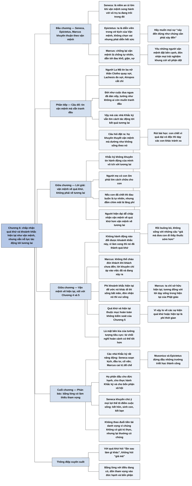

# Chương 6 — Thuyết vận mệnh: Buông bỏ quá khứ... và cả hiện tại (Fatalism: Letting Go of the Past ... and the Present)

## Ý chính

**Irvine cho rằng các nhà Khắc kỷ chỉ khuyên một thuyết vận mệnh có giới hạn: chấp nhận quá khứ và khoảnh khắc hiện tại như chúng đã là, vì không thể thay đổi chúng, nhưng vẫn nỗ lực tác động đến tương lai.**

Seneca, Epictetus và Marcus đều khuyên thuận theo vận mệnh: Seneca thấy an ủi khi trôi cùng vũ trụ; Epictetus ví ta như diễn viên trong vở kịch do Vận mệnh phân vai và khuyên muốn mọi sự "xảy đến đúng như chúng cần phải xảy đến"; Marcus khuyên đón nhận "mọi trải nghiệm mà khung cửi số phận dệt".

Người La Mã tin ba nữ thần vận mệnh (Clotho, Lachesis, Atropos), nên đời như cuộc đua ngựa đã dàn xếp; vậy mà các nhà Khắc kỷ vẫn ra sức tác động tới tương lai.

Irvine giải thích bằng cách phân biệt thuyết vận mệnh về tương lai với thuyết vận mệnh về quá khứ: người mẹ có con ốm phải tìm cách chữa, nhưng nếu con chết thì nên rút bài học (như tránh quả dại có độc) rồi buông bỏ, không sống với những câu "giá mà".

Ông thêm thuyết vận mệnh về hiện tại: khoảnh khắc này không thể thay đổi vì mọi hành động đều đến sau nó. Lời khuyên này nhất quán với Chương 5 và là ảnh chiếu của tưởng tượng tiêu cực: không so hoàn cảnh với những hoàn cảnh tốt hơn.

Trước lo ngại rằng như vậy sẽ thành tự mãn, Irvine chỉ ra Seneca, Musonius, Epictetus và Marcus đều rất năng động và thành công; họ phấn đấu cho đức hạnh, cho việc thực hành Khắc kỷ và cho bổn phận xã hội, không theo đuổi tiền tài danh vọng, nhưng lại thường có chúng.

## Sơ đồ

### Ba nhà Khắc kỷ La Mã khuyên thuận theo vận mệnh (trang PDF 81)

```text
       Cách giữ bình thản: tin rằng điều xảy đến với ta là VẬN MỆNH
                                │
       ┌────────────────────────┼─────────────────────────────┐
       ▼                        ▼                             ▼
  SENECA                  EPICTETUS                       MARCUS
  · an ủi lớn khi vận     · ta là DIỄN VIÊN trong vở      · chống lại vận mệnh là
    mệnh song hành với      kịch của Vận mệnh; không        chống tự nhiên → đau
    vũ trụ ta trôi trong    chọn vai, nhưng diễn hết        khổ, giận, sợ, mất
                            sức (ăn xin hay vua chúa)       bình thản
                          · đừng muốn mọi sự theo ý      · thích nghi hoàn cảnh,
                            mình; muốn mọi sự "xảy          yêu người bên cạnh,
                            đến đúng như chúng cần          vui làm bổn phận
                            phải xảy đến"                 · đón nhận "mọi trải
                                                            nghiệm mà khung cửi
                                                            số phận dệt"
```

### Câu đố: tin vận mệnh mà vẫn cố gắng (trang PDF 82)

```text
       Người La Mã tin BA NỮ THẦN VẬN MỆNH
       · Clotho quay sợi · Lachesis đo sợi · Atropos cắt chỉ
       · không ai thoát được số phận các nữ thần đã chọn
                                │
                                ▼
       Đời như CUỘC ĐUA NGỰA ĐÃ DÀN XẾP: kết quả đã biết trước
       → tưởng như sẽ không ai buồn tranh đấu
                                │
                                ▼
       NHƯNG các nhà Khắc kỷ không khoanh tay chờ; họ tìm cách tác
       động tới kết quả tương lai
       → họ khuyên thuyết vận mệnh mà dường như không sống theo nó?
```

### Lời giải: vận mệnh về quá khứ, không phải về tương lai (trang PDF 82–83)

```text
       ┌──────────────────────────────┬────────────────────────────────┐
       │ THUYẾT VẬN MỆNH VỀ TƯƠNG LAI │ THUYẾT VẬN MỆNH VỀ QUÁ KHỨ     │
       ├──────────────────────────────┼────────────────────────────────┤
       │ tin hành động của mình không │ tin hành động của mình không   │
       │ tác động được tương lai      │ tác động được quá khứ          │
       │ → ít nghĩ, ít cố thay đổi    │ → ít nghĩ quá khứ lẽ ra đã     │
       │   tương lai                  │   khác đi thế nào              │
       │ Khắc kỷ KHÔNG khuyên         │ Khắc kỷ KHUYÊN                 │
       └──────────────────────────────┴────────────────────────────────┘
                                │
                                ▼
       NGƯỜI MẸ CÓ CON ỐM
       · con còn ốm: phải tìm cách chữa (không theo vận mệnh về tương
         lai)
       · con đã chết: đau buồn là tự nhiên, nhưng mãi đắm chìm là
         lãng phí vì quá khứ không đổi được
       · nghĩ về quá khứ ĐỂ RÚT BÀI HỌC: con chết vì ăn quả dại có độc
         → giữ các con khác tránh xa, dạy chúng loại quả ấy có độc
       · rồi BUÔNG BỎ: không sống với "giá mà mình biết", "giá mà đưa
         con đi thầy thuốc sớm hơn"
                                │
                                ▼
       Người thời nay dễ chấp nhận vận mệnh về quá khứ hơn nhiều so
       với vận mệnh về tương lai
```

### Thuyết vận mệnh về hiện tại (trang PDF 83–85)

```text
       Hiện tại = CHÍNH KHOẢNH KHẮC NÀY
       · hành động ảnh hưởng được một thập kỷ, một ngày, một phút, nửa
         giây nữa
       · nhưng không đổi được khoảnh khắc này: lúc hành động xong thì
         nó đã thành quá khứ
                                │
                                ▼
       Vậy Khắc kỷ: KHÔNG vận mệnh về tương lai; CÓ vận mệnh về quá
       khứ và hiện tại
       · Epictetus "muốn sự kiện xảy đến đúng như chúng cần phải xảy
         đến" nói về việc ĐÃ hoặc ĐANG xảy ra, không phải SẼ xảy ra
       · Marcus: không thể chào đón khách khi khách chưa đến
                                │
                                ▼
       Vì sao có ích: khoảnh khắc hiện tại là thứ ta CÓ; hai lựa chọn
       ┌──────────────────────────────┬────────────────────────────────┐
       │ phí nó để ước nó khác đi     │ đón nhận nó                    │
       │ → bất mãn phần lớn thời gian │ → vui sống cuộc đời mình       │
       └──────────────────────────────┴────────────────────────────────┘
       · Marcus: ta chỉ sở hữu hiện tại, hãy sống trong nó
       · tương đồng với lời dạy Phật giáo về sống trong hiện tại
```

### Quan hệ với Chương 4 và Chương 5 (trang PDF 85)

```text
       Với CHƯƠNG 5: quá khứ và hiện tại thuộc mục "HOÀN TOÀN KHÔNG
       KIỂM SOÁT" → lo về chúng là phí thời gian
                                │
                                ▼
       Với CHƯƠNG 4: thuyết vận mệnh là MẶT BÊN KIA (ảnh chiếu) của
       tưởng tượng tiêu cực
       ┌──────────────────────────────┬────────────────────────────────┐
       │ Tưởng tượng tiêu cực         │ Thuyết vận mệnh                │
       ├──────────────────────────────┼────────────────────────────────┤
       │ nghĩ hoàn cảnh có thể TỆ HƠN │ TỪ CHỐI nghĩ hoàn cảnh có thể  │
       │ thế nào                      │ TỐT HƠN thế nào                │
       └──────────────────────────────┴────────────────────────────────┘
       → cả hai làm hoàn cảnh hiện tại dễ chịu đựng hơn
```

### Phản bác "tự mãn, thiếu tham vọng" (trang PDF 85–87)

```text
       Lo ngại: thỏa mãn với mọi thứ thì có thành thiếu tham vọng?
                                │
                                ▼
       Thực tế: các nhà Khắc kỷ rất THÀNH CÔNG và NĂNG ĐỘNG
       · Seneca: triết gia, nhà soạn kịch, nhà đầu tư, cố vấn chính trị
       · Musonius, Epictetus: đứng đầu trường triết học thành công
       · Marcus: cai trị đế chế La Mã
                                │
                                ▼
       Họ PHẤN ĐẤU cho:
       · trở thành người tốt hơn, có ĐỨC HẠNH
       · thực hành Khắc kỷ hằng ngày
       · BỔN PHẬN XÃ HỘI (Chương 9): Seneca, Marcus làm chính quyền;
         Musonius, Epictetus dạy học
       · tận hưởng hoàn cảnh: kết hôn, sinh con, kết bạn (Seneca: chú ý
         "tất cả những lợi thế tô điểm cho cuộc sống")
                                │
                                ▼
       KHÔNG theo đuổi TIỀN TÀI DANH VỌNG (không có giá trị thực, nhất
       là khi phá bình thản hay đòi làm điều vô đạo đức)
       · nhưng lại THƯỜNG CÓ chúng → nan đề, giải ở Chương 14 và 15
```

## Ba câu hỏi chương này trả lời

1. **Các nhà Khắc kỷ khuyên tin vào vận mệnh, vậy sao họ vẫn cố thay đổi tương lai?** Theo Irvine, họ chỉ khuyên thuyết vận mệnh về quá khứ và hiện tại, không khuyên thuyết vận mệnh về tương lai. Người mẹ có con ốm phải tìm cách chữa cho con; chỉ khi con đã chết bà mới nên chấp nhận việc đó như vận mệnh, rút bài học rồi buông bỏ.
2. **Vì sao chấp nhận khoảnh khắc hiện tại lại giúp sống tốt hơn?** Vì khoảnh khắc này không thể thay đổi: mọi hành động đều đến sau nó. Ta có thể phí nó để ước nó khác đi và sống bất mãn, hoặc đón nhận nó và vui sống. Lời khuyên này nhất quán với việc không bận tâm tới những gì ta hoàn toàn không kiểm soát được (Chương 5), và là mặt bên kia của tưởng tượng tiêu cực: không so hoàn cảnh với những hoàn cảnh tốt hơn.
3. **Bằng lòng với mọi thứ có làm người Khắc kỷ thiếu tham vọng không?** Không. Seneca, Musonius, Epictetus và Marcus đều rất năng động; họ phấn đấu để có đức hạnh, để thực hành Khắc kỷ, và để làm bổn phận xã hội, và họ không thấy sai khi kết hôn, sinh con, kết bạn. Họ chỉ không theo đuổi tiền tài danh vọng, dù thực tế họ thường có chúng.

## Khái niệm cần biết

**Thuyết vận mệnh (fatalism).** Là niềm tin rằng những gì xảy ra đều đã được định trước và phải xảy ra. Ví dụ của sách: người La Mã tin ba nữ thần Clotho, Lachesis, Atropos định số phận mỗi người, nên đời như cuộc đua ngựa đã dàn xếp. Khái niệm này quan trọng vì Irvine dùng nó để chỉ thái độ chấp nhận, và cần tách nó thành các loại.

**Thuyết vận mệnh về tương lai.** Là tin rằng hành động của mình không tác động được tới tương lai, nên ít nghĩ và ít cố thay đổi tương lai. Ví dụ ngược của sách: các nhà Khắc kỷ không khuyên người mẹ có con ốm khoanh tay vì "số trời đã định". Khái niệm này quan trọng vì Irvine nói các nhà Khắc kỷ không chủ trương nó.

**Thuyết vận mệnh về quá khứ.** Là tin rằng hành động của mình không tác động được tới quá khứ, nên không dành thời gian nghĩ quá khứ lẽ ra đã khác thế nào. Ví dụ của sách: người mẹ mất con vì quả dại có độc nên rút bài học để bảo vệ các con khác, rồi thôi sống với những câu "giá mà". Khái niệm này quan trọng vì nó là phần cốt lõi, dễ chấp nhận nhất của lời khuyên.

**Thuyết vận mệnh về hiện tại.** Là chấp nhận khoảnh khắc đang diễn ra đúng như nó đang là, vì không hành động nào thay đổi được nó: khi hành động xong thì khoảnh khắc ấy đã thành quá khứ. Ví dụ của sách: Marcus nói không thể chào đón một vị khách chưa đến, cũng như không thể chào đón trải nghiệm chưa xảy ra; nhưng trải nghiệm đang xảy ra thì nên đón nhận. Khái niệm này quan trọng vì nó biến một lập luận logic thành lời khuyên sống trong hiện tại.

**Diễn viên trong vở kịch của Vận mệnh.** Là hình ảnh của Epictetus: ta không chọn vai (ăn xin hay vua chúa), nhưng chọn được cách diễn, và phải diễn hết sức. Khái niệm này quan trọng vì nó cho thấy chấp nhận hoàn cảnh không có nghĩa là thụ động trong hành động.

**Mặt bên kia của tưởng tượng tiêu cực.** Tưởng tượng tiêu cực là nghĩ hoàn cảnh có thể tệ hơn; thuyết vận mệnh là từ chối nghĩ hoàn cảnh có thể tốt hơn, tức từ chối so sánh với những phương án thay thế tốt hơn. Ví dụ: không dằn vặt "lẽ ra mình đã có thể ở công ty khác lương cao hơn". Khái niệm này quan trọng vì hai kỹ thuật cùng tác động lên một điểm: cách ta so sánh hoàn cảnh của mình.

**Thành công thế tục.** Là tiền tài và danh vọng. Các nhà Khắc kỷ coi chúng không có giá trị thực sự và không theo đuổi chúng, nhất là khi chúng phá bình thản hay đòi hành động vô đạo đức. Ví dụ của sách: Seneca và Marcus giàu có, nổi tiếng mà không theo đuổi điều đó. Khái niệm này quan trọng vì nó mở ra nan đề được giải ở Chương 14 và 15.

## Nội dung chi tiết

### 1. Seneca, Epictetus và Marcus về vận mệnh (trang PDF 81)

Các nhà Khắc kỷ cho rằng một cách giữ bình thản là tin rằng những gì xảy đến với ta là vận mệnh. Seneca khuyên thuận theo vận mệnh vì "đó là một niềm an ủi lớn khi vận mệnh song hành với vũ trụ mà ta đang trôi giạt trong đó".

Epictetus khuyên luôn nhớ rằng ta chỉ là diễn viên trong một vở kịch của người khác, chính xác hơn là của Vận mệnh. Ta không chọn được vai, nhưng được phân vai nào thì phải diễn hết khả năng: được phân vai người ăn xin thì diễn thật tốt vai ăn xin, được phân vai vua chúa cũng vậy. Nếu muốn đời mình tốt đẹp, Epictetus khuyên thay vì muốn mọi sự thuận theo ý mình, hãy làm cho mong muốn của mình thuận theo mọi sự; nói cách khác, hãy mong mọi sự "xảy đến đúng như chúng cần phải xảy đến".

Marcus cũng tin vào thuyết vận mệnh. Làm trái nó là chống lại tự nhiên, và việc chống đối ấy phản tác dụng nếu điều ta tìm là một cuộc sống tốt. Theo Marcus, chống lại sự sắp đặt của vận mệnh thì ta dễ phải chịu đau khổ, tức giận hoặc sợ hãi và mất bình thản. Để tránh điều đó, ta phải học cách thích nghi với hoàn cảnh sống, yêu thương những người mà vận mệnh đặt bên cạnh mình, vui vẻ làm mọi bổn phận, và thuyết phục mình rằng bất cứ điều gì xảy đến đều có ý nghĩa. Theo Marcus, một người tốt sẽ chào đón "mọi trải nghiệm mà khung cửi số phận dệt cho anh ta".

### 2. Câu đố: tin vào vận mệnh mà vẫn tranh đấu (trang PDF 82)

Như phần lớn người La Mã cổ đại, các triết gia Khắc kỷ tin vào vận mệnh, cụ thể là vào ba nữ thần vận mệnh, mỗi người một việc: Clotho quay sợi, Lachesis đo sợi, Atropos cắt chỉ. Dù cố gắng đến đâu, con người cũng không thoát được số phận các nữ thần đã chọn.

Vì vậy với người La Mã cổ đại, đời giống một cuộc đua ngựa đã được dàn xếp: Vận mệnh đã biết trước ai thắng. Một tay đua có thể từ chối dự một cuộc đua mà kết quả đã định: sao phải tranh khi ai đó đã biết người thắng? Tương tự, có thể tưởng người La Mã sẽ từ chối mọi cuộc tranh đấu trong đời, vì tương lai đã an bài.

Điều thú vị là dù người xưa tin thuyết tiền định, tức bất cứ điều gì xảy ra đều phải xảy ra, họ không quan niệm rằng vận mệnh chi phối tương lai theo nghĩa khiến họ buông xuôi. Các nhà Khắc kỷ không ngồi khoanh tay cam chịu; họ tìm cách tác động tới kết quả các sự kiện tương lai. Như vậy họ dường như ủng hộ thuyết vận mệnh mà không làm theo nó. Vậy phải hiểu lời khuyên tin rằng mọi sự là vận mệnh thế nào?

### 3. Thuyết vận mệnh về tương lai và về quá khứ (trang PDF 82–83)

Để hiểu, Irvine phân biệt hai loại thuyết vận mệnh. Người tin **thuyết vận mệnh về tương lai** luôn nghĩ rằng hành động của mình không tác động tới các sự kiện tương lai; người như vậy ít dành thời gian và công sức nghĩ về tương lai hay tìm cách thay đổi nó. Người tin **thuyết vận mệnh về quá khứ** có thái độ tương tự với quá khứ: luôn nhớ rằng hành động của mình không tác động tới quá khứ; người như vậy ít khi bỏ thời gian nghĩ xem quá khứ lẽ ra đã có thể khác đi thế nào.

Irvine cho rằng các nhà Khắc kỷ ủng hộ một hình thức giới hạn của thuyết vận mệnh: họ khuyên tin vào thuyết vận mệnh về quá khứ, luôn nhớ rằng quá khứ không thể thay đổi. Vì thế họ sẽ không khuyên một người mẹ có con đang ốm tin vào thuyết vận mệnh về tương lai; bà phải tìm cách chăm cho con khỏi bệnh, dù Vận mệnh đã an bài chuyện sống chết của đứa trẻ. Nhưng nếu đứa trẻ chết, họ sẽ khuyên bà tin vào thuyết vận mệnh về quá khứ. Ngay với các nhà Khắc kỷ, đau khổ sau cái chết của con là hoàn toàn tự nhiên; nhưng đắm chìm mãi trong cái chết ấy là lãng phí thời gian và cảm xúc, vì quá khứ không thể đổi, và nó gây đau khổ không cần thiết.

Không đắm chìm trong quá khứ không có nghĩa là không bao giờ nghĩ về nó. Thỉnh thoảng ta nên nghĩ về quá khứ để rút ra bài học giúp định hình tương lai. Người mẹ ấy nên nghĩ về nguyên nhân cái chết của con để bảo vệ những đứa con khác tốt hơn: nếu con chết vì ăn quả dại có độc, bà cần giữ các con khác tránh xa loại quả ấy và dạy chúng rằng nó có độc. Nhưng làm xong việc đó, bà nên buông bỏ quá khứ, không sống với đầu óc lúc nào cũng đầy những ý nghĩ "giá mà": "Giá mà mình biết con bé ăn quả dại! Giá mà mình đưa con bé đến thầy thuốc sớm hơn!"

Irvine nhận xét rằng với người thời nay, thuyết vận mệnh về quá khứ dễ chấp nhận hơn nhiều so với thuyết vận mệnh về tương lai. Đa số chúng ta phản đối ý cho rằng đời mình đã được an bài và tin rằng nỗ lực của mình tác động tới tương lai; nhưng ta sẵn lòng chấp nhận rằng quá khứ không thể thay đổi.

### 4. Thuyết vận mệnh về hiện tại (trang PDF 83–85)

Irvine cho rằng các nhà Khắc kỷ còn ủng hộ **thuyết vận mệnh về hiện tại**. Nếu định nghĩa hiện tại là chính khoảnh khắc này, rõ ràng ta không thể tác động tới nó bằng hành động của mình. Ông có thể hành động để ảnh hưởng tới điều xảy ra sau một thập kỷ, một ngày, một phút hay thậm chí nửa giây nữa; nhưng không thể hành động để thay đổi điều đang diễn ra ngay lúc này, vì khi hành động xong thì khoảnh khắc ấy đã trôi vào quá khứ và không còn bị ảnh hưởng được.

Vì vậy, tuy ủng hộ thuyết vận mệnh, các nhà Khắc kỷ khuyên không tin vào thuyết vận mệnh về tương lai, mà chỉ tin vào thuyết vận mệnh về quá khứ và hiện tại. Khi Epictetus khuyên mong các sự kiện "xảy đến đúng như chúng cần phải xảy đến", ông nói về các sự kiện đã xảy đến hoặc đang xảy đến, không phải những sự kiện sẽ xảy đến. Marcus cũng vậy: như không thể chào đón một vị khách chừng nào anh ta chưa đến, người tốt không thể chào đón những trải nghiệm khung cửi vận mệnh dệt cho mình chừng nào chúng chưa xảy ra.

Vì sao tin vào thuyết vận mệnh về hiện tại giúp đời tốt hơn? Các nhà Khắc kỷ cho rằng cách tốt nhất để thỏa mãn không phải là đáp ứng mọi ham muốn nảy sinh, mà là học cách bằng lòng với cuộc sống hiện tại, vui với bất cứ thứ gì mình nhận được. Ta có thể phí thời gian ao ước hoàn cảnh khác đi, nhưng nếu để mình làm vậy thì sẽ sống cả đời trong bất mãn. Nếu học được cách muốn bất cứ thứ gì mình đang có, ta sẽ không phải vất vả đáp ứng ham muốn để được thỏa mãn, vì chúng đã được đáp ứng rồi.

Một trong những thứ ta sở hữu chính là khoảnh khắc hiện tại, và ta có một lựa chọn quan trọng về nó: phung phí nó để ước nó khác đi, hoặc đón nhận nó. Quen làm cách thứ nhất thì phần lớn thời gian ta sống bất mãn; quen làm cách thứ hai thì ta vui sống. Irvine nghĩ đó là lý do các nhà Khắc kỷ khuyên tin vào thuyết vận mệnh về hiện tại. Marcus nhắc rằng tất cả những gì ta sở hữu là khoảnh khắc hiện tại và khuyên sống trong khoảnh khắc này. Irvine ghi nhận đây là một điểm tương đồng nữa với Phật giáo, vốn dạy cố gắng sống trong giây phút hiện tại.

### 5. Quan hệ với tam phân quyền kiểm soát và với tưởng tượng tiêu cực (trang PDF 85)

Lời khuyên tin vào thuyết vận mệnh về quá khứ và hiện tại nhất quán với lời khuyên ở chương trước rằng không nên bận tâm tới những thứ ta hoàn toàn không kiểm soát được. Ta hoàn toàn không kiểm soát được quá khứ, cũng như hiện tại nếu hiểu là chính khoảnh khắc này; vì vậy lo về các sự kiện quá khứ hoặc hiện tại là phí thời gian.

Lời khuyên này cũng liên quan tới tưởng tượng tiêu cực. Khi tưởng tượng tiêu cực, ta nghĩ hoàn cảnh có thể tệ hơn theo những cách nào, để coi trọng những gì đang có. Có thể nói thuyết vận mệnh của các nhà Khắc kỷ là mặt bên kia, hay ảnh chiếu, của kỹ thuật ấy: thay vì nghĩ hoàn cảnh có thể tệ hơn thế nào, ta từ chối nghĩ nó có thể tốt hơn ra sao. Khi tin vào thuyết vận mệnh về quá khứ và hiện tại, ta từ chối so hoàn cảnh của mình với những hoàn cảnh thay thế đáng mong hơn. Các nhà Khắc kỷ cho rằng làm vậy thì hoàn cảnh hiện tại, dù ra sao, cũng trở nên dễ chịu đựng hơn.

### 6. Phản bác: Khắc kỷ có dẫn tới tự mãn và thiếu tham vọng không? (trang PDF 85–87)

Thuyết vận mệnh ở chương này và tưởng tượng tiêu cực ở Chương 4 có thể khiến độc giả lo rằng thực hành Khắc kỷ sẽ dẫn tới tự mãn: người Khắc kỷ thỏa mãn một cách bất thường với bất cứ thứ gì mình có. Đó là một phước lành, nhưng họ có thành ra quá thiếu tham vọng không?

Irvine nhắc rằng các nhà Khắc kỷ được bàn trong sách đều vô cùng tham vọng và thành công:

| Nhà Khắc kỷ | Hoạt động |
|---|---|
| Seneca | Triết gia, nhà soạn kịch, nhà đầu tư, cố vấn chính trị |
| Musonius Rufus | Đứng đầu một trường triết học thành công |
| Epictetus | Đứng đầu một trường triết học thành công |
| Marcus Aurelius | Làm việc cật lực để cai trị Đế chế La Mã khi không bàn triết học |

Điều này gây tò mò: họ gần như chẳng cần gì để thỏa mãn, nhưng vẫn phấn đấu vì một điều gì đó. Các nhà Khắc kỷ giải thích nghịch lý bề ngoài này như sau. Dù dạy bằng lòng với bất cứ thứ gì mình có, triết lý Khắc kỷ cũng khuyên theo đuổi một số điều nhất định:

- phấn đấu trở thành người tốt hơn, có đức hạnh theo nghĩa cổ của từ này;
- nỗ lực thực hành chủ nghĩa Khắc kỷ trong đời sống hằng ngày;
- làm các bổn phận xã hội của mình (sẽ bàn ở Chương 9): đó là lý do Seneca và Marcus thấy nhất định phải tham gia chính quyền La Mã, còn Musonius và Epictetus thấy nhất định phải dạy chủ nghĩa Khắc kỷ;
- làm những việc cần thiết để tận hưởng hoàn cảnh hiện tại; Seneca khuyên "chú ý đến tất cả những lợi thế tô điểm cho cuộc sống", nên ta có thể kết hôn, sinh con, xây dựng và vui hưởng tình bạn.

Còn thành công thế tục thì sao, các nhà Khắc kỷ có theo đuổi tiền tài danh vọng không? Họ không màng tới chúng. Họ cho rằng những thứ ấy không có giá trị thực sự, nên theo đuổi chúng là ngu ngốc, nhất là khi điều đó phá vỡ sự bình thản hoặc đòi hỏi hành động vô đạo đức. Irvine nhận ra sự thờ ơ này làm họ có vẻ thiếu động lực trong mắt người thời nay, vốn làm việc chăm chỉ để có danh vọng và của cải.

Nhưng ông nói thêm: dù không theo đuổi thành công thế tục, họ lại thường có được nó. Seneca và Marcus đều giàu có và nổi tiếng; Musonius và Epictetus, là người đứng đầu các trường triết học lừng danh, hẳn cũng được nhiều người biết đến và có đời sống tài chính dư dả. Họ rơi vào tình thế lạ: không theo đuổi thành công mà rốt cuộc có nó. Chương 14 và 15 sẽ cho thấy họ giải quyết nan đề này thế nào.

## Luận điểm triết học cốt lõi

### 1. Chỉ quá khứ và hiện tại là đối tượng hợp lý của thái độ chấp nhận theo vận mệnh

- **Lập luận:** hành động chỉ tác động tới tương lai; quá khứ đã cố định và khoảnh khắc hiện tại trôi qua trước khi hành động kịp tác động. Vì vậy chấp nhận quá khứ và hiện tại không làm mất gì, còn chấp nhận tương lai như đã định sẽ làm ta bỏ những nỗ lực có ích.
- **Phản bác có thể:** các nhà Khắc kỷ cổ tin tương lai cũng đã định; Irvine thu hẹp học thuyết để nó hợp với người hiện đại. Câu trả lời của Khắc kỷ cổ khác: tương lai đã định nhưng nỗ lực của ta là một phần của chuỗi nguyên nhân, nên vẫn phải nỗ lực.

### 2. Nghĩ về quá khứ chỉ có giá trị khi nó cho bài học về tương lai

- **Lập luận:** ví dụ người mẹ và quả dại: nghĩ về nguyên nhân để phòng ngừa là đúng; nhai lại "giá mà" thì không thay đổi được gì và chỉ thêm khổ.
- **Hệ quả:** có một tiêu chí rõ để phân biệt suy ngẫm có ích và dằn vặt vô ích: câu hỏi "lần sau làm gì khác?" thì có ích; câu hỏi "giá mà lần trước" thì không.

### 3. Ta chỉ có khoảnh khắc hiện tại, và thái độ với nó quyết định ta sống vui hay bất mãn

- **Lập luận:** khoảnh khắc hiện tại là một thứ ta sở hữu; ước nó khác đi là ham muốn không thể đáp ứng. Đón nhận nó là cách duy nhất để ham muốn và thực tại trùng nhau.
- **Phản bác có thể:** chấp nhận hiện tại có thể bị hiểu là chấp nhận bất công đang diễn ra. Irvine trả lời gián tiếp: chấp nhận khoảnh khắc này không ngăn hành động để thay đổi khoảnh khắc sau.

### 4. Thuyết vận mệnh và tưởng tượng tiêu cực là hai mặt của cùng một kỹ thuật so sánh

- **Lập luận:** sự hài lòng phụ thuộc vào ta so hoàn cảnh với cái gì. Tưởng tượng tiêu cực so với cái tệ hơn; thuyết vận mệnh từ chối so với cái tốt hơn. Cả hai làm hoàn cảnh dễ chịu hơn.

### 5. Bằng lòng không loại trừ tham vọng, nếu tham vọng hướng vào đức hạnh và bổn phận

- **Lập luận:** các nhà Khắc kỷ bằng lòng với hoàn cảnh nhưng phấn đấu cho những thứ trong quyền mình (tính cách, thực hành, bổn phận). Tiền tài danh vọng không đáng theo đuổi, nhưng thường đến như sản phẩm phụ.
- **Phản bác có thể:** bốn ví dụ đều là người thành công nổi tiếng, nên có thiên lệch người sống sót: những người Khắc kỷ không thành công không được lịch sử ghi lại. Ngoài ra Seneca xuất thân từ một gia đình giàu có và Marcus được nhận làm người thừa kế ngai vàng (theo hiểu biết của người tổng hợp), nên khó nói Khắc kỷ đem lại thành công cho họ.

### Trong ngôn ngữ hôm nay

- **Tư duy phản thực tế (counterfactual thinking):** tâm lý học phân biệt so sánh "đi lên" (lẽ ra đã tốt hơn) với so sánh "đi xuống" (lẽ ra đã tệ hơn). So sánh đi lên gây hối tiếc; so sánh đi xuống gây nhẹ nhõm. Thuyết vận mệnh là từ chối so sánh đi lên, tưởng tượng tiêu cực là chủ động so sánh đi xuống.
- **Nghiền ngẫm (rumination):** những ý nghĩ "giá mà" của người mẹ là ví dụ điển hình của nghiền ngẫm, yếu tố nguy cơ của trầm cảm; tách "rút bài học" khỏi "nhai lại" là điều các liệu pháp nhận thức dạy.
- **Chấp nhận triệt để (radical acceptance)** trong liệu pháp hành vi biện chứng (DBT): chấp nhận hoàn toàn thực tại đang là, không phải vì tán thành nó mà vì chống lại nó chỉ thêm khổ.
- **Chánh niệm (mindfulness):** sống trong khoảnh khắc hiện tại, đúng như Irvine ghi nhận điểm chung với Phật giáo.
- **Kinh tế học:** chi phí chìm (sunk cost) là ứng dụng trực tiếp của thuyết vận mệnh về quá khứ: số tiền đã bỏ ra không lấy lại được nên không nên ảnh hưởng tới quyết định tương lai.

## Thuật ngữ

| Tiếng Việt (theo bản dịch) | Tiếng Anh | Hy Lạp/Latinh nếu có | Giải thích |
|---|---|---|---|
| Thuyết vận mệnh (có chỗ bản dịch ghi "thuyết định mệnh") | fatalism | | Niềm tin rằng mọi sự xảy ra đều đã được định |
| Vận mệnh, số mệnh | Fate | *heimarmenē* (Hy Lạp), *fatum* (Latinh) | Trật tự đã định của các sự kiện |
| Thuyết tiền định | determinism, predestination | | Bất cứ điều gì xảy ra đều phải xảy ra |
| Thuyết vận mệnh về tương lai | fatalism about the future | | Tin hành động không tác động được tương lai; Khắc kỷ không khuyên |
| Thuyết vận mệnh về quá khứ | fatalism about the past | | Chấp nhận quá khứ không thể đổi |
| Thuyết vận mệnh về hiện tại | fatalism about the present | | Chấp nhận khoảnh khắc đang diễn ra |
| Ba nữ thần vận mệnh | the Fates | *Moirai* (Hy Lạp), *Parcae* (Latinh) | Clotho quay sợi, Lachesis đo sợi, Atropos cắt chỉ |
| Đức hạnh | virtue | *aretē* (Hy Lạp), *virtus* (Latinh) | Sự xuất sắc trong việc làm người |
| Bổn phận xã hội | social duties | *kathēkonta* (Hy Lạp, việc thích đáng) | Việc mỗi người phải làm với cộng đồng |
| Thành công thế tục | worldly success | | Tiền tài và danh vọng |

## Câu nói đáng nhớ

> "đó là một niềm an ủi lớn khi vận mệnh song hành với vũ trụ mà ta đang trôi giạt trong đó" — Seneca

Chấp nhận vận mệnh như thuận theo dòng chảy chung của vũ trụ.

> mong cầu mọi sự "xảy đến đúng như chúng cần phải xảy đến" — Epictetus

Làm cho ham muốn thuận theo sự việc thay vì đòi sự việc thuận theo ham muốn.

> một người tốt sẽ chào đón "mọi trải nghiệm mà khung cửi số phận dệt cho anh ta" — Marcus

Thái độ chủ động đón nhận, không chỉ cam chịu.

> "Giá mà mình biết con bé ăn quả dại! Giá mà mình đưa con bé đến thầy thuốc sớm hơn!" — ví dụ của Irvine

Loại ý nghĩ mà thuyết vận mệnh về quá khứ giúp buông bỏ.

> "Chúng ta có thể phung phí khoảnh khắc hiện tại để mong ước nó khác đi, hoặc có thể đón nhận khoảnh khắc này." — Irvine

Lựa chọn quyết định ta sống bất mãn hay vui sống.

> Seneca khuyên chúng ta "chú ý đến tất cả những lợi thế tô điểm cho cuộc sống" — Seneca

Khắc kỷ không cấm tận hưởng hoàn cảnh.

> "mặc dù các nhà Khắc kỷ không theo đuổi thành công thế tục nhưng họ lại thường có được nó." — Irvine

Mở ra nan đề của Chương 14 và 15.

## Đánh giá và phát hiện đáng chú ý

### Phân biệt vận mệnh về quá khứ, hiện tại và tương lai là một công cụ thực hành tốt, dù không trung thành với học thuyết cổ

Irvine biến một học thuyết siêu hình khó chấp nhận (mọi sự đã định) thành một lời khuyên tâm lý mà hầu như ai cũng đồng ý (đừng dằn vặt về điều không thể đổi). Cái giá là sự trung thành lịch sử: các nhà Khắc kỷ cổ tin tất định toàn diện và giải quyết câu đố "sao còn cố gắng" theo cách khác (nỗ lực là một phần của định mệnh). Người đọc nên nhớ rằng phần "tôi cho rằng" trong chương là diễn giải của Irvine. Điều này nhất quán với cách tiếp cận chung của ông, được giải thích ở Chương 21 ([C21-xet-lai-chu-nghia-khac-ky.md](C21-xet-lai-chu-nghia-khac-ky.md)): giữ những gì dùng được, bỏ phần siêu hình.

### Lập luận về "hiện tại không thể đổi" hơi mang tính kỹ thuật, nhưng hệ quả thực hành vững

Nói rằng không thể tác động tới khoảnh khắc này vì hành động luôn đến sau nó là đúng về logic nhưng có phần hiển nhiên. Giá trị thực của nó nằm ở hệ quả: phần lớn bất mãn đến từ việc liên tục so hoàn cảnh đang có với một hoàn cảnh tưởng tượng tốt hơn. Câu hỏi đáng hỏi không phải "tại sao lại như thế này?" mà là "giờ làm gì tiếp?".

### Ví dụ người mẹ và quả dại cho thấy Khắc kỷ không yêu cầu vô cảm

Irvine nói rõ đau khổ sau cái chết của con là tự nhiên, kể cả với người Khắc kỷ. Điều bị bác bỏ là đắm chìm kéo dài. Điều này khớp với Chương 12 về sự đau buồn ([C12-su-dau-buon.md](C12-su-dau-buon.md)). Ví dụ cũng cho một quy trình rõ: đau buồn, rút bài học, hành động phòng ngừa, rồi buông bỏ.

### Câu trả lời cho phản bác "thiếu tham vọng" là chỗ yếu nhất của chương

Bốn ví dụ đều là những người nổi bật trong lịch sử, và hai người (Seneca, Marcus) vốn xuất thân trong tầng lớp giàu có, quyền thế (theo hiểu biết của người tổng hợp). Dữ kiện này không chứng minh rằng thực hành Khắc kỷ giữ được động lực. Lập luận mạnh hơn nằm ở nội dung: tham vọng được chuyển hướng từ kết quả bên ngoài sang đức hạnh và bổn phận, nhất quán với nội tại hóa mục tiêu ở Chương 5. Irvine đúng khi để nan đề "không theo đuổi mà vẫn có" sang Chương 14 và 15 thay vì giải quyết vội.

### Liên hệ với *Suy tưởng*

Marcus nhiều lần nói ta chỉ có thể mất khoảnh khắc hiện tại, vì không ai mất được cái mình không có (*Suy tưởng* 2.14, xem [Q02](../Meditations/Q02-ben-dong-gran.md)), và ta chỉ sống trong hiện tại (3.10, xem [Q03](../Meditations/Q03-o-carnuntum.md)). Lời khuyên yêu những người mà số phận đặt bên cạnh (6.39, xem [Q06](../Meditations/Q06-nhin-thau-ban-chat-su-vat.md)) là phần quan hệ xã hội của cùng thái độ chấp nhận này.

### Vận dụng: buông quá khứ, đón nhận hiện tại, hành động cho tương lai

- **Công việc:** sau một dự án thất bại, tổ chức một buổi rút kinh nghiệm có giới hạn thời gian với câu hỏi "lần sau làm gì khác?", ghi lại các bài học thành quy trình, rồi khép lại. Không để cuộc họp biến thành chuỗi "giá mà" hay tìm người để trách, như người mẹ chuyển từ "giá mà" sang dạy các con khác tránh quả độc.
- **Đầu tư:** "giá mà mua cổ phiếu ấy từ năm ngoái" và "giá mà bán trước đợt giảm" là hai câu tốn kém nhất trong đầu tư. Giá mua là quá khứ (chi phí chìm); quyết định nắm giữ hay bán chỉ nên dựa trên triển vọng từ hôm nay trở đi. Câu hỏi đúng: nếu hôm nay mình đang cầm tiền mặt, mình có mua cổ phiếu này ở giá hiện tại không?
- **Tài chính cá nhân:** khi so thu nhập hay tài sản của mình với bạn bè, đó là so sánh đi lên mà thuyết vận mệnh khuyên từ chối. Thay vào đó, tập trung vào điều kiểm soát được từ nay: tỷ lệ tiết kiệm, kỹ năng, kế hoạch.
- **Đời sống cá nhân:** khi kẹt xe hay chuyến bay bị hoãn, khoảnh khắc ấy đã như thế; bực bội không làm xe chạy. Đón nhận nó (gọi một cuộc điện thoại đã định, nghe một bài giảng, đọc vài trang sách) là áp dụng thuyết vận mệnh về hiện tại, trong khi vẫn lên kế hoạch đi sớm hơn lần sau (không theo thuyết vận mệnh về tương lai).

## Bản đồ tư duy

Toàn cảnh Chương 6 trên một trang: năm nhánh lớn đi theo trình tự của chương gốc (lời khuyên thuận theo vận mệnh, câu đố tin vận mệnh mà vẫn cố gắng, vận mệnh về quá khứ, vận mệnh về hiện tại và quan hệ với Chương 4–5, phản bác thiếu tham vọng), mỗi nhánh ghi luận điểm, ví dụ và câu trích then chốt; nhánh cuối là thông điệp xuyên suốt.



## Nguồn

William B. Irvine, *A Guide to the Good Life: The Ancient Art of Stoic Joy* (Oxford University Press, 2009), bản dịch tiếng Việt *Chủ nghĩa Khắc kỷ* (ebook PDF, không ghi dịch giả), Chương 6 "Thuyết vận mệnh", trang PDF 81–87.

## Tác giả

William B. Irvine, giáo sư triết học Đại học Wright State, Dayton, Ohio (Mỹ); tự thực hành chủ nghĩa Khắc kỷ và viết sách để giới thiệu nó như một triết lý sống cho người hiện đại.

## Vị trí trong lập luận của cả cuốn sách

Chương 4 ([C04-tuong-tuong-tieu-cuc.md](C04-tuong-tuong-tieu-cuc.md)) dạy tưởng tượng hoàn cảnh có thể tệ hơn để trân trọng điều đang có; Chương 5 ([C05-luong-phan-quyen-kiem-soat.md](C05-luong-phan-quyen-kiem-soat.md)) dạy gạt sang bên những gì ta hoàn toàn không kiểm soát được. Chương 6 nối hai chương ấy: quá khứ và khoảnh khắc hiện tại là những thứ ta hoàn toàn không kiểm soát được, nên ta nên chấp nhận chúng như vận mệnh; và thuyết vận mệnh là "mặt bên kia" của tưởng tượng tiêu cực, vì nó từ chối nghĩ hoàn cảnh có thể tốt hơn. Chương 7 ([C07-tu-tiet-che-ban-than.md](C07-tu-tiet-che-ban-than.md)) chuyển sang kỹ thuật tự tiết chế. Cuối chương, Irvine hẹn Chương 9 ([C09-bon-phan.md](C09-bon-phan.md)) về bổn phận xã hội và Chương 14–15 ([C14-gia-tri-ca-nhan-danh-vong.md](C14-gia-tri-ca-nhan-danh-vong.md), [C15-gia-tri-ca-nhan-cuoc-song-xa-hoa.md](C15-gia-tri-ca-nhan-cuoc-song-xa-hoa.md)) về danh vọng và của cải.

## Lưu ý

- **Cách Irvine hiểu thuyết vận mệnh Khắc kỷ là diễn giải riêng của ông (nhận xét của người tổng hợp).** Theo hiểu biết của người tổng hợp (chưa đối chiếu nguyên tác), các nhà Khắc kỷ cổ, nhất là Chrysippus, là người theo thuyết tất định: mọi sự, kể cả tương lai, đều nằm trong chuỗi nguyên nhân của số mệnh (*heimarmenē*). Họ không chia "vận mệnh về quá khứ" với "vận mệnh về tương lai"; họ trả lời câu hỏi "vậy sao còn cố gắng" bằng lập luận rằng chính nỗ lực của ta cũng là một mắt xích trong chuỗi nguyên nhân (phản bác "lập luận lười biếng" và ví dụ hình trụ lăn của Chrysippus). Phiên bản giới hạn của Irvine dễ chấp nhận với người hiện đại nhưng không phải học thuyết gốc; chính ông nói "Tôi cho rằng".
- **Ba nữ thần vận mệnh:** Clotho, Lachesis và Atropos là tên Hy Lạp (*Moirai*). Người La Mã gọi họ là *Parcae* (Nona, Decima, Morta) (theo hiểu biết của người tổng hợp). Ngoài ra, với các triết gia Khắc kỷ, vận mệnh là trật tự lý trí của vũ trụ (*logos*) hơn là ba nữ thần thần thoại; câu "các triết gia Khắc kỷ tin vào sự tồn tại của ba nữ thần vận mệnh" nên đọc như nói về văn hóa chung của người La Mã (nhận xét của người tổng hợp).
- **"Thuyết định mệnh về hiện tại"** (trang PDF 85): bản dịch đổi chữ giữa chừng; cả chương dùng "thuyết vận mệnh". Bản tổng hợp dùng thống nhất "thuyết vận mệnh". Chữ "Vận mệnh" viết hoa trong bản dịch dịch *Fate*, khác với "Vận mệnh" ở Chương 4 dịch *Fortune*; bản dịch dùng một chữ cho hai khái niệm (Fate là trật tự đã định, Fortune là may rủi).
- **Nguồn các câu trích (theo hiểu biết của người tổng hợp, Irvine không ghi số mục trong lời văn):** câu Seneca về niềm an ủi khi trôi cùng vũ trụ thuộc *Bàn về thiên ý* (*De providentia*); ví dụ diễn viên thuộc *Cẩm nang* của Epictetus mục 17, câu "xảy đến đúng như chúng cần phải xảy đến" thuộc mục 8; câu Marcus về khung cửi số phận gần với *Suy tưởng* 3.16 (xem [Q03](../Meditations/Q03-o-carnuntum.md)), lời khuyên yêu những người vận mệnh đặt cạnh mình gần với 6.39 (xem [Q06](../Meditations/Q06-nhin-thau-ban-chat-su-vat.md)), và ý "chỉ sở hữu khoảnh khắc hiện tại" gần với 2.14 và 3.10 (xem [Q02](../Meditations/Q02-ben-dong-gran.md), [Q03](../Meditations/Q03-o-carnuntum.md)).
- **Lỗi chữ của ebook:** "bất kể thử gì" (trang PDF 84, đúng là "thứ gì").
- **"Đức hạnh theo ý nghĩa cổ của từ này"** (trang PDF 86): ý là đức hạnh (*aretē*) theo nghĩa sự xuất sắc trong việc làm người, không phải sự đạo mạo theo nghĩa hẹp hiện nay.
