# Chương 7 — Tự tiết chế bản thân: Ứng phó với mặt tối của lạc thú (Self-Denial)

**Nguồn:** William B. Irvine, *A Guide to the Good Life: The Ancient Art of Stoic Joy* (Oxford University Press, 2009), bản dịch tiếng Việt *Chủ nghĩa Khắc kỷ* (ebook PDF, không ghi dịch giả), Chương 7 "Tự tiết chế bản thân", trang PDF 88–94.
**Tác giả:** William B. Irvine, giáo sư triết học Đại học Wright State, Dayton, Ohio (Mỹ); tự thực hành chủ nghĩa Khắc kỷ và viết sách để giới thiệu nó như một triết lý sống cho người hiện đại.
**Vị trí trong lập luận của cả cuốn sách:** Chương 4 ([C04-tuong-tuong-tieu-cuc.md](C04-tuong-tuong-tieu-cuc.md)) dạy tưởng tượng những điều xấu có thể xảy ra; Chương 5 ([C05-luong-phan-quyen-kiem-soat.md](C05-luong-phan-quyen-kiem-soat.md)) và Chương 6 ([C06-thuyet-van-menh.md](C06-thuyet-van-menh.md)) dạy cách phân loại và chấp nhận điều ngoài tầm tay. Chương 7 đưa tưởng tượng tiêu cực từ suy nghĩ sang hành động: sống như thể điều xấu đã xảy ra (Seneca), rồi chủ động tạo ra sự bất tiện (Musonius), và định kỳ từ chối những lạc thú có sẵn. Irvine gọi đây là kỹ thuật khó thực hành nhất. Chương 8 ([C08-suy-ngam.md](C08-suy-ngam.md)) kết thúc Phần Hai bằng kỹ thuật tự xem xét để theo dõi việc thực hành tất cả các kỹ thuật này. Chương 15 về cuộc sống xa hoa ([C15-gia-tri-ca-nhan-cuoc-song-xa-hoa.md](C15-gia-tri-ca-nhan-cuoc-song-xa-hoa.md)) phát triển tiếp thái độ của Khắc kỷ với lạc thú và tiện nghi.
**Ý chính:** **Irvine cho rằng các nhà Khắc kỷ định kỳ tự nguyện chịu những bất tiện nhỏ và từ chối những lạc thú có sẵn, không phải để hành hạ bản thân, mà để chuẩn bị cho tai họa, để thôi sợ hãi tương lai, để trân trọng tiện nghi hơn, và để rèn khả năng tự chủ, thứ cần thiết cho mọi triết lý sống.** Seneca mở rộng tưởng tượng tiêu cực bằng cách định kỳ "thực hành sống kham khổ" với đồ ăn đạm bạc và áo thô; Epicurus cũng làm vậy nhưng để kiểm tra mình thật sự cần gì. Musonius đi xa hơn: chủ động mặc phong phanh khi lạnh, đi chân đất, nhịn đói khát, ngủ giường cứng. Đây không phải là thích tự hành hạ (masochism) mà là tự nguyện chịu khổ ở mức nhỏ để tận hưởng cuộc sống hơn. Musonius nêu ba lợi ích: như vắc-xin và bảo hiểm cho tai họa tương lai; làm ta can đảm và bớt lo âu ngay bây giờ; và làm ta trân trọng tiện nghi (ra ngoài lạnh rồi vào nhà ấm; Diogenes: đợi đói mới ăn). Người né mọi bất tiện có "vùng thoải mái" hẹp hơn người định kỳ chịu bất tiện. Các nhà Khắc kỷ cũng hoài nghi lạc thú, theo ảnh hưởng của phái Yếm thế (Khuyển nho): Seneca ví lạc thú như thú hoang quay lại xé xác người bắt nó, và lạc thú thành chủ nhân; Diogenes nói trận chiến quan trọng nhất là chống lạc thú. Phải tránh hẳn những lạc thú gây nghiện ngay lần đầu, và thỉnh thoảng bỏ cả lạc thú vô hại (một ly rượu, một bát kem) để học tự chủ. Marcus cảnh báo người không cưỡng được lạc thú sẽ thành nô lệ. Khắc kỷ không chống niềm vui (tình bạn, gia đình, bữa ăn, giàu sang) nhưng khuyên cảnh giác. Ý chí giống cơ bắp, càng tập càng mạnh; không tự chủ cũng tốn công sức (Musonius: các cuộc tình vụng trộm); và từ chối lạc thú tự nó là một lạc thú (Epictetus: hài lòng và tự hào về bản thân; Seneca: niềm vui với nước, bột lúa mạch và bánh mì).

> **Lưu ý:**
> - **"Bên cạnh việc suy ngẫm về những chuyện tồi tệ đang xảy ra"** (trang PDF 88): ngữ cảnh cho thấy phải là "có thể xảy ra" (tưởng tượng tiêu cực là nghĩ về điều chưa xảy ra); chữ "đang" là lỗi dịch hoặc lỗi chữ (nhận xét của người tổng hợp).
> - **"Thích bị bạo ngược (masochism)"** (trang PDF 89): tiếng Việt thường gọi là "khổ dâm" hay "thói tự hành hạ". Câu tiếp theo "các nhà Khắc kỷ ủng hộ hành vi tự nguyện chịu khổ chứ không phải là hành vi chịu khổ nhằm gây hại cho bản thân" nên hiểu là: họ chủ trương sự khó chịu tự nguyện (*voluntary discomfort*), không phải tự hành xác.
> - **"Chủ nghĩa Yếm thế", "triết gia Yếm thế Diogenes"** (trang PDF 91): đây là phái Cynic (Hy Lạp *Kynikoi*), trong tiếng Việt thường gọi là phái Khuyển nho. "Yếm thế" (chán đời, bi quan) dễ gây hiểu lầm: phái này chủ trương sống tối giản, theo tự nhiên, khinh thường quy ước, chứ không phải bi quan. Diogenes ở đây là Diogenes xứ Sinope (thế kỷ 4 TCN) (theo hiểu biết của người tổng hợp). Các câu trích về "trận chiến chống lạc thú" mà Irvine gán cho Diogenes được biết tới qua bài diễn thuyết của Dio Chrysostom về Diogenes (theo hiểu biết của người tổng hợp, chưa đối chiếu nguyên tác).
> - **Câu cuối về nhà hiền triết và lạc thú bị dịch lệch** (trang PDF 92): "trong khi người bình thường làm mọi việc vì lạc thú, thì nhà hiền triết lại chẳng làm gì cả" nên hiểu là "nhà hiền triết không làm gì vì lạc thú" (nhận xét của người tổng hợp). Bản tổng hợp dùng nghĩa này.
> - **"Tự tiết chế bản thân"** dịch *self-denial*: nghĩa sát hơn là "tự khước từ", tức từ chối cho mình một thứ có thể có. Bản tổng hợp giữ cách gọi của bản dịch.
> - **Tiêu đề tiếng Anh:** người tổng hợp chỉ chắc phần tên chính "Self-Denial"; không ghi phần tiêu đề phụ của nguyên tác.
> - **Nguồn các câu trích (theo hiểu biết của người tổng hợp, Irvine không ghi số trong lời văn):** lời khuyên "thực hành sống kham khổ" và nhận xét về Epicurus thuộc Seneca, *Thư gửi Lucilius* số 18; ba lợi ích của việc tự nguyện chịu khổ thuộc bài giảng của Musonius Rufus về rèn luyện; câu "hài lòng và tự hào về bản thân" thuộc *Cẩm nang* của Epictetus mục 34; câu Marcus về người bị "giật lên vì những thôi thúc ích kỷ" gần với *Suy tưởng* 2.2 (xem [Q02](../Meditations/Q02-ben-dong-gran.md)).
> - **Lỗi chữ của ebook:** "tự nguyên chịu khổ" (hai lần, trang PDF 89 và 90, đúng là "tự nguyện"); "thiếu đi nhiêu lạc thú" (trang PDF 94, đúng là "nhiều"); "không cho ta một giây ngơi nghỉ.”." (trang PDF 93) thừa dấu chấm.

## Sơ đồ

### Ba bước mở rộng tưởng tượng tiêu cực: Seneca, Epicurus, Musonius (trang PDF 88–89)

```text
       Tưởng tượng tiêu cực (Chương 4): NGHĨ về điều xấu có thể xảy ra
                                │
                                ▼
       SENECA: SỐNG NHƯ THỂ điều xấu đã xảy ra
       · định kỳ "thực hành sống kham khổ": khẩu phần ăn thiếu thốn,
         rẻ tiền; y phục thô kệch
       · mục đích: trân trọng những gì đang có
                                │
                                ▼
       EPICURUS (đối thủ của Khắc kỷ) cũng làm vậy, nhưng mục đích
       khác: KIỂM TRA mình thật sự cần gì; nhiều thứ ta vất vả kiếm vì
       tưởng thiếu sẽ khổ, nhưng chỉ biết khi thử sống thiếu chúng
                                │
                                ▼
       MUSONIUS: CHỦ ĐỘNG TẠO RA bất tiện có thể tránh được
       · mặc phong phanh khi lạnh, đi chân đất
       · để mình đói, khát dù có đồ ăn thức uống
       · ngủ giường cứng dù có giường êm
```

### Không phải tự hành hạ: tự nguyện chịu khổ và ba lợi ích (trang PDF 89–90)

```text
       Hiểu lầm: Khắc kỷ là thích tự hành hạ (masochism)
       · thật ra: bất tiện tự gây ra là NHỎ
       · không để TRỪNG PHẠT mình, mà để TẬN HƯỞNG cuộc sống hơn
       · không phải ép mình làm điều không muốn: họ SẴN LÒNG chịu
       → TỰ NGUYỆN CHỊU KHỔ, không phải tự hại
                                │
                                ▼
       BA LỢI ÍCH (Musonius)
       ┌─────────────────────────┬─────────────────────────┬─────────────────────────┐
       │ 1. Cho TƯƠNG LAI        │ 2. Ngay BÂY GIỜ         │ 3. TRÂN TRỌNG           │
       ├─────────────────────────┼─────────────────────────┼─────────────────────────┤
       │ tôi luyện trước tai họa │ tin mình chịu được khó  │ ra ngoài lạnh rồi vào   │
       │ · như VẮC-XIN: liều nhỏ │ chịu lớn → bớt LO ÂU về │ nhà ấm mới thấy ấm      │
       │   virus yếu → miễn dịch │ tương lai; luyện CAN    │ · Diogenes: đợi ĐÓI mới │
       │ · như BẢO HIỂM: gặp vận │ ĐẢM                     │   ăn, đợi KHÁT mới uống │
       │   rủi thì bớt khó chịu  │ · người chỉ quen tiện   │                         │
       │                         │   nghi sợ chết khiếp    │                         │
       │                         │   cảnh đói rét          │                         │
       └─────────────────────────┴─────────────────────────┴─────────────────────────┘
                                │
                                ▼
       So với NGƯỜI HƯỞNG LẠC mê muội (né bất tiện bằng mọi giá):
       người định kỳ chịu bất tiện có "VÙNG THOẢI MÁI" RỘNG hơn
       → né mọi bất tiện là bất khả thi nên phản tác dụng
```

### Mặt tối của lạc thú (trang PDF 90–92)

```text
       Ngoài tự nguyện chịu khổ: định kỳ BỎ QUA cơ hội hưởng lạc thú
       vì lạc thú có MẶT TỐI
                                │
                                ▼
       SENECA
       · đuổi theo lạc thú như đuổi THÚ HOANG: bắt được thì nó quay
         lại xé xác ta
       · lạc thú bị ta tóm giữ thành CHỦ NHÂN của ta: càng nhiều lạc
         thú càng "phải phục tùng nhiều chủ nhân"
                                │
                                ▼
       Ảnh hưởng của phái KHUYỂN NHO (bản dịch: "Yếm thế"): DIOGENES
       · trận chiến quan trọng nhất là CHỐNG LẠC THÚ
       · lạc thú không đánh trực diện mà lừa bằng thuốc độc, qua cảnh
         sắc, âm thanh, mùi vị, xúc chạm, ăn uống, xác thịt
       · vẫy gậy phép lùa nạn nhân vào chuồng bẩn → sống như lợn, sói
                                │
                                ▼
       HAI MỨC TIẾT CHẾ
       ┌──────────────────────────────┬────────────────────────────────┐
       │ LUÔN TRÁNH                   │ THỈNH THOẢNG BỎ                │
       ├──────────────────────────────┼────────────────────────────────┤
       │ lạc thú chế ngự ta sau MỘT   │ lạc thú VÔ HẠI: một ly rượu,   │
       │ LẦN: một số chất kích thích  │ một bát kem                    │
       │ (ma túy đá)                  │ · không vì sợ nghiện, mà để    │
       │                              │   HỌC TỰ CHỦ                   │
       └──────────────────────────────┴────────────────────────────────┘
                                │
                                ▼
       MARCUS: không cưỡng được lạc thú → thành NÔ LỆ, "nhảy giật lên
       vì những thôi thúc ích kỷ", "ca cẩm hiện tại hoặc than vãn
       tương lai"; phải "chống lại những tiếng thì thầm của nhục dục"
```

### Khắc kỷ không chống niềm vui (trang PDF 92)

```text
       Một ngày của người Khắc kỷ: đôi lúc CHỌN khó chịu (áo mỏng khi
       lạnh), đôi lúc KHÔNG LÀM việc dễ chịu (bỏ bát kem)
                                │
                                ▼
       KHÔNG chống niềm vui: tình bạn, gia đình, bữa ăn, cả giàu sang
       đều được hưởng, nhưng THẬN TRỌNG
       · ranh giới mỏng giữa thưởng thức bữa ăn và THAM ĂN
       · nguy cơ BÁM CHẶT vào thứ đang hưởng → Epictetus: luôn cảnh giác
                                │
                                ▼
       Seneca: nhà hiền triết so với người thường
       ┌──────────────────────────────┬────────────────────────────────┐
       │ Người thường                 │ Nhà hiền triết                 │
       ├──────────────────────────────┼────────────────────────────────┤
       │ đón nhận lạc thú             │ tiết chế lạc thú               │
       │ coi lạc thú đáng khao khát   │ không coi nó đáng khao khát    │
       │ nhất                         │                                │
       │ làm mọi việc vì lạc thú      │ không làm gì vì lạc thú        │
       └──────────────────────────────┴────────────────────────────────┘
```

### Khó nhất, nhưng có lợi: ý chí như cơ bắp và lạc thú của sự khước từ (trang PDF 92–94)

```text
       Kỹ thuật KHÓ THỰC HÀNH NHẤT: đi xe buýt khi có ô tô; ra ngoài
       bão tuyết với áo mỏng; từ chối kem mà không phải đang ăn kiêng
       → người mới phải huy động toàn bộ ý chí
                                │
                                ▼
       Ý CHÍ GIỐNG CƠ BẮP: càng rèn càng mạnh
       → làm được điều người khác sợ, nhịn được điều người khác không
         cưỡng nổi → hoàn toàn kiểm soát bản thân → dễ đạt mục tiêu
         của triết lý sống
                                │
                                ▼
       KHÔNG tự chủ cũng TỐN công sức
       · Musonius: thời gian, năng lượng đổ vào các cuộc tình vụng trộm
       · Seneca: "sự trong sạch cho ta thời gian rỗi rãi, sự phóng
         đãng thì không cho ta một giây ngơi nghỉ"
                                │
                                ▼
       TỪ CHỐI LẠC THÚ TỰ NÓ LÀ MỘT LẠC THÚ
       ┌──────────────────────────────┬────────────────────────────────┐
       │ Ăn kem (khi ăn kiêng)        │ Không ăn kem                   │
       ├──────────────────────────────┼────────────────────────────────┤
       │ ngon miệng + mặc cảm tội lỗi │ bỏ vị ngon, nhưng "hài lòng và │
       │                              │ tự hào về bản thân" (Epictetus)│
       └──────────────────────────────┴────────────────────────────────┘
       · Epictetus: phân tích phí tổn và lợi ích mỗi khi có cơ hội
         hưởng lạc thú
       · Seneca: nước, bột lúa mạch, vỏ bánh mì: lạc thú lớn nhất là
         tìm được lạc thú trong chúng
       → các nhà Khắc kỷ là những nhà tâm lý học thông thái
```

## Ba câu hỏi chương này trả lời

1. **Vì sao người Khắc kỷ tự nguyện chịu những khó chịu có thể tránh được?** Musonius nêu ba lợi ích: nó như vắc-xin và bảo hiểm, giúp ta chịu được tai họa sau này; nó làm ta tin mình chịu được khó khăn lớn hơn nên bớt lo âu ngay bây giờ và thêm can đảm; và nó làm ta trân trọng tiện nghi đang có. Người định kỳ chịu bất tiện có vùng thoải mái rộng hơn người né mọi bất tiện. Đây là tự nguyện chịu khổ ở mức nhỏ, không phải tự hành hạ.
2. **Vì sao phải từ chối cả những lạc thú vô hại?** Vì lạc thú có mặt tối: theo Seneca, lạc thú bị ta tóm được sẽ thành chủ nhân của ta; theo Marcus, người không cưỡng được lạc thú thành nô lệ. Những lạc thú gây nghiện ngay lần đầu thì phải tránh hẳn; còn lạc thú vô hại như một ly rượu, một bát kem thì thỉnh thoảng bỏ qua để rèn khả năng tự chủ, thứ cần cho bất kỳ ai sống theo một triết lý sống.
3. **Tự tiết chế có làm đời buồn tẻ không?** Không hẳn. Các nhà Khắc kỷ vẫn hưởng tình bạn, gia đình, bữa ăn, thậm chí giàu sang, chỉ là thận trọng. Kỹ thuật này khó lúc đầu nhưng ý chí như cơ bắp, càng tập càng mạnh; thiếu tự chủ cũng tốn công sức; và việc từ chối lạc thú tự nó đem lại một lạc thú khác: hài lòng và tự hào về bản thân, cùng niềm vui với những thứ đơn giản.

## Khái niệm cần biết

**Tự tiết chế bản thân (self-denial).** Là định kỳ từ chối cho mình những tiện nghi và lạc thú có thể có, và chủ động chịu những khó chịu nhỏ. Ví dụ của sách: một người Khắc kỷ từ chối bát kem dù không ăn kiêng, chỉ để tập từ chối một thứ có thể hưởng. Khái niệm này quan trọng vì Irvine coi đây là kỹ thuật khó nhất nhưng là nền của khả năng tự chủ.

**Thực hành sống kham khổ (practicing poverty).** Là lời khuyên của Seneca: định kỳ sống như thể đã mất của cải, với đồ ăn đạm bạc và quần áo thô. Ví dụ: vài ngày mỗi tháng chỉ ăn những món rẻ nhất. Khái niệm này quan trọng vì nó là bước chuyển tưởng tượng tiêu cực từ nghĩ sang làm.

**Tự nguyện chịu khổ (voluntary discomfort).** Là chủ động trải nghiệm những bất tiện nhỏ có thể tránh được, như mặc phong phanh khi lạnh, đi chân đất, nhịn đói khát, ngủ giường cứng, theo Musonius. Khái niệm này quan trọng vì nó phân biệt Khắc kỷ với thói tự hành hạ: bất tiện nhỏ, tự nguyện, nhằm tận hưởng cuộc sống hơn.

**Vắc-xin và bảo hiểm.** Là hai hình ảnh Irvine dùng cho lợi ích thứ nhất: tiếp xúc liều nhỏ với khó chịu hôm nay để "miễn dịch" với khó chịu lớn sau này; và trả một chút khó chịu bây giờ để bớt khó chịu khi gặp vận rủi. Khái niệm này quan trọng vì nó cho thấy tự nguyện chịu khổ là một khoản đầu tư có tính toán.

**Vùng thoải mái (comfort zone).** Là phạm vi hoàn cảnh mà một người thấy dễ chịu. Ví dụ của sách: người định kỳ chịu bất tiện thấy thoải mái ở những hoàn cảnh làm người né bất tiện khổ sở vô cùng. Khái niệm này quan trọng vì nó giải thích nghịch lý: né mọi bất tiện lại làm ta ít thoải mái hơn.

**Mặt tối của lạc thú.** Là khả năng lạc thú chế ngự người theo đuổi nó. Ví dụ của sách: Seneca ví lạc thú như thú hoang bị bắt quay lại xé xác người bắt; Diogenes nói lạc thú lùa nạn nhân vào chuồng bẩn để sống như lợn hay sói. Khái niệm này quan trọng vì nó là lý do cho việc từ chối cả lạc thú vô hại.

**Tự chủ (self-control).** Là khả năng làm điều mình cho là đúng dù không thích, và không làm điều mình cho là sai dù bị cám dỗ. Ví dụ của sách: bỏ qua một ly rượu không phải vì sợ nghiện mà để tập kiểm soát bản thân. Khái niệm này quan trọng vì thiếu nó thì ta bị lạc thú làm phân tâm và không đạt được mục tiêu của bất kỳ triết lý sống nào.

**Ý chí như cơ bắp.** Là quan sát của các nhà Khắc kỷ rằng sức mạnh ý chí càng được rèn thì càng mạnh. Ví dụ: người mới phải dồn hết ý chí để từ chối kem, người đã tập lâu thì làm điều đó nhẹ nhàng. Khái niệm này quan trọng vì nó trả lời phản bác rằng kỹ thuật này quá khó.

**Lạc thú của sự khước từ.** Là niềm vui đến từ chính việc từ chối một lạc thú. Ví dụ của sách: theo Epictetus, người nhịn được kem sẽ "hài lòng và tự hào về bản thân". Khái niệm này quan trọng vì nó cho thấy tự tiết chế, xét đầy đủ phí tổn và lợi ích, có thể làm tăng tổng niềm vui.

## Nội dung chi tiết

### 1. Từ nghĩ đến làm: Seneca, Epicurus và Musonius (trang PDF 88–89)

Thực hành tưởng tượng tiêu cực là suy ngẫm về những chuyện tồi tệ có thể xảy đến với mình. Seneca đề xuất mở rộng kỹ thuật này: ngoài việc nghĩ về chúng, đôi lúc ta nên sống như thể chúng đã xảy ra. Chẳng hạn, thay vì chỉ nghĩ đời mình sẽ ra sao nếu mất của cải, ta nên định kỳ "thực hành sống kham khổ": tạm bằng lòng với "những khẩu phần ăn thiếu thốn và rẻ tiền" và "y phục thô kệch và kém chất lượng".

Theo Seneca, Epicurus, một triết gia đối thủ của phái Khắc kỷ, cũng thực hành sống kham khổ, nhưng với mục tiêu khác. Seneca muốn trân trọng những gì đã có; Epicurus muốn kiểm tra những thứ ông tưởng mình cần, để biết thật ra mình có thể sống thiếu những gì. Ông nhận ra rằng nhiều khi ta vất vả kiếm một thứ vì tin rằng thiếu nó sẽ khốn khổ; nhưng ta hoàn toàn có thể sống ổn mà không cần một số thứ, chỉ là ta không biết điều đó nếu chưa thử sống thiếu chúng.

Musonius mở rộng kỹ thuật thêm một bước: ngoài việc sống như thể điều xấu đã xảy ra, thỉnh thoảng ta nên chủ động tạo ra nó. Ta nên định kỳ bắt mình trải qua những bất tiện có thể dễ dàng tránh: ăn mặc phong phanh khi trời lạnh, đi chân đất; để mình đói hoặc khát dù không thiếu đồ ăn thức uống; ngủ trên giường cứng dù có sẵn giường êm.

### 2. Không phải thói tự hành hạ (trang PDF 89)

Đọc tới đây, nhiều độc giả thời nay sẽ kết luận rằng chủ nghĩa Khắc kỷ có dính tới thói tự hành hạ (masochism). Irvine giải thích rằng các nhà Khắc kỷ không suốt ngày tự hành hạ mình. Thứ nhất, những bất tiện họ tự gây ra là không đáng kể. Thứ hai, họ không làm vậy để trừng phạt bản thân mà để tận hưởng cuộc sống hơn. Thứ ba, sai lầm nếu nghĩ họ tự làm hại mình, vì hình ảnh đó gợi một người mâu thuẫn với chính mình, ép mình làm điều không muốn; trái lại, các nhà Khắc kỷ sẵn lòng chịu khổ ở một mức nhất định. Nói chính xác, họ chủ trương tự nguyện chịu khổ chứ không phải tự hại.

### 3. Ba lợi ích của việc tự nguyện chịu khổ (trang PDF 89–90)

Nhiều độc giả vẫn sẽ hỏi: sao phải chịu khổ khi có thể hoàn toàn thoải mái? Musonius chỉ ra ba lợi ích.

**Lợi ích thứ nhất: chuẩn bị cho tương lai.** Khi tự nguyện chịu lạnh và đói trong khi có thể được sưởi ấm và ăn ngon, ta tôi luyện mình trước những tai họa có thể đến. Nếu chỉ biết tiện nghi, ta dễ bị tổn thương khi phải trải qua đau đớn hay khó chịu, điều gần như không thể tránh khỏi về sau. Irvine dùng hai hình ảnh. Tự nguyện chịu khổ như một loại vắc-xin: cho mình tiếp xúc với một lượng nhỏ virus yếu bây giờ để có miễn dịch với một căn bệnh gây suy nhược sau này. Nó cũng như một khoản bảo hiểm: nếu sau này gặp vận rủi, sự khó chịu ta phải chịu khi ấy sẽ ít hơn.

**Lợi ích thứ hai: bớt lo âu ngay bây giờ.** Lợi ích này không phải chờ tương lai. Người định kỳ trải qua những khó chịu nhỏ sẽ tin rằng mình cũng vượt qua được khó chịu lớn hơn, nên viễn cảnh phải chịu những khó chịu ấy không còn gây lo âu cho anh ta hiện tại. Theo Musonius, trải qua khó chịu nhỏ là luyện cho mình can đảm hơn. Ngược lại, người chỉ quen tiện nghi, chưa bao giờ đói rét, có thể sợ chết khiếp trước khả năng một ngày nào đó phải đói rét; dù đang thoải mái về thể chất, anh ta vẫn chịu khó chịu về tâm lý, tức nỗi lo về tương lai.

**Lợi ích thứ ba: trân trọng những gì đang có.** Chủ động trải qua cảm giác không thoải mái làm ta trân trọng hơn những tiện nghi đang hưởng. Ở trong một căn phòng ấm cúng khi ngoài trời lạnh và mưa gió thật tuyệt, nhưng muốn tận hưởng trọn cảm giác ấm áp và an toàn ấy, hãy ra ngoài lạnh một lúc rồi vào nhà. Tương tự, như Diogenes nhận xét, ta có thể tăng đáng kể sự trân trọng mọi bữa ăn bằng cách đợi đến khi đói mới ăn, và mọi đồ uống bằng cách đợi đến khi khát mới uống.

**So với người hưởng lạc mê muội.** Người theo chủ nghĩa khoái lạc một cách mê muội có thể cho rằng cách tốt nhất để tối đa sự thoải mái là né mọi bất tiện bằng mọi giá. Musonius cho rằng ngược lại: người né mọi bất tiện ít khi thấy thoải mái hơn người định kỳ chấp nhận bất tiện. Người sau có "vùng thoải mái" rộng hơn nhiều, nên thấy thoải mái trong những hoàn cảnh làm người trước khổ sở vô cùng. Giá mà bảo đảm được rằng ta không bao giờ phải chịu bất tiện thì tốt, nhưng điều đó bất khả thi, nên chiến lược né bất tiện bằng mọi giá rốt cuộc phản tác dụng.

### 4. Mặt tối của lạc thú (trang PDF 90–91)

Ngoài việc định kỳ tự nguyện chịu khổ, các nhà Khắc kỷ khuyên định kỳ bỏ qua cơ hội hưởng lạc thú, vì lạc thú có một mặt tối. Seneca cảnh báo rằng theo đuổi lạc thú giống như đuổi một con thú hoang: bắt được rồi, nó có thể quay lại tấn công và xé ta thành từng mảnh. Đổi hình ảnh một chút, ông nói những lạc thú mãnh liệt, khi bị ta tóm giữ, lại thành chủ nhân của ta; một người càng có nhiều lạc thú thì "anh ta sẽ càng phải phục tùng nhiều chủ nhân".

Thái độ hoài nghi lạc thú cho thấy ảnh hưởng của phái Khuyển nho (bản dịch gọi là "chủ nghĩa Yếm thế") lên triết lý Khắc kỷ. Triết gia Khuyển nho Diogenes lập luận rằng trận chiến quan trọng nhất mà ai cũng phải trải qua là trận chiến chống lạc thú. Trận chiến này đặc biệt cam go vì lạc thú "không giao tranh trực diện mà lừa lọc và làm cho ta lú lẫn bằng những thứ thuốc độc hại". Ông cảnh báo lạc thú "ngấm ngầm bày mưu lập kế hòng phá hoại con người thông qua cảnh sắc, âm thanh, mùi vị và xúc chạm, bằng cả đồ ăn thức uống và ham muốn xác thịt", cám dỗ cả người thức lẫn người ngủ. Rồi lạc thú vẫy cây gậy phép, nhẹ nhàng lùa nạn nhân vào một cái chuồng bẩn và nhốt lại; từ đó người ấy sống như một con lợn hoặc một con sói.

### 5. Hai mức tiết chế lạc thú (trang PDF 91–92)

Các nhà Khắc kỷ cho rằng có những lạc thú ta luôn phải tránh: những loại có thể chế ngự ta chỉ sau một lần trải nghiệm, như lạc thú từ một số chất kích thích. Nếu ma túy đá có từ thời cổ đại, chắc chắn các nhà Khắc kỷ sẽ khuyên không dùng.

Nhưng sự hoài nghi của họ không dừng ở đó. Họ còn khuyên thỉnh thoảng tiết chế cả những lạc thú tương đối vô hại. Chẳng hạn, ta có thể bỏ qua một cơ hội uống rượu, không phải vì sợ thành người nghiện rượu mà để học cách kiểm soát bản thân. Với các nhà Khắc kỷ, và thật ra với bất kỳ ai đang cố sống theo một triết lý sống, tự chủ là một năng lực quan trọng; thiếu nó, ta rất dễ bị các lạc thú làm phân tâm và khó đạt được mục tiêu của triết lý sống của mình.

Theo Marcus, nếu không cưỡng được lạc thú, rốt cuộc ta sẽ thành nô lệ, "nhảy giật lên vì những thôi thúc ích kỷ", và dành cả đời để "ca cẩm hiện tại hoặc than vãn tương lai". Để tránh số phận ấy, phải thận trọng không để đau đớn và lạc thú lấn át lý trí; như Marcus nói, ta phải học cách "chống lại những tiếng thì thầm của nhục dục".

### 6. Khắc kỷ không chống niềm vui (trang PDF 92)

Vì vậy, trong một ngày bình thường, ngoài việc đôi lúc chọn làm điều khiến mình khó chịu (như mặc phong phanh khi trời lạnh), người Khắc kỷ đôi lúc chọn không làm điều khiến mình dễ chịu (như ăn một bát kem). Nghe như họ chống lại niềm vui, nhưng không phải vậy. Các nhà Khắc kỷ thấy không có gì sai khi tận hưởng niềm vui từ tình bạn, đời sống gia đình, một bữa ăn, thậm chí sự giàu sang; họ chỉ khuyên thận trọng khi tận hưởng. Ranh giới giữa thưởng thức một bữa ăn và sa vào tham ăn rất mong manh. Một nguy cơ nữa là ta bám chặt lấy những thứ mình đang hưởng. Nên ngay cả khi hưởng lạc thú, ta cũng nên theo lời Epictetus mà luôn cảnh giác.

Seneca thuật lại cách một nhà hiền triết Khắc kỷ giải thích khác biệt giữa người Khắc kỷ và người thường trong quan niệm về lạc thú: người thường đón nhận lạc thú, còn nhà hiền triết tiết chế nó; người thường coi lạc thú là thứ đáng khao khát nhất, còn nhà hiền triết không coi nó là thứ đáng khao khát; người thường làm mọi việc vì lạc thú, còn nhà hiền triết không làm gì vì lạc thú.

### 7. Kỹ thuật khó nhất và ý chí như cơ bắp (trang PDF 92–93)

Irvine nói trong các kỹ thuật đã bàn, tự tiết chế chắc chắn là khó thực hành nhất. Chẳng mấy thú vị khi thực hành sống kham khổ bằng cách đi xe buýt trong khi có thể lái ô tô; khi ra ngoài trong bão tuyết mùa đông chỉ với một chiếc áo khoác mỏng để cảm nhận cái lạnh buốt; hay khi từ chối kem rồi giải thích rằng mình không ăn kiêng mà đang tập từ chối một thứ có thể hưởng. Người mới thực hành Khắc kỷ sẽ phải huy động toàn bộ ý chí để làm những điều như vậy.

Nhưng các nhà Khắc kỷ phát hiện ra rằng ý chí giống cơ bắp: càng rèn cơ thì càng khỏe, càng rèn ý chí thì càng kiên định. Thực hành tự tiết chế trong thời gian dài, người Khắc kỷ có thể biến mình thành người nổi bật về dũng khí và tự chủ: làm được những việc người khác sợ không dám làm, và kiềm được những việc người khác không cưỡng nổi. Kết quả là họ kiểm soát hoàn toàn được bản thân; điều này giúp họ dễ đạt mục tiêu trong triết lý sống, và tăng đáng kể cơ hội có một cuộc sống tốt.

### 8. Không tự chủ cũng tốn sức, và lạc thú của sự khước từ (trang PDF 93–94)

Các nhà Khắc kỷ sẽ là người đầu tiên thừa nhận rằng tập tự chủ đòi hỏi nhiều tâm sức. Nhưng họ nói thêm rằng không tự chủ cũng hao tổn tâm sức. Musonius bảo hãy nghĩ tới toàn bộ thời gian và năng lượng người ta tiêu tốn cho những cuộc tình vụng trộm mà họ đã không dính vào nếu kiểm soát được bản thân. Seneca nhận xét: "sự trong sạch cho ta thời gian rỗi rãi, sự phóng đãng thì không cho ta một giây ngơi nghỉ."

Tự chủ còn đem lại những lợi ích không hiển nhiên. Đặc biệt, chủ động kiêng một lạc thú tự nó có thể đem lại cảm giác dễ chịu. Giả sử bạn đang ăn kiêng và chợt thèm kem vì biết trong tủ lạnh có kem. Ăn thì có vị ngon nhưng kèm theo mặc cảm tội lỗi. Nhịn thì mất vị ngon nhưng được một lạc thú khác: như Epictetus nhận xét, bạn sẽ "hài lòng và tự hào về bản thân" vì đã không ăn. Lạc thú này không giống lạc thú ăn kem, nhưng vẫn là lạc thú. Hơn nữa, nếu dừng lại cân nhắc phí tổn và lợi ích của việc ăn kem so với không ăn, ta có thể thấy rằng nếu muốn tối đa niềm vui thì nên không ăn. Vì thế Epictetus khuyên làm kiểu phân tích này mỗi khi cân nhắc có nên tận dụng một cơ hội hưởng lạc thú hay không.

Tương tự, nếu theo lời khuyên Khắc kỷ đơn giản hóa chế độ ăn, ta có thể thấy rằng chế độ ăn ấy, dù thiếu nhiều lạc thú ăn uống, lại là một nguồn vui khác hẳn. Seneca khẳng định: "Nước, bột lúa mạch và vỏ bánh mì lúa mạch tuy không phải là một chế độ ăn thịnh soạn, thế nhưng niềm lạc thú lớn nhất là có thể tìm được lạc thú trong những loại thức ăn này." Irvine kết luận rằng không lạ khi các nhà Khắc kỷ nhận ra việc từ bỏ lạc thú tự nó đem lại lạc thú, vì họ là những nhà tâm lý học thông thái nhất thời của mình.

## Luận điểm triết học cốt lõi

### 1. Tự nguyện chịu khó chịu nhỏ làm tăng chứ không giảm tổng sự thoải mái

- **Lập luận:** khó chịu trong đời là không tránh được; người chưa từng chịu khó chịu thì bị tổn thương nặng khi nó đến và lo âu thường trực vì sợ nó. Chịu trước liều nhỏ tạo "miễn dịch", tạo can đảm, và tạo điểm so sánh làm tiện nghi có vị hơn.
- **Phản bác có thể:** liều lượng quan trọng; khó chịu quá mức hoặc kéo dài có thể gây hại thật (sức khỏe khi nhịn đói, nhiễm lạnh). Irvine nhấn mạnh bất tiện "không đáng kể", nhưng không cho tiêu chí đo.

### 2. Lạc thú không được kiểm soát sẽ kiểm soát ta

- **Lập luận:** lạc thú hành động gián tiếp, qua giác quan, và mỗi lạc thú được thỏa mãn tạo ra một nhu cầu mới phải phục tùng (Seneca: càng nhiều lạc thú càng nhiều chủ nhân). Người không cưỡng được lạc thú bị thôi thúc giật như con rối (Marcus).
- **Hệ quả:** tránh hẳn lạc thú gây nghiện ngay; với lạc thú vô hại, thỉnh thoảng từ chối để giữ quyền chủ động.
- **Phản bác có thể:** từ chối lạc thú vô hại có thể dẫn tới cứng nhắc hoặc ám ảnh kiểm soát. Irvine giới hạn bằng chữ "thỉnh thoảng" và nhấn mạnh Khắc kỷ không chống niềm vui.

### 3. Tự chủ là năng lực nền của mọi triết lý sống

- **Lập luận:** triết lý sống nào cũng đặt ra mục tiêu đòi hỏi làm điều khó và bỏ điều dễ; không có tự chủ thì lạc thú làm ta lạc khỏi mục tiêu. Tự chủ rèn được vì ý chí như cơ bắp.
- **Phản bác có thể:** giả thuyết ý chí như cơ bắp có phiên bản "cạn kiệt ý chí" (ego depletion) gặp khó khăn khi lặp lại thí nghiệm; nhưng ý rằng thói quen làm việc khó dần trở nên dễ thì vẫn vững.

### 4. Từ chối lạc thú có thể là cách tối đa hóa niềm vui

- **Lập luận:** khi tính đủ phí tổn (mặc cảm tội lỗi, sự phụ thuộc, tiền bạc, sức khỏe) và lợi ích (tự hào, tự do, niềm vui với thứ đơn giản), việc khước từ thường thắng. Đây là một phép tính khoái lạc, không phải lời khuyên khổ hạnh.
- **Phản bác có thể (nhận xét của người tổng hợp):** lập luận này dùng lạc thú làm thước đo, gần với Epicurus hơn với Khắc kỷ cổ điển, vốn coi lạc thú là thứ "không tốt không xấu" và coi tự chủ là đức hạnh tự thân có giá trị.

### Trong ngôn ngữ hôm nay

- **Lý thuyết tôi luyện qua căng thẳng (stress inoculation) và hormesis:** tiếp xúc có kiểm soát với căng thẳng nhỏ làm tăng khả năng chịu đựng; tắm nước lạnh, nhịn ăn gián đoạn là các thực hành hiện đại gần với Musonius.
- **Liệu pháp phơi nhiễm:** đối diện dần dần với điều mình sợ làm giảm nỗi sợ; lợi ích thứ hai của Musonius chính là cơ chế này.
- **Thí nghiệm kẹo dẻo và trì hoãn sự thỏa mãn (delay of gratification):** khả năng trì hoãn phần thưởng liên quan tới nhiều kết quả tốt trong đời; tự tiết chế là luyện tập khả năng này.
- **Thích nghi khoái lạc và độ tương phản:** lợi ích thứ ba (đói mới ăn thấy ngon) giải thích bằng nguyên lý tương phản: trải nghiệm được đánh giá so với điểm tham chiếu gần nhất.
- **Kinh tế học hành vi về nghiện và tự ràng buộc:** "chủ nhân" của Seneca tương ứng với khái niệm thói quen tạo nhu cầu (habit formation) và các kỹ thuật tự ràng buộc trước (commitment devices).

## Thuật ngữ

| Tiếng Việt (theo bản dịch) | Tiếng Anh | Hy Lạp/Latinh nếu có | Giải thích |
|---|---|---|---|
| Tự tiết chế bản thân | self-denial | | Định kỳ từ chối lạc thú và chịu bất tiện nhỏ |
| Thực hành sống kham khổ | practicing poverty | | Lời khuyên của Seneca: sống như thể đã mất của cải |
| Tự nguyện chịu khổ | voluntary discomfort | | Chủ động chịu bất tiện có thể tránh, theo Musonius |
| Thích bị bạo ngược (khổ dâm, tự hành hạ) | masochism | | Thích thú khi chịu đau; Irvine nói Khắc kỷ không phải vậy |
| Vùng thoải mái | comfort zone | | Phạm vi hoàn cảnh một người thấy dễ chịu |
| Lạc thú | pleasure | *hēdonē* (Hy Lạp), *voluptas* (Latinh) | Khoái cảm; theo Khắc kỷ là thứ không tốt không xấu |
| Chủ nghĩa Yếm thế (phái Khuyển nho) | Cynicism | *Kynikoi* (Hy Lạp) | Phái của Diogenes, sống tối giản, theo tự nhiên |
| Người theo chủ nghĩa khoái lạc mê muội | hedonist | | Người coi lạc thú là mục tiêu và né mọi bất tiện |
| Tự chủ, kiểm soát bản thân | self-control | *enkrateia* (Hy Lạp) | Khả năng làm điều đúng dù bị cám dỗ |
| Tiết độ | temperance | *sōphrosynē* (Hy Lạp) | Một trong bốn đức hạnh chính của Khắc kỷ |
| Nhà hiền triết | sage | *sophos* (Hy Lạp), *sapiens* (Latinh) | Người Khắc kỷ lý tưởng |

## Câu nói đáng nhớ

> "những khẩu phần ăn thiếu thốn và rẻ tiền" cũng như "y phục thô kệch và kém chất lượng" — Seneca

Nội dung cụ thể của việc thực hành sống kham khổ.

> "anh ta sẽ càng phải phục tùng nhiều chủ nhân" — Seneca, về người có nhiều lạc thú

Lạc thú bị tóm giữ thành chủ nhân của người tóm giữ nó.

> lạc thú "không giao tranh trực diện mà lừa lọc và làm cho ta lú lẫn bằng những thứ thuốc độc hại" — Diogenes

Vì sao trận chiến chống lạc thú khó hơn mọi trận chiến khác.

> Chúng ta phải học cách "chống lại những tiếng thì thầm của nhục dục" — Marcus

Lạc thú thường đến như lời thì thầm chứ không như mệnh lệnh.

> "sự trong sạch cho ta thời gian rỗi rãi, sự phóng đãng thì không cho ta một giây ngơi nghỉ." — Seneca

Thiếu tự chủ cũng tốn công sức.

> bạn sẽ "hài lòng và tự hào về bản thân" vì đã không ăn kem — Epictetus (ví dụ kem là của Irvine)

Từ chối lạc thú tự nó là một lạc thú.

> "Nước, bột lúa mạch và vỏ bánh mì lúa mạch tuy không phải là một chế độ ăn thịnh soạn, thế nhưng niềm lạc thú lớn nhất là có thể tìm được lạc thú trong những loại thức ăn này." — Seneca

Niềm vui với những thứ đơn giản là một kỹ năng.

## Đánh giá và phát hiện đáng chú ý

### Ba lợi ích của Musonius là lập luận thuyết phục nhất của chương, vì chúng đều đo được trong đời thường

Vắc-xin cho tương lai, can đảm ngay bây giờ, và sự trân trọng nhờ tương phản là ba cơ chế khác nhau, và mỗi cơ chế đều có thể tự kiểm chứng: ai từng đi bộ đường dài vài ngày đều biết bữa cơm về nhà ngon thế nào, và ai từng sống thiếu thốn một thời gian đều bớt sợ mất việc. Irvine trình bày chúng rõ ràng và tách chúng khỏi hình ảnh khổ hạnh tôn giáo.

### Chương này cho thấy Irvine đọc Khắc kỷ qua lăng kính lạc thú, gần với Epicurus hơn ông nói

Lập luận cuối chương (từ chối kem làm tối đa niềm vui, Epictetus khuyên phân tích phí tổn và lợi ích) biến tự tiết chế thành một phép tính khoái lạc. Chính Irvine ghi nhận Epicurus cũng thực hành sống kham khổ. Với Khắc kỷ cổ điển, tự chủ (*enkrateia*) và tiết độ (*sōphrosynē*) có giá trị vì chúng là một phần của đức hạnh, không vì chúng đem lại nhiều lạc thú hơn. Cách đọc của Irvine nhất quán với mục tiêu "sự bình thản" của ông, nhưng người đọc nên biết đây là một sự dịch chuyển (nhận xét của người tổng hợp).

### Kỹ thuật này dễ bị hiểu sai thành khổ hạnh, nên các giới hạn Irvine nêu là quan trọng

Irvine nhắc nhiều lần: bất tiện nhỏ, tự nguyện, định kỳ, không nhằm trừng phạt, không chống niềm vui. Nếu bỏ các giới hạn này, kỹ thuật có thể trở thành tự hành xác hoặc ám ảnh kiểm soát. Với người có tiền sử rối loạn ăn uống, chẳng hạn, lời khuyên "để cơ thể đói" cần được điều chỉnh (nhận xét của người tổng hợp).

### Liên hệ với *Suy tưởng* và các chương khác

Marcus nhiều lần tự nhắc mình đừng để phần lý trí bị "giật như con rối" bởi dây ham muốn (*Suy tưởng* 2.2, xem [Q02](../Meditations/Q02-ben-dong-gran.md)), và ông nhìn món ăn, rượu, áo tía một cách "trần trụi" để thấy chúng thực chất là gì (6.13, xem [Q06](../Meditations/Q06-nhin-thau-ban-chat-su-vat.md)), một kỹ thuật khác để làm yếu sức hút của lạc thú. Ở Quyển 8, Marcus nói lý trí có sẵn một đức hạnh để chống lại khoái lạc là sự tự chủ (8.39, xem [Q08](../Meditations/Q08-tam-tri-la-phao-dai.md)). Trong sách của Irvine, Chương 15 về cuộc sống xa hoa phát triển tiếp thái độ với tiện nghi, còn Chương 8 đưa câu hỏi "có chủ động thực hành tự tiết chế không?" vào bản tự kiểm cuối ngày.

### Vận dụng: tập chịu thiếu để bớt sợ thiếu trong công việc, đầu tư và đời sống cá nhân

- **Tài chính cá nhân:** "thực hành sống kham khổ" một tháng mỗi năm (chỉ chi cho nhu cầu cơ bản) là cách kiểm tra thực tế xem mình cần bao nhiêu để sống. Con số này cho biết quỹ khẩn cấp cần lớn đến đâu, và làm giảm nỗi sợ mất việc, đúng lợi ích thứ hai của Musonius. Nó cũng là cách Epicurus dùng: biết mình sống được thiếu những gì.
- **Đầu tư:** người chưa từng trải qua thua lỗ thường hoảng loạn trong đợt giảm giá đầu tiên. Ai đã "tập" với khoản nhỏ, hoặc đã sống với mức chi tiêu thấp, thường giữ được kế hoạch khi thị trường giảm mạnh. Tự chủ trước lạc thú ngắn hạn (lướt sóng theo tin, khoe lãi) cũng là điều kiện để giữ chiến lược dài hạn.
- **Công việc:** chủ động nhận một nhiệm vụ khó chịu nhỏ mỗi tuần (thuyết trình, gọi khách hàng khó tính, viết báo cáo mình ngại) là cách mở rộng vùng thoải mái nghề nghiệp. Khi việc khó lớn đến, như một cuộc đàm phán căng thẳng, ta không còn bị tê liệt.
- **Đời sống cá nhân:** một quy tắc nhỏ theo tinh thần chương: mỗi tuần chọn một lạc thú vô hại để bỏ qua một lần (một ly cà phê sữa đá, một buổi lướt mạng xã hội, một món tráng miệng), không phải vì nó xấu mà để giữ quyền nói "không". Ghi lại cảm giác sau đó; theo Epictetus, phần lớn sẽ thấy "hài lòng và tự hào về bản thân".

## Bản đồ tư duy

Toàn cảnh Chương 7 trên một trang: năm nhánh lớn đi theo trình tự của chương gốc (từ nghĩ sang làm, ba lợi ích của tự nguyện chịu khổ, mặt tối của lạc thú, Khắc kỷ không chống niềm vui, ý chí như cơ bắp và lạc thú của sự khước từ), mỗi nhánh ghi luận điểm, kỹ thuật và câu trích then chốt; nhánh cuối là thông điệp xuyên suốt.

```mermaid
%%{init: {"flowchart": {"curve": "step", "nodeSpacing": 18, "rankSpacing": 50}}}%%
flowchart LR
  classDef root fill:#b4c7e7,stroke:#333,color:#000,font-weight:bold
  classDef branch fill:#d4e0f0,stroke:#333,color:#000,font-weight:bold
  classDef leaf fill:#eef3fa,stroke:#333,color:#000
  n0["`Chương 7: định kỳ tự nguyện chịu bất tiện nhỏ và từ chối lạc thú có sẵn để rèn tự chủ và trân trọng tiện nghi`"]
  n1["`Đầu chương — Đưa tưởng tượng tiêu cực từ nghĩ sang làm`"]
  n0 --- n1
  n2["`Seneca: định kỳ thực hành sống kham khổ với khẩu phần rẻ và áo thô để trân trọng điều đang có`"]
  n1 --- n2
  n3["`Epicurus cũng sống kham khổ nhưng để kiểm tra mình thật sự cần gì`"]
  n1 --- n3
  n4["`Musonius: chủ động mặc phong phanh khi lạnh, đi chân đất, nhịn đói khát, ngủ giường cứng`"]
  n1 --- n4
  n5["`Không phải thói tự hành hạ: bất tiện nhỏ, tự nguyện, nhằm tận hưởng cuộc sống hơn`"]
  n1 --- n5
  n6["`Phần tiếp — Ba lợi ích của tự nguyện chịu khổ (Musonius)`"]
  n0 --- n6
  n7["`Như vắc-xin và bảo hiểm: tôi luyện trước tai họa, gặp vận rủi thì bớt khó chịu`"]
  n6 --- n7
  n8["`Bớt lo âu ngay bây giờ: tin mình chịu được khó chịu lớn hơn nên thêm can đảm`"]
  n6 --- n8
  n9["`Trân trọng tiện nghi: ra ngoài lạnh rồi vào nhà ấm mới thấy ấm`"]
  n6 --- n9
  n10["`Diogenes: đợi đói mới ăn, đợi khát mới uống thì bữa nào cũng ngon`"]
  n9 --- n10
  n11["`Người định kỳ chịu bất tiện có vùng thoải mái rộng hơn người né mọi bất tiện`"]
  n6 --- n11
  n12["`Giữa chương — Mặt tối của lạc thú`"]
  n0 --- n12
  n13["`Seneca: lạc thú như thú hoang bị bắt quay lại xé xác người bắt`"]
  n12 --- n13
  n14["`Seneca: càng nhiều lạc thú càng phải phục tùng nhiều chủ nhân`"]
  n12 --- n14
  n15["`Diogenes phái Khuyển nho: trận chiến quan trọng nhất là chống lạc thú`"]
  n12 --- n15
  n16["`Lạc thú lừa bằng thuốc độc qua giác quan, lùa người vào chuồng bẩn sống như lợn, sói`"]
  n15 --- n16
  n17["`Hai mức tiết chế`"]
  n12 --- n17
  n18["`Luôn tránh lạc thú chế ngự ta ngay lần đầu, như một số chất kích thích`"]
  n17 --- n18
  n19["`Thỉnh thoảng bỏ lạc thú vô hại như ly rượu, bát kem để học tự chủ`"]
  n17 --- n19
  n20["`Marcus: không cưỡng được lạc thú thì thành nô lệ, phải chống những tiếng thì thầm của nhục dục`"]
  n12 --- n20
  n21["`Giữa chương — Khắc kỷ không chống niềm vui`"]
  n0 --- n21
  n22["`Vẫn hưởng tình bạn, gia đình, bữa ăn, cả giàu sang nhưng thận trọng`"]
  n21 --- n22
  n23["`Ranh giới mỏng giữa thưởng thức bữa ăn và tham ăn; Epictetus khuyên luôn cảnh giác kẻo bám chặt`"]
  n21 --- n23
  n24["`Seneca: người thường làm mọi việc vì lạc thú, nhà hiền triết không làm gì vì lạc thú`"]
  n21 --- n24
  n25["`Cuối chương — Kỹ thuật khó nhất nhưng đáng làm`"]
  n0 --- n25
  n26["`Đi xe buýt khi có ô tô, ra bão tuyết với áo mỏng, từ chối kem mà không ăn kiêng`"]
  n25 --- n26
  n27["`Ý chí giống cơ bắp, càng rèn càng mạnh, dần kiểm soát hoàn toàn bản thân`"]
  n25 --- n27
  n28["`Không tự chủ cũng tốn sức: Musonius nhắc thời gian đổ vào các cuộc tình vụng trộm`"]
  n25 --- n28
  n29["`Seneca: sự trong sạch cho ta thời gian rỗi, sự phóng đãng không cho một giây ngơi nghỉ`"]
  n28 --- n29
  n30["`Từ chối lạc thú tự nó là lạc thú: Epictetus nói ta sẽ hài lòng và tự hào về bản thân`"]
  n25 --- n30
  n31["`Seneca: niềm lạc thú lớn nhất là tìm được lạc thú trong nước, bột lúa mạch, vỏ bánh mì`"]
  n25 --- n31
  n32["`Thông điệp xuyên suốt`"]
  n0 --- n32
  n33["`Tự chủ là năng lực nền của mọi triết lý sống, thiếu nó lạc thú kéo ta khỏi mục tiêu`"]
  n32 --- n33
  n34["`Chịu thiếu chút ít hôm nay để bớt sợ thiếu và hưởng trọn tiện nghi về sau`"]
  n32 --- n34
  class n0 root
  class n1,n6,n12,n21,n25,n32 branch
  class n2,n3,n4,n5,n7,n8,n9,n10,n11,n13,n14,n15,n16,n17,n18,n19,n20,n22,n23,n24,n26,n27,n28,n29,n30,n31,n33,n34 leaf
```


