# Chương 8 — Suy ngẫm: Quan sát bản thân thực hành chủ nghĩa Khắc kỷ (Meditation: Watching Ourselves Practice Stoicism)

**Nguồn:** William B. Irvine, *A Guide to the Good Life: The Ancient Art of Stoic Joy* (Oxford University Press, 2009), bản dịch tiếng Việt *Chủ nghĩa Khắc kỷ* (ebook PDF, không ghi dịch giả), Chương 8 "Suy ngẫm", trang PDF 95–100.
**Tác giả:** William B. Irvine, giáo sư triết học Đại học Wright State, Dayton, Ohio (Mỹ); tự thực hành chủ nghĩa Khắc kỷ và viết sách để giới thiệu nó như một triết lý sống cho người hiện đại.
**Vị trí trong lập luận của cả cuốn sách:** Các Chương 4–7 trình bày bốn kỹ thuật tâm lý: tưởng tượng tiêu cực ([C04-tuong-tuong-tieu-cuc.md](C04-tuong-tuong-tieu-cuc.md)), sự tam phân quyền kiểm soát và nội tại hóa mục tiêu ([C05-luong-phan-quyen-kiem-soat.md](C05-luong-phan-quyen-kiem-soat.md)), thuyết vận mệnh về quá khứ và hiện tại ([C06-thuyet-van-menh.md](C06-thuyet-van-menh.md)), và tự tiết chế ([C07-tu-tiet-che-ban-than.md](C07-tu-tiet-che-ban-than.md)). Chương 8 khép lại Phần Hai bằng kỹ thuật thứ năm, có vai trò giám sát các kỹ thuật kia: định kỳ suy ngẫm về những gì đã xảy ra trong ngày, tự kiểm kê việc thực hành, và đánh giá tiến bộ. Chương 9 ([C09-bon-phan.md](C09-bon-phan.md)) mở Phần Ba, chuyển sang lời khuyên của các nhà Khắc kỷ cho từng mặt của đời sống, những lời khuyên mà Chương 8 nói ta cũng nên đưa vào bản tự kiểm. Chương 19 ([C19-tro-thanh-nguoi-khac-ky.md](C19-tro-thanh-nguoi-khac-ky.md)) và Chương 22 ([C22-thuc-hanh-chu-nghia-khac-ky.md](C22-thuc-hanh-chu-nghia-khac-ky.md)) quay lại câu hỏi làm sao bắt đầu và duy trì việc thực hành.
**Ý chính:** **Irvine cho rằng muốn tiến bộ trong thực hành chủ nghĩa Khắc kỷ thì phải định kỳ quan sát chính mình: xem lại các sự kiện trong ngày, xem mình đã phản ứng thế nào và lẽ ra nên phản ứng thế nào theo nguyên tắc Khắc kỷ, rồi đánh giá tiến bộ qua những dấu hiệu cụ thể, quan trọng nhất là ít cảm xúc tiêu cực hơn.** Seneca học từ thầy Sextius thói quen tự hỏi trước khi ngủ: hôm nay đã thoát khỏi phiền não nào, sửa được nhược điểm gì, tiến bộ ở đâu. Seneca kể bốn sự việc ông tự xét: khuyên răn quá gay gắt, để bụng lời đùa ở bữa tiệc, giận vì không được ngồi chỗ danh dự, coi người chê tác phẩm mình là kẻ thù. Suy ngẫm Khắc kỷ khác thiền Phật giáo: tâm trí hoạt động tích cực thay vì để trống. Epictetus đề xuất một người quan sát Khắc kỷ bên trong mình theo dõi ta suốt ngày; Marcus khuyên xét động cơ của từng việc và hỏi mình đang bị lý trí hay thứ khác (đứa trẻ, bạo chúa, con bò, thú hoang) chi phối. Ta cũng nên tự kiểm kê việc dùng các kỹ thuật ở Chương 4–7. Các dấu hiệu tiến bộ: không bị tổn thương bởi lời chê hay lời khen, coi sự ngưỡng mộ của người khác là dấu hiệu đáng ngờ, thôi đổ lỗi và khoe khoang, ít ham muốn hơn và coi chính mình như kẻ thù đang rình rập, không còn mơ thấy lạc thú đáng hổ thẹn (Zeno), sống triết lý bằng hành động thay vì lời nói và kín đáo về nó, và quan trọng nhất là ít cảm xúc tiêu cực, vui hơn với điều nhỏ. Bằng chứng cuối cùng chỉ có khi đối diện cái chết (Seneca). Tiến bộ chậm là bình thường; Seneca chỉ mong mỗi ngày bớt một tật xấu; Marcus khuyên không bỏ cuộc và tiếp tục thực hành "kể cả khi dường như không có cơ may thành công".

> **Lưu ý:**
> - **"Suy ngẫm" là chữ bản dịch dùng cho *meditation*, nhưng cùng chữ ấy được dùng ở các Chương 4–7 cho nghĩa thông thường "nghĩ về" (ví dụ "suy ngẫm về những điều tồi tệ") (nhận xét của người tổng hợp).** Ở Chương 8, "suy ngẫm" là tên một kỹ thuật cụ thể: tự xem xét có hệ thống, nhất là vào cuối ngày. Irvine nói rõ nó khác thiền (*meditation*) Phật giáo. Bản tổng hợp gọi nó là "suy ngẫm" hoặc "bài suy ngẫm trước lúc đi ngủ" khi cần phân biệt.
> - **Nguồn các câu trích (theo hiểu biết của người tổng hợp, chưa đối chiếu; Irvine không ghi số trong lời văn):** bài tự vấn của Sextius và bốn sự việc Seneca tự xét nằm trong Seneca, *Về cơn giận* (*De ira*) quyển 3; các dấu hiệu tiến bộ của Epictetus (thôi đổ lỗi, khoe khoang, coi mình như kẻ thù rình rập) thuộc *Cẩm nang* mục 48; câu "Nếu mọi người nghĩ rằng bạn là người thành công, hãy tự hoài nghi bản thân" thuộc *Cẩm nang* mục 13; ý của Zeno về giấc mơ được Plutarch thuật lại; câu Seneca về việc chỉ biết mình tiến bộ thật khi đối diện cái chết thuộc *Thư gửi Lucilius* số 26. Câu Marcus về đứa trẻ, bạo chúa, con bò, thú hoang gần với *Suy tưởng* 5.11; lời khuyên không nản chí khi trượt gần với 5.9 (xem [Q05](../Meditations/Q05-thuc-day-lam-viec-cua-con-nguoi.md)); câu "kể cả khi dường như không có cơ may thành công" gần với 12.6 (xem [Q12](../Meditations/Q12-hien-tai-va-man-ket-thuc.md)).
> - **"Sextius, thầy ông"** (trang PDF 95): theo hiểu biết của người tổng hợp, Quintus Sextius lập một trường phái riêng pha Khắc kỷ với Pythagoras; Seneca học với học trò của Sextius (như Sotion) hơn là trực tiếp với Sextius. "Thầy" nên hiểu là bậc thầy về tư tưởng.
> - **Câu dịch về chỉ báo đầu tiên của Epictetus** (trang PDF 97), "không bị tổn thương khi người khác nói rằng chúng ta chẳng biết gì về những thứ bên ngoài", nên hiểu là: người tiến bộ sẵn lòng bị coi là ngớ ngẩn, không hiểu biết về những chuyện bên ngoài, và không bận tâm.
> - **"Ở phần 3"** (trang PDF 97) chỉ Phần Ba của sách, "Lời khuyên của các nhà Khắc kỷ" (Chương 9–19).
> - **Lỗi chữ của ebook:** "cam thấy khó chịu" (trang PDF 95, đúng là "cảm thấy"); "Cụ thể là. Zeno" (trang PDF 98) thừa dấu chấm; "những gì nên làm gì" (trang PDF 99) thừa chữ "gì".

## Sơ đồ

### Bài suy ngẫm trước lúc đi ngủ của Sextius và Seneca (trang PDF 95–96)

```text
       Muốn tiến bộ: định kỳ xem lại
       · các SỰ KIỆN trong ngày
       · mình đã PHẢN ỨNG thế nào
       · lẽ ra NÊN phản ứng thế nào theo nguyên tắc Khắc kỷ
                                │
                                ▼
       SEXTIUS (bậc thầy của Seneca) tự hỏi trước khi ngủ:
       · hôm nay đã thoát khỏi PHIỀN NÃO nào?
       · đã sửa được NHƯỢC ĐIỂM gì?
       · TIẾN BỘ ở mặt nào?
                                │
                                ▼
       BỐN SỰ VIỆC SENECA TỰ XÉT
       ┌─────────────────────────────┬──────────────────────────────────┐
       │ Sự việc                     │ Kết luận ông rút ra              │
       ├─────────────────────────────┼──────────────────────────────────┤
       │ khuyên răn ai đó quá hùng   │ trước khi chỉ trích: lời chỉ     │
       │ hổ, làm người ấy khó chịu   │ trích có đúng không, người kia   │
       │ chứ không sửa sai           │ có chịu nghe không; người càng   │
       │                             │ tệ càng khó nghe góp ý           │
       │ bị đùa về chuyện chi tiêu ở │ "Tránh xa những kẻ ti tiện."     │
       │ bữa tiệc, để bụng           │                                  │
       │ không được ngồi chỗ danh dự │ "Ngươi mất trí rồi, ngồi đâu mà  │
       │ ở yến tiệc, giận người xếp  │ chẳng giống nhau cơ chứ."        │
       │ chỗ, ghen người ngồi tốt hơn│                                  │
       │ có người chê tác phẩm, coi  │ mình cũng từng chê người khác mà │
       │ người ấy là kẻ thù          │ không muốn bị coi là kẻ thù; đã  │
       │                             │ xuất bản thì phải chịu chỉ trích │
       └─────────────────────────────┴──────────────────────────────────┘
       → bản chất con người hầu như không đổi trong hai nghìn năm
```

### Suy ngẫm Khắc kỷ khác thiền Phật giáo; người quan sát bên trong (trang PDF 96–97)

```text
       ┌──────────────────────────────┬────────────────────────────────┐
       │ Thiền Phật giáo              │ Suy ngẫm Khắc kỷ               │
       ├──────────────────────────────┼────────────────────────────────┤
       │ có thể ngồi hàng giờ với tâm │ tâm trí HOẠT ĐỘNG TÍCH CỰC:    │
       │ trí trống rỗng               │ điều gì phá bình thản? có giận,│
       │                              │ ganh tị, ham muốn không? vì    │
       │                              │ sao? lẽ ra làm gì để tránh?    │
       └──────────────────────────────┴────────────────────────────────┘
                                │
                                ▼
       EPICTETUS: vừa là NGƯỜI THAM GIA vừa là NGƯỜI XEM
       → tạo một NGƯỜI QUAN SÁT KHẮC KỶ bên trong, theo dõi và nhận
         xét việc thực hành suốt ngày
                                │
                                ▼
       MARCUS:
       · xét từng việc: ĐỘNG CƠ là gì, việc ấy có GIÁ TRỊ gì
       · mình đang bị LÝ TRÍ chi phối không? nếu không thì cái gì:
         linh hồn ĐỨA TRẺ? BẠO CHÚA? CON BÒ ngu ngốc? THÚ HOANG?
       · quan sát người khác để học từ sai lầm và thành công của họ
```

### Tự kiểm kê việc thực hành (trang PDF 97)

```text
       DANH SÁCH TỰ HỎI
       · có định kỳ TƯỞNG TƯỢNG TIÊU CỰC không? (Chương 4)
       · có phân loại thứ hoàn toàn kiểm soát / hoàn toàn không kiểm
         soát / kiểm soát một phần không? (Chương 5)
       · có NỘI TẠI HÓA mục tiêu không? (Chương 5)
       · có thôi đắm chìm trong QUÁ KHỨ, hướng về tương lai không?
         (Chương 6)
       · có chủ động TỰ TIẾT CHẾ không? (Chương 7)
       · có làm theo LỜI KHUYÊN đời thường của Khắc kỷ không? (Phần Ba)
```

### Các dấu hiệu tiến bộ (trang PDF 97–99)

```text
       1. QUAN HỆ VỚI NGƯỜI KHÁC thay đổi (Epictetus)
          · không bị tổn thương khi bị coi là không hiểu chuyện bên
            ngoài; bỏ ngoài tai cả lời xúc phạm lẫn lời khen
          · được ngưỡng mộ là dấu hiệu ĐÁNG NGỜ: "Nếu mọi người nghĩ
            rằng bạn là người thành công, hãy tự hoài nghi bản thân."
                                │
                                ▼
       2. Thôi ĐỔ LỖI, CHÊ BAI, KHEN NGỢI người khác; thôi KHOE KHOANG;
          nhận TRÁCH NHIỆM khi ước muốn bị cản
                                │
                                ▼
       3. ÍT HAM MUỐN hơn: "cảm giác thôi thúc đối với mọi thứ giảm
          dần"; coi mình không phải bạn cần chiều mà là "một kẻ thù
          đang rình rập"
                                │
                                ▼
       4. GIẤC MƠ đổi (Zeno): không còn mơ thấy mình thỏa mãn những
          lạc thú đáng hổ thẹn
                                │
                                ▼
       5. HÀNH ĐỘNG hơn LỜI NÓI (Epictetus)
          · người mới: kể ở bữa tiệc người hiểu triết lý nên ăn gì;
            khoe mình sống giản dị, bỏ rượu uống nước lọc
          · người thực hành sâu: cứ thế mà ăn, mà sống, không bình phẩm
          · kín đáo đến mức không ai coi mình là người Khắc kỷ hay
            triết gia
                                │
                                ▼
       6. QUAN TRỌNG NHẤT: ĐỜI SỐNG CẢM XÚC đổi
          · KHÔNG phải vô cảm
          · ít cảm xúc tiêu cực; ít ước mọi chuyện khác đi; tận hưởng
            hiện tại; bình thản chưa từng có; nhạy với niềm vui nhỏ;
            hài lòng với mình, với đời mình, với vũ trụ mình sống
                                │
                                ▼
       BẰNG CHỨNG TỐI THƯỢNG: khi ĐỐI DIỆN CÁI CHẾT (Seneca)
```

### Tiến bộ chậm và lời khuyên không bỏ cuộc (trang PDF 99–100)

```text
       Tiến bộ thường CHẬM hơn kỳ vọng
       · không ai thuần thục Khắc kỷ một sớm một chiều, kể cả cả đời
       · Seneca: không nhằm thành NHÀ HIỀN TRIẾT; còn tiến bộ chừng nào
         "mỗi ngày còn giảm được số lượng tật xấu, và khiển trách những
         sai lầm của mình"
                                │
                                ▼
       Khi không làm theo được:
       · Epictetus dạy cả việc NÊN LÀM GÌ khi không theo được lời ông
       · Marcus: đừng nản rồi bỏ cuộc; cứ tiếp tục, vì làm điều đúng
         hầu như luôn là làm điều có lợi cho mình
                                │
                                ▼
       Marcus, người hợp tính khí với Khắc kỷ, vẫn có lúc Khắc kỷ không
       đem lại bình thản → lời khuyên trong Meditations: TIẾP TỤC thực
       hành "kể cả khi dường như không có cơ may thành công"
```

## Ba câu hỏi chương này trả lời

1. **Suy ngẫm Khắc kỷ là gì và làm thế nào?** Là định kỳ, nhất là trước khi ngủ, xem lại các sự kiện trong ngày, xem mình đã phản ứng ra sao và lẽ ra nên phản ứng thế nào theo nguyên tắc Khắc kỷ; tự hỏi như Sextius: hôm nay thoát khỏi phiền não nào, sửa được nhược điểm gì, tiến bộ ở đâu. Khác với thiền Phật giáo, tâm trí làm việc tích cực. Trong ngày, ta giữ một "người quan sát" bên trong (Epictetus) và xét động cơ của từng việc (Marcus). Ta cũng tự kiểm kê xem đã dùng các kỹ thuật tưởng tượng tiêu cực, tam phân quyền kiểm soát, nội tại hóa mục tiêu, thuyết vận mệnh và tự tiết chế chưa.
2. **Làm sao biết mình đang tiến bộ?** Các dấu hiệu: không còn bị lời chê hay lời khen chi phối, và nghi ngờ khi được ngưỡng mộ; thôi đổ lỗi, chê bai, khoe khoang, và nhận trách nhiệm; ít ham muốn hơn; giấc mơ cũng thay đổi; sống triết lý bằng hành động chứ không bằng lời nói. Dấu hiệu quan trọng nhất là ít cảm xúc tiêu cực hơn và vui hơn với những điều nhỏ, chứ không phải trở nên vô cảm. Bằng chứng cuối cùng chỉ có khi đối diện cái chết.
3. **Nên làm gì khi tiến bộ chậm hoặc thất bại?** Chấp nhận rằng không ai thuần thục chủ nghĩa Khắc kỷ hoàn toàn, kể cả sau cả đời; lấy tiêu chuẩn của Seneca là mỗi ngày bớt được một tật xấu; không nản rồi bỏ cuộc như Marcus khuyên, và tiếp tục thực hành kể cả khi dường như không có cơ may thành công.

## Khái niệm cần biết

**Suy ngẫm (meditation) theo nghĩa Khắc kỷ.** Là việc định kỳ xem xét lại các sự kiện trong ngày và phản ứng của mình, đối chiếu với nguyên tắc Khắc kỷ, để rút ra cách phản ứng tốt hơn lần sau. Ví dụ của sách: Seneca nhận ra mình đã giận vì không được ngồi chỗ danh dự và tự nhủ "ngồi đâu mà chẳng giống nhau". Khái niệm này quan trọng vì nó là cơ chế phản hồi giúp các kỹ thuật khác được thực hành và cải thiện.

**Bài suy ngẫm trước lúc đi ngủ.** Là hình thức cụ thể của suy ngẫm, làm vào cuối ngày, theo ba câu hỏi của Sextius: hôm nay đã thoát khỏi phiền não nào, đã sửa được nhược điểm gì, đã tiến bộ ở mặt nào. Khái niệm này quan trọng vì nó là một thói quen dễ bắt đầu, chỉ cần vài phút mỗi tối.

**Người quan sát Khắc kỷ bên trong.** Là phần của mình đóng vai người xem, theo dõi và nhận xét việc thực hành Khắc kỷ trong lúc phần kia đang tham gia vào đời sống. Ví dụ: đang cãi nhau, một phần trong ta ghi nhận "mình đang giận và giọng mình to lên". Khái niệm này quan trọng vì nó đưa suy ngẫm từ cuối ngày vào ngay trong lúc sự việc diễn ra (theo đề xuất của Epictetus).

**Cái gì đang chi phối mình.** Là câu hỏi Marcus khuyên đặt ra liên tục: ta đang bị lý trí chi phối, hay bởi linh hồn của một đứa trẻ, một bạo chúa, một con bò ngu ngốc, một con thú hoang? Khái niệm này quan trọng vì nó cho một bộ nhãn cụ thể để nhận diện cơn bốc đồng, sự hống hách, sự lười suy nghĩ, hay cơn giận.

**Tự kiểm kê (self-inventory).** Là rà lại xem mình có thực sự đang dùng các kỹ thuật Khắc kỷ không. Ví dụ của sách: hỏi "có định kỳ thực hành tưởng tượng tiêu cực không?", "có nội tại hóa mục tiêu không?". Khái niệm này quan trọng vì biết kỹ thuật mà không dùng thì không có tác dụng.

**Dấu hiệu tiến bộ.** Là những thay đổi quan sát được cho thấy việc thực hành đang có hiệu quả: không còn bị lời khen chê chi phối, thôi đổ lỗi và khoe khoang, ít ham muốn hơn, hành động hơn nói, và quan trọng nhất là ít cảm xúc tiêu cực hơn. Khái niệm này quan trọng vì nó biến mục tiêu mơ hồ "trở thành người Khắc kỷ" thành những chỉ báo có thể tự kiểm.

**Nhà hiền triết (sage).** Là người Khắc kỷ lý tưởng, đã hoàn thiện. Ví dụ của sách: Seneca nói mục tiêu của ông không phải là trở thành nhà hiền triết, mà là mỗi ngày bớt được tật xấu. Khái niệm này quan trọng vì nó đặt kỳ vọng đúng: Khắc kỷ là con đường tiến bộ dần, không phải một đích có thể đạt.

**Không vô cảm.** Là điểm Irvine nhấn mạnh: người Khắc kỷ tiến bộ không mất cảm xúc, mà ít cảm xúc tiêu cực hơn và nhạy hơn với niềm vui nhỏ. Khái niệm này quan trọng vì nó sửa hiểu lầm phổ biến nhất về chủ nghĩa Khắc kỷ.

## Nội dung chi tiết

### 1. Bài suy ngẫm trước lúc đi ngủ của Sextius và Seneca (trang PDF 95–96)

Để tiến bộ trong việc thực hành chủ nghĩa Khắc kỷ, Seneca khuyên định kỳ suy ngẫm về các sự kiện trong đời sống thường ngày, về cách mình đã phản ứng với chúng, và về cách lẽ ra nên phản ứng theo nguyên tắc Khắc kỷ. Ông ghi nhận kỹ thuật này là của Sextius, thầy ông. Trước khi đi ngủ, Sextius tự hỏi: "Ngày hôm nay ta đã thoát khỏi những phiền não nào? Đã cải thiện được những nhược điểm gì? Tiến bộ ở mặt nào?"

Seneca mô tả một buổi suy ngẫm trước khi ngủ của chính ông, kể ra những sự việc ông đem ra xét và kết luận ông rút ra từ cách mình đã phản ứng:

1. **Khuyên răn quá gay gắt.** Ông đã quá hùng hổ khi khuyên răn một người, nên thay vì giúp người ấy sửa sai, ông làm anh ta khó chịu. Ông tự dặn: khi cân nhắc có nên chỉ trích ai không, phải xét lời chỉ trích có đúng không, và người kia có chấp nhận bị chỉ trích không. Ông nói thêm rằng một người càng tệ thì càng ít có khả năng chấp nhận lời chỉ trích mang tính xây dựng.
2. **Để bụng lời đùa.** Ở một buổi tiệc, mọi người pha trò về chuyện chi tiêu của ông, và thay vì bỏ ngoài tai thì ông để bụng. Ông tự dặn: "Tránh xa những kẻ ti tiện."
3. **Giận vì chỗ ngồi.** Ở một yến tiệc, ông không được xếp ngồi ở vị trí danh dự mà ông cho là mình xứng đáng, nên suốt bữa tiệc ông tức giận với người xếp chỗ và ghen tị với những người được chỗ tốt hơn. Ông tự đánh giá: "Ngươi mất trí rồi, ngồi đâu mà chẳng giống nhau cơ chứ."
4. **Coi người chê là kẻ thù.** Nghe tin có người nói xấu các tác phẩm của mình, ông bắt đầu coi người ấy là kẻ thù. Nhưng rồi ông nghĩ tới những người từng bị chính ông chê tác phẩm: ông có muốn tất cả họ coi ông là kẻ thù không? Hiển nhiên là không. Ông kết luận: đã định xuất bản tác phẩm thì phải sẵn sàng chịu chỉ trích.

Irvine nhận xét rằng đọc những chuyện bực bội này của Seneca, ta thấy bản chất con người gần như không thay đổi trong hai nghìn năm.

### 2. Suy ngẫm Khắc kỷ khác thiền Phật giáo (trang PDF 96)

Bài suy ngẫm trước khi ngủ của Seneca hoàn toàn khác các bài thiền của một Phật tử. Khi thiền, một Phật tử có thể ngồi hàng giờ với tâm trí trống rỗng nếu đủ khả năng. Ngược lại, tâm trí người Khắc kỷ làm việc khá tích cực khi suy ngẫm trước lúc ngủ. Anh ta nghĩ về các sự kiện trong ngày và tự hỏi: có điều gì phá vỡ sự bình thản của mình không? Mình có tức giận không? Ganh tị không? Ham muốn không? Tại sao các sự kiện trong ngày lại làm mình khó chịu? Lẽ ra mình đã có thể làm gì để tránh bị khó chịu?

### 3. Người quan sát bên trong và câu hỏi của Marcus (trang PDF 96–97)

Epictetus đưa bài suy ngẫm trước khi ngủ của Seneca thêm một bước. Ông đề xuất rằng trong sinh hoạt hằng ngày, ta nên vừa đóng vai người tham gia vừa đóng vai người xem; nói cách khác, ta nên tạo ra một người quan sát Khắc kỷ bên trong mình, người theo dõi và nhận xét các nỗ lực thực hành chủ nghĩa Khắc kỷ của ta.

Marcus cũng khuyên xem xét từng việc mình làm, xác định động cơ làm việc đó, và xét giá trị của bất cứ việc gì ta đang cố hoàn thành. Ta phải liên tục tự hỏi mình có đang bị lý trí chi phối hay bởi điều gì khác. Nếu thấy mình không bị lý trí chi phối, hãy hỏi cái gì đang chi phối mình: linh hồn của một đứa trẻ? một bạo chúa? một con bò ngu ngốc? một con thú hoang? Ta cũng nên chú ý quan sát hành động của người khác, vì có thể học từ sai lầm và thành công của họ.

### 4. Tự kiểm kê việc thực hành (trang PDF 97)

Ngoài việc ngẫm lại các sự kiện trong ngày, có thể dành một phần thời gian suy ngẫm để tự kiểm kê. Ta có đang thực hành các kỹ thuật tâm lý các nhà Khắc kỷ đề xuất không? Cụ thể:

- Có định kỳ thực hành tưởng tượng tiêu cực không?
- Có dành thời gian phân biệt những thứ ta có toàn quyền kiểm soát, những thứ hoàn toàn không kiểm soát được, và những thứ chỉ kiểm soát được một phần không?
- Có nội tại hóa mục tiêu của mình không?
- Có thôi đắm chìm trong quá khứ và tập trung vào tương lai không?
- Có chủ động thực hành tự tiết chế không?

Trong lúc suy ngẫm, ta cũng có thể tự hỏi mình có làm theo lời khuyên của các nhà Khắc kỷ cho sinh hoạt thường ngày không; Irvine sẽ trình bày chi tiết các lời khuyên ấy ở Phần Ba.

### 5. Các dấu hiệu tiến bộ (trang PDF 97–99)

Một việc nữa có thể làm khi suy ngẫm là đánh giá tiến bộ của bản thân. Irvine nêu một số chỉ báo.

**Quan hệ với người khác thay đổi.** Theo Epictetus, ta sẽ nhận ra mình không bị tổn thương khi người khác nói rằng ta chẳng biết gì về những thứ bên ngoài, không tùy thuộc vào ta. Ta sẽ bỏ ngoài tai lời xúc phạm và miệt thị của họ, và cả mọi lời khen họ dành cho mình. Thậm chí Epictetus cho rằng sự ngưỡng mộ của người khác là thước đo ngược của tiến bộ: "Nếu mọi người nghĩ rằng bạn là người thành công, hãy tự hoài nghi bản thân."

**Thôi đổ lỗi, khoe khoang, và nhận trách nhiệm.** Theo Epictetus, những dấu hiệu khác là: ta thôi đổ lỗi, chê bai và khen ngợi người khác; thôi huênh hoang về bản thân và kiến thức của mình; nhận trách nhiệm thay vì đổ cho hoàn cảnh bên ngoài khi ước muốn bị cản trở.

**Ít ham muốn hơn.** Vì đã phần nào làm chủ được ham muốn, ta sẽ thấy mình ít ham muốn hơn trước; như Epictetus nói, "cảm giác thôi thúc đối với mọi thứ giảm dần". Đáng chú ý, người tiến bộ sẽ không coi bản thân là một người bạn cần được đáp ứng mọi ham muốn, mà là "một kẻ thù đang rình rập".

**Giấc mơ thay đổi.** Các nhà Khắc kỷ cho rằng thực hành không chỉ tác động tới suy nghĩ và mong muốn khi thức mà cả giấc mơ. Zeno cho rằng một khi đã tiến bộ, ta sẽ không còn mơ thấy mình thỏa mãn những lạc thú đáng hổ thẹn.

**Hành động hơn lời nói.** Triết lý sống của người tiến bộ thể hiện ở hành động hơn là lời nói. Theo Epictetus, điều quan trọng nhất không phải khả năng đọc vanh vách các nguyên tắc Khắc kỷ mà là khả năng sống theo chúng. Ở một bữa tiệc, người mới thực hành có thể nói về việc người đã hiểu triết lý thì nên ăn gì; người thực hành sâu hơn thì chỉ đơn giản ăn như vậy. Người mới có thể khoe về lối sống giản dị của mình hay việc bỏ rượu uống nước lọc; người thực hành sâu, đã sống giản dị và đã bỏ rượu, không có nhu cầu bình phẩm về chuyện ấy. Epictetus còn cho rằng khi thực hành chủ nghĩa Khắc kỷ, ta nên kín đáo, để người khác không coi mình là người Khắc kỷ, thậm chí không coi mình là triết gia.

**Dấu hiệu quan trọng nhất: đời sống cảm xúc thay đổi.** Không phải ta trở nên vô cảm, như những người không hiểu chủ nghĩa Khắc kỷ thường nghĩ. Thay vào đó, ta thấy mình ít trải qua cảm xúc tiêu cực hơn; ít dành thời gian ước mọi chuyện khác đi và nhiều thời gian tận hưởng hiện tại hơn; nói chung là có một mức bình thản chưa từng có. Ta cũng có thể thấy mình nhạy hơn với những niềm vui nhỏ, và hài lòng với con người hiện tại của mình, với cuộc đời mình đang sống, trong vũ trụ mình đang cư ngụ.

**Bằng chứng tối thượng.** Tuy vậy, theo Seneca, bằng chứng tối thượng cho thấy mình đã tiến bộ chỉ có khi đối diện cái chết; chỉ khi ấy ta mới biết chủ nghĩa Khắc kỷ nơi mình có phải là thật hay không.

### 6. Tiến bộ chậm và lời khuyên không bỏ cuộc (trang PDF 99–100)

Khi đánh giá, ta có thể thấy mình tiến bộ chậm hơn kỳ vọng. Nhưng chính các nhà Khắc kỷ công nhận rằng không ai thuần thục chủ nghĩa Khắc kỷ một sớm một chiều; dù thực hành cả đời, khó ai thuần thục nó hoàn hảo, và luôn còn chỗ để tiến bộ. Seneca nói mục tiêu của ông khi thực hành không phải là trở thành một nhà hiền triết; ông đánh giá mình còn tiến bộ chừng nào "mỗi ngày còn giảm được số lượng tật xấu, và khiển trách những sai lầm của mình".

Các nhà Khắc kỷ hiểu rằng họ sẽ gặp trở ngại khi thực hành. Vì vậy, sau khi dạy học trò những việc cần làm, Epictetus còn dạy họ nên làm gì khi không làm theo được lời ông. Marcus khuyên rằng khi không làm đúng theo lời dạy Khắc kỷ, ta không nên nản chí rồi bỏ cuộc, mà nên tiếp tục cố gắng, hiểu rằng nếu làm được điều đúng đắn thì trong hầu hết trường hợp ta cũng đang làm điều có lợi cho chính mình.

Irvine kết chương bằng một ý cuối. Marcus thực hành chủ nghĩa Khắc kỷ suốt đời trưởng thành, và dù tính khí rất hợp với nó, ông nhận thấy có những lúc tồi tệ chủ nghĩa Khắc kỷ dường như không đem lại cho ông sự bình thản ông tìm kiếm. Trong *Suy tưởng* (*Meditations*), ông đưa lời khuyên cho những lúc như vậy: tiếp tục thực hành chủ nghĩa Khắc kỷ, "kể cả khi dường như không có cơ may thành công".

## Luận điểm triết học cốt lõi

### 1. Không có phản hồi thì không có tiến bộ, nên thực hành triết lý cần một cơ chế tự xem xét

- **Lập luận:** các kỹ thuật ở Chương 4–7 chỉ có tác dụng nếu được dùng thật; người ta dễ tưởng mình đang thực hành mà không phải vậy. Suy ngẫm cuối ngày và tự kiểm kê là vòng phản hồi giúp phát hiện khoảng cách giữa nguyên tắc và hành vi.
- **Phản bác có thể:** tự xem xét có thể biến thành tự trách quá mức hoặc nghiền ngẫm. Seneca tránh điều này bằng giọng điệu bao dung với chính mình ("ngươi mất trí rồi" đi kèm bài học, không kèm tự hành hạ), và Chương 6 đã phân biệt rút bài học với dằn vặt.

### 2. Suy ngẫm Khắc kỷ là phân tích tích cực, không phải làm trống tâm trí

- **Lập luận:** mục tiêu là hiểu vì sao một sự việc phá vỡ bình thản và lẽ ra nên làm gì; điều đó đòi hỏi suy nghĩ có chủ đích, không phải buông bỏ suy nghĩ.
- **Phản bác có thể (nhận xét của người tổng hợp):** Irvine mô tả thiền Phật giáo khá đơn giản ("tâm trí trống rỗng"); nhiều truyền thống thiền cũng có quán sát, xét lại hành vi. Sự khác biệt thật nằm ở trọng tâm: Khắc kỷ xét lại phán đoán và hành động theo các nguyên tắc cụ thể.

### 3. Tiến bộ đo được bằng thay đổi trong hành vi và cảm xúc, không bằng hiểu biết

- **Lập luận:** đọc thuộc nguyên tắc không phải là tiến bộ; tiến bộ là ăn uống giản dị mà không khoe, chịu lời chê mà không giận, thấy ít ham muốn hơn, và ít cảm xúc tiêu cực hơn. Việc được người khác ngưỡng mộ còn là dấu hiệu đáng ngờ vì nó gợi ý ta đang trình diễn.
- **Hệ quả:** người thực hành nên kín đáo; triết lý là để sống chứ không để trình bày.

### 4. Hoàn hảo là không thể, nên tiêu chuẩn đúng là tiến bộ dần và không bỏ cuộc

- **Lập luận:** nhà hiền triết là lý tưởng không ai đạt; Seneca đặt tiêu chuẩn mỗi ngày bớt một tật xấu; Marcus, dù hợp tính khí, vẫn có lúc thất bại và tự dặn tiếp tục thực hành. Thất bại tạm thời vì vậy không phải bằng chứng rằng phương pháp sai.
- **Phản bác có thể:** lời khuyên "tiếp tục kể cả khi không có cơ may" có thể làm triết lý không bao giờ bị bác bỏ: thất bại nào cũng được giải thích là "chưa đủ cố gắng". Câu trả lời ngầm của Irvine là các dấu hiệu tiến bộ cụ thể ở mục 5 cho phép kiểm tra.

### Trong ngôn ngữ hôm nay

- **Siêu nhận thức (metacognition) và tự giám sát (self-monitoring):** người quan sát bên trong của Epictetus tương ứng với khả năng quan sát chính suy nghĩ và cảm xúc của mình, một thành phần của điều tiết cảm xúc.
- **Liệu pháp nhận thức hành vi (CBT):** bài suy ngẫm cuối ngày của Seneca có cấu trúc gần với bản ghi suy nghĩ (thought record): tình huống, cảm xúc, suy nghĩ tự động, cách nhìn khác. Tâm lý trị liệu Khắc kỷ hiện đại (như các chương trình "Stoic Week") dùng trực tiếp bài tập này.
- **Thực hành có chủ đích (deliberate practice) và đánh giá sau hành động (after-action review):** tiến bộ nhanh nhất khi có phản hồi đều đặn về khoảng cách giữa mục tiêu và kết quả; quân đội và doanh nghiệp dùng buổi rút kinh nghiệm theo cấu trúc "điều gì định xảy ra, điều gì đã xảy ra, vì sao, lần sau làm gì".
- **Ghi nhật ký:** viết nhật ký phản tư liên quan tới giảm căng thẳng và tăng hiểu biết về bản thân; *Suy tưởng* của Marcus chính là một cuốn nhật ký như vậy.
- **Tâm lý học về thói quen:** Seneca đặt mục tiêu nhỏ (bớt một tật xấu mỗi ngày) phù hợp với quan sát rằng thay đổi nhỏ, đều đặn bền hơn thay đổi lớn đột ngột.

## Thuật ngữ

| Tiếng Việt (theo bản dịch) | Tiếng Anh | Hy Lạp/Latinh nếu có | Giải thích |
|---|---|---|---|
| Suy ngẫm | meditation | | Tự xem xét có hệ thống các sự kiện và phản ứng của mình |
| Bài suy ngẫm trước lúc đi ngủ | bedtime meditation | | Ba câu hỏi của Sextius vào cuối ngày |
| Người quan sát Khắc kỷ bên trong | internal Stoic observer | | Phần của mình theo dõi việc thực hành, theo Epictetus |
| Sự chú tâm (không có trong bản dịch chương này) | attention | *prosochē* (Hy Lạp) | Sự tỉnh thức liên tục với phán đoán và hành động của mình |
| Tự kiểm kê | self-inventory | | Rà xem mình có dùng các kỹ thuật Khắc kỷ không |
| Tiến bộ | progress | *prokopē* (Hy Lạp) | Sự tiến dần trên con đường Khắc kỷ |
| Người đang tiến bộ | one who is making progress | *prokoptōn* (Hy Lạp) | Người thực hành chưa hoàn thiện, như Seneca tự nhận |
| Nhà hiền triết | sage | *sophos* (Hy Lạp), *sapiens* (Latinh) | Người Khắc kỷ lý tưởng, đã hoàn thiện |
| Thiền (Phật giáo) | meditation | | Irvine mô tả là ngồi với tâm trí trống rỗng, khác suy ngẫm Khắc kỷ |
| Sự bình thản | tranquility | | Dấu hiệu quan trọng nhất của tiến bộ theo Irvine |

## Câu nói đáng nhớ

> "Ngày hôm nay ta đã thoát khỏi những phiền não nào? Đã cải thiện được những nhược điểm gì? Tiến bộ ở mặt nào?" — Sextius, theo Seneca

Ba câu hỏi cuối ngày, khung của bài suy ngẫm Khắc kỷ.

> "Ngươi mất trí rồi, ngồi đâu mà chẳng giống nhau cơ chứ." — Seneca, tự nói với mình

Cách nhìn đúng tỷ lệ một nỗi bực nhỏ về địa vị.

> "Nếu mọi người nghĩ rằng bạn là người thành công, hãy tự hoài nghi bản thân." — Epictetus

Sự ngưỡng mộ của người khác là dấu hiệu đáng ngờ.

> người tiến bộ coi bản thân không phải là người bạn cần chiều mà là "một kẻ thù đang rình rập" — Epictetus

Cảnh giác với ham muốn của chính mình.

> "mỗi ngày còn giảm được số lượng tật xấu, và khiển trách những sai lầm của mình" — Seneca

Tiêu chuẩn tiến bộ khiêm tốn và thực tế.

> Tiếp tục thực hành chủ nghĩa Khắc kỷ, "kể cả khi dường như không có cơ may thành công". — Marcus

Lời khuyên cho những lúc triết lý dường như không có tác dụng.

## Đánh giá và phát hiện đáng chú ý

### Chương này biến chủ nghĩa Khắc kỷ thành một quy trình có vòng phản hồi, điều làm nó khác một tập hợp châm ngôn

Bốn chương trước cho các kỹ thuật; chương này cho cách biết mình có đang dùng chúng không và chúng có hiệu quả không. Danh sách tự kiểm kê (mục 4) và các dấu hiệu tiến bộ (mục 5) là hai công cụ rất thực dụng. Không có chúng, người đọc dễ hiểu Khắc kỷ mà không sống theo nó, đúng điều Epictetus cảnh báo về người nói ở bữa tiệc "người hiểu triết lý nên ăn gì".

### Bốn sự việc của Seneca có giá trị vì chúng nhỏ nhặt

Chỗ ngồi ở bữa tiệc, lời đùa về chi tiêu, lời chê tác phẩm: đó là những chuyện ai cũng gặp. Một triết gia, cố vấn của hoàng đế, vẫn giận vì không được ngồi chỗ danh dự. Điều này làm bài tập gần gũi và cho thấy suy ngẫm Khắc kỷ chủ yếu xử lý những phiền não thường ngày, không chỉ những bi kịch lớn. Nó cũng khớp với giọng tự thú của Marcus ở *Suy tưởng* 8.1, nơi ông nói mình chưa bao giờ sống được như một triết gia (xem [Q08](../Meditations/Q08-tam-tri-la-phao-dai.md)).

### Irvine chọn "ít cảm xúc tiêu cực" làm dấu hiệu quan trọng nhất, nhất quán với mục tiêu "bình thản" của ông

Với Khắc kỷ cổ điển, dấu hiệu tiến bộ trước hết là phán đoán đúng và hành động có đức hạnh; sự bình thản là hệ quả. Irvine đặt đời sống cảm xúc lên đầu. Đây vẫn là sự dịch chuyển trọng tâm đã thấy ở các chương trước (nhận xét của người tổng hợp), dù trong thực hành hai tiêu chí thường đi cùng nhau.

### So sánh với thiền Phật giáo hơi giản lược

Irvine mô tả thiền Phật giáo là ngồi "với tâm trí trống rỗng". Nhiều truyền thống thiền (như quán niệm, tự xét mình) cũng có thành phần quan sát và xét lại, gần với "người quan sát bên trong" của Epictetus. Điểm khác thật sự là suy ngẫm Khắc kỷ đối chiếu với các nguyên tắc cụ thể (tam phân kiểm soát, giá trị đúng của sự vật) và nhằm cải thiện hành động ngày mai (nhận xét của người tổng hợp).

### Liên hệ với *Suy tưởng*

Toàn bộ *Suy tưởng* là một cuốn sổ suy ngẫm theo đúng nghĩa của chương này: Marcus tự nhắc, tự trách, tự hỏi động cơ. Lời khuyên không nản khi trượt mà quay lại (*Suy tưởng* 5.9, xem [Q05](../Meditations/Q05-thuc-day-lam-viec-cua-con-nguoi.md)) và lời tự dặn tập cả những việc tưởng không làm nổi (12.6, xem [Q12](../Meditations/Q12-hien-tai-va-man-ket-thuc.md)) là nguồn của phần cuối chương. Danh sách "đứa trẻ, bạo chúa, con bò, thú hoang" là một bộ nhãn nhận diện mà Marcus tự dùng.

### Vận dụng: một vòng phản hồi mười phút mỗi ngày cho công việc, đầu tư và đời sống cá nhân

- **Đời sống cá nhân:** mỗi tối dành mười phút trả lời ba câu của Sextius trong một cuốn sổ, cộng một câu của Seneca: "hôm nay mình đã phản ứng thế nào, lẽ ra nên phản ứng thế nào?". Chọn đúng một sự việc làm mình mất bình thản trong ngày và viết lại như Seneca viết về chỗ ngồi ở bữa tiệc.
- **Công việc:** sau mỗi cuộc họp căng thẳng, hỏi câu của Marcus: lúc ấy cái gì đang chi phối mình, lý trí hay "đứa trẻ" (muốn được công nhận), "bạo chúa" (muốn áp đặt), "thú hoang" (giận)? Sự việc thứ nhất của Seneca (khuyên răn quá gay gắt) là bài học trực tiếp cho người quản lý: trước khi góp ý, xét lời góp ý có đúng không và người kia có sẵn sàng nghe không.
- **Đầu tư:** giữ một nhật ký quyết định đầu tư: lý do mua hay bán, cảm xúc lúc ấy, và sau đó xem lại. Câu hỏi "mình đang bị lý trí hay lòng tham, nỗi sợ chi phối?" là phiên bản đầu tư của câu hỏi Marcus. Dấu hiệu tiến bộ theo Epictetus áp dụng được: thôi đổ lỗi cho thị trường hay "tin đồn", nhận trách nhiệm về quyết định của mình, và nghi ngờ khi được khen là "thiên tài chứng khoán" sau vài lần thắng.
- **Học hỏi và chia sẻ:** theo Epictetus, người tiến bộ không khoe mình đang thực hành Khắc kỷ. Thay vì đăng về việc mình dậy sớm, nhịn ăn, đọc triết, hãy để thay đổi thể hiện qua cách mình cư xử khi bị chê hay khi kế hoạch đổ vỡ.

## Bản đồ tư duy

Toàn cảnh Chương 8 trên một trang: năm nhánh lớn theo các mục của chương gốc (trang PDF 95–100), mỗi nhánh ghi kỹ thuật, ví dụ và lời dạy then chốt của Seneca, Epictetus, Marcus; nhánh cuối là thông điệp xuyên suốt.

```mermaid
%%{init: {"flowchart": {"curve": "step", "nodeSpacing": 18, "rankSpacing": 50}}}%%
flowchart LR
  classDef root fill:#b4c7e7,stroke:#333,color:#000,font-weight:bold
  classDef branch fill:#d4e0f0,stroke:#333,color:#000,font-weight:bold
  classDef leaf fill:#eef3fa,stroke:#333,color:#000
  n0["`Chương 8: muốn tiến bộ trong Khắc kỷ phải định kỳ quan sát chính mình và đánh giá tiến bộ`"]
  n1["`Mục 1 (trang PDF 95–96) — Bài suy ngẫm trước lúc đi ngủ`"]
  n0 --- n1
  n2["`Xem lại sự kiện trong ngày, mình đã phản ứng ra sao, lẽ ra nên phản ứng thế nào`"]
  n1 --- n2
  n3["`Sextius (thầy Seneca) tự hỏi trước khi ngủ`"]
  n1 --- n3
  n4["`Hôm nay đã thoát khỏi phiền não nào?`"]
  n3 --- n4
  n5["`Đã sửa được nhược điểm gì, tiến bộ ở mặt nào?`"]
  n3 --- n5
  n6["`Bốn sự việc Seneca tự xét`"]
  n1 --- n6
  n7["`Khuyên răn quá gay gắt → trước khi chê, xét lời chê có đúng và người kia có chịu nghe`"]
  n6 --- n7
  n8["`Để bụng lời đùa về chi tiêu ở bữa tiệc → “Tránh xa những kẻ ti tiện.”`"]
  n6 --- n8
  n9["`Giận vì không được ngồi chỗ danh dự → “ngồi đâu mà chẳng giống nhau cơ chứ”`"]
  n6 --- n9
  n10["`Coi người chê tác phẩm là kẻ thù → đã xuất bản thì phải chịu chỉ trích`"]
  n6 --- n10
  n11["`Irvine: bản chất con người hầu như không đổi trong hai nghìn năm`"]
  n1 --- n11
  n12["`Mục 2–3 (trang PDF 96–97) — Suy ngẫm là phân tích tích cực, không để trống tâm trí`"]
  n0 --- n12
  n13["`Khác thiền Phật giáo: tâm trí làm việc, hỏi điều gì phá bình thản và vì sao`"]
  n12 --- n13
  n14["`Tự hỏi: có giận, ganh tị, ham muốn không; lẽ ra làm gì để tránh khó chịu`"]
  n12 --- n14
  n15["`Epictetus: vừa là người tham gia vừa là người xem`"]
  n12 --- n15
  n16["`Tạo một người quan sát Khắc kỷ bên trong, theo dõi việc thực hành suốt ngày`"]
  n15 --- n16
  n17["`Marcus: xét động cơ và giá trị của từng việc mình làm`"]
  n12 --- n17
  n18["`Đang bị lý trí chi phối, hay linh hồn đứa trẻ, bạo chúa, con bò ngu ngốc, thú hoang?`"]
  n17 --- n18
  n19["`Quan sát người khác để học từ sai lầm và thành công của họ`"]
  n17 --- n19
  n20["`Mục 4 (trang PDF 97) — Tự kiểm kê việc dùng các kỹ thuật`"]
  n0 --- n20
  n21["`Có định kỳ tưởng tượng tiêu cực không (Chương 4)?`"]
  n20 --- n21
  n22["`Có phân loại thứ kiểm soát hoàn toàn, một phần, không kiểm soát không (Chương 5)?`"]
  n20 --- n22
  n23["`Có nội tại hóa mục tiêu không (Chương 5)?`"]
  n20 --- n23
  n24["`Có thôi đắm chìm trong quá khứ không (Chương 6), có chủ động tự tiết chế không (Chương 7)?`"]
  n20 --- n24
  n25["`Có làm theo lời khuyên đời thường của Phần Ba không?`"]
  n20 --- n25
  n26["`Mục 5 (trang PDF 97–99) — Các dấu hiệu tiến bộ`"]
  n0 --- n26
  n27["`Quan hệ với người khác thay đổi (Epictetus)`"]
  n26 --- n27
  n28["`Bỏ ngoài tai cả lời xúc phạm lẫn lời khen`"]
  n27 --- n28
  n29["`“Nếu mọi người nghĩ rằng bạn là người thành công, hãy tự hoài nghi bản thân.”`"]
  n27 --- n29
  n30["`Thôi đổ lỗi, chê bai, khoe khoang; nhận trách nhiệm khi ước muốn bị cản`"]
  n26 --- n30
  n31["`Ít ham muốn hơn; coi bản thân là “một kẻ thù đang rình rập”`"]
  n26 --- n31
  n32["`Zeno: không còn mơ thấy mình thỏa mãn những lạc thú đáng hổ thẹn`"]
  n26 --- n32
  n33["`Hành động hơn lời nói (Epictetus)`"]
  n26 --- n33
  n34["`Người mới khoe ở bữa tiệc nên ăn gì; người tiến bộ cứ thế mà ăn`"]
  n33 --- n34
  n35["`Kín đáo đến mức không ai coi mình là người Khắc kỷ hay triết gia`"]
  n33 --- n35
  n36["`Quan trọng nhất: ít cảm xúc tiêu cực, vui hơn với điều nhỏ – không phải vô cảm`"]
  n26 --- n36
  n37["`Seneca: bằng chứng tối thượng chỉ có khi đối diện cái chết`"]
  n26 --- n37
  n38["`Mục 6 (trang PDF 99–100) — Tiến bộ chậm và không bỏ cuộc`"]
  n0 --- n38
  n39["`Không ai thuần thục Khắc kỷ một sớm một chiều, kể cả sau cả đời`"]
  n38 --- n39
  n40["`Seneca không nhằm thành nhà hiền triết, chỉ mong mỗi ngày giảm được tật xấu`"]
  n38 --- n40
  n41["`Epictetus dạy cả việc nên làm gì khi không làm theo được lời ông`"]
  n38 --- n41
  n42["`Marcus: trượt thì đừng nản, làm điều đúng hầu như luôn có lợi cho mình`"]
  n38 --- n42
  n43["`Marcus: tiếp tục thực hành “kể cả khi dường như không có cơ may thành công”`"]
  n38 --- n43
  n44["`Thông điệp xuyên suốt`"]
  n0 --- n44
  n45["`Suy ngẫm là vòng phản hồi giúp các kỹ thuật Chương 4–7 được dùng thật`"]
  n44 --- n45
  n46["`Tiến bộ đo bằng thay đổi trong hành vi và cảm xúc, không bằng hiểu biết`"]
  n44 --- n46
  n47["`Tiêu chuẩn đúng là tiến bộ dần và không bỏ cuộc, không phải hoàn hảo`"]
  n44 --- n47
  class n0 root
  class n1,n12,n20,n26,n38,n44 branch
  class n2,n3,n4,n5,n6,n7,n8,n9,n10,n11,n13,n14,n15,n16,n17,n18,n19,n21,n22,n23,n24,n25,n27,n28,n29,n30,n31,n32,n33,n34,n35,n36,n37,n39,n40,n41,n42,n43,n45,n46,n47 leaf
```


