# Chương 9 — Bổn phận: Về tình yêu thương nhân loại (Duty: On Loving Mankind)

**Nguồn:** William B. Irvine, *A Guide to the Good Life: The Ancient Art of Stoic Joy* (Oxford University Press, 2009), bản dịch tiếng Việt *Chủ nghĩa Khắc kỷ* (ebook PDF, không ghi dịch giả), Chương 9 "Bổn phận — Về tình yêu thương nhân loại", trang PDF 101–107 (trang PDF 101 là trang mở Phần Ba "Lời khuyên của các nhà Khắc kỷ").
**Tác giả:** William B. Irvine, giáo sư triết học Đại học Wright State, Dayton, Ohio (Mỹ); tự thực hành chủ nghĩa Khắc kỷ và viết sách để giới thiệu nó như một triết lý sống cho người hiện đại.
**Vị trí trong lập luận của cả cuốn sách:** Phần Hai (Chương 4 đến Chương 8) trình bày năm kỹ thuật tâm lý của các nhà Khắc kỷ: tưởng tượng tiêu cực, sự lưỡng phân của quyền kiểm soát, thuyết vận mệnh, tự tiết chế và suy ngẫm; Chương 8 ([C08-suy-ngam.md](C08-suy-ngam.md)) khép Phần Hai bằng thói quen tự xét mình mỗi ngày. Chương 9 mở Phần Ba, phần chuyển từ kỹ thuật chung sang lời khuyên cho từng mặt của đời sống hằng ngày. Chương này đặt nền cho mọi lời khuyên về quan hệ với người khác: vì con người là động vật xã hội, người Khắc kỷ có bổn phận gắn bó với đồng loại, dù đồng loại là nguồn gây phiền muộn lớn nhất. Chương 10 ([C10-quan-he-xa-hoi.md](C10-quan-he-xa-hoi.md)) trả lời câu hỏi nảy sinh ngay từ đó: làm sao giữ được sự bình thản khi phải giao tiếp với người khác. Hai câu hỏi mà chương này để mở (bổn phận có phải kẻ thù của hạnh phúc không; lời khuyên Khắc kỷ về cảm xúc có nguy hiểm không) được Irvine trả lời ở Chương 20 ([C20-su-suy-tan-cua-chu-nghia-khac-ky.md](C20-su-suy-tan-cua-chu-nghia-khac-ky.md)).

**Ý chính:** **Irvine cho rằng người Khắc kỷ không được lánh đời để giữ sự bình thản, vì con người được tạo ra để sống với nhau và vì nhau; làm tròn bổn phận xã hội, kể cả với những người khó chịu, chính là con đường dẫn tới cuộc sống tốt đẹp, và Marcus Aurelius là tấm gương cho điều đó.** Trang mở Phần Ba giới thiệu: sau các kỹ thuật tâm lý, các nhà Khắc kỷ còn khuyên cụ thể về danh vọng, của cải, chọn bạn, sự xúc phạm, cơn giận, nỗi đau buồn, tuổi già và cả chuyện tình dục; Chương 9 và Chương 10 bàn về quan hệ xã hội. Irvine nêu nghịch lý: người khác đem lại những niềm vui lớn nhất (tình yêu, tình bạn) nhưng cũng gây ra phần lớn cảm xúc tiêu cực, cả khi họ chủ động làm phiền (người tạt đầu xe, cấp trên miệt thị, đồng nghiệp kém cỏi, bạn bè không mời dự tiệc) lẫn khi họ chẳng làm gì, vì ta muốn họ nghĩ tốt về mình nên lo chọn quần áo, xe, nhà "đúng", phải làm việc để trả tiền cho chúng, rồi bị người khác ghen tị và tự mình ghen tị với người hơn mình. Dù vậy, các nhà Khắc kỷ không chọn sống ẩn dật: con người về bản chất là động vật xã hội, nên có bổn phận lập và giữ quan hệ với người khác. Marcus giải thích rằng các vị thần tạo ra mỗi loài cho một chức năng; chức năng chính của con người là sống theo lý trí, và lý trí cho thấy ta được tạo ra để sống cùng nhau và giúp nhau, như con ong không sống nổi một mình (Musonius) và như đôi bàn tay hay hai mí mắt cùng làm việc (Marcus). Vì thế người Khắc kỷ phải quan tâm tới toàn thể nhân loại, làm việc tốt một cách âm thầm như cây nho ra quả mà không đòi trả ơn, và không được chọn lọc bổn phận: không được tránh né hay chiều theo người khó chịu, mà phải làm việc với họ vì lợi ích chung và yêu thương họ thật lòng. Irvine nhấn mạnh điều này đáng nể ở Marcus vì trở ngại lớn nhất của ông có lẽ là sự chán ghét con người; dù vậy ông không bỏ việc triều chính mà làm tròn trách nhiệm với lòng nhiệt thành bền bỉ. Lý do là Marcus hiểu bổn phận khác người hiện đại: ta làm bổn phận vì sợ bị phạt, còn ông làm vì một phần thưởng, không phải lời cảm ơn hay sự ngưỡng mộ mà là cuộc sống tốt đẹp, thứ các vị thần đã gắn với việc hoàn thành chức năng của con người. Irvine thừa nhận nhiều độc giả sẽ cho rằng bổn phận là kẻ thù của hạnh phúc; ông hẹn trả lời ở Chương 20 ([C20-su-suy-tan-cua-chu-nghia-khac-ky.md](C20-su-suy-tan-cua-chu-nghia-khac-ky.md); bản dịch ghi "chương 19", tức số chương của bản dịch), và tạm nói rằng qua hàng nghìn năm, ở mọi nền văn hóa, những người suy nghĩ kỹ về ham muốn đều kết luận rằng dành cả đời để có được những gì mình tưởng là mình muốn hiếm khi đem lại hạnh phúc hay sự bình thản.

> **Lưu ý:**
> - **"Sự bình thản" và "sự thanh thản" (nhận xét của người tổng hợp).** Ở chương này bản dịch dùng "sự bình thản" cho chữ Irvine gọi là *tranquility*; ở các chương khác (ví dụ Chương 13) bản dịch dùng "sự thanh thản" cho cùng khái niệm. Bản tổng hợp giữ chữ "sự bình thản" như bản dịch của chương này và hiểu hai chữ là một. Cần nhớ rằng đặt sự bình thản làm mục tiêu là cách Irvine trình bày; với các nhà Khắc kỷ cổ điển, mục tiêu là sống theo đức hạnh (sống thuận theo tự nhiên và lý trí), còn sự bình thản là hệ quả đi kèm.
> - **Chức năng của con người: cách Irvine diễn giải.** Irvine viết rằng Marcus làm bổn phận "vì viễn cảnh về một phần thưởng" là cuộc sống tốt đẹp. Với Khắc kỷ cổ điển, làm điều thích đáng (tiếng Hy Lạp *kathēkon*) là một phần của đức hạnh, và đức hạnh tự nó là phần thưởng; nói "làm bổn phận để được phần thưởng" làm bổn phận nghe như một phương tiện. Đây là chỗ Irvine diễn giải chủ nghĩa Khắc kỷ theo hướng dễ chấp nhận với người hiện đại (nhận xét của người tổng hợp).
> - **"Cây sung" là cây vả.** Bản dịch viết "chức năng của một cây sung là làm bổn phận của một cây sung". Cây mà Marcus nói tới là cây vả (*fig tree*); bản Suy tưởng trong repo dịch là "cây vả" (ví dụ [Quyển 8, mục 8.15](../Meditations/Q08-tam-tri-la-phao-dai.md)). Sung và vả cùng chi *Ficus*, nên chữ "sung" không sai về thực vật nhưng khác chữ quen dùng.
> - **Nguồn các câu Marcus được dẫn (theo hiểu biết của người tổng hợp, chưa đối chiếu nguyên tác; sách không ghi số mục trong phần chữ của ebook).** Hình ảnh đôi bàn tay và hai mí mắt, và lời khuyên bắt đầu mỗi ngày bằng việc nhắc mình về những người vô ơn, xấc xược, ích kỷ, nằm ở [Suy tưởng 2.1](../Meditations/Q02-ben-dong-gran.md). Lời khuyên dậy khỏi giường để làm việc của con người nằm ở 5.1, hình ảnh cây nho ra quả không đòi trả ơn ở 5.6 ([Quyển 5](../Meditations/Q05-thuc-day-lam-viec-cua-con-nguoi.md)). Lời khuyên yêu thật lòng những người số phận đặt cạnh mình nằm ở 6.39 ([Quyển 6](../Meditations/Q06-nhin-thau-ban-chat-su-vat.md)). Ý nghĩ trên giường bệnh rằng nhiều người sẽ mừng khi mình chết nằm ở 10.36, và cảnh "ăn, ngủ, giao hợp, bài tiết" gần với 10.19 ([Quyển 10](../Meditations/Q10-tam-tri-khoe-manh.md)). Câu Musonius về loài ong có lẽ thuộc bài giảng số 14 của ông (bàn về hôn nhân).
> - **Câu ca ngợi Marcus "luôn làm tròn trách nhiệm to lớn của mình với lòng nhiệt thành bền bỉ"** là lời Irvine trích từ một nhà viết tiểu sử hay sử gia; bản dịch không ghi tên người nói.
> - **Câu Seneca "Muốn biết có bao nhiêu người ghen tị với bạn, hãy đếm số người ngưỡng mộ bạn"** không được ghi tác phẩm trong bản dịch.
> - **Lỗi chính tả của ebook:** "song trong căn nha đúng" (đúng là "sống trong căn nhà đúng"), "căng thăng" (đúng là "căng thẳng"), "sao nhãng" (thường viết "xao nhãng").
> - **"Phần 2 của cuốn sách"** trong câu mở chương là Phần Hai (Chương 4 đến Chương 8), phần trình bày các kỹ thuật tâm lý.

## Sơ đồ

### Trang mở Phần Ba "Lời khuyên của các nhà Khắc kỷ" (trang PDF 101)

```text
       PHẦN BA: LỜI KHUYÊN CỦA CÁC NHÀ KHẮC KỶ (Chương 9 đến Chương 19)
       · Phần Hai đã trình bày các kỹ thuật tâm lý chung
       · Phần Ba áp các kỹ thuật ấy vào từng mặt của đời sống:
         bổn phận, quan hệ xã hội, sự xúc phạm, nỗi đau buồn, cơn giận,
         danh vọng, cuộc sống xa hoa, tuổi già, cái chết,
         việc trở thành người Khắc kỷ
```

### Người khác vừa là nguồn vui vừa là nguồn phiền muộn (trang PDF 102–103)

```text
       Mục tiêu: SỰ BÌNH THẢN. Cách đạt: các kỹ thuật tâm lý của Phần Hai
       cộng với lời khuyên cho từng mặt của đời sống hằng ngày
                                │
                                ▼
       Người khác đem lại những niềm vui lớn nhất: tình yêu, tình bạn
       Nhưng họ cũng gây ra phần lớn cảm xúc tiêu cực:
       · người lạ tạt đầu xe · người thân đem rắc rối tới
       · cấp trên nói lời miệt thị · đồng nghiệp kém làm ta gánh thêm việc
       · bạn bè không mời ta dự tiệc
                                │
                                ▼
       Cả khi họ không làm gì, ta vẫn khổ vì MUỐN HỌ NGHĨ TỐT VỀ MÌNH
       · lo chọn quần áo, xe, nhà, khu phố "đúng" và sợ chọn sai
       · phải đi làm để trả tiền cho những thứ ấy, kéo theo lo âu công việc
       · được ngưỡng mộ thì bị người kém hơn ghen tị
         (Seneca: muốn biết bao nhiêu người ghen tị, hãy đếm số người
         ngưỡng mộ mình)
       · và ta lại ghen tị với người thành công hơn mình
```

### Con người được tạo ra cho một chức năng: sống theo lý trí và sống vì nhau (trang PDF 103–104)

```text
       Câu hỏi: người Khắc kỷ có nên sống ẩn dật để giữ sự bình thản?
       Trả lời: KHÔNG. Con người về bản chất là động vật xã hội,
       nên có BỔN PHẬN lập và giữ quan hệ với người khác
                                │
                                ▼
       Marcus: các vị thần tạo ra mỗi loài cho một chức năng
       · cây vả làm việc của cây vả · con chó làm việc của con chó
       · con ong làm việc của con ong · con người làm việc của con người
                                │
                                ▼
       Chức năng CHÍNH của con người: sống theo lý trí
       Chức năng PHỤ (lý trí tự tìm ra): sống cùng người khác và giúp nhau
       · Musonius: con người giống loài ong; con ong bị cô lập thì chết
       · Marcus: con người được tạo ra vì tình bằng hữu
       · Marcus: ta sinh ra để làm việc cùng nhau như đôi bàn tay,
         như mí mắt trên và mí mắt dưới
                                │
                                ▼
       Người làm tốt chức năng con người thì vừa có lý trí vừa có tính xã hội
```

### Cách làm bổn phận theo Marcus: với mọi người, âm thầm, không chọn lọc (trang PDF 104–105)

```text
       Đối tượng: TOÀN THỂ NHÂN LOẠI
       · mục tiêu của mọi việc: phụng sự và hòa hợp với mọi người,
         làm điều tốt cho đồng loại và khoan dung với họ
                                │
                                ▼
       Cách làm: ÂM THẦM VÀ HIỆU QUẢ
       · như cây nho ra quả rồi ra quả tiếp, không đòi người bán rượu
         trả ơn, không dừng lại khoe việc mình đã giúp ai
       · không để việc khác làm xao nhãng
       · sáng dậy đừng nằm lì: hãy dậy làm việc của con người
                                │
                                ▼
       KHÔNG CHỌN LỌC bổn phận
       · không được tránh xa người phiền toái dù như vậy dễ sống hơn
       · không được chiều theo họ để tránh xích mích
       · phải làm việc với họ vì lợi ích chung
       · phải yêu thật lòng những người số phận đặt cạnh mình
```

### Marcus và sự chán ghét con người (trang PDF 105–106)

```text
       Mỗi người Khắc kỷ có trở ngại riêng: người khó dứt quá khứ,
       người khó bỏ ham muốn danh vọng và của cải
       Trở ngại lớn nhất của Marcus, theo Irvine: SỰ CHÁN GHÉT CON NGƯỜI
                                │
                                ▼
       Bằng chứng trong Suy tưởng:
       · mỗi sáng tự nhắc rằng mình sắp gặp người vô ơn, xấc xược,
         bất trung, ác tâm, ích kỷ
       · người nói muốn hoàn toàn thành thật với ta có thể giấu dao găm
         trong tay áo
       · lúc sắp chết, nghĩ tới những người phiền toái mình sẽ khỏi phải
         gặp, và những "bạn bè" sẽ mừng khi mình chết
       · "Ăn, ngủ, giao hợp, bài tiết ... giống loài gì thế này!"
                                │
                                ▼
       Vậy mà Marcus KHÔNG quay lưng với con người
       · không giao việc triều chính cho cấp dưới, không buông xuôi
       · nổi tiếng vì làm tròn trách nhiệm lớn với lòng nhiệt thành bền bỉ
       · không chỉ giữ quan hệ mà còn cố thật sự yêu thương người khác
```

### Vì sao Marcus làm được: bổn phận gắn với phần thưởng là cuộc sống tốt đẹp (trang PDF 106–107)

```text
       Người hiện đại làm bổn phận vì SỢ BỊ PHẠT
       (bởi Thượng đế, chính phủ, hay sếp)
                                │
                                ▼
       Marcus làm bổn phận vì một PHẦN THƯỞNG
       · không phải lời cảm ơn (ông không mong được cảm ơn)
       · không phải sự ngưỡng mộ hay đồng cảm
       · mà là: các vị thần đã sắp đặt để ai hoàn thành chức năng con
         người thì được sự bình thản và "niềm vui thực sự của con người"
                                │
                                ▼
       Làm việc cùng và vì đồng loại là phần quan trọng của chức năng ấy
       nên làm bổn phận xã hội là cơ hội tốt nhất để có cuộc sống tốt đẹp
                                │
                                ▼
       Phản bác: "bổn phận là kẻ thù của hạnh phúc; hãy làm điều mình muốn"
       Irvine: sẽ trả lời ở Chương 20; tạm thời, qua mọi thời đại và nền
       văn hóa, người suy xét kỹ về ham muốn đều thấy rằng chạy theo những
       gì mình tưởng là muốn hiếm khi đem lại hạnh phúc hay sự bình thản
```

## Ba câu hỏi chương này trả lời

1. **Nếu người khác là nguồn gây phiền muộn lớn nhất, sao người Khắc kỷ không sống ẩn dật?** Vì con người về bản chất là động vật xã hội. Theo Marcus, các vị thần tạo ra con người cho một chức năng; chức năng chính là sống theo lý trí, và lý trí cho thấy ta được tạo ra để sống cùng và giúp nhau, như con ong không sống nổi khi bị cô lập. Vì vậy gắn bó với người khác là bổn phận, không phải một lựa chọn.
2. **Bổn phận xã hội đòi hỏi cụ thể những gì?** Quan tâm tới toàn thể nhân loại; làm việc tốt âm thầm, không đòi cảm ơn, như cây nho ra quả; không chọn lọc bổn phận, tức là không tránh né và cũng không chiều theo người phiền toái, mà làm việc với họ vì lợi ích chung và yêu thương họ thật lòng.
3. **Làm sao một người chán ghét con người như Marcus vẫn làm tròn bổn phận?** Vì ông không làm bổn phận do sợ bị phạt mà do hướng tới một phần thưởng: ông tin rằng ai hoàn thành chức năng của con người sẽ có sự bình thản và niềm vui thực sự, tức là có cuộc sống tốt đẹp. Bổn phận, theo cách nhìn này, không đối lập với hạnh phúc mà là con đường dẫn tới hạnh phúc.

## Khái niệm cần biết

**Bổn phận xã hội.** Nghĩa vụ lập và giữ quan hệ với người khác, làm việc vì lợi ích chung và đối xử tốt với đồng loại. Theo các nhà Khắc kỷ, nghĩa vụ này xuất phát từ bản chất con người chứ không từ luật lệ hay mệnh lệnh của ai. Ví dụ của sách: Marcus có thể sống dễ hơn nếu giao việc triều chính cho cấp dưới, nhưng ông vẫn tự gánh lấy. Khái niệm này quan trọng vì nó chặn lối thoát dễ nhất để giữ sự bình thản, là tránh xa mọi người, và vì thế mở ra toàn bộ các chương sau về cách giao tiếp với người khác mà vẫn giữ được sự bình thản.

**Chức năng của con người.** Ý tưởng rằng mỗi loài có một việc riêng mà nó được tạo ra để làm, và một sinh vật sống tốt khi làm tốt việc ấy. Với con người, chức năng chính là sống theo lý trí; chức năng phụ, do lý trí tự tìm ra, là sống cùng và giúp đỡ người khác. Ví dụ của sách: cây vả ra quả vả, con ong làm việc của con ong, con người làm việc của con người. Khái niệm này quan trọng vì nó là lý lẽ để nói rằng bổn phận và hạnh phúc không đối lập: làm đúng chức năng của mình thì sống tốt.

**Động vật xã hội.** Nhận định rằng con người không thể sống trọn vẹn một mình, giống như loài ong. Ví dụ của sách: Musonius nói con ong bị tách khỏi đàn thì chết; Marcus nói con người làm việc cùng nhau như đôi bàn tay, như mí mắt trên và mí mắt dưới. Khái niệm này quan trọng vì nó là tiền đề của bổn phận xã hội.

**Làm điều tốt mà không đòi đền đáp.** Giúp người rồi chuyển sang việc tiếp theo, không ghi nhớ, không khoe, không chờ được cảm ơn. Ví dụ của sách: cây nho ra một mùa quả rồi lại ra mùa quả tiếp, không đòi người bán rượu trả ơn. Khái niệm này quan trọng vì người làm tốt mà chờ cảm ơn sẽ lại khổ khi không được cảm ơn, tức là lại để người khác làm mất sự bình thản của mình.

**Không chọn lọc bổn phận.** Bổn phận áp dụng cả với người khó chịu, không chỉ với người dễ mến. Ví dụ của sách: không được tránh xa người phiền toái cho đời dễ thở, cũng không được chiều theo họ để tránh va chạm; phải làm việc với họ vì lợi ích chung và yêu họ thật lòng. Khái niệm này quan trọng vì chính những người khó chịu mới là phép thử thật của tinh thần Khắc kỷ.

**Phần thưởng của bổn phận.** Theo cách Irvine đọc Marcus, phần thưởng của việc làm tròn bổn phận không phải là lời cảm ơn hay sự ngưỡng mộ mà là sự bình thản và "niềm vui thực sự của con người", tức là một cuộc sống tốt đẹp. Ví dụ đối chiếu của sách: phần lớn người hiện đại làm bổn phận vì sợ Thượng đế, chính phủ hay sếp phạt mình. Khái niệm này quan trọng vì nó giải thích làm sao một người chán ghét con người vẫn có thể bền bỉ phục vụ con người.

## Nội dung chi tiết

### 1. Trang mở Phần Ba: từ kỹ thuật sang lời khuyên cụ thể (trang PDF 101–102)

Trang PDF 101 là trang mở Phần Ba, mang tên "Lời khuyên của các nhà Khắc kỷ". Đầu Chương 9, Irvine nhắc lại rằng các nhà Khắc kỷ khuyên ta tìm kiếm sự bình thản, nhưng họ hiểu rằng chỉ khuyên như thế thì chưa giúp được bao nhiêu, nên họ chỉ thêm cách để đạt nó. Cách thứ nhất là thực hành các kỹ thuật tâm lý đã trình bày ở Phần Hai: tưởng tượng tiêu cực, sự lưỡng phân của quyền kiểm soát, thuyết vận mệnh, tự tiết chế và suy ngẫm. Cách thứ hai là những lời khuyên cho từng mặt cụ thể của đời sống hằng ngày. Họ khuyên không theo đuổi danh vọng và của cải, vì việc theo đuổi ấy có thể phá vỡ sự bình thản. Họ dặn phải thận trọng chọn bạn, vì người khác có sức mạnh làm mất sự bình thản của ta, nếu ta cho phép. Họ còn khuyên cách đối phó với sự xúc phạm, cơn giận, nỗi đau buồn, tuổi già, và thậm chí khuyên nên quan hệ tình dục trong những hoàn cảnh nào. Chương này và chương tiếp theo bắt đầu từ lời khuyên về việc lập và giữ quan hệ với người khác.

### 2. Người khác: nguồn vui lớn nhất và nguồn phiền muộn lớn nhất (trang PDF 102–103)

Nhìn lại đời mình, ta sẽ thấy người khác đem lại một số niềm vui lớn nhất, trong đó có tình yêu và tình bạn. Nhưng ta cũng sẽ thấy họ là nguyên nhân của hầu hết cảm xúc tiêu cực mà ta trải qua. Irvine kể những ví dụ quen thuộc: người lạ làm ta nổi nóng khi tạt ngang đầu xe; người thân đem rắc rối của họ tới cho ta; một lời miệt thị của cấp trên có thể làm hỏng cả ngày; sự kém cỏi của đồng nghiệp khiến ta căng thẳng vì phải gánh thêm việc; bạn bè không mời ta dự tiệc làm ta thấy bị coi thường.

Ngay cả khi người khác không làm gì ta, họ vẫn có thể làm mất sự bình thản của ta. Ta thường muốn mọi người, từ bạn bè, người thân, hàng xóm, đồng nghiệp tới người hoàn toàn xa lạ, nghĩ tốt về mình. Vì thế ta tốn thời gian và sức lực để mặc quần áo "đúng", lái chiếc xe "đúng", sống trong căn nhà "đúng" ở khu phố "đúng". Những cố gắng ấy kéo theo lo âu, vì ta sợ chọn sai và bị người khác nghĩ xấu. Để trả tiền cho quần áo, xe và nhà được xã hội ngưỡng mộ, ta phải đi làm kiếm tiền, và công việc lại sinh thêm lo âu. Kể cả khi đã cố gắng và được mọi người ngưỡng mộ, sự bình thản vẫn có thể bị phá vỡ bởi sự ghen tị mà những người kém hơn dành cho ta. Irvine dẫn Seneca: muốn biết có bao nhiêu người ghen tị với mình, hãy đếm số người ngưỡng mộ mình. Ngoài ra, ta còn phải đối phó với sự ghen tị của chính mình với những người thành công hơn.

### 3. Các nhà Khắc kỷ không chọn sống ẩn dật (trang PDF 103)

Vì các nhà Khắc kỷ coi trọng sự bình thản và hiểu rõ người khác có thể phá vỡ nó, người ta dễ nghĩ họ sẽ sống ẩn dật và khuyên ta làm theo. Họ không làm thế. Họ cho rằng con người về bản chất là động vật xã hội, nên ta có bổn phận lập và giữ quan hệ với người khác, bất kể những rắc rối người khác có thể gây ra cho ta.

### 4. Chức năng của con người theo Marcus (trang PDF 103–104)

Trong *Suy tưởng* (*Meditations*), Marcus giải thích bản chất của bổn phận xã hội. Các vị thần tạo ra ta có lý do, tạo ra ta "cho một số bổn phận". Chức năng của cây vả (bản dịch viết "cây sung") là làm việc của cây vả, chức năng của con chó là làm việc của con chó, chức năng của con ong là làm việc của con ong; cũng vậy, chức năng của con người là làm việc của con người, tức là thực hiện chức năng mà các vị thần đã định cho ta.

Chức năng ấy là gì? Theo các nhà Khắc kỷ, chức năng chính của con người là sống theo lý trí. Để tìm các chức năng phụ, ta chỉ cần dùng lý trí suy xét. Ta sẽ thấy mình được tạo ra để sống cùng người khác và tương tác với họ theo cách có lợi cho cả hai bên. Musonius Rufus nói bản chất con người rất giống loài ong: một con ong không thể sống đơn độc, nó sẽ chết khi bị cô lập. Marcus thì nhận định rằng tình bằng hữu là mục đích đằng sau việc tạo ra loài người. Từ đó, một người làm tốt chức năng của con người sẽ vừa có lý trí vừa có tính xã hội.

### 5. Làm bổn phận: với toàn thể nhân loại, âm thầm và hiệu quả (trang PDF 104)

Để làm tròn bổn phận với đồng loại, Irvine viết ở ngôi thứ nhất, tôi phải quan tâm tới toàn thể nhân loại. Tôi phải nhớ rằng con người được tạo ra để sống vì nhau; theo Marcus, ta sinh ra để làm việc cùng nhau như đôi bàn tay, hay như mí mắt trên và mí mắt dưới. Vì thế, trong mọi việc, mục tiêu của tôi phải là phụng sự và hòa hợp với mọi người; nói chính xác hơn, tôi phải làm điều tốt cho đồng loại và khoan dung với họ.

Theo Marcus, bổn phận xã hội phải được làm âm thầm và hiệu quả. Lý tưởng nhất là người Khắc kỷ không ghi nhớ những việc mình đã làm cho người khác, giống như cây nho ra quả mà chẳng bao giờ đòi người bán rượu vang báo đáp. Người ấy không dừng lại để khoe đã giúp ai mà chuyển ngay sang việc tiếp theo, như cây nho lại ra mùa quả mới. Marcus khuyên ta kiên định làm những bổn phận mà con người được tạo ra để làm, không để bất cứ điều gì khác làm xao nhãng. Buổi sáng thức dậy, thay vì nằm lì trên giường, ta nên tự nhủ rằng mình phải dậy để làm công việc đích thực của con người, công việc mà mình được tạo ra để làm.

### 6. Không được chọn lọc bổn phận (trang PDF 105)

Marcus phản đối việc chỉ làm bổn phận với những người mình thích. Ta không thể cứ thế tránh xa người phiền toái, dù như thế đời sẽ dễ hơn. Ta cũng không thể chiều theo họ để tránh xích mích. Marcus khẳng định ta phải đương đầu với họ và làm việc vì lợi ích chung; hơn nữa, ta phải "thể hiện tình yêu thật lòng" với những người mà số phận đã đặt bên cạnh mình.

### 7. Trở ngại riêng của Marcus: sự chán ghét con người (trang PDF 105–106)

Irvine thấy lời khuyên này đặc biệt đáng chú ý khi đến từ Marcus. Mỗi người thực hành chủ nghĩa Khắc kỷ gặp một thách thức riêng: có người thấy khó nhất là thôi đắm chìm trong quá khứ, có người thấy khó nhất là vượt qua ham muốn danh vọng và của cải. Trở ngại lớn nhất của Marcus, theo Irvine, có lẽ là cảm giác chán ghét nhân loại.

Xuyên suốt *Suy tưởng*, Marcus cho thấy ông không đánh giá cao những người xung quanh. Irvine nhắc lại lời khuyên của Marcus (ông đã dẫn lần đầu ở Chương 3, [C03-chu-nghia-khac-ky-la-ma.md](C03-chu-nghia-khac-ky-la-ma.md)) là bắt đầu mỗi ngày bằng việc tự nhắc rằng những người mình sắp gặp sẽ phiền toái ra sao: vô ơn, xấc xược, bất trung, ác tâm và ích kỷ. Theo Marcus, ngay cả những người hợp với ta nhất cũng khó chịu đựng. Ông nhận xét rằng khi ai đó nói anh ta muốn hoàn toàn thành thật với ta, ta nên đề phòng anh ta giấu dao găm trong tay áo.

Ở một đoạn khác, Marcus gợi ý rằng khi biết mình sắp chết, ta có thể bớt khổ vì phải từ giã thế giới bằng cách nghĩ tới tất cả những người phiền toái mà sau khi chết mình sẽ không phải đối phó nữa. Ông cũng nói ta nên nghĩ tới sự thật rằng khi ta chết, nhiều người bạn mà ta từng vất vả đáp ứng nhu cầu sẽ ăn mừng. Sự chán ghét đồng loại của ông được gói trong một câu: "Ăn, ngủ, giao hợp, bài tiết, và những thứ tương tự; giống loài gì thế này!"

Điều đáng chú ý là dù có những cảm giác ấy, Marcus không quay lưng với đồng loại. Ông có thể sống dễ hơn nếu giao việc triều chính cho cấp dưới hoặc buông xuôi, nhưng ý thức trách nhiệm đã thắng; ông nổi tiếng vì "luôn làm tròn trách nhiệm to lớn của mình với lòng nhiệt thành bền bỉ". Trong suốt thời gian ấy, ông không chỉ cố lập và giữ quan hệ với người khác mà còn cố thật sự yêu thương họ.

### 8. Vì sao Marcus làm được: bổn phận vì phần thưởng, không vì sợ phạt (trang PDF 106)

Độc giả hiện đại khó hiểu làm sao Marcus vượt qua được sự chán ghét để làm việc vì lợi ích của những người xung quanh. Irvine cho rằng ta kinh ngạc một phần vì ta hiểu bổn phận khác ông. Thứ thúc đẩy phần lớn chúng ta làm bổn phận là nỗi sợ bị trừng phạt nếu không làm, dù kẻ phạt là Thượng đế, chính phủ hay sếp. Marcus thì làm bổn phận không phải vì sợ bị phạt mà vì hướng tới một phần thưởng.

Phần thưởng ấy không phải lời cảm ơn của người được giúp; Marcus nói ông không mong được cảm ơn. Ông cũng không cần được ngưỡng mộ hay đồng cảm. Theo ông, phần thưởng của việc làm tròn bổn phận xã hội còn tuyệt vời hơn những thứ đó. Marcus tin rằng các vị thần đã tạo ra con người với những chức năng nhất định, và đã sắp đặt để nếu ta hoàn thành chức năng ấy, ta sẽ được sự bình thản và thấy thích thú với mọi thứ; làm những việc mình được sinh ra để làm, ta sẽ tận hưởng "niềm vui thực sự của một con người". Vì một phần quan trọng của chức năng con người là làm việc cùng và vì đồng loại, Marcus kết luận rằng làm tròn bổn phận xã hội cho ông cơ hội tốt nhất để có một cuộc sống tốt đẹp. Với Marcus, phần thưởng của bổn phận chính là cuộc sống tốt đẹp.

### 9. Phản bác "bổn phận là kẻ thù của hạnh phúc" (trang PDF 107)

Irvine thừa nhận nhiều độc giả sẽ không bị thuyết phục. Họ sẽ khăng khăng rằng bổn phận là kẻ thù của hạnh phúc, nên cách tốt nhất để sống tốt là tránh mọi bổn phận: thay vì dành cả đời làm những việc phải làm, hãy dành thời gian làm những việc mình muốn làm. Irvine hẹn sẽ trở lại vấn đề này ở Chương 20 (ở đó ông lập luận rằng chiến lược thỏa mãn mọi ham muốn không đem lại thỏa mãn, vì ham muốn mới liên tục thế chỗ ham muốn cũ, và rằng người Khắc kỷ lý tưởng không coi bổn phận là hy sinh, như cha mẹ tốt không coi việc nuôi con là gánh nặng). Ở đây ông chỉ nói một điều: qua hàng nghìn năm và ở khắp các nền văn hóa, những người suy nghĩ kỹ về ham muốn đều kết luận rằng dành đời mình để có được bất cứ thứ gì mình tưởng là mình muốn khó lòng đem lại hạnh phúc hay sự bình thản.

## Luận điểm triết học cốt lõi

### 1. Con người là động vật xã hội, nên gắn bó với người khác là bổn phận chứ không phải lựa chọn

- **Lý do:** lập luận theo chức năng. Mỗi loài có việc riêng; việc riêng của con người là sống theo lý trí; lý trí cho thấy con người chỉ sống tốt khi sống cùng và giúp nhau (con ong bị cô lập thì chết; đôi tay, hai mí mắt phải làm việc cùng nhau). Vậy sống tách khỏi người khác là sống trái chức năng của mình.
- **Phản bác có thể:** lập luận chức năng dựa trên giả định có một "mục đích" được định sẵn cho mỗi loài (các vị thần tạo ra loài ấy cho việc ấy). Người không tin vào thiết kế có chủ đích có thể bác tiền đề này. Irvine biết điều đó và ở Chương 21 ([C21-xet-lai-chu-nghia-khac-ky.md](C21-xet-lai-chu-nghia-khac-ky.md)) thay lý lẽ thần học bằng lý lẽ tâm lý học tiến hóa: con người tiến hóa thành loài sống theo bầy đàn, nên các mối quan hệ là phần không thể thiếu của đời sống tốt.

### 2. Bổn phận không được chọn lọc: nó áp dụng cả với người khó chịu

- **Lý do:** nếu bổn phận chỉ áp dụng với người dễ mến thì nó không còn là bổn phận mà là sở thích. Lợi ích chung cần sự hợp tác của mọi người, kể cả người phiền toái. Chiều theo họ để tránh va chạm cũng là bỏ bổn phận, vì như vậy lợi ích chung bị hy sinh cho sự dễ chịu của mình.
- **Phản bác có thể:** có những quan hệ độc hại mà rời bỏ là lựa chọn lành mạnh. Chương 10 cho thấy chính các nhà Khắc kỷ phân biệt: với bạn bè thì được chọn và nên tránh người có giá trị sống sai lạc; chỉ khi lợi ích chung đòi hỏi thì mới bắt buộc phải tiếp xúc. Vậy "không chọn lọc" áp dụng cho bổn phận chung, không áp dụng cho tình bạn riêng.

### 3. Bổn phận làm tốt nhất khi được làm âm thầm, không chờ đền đáp

- **Lý do:** người giúp mà chờ được cảm ơn sẽ trao cho người khác quyền làm mình thất vọng; việc người khác có biết ơn hay không nằm ngoài quyền kiểm soát của ta. Như cây nho, ta làm việc của mình rồi chuyển sang việc tiếp theo.
- **Phản bác có thể:** sự ghi nhận và có qua có lại là nền của hợp tác bền vững trong xã hội; làm ơn hoàn toàn không đòi đáp có thể bị lợi dụng. Người Khắc kỷ có thể đáp: không đòi đền đáp khác với không có ranh giới; ta vẫn có thể từ chối người lợi dụng vì lợi ích chung, chỉ không để lòng mình phụ thuộc vào lời cảm ơn.

### 4. Bổn phận và hạnh phúc không đối lập, vì làm tròn chức năng của mình là sống tốt

- **Lý do (theo cách Irvine đọc Marcus):** các vị thần đã gắn việc hoàn thành chức năng con người với sự bình thản và niềm vui. Bằng chứng gián tiếp mà Irvine nêu: truyền thống khôn ngoan ở mọi nền văn hóa đều thấy rằng chạy theo ham muốn không đem lại hạnh phúc.
- **Phản bác có thể:** lập luận dựa trên niềm tin rằng các vị thần đã sắp đặt như vậy. Nếu bỏ tiền đề thần học, câu hỏi "làm bổn phận có thật sự làm ta hạnh phúc không" trở thành câu hỏi thực nghiệm. Ngoài ra, Khắc kỷ cổ điển không coi hạnh phúc là phần thưởng bên ngoài của bổn phận, mà coi hành động đúng là một phần của đức hạnh, và đức hạnh đủ để hạnh phúc.

### 5. Động cơ làm bổn phận quyết định ta làm được nó bền bỉ hay không

- **Lý do:** người làm vì sợ phạt chỉ làm tới mức tránh được phạt và thấy bổn phận là gánh nặng; người làm vì thấy đó là con đường tới cuộc sống tốt đẹp thì làm được cả khi không ai giám sát, như Marcus làm việc với những người ông không ưa.
- **Phản bác có thể:** không phải ai cũng chuyển được động cơ chỉ bằng suy nghĩ; với nhiều người, sự giám sát bên ngoài vẫn cần thiết.

### Trong ngôn ngữ hôm nay

- **Tâm lý học về quan hệ xã hội:** các nghiên cứu dài hạn về hạnh phúc (ví dụ nghiên cứu phát triển người trưởng thành của Harvard, theo hiểu biết của người tổng hợp) thường thấy chất lượng các mối quan hệ dự báo hạnh phúc và sức khỏe tốt hơn tiền bạc hay danh tiếng. Cách nhìn này gần với nhận định "con người như loài ong" của Musonius.
- **Động cơ nội tại và động cơ bên ngoài:** phân biệt giữa làm bổn phận vì sợ phạt và làm vì phần thưởng là cuộc sống tốt đẹp tương ứng với phân biệt động cơ bên ngoài và động cơ nội tại trong thuyết tự quyết (self-determination theory). Động cơ nội tại thường bền hơn và ít gây kiệt sức hơn.
- **Cuộc đua so sánh xã hội:** đoạn về quần áo, xe, nhà "đúng" và sự ghen tị hai chiều là mô tả của hiện tượng mà kinh tế học gọi là tiêu dùng phô trương và so sánh vị thế: người ta tiêu tiền để được nhìn nhận, rồi phải làm việc nhiều hơn để trả cho sự nhìn nhận ấy.
- **Hành vi vị tha "cho rồi quên":** hình ảnh cây nho gần với khái niệm hành vi vì người khác không kèm kỳ vọng đáp trả, và tránh được cái bẫy "sổ ghi nợ ân tình" làm hỏng nhiều quan hệ.

## Thuật ngữ

| Tiếng Việt (theo bản dịch) | Tiếng Anh | Hy Lạp/Latinh | Giải thích |
|---|---|---|---|
| Bổn phận | duty | *kathēkon* (Hy Lạp, "điều thích đáng"); *officium* (Latinh) | Việc mà bản chất con người đòi hỏi ta làm, ở đây chủ yếu là bổn phận với đồng loại |
| Bổn phận xã hội | social duty | | Nghĩa vụ lập, giữ quan hệ với người khác và làm việc vì lợi ích chung |
| Sự bình thản | tranquility | gần với *ataraxia* (Hy Lạp) | Trạng thái tâm trí không bị cảm xúc tiêu cực quấy rối; mục tiêu mà Irvine đặt cho chủ nghĩa Khắc kỷ; chương khác bản dịch gọi là "sự thanh thản" |
| Chức năng (của con người) | function | *ergon* (Hy Lạp) | Việc riêng mà mỗi loài được tạo ra để làm; với con người là sống theo lý trí và sống vì nhau |
| Động vật có tập tính xã hội | social animal | *zōon koinōnikon* (Hy Lạp) | Nhận định rằng con người không sống trọn vẹn khi tách khỏi người khác |
| Lý trí | reason | *logos* (Hy Lạp) | Năng lực suy xét, chức năng chính của con người theo các nhà Khắc kỷ |
| Lợi ích chung | common good | | Lợi ích của cộng đồng mà bổn phận xã hội hướng tới |
| Niềm vui thực sự của con người | true joy of a human being | | Phần thưởng mà Marcus tin sẽ đến với người làm tròn chức năng của mình |
| Sự chán ghét nhân loại | misanthropy | | Cảm giác không ưa đồng loại; theo Irvine là trở ngại lớn nhất của Marcus |

## Câu nói đáng nhớ

> "Muốn biết có bao nhiêu người ghen tị với bạn, hãy đếm số người ngưỡng mộ bạn." (Seneca, do Irvine dẫn)

Sự ngưỡng mộ và sự ghen tị đi cùng nhau, nên chạy theo sự ngưỡng mộ là tự mua thêm phiền muộn.

> "Bản chất của con người rất giống với loài ong. Một con ong không thể sống đơn độc: nó sẽ chết khi bị cô lập." (Musonius Rufus)

Câu này là nền của bổn phận xã hội: sống tách khỏi người khác là trái bản chất con người.

> "Tình bằng hữu là mục đích đằng sau việc tạo ra loài người chúng ta." (Marcus Aurelius)

Theo Marcus, sống cùng và vì người khác không phải phụ thêm mà là lý do tồn tại của con người.

> Ta nên "thể hiện tình yêu thật lòng" với những người mà vận mệnh đã sắp đặt bên cạnh chúng ta. (Marcus Aurelius, theo lời thuật của Irvine)

Bổn phận không chọn lọc: những người ta không chọn cũng là những người ta phải yêu thương.

> "Ăn, ngủ, giao hợp, bài tiết, và những thứ tương tự; giống loài gì thế này!" (Marcus Aurelius)

Câu cho thấy Marcus không ảo tưởng về con người; vì thế việc ông vẫn phục vụ con người càng đáng nể.

> Marcus thực hiện bổn phận của ông "không phải là do lo sợ bị trừng phạt mà là vì viễn cảnh về một phần thưởng". (Irvine)

Động cơ làm bổn phận quyết định bổn phận là gánh nặng hay con đường tới cuộc sống tốt đẹp.

## Đánh giá và phát hiện đáng chú ý

### Irvine chọn đúng nghịch lý để mở Phần Ba: muốn bình thản thì nên tránh người, nhưng người Khắc kỷ không được tránh người

Chương này ngắn nhưng làm một việc quan trọng về cấu trúc. Nếu mục tiêu là sự bình thản và người khác là nguồn phiền muộn lớn nhất, lối thoát hợp lý nhất là sống ẩn dật. Irvine chặn lối ấy bằng bổn phận, và nhờ thế buộc các chương sau (quan hệ xã hội, sự xúc phạm, nỗi đau buồn, cơn giận) phải trả lời câu hỏi khó hơn: giữ bình thản ngay giữa người khác. Đây là điểm phân biệt chủ nghĩa Khắc kỷ với lối sống rút lui của phái Epicurus (sống kín đáo trong "khu vườn" với bạn bè thân).

### Đặt Marcus làm nhân vật chính là một lựa chọn khôn ngoan: lời khuyên yêu người đến từ người khó yêu người nhất

Nếu lời khuyên "hãy yêu thương nhân loại" đến từ một người vốn ưa giao du, nó không có sức nặng. Irvine dẫn chính những câu cay đắng nhất của Marcus (dao găm trong tay áo, "giống loài gì thế này", bạn bè sẽ ăn mừng khi ta chết) rồi chỉ ra rằng ông vẫn bền bỉ phục vụ. Cách đọc này khớp với *Suy tưởng*: ở [Quyển 2, mục 2.1](../Meditations/Q02-ben-dong-gran.md), ngay sau danh sách những kiểu người khó chịu, Marcus viết rằng ta với họ là bộ phận của cùng một cơ thể, nên không thể giận hay ghét họ. Sự chán ghét và bổn phận đứng cạnh nhau trong cùng một đoạn văn.

### Irvine diễn giải bổn phận như phương tiện dẫn tới hạnh phúc, trong khi Khắc kỷ cổ điển coi hành động đúng là một phần của chính hạnh phúc

Câu "Marcus làm bổn phận vì viễn cảnh về một phần thưởng" là chỗ Irvine đọc theo hướng của mình. Với các nhà Khắc kỷ cổ điển, đức hạnh là điều tốt duy nhất và tự nó đủ cho hạnh phúc; làm điều thích đáng (*kathēkon*) không phải để đổi lấy một phần thưởng nằm ngoài nó. Cách nói của Irvine dễ thuyết phục người hiện đại, nhưng có rủi ro: nếu bổn phận chỉ đáng làm vì nó đem lại sự bình thản, thì khi bổn phận gây mất bình thản (chẳng hạn phải đối đầu với kẻ quyền thế để bảo vệ lẽ phải), lý do để làm nó yếu đi. Cách đọc này nhất quán với chủ trương chung của cuốn sách, đặt sự bình thản thay cho đức hạnh làm mục tiêu.

### Giả định ngầm: lập luận chức năng cần một nhà thiết kế

"Các vị thần tạo ra chúng ta cho một số bổn phận" là tiền đề thần học. Chương này chưa bàn tới chuyện người không tin thần linh có chấp nhận được lập luận ấy hay không; Irvine để dành cho Chương 21, nơi ông thay "các vị thần" bằng quá trình tiến hóa. Người đọc nên ghi nhớ rằng ở thời điểm Chương 9, lập luận còn phụ thuộc vào tiền đề chưa được biện hộ.

### Câu trả lời tạm cho phản bác "bổn phận là kẻ thù của hạnh phúc" là lời viện dẫn truyền thống, chưa phải lập luận

Câu "những người suy xét kỹ ở mọi nền văn hóa đều kết luận..." là một lời viện dẫn sự đồng thuận của các nhà hiền triết, có sức gợi nhưng không chứng minh được gì. Irvine biết vậy nên hẹn trả lời đầy đủ ở Chương 20 (luận điểm về ham muốn mới liên tục thế chỗ ham muốn cũ, và về cha mẹ tốt không coi nuôi con là hy sinh).

### Vận dụng: bổn phận không chọn lọc trong công việc, đầu tư và đời sống cá nhân

- **Trong công việc:** một trưởng nhóm có một đồng nghiệp khó tính nhưng giỏi chuyên môn. Lối dễ là tránh giao việc chung với người đó (tránh xa) hoặc nhượng bộ mọi yêu cầu cho êm (chiều theo). Theo Marcus, cả hai đều là bỏ bổn phận; việc đúng là làm việc thẳng thắn với người đó vì kết quả chung của dự án. Làm tốt rồi không chờ khen, như cây nho ra quả; ai đã làm việc trong tổ chức lớn đều biết người chờ khen thường thất vọng.
- **Trong đầu tư và tài chính:** đoạn về quần áo, xe, nhà "đúng" là lời cảnh báo trực tiếp về chi tiêu để được nhìn nhận. Một gia đình vay mua căn hộ ở khu "đúng" vượt sức mình phải làm thêm để trả nợ, rồi lại lo vì công việc, đúng chuỗi phiền muộn mà Irvine mô tả. Câu hỏi nên đặt trước mỗi khoản chi lớn: mình mua vì cần, hay để người khác nghĩ tốt về mình? Với nhà đầu tư, việc so lợi nhuận của mình với người "thắng lớn" là dạng ghen tị với người thành công hơn mà Irvine nhắc tới; nó dễ đẩy ta vào những vụ đặt cược quá rủi ro.
- **Trong đời sống cá nhân:** với người thân khó chịu (một người họ hàng hay chỉ trích), bổn phận không chọn lọc nghĩa là vẫn giữ quan hệ, vẫn giúp khi họ cần, nhưng không để lời chỉ trích của họ quyết định tâm trạng mình. Động cơ quan trọng: làm vì thấy đó là việc của một người tử tế, không phải vì sợ bị họ hàng trách.
- **Trong quyết định nghề nghiệp:** khi cân nhắc giữa một công việc "tự do làm điều mình thích" và một trách nhiệm (chăm cha mẹ già, gánh một vị trí khó mà tổ chức cần), lập luận của Irvine gợi ý đừng mặc định bổn phận là đối lập với hạnh phúc; nhiều người tìm thấy ý nghĩa bền vững nhất chính ở những trách nhiệm họ không chọn.

## Bản đồ tư duy

Toàn cảnh Chương 9 trên một trang: năm nhánh lớn theo các mục của chương gốc (trang PDF 101–107, kể cả trang mở Phần Ba), mỗi nhánh ghi luận điểm, ví dụ và lời dạy của Marcus, Musonius, Seneca; nhánh cuối là thông điệp xuyên suốt.

```mermaid
%%{init: {"flowchart": {"curve": "step", "nodeSpacing": 18, "rankSpacing": 50}}}%%
flowchart LR
  classDef root fill:#b4c7e7,stroke:#333,color:#000,font-weight:bold
  classDef branch fill:#d4e0f0,stroke:#333,color:#000,font-weight:bold
  classDef leaf fill:#eef3fa,stroke:#333,color:#000
  n0["`Chương 9: người Khắc kỷ không được lánh đời; làm tròn bổn phận với đồng loại là con đường tới cuộc sống tốt đẹp`"]
  n1["`Mục 1–2 (trang PDF 101–103) — Người khác vừa là nguồn vui vừa là nguồn phiền muộn`"]
  n0 --- n1
  n2["`Phần Ba áp kỹ thuật Phần Hai vào từng mặt đời sống: danh vọng, của cải, chọn bạn, xúc phạm, đau buồn`"]
  n1 --- n2
  n3["`Người khác đem lại niềm vui lớn nhất: tình yêu, tình bạn`"]
  n1 --- n3
  n4["`Họ cũng gây phần lớn cảm xúc tiêu cực`"]
  n1 --- n4
  n5["`Người lạ tạt đầu xe, cấp trên miệt thị, đồng nghiệp kém làm ta gánh thêm việc`"]
  n4 --- n5
  n6["`Bạn bè không mời dự tiệc làm ta thấy bị coi thường`"]
  n4 --- n6
  n7["`Cả khi họ không làm gì, ta khổ vì muốn họ nghĩ tốt về mình`"]
  n1 --- n7
  n8["`Lo chọn quần áo, xe, nhà, khu phố “đúng”, rồi phải đi làm để trả tiền`"]
  n7 --- n8
  n9["`Seneca: muốn biết bao nhiêu người ghen tị, hãy đếm số người ngưỡng mộ mình`"]
  n7 --- n9
  n10["`Ta lại ghen tị với người thành công hơn mình`"]
  n7 --- n10
  n11["`Mục 3–4 (trang PDF 103–104) — Con người được tạo ra để sống vì nhau`"]
  n0 --- n11
  n12["`Các nhà Khắc kỷ không chọn sống ẩn dật dù coi trọng sự bình thản`"]
  n11 --- n12
  n13["`Marcus: thần tạo mỗi loài cho một chức năng, như cây vả làm việc của cây vả`"]
  n11 --- n13
  n14["`Chức năng chính của con người là sống theo lý trí`"]
  n11 --- n14
  n15["`Lý trí cho thấy chức năng phụ: sống cùng và giúp đỡ người khác`"]
  n11 --- n15
  n16["`Musonius: con người như loài ong, ong bị cô lập thì chết`"]
  n15 --- n16
  n17["`Marcus: tình bằng hữu là mục đích của việc tạo ra loài người`"]
  n15 --- n17
  n18["`Người làm tốt chức năng con người vừa có lý trí vừa có tính xã hội`"]
  n11 --- n18
  n19["`Mục 5–6 (trang PDF 104–105) — Cách làm bổn phận theo Marcus`"]
  n0 --- n19
  n20["`Quan tâm toàn thể nhân loại: làm điều tốt cho đồng loại và khoan dung với họ`"]
  n19 --- n20
  n21["`Làm việc cùng nhau như đôi bàn tay, như mí mắt trên và mí mắt dưới`"]
  n19 --- n21
  n22["`Làm âm thầm và hiệu quả`"]
  n19 --- n22
  n23["`Như cây nho ra quả rồi ra quả tiếp, không đòi người bán rượu trả ơn`"]
  n22 --- n23
  n24["`Sáng dậy đừng nằm lì: dậy để làm công việc đích thực của con người`"]
  n22 --- n24
  n25["`Không chọn lọc bổn phận`"]
  n19 --- n25
  n26["`Không được tránh xa người phiền toái, cũng không chiều theo họ để tránh xích mích`"]
  n25 --- n26
  n27["`Phải làm việc với họ vì lợi ích chung và “thể hiện tình yêu thật lòng”`"]
  n25 --- n27
  n28["`Mục 7 (trang PDF 105–106) — Marcus vượt qua sự chán ghét con người`"]
  n0 --- n28
  n29["`Theo Irvine, trở ngại lớn nhất của Marcus là chán ghét nhân loại`"]
  n28 --- n29
  n30["`Bằng chứng trong Suy tưởng`"]
  n28 --- n30
  n31["`Mỗi sáng tự nhắc sắp gặp người vô ơn, xấc xược, bất trung, ác tâm, ích kỷ`"]
  n30 --- n31
  n32["`Người nói muốn hoàn toàn thành thật có thể giấu dao găm trong tay áo`"]
  n30 --- n32
  n33["`Sắp chết thì nghĩ: nhiều “bạn bè” sẽ mừng khi mình chết`"]
  n30 --- n33
  n34["`“Ăn, ngủ, giao hợp, bài tiết ... giống loài gì thế này!”`"]
  n30 --- n34
  n35["`Vậy mà ông không giao việc triều chính cho cấp dưới, không buông xuôi`"]
  n28 --- n35
  n36["`Ông làm tròn trách nhiệm lớn với lòng nhiệt thành bền bỉ và cố thật sự yêu người khác`"]
  n28 --- n36
  n37["`Mục 8–9 (trang PDF 106–107) — Bổn phận vì phần thưởng, không vì sợ phạt`"]
  n0 --- n37
  n38["`Người hiện đại làm bổn phận vì sợ Thượng đế, chính phủ hay sếp phạt`"]
  n37 --- n38
  n39["`Marcus làm vì phần thưởng: không phải lời cảm ơn hay sự ngưỡng mộ`"]
  n37 --- n39
  n40["`Phần thưởng là sự bình thản và “niềm vui thực sự của con người” – cuộc sống tốt đẹp`"]
  n37 --- n40
  n41["`Phản bác: bổn phận là kẻ thù của hạnh phúc, hãy làm điều mình muốn`"]
  n37 --- n41
  n42["`Irvine hẹn trả lời ở Chương 20`"]
  n41 --- n42
  n43["`Tạm đáp: mọi nền văn hóa đều thấy chạy theo ham muốn hiếm đem lại hạnh phúc`"]
  n41 --- n43
  n44["`Thông điệp xuyên suốt`"]
  n0 --- n44
  n45["`Muốn bình thản thì dễ tránh người, nhưng bổn phận chặn lối thoát ấy`"]
  n44 --- n45
  n46["`Phần Ba vì thế phải dạy cách giữ bình thản ngay giữa người khác`"]
  n44 --- n46
  n47["`Động cơ quyết định bổn phận là gánh nặng hay con đường tới cuộc sống tốt đẹp`"]
  n44 --- n47
  class n0 root
  class n1,n11,n19,n28,n37,n44 branch
  class n2,n3,n4,n5,n6,n7,n8,n9,n10,n12,n13,n14,n15,n16,n17,n18,n20,n21,n22,n23,n24,n25,n26,n27,n29,n30,n31,n32,n33,n34,n35,n36,n38,n39,n40,n41,n42,n43,n45,n46,n47 leaf
```


