# Chương 10 — Quan hệ xã hội: Về việc ứng xử với người khác (Social Relations: On Dealing with Other People)

**Nguồn:** William B. Irvine, *A Guide to the Good Life: The Ancient Art of Stoic Joy* (Oxford University Press, 2009), bản dịch tiếng Việt *Chủ nghĩa Khắc kỷ* (ebook PDF, không ghi dịch giả), Chương 10 "Quan hệ xã hội — Về việc ứng xử với người khác", trang PDF 108–113.
**Tác giả:** William B. Irvine, giáo sư triết học Đại học Wright State, Dayton, Ohio (Mỹ); tự thực hành chủ nghĩa Khắc kỷ và viết sách để giới thiệu nó như một triết lý sống cho người hiện đại.
**Vị trí trong lập luận của cả cuốn sách:** Chương 9 ([C09-bon-phan.md](C09-bon-phan.md)) kết luận rằng người Khắc kỷ có bổn phận gắn bó với đồng loại, kể cả người khó chịu, dù đồng loại là nguồn phiền muộn lớn nhất. Chương 10 giải quyết cái thế khó sinh ra từ đó: làm sao vừa làm tròn bổn phận xã hội vừa giữ được sự bình thản. Câu trả lời là một bộ lời khuyên thực hành: chuẩn bị tính cách trước khi gặp người, chọn bạn, chọn cuộc vui và chủ đề trò chuyện, và một loạt cách nghĩ giúp chịu đựng người phiền toái; cuối chương bàn về tình dục và hôn nhân. Chương 11 ([C11-su-xuc-pham.md](C11-su-xuc-pham.md)) đi sâu vào một loại phiền toái cụ thể mà người khác gây ra: sự xúc phạm.

**Ý chính:** **Irvine trình bày cách các nhà Khắc kỷ giữ sự bình thản giữa người khác: chuẩn bị sẵn tính cách của mình, chọn kỹ bạn bè và cuộc vui, và khi bắt buộc phải tiếp xúc với người phiền toái thì dùng những cách nghĩ khiến sự phiền toái mất sức tác động; cuối chương ông trình bày quan điểm dè dặt của họ về tình dục và sự ủng hộ mạnh mẽ của họ với hôn nhân.** Epictetus khuyên định hình "một khuôn mẫu và tính cách nhất định" khi ở một mình, rồi giữ đúng con người ấy khi gặp người khác. Bổn phận chung thì không được chọn lọc, nhưng bạn bè thì được chọn: nên tránh người có giá trị sống sai lạc, vì thói xấu lây lan (Seneca, Epictetus) như bệnh cúm, tránh người hay than vãn, kẻ thù của sự bình thản (Seneca), và kết bạn với người cùng giá trị sống, nhất là người sống theo giá trị ấy tốt hơn mình. Epictetus khuyên tránh tiệc của người không phải triết gia, và trong trò chuyện về võ sĩ giác đấu, đua ngựa, vận động viên, ăn uống và nhất là về người khác thì im lặng, nói ít, hoặc khéo chuyển đề tài. Khi buộc phải tiếp xúc với người phiền toái, Marcus khuyên: nhớ rằng chính ta cũng làm người khác phiền; nhớ rằng sự bực bội hại ta hơn hành vi của họ; đừng phí thời gian đoán người khác làm gì, nghĩ gì; nhớ rằng thế giới không thể thiếu những người như vậy, và mong họ khác đi cũng như mong cây vả đừng ra quả, điều Irvine gọi là "thuyết vận mệnh xã hội"; nhớ rằng đời người rất ngắn; và quan trọng nhất là không để họ làm ta thù ghét họ, vì cách trả thù tốt nhất là không trở nên giống họ. Về tình dục, Musonius chỉ chấp nhận quan hệ trong hôn nhân và nhằm có con; Epictetus khuyên tránh quan hệ trước hôn nhân nhưng đừng coi thường người không làm được; Marcus dùng kỹ thuật phân tích thành phần để thấy tình dục chỉ là "sự cọ xát và xuất tinh", tương tự kỹ thuật quán thân bất tịnh của Phật giáo; Epicurus cũng nghi ngại tình dục. Irvine bênh vực sự tiết chế bằng hậu quả của lối sống buông thả hiện nay. Dù vậy các nhà Khắc kỷ rất ủng hộ hôn nhân và con cái: Musonius mô tả cuộc hôn nhân tốt là một liên minh hai người thi nhau chăm sóc nhau, và hiếm ai hạnh phúc hơn người có bạn đời chu đáo và con cái tận tâm.

> **Lưu ý:**
> - **"Thuyết vận mệnh xã hội" là thuật ngữ Irvine tự đặt.** Các nhà Khắc kỷ cổ đại không dùng cụm này. Irvine dùng nó để gọi cách Marcus chấp nhận hành vi của người khác như đã được định trước, rồi chính ông thừa nhận Marcus cũng khuyên tác động để người khác thay đổi; ông hòa giải hai ý bằng cách đọc thuyết vận mệnh xã hội như một kỹ thuật làm mình bớt khổ hơn là một mệnh đề về thế giới. Đây là cách diễn giải của Irvine, nhất quán với cách ông đọc thuyết vận mệnh ở Chương 6 ([C06-thuyet-van-menh.md](C06-thuyet-van-menh.md)): thuyết vận mệnh chỉ áp dụng cho quá khứ và hiện tại (nhận xét của người tổng hợp).
> - **"Cây sung" là cây vả.** Như ở Chương 9, bản dịch viết "mong một cây sung đừng ra quả"; bản *Suy tưởng* trong repo dịch là "cây vả" ([Quyển 4, mục 4.6](../Meditations/Q04-noi-an-nau-ben-trong.md)).
> - **Nguồn các câu được dẫn (theo hiểu biết của người tổng hợp, chưa đối chiếu nguyên tác; phần chữ của ebook không ghi số mục).** Lời khuyên định hình tính cách khi ở một mình, tránh tiệc của người không phải triết gia, và các chủ đề trò chuyện nên tránh là của Epictetus trong *Cẩm nang* (*Enchiridion*), mục 33. Lời khuyên không phí thời gian đoán người khác nghĩ gì và không chứa những ý nghĩ mà mình xấu hổ nếu phải nói ra nằm ở [Suy tưởng 3.4](../Meditations/Q03-o-carnuntum.md). Ý "thế giới không thể thiếu kẻ vô liêm sỉ" nằm ở [Suy tưởng 9.42](../Meditations/Q09-bat-cong-la-bang-bo.md). "Đời người ngắn ngủi vô cùng" là một trong các điều cần nhớ khi nổi giận ở [Suy tưởng 11.18](../Meditations/Q11-linh-hon-ly-tri-va-con-gian.md). "Cách trả thù tốt nhất là không trở nên giống kẻ đó" nằm ở [Suy tưởng 6.6](../Meditations/Q06-nhin-thau-ban-chat-su-vat.md); phép phân tích rượu vang, áo choàng tía và tình dục nằm ở 6.13 cùng quyển. Câu Seneca về người bạn hay than thở là "kẻ thù của sự bình thản" có lẽ thuộc *Về sự bình thản của tâm hồn* (*De tranquillitate animi*). Câu Epicurus về sự giao hợp được Diogenes Laertius ghi lại trong *Cuộc đời các triết gia lừng danh*, quyển 10.
> - **Kỹ thuật Phật giáo được nhắc tới** là phép quán thân bất tịnh (quán 32 thành phần của thân) và quán tử thi qua các giai đoạn phân hủy (theo hiểu biết của người tổng hợp). Irvine trình bày nó theo góc nhìn của người đàn ông nhìn người phụ nữ; trong kinh điển, phép quán này áp dụng cho cả thân mình và thân người khác.
> - **Ví dụ hiện đại về cô gái làm mẹ đơn thân và chàng trai phải trả tiền nuôi con là ví dụ của Irvine, không phải của các nhà Khắc kỷ.** Đây là chỗ Irvine tự bênh vực quan điểm cổ đại bằng lập luận hậu quả của riêng ông.
> - **"Người quê mùa"** trong câu "hành vi lỗ mãng của một người quê mùa" nên hiểu là người thô lỗ, thiếu giáo dục, không mang nghĩa người sống ở nông thôn.
> - **Lỗi chính tả của ebook:** "tinh dục" (đúng là "tình dục").
> - **"Sự bình thản".** Bản dịch dùng "sự bình thản" cho *tranquility*; các chương khác có chỗ dùng "sự thanh thản". Bản tổng hợp giữ chữ của chương.

## Sơ đồ

### Thế khó: gắn bó với người khác hay giữ sự bình thản (trang PDF 108)

```text
       Kết giao với người khác thì có nguy cơ mất sự bình thản
       Lánh xa người khác thì bỏ bổn phận xã hội (Chương 9)
                                │
                                ▼
       Câu hỏi: làm sao giữ sự bình thản trong khi tương tác với người khác?
                                │
                                ▼
       Lời khuyên thứ nhất (Epictetus): khi ở một mình, hãy định hình
       "một khuôn mẫu và tính cách nhất định" cho bản thân;
       khi gặp người khác, hãy sống đúng con người ấy
```

### Chọn bạn, chọn cuộc vui, chọn chủ đề trò chuyện (trang PDF 108–110)

```text
       Bổn phận chung: KHÔNG được chọn người (phải tiếp xúc cả với kẻ
       phiền toái, lầm lạc, hiểm độc khi lợi ích chung đòi hỏi)
       Tình bạn: ĐƯỢC chọn người
                                │
               ┌────────────────┴────────────────┐
               ▼                                 ▼
       NÊN TRÁNH                          NÊN KẾT BẠN
       · người có giá trị sống sai lạc    · người cùng giá trị sống
         (Seneca: thói xấu lây nhanh và     · nhất là người sống theo giá
         khó nhận ra; Epictetus: ở cạnh       trị ấy TỐT HƠN mình
         người không trong sạch thì mình    · và học hỏi từ họ
         cũng thành không trong sạch)
       · tránh như tránh hôn người bị cúm
       · người hay than vãn (Seneca:
         "kẻ thù của sự bình thản")
                                │
                                ▼
       Chọn cuộc vui (trừ khi bổn phận đòi phải dự)
       · Epictetus: tránh tiệc do người không phải triết gia tổ chức
       · khi nhóm nói về võ sĩ giác đấu, đua ngựa, vận động viên, ăn uống,
         và nhất là về người khác: im lặng, nói ít, hoặc khéo chuyển sang
         chủ đề phù hợp hơn
                                │
                                ▼
       Irvine: lời khuyên có phần lỗi thời nhưng cốt lõi vẫn đúng;
       giao du với người không theo giá trị Khắc kỷ thì phải thận trọng,
       vì giá trị của họ có thể lây sang mình
```

### Khi buộc phải tiếp xúc với người phiền toái: các cách nghĩ của Marcus (trang PDF 110–111)

```text
       1. Chính ta cũng làm người khác phiền; bực vì thiếu sót của người
          thì hãy nghĩ tới thiếu sót của mình, để khoan dung hơn
       2. Sự bực bội của ta hại ta hơn mọi điều người kia làm
       3. Kiểm soát ý nghĩ về người khác
          · đừng phí thời gian đoán hàng xóm làm gì, nói gì, nghĩ gì
          · đừng chứa những tưởng tượng nhục dục, ghen tị, nghi ngờ mà
            mình xấu hổ nếu phải thừa nhận
          · chỉ quan tâm người khác nghĩ gì khi lợi ích chung đòi hỏi
       4. Thế giới không thể thiếu những người vô liêm sỉ
          · con người không chọn sai lầm của mình
          · mong họ khác đi cũng như mong cây vả đừng ra quả
          · ngạc nhiên trước người thô lỗ thì chỉ nên tự trách mình
            "đáng lẽ phải hiểu chuyện hơn"
          · Irvine gọi đây là THUYẾT VẬN MỆNH XÃ HỘI: chấp nhận hành vi
            hiện tại của người khác như đã định trước, dù vẫn có thể tác
            động để họ thay đổi về sau
       5. "Đời người ngắn ngủi vô cùng": đặt chuyện phiền vào bối cảnh lớn
          thì thấy nó tầm thường
                                │
                                ▼
       RỦI RO LỚN NHẤT: người phiền toái khiến ta THÙ GHÉT họ
       · đừng để ai phá được lòng nhân từ của ta với họ
       · người tốt thì thần linh không bao giờ thấy anh ta oán hận ai
       · cách trả thù tốt nhất: KHÔNG TRỞ NÊN GIỐNG kẻ đó
```

### Tình dục: các nhà Khắc kỷ dè dặt (trang PDF 111–113)

```text
       Musonius: người khôn ngoan không quan hệ ngoài hôn nhân; trong hôn
       nhân chỉ quan hệ để có con; còn lại là thiếu tự chủ
       Epictetus: tránh quan hệ trước hôn nhân, nhưng làm được thì đừng
       tự cao và đừng coi thường người không làm được
                                │
                                ▼
       Marcus: KỸ THUẬT PHÂN TÍCH THÀNH PHẦN để thấy giá trị thật
       · rượu vang quý là nước nho lên men
       · áo choàng tía là lông cừu nhuộm bằng dịch của một loài ốc
       · tình dục là "sự cọ xát và xuất tinh"
       → đề cao nó là ngu ngốc; làm rối đời mình vì nó còn ngu ngốc hơn
                                │
                                ▼
       Kỹ thuật tương tự của Phật giáo: nghĩ tới các thành phần của thân
       (phổi, phân, đờm, mủ, nước bọt), hoặc hình dung thân thể phân hủy
       Epicurus, đối thủ của phái Khắc kỷ, cũng nghi ngại tình dục
                                │
                                ▼
       Irvine bênh vực sự tiết chế bằng hậu quả của thời buông thả:
       mẹ đơn thân trẻ, chàng trai phải gánh chi phí nuôi con và bỏ ước mơ;
       nhiều người tiếc vì đã không tiết chế, hiếm ai tiếc vì đã không
       buông thả
```

### Hôn nhân và con cái: các nhà Khắc kỷ ủng hộ (trang PDF 113)

```text
       Musonius: người khôn ngoan sẽ lập gia đình
       · hai vợ chồng cùng giữ cho nhau hạnh phúc
       · hôn nhân tốt là một LIÊN MINH, mỗi người cố chăm sóc người kia
         tốt hơn người kia chăm sóc mình
                                │
                                ▼
       Người khôn ngoan sẽ có con
       · không cuộc diễu hành tôn giáo nào đẹp bằng đàn con nắm tay cha
         mẹ đi khắp thành phố
       · hiếm ai hạnh phúc hơn người có bạn đời chu đáo và con cái tận tâm
```

## Ba câu hỏi chương này trả lời

1. **Làm sao làm tròn bổn phận xã hội mà vẫn giữ được sự bình thản?** Bằng cách chuẩn bị sẵn tính cách của mình khi ở một mình để giữ đúng nó khi gặp người (Epictetus), chọn kỹ bạn bè và cuộc vui vì thói xấu lây lan, và khi buộc phải tiếp xúc với người phiền toái thì dùng những cách nghĩ khiến sự phiền toái mất sức tác động.
2. **Những cách nghĩ nào giúp chịu đựng người phiền toái?** Theo Marcus: nhớ rằng mình cũng làm người khác phiền; nhớ rằng sự bực bội hại mình hơn hành vi của họ; thôi đoán người khác nghĩ gì; nhớ rằng thế giới không thể thiếu những người như vậy, mong họ khác đi cũng như mong cây vả đừng ra quả (Irvine gọi là thuyết vận mệnh xã hội); nhớ rằng đời người rất ngắn; và không để họ làm mình thù ghét họ, vì cách trả thù tốt nhất là không giống họ.
3. **Các nhà Khắc kỷ nghĩ gì về tình dục và hôn nhân?** Họ dè dặt với tình dục: Musonius chỉ chấp nhận nó trong hôn nhân để có con, Epictetus khuyên tránh quan hệ trước hôn nhân mà không coi thường người khác, Marcus phân tích nó thành "sự cọ xát và xuất tinh" để không đề cao nó. Nhưng họ rất ủng hộ hôn nhân và con cái: Musonius coi hôn nhân tốt là liên minh của hai người thi nhau chăm sóc nhau, và gia đình hòa thuận là một trong những nguồn hạnh phúc lớn nhất.

## Khái niệm cần biết

**Khuôn mẫu tính cách định trước.** Tự xác định khi ở một mình mình muốn là người như thế nào, rồi giữ đúng con người ấy khi gặp người khác, thay vì để mỗi cuộc gặp nặn mình theo một kiểu. Ví dụ của sách: Epictetus khuyên định hình "một khuôn mẫu và tính cách nhất định" trước khi ứng phó với người khác. Khái niệm này quan trọng vì người không có khuôn mẫu sẵn dễ bị cuốn theo giá trị và tâm trạng của người đối diện.

**Thói xấu lây lan.** Nhận định rằng giá trị và ham muốn của người mình giao du thấm dần sang mình mà mình khó nhận ra. Ví dụ của sách: Seneca nói thói xấu lây nhanh và khó nhận biết; Epictetus nói ở cạnh người không trong sạch thì mình cũng thành không trong sạch; Irvine ví việc tránh người có giá trị sống sai lạc như tránh hôn người bị cúm. Khái niệm này quan trọng vì nó là lý do để chọn bạn kỹ, kể cả khi người bạn ấy dễ chịu.

**Chọn bạn khác với làm bổn phận.** Bổn phận với cộng đồng không được chọn lọc, nhưng tình bạn thì được và nên chọn. Ví dụ của sách: khi lợi ích chung đòi hỏi, ta phải tiếp xúc với kẻ phiền toái, lầm lạc, hiểm độc; nhưng ta có thể chọn kết bạn với người cùng giá trị sống và sống theo giá trị ấy tốt hơn mình. Khái niệm này quan trọng vì nó làm rõ giới hạn của "bổn phận không chọn lọc" ở Chương 9.

**Thuyết vận mệnh xã hội.** Thuật ngữ Irvine đặt cho cách Marcus nhìn người khác: chấp nhận hành vi hiện tại của họ như điều đã được định trước, nên mong họ khác đi lúc này là vô nghĩa. Ví dụ của sách: mong người thô lỗ hành xử lịch sự cũng như mong cây vả đừng ra quả; ngạc nhiên vì họ thì chỉ nên tự trách mình đã không hiểu chuyện. Khái niệm này quan trọng vì nó chuyển năng lượng từ việc bực bội sang việc chuẩn bị, mà vẫn để ngỏ khả năng tác động để người khác thay đổi về sau.

**Không trở nên giống kẻ gây hại.** Với Marcus, rủi ro lớn nhất khi tiếp xúc với người xấu không phải là bị họ làm phiền mà là bị họ làm cho thù ghét, tức là bị kéo xuống giống họ. Ví dụ của sách: khi thấy mình muốn trả thù, hãy nhớ rằng cách trả thù tốt nhất là không trở thành người như kẻ đó. Khái niệm này quan trọng vì nó đặt ranh giới đúng chỗ: người khác có thể làm ta phiền, nhưng chỉ ta mới để mình trở nên xấu đi.

**Kỹ thuật phân tích thành phần.** Cách nhìn một thứ được đánh giá cao bằng cách tách nó ra thành các thành phần vật chất để thấy giá trị thật của nó. Ví dụ của sách: rượu vang quý là nước nho lên men, áo choàng tía là lông cừu nhuộm bằng dịch của một loài ốc, tình dục là "sự cọ xát và xuất tinh". Khái niệm này quan trọng vì nó là công cụ để làm nguội ham muốn, dùng được với mọi thứ ta có xu hướng thổi phồng giá trị.

**Hôn nhân như một liên minh.** Theo Musonius, hôn nhân tốt là sự kết hợp mà mỗi người cố chăm sóc người kia tốt hơn người kia chăm sóc mình. Ví dụ của sách: Musonius nói hiếm ai hạnh phúc hơn người có bạn đời chu đáo và con cái tận tâm. Khái niệm này quan trọng vì nó cho thấy các nhà Khắc kỷ không chủ trương sống lạnh lùng, đơn độc; họ coi gia đình là nơi bổn phận xã hội và hạnh phúc gặp nhau.

## Nội dung chi tiết

### 1. Thế khó của người Khắc kỷ và lời khuyên chuẩn bị trước (trang PDF 108)

Irvine mở chương bằng thế khó đã lộ ra ở Chương 9. Nếu kết giao với người khác, người Khắc kỷ có nguy cơ bị họ phá vỡ sự bình thản; nếu giữ sự bình thản bằng cách lánh xa người khác, họ không làm tròn được bổn phận xã hội là lập và giữ quan hệ. Vậy câu hỏi là: làm sao giữ được sự bình thản khi tương tác với người khác? Các nhà Khắc kỷ đã suy nghĩ kỹ về câu hỏi này và đưa ra nhiều lời khuyên.

Lời khuyên đầu tiên là chuẩn bị cách ứng xử trước khi phải ứng phó với người khác. Epictetus khuyên khi ở một mình, hãy định hình cho bản thân "một khuôn mẫu và tính cách nhất định"; rồi khi gặp người khác, hãy sống đúng con người ấy.

### 2. Chọn bạn: tránh người có giá trị sống sai lạc và người hay than vãn (trang PDF 108–109)

Như Chương 9 đã cho thấy, các nhà Khắc kỷ cho rằng ta không được kén chọn khi làm bổn phận xã hội: sẽ có lúc, vì lợi ích chung, ta phải tiếp xúc với những người phiền toái, lầm lạc hay hiểm độc. Nhưng ta được chọn người để kết bạn. Các nhà Khắc kỷ khuyên tránh kết bạn với người có giá trị sống sai lạc, vì giá trị của họ có thể làm hỏng giá trị của mình. Thay vào đó, nên kết bạn với người cùng giá trị sống, nhất là người đang sống theo những giá trị ấy tốt hơn mình, và trong khi vui với tình bạn ấy, hãy cố học từ họ những gì học được.

Seneca cảnh báo rằng thói xấu có tính lây nhiễm: chúng lan nhanh và khó nhận ra, từ người mang chúng sang người tiếp xúc với họ. Epictetus nhắc lại: ở cạnh một người không trong sạch thì mình cũng trở nên không trong sạch. Nguy cơ đặc biệt lớn nếu ta giao du với người có những ham muốn không lành mạnh, vì nhiều khả năng ta cũng sẽ sớm có ham muốn tương tự, và sự bình thản sẽ bị phá vỡ. Vì thế, bất cứ khi nào có thể, hãy tránh dính dáng tới người có giá trị sống sai lạc, giống như tránh hôn người đang bị cúm.

Seneca còn khuyên tránh xa người hay than vãn, "những người u sầu và bất mãn với mọi thứ, những người cảm thấy thích thú mỗi dịp được ca cẩm". Ông nhận xét rằng một người bạn "lúc nào cũng bực bội và than thở về mọi chuyện chính là kẻ thù của sự bình thản".

### 3. Chọn cuộc vui và chủ đề trò chuyện (trang PDF 109–110)

Ngoài chọn bạn, các nhà Khắc kỷ khuyên chọn cả những buổi tụ tập mình tham dự, trừ khi bổn phận xã hội đòi hỏi phải có mặt. Epictetus khuyên tránh những bữa tiệc do người không phải triết gia tổ chức. Ông cũng khuyên thận trọng trong trò chuyện. Ở thời ông, người ta hay nói về võ sĩ giác đấu, đua ngựa, vận động viên, ăn uống, và nhiều nhất là nói về người khác. Khi ở trong một nhóm đang nói về những chuyện ấy, Epictetus khuyên giữ im lặng hoặc chỉ nói vài lời, hoặc khéo léo chuyển sang "một chủ đề phù hợp hơn".

Irvine thừa nhận lời khuyên này có phần lỗi thời: ngày nay không ai nói về võ sĩ giác đấu nữa, dù người ta vẫn nói về đua ngựa, vận động viên, ăn uống và tất nhiên về người khác. Nhưng người hiện đại vẫn rút ra được cốt lõi của nó. Đôi khi ta phải giao du với "những người không phải triết gia", tức người không theo giá trị Khắc kỷ; khi đó phải thật thận trọng, vì vẫn có nguy cơ giá trị của họ thấm sang ta và làm ta thụt lùi trong việc thực hành chủ nghĩa Khắc kỷ.

### 4. Khi buộc phải tiếp xúc với người phiền toái: tự nhìn lại mình và kiểm soát ý nghĩ (trang PDF 110)

Còn những lúc ta buộc phải tiếp xúc với người phiền toái để làm tròn bổn phận thì sao? Làm sao để họ không quấy rầy sự bình thản của ta?

Marcus khuyên, khi gặp một người phiền toái, hãy nhớ rằng chắc chắn cũng có người thấy ta phiền toái. Nói chung, khi thấy mình bực vì thiếu sót của ai đó, hãy dừng lại nghĩ về thiếu sót của chính mình; làm vậy sẽ giúp ta thông cảm với lỗi lầm của người kia và khoan dung hơn. Ta cũng cần nhớ rằng sự bực bội của ta trước việc họ làm luôn gây hại cho ta nhiều hơn chính việc họ làm; tức là sự bực bội chỉ làm mọi thứ tệ hơn.

Marcus còn đề xuất giảm tác động tiêu cực của người khác bằng cách kiểm soát ý nghĩ của ta về họ. Ông khuyên đừng phí thời gian đoán xem hàng xóm đang làm gì, nói gì, nghĩ gì hay toan tính gì. Cũng đừng để đầu óc chứa đầy "những tưởng tượng nhục dục, cảm giác ghen tị, sự hoài nghi hoặc bất cứ cảm nghĩ nào khác" về họ mà ta sẽ xấu hổ nếu phải thừa nhận. Theo Marcus, một người Khắc kỷ chân chính không bận tâm người khác đang nghĩ gì, trừ khi phải làm vậy vì lợi ích chung.

### 5. Thế giới không thể thiếu những người như vậy: thuyết vận mệnh xã hội (trang PDF 110–111)

Quan trọng hơn cả, Marcus cho rằng ta sẽ dễ ứng phó hơn với những kẻ vô liêm sỉ nếu nhớ rằng thế giới không thể tồn tại mà thiếu những người như thế. Ông nhắc rằng con người không chọn những sai lầm mình mắc phải; vì vậy có thể nói những người làm phiền ta vốn không thể làm khác. Việc một số người phiền toái là không tránh được; mong họ cư xử khác đi, theo Marcus, cũng giống như mong một cây vả đừng ra quả. Do đó, nếu ta sốc hay ngạc nhiên trước hành vi lỗ mãng của một người thô lỗ, ta chỉ nên trách chính mình: đáng lẽ ta phải hiểu chuyện hơn.

Irvine nhắc rằng Marcus, như các nhà Khắc kỷ khác, theo thuyết vận mệnh. Điều Marcus ủng hộ ở đây là một dạng đặc biệt mà Irvine gọi là **thuyết vận mệnh xã hội**: khi giao tiếp với người khác, ta nên chấp nhận rằng cách họ hành xử đã được định trước, nên mong họ bớt phiền là vô nghĩa. Irvine nói thêm rằng Marcus cũng gợi ý người khác có thể thay đổi và ta nên tác động để họ thay đổi. Theo Irvine, có lẽ ý của Marcus là: thay đổi người khác là chuyện khả thi, nhưng ta sẽ bớt khổ khi ứng phó với họ nếu tự nhủ rằng cách họ hành xử *hiện giờ* đã được định trước.

### 6. Đời người ngắn ngủi, và đừng để người khác làm ta thù ghét (trang PDF 111)

Nếu đã làm theo những lời khuyên trên mà vẫn bị ai đó làm khó chịu, Marcus khuyên hãy tự nhắc rằng "đời người ngắn ngủi vô cùng", tức là chẳng bao lâu nữa ta sẽ rời khỏi thế giới này. Đặt chuyện phiền toái vào bối cảnh rộng lớn, ta sẽ thấy nó tầm thường và bớt khó chịu.

Theo Marcus, rủi ro lớn nhất khi tiếp xúc với người phiền toái là họ khiến ta thù ghét họ, và sự thù ghét ấy làm hại ta. Vì vậy ta cần bảo đảm rằng không ai phá được lòng nhân từ của ta dành cho họ. Marcus nói rằng nếu một người là người tốt thì các vị thần sẽ không bao giờ thấy người ấy oán hận ai. Vì thế, khi người khác cư xử vô nhân đạo, ta không nên oán ghét họ theo cách họ oán ghét người khác. Ông nói thêm: nếu thấy mình đang giận và muốn trả thù, thì một trong những cách trả thù tốt nhất là không trở thành người giống như kẻ đó.

### 7. Tình dục: quan điểm của Musonius và Epictetus (trang PDF 111–112)

Một số mối quan hệ quan trọng nhất của ta là với người khác giới, và các nhà Khắc kỷ có nhiều ý kiến về chúng. Musonius Rufus nói người đàn ông khôn ngoan không quan hệ tình dục ngoài hôn nhân, và trong hôn nhân chỉ quan hệ để có con; quan hệ trong những hoàn cảnh khác là biểu hiện của sự thiếu tự chủ. Epictetus đồng ý rằng nên tránh quan hệ trước hôn nhân, nhưng nói thêm rằng nếu làm được như vậy thì cũng đừng tự cao và đừng coi thường những người có quan hệ trước hôn nhân.

### 8. Marcus phân tích tình dục thành các thành phần, và kỹ thuật tương tự của Phật giáo (trang PDF 112)

Marcus còn nghi ngại tình dục hơn cả Musonius và Epictetus. Trong *Suy tưởng*, ông đưa ra một kỹ thuật để thấy giá trị thật của mọi thứ: phân tích các thành phần cấu tạo nên một thứ thì sẽ thấy bản chất thật và đánh giá đúng nó. Phân tích như vậy, rượu vang quý chỉ là nước nho lên men, còn những chiếc áo choàng tía mà người La Mã đánh giá rất cao chỉ là lông cừu nhuộm bằng chất dịch của một loài ốc. Áp kỹ thuật ấy vào tình dục, Marcus thấy nó chỉ là "sự cọ xát và xuất tinh". Vì thế đề cao chuyện tình dục là ngu ngốc, và làm rối loạn đời mình chỉ để trải nghiệm nó còn ngu ngốc hơn.

Irvine nhận xét rằng các Phật tử cũng dùng một kỹ thuật phân tích tương tự. Khi một người đàn ông ham muốn một người phụ nữ, một số Phật tử khuyên anh ta đừng nghĩ về cô như một tổng thể nguyên vẹn, mà nghĩ tới các thành phần cấu tạo nên cô: phổi, phân, đờm, mủ, nước bọt. Họ cho rằng như thế sẽ giúp dập tắt ham muốn. Nếu không hiệu quả, họ khuyên anh ta hình dung thân thể người phụ nữ ấy trải qua các giai đoạn phân hủy.

### 9. Irvine bênh vực sự tiết chế tình dục, và ý kiến của Epicurus (trang PDF 112–113)

Với độc giả hiện đại, việc các nhà Khắc kỷ ủng hộ tiết chế tình dục nghe có vẻ đoan trang kiểu cách, nhưng Irvine cho rằng họ có lý. Ta sống trong một thời đại buông thả về tình dục, và với nhiều người, điều đó gây hậu quả nặng nề cho sự bình yên trong tâm hồn. Ông nêu ví dụ một cô gái trẻ không cưỡng lại được cám dỗ và giờ phải đối mặt với những khó khăn của việc làm mẹ đơn thân, hay một chàng trai trẻ không chống lại được cám dỗ và giờ phải gánh trách nhiệm (hoặc ít nhất là chi phí nuôi con) nên không theo đuổi được ước mơ. Ngày nay dễ tìm thấy người đồng ý rằng đời họ lẽ ra tốt hơn nếu họ biết tiết chế ham muốn tình dục, nhưng khó tìm thấy ai cho rằng đời họ lẽ ra tốt hơn nếu họ sống buông thả hơn.

Irvine lưu ý rằng ở thời cổ đại, các nhà Khắc kỷ không phải là những người duy nhất chỉ ra sức hủy hoại của tình dục. Epicurus, triết gia của trường phái đối thủ, cũng chia sẻ mối nghi ngại ấy: "Sự giao hợp chưa bao giờ mang lại điều gì tốt lành cho một người đàn ông, và anh ta là người may mắn nếu nó không làm hại anh ta."

### 10. Hôn nhân và con cái (trang PDF 113)

Dù nghi ngại về tình dục, các nhà Khắc kỷ rất ủng hộ hôn nhân. Musonius nói người đàn ông khôn ngoan sẽ lập gia đình, và trong hôn nhân, anh ta và vợ sẽ cùng cố giữ cho nhau hạnh phúc. Trong một cuộc hôn nhân tốt, hai người hợp thành một liên minh đầy tình yêu thương, mỗi người cố làm tốt hơn người kia trong việc quan tâm, chăm sóc đối phương. Có thể hình dung một cuộc hôn nhân như vậy sẽ vô cùng hạnh phúc.

Sau khi kết hôn, người đàn ông khôn ngoan sẽ có con. Musonius nói không cuộc diễu hành tôn giáo nào đẹp bằng một đàn con nắm tay cha mẹ đi khắp thành phố và chăm lo cho cha mẹ. Ông muốn ta tin rằng rất hiếm ai hạnh phúc hơn một người vừa có bạn đời chu đáo vừa có con cái tận tâm.

## Luận điểm triết học cốt lõi

### 1. Người mình giao du định hình giá trị của mình, nên chọn bạn là một quyết định đạo đức

- **Lý do:** thói xấu và ham muốn lây lan một cách khó nhận biết (Seneca, Epictetus). Một khi giá trị của mình bị thay đổi, ta sẽ ham muốn những thứ không cần thiết và mất sự bình thản. Ngược lại, bạn bè sống theo giá trị tốt hơn mình là thầy dạy hằng ngày.
- **Phản bác có thể:** nếu ai cũng chỉ chơi với người tốt hơn mình, người kém hơn sẽ không có ai để học, và người tốt hơn cũng sẽ tránh mình. Ngoài ra, sống trong "bong bóng" của người cùng giá trị có thể làm mình hẹp hòi. Người Khắc kỷ có thể đáp: bổn phận xã hội vẫn buộc ta tiếp xúc và giúp đỡ người khác; chỉ tình bạn thân, nơi ảnh hưởng mạnh nhất, mới cần chọn lọc.

### 2. Sự phiền toái từ người khác phần lớn đến từ cách ta nghĩ về họ, và cách nghĩ ấy có thể thay đổi

- **Lý do:** các cách nghĩ của Marcus đều đổi phán đoán chứ không đổi người kia: nhớ mình cũng gây phiền, nhớ sự bực bội hại mình hơn, thôi đoán ý người khác, coi hành vi hiện tại của họ là tất yếu, đặt chuyện vào bối cảnh đời người ngắn ngủi. Đây là áp dụng nguyên tắc Khắc kỷ rằng điều làm ta khổ là phán đoán của ta về sự việc.
- **Phản bác có thể:** có những người phiền toái đến mức gây hại thật (lạm dụng, gian lận); khi đó đổi cách nghĩ không đủ, phải hành động. Marcus không phủ nhận điều này; ông vẫn để ngỏ việc tác động để người khác thay đổi, và các chương sau (Chương 11, Chương 13) cho phép trừng phạt để sửa hành vi.

### 3. Mong người khác khác đi ngay lúc này là vô ích, nhưng điều đó không có nghĩa là từ bỏ việc giúp họ thay đổi

- **Lý do:** hành vi hiện tại của người khác đã xảy ra hoặc đang xảy ra, nằm ngoài quyền kiểm soát của ta; mong nó khác đi chỉ sinh bực bội. Đây là cách Irvine áp thuyết vận mệnh (chỉ với quá khứ và hiện tại) vào quan hệ xã hội.
- **Phản bác có thể:** nếu con người "không chọn sai lầm của mình" thì khó nói họ có trách nhiệm đạo đức, và lời khuyên "tác động để họ thay đổi" cũng khó hiểu. Irvine thừa nhận có căng thẳng và đọc thuyết vận mệnh xã hội như một kỹ thuật tâm lý hơn là một mệnh đề siêu hình.

### 4. Người khác chỉ thật sự hại được ta khi khiến ta trở nên giống họ

- **Lý do:** sự thù ghét là cái hại nằm bên trong ta, và nó do ta cho phép. Hành vi của người xấu là việc của họ; nếu vì họ mà ta trở nên cay nghiệt, ta đã để họ thay đổi con người mình. Vì vậy cách trả thù tốt nhất là không giống họ.
- **Phản bác có thể:** không thù ghét không có nghĩa là không đòi công lý. Người đọc có thể lo rằng lời khuyên này dẫn tới sự cam chịu. Chương 11 và Chương 13 trả lời: vẫn có thể trừng phạt, nhưng để sửa hành vi chứ không vì giận.

### 5. Ham muốn tình dục cần được tiết chế vì nó có sức làm rối loạn đời người, nhưng hôn nhân và gia đình là nguồn hạnh phúc lớn

- **Lý do:** kỹ thuật phân tích thành phần cho thấy giá trị thật của khoái lạc nhỏ hơn nhiều so với cách ta thổi phồng nó; hậu quả của việc không tiết chế có thể kéo dài cả đời. Trong khi đó, một liên minh vợ chồng chăm sóc nhau và con cái tận tâm là sự kết hợp giữa bổn phận và hạnh phúc.
- **Phản bác có thể:** quan điểm của Musonius (chỉ quan hệ để có con) quá khắt khe với đa số người hiện đại và bỏ qua vai trò của tình dục trong sự gắn bó vợ chồng. Ví dụ của Irvine (mẹ đơn thân, chàng trai phải trả tiền nuôi con) chỉ nói về một loại hậu quả có thể tránh bằng các biện pháp khác, không chỉ bằng tiết chế.

### Trong ngôn ngữ hôm nay

- **Lây lan xã hội:** nghiên cứu về mạng lưới xã hội (ví dụ của Christakis và Fowler về béo phì, hút thuốc, hạnh phúc lan qua các mối quan hệ, theo hiểu biết của người tổng hợp) cho kết quả gần với nhận định "thói xấu lây lan" của Seneca.
- **Lỗi quy kết cơ bản:** lời khuyên "nhớ rằng chính mình cũng gây phiền" chống lại xu hướng giải thích hành vi xấu của người khác bằng tính cách của họ, còn hành vi xấu của mình bằng hoàn cảnh.
- **Chấp nhận triệt để:** "thuyết vận mệnh xã hội" gần với kỹ thuật chấp nhận triệt để trong liệu pháp hành vi biện chứng (DBT): chấp nhận thực tế hiện tại đầy đủ để bớt khổ, rồi mới tính chuyện thay đổi.
- **Suy diễn quá mức về người khác:** lời khuyên đừng đoán hàng xóm nghĩ gì tương ứng với việc chống lỗi "đọc ý nghĩ" trong liệu pháp nhận thức hành vi (CBT).
- **Thiết kế môi trường:** chọn bạn, chọn cuộc vui, chọn chủ đề trò chuyện là cách kiểm soát ảnh hưởng bằng môi trường thay vì bằng ý chí, điều kinh tế học hành vi coi là hiệu quả hơn nhiều so với cố gắng cưỡng lại cám dỗ.

## Thuật ngữ

| Tiếng Việt (theo bản dịch) | Tiếng Anh | Hy Lạp/Latinh | Giải thích |
|---|---|---|---|
| Quan hệ xã hội | social relations | | Các mối quan hệ với người khác mà người Khắc kỷ có bổn phận lập và giữ |
| Khuôn mẫu và tính cách | a certain character and pattern | *charaktēr kai typos* (Hy Lạp, theo hiểu biết của người tổng hợp) | Con người mà ta tự định hình khi ở một mình để giữ đúng khi gặp người khác |
| Giá trị sống sai lạc | corrupt values | | Những giá trị đặt sai chỗ điều tốt (ví dụ coi danh vọng, của cải, khoái lạc là điều quan trọng nhất) |
| Người không phải triết gia | non-philosophers | | Người không sống theo giá trị Khắc kỷ |
| Người phiền toái | annoying people | | Người mà bổn phận buộc ta tiếp xúc dù họ làm ta khó chịu |
| Thuyết vận mệnh xã hội | social fatalism | | Thuật ngữ của Irvine: chấp nhận hành vi hiện tại của người khác như đã định trước |
| Thuyết vận mệnh | fatalism | | Thái độ chấp nhận những gì đã và đang xảy ra vì không thể thay đổi chúng (Chương 6) |
| Lòng nhân từ | benevolence | | Thiện ý với người khác mà người Khắc kỷ không để ai phá được |
| Kỹ thuật phân tích (thành phần) | analytical technique | | Tách một thứ thành các thành phần vật chất để thấy giá trị thật của nó |
| Tự chủ | self-control | *enkrateia*, *sōphrosynē* (Hy Lạp) | Khả năng làm chủ ham muốn; Musonius coi quan hệ ngoài mục đích có con là thiếu tự chủ |
| Hôn nhân | marriage | | Theo Musonius, một liên minh hai người thi nhau chăm sóc nhau |

## Câu nói đáng nhớ

> Epictetus khuyên chúng ta hình thành "một khuôn mẫu và tính cách nhất định" cho bản thân khi chúng ta ở một mình.

Muốn giữ mình giữa người khác, phải biết mình là ai trước khi gặp họ.

> Một người bạn mà "lúc nào cũng bực bội và than thở về mọi chuyện chính là kẻ thù của sự bình thản". (Seneca)

Than vãn lây lan; người bạn hay than làm hỏng tâm trạng của ta mà không cần làm gì hại ta.

> Ở cạnh một người không trong sạch, và ta cũng trở nên không trong sạch. (Epictetus, theo lời thuật của Irvine)

Giá trị sống thấm qua tiếp xúc, nên chọn bạn là chọn con người mình sẽ trở thành.

> Mong họ hành xử khác đi, theo Marcus, "cũng giống như mong một cây sung đừng ra quả". (Marcus Aurelius, theo lời thuật của Irvine)

Ngạc nhiên trước người thô lỗ là lỗi của ta, vì ta đã quên rằng thế giới có những người như vậy.

> "Đời người ngắn ngủi vô cùng." (Marcus Aurelius)

Đặt cơn bực vào thời gian của cả một đời, ta thấy nó nhỏ đến mức nào.

> Một trong những cách trả thù đối phương tốt nhất là không trở thành người giống như anh ta. (Marcus Aurelius, theo lời thuật của Irvine)

Người khác chỉ thắng ta khi họ biến ta thành giống họ.

> "Sự giao hợp chưa bao giờ mang lại điều gì tốt lành cho một người đàn ông, và anh ta là người may mắn nếu nó không làm hại anh ta." (Epicurus)

Ngay cả trường phái đối thủ, vốn coi khoái lạc là mục tiêu, cũng thấy khoái lạc tình dục đầy rủi ro.

## Đánh giá và phát hiện đáng chú ý

### Chương này là bộ công cụ thực hành rõ ràng nhất cho đời sống xã hội, và phần lớn các công cụ ấy vẫn dùng được nguyên vẹn

Chuẩn bị tính cách trước khi gặp người, chọn bạn kỹ, tránh người hay than vãn, không tham gia chuyện ngồi lê đôi mách, nhớ rằng mình cũng gây phiền, thôi đoán ý người khác: không lời khuyên nào cần tin vào thần linh hay vũ trụ có lý trí để có tác dụng. Đây là phần của chủ nghĩa Khắc kỷ "chuyển" sang thời hiện đại dễ nhất, và Irvine chỉ cần cập nhật ví dụ (đua ngựa, vận động viên thay cho võ sĩ giác đấu).

### Irvine tự đặt ra "thuyết vận mệnh xã hội" để hòa giải một mâu thuẫn trong Marcus, và cách hòa giải ấy là cách đọc tâm lý chứ không phải siêu hình

Marcus vừa nói người làm sai "không thể làm khác", vừa khuyên dạy dỗ, sửa đổi họ ([Suy tưởng 8.59](../Meditations/Q08-tam-tri-la-phao-dai.md): "hãy dạy họ, hoặc kiên nhẫn chịu đựng họ"). Với các nhà Khắc kỷ cổ điển, mâu thuẫn này được giải trong học thuyết về định mệnh và sự chấp thuận (con người hành động theo phán đoán của mình, và phán đoán có thể được sửa bằng lý lẽ). Irvine bỏ qua tầng siêu hình đó và chỉ giữ một kỹ thuật: coi hành vi hiện tại là đã định, để không bực, nhưng vẫn làm điều có thể cho tương lai. Cách đọc này nhất quán với việc ông chỉ áp thuyết vận mệnh cho quá khứ và hiện tại ở Chương 6.

### Phần về tình dục là chỗ Irvine bênh vực các nhà Khắc kỷ yếu nhất, vì ví dụ của ông mang tính đạo đức hóa và chọn lọc

Lập luận "dễ tìm người tiếc vì đã không tiết chế, khó tìm người tiếc vì đã không buông thả" là một nhận định không có số liệu, và ví dụ mẹ đơn thân, chàng trai trả tiền nuôi con đặt gánh nặng lên cá nhân mà bỏ qua các lựa chọn khác (giáo dục giới tính, biện pháp tránh thai). Quan điểm của Musonius (chỉ quan hệ để có con) cũng xa với cả nhiều người Khắc kỷ hiện đại. Phần đứng vững là nguyên tắc chung: ham muốn mạnh có thể làm rối loạn cả đời người, nên cần được nhìn bằng kỹ thuật phân tích thay vì để nó dẫn đường.

### Kỹ thuật phân tích thành phần có giá trị rộng hơn nhiều so với chuyện tình dục

Marcus dùng nó cho rượu vang, áo tía, tình dục, và ở [Quyển 6](../Meditations/Q06-nhin-thau-ban-chat-su-vat.md) cho cả danh vọng và quyền lực. Đây là công cụ lột "vẻ hào nhoáng" khỏi bất cứ thứ gì ta thổi phồng giá trị: một chiếc đồng hồ xa xỉ là kim loại và bánh răng; một chức danh là vài chữ trên danh thiếp. Irvine chỉ minh họa bằng tình dục, nhưng người đọc có thể áp nó cho mọi ham muốn khác (Chương 14 và Chương 15 bàn về danh vọng và cuộc sống xa hoa).

### Giả định ngầm: người Khắc kỷ đủ vững để chỉ bị ảnh hưởng một chiều

Lời khuyên chọn bạn tốt hơn mình ngầm cho rằng ta có thể nhận ra ai "sống theo giá trị tốt hơn". Nhưng chính những người có giá trị sai lạc thường hấp dẫn và khó nhận diện (Seneca nói thói xấu "khó nhận ra"). Vì vậy lời khuyên này cần đi kèm thói quen tự xét mình mỗi ngày ở Chương 8 ([C08-suy-ngam.md](C08-suy-ngam.md)) để phát hiện sớm khi giá trị của mình bắt đầu trượt.

### Vận dụng: chọn môi trường, kiểm soát ý nghĩ và không để người khác biến mình thành giống họ

- **Trong công việc:** khi phải làm việc với một đối tác khó chịu (bổn phận không chọn được), hãy dùng bộ cách nghĩ của Marcus trước mỗi cuộc họp: họ hành xử như vậy là điều dự đoán được, mình không ngạc nhiên; sự bực bội của mình chỉ làm cuộc họp tệ hơn; mục tiêu là lợi ích chung của dự án. Nhưng với những người mình được chọn (đồng sáng lập, cố vấn, bạn thân trong nghề), hãy chọn người có giá trị mình tôn trọng và sống theo nó tốt hơn mình.
- **Trong đầu tư:** "thói xấu lây lan" áp dụng trực tiếp cho các nhóm chat và diễn đàn chứng khoán. Ngồi lâu trong một nhóm toàn người khoe lãi nhanh, bàn tin đồn và than thị trường, ta sẽ dần muốn giao dịch nhiều hơn, dùng đòn bẩy nhiều hơn, dù không ai ép. Lời khuyên của Epictetus về chủ đề trò chuyện dịch ra thành: rời nhóm, hoặc im lặng, hoặc chuyển câu chuyện sang phân tích doanh nghiệp. Kỹ thuật phân tích thành phần cũng dùng được: một cổ phiếu "nóng" là quyền sở hữu một phần doanh nghiệp với dòng tiền cụ thể, không hơn.
- **Trong quyết định tài chính cá nhân:** chọn bạn cũng là chọn chuẩn chi tiêu. Nhóm bạn hay đi du lịch sang, đổi xe, đổi điện thoại sẽ kéo chuẩn chi tiêu của ta lên mà ta không nhận ra. Đây không phải lý do để bỏ bạn, nhưng là lý do để chủ động có thêm những người bạn sống đơn giản.
- **Trong đời sống cá nhân và gia đình:** hình ảnh hôn nhân như liên minh của Musonius là một tiêu chuẩn cụ thể: mỗi người cố chăm sóc người kia tốt hơn người kia chăm sóc mình, thay vì đếm xem ai làm nhiều hơn. Với người thân hay than vãn mà mình không thể tránh, áp dụng lời khuyên của Seneca một phần: vẫn ở bên họ vì bổn phận, nhưng đừng nhận lời than của họ làm lăng kính nhìn đời của mình.

## Bản đồ tư duy

Toàn cảnh Chương 10 trên một trang: năm nhánh lớn theo các mục của chương gốc (trang PDF 108–113), mỗi nhánh ghi lời khuyên và ví dụ then chốt của Epictetus, Seneca, Marcus, Musonius; nhánh cuối là thông điệp xuyên suốt.

```mermaid
%%{init: {"flowchart": {"curve": "step", "nodeSpacing": 18, "rankSpacing": 50}}}%%
flowchart LR
  classDef root fill:#b4c7e7,stroke:#333,color:#000,font-weight:bold
  classDef branch fill:#d4e0f0,stroke:#333,color:#000,font-weight:bold
  classDef leaf fill:#eef3fa,stroke:#333,color:#000
  n0["`Chương 10: giữ bình thản giữa người khác bằng chuẩn bị tính cách, chọn bạn kỹ và đổi cách nghĩ về người phiền toái`"]
  n1["`Mục 1–3 (trang PDF 108–110) — Chuẩn bị trước và chọn môi trường giao du`"]
  n0 --- n1
  n2["`Thế khó: kết giao thì dễ mất bình thản, lánh xa thì bỏ bổn phận xã hội`"]
  n1 --- n2
  n3["`Epictetus: khi ở một mình, định hình “một khuôn mẫu và tính cách nhất định” rồi giữ đúng khi gặp người`"]
  n1 --- n3
  n4["`Bổn phận chung không được chọn người, nhưng bạn bè thì được chọn`"]
  n1 --- n4
  n5["`Nên tránh người có giá trị sống sai lạc`"]
  n1 --- n5
  n6["`Seneca: thói xấu lây nhanh và khó nhận ra`"]
  n5 --- n6
  n7["`Epictetus: ở cạnh người không trong sạch thì mình cũng thành không trong sạch`"]
  n5 --- n7
  n8["`Tránh như tránh hôn người đang bị cúm`"]
  n5 --- n8
  n9["`Seneca: người bạn hay than vãn là “kẻ thù của sự bình thản”`"]
  n1 --- n9
  n10["`Nên kết bạn với người cùng giá trị, nhất là người sống theo giá trị ấy tốt hơn mình`"]
  n1 --- n10
  n11["`Epictetus: tránh tiệc của người không phải triết gia`"]
  n1 --- n11
  n12["`Khi nhóm nói về võ sĩ giác đấu, đua ngựa, ăn uống, người khác: im lặng, nói ít, hoặc chuyển đề tài`"]
  n11 --- n12
  n13["`Mục 4 (trang PDF 110) — Khi buộc tiếp xúc người phiền toái: nhìn lại mình`"]
  n0 --- n13
  n14["`Marcus: chắc chắn cũng có người thấy ta phiền toái`"]
  n13 --- n14
  n15["`Bực vì thiếu sót của người thì nghĩ tới thiếu sót của mình để khoan dung hơn`"]
  n13 --- n15
  n16["`Sự bực bội của ta hại ta hơn mọi điều người kia làm`"]
  n13 --- n16
  n17["`Đừng phí thời gian đoán hàng xóm làm gì, nói gì, nghĩ gì`"]
  n13 --- n17
  n18["`Đừng chứa ý nghĩ nhục dục, ghen tị, nghi ngờ mà mình xấu hổ nếu phải thừa nhận`"]
  n13 --- n18
  n19["`Mục 5–6 (trang PDF 110–111) — Thuyết vận mệnh xã hội và đừng để mình thù ghét`"]
  n0 --- n19
  n20["`Marcus: thế giới không thể thiếu những kẻ vô liêm sỉ`"]
  n19 --- n20
  n21["`Mong họ khác đi cũng như mong cây vả đừng ra quả`"]
  n19 --- n21
  n22["`Ngạc nhiên trước người thô lỗ thì chỉ nên trách mình đáng lẽ phải hiểu chuyện hơn`"]
  n19 --- n22
  n23["`Irvine gọi là thuyết vận mệnh xã hội: hành vi hiện giờ đã định, vẫn có thể tác động để họ đổi về sau`"]
  n19 --- n23
  n24["`Nhớ rằng “đời người ngắn ngủi vô cùng” để thấy chuyện phiền là tầm thường`"]
  n19 --- n24
  n25["`Rủi ro lớn nhất là họ khiến ta thù ghét họ`"]
  n19 --- n25
  n26["`Không để ai phá được lòng nhân từ của ta`"]
  n25 --- n26
  n27["`Cách trả thù tốt nhất là không trở thành người giống kẻ đó`"]
  n25 --- n27
  n28["`Mục 7–9 (trang PDF 111–113) — Tình dục: các nhà Khắc kỷ dè dặt`"]
  n0 --- n28
  n29["`Musonius: chỉ quan hệ trong hôn nhân và để có con; ngoài ra là thiếu tự chủ`"]
  n28 --- n29
  n30["`Epictetus: tránh quan hệ trước hôn nhân, nhưng đừng tự cao, đừng coi thường người không làm được`"]
  n28 --- n30
  n31["`Marcus: kỹ thuật phân tích thành phần để thấy giá trị thật`"]
  n28 --- n31
  n32["`Rượu vang quý là nước nho lên men; áo choàng tía là lông cừu nhuộm dịch ốc`"]
  n31 --- n32
  n33["`Tình dục chỉ là “sự cọ xát và xuất tinh”, đề cao nó là ngu ngốc`"]
  n31 --- n33
  n34["`Phật giáo có kỹ thuật tương tự: nghĩ tới phổi, đờm, mủ, hình dung thân thể phân hủy`"]
  n28 --- n34
  n35["`Epicurus: giao hợp chưa từng đem lại điều tốt, không bị hại đã là may`"]
  n28 --- n35
  n36["`Irvine: thời buông thả để lại mẹ đơn thân trẻ, chàng trai bỏ ước mơ vì phải nuôi con`"]
  n28 --- n36
  n37["`Mục 10 (trang PDF 113) — Hôn nhân và con cái: các nhà Khắc kỷ ủng hộ`"]
  n0 --- n37
  n38["`Musonius: người khôn ngoan sẽ lập gia đình`"]
  n37 --- n38
  n39["`Hôn nhân tốt là liên minh, mỗi người cố chăm sóc người kia tốt hơn người kia chăm sóc mình`"]
  n37 --- n39
  n40["`Không cuộc diễu hành tôn giáo nào đẹp bằng đàn con nắm tay cha mẹ đi khắp thành phố`"]
  n37 --- n40
  n41["`Hiếm ai hạnh phúc hơn người có bạn đời chu đáo và con cái tận tâm`"]
  n37 --- n41
  n42["`Thông điệp xuyên suốt`"]
  n0 --- n42
  n43["`Người mình chọn giao du định hình giá trị của mình`"]
  n42 --- n43
  n44["`Sự phiền toái phần lớn đến từ cách ta nghĩ về người khác, và cách nghĩ đó đổi được`"]
  n42 --- n44
  n45["`Người khác chỉ thật sự hại được ta khi khiến ta trở nên giống họ`"]
  n42 --- n45
  class n0 root
  class n1,n13,n19,n28,n37,n42 branch
  class n2,n3,n4,n5,n6,n7,n8,n9,n10,n11,n12,n14,n15,n16,n17,n18,n20,n21,n22,n23,n24,n25,n26,n27,n29,n30,n31,n32,n33,n34,n35,n36,n38,n39,n40,n41,n43,n44,n45 leaf
```


