# Chương 11 — Sự xúc phạm: Vượt qua những hành vi xúc phạm (Insults: On Putting Up with Put-Downs)

## Ý chính

**Irvine trình bày bộ kỹ thuật của các nhà Khắc kỷ La Mã để sự xúc phạm không làm ta đau, rồi ba cách đáp lại nó: đùa, im lặng, và khi cần thì trừng phạt để sửa hành vi chứ không vì giận; cuối chương ông áp lập luận ấy để phê phán việc bảo vệ người yếu thế bằng cách trừng phạt người xúc phạm.**

Irvine dùng chữ "xúc phạm" theo nghĩa rộng: lời lăng mạ, sự coi thường hay làm mất mặt, cả cái tát. Con người rất nhạy với xúc phạm, và nỗi đau có thể còn nguyên sau mười năm; thời La Mã người ta cũng thấy bị xúc phạm khi không được tiếp, bị cười nhạo, bị xếp ngồi cuối bàn (Seneca).

Vì xúc phạm sinh giận và giận phá sự bình thản, các nhà Khắc kỷ tìm cách "rút nọc" của nó: xét xem lời xúc phạm có đúng không, vì nếu đúng thì không có gì phải bực (Seneca: bị gọi là hói khi mình hói thật); xét xem người nói có hiểu rõ chuyện không, vì có thể họ chỉ nói điều họ tin (Epictetus); xét nguồn của lời xúc phạm, vì nếu ta tôn trọng người nói thì nên cảm ơn lời phê bình của họ (người thầy dạy đàn banjo), còn nếu ta khinh người nói thì sự phản đối của họ chứng tỏ ta làm đúng; coi người xúc phạm như những đứa trẻ to xác (Seneca) hoặc người đáng thương (Marcus); thôi bận tâm người khác nghĩ gì, coi lời xúc phạm như tiếng chó sủa; và nhớ rằng thứ làm ta đau là phán đoán của chính ta rằng mình bị xúc phạm (Epictetus), cũng như việc mất cái bồn nước cho chim tắm chỉ làm ta khổ nếu ta coi trọng nó.

Về cách đáp lại, các nhà Khắc kỷ bác việc xúc phạm lại: tốt hơn là đùa, nhất là đùa tự giễu (Cato bị nhổ nước bọt, Socrates bị bạt tai, Vatinius tự đùa về dị tật, Epictetus khuyên nói rằng người kia chưa biết hết lỗi của mình), nhưng đùa đòi hỏi sự nhanh trí nên cách thứ hai là không phản ứng gì, như Cato nói "Tôi không nhớ là mình bị đánh"; sự im lặng còn làm người xúc phạm bối rối và bẽ mặt hơn.

Tuy vậy, với kẻ xúc phạm kiểu trẻ con mà sự im lặng chỉ khuyến khích thêm, như sinh viên xúc phạm thầy trước lớp, Seneca cho phép trừng phạt, nhưng để sửa hành vi như huấn luyện một con ngựa, không phải vì mình bị xúc phạm.

Cuối chương, Irvine cho rằng Epictetus sẽ phản đối việc trừng phạt người xúc phạm những nhóm thiệt thòi, vì cách ấy khiến họ nhạy cảm hơn và tin rằng mình bất lực; thay vào đó nên dạy họ kỹ thuật tự vệ trước sự xúc phạm, như chính Epictetus, một người què và từng là nô lệ, đã làm được.

## Sơ đồ

### Vì sao triết gia bàn về sự xúc phạm (trang PDF 114–115)

```text
       Câu hỏi: bàn về sự xúc phạm có phải việc của triết gia?
       Trả lời: CÓ, nếu triết học là để xây dựng một triết lý sống
                                │
                                ▼
       Sự xúc phạm phá sự bình thản, nên các nhà Khắc kỷ phát triển
       kỹ thuật để nó không làm họ khó chịu
                                │
                                ▼
       "Xúc phạm" hiểu theo nghĩa rộng
       · bằng lời: gọi người ta bằng một biệt danh mỉa mai
       · bằng sự coi thường: làm lơ, làm mất mặt
       · bằng thân thể: một cái tát
       · Musonius: có lúc một cái liếc nhìn cũng là xúc phạm
                                │
                                ▼
       Nỗi đau dai dẳng: bị cấp trên hay thầy mắng trước đám đông,
       mười năm sau chợt nhớ lại vẫn giận run
       Kiểu xúc phạm hằng ngày: "Đồ mất trí"; đùa về cái đầu hói;
       khen xong lại nhắc thất bại cũ; khen nửa đùa nửa thật;
       thiếu tôn trọng; nói xấu sau lưng
       Thời La Mã (Seneca): không được tiếp mà người khác được tiếp;
       bị cười nhạo khi đang nói; bị xếp ngồi cuối bàn
```

### Các kỹ thuật rút nọc độc của sự xúc phạm (trang PDF 115–117)

```text
       Xúc phạm → GIẬN → mất sự bình thản
       Mục tiêu: làm cho lời xúc phạm không còn làm ta đau
                                │
                                ▼
       1. Lời xúc phạm có ĐÚNG không? Nếu đúng thì không có gì phải bực
          (Seneca: bị gọi là hói khi mình hói thật, sao lại thấy bị xúc
          phạm khi người ta nói điều hiển nhiên?)
       2. Người nói có HIỂU RÕ chuyện không? (Epictetus)
          Có thể họ chỉ nói điều họ tin; hãy bình tĩnh giải thích cho họ
       3. NGUỒN của lời xúc phạm là ai?
          · người mình tôn trọng (thầy dạy đàn banjo mình thuê): nên cảm ơn
          · người mình khinh: nên nhẹ nhõm, vì họ phản đối thì chứng tỏ
            mình làm đúng ("Thật nhẹ nhõm khi anh cảm thấy như vậy về tôi")
       4. Người xúc phạm là ĐỨA TRẺ TO XÁC (Seneca): mẹ không giận đứa con
          nhỏ; hoặc là người có khiếm khuyết tính cách, đáng THƯƠNG hơn
          đáng giận (Marcus)
       5. Thôi bận tâm người khác nghĩ gì: lời xúc phạm như TIẾNG CHÓ SỦA
       6. Thứ làm ta đau là PHÁN ĐOÁN của ta (Epictetus):
          "kẻ khác sẽ chẳng thể gây hại cho anh trừ khi anh mong muốn
          điều đó"
```

### Ví dụ cái bồn nước cho chim tắm: tổn hại tùy vào giá trị của ta (trang PDF 117–118)

```text
       Nguyên tắc (Epictetus): điều làm con người khó chịu không phải sự
       việc mà là đánh giá của họ về sự việc
                                │
                                ▼
       Ai đó lấy trộm cái bồn nước cho chim tắm ở sân sau
       ┌────────────────────────────┬──────────────────────────────────┐
       │ Nếu tôi quý cái bồn        │ rất bực; hàng xóm thấy khó hiểu  │
       │ Nếu tôi không quan tâm     │ thản nhiên, sự bình thản còn     │
       │ Nếu tôi ghét nó (quà của   │ có khi còn mừng vì nó biến mất   │
       │ người thân, phải bày ra)   │                                  │
       └────────────────────────────┴──────────────────────────────────┘
                                │
                                ▼
       Có lợi hay có hại tùy vào GIÁ TRỊ của tôi; giá trị thuộc toàn quyền
       kiểm soát của tôi; nên nếu thứ bên ngoài làm tôi bị hại, đó là lỗi
       của tôi: tôi nên chọn giá trị khác
```

### Cách đáp lại thứ nhất: sự hài hước (trang PDF 118–119)

```text
       Đa số người: đáp lại bằng một lời xúc phạm thông minh hơn
       Các nhà Khắc kỷ: BÁC cách này; dùng sự HÀI HƯỚC
                                │
                                ▼
       · Cato bị Lentulus nhổ nước bọt vào mặt: lau mặt và nói người ta
         thật sai khi bảo Lentulus không biết dùng miệng
       · Socrates bị bạt tai: than phiền đùa rằng ra đường không biết lúc
         nào phải đội mũ sắt
       · đùa TỰ GIỄU đặc biệt hiệu quả: Vatinius, có khối u ở cổ và chân
         bệnh, tự đùa về dị tật nhiều đến mức người khác hết chỗ thêm vào
       · Epictetus: bị nói xấu thì đừng phòng thủ; hãy nói rằng nếu người
         kia biết rõ mình, họ đã chỉ ra những lỗi tệ hơn nhiều
                                │
                                ▼
       Đùa ngụ ý ta không coi trọng người xúc phạm và lời của họ, nên
       khiến họ thất vọng hơn một lời xúc phạm đáp trả
       Nhưng đùa đòi hỏi nhanh trí; câu đáp hay thường nghĩ ra quá muộn
```

### Cách đáp lại thứ hai: không phản ứng gì (trang PDF 119–120)

```text
       Musonius: yên lặng, bình tĩnh chịu đựng, như người muốn trở thành
       người cao thượng
       Ưu điểm: không cần nhanh trí; ai cũng làm được
                                │
                                ▼
       Cato bị một người lạ đánh ở nhà tắm công cộng; người kia nhận ra
       ông và xin lỗi; Cato: "Tôi không nhớ là mình bị đánh."
       Seneca: không thừa nhận cú đánh còn cao đẹp hơn tha thứ
                                │
                                ▼
       Tác dụng của sự im lặng
       · người xúc phạm bối rối, không biết ta có hiểu lời họ không
       · họ mất niềm vui làm ta khó chịu, và tự bực
       · ta tỏ ra không có thời gian cho hành vi trẻ con
       · đùa: ta không coi trọng lời xúc phạm; im lặng: ta không quan tâm
         cả người xúc phạm
```

### Khi cần trừng phạt: để sửa hành vi, không vì bị xúc phạm (trang PDF 120–121)

```text
       Các nhà Khắc kỷ KHÔNG phải người tuyệt đối không đáp trả
       Seneca: có lúc phải phản ứng mạnh
                                │
                                ▼
       Nguy cơ của đùa và im lặng: kẻ xúc phạm trì độn hiểu đó là sự
       khuyến khích và xúc phạm tiếp mãi
       (đặc biệt khó chịu khi đó là nô lệ, nhân viên, học trò, con cái)
                                │
                                ▼
       Như người mẹ phạt đứa con túm tóc mình: nên quở trách hoặc phạt
       Ví dụ: sinh viên xúc phạm thầy trước lớp; thầy bỏ qua thì lớp có thể
       coi là phục tùng, xúc phạm tiếp, làm hỏng việc học của cả lớp
                                │
                                ▼
       Nhưng phạt để CHẤN CHỈNH HÀNH VI, không phải vì người kia đã xử tệ
       với mình (Seneca: như huấn luyện ngựa, phạt để nó nghe lời về sau,
       không phải vì giận nó đã không nghe lời trước đây)
```

### Irvine bàn về việc bảo vệ người thiệt thòi khỏi sự xúc phạm (trang PDF 121–122)

```text
       Người ủng hộ "lời nói đúng đắn về mặt chính trị": trừng phạt người
       xúc phạm "người thiệt thòi" (dân tộc thiểu số, người khuyết tật về
       thể chất, tinh thần, xã hội, kinh tế), vì cho rằng họ yếu về tâm lý
                                │
                                ▼
       Irvine: Epictetus SẼ phản đối, vì cách này phản tác dụng
       · người được bảo vệ trở nên NHẠY CẢM HƠN, thấy bị xúc phạm cả bởi
         lời gián tiếp
       · họ tin rằng mình BẤT LỰC, chỉ chính quyền mới bảo vệ được họ
                                │
                                ▼
       Thay vào đó: DẠY người thiệt thòi kỹ thuật tự vệ trước sự xúc phạm,
       để lời xúc phạm thôi làm họ khổ
       Tấm gương: Epictetus, người què và từng là nô lệ, vượt lên sự xúc
       phạm và tìm được niềm vui bất chấp số phận
```

## Ba câu hỏi chương này trả lời

1. **Làm sao để lời xúc phạm không làm ta đau?** Xét xem nó có đúng không (nếu đúng thì không có gì phải bực); xét xem người nói có hiểu rõ chuyện không; xét nguồn của nó (người mình tôn trọng thì nên cảm ơn, người mình khinh thì sự phản đối của họ là dấu hiệu tốt); coi người xúc phạm như đứa trẻ to xác hay người đáng thương; thôi bận tâm người khác nghĩ gì; và nhớ rằng thứ làm ta đau là phán đoán của chính ta, như việc mất cái bồn nước cho chim tắm chỉ làm khổ người coi trọng nó.
2. **Nên đáp lại lời xúc phạm thế nào?** Đừng xúc phạm lại. Tốt nhất là đùa, nhất là đùa tự giễu (Cato, Socrates, Vatinius, Epictetus). Nếu không đủ nhanh trí thì không phản ứng gì, như Cato nói "Tôi không nhớ là mình bị đánh"; sự im lặng còn làm người xúc phạm bẽ mặt hơn.
3. **Có khi nào người Khắc kỷ trừng phạt người xúc phạm không?** Có, khi sự im lặng chỉ khuyến khích kẻ xúc phạm kiểu trẻ con và gây hại cho người khác, như sinh viên xúc phạm thầy trước lớp. Nhưng phạt để sửa hành vi về sau, như huấn luyện ngựa, không phải để trả đũa. Irvine mở rộng ý này: với những nhóm thiệt thòi, cách tốt hơn trừng phạt người xúc phạm là dạy họ kỹ thuật để lời xúc phạm thôi làm họ đau.

## Khái niệm cần biết

**Sự xúc phạm (theo nghĩa rộng).** Mọi hành vi làm ta thấy bị coi thường: lời lăng mạ, biệt danh mỉa mai, sự làm lơ, làm mất mặt, và cả bạo lực nhẹ như cái tát. Ví dụ của sách: thời La Mã, không được chủ nhà tiếp trong khi người khác được tiếp, hay bị xếp ngồi cuối bàn, là xúc phạm (Seneca); ngày nay, một lời khen nửa đùa nửa thật hay việc bị nhắc lại thất bại cũ. Khái niệm này quan trọng vì xúc phạm là nguồn gây giận thường gặp nhất trong đời sống hằng ngày.

**Rút nọc độc của sự xúc phạm.** Dùng lý lẽ để làm cho lời xúc phạm mất sức gây đau trước khi nó kịp khơi lên cơn giận. Ví dụ của sách: tự hỏi lời xúc phạm có đúng không; nếu ai đó gọi ta là hói khi ta hói thật, thì ta đang bực vì người ta nói điều hiển nhiên. Khái niệm này quan trọng vì nó chuyển việc xử lý sự xúc phạm từ chỗ đáp trả người khác sang chỗ sửa phán đoán của chính mình.

**Xét nguồn của lời xúc phạm.** Đánh giá lời xúc phạm theo người nói: nếu ta tôn trọng họ thì lời của họ là góp ý đáng cảm ơn; nếu ta khinh họ thì sự phản đối của họ là dấu hiệu ta làm đúng. Ví dụ của sách: người thầy dạy đàn banjo mà ta thuê phê bình cách ta chơi, ta không nên tổn thương vì ta đang trả tiền để được phê bình. Khái niệm này quan trọng vì nó cho thấy trong cả hai trường hợp, ta đều không có lý do để đau.

**Phán đoán là nguồn của tổn thương.** Theo Epictetus, thứ làm ta đau không phải người lăng mạ hay đánh ta mà là phán đoán của ta rằng mình bị xúc phạm; và mọi sự việc có lợi hay có hại là tùy vào giá trị mà ta gán cho chúng. Ví dụ của sách: cái bồn nước cho chim tắm bị trộm làm người quý nó thì bực, người không quan tâm thì thản nhiên, người ghét nó thì mừng. Khái niệm này quan trọng vì nó là nền lý thuyết của mọi kỹ thuật trong chương, và đặt trách nhiệm cho cảm xúc của ta vào tay ta.

**Hài hước tự giễu.** Đáp lại lời xúc phạm bằng cách tự đùa về chính điểm yếu của mình, thậm chí đùa nặng hơn người xúc phạm. Ví dụ của sách: Vatinius đùa về khối u ở cổ và đôi chân bệnh của mình nhiều đến mức người khác không còn gì để nói thêm; Epictetus khuyên bảo rằng người nói xấu mình chưa biết hết những lỗi tệ hơn của mình. Khái niệm này quan trọng vì nó tước vũ khí của người xúc phạm và cho thấy ta không bị lời họ chạm tới.

**Không phản ứng.** Tiếp tục như thể lời xúc phạm chưa từng được nói ra. Ví dụ của sách: Cato bị đánh ở nhà tắm công cộng, khi người kia xin lỗi thì ông nói "Tôi không nhớ là mình bị đánh". Khái niệm này quan trọng vì ai cũng làm được, không cần nhanh trí, và nó còn cho thấy ta không quan tâm tới cả người xúc phạm.

**Trừng phạt để sửa hành vi.** Khi phải phạt người xúc phạm, mục đích là thay đổi hành vi của họ về sau, không phải trả đũa cho điều họ đã làm với mình. Ví dụ của sách: Seneca ví với việc huấn luyện ngựa, phạt để nó nghe lời về sau, không vì giận nó đã không nghe lời. Khái niệm này quan trọng vì nó cho phép người Khắc kỷ hành động cứng rắn mà vẫn giữ sự bình thản, và chuẩn bị cho quan niệm về trừng phạt ở Chương 13.

## Nội dung chi tiết

### 1. Vì sao bàn về sự xúc phạm là việc của triết gia (trang PDF 114)

Irvine mở chương bằng một thắc mắc: có người sẽ lấy làm lạ rằng các nhà Khắc kỷ La Mã dành thời gian bàn về sự xúc phạm và cách ứng phó với nó. Đó có phải là việc thích đáng của một triết gia không? Câu trả lời là có, nếu ta đồng ý với các nhà Khắc kỷ rằng vai trò thích đáng của triết học là xây dựng một triết lý sống.

Các nhà Khắc kỷ khuyên theo đuổi sự bình thản, và họ nhận ra rằng sự xúc phạm của người khác có thể ngăn ta đạt và giữ sự bình thản (bản dịch viết đây là "thứ duy nhất", có lẽ là dịch quá chữ). Vì vậy họ phát triển các kỹ thuật để sự xúc phạm không làm họ khó chịu, và chương này phân tích một số kỹ thuật ấy.

### 2. Sự xúc phạm theo nghĩa rộng, và vì sao nó làm ta đau (trang PDF 114–115)

Irvine dùng chữ "xúc phạm" theo nghĩa rất rộng. Nó gồm xúc phạm bằng lời, như gọi ai đó bằng một biệt danh mỉa mai; xúc phạm bằng sự coi thường, như làm lơ hay làm mất mặt ai đó; và xúc phạm về thân thể, như tát ai đó. Con người rất nhạy với sự xúc phạm; Musonius chỉ ra rằng trong một số tình huống, một cái liếc nhìn cũng có thể bị coi là xúc phạm. Dù không chạm vào thân thể, xúc phạm có thể gây đau đớn lớn. Nếu một người ở vị thế cao hơn, như cấp trên hay thầy giáo, mắng bạn trước đám đông, bạn sẽ thấy vô cùng giận và nhục. Nỗi đau có thể kéo dài rất lâu: mười năm sau, trong một khoảnh khắc vu vơ, bạn chợt nhớ lại và vẫn giận run lên.

Để thấy sức mạnh của sự xúc phạm, chỉ cần nhìn vào những thứ làm ta khó chịu hằng ngày. Đứng đầu danh sách là sự xúc phạm của người khác, kể cả bạn bè, người thân, đồng nghiệp. Có khi họ xúc phạm thẳng: "Đồ mất trí." Nhưng thường thì tinh vi và gián tiếp hơn: họ chế giễu ("Làm ơn đội mũ lên được không? Nắng phản chiếu trên đỉnh đầu cậu làm tôi chói mắt quá"); họ chúc mừng thành tựu của ta rồi thấy cần nhắc, lần thứ một trăm, về một thất bại cũ; họ khen nửa đùa nửa thật; họ xem nhẹ và không tôn trọng ta đúng mức; họ nói xấu ta với người khác, rồi người ấy kể lại cho ta. Tất cả đều có thể làm hỏng tâm trạng.

Không chỉ người hiện đại mới nhạy cảm như vậy. Seneca liệt kê những điều bị coi là xúc phạm trong xã hội La Mã: "Có kẻ hôm nay không tiếp tôi, nhưng lại tiếp người khác"; "anh ta ngạo mạn phản đối hoặc công khai cười nhạo trong lúc trò chuyện với tôi"; "anh ta không xếp tôi ngồi ở vị trí danh dự mà xếp tôi ngồi cuối bàn". Những hành vi ấy ngày nay chắc chắn vẫn bị coi là xúc phạm.

### 3. Kỹ thuật thứ nhất và thứ hai: lời xúc phạm có đúng không, và người nói có hiểu rõ không (trang PDF 115–116)

Bị xúc phạm thì người ta thường nổi giận, và giận là cảm xúc tiêu cực phá vỡ sự bình thản. Vì vậy các nhà Khắc kỷ coi việc phát triển chiến lược để sự xúc phạm không chọc giận được ta là rất quan trọng: những chiến lược "rút nọc độc" của sự xúc phạm.

Chiến lược đầu tiên là dừng lại xét xem lời xúc phạm có đúng không. Nếu đúng thì chẳng có lý do gì để bực. Seneca hỏi: giả sử ai đó chế giễu ta là đồ hói trong khi ta hói thật, thì "tại sao ta lại cảm thấy bị xúc phạm khi người khác nói ra một điều hiển nhiên cơ chứ?"

Chiến lược thứ hai, do Epictetus đề xuất, là xét xem người nói có nắm rõ thông tin không. Có thể họ nói điều không hay về ta không phải để làm ta tổn thương mà vì họ thật sự tin vào điều mình nói, hoặc họ chỉ đang nói ra góc nhìn của họ. Thay vì giận họ vì quá thẳng thắn, ta nên bình tĩnh giải thích cho họ hiểu.

### 4. Kỹ thuật thứ ba: xét nguồn của lời xúc phạm (trang PDF 116)

Một chiến lược hiệu quả nữa là xét xem lời xúc phạm đến từ ai. Nếu tôi tôn trọng người nói, nếu tôi đánh giá cao ý kiến của họ, thì tôi không nên khó chịu trước lời phê bình của họ. Irvine nêu ví dụ: giả sử tôi đang học đàn banjo và người phê bình cách tôi chơi là một nhạc công giỏi mà tôi thuê về dạy. Tôi đang trả tiền để người ấy phê bình tôi, nên sẽ thật ngớ ngẩn nếu tôi thấy tổn thương; trái lại, nếu nghiêm túc học đàn, tôi nên cảm ơn họ.

Còn nếu tôi không tôn trọng người nói, nếu tôi thấy họ hoàn toàn đáng khinh, thì thay vì tổn thương, tôi nên thấy nhẹ nhõm: nếu họ phản đối việc tôi làm, thì việc tôi làm chắc chắn là đúng. Điều đáng lo mới là nếu con người đáng khinh ấy tán thành việc tôi làm. Câu đáp lại thích đáng nhất là: "Thật nhẹ nhõm khi anh cảm thấy như vậy về tôi."

### 5. Kỹ thuật thứ tư và thứ năm: người xúc phạm là đứa trẻ to xác, và lời của họ như tiếng chó sủa (trang PDF 116–117)

Theo Seneca, khi nhìn kỹ người xúc phạm mình, ta thường thấy có thể mô tả họ là những đứa trẻ to xác. Một người mẹ sẽ thật ngớ ngẩn nếu bực tức vì "sự xúc phạm" của đứa con nhỏ; ta cũng sẽ ngớ ngẩn nếu bực vì sự xúc phạm của những đứa trẻ to xác kia. Ở những trường hợp khác, ta sẽ thấy người xúc phạm mình có khiếm khuyết lớn trong tính cách; Marcus cho rằng những người ấy đáng được ta thương cảm hơn là tức giận.

Khi thực hành chủ nghĩa Khắc kỷ lâu dần, ta sẽ thôi quan tâm tới ý kiến của người khác về mình. Ta không sống để được họ chấp thuận hay để tránh bị họ phản đối, và vì không quan tâm tới ý kiến của họ, ta sẽ không đau khi bị họ xúc phạm. Irvine cho rằng một nhà hiền triết Khắc kỷ có lẽ sẽ coi lời xúc phạm của người xung quanh như tiếng chó sủa. Khi một con chó sủa, ta có thể nghĩ thầm rằng con chó ấy có vẻ không ưa mình, nhưng thật ngớ ngẩn nếu ta bực vì chuyện đó và đắm chìm trong ý nghĩ "Ôi trời, con chó kia không ưa mình!"

### 6. Kỹ thuật thứ sáu: chính phán đoán của ta gây ra nỗi đau (trang PDF 117)

Một chiến lược quan trọng khác là nhớ rằng chính ta là nguyên nhân của mọi nỗi đau đi kèm sự xúc phạm. Epictetus nói: "Hãy nhớ rằng thứ xúc phạm anh không phải là những kẻ lăng mạ hoặc đánh đập anh, mà là sự phán xét trong anh rằng họ đang xúc phạm anh." Vì vậy, ông nói, "kẻ khác sẽ chẳng thể gây hại cho anh trừ khi anh mong muốn điều đó; anh sẽ bị hãm hại ngay giây phút cho phép mình bị hại". Nếu ta thuyết phục được bản thân rằng lời xúc phạm của ai đó không hề làm hại ta, nó sẽ thôi làm ta khó chịu.

### 7. Ví dụ cái bồn nước cho chim tắm: lợi hay hại tùy vào giá trị của ta (trang PDF 117–118)

Irvine giải thích rằng lời khuyên trên chỉ là áp dụng rộng hơn quan điểm của Epictetus: "điều làm cho con người ta khó chịu không phải là bản thân sự việc mà là đánh giá của họ về những sự việc đó". Giả sử có người lấy tài sản của tôi. Họ chỉ có thể gây hại cho tôi nếu tôi cho rằng tài sản ấy thật sự có giá trị.

Cụ thể hơn, giả sử ai đó lấy trộm cái bồn nước cho chim tắm ở sân sau nhà tôi. Nếu tôi quý cái bồn, tôi sẽ rất bực về vụ trộm, và hàng xóm thấy tôi như vậy có thể thắc mắc: "Sao phải lồng lộn lên chỉ vì một cái bồn nước ngớ ngẩn?"

Nếu tôi không quan tâm tới cái bồn, tôi sẽ không bực khi mất nó; tôi sẽ thản nhiên, hay nói đúng hơn, phản ứng như một người Khắc kỷ, tự nhủ rằng chẳng việc gì phải lồng lộn vì một cái bồn nước ngớ ngẩn, và sự bình thản của tôi không bị phá vỡ. Cuối cùng, giả sử tôi ghét cay ghét đắng cái bồn ấy, chỉ giữ nó vì đó là quà của một người thân, người sẽ phật lòng nếu không thấy nó ở sân; khi đó có khi tôi còn mừng vì nó biến mất.

Vậy những gì xảy đến với tôi là có lợi hay có hại? Như các nhà Khắc kỷ thường nói, điều đó hoàn toàn tùy vào giá trị của tôi. Họ sẽ nhắc tiếp rằng giá trị của tôi là thứ tôi có toàn quyền kiểm soát. Vì thế, nếu một thứ bên ngoài làm tôi bị hại, đó hoàn toàn là lỗi của tôi: lẽ ra tôi nên chọn những giá trị khác.

### 8. Cách đáp lại thứ nhất: sự hài hước (trang PDF 118–119)

Dù đã thôi thấy khó chịu khi bị xúc phạm, ta vẫn phải trả lời câu hỏi nên đối diện với lời xúc phạm thế nào. Đa số người cho rằng cách đáp tốt nhất là xúc phạm lại, và càng thông minh càng tốt. Các nhà Khắc kỷ bác lời khuyên này. Theo họ, một trong những cách hữu hiệu là dùng sự hài hước.

Seneca tán thành cách Cato dùng sự hài hước để đáp lại một sự xúc phạm đặc biệt trắng trợn. Khi một đối thủ tên Lentulus nhổ nước bọt vào mặt ông, Cato không giận cũng không sỉ nhục lại, mà bình tĩnh lau mặt và nói: "Tôi xin thề, Lentulus ạ, người ta thật bậy khi nói rằng anh không biết sử dụng miệng lưỡi của mình!" Seneca cũng đồng tình với phản ứng của Socrates trước một sự xúc phạm còn nặng hơn. Có người đến gặp Socrates và không báo trước, bạt tai ông. Thay vì giận, Socrates nói đùa rằng thật phiền khi mỗi lần ra khỏi nhà, người ta không biết có cần đội mũ sắt hay không.

Trong các kiểu hài hước, sự hài hước tự giễu có vẻ đặc biệt hiệu quả. Seneca kể về Vatinius, một người có khối u ở cổ và đôi chân bệnh tật, đã đùa về dị tật của mình nhiều đến mức người khác không còn gì để thêm vào. Epictetus cũng tán thành lối đùa tự giễu. Giả sử bạn phát hiện ai đó nói xấu mình. Epictetus khuyên đừng phản ứng kiểu phòng thủ mà hãy đặt câu hỏi về năng lực xúc phạm của người kia: chẳng hạn, bạn có thể nhận xét rằng nếu người ấy biết bạn đủ rõ để phê phán cho ra trò, họ đã không chỉ ra lỗi này mà sẽ nhắm vào những lỗi khác, tệ hơn nhiều.

Khi cười trước một lời xúc phạm, ta ngụ ý rằng ta không coi trọng người xúc phạm và lời của họ; như vậy là tỏ rõ sự coi thường họ mà không cần nói thẳng ra. Phản ứng này có vẻ sẽ làm người xúc phạm thất vọng sâu sắc; vì thế một câu đáp hài hước có thể hiệu quả hơn nhiều so với một lời xúc phạm đáp trả.

### 9. Cách đáp lại thứ hai: không phản ứng gì (trang PDF 119–120)

Vấn đề của việc đáp lại bằng sự hài hước là nó đòi hỏi cả sự hóm hỉnh lẫn sự tỉnh táo tức thời, mà nhiều người thiếu. Khi bị xúc phạm, ta đứng sững: biết mình bị xúc phạm nhưng không biết làm gì tiếp. Nếu có một câu đáp thông minh nảy ra, thì nó đến nhiều giờ sau, khi đã vô ích. Irvine nhận xét rằng không gì thảm hại hơn một người, một ngày sau khi bị xúc phạm, gặp lại người đã xúc phạm mình, nhắc lại chuyện ấy, rồi mới đưa ra câu đáp trả.

Các nhà Khắc kỷ nhận ra điều này nên tán thành cách thứ hai: không phản ứng gì cả. Musonius nói rằng thay vì phản ứng, ta nên yên lặng và bình tĩnh chịu đựng điều đã xảy ra, và đó là hành vi thích hợp của một người muốn trở thành người cao thượng. Lợi thế của việc không phản ứng, của việc cứ tiếp tục như thể người kia chưa nói gì, là nó không đòi hỏi ta phải nghĩ ra điều gì; ngay cả người chậm chạp nhất trên Trái đất cũng làm được.

Seneca tán thành phản ứng của Cato khi một người lạ tấn công ông ở nhà tắm công cộng. Khi người kia nhận ra Cato và xin lỗi, Cato không giận hay trừng phạt anh ta mà chỉ nói: "Tôi không nhớ là mình bị đánh." Theo Seneca, việc không thừa nhận cú đánh cho thấy một tinh thần cao đẹp hơn cả việc tha thứ.

Irvine giải thích vì sao từ chối đáp lại lại là một trong những câu trả lời tốt nhất. Như Seneca chỉ ra, sự không phản ứng có thể làm người xúc phạm bối rối, không biết ta có hiểu lời họ không. Ta còn tước đi của họ niềm vui làm ta khó chịu, nên chính họ trở nên bực bội.

Hơn nữa, bằng cách không đáp lại, ta cho họ và mọi người xung quanh thấy ta không có thời gian cho hành vi trẻ con của người này. Nếu câu đáp hài hước cho thấy ta không coi trọng lời xúc phạm, thì sự không phản ứng cho thấy ta thờ ơ với cả sự tồn tại của người xúc phạm: ta không chỉ không coi trọng họ mà còn không quan tâm tới họ. Không ai muốn bị phớt lờ, và người xúc phạm có lẽ sẽ thấy bẽ mặt vì ta không đáp lại, không bằng một lời xúc phạm, thậm chí không bằng một câu đùa.

### 10. Khi cần phản ứng mạnh: trừng phạt để sửa hành vi (trang PDF 120–121)

Những điều trên khiến các nhà Khắc kỷ trông như người hoàn toàn bất bạo động đối với sự xúc phạm, như thể họ không bao giờ đáp lại bằng một lời xúc phạm hay trừng phạt người xúc phạm. Không phải vậy. Theo Seneca, vào những lúc thích hợp, ta cần phản ứng mạnh.

Nguy cơ của việc đáp bằng đùa hay im lặng là một số người xúc phạm quá chậm hiểu để nhận ra rằng ta đang tỏ sự coi thường điều họ nghĩ về ta. Thay vì bẽ mặt, họ có thể được khuyến khích bởi câu đùa hay sự im lặng của ta và bắt đầu tấn công ta bằng một chuỗi xúc phạm không dứt. Điều này đặc biệt khó chịu nếu người xúc phạm, thời cổ đại, là nô lệ của ta, hoặc thời hiện đại, là nhân viên, học trò hay con cái của ta.

Các nhà Khắc kỷ có lời khuyên cho trường hợp ấy. Giống như người mẹ có thể răn dạy hay phạt đứa con vì túm tóc bà, trong một số trường hợp ta cũng sẽ muốn quở trách hay trừng phạt người xúc phạm ta một cách trẻ con. Nếu một sinh viên xúc phạm thầy giáo trước cả lớp, người thầy sẽ thiếu khôn ngoan nếu bỏ qua. Sinh viên ấy và các bạn có thể hiểu sự không phản ứng của thầy là sự phục tùng, và rồi tấn công thầy bằng những lời xúc phạm khác; điều này sẽ làm rối lớp học và ảnh hưởng tới việc học của các sinh viên khác.

Tuy vậy, trong những trường hợp như thế, người Khắc kỷ cần nhớ rằng mình phạt người xúc phạm không phải vì họ đã cư xử tệ với mình mà để chấn chỉnh hành vi sai của họ. Seneca ví việc này với việc huấn luyện một con vật: nếu trong lúc huấn luyện một con ngựa ta phạt nó, thì đó phải là vì ta muốn nó nghe lời về sau, chứ không phải vì ta giận nó đã không nghe lời trước đây.

### 11. Irvine bàn về chính sách trừng phạt sự xúc phạm nhắm vào người thiệt thòi (trang PDF 121–122)

Irvine nhận xét rằng ta đang sống trong một thời đại mà rất ít người sẵn lòng đáp lại xúc phạm bằng sự hài hước hay sự im lặng. Những người ủng hộ "lời nói đúng đắn về mặt chính trị" cho rằng cách thích hợp để đối phó với sự xúc phạm là trừng phạt người xúc phạm.

Họ quan tâm nhất tới sự xúc phạm nhắm vào "những người thiệt thòi", gồm thành viên các dân tộc thiểu số và người bị thiệt thòi về thể chất, tinh thần, xã hội và kinh tế. Họ cho rằng những người này yếu về tâm lý, và nếu để người khác xúc phạm họ, họ sẽ bị tổn thương tâm lý nặng. Vì thế họ kiến nghị các cơ quan có thẩm quyền, gồm quan chức chính phủ, chủ lao động, người quản lý trường học, trừng phạt bất cứ ai xúc phạm một người thiệt thòi.

Theo Irvine, Epictetus sẽ phản đối cách làm này vì nó phản tác dụng nghiêm trọng (đây là suy đoán của Irvine về điều Epictetus sẽ nói, không phải lời của Epictetus). Thứ nhất, việc bảo vệ người thiệt thòi khỏi sự xúc phạm có xu hướng làm họ đặc biệt nhạy cảm với sự xúc phạm: họ sẽ thấy bị xúc phạm không chỉ bởi lời xúc phạm trực tiếp mà cả bởi lời gián tiếp. Thứ hai, họ sẽ tin rằng mình bất lực trong việc tự đối phó với sự xúc phạm, rằng nếu chính quyền không can thiệp thay họ thì họ hoàn toàn không có khả năng tự vệ.

Irvine cho rằng, theo tinh thần của Epictetus, cách tốt nhất để đối phó với sự xúc phạm nhắm vào người kém may mắn không phải là trừng phạt người xúc phạm mà là dạy các thành viên của nhóm thiệt thòi kỹ thuật tự vệ trước sự xúc phạm. Cụ thể, họ cần học cách gỡ bỏ cảm giác khó chịu trước lời xúc phạm nhắm vào mình; chừng nào chưa làm được, họ sẽ còn quá nhạy cảm với sự xúc phạm và sẽ khổ nhiều khi bị xúc phạm.

Irvine kết chương bằng nhận xét rằng theo tiêu chuẩn hiện đại, Epictetus sẽ bị coi là thiệt thòi gấp đôi: ông vừa bị què vừa là nô lệ. Dù vậy, ông vẫn tìm được cách vượt lên sự xúc phạm, và quan trọng hơn, tìm được niềm vui bất chấp số phận nghiệt ngã. Irvine cho rằng một người "thiệt thòi" thời nay có thể học được rất nhiều từ Epictetus.

## Luận điểm triết học cốt lõi

### 1. Lời xúc phạm chỉ làm ta đau khi ta phán đoán rằng mình bị hại, và phán đoán ấy thuộc quyền ta

- **Lý do:** đây là áp dụng trực tiếp nguyên tắc của Epictetus rằng con người khổ vì đánh giá của mình về sự việc chứ không vì sự việc. Lời nói của người khác không thay đổi gì ở con người ta; chỉ khi ta gán cho nó ý nghĩa "mình bị coi thường, mình bị hại" thì nó mới gây đau. Ví dụ cái bồn nước cho chim tắm cho thấy cùng một sự việc có thể gây bực, không gây gì, hay gây mừng, tùy vào giá trị của người gặp nó.
- **Phản bác có thể:** một số xúc phạm có hậu quả thật ngoài cảm xúc (mất uy tín, mất việc, bị loại khỏi nhóm). Khi đó vấn đề không chỉ là phán đoán. Người Khắc kỷ có thể đáp: hậu quả thật thì xử lý bằng hành động (giải thích, sửa sai, kiện nếu cần); nhưng cảm giác nhục nhã kéo dài mười năm thì vẫn là việc của phán đoán.

### 2. Lời xúc phạm nào cũng có thể được tháo ngòi bằng lý lẽ, bất kể nó đúng hay sai, từ người đáng tôn trọng hay đáng khinh

- **Lý do:** các kỹ thuật của chương phủ kín mọi trường hợp. Nếu lời xúc phạm đúng thì không có gì để bực; nếu sai vì người nói thiếu thông tin thì cần giải thích chứ không cần giận; nếu đến từ người đáng tôn trọng thì là góp ý đáng giá; nếu đến từ người đáng khinh thì là dấu hiệu ta làm đúng; nếu người nói hành xử như trẻ con hay có khiếm khuyết tính cách thì đáng thương hơn đáng giận.
- **Phản bác có thể:** việc "tháo ngòi" này dễ khi bình tĩnh, khó ngay lúc bị xúc phạm. Các nhà Khắc kỷ đáp bằng thực hành: những lý lẽ này phải được luyện trước (tưởng tượng tiêu cực, suy ngẫm cuối ngày) để có sẵn khi cần.

### 3. Đáp lại xúc phạm bằng xúc phạm là hạ mình; đùa hay im lặng vừa giữ được sự bình thản vừa hiệu quả hơn

- **Lý do:** xúc phạm lại cho thấy lời của người kia đã chạm tới ta, và kéo ta vào cuộc đấu khẩu. Câu đùa (nhất là đùa tự giễu) cho thấy ta không coi trọng lời xúc phạm; sự im lặng cho thấy ta không quan tâm cả người xúc phạm. Cả hai đều tước của người xúc phạm niềm vui làm ta khó chịu.
- **Phản bác có thể:** trong một số văn hóa và tình huống (đàm phán, chính trường), im lặng bị hiểu là yếu thế hoặc thừa nhận. Chính các nhà Khắc kỷ thừa nhận điều này và đưa ra ngoại lệ ở luận điểm 4.

### 4. Có lúc phải trừng phạt người xúc phạm, nhưng động cơ phải là sửa hành vi, không phải trả đũa

- **Lý do:** khi sự im lặng khuyến khích người xúc phạm và gây hại cho người khác (lớp học bị rối), làm ngơ là bỏ bổn phận. Nhưng nếu phạt vì mình bị xúc phạm thì ta đã để cơn giận điều khiển; phạt để người kia cư xử tốt hơn về sau thì ta vẫn giữ được sự bình thản và hành động có mục đích.
- **Phản bác có thể:** ranh giới giữa "phạt để sửa" và "phạt vì giận" khó tự kiểm chứng; người ta dễ tự lừa mình. Chương 13 bổ sung một công cụ: giả bộ giận khi cần mà không thật sự giận.

### 5. Bảo vệ người khỏi sự xúc phạm bằng trừng phạt có thể làm họ yếu đi; dạy họ kỹ thuật tự vệ trước sự xúc phạm làm họ mạnh lên

- **Lý do (lập luận của Irvine):** sự bảo vệ từ bên ngoài làm tăng độ nhạy cảm và tạo niềm tin rằng mình bất lực; kỹ năng bên trong thì không ai lấy đi được. Tấm gương Epictetus cho thấy người ở vị thế thiệt thòi nhất vẫn có thể vượt lên sự xúc phạm.
- **Phản bác có thể:** lập luận này gộp hai việc khác nhau: phản ứng của cá nhân trước lời xúc phạm, và chính sách của tổ chức trước sự quấy rối có hệ thống (ví dụ quấy rối ở nơi làm việc làm nạn nhân mất cơ hội). Dạy kỹ năng chịu đựng không thay được việc ngăn chặn hành vi gây hại thật; và chính Seneca cũng cho phép trừng phạt khi sự im lặng làm kẻ xúc phạm lấn tới và gây hại cho người khác. Đây là phần gây tranh cãi nhất của chương, và là quan điểm riêng của Irvine.

### Trong ngôn ngữ hôm nay

- **Tái thẩm định nhận thức (cognitive reappraisal):** các kỹ thuật "rút nọc" của chương (lời ấy có đúng không, người nói có hiểu rõ không, họ là ai) là dạng tái thẩm định mà tâm lý học cảm xúc coi là chiến lược điều chỉnh cảm xúc hiệu quả hơn kìm nén.
- **Nghiền ngẫm (rumination):** nỗi giận "mười năm sau vẫn run" là hiện tượng nghiền ngẫm; liệu pháp nhận thức hành vi (CBT) xử lý nó bằng cách đổi cách diễn giải sự kiện gốc, đúng như hướng của Epictetus.
- **Phản hồi trong công việc:** ví dụ người thầy dạy đàn banjo tương ứng với khái niệm "tiếp nhận phản hồi": phân biệt nội dung phản hồi với cảm giác bị đánh giá.
- **Tinh thần mong manh và "an toàn cảm xúc":** lập luận cuối chương của Irvine gần với luận điểm của Haidt và Lukianoff trong *The Coddling of the American Mind* (2018, theo hiểu biết của người tổng hợp), vốn cũng dẫn Epictetus và liệu pháp nhận thức; Irvine đưa ra lập luận này từ 2009.
- **Chống "khuyến khích hành vi xấu":** ví dụ sinh viên xúc phạm thầy ứng với nguyên tắc tâm lý học hành vi: hành vi được dung túng sẽ lặp lại; hậu quả nhất quán, không cảm xúc, hiệu quả hơn trừng phạt trong cơn giận.

## Thuật ngữ

| Tiếng Việt (theo bản dịch) | Tiếng Anh | Hy Lạp/Latinh | Giải thích |
|---|---|---|---|
| Sự xúc phạm, hành vi xúc phạm | insult | *contumelia* (Latinh, sự lăng nhục), *hybris* (Hy Lạp) | Mọi hành vi làm người khác thấy bị coi thường, bằng lời, bằng sự làm lơ hay bằng thân thể |
| Sự xúc phạm bằng cách lờ đi | snub | | Làm lơ, coi thường, làm mất mặt ai đó |
| Rút nọc độc (của sự xúc phạm) | take the sting out of an insult | | Dùng lý lẽ làm cho lời xúc phạm mất sức gây đau |
| Phán đoán, đánh giá, sự phán xét | judgment | *hypolēpsis*, *dogma* (Hy Lạp) | Ý kiến ta gán cho sự việc; theo Epictetus, nguồn thật của nỗi khổ |
| Giá trị (cá nhân) | values | | Những gì ta coi là quan trọng; quyết định một sự việc có lợi hay có hại với ta |
| Đứa trẻ to xác | overgrown children | | Cách Seneca nhìn người xúc phạm: người lớn hành xử như trẻ con |
| Hài hước tự giễu | self-deprecating humor | | Tự đùa về điểm yếu của mình để tước vũ khí của người xúc phạm |
| Không phản ứng | non-response | | Tiếp tục như thể lời xúc phạm chưa được nói ra |
| Nhà hiền triết Khắc kỷ | Stoic sage | *sophos* (Hy Lạp), *sapiens* (Latinh) | Người Khắc kỷ lý tưởng, đã hoàn thiện về đức hạnh |
| Lời nói đúng đắn về mặt chính trị | political correctness | | Phong trào chủ trương trừng phạt lời nói xúc phạm các nhóm thiệt thòi; Irvine phê phán cách tiếp cận này |
| Người thiệt thòi | the disadvantaged | | Nhóm người yếu thế về dân tộc, thể chất, tinh thần, xã hội, kinh tế |

## Câu nói đáng nhớ

> "Tại sao ta lại cảm thấy bị xúc phạm khi người khác nói ra một điều hiển nhiên cơ chứ?" (Seneca)

Nếu lời xúc phạm là sự thật, thì thứ làm ta đau là việc ta không chấp nhận sự thật ấy.

> "Thật nhẹ nhõm khi anh cảm thấy như vậy về tôi." (Irvine, câu đáp gợi ý cho người bị một kẻ đáng khinh xúc phạm)

Sự phản đối của người mình không tôn trọng là dấu hiệu mình đang đi đúng đường.

> "Hãy nhớ rằng thứ xúc phạm anh không phải là những kẻ lăng mạ hoặc đánh đập anh, mà là sự phán xét trong anh rằng họ đang xúc phạm anh." (Epictetus)

Câu nền của cả chương: nỗi đau do phán đoán của ta tạo ra, nên ta gỡ được.

> "Kẻ khác sẽ chẳng thể gây hại cho anh trừ khi anh mong muốn điều đó; anh sẽ bị hãm hại ngay giây phút cho phép mình bị hại." (Epictetus)

Người khác chỉ hại được ta khi ta cấp cho họ quyền ấy.

> "Tôi xin thề, Lentulus ạ, người ta thật bậy khi nói rằng anh không biết sử dụng miệng lưỡi của mình!" (Cato, sau khi bị Lentulus nhổ nước bọt vào mặt, theo Seneca)

Một câu đùa biến hành vi xúc phạm thành trò cười cho chính người xúc phạm.

> "Tôi không nhớ là mình bị đánh." (Cato, theo Seneca)

Không thừa nhận cú đánh còn cao hơn tha thứ, vì tha thứ vẫn là thừa nhận mình đã bị hại.

> Nếu trừng phạt một con ngựa, "thì đó nên là bởi ta muốn nó nghe lời ta về sau, chứ không phải vì ta tức giận trước việc nó không nghe lời ta trong quá khứ". (Seneca, theo lời thuật của Irvine)

Trừng phạt nhìn về tương lai; trả thù nhìn về quá khứ.

## Đánh giá và phát hiện đáng chú ý

### Đây là chương thực dụng nhất của Phần Ba: các kỹ thuật được sắp như một danh sách kiểm tra dùng ngay được

Sáu câu hỏi để rút nọc (đúng không, người nói hiểu rõ không, ai nói, họ có hành xử như trẻ con không, mình có cần ý kiến họ không, phán đoán của mình là gì) cộng hai cách đáp (đùa, im lặng) và một ngoại lệ (phạt để sửa) tạo thành một quy trình hoàn chỉnh. Không kỹ thuật nào cần tin vào thần linh. Ví dụ hiện đại của Irvine (người thầy dạy đàn banjo, cái bồn nước cho chim tắm, câu đùa về đầu hói) cho thấy ông đã thử các kỹ thuật này trong đời mình.

### Irvine trình bày sự xúc phạm như một vấn đề của sự bình thản, trong khi Seneca và Epictetus đặt nó trong học thuyết về người hiền không thể bị hại

Với Seneca (*Về sự kiên định của người hiền*), lý do sâu nhất để không bận tâm lời xúc phạm là người hiền chỉ coi đức hạnh là điều tốt, nên không lời nói nào lấy đi được điều tốt của họ. Irvine giữ kết luận (không để xúc phạm chạm tới mình) nhưng đổi lý do sang việc giữ sự bình thản. Hệ quả: ở Irvine, câu hỏi "lời xúc phạm có đúng không" là một kỹ thuật tâm lý; ở Seneca, nó gắn với việc ta có thật sự sống tốt hay không. Cách đọc của Irvine dễ tiếp cận hơn nhưng bỏ mất lớp đạo đức: lời phê bình đúng là cơ hội sửa mình, không chỉ là thứ không đáng bực.

### Phần cuối về "lời nói đúng đắn về mặt chính trị" là lập luận của Irvine, và nó trộn hai cấp độ khác nhau

Bản dịch làm phần này nghe như lời Epictetus, nhưng đó là Irvine suy đoán. Lập luận có điểm mạnh: kỹ năng nội tâm giúp mọi người, kể cả người yếu thế, bớt khổ; và sự bảo vệ quá mức có thể làm người ta nhạy cảm hơn.

Nhưng nó gộp phản ứng cá nhân trước một lời xúc phạm với chính sách của tổ chức trước sự phân biệt đối xử có hệ thống. Epictetus dạy người nô lệ giữ tự do bên trong, nhưng không lập luận rằng chế độ nô lệ vì thế là chấp nhận được. Chính Seneca, như Irvine dẫn, cho phép trừng phạt khi sự im lặng làm người xúc phạm lấn tới và gây hại cho người khác; lập luận ấy dùng được để biện hộ cho một số quy định chống quấy rối. Người đọc nên tách kỹ thuật (rất hữu ích) khỏi kết luận chính sách (gây tranh cãi).

### Liên hệ với Suy tưởng: Marcus luyện cùng các kỹ thuật này với chính mình

Lời khuyên coi người xúc phạm là đáng thương có nhiều tương ứng trong *Suy tưởng*: người làm sai làm vậy vì không biết điều tốt điều xấu ([Quyển 2, mục 2.1](../Meditations/Q02-ben-dong-gran.md)); việc người khác khinh ghét ta là việc của họ, việc của ta là không làm điều đáng khinh ([Quyển 11, mục 11.13](../Meditations/Q11-linh-hon-ly-tri-va-con-gian.md)); và "giữ lấy ấn tượng đầu tiên": "có người nói xấu ta" thì giữ, "ta bị hại" thì bỏ ([Quyển 8, mục 8.49](../Meditations/Q08-tam-tri-la-phao-dai.md)). Mục 8.49 chính là kỹ thuật thứ sáu của chương này, ở dạng ngắn nhất.

### Giả định ngầm: người bị xúc phạm có đủ an toàn để chọn cách phản ứng

Các ví dụ trong chương (Cato, Socrates, người thầy, Irvine với cái bồn nước) đều là người có địa vị hay ít nhất không bị đe dọa trực tiếp. Lời khuyên "im lặng chịu đựng" hợp với người ở thế mạnh hay ngang hàng; với người ở thế yếu bị xúc phạm lặp đi lặp lại bởi người có quyền với mình (nhân viên với sếp lạm quyền), im lặng có thể bị hiểu là chấp nhận và làm tình hình tệ hơn. Kỹ thuật nội tâm vẫn giúp họ bớt đau, nhưng hành động bên ngoài (ghi chép, báo cáo, rời đi) có thể vẫn cần thiết.

### Vận dụng: tách cảm giác bị xúc phạm khỏi thông tin trong lời xúc phạm

- **Trong công việc:** khi sếp chê báo cáo trước cả phòng, chạy nhanh qua danh sách: lời chê có đúng không (nếu có, đó là việc cần sửa); sếp có thiếu thông tin không (nếu có, bình tĩnh bổ sung sau cuộc họp); mình có tôn trọng chuyên môn của sếp không (nếu có, đây là phản hồi miễn phí). Khi là người quản lý và có nhân viên liên tục nói năng xấc xược trong họp, lời khuyên của Seneca áp dụng trực tiếp: đừng làm ngơ vì cả nhóm đang nhìn, nhưng xử lý để sửa hành vi (nói riêng, rõ ràng, có hậu quả), không phải để trả đũa.
- **Trong đầu tư:** nhà đầu tư giá trị thường bị chê là "lạc hậu", "bỏ lỡ sóng" khi thị trường tăng nóng. Kỹ thuật xét nguồn của Irvine hữu ích: người chê là ai? Nếu là người mình tôn trọng về phương pháp, hãy xem lại luận điểm; nếu là đám đông chạy theo đà tăng, sự phản đối của họ có khi là dấu hiệu mình đang đi đúng ("Thật nhẹ nhõm khi anh cảm thấy như vậy về tôi"). Ví dụ cái bồn nước còn nhắc rằng nỗi đau khi mất tiền tỷ lệ với mức ta gắn bản thân vào khoản đầu tư; tách giá trị bản thân khỏi giá cổ phiếu là cách giữ được đầu óc tỉnh táo khi bị lỗ.
- **Trong đàm phán và kinh doanh:** đối tác buông lời hạ thấp để ép giá là một chiến thuật. Không phản ứng (cứ tiếp tục bàn điều khoản như chưa nghe gì) thường tước đi hiệu quả của chiến thuật ấy tốt hơn là đáp trả.
- **Trên mạng xã hội:** lời khuyên "không phản ứng" hợp với bình luận ác ý trên mạng hơn bất cứ đâu, vì người xúc phạm sống bằng phản ứng. Câu hỏi của Seneca và Epictetus ("có đúng không, người nói có hiểu rõ không") giúp lọc ra số ít bình luận chứa thông tin đáng sửa.
- **Trong gia đình:** với con nhỏ hay con tuổi mới lớn nói hỗn, hình ảnh người mẹ bị con túm tóc của Seneca là chỉ dẫn tốt: không coi đó là xúc phạm cá nhân, nhưng cũng không bỏ qua; xử lý để dạy, bằng giọng bình tĩnh.

## Bản đồ tư duy

Toàn cảnh Chương 11 trên một trang: năm nhánh lớn theo các mục của chương gốc (trang PDF 114–122), mỗi nhánh ghi kỹ thuật, ví dụ và lời dạy của Seneca, Epictetus, Marcus, Musonius, Cato; nhánh cuối là thông điệp xuyên suốt.

```mermaid
%%{init: {"flowchart": {"curve": "step", "nodeSpacing": 18, "rankSpacing": 50}}}%%
flowchart LR
  classDef root fill:#b4c7e7,stroke:#333,color:#000,font-weight:bold
  classDef branch fill:#d4e0f0,stroke:#333,color:#000,font-weight:bold
  classDef leaf fill:#eef3fa,stroke:#333,color:#000
  n0["`Chương 11: sự xúc phạm chỉ làm ta đau khi ta phán đoán mình bị hại; đáp lại bằng đùa, im lặng, hoặc phạt để sửa hành vi`"]
  n1["`Mục 1–2 (trang PDF 114–115) — Sự xúc phạm theo nghĩa rộng và vì sao nó đau`"]
  n0 --- n1
  n2["`Bàn về xúc phạm là việc của triết gia, nếu triết học là xây dựng một triết lý sống`"]
  n1 --- n2
  n3["`Gồm lời lăng mạ, biệt danh mỉa mai, sự làm lơ, làm mất mặt, cả cái tát`"]
  n1 --- n3
  n4["`Musonius: có lúc một cái liếc nhìn cũng bị coi là xúc phạm`"]
  n1 --- n4
  n5["`Bị cấp trên mắng trước đám đông, mười năm sau nhớ lại vẫn giận run`"]
  n1 --- n5
  n6["`Seneca: thời La Mã, không được tiếp, bị cười nhạo, bị xếp ngồi cuối bàn là xúc phạm`"]
  n1 --- n6
  n7["`Mục 3–7 (trang PDF 115–118) — Sáu kỹ thuật rút nọc độc của sự xúc phạm`"]
  n0 --- n7
  n8["`Lời xúc phạm có đúng không? Seneca: bị gọi là hói khi mình hói thật thì sao phải bực`"]
  n7 --- n8
  n9["`Người nói có hiểu rõ chuyện không? Epictetus: có thể họ tin thật, hãy bình tĩnh giải thích`"]
  n7 --- n9
  n10["`Xét nguồn của lời xúc phạm`"]
  n7 --- n10
  n11["`Người mình tôn trọng, như thầy dạy đàn banjo mình thuê: nên cảm ơn`"]
  n10 --- n11
  n12["`Người mình khinh: họ phản đối chứng tỏ mình làm đúng – “Thật nhẹ nhõm khi anh cảm thấy như vậy về tôi.”`"]
  n10 --- n12
  n13["`Seneca: người xúc phạm là đứa trẻ to xác; Marcus: họ đáng thương hơn đáng giận`"]
  n7 --- n13
  n14["`Thôi bận tâm người khác nghĩ gì: lời xúc phạm như tiếng chó sủa`"]
  n7 --- n14
  n15["`Epictetus: thứ xúc phạm anh là sự phán xét trong anh rằng họ đang xúc phạm anh`"]
  n7 --- n15
  n16["`Ví dụ cái bồn nước cho chim tắm bị trộm`"]
  n7 --- n16
  n17["`Người quý cái bồn thì bực, người không quan tâm thì thản nhiên, người ghét nó thì mừng`"]
  n16 --- n17
  n18["`Lợi hay hại tùy giá trị của ta, mà giá trị thuộc toàn quyền kiểm soát của ta`"]
  n16 --- n18
  n19["`Mục 8 (trang PDF 118–119) — Cách đáp thứ nhất: sự hài hước thay vì xúc phạm lại`"]
  n0 --- n19
  n20["`Cato bị Lentulus nhổ nước bọt: lau mặt, đùa rằng người ta bảo Lentulus không biết dùng miệng là sai`"]
  n19 --- n20
  n21["`Socrates bị bạt tai: đùa rằng ra đường không biết lúc nào phải đội mũ sắt`"]
  n19 --- n21
  n22["`Đùa tự giễu`"]
  n19 --- n22
  n23["`Vatinius tự đùa về khối u ở cổ và chân bệnh đến mức người khác hết chỗ thêm vào`"]
  n22 --- n23
  n24["`Epictetus: nói rằng nếu người kia biết rõ mình, họ đã chỉ ra những lỗi tệ hơn`"]
  n22 --- n24
  n25["`Câu đùa ngụ ý ta không coi trọng lời xúc phạm, làm người xúc phạm thất vọng`"]
  n19 --- n25
  n26["`Nhược điểm: đùa đòi hỏi nhanh trí, câu đáp hay thường đến quá muộn`"]
  n19 --- n26
  n27["`Mục 9 (trang PDF 119–120) — Cách đáp thứ hai: không phản ứng gì`"]
  n0 --- n27
  n28["`Musonius: yên lặng, bình tĩnh chịu đựng là hành vi của người muốn thành người cao thượng`"]
  n27 --- n28
  n29["`Ai cũng làm được, kể cả người chậm chạp nhất`"]
  n27 --- n29
  n30["`Cato bị đánh ở nhà tắm công cộng: “Tôi không nhớ là mình bị đánh.”`"]
  n27 --- n30
  n31["`Seneca: không thừa nhận cú đánh còn cao đẹp hơn tha thứ`"]
  n27 --- n31
  n32["`Im lặng làm người xúc phạm bối rối, mất niềm vui làm ta khó chịu và bẽ mặt`"]
  n27 --- n32
  n33["`Mục 10–11 (trang PDF 120–122) — Khi cần trừng phạt, và người thiệt thòi`"]
  n0 --- n33
  n34["`Seneca: có lúc phải phản ứng mạnh, vì kẻ trì độn coi im lặng là sự khuyến khích`"]
  n33 --- n34
  n35["`Sinh viên xúc phạm thầy trước lớp: bỏ qua thì cả lớp coi là phục tùng, việc học bị hỏng`"]
  n33 --- n35
  n36["`Phạt để sửa hành vi, như huấn luyện ngựa để nó nghe lời về sau, không vì giận`"]
  n33 --- n36
  n37["`Irvine: trừng phạt người xúc phạm nhóm thiệt thòi làm họ nhạy cảm hơn và tin mình bất lực`"]
  n33 --- n37
  n38["`Irvine đề xuất dạy họ kỹ thuật tự vệ trước sự xúc phạm`"]
  n33 --- n38
  n39["`Tấm gương Epictetus: què, từng là nô lệ, vẫn vượt lên xúc phạm và tìm được niềm vui`"]
  n33 --- n39
  n40["`Thông điệp xuyên suốt`"]
  n0 --- n40
  n41["`Mọi lời xúc phạm đều tháo ngòi được bằng lý lẽ, dù đúng hay sai, từ ai`"]
  n40 --- n41
  n42["`Xúc phạm lại là hạ mình; đùa hay im lặng giữ được bình thản và hiệu quả hơn`"]
  n40 --- n42
  n43["`Trừng phạt nhìn về tương lai để sửa, trả thù nhìn về quá khứ`"]
  n40 --- n43
  class n0 root
  class n1,n7,n19,n27,n33,n40 branch
  class n2,n3,n4,n5,n6,n8,n9,n10,n11,n12,n13,n14,n15,n16,n17,n18,n20,n21,n22,n23,n24,n25,n26,n28,n29,n30,n31,n32,n34,n35,n36,n37,n38,n39,n41,n42,n43 leaf
```



## Nguồn

William B. Irvine, *A Guide to the Good Life: The Ancient Art of Stoic Joy* (Oxford University Press, 2009), bản dịch tiếng Việt *Chủ nghĩa Khắc kỷ* (ebook PDF, không ghi dịch giả), Chương 11 "Sự xúc phạm — Vượt qua những hành vi xúc phạm", trang PDF 114–122.

## Tác giả

William B. Irvine, giáo sư triết học Đại học Wright State, Dayton, Ohio (Mỹ); tự thực hành chủ nghĩa Khắc kỷ và viết sách để giới thiệu nó như một triết lý sống cho người hiện đại.

## Vị trí trong lập luận của cả cuốn sách

Chương 9 ([C09-bon-phan.md](C09-bon-phan.md)) đặt bổn phận gắn bó với người khác; Chương 10 ([C10-quan-he-xa-hoi.md](C10-quan-he-xa-hoi.md)) đưa ra cách giữ sự bình thản trong quan hệ xã hội nói chung. Chương 11 đi vào loại phiền toái từ người khác gây hại nhiều nhất cho sự bình thản: sự xúc phạm. Chương này trình bày hai việc: cách làm cho lời xúc phạm không còn làm ta đau, và cách đáp lại nó. Chương 12 ([C12-su-dau-buon.md](C12-su-dau-buon.md)) chuyển sang một cảm xúc tiêu cực khác là nỗi đau buồn, và Chương 13 ([C13-con-gian.md](C13-con-gian.md)) bàn về cơn giận, cảm xúc mà sự xúc phạm hay khơi lên; Chương 13 sẽ dùng lại các ví dụ về Cato và Socrates của chương này.

## Lưu ý

- **"Thứ duy nhất ngăn cản con người đạt được ... sự bình thản là những hành vi xúc phạm" có lẽ là dịch quá chữ.** Câu này mâu thuẫn với chính cuốn sách, vốn nêu nhiều thứ khác phá sự bình thản (nỗi đau buồn, cơn giận, ham muốn danh vọng và của cải). Ý của Irvine có lẽ là "một trong những thứ có thể ngăn ta đạt và giữ sự bình thản là sự xúc phạm của người khác" (theo hiểu biết của người tổng hợp, chưa đối chiếu nguyên tác).
- **Câu "Cato đưa đến một ví dụ khi một đối thủ tên là Lentulus nhổ nước bọt vào mặt ông" bị dịch rối.** Ý đúng: Seneca nêu ví dụ về Cato, trong lần một đối thủ tên Lentulus nhổ nước bọt vào mặt ông.
- **"Những người theo chủ nghĩa yêu hòa bình với sự tôn trọng dành cho những sự xúc phạm" là dịch sai cụm "with respect to".** Ý đúng: các nhà Khắc kỷ có vẻ như là những người chủ trương hoàn toàn bất bạo động *đối với* sự xúc phạm, tức không bao giờ đáp trả hay trừng phạt (theo hiểu biết của người tổng hợp, chưa đối chiếu nguyên tác).
- **Epictetus không bàn về phong trào "lời nói đúng đắn về mặt chính trị".** Bản dịch viết "Epictetus sẽ phản đối ... Ông chỉ ra rằng, đầu tiên, cuộc vận động chính sách đúng đắn có một số tác động phụ", khiến người đọc tưởng Epictetus đã nói như vậy. Đây là Irvine suy đoán Epictetus *sẽ* nói gì nếu sống hôm nay; toàn bộ lập luận về các nhóm thiệt thòi là của Irvine, dựa trên nguyên tắc của Epictetus (nhận xét của người tổng hợp).
- **Epictetus "vừa là người què vừa là một nô lệ":** Epictetus (khoảng 50–135 SCN) sinh ra là nô lệ, bị què một chân, về sau được trả tự do và mở trường triết học ở Nicopolis (Hy Lạp). Khi giảng dạy, ông không còn là nô lệ (theo hiểu biết của người tổng hợp).
- **Nguồn các câu được dẫn (theo hiểu biết của người tổng hợp, chưa đối chiếu nguyên tác; phần chữ của ebook không ghi số mục).** Phần lớn ví dụ của Seneca về sự xúc phạm (danh sách các kiểu xúc phạm ở La Mã, câu về người hói, người xúc phạm như đứa trẻ to xác, Vatinius) nằm trong *Về sự kiên định của người hiền* (*De constantia sapientis*); chuyện Cato bị nhổ nước bọt và Cato ở nhà tắm công cộng nằm trong *Bàn về cơn giận* (*De ira*). Câu Epictetus "thứ xúc phạm anh ... là sự phán xét trong anh" là *Cẩm nang* (*Enchiridion*) mục 20; "điều làm con người khó chịu không phải là bản thân sự việc" là mục 5; lời khuyên về người nói xấu mình (họ chưa biết các lỗi khác của mình) là mục 33. Ý của Musonius về cái liếc nhìn và lời khuyên im lặng chịu đựng nằm trong bài giảng số 10 của ông (bàn về việc người theo triết học có nên kiện ai vì bị xúc phạm không).
- **Tên riêng:** bản dịch viết "Socrate" ở trang PDF 118 và "Socrates" ở chỗ khác; bản tổng hợp dùng "Socrates".
- **Dấu ngoặc kép lệch:** câu của Musonius ("chúng ta nên yên lặng và bình tĩnh chịu đựng điều đã xảy ra", "là hành vi thích hợp đối với một người muốn trở thành người cao thượng") chỉ có ngoặc đóng, thiếu ngoặc mở.
- **Thuật ngữ:** bản dịch dùng "hành vi xúc phạm" và "sự xúc phạm" thay nhau cho *insult*; "sự xúc phạm bằng cách lờ đi" là *snub* (làm lơ, coi thường). Bản tổng hợp dùng "sự xúc phạm" làm chữ chung.
