# Chương 13 — Cơn giận: Vượt qua tâm thế phản đối niềm vui (Anger: On Overcoming Anti-Joy)

**Nguồn:** William B. Irvine, *A Guide to the Good Life: The Ancient Art of Stoic Joy* (Oxford University Press, 2009), bản dịch tiếng Việt *Chủ nghĩa Khắc kỷ* (ebook PDF, không ghi dịch giả), Chương 13 "Cơn giận — Vượt qua tâm thế phản đối niềm vui", trang PDF 128–132.
**Tác giả:** William B. Irvine, giáo sư triết học Đại học Wright State, Dayton, Ohio (Mỹ); tự thực hành chủ nghĩa Khắc kỷ và viết sách để giới thiệu nó như một triết lý sống cho người hiện đại.
**Vị trí trong lập luận của cả cuốn sách:** Chương 11 ([C11-su-xuc-pham.md](C11-su-xuc-pham.md)) bàn cách ứng phó với sự xúc phạm, nguồn gây giận thường gặp nhất; Chương 12 ([C12-su-dau-buon.md](C12-su-dau-buon.md)) bàn về nỗi đau buồn, cảm xúc tiêu cực đầu tiên mà Irvine xử lý riêng. Chương 13 bàn về cảm xúc tiêu cực thứ hai, cơn giận, mà Irvine coi là đối lập của niềm vui. Chương này dùng lại ví dụ Cato và Socrates của Chương 11, ngoại lệ "trừng phạt để sửa hành vi", và lý do tránh sự thoải mái của Chương 7 ([C07-tu-tiet-che-ban-than.md](C07-tu-tiet-che-ban-than.md)). Chương 14 ([C14-gia-tri-ca-nhan-danh-vong.md](C14-gia-tri-ca-nhan-danh-vong.md)) chuyển từ cảm xúc sang các giá trị cá nhân, bắt đầu với danh vọng.

**Ý chính:** **Irvine cho rằng cơn giận là cảm xúc tiêu cực đối lập với niềm vui, gây hại lớn cho cả xã hội lẫn từng người, nên các nhà Khắc kỷ, chủ yếu qua tác phẩm *Bàn về cơn giận* của Seneca, đưa ra cách phòng ngừa nó, cách dập nó khi đã nhen lên, và cách sửa sai khi đã lỡ nổi giận.** Seneca gọi cơn giận là "cơn điên ngắn" và nói không tai họa nào hại loài người hơn nó: nó dẫn tới giết chóc, đầu độc, kiện tụng, làm thành phố và quốc gia lụi tàn; với từng người, vì đời có quá nhiều chuyện đáng bực, ai không kiểm soát được cơn giận sẽ sống trong tức tối triền miên. Seneca bác ý kiến rằng giận tạo động lực: được lợi từ cơn giận cũng như được lợi từ một thất bại, không ai tỉnh táo lại đi tìm nó, vì đã bật lên thì khó tắt và tác hại về sau lớn hơn lợi ban đầu. Ông không khuyên đứng yên khi cha bị giết, mẹ bị hãm hại; ông khuyên trừng phạt và bảo vệ nhưng giữ bình tĩnh, và trừng phạt để người sai không tái phạm chứ không phải để báo thù. Với người không biết sửa mình khi được nói phải trái, Seneca cho phép *giả bộ* giận để họ sửa đổi, nhưng không cho phép thật sự giận để có động lực. Cách phòng ngừa: đừng vội tin điều xấu nhất về người khác; nhớ rằng việc không theo ý mình không có nghĩa là bị đối xử bất công, và người mình đang bực có khi đang giúp mình; đừng nuông chiều bản thân, vì người được nuông chiều thì cái gì cũng thấy khó chịu; nhớ rằng thứ làm ta bực thường chỉ là phiền toái chứ không phải tổn hại, và "cơn giận của chúng ta luôn kéo dài lâu hơn những tổn thất mà ta phải chịu"; dùng tiếng cười thay nước mắt. Marcus thêm: nhìn sự vô thường, như thời hoàng đế Vespasian mà mọi cuộc đời giờ không còn dấu vết, để thấy chuyện mình đang giận nhỏ đến đâu. Khi cơn giận đã nhen, Seneca khuyên nhớ rằng chính mình cũng làm người khác giận, và biến mọi dấu hiệu của cơn giận thành điều ngược lại (thả lỏng mặt, hạ giọng, bước chậm), tương tự kỹ thuật nghĩ điều đối lập của Phật giáo. Khi đã lỡ giận, Irvine khuyên xin lỗi. Cuối chương: người lúc nào cũng giận và còn nghiền ngẫm chuyện cũ là một bi kịch, vì đời quá ngắn và họ làm khổ người xung quanh; Seneca hỏi sao không làm người được yêu khi sống và được nhớ khi chết.

> **Lưu ý:**
> - **"Tâm thế phản đối niềm vui" là cách dịch chữ *anti-joy* của Irvine.** Irvine tự đặt chữ này để gọi cơn giận như cái đối lập của niềm vui; nó không phải thuật ngữ của các nhà Khắc kỷ cổ đại. Cụm "tâm trạng phản đối niềm vui" ở câu cuối chương là cùng chữ ấy.
> - **"Sự thanh thản" và "sự bình thản".** Chương này bản dịch dùng "sự thanh thản" (và "sự yên bình tâm trí") cho chữ mà các Chương 9 đến Chương 12 dịch là "sự bình thản" (*tranquility*). Hai chữ chỉ cùng một khái niệm.
> - **"Cơn điên ngắn" không phải chữ của riêng Seneca.** Ở đầu *Bàn về cơn giận* (*De ira*), Seneca nói một số bậc hiền triết đã gọi cơn giận là "cơn điên ngắn" (*brevis insania*); thi sĩ Horace cũng có câu "giận là cơn điên ngắn" (*ira furor brevis est*) (theo hiểu biết của người tổng hợp, chưa đối chiếu nguyên tác).
> - **"Vua Vespasian" là hoàng đế Vespasian** (trị vì 69–79 SCN), sống trước Marcus khoảng một thế kỷ. Đoạn Marcus nói về thời Vespasian là [Suy tưởng 4.32](../Meditations/Q04-noi-an-nau-ben-trong.md).
> - **Lời khuyên xin lỗi sau khi nổi giận là của Irvine.** Bản dịch không gắn lời khuyên này với một nhà Khắc kỷ cổ đại nào; đây là đề xuất của chính tác giả.
> - **Nguồn các câu được dẫn (theo hiểu biết của người tổng hợp, chưa đối chiếu nguyên tác).** Phần lớn các câu Seneca trong chương lấy từ *Bàn về cơn giận*, trong đó có ví dụ người thấy cha bị giết, mẹ bị hãm hại, lời khuyên biến dấu hiệu của cơn giận thành điều ngược lại, câu "chúng ta là những kẻ xấu sống giữa một đám đông xấu xa", và câu kết về việc được yêu khi sống, được nhớ khi chết. Kỹ thuật thay ý nghĩ bất thiện bằng ý nghĩ thiện đối lập của Phật giáo có trong kinh *Song tầm* hay *An trú tầm* (*Vitakkasanthana Sutta*, Trung Bộ kinh số 20).
> - **"Chương 7"** trong ngoặc đơn ở trang PDF 130 là Chương 7 "Tự tiết chế bản thân".
> - **Lỗi chính tả của ebook:** "cực kỹ lớn" (đúng là "cực kỳ lớn"), "quan sát dược" ("quan sát được"), "khiến người giác nổi giận" ("người khác"), "kich động" ("kích động"), "ép bàn thân" ("ép bản thân"). Câu "trạng thái nội tâm của ta sẽ sớm quay lại khớp với trạng thái bên ngoài, và cơn giận sẽ tiêu tan." có dấu ngoặc kép đóng thừa ở cuối.

## Sơ đồ

### Cơn giận là gì và vì sao phải chống lại nó (trang PDF 128)

```text
       Cơn giận: cảm xúc tiêu cực phá sự thanh thản; ĐỐI LẬP của niềm vui
       Nguồn chính: Seneca, "Bàn về cơn giận" (On Anger, De ira)
                                │
                                ▼
       Seneca: giận là "CƠN ĐIÊN NGẮN"
       · "Không có tai họa nào gây tổn hại cho loài người hơn sự giận dữ"
       · với xã hội: giết chóc, đầu độc, kiện tụng; thành phố và quốc gia
         lụi tàn
       · với từng người: đời quá nhiều chuyện đáng bực; không kiểm soát
         được cơn giận thì lúc nào cũng tức tối
       · giận là phí thời gian quý giá
```

### Giận không đáng dùng làm động lực, nhưng trừng phạt vẫn cần (trang PDF 128–129)

```text
       Ý kiến bênh vực: giận thúc đẩy ta hành động
                                │
                                ▼
       Seneca bác
       · đôi khi được lợi từ cơn giận, nhưng cũng có khi được lợi từ thất
         bại, và không ai tỉnh táo lại đi tìm thất bại để có lợi
       · đã BẬT công tắc giận thì khó TẮT; tác hại về sau lớn hơn lợi lúc đầu
       · lý trí không dùng được những cơn bốc đồng vô tổ chức
                                │
                                ▼
       Thấy cha bị giết, mẹ bị hãm hại thì sao? Vẫn phải hành động
       · trừng phạt kẻ ác, bảo vệ cha mẹ, nhưng GIỮ BÌNH TĨNH
       · không có cơn thịnh nộ thì làm việc ấy còn tốt hơn
                                │
                                ▼
       Trừng phạt người làm sai: "khuyên răn và vũ lực, khoan dung và đồng
       thời nghiêm khắc", nhưng KHÔNG trong cơn giận
       · mục đích: ngăn họ tái phạm, vì lợi ích của họ, không phải báo thù
       · trừng phạt là "một biểu hiện của sự thận trọng thay vì giận dữ"
```

### Giả bộ giận: được phép với người không biết sửa mình (trang PDF 129)

```text
       Nhắc lại Chương 11: với người lớn hành xử như trẻ con, có thể phạt
       vì đó là điều duy nhất họ hiểu
                                │
                                ▼
       Có người làm sai mà không sửa khi được nói phải trái, thận trọng
       · thật sự giận họ là vô lý và làm hỏng cả ngày của mình
       · Seneca: hợp lẽ hơn là GIẢ BỘ GIẬN, để họ sửa đổi mà mình không
         mất sự yên bình
                                │
                                ▼
       ┌─────────────────────────────────┬─────────────────────────────┐
       │ Thật sự giận để TỰ có động lực  │ Seneca bác                  │
       │ Giả bộ giận để NGƯỜI KHÁC sửa   │ Seneca chấp nhận            │
       └─────────────────────────────────┴─────────────────────────────┘
```

### Cách phòng ngừa cơn giận (trang PDF 130–131)

```text
       1. Đừng vội tin điều xấu nhất về người khác, đừng vội đoán động cơ
          · việc không theo ý mình KHÔNG có nghĩa là bị đối xử bất công
          · người mình đang bực có khi đang giúp mình; nếu phải giận thì
            giận vì họ đã không giúp nhiều hơn
       2. Đừng nuông chiều bản thân
          · người tự làm hư mình thì không chịu nổi điều gì, không phải vì
            việc khó mà vì mình yếu
          · đừng bao giờ để mình quá thoải mái (một lý do nữa để tự tiết
            chế, ngoài các lý do ở Chương 7)
          · khi đó tiếng ồn của người hầu, tiếng sập cửa, sự thờ ơ của người
            khác, mớ lộn xộn trên ghế sô-fa ít làm ta bực
       3. Phân biệt PHIỀN TOÁI với TỔN HẠI
          · giận vì chuyện nhỏ là đổi vài khoảnh khắc gián đoạn lấy một tâm
            trí mất yên bình
          · "cơn giận của chúng ta luôn kéo dài lâu hơn những tổn thất mà ta
            phải chịu"
       4. Dùng tiếng cười: "thật nhiều tiếng cười là cách phản hồi chính
          xác cho những điều khiến ta rơi nước mắt" (Cato, Socrates)
       5. Marcus: nhìn sự VÔ THƯỜNG
          · thời Vespasian: cưới hỏi, nuôi con, làm ruộng, yêu, ghen, đánh
            nhau, đãi tiệc; nay không còn dấu vết
          · chuyện quan trọng với ta sẽ chẳng là gì với cháu chắt ta
          · khi sắp giận, xét ý nghĩa của chuyện ấy trong toàn thể vũ trụ
```

### Khi cơn giận đã nhen lên, và khi đã lỡ giận (trang PDF 131–132)

```text
       Cơn giận đã nhen lên
       · Seneca: nhớ rằng chính ta cũng làm người khác giận
         "Chúng ta là những kẻ xấu sống giữa một đám đông xấu xa"; chỉ cư
         xử rộng lượng với nhau mới làm ta dịu đi
       · Seneca: biến mọi dấu hiệu của cơn giận thành điều NGƯỢC LẠI
         thả lỏng mặt · hạ giọng · bước chậm → bên trong sẽ theo bên ngoài
       · Phật giáo: ý nghĩ bất thiện nổi lên thì nghĩ điều đối lập (giận
         thì nghĩ về tình thương), vì hai ý nghĩ đối nghịch không ở cùng lúc
                                │
                                ▼
       Đã lỡ phản ứng dữ dội: XIN LỖI (lời khuyên của Irvine)
       · sửa gần như ngay thiệt hại xã hội của cơn giận
       · làm dịu chính mình, chặn sự ám ảnh về chuyện đã làm mình giận
       · thừa nhận lỗi thì ít lặp lại lỗi
```

### Người lúc nào cũng giận là một bi kịch (trang PDF 132)

```text
       Ai cũng có lúc giận: như nỗi đau, cơn giận một phần là phản ứng
       cảm xúc
       Nhưng có người LÚC NÀO cũng bực
       · dễ bị kích động · giận còn dai khi tác nhân đã hết
       · lúc rảnh còn hồi tưởng chuyện cũ để giận lại, có phần thích thú
                                │
                                ▼
       Người Khắc kỷ gọi đó là BI KỊCH
       · đời quá ngắn để chìm trong giận dữ
       · người hay cáu làm khổ người xung quanh
       · Seneca: sao không làm người được mọi người yêu khi sống và tưởng
         nhớ khi mất?
       · sao chịu "tâm thế phản đối niềm vui" khi mình có khả năng vui?
```

## Ba câu hỏi chương này trả lời

1. **Cơn giận có ích gì không, chẳng hạn làm động lực hay để trừng phạt kẻ ác?** Theo Seneca, không đáng dùng nó làm động lực: được lợi từ cơn giận cũng như được lợi từ thất bại, không ai nên tìm nó; đã bật lên thì khó tắt và tác hại về sau lớn hơn lợi ban đầu. Vẫn phải trừng phạt người làm sai và bảo vệ người thân, nhưng làm trong bình tĩnh, để người sai không tái phạm chứ không để báo thù; với người không biết sửa mình, có thể giả bộ giận để họ sửa đổi.
2. **Làm sao phòng ngừa cơn giận?** Đừng vội tin điều xấu nhất về người khác; nhớ rằng việc không theo ý mình không phải là bất công; đừng nuông chiều bản thân để khỏi nhạy cảm quá mức; phân biệt phiền toái với tổn hại, vì cơn giận thường kéo dài hơn tổn thất; dùng tiếng cười; và như Marcus, nhìn sự vô thường để thấy chuyện mình đang giận nhỏ đến đâu trong toàn thể vũ trụ.
3. **Khi cơn giận đã đến, hoặc đã lỡ nổi giận, thì làm gì?** Nhớ rằng mình cũng làm người khác giận, nên cư xử rộng lượng; biến dấu hiệu bên ngoài của cơn giận thành điều ngược lại (thả lỏng mặt, hạ giọng, bước chậm) để bên trong dịu theo. Nếu đã lỡ phản ứng dữ dội thì xin lỗi: việc này sửa thiệt hại xã hội, làm dịu chính mình và giảm khả năng lặp lại.

## Khái niệm cần biết

**Cơn giận như đối lập của niềm vui.** Irvine coi cơn giận là cảm xúc tiêu cực đứng ở cực đối diện với niềm vui; vì vậy ai muốn sống vui thì phải giảm thiểu cơn giận. Ví dụ của sách: người lúc nào cũng bực tự chọn "tâm thế phản đối niềm vui" dù có khả năng vui. Khái niệm này quan trọng vì nó nối chương này với mục tiêu của cả cuốn sách là niềm vui và sự thanh thản.

**Cơn điên ngắn.** Cách Seneca (dẫn các bậc hiền triết trước ông) gọi cơn giận: một trạng thái mất lý trí tạm thời. Ví dụ của sách: vì cơn giận mà người ta giết nhau, đầu độc nhau, kiện nhau, và thành phố, quốc gia lụi tàn. Khái niệm này quan trọng vì nó cho thấy vì sao lý trí không thể "dùng" cơn giận như một công cụ: người đang giận đã không còn do lý trí điều khiển.

**Trừng phạt không giận dữ.** Trừng phạt người làm sai vì lợi ích của chính họ và để ngăn họ tái phạm, không phải để trả đũa cho điều họ gây ra. Ví dụ của sách: người thấy cha bị giết, mẹ bị hãm hại vẫn phải trừng phạt kẻ ác và bảo vệ cha mẹ, nhưng làm điều đó trong bình tĩnh thì còn tốt hơn; Seneca gọi trừng phạt là "một biểu hiện của sự thận trọng thay vì giận dữ". Khái niệm này quan trọng vì nó cho thấy từ bỏ cơn giận không có nghĩa là từ bỏ công lý.

**Giả bộ giận.** Tỏ ra giận bên ngoài mà không thật sự giận bên trong, để khiến người không biết sửa mình phải sửa đổi. Ví dụ của sách: với người không đáp lại lời nói phải trái và thận trọng, Seneca cho rằng giả bộ giận hợp lẽ hơn thật sự giận, vì vừa khiến họ sửa đổi vừa giữ được sự yên bình của mình. Khái niệm này quan trọng vì nó phân biệt hai mục đích: dùng cơn giận để thúc đẩy mình (bị bác) và dùng vẻ giận để thúc đẩy người khác (được chấp nhận).

**Phiền toái khác với tổn hại.** Phần lớn những thứ làm ta bực chỉ làm ta khó chịu trong chốc lát chứ không gây thiệt hại thật. Ví dụ của sách: tiếng ồn của người hầu, tiếng sập cửa, mớ lộn xộn trên ghế sô-fa; Seneca nhận xét "cơn giận của chúng ta luôn kéo dài lâu hơn những tổn thất mà ta phải chịu". Khái niệm này quan trọng vì nó cho thấy giận vì chuyện nhỏ là một cuộc trao đổi lỗ: đổi vài khoảnh khắc khó chịu lấy cả một khoảng tâm trí mất yên.

**Đảo ngược dấu hiệu của cơn giận.** Chủ động làm ngược lại các biểu hiện bên ngoài của cơn giận để trạng thái bên trong dịu theo. Ví dụ của sách: Seneca khuyên thả lỏng gương mặt, hạ giọng, bước đi chậm lại; Phật giáo có kỹ thuật tương tự là thay ý nghĩ giận bằng ý nghĩ thương. Khái niệm này quan trọng vì nó là công cụ dùng được ngay khi cơn giận đã đến, lúc các lý lẽ khó còn tác dụng.

**Nhìn sự vô thường.** Đặt chuyện đang làm mình giận vào dòng thời gian dài để thấy nó nhỏ đến đâu. Ví dụ của sách: Marcus nghĩ về thời hoàng đế Vespasian, khi người ta cũng cưới hỏi, nuôi con, ghen tị, đánh nhau, mà nay không còn dấu vết; chuyện quan trọng với ta sẽ chẳng là gì với cháu chắt ta. Khái niệm này quan trọng vì nó dập cơn giận từ lúc mới nhen.

## Nội dung chi tiết

### 1. Cơn giận đối lập với niềm vui, và tác hại của nó theo Seneca (trang PDF 128)

Irvine mở chương bằng nhận định rằng giận dữ là một cảm xúc tiêu cực khác, nếu được cho phép, sẽ quấy nhiễu sự thanh thản của ta. Thật ra cơn giận có thể coi là đối lập của niềm vui. Vì vậy những người theo chủ nghĩa Khắc kỷ tìm cách giảm thiểu cơn giận mà ta phải trải qua.

Tài liệu giá trị nhất về lời khuyên của các nhà Khắc kỷ trong việc phòng tránh và xử lý cơn giận là tác phẩm *Bàn về cơn giận* (*On Anger*) của Seneca. Ông cho rằng giận dữ là "cơn điên ngắn" và thiệt hại nó gây ra cực kỳ lớn: "Không có tai họa nào gây tổn hại cho loài người hơn sự giận dữ." Vì nó, ta thấy những người xung quanh bị giết, bị đầu độc, bị kiện; ta phải nhìn những thành phố và quốc gia lụi tàn. Ngoài thành phố và quốc gia, cơn giận còn có thể phá hủy từng cá nhân. Ta sống trong một thế giới có quá nhiều thứ để bực, nên nếu không học được cách kiểm soát cơn giận, lúc nào ta cũng mang trong mình cảm giác tức tối. Seneca kết luận rằng giận dữ là sự lãng phí thời gian quý giá.

### 2. Seneca bác ý kiến rằng giận tạo động lực (trang PDF 128–129)

Một số người bênh vực rằng cơn giận cũng có ích, vì khi giận ta có thêm động lực. Seneca bác luận điểm này. Ông thừa nhận đôi khi người ta được lợi từ cơn giận, nhưng không vì thế mà nên đón cơn giận vào đời mình. Người ta đôi khi cũng được lợi từ một thất bại, nhưng chẳng ai tỉnh táo lại đi làm tăng khả năng thất bại của mình để được lợi theo cách ấy. Điều Seneca lo khi dùng cơn giận làm động lực là một khi đã bật công tắc lên thì khó tắt đi, và mọi điều tốt đến lúc đầu sẽ không bù nổi tác hại về sau. Ông cảnh báo rằng lý trí sẽ không bao giờ tận dụng được sự hỗ trợ của những cơn bốc đồng liều lĩnh, vô tổ chức, vì lý trí không có quyền điều khiển chúng.

### 3. Hành động mà không giận: trừng phạt để sửa, không để báo thù (trang PDF 129)

Vậy có phải Seneca nói rằng một người chứng kiến cảnh cha bị giết, mẹ bị hãm hiếp thì không nên giận, cứ đứng yên và không làm gì? Không. Người ấy nên trừng phạt kẻ ác và bảo vệ cha mẹ, nhưng nên giữ bình tĩnh ở một mức nhất định khi làm điều đó. Thật ra, người ấy có lẽ sẽ trừng phạt và bảo vệ tốt hơn nếu tránh được cơn thịnh nộ đang bùng lên.

Nói chung, Seneca cho rằng khi ai đó làm sai với ta, họ nên bị trừng phạt bằng "khuyên răn và vũ lực, khoan dung và đồng thời nghiêm khắc". Nhưng các biện pháp ấy không nên được đưa ra trong cơn giận. Ta trừng phạt người khác không phải như quả báo cho những gì họ gây ra mà vì lợi ích của chính họ, để ngăn họ tái phạm. Nói cách khác, trừng phạt nên là "một biểu hiện của sự thận trọng thay vì giận dữ".

### 4. Giả bộ giận với người không biết sửa mình (trang PDF 129)

Irvine nhắc lại rằng trong phần bàn về sự xúc phạm (Chương 11), Seneca đặt một ngoại lệ cho quy tắc đáp lại xúc phạm bằng sự hài hước hoặc không phản ứng: nếu ta giao tiếp với một người lớn hành xử như trẻ con, ta có thể muốn phạt họ vì đã xúc phạm ta, vì đó là điều duy nhất họ hiểu. Tương tự, có những người làm sai với ta mà không có khả năng sửa hành vi khi được ta thỉnh cầu một cách hợp lẽ và thận trọng. Với những người nông cạn như vậy, thật sự nổi giận là vô lý, vì nó còn làm hỏng cả ngày của ta; theo Seneca, hành động hợp lẽ hơn là giả bộ giận. Bằng cách đó, ta có thể khiến người kia sửa đổi mà vẫn giảm thiểu tác hại cho sự yên bình của mình. Nói cách khác, dù Seneca bác ý tưởng cho phép mình nổi giận để có thêm động lực, ông lại cởi mở với ý tưởng giả bộ giận để thúc đẩy người khác.

### 5. Phòng ngừa: đừng vội nghĩ xấu về người khác (trang PDF 130)

Seneca đưa ra nhiều lời khuyên cụ thể để ngăn cơn giận. Ông nói ta nên chống lại xu hướng tin vào điều tồi tệ nhất ở người khác và vội kết luận về động cơ của họ. Cần nhớ rằng chỉ vì một việc không diễn ra theo ý ta không có nghĩa là người khác đang bất công với ta. Cụ thể, Seneca nhắc rằng trong một số trường hợp, người ta đang bực thực ra đang giúp ta; trong những trường hợp ấy, nếu có điều gì đáng giận thì đó là việc người kia đã không giúp nhiều hơn.

### 6. Phòng ngừa: đừng nuông chiều bản thân (trang PDF 130)

Khi quá nhạy cảm, ta rất dễ nổi giận. Seneca cho rằng nếu ta quá nuông chiều bản thân, nếu ta tự làm hư mình, thì có vẻ ta chẳng chịu nổi điều gì, và lý do không phải vì mọi việc quá khó mà vì ta quá yếu mềm. Vì vậy Seneca đề nghị ta bảo đảm mình không bao giờ quá thoải mái. Irvine chú thích rằng đây chỉ là một trong những lý do khiến người Khắc kỷ tránh sự thoải mái; Chương 7 đã phân tích các lý do khác. Nếu nghiêm khắc với bản thân theo cách này, tâm trí ta sẽ ít bị xáo động vì tiếng ồn của người hầu hay tiếng sập cửa, và vì thế ít bực vì chúng. Ta sẽ không quá nhạy cảm với những gì người khác nói hay làm, và ít bị kích động bởi những thứ "tầm thường vụn vặt", như bị đối xử thờ ơ hay nhìn thấy mớ lộn xộn trên ghế sô-fa.

### 7. Phòng ngừa: phân biệt phiền toái với tổn hại (trang PDF 130)

Để tránh bộc lộ cơn giận, Seneca cho rằng ta nên nhớ thứ làm ta bực nói chung không gây hại cho ta mà chỉ là phiền toái. Khi để mình giận vì chuyện nhỏ, ta đổi những khoảnh khắc gián đoạn gần như không đáng kể trong ngày lấy một trạng thái tâm trí không yên. Hơn nữa, như Seneca nhận xét, "cơn giận của chúng ta luôn kéo dài lâu hơn những tổn thất mà ta phải chịu". Vì vậy, thật ngu ngốc khi để sự thanh thản bị phá vì những chuyện nhỏ nhặt.

### 8. Phòng ngừa: dùng tiếng cười (trang PDF 130–131)

Như Chương 11 đã cho thấy, các nhà Khắc kỷ khuyên dùng sự hài hước để hóa giải sự xúc phạm: Cato nói đùa khi bị nhổ nước bọt vào mặt, Socrates nói đùa khi bị bạt tai. Seneca cho rằng ngoài việc là cách đáp hiệu quả trước sự xúc phạm, sự hài hước còn giúp ta khỏi nổi cơn thịnh nộ. Ông nói: "thật nhiều tiếng cười là cách phản hồi chính xác cho những điều khiến ta rơi nước mắt". Ý tưởng là nếu chủ động nhìn những điều tồi tệ xảy ra với mình theo cách hài hước thay vì bị tổn thương, một sự việc làm ta nổi nóng có thể thành trò giải trí. Irvine hình dung rằng khi Cato và Socrates dùng khiếu hài hước để đáp lại lời chế giễu, họ không chỉ hóa giải nó mà còn tự bảo vệ mình khỏi bực tức với người đã xúc phạm họ.

### 9. Phòng ngừa: Marcus và sự vô thường (trang PDF 131)

Marcus cũng khuyên cách tránh cơn giận. Ông đề nghị ta ngắm nhìn sự vô thường quanh mình. Làm được vậy, ta sẽ nhận ra nhiều thứ ta cho là quan trọng thật ra không quan trọng, ít nhất là trong toàn thể vũ trụ. Ông suy ngẫm về thời hoàng đế Vespasian, gần một thế kỷ trước thời ông. Khắp nơi mọi người làm những việc bình thường giống nhau: kết hôn, nuôi con, làm ruộng, yêu đương, ghen tị, đánh nhau, thết đãi. Nhưng, ông chỉ ra, "tất cả những cuộc đời đó đều không còn bất cứ dấu vết tồn tại nào cho đến ngày nay". Theo ngụ ý ấy, thời của ta cũng sẽ như vậy: những điều có vẻ cực kỳ quan trọng với ta sẽ chẳng là gì với cháu chắt ta. Vì thế, khi thấy mình sắp giận vì điều gì, ta nên dừng lại xét ý nghĩa của nó trong toàn thể vũ trụ. Cách làm này dập cơn giận ngay khi nó mới nhen.

### 10. Khi cơn giận đã nhen: nhớ lỗi của mình và đảo ngược dấu hiệu của cơn giận (trang PDF 131–132)

Giả sử dù đã cố phòng ngừa, hành vi của người khác vẫn làm ta bắt đầu giận. Seneca cho rằng nếu nhớ rằng hành vi của chính mình cũng làm người khác giận, ta sẽ vượt qua được cơn giận. Ông viết: "Chúng ta là những kẻ xấu sống giữa một đám đông xấu xa, và điều duy nhất giúp ta xoa dịu chính mình là cư xử phóng khoáng với đối phương."

Seneca còn đưa ra một lời khuyên kiểm soát cơn giận tương tự lời khuyên của đạo Phật. Khi giận, ta nên "biến mọi dấu hiệu [của cơn giận] thành thứ đối lập với nó": ép mình thả lỏng gương mặt, hạ giọng, bước đi chậm lại. Làm được vậy, trạng thái bên trong sẽ sớm khớp lại với trạng thái bên ngoài, và cơn giận sẽ tan.

Irvine so sánh với kỹ thuật thay thế ý nghĩ của Phật giáo. Khi một ý nghĩ bất thiện nổi lên, Phật tử buộc mình nghĩ tới điều đối lập với nó, tức một ý nghĩ thiện; chẳng hạn khi thấy giận, họ hướng tâm nghĩ về tình thương. Lý do là hai ý nghĩ đối nghịch không thể cùng tồn tại trong tâm trí một lúc, nên ý nghĩ thiện sẽ thế chỗ ý nghĩ đối lập với nó.

### 11. Khi đã lỡ giận: xin lỗi (trang PDF 132)

Nếu ta không kiểm soát được cơn giận, nếu ta đã phản ứng dữ dội với ai đó chọc giận mình, thì sao? Irvine khuyên: hãy xin lỗi. Việc này gần như sửa được ngay thiệt hại về mặt xã hội mà cơn thịnh nộ gây ra. Nó cũng có lợi riêng cho ta: ngoài tác dụng làm dịu, việc nhận lỗi còn giúp ta chặn những ám ảnh về chuyện đã làm mình giận. Cuối cùng, một lời xin lỗi vì đã giận có thể giúp ta thành người tốt hơn: thừa nhận lỗi lầm thì ta ít có khả năng lặp lại nó.

### 12. Người lúc nào cũng giận là một bi kịch (trang PDF 132)

Ai cũng có lúc giận; như nỗi đau buồn, cơn giận một phần là phản ứng cảm xúc. Nhưng có những người dường như lúc nào cũng bực. Họ không chỉ dễ bị kích động mà cơn giận còn dai dẳng khi tác nhân đã hết. Lúc rảnh rỗi, họ còn hồi tưởng lại các sự việc, hay mọi thứ nói chung trong quá khứ, từng làm mình giận, với một mức thích thú nhất định. Và trong khi cơn giận gặm nhấm họ, những cơn giận mới lại tiếp thêm năng lượng cho nó.

Các nhà Khắc kỷ gọi những tình huống như vậy là bi kịch. Trước hết, đời quá ngắn để chìm trong giận dữ. Hơn nữa, người lúc nào cũng cáu làm khổ những người xung quanh. Seneca hỏi: vì sao không "khiến bản thân trở thành người được mọi người yêu quý khi còn sống và tưởng nhớ khi đã mất"? Irvine kết chương bằng câu hỏi: vì sao lại chịu đựng tâm thế phản đối niềm vui khi bạn có khả năng cảm nhận niềm vui? Quả thực, vì sao?

## Luận điểm triết học cốt lõi

### 1. Cơn giận không phải công cụ mà lý trí có thể dùng, vì khi nó đến, lý trí đã mất quyền điều khiển

- **Lý do:** Seneca gọi giận là cơn điên ngắn. Ý tưởng "dùng giận như nhiên liệu" giả định rằng ta có thể bật nó lên vừa đủ rồi tắt đi; nhưng cơn giận khó tắt, và tác hại của nó (quyết định bốc đồng, quan hệ đổ vỡ) kéo dài hơn lợi ích ban đầu. So sánh với thất bại: có lúc thất bại đem lại lợi, nhưng không ai đi tìm thất bại.
- **Phản bác có thể:** nhiều phong trào chống bất công bắt đầu từ sự phẫn nộ chính đáng; một số nhà triết học hiện đại (ví dụ Martha Nussbaum bàn về "giận chuyển hóa", theo hiểu biết của người tổng hợp) cho rằng phẫn nộ trước bất công có giá trị như tín hiệu đạo đức. Seneca có thể đáp: nhận ra bất công và quyết tâm sửa nó là việc của lý trí; cơn giận chỉ thêm phần mù quáng.

### 2. Từ bỏ cơn giận không có nghĩa là từ bỏ công lý: trừng phạt vẫn cần, nhưng nhìn về tương lai chứ không về quá khứ

- **Lý do:** người không giận vẫn hành động: bảo vệ cha mẹ, trừng phạt kẻ ác, khuyên răn và dùng vũ lực khi cần. Mục đích của trừng phạt là ngăn tái phạm và vì lợi ích của người sai, không phải trả đũa; người bình tĩnh trừng phạt chính xác và công bằng hơn người đang giận.
- **Phản bác có thể:** quan niệm trừng phạt chỉ để răn đe, sửa đổi bỏ qua trực giác phổ biến rằng kẻ ác *đáng* bị trừng phạt vì điều đã làm (quan niệm báo ứng). Ngoài ra, xã hội có thể cần thấy sự phẫn nộ của nạn nhân được ghi nhận.

### 3. Phần lớn cơn giận sinh từ phán đoán sai và sự nhạy cảm do nuông chiều, nên có thể phòng ngừa từ gốc

- **Lý do:** ta giận vì vội tin người khác có ý xấu, vì coi việc không theo ý mình là bất công, vì coi phiền toái là tổn hại, và vì đã tự làm mình yếu mềm qua sự thoải mái. Mỗi nguyên nhân đều có cách chữa: chậm phán xét, phân biệt phiền toái với tổn hại, tự tiết chế để bớt nhạy cảm.
- **Phản bác có thể:** có những cơn giận đúng về mặt sự kiện (người kia thật sự có ý xấu, thật sự gây hại). Khi đó, phép chữa không phải là sửa phán đoán về sự kiện mà là sửa phán đoán về việc nên phản ứng thế nào, như luận điểm 2.

### 4. Hành vi bên ngoài có thể dẫn dắt cảm xúc bên trong

- **Lý do:** khi lý lẽ không kịp, Seneca khuyên làm ngược dấu hiệu của cơn giận (mặt thả lỏng, giọng thấp, bước chậm), vì bên trong sẽ theo bên ngoài. Phật giáo đề xuất cơ chế tương tự ở cấp ý nghĩ: thay ý nghĩ giận bằng ý nghĩ thương, vì hai ý nghĩ đối nghịch không cùng ở một lúc.
- **Phản bác có thể:** kìm nén biểu hiện bên ngoài mà bên trong vẫn sôi có thể làm căng thẳng sinh lý tăng lên. Khác biệt then chốt là Seneca không khuyên giấu cơn giận mà khuyên chủ động thay đổi trạng thái cơ thể để làm dịu nó.

### 5. Nhìn từ thời gian dài, phần lớn chuyện làm ta giận không đáng giận

- **Lý do:** thời Vespasian, người ta cũng ghen tị và đánh nhau, nay không còn dấu vết; chuyện của ta cũng sẽ vậy với cháu chắt ta. Đặt chuyện vào toàn thể vũ trụ thì thấy tỷ lệ thật của nó. Đời lại quá ngắn để tiêu vào cơn giận.
- **Phản bác có thể:** nếu mọi thứ đều không đáng kể trong vũ trụ, thì cả những việc tốt cũng không đáng kể; cách nhìn này có thể dẫn tới thờ ơ. Người Khắc kỷ dùng nó có chọn lọc: để làm nhỏ cơn giận, không để làm nhỏ bổn phận.

### Trong ngôn ngữ hôm nay

- **Giả thuyết "xả giận" bị bác bỏ:** nghiên cứu của Brad Bushman và cộng sự (theo hiểu biết của người tổng hợp) cho thấy trút giận (đấm bao cát trong khi nghĩ về người làm mình giận) làm cơn giận và sự hung hăng tăng lên chứ không giảm; kết quả này ủng hộ Seneca: đã bật công tắc thì khó tắt.
- **Phản hồi từ cơ thể:** lời khuyên đảo ngược dấu hiệu của cơn giận gần với giả thuyết phản hồi từ nét mặt và các kỹ thuật điều hòa sinh lý (thở chậm, hạ giọng) trong các chương trình quản lý cơn giận.
- **Lỗi quy kết thù địch:** lời khuyên "đừng vội tin điều xấu nhất về người khác" tương ứng với thiên lệch quy kết thù địch (hostile attribution bias), một yếu tố dự báo hành vi hung hăng mà liệu pháp nhận thức hành vi nhắm tới.
- **Nghiền ngẫm giận dữ:** người "hồi tưởng chuyện cũ để giận lại" là hiện tượng nghiền ngẫm giận dữ (anger rumination), được nghiên cứu là yếu tố kéo dài cơn giận và hại sức khỏe tim mạch.
- **Khoảng cách tâm lý:** bài tập thời Vespasian của Marcus tương ứng với kỹ thuật "tự tạo khoảng cách theo thời gian" (temporal distancing): hỏi "năm năm nữa chuyện này còn quan trọng không" làm giảm cường độ cảm xúc tiêu cực.

## Thuật ngữ

| Tiếng Việt (theo bản dịch) | Tiếng Anh | Hy Lạp/Latinh | Giải thích |
|---|---|---|---|
| Cơn giận, sự giận dữ | anger | *ira* (Latinh), *orgē* (Hy Lạp) | Cảm xúc tiêu cực mà Irvine coi là đối lập của niềm vui |
| Tâm thế phản đối niềm vui | anti-joy | | Chữ Irvine đặt để gọi cơn giận |
| Cơn điên ngắn | brief madness | *brevis insania* (Latinh) | Cách các bậc hiền triết, được Seneca dẫn, gọi cơn giận |
| Bàn về cơn giận | On Anger | *De ira* (Latinh) | Tác phẩm của Seneca, nguồn chính của chương |
| Sự thanh thản | tranquility | gần với *ataraxia* (Hy Lạp), *tranquillitas* (Latinh) | Trạng thái tâm trí yên mà cơn giận phá vỡ; ở Chương 9 đến Chương 12 bản dịch gọi là "sự bình thản" |
| Trừng phạt | punishment | | Theo Seneca, để người sai không tái phạm và vì lợi ích của họ, không để báo thù |
| Giả bộ giận | feigned anger | | Tỏ vẻ giận để người khác sửa đổi mà mình không thật sự giận |
| Phiền toái | annoyance | | Điều làm khó chịu trong chốc lát mà không gây thiệt hại thật |
| Vô thường | impermanence | | Tính chất mọi thứ đều qua đi; Marcus dùng để thấy chuyện đáng giận là nhỏ |
| Tự tiết chế | self-denial | | Kỹ thuật ở Chương 7; ở đây là lý do để tránh nuông chiều bản thân |
| Tư duy thay thế | thought substitution | | Kỹ thuật Phật giáo: thay ý nghĩ bất thiện bằng ý nghĩ thiện đối lập |

## Câu nói đáng nhớ

> "Không có tai họa nào gây tổn hại cho loài người hơn sự giận dữ." (Seneca, Bàn về cơn giận)

Giận không chỉ hại người giận mà còn phá cả thành phố và quốc gia.

> Trừng phạt nên là "một biểu hiện của sự thận trọng thay vì giận dữ". (Seneca)

Có thể trừng phạt mà không giận; trừng phạt trong bình tĩnh thì đúng mục đích hơn.

> "Cơn giận của chúng ta luôn kéo dài lâu hơn những tổn thất mà ta phải chịu." (Seneca)

Phần lớn thiệt hại của một chuyện bực mình là do cơn giận của ta gây ra, không phải chuyện ấy.

> "Thật nhiều tiếng cười là cách phản hồi chính xác cho những điều khiến ta rơi nước mắt." (Seneca)

Nhìn chuyện tồi tệ theo cách hài hước biến nó từ vết thương thành trò giải trí.

> "Tất cả những cuộc đời đó đều không còn bất cứ dấu vết tồn tại nào cho đến ngày nay." (Marcus Aurelius, về thời hoàng đế Vespasian)

Chuyện đang làm ta giận rồi cũng sẽ không để lại dấu vết.

> "Chúng ta là những kẻ xấu sống giữa một đám đông xấu xa, và điều duy nhất giúp ta xoa dịu chính mình là cư xử phóng khoáng với đối phương." (Seneca)

Nhớ rằng mình cũng có lỗi thì khó giận người khác vì lỗi của họ.

> Vì sao không "khiến bản thân trở thành người được mọi người yêu quý khi còn sống và tưởng nhớ khi đã mất?" (Seneca)

Câu hỏi đặt cơn giận vào thước đo của cả một đời người.

## Đánh giá và phát hiện đáng chú ý

### Chương này là bản tóm tắt cô đọng của *Bàn về cơn giận*, và các lời khuyên của Seneca được tâm lý học hiện đại xác nhận nhiều hơn bác bỏ

Ba tầng (phòng ngừa, dập khi đã nhen, sửa sai khi đã lỡ) tạo thành một chương trình quản lý cơn giận hoàn chỉnh. Nhiều điểm khớp với nghiên cứu hiện đại: trút giận làm giận tăng (đúng như Seneca nói "bật công tắc thì khó tắt"), thiên lệch quy kết thù địch là nguồn gây giận, điều hòa cơ thể làm dịu cảm xúc, nghiền ngẫm kéo dài cơn giận. Đây là một trong những chương mà chủ nghĩa Khắc kỷ đứng vững nhất trước khoa học hiện đại.

### Irvine thêm vào chủ nghĩa Khắc kỷ hai thứ của riêng mình: chữ "anti-joy" và lời khuyên xin lỗi

Gọi cơn giận là "đối lập của niềm vui" là cách Irvine gắn chương này vào mục tiêu của cả cuốn sách (niềm vui Khắc kỷ, sự thanh thản). Với Seneca, lý do sâu nhất để bỏ cơn giận là nó trái với lý trí và bản tính xã hội của con người, không chỉ vì nó làm mất vui. Lời khuyên xin lỗi cũng là của Irvine; nó hợp tinh thần Khắc kỷ (thừa nhận lỗi để sửa mình, như bài tập suy ngẫm cuối ngày của Seneca ở Chương 8), nhưng người đọc nên biết đây không phải lời của các nhà Khắc kỷ cổ đại.

### Seneca chấp nhận "giả bộ giận", và điều đó cho thấy người Khắc kỷ phân biệt rõ cảm xúc bên trong với hành động bên ngoài

Cùng một biểu hiện bên ngoài (giọng nghiêm, nét mặt cứng) có thể đến từ cơn giận thật hay từ một quyết định có tính toán. Seneca chỉ bác cái thứ nhất. Đây là điểm nhất quán với lời khuyên "khóc mà không khóc trong lòng" của Epictetus ở Chương 12 và với việc trừng phạt để sửa hành vi ở Chương 11: người Khắc kỷ dùng biểu hiện cảm xúc như một công cụ giao tiếp, không để cảm xúc dùng mình. Câu hỏi đạo đức còn mở: giả bộ có phải là thiếu trung thực không. Seneca có lẽ sẽ đáp rằng thông điệp ("việc này nghiêm trọng, phải sửa") là thật; chỉ cơn giận là không cần thiết.

### Liên hệ với Suy tưởng: Marcus có cả một danh sách luyện tập chống cơn giận

Ngoài bài tập thời Vespasian ([Quyển 4, mục 4.32](../Meditations/Q04-noi-an-nau-ben-trong.md)), Marcus có danh sách chín (cộng một) điều cần nhớ khi nổi giận ở [Quyển 11, mục 11.18](../Meditations/Q11-linh-hon-ly-tri-va-con-gian.md), trong đó có những ý trùng với chương này: chính ta cũng làm nhiều điều sai; ta không chắc người kia đã làm sai; đời người rất ngắn; điều làm ta khổ là phán đoán của ta chứ không phải việc họ làm; cơn giận hại ta hơn việc gây ra nó; và lòng tử tế là sức mạnh không ai thắng được. Irvine chỉ dẫn một ý của Marcus, trong khi *Suy tưởng* có thể bổ sung cho chương này rất nhiều.

### Giả định ngầm: người giận có thể dừng lại để suy xét trước khi cơn giận chiếm lấy mình

Hầu hết kỹ thuật của chương cần một khoảnh khắc dừng lại (xét ý nghĩa vũ trụ, nhớ lỗi của mình, đổi nét mặt). Với cơn giận bùng nhanh, khoảnh khắc ấy rất ngắn. Vì thế trọng tâm thật của chương là phòng ngừa: tự tiết chế để bớt nhạy cảm, tập trước những cách nghĩ để chúng có sẵn khi cần. Đây cũng là lý do Irvine coi thực hành đều đặn (Chương 22, [C22-thuc-hanh-chu-nghia-khac-ky.md](C22-thuc-hanh-chu-nghia-khac-ky.md)) là điều kiện để các kỹ thuật có tác dụng.

### Vận dụng: phân biệt phiền toái với tổn hại, và không ra quyết định khi đang giận

- **Trong công việc:** quy tắc "trừng phạt trong bình tĩnh" dịch ra thành: không gửi email, không ra quyết định kỷ luật, không phản hồi đối tác khi đang giận; viết nháp rồi để sang hôm sau. Với nhân viên không sửa sau nhiều lần nhắc nhẹ, có thể cần thể hiện sự nghiêm khắc rõ ràng (vẻ giận của Seneca), nhưng mục tiêu là hành vi thay đổi, không phải xả bực. Khi đã lỡ to tiếng trong cuộc họp, xin lỗi nhanh, rõ ràng, trước những người đã chứng kiến.
- **Trong đầu tư:** cơn giận là nguyên nhân của "giao dịch trả thù" (revenge trading): sau một khoản lỗ, nhà đầu tư giận thị trường, giận chính mình, và vào lệnh lớn hơn để gỡ ngay. Lời Seneca "đã bật công tắc thì khó tắt" mô tả đúng chuỗi lệnh liên tiếp ấy. Quy tắc thực hành: sau một khoản lỗ lớn, dừng giao dịch trong một khoảng thời gian định trước. Câu "cơn giận kéo dài lâu hơn tổn thất" cũng đúng theo nghĩa đen: khoản lỗ ban đầu thường nhỏ hơn khoản lỗ do các quyết định trong cơn giận sau đó.
- **Trong quyết định tài chính và kinh doanh:** giận một đối tác dễ dẫn tới kiện tụng tốn kém hơn giá trị tranh chấp (Seneca nhắc đúng "kiện tụng" trong danh sách tác hại của cơn giận). Trước khi khởi kiện hay cắt quan hệ, hãy hỏi: đây là tổn hại thật hay chỉ là phiền toái và tự ái? Chi phí của việc theo đuổi cơn giận là bao nhiêu?
- **Trong đời sống cá nhân:** lời khuyên "đừng nuông chiều bản thân" có ứng dụng cụ thể: người quen điều hòa mát, xe riêng, dịch vụ nhanh sẽ giận khi kẹt xe, mất điện, nhân viên phục vụ chậm. Thỉnh thoảng tự chọn sự bất tiện (đi bộ, xe buýt, tắm nước lạnh) làm tăng ngưỡng chịu đựng. Với gia đình, người "lúc nào cũng cáu" là người làm khổ người thân trước tiên; câu hỏi của Seneca về việc được yêu khi sống và được nhớ khi chết là thước đo đáng dùng.

## Bản đồ tư duy

Toàn cảnh Chương 13 trên một trang: năm nhánh lớn theo các mục của chương gốc (trang PDF 128–132), chủ yếu dựa trên Bàn về cơn giận của Seneca, mỗi nhánh ghi lập luận, kỹ thuật và ví dụ then chốt; nhánh cuối là thông điệp xuyên suốt.

```mermaid
%%{init: {"flowchart": {"curve": "step", "nodeSpacing": 18, "rankSpacing": 50}}}%%
flowchart LR
  classDef root fill:#b4c7e7,stroke:#333,color:#000,font-weight:bold
  classDef branch fill:#d4e0f0,stroke:#333,color:#000,font-weight:bold
  classDef leaf fill:#eef3fa,stroke:#333,color:#000
  n0["`Chương 13: cơn giận là đối lập của niềm vui; phòng ngừa nó, dập nó khi đã nhen, xin lỗi khi đã lỡ giận`"]
  n1["`Mục 1–2 (trang PDF 128–129) — Tác hại của cơn giận và vì sao không dùng nó làm động lực`"]
  n0 --- n1
  n2["`Seneca gọi cơn giận là “cơn điên ngắn”`"]
  n1 --- n2
  n3["`“Không có tai họa nào gây tổn hại cho loài người hơn sự giận dữ”`"]
  n1 --- n3
  n4["`Dẫn tới giết chóc, đầu độc, kiện tụng; thành phố và quốc gia lụi tàn`"]
  n3 --- n4
  n5["`Đời quá nhiều chuyện đáng bực, không kiểm soát được thì tức tối triền miên`"]
  n3 --- n5
  n6["`Seneca bác ý kiến giận tạo động lực`"]
  n1 --- n6
  n7["`Được lợi từ giận cũng như được lợi từ thất bại, không ai tỉnh táo đi tìm nó`"]
  n6 --- n7
  n8["`Đã bật công tắc giận thì khó tắt, tác hại về sau lớn hơn lợi lúc đầu`"]
  n6 --- n8
  n9["`Mục 3–4 (trang PDF 129) — Hành động mà không giận`"]
  n0 --- n9
  n10["`Thấy cha bị giết, mẹ bị hãm hại vẫn phải trừng phạt kẻ ác và bảo vệ cha mẹ, nhưng giữ bình tĩnh`"]
  n9 --- n10
  n11["`Trừng phạt bằng “khuyên răn và vũ lực, khoan dung và đồng thời nghiêm khắc”`"]
  n9 --- n11
  n12["`Trừng phạt để người sai không tái phạm, vì lợi ích của họ, không phải báo thù`"]
  n9 --- n12
  n13["`Trừng phạt là “một biểu hiện của sự thận trọng thay vì giận dữ”`"]
  n9 --- n13
  n14["`Với người không biết sửa mình khi được nói phải trái, được giả bộ giận để họ sửa đổi`"]
  n9 --- n14
  n15["`Seneca bác thật sự giận để tự có động lực, chấp nhận giả bộ giận để người khác sửa`"]
  n9 --- n15
  n16["`Mục 5–9 (trang PDF 130–131) — Cách phòng ngừa cơn giận`"]
  n0 --- n16
  n17["`Đừng vội tin điều xấu nhất về người khác và vội đoán động cơ của họ`"]
  n16 --- n17
  n18["`Việc không theo ý mình không có nghĩa là bị đối xử bất công`"]
  n17 --- n18
  n19["`Người mình đang bực có khi đang giúp mình`"]
  n17 --- n19
  n20["`Đừng nuông chiều bản thân: người tự làm hư mình thì không chịu nổi điều gì`"]
  n16 --- n20
  n21["`Không quá thoải mái thì ít bực vì tiếng sập cửa, mớ lộn xộn trên ghế sô-fa`"]
  n20 --- n21
  n22["`Phân biệt phiền toái với tổn hại: “cơn giận của chúng ta luôn kéo dài lâu hơn những tổn thất”`"]
  n16 --- n22
  n23["`Seneca: “thật nhiều tiếng cười là cách phản hồi chính xác cho những điều khiến ta rơi nước mắt”`"]
  n16 --- n23
  n24["`Marcus nhìn sự vô thường`"]
  n16 --- n24
  n25["`Thời hoàng đế Vespasian người ta cũng cưới hỏi, ghen tị, đánh nhau, nay không còn dấu vết`"]
  n24 --- n25
  n26["`Chuyện quan trọng với ta sẽ chẳng là gì với cháu chắt ta`"]
  n24 --- n26
  n27["`Mục 10–11 (trang PDF 131–132) — Khi cơn giận đã nhen và khi đã lỡ giận`"]
  n0 --- n27
  n28["`Seneca: “Chúng ta là những kẻ xấu sống giữa một đám đông xấu xa”, nên cư xử rộng lượng`"]
  n27 --- n28
  n29["`Biến dấu hiệu cơn giận thành điều ngược lại: thả lỏng mặt, hạ giọng, bước chậm`"]
  n27 --- n29
  n30["`Bên trong sẽ sớm khớp với bên ngoài, và cơn giận tan`"]
  n27 --- n30
  n31["`Phật giáo: giận thì nghĩ về tình thương, vì hai ý nghĩ đối nghịch không cùng tồn tại`"]
  n27 --- n31
  n32["`Irvine: đã lỡ phản ứng dữ dội thì xin lỗi`"]
  n27 --- n32
  n33["`Sửa gần như ngay thiệt hại xã hội và chặn sự ám ảnh về chuyện đã làm mình giận`"]
  n32 --- n33
  n34["`Thừa nhận lỗi thì ít lặp lại lỗi`"]
  n32 --- n34
  n35["`Mục 12 (trang PDF 132) — Người lúc nào cũng giận là một bi kịch`"]
  n0 --- n35
  n36["`Như nỗi đau buồn, cơn giận một phần là phản ứng cảm xúc, ai cũng có lúc giận`"]
  n35 --- n36
  n37["`Có người dễ bị kích động, giận dai và còn hồi tưởng chuyện cũ để giận lại`"]
  n35 --- n37
  n38["`Đời quá ngắn để chìm trong giận dữ, và người hay cáu làm khổ người xung quanh`"]
  n35 --- n38
  n39["`Seneca: sao không làm người được yêu khi còn sống và tưởng nhớ khi đã mất?`"]
  n35 --- n39
  n40["`Thông điệp xuyên suốt`"]
  n0 --- n40
  n41["`Cơn giận không phải công cụ lý trí dùng được, vì khi nó đến lý trí đã mất quyền`"]
  n40 --- n41
  n42["`Từ bỏ cơn giận không có nghĩa là từ bỏ công lý`"]
  n40 --- n42
  n43["`Phần lớn cơn giận sinh từ phán đoán sai và sự nuông chiều, nên phòng được từ gốc`"]
  n40 --- n43
  class n0 root
  class n1,n9,n16,n27,n35,n40 branch
  class n2,n3,n4,n5,n6,n7,n8,n10,n11,n12,n13,n14,n15,n17,n18,n19,n20,n21,n22,n23,n24,n25,n26,n28,n29,n30,n31,n32,n33,n34,n36,n37,n38,n39,n41,n42,n43 leaf
```


