# Chương 15 — Những giá trị cá nhân 2: Bàn về cuộc sống xa hoa (Personal Values: On Luxurious Living)

## Ý chính

**Irvine trình bày quan điểm Khắc kỷ rằng sự giàu có không đáng theo đuổi, và lối sống xa hoa còn có hại, vì nó làm mất khả năng vui với những điều đơn giản, sinh ra những ham muốn không bao giờ thỏa mãn và làm yếu tính cách; nhưng chủ nghĩa Khắc kỷ không đòi sống nghèo: người Khắc kỷ có thể giàu và hưởng sự giàu có, miễn là không làm hại ai để có nó, không bám chấp vào nó và luôn sẵn sàng mất nó.**

Irvine mở đầu bằng lập luận rằng lý do chính người ta muốn giàu là để được ngưỡng mộ, nên nếu danh vọng không đáng theo đuổi thì sự giàu có cũng vậy. Seneca hỏi chẳng phải điên rồ khi ham nhiều trong khi thân ta chứa được rất ít, và nói điều quan trọng là thái độ chứ không phải số tiền; Musonius nói tiền không giúp sống không phiền muộn và không an ủi được tuổi già; Epictetus nói thà chết đói mà thanh thản còn hơn giàu mà lo sợ.

Musonius còn cho rằng của cải có thể làm người ta khổ, và để yên tiền cho một kẻ giả danh triết gia với lý lẽ rằng kẻ xấu xứng đáng với tiền.

Phần lớn chương bàn lối sống xa hoa. Với ăn uống, người quen ăn sang trở nên khó vui với bữa ăn thường, như miếng sắt kém phải mài mãi; Irvine minh họa bằng chuỗi từ bát mì ống phô mai tới món risotto tôm hùm Maine, và nói người sành ăn tự hào về khả năng "chỉ thích cái tốt nhất" trong khi thật ra đã đánh mất khả năng vui với cái dễ có. Musonius khuyên ăn đơn giản, ít thịt, ăn để sống chứ không sống để ăn, và nói lạc thú ăn uống khó cưỡng nhất vì ta gặp nó mỗi ngày.

Quần áo để che thân, nhà để che mưa nắng, đồ bếp bằng đất nung và sắt. Seneca nói giàu tột đỉnh chỉ dạy cho Lucilius rằng ham muốn ngày càng lớn: ham muốn tự nhiên (như khát thì uống) thỏa mãn được, ham muốn trái tự nhiên thì không; xa hoa dẫn từ cái không cần sang cái nguy hiểm, và Musonius thà ốm còn hơn sống xa hoa vì xa hoa làm hại tâm hồn. Bỏ xa hoa thì nhu cầu dễ đáp ứng và dư thời gian cho việc đáng làm.

Mức giàu vừa phải theo Seneca là không rơi vào đói khổ mà cũng không cách xa cảnh nghèo; Epictetus chỉ cần đủ ăn, đủ mặc, đủ chỗ ở; người thật sự giàu là người sống giàu với tài sản ít ỏi (Lão Tử cũng nói người biết đủ là người giàu).

Nhưng người Khắc kỷ có thể giàu mà không cần theo đuổi: họ hữu ích với người khác, có kỷ luật nên được trả công, và vì không thèm mua sắm nên giữ được phần lớn thu nhập; Seneca, Marcus, Musonius và Epictetus đều khá giả. Người Khắc kỷ giàu thì được hưởng, nhưng phải nhớ của cải có thể mất, thỉnh thoảng tập sống kham khổ, và tránh xa hoa.

Khác với phái Yếm thế (tức phái Khuyển nho), chủ nghĩa Khắc kỷ "kêu gọi lối sống đơn giản, chứ không phải khổ hạnh"; Seneca coi của cải là người phục vụ chứ không phải ông chủ. Musonius và Epictetus khắt khe hơn Seneca và Marcus về chuyện này. Đức Phật khuyên ông Anathapindika tương tự.

Cuối chương, Irvine áp các nhận định ấy cho danh tiếng: người Khắc kỷ có thể nổi tiếng mà không theo đuổi, nhưng nên dè chừng danh tiếng hơn của cải, chỉ dùng nó như công cụ làm bổn phận xã hội.

## Sơ đồ

### Mở đầu chương: lý do chính để muốn giàu là để có danh tiếng (trang PDF 139)

```text
       Người ta coi trọng DANH TIẾNG và cũng đề cao SỰ GIÀU CÓ
       · hai giá trị có vẻ độc lập
                                │
                                ▼
       Irvine: lý do chính ta muốn giàu là vì muốn có danh tiếng
       · của cải làm người khác thán phục ta, nên đem lại một mức
         nổi tiếng nhất định
                                │
                                ▼
       Nếu danh tiếng không đáng theo đuổi (Chương 14), và nếu lý do
       chính để muốn giàu là để có danh tiếng, thì sự giàu có cũng
       không đáng theo đuổi. Các nhà Khắc kỷ cho rằng đúng như vậy.
```

### Giàu không đem lại hạnh phúc, và có thể làm người ta khổ (trang PDF 139–140)

```text
       SENECA (thư an ủi gửi Helvia)
       · thân thể ta nhỏ bé: ham nhiều trong khi chứa được rất ít
         chẳng phải là điên rồ sao?
       · điều quan trọng là THÁI ĐỘ, không phải SỐ TIỀN
                                │
                                ▼
       MUSONIUS
       · nhiều của cải không giúp sống không phiền muộn, không an ủi
         tuổi già
       · mua được xa hoa và lạc thú giác quan, nhưng không mua được
         sự thỏa mãn, không xua được khổ đau
       · bằng chứng: bao người giàu vẫn buồn phiền, khốn khổ
                                │
                                ▼
       EPICTETUS
       · thà chết đói mà không phiền não, sợ hãi, còn hơn sống giàu
         mà lo lắng, kinh hãi, nghi ngờ, ham muốn vô độ
       · không màng giàu sang thì quý hơn chính sự giàu sang
                                │
                                ▼
       Còn tệ hơn (Musonius): giàu có thể LÀM người ta khổ
       · muốn ai khổ thì có thể cho họ tiền
       · Musonius cho tiền một người đóng giả triết gia; biết đó là kẻ
         xấu, ông không đòi lại, cười nói kẻ xấu thì xứng đáng với
         số tiền ấy
```

### Lối sống xa hoa trong ăn uống làm mất khả năng vui với điều đơn giản (trang PDF 140–142)

```text
       Phần lớn người giàu dùng tiền cho LỐI SỐNG XA HOA để được nể
       · các nhà Khắc kỷ: lối sống ấy PHẢN TÁC DỤNG nếu mục tiêu là
         cuộc đời tốt đẹp chứ không phải sự dư dả
                                │
                                ▼
       Người ăn sang có vui hơn người ăn đơn giản không? Musonius: không
       · họ như MIẾNG SẮT KÉM phải mài mãi: bữa ăn chỉ ngon khi được
         "mài" thêm rượu nguyên chất, giấm, nước sốt chua
                                │
                                ▼
       Nguy cơ: tiếp xúc với xa hoa làm mất khả năng vui với cái
       đơn giản (ví dụ của Irvine)
       · bát mì ống phô mai + ly sữa
         ─► Fettuccine Alfredo + nước đóng chai hàng hiệu
         ─► risotto với tôm hùm Maine, hoa bí, rượu Riesling, salad
            atiso, đậu tằm, phô mai Valençay, măng tây, cà chua bi
                                │
                                ▼
       Điều lạ: người khó thỏa mãn không buồn vì mất khả năng vui
       với cái đơn giản, mà còn TỰ HÀO vì "chỉ thích cái tốt nhất"
       · các nhà Khắc kỷ thương hại họ: họ đã làm yếu khả năng tận
         hưởng cuộc sống
       · người Khắc kỷ quý khả năng vui với đời sống bình thường,
         kể cả trong điều kiện giản dị, thô sơ
                                │
                                ▼
       MUSONIUS VỀ ĂN UỐNG
       · ăn thứ ít tốn công chuẩn bị: trái cây, rau, sữa, phô mai
       · tránh thịt (hợp với thú hoang hơn)
       · ăn để nuôi cơ thể khỏe, không để sướng miệng
       · theo Socrates: ĂN ĐỂ SỐNG, không SỐNG ĐỂ ĂN
                                │
                                ▼
       Vì sao kiêng cả thú vui có vẻ vô hại như ăn ngon?
       · Zeno: đã bắt đầu tìm cao lương mỹ vị thì rất khó dừng
       · ăn uống diễn ra MỖI NGÀY; cám dỗ càng thường xuyên càng dễ
         chìm đắm
       · Musonius: lạc thú ăn uống là thứ khó chống lại nhất
```

### Quần áo, nhà cửa, đồ dùng; ham muốn trái tự nhiên không bao giờ thỏa mãn (trang PDF 142–143)

```text
       Giống như ăn đơn giản, hãy ưu tiên:
       · QUẦN ÁO để bảo vệ cơ thể, không để gây ấn tượng (Musonius)
       · NHÀ để che mưa che nắng; một hang động cũng được nếu có sẵn;
         nhà có sân vườn, màu sắc cầu kỳ, trần mạ vàng thì khó bảo
         dưỡng
       · ĐỒ BẾP bằng đất nung và sắt thay vì bạc và vàng: rẻ hơn, dễ
         nấu hơn, ít bị trộm
                                │
                                ▼
       Người có xa hoa hiếm khi thỏa mãn: xa hoa kích thích thèm
       thêm xa hoa
       · Seneca bảo Lucilius tưởng tượng mình giàu tột đỉnh: sàn đá
         cẩm thạch, đồ dát vàng, áo màu tím hoàng gia
       · bài học duy nhất từ những thứ ấy: "ham muốn của bạn ngày
         càng lớn hơn"
                                │
               ┌────────────────┴────────────────┐
               ▼                                 ▼
       HAM MUỐN TỰ NHIÊN                 HAM MUỐN TRÁI TỰ NHIÊN
       · ví dụ: khát thì muốn uống       · ví dụ: muốn đồ xa xỉ
       · THỎA MÃN ĐƯỢC                   · KHÔNG BAO GIỜ thỏa mãn
               └────────────────┬────────────────┘
                                ▼
       Khi thèm một thứ: dừng lại hỏi ham muốn này tự nhiên hay
       trái tự nhiên; nếu trái tự nhiên thì nghĩ kỹ trước khi chiều nó
                                │
                                ▼
       Seneca: xa hoa đẩy ta từ muốn CÁI KHÔNG CẦN sang muốn CÁI NGUY
       HIỂM; tâm trí thành nô lệ của ý thích nhất thời và khoái lạc
       Musonius: thà ỐM còn hơn sống xa hoa; bệnh hại thân, xa hoa làm
       tâm hồn "vô kỷ luật và hèn nhát"; phải tuyệt đối tránh xa hoa
                                │
                                ▼
       Bỏ xa hoa thì nhu cầu dễ đáp ứng (đồ thiết yếu rẻ và dễ có),
       và thời gian, sức lực dư ra dành cho việc xứng đáng hơn
```

### Nên giàu đến đâu là vừa (trang PDF 143–144)

```text
       SENECA: tài sản không ít đến mức rơi vào đói khổ, cũng không
       quá xa cảnh nghèo
       · kiềm chế xa hoa, nuôi lối sống thanh đạm, nhìn cái nghèo
         không thành kiến
       · lối sống người Khắc kỷ nằm giữa lối sống của hiền triết và
         lối sống của người thường
                                │
                                ▼
       EPICTETUS: cho thân xác mức tối thiểu nó cần
       · đủ ăn để nuôi thân · đủ mặc để che thân · nhà đủ chứa thân
       · sống thanh đạm nhưng, nhờ TƯỞNG TƯỢNG TIÊU CỰC, người Khắc kỷ
         hài lòng với cái mình có hơn người sống xa hoa
                                │
                                ▼
       Những điều cần nhớ
       · lòng tự trọng, sự đáng tin cậy, tâm hồn cao thượng quý hơn
         của cải; phải bỏ chúng để giàu thì giàu là ngu
       · giàu hơn người khác không có nghĩa là tốt hơn người khác
       · Seneca: người sống giàu với tài sản ít ỏi mới thật sự giàu
       · Lão Tử: người biết hài lòng là người giàu
```

### Người Khắc kỷ vẫn có thể giàu; nếu giàu thì hưởng thế nào (trang PDF 144–145)

```text
       Không theo đuổi giàu có, người Khắc kỷ vẫn có thể giàu, vì:
       · họ cố làm mình hữu ích với người khác
       · nhờ luyện tập, họ có kỷ luật và chuyên tâm, nên làm tốt việc
         và được trả công
       · đã hết thèm xa hoa và hàng tiêu dùng, họ giữ được phần lớn
         thu nhập
                                │
                                ▼
       NGHỊCH LÝ: người xem thường giàu sang có thể giàu hơn người
       lấy giàu sang làm mục tiêu chính
       · Seneca và Marcus có gia tài đồ sộ
       · Musonius và Epictetus đứng đầu trường triết học thành công,
         chắc cũng dư dả (Musonius đủ tiền để cho kẻ giả danh)
                                │
                                ▼
       Người Khắc kỷ giàu thì làm gì? Không phải bỏ của cải; được
       hưởng và dùng nó cho mình và người khác, nhưng phải chín chắn:
       · nhớ rằng của cải có thể bị tước đoạt; chuẩn bị cho sự mất mát,
         ví dụ thỉnh thoảng tập sống kham khổ
       · nhớ rằng hưởng giàu sang thiếu thận trọng làm yếu tính cách
         và khả năng vui sống, nên tránh lối sống xa xỉ
       · cách hưởng khác hẳn người vừa trúng số độc đắc
```

### Khắc kỷ khác Yếm thế (Khuyển nho); khác biệt giữa các nhà Khắc kỷ; quan điểm Phật giáo (trang PDF 145–146)

```text
       PHÁI YẾM THẾ (Khuyển nho)         PHÁI KHẮC KỶ
       · đòi tín đồ sống bần hàn         · không đòi sống nghèo
                                         · Seneca: "kêu gọi lối sống
                                           đơn giản, chứ không phải
                                           khổ hạnh"
                                │
                                ▼
       Theo Seneca:
       · làm giàu là chính đáng nếu KHÔNG HẠI AI để có nó
       · được hưởng giàu sang nếu KHÔNG BÁM CHẤP vào nó: có thể vừa
         tận hưởng vừa thờ ơ với một thứ
       · không ưu phiền khi không có, không kiêu hãnh khi có
       · coi của cải là NGƯỜI PHỤC VỤ, không phải ÔNG CHỦ
                                │
                                ▼
       Các nhà Khắc kỷ không đồng ý hoàn toàn với nhau
       · Musonius, Epictetus: chạm nhẹ vào xa hoa cũng dễ hư hỏng
       · Seneca, Marcus: sống trong cung điện mà không đồi bại được
                                │
                                ▼
       Phật giáo rất giống: được làm giàu nếu không bám chấp
       · Đức Phật nói với ông Anathapindika: ai bám chấp thì nên bỏ
         của cải đi; ai không bám chấp và dùng của cải đúng đắn thì
         của cải là phước lành cho người xung quanh
```

### Áp các nhận định ấy cho danh tiếng (trang PDF 146)

```text
       Người Khắc kỷ không theo đuổi danh vọng nhưng vẫn có thể nổi
       tiếng: cả bốn nhà Khắc kỷ La Mã đều lừng lẫy (Musonius,
       Epictetus kém Seneca, Marcus, nhưng nổi tiếng trong nghề)
                                │
                                ▼
       Có nên hưởng danh tiếng như hưởng của cải không?
       · Irvine: nên CẢNH GIÁC HƠN với danh tiếng
       · của cải có nguy cơ làm hư nếu dùng cho xa hoa
       · danh tiếng còn nguy hiểm hơn: hào quang kích thích thèm thêm
         danh tiếng; cách đạt là nói, làm, sống có toan tính để được
         ngưỡng mộ, và có thể phải phản bội nguyên tắc Khắc kỷ
                                │
                                ▼
       Người Khắc kỷ không đắm chìm trong danh vọng, nhưng dùng nó như
       CÔNG CỤ làm nghĩa vụ xã hội
       · Musonius, Epictetus nổi tiếng thì thu hút thêm học trò và
         truyền bá chủ nghĩa Khắc kỷ tốt hơn
```

## Ba câu hỏi chương này trả lời

1. **Vì sao các nhà Khắc kỷ cho rằng không nên theo đuổi sự giàu có?** Vì lý do chính người ta muốn giàu là để được ngưỡng mộ, mà danh vọng thì không đáng theo đuổi; vì của cải không đem lại sự thỏa mãn hay xua được khổ đau (Seneca, Musonius, Epictetus); và vì lối sống xa hoa mà của cải mua được còn gây hại: nó làm mất khả năng vui với điều đơn giản, sinh ra ham muốn trái tự nhiên không bao giờ thỏa mãn, và làm tâm hồn "vô kỷ luật và hèn nhát".
2. **Vậy người Khắc kỷ nên sống với bao nhiêu?** Theo Seneca, với tài sản không ít đến mức đói khổ mà cũng không cách xa cảnh nghèo; theo Epictetus, đủ ăn, đủ mặc và đủ chỗ ở cho thân. Ăn đơn giản, mặc để che thân, ở nhà để che mưa nắng. Nhờ tưởng tượng tiêu cực, người sống thanh đạm như vậy hài lòng hơn người sống xa hoa.
3. **Nếu người Khắc kỷ trở nên giàu có hay nổi tiếng thì sao?** Chủ nghĩa Khắc kỷ không đòi họ bỏ của cải (khác phái Yếm thế, tức Khuyển nho). Họ có thể hưởng và dùng nó giúp người khác, miễn là không làm hại ai để có, không bám chấp, nhớ rằng nó có thể mất, thỉnh thoảng tập sống kham khổ và tránh xa hoa; Seneca coi của cải là người phục vụ chứ không phải ông chủ. Với danh tiếng thì cần cảnh giác hơn, vì nó dễ kéo người ta phản bội nguyên tắc; chỉ nên dùng nó như công cụ làm nghĩa vụ xã hội.

## Khái niệm cần biết

**Sự giàu có và lối sống xa hoa.** Giàu có là có nhiều của cải; lối sống xa hoa là cách dùng của cải để mua những thứ vượt xa nhu cầu (bữa ăn cầu kỳ, quần áo đắt, nhà nhiều tiện nghi), thường để được người khác nể. Ví dụ trong sách: chuỗi từ bát mì ống phô mai tới risotto tôm hùm Maine và rượu Riesling. Khái niệm này quan trọng vì Irvine tách hai thứ: người Khắc kỷ có thể giàu, nhưng nên tránh lối sống xa hoa.

**Khả năng vui với điều đơn giản.** Năng lực thấy thích thú với những thứ dễ có và rẻ tiền. Ví dụ trong sách: người từng vui với bát mì ống phô mai, sau vài tháng ăn sang thì thấy nó không còn hấp dẫn. Khái niệm này quan trọng vì các nhà Khắc kỷ coi nó là tài sản quý: ai giữ được nó thì gần như lúc nào cũng có nguồn vui; ai đánh mất nó thì phụ thuộc vào của cải đắt tiền và dễ mất.

**Người sành sỏi (theo nghĩa xấu).** Người chỉ còn vui được với "những gì tốt nhất" và tự hào về điều đó. Ví dụ trong sách: người sành ăn tự hào vì chỉ thích món cao cấp mà không nhận ra mình đã mất khả năng vui với món thường. Khái niệm này quan trọng vì nó chỉ ra một cái bẫy mà người ta không thấy: cái được coi là "gu" thực ra là một khả năng bị mất.

**Ham muốn tự nhiên và ham muốn trái tự nhiên.** Ham muốn tự nhiên gắn với nhu cầu của cơ thể và có điểm dừng; ham muốn trái tự nhiên đến từ ý kiến sai về giá trị và không có điểm dừng. Ví dụ trong sách: khát thì muốn uống nước (tự nhiên, thỏa mãn được); muốn sàn đá cẩm thạch và đồ dát vàng (trái tự nhiên, chỉ làm ham muốn lớn thêm). Khái niệm này quan trọng vì nó cho một câu hỏi kiểm tra trước mỗi lần thèm muốn.

**Đủ (mức giàu vừa phải).** Mức của cải mà Seneca đề xuất: không ít tới mức đói khổ, cũng không cách xa cảnh nghèo; theo Epictetus, đủ ăn, đủ mặc, đủ chỗ ở. Ví dụ trong sách: Seneca nói người sống giàu với tài sản ít ỏi mới thật giàu; Lão Tử nói người biết đủ là người giàu. Khái niệm này quan trọng vì nó định nghĩa lại sự giàu có theo quan hệ giữa cái mình có và cái mình muốn, không theo số tiền.

**Hưởng mà không bám chấp.** Tận hưởng một thứ trong khi vẫn thờ ơ với việc có hay mất nó. Ví dụ trong sách: Seneca nói người khôn ngoan không ưu phiền khi không có của cải, không kiêu hãnh khi có, và coi của cải là người phục vụ chứ không phải ông chủ; Đức Phật nói tương tự với ông Anathapindika. Khái niệm này quan trọng vì nó là điều kiện để người Khắc kỷ được phép giàu.

**Phái Yếm thế (phái Khuyển nho).** Trường phái Hy Lạp đòi tín đồ sống bần hàn, từ bỏ của cải và quy ước xã hội. Ví dụ trong sách: Irvine đặt phái này cạnh chủ nghĩa Khắc kỷ để thấy chỗ khác: Khắc kỷ kêu gọi sống đơn giản chứ không đòi khổ hạnh. Khái niệm này quan trọng vì nó chặn một hiểu lầm phổ biến rằng người Khắc kỷ phải sống nghèo.

**Nghịch lý của sự giàu có Khắc kỷ.** Người không theo đuổi giàu có có thể giàu hơn người lấy giàu có làm mục tiêu. Ví dụ trong sách: một người Khắc kỷ hết thèm xa hoa giữ được phần lớn thu nhập; Seneca và Marcus có gia tài lớn. Khái niệm này quan trọng vì nó cho thấy thái độ Khắc kỷ với tiền không đi ngược lợi ích tài chính, mà có khi còn có lợi.

## Nội dung chi tiết

### 1. Muốn giàu chủ yếu là muốn có danh, nên giàu có cũng không đáng theo đuổi (trang PDF 139)

Bên cạnh danh tiếng, người ta còn đề cao sự giàu có. Hai giá trị này có vẻ độc lập, nhưng Irvine cho rằng có thể lập luận rằng lý do chính khiến ta mưu cầu giàu sang là ta muốn có danh vọng. Chính xác hơn, ta theo đuổi giàu sang vì ta biết của cải làm người khác thán phục ta, tức là đem lại cho ta một mức nổi tiếng nhất định. Từ đó có một suy luận: nếu danh tiếng không đáng theo đuổi (như Chương 14 đã lập luận), và nếu lý do chính để chạy theo giàu sang là để có tiếng tăm, thì giàu sang cũng không đáng theo đuổi. Theo các nhà Khắc kỷ, kết luận ấy đúng.

### 2. Seneca, Musonius và Epictetus: giàu không đem lại hạnh phúc (trang PDF 139–140)

**Seneca.** Trong thư an ủi gửi mẹ ông là Helvia (viết khi ông bị lưu đày), Seneca nhắc rằng thân thể con người nhỏ bé biết bao, và hỏi: "Ham muốn quá nhiều trong khi ta chỉ có thể chứa đựng quá ít, chẳng phải là điên rồ và mất trí nặng hay sao?" Ông nói thêm rằng thật ngu ngốc khi cho rằng điều quan trọng nằm ở số tiền chứ không phải ở thái độ.

**Musonius.** Musonius Rufus đồng ý. Ông quan sát rằng có nhiều của cải không giúp ta sống không muộn phiền và không an ủi ta khi về già. Của cải có thể mua những xa hoa vật chất và nhiều lạc thú giác quan, nhưng không mang lại sự thỏa mãn và không xua được khổ đau. Để chứng minh, Musonius chỉ ra tất cả những người giàu có vẫn buồn phiền và khốn khổ dù có khối tài sản lớn.

**Epictetus.** Epictetus quả quyết: "Thà chết đói mà không phiền não và sợ hãi, còn hơn là sống giàu sang mà lo lắng, kinh hãi, nghi ngờ, và ham muốn vô độ." Nhìn chung ông cho rằng việc không màng đến giàu sang còn quý hơn chính sự giàu sang.

### 3. Musonius: của cải còn có thể làm người ta khổ (trang PDF 140)

Việc giàu có không đem lại hạnh phúc đã đủ tệ, nhưng Musonius cho rằng còn tệ hơn: giàu sang có sức làm con người bất hạnh. Nếu bạn muốn làm ai khổ, bạn có thể tính tới việc cho họ của cải. Musonius từng cho một khoản tiền một người đàn ông đóng giả làm triết gia. Khi người ta báo với ông rằng người này là kẻ giả danh, thực chất là kẻ xấu xa độc ác, Musonius không lấy lại tiền mà để hắn giữ cả. Ông cười và nói rằng nếu hắn thực sự là kẻ xấu thì hắn xứng đáng với số tiền đó. Câu nói đùa này có nghĩa: tiền sẽ làm kẻ xấu khổ thêm, nên đó là "món quà" hợp với hắn.

### 4. Lối sống xa hoa phản tác dụng: ví dụ ăn uống (trang PDF 140–141)

Phần lớn người giàu dùng của cải cho một lối sống xa hoa, nhờ đó được người khác nể phục. Các nhà Khắc kỷ cho rằng lối sống ấy phản tác dụng nếu mục tiêu của ta là một cuộc đời tốt đẹp chứ không phải sự dư dả.

Lấy những bữa ăn hoang phí làm ví dụ. Người ăn những bữa ấy có sung sướng hơn người ăn đơn giản không? Musonius nghĩ là không. Ông nói người có chế độ ăn xa hoa giống một miếng sắt kém chất lượng phải liên tục được mài: họ không thấy vui với một bữa ăn trừ khi món ăn đã được "mài" thêm bằng rượu nguyên chất, giấm hay nước sốt chua.

Thực tế có một nguy cơ: tiếp xúc với lối sống xa hoa có thể làm ta mất khả năng vui với những điều đơn giản. Irvine minh họa bằng một chuỗi bậc thang:

1. Có một thời ta vui vẻ nhâm nhi một bát mì ống và phô mai với một ly sữa.
2. Sau vài tháng sống xa hoa, bát mì ống không còn hấp dẫn; ta bỏ nó để ăn Fettuccine Alfredo kèm một chai nước đóng chai của một thương hiệu đặc biệt.
3. Chẳng bao lâu, nếu đủ tiền, ta lại chê món đó để ăn risotto với tôm hùm Maine và hoa bí vừa hái, kèm một chai vang trắng Riesling được giới phê bình ẩm thực khen; món khai vị dĩ nhiên là đĩa salad xà lách xoắn xanh với atiso hấp, đậu tằm, phô mai Valençay, măng tây non và vài quả cà chua anh đào.

### 5. Người khó thỏa mãn lại tự hào về điều đó (trang PDF 141)

Khi con người trở nên khó thỏa mãn vì đã quen với xa hoa, một điều lạ xảy ra. Thay vì buồn vì mất khả năng vui với điều đơn giản, họ lại tự hào về khả năng mới của mình: chỉ yêu thích "những gì tốt nhất". Các triết gia Khắc kỷ thì thấy thương hại những người ấy. Khi làm suy yếu khả năng thưởng thức những thứ đơn giản và dễ có (như bát mì ống phô mai), họ đã làm suy yếu nghiêm trọng khả năng tận hưởng cuộc sống của mình. Các nhà Khắc kỷ cố tránh trở thành nạn nhân của lối sống sành điệu này. Họ đánh giá cao khả năng vui với cuộc sống bình thường, và cả khả năng tìm thấy niềm vui ngay trong điều kiện giản dị, thô sơ.

### 6. Musonius về chế độ ăn: ăn để sống, không sống để ăn (trang PDF 141–142)

Một phần vì lý do này, Musonius ủng hộ chế độ ăn đơn giản. Ông cho rằng tốt nhất là ăn những thực phẩm không tốn nhiều công chuẩn bị: trái cây, rau xanh, sữa và phô mai. Ông tránh ăn thịt vì cho rằng thịt là thức ăn hợp với thú hoang hơn. Ông khuyên khi ăn, nên chọn thức ăn "để nuôi dưỡng cơ thể chứ không phải để ăn cho sướng miệng, không phải để thỏa mãn khẩu vị của mình mà là để làm cơ thể khỏe mạnh". Cuối cùng, Musonius khuyên theo gương Socrates: thay vì sống để ăn, tức dành cả đời theo đuổi khoái lạc từ thức ăn, ta nên ăn để sống.

Vì sao Musonius tước bỏ cả những thú vui tưởng chừng vô hại như ăn ngon? Vì ông không tin chúng vô hại. Ông đưa ra hai lý do:

- Ông nhắc lời Zeno (người sáng lập phái Khắc kỷ) rằng phải thận trọng khi tìm cao lương mỹ vị, vì đã bắt đầu đi theo hướng ấy thì rất khó dừng lại.
- Trong đời ta gặp nhiều nguồn khoái lạc khác nhau, nhưng ăn uống là việc ta làm mỗi ngày. Một khoái lạc cám dỗ ta càng thường xuyên thì ta càng dễ chìm đắm trong nó. Vì vậy Musonius nói "lạc thú liên quan đến ăn uống chắc chắn là thứ khó chống lại nhất trong tất cả lạc thú".

### 7. Quần áo, nhà cửa, đồ dùng đơn giản (trang PDF 142)

Ngoài những bữa ăn hoang phí, người sống xa hoa còn mặc quần áo đắt tiền và sống trong những ngôi nhà đắt tiền, đầy tiện nghi. Theo các nhà Khắc kỷ, giống như chọn chế độ ăn đơn giản, ta cũng nên chọn quần áo, nhà cửa và đồ đạc đơn giản:

| Thứ | Lời khuyên của Musonius | Lý do |
|---|---|---|
| Quần áo | mặc để bảo vệ cơ thể | không để gây ấn tượng với người khác |
| Nhà | thiết thực, không khác gì một nơi che mưa che nắng; một hang động cũng được nếu có sẵn | nhà có sân vườn, phối màu lạ mắt, trần mạ vàng rất khó bảo dưỡng |
| Đồ đạc | nhà đơn giản chỉ cần đồ đạc đơn giản | |
| Đồ bếp | bằng đất nung và sắt thay vì bạc và vàng | rẻ hơn, dễ nấu ăn hơn, ít bị trộm hơn |

### 8. Xa hoa sinh ra ham muốn không bao giờ thỏa mãn (trang PDF 142–143)

Người đạt được lối sống xa hoa hiếm khi biết thỏa mãn: trải nghiệm xa hoa chỉ kích thích thèm muốn thêm xa hoa. Để bảo vệ luận điểm này, Seneca bảo người bạn Lucilius tưởng tượng rằng anh đã giàu tột đỉnh: nhà lát đá cẩm thạch, trang trí bằng vàng, quần áo màu tím hoàng gia. Seneca nhận xét rằng có tất cả những thứ ấy cũng không làm Lucilius hạnh phúc: "Bạn sẽ chỉ học được một điều duy nhất từ những thứ như vậy, rằng ham muốn của bạn ngày càng lớn hơn."

Lý do là ham muốn đồ xa xỉ không phải ham muốn tự nhiên. Ham muốn tự nhiên, như muốn uống nước khi khát, có thể thỏa mãn; ham muốn trái tự nhiên thì không. Vì vậy, khi thấy mình đang khao khát điều gì, ta nên dừng lại tự hỏi ham muốn đó thuận tự nhiên hay trái tự nhiên; nếu trái tự nhiên, ta nên nghĩ kỹ trước khi chiều nó.

Seneca cảnh báo rằng xa hoa dùng mưu để thúc đẩy thói hư tật xấu theo từng bước: trước tiên nó khiến ta muốn những thứ không cần thiết, sau đó khiến ta muốn những thứ nguy hiểm cho ta; chẳng bao lâu tâm trí thành nô lệ cho ý thích nhất thời và khoái lạc của thân thể. Musonius còn nói ông thà bị ốm còn hơn sống xa hoa. Ông lập luận rằng bệnh tật có thể hại cơ thể, nhưng cuộc sống nhung lụa làm hại tâm hồn vì khiến nó "vô kỷ luật và hèn nhát". Vì thế ông kết luận "phải tuyệt đối tránh xa cuộc sống xa hoa".

Nếu khắc ghi lời khuyên này và từ bỏ xa hoa, ta sẽ thấy nhu cầu của mình khá dễ đáp ứng, vì như Seneca nhắc, những thứ thiết yếu trong cuộc sống đều rẻ và dễ có. Người thèm sự sang trọng phải bỏ ra nhiều thời gian và sức lực để có nó; người làm ngơ trước xa hoa có thể dành toàn bộ thời gian và sức lực ấy cho những việc xứng đáng hơn.

### 9. Nên giàu đến đâu là vừa (trang PDF 143–144)

Theo Seneca, mục tiêu tài chính của ta nên là một khối tài sản không ít đến mức rơi vào đói khổ, nhưng cũng không quá xa cảnh nghèo. Ông nói ta nên học kiềm chế xa hoa, nuôi dưỡng lối sống thanh đạm và "nhìn đói nghèo bằng đôi mắt không thành kiến". Ông nói thêm rằng lối sống của người Khắc kỷ nên nằm đâu đó giữa lối sống của một hiền triết và lối sống của người bình thường.

Epictetus khuyên đơn giản hơn: hãy "đối xử với nhục thể này bằng nhu cầu tối thiểu nhất mà nó cần". Ta cần gì? Đủ thức ăn để nuôi cơ thể, đủ quần áo để che cơ thể, và một ngôi nhà đủ lớn để chứa nó. Irvine nhấn mạnh một điều đáng chú ý: dù sống theo lối Sparta (thanh đạm, khắc khổ), người Khắc kỷ, nhờ thực hành tưởng tượng tiêu cực (hình dung việc mất những gì mình đang có để biết quý chúng), lại có thể hài lòng với những gì mình có hơn người sống xa hoa.

Epictetus khuyên ta ghi nhớ rằng lòng tự trọng, sự đáng tin cậy và tâm hồn cao thượng quý hơn của cải. Nếu cách duy nhất để giàu là phải bỏ những phẩm chất ấy, thì theo đuổi giàu sang là ngu ngốc. Ta cũng nên nhớ rằng người giàu hơn người khác không có nghĩa là tốt hơn người khác. Và nên nhớ lời Seneca với Lucilius: "Người có thể thích nghi với những điều kiện khiêm tốn và sống giàu có với tài sản ít ỏi, là người đàn ông thật sự giàu có." Irvine ghi chú rằng các nhà Khắc kỷ không đơn độc trong nhận xét này: ở phía bên kia địa cầu, Lão Tử nói "những ai biết hài lòng chính là người giàu có".

### 10. Người Khắc kỷ vẫn có thể giàu mà không theo đuổi sự giàu (trang PDF 144)

Dù không theo đuổi giàu có, người Khắc kỷ vẫn có thể trở nên giàu. Irvine đưa ra hai con đường:

- **Nhờ hữu ích và có kỷ luật.** Người Khắc kỷ làm mọi điều có thể để mình hữu ích với đồng loại. Nhờ luyện tập Khắc kỷ, họ có tinh thần kỷ luật tự giác và sự chuyên tâm (chỉ theo đuổi một mục đích), những phẩm chất giúp họ hoàn thành việc mình đặt ra. Kết quả là họ giúp người khác hiệu quả và được trả công xứng đáng.
- **Nhờ không tiêu xài.** Giả sử một người Khắc kỷ, nhờ thực hành, đã mất hứng thú với xa hoa và nhìn chung đã vượt qua sự thèm khát hàng tiêu dùng. Cô ấy giữ lại được phần lớn thu nhập và nhờ đó trở nên giàu có.

Đây là một điều mỉa mai: người Khắc kỷ xem thường giàu sang lại có thể giàu hơn người lấy giàu sang làm mục tiêu chính. Các triết gia Khắc kỷ La Mã có vẻ đã sống qua nghịch lý ấy. Seneca và Marcus đều có gia tài đồ sộ; Musonius và Epictetus, với tư cách người đứng đầu những trường Khắc kỷ thành công, chắc hẳn cũng dư dả. (Thu nhập của Musonius đủ để ông cho tiền một kẻ giả danh triết gia.)

### 11. Người Khắc kỷ giàu thì hưởng thế nào (trang PDF 144–145)

Một người Khắc kỷ giàu có, dù không chạy theo giàu sang, sẽ làm gì? Chủ nghĩa Khắc kỷ không yêu cầu người đó bỏ của cải. Họ được phép hưởng nó và dùng nó mang lại lợi ích cho mình và người xung quanh. Nhưng việc này đòi hỏi suy nghĩ chín chắn:

1. Người ấy phải luôn nhớ rằng của cải của mình có thể bị tước đoạt, và nên dành thời gian chuẩn bị cho sự mất mát ấy, chẳng hạn thỉnh thoảng tập sống kham khổ (đây là kỹ thuật tự tiết chế ở Chương 7).
2. Người ấy phải nhớ rằng nếu không thận trọng, việc hưởng giàu sang có thể làm yếu tính cách và khả năng tận hưởng cuộc sống của mình; vì lý do này, họ tránh lối sống xa xỉ.

Vì vậy, cách người Khắc kỷ hưởng sự giàu có khác hẳn cách của một người bình thường vừa hay tin trúng số độc đắc.

### 12. Khắc kỷ không phải Yếm thế (Khuyển nho): sống đơn giản, không phải khổ hạnh (trang PDF 145)

Irvine nhắc người đọc phân biệt các nhà Yếm thế (tức phái Khuyển nho) với các nhà Khắc kỷ. Chủ nghĩa Yếm thế yêu cầu tín đồ sống trong cảnh bần hàn; chủ nghĩa Khắc kỷ thì không. Seneca nói triết lý Khắc kỷ "kêu gọi lối sống đơn giản, chứ không phải khổ hạnh". Theo Seneca:

- Việc người Khắc kỷ làm giàu là hoàn toàn chính đáng, chừng nào họ không làm hại người khác để có nó.
- Người Khắc kỷ cũng có quyền hưởng giàu sang, miễn là cẩn thận không bám chấp vào nó. Ý ở đây là một người có thể vừa tận hưởng một thứ vừa thờ ơ với nó.

Seneca viết: "Ta sẽ coi khinh vinh hoa phú quý dù cho ta có sở hữu nó hay không, ta không ưu phiền khi nó ngoài tầm tay ta, ta cũng không kiêu hãnh khi nó lấp lánh quanh ta." Người khôn ngoan "không bao giờ quá lo nghĩ về sự nghèo khó cũng không quá hài lòng khi sống trong nhung lụa", và cẩn thận coi của cải là người phục vụ chứ không phải ông chủ của mình.

### 13. Các nhà Khắc kỷ không hoàn toàn đồng ý với nhau (trang PDF 145)

Irvine thêm rằng các nhà Khắc kỷ có quan điểm khác nhau về cách hưởng sự giàu có:

| Nhà Khắc kỷ | Quan điểm |
|---|---|
| Musonius, Epictetus | chỉ tiếp xúc tối thiểu với xa hoa cũng đủ làm ta hư hỏng |
| Seneca, Marcus | người ta hoàn toàn có thể sống trong cung điện mà không trở nên đồi bại |

(Nhận xét của người tổng hợp: sự khác biệt này khớp với hoàn cảnh: Musonius và Epictetus là thầy dạy triết, Epictetus từng là nô lệ; Seneca là người giàu nhất nhì La Mã, Marcus là hoàng đế.)

### 14. Quan điểm của Phật giáo rất giống (trang PDF 145–146)

Irvine cho rằng quan điểm Phật giáo về giàu có rất giống quan điểm Khắc kỷ: một Phật tử được phép làm giàu, miễn là không bám chấp vào sự giàu sang. Ông dẫn lời khuyên Đức Phật dành cho Anathapindika, một người đàn ông rất giàu: người bám chấp vào của cải thì tốt hơn nên bỏ nó đi thay vì để nó đầu độc trái tim mình; nhưng nếu người đó không bám chấp, có nhiều của cải và dùng chúng đúng đắn, thì của cải sẽ là phước lành cho những người xung quanh.

### 15. Áp các nhận định ấy cho danh tiếng (trang PDF 146)

Irvine nói những nhận định về giàu có cũng áp dụng cho danh tiếng. Các nhà Khắc kỷ không theo đuổi danh vọng và cố không bận tâm điều người khác nghĩ về mình, nhưng họ vẫn có thể trở nên nổi tiếng. Cả bốn triết gia Khắc kỷ La Mã đang bàn đều có tiếng tăm lừng lẫy. Musonius và Epictetus rõ ràng không nổi tiếng bằng Seneca và Marcus, nhưng họ được công nhận trong nghề, và cả những người La Mã chưa từng học ở trường của họ cũng có thể đã biết tiếng.

Vậy người Khắc kỷ nên làm gì nếu thấy mình nổi tiếng dù không theo đuổi? Có nên hưởng danh tiếng như hưởng của cải không? Irvine cho rằng các nhà Khắc kỷ sẽ cảnh giác với việc hưởng danh tiếng hơn là hưởng của cải. Của cải có nguy cơ làm ta bại hoại, nhất là khi dùng cho xa hoa. Nhưng danh tiếng còn nguy hiểm hơn: hào quang của sự nổi tiếng có thể kích thích ta thèm nổi tiếng hơn nữa, và cách dễ thấy nhất để có thêm là ăn nói, cư xử và sống có toan tính để được thiên hạ ngưỡng mộ. Làm vậy, ta có thể phải phản bội các nguyên tắc Khắc kỷ của mình.

Chắc chắn người Khắc kỷ sẽ không đắm chìm trong danh vọng. Nhưng họ cũng không ngần ngại dùng danh tiếng như một công cụ để làm những gì họ coi là nghĩa vụ xã hội. Vì vậy Musonius và Epictetus có lẽ chẳng phiền lòng khi tên tuổi mình được nhiều người biết, vì điều đó giúp thu hút thêm học trò tới trường và nhờ đó truyền bá quan điểm Khắc kỷ hiệu quả hơn.

## Luận điểm triết học cốt lõi

### 1. Sự giàu có không đáng theo đuổi vì nó không đem lại điều ta thật sự muốn là sự thỏa mãn

- **Lý do:** lý do chính để muốn giàu là để có danh tiếng, mà danh tiếng không đáng theo đuổi; của cải mua được lạc thú nhưng không mua được sự thỏa mãn hay xua được khổ đau; bằng chứng là nhiều người giàu vẫn khổ (Musonius). Seneca: điều quan trọng là thái độ chứ không phải số tiền.
- **Phản bác có thể:** dưới một ngưỡng nào đó, tiền rõ ràng làm giảm khổ (đủ ăn, chữa bệnh, an toàn). Câu trả lời Khắc kỷ chứa sẵn trong mức "đủ" của Seneca và Epictetus: họ không bảo nghèo đói là tốt, chỉ bảo vượt quá mức đủ thì tiền không thêm hạnh phúc. Ngoài ra, tiền cũng mua được thời gian và sự độc lập, những thứ có thể phục vụ sự bình thản; Irvine không bàn khía cạnh này.

### 2. Lối sống xa hoa làm hại vì nó làm mất khả năng vui với điều đơn giản

- **Lý do:** người quen xa hoa trở nên khó vui với thứ thường (miếng sắt phải mài mãi; chuỗi mì ống tới tôm hùm). Khả năng vui với cái dễ có là nguồn vui bền nhất, vì nó luôn sẵn và khó mất. Ăn uống là cám dỗ hằng ngày nên dễ chìm đắm nhất.
- **Phản bác có thể:** thưởng thức tinh tế cũng là một năng lực có giá trị (nghệ thuật ẩm thực, rượu vang). Người Khắc kỷ có thể đáp rằng vấn đề không phải là biết thưởng thức cái ngon, mà là *mất* khả năng vui với cái thường; người vừa thưởng thức được món cao cấp vừa vẫn vui với bát mì ống thì không bị hại.

### 3. Ham muốn trái tự nhiên không có điểm dừng, nên chiều nó là tự đặt mình vào cuộc đuổi bắt vô tận

- **Lý do:** ham muốn tự nhiên (khát thì uống) có điểm thỏa mãn; ham muốn đồ xa xỉ thì càng được đáp ứng càng lớn thêm (Seneca và Lucilius). Xa hoa dẫn từ cái không cần sang cái nguy hiểm, làm tâm hồn "vô kỷ luật và hèn nhát".
- **Phản bác có thể:** ranh giới tự nhiên và trái tự nhiên không rõ: một chiếc xe hơi là xa xỉ ở thời Seneca nhưng là nhu cầu ở nhiều nơi hôm nay. Cách dùng thực tế là hỏi "ham muốn này có điểm dừng không, và có được thì mình có hết muốn không?", thay vì cố phân loại theo danh sách cố định.

### 4. Người Khắc kỷ được phép giàu, với điều kiện không làm hại ai, không bám chấp và luôn sẵn sàng mất

- **Lý do:** chủ nghĩa Khắc kỷ "kêu gọi lối sống đơn giản, chứ không phải khổ hạnh" (Seneca), khác phái Yếm thế (Khuyển nho). Một người có thể vừa tận hưởng một thứ vừa thờ ơ với nó; của cải là người phục vụ, không phải ông chủ. Người giàu dùng của cải đúng cách thì đem lại lợi ích cho người khác.
- **Phản bác có thể:** "hưởng mà không bám chấp" là điều rất khó kiểm chứng, và dễ thành lời biện minh cho người giàu (cáo buộc đạo đức giả nhắm vào Seneca, được nhắc ở Chương 3). Chính các nhà Khắc kỷ không thống nhất: Musonius và Epictetus cho rằng chạm nhẹ vào xa hoa cũng dễ hư. Irvine giải quyết bằng các bài tập cụ thể: thỉnh thoảng tập sống kham khổ để kiểm tra mình có bám chấp không.

### 5. Danh tiếng nguy hiểm hơn của cải, nên chỉ dùng nó như công cụ

- **Lý do:** muốn thêm danh tiếng thì phải sống có toan tính để được ngưỡng mộ, tức là phải nhường quyền điều khiển cho người khác và có thể phản bội nguyên tắc; của cải thì có thể giữ mà không phải sống theo ý người khác.
- **Phản bác có thể:** của cải cũng có cơ chế tương tự (muốn giữ của cải có thể phải chiều lòng khách hàng, cấp trên, nhà đầu tư). Nhưng lập luận của Irvine vẫn đứng ở chỗ danh tiếng tự bản chất nằm trong đầu người khác, còn của cải thì không.

### Trong ngôn ngữ hôm nay

- **Thích nghi khoái lạc (hedonic adaptation) và "máy chạy bộ khoái lạc" (hedonic treadmill):** chuỗi bát mì ống tới tôm hùm là mô tả chính xác hiện tượng con người nhanh chóng quen với mức sống cao hơn, nên mức thỏa mãn quay về như cũ và đòi mức kích thích cao hơn. Tưởng tượng tiêu cực và tự tiết chế là hai cách chống lại sự thích nghi này.
- **Nghiên cứu về thu nhập và hạnh phúc:** các nghiên cứu (ví dụ của Kahneman và Deaton, 2010, theo hiểu biết của người tổng hợp) cho thấy cảm xúc hằng ngày tăng theo thu nhập tới một ngưỡng rồi chững lại, dù mức đánh giá cuộc sống còn tăng tiếp. Điều này khá gần với mức "đủ" của Seneca.
- **Tiêu dùng phô trương (conspicuous consumption):** lập luận mở chương, rằng người ta muốn giàu chủ yếu để được nể, trùng với ý của Thorstein Veblen (1899) về tiêu dùng để khẳng định địa vị.
- **Tài chính cá nhân:** "người Khắc kỷ hết thèm hàng tiêu dùng nên giữ được phần lớn thu nhập" là ý tưởng nền của các phong trào tiết kiệm tỷ lệ cao và độc lập tài chính: tài sản tích lũy phụ thuộc vào tỷ lệ tiết kiệm nhiều hơn vào thu nhập.

## Thuật ngữ

| Tiếng Việt (theo bản dịch) | Tiếng Anh | Hy Lạp/Latinh nếu có | Giải thích |
|---|---|---|---|
| Sự giàu có, giàu sang, của cải | wealth | *ploutos* (Hy Lạp); *divitiae* (Latinh) | Có nhiều tài sản; theo Khắc kỷ cổ điển là thứ "không thiện không ác" |
| Cuộc sống xa hoa, lối sống xa xỉ | luxurious living | *luxuria* (Latinh); *tryphē* (Hy Lạp) | Dùng của cải để mua những thứ vượt xa nhu cầu |
| Ham muốn tự nhiên | natural desire | | Ham muốn gắn với nhu cầu cơ thể, có điểm thỏa mãn (khát thì uống) |
| Ham muốn trái tự nhiên | unnatural desire | | Ham muốn đến từ ý kiến sai, không có điểm dừng (đồ xa xỉ) |
| Người sành sỏi | connoisseur | | Người chỉ vui được với "cái tốt nhất"; Irvine dùng theo nghĩa xấu |
| Lối sống Spartan (khổ hạnh, thanh đạm) | Spartan lifestyle | | Sống giản dị, khắc khổ như người Sparta cổ |
| Khổ hạnh | penance, asceticism | | Lấy sự nghèo khổ làm cách sống; Seneca nói Khắc kỷ không đòi điều này |
| Chủ nghĩa Yếm thế (phái Khuyển nho) | Cynicism | *kynikos* (Hy Lạp, "như chó") | Trường phái đòi sống bần hàn; khác Khắc kỷ |
| Bám chấp | attachment | | Gắn bó tới mức mất nó thì khổ; điều người Khắc kỷ và Phật tử tránh |
| Tưởng tượng tiêu cực | negative visualization | *praemeditatio malorum* (Latinh) | Hình dung mất những gì mình có để biết quý chúng |
| Tự tiết chế | self-denial | | Thỉnh thoảng chủ động từ chối tiện nghi; ở chương này là "tập sống kham khổ" |
| Những thứ được ưa chuộng | preferred indifferents | *proēgmena* (Hy Lạp) | Thuật ngữ Khắc kỷ cổ điển cho của cải, sức khỏe...: không thiện không ác nhưng nên chọn khi không phải trả giá bằng đức hạnh (Irvine không dùng chữ này) |

## Câu nói đáng nhớ

> "Ham muốn quá nhiều trong khi ta chỉ có thể chứa đựng quá ít, chẳng phải là điên rồ và mất trí nặng hay sao?" (Seneca, thư an ủi gửi Helvia, trang PDF 139)

Thân thể con người có giới hạn, nên ham muốn vô giới hạn là không hợp lý.

> "Thà chết đói mà không phiền não và sợ hãi, còn hơn là sống giàu sang mà lo lắng, kinh hãi, nghi ngờ, và ham muốn vô độ." (Epictetus, trang PDF 139)

Epictetus đặt sự bình thản lên trên sự sung túc, ở dạng cực đoan nhất.

> "Bạn sẽ chỉ học được một điều duy nhất từ những thứ như vậy, rằng ham muốn của bạn ngày càng lớn hơn." (Seneca, gửi Lucilius, trang PDF 142)

Bài học từ sự giàu tột đỉnh không phải là sự thỏa mãn, mà là sự thèm muốn lớn thêm.

> "lạc thú liên quan đến ăn uống chắc chắn là thứ khó chống lại nhất trong tất cả lạc thú." (Musonius Rufus, trang PDF 142)

Cám dỗ nguy hiểm nhất là cám dỗ đến mỗi ngày.

> "Người có thể thích nghi với những điều kiện khiêm tốn và sống giàu có với tài sản ít ỏi, là người đàn ông thật sự giàu có." (Seneca, gửi Lucilius, trang PDF 144)

Giàu có được định nghĩa lại bằng quan hệ giữa cái mình có và cái mình muốn.

> "kêu gọi lối sống đơn giản, chứ không phải khổ hạnh" (Seneca nói về triết lý Khắc kỷ, trang PDF 145)

Câu này phân biệt chủ nghĩa Khắc kỷ với phái Yếm thế (Khuyển nho): sống đơn giản, không phải sống nghèo.

> "Ta sẽ coi khinh vinh hoa phú quý dù cho ta có sở hữu nó hay không, ta không ưu phiền khi nó ngoài tầm tay ta, ta cũng không kiêu hãnh khi nó lấp lánh quanh ta." (Seneca, trang PDF 145)

Đây là công thức của việc hưởng mà không bám chấp.

> "Một người Khắc kỷ xem thường giàu sang lại có thể trở nên giàu có hơn những người có mục tiêu chính là kiếm được nhiều của cải." (Irvine, trang PDF 144)

Nghịch lý tài chính của chủ nghĩa Khắc kỷ: không tiêu xài để được nể thì tích lũy được.

## Đánh giá và phát hiện đáng chú ý

### Ví dụ bát mì ống là phần thuyết phục nhất của chương, vì nó chỉ ra một chi phí ẩn của xa hoa

Phần lớn lời khuyên chống xa hoa nói về chi phí dễ thấy: tốn tiền, tốn công bảo dưỡng. Irvine (theo Musonius) chỉ ra một chi phí khó thấy hơn: xa hoa làm mất khả năng vui với cái đơn giản, và người mất nó lại tưởng mình được thêm "gu". Đây là quan sát tâm lý sắc và đúng với kinh nghiệm của nhiều người. Nó cũng giải thích vì sao tưởng tượng tiêu cực và tự tiết chế không phải là kỹ thuật buồn bã: chúng giữ cho khả năng vui của ta không bị bào mòn.

### Lập luận mở chương "muốn giàu là để có danh" là chỗ yếu nhất

Irvine dựng lập luận: danh không đáng theo đuổi; muốn giàu chủ yếu là để có danh; vậy giàu không đáng theo đuổi. Tiền đề thứ hai quá mạnh. Người ta muốn giàu còn vì an toàn (phòng bệnh tật, thất nghiệp), vì tự do khỏi công việc mình không thích, vì lo cho con cái. Những lý do ấy không phải danh vọng. Irvine tự nói đó là điều "có thể cho rằng", và phần sau của chương, khi ông chấp nhận người Khắc kỷ giàu, cho thấy kết luận thực tế của ông nhẹ hơn nhiều: không phải "đừng giàu", mà là "đừng lấy giàu làm mục tiêu, và đừng sống xa hoa".

### Irvine trình bày chủ nghĩa Khắc kỷ "mềm" hơn Musonius và Epictetus, nghiêng về phía Seneca

Musonius thà ốm còn hơn sống xa hoa, khuyên ở hang nếu có, đồ bếp bằng đất nung; Epictetus chỉ cho thân xác mức tối thiểu. Nhưng phần kết luận của Irvine theo Seneca: được giàu, được hưởng, miễn là không bám chấp. Irvine nói rõ hai phe khác nhau, nhưng lựa chọn của ông là lựa chọn dễ chấp nhận hơn với người đọc hiện đại. Đây là một ví dụ của việc Irvine chủ động điều chỉnh chủ nghĩa Khắc kỷ (như ông làm với sự tam phân quyền kiểm soát và mục tiêu sự bình thản), và người đọc nên biết rằng có một truyền thống Khắc kỷ khắt khe hơn.

### Giả định ngầm: "hưởng mà không bám chấp" là một trạng thái tâm lý có thể đạt và kiểm tra được

Seneca, người giàu bậc nhất La Mã, bị chính người đương thời chê là đạo đức giả. Lời khuyên "hưởng mà không bám chấp" rất khó tự kiểm tra, vì ai cũng dễ tin mình không bám chấp khi chưa mất gì. Điểm mạnh của Irvine là đưa ra phép thử cụ thể: thỉnh thoảng tập sống kham khổ. Phép thử này biến một tuyên bố nội tâm thành một hành vi quan sát được: nếu một tuần ăn đơn giản, không mua sắm đã làm ta khổ sở, thì ta đang bám chấp.

### Liên hệ với *Suy tưởng* và các chương khác

Marcus, một trong hai nhà Khắc kỷ "giàu" của chương, có kỹ thuật nhìn trần trụi trong *Suy tưởng* 6.13: rượu Falernian hảo hạng chỉ là "nước nho", áo choàng tía hoàng gia chỉ là lông cừu nhúng máu con sò (xem [Q06-nhin-thau-ban-chat-su-vat.md](../Meditations/Q06-nhin-thau-ban-chat-su-vat.md)). Đây là cách một người sống trong cung điện giữ cho mình không bị xa hoa mê hoặc, đúng với ý "sống trong cung điện mà không đồi bại" mà Irvine gán cho Seneca và Marcus. Trong sách của Irvine, chương này nối với Chương 4 (tưởng tượng tiêu cực giúp hài lòng với cái mình có), Chương 7 (tự tiết chế, tập sống kham khổ) và Chương 14 (danh tiếng).

### Vận dụng: công việc, đầu tư và quyết định tài chính, đời sống cá nhân

- **Tài chính cá nhân:** đặt mục tiêu theo mức "đủ" thay vì theo con số tài sản tuyệt đối. Viết ra mức chi tiêu đủ cho nhu cầu thật (ăn, ở, đi lại, học hành, y tế, một khoản dự phòng) và coi phần thu nhập vượt mức này là để tích lũy, giúp người khác hay đổi lấy thời gian, không phải để nâng mức sống theo từng lần tăng lương. Đây chính là con đường "giàu nhờ không tiêu xài" mà Irvine mô tả.
- **Chống thích nghi khoái lạc:** trước mỗi lần "lên đời" (xe, điện thoại, nhà, nhà hàng quen), áp câu hỏi của Seneca: ham muốn này có điểm dừng không? Một năm sau có món mới thì mình có muốn nữa không? Giữ lại vài thói quen "bát mì ống" (bữa cơm nhà, đi bộ, cà phê vỉa hè) như một cách kiểm tra mình chưa mất khả năng vui với điều đơn giản.
- **Đầu tư:** người không cần tiêu xài để được nể sẽ ít bị áp lực "phải lãi nhanh", nên dễ giữ kỷ luật dài hạn hơn. Nguyên tắc "không làm hại ai để có giàu" áp vào việc tránh các khoản đầu tư mà lợi nhuận đến từ việc lừa người khác (mời chào đa cấp, thổi giá, bán sản phẩm tài chính mình biết không hợp với khách).
- **Công việc:** con đường giàu của người Khắc kỷ là trở nên hữu ích, có kỷ luật và chuyên tâm; tức là đặt mục tiêu vào chất lượng đóng góp, để thu nhập đến như hệ quả. Với người đã có thu nhập cao, câu hỏi của Seneca "của cải là người phục vụ hay ông chủ?" có thể kiểm tra bằng việc: mình có ở lại một công việc mình thấy sai chỉ để giữ mức sống không?
- **Đời sống cá nhân và gia đình:** khi con cái quen với mức sống cao, chúng có nguy cơ mất khả năng vui với cái đơn giản sớm. Cho trẻ những trải nghiệm thanh đạm có chủ đích (cắm trại, ăn bữa đơn giản, tự làm việc nhà) là áp dụng lời khuyên của Musonius vào việc dạy con.
- **Danh tiếng nghề nghiệp:** nếu nổi tiếng trong nghề, dùng nó như Musonius và Epictetus dùng: để làm việc có ích (thu hút cộng sự giỏi, truyền bá điều mình tin là đúng), và cảnh giác khi thấy mình bắt đầu nói hay làm điều gì chỉ vì nó được nhiều người thích.

## Bản đồ tư duy

Toàn cảnh Chương 15 trên một trang: năm nhánh lớn theo các mục của chương gốc (trang PDF 139–146), mỗi nhánh ghi lập luận, ví dụ và lời dạy then chốt của Seneca, Musonius, Epictetus cùng đối chiếu với phái Yếm thế và Phật giáo; nhánh cuối là thông điệp xuyên suốt.

```mermaid
%%{init: {"flowchart": {"curve": "step", "nodeSpacing": 18, "rankSpacing": 50}}}%%
flowchart LR
  classDef root fill:#b4c7e7,stroke:#333,color:#000,font-weight:bold
  classDef branch fill:#d4e0f0,stroke:#333,color:#000,font-weight:bold
  classDef leaf fill:#eef3fa,stroke:#333,color:#000
  n0["`Chương 15: giàu có không đáng theo đuổi và xa hoa có hại, nhưng người Khắc kỷ được giàu nếu không hại ai, không bám chấp, sẵn sàng mất`"]
  n1["`Mục 1–3 (trang PDF 139–140) — Giàu không đem lại hạnh phúc`"]
  n0 --- n1
  n2["`Irvine: lý do chính để muốn giàu là để có danh tiếng, nên giàu cũng không đáng theo đuổi`"]
  n1 --- n2
  n3["`Seneca: thân ta chứa được rất ít, ham nhiều chẳng phải điên rồ sao; quan trọng là thái độ, không phải số tiền`"]
  n1 --- n3
  n4["`Musonius: tiền mua được lạc thú nhưng không mua được sự thỏa mãn, không an ủi tuổi già`"]
  n1 --- n4
  n5["`Epictetus: thà chết đói mà thanh thản còn hơn giàu mà lo sợ, nghi ngờ, ham muốn vô độ`"]
  n1 --- n5
  n6["`Musonius: của cải còn làm người ta khổ`"]
  n1 --- n6
  n7["`Để yên tiền cho kẻ giả danh triết gia, cười nói kẻ xấu xứng đáng với số tiền ấy`"]
  n6 --- n7
  n8["`Mục 4–6 (trang PDF 140–142) — Xa hoa trong ăn uống làm mất khả năng vui với điều đơn giản`"]
  n0 --- n8
  n9["`Musonius: người ăn sang như miếng sắt kém phải mài mãi bằng rượu, giấm, nước sốt chua`"]
  n8 --- n9
  n10["`Chuỗi của Irvine: mì ống phô mai → Fettuccine Alfredo → risotto tôm hùm Maine, rượu Riesling`"]
  n8 --- n10
  n11["`Người sành ăn tự hào “chỉ thích cái tốt nhất”, thật ra đã mất khả năng vui với cái dễ có`"]
  n8 --- n11
  n12["`Musonius khuyên ăn trái cây, rau, sữa, phô mai, tránh thịt`"]
  n8 --- n12
  n13["`Theo Socrates: ăn để sống, không sống để ăn`"]
  n12 --- n13
  n14["`Vì sao kiêng cả ăn ngon`"]
  n8 --- n14
  n15["`Zeno: đã bắt đầu tìm cao lương mỹ vị thì rất khó dừng`"]
  n14 --- n15
  n16["`Musonius: lạc thú ăn uống khó chống lại nhất vì gặp nó mỗi ngày`"]
  n14 --- n16
  n17["`Mục 7–8 (trang PDF 142–143) — Ham muốn trái tự nhiên không bao giờ thỏa mãn`"]
  n0 --- n17
  n18["`Quần áo để che thân, nhà để che mưa nắng, đồ bếp bằng đất nung và sắt thay vì bạc và vàng`"]
  n17 --- n18
  n19["`Seneca bảo Lucilius tưởng tượng giàu tột đỉnh: bài học duy nhất là “ham muốn của bạn ngày càng lớn hơn”`"]
  n17 --- n19
  n20["`Ham muốn tự nhiên như khát thì uống thỏa mãn được; ham muốn đồ xa xỉ thì không`"]
  n17 --- n20
  n21["`Seneca: xa hoa dẫn từ muốn cái không cần sang muốn cái nguy hiểm`"]
  n17 --- n21
  n22["`Musonius thà ốm còn hơn sống xa hoa, vì xa hoa làm tâm hồn “vô kỷ luật và hèn nhát”`"]
  n17 --- n22
  n23["`Bỏ xa hoa thì nhu cầu dễ đáp ứng và dư thời gian cho việc xứng đáng hơn`"]
  n17 --- n23
  n24["`Mục 9–11 (trang PDF 143–145) — Mức đủ, và người Khắc kỷ vẫn có thể giàu`"]
  n0 --- n24
  n25["`Seneca: tài sản không ít đến mức đói khổ, cũng không quá xa cảnh nghèo`"]
  n24 --- n25
  n26["`Epictetus: đủ ăn, đủ mặc, nhà đủ chứa thân; nhờ tưởng tượng tiêu cực vẫn hài lòng hơn người sống xa hoa`"]
  n24 --- n26
  n27["`Seneca: người sống giàu với tài sản ít ỏi mới thật giàu; Lão Tử: người biết đủ là người giàu`"]
  n24 --- n27
  n28["`Người Khắc kỷ giàu lên nhờ hữu ích, có kỷ luật, và giữ được phần lớn thu nhập vì hết thèm mua sắm`"]
  n24 --- n28
  n29["`Seneca và Marcus có gia tài đồ sộ; Musonius, Epictetus đứng đầu trường triết học thành công`"]
  n24 --- n29
  n30["`Giàu thì được hưởng, nhưng nhớ của cải có thể mất, thỉnh thoảng tập sống kham khổ, tránh xa hoa`"]
  n24 --- n30
  n31["`Mục 12–15 (trang PDF 145–146) — Khác phái Yếm thế, đối chiếu Phật giáo, và bài học cho danh tiếng`"]
  n0 --- n31
  n32["`Phái Yếm thế (Khuyển nho) đòi sống bần hàn; Seneca: Khắc kỷ “kêu gọi lối sống đơn giản, chứ không phải khổ hạnh”`"]
  n31 --- n32
  n33["`Seneca: làm giàu chính đáng nếu không hại ai; coi của cải là người phục vụ, không phải ông chủ`"]
  n31 --- n33
  n34["`Musonius, Epictetus: chạm nhẹ vào xa hoa cũng dễ hư; Seneca, Marcus: sống trong cung điện mà không đồi bại`"]
  n31 --- n34
  n35["`Đức Phật với ông Anathapindika: không bám chấp và dùng đúng thì của cải là phước lành cho người xung quanh`"]
  n31 --- n35
  n36["`Danh tiếng nguy hiểm hơn của cải vì muốn thêm danh phải sống có toan tính, dễ phản bội nguyên tắc`"]
  n31 --- n36
  n37["`Musonius, Epictetus dùng danh tiếng như công cụ để thu hút học trò, truyền bá Khắc kỷ`"]
  n31 --- n37
  n38["`Thông điệp xuyên suốt`"]
  n0 --- n38
  n39["`Giàu có được định nghĩa bằng quan hệ giữa cái mình có và cái mình muốn`"]
  n38 --- n39
  n40["`Chi phí ẩn của xa hoa là mất khả năng vui với cái đơn giản`"]
  n38 --- n40
  n41["`Người xem thường giàu sang có thể giàu hơn người lấy giàu sang làm mục tiêu`"]
  n38 --- n41
  class n0 root
  class n1,n8,n17,n24,n31,n38 branch
  class n2,n3,n4,n5,n6,n7,n9,n10,n11,n12,n13,n14,n15,n16,n18,n19,n20,n21,n22,n23,n25,n26,n27,n28,n29,n30,n32,n33,n34,n35,n36,n37,n39,n40,n41 leaf
```



## Nguồn

William B. Irvine, *A Guide to the Good Life: The Ancient Art of Stoic Joy* (Oxford University Press, 2009), bản dịch tiếng Việt *Chủ nghĩa Khắc kỷ* (ebook PDF, không ghi dịch giả), Chương 15 "Những giá trị cá nhân 2 — Bàn về cuộc sống xa hoa", trang PDF 139–146.

## Tác giả

William B. Irvine, giáo sư triết học Đại học Wright State, Dayton, Ohio (Mỹ); tự thực hành chủ nghĩa Khắc kỷ và viết sách để giới thiệu nó như một triết lý sống cho người hiện đại.

## Vị trí trong lập luận của cả cuốn sách

Chương 14 ([C14-gia-tri-ca-nhan-danh-vong.md](C14-gia-tri-ca-nhan-danh-vong.md)) bàn giá trị sai thứ nhất mà các nhà Khắc kỷ cho là gốc của nhiều nỗi khổ: ham muốn danh vọng, kể cả sự ngưỡng mộ của hàng xóm; chương ấy kết bằng nhận xét rằng nhiều người vẫn cho danh tiếng "hoặc một cuộc sống xa hoa" đáng theo đuổi hơn sự bình thản. Chương 15 bàn giá trị sai thứ hai: sự giàu có và lối sống xa hoa mà người ta dùng sự giàu có để mua.

Chương này dùng lại các kỹ thuật ở Phần Hai, nhất là tưởng tượng tiêu cực (Chương 4, [C04-tuong-tuong-tieu-cuc.md](C04-tuong-tuong-tieu-cuc.md)) và tự tiết chế (Chương 7, [C07-tu-tiet-che-ban-than.md](C07-tu-tiet-che-ban-than.md)). Chương sau, Chương 16 ([C16-luu-day.md](C16-luu-day.md)), bàn về lưu đày, nơi lời khuyên "cần ít thì thiếu ít" của chương này được thử thách gắt nhất; rồi Chương 17 ([C17-tuoi-gia.md](C17-tuoi-gia.md)) chuyển sang tuổi già, giai đoạn mà theo Irvine người ta dễ thấy giá trị của chủ nghĩa Khắc kỷ nhất.

## Lưu ý

- **"Chủ nghĩa Yếm thế" là cách bản dịch gọi phái Khuyển nho (Cynicism) (nhận xét của người tổng hợp).** Trong tiếng Việt, "yếm thế" thường hiểu là bi quan, chán đời, dễ gây hiểu lầm. Phái Khuyển nho (Diogenes ở Sinope, Crates ở Thebes) là trường phái Hy Lạp chủ trương sống tối giản tới mức nghèo khổ, bất chấp quy ước xã hội; Zeno ở Citium, người sáng lập phái Khắc kỷ, từng học Crates. Bản tổng hợp giữ chữ của bản dịch và ghi kèm "phái Khuyển nho".
- **"Khổ hạnh" trong câu Seneca "kêu gọi lối sống đơn giản, chứ không phải khổ hạnh" (trang PDF 145)** dịch chữ mang nghĩa "tự hành xác, sám hối" (theo hiểu biết của người tổng hợp, Seneca, *Thư gửi Lucilius* số 5). Chữ này khác với kỹ thuật "tự tiết chế" ở Chương 7: tự tiết chế là thỉnh thoảng chủ động từ chối tiện nghi để tập luyện, còn khổ hạnh theo nghĩa ở đây là lấy sự nghèo khổ làm cách sống.
- **"Nước sốt tart" (trang PDF 140)** dịch theo chữ của từ tiếng Anh *tart* (chua, gắt), không phải bánh tart. Ý của Musonius là người quen ăn sang chỉ thấy ngon khi món ăn được "mài" thêm bằng rượu nguyên chất, giấm hay nước sốt chua.
- **Câu trích Lão Tử (trang PDF 144)** theo hiểu biết của người tổng hợp là *Đạo Đức Kinh*, chương 33: "Tri túc giả phú" (người biết đủ là người giàu). **Ông Anathapindika** (tiếng Pali *Anāthapiṇḍika*, kinh sách Phật giáo Việt Nam thường gọi là trưởng giả Cấp Cô Độc) là thương gia giàu có, người dâng tinh xá Kỳ Viên cho Đức Phật. Câu Irvine trích (trang PDF 145–146) theo hiểu biết của người tổng hợp là bản diễn ý trong sách tiếng Anh *The Gospel of Buddha* (Paul Carus, 1894), không phải bản dịch sát một bài kinh cụ thể (chưa đối chiếu nguyên tác).
- **Nguồn các câu trích của Seneca (theo hiểu biết của người tổng hợp, sách không ghi):** câu hỏi về thân xác nhỏ bé và "thái độ chứ không phải số tiền" là từ thư an ủi gửi mẹ ông là Helvia (*Ad Helviam*); câu về ham muốn tự nhiên và ham muốn trái tự nhiên gần với *Thư gửi Lucilius* số 16; mức giàu "không ít đến mức rơi vào đói khổ, cũng không quá xa với sự nghèo khổ" là từ *Về sự an tĩnh của tâm hồn* (*De tranquillitate animi*); các câu "coi của cải như người phục vụ" và "ta sẽ coi khinh vinh hoa phú quý" là từ *Về cuộc sống hạnh phúc* (*De vita beata*).
- **Lỗi chính tả và dấu câu của ebook:** "vấn để quan trọng" (trang PDF 139, đúng là "vấn đề"); "dáng tin cậy" (trang PDF 143, đúng là "đáng tin cậy"); câu Seneca về mức giàu (trang PDF 143) có dấu nháy đóng mà không có dấu nháy mở.
- **"Giữa lối sống của một hiền triết và của một người bình thường" (trang PDF 143).** Ý của Seneca (theo hiểu biết của người tổng hợp, *Thư gửi Lucilius* số 5) là người học triết nên sống chừng mực: không phô trương sự khác người kiểu khổ hạnh, cũng không buông theo lối sống của số đông. "Hiền triết" ở đây chỉ người đã hoàn thiện, không phải mọi người học triết.
- **Irvine diễn giải có chủ đích (nhận xét của người tổng hợp).** Lập luận mở chương "lý do chính để muốn giàu là để có danh tiếng" là của Irvine, ông nói rõ đó là điều "có thể cho rằng". Các nhà Khắc kỷ cổ đại xếp của cải vào nhóm "những thứ không thiện không ác nhưng nên ưu tiên" (*proēgmena*, những thứ được ưa chuộng), tức có thể chọn khi không phải trả giá bằng đức hạnh. Irvine không dùng thuật ngữ này, nhưng phần "người Khắc kỷ có thể giàu" của chương chính là ý đó, diễn đạt bằng ngôn ngữ đời thường.
