# Chương 17 — Tuổi già: Bàn về việc bị gửi vào viện dưỡng lão (Old Age: On Being Banished to a Nursing Home)

## Ý chính

**Irvine cho rằng chủ nghĩa Khắc kỷ đặc biệt hợp với tuổi già: người trẻ thường chê nó là triết học cho kẻ thất bại, nhưng người già, khi đã thấy thành công bên ngoài không đem lại hạnh phúc và khi cái chết đã gần, mới trân trọng sự thanh thản mà nó đem lại; tốt nhất là học nó từ khi còn trẻ để chuẩn bị cho tuổi già, nhưng bắt đầu lúc già cũng không muộn.**

Chương mở bằng những sinh viên tuổi hai mươi của Irvine: họ tin thế giới là của mình, coi "sự thanh thản nhàm chán" là thứ dành cho kẻ thất bại, và sốc khi đời không trải thảm đỏ cho họ.

Tuổi ba mươi, họ học cách vượt trở ngại và làm việc để có danh tiếng và tiền tài; tuổi bốn mươi, họ lương gấp hai mươi lần, nhà bốn phòng ngủ, được báo chí khen, mà không hạnh phúc hơn, còn chìm trong lo âu, giận dữ và bị ganh tị. Lúc ấy người ta bắt đầu sống có triết lý hơn; có người rơi vào khủng hoảng tuổi trung niên, và có người rút ra kết luận sai rằng mình khổ vì đã hy sinh cái trước mắt, nên mua xe, bỏ vợ, rồi thấy chiến thuật mới còn tệ hơn.

Tuổi già, cùng với viễn cảnh cái chết, bắt người ta trả lời câu hỏi về ý nghĩa cuộc sống, và chủ nghĩa Khắc kỷ trở nên hấp dẫn. Tuổi già lấy đi các khả năng (chạy, quản lý tiền, nhớ ngày sinh), và có thể đưa người ta vào viện dưỡng lão: tiện nghi vật chất nhưng khó khăn về giao tiếp, giống trường trung học, ký túc xá và một vùng có dịch bệnh.

Người tám mươi tuổi biết thế giới không phải của mình và có thể đã sẵn sàng cho chủ nghĩa Khắc kỷ; nhưng cũng có người già vẫn lặp lại lỗi cũ và than trách mọi thứ, một bi kịch vì họ đã đánh mất cuộc đời duy nhất mình có.

Seneca nói tuổi già đầy niềm vui nếu biết dùng: khi khả năng hưởng lạc thú mất đi thì ham muốn lạc thú cũng mất, như Sophocles mừng vì thoát khỏi ham muốn tình dục như nô lệ thoát ông chủ độc ác; tâm trí ông vẫn minh mẫn và mừng vì đã buông phần lớn gánh nặng.

Cái chết gần kề, thay vì làm sầu khổ, khiến mỗi ngày thức dậy là một ngày đáng mừng, nên một bà cụ tám mươi có thể vui hơn đứa cháu hai mươi tuổi.

Musonius khuyên học chủ nghĩa Khắc kỷ từ trẻ, vì đó là cách tốt nhất để chuẩn bị cho tuổi già; ai bỏ lỡ thì vẫn có thể bắt đầu muộn, vì người già yếu vẫn đọc, suy ngẫm, thực hành tưởng tượng tiêu cực, thôi lo về điều ngoài tầm kiểm soát, và sống thuận theo cuộc đời thay vì ước giá như mọi chuyện đã khác.

## Sơ đồ

### Tuổi hai mươi: thế giới là của mình, chủ nghĩa Khắc kỷ là triết học cho kẻ thất bại (trang PDF 147)

```text
       Sinh viên tuổi hai mươi mà Irvine dạy
       · tin rằng thế giới là của mình, có thể thành "ngôi sao nhạc
         rock" theo nghĩa đen lẫn nghĩa bóng
       · tin rằng thành ngôi sao thì sẽ hạnh phúc lớn và lâu dài
         (Irvine: họ nên theo dõi tin tức giới giải trí kỹ hơn)
                                │
                                ▼
       Họ không chịu an phận với "sự thanh thản nhàm chán" vì còn bao
       thứ phải có: người yêu hay bạn đời hoàn hảo, công việc vừa ý,
       tình yêu và sự ngưỡng mộ của mọi người
       · với họ, chủ nghĩa Khắc kỷ nghe như triết học cho KẺ THẤT BẠI
                                │
                                ▼
       Trường hợp cực đoan: tin rằng cuộc đời có trách nhiệm trải thảm
       đỏ trên mọi con đường mình đi
       · khi đường gập ghềnh hay không đi được: sốc, "chắc ai đó đã
         phạm sai lầm khủng khiếp!"
```

### Tuổi ba mươi, bốn mươi: thành công bên ngoài mà không hạnh phúc; khủng hoảng tuổi trung niên (trang PDF 147–149)

```text
       TUỔI BA MƯƠI
       · nhận ra đời có trở ngại, học kỹ năng vượt qua
       · thế giới không dâng danh tiếng và tiền tài trên đĩa bạc, nên
         phải làm việc để có; thường thế giới đền đáp
       · thấy hoàn cảnh không như mơ ở tuổi hai mươi cũng không sao;
         rồi cố gấp đôi để cải thiện hoàn cảnh bên ngoài, tin rằng
         nó sẽ đem lại cuộc sống như mơ
                                │
                                ▼
       TUỔI BỐN MƯƠI (sau thêm một thập kỷ)
       · lương gấp hai mươi lần, nhà bốn phòng ngủ thay căn hộ một
         phòng, được báo chí khen
       · nhưng không gần hạnh phúc hơn chút nào
       · kế hoạch phức tạp để có hạnh phúc làm họ chìm trong lo âu,
         giận dữ; thành công khiến họ bị ganh tị
       · bắt đầu hỏi: "Đời chỉ có vậy thôi sao? Đây có phải cuộc sống
         mình muốn?"
                                │
                                ▼
       KHỦNG HOẢNG TUỔI TRUNG NIÊN
               ┌────────────────┴────────────────┐
               ▼                                 ▼
       Kết luận ĐÚNG: mình khổ vì        Kết luận SAI (thường gặp hơn):
       đã muốn những thứ sai lầm         mình khổ vì đã hy sinh cái
                                         trước mắt cho mục tiêu dài hạn
                                         · thôi hy sinh: mua xe, bỏ vợ,
                                           tìm nhân tình
                                         · ít lâu sau thấy chiến thuật
                                           mới không tốt hơn, có mặt còn
                                           tệ hơn
               └────────────────┬────────────────┘
                                ▼
       Rồi chú ý sang câu hỏi về ý nghĩa cuộc sống; nếu chưa, thì tuổi
       già và viễn cảnh cái chết sẽ BẮT phải trả lời
       · chủ nghĩa Khắc kỷ, vô vị lúc trẻ, giờ thành đáng trân trọng
```

### Tuổi già đến: mất các khả năng, viện dưỡng lão (trang PDF 149–150)

```text
       Người Khắc kỷ trẻ đã hình dung tuổi già qua TƯỞNG TƯỢNG TIÊU CỰC;
       trừ khi chết sớm, ngày ta biết rõ tuổi già sẽ tới
                                │
                                ▼
       Mất những khả năng từng coi là đương nhiên
       · từng chạy hàng dặm → giờ thở hổn hển khi đi dọc hành lang
       · từng quản lý tài chính cả tập đoàn → giờ chật vật với cuốn sổ
         ghi nợ nhỏ
       · từng nhớ ngày sinh của mọi người → giờ quên cả ngày sinh mình
                                │
                                ▼
       Không tự lo được nữa → vào VIỆN DƯỠNG LÃO
       · không phải hoang đảo nơi Musonius bị lưu đày: tiện nghi vật
         chất, có bữa ăn, có người giặt giũ, dọn phòng, giúp tắm
       · nhưng GIAO TIẾP rất khó: sống giữa những người mình không chọn,
         phải gặp người khó chịu mỗi sáng trước cả ly cà phê
       · từng ở đỉnh cao, giờ ở bậc thấp của nấc thang xã hội trong viện:
         chưa được mời ngồi "bàn ăn đặc biệt"
                                │
                                ▼
       Viện dưỡng lão giống:
       · TRƯỜNG TRUNG HỌC: chia nhóm, nói xấu nhóm khác
       · KÝ TÚC XÁ: phòng đơn mở ra hành lang chung; ở lì trong phòng,
         hoặc ra ngoài gặp môi trường khó giao tiếp
       · VÙNG CÓ DỊCH BỆNH: xe cứu thương tới vài lần mỗi tháng (viện
         lớn: mỗi tuần) chở người chết đêm qua đi
       · không ở viện thì vẫn nghe tin bạn cũ, anh chị em, có khi cả
         con cái qua đời
```

### Người tám mươi tuổi: có thể sẵn sàng cho chủ nghĩa Khắc kỷ, hoặc vẫn lặp lại lỗi cũ (trang PDF 150–151)

```text
       Người hai mươi: chê chủ nghĩa Khắc kỷ vì tin thế giới là của mình
       Người tám mươi: biết thế giới không phải của mình, và mọi thứ chỉ
       tệ dần theo năm tháng
       · từng tin mình bất tử, nay thấy rõ mình sẽ chết
       · đối mặt cái chết, cuối cùng chấp nhận "sự thanh thản nhàm
         chán" → có thể đã đủ điều kiện để đến với chủ nghĩa Khắc kỷ
                                │
                                ▼
       NHƯNG già đi không tự động làm người ta sẵn sàng
       · nhiều người lặp lại lỗi cũ, ở tuổi tám mươi không hạnh phúc
         hơn tuổi hai mươi
       · để đời trút cay đắng lên mình; gần cuối đời thì than trách mọi
         thứ: người thân, thức ăn, thời tiết
                                │
                                ▼
       Đây là BI KỊCH: họ từng có, và vẫn còn, khả năng vui sống, nhưng
       · chọn mục tiêu sai, hoặc
       · chọn mục tiêu đúng mà chiến thuật tệ
       → hậu quả của việc không có một triết lý sống hiệu quả: đánh mất
         cuộc đời duy nhất mình có
```

### Seneca và Sophocles: tuổi già có niềm vui riêng, vì ham muốn mờ dần (trang PDF 151–152)

```text
       SENECA: "hãy quý trọng và yêu quý tuổi già"; nó đầy niềm vui nếu
       biết dùng
       · quãng vui nhất: đã xuống dốc nhưng chưa tới chỗ suy sụp
       · ngay cả quãng cuối cũng có niềm vui riêng
       · quan trọng nhất: mất khả năng hưởng lạc thú thì cũng mất ý muốn
         hưởng; "thật sảng khoái khi khát vọng đã cạn"
                                │
                                ▼
       Ví dụ: HAM MUỐN TÌNH DỤC
       · với nhiều người (theo Irvine, nhất là nam giới) là sự xao nhãng
         lớn trong đời thường
       · ta kiểm soát được việc có làm theo nó hay không, nhưng bản thân
         ham muốn bám rễ sâu (thiếu nó thì loài người khó tồn tại)
       · già đi, ham muốn và sự xao nhãng mờ dần; có người coi đó là
         mất mát
                                │
                                ▼
       SOPHOCLES (kịch gia Hy Lạp), khi già được hỏi còn ân ái được không:
       "Ta rất vui sướng vì đã vượt thoát khỏi điều đó, như một người
       nô lệ thoát khỏi ông chủ điên cuồng và độc ác."
                                │
                                ▼
       SENECA: thân thể suy dần thì các thói xấu và "đám lâu la" của
       chúng cũng suy theo
       · trí óc không nhất thiết suy: tâm trí ông khi già "rất minh mẫn"
         và mừng vì chỉ còn nối mong manh với thân xác
       · biết ơn vì tâm trí "đã buông bỏ được phần lớn gánh nặng"
```

### Cái chết cận kề làm mỗi ngày đáng sống hơn (trang PDF 152–153)

```text
       Nhược điểm của tuổi già: phải sống với ý thức cái chết đã gần
       · trẻ: tưởng cái chết là chuyện của người khác
       · trung niên: biết mình sẽ chết nhưng nghĩ còn nhiều thập kỷ
       · già: biết rõ sẽ chết, có thể không phải mai nhưng không xa
       → với nhiều người, tuổi già thành giai đoạn sầu thảm nhất
                                │
                                ▼
       Người Khắc kỷ: viễn cảnh cái chết làm ngày sống ĐÁNG SỐNG HƠN
       (nghịch lý đã bàn ở Chương 4 về tưởng tượng tiêu cực)
       · tưởng tượng đời mình có thể tệ hơn, nhất là nghĩ về cái chết
         của mình, làm tăng khả năng thấy vui
       · trẻ: phải gắng mới nghĩ được về cái chết
       · già: phải gắng mới tránh nghĩ về nó
       → tuổi già BẮT ta làm điều lẽ ra ta nên làm từ sớm
                                │
                                ▼
       Trẻ: tưởng mình sống mãi, coi ngày tháng là bình thường, để
       nhiều ngày trôi phí
       Già: mỗi ngày thức dậy là một ngày đáng ăn mừng
       · Seneca: nếu thần ban thêm một ngày, hãy đón nó với trái tim
         hân hoan
       · rồi lấp ngày ấy bằng lòng biết ơn
                                │
                                ▼
       Bà cụ tám mươi có thể vui hơn đứa cháu hai mươi tuổi
       · bà không coi gì là hiển nhiên vì sức khỏe đang đi xuống
       · cháu coi mọi thứ là hiển nhiên vì sức khỏe hoàn hảo, nên thấy
         đời nhàm chán
```

### Chủ nghĩa Khắc kỷ hợp với tuổi già; học từ trẻ, nhưng không bao giờ quá muộn (trang PDF 153–154)

```text
       Trong các triết lý sống, chủ nghĩa Khắc kỷ đặc biệt hợp với
       những năm cuối đời
       · tuổi già là giai đoạn khó khăn nhất với đa số người
       · nhiệm vụ căn bản của chủ nghĩa Khắc kỷ: dạy đối mặt khó khăn
         bằng tâm thế điềm nhiên
       · người già trân quý SỰ THANH THẢN hơn người trẻ: người trẻ khó
         chịu với "sự thanh thản nhàm chán"; người tám mươi thấy giá
         trị của nó và thấy rất ít ai đạt được
                                │
                                ▼
       MUSONIUS: hãy đến với chủ nghĩa Khắc kỷ khi còn TRẺ, vì đó là
       cách tốt nhất để chuẩn bị cho tuổi già
       · khi già, người ấy không than tuổi xuân và khoái lạc đã qua, thân
         yếu, sức khỏe sa sút, bị người thân bỏ mặc
       · vì đã có "liều thuốc hữu hiệu" trong nội tâm và trong hiểu biết
                                │
                                ▼
       Bỏ lỡ lúc trẻ thì vẫn bắt đầu được lúc già
       · tuổi già có thể làm mất khả năng giải toán khó, nhưng hiếm khi
         ngăn thực hành chủ nghĩa Khắc kỷ
       · người già yếu vẫn có thể: đọc và suy ngẫm các triết gia Khắc kỷ;
         thực hành tưởng tượng tiêu cực; thôi lo về điều ngoài tầm
         kiểm soát
       · quan trọng nhất: sống thuận theo cuộc đời, không dành những năm
         cuối để ước giá như mọi chuyện đã khác
```

## Ba câu hỏi chương này trả lời

1. **Vì sao người trẻ thường chê chủ nghĩa Khắc kỷ còn người già lại thấy nó đáng giá?** Người trẻ tin thế giới là của mình và tin danh tiếng, tiền tài, tình yêu hoàn hảo sẽ đem lại hạnh phúc, nên coi "sự thanh thản nhàm chán" là thứ cho kẻ thất bại. Qua tuổi ba mươi, bốn mươi, nhiều người đạt thành công bên ngoài mà vẫn không hạnh phúc; tới tuổi già, họ mất dần khả năng và thấy cái chết đã gần, nên buộc phải hỏi về ý nghĩa cuộc sống, và lúc đó họ trân trọng sự thanh thản mà rất ít người đạt được.
2. **Tuổi già có gì tốt theo các nhà Khắc kỷ?** Seneca cho rằng tuổi già đầy niềm vui nếu biết dùng: khi khả năng hưởng lạc thú mất đi thì ham muốn cũng mất, và đó là sự giải thoát (Sophocles thấy mình như nô lệ thoát khỏi ông chủ độc ác); tâm trí có thể vẫn minh mẫn và nhẹ gánh. Quan trọng hơn, cái chết gần kề, theo kỹ thuật tưởng tượng tiêu cực, làm mỗi ngày thức dậy là một ngày đáng mừng, nên người già có thể vui hơn người trẻ.
3. **Khi nào nên bắt đầu thực hành chủ nghĩa Khắc kỷ để có một tuổi già tốt?** Musonius khuyên bắt đầu từ trẻ, vì đó là cách chuẩn bị tốt nhất: người đã có "liều thuốc" bên trong sẽ không than vãn về tuổi xuân đã qua, thân yếu hay bị bỏ mặc. Nhưng bắt đầu lúc già cũng không muộn: người già yếu vẫn đọc, suy ngẫm, thực hành tưởng tượng tiêu cực, thôi lo về điều ngoài tầm kiểm soát, và sống thuận theo cuộc đời.

## Khái niệm cần biết

**"Sự thanh thản nhàm chán".** Cụm Irvine dùng để diễn tả cách người trẻ nhìn mục tiêu của chủ nghĩa Khắc kỷ: một trạng thái yên ổn mà họ cho là tẻ nhạt, chỉ hợp với người đã bỏ cuộc. Ví dụ trong sách: sinh viên tuổi hai mươi không chịu an phận với nó vì còn bao thứ phải có; người tám mươi thì trân trọng nó. Khái niệm này quan trọng vì nó cho thấy giá trị của sự thanh thản (bản dịch ở chương khác gọi là sự bình thản) phụ thuộc vào kinh nghiệm sống: người ta thường chỉ thấy nó quý sau khi đã thử các con đường khác.

**Chiến thuật cải thiện hoàn cảnh bên ngoài.** Cách theo đuổi hạnh phúc bằng việc có thêm tiền, nhà to hơn, danh tiếng lớn hơn. Ví dụ trong sách: người bốn mươi tuổi có lương gấp hai mươi lần, nhà bốn phòng ngủ, được báo chí khen mà không hạnh phúc hơn, còn thêm lo âu và bị ganh tị. Khái niệm này quan trọng vì chương cho thấy nó thất bại một cách có hệ thống, và đó là lý do người ta tìm tới triết lý sống.

**Khủng hoảng tuổi trung niên.** Giai đoạn một người tự hỏi "đời chỉ có vậy sao?" sau khi thành công bên ngoài không đem lại hạnh phúc. Ví dụ trong sách: có người rút ra kết luận đúng (mình đã muốn những thứ sai), có người rút ra kết luận sai (mình đã hy sinh cái trước mắt) rồi mua xe, bỏ vợ, tìm nhân tình. Khái niệm này quan trọng vì nó là ngã rẽ: cùng một nỗi bất mãn có thể dẫn tới triết lý sống hoặc tới một chiến thuật còn tệ hơn.

**Tưởng tượng tiêu cực (áp vào tuổi già và cái chết).** Kỹ thuật hình dung những điều tồi tệ có thể xảy ra, nhất là cái chết của chính mình, để biết quý những gì đang có. Ví dụ trong sách: người trẻ phải gắng mới nghĩ được về cái chết, còn người già phải gắng mới tránh được ý nghĩ ấy; vì vậy tuổi già tự động làm điều mà kỹ thuật này nhắm tới. Khái niệm này quan trọng vì nó biến cái nhược điểm lớn nhất của tuổi già thành nguồn của niềm vui.

**Ham muốn mờ dần như một sự giải thoát.** Quan điểm cho rằng khi ta mất khả năng hưởng một lạc thú, ta cũng mất ham muốn với nó, và đó là được chứ không phải mất. Ví dụ trong sách: Sophocles khi già mừng vì thoát khỏi ham muốn tình dục như nô lệ thoát khỏi ông chủ điên cuồng, độc ác. Khái niệm này quan trọng vì nó đổi cách nhìn về sự suy giảm của tuổi già: điều trông như mất mát có thể là sự tự do.

**Triết lý sống hiệu quả.** Một hệ thống cho biết điều gì đáng theo đuổi trong đời và cách đạt nó. Ví dụ trong sách: người già than trách mọi thứ là người đã chọn mục tiêu sai hoặc chọn mục tiêu đúng với chiến thuật tệ. Khái niệm này quan trọng vì Irvine coi sự thiếu nó là nguyên nhân của bi kịch đánh mất cuộc đời duy nhất mình có.

**Chấp nhận cuộc đời (thuyết vận mệnh hướng về quá khứ).** Thái độ không dành thời gian ước rằng quá khứ đã khác. Ví dụ trong sách: điều quan trọng nhất người già có thể làm là sống thuận theo cuộc đời, không dành những năm cuối để ước giá như. Khái niệm này quan trọng vì nó nối chương này với kỹ thuật thuyết vận mệnh ở Chương 6 ([C06-thuyet-van-menh.md](C06-thuyet-van-menh.md)): quá khứ không thay đổi được, nên than tiếc nó là vô ích.

## Nội dung chi tiết

### 1. Sinh viên tuổi hai mươi: thế giới là của mình (trang PDF 147)

Irvine kể rằng là giáo sư đại học, ông thường làm việc với những người trẻ tuổi đôi mươi, và nhận thấy nhiều người tin rằng thế giới tự do này là của họ. Họ nghĩ họ có thể thành ngôi sao nhạc rock, theo cả nghĩa đen lẫn nghĩa bóng. Irvine nói điều đó dễ hiểu; điều làm ông bối rối là họ tin rằng thành ngôi sao rồi thì họ sẽ có hạnh phúc lớn và vĩnh cửu. (Ông đùa rằng họ nên theo dõi tin tức giới giải trí kỹ hơn, tức là nhìn đời sống thật của những ngôi sao.)

Những người trẻ này không chịu an phận với "sự thanh thản nhàm chán", vì có quá nhiều thứ họ cần có: một người bạn trai, bạn gái hay bạn đời hoàn hảo, một công việc vừa ý, tình yêu và sự ngưỡng mộ của những người quanh mình. Với họ, chủ nghĩa Khắc kỷ nghe như triết học dành cho kẻ thất bại, mà họ thì không phải kẻ thất bại.

Trong trường hợp cực đoan, người trẻ còn mang một định kiến tự phong: họ nghĩ cuộc đời có trách nhiệm trải thảm đỏ trước mặt họ, trên mọi con đường họ đi. Khi cuộc đời không làm vậy, khi con đường họ chọn gập ghềnh hay thậm chí không đi được, họ bị sốc: không thể như thế được, chắc hẳn ai đó ở đâu đó đã phạm sai lầm khủng khiếp.

### 2. Tuổi ba mươi và bốn mươi: thành công bên ngoài không đem lại hạnh phúc (trang PDF 147–148)

Năm tháng trôi qua, những người trẻ ấy nhận ra cuộc đời sẽ đặt trở ngại trước mặt họ, và họ bắt đầu học kỹ năng vượt qua. Khi thế giới không dâng danh tiếng và tiền tài cho họ trên một chiếc đĩa bạc, họ hiểu rằng phải làm việc để có, và bắt tay vào làm. Thường thì thế giới đền đáp nỗ lực của họ. Tới tuổi ba mươi, họ nhận ra rằng hoàn cảnh bên ngoài không như họ mơ ở tuổi hai mươi cũng không sao. Lúc này họ thường cố gấp đôi để cải thiện hoàn cảnh bên ngoài, tin rằng việc đó sẽ đem lại cuộc sống hoàn hảo như mơ.

Sau thêm một thập kỷ theo chiến thuật ấy, họ thấy rõ rằng mình chưa đi tới đâu cả:

| Thứ đã đạt được | Kết quả về hạnh phúc |
|---|---|
| Lương gấp hai mươi lần lương từng nhận | không gần hạnh phúc hơn chút nào |
| Nhà bốn phòng ngủ thay vì căn hộ một phòng | |
| Được báo chí viết bài tâng bốc | |

Thậm chí, vì kế hoạch đạt hạnh phúc của họ phức tạp, họ thấy mình chìm trong lo âu và giận dữ. Họ còn nhận ra thành công có mặt trái: họ trở thành mục tiêu ganh tị của người khác. Chính ở giai đoạn này, nhiều người trước kia chưa từng quan tâm tới triết học bắt đầu sống có triết lý hơn. Họ thầm hỏi: "Đời chỉ đem lại có vậy thôi sao? Đây có phải cuộc sống mình muốn sống không?"

### 3. Khủng hoảng tuổi trung niên và hai kết luận (trang PDF 148–149)

Đôi khi giai đoạn suy ngẫm này gây ra cái mà văn hóa của chúng ta gọi là khủng hoảng tuổi trung niên. Có người trải qua khủng hoảng này rút ra kết luận đúng: nỗi khổ của mình là kết quả của việc muốn những thứ sai lầm. Nhưng trong nhiều trường hợp, người ta không rút ra được kết luận đó. Thay vào đó, anh ta kết luận rằng mình không hạnh phúc vì đã hy sinh những điều trước mắt để đạt mục tiêu lâu dài. Vì vậy anh ta thôi hy sinh cái ngắn hạn: mua xe, hoặc bỏ vợ để đi tìm nhân tình. Sau một thời gian, anh ta thấy rõ chiến thuật mới không tốt hơn chiến thuật cũ chút nào, và xét về nhiều mặt còn tệ hơn.

Tới lúc ấy, anh ta có thể chuyển sự chú ý sang những câu hỏi về ý nghĩa cuộc sống. Nếu vẫn chưa đủ để anh ta suy ngẫm, thì quá trình già đi, kèm theo viễn cảnh cái chết ngày càng gần, sẽ buộc anh ta phải trả lời những câu hỏi đó. Và qua việc suy ngẫm, anh ta có thể thấy rằng chủ nghĩa Khắc kỷ, thứ hoàn toàn không hấp dẫn anh ta khi còn trẻ, giờ trở thành một triết lý sống đáng trân trọng.

### 4. Tuổi già đến và lấy đi các khả năng (trang PDF 149)

Khi còn trẻ, ta có thể từng tự hỏi già đi sẽ thế nào; nếu là người Khắc kỷ, ta có thể đã hình dung điều đó qua tưởng tượng tiêu cực. Trừ khi cái chết đến sớm, sẽ có ngày ta không còn phải tự hỏi hay tưởng tượng nữa, vì ta biết rõ tuổi già. Những khả năng ta từng coi là đương nhiên sẽ mất đi:

| Ngày trước | Bây giờ |
|---|---|
| có thể chạy hàng dặm | thở hổn hển khi đi dọc hành lang |
| quản lý tài chính cho cả một tập đoàn | chật vật với cuốn sổ ghi nợ nhỏ |
| nhớ ngày sinh nhật của mọi người | ngày sinh của chính mình cũng thành con số lạ |

### 5. Viện dưỡng lão: tiện nghi vật chất, khó khăn về giao tiếp (trang PDF 149–150)

Mất những khả năng ấy nghĩa là ta không còn tự lo cho mình được, và vì vậy bị đưa vào viện dưỡng lão. Irvine so sánh: viện dưỡng lão chắc chắn không phải là một hoang đảo như nơi Musonius bị lưu đày (đảo Gyara, nơi Musonius bị Nero đày năm 65, hoang vắng, cằn cỗi, gần như không có nước). Thật ra viện dưỡng lão khá tiện nghi về vật chất: có bữa ăn hằng ngày, có người giặt giũ, dọn phòng, thậm chí giúp tắm rửa.

Nhưng dù tiện nghi như vậy, giao tiếp vẫn là vấn đề rất khó. Ta sẽ thấy quanh mình là những người mình không hề chọn, và có thể phải tiếp xúc với những người khó chịu ấy mỗi ngày, mỗi buổi sáng, trước cả khi kịp uống cà phê. Ta cũng có thể nhận ra rằng dù từng có những giây phút huy hoàng trên đỉnh cao danh vọng, giờ ta chỉ là người ở bậc thấp trong nấc thang xã hội của viện. Chẳng hạn, nhà ăn có một "bàn ăn đặc biệt", và ta chưa được mời ngồi ở đó.

Irvine so viện dưỡng lão với ba hoàn cảnh quen thuộc:

- **Trường trung học:** mọi người chia thành nhóm, và thành viên mỗi nhóm dành nhiều thời gian nói xấu nhóm đối địch.
- **Ký túc xá:** bạn ở một phòng đơn, mở cửa ra hành lang chung; bạn có thể ở lì trong phòng nhìn bốn bức tường, hoặc liều ra ngoài, vào một môi trường khó giao tiếp.
- **Một vùng đang có dịch bệnh:** xe cứu thương tới vài lần mỗi tháng (ở viện lớn thì vài lần mỗi tuần) để chở xác những người không qua khỏi đêm trước đi. Nếu không sống trong viện dưỡng lão, bạn tránh được cảnh xe cứu thương đến đi, nhưng không tránh được tin về cái chết của bạn bè lâu năm, anh chị em, có khi cả con cái mình.

### 6. Người tám mươi tuổi: có thể sẵn sàng, hoặc vẫn lặp lại lỗi cũ (trang PDF 150–151)

Một người hai mươi tuổi có thể từ chối chủ nghĩa Khắc kỷ vì tin rằng thế giới là của mình. Một người tám mươi tuổi (Irvine dùng "bà ấy") biết rõ thế giới không phải của bà và mọi thứ chỉ ngày càng tệ hơn theo năm tháng. Ở tuổi hai mươi bà từng tin mình bất tử; giờ cái chết của bà đã hiện ra một cách đau đớn. Đối mặt với cái chết, cuối cùng bà sẽ chấp nhận "sự thanh thản nhàm chán", và bà có thể đã đủ điều kiện để đến với chủ nghĩa Khắc kỷ.

Irvine nói thêm rằng hoàn toàn có thể già đi mà vẫn không sẵn sàng cho chủ nghĩa Khắc kỷ hay bất kỳ triết lý sống nào. Nhiều người sống và lặp đi lặp lại những lỗi cũ, ở tuổi tám mươi không gần hạnh phúc hơn chút nào so với tuổi hai mươi. Thay vì tận hưởng cuộc sống, họ để cuộc sống trút cay đắng lên mình; giờ, khi đã gần bờ vực của cái chết, họ sống để than trách những gì xảy ra: người thân, thức ăn, thời tiết, nói tóm lại là mọi thứ.

Những trường hợp này bi thảm vì những người ấy từng có đầy đủ khả năng, và thật ra vẫn còn khả năng, để vui sống. Nhưng họ đã chọn mục tiêu sai trong đời, hoặc chọn mục tiêu đúng nhưng với chiến thuật tệ để đạt nó. Đây là hậu quả của việc không có một triết lý sống hiệu quả: cuối cùng bạn đánh mất cuộc đời duy nhất bạn có.

### 7. Seneca: tuổi già đầy niềm vui nếu biết dùng (trang PDF 151)

Seneca lập luận ngược với cái nhìn bi quan về tuổi già: tuổi già cũng có lợi ích riêng. "Chúng ta hãy quý trọng và yêu quý tuổi già; bởi vì nó tràn ngập hỷ lạc nếu người ta biết tận dụng nó." Ông khẳng định quãng vui nhất của đời người là lúc đã đi xuống con dốc nhưng chưa tới chỗ suy sụp (bản dịch: "chưa đến điểm chấm dứt"), và nói thêm rằng ngay cả quãng cuối cùng ấy cũng có niềm vui riêng. Điều quan trọng nhất là khi một người mất khả năng hưởng lạc thú, họ cũng mất luôn ý muốn hưởng chúng. Seneca viết: "Thật sảng khoái làm sao khi khát vọng đã cạn, và ta không còn liên quan gì đến chúng!"

### 8. Ham muốn tình dục và câu trả lời của Sophocles (trang PDF 151)

Irvine lấy ham muốn tình dục làm ví dụ. Theo ông, với nhiều người, và đặc biệt là nam giới, ham muốn tình dục là một sự xao nhãng lớn trong đời sống hằng ngày. Ta kiểm soát được việc có làm theo ham muốn hay không, nhưng bản thân ham muốn dường như đã bám rễ sâu trong ta. (Nếu thiếu nó hoặc dập tắt nó dễ dàng, loài người khó mà tồn tại được.) Vì nó làm ta xao nhãng, ham muốn ảnh hưởng lớn tới cách ta dùng thời gian mỗi ngày.

Khi già đi, ham muốn và sự xao nhãng đi kèm nó mờ dần. Có người cho đó là điều xấu, một trong những lạc thú tuổi trẻ bị mất. Nhưng kịch gia Hy Lạp Sophocles có góc nhìn khác. Khi ông đã già và có người hỏi ông còn ân ái với phụ nữ được không, ông đáp: "Ta rất vui sướng vì đã vượt thoát khỏi điều đó, như một người nô lệ thoát khỏi ông chủ điên cuồng và độc ác."

### 9. Thân suy, thói xấu cũng suy; tâm trí vẫn minh mẫn (trang PDF 152)

Seneca chỉ ra rằng khi làm thân thể hao mòn dần, tuổi già cũng làm các thói xấu và "đám lâu la" của chúng suy tàn theo. Nhưng quá trình lão hóa không nhất thiết làm trí óc tàn đi. Seneca kể rằng dù đã già, tâm trí ông "rất minh mẫn và vui mừng rằng nó chỉ còn lại một kết nối rất mong manh với xác thân này". Ông biết ơn vì tâm trí mình "đã buông bỏ được phần lớn gánh nặng của nó".

### 10. Cái chết gần kề làm mỗi ngày đáng sống hơn (trang PDF 152–153)

Một nhược điểm của tuổi già là ta phải sống với ý thức rằng cái chết đã gần. Irvine mô tả ba giai đoạn:

| Tuổi | Cách nghĩ về cái chết |
|---|---|
| Trẻ | tự huyễn hoặc rằng cái chết là chuyện của người khác |
| Trung niên | hiểu mình sẽ chết, nhưng nghĩ còn sống thêm nhiều thập kỷ |
| Già | biết rõ mình sẽ chết; có thể không phải ngày mai, nhưng ngày ấy không xa |

Với nhiều người, hiểu biết ấy làm tuổi già thành giai đoạn sầu thảm nhất đời.

Nhưng các nhà Khắc kỷ cho rằng viễn cảnh cái chết, thay vì làm ta sầu muộn, có thể làm ngày tháng của ta đáng sống hơn. Irvine nhắc lại điều có vẻ nghịch lý đã bàn ở Chương 4 ([C04-tuong-tuong-tieu-cuc.md](C04-tuong-tuong-tieu-cuc.md)): bằng cách tưởng tượng đời mình có thể tệ hơn tới mức nào, và đặc biệt là suy ngẫm về cái chết của chính mình, ta có thể tăng khả năng cảm nhận niềm vui. Khi còn trẻ, phải gắng nhiều mới suy ngẫm được về cái chết; ở những năm cuối đời, phải gắng mới tránh được ý nghĩ ấy. Vì vậy, tuổi già có cách bắt ta làm một việc mà theo các nhà Khắc kỷ, lẽ ra ta phải làm từ sớm.

Do đó, việc cái chết đã gần có thể được dùng vì lợi ích của ta. Lúc trẻ, vì tưởng mình sẽ sống mãi, ta coi ngày tháng là quá bình thường và để nhiều ngày trôi qua phí phạm. Lúc già, mỗi ngày còn thức dậy là một ngày đáng ăn mừng. Seneca nói: "Nếu Thượng Đế hài lòng ban cho ta thêm một ngày nữa, chúng ta nên đón nhận nó với một trái tim hân hoan khôn xiết." Sau khi mừng vì được thêm một ngày, ta có thể lấp đầy ngày ấy bằng lòng biết ơn.

Vì vậy, một bà cụ tám mươi hoàn toàn có thể sống vui hơn đứa cháu hai mươi tuổi. Bà không coi thường điều gì vì sức khỏe bà đang đi xuống; còn đứa cháu coi mọi thứ là hiển nhiên tới mức tầm thường vì sức khỏe đang ở độ hoàn hảo, và kết luận rằng cuộc sống thật nhàm chán.

### 11. Chủ nghĩa Khắc kỷ đặc biệt hợp với tuổi già (trang PDF 153)

Trong các triết lý sống, chủ nghĩa Khắc kỷ đặc biệt hợp với những năm cuối đời. Với đa số người, tuổi già là quãng khó khăn nhất. Một nhiệm vụ căn bản của chủ nghĩa Khắc kỷ không chỉ là dạy ta đối mặt với khó khăn, mà là đối mặt với chúng bằng tâm thế điềm nhiên. Hơn nữa, người già thường trân quý sự thanh thản mà chủ nghĩa Khắc kỷ đem lại hơn người trẻ. Người trẻ có thể thấy khó chịu khi biết có ai bằng lòng với "sự thanh thản nhàm chán"; người ngoài tám mươi không chỉ trân trọng giá trị của sự thanh thản mà còn có thể nhận ra rằng rất ít người đạt được nó, dù đã đi hết một cuộc đời nhiều biến cố.

### 12. Musonius: học chủ nghĩa Khắc kỷ từ trẻ để chuẩn bị cho tuổi già (trang PDF 153)

Đó là lý do Musonius khuyên đến với chủ nghĩa Khắc kỷ khi còn trẻ: ông cho rằng đó là cách tốt nhất để chuẩn bị cho tuổi già. Người làm theo lời khuyên này, khi về già, sẽ không than vãn vì tuổi xuân và những khoái lạc đã qua, vì cơ thể ngày càng yếu, sức khỏe xuống cấp hay bị người thân bỏ mặc, vì người ấy đã có "một liều thuốc hữu hiệu chống lại tất cả những thứ đó trong nội tâm của mình và trong sự hiểu biết mà anh ta sở hữu".

### 13. Bắt đầu lúc già cũng không muộn (trang PDF 153–154)

Nếu ai đó đã coi nhẹ việc học chủ nghĩa Khắc kỷ khi còn trẻ, họ vẫn luôn có thể quay lại ở giai đoạn sau của cuộc đời. Quá trình già đi có thể làm ta không còn giải được những bài toán khó, nhưng hiếm khi ngăn ta thực hành chủ nghĩa Khắc kỷ. Ngay cả người già yếu cũng có thể:

- đọc về các triết gia Khắc kỷ và suy ngẫm những điều họ viết;
- thực hành tưởng tượng tiêu cực;
- từ chối lo lắng về những thứ ngoài tầm kiểm soát của mình;
- và quan trọng nhất, sống thuận theo cuộc đời, không dành những năm cuối để ước rằng giá như mọi chuyện đã khác.

## Luận điểm triết học cốt lõi

### 1. Chiến thuật tìm hạnh phúc bằng cách cải thiện hoàn cảnh bên ngoài thất bại một cách có hệ thống

- **Lý do:** người bốn mươi tuổi trong câu chuyện của Irvine đã đạt mọi thứ họ mơ ở tuổi hai mươi về tiền, nhà, danh tiếng mà không hạnh phúc hơn, còn thêm lo âu, giận dữ và bị ganh tị. Điều này nối với Chương 14 và 15: danh tiếng và giàu có là giá trị sai.
- **Phản bác có thể:** đây là một câu chuyện điển hình do tác giả dựng, không phải bằng chứng. Có người thành công bên ngoài mà vẫn hạnh phúc. Người Khắc kỷ có thể đáp rằng những người ấy hạnh phúc vì thái độ của họ với thành công (không bám chấp), không phải vì bản thân thành công.

### 2. Bất mãn tuổi trung niên có thể dẫn tới hai kết luận, và kết luận phổ biến hơn là kết luận sai

- **Lý do:** người ta khổ vì đã muốn những thứ sai; nhưng nhiều người lại chẩn đoán rằng mình khổ vì đã hy sinh quá nhiều cho tương lai, nên chuyển sang chạy theo khoái lạc trước mắt, và thấy nó còn tệ hơn. Cả hai chiến thuật đều giữ nguyên giả định rằng hạnh phúc đến từ bên ngoài.
- **Phản bác có thể:** có người thật sự đã hy sinh quá mức (làm việc kiệt sức, bỏ bê gia đình), và điều chỉnh là đúng. Phân biệt của Irvine vẫn hữu ích: điều chỉnh đúng là thay giá trị (coi trọng quan hệ hơn danh tiếng), không phải chỉ đổi từ ham muốn dài hạn sang ham muốn ngắn hạn.

### 3. Tuổi già tự động làm điều mà tưởng tượng tiêu cực nhắm tới, nên có thể là quãng vui nhất

- **Lý do:** người già không phải gắng mới nghĩ được về cái chết; ý thức ấy khiến mỗi ngày là một món quà, nên họ biết ơn và vui với những gì có. Thêm vào đó, ham muốn mờ dần là một sự giải thoát (Seneca, Sophocles), và tâm trí có thể vẫn minh mẫn.
- **Phản bác có thể:** với nhiều người già, đau đớn thể xác, sa sút trí tuệ hay cô đơn là có thật và không dễ chuyển hóa; luận điểm của Seneca phù hợp với người già khỏe và minh mẫn hơn người mắc bệnh nặng. Irvine thừa nhận một phần khi nói người ta có thể già mà vẫn không sẵn sàng, nhưng không bàn trường hợp tâm trí cũng suy yếu.

### 4. Không có triết lý sống là nguy cơ đánh mất cuộc đời duy nhất mình có

- **Lý do:** người già than trách mọi thứ là người đã chọn mục tiêu sai hoặc chọn mục tiêu đúng với chiến thuật tệ; cả hai đều là hậu quả của việc thiếu một triết lý sống hiệu quả.
- **Phản bác có thể:** nhiều người sống tốt mà không có triết lý sống tường minh, nhờ tính cách, tôn giáo hay văn hóa. Irvine (ở Chương 1 và Chương 19) chấp nhận rằng triết lý sống không nhất thiết phải là chủ nghĩa Khắc kỷ; điều ông muốn là có một triết lý nào đó, dù ngầm.

### 5. Nên học chủ nghĩa Khắc kỷ từ trẻ, nhưng bắt đầu muộn vẫn có ích

- **Lý do:** Musonius coi chủ nghĩa Khắc kỷ là "liều thuốc" chuẩn bị trước cho các mất mát của tuổi già. Các kỹ thuật Khắc kỷ chủ yếu là kỹ thuật tâm lý (tưởng tượng tiêu cực, phân biệt điều kiểm soát được, chấp nhận quá khứ), nên người già yếu vẫn làm được.
- **Phản bác có thể:** thói quen tư duy hình thành lâu năm khó đổi khi về già. Lập luận của Irvine không phủ nhận điều này; nó chỉ nói việc thực hành vẫn khả thi và đáng làm.

### Trong ngôn ngữ hôm nay

- **Nghịch lý của tuổi già (paradox of aging) và thuyết chọn lọc cảm xúc xã hội (socioemotional selectivity theory):** nghiên cứu của Laura Carstensen và cộng sự (theo hiểu biết của người tổng hợp) cho thấy người già trung bình báo cáo cảm xúc tích cực nhiều hơn và ổn định hơn người trẻ, vì khi thấy thời gian còn lại có hạn, họ ưu tiên những điều có ý nghĩa cảm xúc trước mắt. Đây gần đúng với lập luận của Irvine rằng cái chết gần kề làm mỗi ngày quý hơn.
- **Đường cong hạnh phúc hình chữ U:** nhiều khảo sát cho thấy mức hài lòng với cuộc sống thấp nhất ở khoảng tuổi bốn mươi đến năm mươi rồi tăng lại, khớp với mô tả khủng hoảng tuổi trung niên của Irvine (theo hiểu biết của người tổng hợp).
- **Máy chạy bộ khoái lạc (hedonic treadmill):** người bốn mươi tuổi với lương gấp hai mươi lần mà không hạnh phúc hơn là minh họa của việc con người nhanh chóng quen với mức sống mới.
- **Tâm lý học tích cực về lòng biết ơn:** đón mỗi ngày như món quà rồi lấp nó bằng lòng biết ơn tương ứng với các bài tập biết ơn trong tâm lý học hiện đại.

## Thuật ngữ

| Tiếng Việt (theo bản dịch) | Tiếng Anh | Hy Lạp/Latinh nếu có | Giải thích |
|---|---|---|---|
| Tuổi già | old age | *senectus* (Latinh) | Giai đoạn mất dần khả năng và gần cái chết; theo Irvine là lúc chủ nghĩa Khắc kỷ hợp nhất |
| Viện dưỡng lão, trại dưỡng lão | nursing home | | Nơi người già không tự lo được nữa được chăm sóc |
| Sự thanh thản (còn gọi là sự bình thản) | tranquility | *ataraxia* (Hy Lạp, gần nghĩa); *tranquillitas* (Latinh) | Mục tiêu của người thực hành Khắc kỷ theo Irvine |
| "Sự thanh thản nhàm chán" | người tổng hợp không rõ chữ nguyên tác (có thể là "boring tranquility") | | Cách người trẻ nhìn mục tiêu của chủ nghĩa Khắc kỷ |
| Khủng hoảng tuổi trung niên | midlife crisis | | Giai đoạn tự hỏi "đời chỉ có vậy sao?" sau khi thành công bên ngoài không đem lại hạnh phúc |
| Tưởng tượng tiêu cực | negative visualization | *praemeditatio malorum* (Latinh) | Hình dung điều tồi tệ, nhất là cái chết của mình, để biết quý điều đang có |
| Triết lý sống | philosophy of life | | Hệ thống cho biết điều gì đáng theo đuổi và cách đạt nó |
| Lưu đày | exile | *exsilium* (Latinh) | Hình phạt Musonius và Seneca từng chịu; dùng để so với viện dưỡng lão |
| Ham muốn, khát vọng | desire | *epithymia* (Hy Lạp) | Ở chương này: ham muốn lạc thú, mờ dần khi già |

## Câu nói đáng nhớ

> "Đối với họ, chủ nghĩa Khắc kỷ nghe như một thứ triết học cho kẻ thất bại, và họ không phải là kẻ thất bại." (Irvine, về sinh viên tuổi hai mươi, trang PDF 147)

Câu này nêu lý do người trẻ khó đến với chủ nghĩa Khắc kỷ.

> "'Có phải đây là tất cả những gì cuộc sống đem lại?' họ thầm nghĩ. 'Đây có phải cuộc sống mà mình muốn sống hay không?'" (Irvine, về người tuổi bốn mươi, trang PDF 148)

Câu hỏi này đánh dấu lúc người ta bắt đầu cần một triết lý sống.

> "Bạn cuối cùng đánh mất đi cuộc sống duy nhất mà bạn có." (Irvine, trang PDF 151)

Đây là hậu quả của việc không có một triết lý sống hiệu quả.

> "Chúng ta hãy quý trọng và yêu quý tuổi già; bởi vì nó tràn ngập hỷ lạc nếu người ta biết tận dụng nó." (Seneca, trang PDF 151)

Seneca đổi tuổi già từ một bất hạnh thành một quãng đời có giá trị riêng.

> "Ta rất vui sướng vì đã vượt thoát khỏi điều đó, như một người nô lệ thoát khỏi ông chủ điên cuồng và độc ác." (Sophocles, trang PDF 151)

Ham muốn mờ dần được nhìn như sự giải thoát, không phải mất mát.

> "Nếu Thượng Đế hài lòng ban cho ta thêm một ngày nữa, chúng ta nên đón nhận nó với một trái tim hân hoan khôn xiết." (Seneca, trang PDF 152)

Ý thức về cái chết biến mỗi ngày thành một món quà.

> "một liều thuốc hữu hiệu chống lại tất cả những thứ đó trong nội tâm của mình và trong sự hiểu biết mà anh ta sở hữu." (Musonius Rufus, về người học triết từ trẻ, trang PDF 153)

Chủ nghĩa Khắc kỷ được coi như sự chuẩn bị trước cho mọi mất mát của tuổi già.

## Đánh giá và phát hiện đáng chú ý

### Cấu trúc "một đời người từ hai mươi tới tám mươi" là cách trình bày hiệu quả, vì nó cho thấy giá trị sai dẫn tới đâu

Chương này nối Chương 14 và 15 với chủ đề tuổi già bằng một câu chuyện thời gian. Người đọc thấy danh vọng và giàu có (hai giá trị sai) được theo đuổi thành công mà vẫn để lại một người trung niên bất mãn và một người già cay đắng. Cách trình bày này thuyết phục hơn một lập luận trừu tượng, vì hầu hết người đọc nhận ra mình ở một giai đoạn nào đó của câu chuyện. Nó cũng giải thích một quan sát quen thuộc: sách triết lý sống thường được người trung niên và người lớn tuổi đọc nhiều hơn người trẻ.

### Irvine trung thực ở chỗ thừa nhận già đi không tự động làm người ta khôn ngoan

Dễ rơi vào lối nói lãng mạn rằng người già nào cũng thanh thản. Irvine tránh điều đó: ông nói rõ nhiều người tám mươi tuổi vẫn lặp lại lỗi cũ và than trách mọi thứ. Điều này giữ cho lập luận của ông nhất quán: không phải tuổi tác, mà là triết lý sống, quyết định người ta có vui được khi già hay không. Tuổi già chỉ tạo điều kiện (cái chết gần, ham muốn mờ dần); người ta vẫn phải chọn dùng điều kiện ấy.

### Chỗ yếu: chương không bàn trường hợp tâm trí cũng suy yếu

Lời khuyên cuối chương (đọc, suy ngẫm, thực hành tưởng tượng tiêu cực) giả định người già vẫn minh mẫn, như Seneca kể về mình. Nhưng nhiều người trong viện dưỡng lão mắc sa sút trí tuệ, và chính ví dụ "quên cả ngày sinh của mình" của Irvine gợi tới điều đó. Với họ, chủ nghĩa Khắc kỷ chỉ có thể là thứ đã được luyện sẵn từ trước, tức là luận điểm của Musonius (học từ trẻ) mạnh hơn luận điểm "không bao giờ quá muộn". Đây là lý do tốt nhất để không chờ tới tuổi già.

### Giả định ngầm: người già bằng lòng là kết quả của triết lý, không phải của việc hạ kỳ vọng

Có thể đọc chương này theo hướng hoài nghi: người tám mươi tuổi chấp nhận "sự thanh thản nhàm chán" vì hết lựa chọn, không phải vì đã khôn ngoan hơn. Irvine phần nào trả lời bằng cách phân biệt người già cay đắng (hết lựa chọn mà không chấp nhận) với người già thanh thản (chấp nhận và biết ơn). Theo chủ nghĩa Khắc kỷ, việc hạ kỳ vọng về điều ngoài tầm kiểm soát không phải là thua cuộc mà chính là trí khôn; vấn đề chỉ là người ta học được điều đó sớm hay muộn.

### Liên hệ với *Suy tưởng* và các chương khác

Marcus Aurelius viết *Suy tưởng* ở tuổi năm mươi, giữa chiến tranh và dịch bệnh, và tự giục mình phải khẩn trương vì không chỉ đời ngắn mà khả năng hiểu và phán đoán có thể mất trước cả cái chết (*Suy tưởng* 3.1; xem [Q03-o-carnuntum.md](../Meditations/Q03-o-carnuntum.md)). Đây là một lý lẽ khác ủng hộ lời khuyên của Musonius: đừng đợi tuổi già mới học triết, vì trí óc có thể không còn đủ sức. Trong sách của Irvine, chương này dùng lại tưởng tượng tiêu cực (Chương 4), thuyết vận mệnh hướng về quá khứ (Chương 6, sống thuận theo cuộc đời thay vì ước giá như), và mở đường cho Chương 18 về cái chết.

### Vận dụng: công việc, đầu tư và quyết định tài chính, đời sống cá nhân

- **Kế hoạch nghề nghiệp:** câu chuyện "lương gấp hai mươi lần mà không hạnh phúc hơn" là lời cảnh báo cho người đang ở tuổi ba mươi. Trước khi "cố gấp đôi" để cải thiện hoàn cảnh bên ngoài, hãy hỏi những người đi trước mười năm trên cùng con đường: họ có thanh thản không? Nếu không, con đường ấy có thể không dẫn tới điều mình thật sự muốn.
- **Khủng hoảng tuổi trung niên và quyết định tài chính:** những quyết định lớn ở tuổi bốn mươi đến năm mươi (mua xe đắt, đổi nghề đột ngột, đầu tư mạo hiểm để "bù lại thời gian") thường xuất phát từ chẩn đoán sai mà Irvine mô tả. Trước khi quyết, hãy tự hỏi: mình khổ vì đã muốn những thứ sai, hay vì đã hy sinh quá nhiều? Nếu là vì muốn những thứ sai, đổi đồ vật sẽ không giúp gì.
- **Chuẩn bị tài chính cho tuổi già:** tưởng tượng tiêu cực áp vào kế hoạch hưu trí: hình dung cụ thể cảnh mất khả năng tự lo (như ví dụ chạy hàng dặm và cuốn sổ ghi nợ) để chuẩn bị bảo hiểm y tế, chi phí chăm sóc dài hạn và giấy ủy quyền tài chính cho người tin cậy khi mình còn minh mẫn. Đây là phần "trong tầm kiểm soát" của tuổi già.
- **Chuẩn bị tinh thần cho tuổi già:** theo Musonius, khoản đầu tư quan trọng nhất cho tuổi già là thói quen tinh thần: tập vui với điều đơn giản, tập không bận tâm vị trí trong "nấc thang xã hội", tập biết ơn mỗi ngày. Những thói quen này rẻ, và càng bắt đầu sớm càng có lợi, giống như lãi kép.
- **Với cha mẹ và người thân lớn tuổi:** chương giúp hiểu những khó khăn ít được nói tới của người già ở viện dưỡng lão hay ở nhà: không phải thiếu tiện nghi, mà là giao tiếp, vị trí xã hội và tin người quen qua đời. Thăm hỏi đều đặn và giữ cho họ vai trò có ích có thể giúp nhiều hơn những món đồ đắt tiền.

## Bản đồ tư duy

Toàn cảnh Chương 17 trên một trang: năm nhánh lớn theo trình tự của chương gốc (tuổi hai mươi, tuổi ba mươi và bốn mươi, tuổi già và viện dưỡng lão, niềm vui riêng của tuổi già theo Seneca, lời khuyên học Khắc kỷ của Musonius), mỗi nhánh ghi luận điểm, ví dụ và câu trích then chốt; nhánh cuối là thông điệp xuyên suốt.

```mermaid
%%{init: {"flowchart": {"curve": "step", "nodeSpacing": 18, "rankSpacing": 50}}}%%
flowchart LR
  classDef root fill:#b4c7e7,stroke:#333,color:#000,font-weight:bold
  classDef branch fill:#d4e0f0,stroke:#333,color:#000,font-weight:bold
  classDef leaf fill:#eef3fa,stroke:#333,color:#000
  n0["`Chương 17: chủ nghĩa Khắc kỷ đặc biệt hợp với tuổi già; nên học từ trẻ, nhưng bắt đầu lúc già cũng không muộn`"]
  n1["`Trang PDF 147 — Tuổi hai mươi chê chủ nghĩa Khắc kỷ`"]
  n0 --- n1
  n2["`Sinh viên tin thế giới là của mình và thành ngôi sao thì sẽ hạnh phúc lâu dài`"]
  n1 --- n2
  n3["`Họ không chịu an phận với “sự thanh thản nhàm chán” vì còn bao thứ phải có`"]
  n1 --- n3
  n4["`Người yêu hoàn hảo, công việc vừa ý, sự ngưỡng mộ của mọi người`"]
  n3 --- n4
  n5["`Với họ chủ nghĩa Khắc kỷ nghe như triết học cho kẻ thất bại`"]
  n1 --- n5
  n6["`Có người tin đời phải trải thảm đỏ, nên sốc khi đường gập ghềnh`"]
  n1 --- n6
  n7["`Trang PDF 147–149 — Tuổi ba mươi, bốn mươi: thành công bên ngoài mà không hạnh phúc`"]
  n0 --- n7
  n8["`Tuổi ba mươi cố gấp đôi để cải thiện hoàn cảnh bên ngoài`"]
  n7 --- n8
  n9["`Tuổi bốn mươi lương gấp hai mươi lần, nhà bốn phòng ngủ, được báo khen mà không vui hơn`"]
  n7 --- n9
  n10["`Còn chìm trong lo âu, giận dữ và bị người khác ganh tị`"]
  n9 --- n10
  n11["`Bắt đầu hỏi: “Đời chỉ có vậy thôi sao?”`"]
  n9 --- n11
  n12["`Khủng hoảng tuổi trung niên dẫn tới hai kết luận`"]
  n7 --- n12
  n13["`Kết luận đúng: mình khổ vì đã muốn những thứ sai lầm`"]
  n12 --- n13
  n14["`Kết luận sai, phổ biến hơn: mình khổ vì hy sinh cái trước mắt, nên mua xe, bỏ vợ`"]
  n12 --- n14
  n15["`Chiến thuật chạy theo khoái lạc trước mắt không tốt hơn, có mặt còn tệ hơn`"]
  n12 --- n15
  n16["`Trang PDF 149–151 — Tuổi già lấy đi khả năng và có thể dẫn vào viện dưỡng lão`"]
  n0 --- n16
  n17["`Từng chạy hàng dặm, giờ thở hổn hển khi đi dọc hành lang`"]
  n16 --- n17
  n18["`Viện dưỡng lão tiện nghi vật chất, không như hoang đảo Gyara nơi Musonius bị đày`"]
  n16 --- n18
  n19["`Nhưng giao tiếp rất khó: sống giữa người mình không chọn, ở bậc thấp của nấc thang xã hội`"]
  n18 --- n19
  n20["`Giống trường trung học, ký túc xá và vùng có dịch bệnh vì xe cứu thương tới thường xuyên`"]
  n18 --- n20
  n21["`Người tám mươi biết thế giới không phải của mình, có thể sẵn sàng cho chủ nghĩa Khắc kỷ`"]
  n16 --- n21
  n22["`Nhưng nhiều người già vẫn lặp lỗi cũ và than trách người thân, thức ăn, thời tiết`"]
  n16 --- n22
  n23["`Bi kịch: chọn mục tiêu sai hoặc chiến thuật tệ, đánh mất cuộc đời duy nhất mình có`"]
  n22 --- n23
  n24["`Trang PDF 151–153 — Seneca: tuổi già đầy niềm vui nếu biết dùng`"]
  n0 --- n24
  n25["`Mất khả năng hưởng lạc thú thì cũng mất luôn ham muốn hưởng chúng`"]
  n24 --- n25
  n26["`Sophocles khi già mừng thoát ham muốn tình dục như nô lệ thoát ông chủ độc ác`"]
  n25 --- n26
  n27["`Seneca: thân suy thì thói xấu cũng suy, còn tâm trí vẫn minh mẫn và nhẹ gánh`"]
  n25 --- n27
  n28["`Cái chết gần kề làm mỗi ngày đáng sống hơn (tưởng tượng tiêu cực, Chương 4)`"]
  n24 --- n28
  n29["`Người trẻ phải gắng mới nghĩ tới cái chết; người già phải gắng mới tránh nghĩ tới`"]
  n28 --- n29
  n30["`Seneca: nếu thần ban thêm một ngày, hãy đón nó với trái tim hân hoan`"]
  n28 --- n30
  n31["`Bà cụ tám mươi có thể vui hơn đứa cháu hai mươi coi mọi thứ là hiển nhiên`"]
  n28 --- n31
  n32["`Trang PDF 153–154 — Musonius: học từ trẻ, nhưng không bao giờ quá muộn`"]
  n0 --- n32
  n33["`Tuổi già khó nhất, mà chủ nghĩa Khắc kỷ dạy đối mặt khó khăn bằng tâm thế điềm nhiên`"]
  n32 --- n33
  n34["`Musonius: người học từ trẻ có “liều thuốc hữu hiệu” trong nội tâm khi về già`"]
  n32 --- n34
  n35["`Họ không than tuổi xuân đã qua, thân yếu hay bị người thân bỏ mặc`"]
  n34 --- n35
  n36["`Người già yếu vẫn đọc triết gia, thực hành tưởng tượng tiêu cực, thôi lo điều ngoài kiểm soát`"]
  n32 --- n36
  n37["`Quan trọng nhất: sống thuận theo cuộc đời, không ước giá như mọi chuyện đã khác`"]
  n32 --- n37
  n38["`Chỗ yếu: chương không bàn trường hợp tâm trí cũng suy yếu, nên càng nên học sớm`"]
  n32 --- n38
  n39["`Thông điệp xuyên suốt`"]
  n0 --- n39
  n40["`Không phải tuổi tác mà triết lý sống quyết định người ta có vui được khi già hay không`"]
  n39 --- n40
  class n0 root
  class n1,n7,n16,n24,n32,n39 branch
  class n2,n3,n4,n5,n6,n8,n9,n10,n11,n12,n13,n14,n15,n17,n18,n19,n20,n21,n22,n23,n25,n26,n27,n28,n29,n30,n31,n33,n34,n35,n36,n37,n38,n40 leaf
```



## Nguồn

William B. Irvine, *A Guide to the Good Life: The Ancient Art of Stoic Joy* (Oxford University Press, 2009), bản dịch tiếng Việt *Chủ nghĩa Khắc kỷ* (ebook PDF, không ghi dịch giả), Chương 16 của bản dịch (Chương 17 của nguyên tác) "Tuổi già — Bàn về việc bị gửi vào viện dưỡng lão", trang PDF 147–154.

## Tác giả

William B. Irvine, giáo sư triết học Đại học Wright State, Dayton, Ohio (Mỹ); tự thực hành chủ nghĩa Khắc kỷ và viết sách để giới thiệu nó như một triết lý sống cho người hiện đại.

## Vị trí trong lập luận của cả cuốn sách

Chương này thuộc Phần Ba, phần Irvine đem các kỹ thuật Khắc kỷ áp vào những tình huống cụ thể. Chương 14 ([C14-gia-tri-ca-nhan-danh-vong.md](C14-gia-tri-ca-nhan-danh-vong.md)) và Chương 15 ([C15-gia-tri-ca-nhan-cuoc-song-xa-hoa.md](C15-gia-tri-ca-nhan-cuoc-song-xa-hoa.md)) bàn hai giá trị sai mà người ta theo đuổi suốt tuổi trẻ và tuổi trung niên: danh vọng và sự giàu có cùng lối sống xa hoa. Chương 16 ([C16-luu-day.md](C16-luu-day.md)) bàn cách chịu đựng việc bị buộc rời chỗ ở, mà viện dưỡng lão trong chương này là một dạng.

Chương 17 đi theo đời một người từ tuổi hai mươi tới tuổi tám mươi để cho thấy những giá trị ấy dẫn tới đâu, rồi bàn hoàn cảnh khó nhất của đời người: tuổi già, mất dần khả năng và có thể phải vào viện dưỡng lão. Chương sau, Chương 18 ([C18-chet.md](C18-chet.md)), bàn về cái chết, điều mà theo Musonius làm tuổi già trở thành bất hạnh.

## Lưu ý

- **Chương này là Chương 16 của bản dịch, Chương 17 của nguyên tác (đã đối chiếu mục lục nguyên tác trên trang Oxford Academic).** Bản dịch bỏ Chương 16 "Exile: On Surviving a Change of Place" (lưu đày) của nguyên tác, nên từ đây số chương của bản dịch kém nguyên tác một. Repo đánh số theo nguyên tác; chương bị bỏ được dựng lại ở [C16-luu-day.md](C16-luu-day.md). Hai dấu vết trong bản dịch cho thấy chỗ bị bỏ: chương này nhắc tới "hoang đảo giống nơi mà Musonius bị lưu đày" như một điều người đọc đã biết, và Chương 19 ([C19-tro-thanh-nguoi-khac-ky.md](C19-tro-thanh-nguoi-khac-ky.md)) nhắc việc Seneca và Musonius bị đày ra đảo mà nghiên cứu nơi ở mới. Cả hai chuyện lưu đày được kể ở Chương 3 ([C03-chu-nghia-khac-ky-la-ma.md](C03-chu-nghia-khac-ky-la-ma.md)): Seneca bị đày ra đảo Corsica năm 41, Musonius bị đày ra đảo Gyara (Gyaros) năm 65, một hòn đảo hoang vắng, cằn cỗi, gần như không có nước.
- **"Thượng Đế" trong câu Seneca "Nếu Thượng Đế hài lòng ban cho ta thêm một ngày nữa" (trang PDF 152)** dịch chữ *deus* (thần) trong tiếng Latinh; Seneca nghĩ tới thần theo quan niệm Khắc kỷ (lý trí của vũ trụ), không phải Thiên Chúa Kitô giáo (theo hiểu biết của người tổng hợp, câu này ở *Thư gửi Lucilius* số 12).
- **"Khi đi xuống con dốc, nhưng chưa đến điểm chấm dứt" (trang PDF 151)** (theo hiểu biết của người tổng hợp, chưa đối chiếu nguyên tác). Trong *Thư gửi Lucilius* số 12, Seneca nói quãng đời dễ chịu nhất là lúc đã xuống dốc nhưng chưa tới chỗ dốc đổ đột ngột, và ngay cả quãng cuối cùng cũng có niềm vui riêng. "Điểm chấm dứt" của bản dịch làm câu nghe như nói về cái chết; ý của Seneca là sự suy sụp nhanh ở cuối đời.
- **Câu của Sophocles (trang PDF 151)** theo hiểu biết của người tổng hợp được Plato kể lại ở đầu *Cộng hòa* (Quyển 1), qua lời ông già Cephalus; sách không ghi nguồn.
- **Câu Seneca về tâm trí minh mẫn khi già (trang PDF 152)** theo hiểu biết của người tổng hợp là *Thư gửi Lucilius* số 26; câu Musonius về việc học triết từ trẻ để chuẩn bị cho tuổi già là bài giảng của Musonius về tuổi già (bài 17 theo cách đánh số thường dùng). Sách không ghi số thư hay số bài.
- **"Giải những bất đẳng thức" (trang PDF 153).** Ý của Irvine là tuổi già có thể làm ta mất khả năng làm những việc trí óc khó (ví dụ giải toán), nhưng hiếm khi ngăn ta thực hành chủ nghĩa Khắc kỷ. Người tổng hợp không chắc nguyên tác viết "bất đẳng thức" hay một loại bài toán khác; điều đó không đổi ý của câu.
- **Lỗi chính tả và câu lặp của ebook:** "bắt chúng ta phải mà một việc" (trang PDF 152, đúng là "phải làm một việc"); "lo âu, giận dữ và tức giận" (trang PDF 148) lặp ý, có thể nguyên tác là ba cảm xúc khác nhau như lo âu, giận dữ và thất vọng; "ông nói thêm" (trang PDF 151) viết thường ở đầu câu.
- **Chữ "thanh thản" và "bình thản".** Chương này dùng "sự thanh thản" (trang PDF 147, 150, 153), trong khi Chương 14 và Chương 18 của bản dịch dùng "sự bình thản" cho cùng một mục tiêu (tiếng Anh *tranquility*). Bản tổng hợp dùng chữ của từng chương và hiểu hai chữ là một.
- **Chương này gần như là trình bày của riêng Irvine (nhận xét của người tổng hợp).** Phần mô tả đời người từ hai mươi tới tám mươi tuổi, khủng hoảng tuổi trung niên và đời sống ở viện dưỡng lão là quan sát của Irvine về xã hội Mỹ hiện đại; triết gia cổ chỉ xuất hiện ở phần sau (Seneca, Sophocles, Musonius). Các nhận xét kiểu "ham muốn tình dục, đặc biệt với nam giới" là ý kiến riêng của tác giả, ông tự ghi "theo ý tôi".
