# Chương 20 — Sự suy tàn của chủ nghĩa Khắc kỷ (The Decline of Stoicism)

## Ý chính

**Irvine cho rằng chủ nghĩa Khắc kỷ suy tàn không phải vì nó sai, mà vì hoàn cảnh lịch sử và vì những định kiến của thời hiện đại; xét kỹ từng định kiến ấy thì lời khuyên Khắc kỷ vẫn đứng vững, và có khi còn đúng hơn quan điểm đang thịnh hành.**

Sau khi Marcus Aurelius chết, chủ nghĩa Khắc kỷ rơi vào khủng hoảng và chưa bao giờ hồi phục. Có nhiều cách giải thích: nhà sử học Lecky đổ cho sự suy đồi của xã hội La Mã; nhà cổ điển học Clarke đổ cho việc thiếu những người thầy có sức cuốn hút sau Epictetus; còn Ki-tô giáo thì cạnh tranh trực tiếp vì nó nói nhiều điều giống chủ nghĩa Khắc kỷ nhưng hứa thêm một đời sau hạnh phúc vĩnh viễn.

Về sau chủ nghĩa Khắc kỷ chỉ le lói lại ở Descartes, Schopenhauer và Thoreau; sang thế kỷ 20 thì nó gần như bị quên, và người ta nghĩ người Khắc kỷ là những kẻ buồn tẻ, khắc nghiệt, vô cảm.

Irvine xét bốn lý do khiến người hiện đại ác cảm.

(1) Tâm lý học hiện đại bảo phải giải tỏa cảm xúc, nhất là nỗi đau buồn, và nhờ chuyên gia tham vấn; Irvine đáp rằng người Khắc kỷ không chôn chặt cảm xúc mà ngăn ngừa và vượt qua nó, và dẫn chứng (Aberfan, người Anh trong Thế chiến thứ hai, nghiên cứu về cha mẹ mất con vì đột tử sơ sinh, lý thuyết "nỗi đau bị trì hoãn" thiếu bằng chứng) để cho thấy con người kiên cường hơn các nhà trị liệu tưởng.

(2) Chính trị hiện đại dạy người ta coi mình là nạn nhân và chờ chính phủ trao hạnh phúc; người Khắc kỷ vẫn ủng hộ cải cách xã hội nhưng cho rằng bước thứ nhất là dạy mỗi người làm hạnh phúc của mình ít phụ thuộc vào hoàn cảnh bên ngoài.

(3) Triết học thế kỷ 20 chuyển sang phân tích ngôn ngữ và không còn coi việc khuyên người ta sống thế nào là việc của mình.

(4) Chủ nghĩa Khắc kỷ đòi kiểm soát ham muốn và làm tròn bổn phận, nên nghe như công thức của sự bất hạnh; Irvine đáp rằng chiến lược thỏa mãn mọi ham muốn không bao giờ đem lại thỏa mãn vì ham muốn mới liên tục thế chỗ, còn làm chủ ham muốn mới là con đường chắc hơn, và với người Khắc kỷ bổn phận không phải là hy sinh, giống như cha mẹ tốt không coi việc nuôi con là gánh nặng.

## Sơ đồ

### Trang mở Phần Bốn: Chủ nghĩa Khắc kỷ trong cuộc sống hiện đại (trang PDF 165)

```text
       PHẦN BỐN: CHỦ NGHĨA KHẮC KỶ TRONG CUỘC SỐNG HIỆN ĐẠI
       · Chương 20: chủ nghĩa Khắc kỷ đã suy tàn ra sao, và vì sao người
         hiện đại ác cảm với nó
       · Chương 21: Irvine xét lại học thuyết, chọn giữ và bỏ những phần
         nào
       · Chương 22: Irvine kể kinh nghiệm tự thực hành
```

### Sau cái chết của Marcus Aurelius: vì sao chủ nghĩa Khắc kỷ suy tàn (trang PDF 166–167)

```text
       Marcus Aurelius là triết gia Khắc kỷ và cũng là hoàng đế La Mã
       · ông không dùng quyền lực để bắt dân La Mã theo chủ nghĩa Khắc kỷ
       · Lecky gọi ông là "đại diện cuối cùng và hoàn hảo nhất" của chủ
         nghĩa Khắc kỷ La Mã
                                │
                                ▼
       Ba cách giải thích sự suy tàn
       · Lecky: xã hội La Mã ngày càng tham nhũng, suy đồi, nên một học
         thuyết đòi tự kiểm soát cao trở nên kém hấp dẫn (quan điểm này
         nay không còn được ủng hộ)
       · Clarke: sau Epictetus không còn người thầy có sức cuốn hút; người
         thầy như Musonius và Epictetus là bằng chứng sống cho học thuyết
       · Ki-tô giáo cạnh tranh trực tiếp
                                │
                                ▼
       Ki-tô giáo giống chủ nghĩa Khắc kỷ ở nhiều điểm
       · thần linh hoặc Chúa tạo ra con người và quan tâm tới con người
       · con người mang một phần thiêng liêng (lý trí, hoặc linh hồn)
       · phải vượt ham muốn xấu, theo đuổi đức hạnh, yêu thương nhân loại
                                │
                                ▼
       Nhưng Ki-tô giáo có lợi thế: hứa một đời sau hạnh phúc vĩnh viễn;
       người Khắc kỷ không chắc có đời sau, và nếu có thì không biết nó
       ra sao
```

### Những lần chủ nghĩa Khắc kỷ le lói trở lại: Descartes, Schopenhauer, Thoreau (trang PDF 167–169)

```text
       Thế kỷ 17: Descartes, "Bàn về phương pháp"
       · châm ngôn thứ ba nghe như lời Epictetus: thắng bản thân hơn là
         thắng số phận; đổi ham muốn hơn là đổi trật tự thế giới; chỉ ý
         nghĩ của mình là hoàn toàn trong tầm kiểm soát
       · cụm "sau khi đã cố hết sức" là nội tại hóa mục tiêu
                                │
                                ▼
       Thế kỷ 19, châu Âu: Schopenhauer, "Trí tuệ cuộc sống" và
       "Khuyên nhủ và phương châm" mang màu sắc Khắc kỷ rõ rệt
                                │
                                ▼
       Thế kỷ 19, Mỹ: phái siêu nghiệm New England, nhất là Thoreau
       · "Walden" không nhắc tên nhà Khắc kỷ nào nhưng thấm ảnh hưởng
       · trong "Journal": Zeno đứng trong quan hệ với thế giới đúng như
         tôi lúc này
       · Richardson: Thoreau luôn hỏi "sống tốt nhất mỗi ngày bằng cách
         nào?"; hai năm ở đầm Walden là để khỏi sống lầm
       · bị hàng xóm gọi là vô cảm, nhưng thật ra sống trong niềm vui:
         "niềm vui là trạng thái của cuộc sống"
```

### Thế kỷ 20: chủ nghĩa Khắc kỷ bị lãng quên và bị hiểu sai (trang PDF 169)

```text
       Nussbaum: triết học thế kỷ 20 ở châu Âu và Bắc Mỹ ít dùng triết học
       Khắc kỷ và các triết học Hy Lạp hóa khác hơn bất kỳ thời nào kể từ
       thế kỷ 4 TCN
                                │
                                ▼
       Đầu thiên niên kỷ mới:
       · đa số không thấy cần một triết lý sống
       · người đang tìm triết lý sống cũng loại chủ nghĩa Khắc kỷ, vì tin
         người Khắc kỷ là kẻ buồn tẻ, khắc nghiệt, vô cảm
                                │
                                ▼
       Irvine: định kiến này sai; người Khắc kỷ trải nghiệm niềm vui nhiều
       hơn người thường. Nhưng biết vậy vẫn chưa xóa được ác cảm, nên cần
       xét từng nguyên do
```

### Trở ngại thứ nhất: tâm lý học hiện đại bảo phải giải tỏa cảm xúc (trang PDF 169–171)

```text
       Người Khắc kỷ có những hiểu biết tâm lý sâu: lời lăng mạ đau là do
       cách ta diễn giải; tưởng tượng tiêu cực giúp ta hài lòng với cái
       đang có
                                │
                                ▼
       Người phản đối: tâm lý học thế kỷ 20 phát hiện rằng chế ngự cảm xúc
       là nguy hiểm
       · nên tiếp xúc với cảm xúc, suy ngẫm về nó, xả nó ra
       · bị cảm xúc tiêu cực quấy thì tìm nhà tham vấn tâm lý
                                │
                                ▼
       Ví dụ nỗi đau buồn: phải khóc, phải chia sẻ, nên gặp chuyên gia;
       đè nén thì sau này sẽ mắc "nỗi đau bị trì hoãn"
                                │
                                ▼
       Niềm tin này đổi cách nhà chức trách ứng phó thảm họa
       · Oklahoma City 1995 (168 người chết), Columbine 1999: đưa ngay đội
         tham vấn đau buồn tới
       · Aberfan 1966 (116 trẻ em chết): cha mẹ tự chịu đựng, "tỏ ra mạnh
         mẽ và giữ kín tâm tư"
```

### Irvine đáp: người Khắc kỷ không chôn chặt cảm xúc (trang PDF 171–172)

```text
       Người Khắc kỷ NGĂN NGỪA cảm xúc tiêu cực và VƯỢT QUA nó khi ngăn
       ngừa thất bại; đã ngăn hay vượt qua rồi thì không còn gì để chôn
                                │
                                ▼
       Người Khắc kỷ mất người thân:
       · không giả vờ không buồn, không nhăn mặt để ngăn nước mắt
       · nhớ lời Seneca với Polybius: đau buồn là tự nhiên
       · sau cơn đau, dùng lý lẽ của Seneca: người đã khuất muốn tôi hạnh
         phúc; tưởng nhớ họ tốt nhất là đứng lên sống tiếp
                                │
                                ▼
       Mục tiêu là GIẢM THIỂU nỗi buồn, không phải xóa sạch; vài nỗi đau,
       nỗi sợ, cơn giận là không tránh được với người phàm
                                │
                                ▼
       Người phản đối lùi một bước: giảm thiểu vẫn sai; tốt hơn là chủ
       động khóc, chủ động tâm sự, đau lớn thì gặp chuyên gia
                                │
                                ▼
       Irvine: con người không mong manh; họ kiên cường hơn nhà trị liệu
       tưởng
```

### Bằng chứng cho sức kiên cường của con người (trang PDF 172–175)

```text
       Aberfan: không có chuyên gia, nhưng cha mẹ ứng phó phi thường
                                │
                                ▼
       Anh quốc trong Thế chiến thứ hai: giới tâm lý lo bệnh viện tâm thần
       quá tải; thực tế tỷ lệ bệnh tâm thần không đổi
                                │
                                ▼
       Nghiên cứu cha mẹ mất con vì đột tử sơ sinh:
       · nhóm "làm việc với nỗi đau" theo nguyên tắc trị liệu đau khổ hơn
         sau 3 tuần, và vẫn tệ hơn sau 18 tháng
       · "cưỡng ép nỗi buồn" như chọc vào vết thương
       · kết quả tương tự với người sống sót sau diệt chủng, phụ nữ trẻ bị
         lạm dụng, bạn tình của người chết vì AIDS
                                │
                                ▼
       "Nỗi đau bị trì hoãn": Helene Deutsch nêu năm 1937 ("Sự vắng mặt
       của nỗi đau") nhưng không kiểm chứng; các nghiên cứu sau thấy rất
       hiếm
                                │
                                ▼
       Satel và Sommers: kiềm chế cảm xúc có thể lành mạnh; phần lớn người
       gặp bi kịch không cần can thiệp trị liệu
                                │
                                ▼
       Kết: lời khuyên Khắc kỷ lỗi mốt nhưng vẫn tốt. Seneca: đừng than
       "không ai khổ bằng tôi"; một lần bất hạnh không có nghĩa cả đời
       bất hạnh
```

### Trở ngại thứ hai: chính trị hiện đại dạy con người coi mình là nạn nhân (trang PDF 175–176)

```text
       Chính trị gia nói: bạn bất hạnh không phải lỗi của bạn mà do chính
       phủ; hãy biểu tình, viết thư, bầu cho người hứa làm bạn hạnh phúc
                                │
                                ▼
       Người Khắc kỷ: cái chắn giữa ta và hạnh phúc là triết lý sống khiếm
       khuyết, hoặc không có triết lý sống
       · hoàn cảnh bên ngoài chỉ liên hệ lỏng lẻo với hạnh phúc
       · người bị đày ra đảo hoang có thể hạnh phúc hơn người sống xa hoa
                                │
                                ▼
       Người Khắc kỷ vẫn thừa nhận chính phủ có thể gây hại và vẫn coi đấu
       tranh chống bất công là bổn phận
       · khác biệt: không nên tự coi mình là nạn nhân; người khác có thể
         định đoạt cả sự sống chết của ta nhưng chỉ ta mới hủy hoại được
         cuộc đời ta
                                │
                                ▼
       Thứ tự cải cách: (1) dạy mỗi người làm hạnh phúc ít phụ thuộc vào
       hoàn cảnh; (2) rồi mới thay đổi hoàn cảnh bên ngoài
       · ta phải chịu trách nhiệm về hạnh phúc của chính mình
```

### Trở ngại thứ ba: triết học thế kỷ 20 bỏ việc dạy cách sống (trang PDF 177–178)

```text
       Trước thế kỷ 20, người học triết đều đọc các nhà Khắc kỷ; sang thế
       kỷ 20, có thể học triết cả chục năm mà không gặp họ
                                │
                                ▼
       Lý do: nhiều nan đề triết học được cho là sinh ra từ cách dùng ngôn
       ngữ cẩu thả, nên triết học chuyển sang phân tích ngôn ngữ; khuyên
       người ta sống thế nào "không phải việc của triết học"
                                │
                                ▼
       Hỏi Epictetus "tôi nên sống thế nào?": "sống thuận theo tự nhiên",
       kèm hướng dẫn chi tiết
       Hỏi một triết gia phân tích: ông ấy phân tích chính câu hỏi, rồi kết
       luận câu hỏi vô nghĩa
                                │
                                ▼
       Người hỏi có thể phục tài phân tích, nhưng cũng có lý do để nghĩ
       chính triết gia ấy không có triết lý sống nhất quán
```

### Trở ngại thứ tư: mức độ tự kiểm soát mà chủ nghĩa Khắc kỷ đòi hỏi (trang PDF 178–180)

```text
       Chủ nghĩa Khắc kỷ đòi: dập ham muốn danh vọng; hài lòng với lối sống
       giản dị; gạt ham muốn riêng để làm bổn phận với đồng loại
                                │
                                ▼
       Người hiện đại phản đối: hạnh phúc là có được thứ mình muốn, bằng
       ba bước: kiểm kê ham muốn, lập kế hoạch, thực hiện. Chủ nghĩa Khắc
       kỷ làm ngược lại, nên nghe như công thức của bất hạnh
                                │
                                ▼
       Irvine: thỏa mãn một ham muốn thì ham muốn mới thế chỗ, nên vẫn bất
       mãn. Cách tốt hơn là LÀM CHỦ ham muốn:
       · ngăn ham muốn mới hình thành, dập bớt ham muốn đã có
       · tập yêu những thứ mình đã có
                                │
                                ▼
       "Hy sinh" là chữ chưa đúng: người Khắc kỷ MUỐN làm bổn phận, như
       cha mẹ tốt thấy nuôi con là điều tuyệt vời chứ không phải gánh nặng
                                │
                                ▼
       Phái Epicurus, phái Khuyển nho, Phật giáo, Ấn Độ giáo, Ki-tô giáo,
       Hồi giáo, Đạo giáo cũng nói vậy. Câu hỏi thật sự là: người thiếu tự
       chủ và không tin có gì lớn hơn bản thân có sống tốt được không?
```

## Ba câu hỏi chương này trả lời

1. **Vì sao chủ nghĩa Khắc kỷ suy tàn sau Marcus Aurelius?** Có nhiều yếu tố: Marcus không dùng quyền lực để truyền bá nó; sau Epictetus thiếu những người thầy là hiện thân sống của học thuyết (Clarke); xã hội La Mã suy đồi (Lecky, nay ít được ủng hộ); và Ki-tô giáo cạnh tranh trực tiếp, vì nói nhiều điều tương tự nhưng hứa thêm một đời sau hạnh phúc vĩnh viễn.
2. **Lời khuyên Khắc kỷ về cảm xúc có mâu thuẫn với tâm lý học hiện đại không?** Theo Irvine thì không như người ta tưởng. Người Khắc kỷ không chôn chặt cảm xúc mà ngăn ngừa và vượt qua nó, và chỉ nhắm giảm thiểu chứ không xóa sạch nỗi buồn. Các bằng chứng ông dẫn (Aberfan, Anh quốc thời chiến, nghiên cứu về cha mẹ mất con, sự hiếm gặp của "nỗi đau bị trì hoãn") cho thấy phần lớn con người tự vượt qua mất mát tốt mà không cần trị liệu, và trị liệu ép buộc đôi khi còn làm tệ hơn.
3. **Đòi hỏi tự kiểm soát có biến chủ nghĩa Khắc kỷ thành công thức của bất hạnh không?** Không. Chiến lược thỏa mãn mọi ham muốn thất bại vì ham muốn mới luôn thế chỗ ham muốn cũ; làm chủ ham muốn và tập yêu cái mình có là con đường chắc hơn tới sự thỏa mãn. Người Khắc kỷ cũng không trải nghiệm bổn phận như sự hy sinh, giống như cha mẹ tốt không thấy việc nuôi con là gánh nặng.

## Khái niệm cần biết

**Sự suy tàn của chủ nghĩa Khắc kỷ.** Đây là quá trình chủ nghĩa Khắc kỷ mất vai trò một trường phái sống động sau khi Marcus Aurelius chết (năm 180), chỉ còn được nhắc lại lẻ tẻ trong tác phẩm của vài triết gia, nhà văn. Ví dụ trong sách: Descartes viết một châm ngôn nghe như của Epictetus, Thoreau nhắc Zeno trong nhật ký, nhưng không ai lập lại một trường phái. Khái niệm này quan trọng vì nó giải thích vì sao người đọc hiện đại biết rất ít về chủ nghĩa Khắc kỷ, và vì sao Irvine phải viết cả một cuốn sách để giới thiệu lại.

**Người thầy là hiện thân của học thuyết.** Theo nhà cổ điển học M. L. Clarke, sức sống của chủ nghĩa Khắc kỷ nằm ở những người thầy vừa giải thích rõ học thuyết vừa sống đúng theo nó, như Musonius Rufus và Epictetus. Ví dụ: một người chỉ thuộc lòng các nguyên tắc thì khó thuyết phục học trò bằng một người đã sống qua lưu đày mà vẫn bình thản. Khái niệm này quan trọng vì nó cho thấy một triết lý sống được truyền đi chủ yếu bằng tấm gương chứ không bằng lý thuyết.

**Ngăn ngừa và vượt qua cảm xúc, khác với chôn chặt cảm xúc.** Chôn chặt là giả vờ không có cảm xúc trong khi cảm xúc vẫn còn đó. Ngăn ngừa là dùng các kỹ thuật (như tưởng tượng tiêu cực) để cảm xúc tiêu cực không nảy sinh; vượt qua là khi nó đã nảy sinh thì dùng lý lẽ để làm nó tan. Ví dụ trong sách: người Khắc kỷ mất người thân vẫn khóc, rồi tự nhắc rằng người đã khuất muốn mình hạnh phúc. Khái niệm này là câu trả lời chính của Irvine trước lời buộc tội rằng chủ nghĩa Khắc kỷ bảo người ta kìm nén cảm xúc.

**Nỗi đau bị trì hoãn.** Đây là giả thuyết cho rằng ai không đau buồn sau một mất mát thì về sau sẽ bị một cơn đau buồn bùng lên dữ dội như thể mất mát vừa xảy ra. Ví dụ trong sách: giả thuyết này do bác sĩ tâm thần Helene Deutsch nêu năm 1937 mà không kiểm chứng; các nhà nghiên cứu về sau thấy trường hợp như vậy rất hiếm. Khái niệm này quan trọng vì nó là lý do chính mà người ta dùng để nói cách ứng xử Khắc kỷ có hại về lâu dài.

**Tâm lý nạn nhân.** Đây là việc một người tin rằng bất hạnh của mình do người khác, do chính phủ hay xã hội gây ra, và hạnh phúc phải do người khác trao. Ví dụ trong sách: chính trị gia kêu gọi bầu cho mình vì mình sẽ dùng quyền lực nhà nước để làm dân hạnh phúc. Khái niệm này quan trọng vì người Khắc kỷ cho rằng ai tự coi mình là nạn nhân thì không thể có cuộc sống tốt, dù hoàn cảnh bên ngoài thay đổi thế nào.

**Chiến lược thỏa mãn ham muốn và chiến lược làm chủ ham muốn.** Chiến lược thứ nhất gồm ba bước: kiểm kê ham muốn, lập kế hoạch đáp ứng, rồi thực hiện. Chiến lược thứ hai là làm chậm sự hình thành ham muốn, dập bớt ham muốn đã có, và tập yêu những gì mình đã có. Ví dụ trong sách: người khao khát một biệt thự đầy đồ nội thất cao cấp; có được nó rồi thì một ham muốn mới lại xuất hiện. Khái niệm này quan trọng vì nó là lập luận của Irvine rằng tự kiểm soát dẫn tới hạnh phúc chứ không ngăn cản hạnh phúc.

**Bổn phận không phải là hy sinh.** Người Khắc kỷ thực hành lâu thì muốn làm điều bổn phận đòi hỏi, nên không trải nghiệm nó như một mất mát. Ví dụ trong sách: cha mẹ tốt làm rất nhiều cho con nhưng thấy được có con và tạo khác biệt trong đời con là điều tuyệt vời. Khái niệm này quan trọng vì nó trả lời lời phản đối rằng chủ nghĩa Khắc kỷ bắt ta làm những việc ta không muốn làm.

## Nội dung chi tiết

### 1. Trang mở Phần Bốn

Trang PDF 165 là trang tiêu đề "Phần Bốn: Chủ nghĩa Khắc kỷ trong cuộc sống hiện đại". Phần này gồm ba chương cuối: Chương 20 về sự suy tàn của chủ nghĩa Khắc kỷ và những trở ngại khiến người hiện đại không chấp nhận nó, Chương 21 về việc Irvine xét lại học thuyết, và Chương 22 về việc thực hành.

### 2. Sau Marcus Aurelius: vì sao chủ nghĩa Khắc kỷ suy tàn

Marcus Aurelius vừa là triết gia Khắc kỷ vừa là hoàng đế La Mã, người quyền lực nhất thế giới phương Tây thời đó. Sự kết hợp giữa triết học và quyền lực chính trị lẽ ra có thể giúp chủ nghĩa Khắc kỷ rất nhiều, nhưng Marcus không tìm cách bắt người dân La Mã theo triết học của mình. Vì vậy, theo lời nhà sử học thế kỷ 19 W. E. H. Lecky, ông là "đại diện cuối cùng và hoàn hảo nhất" của chủ nghĩa Khắc kỷ La Mã. Sau khi ông chết, chủ nghĩa Khắc kỷ rơi vào khủng hoảng và đến nay vẫn chưa hồi phục.

Irvine nói một hiện tượng xã hội phức tạp như vậy có nhiều nguyên nhân. Lecky cho rằng xã hội La Mã ngày càng tham nhũng và suy đồi, nên một học thuyết đòi hỏi khả năng kiểm soát bản thân rất lớn trở nên kém hấp dẫn; Irvine ghi rằng quan điểm này nay không còn được giới học thuật ủng hộ.

Nhà cổ điển học M. L. Clarke đưa ra một lời giải thích khác: sau khi Epictetus chết, không còn những người thầy có sức cuốn hút. Không thiếu người trình bày mạch lạc các nguyên tắc Khắc kỷ, nhưng sức sống của học thuyết lại nằm ở những người thầy như Musonius và Epictetus, những người không chỉ giảng rõ mà còn là hiện thân của học thuyết, là bằng chứng sống rằng thực hành chủ nghĩa Khắc kỷ đem lại lợi ích. Khi chủ nghĩa Khắc kỷ chỉ còn được dạy bởi những người bình thường, học trò khó bị nó lôi cuốn.

Chủ nghĩa Khắc kỷ còn bị suy yếu vì sự trỗi dậy của Ki-tô giáo, một phần chính vì hai bên giống nhau. Người Khắc kỷ nói thần linh tạo ra con người, quan tâm tới hạnh phúc của con người và ban cho con người một phẩm chất thần thánh là khả năng suy luận; Ki-tô giáo nói Chúa tạo ra con người, quan tâm tới từng người theo cách riêng và ban cho con người một yếu tố thiêng liêng là linh hồn. Cả hai đều đòi con người vượt qua ham muốn không lành mạnh và theo đuổi đức hạnh. Lời khuyên của Marcus rằng ta phải "yêu thương nhân loại" (*Suy tưởng* 7.31, xem [Q07-thay-doi-va-long-khoan-dung.md](../Meditations/Q07-thay-doi-va-long-khoan-dung.md)) hẳn cũng được tín đồ Ki-tô giáo đồng tình.

Vì giống nhau, hai bên cạnh tranh để thu hút cùng một nhóm người theo. Trong cuộc cạnh tranh này Ki-tô giáo có một lợi thế lớn: nó hứa không chỉ một đời sống sau khi chết mà một thế giới bên kia nơi con người hạnh phúc mãi mãi. Người Khắc kỷ thì cho rằng có thể có đời sau nhưng không chắc, và nếu có thì cũng không biết nó ra sao.

### 3. Những lần le lói trở lại: Descartes, Schopenhauer, Thoreau

Từ sau Marcus, chủ nghĩa Khắc kỷ mờ dần, chỉ thỉnh thoảng xuất hiện lại. Vào thế kỷ 17, René Descartes bộc lộ khuynh hướng Khắc kỷ trong *Bàn về phương pháp* (*Discourse on Method*).

Ông nêu một số châm ngôn mà nếu theo thì ông sẽ sống hạnh phúc nhất có thể. Châm ngôn thứ ba nghe như thể lấy từ Epictetus. Diễn đạt lại: luôn cố thắng chính mình hơn là thắng số phận, cố thay đổi ham muốn của mình hơn là thay đổi trật tự của thế giới, và nói chung tin rằng không có gì hoàn toàn thuộc quyền mình ngoài ý nghĩ của mình; vì thế, sau khi đã cố hết sức với những việc bên ngoài, điều gì không đạt được thì, xét về phía mình, coi như là tuyệt đối không thể. Irvine lưu ý rằng cụm "sau khi đã cố hết sức" cho thấy Descartes cũng dùng cách nội tại hóa mục tiêu: đặt mục tiêu là làm hết sức mình, chứ không phải là đạt kết quả bên ngoài.

Vào thế kỷ 19, ảnh hưởng Khắc kỷ hiện ra trong tác phẩm của triết gia Đức Arthur Schopenhauer. Các tiểu luận *Trí tuệ cuộc sống* (*Wisdom of Life*) và *Khuyên nhủ và phương châm* (*Counsels and Maxims*) không tự nhận là Khắc kỷ nhưng mang màu sắc Khắc kỷ rõ rệt. Cùng thời, bên kia Đại Tây Dương, ảnh hưởng Khắc kỷ có mặt trong tác phẩm của các nhà siêu nghiệm New England. Henry David Thoreau không nhắc tới chủ nghĩa Khắc kỷ hay một nhà Khắc kỷ nào trong *Walden*, nhưng người biết tìm sẽ thấy ảnh hưởng ấy khắp nơi. Trong *Nhật ký* (*Journal*), Thoreau nói thẳng hơn, ví dụ ông viết rằng Zeno, nhà Khắc kỷ, đứng trong quan hệ với thế giới đúng như ông lúc ấy.

Giống người Khắc kỷ, Thoreau muốn xây một triết lý sống. Theo nhà nghiên cứu Thoreau là Robert D. Richardson, ông luôn trăn trở một câu hỏi thực tế: làm thế nào để sống tốt nhất cuộc sống hằng ngày của mình; và đời ông có thể xem như một nỗ lực liên tục để tìm ý nghĩa thực tế của tư tưởng Khắc kỷ rằng các quy luật chi phối tự nhiên cũng chi phối con người. Thoreau tới đầm Walden làm thí nghiệm hai năm về lối sống giản dị chủ yếu để mài giũa triết lý sống của mình và nhờ đó tránh sống sai: ông nói động cơ chính là sợ "khi sắp chết tôi mới nhận ra mình chưa từng sống".

Một số bạn bè và hàng xóm, dù có nhận ra hay không việc ông bị chủ nghĩa Khắc kỷ cuốn hút, đã buộc tội Thoreau là người vô cảm, tức là không cảm xúc và khắc nghiệt. Richardson cho rằng lời buộc tội này không có cơ sở: dù người xung quanh không thấy, Thoreau dường như đã có được thứ niềm vui mà người Khắc kỷ tìm kiếm. Thoreau tuyên bố rằng niềm vui là trạng thái của cuộc sống, và theo Richardson, *Nhật ký* của ông đầy những đoạn cho thấy sự thích thú, khao khát trải nghiệm, các giác quan nhạy bén và niềm vui tột độ vì được sống.

### 4. Thế kỷ 20: bị lãng quên và bị hiểu sai

Trong thế kỷ 20, chủ nghĩa Khắc kỷ gần như bị quên. Theo triết gia Martha Nussbaum, các nhà triết học thế kỷ 20 ở châu Âu và Bắc Mỹ ít dùng tới triết học Khắc kỷ và các triết học thời Hy Lạp hóa khác hơn hầu hết các nền triết học phương Tây kể từ thế kỷ 4 TCN. Đến đầu thiên niên kỷ mới, với đa số người, chủ nghĩa Khắc kỷ là một triết lý sống không có triển vọng. Một phần vì họ không thấy cần sống theo một triết lý nào. Còn những người hiểu biết đang tìm một triết lý sống thì hiếm khi coi chủ nghĩa Khắc kỷ là ứng viên, vì họ tin mình đã biết nó là gì: một học thuyết mà người theo toàn là những kẻ buồn tẻ, khắc nghiệt, vô cảm; chỉ người điên mới gia nhập.

Irvine nói nếu cuốn sách đã làm tròn nhiệm vụ thì người đọc sẽ thấy định kiến ấy sai nghiêm trọng: người Khắc kỷ không vô cảm, không khắc nghiệt, đời họ không u ám; họ còn có nhiều khả năng trải nghiệm niềm vui hơn đa số người bình thường. Nhưng biết điều này hiếm khi đủ để xóa ác cảm. Ngay cả người thừa nhận người Khắc kỷ là những người sống trọn vẹn, biết tận hưởng niềm vui và đáng ngưỡng mộ vẫn giữ một ác cảm nhất định với học thuyết. Irvine vì thế xét lần lượt từng nguyên do.

### 5. Trở ngại thứ nhất: tâm lý học hiện đại

Irvine thừa nhận người Khắc kỷ có những hiểu biết tâm lý quan trọng. Họ nhận ra rằng lời lăng mạ làm ta đau chủ yếu vì cách ta diễn giải nó chứ không vì bản thân lời lăng mạ (Chương 11, [C11-su-xuc-pham.md](C11-su-xuc-pham.md)). Họ nhận ra rằng tưởng tượng tiêu cực giúp ta hài lòng với cái mình đang có và chống lại lòng tham không đáy (Chương 4, [C04-tuong-tuong-tieu-cuc.md](C04-tuong-tuong-tieu-cuc.md)).

Người phản đối có thể công nhận những hiểu biết ấy nhưng nhắc rằng hai nghìn năm đã trôi qua, và thế kỷ 20 đã biến tâm lý học thành một ngành khoa học chính thức. Họ sẽ nói một trong những phát hiện tâm lý quan trọng nhất là sự nguy hiểm của việc cố chế ngự cảm xúc, đúng như người Khắc kỷ làm. Quan điểm chung của các nhà trị liệu là ta nên giữ liên lạc với cảm xúc: thay vì phủ nhận thì suy ngẫm về nó, thay vì kiềm chế thì xả nó ra; nếu bị cảm xúc tiêu cực quấy rầy thì đừng tự xử lý mà hãy tìm nhà tham vấn, vì hiểu tâm trí con người là nghề của họ.

Ví dụ điển hình là nỗi đau buồn. Theo người phản đối, tâm lý học hiện đại cho thấy đau buồn là phản ứng tự nhiên trước bi kịch; người đau buồn nên trút nỗi đau ra chứ không kìm nén; muốn khóc thì khóc; nên chia sẻ với bạn bè, người thân, và có lẽ nên gặp định kỳ một chuyên gia tham vấn đau buồn. Nếu theo lời khuyên Khắc kỷ mà đè nén, người ấy có thể tránh đau trong ngắn hạn nhưng sẽ rơi vào trạng thái suy nhược của "nỗi đau bị trì hoãn" nhiều tháng, thậm chí nhiều năm sau.

Irvine thừa nhận một số người trong một số hoàn cảnh được lợi nhiều từ tham vấn đau buồn. Nhưng quan điểm chung của giới tâm lý là gần như ai cũng được lợi, và niềm tin này đã thay đổi cách nhà chức trách ứng phó với thảm họa.

Ngày nay, sau khi cứu người xong, nhà chức trách nhanh chóng gọi các chuyên gia tham vấn đau buồn tới giúp người sống sót, người mất thân nhân và người chứng kiến. Khi tòa nhà liên bang Alfred P. Murrah ở thành phố Oklahoma bị đánh bom năm 1995, làm 168 người chết, một đội chuyên gia tham vấn đau buồn đã tới thành phố. Năm 1999, khi hai học sinh xả súng vào khoảng ba mươi người ở trường trung học Columbine (Littleton, Colorado), một đội tham vấn được cử tới giúp học sinh sống sót, cha mẹ các em và cộng đồng.

So sánh với cách ứng phó giữa thế kỷ 20 thì thấy rõ sự thay đổi. Năm 1966, một khối chất thải mỏ than trượt xuống, chôn vùi một trường làng ở Aberfan, xứ Wales. Cha mẹ của 116 đứa trẻ thiệt mạng phải tự mình đương đầu với nỗi đau; nhiều người chỉ đơn giản chịu đựng, theo cách nói của người Anh là "tỏ ra mạnh mẽ và giữ kín tâm tư". Đến cuối thế kỷ, khó tìm được một nhà trị liệu nào khuyên người ta làm như vậy trước bi kịch.

### 6. Irvine đáp: người Khắc kỷ không chôn chặt cảm xúc

Câu trả lời đầu tiên của Irvine là người Khắc kỷ, trái với quan niệm phổ biến, không bảo ta chôn chặt cảm xúc. Họ khuyên ta dùng các biện pháp để ngăn ngừa cảm xúc tiêu cực, và khi ngăn ngừa thất bại thì vượt qua nó. Điều này khác hẳn chôn chặt: một cảm xúc đã được ngăn ngừa hay đã được vượt qua thì không còn để mà chôn.

Cụ thể, giả sử một người Khắc kỷ đang khóc vì mất người thân. Người ấy sẽ không bóp nghẹt nỗi đau, chẳng hạn giả vờ không buồn hay nhăn mặt để ngăn nước mắt. Thay vào đó, người ấy nhớ lời Seneca viết cho Polybius rằng đau buồn trước bi kịch cá nhân là điều rất tự nhiên (Chương 12, [C12-su-dau-buon.md](C12-su-dau-buon.md)). Nhưng sau cơn suy sụp ban đầu, người ấy sẽ cố xua đi phần đau buồn còn lại bằng lý lẽ, cụ thể là những lý lẽ Seneca dùng trong các thư an ủi: người đã khuất có muốn mình đau khổ thế này không? Tất nhiên là không; người ấy muốn mình hạnh phúc; cách tưởng nhớ tốt nhất là thôi đau buồn và đứng lên sống tiếp.

Vì đau buồn là một cảm xúc tiêu cực nên người Khắc kỷ chống lại nó. Nhưng họ cũng hiểu rằng con người là người phàm, nên một ít đau buồn là không tránh được trong đời, cũng như vài nỗi sợ, vài nỗi lo, vài cơn giận, sự ghét bỏ, nhục nhã và ganh tị. Vì vậy mục tiêu của người Khắc kỷ không phải là xóa sạch đau buồn mà là giảm thiểu nó.

Người phản đối có thể lùi một bước: mục tiêu giảm thiểu ít sai hơn mục tiêu đè nén, nhưng vẫn sai. Theo giới tham vấn, ta nên "làm việc với" nỗi đau. Tìm một lời giải thích hay một lý lẽ để thoát đau buồn là một cách, nhưng cách tốt hơn là chủ động tạo ra các hành vi đau buồn: cố khóc một trận dù không thấy muốn khóc, cố tâm sự dù không quen chia sẻ cảm xúc, và nếu đau quá lớn thì tìm chuyên gia tham vấn.

Irvine đáp bằng cách thách thức chính quan điểm tâm lý học đang thịnh hành, cụ thể là lời khẳng định của nhiều nhà trị liệu rằng con người không đủ sức tự xử lý nỗi đau của mình. Ông cho rằng con người không mong manh dễ vỡ; tinh thần họ kiên cường hơn các nhà trị liệu tưởng.

### 7. Bằng chứng cho sức kiên cường của con người

Bằng chứng thứ nhất là chính Aberfan. Cha mẹ có con bị chôn sống trong trận lở đất đã trải qua một bi kịch khủng khiếp mà không có chuyên gia nào hỗ trợ. Theo quan điểm chung của giới tâm lý ngày nay, họ lẽ ra phải dễ suy sụp. Nhưng thực tế họ đã tự ứng phó một cách phi thường; nói cách khác, cách "giữ kín nỗi buồn, tỏ ra mạnh mẽ" dường như đã giúp họ rất nhiều.

Bằng chứng thứ hai là người dân Anh trong Thế chiến thứ hai. Khi chiến tranh nổ ra, giới tâm lý lo rằng bệnh viện tâm thần sẽ quá tải vì thường dân không chịu nổi sự khủng khiếp của chiến tranh. Hóa ra người Anh thừa sức tự lo về mặt tâm lý: tỷ lệ bệnh tâm thần không thay đổi. Không có chuyên gia tham vấn, họ không còn lựa chọn nào khác ngoài tự đương đầu bằng tinh thần Khắc kỷ, và cách tự trị liệu ấy tỏ ra rất thành công.

Bằng chứng thứ ba là tham vấn đau buồn đôi khi không chỉ vô hiệu mà còn làm tình hình tệ hơn.

Một nghiên cứu xét cha mẹ có con chết vì hội chứng đột tử ở trẻ sơ sinh, so sánh những người cố "làm việc với" mất mát theo nguyên tắc trị liệu đau buồn với những người không làm vậy. Ba tuần sau cái chết của con, nhóm thứ nhất đau khổ hơn nhóm thứ hai; mười tám tháng sau, nhóm thứ nhất vẫn tệ hơn về tâm lý. Kết luận rút ra là "cưỡng ép nỗi buồn" theo nguyên tắc trị liệu, thay vì chữa lành, có thể làm chậm quá trình hồi phục tự nhiên, về mặt tâm lý giống như chọc vào vết thương. Các nghiên cứu tương tự với người sống sót sau diệt chủng, phụ nữ trẻ bị lạm dụng, và bạn tình của những người đàn ông chết vì AIDS cho kết quả giống vậy.

Còn "nỗi đau bị trì hoãn" thì sao? Nếu rút ngắn quá trình đau buồn, ta có tự chuốc thêm đau buồn về sau không? Giới tâm lý đồng lòng rằng hiện tượng này có thật, và Irvine nói thẳng ông cho rằng họ sai. Khái niệm này có vẻ xuất hiện lần đầu trong bài báo "Sự vắng mặt của nỗi đau" (*The Absence of Grief*, 1937) của bác sĩ tâm thần Helene Deutsch. Bà cho rằng ai không thấy đau buồn sau mất mát sẽ về sau bị một cơn đau buồn trì hoãn, "rõ ràng và mãnh liệt như thể nỗi mất mát chỉ mới xảy ra". Nhưng Deutsch không kiểm chứng giả thuyết bằng thực nghiệm. Các nhà nghiên cứu về sau cố kiểm chứng và thất vọng: các trường hợp đau buồn bị trì hoãn dường như rất hiếm.

Nói rộng hơn, nhà tâm thần học Sally Satel và nhà triết học Christina Hoff Sommers, trong một cuốn sách chất vấn một số mặt của trị liệu tâm lý hiện đại, viết rằng các phát hiện gần đây cho thấy sự trầm lặng và kiềm chế cảm xúc có thể lành mạnh và giúp thích nghi, chứ không gây hại; với nhiều tính cách, việc tập trung quá mức vào xem xét nội tâm và giãi bày chỉ làm họ buồn thêm.

Người gặp mất mát và bi kịch phản ứng rất khác nhau: một số được lợi từ can thiệp trị liệu, phần lớn thì không, và không nên bị các chuyên gia ép theo một cách phản ứng "đúng" về cảm xúc. Hai tác giả cho rằng các nhà tham vấn sang chấn và đau buồn đã sai lầm lớn ở điểm này, và bác bỏ học thuyết đang được chấp nhận rộng rãi rằng tự do bộc lộ cảm xúc là thiết yếu cho sức khỏe tinh thần.

Irvine kết luận: lời khuyên Khắc kỷ về cách xử lý cảm xúc tiêu cực tuy lỗi mốt nhưng vẫn là lời khuyên tốt. Seneca nói một người khốn khổ chừng nào anh ta còn tự thuyết phục mình rằng mình khốn khổ. Vì vậy Seneca khuyên thôi than vãn về những khổ đau đã qua, bỏ những câu như "trên đời không ai khổ bằng tôi, khổ đau gì tôi cũng nếm đủ"; dựa vào đâu mà tin rằng chỉ vì từng một lần bất hạnh thì cả đời sẽ bất hạnh?

### 8. Trở ngại thứ hai: chính trị hiện đại

Chính trị hiện đại là một trở ngại khác. Thế giới đầy chính trị gia nói rằng nếu đời ta bất hạnh thì đó không phải lỗi của ta mà là do những gì chính phủ đã làm với ta hoặc không làm cho ta. Công dân được khuyến khích tìm hạnh phúc bằng chính trị hơn là bằng triết học: xuống đường biểu tình hay viết thư cho đại biểu quốc hội thay vì đọc Seneca hay Epictetus; và nhất là bầu cho ứng viên nào tuyên bố có thể làm ta hạnh phúc bằng cách khéo dùng quyền lực nhà nước.

Người Khắc kỷ phản đối lối nghĩ đó. Họ tin rằng thứ đứng giữa đa số chúng ta và hạnh phúc không phải chính phủ hay xã hội, mà là những khiếm khuyết trong triết lý sống của ta, hoặc việc ta không có triết lý sống nào. Chính phủ và xã hội quyết định một phần đáng kể hoàn cảnh bên ngoài của ta, nhưng người Khắc kỷ hiểu rằng hoàn cảnh bên ngoài chỉ liên hệ lỏng lẻo với mức độ hạnh phúc: một người bị đày ra đảo hoang hoàn toàn có thể hạnh phúc hơn một người sống trong nhung lụa.

Người Khắc kỷ không phủ nhận chính phủ có thể làm hại công dân; chính các nhà Khắc kỷ La Mã thường bị nhà cầm quyền trừng phạt bất công. Họ cũng đồng ý rằng các nhà cải cách xã hội thời nay có bổn phận chống bất công.

Chỗ khác nhau nằm ở hiểu biết về tâm lý con người: người Khắc kỷ không cho rằng tự coi mình là nạn nhân, của xã hội hay của bất cứ thứ gì, là điều tốt. Ai coi mình là nạn nhân thì không thể có cuộc sống tốt; ai từ chối coi mình là nạn nhân, không để con người bên trong mình bị hoàn cảnh bên ngoài khuất phục, thì có thể sống tốt bất kể hoàn cảnh ra sao.

Người Khắc kỷ còn cho rằng con người có thể giữ được sự bình thản ngay cả khi bị trừng phạt vì đã cố cải cách xã hội. Người khác có thể ảnh hưởng tới cách ta sống, thậm chí quyết định sự sống chết của ta, nhưng theo người Khắc kỷ họ không thể hủy hoại cuộc đời ta; chỉ ta mới hủy hoại được nó, bằng cách không sống theo những giá trị đúng.

Người Khắc kỷ tin vào cải cách xã hội nhưng cũng tin vào sự chuyển hóa của từng cá nhân. Chính xác hơn, họ tin rằng bước thứ nhất để biến một xã hội thành nơi mọi người sống tốt là dạy người dân làm cho hạnh phúc của mình càng ít phụ thuộc vào hoàn cảnh bên ngoài càng tốt; bước thứ hai mới là thay đổi hoàn cảnh bên ngoài. Nếu không chuyển hóa được bản thân, thì dù thay đổi xã hội nhiều đến đâu ta cũng khó có cuộc đời tốt đẹp.

Nhiều người tin hạnh phúc là thứ người khác, một nhà trị liệu hay một chính trị gia, phải trao cho mình. Chủ nghĩa Khắc kỷ bác điều đó: ta chịu trách nhiệm về hạnh phúc và bất hạnh của chính mình, và chỉ khi nhận trách nhiệm ấy ta mới có cơ hội đạt hạnh phúc. Irvine nói đây là thông điệp mà nhiều người, vốn đã bị các nhà trị liệu và chính trị gia nhồi vào đầu điều ngược lại, không muốn nghe.

### 9. Trở ngại thứ ba: triết học hiện đại

Triết học hiện đại cũng không đối xử tử tế với chủ nghĩa Khắc kỷ. Trước thế kỷ 20, ai tiếp xúc với triết học hẳn đã đọc các nhà Khắc kỷ. Trong thế kỷ 20, các nhà triết học không chỉ mất hứng thú với chủ nghĩa Khắc kỷ mà còn không quan tâm tới triết lý sống nói chung. Theo kinh nghiệm của Irvine, một người có thể học triết cả chục năm mà không phải đọc một nhà Khắc kỷ nào, không phải xem xét một triết lý sống nào, huống hồ là sống theo một triết lý.

Một lý do là quan niệm của các nhà triết học về chính môn của mình. Trong những thập kỷ đầu thế kỷ 20, nhiều người cho rằng các nan đề triết học truyền thống sinh ra từ cách ta dùng ngôn ngữ tùy tiện, cẩu thả. Suy ra, muốn giải các nan đề ấy thì không phải quan sát con người như người Khắc kỷ làm, mà phải suy nghĩ rất cẩn thận về ngôn ngữ và cách dùng nó. Cùng với việc chú trọng phân tích ngôn ngữ, trong giới triết học hình thành niềm tin rằng khuyên con người nên sống thế nào không phải là việc của triết học.

Irvine minh họa bằng một tương phản. Nếu bạn tới gặp Epictetus và hỏi "tôi muốn sống một cuộc đời tốt đẹp, tôi nên làm gì?", ông sẽ trả lời "sống thuận theo tự nhiên", rồi giải thích rất chi tiết cách làm điều đó.

Nếu hỏi một triết gia phân tích thế kỷ 20 cùng câu ấy, ông ta có thể không trả lời mà phân tích chính câu hỏi: câu trả lời tùy vào việc bạn định nghĩa "một cuộc đời tốt đẹp" thế nào, mà điều đó lại tùy vào cách bạn hiểu "tốt đẹp" và "một cuộc đời". Rồi ông ta có thể giải thích tường tận mọi nghĩa bạn có thể muốn nói, và chỉ ra vì sao mỗi nghĩa đều rối về mặt logic. Kết luận của ông ta: hỏi làm thế nào để sống một cuộc đời tốt đẹp là vô nghĩa. Nghe xong, bạn có thể phục tài phân tích của ông ta, nhưng cũng có lý do chính đáng để kết luận rằng chính ông ta không có một triết lý sống chặt chẽ và nhất quán.

### 10. Trở ngại thứ tư: mức độ tự kiểm soát mà chủ nghĩa Khắc kỷ đòi hỏi

Trở ngại cuối cùng và khá khó vượt là mức độ kiểm soát bản thân mà chủ nghĩa Khắc kỷ đòi hỏi. Nếu thấy trong mình ham muốn danh tiếng, người Khắc kỷ bảo ta dập nó đi (Chương 14, [C14-gia-tri-ca-nhan-danh-vong.md](C14-gia-tri-ca-nhan-danh-vong.md)). Nếu thấy mình khao khát một biệt thự đầy đồ nội thất cao cấp, người Khắc kỷ bảo người khôn ngoan nên hài lòng với lối sống giản dị (Chương 15, [C15-gia-tri-ca-nhan-cuoc-song-xa-hoa.md](C15-gia-tri-ca-nhan-cuoc-song-xa-hoa.md)). Ngoài việc chế ngự ham muốn danh vọng và của cải, họ còn muốn ta gác ham muốn riêng để làm bổn phận phục vụ đồng loại (Chương 9, [C09-bon-phan.md](C09-bon-phan.md)). Họ là những người sống có trách nhiệm, và khác nhiều người hiện đại, họ tin rằng trong đời có một điều gì đó lớn hơn bản thân họ.

Nhiều người nghe chủ nghĩa Khắc kỷ đòi tự kiểm soát thì gạt bỏ ngay. Họ lập luận: không có thứ mình muốn thì rõ ràng không vui được; vậy cách tốt nhất để hạnh phúc là có được thứ mình muốn, và cách tốt nhất để có được thứ mình muốn là chiến lược ba bước: kiểm kê mọi ham muốn trong đầu, lập kế hoạch đáp ứng chúng, rồi thực hiện kế hoạch. Người Khắc kỷ khuyên làm ngược lại: có khi dập tắt thay vì thỏa mãn ham muốn, có khi làm những việc mình không muốn vì đó là bổn phận. Vì thế chủ nghĩa Khắc kỷ nghe như một công thức chắc chắn cho sự bất hạnh.

Irvine trả lời rằng chiến lược thỏa mãn mọi ham muốn, dù được dùng khắp các thời đại và các nền văn hóa, có một nhược điểm lớn mà những người sâu sắc ở mọi thời và mọi nền văn hóa đã nhận ra: mỗi khi ta thỏa mãn một ham muốn, một ham muốn mới xuất hiện thế chỗ. Vì vậy dù cố gắng đến đâu, ta cũng không thỏa mãn hơn bao nhiêu so với khi không thỏa mãn chúng; ta vẫn bất mãn.

Cách tốt hơn nhiều, dù khó nhận ra, là làm chủ ham muốn thay vì cố thỏa mãn chúng: dùng các phương pháp làm chậm sự hình thành ham muốn, ngăn một số ham muốn nảy sinh, dập bớt nhiều ham muốn đã có, và thay vì muốn những thứ mới thì tập yêu những gì mình đã có. Đó chính là điều người Khắc kỷ khuyên. Trở thành người Khắc kỷ đòi hỏi tự kiểm soát và hy sinh để làm bổn phận, nhưng người Khắc kỷ cho rằng đi con đường này thì nhiều khả năng hạnh phúc hơn là dành cả đời chạy theo bất kỳ ham muốn nào chợt nảy ra như phần lớn mọi người.

Irvine tự sửa chữ "hy sinh" của mình là chưa chính xác. Người Khắc kỷ khi làm bổn phận xã hội không coi đó là hy sinh: nhờ thực hành, lý tưởng nhất là họ muốn làm chính những việc bổn phận đòi hỏi. Nếu thấy điều này lạ, hãy nghĩ tới bổn phận nuôi dạy con. Cha mẹ làm rất nhiều cho con, nhưng cha mẹ Khắc kỷ, và theo Irvine là cha mẹ tốt nói chung, không coi việc nuôi con là gánh nặng đòi hy sinh vô tận; họ thấy thật tuyệt vời khi có con và có thể tạo ra khác biệt tích cực trong đời con.

Cuối chương, Irvine nhắc rằng không chỉ người Khắc kỷ tuyên bố hy vọng tốt nhất để hạnh phúc là một cuộc đời tự kỷ luật, ở mức độ nào đó quên mình, chứ không phải một cuộc đời buông thả. Những tuyên bố tương tự có ở các trường phái triết học khác như phái Epicurus và phái Khuyển nho (bản dịch: "chủ nghĩa Yếm thế"), và ở nhiều tôn giáo: Phật giáo, Ấn Độ giáo, Ki-tô giáo, Hồi giáo, Đạo giáo. Theo ông, câu hỏi thật sự không phải là người tự kỷ luật và có trách nhiệm có thể sống hạnh phúc, ý nghĩa hay không, mà là người thiếu khả năng tự kiểm soát và tin rằng không có gì lớn hơn bản thân mình có thể có một cuộc đời tốt đẹp hay không.

## Luận điểm triết học cốt lõi

### 1. Một triết lý sống được truyền đi chủ yếu bằng tấm gương của người thầy, và khi mất tấm gương thì triết lý ấy suy tàn

- **Lập luận:** theo Clarke, sau Epictetus không thiếu người giảng rõ học thuyết, nhưng thiếu người là hiện thân của nó; Marcus có quyền lực nhưng không truyền bá. Cùng lúc, Ki-tô giáo đưa ra một gói giá trị tương tự kèm lời hứa về đời sau hạnh phúc.
- **Lý do đứng được:** một triết lý sống đòi thay đổi hành vi hằng ngày, nên người học cần bằng chứng nhìn thấy được rằng nó hiệu quả.
- **Phản bác có thể:** lời giải thích này khó kiểm chứng; sự suy tàn còn gắn với những biến động thể chế lớn hơn của đế chế La Mã mà chương không bàn. Irvine tự thừa nhận đây là hiện tượng có nhiều nguyên nhân.

### 2. Người Khắc kỷ không chôn chặt cảm xúc mà ngăn ngừa và vượt qua nó, với mục tiêu giảm thiểu chứ không xóa sạch

- **Lập luận:** chôn chặt nghĩa là cảm xúc vẫn còn nhưng bị giấu; ngăn ngừa hay vượt qua thì cảm xúc không còn. Người Khắc kỷ vẫn khóc khi mất người thân, rồi dùng lý lẽ để đứng dậy. Họ chấp nhận rằng người phàm không thể không có chút đau buồn, sợ hãi, giận dữ.
- **Lý do đứng được:** cách hiểu này khớp với văn bản của Seneca (thư an ủi Polybius, Marcia) mà sách đã trình bày ở Chương 12.
- **Phản bác có thể:** ranh giới giữa "vượt qua bằng lý lẽ" và "gạt cảm xúc đi trước khi nó được trải nghiệm đủ" không phải lúc nào cũng rõ; với người có xu hướng né tránh cảm xúc, lời khuyên Khắc kỷ có thể bị dùng sai.

### 3. Phần lớn con người kiên cường hơn giới trị liệu tưởng, và trị liệu ép buộc có thể gây hại

- **Lập luận:** Aberfan, Anh quốc thời chiến, nghiên cứu về cha mẹ mất con vì đột tử sơ sinh và nhiều nhóm khác cho thấy người ta tự hồi phục; "nỗi đau bị trì hoãn" là giả thuyết chưa được kiểm chứng và hiếm gặp.
- **Lý do đứng được:** theo hiểu biết của người tổng hợp, các nghiên cứu về sức bật tâm lý (resilience) sau này, như của George Bonanno, cũng cho thấy phần lớn người mất thân nhân hồi phục mà không cần can thiệp, và một số hình thức "giải tỏa" sau sang chấn (như buổi kể lại sự việc bắt buộc ngay sau thảm họa) không có lợi hoặc có hại.
- **Phản bác có thể:** Irvine lấy giai thoại (Aberfan) làm bằng chứng mà không có nhóm đối chứng, và chuyển từ "trị liệu ép buộc cho mọi người là không cần" sang hàm ý chung rằng trị liệu ít giá trị. Với người có đau buồn kéo dài hay trầm cảm, can thiệp chuyên môn vẫn có ích.

### 4. Hạnh phúc là trách nhiệm của mỗi người, và cải cách cá nhân phải đi trước cải cách xã hội

- **Lập luận:** hoàn cảnh bên ngoài chỉ liên hệ lỏng lẻo với hạnh phúc; ai coi mình là nạn nhân thì không thể sống tốt; người khác quyết định được cả sự sống chết của ta nhưng không hủy hoại được đời ta.
- **Lý do đứng được:** điều này nhất quán với sự lưỡng phân của quyền kiểm soát: phán đoán và giá trị của ta thuộc quyền ta, chính sách nhà nước thì không.
- **Phản bác có thể:** nếu đẩy quá xa, lập luận này có thể bị dùng để bào chữa cho bất công ("nghèo là do triết lý sống kém"). Irvine chặn điều đó bằng cách nhấn rằng người Khắc kỷ vẫn coi đấu tranh chống bất công là bổn phận; nhưng ông không nói cụ thể khi nào nên ưu tiên thay đổi hoàn cảnh.

### 5. Làm chủ ham muốn đem lại sự thỏa mãn chắc hơn là chạy theo thỏa mãn ham muốn

- **Lập luận:** mỗi ham muốn được đáp ứng lại có ham muốn mới thế chỗ, nên chiến lược thỏa mãn để lại sự bất mãn thường trực; ngăn ham muốn hình thành và tập yêu cái đang có thì phá được vòng lặp này.
- **Lý do đứng được:** nhiều truyền thống triết học và tôn giáo cùng đi đến kết luận này, và nó khớp với hiểu biết tâm lý học về sự thích nghi (Chương 4).
- **Phản bác có thể:** không phải ham muốn nào cũng nên dập; ham muốn học hỏi, sáng tạo, cải thiện xã hội là động lực của tiến bộ. Chủ nghĩa Khắc kỷ cần một tiêu chí để phân biệt ham muốn đáng giữ, và tiêu chí ấy nằm ở các chương trước (cái gì thuộc quyền ta, cái gì có giá trị thật).

### 6. Triết học từ bỏ câu hỏi "sống thế nào" là triết học tự thu hẹp mình

- **Lập luận:** Epictetus trả lời câu hỏi và dạy cách làm; triết gia phân tích giải phẫu câu hỏi rồi tuyên bố nó vô nghĩa, và có lẽ chính ông ta không có triết lý sống.
- **Phản bác có thể:** đây là một biếm họa phần nào; triết học phân tích thế kỷ 20 vẫn có đạo đức học chuẩn tắc (Rawls, Singer, Williams). Điều Irvine nói đúng hơn ở mức độ: triết học học thuật hiếm khi coi việc giúp cá nhân xây một triết lý sống là nhiệm vụ của mình.

### Trong ngôn ngữ hôm nay

- **Vòng xoay khoái lạc (hedonic treadmill) và sự thích nghi:** lập luận "ham muốn mới thế chỗ ham muốn cũ" chính là hiện tượng tâm lý học gọi là thích nghi khoái lạc: thu nhập, nhà cửa, đồ dùng mới nâng mức hài lòng trong thời gian ngắn, rồi mức hài lòng quay về gần như cũ.
- **Sức bật tâm lý và quá trình đau buồn tự nhiên:** các tranh luận về "nỗi đau bị trì hoãn" và về hiệu quả của tham vấn sau sang chấn vẫn tiếp diễn trong tâm lý học lâm sàng; quan điểm hiện nay nghiêng về việc không ép can thiệp với mọi người, chỉ hỗ trợ những ai có dấu hiệu đau buồn kéo dài.
- **Điểm kiểm soát (locus of control):** tâm lý nạn nhân tương ứng với điểm kiểm soát bên ngoài; người có điểm kiểm soát bên trong thường chủ động hơn và ít trầm cảm hơn, đúng hướng người Khắc kỷ khuyên.
- **Liệu pháp nhận thức hành vi (CBT):** ý "lời lăng mạ đau là do cách ta diễn giải" và câu của Seneca "khốn khổ chừng nào còn tự thuyết phục mình khốn khổ" là nền của CBT, liệu pháp mà Albert Ellis và Aaron Beck xây dựng có tham khảo trực tiếp Epictetus.

## Thuật ngữ

| Tiếng Việt (theo bản dịch) | Tiếng Anh | Hy Lạp/Latinh nếu có | Giải thích |
|---|---|---|---|
| Sự suy tàn của chủ nghĩa Khắc kỷ | decline of Stoicism | | Chủ nghĩa Khắc kỷ mất vai trò một trường phái sống động sau Marcus Aurelius |
| Kiểm soát bản thân, tự kiểm soát | self-control | *enkrateia* (Hy Lạp) | Năng lực chế ngự ham muốn và làm điều đúng dù không muốn |
| Tưởng tượng tiêu cực | negative visualization | *praemeditatio malorum* (Latinh) | Hình dung mất những gì mình đang có để biết quý chúng (Chương 4) |
| Nội tại hóa mục tiêu | internalization of goals | | Đặt mục tiêu là làm hết sức mình thay vì đạt kết quả bên ngoài (Chương 5) |
| Nỗi đau bị trì hoãn | delayed grief | | Giả thuyết của Deutsch (1937): đau buồn bị né sẽ bùng lên về sau |
| Tham vấn đau buồn | grief counseling | | Hỗ trợ chuyên môn cho người mất thân nhân |
| "Cưỡng ép nỗi buồn" | grief work | | Chủ động khóc, kể, giãi bày theo nguyên tắc trị liệu đau buồn |
| Hội chứng đột tử ở trẻ sơ sinh | sudden infant death syndrome (SIDS) | | Cái chết đột ngột không rõ nguyên nhân của trẻ dưới một tuổi |
| Nạn nhân, tâm lý nạn nhân | victim, victimhood | | Coi bất hạnh của mình là do người khác hay xã hội gây ra |
| Triết học phân tích | analytic philosophy | | Trường phái thế kỷ 20 coi phân tích ngôn ngữ là phương pháp chính |
| Sống thuận theo tự nhiên | living in accordance with nature | *kata physin zēn* (Hy Lạp) | Câu trả lời của Epictetus cho câu hỏi "sống thế nào cho tốt" |
| Phái siêu nghiệm New England | New England Transcendentalists | | Phong trào tư tưởng Mỹ thế kỷ 19 (Emerson, Thoreau) |
| Chủ nghĩa Khoái lạc / phái Epicurean | Epicureanism | | Trường phái của Epicurus: hạnh phúc là khoái lạc thanh tĩnh, không đau khổ |
| Chủ nghĩa Yếm thế | Cynicism (trang PDF 180); có thể là Skepticism (trang PDF 169) | | Bản dịch dùng một chữ cho hai trường phái khác nhau; xem mục Lưu ý cuối chương |
| Bổn phận | duty | *kathēkon* (Hy Lạp) | Việc thích đáng phải làm, nhất là đối với đồng loại (Chương 9) |

## Câu nói đáng nhớ

> "đại diện cuối cùng và hoàn hảo nhất của chủ nghĩa Khắc kỷ La Mã" — W. E. H. Lecky nói về Marcus Aurelius

Lecky dùng câu này để đánh dấu điểm kết thúc của chủ nghĩa Khắc kỷ như một trường phái sống động.

> "khi sắp chết tôi mới nhận ra mình chưa từng sống." — Thoreau, *Walden*

Đây là động cơ khiến Thoreau đi tìm triết lý sống, cũng là nỗi sợ mà Irvine nêu ở đầu sách: sống cả đời mà sống sai.

> "chắc chắn niềm vui là trạng thái của cuộc sống." — Thoreau

Câu này bác lời buộc tội rằng người theo tinh thần Khắc kỷ là kẻ vô cảm.

> "Nếu chúng ta ngăn ngừa hay vượt qua một cảm xúc, thì trong ta chẳng còn cảm xúc nào nữa để mà chôn giấu." — Irvine

Đây là câu then chốt phân biệt cách xử lý cảm xúc của người Khắc kỷ với việc kìm nén.

> "Một người sẽ mãi khốn khổ chừng nào anh ta còn tự thuyết phục mình tin vào điều đó." — Seneca

Câu này đặt nguồn của nỗi khổ kéo dài vào phán đoán của chính người khổ.

> "Chỉ bạn mới có khả năng hủy hoại nó, bởi vì bạn không sống theo những giá trị đúng đắn." — Irvine, tóm quan điểm Khắc kỷ

Người khác có thể quyết định cả sự sống chết của ta, nhưng không hủy hoại được cuộc đời ta.

> "Đối với mỗi ham muốn mà chúng ta tìm cách thỏa mãn theo chiến lược này, một ham muốn mới sẽ xuất hiện thế chỗ cho ham muốn cũ trong tâm trí ta." — Irvine

Đây là lý do chiến lược thỏa mãn mọi ham muốn không đem lại thỏa mãn.

> "vấn đề không phải là liệu những người kỷ luật bản thân và có tinh thần trách nhiệm có thể sống cuộc đời hạnh phúc, ý nghĩa hay không; mà là liệu những kẻ thiếu khả năng tự kiểm soát bản thân ... có thể có cuộc đời tốt đẹp không." — Irvine

Irvine đảo gánh nặng chứng minh: người cần chứng minh là người chọn sống buông thả.

## Đánh giá và phát hiện đáng chú ý

### Chương này là chương phòng thủ của cả cuốn sách: Irvine dựng lên bốn lời phản đối và trả lời từng cái

Sau ba phần trình bày và hướng dẫn, Irvine chuyển sang tư thế biện hộ. Cấu trúc rất rõ: kể lịch sử suy tàn, nêu định kiến "người Khắc kỷ vô cảm", rồi xét bốn trở ngại (tâm lý học, chính trị, triết học, tự kiểm soát). Cách làm này hợp lý cho một cuốn sách muốn thuyết phục người đọc hiện đại, vì nó trả lời đúng những câu người đọc sẽ hỏi. Điểm yếu là các lời phản đối được trình bày ở dạng khá đơn giản (đặc biệt triết gia phân tích và chính trị gia), nên chiến thắng của Irvine có phần dễ dàng.

### Lập luận về tâm lý học là phần đáng chú ý nhất, nhưng nặng về giai thoại

Irvine đi ngược "quan điểm đồng thuận" của giới trị liệu ở thời ông viết và dẫn được một nghiên cứu có nhóm so sánh (cha mẹ mất con vì đột tử sơ sinh) cùng sách của Satel và Sommers. Hướng đi này về sau được nhiều nghiên cứu về sức bật tâm lý ủng hộ. Nhưng Aberfan và Anh quốc thời chiến là giai thoại không có nhóm đối chứng; "tỷ lệ bệnh tâm thần không đổi" không cho biết bao nhiêu người âm thầm chịu đựng mà không được chẩn đoán. Nhận định công bằng hơn là: đa số tự hồi phục, ép trị liệu cho mọi người là không cần và có thể hại, nhưng một thiểu số vẫn cần hỗ trợ chuyên môn. Irvine nói câu "một số người được lợi" nhưng không đưa nó vào kết luận.

### Irvine vẽ lại người Khắc kỷ thành người "giảm thiểu" cảm xúc, mềm hơn hình ảnh Khắc kỷ cổ điển

Khắc kỷ cổ điển (Chrysippus, Epictetus) hướng tới việc không có "đam mê" (*apatheia*), tức là không có những cảm xúc sinh ra từ phán đoán sai; họ chỉ chấp nhận những phản ứng ban đầu không tự chủ (*propatheiai*) như giật mình hay rơi nước mắt. Irvine nói mục tiêu là "giảm thiểu" và rằng vài nỗi sợ, vài cơn giận là không tránh được. Cách nói này gần với Seneca trong thư an ủi hơn là với Epictetus, và nó là một phần của dự án điều chỉnh chủ nghĩa Khắc kỷ mà Irvine sẽ nói rõ ở Chương 21, nơi ông nói thẳng rằng mình đã điều chỉnh học thuyết và lấy sự bình thản (sự thanh thản), chứ không phải đức hạnh, làm mục tiêu trung tâm.

### Phần chính trị chạm vào một căng thẳng thật của chủ nghĩa Khắc kỷ mà Irvine chỉ giải quyết một nửa

Câu "chỉ bạn mới hủy hoại được đời bạn" là hệ quả trực tiếp của sự lưỡng phân của quyền kiểm soát, và nó trao lại sức mạnh cho cá nhân. Nhưng nếu hạnh phúc gần như không phụ thuộc hoàn cảnh, thì động lực để cải cách hoàn cảnh đến từ đâu? Irvine trả lời bằng bổn phận (người Khắc kỷ có bổn phận chống bất công) và bằng thứ tự hai bước (cá nhân trước, xã hội sau). Câu trả lời này nhất quán với chủ nghĩa Khắc kỷ La Mã: Marcus vẫn cai trị, Seneca vẫn làm cố vấn, Musonius vẫn bị lưu đày vì quan điểm của mình. Nhưng chương không nói khi nào một người nên ưu tiên đấu tranh chính trị thay vì tu dưỡng bản thân.

### Liên hệ với *Suy tưởng*: Marcus là "người cuối cùng", và tính không truyền bá của ông là một lựa chọn có chủ ý

Irvine nhắc rằng Marcus không tìm cách cải đạo dân La Mã. Trong *Suy tưởng*, Marcus tự nhủ đừng mong "nền cộng hòa của Plato", hãy hài lòng với tiến bộ nhỏ nhất (9.29, xem [Q09-bat-cong-la-bang-bo.md](../Meditations/Q09-bat-cong-la-bang-bo.md)), và nhiều lần dặn mình "dạy họ hoặc chịu đựng họ" (8.59, xem [Q08-tam-tri-la-phao-dai.md](../Meditations/Q08-tam-tri-la-phao-dai.md)). Tức là sự không truyền bá của Marcus không phải là thờ ơ, mà là hệ quả của niềm tin rằng không thể ép người khác có triết lý sống. Điều trớ trêu là chính niềm tin ấy góp phần làm học thuyết tàn lụi khi không còn người thầy, đúng như Clarke giải thích.

### Vận dụng: tự chịu trách nhiệm về sự hài lòng của mình, và làm chủ ham muốn trong công việc, đầu tư và đời sống

- **Công việc:** khi một dự án thất bại vì cấp trên đổi chiến lược, có hai phản ứng: coi mình là nạn nhân, hoặc tách phần thuộc quyền mình (chất lượng việc mình làm, cách mình phản ứng) khỏi phần không thuộc quyền mình. Theo Irvine, phản ứng thứ nhất làm người ta không thể sống tốt dù hoàn cảnh có đổi; phản ứng thứ hai vẫn cho phép góp ý, thậm chí đấu tranh cho thay đổi, mà không để sự bình thản phụ thuộc vào kết quả.
- **Đầu tư và tài chính:** chiến lược "thỏa mãn mọi ham muốn" trong tài chính là liên tục nâng chuẩn chi tiêu khi thu nhập tăng (nhà to hơn, xe đắt hơn). Theo lập luận của Irvine, mức hài lòng sẽ quay về như cũ còn nghĩa vụ tài chính thì ở lại. Làm chủ ham muốn ở đây là giữ mức chi tiêu ổn định khi thu nhập tăng và dồn phần chênh lệch vào tiết kiệm, đầu tư; đó cũng là cách tăng biên an toàn trước rủi ro mất thu nhập. Trong giao dịch, sau một khoản lỗ lớn, lời Seneca "đừng nghĩ một lần bất hạnh là cả đời bất hạnh" giúp tránh hai sai lầm: gỡ gạc liều lĩnh và bỏ hẳn kế hoạch dài hạn.
- **Quyết định khi gặp mất mát:** khi một nhân viên hay người thân gặp tang sự, đừng ép họ "phải nói ra" hay "phải đi tư vấn"; hãy để họ tự chọn cách vượt qua, sẵn sàng hỗ trợ khi họ cần, và chú ý những dấu hiệu đau buồn kéo dài bất thường (mất ngủ, bỏ việc nhiều tháng) để lúc ấy mới đề nghị trợ giúp chuyên môn.
- **Đời sống cá nhân:** coi bổn phận như cách cha mẹ tốt coi việc nuôi con, tức là một điều đáng làm chứ không phải gánh nặng, giúp giảm cảm giác "mình đang hy sinh". Một cách thực hành: thay câu "mình phải làm việc này" bằng câu "mình chọn làm việc này vì nó quan trọng với mình".

## Bản đồ tư duy

Toàn cảnh Chương 20 trên một trang: sáu nhánh lớn theo trình tự của chương gốc (sự suy tàn sau Marcus Aurelius và những lần le lói trở lại, rồi bốn trở ngại khiến người hiện đại ác cảm: tâm lý học, chính trị, triết học học thuật, mức độ tự kiểm soát), mỗi nhánh ghi luận điểm, bằng chứng, nhân vật và câu trả lời của Irvine; nhánh cuối là thông điệp xuyên suốt.

```mermaid
%%{init: {"flowchart": {"curve": "step", "nodeSpacing": 18, "rankSpacing": 50}}}%%
flowchart LR
  classDef root fill:#b4c7e7,stroke:#333,color:#000,font-weight:bold
  classDef branch fill:#d4e0f0,stroke:#333,color:#000,font-weight:bold
  classDef leaf fill:#eef3fa,stroke:#333,color:#000
  n0["`Chương 20: chủ nghĩa Khắc kỷ suy tàn vì lịch sử và định kiến hiện đại, không vì nó sai; xét kỹ từng định kiến thì nó vẫn đứng vững`"]
  n1["`Trang PDF 166–167 — Vì sao suy tàn sau Marcus Aurelius`"]
  n0 --- n1
  n2["`Marcus không dùng quyền lực bắt dân La Mã theo; Lecky gọi ông là đại diện cuối cùng và hoàn hảo nhất`"]
  n1 --- n2
  n3["`Lecky: xã hội La Mã suy đồi nên học thuyết đòi tự kiểm soát kém hấp dẫn (nay ít được ủng hộ)`"]
  n1 --- n3
  n4["`Clarke: sau Epictetus không còn người thầy là hiện thân sống của học thuyết`"]
  n1 --- n4
  n5["`Ki-tô giáo giống Khắc kỷ ở nhiều điểm nhưng hứa thêm đời sau hạnh phúc vĩnh viễn`"]
  n1 --- n5
  n6["`Trang PDF 167–169 — Le lói trở lại rồi bị lãng quên`"]
  n0 --- n6
  n7["`Descartes, Bàn về phương pháp: đổi ham muốn của mình hơn là đổi trật tự thế giới`"]
  n6 --- n7
  n8["`Schopenhauer: Trí tuệ cuộc sống và Khuyên nhủ và phương châm mang màu sắc Khắc kỷ`"]
  n6 --- n8
  n9["`Thoreau tới đầm Walden để khỏi “khi sắp chết mới nhận ra mình chưa từng sống”`"]
  n6 --- n9
  n10["`Bị gọi là vô cảm nhưng viết “niềm vui là trạng thái của cuộc sống”`"]
  n9 --- n10
  n11["`Thế kỷ 20 người ta tin người Khắc kỷ buồn tẻ, khắc nghiệt, vô cảm`"]
  n6 --- n11
  n12["`Trang PDF 169–175 — Trở ngại một: tâm lý học bảo phải giải tỏa cảm xúc`"]
  n0 --- n12
  n13["`Phản đối: đè nén nỗi đau buồn sẽ gây “nỗi đau bị trì hoãn”, nên gặp chuyên gia tham vấn`"]
  n12 --- n13
  n14["`Irvine: người Khắc kỷ không chôn chặt mà ngăn ngừa và vượt qua cảm xúc`"]
  n12 --- n14
  n15["`Vẫn khóc khi mất người thân, rồi nhớ người đã khuất muốn mình hạnh phúc`"]
  n14 --- n15
  n16["`Mục tiêu là giảm thiểu nỗi buồn, không xóa sạch`"]
  n14 --- n16
  n17["`Bằng chứng con người kiên cường hơn nhà trị liệu tưởng`"]
  n12 --- n17
  n18["`Aberfan 1966 (116 trẻ em chết): cha mẹ tự chịu đựng mà ứng phó phi thường`"]
  n17 --- n18
  n19["`Anh quốc trong Thế chiến thứ hai: tỷ lệ bệnh tâm thần không đổi`"]
  n17 --- n19
  n20["`Cha mẹ mất con vì đột tử sơ sinh mà “làm việc với nỗi đau” vẫn tệ hơn sau 18 tháng`"]
  n17 --- n20
  n21["`Nỗi đau bị trì hoãn do Helene Deutsch nêu năm 1937 không kiểm chứng, thực tế rất hiếm`"]
  n17 --- n21
  n22["`Seneca: một người khốn khổ chừng nào còn tự thuyết phục mình khốn khổ`"]
  n12 --- n22
  n23["`Trang PDF 175–176 — Trở ngại hai: chính trị dạy người ta coi mình là nạn nhân`"]
  n0 --- n23
  n24["`Chính trị gia nói bất hạnh là lỗi của chính phủ, hãy bầu cho người hứa làm bạn hạnh phúc`"]
  n23 --- n24
  n25["`Người Khắc kỷ: cái chắn hạnh phúc là triết lý sống khiếm khuyết hoặc không có triết lý`"]
  n23 --- n25
  n26["`Người bị đày ra đảo hoang có thể hạnh phúc hơn người sống xa hoa`"]
  n25 --- n26
  n27["`Vẫn coi chống bất công là bổn phận, nhưng chỉ ta mới hủy hoại được đời ta`"]
  n23 --- n27
  n28["`Thứ tự cải cách: trước dạy hạnh phúc ít phụ thuộc hoàn cảnh, sau mới đổi hoàn cảnh`"]
  n23 --- n28
  n29["`Trang PDF 177–178 — Trở ngại ba: triết học thế kỷ 20 bỏ việc dạy cách sống`"]
  n0 --- n29
  n30["`Triết học chuyển sang phân tích ngôn ngữ, coi khuyên cách sống không phải việc của mình`"]
  n29 --- n30
  n31["`Epictetus trả lời “sống thuận theo tự nhiên” kèm hướng dẫn chi tiết`"]
  n29 --- n31
  n32["`Triết gia phân tích mổ xẻ câu hỏi rồi kết luận nó vô nghĩa, có lẽ chính ông không có triết lý sống`"]
  n29 --- n32
  n33["`Trang PDF 178–180 — Trở ngại bốn: mức độ tự kiểm soát bị coi là công thức bất hạnh`"]
  n0 --- n33
  n34["`Phản đối: hạnh phúc là có thứ mình muốn, bằng kiểm kê, lập kế hoạch, thực hiện`"]
  n33 --- n34
  n35["`Irvine: thỏa mãn một ham muốn thì ham muốn mới thế chỗ, nên vẫn bất mãn`"]
  n33 --- n35
  n36["`Làm chủ ham muốn: ngăn ham muốn mới hình thành và tập yêu cái mình đã có`"]
  n35 --- n36
  n37["`Bổn phận không phải hy sinh, như cha mẹ tốt không coi nuôi con là gánh nặng`"]
  n33 --- n37
  n38["`Phái Epicurus, Phật giáo, Ki-tô giáo, Đạo giáo cũng đề cao đời tự kỷ luật`"]
  n33 --- n38
  n39["`Thông điệp xuyên suốt`"]
  n0 --- n39
  n40["`Câu hỏi thật là người thiếu tự chủ và không tin gì lớn hơn bản thân có sống tốt được không`"]
  n39 --- n40
  n41["`Người tổng hợp: bằng chứng tâm lý của Irvine nặng giai thoại; thiểu số vẫn cần trợ giúp chuyên môn`"]
  n39 --- n41
  class n0 root
  class n1,n6,n12,n23,n29,n33,n39 branch
  class n2,n3,n4,n5,n7,n8,n9,n10,n11,n13,n14,n15,n16,n17,n18,n19,n20,n21,n22,n24,n25,n26,n27,n28,n30,n31,n32,n34,n35,n36,n37,n38,n40,n41 leaf
```



## Nguồn

William B. Irvine, *A Guide to the Good Life: The Ancient Art of Stoic Joy* (Oxford University Press, 2009), bản dịch tiếng Việt *Chủ nghĩa Khắc kỷ* (ebook PDF, không ghi dịch giả), Chương 19 của bản dịch (Chương 20 của nguyên tác) "Sự suy tàn của chủ nghĩa Khắc kỷ", trang PDF 165–180 (trang PDF 165 là trang mở Phần Bốn "Chủ nghĩa Khắc kỷ trong cuộc sống hiện đại").

## Tác giả

William B. Irvine, giáo sư triết học Đại học Wright State, Dayton, Ohio (Mỹ); tự thực hành chủ nghĩa Khắc kỷ và viết sách để giới thiệu nó như một triết lý sống cho người hiện đại.

## Vị trí trong lập luận của cả cuốn sách

Phần Ba khép lại bằng Chương 19 ([C19-tro-thanh-nguoi-khac-ky.md](C19-tro-thanh-nguoi-khac-ky.md)), nơi Irvine khuyên người muốn theo chủ nghĩa Khắc kỷ bắt đầu ngay, thực hành kín đáo và chuẩn bị tinh thần bị chế nhạo. Chương 20 mở Phần Bốn, phần đặt chủ nghĩa Khắc kỷ vào đời sống hiện đại. Chương này kể chủ nghĩa Khắc kỷ đã suy tàn ra sao sau Marcus Aurelius, rồi lần lượt xét bốn trở ngại khiến người hiện đại ác cảm với nó: tâm lý học, chính trị, triết học học thuật và mức độ tự kiểm soát mà nó đòi hỏi.

Chương 21 ([C21-xet-lai-chu-nghia-khac-ky.md](C21-xet-lai-chu-nghia-khac-ky.md)) sẽ xét lại chủ nghĩa Khắc kỷ từ bên trong: Irvine giữ mục tiêu sự bình thản (còn gọi là sự thanh thản) và các kỹ thuật tâm lý, nhưng thay lý lẽ biện minh dựa trên thần Zeus bằng lý lẽ dựa trên tâm lý học tiến hóa. Chương 22 ([C22-thuc-hanh-chu-nghia-khac-ky.md](C22-thuc-hanh-chu-nghia-khac-ky.md)) khép sách bằng kinh nghiệm thực hành của chính tác giả.

## Lưu ý

- **Câu trích Descartes không phải lời Epictetus (nhận xét của người tổng hợp).** Bản dịch viết châm ngôn thứ ba của Descartes "có thể được lấy từ câu của Epictetus:" rồi mở ngoặc kép, khiến người đọc tưởng câu trong ngoặc là của Epictetus. Thật ra đó là châm ngôn thứ ba trong *Bàn về phương pháp* (*Discours de la méthode*, 1637) của Descartes; ý của Irvine là câu ấy *nghe như thể* lấy từ Epictetus.
- **Hai chỗ dịch lệch trong câu Descartes (theo hiểu biết của người tổng hợp, chưa đối chiếu nguyên tác).** "Thay đổi những ham muốn của tôi thay vì thiết lập trật tự" nên hiểu là "thay đổi ham muốn của mình hơn là thay đổi trật tự của thế giới". Vế cuối "những gì còn phải làm là hoàn toàn bất khả thi, ít nhất là ở mức độ chúng ta quan ngại" nên hiểu là "điều gì ta đã cố hết sức mà không đạt được thì, xét về phía ta, coi như là tuyệt đối không thể". Câu trong ngoặc đơn của Irvine ("nội tại hóa mục tiêu ... mang hàm ý là làm hết sức mình") muốn nói: cụm "sau khi đã cố hết sức" trong lời Descartes chính là kỹ thuật nội tại hóa mục tiêu mà sách trình bày ở Chương 5 ([C05-luong-phan-quyen-kiem-soat.md](C05-luong-phan-quyen-kiem-soat.md)).
- **"Những triết lý Hy Lạp khác ... chủ nghĩa Khoái lạc và chủ nghĩa Yếm thế" trong câu về Martha Nussbaum (theo hiểu biết của người tổng hợp, chưa đối chiếu nguyên tác).** Nussbaum viết về các triết học *thời Hy Lạp hóa* (Hellenistic), tức phái Epicurus, phái Hoài nghi (Skepticism) và phái Khắc kỷ, như trong cuốn *The Therapy of Desire* (1994) của bà. "Yếm thế" là chữ bản dịch thường dùng cho phái Khuyển nho (Cynicism); ở chỗ này nhiều khả năng nguyên tác là phái Hoài nghi. Ở trang PDF 180, "phái Epicurean và chủ nghĩa Yếm thế" thì hợp lý hơn nếu hiểu là phái Epicurus và phái Khuyển nho.
- **Bản dịch dùng "kiểm soát bản thân" (self-control) ở chương này**, khác với "tự tiết chế" (self-denial) là tên Chương 7 ([C07-tu-tiet-che-ban-than.md](C07-tu-tiet-che-ban-than.md)). Hai khái niệm gần nhau nhưng không trùng: tự tiết chế là một kỹ thuật cụ thể (chủ động từ chối tiện nghi), còn kiểm soát bản thân là năng lực chung mà chủ nghĩa Khắc kỷ đòi hỏi.
- **Sách không nêu tên cuốn sách của Satel và Sommers.** Theo hiểu biết của người tổng hợp, đó là *One Nation Under Therapy* (2005). Lời trích của Seneca "một người sẽ mãi khốn khổ chừng nào anh ta còn tự thuyết phục mình tin vào điều đó" cũng không được sách ghi nguồn; người tổng hợp không xác định được tác phẩm cụ thể.
- **Số liệu thảm họa** (Oklahoma City 1995, 168 người chết; Aberfan 1966, 116 trẻ em chết; Columbine 1999, khoảng ba mươi người bị bắn) khớp với hiểu biết chung của người tổng hợp. Ở Aberfan, ngoài 116 trẻ em còn 28 người lớn thiệt mạng; sách chỉ nhắc trẻ em.
- **Lỗi chính tả, rớt chữ của ebook:** "người bình thưởng" (trang PDF 169–170, đúng là "bình thường"); "Litleton" (trang PDF 171, đúng là "Littleton"); "người Khắc kỳ" (trang PDF 172, đúng là "Khắc kỷ"); "nhiêu ra sao" (trang PDF 176, đúng là "nhiều ra sao"); "‘một cuộc đời tốt đẹp, đến lượt nó…" (trang PDF 177) thiếu dấu nháy đóng.
- **Đánh giá các bằng chứng tâm lý học là của Irvine (nhận xét của người tổng hợp).** Irvine dựa vào một số nghiên cứu và vào sách của Satel và Sommers để bác "quan điểm đồng thuận" của giới trị liệu; ông không trình bày phương pháp hay cỡ mẫu của nghiên cứu nào. Bản tổng hợp ghi lại đúng lập luận của ông, phần đánh giá nằm ở mục cuối.
