# Chương 22 — Thực hành chủ nghĩa Khắc kỷ (Practicing Stoicism)

## Ý chính

**Irvine cho rằng chủ nghĩa Khắc kỷ dễ thực hành hơn người ta tưởng, cho lợi ích thật (ít giận, ít lo, ít bất mãn, nhạy hơn với niềm vui), và dù không có gì chứng minh nó là triết lý "đúng", thử nó thì mất rất ít mà có thể được rất nhiều.**

Ông khuyên người mới thực hành chủ nghĩa Khắc kỷ trầm lặng, tức là giữ kín để khỏi bị chế giễu; học từng kỹ thuật một, bắt đầu bằng tưởng tượng tiêu cực, thứ mà ông ví như muối nêm vào thức ăn, và nhớ làm cả khi đời đang thuận; rồi tới sự tam phân quyền kiểm soát (kỹ thuật cũng giúp xoa dịu nỗi lo của người khác), nội tại hóa mục tiêu, và thuyết vận mệnh với quá khứ, hiện tại.

Với lời lăng mạ, ông thành "nhà sưu tập" và dùng cách tự giễu ("sao anh không tả tôi vừa xấu xa vừa ấu trĩ?"). Với cơn giận, ông phát hiện nó có thể nằm im như virus, rằng Seneca sai khi nói trút giận không có gì sướng (nó như gãi chỗ muỗi đốt), rằng phần lớn cơn giận của ông là vô ích, và rằng suy ngẫm về cơn giận cùng óc hài hước (coi đời là một vở kịch ngớ ngẩn) giúp kiểm soát nó.

Ông thực hành tự nguyện chịu khổ bằng cách mặc phong phanh, tắt máy sưởi, tập yoga, chèo thuyền đua, và "sưu tập" cảm giác hồi hộp (đua thuyền, biểu diễn đàn banjo) như một liều vắc xin chống lo âu; ông coi đó là trò chơi với "cái tôi khác" lười biếng và hèn nhát của mình.

Ham muốn tiêu dùng của ông teo đi mà không cần cố gắng. Thực hành Khắc kỷ còn sinh ra mong muốn được thử thách, như lúc ông tưởng mình mù một mắt sau phẫu thuật laser.

Ông dùng lời khuyên Khắc kỷ để động viên người mẹ 88 tuổi bị đột quỵ, và học từ niềm vui của bà khi mút viên đá.

Kết quả: ông chưa đạt sự bình thản hoàn hảo nhưng bình thản hơn nhiều, ít bất mãn, và nhạy hơn với những đợt niềm vui.

Ông thừa nhận có thể chính mình mới sai còn số đông thì đúng; nhưng trong một thế giới không có sự chắc chắn, sai lầm lớn nhất là không có triết lý sống nào, và chủ nghĩa Khắc kỷ là một ván cược có lợi.

## Sơ đồ

### Mở đầu và lời khuyên thứ nhất: thực hành chủ nghĩa Khắc kỷ trầm lặng (trang PDF 202)

```text
       Chương cuối: Irvine chia sẻ những gì học được khi tự thực hành,
       để người mới thử với ít công sức và ít thất vọng nhất
                                │
                                ▼
       Lời khuyên 1: GIỮ KÍN việc mình thực hành
       · tránh được cái giá lớn: bị bạn bè, người thân, hàng xóm, đồng
         nghiệp trêu chọc
       · dễ làm: tưởng tượng tiêu cực không ai thấy được
       · nếu người khác thấy bạn đổi khác và hỏi bí quyết, có thể "thú
         nhận": tôi là một người Khắc kỷ trầm lặng
```

### Lời khuyên thứ hai: học từng kỹ thuật một, bắt đầu bằng tưởng tượng tiêu cực (trang PDF 203–204)

```text
       Đừng học mọi kỹ thuật cùng lúc; thạo một cái rồi mới sang cái khác
                                │
                                ▼
       Bắt đầu bằng TƯỞNG TƯỢNG TIÊU CỰC: lúc rảnh, nghĩ tới việc mất
       những gì mình coi trọng → thấy mình may mắn, có nhiều điều để biết ơn
                                │
                                ▼
       Như MUỐI nêm vào thức ăn: tốn rất ít công sức mà món ăn (cuộc sống)
       ngon hơn hẳn
                                │
                                ▼
       Dễ quên làm khi đời đang thuận, vì lúc ấy ta chỉ muốn tận hưởng
       · nhưng nó còn giúp KHÔNG BÁM CHẤP, nên lúc thuận cũng cần như lúc
         khó
       · Irvine thử làm trước khi ngủ nhưng ngủ quá nhanh → chuyển sang làm
         khi lái xe đi làm
```

### Tiếp theo: tam phân quyền kiểm soát, nội tại hóa mục tiêu, thuyết vận mệnh (trang PDF 204–205)

```text
       TAM PHÂN: không kiểm soát được / kiểm soát hoàn toàn / kiểm soát một
       phần → chỉ chú tâm hai nhóm sau
                                │
                                ▼
       Bất ngờ: nó cũng xoa dịu nỗi lo của NGƯỜI KHÁC (vốn có thể phá sự
       bình thản của mình)
       · "Anh làm được gì? Không gì cả! Vậy lo làm gì?"
       · thêm câu Marcus: "Đừng làm những việc vô nghĩa"
       · kể cả người hay lo, nỗi lo cũng tan, dù chỉ một lúc
                                │
                                ▼
       NỘI TẠI HÓA MỤC TIÊU: tennis → mục tiêu là chuẩn bị tốt và chơi hết
       sức, không phải thắng → giảm nỗi khổ vì không đạt mục tiêu
                                │
                                ▼
       THUYẾT VẬN MỆNH với quá khứ và hiện tại (không với tương lai):
       học từ quá khứ, nhưng bỏ những ý "giá mà, phải chi"
```

### Lời lăng mạ: từ người sợ hãi thành nhà sưu tập (trang PDF 205–207)

```text
       Người khác là "kẻ thù" của sự bình thản; người Khắc kỷ có chiến lược
       riêng với lăng mạ
                                │
                                ▼
       Irvine: từ người sợ bị sỉ nhục thành "chuyên gia" về lăng mạ
       · sưu tập, phân tích, phân loại lời lăng mạ
       · mong bị lăng mạ để có dịp luyện "trò chơi lăng mạ"
                                │
                                ▼
       Ví dụ: đồng nghiệp sắp phê bình bài viết chính trị của ông: "đang
       cân nhắc nên tả ông là kẻ xấu xa hay chỉ là kẻ ấu trĩ"
       · giới học giả hay công kích nhau vì ai cũng muốn được ngưỡng mộ
       · trước đây: đau, giận, phản đòn
       · nay: "Sao anh không tả luôn tôi vừa xấu xa vừa ấu trĩ?"
                                │
                                ▼
       TỰ GIỄU thành cách đáp thường lệ: bị gọi lười → "tôi làm xong được
       việc gì cũng là phép màu"
       · cho thấy mình đủ tự tin để miễn nhiễm
       · từ chối ăn miếng trả miếng; điều này làm kẻ lăng mạ khó chịu hơn
         là đánh trả
```

### Cơn giận: những điều Irvine phát hiện (trang PDF 207–209)

```text
       Cơn giận là đối lập của niềm vui, chướng ngại lớn của sự bình thản
                                │
                                ▼
       Phát hiện 1: cơn giận tồn tại độc lập, nằm im như VIRUS, trỗi dậy
       bất ngờ (đang tập yoga thì giận chuyện nhiều năm trước)
       Phát hiện 2: Seneca SAI khi nói trút giận không có gì sướng
       · trút giận chính đáng thì rất đã; như GÃI CHỖ MUỖI ĐỐT: đã lúc gãi,
         rồi ngứa hơn, có thể nhiễm trùng → hối hận
       Phát hiện 3: phần lớn cơn giận VÔ ÍCH
       · quát tài xế khác khi cửa kính đóng kín: họ không nghe
       · nghĩ xấu về người mình không thể nói thẳng: chỉ mình khổ
                                │
                                ▼
       Kết quả: quát tài xế còn khoảng 1/10; ý nghĩ đen tối ít và ngắn hơn
                                │
                                ▼
       Cách kiểm soát:
       · HIỂU cơn giận: đọc luận văn của Seneca về cơn giận khi phải chờ
         bác sĩ gần một tiếng → không giận nổi
       · HÀI HƯỚC: coi mình là nhân vật trong một VỞ KỊCH NGỚ NGẨN; nghĩ
         xem tác giả sẽ làm nó lố bịch hơn thế nào
       · Seneca: nên cười hơn là khóc; "chẳng có gì quan trọng, nghiêm túc
         hay khốn khổ"
```

### Tự nguyện chịu khổ: thời tiết, yoga, chèo thuyền (trang PDF 209–211)

```text
       Seneca: thỉnh thoảng sống như người nghèo; Musonius: làm điều khiến
       mình không thoải mái → đòi kỷ luật cao, hợp "người Khắc kỷ cấp cao"
                                │
                                ▼
       Irvine thử những việc nhẹ: mặc phong phanh mùa đông, không bật sưởi
       trong xe mùa đông, không bật điều hòa mùa hè (không đi chân trần
       như Musonius gợi ý)
                                │
                                ▼
       YOGA: cải thiện thăng bằng, độ dẻo; nhắc tầm quan trọng của vui
       chơi; cho thấy ta gần như không kiểm soát được ý nghĩ; và là nguồn
       khó chịu tự nguyện (cô giáo gọi đau là "quá nhiều cảm giác", dạy
       "hít vào" chỗ đau)
                                │
                                ▼
       CHÈO THUYỀN ĐUA: nóng, ẩm, gió, lạnh, tuyết, phồng rộp, chai tay;
       và nỗi sợ: lật thuyền (đã lật ba lần), chèo khi trời tối, ra giữa hồ
       cách bờ hàng trăm mét
```

### Sưu tập cảm giác hồi hộp: đua thuyền và đàn banjo (trang PDF 211–212)

```text
       Làm việc có thể thất bại trước công chúng thì hồi hộp; Irvine "sưu
       tập" cảm giác hồi hộp để tập ứng phó với nỗi sợ thất bại
       · trước cuộc đua: dùng hồi hộp để tập trung; khi đua thì nó tan
                                │
                                ▼
       Học đàn banjo; được mời biểu diễn ở buổi hòa nhạc của học viên
       · lúc đầu từ chối, rồi nhận vì đây là dịp đối diện nỗi sợ thất bại
       · không sợ đám đông (dạy 60 sinh viên lạ không lo), nhưng buổi diễn
         là sự kiện căng thẳng nhất trong thời gian dài; thời gian như méo
         đi; nhưng ông sống sót
                                │
                                ▼
       Mâu thuẫn? Khắc kỷ muốn bình thản mà lại tự tìm lo âu
       · không: lo một lần để ngừa nhiều lần về sau ("so với buổi diễn
         banjo thì chuyện này có là gì")
       · như VẮC XIN: miễn dịch mất dần, cần liều nhắc lại
```

### Trò chơi với "cái tôi khác" (trang PDF 212–214)

```text
       "Cái tôi khác": phần bản thân sống theo chế độ lái tự động của tiến
       hóa; chỉ muốn thoải mái, chớp mọi lạc thú, thiếu kỷ luật, hèn nhát;
       Epictetus: hãy coi nó như "kẻ thù đang rình rập"
                                │
                                ▼
       Muốn thắng: bắt nó chịu khó chịu mà nó có thể né, chặn lạc thú nó có
       thể hưởng, ép nó đối diện nỗi sợ
                                │
                                ▼
       Vì sao chơi?
       · có KỶ LUẬT BẢN THÂN, tức tự định đoạt đời mình; thiếu nó thì đời bị
         người khác hay thứ khác quyết định, dễ sống lầm
       · RÈN TÍNH CÁCH, việc người Khắc kỷ hết lòng ủng hộ
       · VUI: "ghi điểm" khi thắng một nỗi sợ (Epictetus: lạc thú của việc
         tự từ chối lạc thú; Seneca: chịu được thì hài lòng về mình)
                                │
                                ▼
       Trong cuộc đua thuyền, cuộc đua thật là với cái tôi khác (nó đòi ngủ
       nướng, than mệt, dụ bỏ cuộc); các tay chèo khác vừa là đối thủ vừa
       là đồng đội; về chót vẫn có thể thắng cuộc đua với chính mình
```

### Lối sống giản dị và ham muốn tiêu dùng teo đi (trang PDF 214–216)

```text
       Sống giản dị cũng là việc của "người Khắc kỷ cấp cao": ăn mặc tuềnh
       toàng, đi xe cũ, đi xe buýt thì người ta nghĩ bạn sắp phá sản hay
       có bệnh; giải thích chỉ làm tệ hơn
                                │
                                ▼
       Irvine ngượng khi nói áo thun mua ở cửa hàng đồ cũ → hiểu Cato ăn mặc
       khác người để tập "chỉ xấu hổ trước điều đáng xấu hổ"
                                │
                                ▼
       Ham muốn đổi chóng mặt:
       · tủ quần áo thực dụng: một cà vạt, một áo khoác thể thao
       · xe 16 tuổi hỏng → thay bằng xe 9 tuổi (có khay để cốc và radio
         chạy được)
       · không còn hiểu vì sao người ta muốn đồng hồ Rolex
       · tiền ít hơn nhu cầu không còn là vấn đề, vì muốn rất ít thứ tiền
         mua được
                                │
                                ▼
       Ở trung tâm thương mại chỉ ngắm người khác: họ đến để KHƠI ham muốn
       rồi hưởng khoái cảm dập nó bằng mua sắm, như heroin với người nghiện
                                │
                                ▼
       Ham muốn của ông không bị dập bằng ý chí mà tự TEO ĐI, vì ông hiểu
       sâu rằng những thứ ấy không làm ông hạnh phúc hơn
```

### Mong được thử thách: sự cố phẫu thuật mắt (trang PDF 216–218)

```text
       Tác dụng phụ: luôn chuẩn bị cho gian khổ mà gian khổ không đến thì
       thất vọng, như lính cứu hỏa chưa từng đi chữa cháy, cầu thủ chưa
       từng ra sân
       · Paul Veyne: đời bình lặng đáng lo vì không biết mình còn vững không
       · Seneca: hiền triết chào đón sự hãm hại để thử đức hạnh; chào đón
         cái chết như bài kiểm tra cuối cùng
                                │
                                ▼
       Rách võng mạc → phẫu thuật laser; sau vài tia sáng đẹp thì mắt chỉ
       thấy một đốm tím → tưởng mình mù một mắt
       · ý nghĩ bất ngờ: tò mò xem mình có ứng phó đúng kiểu Khắc kỷ không
       · y tá: bình thường, một giờ sau sẽ thấy lại → "mất cơ hội thử thách"
         (và may thay)
```

### Tuổi già và người mẹ bị đột quỵ (trang PDF 218–222)

```text
       Khoảng mười năm nữa Irvine tới giữa tuổi 60: thử thách lớn của tuổi
       già. Tìm hình mẫu ở người 70–80 tuổi: hình mẫu xấu nhiều, tốt hiếm;
       lời khuyên chung của họ: "Đừng có già đi!"
       · giống Musonius: phúc là chết thanh thản, không phải chết muộn
       · có thể họ khổ vì không chuẩn bị khi còn trẻ; Seneca: tuổi già "đầy
         niềm vui nếu biết tận dụng"
                                │
                                ▼
       Mẹ 88 tuổi đột quỵ, liệt nửa trái, không nuốt được, ăn đồ xay nhuyễn,
       uống nước làm đặc. Irvine động viên bằng lời khuyên Khắc kỷ, không
       thuyết giảng:
       · than khổ → Marcus: đời giống đấu vật hơn khiêu vũ
       · hỏi làm sao đi lại được → NỘI TẠI HÓA: cố hết sức khi tập vật lý
         trị liệu
       · than tay trái liệt → TƯỞNG TƯỢNG TIÊU CỰC: mẹ đã nói lại được, tay
         phải đã tự ăn được
       · bà: "Mẹ biết mình phải làm gì rồi"
                                │
                                ▼
       Bà thèm nước → y tá cho ngậm đá; Irvine thành "người giao đá"
       · người từng sành ăn uống nay say mê viên đá hơn sâm banh hảo hạng
       · Irvine ganh tị; nhận ra niềm vui uống cạn cốc nước lạnh ngày hè
       · gặp một giáo sư già ngồi xe lăn → nghĩ: vài thập kỷ nữa là mình;
         phải chuẩn bị từ bây giờ
```

### Kết quả sau nhiều năm thực hành (trang PDF 222–224)

```text
       Chưa đạt sự bình thản HOÀN HẢO, nhưng bình thản hơn NHIỀU:
       · ít giận; giận thì dễ xin lỗi hơn
       · gần như miễn nhiễm với lăng mạ thường gặp
       · ít lo về tai họa và cái chết (bài kiểm tra thật là lúc sắp chết)
       · chế ngự cảm xúc tiêu cực, không diệt tận gốc, và cũng không muốn
       · ít bất mãn, biết ơn nhiều hơn (dù chưa biết sẽ ra sao nếu mất hết)
                                │
                                ▼
       NIỀM VUI PHI ĐỐI TƯỢNG: vui vì được tham dự vào cuộc sống, vì mọi
       thứ không nhất thiết phải có mà vẫn đang diễn ra
       · chưa có niềm vui trọn vẹn không thể dập tắt của hiền triết
       · nhưng nhạy hơn với những đợt niềm vui bùng lên; lúc đầu lúng túng
         không biết nên đón nhận hay giữ khoảng cách → quyết định cứ vui
                                │
                                ▼
       Kể ra không phải để khoe mà để trả lời: Khắc kỷ có trao những món quà
       tâm lý như đã hứa không? Với Irvine: có
```

### Những nghi ngại, và lý do vẫn nên thử (trang PDF 224–226)

```text
       Nghi ngại: nếu số đông (theo đuổi xe đắt, nhà triệu đô) đúng còn người
       Khắc kỷ sai? Có thể một ngày ông gọi đây là "giai đoạn Khắc kỷ" và
       tiếc những năm tháng ấy
       · Seneca và Serenus: sau bữa tối ở nhà giàu, Serenus thấy "day dứt
         thầm lặng" liệu có đời sống khác tốt hơn không
                                │
                                ▼
       Nhưng:
       · hầu hết triết gia, nhà tư tưởng tôn giáo đều kết luận số đông sống
         sai, và đều quý sự bình thản
       · ngoài toán học không có gì chắc chắn: bác Khắc kỷ cũng có thể sai
       · sai lầm lớn nhất là KHÔNG CÓ triết lý sống nào, sống theo lập trình
         tiến hóa: có thể thoải mái, nhiều lạc thú, nhưng ít niềm vui
                                │
                                ▼
       Tuổi già sẽ xóa hoài nghi: kỹ thuật Khắc kỷ hiệu quả rõ nhất khi mọi
       việc xấu đi; có ích ở tuổi 50 thì ở tuổi 70–80 sẽ không thể thiếu
                                │
                                ▼
       Không có chứng minh, nên hành động theo XÁC SUẤT: tốn ít công, làm
       được mà không ai hay, thử rồi bỏ cũng không thiệt → mất ít, được
       nhiều. Marcus: có thể bắt đầu một cuộc sống mới
```

## Ba câu hỏi chương này trả lời

1. **Người mới nên bắt đầu thực hành chủ nghĩa Khắc kỷ thế nào?** Thực hành kín đáo để khỏi bị chế giễu; học từng kỹ thuật một; bắt đầu bằng tưởng tượng tiêu cực (làm cả khi đời đang thuận, vào một giờ cố định như lúc lái xe đi làm); rồi tới sự tam phân quyền kiểm soát, nội tại hóa mục tiêu, thuyết vận mệnh với quá khứ và hiện tại; để tự nguyện chịu khổ và sống giản dị cho giai đoạn sau, vì chúng đòi kỷ luật cao và dễ bị người khác để ý.
2. **Thực hành chủ nghĩa Khắc kỷ thật sự thay đổi điều gì?** Theo kinh nghiệm của Irvine: ít giận hơn (quát tài xế còn khoảng một phần mười), gần như miễn nhiễm với lăng mạ thường gặp, ít lo về tai họa và cái chết, ít bất mãn, ham muốn tiêu dùng tự teo đi, nhạy hơn với những đợt niềm vui; nhưng không đạt sự bình thản hoàn hảo và không diệt hết cảm xúc tiêu cực.
3. **Nếu không chứng minh được chủ nghĩa Khắc kỷ là đúng, vì sao vẫn nên thử?** Vì trong thế giới không có sự chắc chắn, chọn hay bác bỏ đều có thể sai, và sai lầm lớn nhất là không có triết lý sống nào. Thực hành Khắc kỷ tốn ít công sức, làm được mà không ai hay, thử rồi bỏ cũng không thiệt; cái được thì có thể rất lớn, nhất là khi tuổi già và bất hạnh tới.

## Khái niệm cần biết

**Chủ nghĩa Khắc kỷ trầm lặng.** Đây là cách thực hành chủ nghĩa Khắc kỷ mà không cho người xung quanh biết. Ví dụ trong sách: tưởng tượng tiêu cực trong đầu khi lái xe đi làm, không ai nhìn thấy; nếu người khác thấy bạn thay đổi và hỏi bí quyết thì lúc ấy mới kể. Khái niệm này quan trọng vì nó tránh được cái giá xã hội lớn nhất của việc theo một triết lý khác thường là bị trêu chọc, chế giễu.

**Tưởng tượng tiêu cực như muối nêm.** Irvine so tưởng tượng tiêu cực với muối: tốn rất ít thời gian, công sức mà làm hầu hết mọi trải nghiệm "đậm đà" hơn. Ví dụ trong sách: sau khi tưởng tượng mất những gì mình có, người ta có thể chấp nhận chính cuộc đời mà ít lâu trước đó còn than là không đáng sống. Khái niệm này quan trọng vì nó giải thích vì sao Irvine chọn kỹ thuật này làm điểm khởi đầu cho người mới.

**Nhà sưu tập lời lăng mạ và cách tự giễu.** Thay vì sợ lời lăng mạ, Irvine thu thập, phân loại chúng và mong có dịp luyện cách đáp; cách đáp thường lệ của ông là đồng ý và phóng đại lời chê về phía mình. Ví dụ trong sách: bị chê lười, ông đáp rằng việc ông làm xong được bất cứ việc gì cũng là phép màu. Khái niệm này quan trọng vì nó biến một mối đe dọa với sự bình thản thành một trò chơi, đồng thời cho người lăng mạ thấy mình không bị tổn thương.

**Vắc xin chống lo âu (sưu tập cảm giác hồi hộp).** Đây là việc chủ động bước vào tình huống gây hồi hộp, nơi có thể thất bại trước người khác, để về sau những thử thách khác có vẻ nhỏ hơn. Ví dụ trong sách: buổi biểu diễn đàn banjo; về sau, gặp thử thách mới, Irvine tự nhủ "so với buổi diễn banjo thì chuyện này có là gì". Khái niệm này quan trọng vì nó giải quyết mâu thuẫn bề ngoài giữa mục tiêu bình thản và việc tự tìm lo âu; Irvine cũng lưu ý "miễn dịch" mất dần và cần "liều nhắc lại".

**"Cái tôi khác".** Đây là phần bản thân sống theo chế độ lái tự động của tiến hóa: chỉ muốn thoải mái, chớp mọi lạc thú, lười, thiếu kỷ luật, hèn nhát. Ví dụ trong sách: trong cuộc đua thuyền, cái tôi khác đòi ngủ nướng, than mệt trên đường ra điểm xuất phát, và giữa cuộc đua thì dụ "cứ bỏ cuộc đi, mọi đau đớn sẽ chấm dứt". Khái niệm này quan trọng vì nó biến việc tự kỷ luật thành một trò chơi có điểm số và có niềm vui riêng.

**Ham muốn teo đi.** Đây là trạng thái ham muốn với hàng tiêu dùng không còn xuất hiện, hoặc xuất hiện ít hơn hẳn, mà không cần ý chí đè nén. Ví dụ trong sách: Irvine đi trung tâm thương mại không mua gì, chỉ ngạc nhiên trước những món mình không thể tưởng tượng mình lại muốn. Khái niệm này quan trọng vì nó cho thấy mục tiêu cuối của việc làm chủ ham muốn không phải là chiến đấu mãi với ham muốn, mà là để ham muốn tự thôi nảy sinh.

**Mong được thử thách.** Đây là tác dụng phụ của việc luôn chuẩn bị cho gian khổ: người thực hành bắt đầu mong gian khổ tới để biết mình có thật sự vững không. Ví dụ trong sách: khi tưởng mình mù một mắt sau phẫu thuật laser, ý nghĩ đầu tiên của Irvine là tò mò xem mình sẽ ứng phó có đúng kiểu Khắc kỷ không. Khái niệm này quan trọng vì Seneca và Paul Veyne đều nói tới nó, và nó cho thấy cách nhìn Khắc kỷ biến bất hạnh thành bài kiểm tra.

**Niềm vui phi đối tượng.** Đây là niềm vui không vì một điều cụ thể nào, mà vì được tham dự vào cuộc sống, vì nhận ra rằng mọi thứ không nhất thiết phải có mà vẫn đang diễn ra. Ví dụ trong sách: Irvine nói thực hành Khắc kỷ làm ông nhạy hơn với những đợt niềm vui loại này bùng lên, và ông quyết định cứ đón nhận chúng. Khái niệm này quan trọng vì nó là câu trả lời của Irvine cho câu hỏi chủ nghĩa Khắc kỷ có thật sự mang lại "niềm vui Khắc kỷ" như tên sách hứa hẹn hay không.

## Nội dung chi tiết

### 1. Mở đầu và lời khuyên thứ nhất: thực hành chủ nghĩa Khắc kỷ trầm lặng

Irvine khép sách bằng việc chia sẻ những hiểu biết ông có được khi thực hành chủ nghĩa Khắc kỷ: lời khuyên để người muốn thử có thể được nhiều lợi ích nhất với ít công sức và ít thất vọng nhất, cùng những điều bất ngờ và những niềm vui đang chờ người muốn trở thành người Khắc kỷ.

Lời khuyên đầu tiên là thực hành cái mà ông gọi là chủ nghĩa Khắc kỷ trầm lặng: giữ kín chuyện mình đang thực hành. (Ông nói đây có lẽ là chiến lược ông đã dùng nếu không tình cờ trở thành người giảng dạy về chủ nghĩa Khắc kỷ.) Làm vậy, bạn có được lợi ích của chủ nghĩa Khắc kỷ mà tránh được một cái giá khá lớn: sự trêu chọc và chế giễu của bạn bè, người thân, hàng xóm, đồng nghiệp.

Thực hành lặng lẽ cũng dễ: chẳng hạn, bạn có thể tưởng tượng tiêu cực mà không ai hay biết. Nếu việc thực hành thành công, người xung quanh có thể thấy bạn khác đi, theo hướng tốt hơn, và tò mò muốn biết vì sao. Nếu họ đến hỏi bí quyết với vẻ mặt khó hiểu, bạn có thể chọn thú nhận "sự thật đen tối": bạn là một người Khắc kỷ trầm lặng.

### 2. Học từng kỹ thuật một, bắt đầu bằng tưởng tượng tiêu cực

Lời khuyên tiếp theo là đừng cố thành thạo mọi kỹ thuật Khắc kỷ cùng lúc, mà bắt đầu với một kỹ thuật, thạo rồi mới chuyển sang kỹ thuật khác. Theo Irvine, kỹ thuật tốt để bắt đầu là tưởng tượng tiêu cực: vào những lúc rảnh trong ngày, hãy suy ngẫm về việc mất bất cứ thứ gì bạn coi trọng trong đời. Kiểu suy ngẫm này có thể làm thay đổi mạnh cách nhìn cuộc sống, khiến bạn nhận ra, dù chỉ trong khoảnh khắc, mình may mắn đến đâu và có biết bao điều để biết ơn, gần như bất kể hoàn cảnh ra sao.

Theo kinh nghiệm của ông, tập tưởng tượng tiêu cực hằng ngày giống như nêm muối vào thức ăn. Người đầu bếp chỉ tốn chút thời gian, công sức và tài năng để nêm muối mà hầu hết món ăn đậm đà, ngon hơn hẳn. Tương tự, tưởng tượng tiêu cực tốn rất ít thời gian, công sức và tài năng, mà người thực hành sẽ thấy khả năng thưởng thức cuộc sống tăng lên đáng kể. Sau khi tưởng tượng tiêu cực, bạn có thể thấy mình chấp nhận chính cuộc đời mà ít lâu trước còn than là không đáng sống.

Irvine phát hiện rằng rất dễ quên tập tưởng tượng tiêu cực, và bỏ đó nhiều ngày, thậm chí nhiều tuần. Ông nghĩ mình biết vì sao: tưởng tượng tiêu cực làm ta hài lòng hơn với hoàn cảnh, nhưng khi đã hài lòng thì điều tự nhiên là chỉ muốn tận hưởng cuộc sống; một người đang mãn nguyện mà dành thời gian nghĩ tới những chuyện tệ có thể xảy ra là điều bất thường. Tuy vậy, người Khắc kỷ sẽ nhắc rằng tưởng tượng tiêu cực, ngoài việc làm ta biết quý những gì đang có, còn giúp ta không bám chấp vào chúng. Vì thế, tập nó trong thời kỳ hạnh phúc cũng quan trọng như trong thời kỳ khó khăn.

Ông từng thử biến tưởng tượng tiêu cực thành thói quen mỗi tối trước khi ngủ, như một phần của bài tập suy ngẫm trước giờ ngủ ở Chương 8 ([C08-suy-ngam.md](C08-suy-ngam.md)), nhưng thất bại: ông ngủ rất nhanh ngay khi ngả lưng, không kịp tưởng tượng gì. Thay vào đó, ông tập tưởng tượng tiêu cực, và nói chung tự đánh giá tiến bộ của mình như một người Khắc kỷ, trong lúc lái xe đi làm. Như vậy ông biến khoảng thời gian chết thành thời gian có ích.

### 3. Tam phân quyền kiểm soát, nội tại hóa mục tiêu, thuyết vận mệnh

Sau khi thạo tưởng tượng tiêu cực, người mới nên học áp dụng sự tam phân quyền kiểm soát của Chương 5 ([C05-luong-phan-quyen-kiem-soat.md](C05-luong-phan-quyen-kiem-soat.md)): phân biệt những thứ không kiểm soát được, những thứ kiểm soát hoàn toàn, và những thứ chỉ kiểm soát được một phần, rồi chú tâm vào hai nhóm sau. Bận tâm vào những việc không kiểm soát được chỉ phí thời gian và gây lo lắng không cần thiết.

Irvine phát hiện thêm rằng kỹ thuật này không chỉ giúp ông quản lý nỗi lo của mình mà còn là cách hiệu quả để xoa dịu nỗi lo của những người không theo Khắc kỷ quanh ông, những nỗi lo có thể phá sự bình thản của ông.

Khi người thân, bạn bè kể chuyện lo lắng, thường thì điều họ lo nằm ngoài tầm kiểm soát của họ. Ông chỉ cho họ thấy điều đó: "Anh làm được gì trong chuyện này? Không gì cả! Vậy sao vẫn lo? Nó ngoài tầm tay anh, đừng phí công lo." (Nếu đang hứng, ông thêm một câu của Marcus Aurelius sau câu cuối ấy: "Đừng làm những việc vô nghĩa.") Điều thú vị là ngay cả với những người được mô tả là hay lo, phản ứng trước logic của sự tam phân gần như luôn là nỗi lo tan đi, dù chỉ trong một lúc.

Là một phần của việc áp dụng sự tam phân, người mới cũng nên tập nội tại hóa mục tiêu. Chẳng hạn, thay vì đặt mục tiêu thắng một trận tennis, hãy đặt mục tiêu chuẩn bị tốt nhất có thể và cố hết sức trong trận. Thường xuyên nội tại hóa mục tiêu, bạn có thể giảm (nhưng có lẽ không xóa hẳn) một nguồn khổ lớn trong đời là cảm giác không đạt được mục tiêu.

Cũng nên kết hợp sự tam phân với thuyết vận mệnh về quá khứ và hiện tại, chứ không phải tương lai (Chương 6, [C06-thuyet-van-menh.md](C06-thuyet-van-menh.md)). Bạn vẫn sẵn lòng nghĩ về quá khứ và hiện tại để học điều giúp mình ứng phó tốt hơn với những trở ngại cho sự bình thản về sau, nhưng sẽ từ chối dành thời gian cho những ý nghĩ "giá mà, phải chi". Vì quá khứ và hiện tại không thể thay đổi, ước chúng khác đi là vô nghĩa; bạn sẽ cố hết sức chấp nhận quá khứ dù nó thế nào, và đón nhận hiện tại dù nó ra sao.

### 4. Lời lăng mạ: từ người sợ hãi thành nhà sưu tập

Người khác là kẻ thù trong cuộc chiến giành sự bình thản; vì vậy người Khắc kỷ đã phát triển chiến lược đối phó, đặc biệt với lời lăng mạ từ những người mình giao du (Chương 11, [C11-su-xuc-pham.md](C11-su-xuc-pham.md)). Một trong những tiến bộ thú vị nhất của Irvine là ông đã đổi từ một người sợ bị sỉ nhục thành một "chuyên gia" về lăng mạ. Một lý do là ông trở thành nhà sưu tập lời lăng mạ: ông phân tích và phân loại chúng. Lý do thứ hai là ông mong bị lăng mạ, vì đó là dịp để ông luyện "trò chơi lăng mạ" của mình. Ông thừa nhận nghe thì lạ, nhưng một hệ quả của thực hành Khắc kỷ là người ta đi tìm dịp để áp dụng các kỹ thuật Khắc kỷ.

Lời lăng mạ khó đối phó một phần vì chúng thường đến bất ngờ. Gần đây, Irvine đang nói chuyện với một đồng nghiệp về cuốn sách người này đang viết. Người đồng nghiệp nói sẽ bình luận một số bài viết về chính trị mà Irvine đã xuất bản. Irvine vui vì công trình của mình được biết và được nhắc tới, nhưng rồi người kia nói: "Tôi đang cố quyết định xem, để đáp lại những gì ông viết, tôi nên mô tả ông là kẻ xấu xa hay chỉ đơn giản là kẻ ấu trĩ."

Irvine giải thích rằng những nhận xét như vậy không hiếm trong giới học giả. Học giả là những kẻ thích gây sự đến đáng thương: họ muốn người khác không chỉ biết tới công trình của mình mà còn ngưỡng mộ nó và theo kết luận của mình. Vấn đề là các đồng nghiệp cũng tìm đúng sự ngưỡng mộ ấy, nên ở giảng đường nào cũng có mâu thuẫn, và giới học giả thường xuyên công kích nhau; lời chỉ trích mỉa mai là chuyện thường, lời xúc phạm thì đầy rẫy.

Trước khi biết chủ nghĩa Khắc kỷ, Irvine sẽ thấy nhói đau trước lời châm chọc ấy và có thể nổi giận, quyết liệt bảo vệ công trình của mình và cố tung đòn đáp trả. Nhưng hôm đó, đã chịu ảnh hưởng của người Khắc kỷ, ông đáp theo đúng nguyên tắc Khắc kỷ, với óc hài hước tự giễu: "Sao anh không tả luôn rằng tôi vừa xấu xa vừa ấu trĩ?"

Tự giễu đã trở thành cách đáp thường lệ của ông trước lời lăng mạ. Khi bị chỉ trích, ông đáp rằng vấn đề thậm chí còn tệ hơn người kia tưởng. Bị gọi là lười, ông đáp rằng việc ông làm xong được bất cứ việc gì đã là phép màu. Bị buộc tội tự cao, ông đáp rằng thường phải mất khá lâu ông mới nhận ra trên hành tinh này còn có người khác.

Những câu đáp như vậy nghe có vẻ phản tác dụng, vì theo một nghĩa nào đó ông đang xác nhận lời chê. Nhưng qua đó, ông cho người lăng mạ thấy ông đủ tự tin để miễn nhiễm, rằng với ông đó chỉ là chuyện đùa. Hơn nữa, bằng cách từ chối ăn miếng trả miếng, ông cho thấy mình đứng trên kiểu hành vi ấy; và việc từ chối chơi trò lăng mạ có thể làm kẻ lăng mạ khó chịu hơn là bị đánh trả.

### 5. Cơn giận: những điều Irvine phát hiện

Nổi giận là một trong những điều tệ nhất ta có thể làm khi bị người khác chọc tức, vì cơn giận là chướng ngại lớn cho sự bình thản. Người Khắc kỷ thấy giận là đối lập của niềm vui và có thể hủy hoại đời ta nếu để nó tự tung tự tác (Chương 13, [C13-con-gian.md](C13-con-gian.md)). Khi quan sát cảm xúc của mình, Irvine chú ý kỹ tới cơn giận và phát hiện mấy điều.

Thứ nhất, ông nhận ra cơn giận tồn tại khá độc lập bên trong ông. Nó có thể ngủ yên như một con virus và chỉ thức dậy hành ông vào lúc ông ít ngờ nhất. Chẳng hạn, đang ở lớp yoga cố làm đầu óc trống rỗng, bỗng không biết từ đâu ông thấy trào lên cơn giận về một chuyện xảy ra nhiều năm trước.

Thứ hai, ông kết luận rằng Seneca sai khi nói trút giận không đem lại niềm vui nào. Vấn đề của cơn giận chính là người ta thấy dễ chịu khi trút nó ra và khó chịu khi kìm nó lại. Khi cơn giận là chính đáng, khi ta tin mình đúng và người kia sai, nổi nóng cho ta cảm giác tuyệt vời và cho người kia biết ta đang giận. Cơn giận giống vết muỗi đốt: không gãi thì khó chịu, gãi thì đã. Nhưng gãi xong ta thường ước mình đừng gãi: chỗ ngứa quay lại dữ hơn và có thể nhiễm trùng. Cơn giận cũng vậy: trút ra thì đã, nhưng sau đó có thể hối hận.

Thứ ba, trút giận (hay tốt hơn, giả vờ giận) để thay đổi hành vi của người khác là một chuyện, vì con người có phản ứng với sự giận dữ.

Nhưng Irvine phát hiện phần lớn cơn giận ông trút ra không thể giải thích theo cách đó. Khi lái xe, đôi lúc ông giận, và nghĩ là giận chính đáng, những tài xế lái ẩu, thậm chí quát họ. Nhưng cửa kính hai xe đều đóng, họ không nghe được gì, nên cũng không thể vì cơn giận của ông mà thôi lái ẩu. Cơn giận ấy dù chính đáng nhưng hoàn toàn vô ích; trút ra, ông chẳng được gì ngoài việc làm rối sự bình thản của chính mình.

Trong những trường hợp khác, ông có lý do chính đáng để giận ai đó nhưng hoàn cảnh không cho phép nói thẳng, nên ông thấy mình cứ nghĩ xấu về họ. Những cảm xúc ấy cũng không đi tới đâu: chúng làm ông khổ mà không ảnh hưởng gì tới người kia, thậm chí còn góp thêm vào thiệt hại người kia đã gây ra cho ông. Thật là lãng phí.

Rèn luyện Khắc kỷ đã giúp ông giảm số lần nổi giận với tài xế khác, có lẽ chỉ còn khoảng một phần mười so với trước, và giảm những ý nghĩ đen tối về những người từng có lỗi với ông; khi những ý nghĩ ấy có len vào, chúng cũng không kéo dài như trước.

Vì cơn giận có thể nằm im trong ta và vì trút giận thì sướng, chế ngự nó là một trong những thách thức lớn nhất của người thực hành Khắc kỷ. Nhưng Irvine phát hiện rằng càng suy nghĩ về cơn giận và hiểu nó, ta càng dễ kiểm soát nó. Ông tình cờ đọc luận văn của Seneca về cơn giận khi ngồi chờ ở phòng khám; bác sĩ trễ hẹn tới mức ông phải chờ gần một tiếng. Ông có quyền nổi giận, và nếu là ông trước kia thì gần như chắc chắn đã nổi trận lôi đình. Nhưng vì đã suy ngẫm về cơn giận suốt một tiếng, ông thấy mình không thể nào giận nổi.

Ông cũng thấy óc hài hước rất hữu ích. Một cách tuyệt vời để tránh nổi giận là tưởng tượng mình là nhân vật trong một vở kịch ngớ ngẩn: vở kịch không cần có ý nghĩa, diễn viên không cần có tài, và công lý nếu có xảy ra thì cũng chỉ là tình cờ. Thay vì giận trước các sự kiện, ông thuyết phục mình cười chúng, thậm chí cố nghĩ xem tác giả tưởng tượng của vở kịch sẽ làm mọi thứ lố bịch hơn nữa ra sao.

Irvine tin Seneca đúng khi coi tiếng cười là cách đáp đúng trước những điều khiến ta muốn khóc. Seneca còn nói người không kìm tiếng cười thì khôn ngoan hơn người không kìm nước mắt, vì tiếng cười biểu lộ cảm xúc dịu dàng nhất, và rằng trong cả cuộc đời này chẳng có gì là quan trọng, nghiêm trọng hay khốn khổ cả.

### 6. Tự nguyện chịu khổ: thời tiết, yoga, chèo thuyền

Ngoài việc tưởng tượng điều tệ, người Khắc kỷ còn khuyên chủ động gây ra điều tệ qua một chương trình tự nguyện chịu khổ (Chương 7, [C07-tu-tiet-che-ban-than.md](C07-tu-tiet-che-ban-than.md)): Seneca khuyên thỉnh thoảng sống như người nghèo, Musonius khuyên làm những việc khiến mình không thoải mái. Làm theo lời khuyên này đòi kỷ luật cao hơn các kỹ thuật khác, nên nó hợp nhất với "người Khắc kỷ cấp cao".

Irvine đã thử. Ông không đi chân trần như Musonius gợi ý mà làm những việc nhẹ hơn: mặc phong phanh khi trời lạnh, không bật sưởi trong xe vào mùa đông, không bật điều hòa vào mùa hè.

Ông cũng đăng ký học yoga. Yoga cải thiện khả năng giữ thăng bằng và độ dẻo của ông, nhắc ông về tầm quan trọng của vui chơi, và làm ông thấm thía rằng mình gần như không kiểm soát được những ý nghĩ trong đầu. Ngoài ra, yoga là một nguồn khó chịu tự nguyện tuyệt vời: ông vặn mình vào những tư thế không thoải mái, có lúc gần đau, chẳng hạn gập chân tới mức gần chuột rút rồi thả lỏng một chút. Cô giáo yoga không bao giờ nói "đau" mà nói những tư thế tạo ra "quá nhiều cảm giác", và dạy ông "hít thở vào" chỗ đang căng; về mặt sinh lý thì điều đó không thể, nếu đó là một cơn chuột rút ở chân, vậy mà kỹ thuật này lại rất hiệu quả.

Một nguồn khó chịu khác, đồng thời cũng là nguồn vui và giải trí, là chèo thuyền. Ít lâu sau khi bắt đầu thực hành Khắc kỷ, ông học chèo thuyền đua và từ đó tham gia các cuộc đua. Người chèo thuyền phải chịu nóng, ẩm mùa hè, gió, lạnh, thậm chí tuyết vào mùa xuân và mùa thu; bị nước bắn ướt; bị phồng rộp và chai tay. (Gọt vết chai là thú vui của những tay chèo nghiêm túc.)

Chèo thuyền còn gây khó chịu về tâm lý: nó cho ông cả một danh sách nỗi sợ phải vượt qua. Chiếc thuyền đua của ông khá chòng chành; có dịp là nó sẵn lòng hất người chèo xuống nước. Ông đã phải cố gắng nhiều để vượt nỗi sợ lật thuyền, bằng cách sống sót qua ba lần lật. Rồi ông vượt tiếp những nỗi sợ khác: chèo lúc sáng sớm khi trời còn tối, bị đẩy ra xa bến khi đang đứng trên thuyền, và chèo ra giữa hồ cách bờ gần nhất hàng trăm mét trên một chiếc thuyền nhỏ đã ba lần "phản bội" ông.

### 7. Sưu tập cảm giác hồi hộp: đua thuyền và đàn banjo

Khi làm một việc có thể thất bại trước mặt người khác, ta có thể thấy bồn chồn. Cũng như đã thành nhà sưu tập lời lăng mạ, Irvine thành nhà sưu tập cảm giác hồi hộp. Ông thích những hoạt động như đua thuyền chỉ vì chúng cho ông dịp tập ứng phó với cảm giác ấy, một phần quan trọng của nỗi sợ thất bại; xử lý nó là đang vượt qua nỗi sợ thất bại. Vài giờ trước cuộc đua, ông thấy hồi hộp dữ dội, và cố biến nó thành lợi thế: nó giúp ông tập trung vào cuộc đua. Khi cuộc đua bắt đầu, ông vui khi thấy cảm giác ấy biến mất.

Ông còn tìm cảm giác hồi hộp ở chỗ khác. Sau khi bắt đầu thực hành Khắc kỷ, ông quyết định học một nhạc cụ, việc chưa từng làm, và chọn đàn banjo. Sau vài tháng, thầy hỏi ông có muốn biểu diễn trong buổi hòa nhạc của các học viên không. Lúc đầu ông từ chối, vì có nguy cơ mất mặt khi chơi banjo trước một nhóm người lạ thì chẳng vui gì. Nhưng rồi ông nhận ra đây là dịp tuyệt vời để tự làm mình khó chịu về tâm lý, để đối diện, và hy vọng xóa đi, nỗi sợ thất bại của mình.

Ông nhận lời. Buổi diễn là sự kiện căng thẳng nhất ông trải qua trong một thời gian dài. Ông không sợ đám đông: ông có thể bước vào một lớp 60 sinh viên chưa từng gặp và giảng bài mà không chút lo lắng. Nhưng lần này khác: trước giờ diễn ông bồn chồn, rồi rơi vào một trạng thái ý thức khác thường, thời gian như bị bóp méo và các định luật vật lý như ngừng hoạt động. Tóm lại, ông đã sống sót qua buổi diễn.

Cảm giác hồi hộp trong cuộc đua thuyền hay buổi diễn banjo dĩ nhiên là triệu chứng của lo âu, và điều này có vẻ trái với nguyên tắc Khắc kỷ là tránh làm mình lo âu. Nếu mục tiêu là sự bình thản, chẳng phải nên tránh những hoạt động gây lo âu thay vì đi sưu tập cảm giác hồi hộp sao?

Irvine trả lời là không. Khi tự làm mình lo lắng bằng buổi diễn banjo, ông đã ngăn được nhiều lo lắng về sau. Giờ gặp thử thách mới, ông có sẵn một lý lẽ: "So với buổi diễn banjo, chuyện này chẳng là gì. Mình đã sống sót qua chuyện đó thì chắc chắn sống sót qua chuyện này." Tức là buổi diễn đã cho ông khả năng miễn dịch khá lớn với nỗi lo về sau. Nhưng miễn dịch này mất dần theo thời gian, và ông sẽ cần một liều hồi hộp khác để tăng cường lại.

### 8. Trò chơi với "cái tôi khác"

Khi làm những việc khiến mình khó chịu về thể chất và tinh thần, Irvine coi một phần của chính mình như đối thủ trong một trò chơi. Đối thủ này, "cái tôi khác", sống theo chế độ lái tự động của tiến hóa: chỉ muốn thoải mái và chớp mọi cơ hội hưởng lạc. Nó thiếu kỷ luật; để nó tự quyết thì nó sẽ luôn chọn đường dễ nhất và rốt cuộc chỉ là một kẻ chạy theo lạc thú đầu óc đơn giản. Nó cũng hèn nhát. Nó không phải bạn của ông; theo lời Epictetus, nên coi nó như "một kẻ thù đang rình rập".

Để thắng trong cuộc chơi, ông phải áp chế nó: bắt nó chịu những khó chịu mà nó dễ dàng né được, chặn những lạc thú nó có thể hưởng, và khi nó sợ làm điều gì thì ép nó đối diện và vượt qua nỗi sợ.

Vì sao chơi trò này? Một phần để có kỷ luật bản thân. Kỷ luật bản thân đáng có vì người có nó tự định đoạt được việc mình làm với đời mình; người thiếu nó thì đường đời sẽ do người khác hay thứ khác quyết định, nên dễ sống lầm.

Trò chơi này cũng giúp rèn tính cách; Irvine biết ngày nay người ta có thể cười mỉa khi nghe nói "rèn tính cách", nhưng đó là việc người Khắc kỷ hết lòng ủng hộ cho ai muốn có cuộc sống tốt. Và lý do nữa, hơi bất ngờ, là trò chơi này rất vui: "ghi một điểm", chẳng hạn vượt qua một nỗi sợ, là điều thú vị. Người Khắc kỷ đã nhận ra điều này: Epictetus nói về lạc thú có được từ việc tự từ chối lạc thú (Chương 7), và Seneca nhắc rằng chịu đựng một điều gì có thể khó chịu, nhưng chịu được rồi thì ta hài lòng về mình.

Khi đua thuyền, bề ngoài Irvine cố thắng các tay chèo khác, nhưng thật ra ông đang ở trong một cuộc đua quan trọng hơn nhiều: cuộc đua với cái tôi khác. Cái tôi khác không muốn học chèo, không muốn tập, chỉ muốn ngủ nướng trong chiếc giường ấm vào sáng sớm; nó không muốn chèo ra điểm xuất phát (và suốt đường đi than mệt). Trong cuộc đua, nó muốn ông bỏ chèo để người khác thắng; nó thì thầm bằng giọng ngọt ngào nhất: chỉ cần bỏ cuộc là mọi đau đớn thể xác chấm dứt, sao không bỏ, nghĩ xem sẽ dễ chịu biết bao.

Điều lạ là các đối thủ của ông trong cuộc đua thuyền đồng thời là đồng đội của ông trong cuộc đua quan trọng hơn ấy. Để đua với nhau, mỗi người đều phải thắng chính mình, thắng nỗi sợ, sự lười biếng, sự thiếu kỷ luật, dù không phải ai cũng ý thức điều đó. Một người có thể thua các tay chèo khác, thậm chí về chót, mà trong quá trình cố gắng vẫn thắng cuộc đua với cái tôi khác của mình.

### 9. Lối sống giản dị và ham muốn tiêu dùng teo đi

Người Khắc kỷ khuyên đơn giản hóa lối sống (Chương 15, [C15-gia-tri-ca-nhan-cuoc-song-xa-hoa.md](C15-gia-tri-ca-nhan-cuoc-song-xa-hoa.md)). Cũng như tự nguyện chịu khổ, đây là việc tốt nhất để dành cho người Khắc kỷ đã đi xa, vì người mới nên tránh gây chú ý. Bắt đầu ăn mặc tuềnh toàng, mọi người sẽ để ý; tiếp tục lái chiếc xe cũ, hay "kinh khủng" hơn, bỏ xe hơi để đi xe buýt hay xe đạp, người ta cũng để ý và nghĩ tới điều tệ nhất: bạn sắp phá sản, hay đang ở giai đoạn đầu của bệnh tâm thần. Còn nếu giải thích rằng bạn đã vượt qua ham muốn gây ấn tượng với những người chỉ nhìn vẻ bề ngoài, thì mọi chuyện chỉ tệ hơn.

Khi bắt đầu sống giản dị, Irvine cũng mất một thời gian mới quen. Có lần ai đó hỏi chiếc áo thun ông đang mặc mua ở đâu, ông đáp là ở cửa hàng đồ cũ và thấy hơi xấu hổ. Sự việc này làm ông quý cách Cato đối phó với cảm giác ấy: như sách đã kể ở Chương 14 ([C14-gia-tri-ca-nhan-danh-vong.md](C14-gia-tri-ca-nhan-danh-vong.md)), Cato cố tình ăn mặc khác người như một bài tập, để dạy mình "chỉ xấu hổ trước những điều đáng xấu hổ"; ông chủ động làm những việc khiến mình ngượng để luyện vượt qua cảm giác ấy. Gần đây Irvine đang cố noi theo Cato ở điểm này.

Từ khi thành người Khắc kỷ, ham muốn của ông thay đổi chóng mặt: ông không còn thèm nhiều thứ trước đây ông cho là thiết yếu để sống đàng hoàng. Trước kia ông ăn mặc chải chuốt; nay tủ quần áo của ông rất thực dụng: một chiếc cà vạt và một chiếc áo khoác thể thao, mà ông sẵn sàng cho ai cần; may là ít người xin.

Ông từng mong có xe mới; nhưng khi chiếc xe 16 tuổi của ông hỏng, ông thay bằng một chiếc 9 tuổi, điều mười năm trước ông không thể tưởng tượng. (Chiếc xe "mới" có hai thứ xe cũ không có: khay để cốc và một chiếc radio còn chạy. Mừng thay!) Có thời ông hiểu vì sao người ta muốn có đồng hồ Rolex; giờ thì điều đó làm ông khó hiểu. Ông thường có ít tiền hơn nhu cầu; giờ điều đó không còn là vấn đề, một phần vì ông muốn rất ít thứ mà tiền mua được.

Ông đọc được rằng nhiều người Mỹ gặp khó khăn tài chính: họ tiêu hết hạn mức thẻ tín dụng, và khi vẫn chưa thỏa ham muốn mua sắm thì vẫn tiếp tục tiêu. Có thể nghĩ rằng nhiều người trong số họ đã giàu chứ không khánh kiệt, và hạnh phúc hơn nhiều, nếu họ học được cách tận hưởng những niềm vui đơn giản.

Irvine thành một kiểu khách hàng kỳ lạ. Tới trung tâm thương mại, ông không mua gì; ông nhìn quanh và ngạc nhiên trước bao nhiêu món mà ông không cần và không thể tưởng tượng mình lại muốn. Thú vui duy nhất của ông ở đó là quan sát người khác.

Ông đoán đa số họ đến không phải vì cần mua gì, mà mong việc đi dạo sẽ khơi lên một ham muốn mà trước đó họ chưa có, như một chiếc áo len cashmere hay mẫu điện thoại mới nhất. Vì sao lại cố khơi ham muốn? Vì khơi được ham muốn thì họ hưởng được khoái cảm dập tắt nó bằng cách mua món đồ. Đó là một cơn hưng phấn không liên quan gì tới hạnh phúc lâu dài của họ, cũng như liều heroin không liên quan gì tới hạnh phúc lâu dài của người nghiện.

Irvine nói thêm rằng ông ít ham muốn mua sắm không phải vì ông chủ động đấu tranh chống lại ham muốn. Những ham muốn ấy đơn giản là thôi xuất hiện trong đầu ông, hoặc không xuất hiện thường xuyên như trước; khả năng hình thành ham muốn với hàng tiêu dùng của ông như đã teo đi. Lý do là qua thực hành Khắc kỷ, ông hiểu sâu sắc rằng có được những thứ mà mọi người trong vòng xã hội của ông khao khát và làm việc vất vả để có, về lâu dài chẳng làm ông hạnh phúc hơn và không góp gì vào một cuộc đời tốt.

Ông tin chắc rằng nếu có xe mới, tủ quần áo đẹp, đồng hồ Rolex và nhà to hơn, ông sẽ không vui hơn hiện tại, thậm chí còn kém vui hơn. Ông nói, với tư cách người tiêu dùng, ông như đã gặp một điều gì đó thiêng liêng, và sau cuộc gặp ấy ông sẽ không thể quay về với lối tiêu dùng mù quáng mà ông từng thích.

### 10. Mong được thử thách: sự cố phẫu thuật mắt

Irvine mô tả một tác dụng phụ bất ngờ của thực hành Khắc kỷ. Là người Khắc kỷ, bạn luôn chuẩn bị tinh thần cho gian khổ, bằng tưởng tượng tiêu cực hay tự nguyện chịu khó chịu. Nếu gian khổ không tới, bạn có thể thấy một kiểu thất vọng tò mò: bạn mong kỹ năng Khắc kỷ của mình bị thử thách để biết mình có thật sự có những kỹ năng mà mình đã luyện hay không. Bạn giống người lính cứu hỏa tập luyện nhiều năm mà chưa bao giờ được gọi đi chữa cháy, hay cầu thủ chăm chỉ tập suốt mùa giải mà chưa bao giờ được ra sân.

Nhà sử học Paul Veyne nhận xét rằng với người cố thực hành chủ nghĩa Khắc kỷ, một cuộc sống bình lặng thực ra đáng lo, vì ta không biết mình có còn vững khi bão tố nổi lên không. Tương tự, theo Seneca, khi ai đó cố hãm hại người hiền triết, người hiền triết thực ra chào đón nỗ lực ấy, vì lời xúc phạm không làm hại được ông mà còn có ích: qua đó ông có dịp làm chứng và thử thách đức hạnh của mình. Seneca cũng cho rằng người Khắc kỷ có thể chào đón cái chết, vì đó là bài kiểm tra cuối cùng và cao nhất.

Dù thực hành chưa được bao lâu, Irvine đã thấy trong mình mong muốn được thử thách. Ông muốn bị lăng mạ để xem mình có đáp đúng kiểu Khắc kỷ không, và ông đặt mình vào những tình huống thử lòng can đảm và ý chí, một phần để biết mình có vượt qua được không.

Trong lúc viết sách, một sự cố cho ông hiểu sâu hơn về mong muốn này. Ông thấy những tia sáng ở rìa tầm nhìn mỗi lần chớp mắt trong phòng tối. Bác sĩ mắt cho biết ông bị rách võng mạc và cần phẫu thuật laser để võng mạc không bị bong. Cô y tá chuẩn bị tinh thần cho ông: bác sĩ sẽ bắn liên tục một chùm laser rất mạnh vào võng mạc; cô hỏi ông từng xem biểu diễn ánh sáng chưa, và nói cảnh ông sắp thấy còn tuyệt hơn.

Những tia sáng đầu tiên quả thật mãnh liệt và đẹp, nhưng rồi điều bất ngờ xảy ra: ông không còn thấy tia sáng nào nữa. Ông vẫn nghe tiếng lách cách của máy laser mà không thấy gì; khi máy tắt, tất cả những gì mắt bên ấy thấy là một đốm tím phủ kín tầm nhìn. Ông nghĩ đã có trục trặc, có thể do máy, và ông có thể bị mù một mắt.

Ý nghĩ ấy dĩ nhiên làm ông lo, nhưng rồi ông thấy mình có thêm một ý nghĩ khác, hoàn toàn bất ngờ: ông đang tò mò xem mình sẽ phản ứng thế nào với việc mù một mắt, liệu có ứng phó được đúng kiểu một người Khắc kỷ không. Tức là ông đón nhận khả năng mất thị lực như một dịp thử thách. Ông nói phản ứng này có lẽ lạ với người đọc và vẫn rất lạ với chính ông, nhưng đó là phản ứng thật, một tác dụng phụ dễ đoán của việc rèn luyện Khắc kỷ (mà có người sẽ cho là lệch lạc).

Ông báo với y tá rằng mắt bên ấy không thấy gì. Lúc ấy cô mới nói, và ông tự hỏi sao cô không nói trước, rằng điều này là bình thường và thị lực sẽ trở lại trong vòng một giờ. Quả đúng như vậy; thế là ông bị "tước mất" cơ hội thử thách kỹ năng Khắc kỷ, mà ông nghĩ là may.

### 11. Tuổi già và người mẹ bị đột quỵ

Trừ khi chết đột ngột, khoảng mười năm nữa Irvine sẽ phải đối diện một thử thách lớn với kỹ năng Khắc kỷ: ông sẽ ở giữa tuổi 60, trước ngưỡng cửa tuổi già (Chương 17, [C17-tuoi-gia.md](C17-tuoi-gia.md)). Suốt đời, ông luôn tìm những tấm gương ở giai đoạn đời kế tiếp đang sống tốt giai đoạn ấy. Khi bước vào tuổi 50, ông nhìn những người 70, 80 tuổi mình quen để tìm hình mẫu. Ông thấy tìm hình mẫu xấu thì rất dễ, và mục tiêu của ông là tránh đi vào vết xe của họ; còn hình mẫu tốt thì hiếm.

Khi ông xin những người 70, 80 tuổi lời khuyên về cách đón tuổi già, họ cho cùng một lời khuyên khó nghe: "Đừng có già đi!" Trừ khi có thuốc trường sinh, cách duy nhất để theo lời khuyên ấy là tự sát. (Về sau ông nhận ra đó chính là điều họ khuyên, dù nói gián tiếp, và lời khuyên ấy vọng lại câu của Musonius: người có phúc không phải người chết muộn mà là người chết thanh thản.)

Có thể khi 70, 80 tuổi ông cũng sẽ kết luận như họ rằng thà không tồn tại còn hơn chịu tuổi già. Nhưng cũng có thể những người coi tuổi già là gánh nặng chỉ có thể tự trách mình: khi trẻ họ đã không chuẩn bị. Nếu họ chuẩn bị đầy đủ, đặc biệt nếu họ bắt đầu thực hành chủ nghĩa Khắc kỷ, có lẽ họ sẽ không thấy tuổi già là gánh nặng mà coi nó là một trong những giai đoạn thú vị nhất của đời, như Seneca nói, một giai đoạn "đầy niềm vui nếu người ta biết cách tận dụng nó".

Trong lúc ông viết sách, người mẹ 88 tuổi của ông bị đột quỵ và ông đưa bà vào viện dưỡng lão. Cơn đột quỵ làm nửa người bên trái của bà yếu tới mức bà không tự ra khỏi giường được. Bà cũng mất khả năng nuốt bình thường, nên ăn uống bình thường là nguy hiểm: thức ăn, nước có thể đi vào khí quản và gây viêm phổi có thể tử vong. Thức ăn của bà phải xay nhuyễn và đồ uống phải được làm đặc.

Dễ hiểu là bà không vui với ngã rẽ này, và Irvine cố hết sức động viên. Ông nói nếu sùng đạo, ông có thể đã cầu nguyện cùng bà hay cho bà, hay nói rằng đã nhờ hàng chục, hàng trăm người cầu nguyện cho bà. Nhưng ông thấy lời động viên tốt nhất ông có là những lời khuyên Khắc kỷ rõ ràng, và ông đưa chúng mà không thuyết giảng về chủ nghĩa Khắc kỷ:

| Mẹ ông nói | Irvine đáp | Kỹ thuật Khắc kỷ |
|---|---|---|
| Hoàn cảnh của bà khổ quá | "Vâng, người ta nói cuộc sống giống môn đấu vật hơn là khiêu vũ" (Marcus Aurelius). Bà thì thầm: "Hoàn toàn chính xác." | Chấp nhận nghịch cảnh là bản chất của đời |
| Bà cần làm gì để đi lại được | Ông nghĩ bà sẽ không đi lại được nữa nhưng không nói; ông bảo: "Điều mẹ cần tập trung bây giờ là cố hết sức khi người ta tập vật lý trị liệu cho mẹ." | Nội tại hóa mục tiêu |
| Tay trái của bà mất gần hết chức năng | "Ít ra mẹ vẫn nói được. Mấy ngày đầu sau đột quỵ mẹ chỉ nói lầm bầm. Trước đó mẹ còn không cử động nổi tay phải nên không tự ăn được, giờ thì được rồi. Mẹ có rất nhiều điều để biết ơn." | Tưởng tượng tiêu cực |

Sau một lúc suy nghĩ, bà thường đáp quả quyết: "Mẹ biết mình phải làm gì rồi." Bài tập tưởng tượng tiêu cực dường như giảm nỗi khổ của bà, dù chỉ tạm thời. Suốt giai đoạn này, Irvine nhiều lần ấn tượng trước việc các nguyên tắc Khắc kỷ giúp người ta đối diện tuổi già và bệnh tật một cách rất tự nhiên và phù hợp.

Vì không được uống nước thường, bà bắt đầu thèm nước. Bà nài một ly nước, "đừng đặc quá, phải là nước vòi nhé". Ông từ chối và giải thích lý do, nhưng vừa nói xong bà lại xin: "Mẹ chỉ xin một ly nước thôi mà!" Ông thấy mình ở vị trí một người con thương mẹ mà phải liên tục từ chối một yêu cầu đơn giản của mẹ già.

Ông hỏi y tá, và cô khuyên cho bà ngậm đá, vì đá tan chậm nên ít nguy hiểm hơn. Từ đó ông thành "người giao đá", mỗi lần thăm lại mang một cốc đá và chào "Người giao đá đến rồi!". Ông đặt một viên đá vào miệng bà, và trong khi ngậm, bà nói viên đá tuyệt vời làm sao. Người mẹ từng là người sành ăn uống, cả đời coi viên đá chỉ là thứ để làm lạnh đồ uống, nay say mê những viên đá lạnh, rõ ràng thích chúng hơn một người sành ăn thích sâm banh hảo hạng.

Nhìn mẹ ngậm đá ngon lành, Irvine thấy thoáng ganh tị: cuộc đời sẽ tuyệt biết bao nếu một viên đá nhỏ cũng làm ta sung sướng như thế. Ông từng nghĩ tưởng tượng tiêu cực một mình khó mà giúp ông quý viên đá đến mức như mẹ; có lẽ phải có một cơn đột quỵ mới làm được. Nhưng việc nhìn mẹ ngậm đá đã dạy ông một bài học: nó làm ông nhận ra một điều khác mà ông vẫn coi thường, là khả năng uống cạn một cốc nước lạnh to vào ngày hè nóng nực.

Một lần đi thăm mẹ, ông gặp một ông cụ ngồi xe lăn do người chăm sóc đẩy. Người chăm sóc chỉ vào ông cụ và nói: "Ông này cũng là giáo sư." (Hóa ra mẹ ông đã kể về ông với mọi người.) Ông dừng lại chào người đồng nghiệp đã nghỉ hưu này và trò chuyện một lúc, nhưng trong lúc đó ông bị ám ảnh bởi ý nghĩ rằng vài thập kỷ nữa ông cũng có thể có đúng cuộc trò chuyện này, chỉ khác là ông sẽ ngồi trên xe lăn, và một giáo sư trẻ nào đó sẽ dành vài phút trong ngày làm việc bận rộn để tán gẫu với một ông giáo sư già về hưu. Ông tự nhủ: đã đến lúc phải làm những gì có thể để chuẩn bị cho điều đó.

### 12. Kết quả sau nhiều năm thực hành

Mục tiêu của chủ nghĩa Khắc kỷ là sự bình thản, nên người đọc hẳn muốn biết thực hành có giúp Irvine đạt nó không. Ông nói nó không cho ông sự bình thản hoàn hảo, nhưng giúp ông bình thản hơn trước rất nhiều.

Đặc biệt, ông tiến bộ lớn trong việc chế ngự cảm xúc tiêu cực. Ông ít nổi giận hơn, và khi lỡ trút giận lên ai, ông sẵn sàng xin lỗi hơn trước. Ông không chỉ bao dung hơn với lời lăng mạ mà còn gần như hoàn toàn miễn nhiễm với những lời lăng mạ thường gặp. Ông ít lo hơn về những tai họa có thể xảy ra và đặc biệt về cái chết của mình, dù, theo lời Seneca, bài kiểm tra thật sẽ là lúc ông sắp trút hơi thở cuối cùng. Ông nói thêm rằng ông chế ngự được cảm xúc tiêu cực nhưng không diệt được chúng tận gốc, và cũng không muốn thế; ông chỉ vui vì đã tước đi phần lớn sức mạnh chúng từng có với ông.

Một thay đổi tâm lý lớn là ông ít bất mãn hơn trước. Nhờ tưởng tượng tiêu cực, ông biết ơn sâu sắc những gì mình có. Vẫn còn câu hỏi ông có tiếp tục quý cuộc đời nếu hoàn cảnh thay đổi hoàn toàn không; có thể ông đã vô thức bám vào những điều mình quý và sẽ tan nát khi mất chúng. Ông sẽ không biết câu trả lời cho tới khi cuộc đời thử thách kỹ năng Khắc kỷ của ông.

Một phát hiện khác liên quan tới niềm vui. Niềm vui mà người Khắc kỷ quan tâm có thể mô tả là niềm vui phi đối tượng: không vì một điều cụ thể nào, mà hướng tới mọi thứ; đơn giản là vui vì được tham dự vào cuộc sống; là sự nhận ra sâu sắc rằng tất cả những điều này không nhất thiết phải xảy ra, vậy mà chúng đang xảy ra, một cách kỳ diệu, với đầy đủ vẻ huy hoàng.

Irvine nói rõ rằng thực hành không cho ông niềm vui trọn vẹn, không thể dập tắt; điều đó còn rất xa. Ông cũng không có niềm vui cao hơn của người hiền triết Khắc kỷ, niềm vui vì biết rằng niềm vui của mình không thể bị sự kiện bên ngoài phá vỡ. Nhưng thực hành có vẻ làm ông nhạy hơn với những đợt niềm vui thỉnh thoảng bùng lên. Lạ là lúc đầu ông không biết làm gì với chúng: nên đón nhận hay giữ khoảng cách, có nên cư xử như một người lớn điềm đạm và dập chúng đi không? (Về sau ông phát hiện mình không phải người duy nhất ngờ vực cảm xúc vui sướng.) Rồi ông nhận ra làm bất cứ điều gì khác ngoài đón nhận chúng là dại; vậy là ông cứ vui.

Ông biết những nhận xét này có thể làm ông trông tự mãn và khoe khoang. Thực hành Khắc kỷ không đòi người ta chạy khắp nơi khoe mình hạnh phúc vì còn sống hay khoe những đợt niềm vui vừa qua; người Khắc kỷ chắc chắn không khuyến khích điều đó. Ông kể về trạng thái tinh thần của mình chỉ để trả lời câu hỏi chắc chắn người đọc sẽ hỏi: chủ nghĩa Khắc kỷ có trao những món quà tâm lý như đã hứa không? Trong trường hợp của ông, câu trả lời là có, còn hơn cả mong đợi. Dù vậy, ông hứa sẽ cố khiêm tốn hơn khi nói công khai về trạng thái tinh thần của mình.

### 13. Những nghi ngại, và lý do vẫn nên thử

Irvine thú nhận rằng, dù đang thực hành, ông vẫn có một số nghi ngại về triết lý này. Theo người Khắc kỷ, nếu tìm sự bình thản thì ông phải bỏ những mục tiêu mà người cùng hoàn cảnh thường có, như sở hữu xe đời mới đắt tiền hay sống trong căn nhà triệu đô. Nhưng nếu mọi người khác đúng còn người Khắc kỷ sai thì sao? Có thể một ngày ông nhìn lại và gọi quãng này là "giai đoạn Khắc kỷ của tôi", rồi rối trí, chán nản: "Mình đã nghĩ gì vậy? Giá mà lấy lại được những năm tháng ấy!"

Ông không phải người Khắc kỷ duy nhất có hoài nghi như vậy. Trong luận văn về sự bình thản của tâm hồn, Seneca có cuộc trò chuyện với Serenus, một người Khắc kỷ đang ngờ vực chủ nghĩa Khắc kỷ. Khi ở giữa những người có hệ giá trị thông thường, chẳng hạn sau bữa tối ở một ngôi nhà mà người ta đi trên đá quý và sự giàu có phô ra ở mọi góc, Serenus thấy trong mình "một sự day dứt thầm lặng", không biết liệu có một cuộc sống nào khác tốt hơn không. Irvine nói ông cũng mang cảm giác day dứt thầm lặng ấy. Những người coi danh tiếng và của cải quý hơn sự bình thản đông áp đảo những người như ông. Họ có thể đều sai sao? Nhìn từ phía họ, dĩ nhiên ông mới là người sai.

Mặt khác, qua nghiên cứu về ham muốn, ông biết rằng hầu như không có ngoại lệ, các triết gia và nhà tư tưởng tôn giáo từng suy ngẫm về cách người bình thường sống đều kết luận rằng đại đa số đang sống sai. Họ cũng có xu hướng coi sự bình thản là điều rất quý đáng theo đuổi, dù nhiều người không đồng ý với người Khắc kỷ về cách tốt nhất để đạt nó.

Khi bắt đầu xem lại chủ nghĩa Khắc kỷ, cách ông làm hiện nay là tự nhắc rằng ta sống trong một thế giới mà sự chắc chắn chỉ có trong toán học; làm gì cũng có thể sai. Ông có thể sai khi thực hành chủ nghĩa Khắc kỷ, nhưng cũng có thể sai nếu bác bỏ nó để theo triết lý khác.

Và sai lầm lớn nhất, theo ông, mà nhiều người mắc là không có triết lý sống nào: họ mò mẫm qua đời theo sự thúc giục của lập trình tiến hóa, vồn vã tìm điều dễ chịu và tránh điều khó chịu. Theo cách ấy họ có thể có một cuộc sống thoải mái, thậm chí đầy lạc thú. Nhưng câu hỏi là liệu họ có thể sống tốt hơn bằng cách quay lưng với lập trình tiến hóa và dành thời gian, công sức để có một triết lý sống. Câu trả lời của người Khắc kỷ là có: một cuộc sống có lẽ ít thoải mái và lạc thú hơn, nhưng nhiều niềm vui hơn hẳn.

Ông đoán rằng trong những thập kỷ tới, nếu ông sống đủ lâu, mọi hoài nghi của ông về chủ nghĩa Khắc kỷ sẽ tan đi khi tuổi già đem tới nhiều khó khăn. Kỹ thuật Khắc kỷ có thể làm cuộc sống tốt hơn khi mọi việc thuận lợi, nhưng chính khi mọi việc xấu đi thì hiệu quả của chúng mới rõ nhất. Nếu chủ nghĩa Khắc kỷ đã có ích trong thập kỷ thứ sáu của đời ông, thì trong thập kỷ thứ tám, thứ chín, có lẽ ông sẽ không thể sống thiếu nó. Trừ khi ông là người khác thường, những thử thách lớn nhất của đời vẫn còn ở phía trước, và ông nghĩ mình sẽ rất mừng vì đã hiểu và quý chủ nghĩa Khắc kỷ trước khi đối diện chúng.

Giá có một chứng minh rằng chủ nghĩa Khắc kỷ, hay một triết lý nào khác, là triết lý "đúng" thì thật tốt. Tiếc là chứng minh của người Khắc kỷ cổ đại thiếu sức thuyết phục, còn một chứng minh thay thế thì chưa có. Khi thiếu chứng minh, ta phải hành động theo xác suất.

Với một kiểu người nhất định, tức là người có hoàn cảnh nhất định và tính cách nhất định, có nhiều lý do để tin chủ nghĩa Khắc kỷ đáng thử. Thực hành nó không tốn nhiều công sức, nhất là so với công sức người ta có thể phí phạm vì không có triết lý sống. Có thể thực hành mà không ai hay biết, và có thể thử một thời gian rồi bỏ mà chẳng thiệt gì. Nói cách khác, chọn chủ nghĩa Khắc kỷ làm triết lý sống thì mất rất ít, còn cái được có thể rất nhiều. Irvine kết sách bằng ý của Marcus: qua thực hành chủ nghĩa Khắc kỷ, ta có thể bắt đầu một cuộc sống hoàn toàn mới.

Trang PDF 227 chỉ có một dòng ký hiệu trang trí, đánh dấu hết sách.

## Luận điểm triết học cốt lõi

### 1. Một triết lý sống nên được học như một kỹ năng: từng bước, có thứ tự, và kín đáo

- **Lập luận:** học mọi kỹ thuật cùng lúc thì dễ nản; bắt đầu bằng kỹ thuật rẻ nhất và lợi nhất (tưởng tượng tiêu cực), rồi tới tam phân, nội tại hóa, thuyết vận mệnh; để tự nguyện chịu khổ và sống giản dị cho sau. Giữ kín để tránh cái giá xã hội.
- **Lý do đứng được:** cách tiếp cận này giống cách học mọi kỹ năng phức tạp và giống nguyên tắc tạo thói quen: gắn bài tập vào một thời điểm cố định (lái xe đi làm).
- **Phản bác có thể:** người Khắc kỷ cổ đại học trong một cộng đồng (trường học, thầy, bạn học); thực hành một mình và giữ kín thì thiếu người góp ý và thiếu tấm gương, điều mà Chương 20 cho là sức sống của học thuyết.

### 2. Có thể biến những mối đe dọa với sự bình thản thành trò chơi và bài tập

- **Lập luận:** sưu tập lời lăng mạ, sưu tập cảm giác hồi hộp, đua với "cái tôi khác", coi đời như vở kịch ngớ ngẩn: cùng một chiến lược là đổi khung nhìn để điều đáng sợ thành điều đáng chơi.
- **Lý do đứng được:** Epictetus và Seneca đều coi nghịch cảnh là dịp luyện tập; và về tâm lý, cảm giác chủ động làm giảm cảm giác bị đe dọa.
- **Phản bác có thể:** biến mọi thứ thành trò chơi có thể dẫn tới thái độ hời hợt trước những lời phê bình đúng; tự giễu là tốt với lời lăng mạ vô căn cứ, nhưng với lời phê bình có cơ sở thì cần xem xét nghiêm túc. Irvine không phân biệt hai loại này trong chương.

### 3. Lo âu có thể được phòng ngừa bằng những liều lo âu nhỏ, chủ động

- **Lập luận:** lo một lần (biểu diễn banjo) để tạo điểm so sánh làm các thử thách sau nhỏ đi; miễn dịch mất dần nên cần liều nhắc lại.
- **Lý do đứng được:** đây là logic của tập luyện tiếp xúc và "tiêm phòng căng thẳng" trong tâm lý học.
- **Phản bác có thể:** liều quá lớn có thể gây sang chấn chứ không gây miễn dịch; ví dụ của Irvine đều là thử thách có kiểm soát và thất bại không gây hậu quả lớn.

### 4. Mục tiêu của việc làm chủ ham muốn là để ham muốn tự thôi nảy sinh, chứ không phải chiến đấu với nó mãi

- **Lập luận:** ham muốn tiêu dùng của Irvine teo đi không nhờ ý chí mà nhờ hiểu sâu rằng những thứ ấy không làm ông hạnh phúc hơn; mua sắm để dập ham muốn vừa khơi lên giống heroin với người nghiện.
- **Phản bác có thể:** đây là kinh nghiệm của một giáo sư có công việc ổn định; với người thiếu thốn thật, "muốn ít" không thay thế được "có đủ". Irvine nói ông thường có ít tiền hơn nhu cầu, nhưng hoàn cảnh của ông vẫn khác người nghèo thật sự.

### 5. Khi không có chứng minh, chọn triết lý sống là một quyết định dưới bất định, và chủ nghĩa Khắc kỷ là một ván cược có lợi

- **Lập luận:** ngoài toán học không có gì chắc chắn; chọn hay bỏ đều có thể sai; nhưng chi phí thử Khắc kỷ thấp, có thể bỏ bất cứ lúc nào, và lợi ích tiềm năng lớn, nhất là khi tuổi già và bất hạnh tới; không có triết lý nào là sai lầm lớn nhất.
- **Lý do đứng được:** đây là một lập luận kiểu giá trị kỳ vọng, gần với "ván cược" của Pascal nhưng ở quy mô đời sống thường ngày.
- **Phản bác có thể:** chi phí không hẳn thấp: Irvine thừa nhận "day dứt thầm lặng" và khả năng tiếc nuối những năm tháng đã bỏ qua xe đắt, nhà to. Lập luận đứng vững hơn nếu hiểu chủ nghĩa Khắc kỷ theo bản ôn hòa của Irvine (không bắt khổ hạnh, chỉ bắt không bám chấp).

### 6. Thực hành Khắc kỷ không xóa cảm xúc mà tước bớt sức mạnh của nó, và mở ra niềm vui

- **Lập luận:** kết quả thực tế là ít giận, ít lo, ít bất mãn, nhạy hơn với niềm vui; không có sự bình thản hoàn hảo và không diệt tận gốc cảm xúc tiêu cực, và cũng không cần thế.
- **Phản bác có thể:** đây là lời kể của một người, không có đối chứng; ông cũng thừa nhận chưa bị đời thử thách thật sự. Bằng chứng mạnh nhất trong chương lại đến từ người mẹ: các kỹ thuật Khắc kỷ giúp bà lúc bệnh tật, dù chỉ tạm thời.

### Trong ngôn ngữ hôm nay

- **Tâm lý học tích cực và lòng biết ơn:** tưởng tượng tiêu cực là một biến thể của các bài tập biết ơn; câu chuyện viên đá là minh họa trực quan cho cách mất mát làm ta chú ý trở lại những điều bình thường.
- **Tiêm phòng căng thẳng (stress inoculation) và liệu pháp tiếp xúc:** "sưu tập cảm giác hồi hộp" và "vắc xin chống lo âu" trùng với các phương pháp này; nhận xét "miễn dịch mất dần" trùng với hiện tượng lo âu quay lại khi lâu không tiếp xúc.
- **Hiệu ứng tâm lý của việc trút giận:** nhận xét của Irvine rằng trút giận thì đã nhưng sau đó tệ hơn khớp với các nghiên cứu cho thấy "xả giận" thường làm cơn giận kéo dài hơn chứ không giảm.
- **Tự kỷ luật và hệ thống 1, hệ thống 2:** "cái tôi khác" sống theo chế độ lái tự động tương ứng với phản ứng tự động, nhanh; cuộc chơi với nó là việc để phần suy nghĩ chậm, có chủ đích điều khiển hành vi.
- **Chủ nghĩa tối giản và tài chính cá nhân:** lời nhận xét về người Mỹ tiêu hết hạn mức thẻ tín dụng và về việc đi trung tâm thương mại để "khơi ham muốn" là chủ đề của phong trào tối giản và của các nghiên cứu về mua sắm bốc đồng.

## Thuật ngữ

| Tiếng Việt (theo bản dịch) | Tiếng Anh | Hy Lạp/Latinh nếu có | Giải thích |
|---|---|---|---|
| Chủ nghĩa Khắc kỷ trầm lặng | stealth Stoicism | | Thực hành mà không cho người khác biết |
| Tưởng tượng tiêu cực | negative visualization | *praemeditatio malorum* (Latinh) | Hình dung mất những gì đang có để quý chúng và không bám chấp |
| Sự tam phân quyền kiểm soát | trichotomy of control | | Không kiểm soát, kiểm soát hoàn toàn, kiểm soát một phần (điều chỉnh của Irvine) |
| Nội tại hóa mục tiêu | internalizing goals | | Đặt mục tiêu là cố hết sức thay vì đạt kết quả bên ngoài |
| Thuyết vận mệnh (về quá khứ và hiện tại) | fatalism (about the past and present) | | Không ước quá khứ, hiện tại khác đi; vẫn hành động cho tương lai |
| Suy tưởng trước giờ đi ngủ | bedtime meditation | | Bài tập tự xét lại một ngày (Chương 8) |
| Tự nguyện chịu khổ, khó chịu tự nguyện | voluntary discomfort | | Chủ động chịu lạnh, nóng, khó chịu để rèn mình (Chương 7) |
| "Cái tôi khác" | "other self" | | Phần bản thân theo chế độ lái tự động của tiến hóa: lười, hèn, chỉ muốn thoải mái |
| Kẻ thù đang rình rập | an enemy lying in wait | | Lời Epictetus về cách người tiến bộ nhìn chính mình (*Cẩm nang* 48) |
| Kỷ luật bản thân | self-discipline | | Năng lực tự định đoạt việc mình làm với đời mình |
| Niềm vui phi đối tượng | objectless joy | *chara* (Hy Lạp) | Vui vì được tham dự vào cuộc sống, không vì điều cụ thể nào |
| Sự bình thản (sự thanh thản) | tranquility | *ataraxia*, *euthymia* (Hy Lạp); *tranquillitas animi* (Latinh) | Mục tiêu của phiên bản Khắc kỷ của Irvine |
| Day dứt thầm lặng | a silent pang | | Nỗi nghi ngờ của Serenus trong *Về sự bình thản của tâm hồn* |
| Người Khắc kỷ cấp cao | advanced Stoic | | Người đã thạo các kỹ thuật cơ bản, sẵn sàng tự nguyện chịu khổ và sống giản dị |

## Câu nói đáng nhớ

> "tập tưởng tượng tiêu cực hằng ngày cũng giống như thêm muối vào thức ăn." — Irvine

Một bài tập rẻ làm hầu hết trải nghiệm đậm đà hơn.

> "thực hành tưởng tượng tiêu cực trong những thời kỳ hạnh phúc cũng quan trọng như những thời kỳ khó khăn." — Irvine

Tưởng tượng tiêu cực không chỉ để thấy biết ơn mà còn để không bám chấp.

> "Tại sao anh lại không tả luôn rằng tôi là kẻ vừa xấu xa và ấu trĩ nhỉ?" — Irvine, đáp lời một đồng nghiệp

Tự giễu là cách từ chối trò chơi lăng mạ.

> "tức giận cũng giống như bị muỗi đốt" — Irvine

Gãi thì đã, nhưng gãi xong thì ngứa hơn; trút giận cũng vậy.

> "Vâng, họ nói rằng cuộc sống giống môn đấu vật hơn là khiêu vũ." — Marcus Aurelius, được Irvine dẫn để động viên mẹ

Đời không phải điệu múa đã tập trước mà là trận vật với những đòn không báo trước.

> "một cuộc sống bình lặng thực sự là đáng lo ngại vì chúng ta không biết được liệu mình vẫn giữ được sự mạnh mẽ trong trường hợp bão tố nổi lên không." — Paul Veyne

Người luyện tập luôn muốn biết mình có thật sự vững không.

> "Người có phúc không phải người có cái chết đến chậm mà là người ra đi thanh thản." — Musonius Rufus

Chất lượng của cái kết quan trọng hơn độ dài của đời.

> "bạn chẳng mất gì nhiều khi thực hành chủ nghĩa Khắc kỷ như một thứ triết lý sống của bạn, và thứ bạn đạt được thì có thể là rất nhiều." — Irvine

Câu kết của lập luận "ván cược có lợi".

## Đánh giá và phát hiện đáng chú ý

### Chương cuối là phần thuyết phục nhất của sách vì nó dựa trên kinh nghiệm, kể cả kinh nghiệm thất bại

Thay vì kết bằng một tổng kết lý thuyết, Irvine kể chuyện của mình: ông quên tập, ông ngủ quá nhanh nên không tập được buổi tối, ông giận tài xế khác, ông xấu hổ vì áo thun đồ cũ, ông vẫn có "day dứt thầm lặng". Việc thừa nhận giới hạn làm những phần thành công (quát tài xế còn khoảng một phần mười, ham muốn tiêu dùng teo đi) đáng tin hơn. Giọng văn này giống *Suy tưởng* của Marcus: một người đang tập chứ không phải một bậc thầy đã đến đích.

### Irvine dám bất đồng với Seneca về cơn giận, và bất đồng ấy có lý

Seneca nói trút giận không có gì dễ chịu. Irvine nói ngược lại: trút giận chính đáng rất đã, và chính vì thế cơn giận khó trị. Đây là một điều chỉnh tâm lý học quan trọng: nếu không thừa nhận phần thưởng tức thời của cơn giận thì không hiểu được vì sao người ta cứ lặp lại nó. Hình ảnh vết muỗi đốt giữ được cả hai vế: có khoái cảm, và có hậu quả. Cách Irvine xử lý (hiểu cơn giận, nhận ra phần lớn cơn giận là vô ích, dùng hài hước) vẫn nằm trong truyền thống Seneca, *Về cơn giận*.

### Câu chuyện người mẹ cho thấy chủ nghĩa Khắc kỷ hoạt động tốt nhất khi được trao như lời động viên chứ không như bài giảng

Irvine nói rõ ông không thuyết giảng về chủ nghĩa Khắc kỷ với mẹ. Ông đưa đúng ba công cụ (một câu Marcus, nội tại hóa mục tiêu, tưởng tượng tiêu cực) vào đúng lúc, bằng lời thường. Ông cũng không nói ra điều ông nghĩ (bà sẽ không đi lại được) mà chuyển mục tiêu sang điều bà làm được. Đây là một bài học về cách giúp người khác: không cần họ theo triết lý của mình, chỉ cần trao cho họ một cách nhìn dùng được ngay. Câu chuyện viên đá thì đảo chiều: người dạy lại học từ người được dạy về lòng biết ơn với điều nhỏ nhất.

### Lập luận kết thúc là một ván cược, và Irvine trung thực về giới hạn của nó

Irvine không nói chủ nghĩa Khắc kỷ đúng; ông nói không ai chứng minh được, chứng minh của người xưa không thuyết phục, nên ta phải hành động theo xác suất. Đây là sự khiêm tốn trí tuệ hiếm thấy ở một cuốn sách "hướng dẫn sống". Điểm yếu là đánh giá "chi phí thấp" mang tính chủ quan: với người coi trọng thành đạt vật chất, cái giá của việc từ bỏ nó có thể không nhỏ. Irvine giảm bớt điểm yếu này bằng cách nhắc lại rằng chủ nghĩa Khắc kỷ của ông không bắt khổ hạnh, chỉ bắt không bám chấp, và có thể bỏ bất cứ lúc nào.

### Liên hệ với *Suy tưởng*: "cái tôi khác" và cuộc chiến buổi sáng của Marcus

Cuộc đua với "cái tôi khác" đòi ngủ nướng trong chiếc giường ấm gần như là bản hiện đại của *Suy tưởng* 5.1, nơi Marcus tự hỏi buổi sáng mình sinh ra để nằm trong chăn ấm hay để làm việc của con người (xem [Q05-thuc-day-lam-viec-cua-con-nguoi.md](../Meditations/Q05-thuc-day-lam-viec-cua-con-nguoi.md)), và của 8.12 (xem [Q08-tam-tri-la-phao-dai.md](../Meditations/Q08-tam-tri-la-phao-dai.md)). Câu "đời giống đấu vật hơn khiêu vũ" (7.61) và ý "có thể bắt đầu một cuộc sống mới" (7.2) đều nằm trong Quyển 7 ([Q07-thay-doi-va-long-khoan-dung.md](../Meditations/Q07-thay-doi-va-long-khoan-dung.md)). Cách Irvine đối xử với chính mình, một người tập chưa đạt, tự nhắc, tự trêu, cũng là tinh thần của lời tự thú ở 8.1.

### Vận dụng: bắt đầu nhỏ, biến thử thách thành bài tập, và đánh giá triết lý sống theo kết quả trong đời thật

- **Công việc:** dùng sự tam phân như Irvine dùng với bạn bè, nhưng áp vào nhóm làm việc: khi một đồng nghiệp lo về quyết định của ban lãnh đạo, hỏi "phần nào trong chuyện này mình làm được?", rồi dồn sức vào phần đó. Với lời phê bình gay gắt, phân biệt hai loại: lời lăng mạ vô căn cứ thì có thể tự giễu cho qua; lời phê bình có cơ sở thì ghi lại và xem xét, vì Irvine chỉ khuyên tự giễu với loại thứ nhất.
- **Đầu tư và tài chính:** lời khuyên "thử rồi bỏ cũng không thiệt" là cách thử một nguyên tắc tài chính mới: áp dụng nó với một phần nhỏ thu nhập trong vài tháng (ví dụ giữ chi tiêu cố định khi lương tăng, chuyển phần chênh vào tiết kiệm) rồi đánh giá. Quan sát "người ta đến trung tâm thương mại để khơi ham muốn" gợi một quy tắc chống mua sắm bốc đồng: chỉ đi mua khi đã có danh sách, và chờ một thời gian trước khi mua món không có trong danh sách. Trước biến động thị trường, nội tại hóa mục tiêu là đặt mục tiêu vào việc giữ đúng kế hoạch phân bổ, không vào con số lợi nhuận của năm.
- **Quyết định trước rủi ro:** cách Irvine nhận đi biểu diễn banjo là một mẫu hình hữu ích: chủ động nhận những thử thách có thể thất bại trước người khác nhưng hậu quả nhỏ (thuyết trình nội bộ, thử một kỹ năng mới), để khi gặp thử thách lớn có sẵn điểm so sánh "mình đã qua được chuyện khó hơn".
- **Đời sống cá nhân và chăm sóc người thân:** khi người thân ốm hay già yếu, đừng giảng triết lý; hãy đưa một cách nhìn dùng được ngay: chuyển mục tiêu sang điều họ còn làm được ("cố hết sức trong buổi tập vật lý trị liệu"), nhắc những gì họ đã lấy lại được, và tìm những niềm vui nhỏ có thể trao (viên đá thay cho ly nước). Đồng thời, như Irvine, coi lúc ấy là lời nhắc để chuẩn bị cho tuổi già của chính mình từ bây giờ.

## Bản đồ tư duy

Toàn cảnh Chương 22 trên một trang: sáu nhánh lớn theo trình tự của chương gốc (lời khuyên cho người mới bắt đầu, lời lăng mạ và cơn giận, tự nguyện chịu khổ và trò chơi với “cái tôi khác”, lối sống giản dị và mong được thử thách, tuổi già và người mẹ bị đột quỵ, kết quả và nghi ngại), mỗi nhánh ghi kỹ thuật thực hành, trải nghiệm cụ thể của Irvine và câu trích then chốt; nhánh cuối là thông điệp xuyên suốt.

```mermaid
%%{init: {"flowchart": {"curve": "step", "nodeSpacing": 18, "rankSpacing": 50}}}%%
flowchart LR
  classDef root fill:#b4c7e7,stroke:#333,color:#000,font-weight:bold
  classDef branch fill:#d4e0f0,stroke:#333,color:#000,font-weight:bold
  classDef leaf fill:#eef3fa,stroke:#333,color:#000
  n0["`Chương 22: chủ nghĩa Khắc kỷ dễ thực hành hơn người ta tưởng, cho lợi ích thật, và thử nó thì mất ít mà có thể được nhiều`"]
  n1["`Trang PDF 202–205 — Lời khuyên cho người mới bắt đầu`"]
  n0 --- n1
  n2["`Thực hành trầm lặng, giữ kín để khỏi bị bạn bè, đồng nghiệp chế giễu`"]
  n1 --- n2
  n3["`Học từng kỹ thuật một, bắt đầu bằng tưởng tượng tiêu cực`"]
  n1 --- n3
  n4["`Tưởng tượng tiêu cực như muối nêm: tốn rất ít công mà đời đậm đà hơn`"]
  n3 --- n4
  n5["`Phải làm cả khi đời đang thuận để không bám chấp; Irvine làm khi lái xe đi làm`"]
  n3 --- n5
  n6["`Tam phân quyền kiểm soát còn xoa dịu nỗi lo của người khác: “Anh làm được gì? Vậy lo làm gì?”`"]
  n1 --- n6
  n7["`Nội tại hóa mục tiêu (chơi tennis hết sức thay vì thắng) và thuyết vận mệnh với quá khứ, hiện tại`"]
  n1 --- n7
  n8["`Trang PDF 205–209 — Lời lăng mạ và cơn giận`"]
  n0 --- n8
  n9["`Irvine thành nhà sưu tập lời lăng mạ, mong bị lăng mạ để luyện cách đáp`"]
  n8 --- n9
  n10["`Bị dọa tả là “xấu xa hay ấu trĩ”, ông đáp: sao không tả tôi vừa xấu xa vừa ấu trĩ?`"]
  n9 --- n10
  n11["`Tự giễu cho thấy mình miễn nhiễm và từ chối ăn miếng trả miếng`"]
  n9 --- n11
  n12["`Cơn giận nằm im như virus, trỗi dậy bất ngờ cả khi đang tập yoga`"]
  n8 --- n12
  n13["`Seneca sai khi nói trút giận không sướng: nó như gãi chỗ muỗi đốt, đã rồi hối hận`"]
  n8 --- n13
  n14["`Phần lớn cơn giận vô ích: quát tài xế khi cửa kính đóng, họ không nghe; nay chỉ còn khoảng 1/10`"]
  n8 --- n14
  n15["`Kiểm soát bằng hiểu cơn giận và óc hài hước: coi đời là một vở kịch ngớ ngẩn`"]
  n8 --- n15
  n16["`Trang PDF 209–214 — Tự nguyện chịu khổ và trò chơi với “cái tôi khác”`"]
  n0 --- n16
  n17["`Mặc phong phanh mùa đông, không bật sưởi trong xe, tập yoga, chèo thuyền đua dù đã lật ba lần`"]
  n16 --- n17
  n18["`Sưu tập cảm giác hồi hộp: buổi biểu diễn đàn banjo như vắc xin chống lo âu, cần liều nhắc lại`"]
  n16 --- n18
  n19["`“Cái tôi khác” lười, hèn nhát, sống theo lập trình tiến hóa; Epictetus: kẻ thù đang rình rập`"]
  n16 --- n19
  n20["`Thắng nó để có kỷ luật bản thân, rèn tính cách và thấy vui khi ghi điểm`"]
  n19 --- n20
  n21["`Về chót cuộc đua thuyền vẫn có thể thắng cuộc đua với chính mình`"]
  n19 --- n21
  n22["`Trang PDF 214–218 — Lối sống giản dị và mong được thử thách`"]
  n0 --- n22
  n23["`Cato ăn mặc khác người để tập chỉ xấu hổ trước điều đáng xấu hổ`"]
  n22 --- n23
  n24["`Ham muốn tiêu dùng tự teo đi: một cà vạt, xe 9 tuổi thay xe 16 tuổi, không hiểu sao người ta muốn Rolex`"]
  n22 --- n24
  n25["`Người đi trung tâm thương mại để khơi ham muốn rồi dập bằng mua sắm, như heroin với người nghiện`"]
  n22 --- n25
  n26["`Tưởng mình mù một mắt sau phẫu thuật laser, Irvine tò mò xem mình có ứng phó đúng kiểu Khắc kỷ`"]
  n22 --- n26
  n27["`Trang PDF 218–222 — Tuổi già và người mẹ bị đột quỵ`"]
  n0 --- n27
  n28["`Người già Irvine gặp khuyên chung “Đừng có già đi!”; Seneca: tuổi già đầy niềm vui nếu biết dùng`"]
  n27 --- n28
  n29["`Mẹ 88 tuổi đột quỵ, liệt nửa trái; Irvine động viên bằng lời khuyên Khắc kỷ, không thuyết giảng`"]
  n27 --- n29
  n30["`Marcus: đời giống đấu vật hơn khiêu vũ; nội tại hóa: cố hết sức khi tập vật lý trị liệu`"]
  n29 --- n30
  n31["`Bà say mê viên đá ngậm hơn sâm banh hảo hạng, và Irvine học được niềm vui từ điều đơn giản`"]
  n27 --- n31
  n32["`Trang PDF 222–226 — Kết quả và nghi ngại`"]
  n0 --- n32
  n33["`Chưa bình thản hoàn hảo nhưng ít giận, gần như miễn nhiễm lăng mạ, ít lo về cái chết, ít bất mãn`"]
  n32 --- n33
  n34["`Nhạy hơn với niềm vui phi đối tượng: vui vì được tham dự vào cuộc sống`"]
  n32 --- n34
  n35["`Nghi ngại: có thể số đông đúng; Serenus của Seneca cũng “day dứt thầm lặng”`"]
  n32 --- n35
  n36["`Ngoài toán học không gì chắc chắn; sai lầm lớn nhất là không có triết lý sống nào`"]
  n32 --- n36
  n37["`Thông điệp xuyên suốt`"]
  n0 --- n37
  n38["`Không có chứng minh nên hành động theo xác suất: thử Khắc kỷ tốn ít, bỏ không thiệt, được có thể rất lớn khi về già`"]
  n37 --- n38
  class n0 root
  class n1,n8,n16,n22,n27,n32,n37 branch
  class n2,n3,n4,n5,n6,n7,n9,n10,n11,n12,n13,n14,n15,n17,n18,n19,n20,n21,n23,n24,n25,n26,n28,n29,n30,n31,n33,n34,n35,n36,n38 leaf
```



## Nguồn

William B. Irvine, *A Guide to the Good Life: The Ancient Art of Stoic Joy* (Oxford University Press, 2009), bản dịch tiếng Việt *Chủ nghĩa Khắc kỷ* (ebook PDF, không ghi dịch giả), Chương 21 của bản dịch (Chương 22 của nguyên tác) "Thực hành chủ nghĩa Khắc kỷ", trang PDF 202–227 (trang PDF 227 chỉ có một dòng ký hiệu trang trí đánh dấu hết sách).

## Tác giả

William B. Irvine, giáo sư triết học Đại học Wright State, Dayton, Ohio (Mỹ); tự thực hành chủ nghĩa Khắc kỷ và viết sách để giới thiệu nó như một triết lý sống cho người hiện đại.

## Vị trí trong lập luận của cả cuốn sách

Chương 21 ([C21-xet-lai-chu-nghia-khac-ky.md](C21-xet-lai-chu-nghia-khac-ky.md)) đặt lại nền tảng lý thuyết: Irvine giữ mục tiêu sự bình thản và các kỹ thuật Khắc kỷ, thay lý lẽ thần học bằng tâm lý học tiến hóa, và nói ai nên chọn chủ nghĩa Khắc kỷ.

Chương 22 là chương cuối của sách. Irvine chuyển từ lý thuyết sang kinh nghiệm cá nhân: ông đưa lời khuyên thực hành cho người mới bắt đầu (thực hành kín đáo, học từng kỹ thuật một, bắt đầu bằng tưởng tượng tiêu cực), kể những gì ông học được khi đối phó với lăng mạ, cơn giận, nỗi sợ, ham muốn tiêu dùng, kể việc chăm sóc người mẹ bị đột quỵ, đánh giá kết quả, và thừa nhận cả những nghi ngại của mình. Không có chương sau; chương này khép lại cuốn sách. Các kỹ thuật được nhắc lại ở đây được trình bày đầy đủ ở Phần Hai: Chương 4 ([C04-tuong-tuong-tieu-cuc.md](C04-tuong-tuong-tieu-cuc.md)) đến Chương 8 ([C08-suy-ngam.md](C08-suy-ngam.md)).

## Lưu ý

- **"Mà không cần phải trở nên uyên thâm hơn" (trang PDF 202 và 226) là dịch sai (theo hiểu biết của người tổng hợp, chưa đối chiếu nguyên tác).** Ngữ cảnh (thực hành chủ nghĩa Khắc kỷ "một cách lặng lẽ", tránh bị chế giễu) cho thấy câu gốc có nghĩa là "mà không ai hay biết" (nhiều khả năng là thành ngữ tiếng Anh "without anyone being the wiser"). Bản tổng hợp dùng nghĩa này.
- **"Mặc dù tôi không còn luyện tập chủ nghĩa Khắc kỷ từ rất lâu rồi" (trang PDF 217) đảo ngược nghĩa.** Cả chương nói Irvine đang thực hành; câu này phải hiểu là "dù tôi thực hành chủ nghĩa Khắc kỷ chưa được bao lâu" (nhận xét của người tổng hợp).
- **"Tôi phản ứng trước khả năng bị mù một bên mắt bằng cách phóng đại nguy cơ mất thị lực!" (trang PDF 218) khó hiểu.** Theo ngữ cảnh (ngay trước đó ông nói mình tò mò xem sẽ ứng phó có đúng kiểu Khắc kỷ không; ngay sau đó ông nói việc thị lực trở lại đã "tước đi cơ hội thử thách"), ý của Irvine là ông phản ứng với nguy cơ mất thị lực bằng sự hào hứng muốn được thử thách, chứ không phải bằng cách phóng đại nguy cơ (nhận xét của người tổng hợp).
- **"Nếu được tạo cơ hội, họ sẽ vui mừng mà ném một tay chèo thuyền xuống nước" (trang PDF 211)**: chủ ngữ đúng là "chiếc thuyền" (thuyền đua hẹp, dễ lật), không phải "họ".
- **"Người bạn đồng đạo" (trang PDF 222)** chỉ một người cùng nghề giáo sư, không liên quan tới tôn giáo; bản tổng hợp gọi là "đồng nghiệp".
- **Nguồn các câu trích không được sách ghi đầy đủ (theo hiểu biết của người tổng hợp, chưa đối chiếu nguyên tác):** câu Marcus "cuộc sống giống môn đấu vật hơn là khiêu vũ" là *Suy tưởng* 7.61 ([Q07-thay-doi-va-long-khoan-dung.md](../Meditations/Q07-thay-doi-va-long-khoan-dung.md)); câu "Đừng làm những việc vô nghĩa" gần với cuối mục 8.17 ("đừng làm việc vô ích", [Q08-tam-tri-la-phao-dai.md](../Meditations/Q08-tam-tri-la-phao-dai.md)); câu kết về "một cuộc sống hoàn toàn mới" gần với cuối mục 7.2 (ta có thể quay lại với cuộc sống, nhìn mọi việc như trước kia). Câu Epictetus về "kẻ thù đang rình rập" ở *Cẩm nang* (*Encheiridion*) 48. Các câu Seneca về tiếng cười ở *Về sự bình thản của tâm hồn* (*De tranquillitate animi*) 15; câu về tuổi già "đầy niềm vui nếu người ta biết cách tận dụng nó" ở *Thư gửi Lucilius* 12. Cuốn của Paul Veyne là *Seneca: The Life of a Stoic*.
- **Về Serenus (trang PDF 224–225):** trong *Về sự bình thản của tâm hồn*, chính Serenus là người mở đầu bằng lời tâm sự về nỗi day dứt của mình, rồi Seneca trả lời; sách gọi đó là "một cuộc trò chuyện tưởng tượng" (theo hiểu biết của người tổng hợp).
- **Lời trích Seneca về tiếng cười (trang PDF 209) có dấu ngoặc kép đóng mà không có ngoặc mở** ("...những điều khiến ta rơi nước mắt.”").
- **Lỗi chính tả, rớt chữ của ebook:** "đạng thực hành" (trang PDF 202); "mức độ tổn tại độc lập" (trang PDF 207, đúng là "tồn tại"); "tự nguyên chịu khổ" (trang PDF 210); "tìm kiềm", "bắt đẩu", "tỏi quyết định" (trang PDF 211); "sâu săc" (trang PDF 217); "câu nguyện với ba" (trang PDF 220, đúng là "cầu nguyện với bà"); "chẳng cử động nói cánh tay phải" (trang PDF 220, đúng là "nổi"); "rối trí vả chán nản" (trang PDF 224); "tôi cũng thể phạm sai lầm" (trang PDF 225, thiếu "có"); "trong trong thập kỷ" (trang PDF 226); "giữ cốc nước" là khay để cốc trong xe (cup holder).
- **Irvine dùng "sự bình thản" và "niềm vui" theo nghĩa riêng của ông (nhận xét của người tổng hợp).** "Niềm vui phi đối tượng" ông mô tả là cách đọc của ông; Khắc kỷ cổ điển nói về *chara* (niềm vui) như một "cảm xúc tốt" (*eupatheia*) của người hiền triết, gắn với đức hạnh chứ không chỉ với việc được sống.
