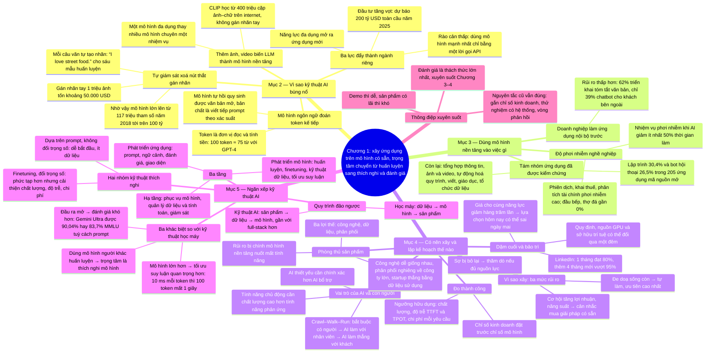

# Chương 1 — Giới thiệu về xây dựng ứng dụng AI với mô hình nền tảng (Introduction to Building AI Applications with Foundation Models)

## Ý chính

**Khi mô hình AI được mở rộng quy mô nhờ tự giám sát (self-supervision) và được cung cấp dưới dạng dịch vụ, việc xây ứng dụng AI chuyển từ "tự huấn luyện mô hình" sang "thích nghi và đánh giá mô hình có sẵn"; đó là kỹ thuật AI, một ngành mọc ra từ kỹ thuật học máy (ML engineering), giữ nhiều nguyên tắc cũ nhưng đặt trọng tâm mới vào prompt, ngữ cảnh, đánh giá đầu ra mở, giao diện và tối ưu suy luận.**

Mô hình ngôn ngữ mã hoá thông tin thống kê về ngôn ngữ, làm việc với đơn vị token (với GPT-4, 100 token xấp xỉ 75 từ; từ vựng của GPT-4 có 100.256 token, của Mixtral 8x7B có 32.000). Mô hình ngôn ngữ tự hồi quy (autoregressive) đoán token kế tiếp và có thể sinh văn bản mở, nên được gọi là "sinh" (generative). Tự giám sát cho phép mỗi câu văn tự tạo nhãn (câu "I love street food." cho sáu mẫu huấn luyện), vượt qua nút thắt gán nhãn (gán nhãn 1 triệu ảnh ImageNet với giá 5 xu một ảnh tốn 50.000 USD, mở rộng ra 1 triệu loại vật thể tốn 50 triệu USD), nên mô hình lớn từ 117 triệu tham số (GPT, 6/2018) lên 1,5 tỷ (GPT-2, 2/2019), còn lúc viết sách thì mô hình 100 tỷ tham số mới được coi là lớn. Thêm các dạng dữ liệu khác (ảnh, video…) biến LLM thành mô hình nền tảng (foundation model), chuyển AI từ mô hình chuyên một nhiệm vụ sang mô hình đa dụng; CLIP học từ 400 triệu cặp (ảnh, chữ) lấy trên internet mà không gán nhãn tay.

Ba yếu tố — năng lực đa dụng, đầu tư tăng mạnh (Goldman Sachs ước 100 tỷ USD ở Mỹ, 200 tỷ USD toàn cầu năm 2025; 177 công ty S&P 500 nhắc tới AI trong cuộc gọi báo cáo lợi nhuận quý 2/2023, gấp ba năm trước), và rào cản gia nhập thấp (mô hình như dịch vụ qua API) — làm kỹ thuật AI thành ngành kỹ thuật tăng trưởng nhanh nhất.

Trong 205 ứng dụng mã nguồn mở, lập trình chiếm 30,4%, bot hội thoại 26,5%; doanh nghiệp triển khai ứng dụng nội bộ nhanh hơn ứng dụng hướng ra ngoài (62% với tóm tắt văn bản so với 39% với chatbot bên ngoài).

Trước khi xây, cần xét lý do (rủi ro sống còn, cơ hội, hay sợ bị bỏ lại), vai trò của AI và con người, khả năng phòng thủ sản phẩm (công nghệ, dữ liệu, phân phối), chỉ số thành công, kế hoạch mốc với "dặm cuối" (LinkedIn mất 1 tháng đạt 80% trải nghiệm mong muốn nhưng thêm 4 tháng mới vượt 95%) và bảo trì trong bối cảnh thay đổi nhanh.

So với kỹ thuật học máy, kỹ thuật AI ít mô hình hoá và huấn luyện hơn, nhiều thích nghi mô hình hơn; dùng mô hình lớn hơn nên tối ưu suy luận quan trọng hơn (10 ms một token thì 100 token mất 1 giây, so với chuẩn 100 ms của ứng dụng internet); làm việc với đầu ra mở nên đánh giá khó hơn nhiều (Gemini Ultra đạt 90,04% MMLU với CoT@32 nhưng chỉ 83,7% với 5-shot, thấp hơn 86,4% của GPT-4). Quy trình cũng đảo ngược: kỹ thuật học máy đi từ dữ liệu tới mô hình tới sản phẩm, còn kỹ thuật AI đi từ sản phẩm tới dữ liệu tới mô hình.

## Sơ đồ

### Phần mở đầu Chương 1 — quy mô và hai hệ quả (chapter introduction, trang PDF 32–33)

```text
       Từ khoá mô tả AI sau 2020: QUY MÔ (scale)
       · mô hình sau ChatGPT, Gemini, Midjourney tiêu thụ một phần đáng
         kể điện năng thế giới
       · có nguy cơ cạn dữ liệu internet công khai để huấn luyện
                                │
               ┌────────────────┴────────────────┐
               ▼                                 ▼
       Hệ quả 1: mô hình mạnh hơn,       Hệ quả 2: huấn luyện LLM cần dữ
       làm được nhiều việc hơn, nên      liệu, tài nguyên tính toán và nhân
       có nhiều ứng dụng hơn             tài mà chỉ vài tổ chức có
                                         → MÔ HÌNH NHƯ MỘT DỊCH VỤ: các tổ
                                           chức đó cho người khác dùng mô
                                           hình qua dịch vụ
               └────────────────┬────────────────┘
                                ▼
       Nhu cầu ứng dụng AI tăng, rào cản xây ứng dụng giảm
       → KỸ THUẬT AI: quy trình xây ứng dụng trên mô hình có sẵn; một
         trong các ngành kỹ thuật tăng trưởng nhanh nhất
                                │
                                ▼
       Kế hoạch chương: tổng quan mô hình nền tảng → các trường hợp sử
       dụng thành công → ngăn xếp AI mới: cái gì đổi, cái gì giữ nguyên,
       kỹ sư AI khác kỹ sư học máy truyền thống ở đâu
       ("học máy truyền thống" chỉ mọi kiểu học máy trước mô hình nền
       tảng)
```

### Mục "The Rise of AI Engineering" — "From Language Models to Large Language Models": mô hình ngôn ngữ và token (Language models, trang PDF 34–36)

```text
       Chuỗi tiến hoá của cả mục: mô hình ngôn ngữ → mô hình ngôn ngữ lớn
       (LLM) → mô hình nền tảng → kỹ thuật AI
       (mô hình ngôn ngữ đầu tiên có từ thập niên 1950)
                                │
                                ▼
       MÔ HÌNH NGÔN NGỮ mã hoá thông tin thống kê về một hay nhiều ngôn
       ngữ: một từ có khả năng xuất hiện bao nhiêu trong một ngữ cảnh
       · "My favorite color is __": đoán "blue" thường hơn "car"
       · Sherlock Holmes (truyện 1905): ký tự hình người que gặp nhiều
         nhất là E
       · Claude Shannon (1951) "Prediction and Entropy of Printed
         English": entropy vẫn dùng đến nay
                                │
                                ▼
       TOKEN: đơn vị cơ bản (ký tự, từ, hoặc một phần từ như "-tion")
       · GPT-4 tách "I can't wait to build awesome AI applications" thành
         9 token; "can't" thành "can" và "'t"
       · trung bình 1 token ≈ 3/4 từ: 100 token ≈ 75 từ
       · TỪ VỰNG (vocabulary): tập mọi token mô hình dùng
         Mixtral 8x7B: 32.000; GPT-4: 100.256
                                │
                                ▼
       Vì sao token chứ không phải từ hay ký tự?
       1. tách từ thành phần có nghĩa: "cooking" thành "cook" + "ing"
       2. ít token phân biệt hơn số từ: từ vựng nhỏ, mô hình hiệu quả hơn
       3. xử lý từ lạ: "chatgpting" thành "chatgpt" + "ing"
```

### Mô hình ngôn ngữ che (masked) và tự hồi quy (autoregressive); mô hình sinh và máy hoàn thành văn bản (Language models, trang PDF 36–40)

```text
       ┌──────────────────────────────┬──────────────────────────────┐
       │ MASKED LANGUAGE MODEL        │ AUTOREGRESSIVE LANGUAGE MODEL│
       ├──────────────────────────────┼──────────────────────────────┤
       │ đoán token bị thiếu ở bất kỳ │ đoán token KẾ TIẾP chỉ từ    │
       │ đâu, dùng ngữ cảnh cả trước  │ các token đứng trước         │
       │ lẫn sau ("điền vào chỗ trống")│ (còn gọi causal LM)          │
       │ "My favorite __ is blue"     │ "My favorite color is __"    │
       │ ví dụ: BERT (Devlin, 2018)   │ sinh liên tục token này sau  │
       │ dùng cho phân loại, phân tích│ token khác; là lựa chọn số 1 │
       │ cảm xúc, gỡ lỗi mã           │ để sinh văn bản              │
       └──────────────────────────────┴──────────────────────────────┘
       Trong sách, "mô hình ngôn ngữ" mặc định là mô hình tự hồi quy
                                │
                                ▼
       Đầu ra MỞ: từ vựng hữu hạn tạo ra vô hạn đầu ra → mô hình SINH
       (generative) → "AI tạo sinh"
                                │
                                ▼
       Mô hình ngôn ngữ là MÁY HOÀN THÀNH: nhận prompt, viết tiếp
       · "To be or not to be" → ", that is the question."
       · hoàn thành là dự đoán theo xác suất, không bảo đảm đúng
       · nhiều việc quy về hoàn thành: dịch ("How are you in French is"
         → "Comment ça va"), phân loại thư rác ("Answer:" → "Likely spam")
       · nhưng hoàn thành KHÔNG phải trò chuyện: hỏi một câu, máy có thể
         viết tiếp bằng một câu hỏi khác → cần post-training (Chương 2)
```

### Tự giám sát và kích thước mô hình (Self-supervision, trang PDF 40–44)

```text
       Vì sao mô hình ngôn ngữ, chứ không phải mô hình phát hiện vật thể,
       dự báo thời tiết, giá cổ phiếu…, là trung tâm của việc mở rộng
       quy mô? → vì huấn luyện được bằng TỰ GIÁM SÁT
                                │
               ┌────────────────┴────────────────┐
               ▼                                 ▼
       GIÁM SÁT (supervision): cần       TỰ GIÁM SÁT: mô hình tự suy ra
       dữ liệu gán nhãn                  nhãn từ dữ liệu đầu vào
       · AlexNet (2012): hơn 1 triệu     · mỗi câu cho cả nhãn (token cần
         ảnh ImageNet, 1.000 loại          đoán) và ngữ cảnh
       · 5 xu/ảnh × 1 triệu ảnh =        · "I love street food." cho 6
         50.000 USD; hai người gán         mẫu: <BOS>→I; <BOS>,I→love;
         nhãn: gấp đôi                     … ; <BOS>,I,love,street,food,.
       · 1 triệu loại: 50 triệu USD        → <EOS>
       · ảnh CT ung thư: "đắt khủng      · <EOS> giúp mô hình biết khi
         khiếp"                            nào dừng
               └────────────────┬────────────────┘
                                ▼
       Tự giám sát khác KHÔNG giám sát (không cần nhãn chút nào)
       Văn bản có ở khắp nơi → dữ liệu khổng lồ → mô hình thành LLM
                                │
                                ▼
       "Lớn" không phải thuật ngữ khoa học; đo bằng SỐ THAM SỐ
       · GPT (6/2018): 117 triệu, khi ấy là lớn
       · GPT-2 (2/2019): 1,5 tỷ → 117 triệu thành "nhỏ"
       · lúc viết sách: 100 tỷ tham số là "lớn"
       Mô hình lớn hơn cần nhiều dữ liệu hơn: sức học lớn hơn; huấn luyện
       mô hình lớn trên dữ liệu nhỏ là lãng phí tính toán
```

### "From Large Language Models to Foundation Models" — đa phương thức và mô hình đa dụng (trang PDF 44–50)

```text
       Con người cảm nhận qua thị giác, thính giác, xúc giác… → mô hình
       ngôn ngữ được mở rộng sang nhiều PHƯƠNG THỨC dữ liệu
       · GPT-4V, Claude 3 hiểu ảnh và chữ; một số hiểu video, 3D, cấu
         trúc protein
                                │
                                ▼
       MÔ HÌNH NỀN TẢNG: "nền tảng" vì quan trọng và vì xây tiếp được lên
       · trước đây AI chia theo phương thức: NLP (chữ), thị giác máy tính
         (ảnh), âm thanh (STT, TTS)
       · MÔ HÌNH ĐA PHƯƠNG THỨC; nếu sinh được thì gọi LMM
       · đoán token kế tiếp dựa trên cả token chữ ("This is a") lẫn token
         ảnh (ảnh chú chó) → "Puppy"
                                │
                                ▼
       Tự giám sát cho đa phương thức: CLIP (OpenAI, 2021) dùng
       "giám sát bằng ngôn ngữ tự nhiên": 400 triệu cặp (ảnh, chữ) có sẵn
       trên internet, gấp 400 lần ImageNet, không tốn gán nhãn tay
       · CLIP là mô hình EMBEDDING (vectơ nắm nghĩa), không sinh; là
         xương sống của Flamingo, LLaVA, Gemini
                                │
                                ▼
       Từ mô hình CHUYÊN NHIỆM VỤ sang mô hình ĐA DỤNG
       · Super-NaturalInstructions: dịch, hỏi đáp, sinh câu hỏi, phân
         tích cảm xúc, thực thi chương trình, phân loại văn bản…
       · ví dụ mô tả sản phẩm cho nhà bán lẻ: mô hình có sẵn viết đúng
         nhưng sáo rỗng, sai giọng thương hiệu
                                │
                                ▼
       Ba kỹ thuật thích nghi: PROMPT ENGINEERING (hướng dẫn + ví dụ),
       RAG (nối với cơ sở dữ liệu đánh giá của khách), FINETUNING (huấn
       luyện tiếp trên mô tả tốt)
       · thích nghi: 10 ví dụ + một cuối tuần; tự xây: 1 triệu ví dụ +
         sáu tháng
       · mô hình chuyên nhiệm vụ vẫn có lợi: nhỏ hơn, nhanh hơn, rẻ hơn
       · tự xây hay dùng sẵn: câu hỏi "mua hay xây" kinh điển
```

### "From Foundation Models to AI Engineering" — ba yếu tố thúc đẩy (trang PDF 51–55)

```text
       Kỹ thuật học máy (MLOps): tự PHÁT TRIỂN mô hình
       Kỹ thuật AI: TẬN DỤNG mô hình có sẵn
                                │
       ┌────────────────────────┼────────────────────────┐
       ▼                        ▼                        ▼
  YẾU TỐ 1: năng lực     YẾU TỐ 2: đầu tư AI    YẾU TỐ 3: rào cản
  AI đa dụng             tăng mạnh              gia nhập thấp
  · làm việc cũ tốt hơn  · Scribd: chi phí AI   · mô hình như dịch vụ
    và làm thêm việc mới   giảm 100 lần          qua API: một lời gọi
  · viết như người: tự     (4/2022–4/2023)       API là dùng được
    động hoá mọi việc    · Goldman Sachs: 100   · AI viết mã giúp người
    cần giao tiếp          tỷ USD Mỹ, 200 tỷ      không phải kỹ sư
  · sinh ảnh, video;       USD toàn cầu 2025    · làm việc bằng tiếng
    tổng hợp dữ liệu,    · FactSet: 177 công      Anh thường thay ngôn
    viết mã để huấn        ty S&P 500 nhắc AI     ngữ lập trình
    luyện mô hình mạnh     quý 2/2023 (gấp 3    · chỉ công ty lớn, chính
    hơn                    năm trước)             phủ, startup nhiều vốn
                         · WallStreetZen: giá     làm được mô hình nền
                           cổ phiếu +4,6% so      tảng; cơ hội của số
                           với +2,4% (tương       đông là thích nghi
                           quan, chưa chắc        (Sam Altman, 9/2022)
                           nhân quả)
       └────────────────────────┼────────────────────────┘
                                ▼
       Kỹ thuật AI có lẽ là ngành kỹ thuật tăng nhanh nhất
       · AutoGPT, Stable Diffusion web UI, LangChain, Ollama: trong hai
         năm vượt Bitcoin về số sao GitHub, đang tiến tới React, Vue
       · LinkedIn 8/2023: số người thêm "Generative AI", "ChatGPT",
         "Prompt Engineering"… vào hồ sơ tăng trung bình 75% mỗi tháng
```

### Khung "Why the Term 'AI Engineering?'" — vì sao gọi là kỹ thuật AI (trang PDF 56)

```text
       Các tên khác: ML engineering, MLOps, AIOps, LLMOps…
                                │
                                ▼
       · không chọn "ML engineering": làm với mô hình nền tảng khác làm
         với mô hình học máy truyền thống ở nhiều điểm quan trọng (dù
         ML engineering là từ bao trùm cả hai)
       · không chọn các tên "…Ops": có phần vận hành, nhưng trọng tâm là
         tinh chỉnh (engineering) mô hình để nó làm điều mình muốn
       · khảo sát 20 người xây ứng dụng trên mô hình nền tảng: đa số
         chọn "AI engineering" → tác giả theo số đông
```

### "Foundation Model Use Cases" — cách phân loại và độ phơi nhiễm nghề nghiệp (trang PDF 57–60)

```text
       Ứng dụng tiềm năng gần như vô tận: theresanaiforthat.com (16/9/2024)
       liệt kê 16.814 AI cho 14.688 nhiệm vụ và 4.803 nghề
                                │
                                ▼
       Nhiều cách phân loại
       · AWS: trải nghiệm khách hàng, năng suất nhân viên, tối ưu quy trình
       · O'Reilly 2024: lập trình, phân tích dữ liệu, hỗ trợ khách hàng,
         nội dung tiếp thị, nội dung khác, nghiên cứu, thiết kế web, nghệ
         thuật
       · Deloitte (theo giá trị thu được): giảm chi phí, hiệu quả quy
         trình, tăng trưởng, đẩy nhanh đổi mới
       · Gartner: thêm "duy trì kinh doanh" — 7% trong 2.500 lãnh đạo
         (2023) nêu lý do này
                                │
                                ▼
       Eloundou và cộng sự (2023): nhiệm vụ "phơi nhiễm" nếu AI giảm
       ít nhất 50% thời gian làm
       · gần 100%: phiên dịch, khai thuế, thiết kế web, nhà văn
       · 0%: đầu bếp, thợ đá, vận động viên
       · bảng ba nhóm α / β / ζ (ví dụ phiên dịch 76,5% theo α; toán học,
         khai thuế, phân tích định lượng tài chính 100% theo ζ)
                                │
                                ▼
       Dữ liệu của tác giả: phỏng vấn 50 công ty, đọc hơn 100 nghiên cứu
       tình huống, xem 205 ứng dụng mã nguồn mở ≥ 500 sao → 8 nhóm
```

### Tám nhóm ứng dụng, phân bố 205 ứng dụng mã nguồn mở và khẩu vị rủi ro của doanh nghiệp (Foundation Model Use Cases: Table 1-3, Figure 1-7, Figure 1-8, trang PDF 60–64)

```text
       ┌──────────────────┬─────────────────────────┬───────────┐
       │ nhóm             │ ví dụ tiêu dùng / doanh │ tỷ lệ 205 │
       │                  │ nghiệp                  │ ứng dụng  │
       ├──────────────────┼─────────────────────────┼───────────┤
       │ lập trình        │ lập trình / lập trình   │ 30,4%     │
       │ bot hội thoại    │ chatbot, bạn AI / hỗ trợ│ 26,5%     │
       │                  │ khách hàng, copilot     │           │
       │ tổng hợp thông   │ tóm tắt, hỏi tài liệu / │ 12,7%     │
       │ tin              │ tóm tắt, nghiên cứu thị │           │
       │                  │ trường                  │           │
       │ sản xuất ảnh và  │ sửa ảnh, thiết kế / bài │ 12,7%     │
       │ video            │ trình bày, quảng cáo    │           │
       │ tự động hoá quy  │ lên kế hoạch du lịch /  │ 11,3%     │
       │ trình            │ trích xuất dữ liệu      │           │
       │ viết             │ email, mạng xã hội /    │ 3,4%      │
       │                  │ SEO, báo cáo            │           │
       │ giáo dục         │ gia sư / đào tạo nhân   │ 1,5%      │
       │                  │ viên                    │           │
       │ tổ chức dữ liệu  │ tìm ảnh, Memex / quản   │ 1,5%      │
       │                  │ lý tri thức             │           │
       └──────────────────┴─────────────────────────┴───────────┘
       Tỷ lệ thấp ở giáo dục, viết, tổ chức dữ liệu không có nghĩa là ít
       phổ biến: các ứng dụng đó thường không mở mã (thiên về doanh nghiệp)
                                │
                                ▼
       Doanh nghiệp ưa rủi ro thấp (a16z 2024: % doanh nghiệp đang thử đã
       đưa vào sản xuất)
       · nội bộ: tóm tắt văn bản 62%, quản lý tri thức 60%
       · giữa: dịch vụ khách hàng 59%, nội dung tiếp thị 53%, phát triển
         phần mềm 53%, rà soát hợp đồng 45%
       · hướng ra ngoài: chatbot bên ngoài 39%, thuật toán gợi ý 39%
       · nhiều ứng dụng vẫn là bài toán ĐÓNG (phân loại): dễ đánh giá, dễ
         ước lượng rủi ro
```

### Lập trình (Coding, trang PDF 64–67)

```text
       Lập trình là trường hợp sử dụng phổ biến nhất trong nhiều khảo sát
       · AI giỏi viết mã; kỹ sư AI đầu tiên là lập trình viên
                                │
                                ▼
       Bằng chứng thương mại
       · GitHub Copilot: doanh thu định kỳ năm vượt 100 triệu USD sau 2 năm
       · Magic gọi 320 triệu USD, Anysphere 60 triệu USD (8/2024)
       · gpt-engineer, screenshot-to-code: 50.000 sao trong một năm
       · công cụ chuyên: trích xuất dữ liệu web/PDF, tiếng Anh sang mã
         (SQL, pandas), ảnh chụp giao diện sang mã, chuyển ngôn ngữ lập
         trình, viết tài liệu, tạo kiểm thử, viết commit message
                                │
                                ▼
       AI có thay kỹ sư phần mềm? Hai đầu ý kiến
       · Jensen Huang (NVIDIA): đừng khuyên trẻ em học lập trình nữa
       · Matt Garman (AWS): phần lớn lập trình viên sẽ thôi viết mã, công
         việc thay đổi chứ không mất
       · nhiều kỹ sư tin không bao giờ bị thay
                                │
                                ▼
       McKinsey: mức giảm thời gian làm việc nhờ AI
       ┌──────────────────────────┬───────────────┐
       │ tài liệu hoá mã          │ 45–50%        │
       │ sinh mã                  │ 35–45%        │
       │ tái cấu trúc mã          │ 20–30%        │
       │ việc phức tạp cao        │ dưới 10%      │
       └──────────────────────────┴───────────────┘
       · AI giỏi frontend hơn backend (theo người làm công cụ lập trình)
       · hệ quả: công ty làm được nhiều hơn với ít kỹ sư hơn; ngành thuê
         ngoài (việc đơn giản, ngoài lõi) dễ bị xáo trộn
```

### Sản xuất ảnh và video; Viết (Image and Video Production, Writing, trang PDF 67–71)

```text
       ẢNH VÀ VIDEO: bản chất xác suất hợp với việc sáng tạo
       · Midjourney: 200 triệu USD doanh thu năm khi mới 1,5 tuổi (cuối
         2023); 5/10 ứng dụng đồ hoạ miễn phí hàng đầu App Store (12/2023)
         có "AI" trong tên
       · ảnh đại diện AI: Facebook cấm (2019) → nhiều mạng xã hội cung cấp
         công cụ tạo (2023)
       · quảng cáo: sinh ảnh/video, nhiều biến thể theo mùa, nơi chốn để
         thử; tiếp thị chiếm trung bình 11% ngân sách công ty
                                │
                                ▼
       VIẾT: làm nhiều, tẻ nhạt, chấp nhận lỗi cao (gợi ý không thích thì
       bỏ qua)
       · MIT (Noy và Zhang, 2023): 453 người, một nửa dùng ChatGPT →
         thời gian giảm 40%, chất lượng tăng 18%; thu hẹp khoảng cách
         giữa người viết giỏi và kém; dùng thật sau 2 tuần gấp 2, sau 2
         tháng gấp 1,6
       · tiêu dùng: email giận thành lịch sự, gạch đầu dòng thành đoạn;
         sách tương tác; Grammarly finetune mô hình
       · lạm dụng: sách du lịch AI kém chất lượng tràn Amazon (2023)
       · doanh nghiệp: bán hàng, tiếp thị, báo cáo đánh giá nhân viên, CRM
       · SEO: "trại nội dung" — NewsGuard (6/2023) thấy gần 400 quảng cáo
         của 141 thương hiệu trên trang rác; một trang ra 1.200 bài/ngày
```

### Giáo dục; Bot hội thoại (Education, Conversational Bots, trang PDF 71–74)

```text
       GIÁO DỤC
       · trường New York, Los Angeles cấm ChatGPT rồi bỏ lệnh cấm sau vài
         tháng
       · cá nhân hoá: đọc to, minh hoạ bằng động vật, chuyển phương trình
         thành mã; luyện ngoại ngữ bằng nhập vai
       · Duolingo: 4 giai đoạn làm khoá học (thiết kế chương trình, tạo
         nội dung thô, tạo bài tập, cá nhân hoá bài học); AI giúp nhiều
         nhất ở cá nhân hoá
       · Khan Academy: trợ giảng AI; giáo viên giao bài luận AI viết để
         học sinh tìm lỗi
       · Chegg: cổ phiếu từ 28 USD (11/2022) xuống 2 USD (9/2024)
                                │
                                ▼
       BOT HỘI THOẠI
       · tìm thông tin, giải thích, bạn đồng hành, bạn gái/bạn trai số;
         mô phỏng xã hội bằng nhóm bot (Park và cộng sự, 2023)
       · doanh nghiệp: bot hỗ trợ khách hàng, copilot sản phẩm (bảo hiểm,
         thuế, chính sách công ty)
       · giao diện: chữ, giọng nói (Siri, Alexa), nhân vật 3D, NPC thông
         minh trong game (Inworld, Convai)
```

### Tổng hợp thông tin; Tổ chức dữ liệu; Tự động hoá quy trình (Information Aggregation, Data Organization, Workflow Automation, trang PDF 74–78)

```text
       TỔNG HỢP THÔNG TIN
       · Salesforce 2023: 74% người dùng AI tạo sinh dùng để chắt lọc ý
         phức tạp và tóm tắt
       · "hỏi tài liệu" (talk-to-your-docs): hợp đồng, công bố, bài báo
       · Instacart: mẫu prompt "Fast Breakdown" tóm tắt họp, email, Slack
         thành sự kiện, câu hỏi mở, việc cần làm → đưa vào công cụ theo
         dõi dự án
       · giảm gánh nặng cho quản lý cấp trung
                                │
                                ▼
       TỔ CHỨC DỮ LIỆU: ảnh, video, log, PDF là dữ liệu phi cấu trúc
       · mô tả ảnh bằng chữ, tìm ảnh theo câu hỏi (Google Photos)
       · phân tích dữ liệu: vẽ biểu đồ, tìm điểm ngoại lai, dự báo doanh
         thu
       · trích xuất có cấu trúc: thẻ tín dụng, bằng lái, hoá đơn → hợp
         đồng, báo cáo, biểu đồ; ngành IDP 12,81 tỷ USD năm 2030, tăng
         32,9%/năm
                                │
                                ▼
       TỰ ĐỘNG HOÁ QUY TRÌNH
       · cá nhân: đặt bàn, đòi hoàn tiền, lên lịch du lịch, điền form
       · doanh nghiệp: quản lý khách tiềm năng, hoá đơn, hoàn ứng, nhập
         liệu; tổng hợp dữ liệu để cải thiện chính mô hình (Chương 8)
       · cần công cụ bên ngoài → AGENT: AI biết lập kế hoạch và dùng
         công cụ (Chương 6)
```

### "Planning AI Applications" — đánh giá trường hợp sử dụng (Use Case Evaluation, trang PDF 78–80)

```text
       Làm demo hay thì dễ; làm sản phẩm có lãi thì khó
       · muốn học, chơi: cứ xây; làm để kiếm sống: lùi lại hỏi vì sao, làm
         thế nào
                                │
                                ▼
       Vì sao xây? Ba mức rủi ro, từ cao đến thấp
       1. Không làm thì bị đối thủ có AI loại khỏi thị trường → ưu tiên
          cao nhất (xử lý tài liệu, tổng hợp thông tin: phân tích tài
          chính, bảo hiểm; sáng tạo: quảng cáo, thiết kế web)
       2. Không làm thì lỡ cơ hội tăng lợi nhuận, năng suất (thu hút
          người dùng rẻ hơn, giữ chân tốt hơn, bán hàng, nghiên cứu thị
          trường)
       3. Chưa biết AI hợp chỗ nào nhưng không muốn tụt lại (Kodak,
          Blockbuster, BlackBerry chờ quá lâu) → bộ phận R&D
                                │
                                ▼
       Tự xây hay mua?
       · AI đe doạ sống còn: làm nội bộ, đừng giao cho đối thủ
       · AI để tăng năng suất: có nhiều lựa chọn mua, rẻ và tốt hơn
```

### Vai trò của AI và con người trong ứng dụng (The role of AI and humans in the application, trang PDF 80–83)

```text
       Ba phân biệt (theo tài liệu thiết kế của Apple)
       ┌──────────────────┬───────────────────────────────────────────┐
       │ thiết yếu hay bổ │ Face ID không chạy nếu thiếu AI; Gmail vẫn│
       │ trợ              │ chạy nếu thiếu Smart Compose. AI càng     │
       │                  │ thiết yếu thì càng phải chính xác, tin cậy│
       │ phản ứng hay chủ │ chatbot phản ứng theo yêu cầu (cần nhanh);│
       │ động             │ cảnh báo giao thông Google Maps chủ động  │
       │                  │ (tính trước được, nhưng chất lượng phải   │
       │                  │ cao hơn vì người dùng không yêu cầu)      │
       │ động hay tĩnh    │ động: cập nhật liên tục theo người dùng   │
       │                  │ (Face ID, bộ nhớ ChatGPT); tĩnh: cập nhật │
       │                  │ định kỳ (nhận diện vật thể Google Photos) │
       └──────────────────┴───────────────────────────────────────────┘
                                │
                                ▼
       Vai trò con người (chatbot hỗ trợ khách hàng)
       · AI gợi ý câu trả lời để nhân viên viết nhanh hơn
       · AI trả lời yêu cầu đơn giản, chuyển yêu cầu khó cho người
       · AI trả lời mọi yêu cầu, không có người
       → HUMAN-IN-THE-LOOP: có người trong vòng ra quyết định
                                │
                                ▼
       Microsoft (2023) CRAWL–WALK–RUN
       · Crawl (bò): bắt buộc có người
       · Walk (đi): AI tương tác trực tiếp với nhân viên nội bộ
       · Run (chạy): tự động hoá nhiều hơn, có thể tương tác trực tiếp
         với người dùng bên ngoài
       · ví dụ chuyển nấc: nhân viên dùng nguyên văn 95% câu AI gợi ý cho
         yêu cầu đơn giản → cho khách nói chuyện thẳng với AI ở loại đó
```

### Khả năng phòng thủ của sản phẩm AI (AI product defensibility, trang PDF 83–85)

```text
       Rào cản thấp là phúc và hoạ: dễ cho mình thì dễ cho đối thủ
       · ứng dụng là một lớp trên mô hình nền tảng ("vỏ bọc OpenAI");
         mô hình mạnh lên có thể nuốt luôn lớp đó (ví dụ ứng dụng đọc PDF
         dựa trên giả định ChatGPT đọc PDF kém)
       · lối thoát: xây trên mô hình mã nguồn mở cho khách muốn tự host
       · nhà đầu tư: nhiều startup chỉ là một tính năng của Google Docs
         hay Office; ba kỹ sư trong hai tuần là sao chép được
                                │
                                ▼
       Ba lợi thế cạnh tranh trong AI
       ┌───────────────┬────────────────────────────────────────────┐
       │ công nghệ     │ với mô hình nền tảng, lõi công nghệ của    │
       │               │ hầu hết công ty giống nhau                 │
       │ phân phối     │ khả năng đưa sản phẩm tới người dùng: có lẽ│
       │               │ thuộc về công ty lớn                       │
       │ dữ liệu       │ công ty lớn có sẵn nhiều; nhưng startup vào│
       │               │ trước, thu đủ dữ liệu sử dụng để cải tiến  │
       │               │ liên tục ("bánh đà dữ liệu") thì dữ liệu   │
       │               │ thành hào phòng thủ                        │
       └───────────────┴────────────────────────────────────────────┘
       · tiền lệ: Calendly, Mailchimp, Photoroom lẽ ra chỉ là tính năng
         của Google Calendar, Gmail, Google Photos nhưng vẫn thành công
```

### Đặt kỳ vọng; Lập kế hoạch mốc (Setting Expectations, Milestone Planning, trang PDF 85–87)

```text
       Thành công đo bằng gì? Chỉ số quan trọng nhất: tác động kinh doanh
       · chatbot hỗ trợ: % tin nhắn tự động hoá; xử lý thêm bao nhiêu tin;
         trả lời nhanh hơn bao nhiêu; tiết kiệm bao nhiêu công
       · thêm: mức hài lòng và phản hồi của khách
                                │
                                ▼
       NGƯỠNG HỮU DỤNG: tốt tới đâu mới đáng đưa cho khách
       · chất lượng câu trả lời
       · độ trễ: TTFT (thời gian tới token đầu), TPOT (thời gian mỗi token
         đầu ra), tổng độ trễ; nếu người đang trả lời với trung vị 1 giờ
         thì nhanh hơn thế có thể đã đủ
       · chi phí mỗi yêu cầu suy luận
       · khác: khả năng giải thích, công bằng
                                │
                                ▼
       LẬP KẾ HOẠCH MỐC: đánh giá mô hình có sẵn để biết điểm xuất phát
       · mục tiêu tự động hoá 60% ticket; mô hình có sẵn đã làm được 30%
         thì công sức ít hơn khi nó làm được 0%
       · mục tiêu có thể đổi: chi phí đạt ngưỡng hữu dụng có thể lớn hơn
         lợi ích → bỏ
                                │
                                ▼
       THÁCH THỨC DẶM CUỐI
       · UltraChat: "từ 0 lên 60 dễ, từ 60 lên 100 cực khó"
       · LinkedIn (2024): 1 tháng đạt 80% trải nghiệm; thêm 4 tháng mới
         vượt 95% (sửa lỗi vặt, ảo giác); mỗi 1% sau chậm, nản
       · demo một cuối tuần, sản phẩm vài tháng đến vài năm
```

### Bảo trì (Maintenance, trang PDF 88–91)

```text
       AI thay đổi rất nhanh; xây trên mô hình nền tảng là cam kết theo
       nhịp đó
                                │
       ┌────────────────────────┼────────────────────────┐
       ▼                        ▼                        ▼
  THAY ĐỔI TỐT nhưng     THAY ĐỔI DỄ THÍCH        THAY ĐỔI KHÓ / CHẾT
  vẫn gây xáo trộn       NGHI                     NGƯỜI
  · ngữ cảnh dài hơn,    · nhà cung cấp hội tụ   · quy định: GDPR tốn
    đầu ra tốt hơn,        về cùng kiểu API: dễ     doanh nghiệp ước 9 tỷ
    suy luận rẻ hơn        đổi mô hình              USD để tuân thủ
  · giá theo MMLU giảm   · nhưng mỗi mô hình có  · lệnh hành pháp Mỹ
    mạnh 2022–2024         tính khí riêng: phải     10/2023 hạn chế mua
  · tự host vì rẻ, ba      chỉnh prompt, dữ liệu;   bán GPU
    tháng sau nhà cung     cần hạ tầng quản lý   · sở hữu trí tuệ khi mô
    cấp giảm giá một       phiên bản và đánh giá    hình học từ dữ liệu
    nửa → tự host thành                             người khác: studio
    đắt                                             game ngần ngại
  · nhà cung cấp bên
    thứ ba phá sản
       └────────────────────────┼────────────────────────┘
                                ▼
       Phải liên tục phân tích chi phí – lợi ích mỗi khoản đầu tư công
       nghệ: lựa chọn tốt nhất hôm nay có thể là tệ nhất ngày mai
```

### Biểu đồ giá và hiệu năng MMLU 2022–2024 (Figure 1-11 trong mục Maintenance, trang PDF 88–89)

```text
       Trục ngang: độ chính xác MMLU (%); trục dọc: USD trên 1 triệu token
       (thang log, trung bình giá đầu vào và đầu ra)
                                │
                                ▼
       2022: GPT-3 Davinci ≈ 44% MMLU, ≈ 60 USD (trước 9/2022), ≈ 20 USD
             (sau); GPT-3 Curie ≈ 26%, 6 USD rồi 2 USD;
             GPT-3.5 instruct ≈ 63–65%, ≈ 20 USD
       2023: Llama 2 7B ≈ 45%, ≈ 0,2 USD; Mistral 7B ≈ 62%, ≈ 0,25 USD;
             GPT-3.5 Turbo ≈ 70%, ≈ 1,7 USD; Claude Instant 1.2 ≈ 73%,
             ≈ 0,5 USD; GPT-4 ≈ 86%, ≈ 45 USD (bản 32k ≈ 90 USD)
       2024: Claude 3 Haiku ≈ 75%, ≈ 0,75 USD; Claude 3 Sonnet ≈ 79%,
             ≈ 9 USD; Claude 3 Opus ≈ 87%, ≈ 45 USD
                                │
                                ▼
       Đọc ngang: cùng mức ~44% MMLU, giá từ ≈ 60 USD (GPT-3 Davinci 2022)
       xuống ≈ 0,2 USD (Llama 2 7B 2023): rẻ hơn khoảng 300 lần
```

### "The AI Engineering Stack" — kỹ thuật AI mọc ra từ kỹ thuật học máy (trang PDF 91–93)

```text
       Nhiều cường điệu và FOMO; thay vì đuổi theo cát trôi, nhìn vào các
       khối nền tảng
                                │
                                ▼
       Kỹ thuật AI tiến hoá từ kỹ thuật học máy; nhóm học máy hiện có
       thường dẫn dắt thử nghiệm
       · tin tuyển dụng LinkedIn 17/12/2023: nhiều công ty gộp chung
         ("Machine Learning Engineer, Generative AI" ở Robinhood, TikTok
         145.000–355.000 USD/năm…)
       · công ty khác tách riêng ("AI Engineer" ở Notion 160.000–280.000
         USD; "Senior Generative-AI Software Engineer" ở NVIDIA…)
       · vai trò chồng lấn lớn; có kỹ sư AI chưa từng làm học máy
```

### Ba tầng của ngăn xếp AI (Three Layers of the AI Stack, trang PDF 93–97)

```text
       Bắt đầu từ tầng trên, đi xuống khi cần
       ┌──────────────────────────────────────────────────────────────┐
       │ PHÁT TRIỂN ỨNG DỤNG: giao diện AI, prompt engineering, xây    │
       │ dựng ngữ cảnh, đánh giá — tầng sôi động nhất hai năm qua      │
       ├──────────────────────────────────────────────────────────────┤
       │ PHÁT TRIỂN MÔ HÌNH: tối ưu suy luận, kỹ thuật dữ liệu, mô     │
       │ hình hoá và huấn luyện, đánh giá                              │
       ├──────────────────────────────────────────────────────────────┤
       │ HẠ TẦNG: quản lý tính toán, quản lý dữ liệu, phục vụ mô hình  │
       │ (serving), giám sát                                           │
       └──────────────────────────────────────────────────────────────┘
                                │
                                ▼
       Kho GitHub ≥ 500 sao (3/2024): 920 kho; số cộng dồn tăng vọt năm
       2023 sau Stable Diffusion (8/2022) và ChatGPT (11/2022)
       · tăng mạnh nhất: ứng dụng và phát triển ứng dụng
       · hạ tầng tăng ít: nhu cầu cốt lõi (tài nguyên, serving, giám sát)
         không đổi
                                │
                                ▼
       Nguyên tắc giữ nguyên: giải bài toán kinh doanh, ánh xạ chỉ số kinh
       doanh với chỉ số học máy, thử nghiệm có hệ thống (trước: siêu tham
       số; nay: mô hình, prompt, thuật toán truy xuất, biến lấy mẫu), làm
       mô hình nhanh và rẻ hơn, vòng phản hồi từ dữ liệu thật
```

### Kỹ thuật AI so với kỹ thuật học máy — ba khác biệt và hai nhóm kỹ thuật thích nghi (AI Engineering Versus ML Engineering, trang PDF 97–99)

```text
       ┌────────────────────────┬───────────────────────────────────┐
       │ khác biệt              │ hệ quả                            │
       ├────────────────────────┼───────────────────────────────────┤
       │ 1. dùng mô hình người  │ ít mô hình hoá, huấn luyện; nhiều │
       │ khác đã huấn luyện     │ THÍCH NGHI mô hình                │
       │ 2. mô hình lớn hơn,    │ áp lực tối ưu huấn luyện và suy   │
       │ tốn tính toán, trễ cao │ luận; cần kỹ sư biết GPU và cụm   │
       │                        │ lớn (biết dùng 10 GPU chưa chắc   │
       │                        │ biết dùng 1.000 GPU)              │
       │ 3. đầu ra mở           │ linh hoạt hơn nhưng khó ĐÁNH GIÁ  │
       │                        │ hơn nhiều                         │
       └────────────────────────┴───────────────────────────────────┘
                                │
                                ▼
       Hai nhóm kỹ thuật thích nghi, chia theo có cập nhật trọng số không
               ┌────────────────┴────────────────┐
               ▼                                 ▼
       DỰA TRÊN PROMPT: không đổi        FINETUNING: đổi trọng số
       trọng số; đưa hướng dẫn và        · phức tạp hơn, cần nhiều dữ
       ngữ cảnh                            liệu hơn
       · dễ bắt đầu, ít dữ liệu; thử     · cải thiện đáng kể chất lượng,
         được nhiều mô hình                độ trễ, chi phí
       · có thể không đủ cho việc phức   · cần khi dạy mô hình nhiệm vụ
         tạp, yêu cầu khắt khe             mới chưa từng gặp
```

### Phát triển mô hình — mô hình hoá và huấn luyện; các loại huấn luyện (Model development, Modeling and training, khung "On the Differences Among Training, Pre-Training, Finetuning, and Post-Training", trang PDF 100–104)

```text
       Tầng gắn với kỹ thuật học máy truyền thống; ba trách nhiệm: mô hình
       hoá và huấn luyện, kỹ thuật dữ liệu, tối ưu suy luận
                                │
                                ▼
       MÔ HÌNH HOÁ VÀ HUẤN LUYỆN: nghĩ ra kiến trúc, huấn luyện, finetune
       · công cụ: TensorFlow, Hugging Face Transformers, PyTorch
       · kiến thức: thuật toán (phân cụm, hồi quy logistic, cây quyết
         định, lọc cộng tác), mạng nơ-ron (feedforward, hồi quy, tích
         chập, transformer), gradient descent, hàm mất mát, chính quy hoá
       · nay không bắt buộc để xây ứng dụng, nhưng vẫn rất có giá trị
         (thêm công cụ, gỡ lỗi khi mô hình chạy sai)
                                │
                                ▼
       Huấn luyện luôn đổi trọng số, nhưng không mọi thay đổi trọng số là
       huấn luyện (lượng tử hoá — giảm độ chính xác số — thì không)
       ┌──────────────┬──────────────────────────────────────────────┐
       │ PRE-TRAINING │ huấn luyện từ đầu, trọng số khởi tạo ngẫu     │
       │              │ nhiên; với LLM thường là hoàn thành văn bản;  │
       │              │ tốn nhất (InstructGPT: tới 98% tính toán và   │
       │              │ dữ liệu); một lỗi nhỏ gây thiệt hại lớn       │
       │ FINETUNING   │ huấn luyện tiếp mô hình đã huấn luyện; ít tài │
       │              │ nguyên hơn; thường do người làm ứng dụng      │
       │ POST-TRAINING│ huấn luyện sau pre-training; về khái niệm như │
       │              │ finetuning; thường dùng khi do người làm mô   │
       │              │ hình thực hiện (ví dụ OpenAI dạy mô hình làm  │
       │              │ theo chỉ dẫn trước khi phát hành)             │
       └──────────────┴──────────────────────────────────────────────┘
       · dạy mô hình qua ngữ cảnh đầu vào (đưa nhật ký tuổi thơ vào
         ChatGPT) là prompt engineering, không phải huấn luyện hay
         finetuning
```

### Kỹ thuật dữ liệu; Tối ưu suy luận (Dataset engineering, Inference optimization, Table 1-4, trang PDF 104–107)

```text
       KỸ THUẬT DỮ LIỆU: tuyển chọn, sinh, gán nhãn dữ liệu để huấn luyện
       và thích nghi
       · học máy truyền thống: bài toán ĐÓNG (thư rác / không), dữ liệu
         bảng → kỹ thuật đặc trưng (feature engineering)
       · mô hình nền tảng: bài toán MỞ (gán nhãn một bài luận khó hơn gán
         nhãn thư rác), dữ liệu phi cấu trúc → khử trùng lặp, tách token,
         truy xuất ngữ cảnh, kiểm soát chất lượng (bỏ thông tin nhạy cảm,
         dữ liệu độc hại)
       · lượng dữ liệu: huấn luyện từ đầu > finetuning > prompt
         engineering
       · mô hình thành hàng hoá → dữ liệu là điểm khác biệt
                                │
                                ▼
       TỐI ƯU SUY LUẬN: làm mô hình nhanh và rẻ hơn
       · mô hình tự hồi quy sinh từng token: 10 ms/token × 100 token =
         1 giây; ứng dụng internet thường chờ đợi 100 ms
       · kỹ thuật: lượng tử hoá, chưng cất, song song (Chương 7–9)
                                │
                                ▼
       ┌────────────────┬─────────────────────┬───────────────────────┐
       │ trách nhiệm    │ học máy truyền thống│ mô hình nền tảng      │
       ├────────────────┼─────────────────────┼───────────────────────┤
       │ mô hình hoá và │ cần kiến thức học   │ có thì tốt, không bắt │
       │ huấn luyện     │ máy để huấn luyện   │ buộc (nhiều người     │
       │                │ từ đầu              │ phản đối ý này)       │
       │ kỹ thuật dữ    │ chủ yếu kỹ thuật đặc│ khử trùng lặp, token, │
       │ liệu           │ trưng, dữ liệu bảng │ truy xuất ngữ cảnh,   │
       │                │                     │ kiểm soát chất lượng  │
       │ tối ưu suy luận│ quan trọng          │ còn quan trọng hơn    │
       └────────────────┴─────────────────────┴───────────────────────┘
```

### Phát triển ứng dụng — đánh giá; prompt engineering và xây dựng ngữ cảnh (Application development, Evaluation, Prompt engineering and context construction, Table 1-5, trang PDF 107–110)

```text
       Khi nhiều đội dùng cùng một mô hình, khác biệt phải đến từ khâu
       phát triển ứng dụng: đánh giá, prompt engineering, giao diện AI
                                │
                                ▼
       ĐÁNH GIÁ: giảm rủi ro và tìm cơ hội; cần suốt quá trình (chọn mô
       hình, đo tiến bộ, quyết định triển khai, phát hiện vấn đề)
       · đầu ra mở: phát hiện gian lận có đáp án đúng để so; chatbot thì
         không thể liệt kê hết câu trả lời đúng
       · nhiều kỹ thuật thích nghi: hệ thống kém với kỹ thuật này có thể
         tốt với kỹ thuật khác
                                │
                                ▼
       Gemini (12/2023), MMLU
       ┌──────────────┬───────────────────┬───────────────────┐
       │ mô hình      │ cách prompt Google│ 5-shot            │
       │              │ báo cáo           │                   │
       ├──────────────┼───────────────────┼───────────────────┤
       │ Gemini Ultra │ 90,04% (CoT@32)   │ 83,7%             │
       │ Gemini Pro   │ 79,13% (CoT@8)    │ 71,8%             │
       │ GPT-4        │ 87,29% (CoT@32,   │ 86,4% (công bố)   │
       │              │ qua API)          │                   │
       │ GPT-3.5      │ —                 │ 70%               │
       └──────────────┴───────────────────┴───────────────────┘
       · cùng 5-shot: GPT-4 thắng Gemini Ultra (86,4% so với 83,7%)
                                │
                                ▼
       PROMPT ENGINEERING: lấy hành vi mong muốn chỉ từ đầu vào, không đổi
       trọng số; Gemini Ultra từ 83,7% lên 90,04% chỉ nhờ đổi kỹ thuật
       · không chỉ bảo mô hình làm gì: còn đưa ngữ cảnh, công cụ, và với
         việc dài, hệ thống quản lý bộ nhớ (Chương 5, 6)
```

### Giao diện AI; Kỹ thuật AI so với kỹ thuật full-stack (AI interface, Table 1-6, AI Engineering Versus Full-Stack Engineering, trang PDF 110–113)

```text
       GIAO DIỆN AI: trước đây AI nhúng trong sản phẩm của tổ chức tự làm
       mô hình (chống gian lận ở Stripe, PayPal; gợi ý ở Netflix, TikTok)
       Nay: sản phẩm độc lập (ChatGPT, Perplexity) hoặc nhúng vào sản phẩm
       của người khác (Copilot trong VSCode, Grammarly trong Google Docs,
       Midjourney qua Discord)
       · ứng dụng web/desktop/di động; tiện ích trình duyệt; chatbot trong
         Slack, Discord, WeChat, WhatsApp; API plug-in (VSCode, Shopify,
         Microsoft 365) mà agent cũng dùng được
       · giọng nói, thực tế ảo/tăng cường; phản hồi bằng ngôn ngữ tự nhiên
         dễ đưa nhưng khó trích xuất (Chương 10)
                                │
                                ▼
       ┌───────────────────┬────────────────────┬──────────────────┐
       │ hạng mục          │ học máy truyền     │ mô hình nền tảng │
       │                   │ thống              │                  │
       ├───────────────────┼────────────────────┼──────────────────┤
       │ giao diện AI      │ ít quan trọng      │ quan trọng       │
       │ prompt engineering│ không áp dụng      │ quan trọng       │
       │ đánh giá          │ quan trọng         │ quan trọng hơn   │
       └───────────────────┴────────────────────┴──────────────────┘
                                │
                                ▼
       Gần với FULL-STACK: công cụ hỗ trợ JavaScript (LangChain.js,
       Transformers.js, thư viện Node của OpenAI, Vercel AI SDK); nhiều kỹ
       sư AI đến từ phát triển web
       · học máy: Dữ liệu → Mô hình → Sản phẩm
       · kỹ thuật AI: Sản phẩm → Dữ liệu → Mô hình (thưởng cho ai lặp nhanh)
       · kỹ sư AI tham gia quyết định sản phẩm nhiều hơn
```

### Tóm tắt chương (Summary, trang PDF 113–115)

```text
       Hai mục đích: giải thích sự ra đời của kỹ thuật AI; tổng quan quy
       trình xây ứng dụng trên mô hình nền tảng
                                │
                                ▼
       mô hình ngôn ngữ → (tự giám sát) → LLM → (thêm phương thức) → mô
       hình nền tảng → kỹ thuật AI
       → các mẫu ứng dụng thành công → có nên xây không và cân nhắc gì
       → ngăn xếp kỹ thuật AI và khác biệt với kỹ thuật học máy
                                │
                                ▼
       Lĩnh vực quá nhiều thông tin mới → AI giúp tóm tắt, nhưng quan
       trọng hơn là có KHUNG TƯ DUY để định hướng; sách cung cấp khung đó,
       bắt đầu từ mô hình nền tảng (Chương 2)
```

## Ba câu hỏi chương này trả lời

1. **Vì sao kỹ thuật AI bùng nổ thành một ngành riêng từ khoảng 2023?** Vì mô hình ngôn ngữ huấn luyện được bằng tự giám sát (mỗi câu văn tự cung cấp nhãn), nên mở rộng được lên hàng trăm tỷ tham số mà không vướng chi phí gán nhãn (gán nhãn 1 triệu ảnh đã tốn 50.000 USD); thêm ảnh và các dạng dữ liệu khác biến chúng thành mô hình nền tảng đa dụng. Ba yếu tố cộng lại: năng lực đa dụng mở ra ứng dụng mới; đầu tư tăng vọt (dự báo 200 tỷ USD toàn cầu năm 2025, 177 công ty S&P 500 nhắc AI trong quý 2/2023); và rào cản thấp nhờ mô hình như dịch vụ qua API. Kết quả: bốn công cụ mã nguồn mở về kỹ thuật AI vượt Bitcoin về sao GitHub trong hai năm, và số người ghi kỹ năng AI tạo sinh trên LinkedIn tăng trung bình 75% mỗi tháng.
2. **Nên dùng mô hình nền tảng cho việc gì, và có nên xây ứng dụng đó không?** Tám nhóm ứng dụng đã được kiểm chứng: lập trình (30,4% trong 205 ứng dụng mã nguồn mở), bot hội thoại (26,5%), tổng hợp thông tin, sản xuất ảnh/video (mỗi nhóm 12,7%), tự động hoá quy trình (11,3%), viết, giáo dục, tổ chức dữ liệu. Trước khi xây cần trả lời: vì sao (đe doạ sống còn, cơ hội, hay sợ tụt lại), AI thiết yếu hay bổ trợ và con người đứng ở đâu (Crawl–Walk–Run), lấy gì phòng thủ (công nghệ, dữ liệu, phân phối), đo thành công thế nào (chỉ số kinh doanh, ngưỡng hữu dụng về chất lượng, độ trễ, chi phí), và chuẩn bị cho "dặm cuối" (LinkedIn: 1 tháng đạt 80%, thêm 4 tháng mới vượt 95%) cùng việc bảo trì trong môi trường đổi rất nhanh.
3. **Kỹ thuật AI khác kỹ thuật học máy ở đâu?** Ngăn xếp có ba tầng (ứng dụng, mô hình, hạ tầng) và nhiều nguyên tắc cũ vẫn đúng, nhưng có ba khác biệt: dùng mô hình người khác huấn luyện nên trọng tâm là thích nghi mô hình (prompt, RAG, finetuning) thay vì huấn luyện; mô hình lớn hơn nên tối ưu suy luận quan trọng hơn (10 ms một token thì 100 token mất 1 giây, so với kỳ vọng 100 ms); đầu ra mở nên đánh giá khó hơn nhiều (cùng mô hình Gemini Ultra được 83,7% hay 90,04% MMLU tuỳ cách prompt). Giao diện và prompt engineering trở thành quan trọng, kéo kỹ thuật AI lại gần full-stack, và quy trình đảo thành sản phẩm trước, dữ liệu và mô hình sau.

## Khái niệm cần biết

- **Mô hình ngôn ngữ (language model):** mô hình mã hoá thông tin thống kê về ngôn ngữ, tức khả năng một từ xuất hiện trong một ngữ cảnh. Ví dụ: với ngữ cảnh "My favorite color is __", mô hình tiếng Anh tốt cho "blue" xác suất cao hơn "car". Quan trọng vì mọi mô hình nền tảng hiện nay đều mọc ra từ mô hình ngôn ngữ.
- **Token, tách token (tokenization), từ vựng (vocabulary):** token là đơn vị cơ bản mà mô hình đọc và sinh — có thể là ký tự, từ, hay một phần từ; tách token là chia văn bản thành token; từ vựng là tập mọi token mô hình biết. Ví dụ: với GPT-4, 100 token xấp xỉ 75 từ tiếng Anh; từ vựng GPT-4 có 100.256 token. Quan trọng vì giá tiền, độ dài ngữ cảnh và độ trễ đều tính theo token.
- **Mô hình ngôn ngữ che và tự hồi quy (masked / autoregressive language model):** mô hình che đoán token bị thiếu dựa vào cả hai phía (BERT); mô hình tự hồi quy chỉ đoán token kế tiếp từ các token trước và sinh liên tục được. Ví dụ: "My favorite __ is blue" (che) so với "My favorite color is __" (tự hồi quy). Quan trọng vì sách mặc định "mô hình ngôn ngữ" là loại tự hồi quy, nền của AI tạo sinh.
- **Mô hình sinh, máy hoàn thành (generative model, completion machine):** mô hình tạo được đầu ra mở; về bản chất nó viết tiếp prompt theo xác suất. Ví dụ: prompt "To be or not to be" được viết tiếp thành ", that is the question."; prompt hỏi một email có phải thư rác kèm "Answer:" được viết tiếp thành "Likely spam". Quan trọng vì nhiều nhiệm vụ (dịch, tóm tắt, phân loại) quy được về hoàn thành văn bản, nhưng hoàn thành chưa phải trò chuyện.
- **Giám sát và tự giám sát (supervision / self-supervision):** giám sát là huấn luyện với dữ liệu gán nhãn bởi người; tự giám sát là để mô hình suy ra nhãn từ chính dữ liệu. Ví dụ: câu "I love street food." cho sáu cặp (ngữ cảnh, token kế tiếp) mà không cần ai gán nhãn, còn gán nhãn 1 triệu ảnh với giá 5 xu một ảnh tốn 50.000 USD. Quan trọng vì đây là chìa khoá cho phép mô hình ngôn ngữ mở rộng quy mô.
- **Tham số (parameter) và "lớn":** tham số là biến trong mô hình được cập nhật khi huấn luyện; số tham số đo cỡ mô hình. Ví dụ: GPT (2018) có 117 triệu tham số, GPT-2 (2019) 1,5 tỷ, lúc viết sách 100 tỷ mới gọi là lớn. Quan trọng vì "LLM" không phải thuật ngữ khoa học: ngưỡng "lớn" trôi theo thời gian.
- **Mô hình nền tảng (foundation model) và mô hình đa phương thức (multimodal, LMM):** mô hình nền tảng là mô hình lớn, đa dụng, xây tiếp được lên trên; bao gồm cả LLM và mô hình đa phương thức lớn, tức mô hình xử lý nhiều loại dữ liệu và sinh được đầu ra. Ví dụ: nhận chữ "This is a" và ảnh chú chó, mô hình đoán token kế tiếp "Puppy". Quan trọng vì nó xoá ranh giới cũ giữa NLP, thị giác máy tính, âm thanh và giữa các mô hình chuyên nhiệm vụ.
- **Embedding:** vectơ nhằm nắm nghĩa của dữ liệu gốc. Ví dụ: CLIP học embedding chung cho ảnh và chữ từ 400 triệu cặp (ảnh, chữ) trên internet. Quan trọng vì mô hình embedding đa phương thức là xương sống của các mô hình sinh đa phương thức (Flamingo, LLaVA, Gemini) và là nền của RAG.
- **Ba kỹ thuật thích nghi: prompt engineering, RAG, finetuning:** prompt engineering là viết hướng dẫn và ví dụ; RAG (sinh có tăng cường truy xuất) là nối mô hình với cơ sở dữ liệu để bổ sung thông tin vào hướng dẫn; finetuning là huấn luyện tiếp mô hình trên dữ liệu của mình. Ví dụ: để viết mô tả sản phẩm đúng giọng thương hiệu, có thể đưa ví dụ mô tả tốt (prompt), cho mô hình đọc đánh giá của khách (RAG), hoặc huấn luyện tiếp trên kho mô tả chất lượng (finetuning). Quan trọng vì đây là bộ công cụ chính của kỹ sư AI và là nội dung Chương 5–7.
- **Kỹ thuật AI (AI engineering):** quy trình xây ứng dụng trên mô hình nền tảng có sẵn. Ví dụ: thích nghi một mô hình mạnh có thể chỉ cần 10 ví dụ và một cuối tuần, so với 1 triệu ví dụ và sáu tháng để tự xây. Quan trọng vì nó là đối tượng của cả cuốn sách.
- **Mô hình như một dịch vụ (model as a service):** mô hình do vài tổ chức lớn huấn luyện được cung cấp cho người khác qua API nhận câu hỏi và trả kết quả. Ví dụ: một lời gọi API là dùng được mô hình mạnh nhất mà không cần hạ tầng phục vụ mô hình. Quan trọng vì đó là lý do rào cản gia nhập giảm mạnh.
- **Độ phơi nhiễm với AI (exposure):** theo Eloundou và cộng sự (2023), một nhiệm vụ "phơi nhiễm" nếu AI giảm được ít nhất 50% thời gian làm; nghề phơi nhiễm 80% nghĩa là 80% nhiệm vụ của nghề phơi nhiễm. Ví dụ: phiên dịch viên 76,5% (theo α), toán học và khai thuế 100% (theo ζ); đầu bếp và thợ đá 0%. Quan trọng vì nó chỉ ra AI hữu dụng ở đâu và ngành nào chịu đe doạ sống còn.
- **Human-in-the-loop và Crawl–Walk–Run:** có người trong vòng ra quyết định của AI; Crawl–Walk–Run (Microsoft 2023) là khung tăng dần tự động hoá từ bắt buộc có người, tới AI tương tác với nhân viên nội bộ, tới AI tương tác thẳng với khách bên ngoài. Ví dụ: nếu nhân viên dùng nguyên văn 95% câu trả lời AI gợi ý cho yêu cầu đơn giản, có thể cho khách nói chuyện trực tiếp với AI ở loại yêu cầu đó. Quan trọng vì nó quyết định yêu cầu về độ chính xác và rủi ro.
- **Khả năng phòng thủ, hào phòng thủ (defensibility, moat):** thứ ngăn đối thủ sao chép sản phẩm; trong AI có ba loại lợi thế: công nghệ, dữ liệu, phân phối. Ví dụ: một startup chỉ là "tính năng" của Google Docs có thể bị ba kỹ sư Google sao chép trong hai tuần. Quan trọng vì rào cản gia nhập thấp làm sản phẩm dễ bị sao chép hoặc bị chính mô hình nền tảng nuốt mất.
- **Ngưỡng hữu dụng (usefulness threshold):** mức tốt tối thiểu để sản phẩm đáng đưa cho khách, đo bằng chất lượng, độ trễ, chi phí và các chỉ số khác. Ví dụ: nếu người đang trả lời khách với trung vị 1 giờ thì chatbot trả lời nhanh hơn 1 giờ có thể đã đạt ngưỡng về độ trễ. Quan trọng vì nó ngăn đưa sản phẩm chưa sẵn sàng ra thị trường.
- **TTFT, TPOT (latency):** độ trễ là thời gian chờ; TTFT là thời gian tới token đầu tiên, TPOT là thời gian sinh mỗi token đầu ra. Ví dụ: TTFT 0,5 giây và TPOT 10 ms thì câu trả lời 300 token mất khoảng 0,5 + 300 × 0,01 = 3,5 giây (minh hoạ của người tổng hợp). Quan trọng vì mô hình tự hồi quy sinh tuần tự, nên độ trễ tăng theo độ dài đầu ra.
- **Thách thức dặm cuối (last mile challenge):** phần cuối để đi từ demo tốt tới sản phẩm tốt tốn nhiều công hơn hẳn phần đầu. Ví dụ: LinkedIn đạt 80% trải nghiệm mong muốn sau 1 tháng, nhưng mất thêm 4 tháng để vượt 95%. Quan trọng vì thành công ban đầu khiến người ta đánh giá thấp thời gian hoàn thiện.
- **Suy luận (inference) và tối ưu suy luận:** suy luận là quá trình mô hình tính đầu ra từ đầu vào; tối ưu suy luận là làm việc đó nhanh và rẻ hơn (lượng tử hoá, chưng cất, song song). Ví dụ: 10 ms một token thì đầu ra 100 token mất 1 giây, trong khi ứng dụng internet thường được kỳ vọng phản hồi trong 100 ms. Quan trọng vì mô hình nền tảng lớn làm chi phí và độ trễ suy luận thành vấn đề trung tâm.
- **Pre-training, finetuning, post-training:** pre-training là huấn luyện từ trọng số ngẫu nhiên (với LLM thường là học hoàn thành văn bản); finetuning là huấn luyện tiếp mô hình đã huấn luyện; post-training về khái niệm như finetuning nhưng thường chỉ việc người làm mô hình huấn luyện sau pre-training. Ví dụ: với InstructGPT, pre-training chiếm tới 98% tài nguyên tính toán và dữ liệu. Quan trọng vì sách dùng nhất quán các từ này, và vì dạy mô hình qua ngữ cảnh đầu vào là prompt engineering, không phải huấn luyện.
- **Lượng tử hoá (quantization):** giảm độ chính xác số của trọng số mô hình. Ví dụ: đổi trọng số từ 16 bit xuống 8 bit giảm một nửa bộ nhớ (minh hoạ của người tổng hợp). Quan trọng vì nó đổi giá trị trọng số nhưng không phải huấn luyện, và là một kỹ thuật tối ưu suy luận chính (Chương 7, 9).
- **Kỹ thuật dữ liệu (dataset engineering):** tuyển chọn, sinh và gán nhãn dữ liệu để huấn luyện và thích nghi mô hình. Ví dụ: với mô hình nền tảng, công việc chủ yếu là khử trùng lặp, tách token, truy xuất ngữ cảnh, kiểm soát chất lượng thay vì tạo đặc trưng cho dữ liệu bảng. Quan trọng vì khi mô hình thành hàng hoá, dữ liệu là điểm khác biệt.
- **Bài toán đóng và mở (close-ended / open-ended):** bài toán đóng có đầu ra thuộc tập định trước (thư rác hay không); bài toán mở có vô số đầu ra hợp lệ (viết bài luận, trả lời chatbot). Ví dụ: kiểm tra một email có phải thư rác dễ hơn nhiều so với viết một bài luận mẫu. Quan trọng vì đầu ra mở làm gán nhãn và đánh giá khó hơn hẳn.
- **Xây dựng ngữ cảnh (context construction):** cung cấp cho mô hình thông tin, công cụ và (với việc dài) hệ thống quản lý bộ nhớ cần để làm nhiệm vụ. Ví dụ: đưa tài liệu chính sách công ty vào prompt để chatbot trả lời đúng. Quan trọng vì prompt engineering không chỉ là bảo mô hình làm gì; đây là chủ đề Chương 6.
- **Agent:** AI biết lập kế hoạch và dùng công cụ bên ngoài. Ví dụ: để đặt bàn nhà hàng, agent cần tra số điện thoại bằng công cụ tìm kiếm, gọi điện, và ghi lịch hẹn. Quan trọng vì agent có tiềm năng tạo nhiều giá trị kinh tế nhất và là chủ đề Chương 6.

## Nội dung chi tiết

### 1. Mở đầu chương: quy mô và hai hệ quả (chapter introduction, trang PDF 32–33)

Nếu chỉ dùng một từ để mô tả AI sau năm 2020, tác giả chọn từ **quy mô**. Các mô hình đứng sau ChatGPT, Gemini của Google và Midjourney lớn đến mức tiêu thụ một phần không nhỏ điện năng của thế giới, và có nguy cơ cạn dữ liệu internet công khai để huấn luyện chúng.

Việc mở rộng quy mô có hai hệ quả lớn. Thứ nhất, mô hình mạnh hơn và làm được nhiều việc hơn, nên có nhiều ứng dụng hơn; nhiều người và nhóm dùng AI để tăng năng suất, tạo giá trị kinh tế và cải thiện chất lượng sống. Thứ hai, huấn luyện mô hình ngôn ngữ lớn (LLM) cần dữ liệu, tài nguyên tính toán và nhân tài chuyên môn mà chỉ vài tổ chức chi trả nổi. Điều này dẫn tới **mô hình như một dịch vụ**: mô hình do vài tổ chức đó phát triển được cung cấp cho người khác dùng dưới dạng dịch vụ, nên ai muốn xây ứng dụng AI cũng làm được mà không phải đầu tư trước vào việc xây mô hình.

Tóm lại, nhu cầu ứng dụng AI tăng trong khi rào cản gia nhập để xây ứng dụng AI giảm. Điều đó biến **kỹ thuật AI** — quy trình xây ứng dụng trên các mô hình có sẵn — thành một trong những ngành kỹ thuật tăng trưởng nhanh nhất.

Xây ứng dụng trên mô hình học máy không phải chuyện mới. Từ lâu trước khi LLM nổi lên, AI đã chạy nhiều ứng dụng như gợi ý sản phẩm, phát hiện gian lận và dự đoán khách hàng rời bỏ. Nhiều nguyên tắc đưa ứng dụng AI vào sản xuất vẫn giữ nguyên, nhưng thế hệ mô hình quy mô lớn, có sẵn, mang lại khả năng mới và thách thức mới — đó là trọng tâm của sách. (Chú thích của tác giả: trong sách, "học máy truyền thống" chỉ mọi kiểu học máy trước mô hình nền tảng.)

Chương mở đầu bằng tổng quan về mô hình nền tảng, chất xúc tác chính của sự bùng nổ kỹ thuật AI; rồi bàn một loạt trường hợp sử dụng thành công, mỗi trường hợp cho thấy AI giỏi gì và chưa giỏi gì. Năng lực AI mở rộng từng ngày nên dự đoán tương lai càng khó, nhưng các mẫu ứng dụng hiện có giúp tìm cơ hội hôm nay và gợi ý cách AI sẽ được dùng sau này. Cuối chương là tổng quan về ngăn xếp AI mới: điều gì đã đổi với mô hình nền tảng, điều gì giữ nguyên, và vai trò kỹ sư AI hôm nay khác kỹ sư học máy truyền thống ra sao.

### 2. Sự trỗi dậy của kỹ thuật AI (The Rise of AI Engineering, trang PDF 34–56)

Mô hình nền tảng mọc ra từ mô hình ngôn ngữ lớn, và mô hình ngôn ngữ lớn lại xuất phát từ mô hình ngôn ngữ. Dù ChatGPT hay GitHub Copilot trông như từ trên trời rơi xuống, chúng là đỉnh của nhiều thập kỷ tiến bộ công nghệ; những mô hình ngôn ngữ đầu tiên đã có từ thập niên 1950. Mục này lần theo các bước đột phá dẫn từ mô hình ngôn ngữ tới kỹ thuật AI.

#### 2.1. Từ mô hình ngôn ngữ tới mô hình ngôn ngữ lớn (From Language Models to Large Language Models, trang PDF 34–44)

Mô hình ngôn ngữ đã có từ lâu, nhưng chỉ lớn được tới quy mô hiện nay nhờ tự giám sát. Tiểu mục này giải thích hai khái niệm: mô hình ngôn ngữ và tự giám sát.

##### Mô hình ngôn ngữ (Language models, trang PDF 34–40)

Một **mô hình ngôn ngữ** mã hoá thông tin thống kê về một hay nhiều ngôn ngữ. Nói trực giác, thông tin này cho biết một từ có khả năng xuất hiện bao nhiêu trong một ngữ cảnh cho trước. Với ngữ cảnh "My favorite color is __" (Màu tôi thích nhất là __), mô hình ngôn ngữ tiếng Anh nên đoán "blue" (xanh) thường hơn "car" (xe hơi).

Bản chất thống kê của ngôn ngữ được phát hiện từ nhiều thế kỷ trước. Trong truyện "The Adventure of the Dancing Men" (Những hình nhân nhảy múa, 1905), Sherlock Holmes dùng thông tin thống kê đơn giản về tiếng Anh để giải các chuỗi hình người que bí ẩn: vì chữ cái phổ biến nhất trong tiếng Anh là E, hình người que phổ biến nhất phải là E. Sau đó, Claude Shannon dùng thống kê tinh vi hơn để giải mã thông điệp của đối phương trong Thế chiến II; công trình mô hình hoá tiếng Anh của ông được công bố trong bài báo mốc năm 1951 "Prediction and Entropy of Printed English" (Dự đoán và entropy của tiếng Anh in). Nhiều khái niệm trong bài, như entropy, vẫn dùng trong mô hình hoá ngôn ngữ hiện nay.

Thuở đầu, một mô hình ngôn ngữ chỉ gắn với một ngôn ngữ; nay một mô hình có thể bao nhiều ngôn ngữ.

**Token.** Đơn vị cơ bản của mô hình ngôn ngữ là **token**. Tuỳ mô hình, một token có thể là một ký tự, một từ, hay một phần của từ (như "-tion"). Ví dụ, GPT-4 — một mô hình đứng sau ChatGPT — tách cụm "I can't wait to build awesome AI applications" (Tôi nóng lòng xây những ứng dụng AI tuyệt vời) thành chín token: I / can / 't / wait / to / build / awesome / AI / applications (Hình 1-1 của sách; về chênh lệch giữa lời văn và hình, xem mục Lưu ý cuối chương). Từ "can't" bị tách thành hai token "can" và "'t". Trang web của OpenAI cho xem các mô hình của họ tách token khác nhau thế nào. Tác giả chú thích: với ngôn ngữ không phải tiếng Anh, một ký tự Unicode đôi khi bị biểu diễn bằng nhiều token.

Quá trình chia văn bản gốc thành token gọi là **tách token** (tokenization). Với GPT-4, một token trung bình dài khoảng 3/4 một từ, nên 100 token xấp xỉ 75 từ.

Tập mọi token mà mô hình làm việc được là **từ vựng** (vocabulary) của mô hình. Có thể dùng một số ít token để ghép thành rất nhiều từ khác nhau, giống như vài chữ cái ghép thành nhiều từ. Mô hình Mixtral 8x7B có từ vựng 32.000 token; GPT-4 có 100.256. Cách tách token và cỡ từ vựng do người phát triển mô hình quyết định.

Vì sao mô hình ngôn ngữ dùng token thay vì từ hay ký tự? Ba lý do chính:

1. So với ký tự, token cho phép tách từ thành các thành phần có nghĩa. Ví dụ "cooking" (nấu ăn) tách thành "cook" và "ing", mỗi phần mang một phần nghĩa của từ gốc.
2. Số token phân biệt ít hơn số từ phân biệt, nên từ vựng của mô hình nhỏ hơn và mô hình hiệu quả hơn (Chương 2 bàn thêm).
3. Token giúp mô hình xử lý từ lạ. Một từ bịa như "chatgpting" có thể tách thành "chatgpt" và "ing", giúp mô hình hiểu cấu trúc của nó.

Như vậy token cân bằng giữa việc có ít đơn vị hơn số từ và giữ nhiều nghĩa hơn từng ký tự riêng lẻ.

*Ví dụ hôm nay (minh hoạ của người tổng hợp):* một hợp đồng tiếng Anh 3.000 từ tương ứng khoảng 3.000 / 0,75 = 4.000 token theo tỷ lệ của GPT-4. Nếu giá đầu vào là 2,5 USD cho 1 triệu token, đưa hợp đồng đó vào prompt tốn khoảng 4.000 × 2,5 / 1.000.000 = 0,01 USD. Với văn bản không phải tiếng Anh, số token trên mỗi từ thường cao hơn, nên cùng nội dung tốn nhiều token hơn.

**Hai loại mô hình ngôn ngữ.** Có hai loại chính, khác nhau ở thông tin được dùng để đoán một token:

- **Mô hình ngôn ngữ che (masked language model)** được huấn luyện để đoán token bị thiếu ở bất kỳ vị trí nào trong chuỗi, dùng ngữ cảnh cả trước và sau chỗ thiếu — về bản chất là học "điền vào chỗ trống". Với ngữ cảnh "My favorite __ is blue", mô hình nên đoán chỗ trống có khả năng là "color". Ví dụ nổi tiếng là BERT (bidirectional encoder representations from transformers — biểu diễn mã hoá hai chiều từ transformer; Devlin và cộng sự, 2018). Lúc viết sách, mô hình che thường dùng cho các việc không sinh văn bản như phân tích cảm xúc và phân loại văn bản; chúng cũng hữu ích cho việc cần hiểu toàn bộ ngữ cảnh như gỡ lỗi mã, nơi mô hình cần hiểu cả đoạn mã trước và sau để tìm lỗi.
- **Mô hình ngôn ngữ tự hồi quy (autoregressive language model)** được huấn luyện để đoán token kế tiếp trong chuỗi, chỉ dùng các token đứng trước; nó đoán điều tiếp theo trong "My favorite color is __". Mô hình tự hồi quy có thể sinh liên tục token này sau token khác. Ngày nay đây là loại được chọn để sinh văn bản, nên phổ biến hơn nhiều so với mô hình che. Tác giả chú thích: mô hình tự hồi quy đôi khi được gọi là mô hình ngôn ngữ nhân quả (causal language model); và về kỹ thuật, mô hình che như BERT cũng sinh được văn bản "nếu cố hết sức".

Hình 1-2 của sách minh hoạ hai loại: với mô hình tự hồi quy, chuỗi "Why does the chicken cross the" (Sao con gà lại băng qua) đi vào khối "ngữ cảnh (chỉ các token trước)" để đoán token kế tiếp; với mô hình che, hai đoạn "Why does the" và "cross the road" ở hai bên cùng đi vào khối "ngữ cảnh (các token xung quanh)" để đoán token ở giữa.

Trong sách, trừ khi nói rõ, "mô hình ngôn ngữ" chỉ mô hình tự hồi quy.

**Mô hình sinh.** Đầu ra của mô hình ngôn ngữ là mở: mô hình dùng từ vựng cố định, hữu hạn để tạo ra vô số đầu ra có thể. Mô hình tạo được đầu ra mở gọi là mô hình **sinh** (generative), từ đó có thuật ngữ **AI tạo sinh** (generative AI).

**Máy hoàn thành.** Có thể coi mô hình ngôn ngữ là một máy hoàn thành: cho một đoạn văn bản (prompt), nó cố viết tiếp. Ví dụ:

```text
Prompt (từ người dùng): "To be or not to be"
Completion (từ mô hình ngôn ngữ): ", that is the question."
```

Cần lưu ý rằng các phần hoàn thành là dự đoán dựa trên xác suất, không bảo đảm đúng. Bản chất xác suất này làm mô hình ngôn ngữ vừa thú vị vừa gây bực bội khi dùng (Chương 2 bàn thêm).

Đơn giản như vậy nhưng hoàn thành văn bản cực kỳ mạnh: nhiều nhiệm vụ — dịch, tóm tắt, lập trình, giải toán — có thể diễn đạt thành việc hoàn thành. Với prompt "How are you in French is …" (Câu "bạn khoẻ không" trong tiếng Pháp là …), mô hình có thể viết tiếp "Comment ça va", tức là đã dịch từ ngôn ngữ này sang ngôn ngữ khác. Với prompt:

```text
Question: Is this email likely spam? Here's the email: <email content>
Answer:
```

mô hình có thể viết tiếp "Likely spam" (Có khả năng là thư rác), biến mô hình ngôn ngữ thành bộ phân loại thư rác.

Nhưng hoàn thành không giống trò chuyện. Nếu hỏi một máy hoàn thành một câu, nó có thể viết tiếp bằng cách thêm một câu hỏi khác thay vì trả lời. Mục "Post-Training" của Chương 2 bàn cách làm mô hình đáp ứng đúng yêu cầu của người dùng.

##### Tự giám sát (Self-supervision, trang PDF 40–44)

Mô hình hoá ngôn ngữ chỉ là một trong nhiều thuật toán học máy; còn có mô hình phát hiện vật thể, mô hình chủ đề, hệ gợi ý, dự báo thời tiết, dự đoán giá cổ phiếu… Điều gì đặc biệt ở mô hình ngôn ngữ khiến nó thành trung tâm của cách tiếp cận mở rộng quy mô dẫn tới "khoảnh khắc ChatGPT"?

Câu trả lời: mô hình ngôn ngữ huấn luyện được bằng **tự giám sát**, trong khi nhiều mô hình khác cần **giám sát**. Giám sát là huấn luyện thuật toán học máy bằng dữ liệu gán nhãn, vốn đắt và chậm để có. Tự giám sát vượt qua nút thắt gán nhãn, tạo ra bộ dữ liệu lớn hơn để mô hình học, nhờ đó mô hình mở rộng được quy mô.

**Giám sát.** Với giám sát, người ta gán nhãn các ví dụ để chỉ hành vi muốn mô hình học, rồi huấn luyện mô hình trên các ví dụ đó; sau đó mô hình áp dụng được cho dữ liệu mới. Để huấn luyện mô hình phát hiện gian lận, ta dùng các giao dịch được gán nhãn "gian lận" hay "không gian lận"; học xong, mô hình dự đoán một giao dịch có gian lận không.

Thành công của AI trong thập niên 2010 dựa trên giám sát. Mô hình khởi đầu cuộc cách mạng học sâu, AlexNet (Krizhevsky và cộng sự, 2012), là mô hình giám sát, được huấn luyện để phân loại hơn 1 triệu ảnh của bộ dữ liệu ImageNet vào một trong 1.000 loại như "xe hơi", "bóng bay", "con khỉ".

Nhược điểm của giám sát là gán nhãn đắt và tốn thời gian. Nếu một người gán nhãn một ảnh tốn 5 xu, gán nhãn 1 triệu ảnh ImageNet tốn 0,05 × 1.000.000 = 50.000 USD. Muốn hai người gán nhãn mỗi ảnh để kiểm tra chéo chất lượng thì tốn gấp đôi, 100.000 USD. Thế giới có nhiều hơn 1.000 loại vật thể rất nhiều; để mô hình làm việc với nhiều loại hơn, phải thêm nhãn cho nhiều loại hơn. Mở rộng lên 1 triệu loại thì riêng chi phí gán nhãn đã lên 50 triệu USD (gấp 1.000 lần, tương ứng giữ nguyên số ảnh mỗi loại). Tác giả chú thích: chi phí gán nhãn thực tế thay đổi theo độ phức tạp của nhiệm vụ, quy mô (bộ dữ liệu lớn hơn thường có giá mỗi mẫu thấp hơn) và nhà cung cấp; ví dụ tháng 9/2024, Amazon SageMaker Ground Truth tính 8 xu mỗi ảnh khi gán nhãn dưới 50.000 ảnh, nhưng chỉ 2 xu mỗi ảnh khi gán nhãn trên 1 triệu ảnh.

Gán nhãn đồ vật thường ngày là việc hầu hết mọi người làm được không cần đào tạo, nên tương đối rẻ. Nhưng không phải việc gán nhãn nào cũng đơn giản: tạo bản dịch tiếng Latin cho mô hình dịch Anh–Latin đắt hơn; gán nhãn một ảnh chụp CT có dấu hiệu ung thư hay không thì đắt khủng khiếp.

**Tự giám sát.** Thay vì cần nhãn tường minh, mô hình suy ra nhãn từ chính dữ liệu đầu vào. Mô hình hoá ngôn ngữ là tự giám sát vì mỗi chuỗi đầu vào cung cấp cả nhãn (các token cần đoán) lẫn ngữ cảnh mà mô hình dùng để đoán chúng. Câu "I love street food." (Tôi thích đồ ăn đường phố.) cho sáu mẫu huấn luyện (Bảng 1-1 của sách):

| Đầu vào (ngữ cảnh) | Đầu ra (token kế tiếp) |
|---|---|
| `<BOS>` | I |
| `<BOS>`, I | love |
| `<BOS>`, I, love | street |
| `<BOS>`, I, love, street | food |
| `<BOS>`, I, love, street, food | . |
| `<BOS>`, I, love, street, food, . | `<EOS>` |

`<BOS>` và `<EOS>` đánh dấu đầu và cuối chuỗi. Các dấu này cần thiết để mô hình làm việc với nhiều chuỗi; mỗi dấu thường được coi là một token đặc biệt. Dấu kết thúc chuỗi đặc biệt quan trọng vì nó giúp mô hình biết khi nào dừng câu trả lời (tác giả chú thích: cũng như con người cần biết khi nào nên ngừng nói).

Tự giám sát khác **không giám sát** (unsupervised): trong học tự giám sát, nhãn được suy ra từ dữ liệu đầu vào; trong học không giám sát, hoàn toàn không cần nhãn.

Học tự giám sát nghĩa là mô hình ngôn ngữ học được từ các chuỗi văn bản mà không cần gán nhãn. Vì văn bản có ở khắp nơi — sách, blog, bài báo, bình luận Reddit — có thể dựng lượng dữ liệu huấn luyện khổng lồ, cho phép mô hình ngôn ngữ lớn lên thành LLM.

**"Lớn" là bao nhiêu?** LLM khó gọi là thuật ngữ khoa học: mô hình phải lớn bao nhiêu mới gọi là lớn? Cái lớn hôm nay có thể là tí hon ngày mai. Cỡ mô hình thường đo bằng số **tham số** — biến trong mô hình học máy được cập nhật qua quá trình huấn luyện. (Tác giả chú thích: khi đi học, tác giả được dạy tham số gồm cả trọng số và độ lệch (bias), nhưng ngày nay "trọng số mô hình" thường chỉ mọi tham số.) Nói chung, dù không phải lúc nào cũng đúng, mô hình càng nhiều tham số càng có sức học hành vi mong muốn lớn hơn.

Khi mô hình GPT (generative pre-trained transformer — transformer tiền huấn luyện sinh) đầu tiên của OpenAI ra đời tháng 6/2018, nó có 117 triệu tham số và khi ấy được coi là lớn. Tháng 2/2019, khi OpenAI giới thiệu GPT-2 với 1,5 tỷ tham số (gấp khoảng 13 lần), 117 triệu bị hạ xuống thành "nhỏ". Lúc viết sách, mô hình 100 tỷ tham số được coi là lớn; có thể một ngày cỡ này cũng thành nhỏ.

**Vì sao mô hình lớn cần nhiều dữ liệu hơn?** Mô hình lớn có sức học lớn hơn, nên cần nhiều dữ liệu huấn luyện hơn để đạt hiệu năng tối đa. Có thể huấn luyện mô hình lớn trên bộ dữ liệu nhỏ, nhưng đó là phí tài nguyên tính toán: trên bộ dữ liệu ấy, mô hình nhỏ hơn có thể cho kết quả tương đương hoặc tốt hơn. Tác giả chú thích thêm: có vẻ ngược đời khi mô hình mạnh hơn lại cần nhiều ví dụ hơn để học; nhưng mục tiêu không phải để mô hình lớn đạt bằng mô hình nhỏ với cùng dữ liệu, mà là tối đa hoá hiệu năng của mô hình.

#### 2.2. Từ mô hình ngôn ngữ lớn tới mô hình nền tảng (From Large Language Models to Foundation Models, trang PDF 44–50)

Mô hình ngôn ngữ làm được những việc phi thường nhưng bị giới hạn ở văn bản. Con người cảm nhận thế giới không chỉ qua ngôn ngữ mà còn qua thị giác, thính giác, xúc giác… Xử lý được dữ liệu ngoài văn bản là điều cốt yếu để AI hoạt động trong thế giới thật.

Vì vậy mô hình ngôn ngữ đang được mở rộng để bao nhiều **phương thức dữ liệu** (data modality) hơn. GPT-4V và Claude 3 hiểu được ảnh và chữ; một số mô hình còn hiểu video, tài nguyên 3D, cấu trúc protein… Đưa thêm phương thức vào mô hình ngôn ngữ làm chúng mạnh hơn nữa. Thẻ hệ thống (system card) GPT-4V của OpenAI năm 2023 ghi rằng việc đưa thêm phương thức (như đầu vào ảnh) vào LLM được một số người coi là biên giới then chốt của nghiên cứu và phát triển AI.

Dù nhiều người vẫn gọi Gemini và GPT-4V là LLM, chúng nên được gọi là **mô hình nền tảng**. Chữ "nền tảng" vừa chỉ tầm quan trọng của các mô hình này trong ứng dụng AI, vừa chỉ việc có thể xây tiếp lên chúng cho các nhu cầu khác nhau.

**Phá vỡ cấu trúc nghiên cứu cũ.** Từ lâu nghiên cứu AI được chia theo phương thức dữ liệu. Xử lý ngôn ngữ tự nhiên (NLP) chỉ làm với chữ; thị giác máy tính chỉ làm với hình ảnh. Mô hình chỉ có chữ dùng cho dịch và phát hiện thư rác; mô hình chỉ có ảnh dùng cho phát hiện vật thể và phân loại ảnh; mô hình chỉ có âm thanh dùng cho nhận dạng giọng nói (speech-to-text, STT) và tổng hợp giọng nói (text-to-speech, TTS).

Mô hình làm việc với nhiều hơn một phương thức gọi là **mô hình đa phương thức** (multimodal model); mô hình đa phương thức có khả năng sinh còn gọi là **mô hình đa phương thức lớn** (large multimodal model, LMM). Nếu mô hình ngôn ngữ sinh token kế tiếp dựa trên các token chữ, thì mô hình đa phương thức sinh token kế tiếp dựa trên cả token chữ và token ảnh, hay bất kỳ phương thức nào nó hỗ trợ. Hình 1-3 của sách minh hoạ: token chữ "This is a" (Đây là một) và token hình ảnh (bức vẽ chú chó con) cùng đi vào mô hình đa phương thức, và mô hình sinh token kế tiếp "Puppy" (chó con).

**Tự giám sát cho đa phương thức.** Như mô hình ngôn ngữ, mô hình đa phương thức cần dữ liệu để mở rộng, và tự giám sát cũng dùng được cho chúng. OpenAI dùng một biến thể gọi là **giám sát bằng ngôn ngữ tự nhiên** (natural language supervision) để huấn luyện mô hình ngôn ngữ–hình ảnh CLIP (OpenAI, 2021). Thay vì tạo nhãn bằng tay cho từng ảnh, họ tìm các cặp (ảnh, chữ) xuất hiện cùng nhau trên internet, và dựng được bộ dữ liệu 400 triệu cặp, lớn gấp 400 lần ImageNet, không tốn chi phí gán nhãn tay. Bộ dữ liệu này giúp CLIP trở thành mô hình đầu tiên khái quát hoá được sang nhiều nhiệm vụ phân loại ảnh mà không cần huấn luyện thêm.

Trong sách, "mô hình nền tảng" chỉ cả mô hình ngôn ngữ lớn lẫn mô hình đa phương thức lớn.

CLIP không phải mô hình sinh — nó không được huấn luyện để tạo đầu ra mở. CLIP là mô hình **embedding**, được huấn luyện để tạo embedding chung cho cả chữ và ảnh. (Mục "Introduction to Embedding" của sách, trong Chương 3, bàn chi tiết.) Tạm thời có thể coi embedding là các vectơ nhằm nắm nghĩa của dữ liệu gốc. Mô hình embedding đa phương thức như CLIP là xương sống của các mô hình sinh đa phương thức như Flamingo, LLaVA và Gemini (trước đây là Bard).

**Từ mô hình chuyên nhiệm vụ sang mô hình đa dụng.** Trước đây mô hình thường được phát triển cho một nhiệm vụ cụ thể như phân tích cảm xúc hay dịch; mô hình phân tích cảm xúc không dịch được, và ngược lại. Nhờ quy mô và cách huấn luyện, mô hình nền tảng làm được rất nhiều nhiệm vụ; ngay khi lấy về, mô hình đa dụng đã làm khá tốt nhiều việc. Một LLM vừa phân tích cảm xúc vừa dịch được. Tuy vậy, thường vẫn có thể tinh chỉnh mô hình đa dụng để tối đa hiệu năng cho một nhiệm vụ cụ thể.

Hình 1-4 của sách là biểu đồ bong bóng các nhiệm vụ trong benchmark Super-NaturalInstructions (Wang và cộng sự, 2022) dùng để đánh giá mô hình nền tảng. Các bong bóng lớn nhất là dịch (translation), hỏi đáp (question answering), sinh câu hỏi (question generation), phân tích cảm xúc (sentiment analysis), thực thi chương trình (program execution), phân loại văn bản (text categorization) và nhóm "khác"; các bong bóng vừa và nhỏ gồm khớp văn bản, trích xuất thông tin, suy diễn văn bản (textual entailment), phát hiện ngôn ngữ độc hại, phân loại lẽ thường, nhận dạng thực thể có tên, điền vào chỗ trống, tóm tắt, hoàn thành văn bản, chuyển chữ thành mã và mã thành chữ, phân loại nhân quả, sinh hội thoại, toán học, kiểm tra sự thật, chuyển văn phong, đơn giản hoá văn bản, phát hiện lỗi chính tả và ngữ pháp… Hình cho ý niệm về độ rộng các nhiệm vụ một mô hình nền tảng làm được.

**Ví dụ mô tả sản phẩm.** Giả sử bạn làm với một nhà bán lẻ để xây ứng dụng sinh mô tả sản phẩm cho trang web. Mô hình lấy về dùng ngay có thể viết mô tả chính xác nhưng không bắt được giọng của thương hiệu hay làm nổi thông điệp thương hiệu; mô tả có thể đầy ngôn từ tiếp thị và sáo ngữ. Có nhiều kỹ thuật để mô hình sinh đúng điều mình muốn:

- Viết hướng dẫn chi tiết kèm ví dụ mô tả sản phẩm mong muốn: đây là **prompt engineering**.
- Nối mô hình với cơ sở dữ liệu đánh giá của khách hàng để mô hình dùng mà viết mô tả tốt hơn. Dùng cơ sở dữ liệu để bổ sung cho hướng dẫn gọi là **sinh có tăng cường truy xuất** (retrieval-augmented generation, **RAG**).
- **Finetune** — huấn luyện tiếp — mô hình trên bộ dữ liệu mô tả sản phẩm chất lượng cao.

Prompt engineering, RAG và finetuning là ba kỹ thuật kỹ thuật AI rất phổ biến để thích nghi mô hình theo nhu cầu; phần còn lại của sách bàn chi tiết cả ba.

Thích nghi một mô hình mạnh có sẵn cho nhiệm vụ của mình nói chung dễ hơn nhiều so với tự xây mô hình từ đầu — chẳng hạn mười ví dụ và một cuối tuần, so với 1 triệu ví dụ và sáu tháng. Mô hình nền tảng làm việc phát triển ứng dụng AI rẻ hơn và rút ngắn thời gian ra thị trường. Lượng dữ liệu cần để thích nghi tuỳ kỹ thuật; sách sẽ bàn khi nói tới từng kỹ thuật. Tuy nhiên mô hình chuyên nhiệm vụ vẫn có nhiều lợi ích; chẳng hạn chúng có thể nhỏ hơn nhiều, nên nhanh và rẻ hơn khi dùng.

Tự xây mô hình hay dùng mô hình có sẵn là câu hỏi "mua hay xây" kinh điển mà mỗi đội phải tự trả lời; các thảo luận trong sách giúp ra quyết định đó.

#### 2.3. Từ mô hình nền tảng tới kỹ thuật AI (From Foundation Models to AI Engineering, trang PDF 51–56)

**Kỹ thuật AI** là quy trình xây ứng dụng trên mô hình nền tảng. Người ta đã xây ứng dụng AI hơn một thập kỷ — quy trình thường gọi là kỹ thuật học máy (ML engineering) hay MLOps (vận hành học máy). Vì sao giờ mới nói tới kỹ thuật AI?

Nếu kỹ thuật học máy truyền thống là phát triển mô hình học máy, thì kỹ thuật AI tận dụng mô hình có sẵn. Sự sẵn có và dễ tiếp cận của các mô hình nền tảng mạnh dẫn tới ba yếu tố cùng tạo điều kiện lý tưởng cho kỹ thuật AI phát triển nhanh thành một ngành:

**Yếu tố 1: năng lực AI đa dụng.** Mô hình nền tảng mạnh không chỉ vì làm tốt hơn các việc cũ mà còn vì làm được nhiều việc hơn. Ứng dụng trước đây tưởng không thể nay khả thi; ứng dụng chưa ai nghĩ tới đang xuất hiện; ứng dụng hôm nay tưởng không thể có thể khả thi ngày mai. Điều này làm AI hữu ích cho nhiều mặt đời sống hơn, tăng mạnh cả lượng người dùng lẫn nhu cầu ứng dụng AI. Ví dụ, vì AI nay viết tốt như người, đôi khi hơn, AI có thể tự động hoá hoặc tự động hoá một phần mọi việc cần giao tiếp — gần như là mọi thứ. AI được dùng để viết email, trả lời yêu cầu khách hàng, giải thích hợp đồng phức tạp. Ai có máy tính cũng có công cụ sinh tức thì ảnh và video chất lượng cao theo yêu cầu để làm tài liệu tiếp thị, chỉnh ảnh chân dung chuyên nghiệp, hình dung ý tưởng nghệ thuật, minh hoạ sách… AI còn được dùng để tổng hợp dữ liệu huấn luyện, phát triển thuật toán và viết mã, tất cả đều giúp huấn luyện các mô hình mạnh hơn trong tương lai.

**Yếu tố 2: đầu tư vào AI tăng.** Thành công của ChatGPT làm đầu tư vào AI tăng vọt, cả từ quỹ đầu tư mạo hiểm lẫn doanh nghiệp. Khi ứng dụng AI rẻ hơn để xây và nhanh hơn để ra thị trường, lợi nhuận trên vốn đầu tư vào AI hấp dẫn hơn; các công ty đổ xô đưa AI vào sản phẩm và quy trình. Matt Ross, quản lý cấp cao về nghiên cứu ứng dụng ở Scribd, cho tác giả biết chi phí AI ước tính cho các trường hợp sử dụng của ông giảm hai bậc độ lớn (khoảng 100 lần) từ tháng 4/2022 đến tháng 4/2023.

Goldman Sachs Research ước tính đầu tư vào AI có thể gần 100 tỷ USD ở Mỹ và 200 tỷ USD toàn cầu vào năm 2025. (Tác giả chú thích để so sánh: toàn bộ chi tiêu cho trường tiểu học và trung học công lập ở Mỹ khoảng 900 tỷ USD, chỉ gấp chín lần đầu tư AI ở Mỹ.)

AI thường được nhắc tới như lợi thế cạnh tranh. FactSet thấy cứ ba công ty S&P 500 thì một công ty nhắc tới AI trong cuộc gọi báo cáo lợi nhuận quý 2/2023, gấp ba lần năm trước. Hình 1-5 của sách vẽ số công ty S&P 500 nhắc "AI" trong cuộc gọi báo cáo lợi nhuận theo quý:

| Quý | Q3/18 | Q4/18 | Q1/19 | Q2/19 | Q3/19 | Q4/19 | Q1/20 | Q2/20 | Q3/20 | Q4/20 |
|---|---:|---:|---:|---:|---:|---:|---:|---:|---:|---:|
| Số công ty | 46 | 40 | 58 | 50 | 57 | 64 | 43 | 53 | 53 | 58 |

| Quý | Q1/21 | Q2/21 | Q3/21 | Q4/21 | Q1/22 | Q2/22 | Q3/22 | Q4/22 | Q1/23 | Q2/23 |
|---|---:|---:|---:|---:|---:|---:|---:|---:|---:|---:|
| Số công ty | 70 | 60 | 67 | 67 | 61 | 58 | 53 | 78 | 117 | 177 |

Suốt 2018–2022 con số dao động trong khoảng 40–70, rồi tăng vọt sau khi ChatGPT ra đời (11/2022): 78, 117, rồi kỷ lục 177 ở quý 2/2023. Người tổng hợp kiểm tra: 177 trên 500 công ty là 35%, khớp "một trong ba"; 177 / 58 (quý 2/2022) ≈ 3,05, khớp "gấp ba lần".

Theo WallStreetZen, công ty nhắc tới AI trong cuộc gọi báo cáo lợi nhuận có giá cổ phiếu tăng nhiều hơn công ty không nhắc: trung bình tăng 4,6% so với 2,4%. Chưa rõ đó là quan hệ nhân quả (AI làm các công ty này thành công hơn) hay chỉ là tương quan (công ty thành công vì nhanh thích nghi với công nghệ mới).

**Yếu tố 3: rào cản gia nhập thấp.** Cách tiếp cận mô hình như một dịch vụ, được OpenAI và các nhà cung cấp mô hình khác phổ biến, làm việc dùng AI để xây ứng dụng dễ hơn. Theo cách này, mô hình được mở ra qua API nhận câu hỏi của người dùng và trả về đầu ra của mô hình. Không có API, dùng một mô hình AI cần hạ tầng để host và phục vụ mô hình; có API thì một lời gọi API là truy cập được mô hình mạnh.

Không chỉ vậy, AI còn cho phép xây ứng dụng với rất ít mã. Thứ nhất, AI viết mã giúp, nên người không có nền tảng kỹ thuật phần mềm cũng nhanh chóng biến ý tưởng thành mã và đưa tới người dùng. Thứ hai, có thể làm việc với mô hình bằng tiếng Anh thông thường thay vì ngôn ngữ lập trình. Theo tác giả, bất kỳ ai — thật sự bất kỳ ai — giờ cũng phát triển được ứng dụng AI.

Vì tài nguyên cần để phát triển mô hình nền tảng, việc này chỉ khả thi với các tập đoàn lớn (Google, Meta, Microsoft, Baidu, Tencent), chính phủ (Nhật Bản, UAE) và các startup tham vọng, nhiều vốn (OpenAI, Anthropic, Mistral). Trong phỏng vấn tháng 9/2022, Sam Altman, CEO OpenAI, nói cơ hội lớn nhất cho phần đông mọi người là thích nghi các mô hình này cho ứng dụng cụ thể.

Thế giới nhanh chóng nắm cơ hội. Kỹ thuật AI nhanh chóng nổi lên thành một trong những ngành kỹ thuật tăng nhanh nhất, rất có thể là nhanh nhất. Công cụ cho kỹ thuật AI được đón nhận nhanh hơn mọi công cụ kỹ thuật phần mềm trước đây. Chỉ trong hai năm, bốn công cụ mã nguồn mở về kỹ thuật AI (AutoGPT, Stable Diffusion web UI, LangChain, Ollama) đã có nhiều sao GitHub hơn Bitcoin, và đang trên đà vượt cả các framework phát triển web phổ biến nhất như React và Vue. Hình 1-6 của sách (dữ liệu star-history.com) vẽ số sao GitHub cộng dồn theo thời gian; đọc gần đúng tới khoảng giữa năm 2024: React khoảng 225.000 sao và Vue khoảng 207.000 sao, cả hai tích luỹ dần từ 2013–2014; Bitcoin khoảng 80.000 sao, tích luỹ từ 2011; trong khi AutoGPT (khoảng 167.000), Stable Diffusion web UI (khoảng 140.000), LangChain (khoảng 93.000) và Ollama (khoảng 90.000) đều xuất phát từ 0 vào khoảng 2022–2023 và có đường tăng gần như dựng đứng.

Một khảo sát của LinkedIn tháng 8/2023 cho thấy số người làm nghề thêm các cụm như "Generative AI", "ChatGPT", "Prompt Engineering" và "Prompt Crafting" vào hồ sơ tăng trung bình 75% mỗi tháng. Tạp chí ComputerWorld tuyên bố "dạy AI cư xử là kỹ năng nghề nghiệp tăng nhanh nhất".

**Vì sao gọi là "kỹ thuật AI"?** (khung "Why the Term 'AI Engineering?'", trang PDF 56). Nhiều tên được dùng cho quy trình xây ứng dụng trên mô hình nền tảng: ML engineering, MLOps, AIOps, LLMOps… Tác giả không chọn "ML engineering" vì, như sẽ bàn ở mục so sánh kỹ thuật AI với kỹ thuật học máy, làm việc với mô hình nền tảng khác làm với mô hình học máy truyền thống ở nhiều điểm quan trọng, và tên ML engineering không đủ thể hiện khác biệt đó — dù ML engineering là một từ tốt để bao cả hai quy trình. Tác giả không chọn các tên tận cùng bằng "Ops" vì, dù quy trình có phần vận hành, trọng tâm là tinh chỉnh (engineering) mô hình nền tảng để nó làm điều mình muốn. Cuối cùng, tác giả khảo sát 20 người đang phát triển ứng dụng trên mô hình nền tảng xem họ gọi việc mình làm là gì; phần lớn thích "AI engineering", và tác giả theo số đông.

Cộng đồng kỹ sư AI mở rộng nhanh chóng đã thể hiện sự sáng tạo đáng kể với một loạt ứng dụng thú vị; mục tiếp theo khám phá các mẫu ứng dụng phổ biến nhất.

### 3. Các trường hợp sử dụng mô hình nền tảng (Foundation Model Use Cases, trang PDF 57–78)

Nếu bạn đã có ý tưởng ứng dụng, có thể nhảy tới mục lập kế hoạch ứng dụng AI (mục 4 dưới đây); nếu đang tìm cảm hứng, mục này trình bày nhiều trường hợp sử dụng đã được ngành kiểm chứng hoặc đầy hứa hẹn.

Số ứng dụng tiềm năng có vẻ vô tận: nghĩ ra trường hợp sử dụng nào thì có lẽ cũng đã có một AI cho việc đó. (Tác giả chú thích: ngày 16/9/2024, trang theresanaiforthat.com liệt kê 16.814 AI cho 14.688 nhiệm vụ và 4.803 nghề.) Không thể liệt kê hết.

**Các cách phân loại.** Ngay cả việc phân loại cũng khó vì mỗi khảo sát dùng một cách:

- Amazon Web Services (AWS) chia trường hợp sử dụng AI tạo sinh trong doanh nghiệp thành ba nhóm: trải nghiệm khách hàng, năng suất nhân viên, tối ưu quy trình.
- Khảo sát của O'Reilly năm 2024 chia thành tám nhóm: lập trình, phân tích dữ liệu, hỗ trợ khách hàng, nội dung tiếp thị, nội dung khác, nghiên cứu, thiết kế web, nghệ thuật.
- Một số tổ chức như Deloitte phân loại theo giá trị thu được: giảm chi phí, hiệu quả quy trình, tăng trưởng, đẩy nhanh đổi mới.
- Gartner thêm nhóm **duy trì kinh doanh** (business continuity): tổ chức có thể phá sản nếu không dùng AI tạo sinh. Trong 2.500 lãnh đạo mà Gartner khảo sát năm 2023, 7% nêu duy trì kinh doanh là động lực dùng AI tạo sinh.

**Độ phơi nhiễm của các nghề.** Eloundou và cộng sự (2023) có nghiên cứu xuất sắc về mức các nghề "phơi nhiễm" với AI. Họ định nghĩa một nhiệm vụ là phơi nhiễm nếu AI và phần mềm chạy bằng AI giảm được ít nhất 50% thời gian hoàn thành nó; một nghề phơi nhiễm 80% nghĩa là 80% nhiệm vụ của nghề đó phơi nhiễm. Theo nghiên cứu, các nghề phơi nhiễm 100% hoặc gần 100% gồm phiên dịch và biên dịch, khai thuế, thiết kế web và nhà văn. Không ngạc nhiên, các nghề không phơi nhiễm gồm đầu bếp, thợ đá và vận động viên. Bảng 1-2 của sách (từ Eloundou và cộng sự, 2023) liệt kê các nghề phơi nhiễm cao nhất theo đánh giá của người chú thích; α là phơi nhiễm với chính mô hình AI, β và ζ là phơi nhiễm với phần mềm chạy bằng AI:

| Nhóm đo | Nghề phơi nhiễm cao nhất | % phơi nhiễm |
|---|---|---:|
| Người đánh giá, α | Phiên dịch và biên dịch | 76,5 |
| | Nhà nghiên cứu khảo sát | 75,0 |
| | Nhà thơ, người viết lời, người viết sáng tạo | 68,8 |
| | Nhà khoa học động vật | 66,7 |
| | Chuyên viên quan hệ công chúng | 66,7 |
| Người đánh giá, β | Nhà nghiên cứu khảo sát | 84,4 |
| | Nhà văn và tác giả | 82,5 |
| | Phiên dịch và biên dịch | 82,4 |
| | Chuyên viên quan hệ công chúng | 80,6 |
| | Nhà khoa học động vật | 77,8 |
| Người đánh giá, ζ | Nhà toán học | 100,0 |
| | Người khai thuế | 100,0 |
| | Nhà phân tích định lượng tài chính | 100,0 |
| | Nhà văn và tác giả | 100,0 |
| | Nhà thiết kế web và giao diện số | 100,0 |
| | (Người đánh giá gán nhãn tổng cộng 15 nghề là "phơi nhiễm hoàn toàn") | |

Nghiên cứu này cho ý niệm tốt về việc AI giỏi những trường hợp sử dụng nào.

**Dữ liệu của tác giả.** Để hiểu trường hợp sử dụng trong doanh nghiệp, tác giả phỏng vấn 50 công ty về chiến lược AI và đọc hơn 100 nghiên cứu tình huống. Để hiểu ứng dụng tiêu dùng, tác giả xem 205 ứng dụng AI mã nguồn mở có ít nhất 500 sao trên GitHub (tác giả chú thích: danh sách ứng dụng mã nguồn mở này được cập nhật mỗi 12 giờ; khám phá các ứng dụng là một trong những điều tác giả thích nhất khi viết sách). Các ứng dụng được chia thành tám nhóm (Bảng 1-3 của sách):

| Nhóm | Ví dụ trường hợp sử dụng tiêu dùng | Ví dụ trường hợp sử dụng doanh nghiệp |
|---|---|---|
| Lập trình | Lập trình | Lập trình |
| Sản xuất ảnh và video | Sửa ảnh và video; thiết kế | Bài trình bày; tạo quảng cáo |
| Viết | Email; bài mạng xã hội và blog | Viết nội dung quảng cáo, tối ưu công cụ tìm kiếm (SEO); báo cáo, ghi nhớ, tài liệu thiết kế |
| Giáo dục | Gia sư; chấm bài luận | Hội nhập nhân viên mới; đào tạo nâng kỹ năng nhân viên |
| Bot hội thoại | Chatbot đa dụng; bạn đồng hành AI | Hỗ trợ khách hàng; copilot sản phẩm |
| Tổng hợp thông tin | Tóm tắt; hỏi đáp với tài liệu (talk-to-your-docs) | Tóm tắt; nghiên cứu thị trường |
| Tổ chức dữ liệu | Tìm ảnh; Memex (kho trí nhớ cá nhân) | Quản lý tri thức; xử lý tài liệu |
| Tự động hoá quy trình | Lên kế hoạch du lịch; lên kế hoạch sự kiện | Trích xuất, nhập và gán nhãn dữ liệu; tìm khách hàng tiềm năng |

Danh sách giới hạn này nên dùng làm tham khảo; khi hiểu thêm cách xây mô hình nền tảng (Chương 2) và cách đánh giá chúng (Chương 3), người đọc sẽ có hình dung rõ hơn mô hình nền tảng có thể và nên được dùng cho việc gì.

Vì mô hình nền tảng đa dụng, ứng dụng xây trên chúng giải được nhiều bài toán, nên một ứng dụng có thể thuộc nhiều nhóm: một bot vừa làm bạn đồng hành vừa tổng hợp thông tin; một ứng dụng vừa trích dữ liệu có cấu trúc từ PDF vừa trả lời câu hỏi về PDF đó.

**Phân bố 205 ứng dụng mã nguồn mở** (Hình 1-7 của sách, biểu đồ tròn): lập trình 30,4%; bot hội thoại 26,5%; tổng hợp thông tin 12,7%; sản xuất ảnh và video 12,7%; tự động hoá quy trình 11,3%; viết 3,4%; giáo dục 1,5%; tổ chức dữ liệu 1,5% (tổng 100%). Tỷ lệ nhỏ của giáo dục, tổ chức dữ liệu và viết không có nghĩa các trường hợp này không phổ biến, chỉ là các ứng dụng đó không mở mã; người xây chúng có thể thấy chúng hợp với doanh nghiệp hơn.

**Doanh nghiệp ưa rủi ro thấp.** Báo cáo a16z Growth năm 2024 cho thấy công ty triển khai ứng dụng hướng nội bộ (quản lý tri thức nội bộ) nhanh hơn ứng dụng hướng ra ngoài (chatbot hỗ trợ khách hàng). Hình 1-8 của sách ghi tỷ lệ doanh nghiệp đang thử một trường hợp sử dụng đã đưa nó vào sản xuất:

| Trường hợp sử dụng | Nhóm | % đã đưa vào sản xuất |
|---|---|---:|
| Tóm tắt văn bản | Hướng nội bộ | 62% |
| Quản lý tri thức doanh nghiệp | Hướng nội bộ | 60% |
| Dịch vụ khách hàng | Giữa | 59% |
| Nội dung tiếp thị | Giữa | 53% |
| Phát triển phần mềm | Giữa | 53% |
| Rà soát hợp đồng | Giữa | 45% |
| Chatbot bên ngoài | Hướng ra ngoài | 39% |
| Thuật toán gợi ý | Hướng ra ngoài | 39% |

Ứng dụng nội bộ giúp công ty phát triển năng lực kỹ thuật AI trong khi giảm rủi ro về quyền riêng tư dữ liệu, tuân thủ và các thất bại thảm hoạ. Tương tự, dù mô hình nền tảng có đầu ra mở và dùng được cho mọi việc, nhiều ứng dụng xây trên chúng vẫn là bài toán đóng, như phân loại; bài toán phân loại dễ đánh giá hơn, nên rủi ro dễ ước lượng hơn.

Dù đã xem hàng trăm ứng dụng AI, tuần nào tác giả cũng gặp ứng dụng mới gây bất ngờ. Thời đầu internet, ít ai đoán được trường hợp sử dụng thống trị internet sau này lại là mạng xã hội; trường hợp sử dụng cuối cùng thống trị AI cũng có thể khiến ta bất ngờ — hy vọng là bất ngờ tốt.

#### 3.1. Lập trình (Coding, trang PDF 64–67)

Trong nhiều khảo sát về AI tạo sinh, lập trình là trường hợp sử dụng phổ biến nhất, không bàn cãi. Công cụ lập trình bằng AI phổ biến vì AI giỏi lập trình và vì các kỹ sư AI đầu tiên là lập trình viên, gặp nhiều thách thức lập trình.

Một trong những thành công sớm nhất của mô hình nền tảng trong sản xuất là công cụ hoàn thành mã GitHub Copilot, có doanh thu định kỳ hằng năm vượt 100 triệu USD chỉ hai năm sau khi ra mắt. Lúc viết sách, các startup lập trình bằng AI đã gọi được hàng trăm triệu USD: Magic gọi 320 triệu USD và Anysphere gọi 60 triệu USD, đều vào tháng 8/2024. Công cụ mã nguồn mở như gpt-engineer và screenshot-to-code đều đạt 50.000 sao GitHub trong vòng một năm, và nhiều công cụ khác đang ra đời nhanh.

Ngoài công cụ lập trình chung, nhiều công cụ chuyên cho từng việc:

- trích xuất dữ liệu có cấu trúc từ trang web và PDF (AgentGPT);
- chuyển tiếng Anh thành mã (DB-GPT, SQL Chat, PandasAI);
- từ một thiết kế hay ảnh chụp màn hình, sinh mã dựng ra trang web trông giống ảnh đó (screenshot-to-code, draw-a-ui);
- dịch từ ngôn ngữ lập trình hay framework này sang cái khác (GPT-Migrate, AI Code Translator);
- viết tài liệu (Autodoc);
- tạo kiểm thử (PentestGPT);
- sinh commit message (AI Commits).

Rõ ràng AI làm được nhiều việc kỹ thuật phần mềm; câu hỏi là AI có tự động hoá hoàn toàn được kỹ thuật phần mềm không. Ở một đầu, Jensen Huang, CEO NVIDIA, dự đoán AI sẽ thay kỹ sư phần mềm và ta nên thôi nói trẻ em cần học lập trình. Trong một bản ghi âm bị rò rỉ, CEO AWS Matt Garman nói trong tương lai gần phần lớn lập trình viên sẽ thôi viết mã — ông không có ý là hết nghề lập trình viên, chỉ là công việc của họ sẽ thay đổi. Ở đầu kia, nhiều kỹ sư phần mềm tin chắc họ sẽ không bao giờ bị AI thay, vì lý do cả kỹ thuật lẫn cảm xúc (người ta không thích thừa nhận mình có thể bị thay thế).

Kỹ thuật phần mềm gồm nhiều việc, AI giỏi việc này hơn việc khác. Nghiên cứu của McKinsey thấy AI giúp lập trình viên năng suất gấp đôi khi viết tài liệu, và năng suất hơn 25–50% khi sinh mã và tái cấu trúc mã; với việc rất phức tạp, cải thiện năng suất rất ít. Hình 1-9 của sách (dữ liệu McKinsey) ghi mức giảm thời gian hoàn thành trung bình khi dùng AI tạo sinh:

| Loại việc | Mức giảm thời gian | Năng suất tăng tương ứng (người tổng hợp quy đổi) |
|---|---:|---:|
| Tài liệu hoá mã | 45–50% | 82–100% |
| Sinh mã | 35–45% | 54–82% |
| Tái cấu trúc mã | 20–30% | 25–43% |
| Việc phức tạp cao | dưới 10% | dưới 11% |

(Cách quy đổi: làm xong trong (1 − t) thời gian cũ nghĩa là trong cùng thời gian làm được 1/(1 − t) lần lượng việc; ví dụ giảm 50% thời gian là năng suất gấp đôi.)

Trong các cuộc trò chuyện với người làm công cụ lập trình AI, nhiều người nói với tác giả rằng AI giỏi phát triển frontend (giao diện) hơn nhiều so với backend (phía máy chủ).

Dù AI có thay kỹ sư phần mềm hay không, chắc chắn AI làm họ năng suất hơn, nghĩa là công ty có thể làm được nhiều hơn với ít kỹ sư hơn. AI cũng có thể làm xáo trộn ngành thuê ngoài (outsourcing), vì việc thuê ngoài thường là việc đơn giản nằm ngoài hoạt động cốt lõi của công ty.

#### 3.2. Sản xuất ảnh và video (Image and Video Production, trang PDF 67–68)

Nhờ bản chất xác suất, AI rất hợp với việc sáng tạo. Một số startup AI thành công nhất là ứng dụng sáng tạo: Midjourney sinh ảnh, Adobe Firefly sửa ảnh, Runway, Pika Labs và Sora sinh video. Cuối năm 2023, khi mới một tuổi rưỡi, Midjourney đã có 200 triệu USD doanh thu định kỳ hằng năm. Tính đến tháng 12/2023, trong 10 ứng dụng miễn phí hàng đầu mục Đồ hoạ và Thiết kế trên Apple App Store, một nửa có chữ "AI" trong tên. Tác giả đoán sớm thôi các ứng dụng đồ hoạ và thiết kế sẽ tích hợp AI mặc định và không cần chữ "AI" trong tên nữa.

Dùng AI để tạo ảnh đại diện cho mạng xã hội, từ LinkedIn tới TikTok, đã thành phổ biến; nhiều ứng viên tin ảnh chân dung do AI tạo giúp họ thể hiện tốt nhất và tăng cơ hội có việc. Nhận thức về ảnh đại diện AI thay đổi đáng kể: năm 2019, Facebook cấm các tài khoản dùng ảnh đại diện do AI tạo vì lý do an toàn; năm 2023, nhiều ứng dụng mạng xã hội cung cấp công cụ cho người dùng tạo ảnh đại diện bằng AI.

Với doanh nghiệp, quảng cáo và tiếp thị nhanh chóng đưa AI vào. (Tác giả chú thích: vì doanh nghiệp thường chi nhiều cho quảng cáo và tiếp thị, tự động hoá ở đây có thể tiết kiệm lớn; trung bình 11% ngân sách công ty dành cho tiếp thị, theo "Marketing Budgets Vary by Industry", Christine Moorman, WSJ, 2017.) AI có thể sinh trực tiếp ảnh và video quảng bá, giúp động não ý tưởng hoặc tạo bản nháp đầu cho chuyên gia chỉnh tiếp. Có thể dùng AI sinh nhiều quảng cáo rồi thử xem cái nào hiệu quả nhất với khán giả, hoặc sinh biến thể quảng cáo theo mùa và địa điểm — chẳng hạn đổi màu lá vào mùa thu hay thêm tuyết trên mặt đất vào mùa đông.

#### 3.3. Viết (Writing, trang PDF 69–71)

AI đã hỗ trợ việc viết từ lâu: tự sửa lỗi và tự hoàn thành trên điện thoại đều chạy bằng AI. Viết là ứng dụng lý tưởng cho AI vì ta viết nhiều, viết có thể khá tẻ nhạt, và ta chấp nhận lỗi cao: nếu mô hình gợi ý điều mình không thích, cứ bỏ qua.

LLM giỏi viết không có gì lạ, vì chúng được huấn luyện để hoàn thành văn bản. Để nghiên cứu tác động của ChatGPT tới việc viết, một nghiên cứu của MIT (Noy và Zhang, 2023) giao việc viết theo nghề cho 453 người làm nghề có trình độ đại học và cho ngẫu nhiên một nửa dùng ChatGPT. Kết quả: ở nhóm dùng ChatGPT, thời gian trung bình giảm 40% và chất lượng đầu ra tăng 18%. ChatGPT thu hẹp khoảng cách chất lượng giữa người làm, tức là giúp nhiều hơn cho người kém thiên hướng viết. Người được dùng ChatGPT trong thí nghiệm có khả năng cho biết đang dùng nó trong công việc thật cao gấp 2 lần sau hai tuần, và gấp 1,6 lần sau hai tháng nữa.

Với người tiêu dùng, trường hợp sử dụng rất rõ: nhiều người dùng AI để giao tiếp tốt hơn. Bạn có thể viết email trong cơn giận rồi nhờ AI làm cho dễ nghe; đưa gạch đầu dòng và nhận lại đoạn văn hoàn chỉnh. Nhiều người nói họ không còn gửi email quan trọng nào mà không nhờ AI chỉnh trước. (Tác giả chú thích: AI rất hữu ích trong quá trình viết sách này và có thể tự động hoá nhiều phần của việc viết; khi viết hư cấu, tác giả thường nhờ AI động não xem chuyện gì sẽ xảy ra tiếp hay nhân vật phản ứng ra sao; tác giả vẫn đang đánh giá loại viết nào tự động hoá được và loại nào không.)

Học sinh dùng AI viết bài luận; nhà văn dùng AI viết sách. Nhiều startup đã dùng AI tạo sách thiếu nhi, truyện của người hâm mộ (fan fiction), lãng mạn và giả tưởng. Khác sách truyền thống, sách do AI tạo có thể tương tác, vì cốt truyện thay đổi theo sở thích người đọc, nên người đọc tham gia tạo câu chuyện mình đang đọc. Một ứng dụng đọc cho trẻ em nhận ra những từ trẻ gặp khó và sinh truyện xoay quanh các từ đó.

Các ứng dụng ghi chú và email như Google Docs, Notion và Gmail đều dùng AI để giúp người dùng viết tốt hơn. Grammarly, ứng dụng trợ lý viết, finetune một mô hình để làm văn bản của người dùng trôi chảy, mạch lạc và rõ ràng hơn.

Khả năng viết của AI cũng có thể bị lạm dụng. Năm 2023, New York Times đưa tin Amazon bị tràn ngập sách hướng dẫn du lịch kém chất lượng do AI tạo, mỗi cuốn kèm tiểu sử tác giả, trang web và các đánh giá khen ngợi, tất cả đều do AI tạo.

Với doanh nghiệp, viết bằng AI phổ biến trong bán hàng, tiếp thị và giao tiếp nội bộ. Nhiều quản lý nói với tác giả họ dùng AI giúp viết báo cáo đánh giá nhân viên. AI giúp viết email tiếp cận khách lạ hiệu quả, nội dung quảng cáo và mô tả sản phẩm. Ứng dụng quản lý quan hệ khách hàng (CRM) như HubSpot và Salesforce cũng có công cụ để người dùng doanh nghiệp sinh nội dung web và email tiếp cận.

AI có vẻ đặc biệt giỏi SEO, có lẽ vì nhiều mô hình được huấn luyện trên dữ liệu internet vốn đầy văn bản tối ưu cho SEO. AI giỏi SEO tới mức tạo ra một thế hệ "trại nội dung" (content farm) mới: dựng trang web rác, đổ đầy nội dung do AI tạo để xếp hạng cao trên Google, kéo lưu lượng truy cập, rồi bán chỗ quảng cáo qua sàn quảng cáo. Tháng 6/2023, NewsGuard phát hiện gần 400 quảng cáo của 141 thương hiệu nổi tiếng trên các trang rác do AI tạo; một trang rác ra 1.200 bài mỗi ngày. Trừ khi có biện pháp kiềm chế, nội dung internet tương lai sẽ do AI tạo và khá ảm đạm. (Tác giả chú thích giả thuyết của mình: ta sẽ mất lòng tin vào nội dung internet tới mức chỉ đọc nội dung do người hay thương hiệu mình tin tạo ra.)

#### 3.4. Giáo dục (Education, trang PDF 71–73)

Mỗi khi ChatGPT sập, máy chủ Discord của OpenAI tràn ngập học sinh phàn nàn không làm được bài tập. Một số hội đồng giáo dục, gồm hệ thống trường công lập thành phố New York và học khu Los Angeles, nhanh chóng cấm ChatGPT vì sợ học sinh gian lận, nhưng đảo ngược quyết định chỉ vài tháng sau.

Thay vì cấm, trường học có thể đưa AI vào để giúp học sinh học nhanh hơn. AI tóm tắt được sách giáo khoa và tạo kế hoạch bài giảng riêng cho từng học sinh. Tác giả thấy lạ khi quảng cáo được cá nhân hoá vì ta biết mỗi người mỗi khác, còn giáo dục thì không. AI giúp chuyển tài liệu sang định dạng hợp với từng học sinh: người học bằng thính giác nhờ AI đọc to; học sinh thích động vật nhờ AI đổi hình minh hoạ cho có nhiều động vật hơn; người thấy đọc mã dễ hơn đọc phương trình nhờ AI chuyển phương trình thành mã.

AI đặc biệt hữu ích cho học ngoại ngữ vì có thể nhờ AI nhập vai các tình huống luyện tập. Pajak và Bicknell (Duolingo, 2022) thấy trong bốn giai đoạn làm khoá học, cá nhân hoá bài học là giai đoạn hưởng lợi nhiều nhất từ AI. Hình 1-10 của sách vẽ bốn giai đoạn với thanh "lượng việc con người" (bên trái) và "lượng việc AI" (bên phải): giai đoạn 1, thiết kế chương trình, người làm gần hết, AI gần như không; giai đoạn 2, tạo nội dung thô, và giai đoạn 3, tạo bài tập, phần của người giảm dần, phần của AI tăng dần; giai đoạn 4, cá nhân hoá bài học, người làm rất ít và AI làm nhiều nhất.

AI có thể tạo câu đố trắc nghiệm và câu hỏi mở rồi chấm câu trả lời. AI có thể là bạn tranh luận vì trình bày các quan điểm khác nhau về cùng chủ đề giỏi hơn nhiều so với người bình thường. Ví dụ Khan Academy cung cấp trợ giảng chạy bằng AI cho học sinh và trợ lý khoá học cho giáo viên. Một cách dạy sáng tạo tác giả từng thấy: giáo viên giao bài luận do AI viết để học sinh tìm và sửa lỗi.

Nhiều công ty giáo dục dùng AI làm sản phẩm tốt hơn, nhưng nhiều công ty bị AI cướp miếng ăn. Chegg, công ty giúp học sinh làm bài tập, chứng kiến giá cổ phiếu lao từ 28 USD khi ChatGPT ra mắt (11/2022) xuống 2 USD vào tháng 9/2024 (mất khoảng 93%), vì học sinh chuyển sang nhờ AI.

Nếu rủi ro là AI thay được nhiều kỹ năng, thì cơ hội là AI có thể làm gia sư để học bất kỳ kỹ năng nào. Với nhiều kỹ năng, AI giúp người học bắt kịp nhanh rồi tự học tiếp để giỏi hơn AI.

#### 3.5. Bot hội thoại (Conversational Bots, trang PDF 73–74)

Bot hội thoại rất đa năng: giúp tìm thông tin, giải thích khái niệm, động não ý tưởng. AI có thể là bạn đồng hành và nhà trị liệu; có thể mô phỏng tính cách, cho phép nói chuyện với bản sao số của bất kỳ ai. Bạn gái và bạn trai số trở nên phổ biến một cách kỳ lạ trong thời gian cực ngắn; nhiều người đã dành thời gian nói chuyện với bot nhiều hơn với người. Một số người lo AI sẽ phá hỏng chuyện hẹn hò.

Trong nghiên cứu, người ta thấy có thể dùng một nhóm bot hội thoại để mô phỏng một xã hội, cho phép nghiên cứu động lực xã hội (Park và cộng sự, 2023).

Với doanh nghiệp, bot phổ biến nhất là bot hỗ trợ khách hàng: giúp tiết kiệm chi phí và cải thiện trải nghiệm vì trả lời nhanh hơn nhân viên. AI cũng có thể là copilot sản phẩm, dẫn khách qua các việc rắc rối như làm hồ sơ bồi thường bảo hiểm, khai thuế hay tra chính sách công ty.

Thành công của ChatGPT khơi một làn sóng bot hội thoại dạng chữ, nhưng chữ không phải giao diện duy nhất. Trợ lý giọng nói như Google Assistant, Siri và Alexa đã có nhiều năm. (Tác giả chú thích: tác giả ngạc nhiên Apple và Amazon mất lâu như vậy để đưa tiến bộ AI tạo sinh vào Siri và Alexa; một người bạn cho rằng có lẽ các công ty này đặt chuẩn chất lượng và tuân thủ cao hơn, và giao diện giọng nói tốn thời gian phát triển hơn giao diện chat.) Bot hội thoại 3D đã phổ biến trong game và đang lan sang bán lẻ và tiếp thị.

Một trường hợp sử dụng nhân vật 3D chạy bằng AI là NPC thông minh (non-player character — nhân vật không do người chơi điều khiển), xem các bản demo Inworld và Convai của NVIDIA (tác giả ghi rõ mình là cố vấn của Convai). NPC thiết yếu để đẩy cốt truyện của nhiều game. Không có AI, NPC thường được lập trình sẵn vài hành động đơn giản với số câu thoại hạn chế; AI có thể làm chúng thông minh hơn nhiều. Bot thông minh có thể thay đổi động lực của các game như The Sims và Skyrim, và mở ra những game mới trước đây không thể có.

#### 3.6. Tổng hợp thông tin (Information Aggregation, trang PDF 74–76)

Nhiều người tin rằng thành công của ta phụ thuộc vào khả năng lọc và tiêu hoá thông tin hữu ích; nhưng theo kịp email, tin nhắn Slack và tin tức có lúc quá tải. AI đã chứng tỏ khả năng tổng hợp và tóm tắt thông tin. Theo Generative AI Snapshot Research năm 2023 của Salesforce, 74% người dùng AI tạo sinh dùng nó để chắt lọc ý phức tạp và tóm tắt thông tin.

Với người tiêu dùng, nhiều ứng dụng xử lý tài liệu — hợp đồng, bản công bố thông tin, bài báo khoa học — và cho phép truy xuất thông tin theo kiểu hội thoại; trường hợp sử dụng này gọi là "hỏi đáp với tài liệu" (talk-to-your-docs). AI giúp tóm tắt trang web, nghiên cứu, và lập báo cáo về chủ đề tuỳ chọn. Khi viết sách, tác giả thấy AI hữu ích để tóm tắt và so sánh các bài báo.

Tổng hợp và chắt lọc thông tin là thiết yếu cho vận hành doanh nghiệp. Tổng hợp và phổ biến thông tin hiệu quả hơn giúp tổ chức gọn hơn vì giảm gánh nặng cho quản lý cấp trung. Khi Instacart ra mắt "chợ prompt" nội bộ, họ phát hiện một trong những mẫu prompt phổ biến nhất là "Fast Breakdown" (Phân tích nhanh): mẫu này yêu cầu AI tóm tắt ghi chú cuộc họp, email và hội thoại Slack thành các sự kiện, câu hỏi còn mở và việc cần làm; các việc cần làm sau đó có thể tự động đưa vào công cụ theo dõi dự án và giao cho đúng người.

AI cũng giúp tìm thông tin quan trọng về khách hàng tiềm năng và phân tích đối thủ.

Càng thu thập nhiều thông tin, việc tổ chức chúng càng quan trọng; tổng hợp thông tin đi đôi với tổ chức dữ liệu.

#### 3.7. Tổ chức dữ liệu (Data Organization, trang PDF 76–77)

Một điều chắc chắn về tương lai là ta sẽ tiếp tục tạo ra ngày càng nhiều dữ liệu: người dùng điện thoại tiếp tục chụp ảnh và quay video; công ty tiếp tục ghi log mọi thứ về sản phẩm, nhân viên và khách hàng; hằng năm có hàng tỷ hợp đồng được tạo ra. Ảnh, video, log và PDF đều là dữ liệu phi cấu trúc hoặc bán cấu trúc; cần tổ chức chúng sao cho tìm được về sau.

AI giúp đúng việc đó. AI tự động sinh mô tả bằng chữ cho ảnh và video, hoặc giúp khớp câu truy vấn bằng chữ với hình ảnh phù hợp. Các dịch vụ như Google Photos đã dùng AI để đưa ra ảnh khớp với câu tìm kiếm (tác giả chú thích: tác giả có hơn 40.000 ảnh và video trong Google Photos, không có AI thì gần như không thể tìm được ảnh mình cần lúc cần). Google Image Search còn tiến xa hơn: nếu không có ảnh nào khớp nhu cầu, nó có thể sinh ra vài ảnh.

AI rất giỏi phân tích dữ liệu: viết chương trình vẽ biểu đồ, tìm điểm ngoại lai, đưa ra dự báo như dự báo doanh thu. (Tác giả chú thích: tác giả cũng thấy AI giỏi giải thích dữ liệu và biểu đồ; gặp biểu đồ rối, tác giả nhờ ChatGPT phân tích giúp.)

Doanh nghiệp có thể dùng AI trích thông tin có cấu trúc từ dữ liệu phi cấu trúc để tổ chức và tìm kiếm dữ liệu. Trường hợp đơn giản: tự động trích thông tin từ thẻ tín dụng, bằng lái xe, hoá đơn, vé, thông tin liên hệ ở chân email… Trường hợp phức tạp hơn: trích dữ liệu từ hợp đồng, báo cáo, biểu đồ… Ngành xử lý dữ liệu thông minh (IDP — intelligent data processing) được ước tính đạt 12,81 tỷ USD vào năm 2030, tăng 32,9% mỗi năm.

#### 3.8. Tự động hoá quy trình (Workflow Automation, trang PDF 77–78)

Rốt cuộc, AI nên tự động hoá càng nhiều càng tốt. Với người dùng cuối, tự động hoá giúp các việc thường ngày nhàm chán như đặt bàn nhà hàng, đòi hoàn tiền, lên kế hoạch chuyến đi và điền form.

Với doanh nghiệp, AI tự động hoá các việc lặp lại như quản lý khách hàng tiềm năng, lập hoá đơn, hoàn ứng chi phí, xử lý yêu cầu khách hàng, nhập liệu… Một trường hợp đặc biệt thú vị là dùng mô hình AI để tổng hợp dữ liệu, rồi dùng dữ liệu đó cải thiện chính mô hình. Có thể dùng AI tạo nhãn cho dữ liệu, có người tham gia để cải thiện nhãn. Tổng hợp dữ liệu được bàn ở Chương 8.

Nhiều việc cần dùng công cụ bên ngoài. Để đặt bàn nhà hàng, ứng dụng có thể cần quyền mở công cụ tìm kiếm tra số điện thoại nhà hàng, dùng điện thoại của bạn để gọi, và thêm cuộc hẹn vào lịch. AI biết lập kế hoạch và dùng công cụ gọi là **agent**. Mức quan tâm tới agent gần như ám ảnh, nhưng không hoàn toàn vô cớ: agent AI có tiềm năng làm mỗi người năng suất hơn rất nhiều và tạo ra giá trị kinh tế lớn hơn rất nhiều. Agent là chủ đề trung tâm của Chương 6.

Tìm hiểu các ứng dụng AI rất vui, và một trong những điều tác giả thích mơ mộng là các ứng dụng mình có thể xây. Nhưng không phải ứng dụng nào cũng nên xây; mục tiếp theo bàn những điều cần cân nhắc trước khi xây một ứng dụng AI.

### 4. Lập kế hoạch ứng dụng AI (Planning AI Applications, trang PDF 78–91)

Với tiềm năng tưởng như vô hạn của AI, rất dễ lao vào xây ứng dụng. Nếu chỉ muốn học và vui, cứ lao vào: xây là một trong những cách học tốt nhất. Thời đầu của mô hình nền tảng, vài trưởng bộ phận AI nói với tác giả họ khuyến khích đội mình thử nghiệm ứng dụng AI để nâng kỹ năng.

Nhưng nếu làm để kiếm sống, nên lùi lại một bước để xét vì sao xây và nên xây thế nào. Làm một demo hay với mô hình nền tảng thì dễ; làm một sản phẩm có lãi thì khó.

#### 4.1. Đánh giá trường hợp sử dụng (Use Case Evaluation, trang PDF 79–80)

Câu hỏi đầu tiên là vì sao muốn xây ứng dụng này. Như nhiều quyết định kinh doanh, xây ứng dụng AI thường là phản ứng trước rủi ro và cơ hội. Ba mức rủi ro, từ cao xuống thấp:

1. **Không làm thì đối thủ có AI có thể khiến bạn lỗi thời.** Nếu AI đe doạ sự tồn tại của doanh nghiệp, đưa AI vào phải là ưu tiên cao nhất. Trong nghiên cứu của Gartner năm 2023, 7% nêu duy trì kinh doanh là lý do dùng AI. Điều này phổ biến hơn ở các ngành xử lý tài liệu và tổng hợp thông tin như phân tích tài chính, bảo hiểm và xử lý dữ liệu, và ở công việc sáng tạo như quảng cáo, thiết kế web và sản xuất hình ảnh. Có thể xem nghiên cứu của OpenAI năm 2023 "GPTs are GPTs" (Eloundou và cộng sự, 2023) để biết các ngành xếp hạng thế nào về độ phơi nhiễm với AI.
2. **Không làm thì lỡ cơ hội tăng lợi nhuận và năng suất.** Phần lớn công ty đón nhận AI vì cơ hội nó mang lại. AI giúp được hầu hết, nếu không phải mọi, hoạt động kinh doanh: làm thu hút người dùng rẻ hơn nhờ nội dung quảng cáo, mô tả sản phẩm và hình ảnh quảng bá hiệu quả hơn; tăng giữ chân người dùng nhờ cải thiện hỗ trợ khách hàng và cá nhân hoá trải nghiệm; giúp tìm khách hàng tiềm năng, giao tiếp nội bộ, nghiên cứu thị trường và theo dõi đối thủ.
3. **Chưa rõ AI hợp với doanh nghiệp ở đâu nhưng không muốn bị bỏ lại.** Công ty không nên chạy theo mọi cơn sốt, nhưng nhiều công ty đã thất bại vì chờ quá lâu mới nhảy (Kodak, Blockbuster, BlackBerry). Đầu tư nguồn lực để hiểu một công nghệ mới, mang tính biến đổi, tác động tới doanh nghiệp thế nào không phải ý tồi nếu chi trả được; ở công ty lớn, việc này có thể thuộc bộ phận R&D. (Tác giả chú thích: startup nhỏ thì có thể phải ưu tiên tập trung vào sản phẩm và không đủ sức để dù chỉ một người "đi nhìn quanh".)

Khi đã có lý do tốt để phát triển trường hợp sử dụng này, có thể xét xem có phải tự xây không. Nếu AI đe doạ sự tồn tại của doanh nghiệp, có thể nên làm AI trong nhà thay vì thuê ngoài cho một đối thủ. Nhưng nếu dùng AI để tăng lợi nhuận và năng suất, có thể có nhiều lựa chọn mua giúp tiết kiệm thời gian và tiền mà hiệu năng còn tốt hơn.

#### 4.2. Vai trò của AI và con người trong ứng dụng (The role of AI and humans in the application, trang PDF 80–83)

Vai trò của AI trong sản phẩm ảnh hưởng tới việc phát triển và yêu cầu của ứng dụng. Apple có tài liệu rất hay giải thích các cách dùng AI trong sản phẩm; ba điểm liên quan:

- **Thiết yếu hay bổ trợ.** Nếu ứng dụng vẫn chạy được khi không có AI thì AI là bổ trợ. Face ID không chạy được nếu thiếu nhận dạng khuôn mặt bằng AI, còn Gmail vẫn chạy nếu thiếu Smart Compose. AI càng thiết yếu với ứng dụng, phần AI càng phải chính xác và tin cậy; người dùng dễ chấp nhận lỗi hơn khi AI không phải lõi của ứng dụng.
- **Phản ứng hay chủ động.** Tính năng phản ứng đưa ra câu trả lời khi người dùng yêu cầu hoặc làm một hành động cụ thể; tính năng chủ động đưa ra câu trả lời khi có cơ hội. Chatbot là phản ứng; cảnh báo giao thông trên Google Maps là chủ động. Vì tính năng phản ứng được sinh để đáp lại sự kiện, chúng thường (không phải luôn) cần nhanh; tính năng chủ động có thể tính trước và hiển thị khi có dịp, nên độ trễ ít quan trọng hơn. Nhưng vì người dùng không yêu cầu tính năng chủ động, họ có thể thấy nó xâm phạm hoặc phiền nếu chất lượng thấp; do đó dự đoán và nội dung sinh chủ động thường có chuẩn chất lượng cao hơn.
- **Động hay tĩnh.** Tính năng động được cập nhật liên tục theo phản hồi người dùng; tính năng tĩnh được cập nhật định kỳ. Face ID cần cập nhật khi khuôn mặt người thay đổi theo thời gian; nhận dạng vật thể trong Google Photos có lẽ chỉ được cập nhật khi Google Photos nâng cấp. Với AI, tính năng động có thể nghĩa là mỗi người dùng có mô hình riêng, liên tục được finetune trên dữ liệu của họ, hoặc cơ chế cá nhân hoá khác như tính năng bộ nhớ của ChatGPT, cho phép ChatGPT nhớ sở thích của từng người. Tính năng tĩnh có thể dùng một mô hình cho cả nhóm người dùng, và chỉ cập nhật khi mô hình dùng chung được cập nhật.

Cũng cần làm rõ vai trò của con người: AI hỗ trợ con người ở hậu trường, trực tiếp ra quyết định, hay cả hai? Với chatbot hỗ trợ khách hàng, câu trả lời của AI có thể được dùng theo nhiều cách:

- AI đưa vài câu trả lời để nhân viên tham khảo, viết trả lời nhanh hơn.
- AI chỉ trả lời yêu cầu đơn giản và chuyển yêu cầu phức tạp cho người.
- AI trả lời trực tiếp mọi yêu cầu, không có người tham gia.

Đưa con người vào quá trình ra quyết định của AI gọi là **human-in-the-loop**.

Microsoft (2023) đề xuất khung tăng dần mức tự động hoá AI trong sản phẩm, gọi là **Crawl–Walk–Run** (bò, đi, chạy):

1. Crawl: bắt buộc có con người tham gia.
2. Walk: AI có thể tương tác trực tiếp với nhân viên nội bộ.
3. Run: tự động hoá nhiều hơn, có thể gồm cả AI tương tác trực tiếp với người dùng bên ngoài.

Vai trò con người có thể thay đổi theo thời gian khi chất lượng hệ thống AI cải thiện. Ban đầu, khi còn đánh giá năng lực AI, có thể dùng AI sinh gợi ý cho nhân viên. Nếu tỷ lệ nhân viên chấp nhận cao — chẳng hạn 95% câu trả lời AI gợi ý cho yêu cầu đơn giản được nhân viên dùng nguyên văn — có thể cho khách hàng tương tác trực tiếp với AI ở các yêu cầu đơn giản đó.

#### 4.3. Khả năng phòng thủ của sản phẩm AI (AI product defensibility, trang PDF 83–85)

Nếu bán ứng dụng AI như sản phẩm độc lập, cần xét khả năng phòng thủ của nó. Rào cản gia nhập thấp vừa là phúc vừa là hoạ: điều dễ cho bạn xây cũng dễ cho đối thủ. Bạn có hào phòng thủ nào?

Theo một nghĩa, xây ứng dụng trên mô hình nền tảng là cung cấp một lớp bên trên các mô hình này. (Tác giả chú thích: một câu đùa thời đầu AI tạo sinh là startup AI chỉ là "vỏ bọc OpenAI" hay "vỏ bọc Claude".) Điều này cũng có nghĩa nếu mô hình bên dưới mở rộng năng lực, lớp bạn cung cấp có thể bị mô hình nuốt mất, khiến ứng dụng lỗi thời. Hãy hình dung xây ứng dụng đọc PDF trên ChatGPT dựa trên giả định ChatGPT đọc PDF kém hoặc không đọc được ở quy mô lớn; khi giả định này hết đúng, khả năng cạnh tranh sẽ yếu đi. Tuy vậy, ngay cả khi đó, ứng dụng đọc PDF vẫn có thể có lý nếu xây trên mô hình mã nguồn mở, nhắm tới người dùng muốn tự host mô hình trong nhà.

Một đối tác chung (general partner) ở một quỹ đầu tư mạo hiểm lớn nói với tác giả bà đã thấy nhiều startup mà toàn bộ sản phẩm chỉ có thể là một tính năng của Google Docs hay Microsoft Office. Nếu sản phẩm cất cánh, điều gì ngăn Google hay Microsoft cử ba kỹ sư sao chép trong hai tuần?

Trong AI, nói chung có ba loại lợi thế cạnh tranh: **công nghệ**, **dữ liệu** và **phân phối** — khả năng đưa sản phẩm tới trước mặt người dùng. Với mô hình nền tảng, công nghệ cốt lõi của hầu hết công ty sẽ giống nhau. Lợi thế phân phối có lẽ thuộc về công ty lớn.

Lợi thế dữ liệu phức tạp hơn. Công ty lớn có lẽ có sẵn nhiều dữ liệu hơn. Nhưng nếu một startup ra thị trường trước và thu đủ dữ liệu sử dụng để liên tục cải thiện sản phẩm, dữ liệu sẽ là hào phòng thủ của họ. (Tác giả chú thích: khi viết sách, gần như không nói chuyện với startup AI nào mà không nghe cụm "data flywheel" — bánh đà dữ liệu.) Ngay cả khi không được dùng dữ liệu người dùng để huấn luyện mô hình trực tiếp, thông tin sử dụng vẫn cho hiểu biết vô giá về hành vi người dùng và thiếu sót của sản phẩm, dùng để định hướng việc thu thập dữ liệu và huấn luyện.

Nhiều công ty thành công có sản phẩm ban đầu lẽ ra chỉ là tính năng của sản phẩm lớn hơn: Calendly lẽ ra là tính năng của Google Calendar; Mailchimp của Gmail; Photoroom của Google Photos (tác giả ghi rõ mình là nhà đầu tư của Photoroom). Nhiều startup cuối cùng vượt đối thủ lớn hơn, khởi đầu bằng một tính năng mà đối thủ lớn bỏ qua. Có thể startup của bạn là cái tiếp theo.

#### 4.4. Đặt kỳ vọng (Setting Expectations, trang PDF 85–86)

Khi đã quyết định tự xây ứng dụng, bước tiếp theo là xác định thành công trông ra sao: đo thành công thế nào? Chỉ số quan trọng nhất là tác động lên kinh doanh. Với chatbot hỗ trợ khách hàng, chỉ số kinh doanh có thể gồm:

- Muốn chatbot tự động hoá bao nhiêu phần trăm tin nhắn của khách?
- Chatbot cho phép xử lý thêm bao nhiêu tin nhắn?
- Dùng chatbot thì trả lời nhanh hơn bao nhiêu?
- Chatbot tiết kiệm được bao nhiêu công lao động?

Chatbot trả lời được nhiều tin hơn không có nghĩa làm người dùng vui, nên cần theo dõi mức hài lòng và phản hồi của khách nói chung (mục "User Feedback" ở Chương 10 bàn cách thiết kế hệ thống phản hồi).

Để không đưa sản phẩm tới khách trước khi sẵn sàng, cần kỳ vọng rõ về **ngưỡng hữu dụng**: phải tốt tới đâu mới hữu ích. Ngưỡng hữu dụng có thể gồm các nhóm chỉ số:

- Chỉ số chất lượng, đo chất lượng câu trả lời của chatbot.
- Chỉ số độ trễ, gồm TTFT (time to first token — thời gian tới token đầu tiên), TPOT (time per output token — thời gian cho mỗi token đầu ra) và tổng độ trễ. Độ trễ chấp nhận được tuỳ trường hợp sử dụng: nếu mọi yêu cầu của khách hiện đang được người xử lý với thời gian trả lời trung vị một giờ, thì bất cứ thứ gì nhanh hơn thế có thể đã đủ tốt.
- Chỉ số chi phí: mỗi yêu cầu suy luận tốn bao nhiêu.
- Chỉ số khác như khả năng giải thích và công bằng.

Nếu chưa chắc nên dùng chỉ số nào, đừng lo: phần còn lại của sách bàn nhiều chỉ số trong số này.

*Ví dụ hôm nay (minh hoạ của người tổng hợp):* một chatbot hỗ trợ có TTFT 0,8 giây và TPOT 20 ms; câu trả lời trung bình 250 token thì tổng độ trễ khoảng 0,8 + 250 × 0,02 = 5,8 giây — rất nhanh so với trung vị một giờ của nhân viên, nên độ trễ không phải điểm nghẽn; ngưỡng hữu dụng khi đó được quyết định chủ yếu bởi chất lượng và chi phí mỗi yêu cầu.

#### 4.5. Lập kế hoạch mốc (Milestone Planning, trang PDF 86–87)

Khi đã đặt mục tiêu đo được, cần kế hoạch để đạt. Cách tới mục tiêu tuỳ điểm xuất phát. Hãy đánh giá các mô hình có sẵn để hiểu năng lực của chúng: mô hình lấy về dùng ngay càng mạnh, việc phải làm càng ít. Ví dụ, nếu mục tiêu là tự động hoá 60% ticket hỗ trợ khách hàng và mô hình định dùng đã tự động hoá được 30%, công sức cần bỏ ra có thể ít hơn so với khi nó không tự động hoá được ticket nào.

Mục tiêu có thể thay đổi sau khi đánh giá. Chẳng hạn, đánh giá xong mới thấy nguồn lực để đưa ứng dụng tới ngưỡng hữu dụng lớn hơn lợi ích tiềm năng, nên không theo đuổi nữa.

Kế hoạch sản phẩm AI phải tính tới **thách thức dặm cuối**. Thành công ban đầu với mô hình nền tảng có thể gây hiểu lầm: năng lực nền của mô hình nền tảng đã khá ấn tượng, nên làm một demo vui không mất nhiều thời gian; nhưng demo ban đầu tốt không hứa hẹn sản phẩm cuối tốt. Có thể mất một cuối tuần để làm demo nhưng nhiều tháng, thậm chí nhiều năm, để làm sản phẩm.

Trong bài báo UltraChat, Ding và cộng sự (2023) chia sẻ rằng "hành trình từ 0 lên 60 thì dễ, còn từ 60 lên 100 trở nên cực kỳ khó khăn". LinkedIn (2024) cũng có cảm nhận như vậy: họ mất một tháng để đạt 80% trải nghiệm mong muốn; thành công ban đầu làm họ đánh giá thấp nghiêm trọng thời gian cần để cải thiện sản phẩm. Họ mất thêm bốn tháng mới vượt được 95%. Nhiều thời gian dành cho sửa các trục trặc của sản phẩm và xử lý ảo giác (hallucination — mô hình bịa thông tin). Tốc độ chậm để đạt mỗi 1% tiếp theo gây nản lòng. Người tổng hợp tính: 15 điểm phần trăm đầu tiên sau mốc 80% tốn bốn tháng, tức trung bình khoảng 8 ngày cho mỗi điểm phần trăm, so với khoảng 0,4 ngày cho mỗi điểm trong 80 điểm đầu (30 ngày / 80) — chậm hơn khoảng 20 lần.

#### 4.6. Bảo trì (Maintenance, trang PDF 88–91)

Lập kế hoạch sản phẩm không dừng ở việc đạt mục tiêu; cần nghĩ sản phẩm sẽ thay đổi thế nào theo thời gian và nên được bảo trì ra sao. Bảo trì sản phẩm AI có thêm thách thức là AI thay đổi rất nhanh. Lĩnh vực AI đã chuyển động cực nhanh trong thập kỷ qua và có lẽ sẽ tiếp tục như vậy trong thập kỷ tới; xây trên mô hình nền tảng hôm nay nghĩa là cam kết ngồi trên chuyến tàu cao tốc này.

**Thay đổi tốt.** Nhiều hạn chế của mô hình đang được khắc phục: độ dài ngữ cảnh tăng, đầu ra tốt hơn, và **suy luận** — quá trình tính đầu ra từ đầu vào — nhanh và rẻ hơn. Hình 1-11 của sách (từ Katrina Nguyen, 2024) vẽ chi phí suy luận so với hiệu năng trên benchmark MMLU (Massive Multitask Language Understanding — hiểu ngôn ngữ đa nhiệm quy mô lớn; Hendrycks và cộng sự, 2020) của các mô hình giai đoạn 2022–2024. Trục ngang là độ chính xác MMLU (%), trục dọc là chi phí cho 1 triệu token (trung bình giá đầu vào và đầu ra, thang logarit từ 0,1 tới 100 USD). Đọc gần đúng từ hình:

| Năm | Mô hình | MMLU (xấp xỉ) | Chi phí / 1 triệu token (xấp xỉ) |
|---|---|---:|---:|
| 2022 | GPT-3 Curie (trước / sau 9/2022) | 26% | 6 USD / 2 USD |
| 2022 | GPT-3 Davinci (trước / sau 9/2022) | 44% | 60 USD / 20 USD |
| 2022 | GPT-3.5 instruct (text-davinci-002, -003) | 63–65% | 20 USD |
| 2023 | Cohere Command Light | 38% | 0,45 USD |
| 2023 | Llama 2 7B | 45% | 0,2 USD |
| 2023 | Cohere Command | 52% | 1,5 USD |
| 2023 | Llama 2 13B | 55% | 0,85 USD |
| 2023 | Mistral 7B | 62% | 0,25 USD |
| 2023 | Llama 2 70B | 69% | 2,3 USD |
| 2023 | GPT-3.5 Turbo, PaLM | 69–70% | 1,7 USD |
| 2023 | Mixtral 8x7B | 70% | 0,7 USD |
| 2023 | Mistral Small | 72% | 4 USD |
| 2023 | Claude Instant 1.2 | 73% | 0,5 USD |
| 2023 | Mistral Medium | 75% | 5,5 USD |
| 2023 | PaLM 2-L, Claude 2 | 78% | 16–19 USD |
| 2023 | GPT-4 / GPT-4 (32k) | 86% | 45 USD / 90 USD |
| 2024 | Gemini 1.0 Pro | 72% | 0,95 USD |
| 2024 | Claude 3 Haiku | 75% | 0,75 USD |
| 2024 | Claude 3 Sonnet | 79% | 9 USD |
| 2024 | Mistral Large | 81% | 16 USD |
| 2024 | Claude 3 Opus | 87% | 45 USD |

Hình còn có các đường đứng nét đứt đánh dấu điểm MMLU của Gemma 7B (khoảng 64%), Grok-1 (khoảng 73%), Grok-1.5 (khoảng 81%) và Gemini Ultra (khoảng 84%), không ghi giá. Thông điệp của hình: chi phí cho cùng mức năng lực giảm rất nhanh. Người tổng hợp đọc ngang: mức MMLU khoảng 44–45% tốn khoảng 60 USD mỗi triệu token với GPT-3 Davinci năm 2022 nhưng chỉ khoảng 0,2 USD với Llama 2 7B năm 2023, rẻ hơn khoảng 300 lần; mức khoảng 70% tốn khoảng 1,7 USD với GPT-3.5 Turbo nhưng khoảng 0,7 USD với Mixtral 8x7B.

Tuy vậy, ngay cả thay đổi tốt cũng gây xáo trộn quy trình. Phải luôn cảnh giác và phân tích chi phí–lợi ích cho mỗi khoản đầu tư công nghệ; lựa chọn tốt nhất hôm nay có thể thành tệ nhất ngày mai. Bạn có thể quyết định tự xây mô hình trong nhà vì có vẻ rẻ hơn trả tiền cho nhà cung cấp, rồi ba tháng sau phát hiện nhà cung cấp giảm giá một nửa, khiến tự xây thành lựa chọn đắt. Bạn có thể đầu tư vào giải pháp bên thứ ba và may hạ tầng theo nó, rồi nhà cung cấp phá sản vì không gọi được vốn.

**Thay đổi dễ thích nghi.** Khi các nhà cung cấp mô hình hội tụ về cùng một kiểu API, đổi API mô hình này sang mô hình khác ngày càng dễ. Nhưng mỗi mô hình có tính khí, điểm mạnh và điểm yếu riêng, nên lập trình viên dùng mô hình mới phải điều chỉnh quy trình, prompt và dữ liệu theo nó. Không có hạ tầng phù hợp cho quản lý phiên bản và đánh giá, quá trình này gây nhiều đau đầu.

**Thay đổi khó thích nghi**, nhất là quanh quy định pháp luật. Nhiều nước coi công nghệ quanh AI là vấn đề an ninh quốc gia, nghĩa là tài nguyên cho AI — tính toán, nhân tài, dữ liệu — bị quản lý chặt. Chẳng hạn, việc ban hành Quy định chung về bảo vệ dữ liệu của châu Âu (GDPR) được ước tính tốn của doanh nghiệp 9 tỷ USD để tuân thủ. Khả năng có tài nguyên tính toán có thể thay đổi qua một đêm khi luật mới hạn chế ai được mua bán tài nguyên tính toán (xem Lệnh hành pháp của Mỹ tháng 10/2023). Nếu nhà cung cấp GPU của bạn đột nhiên bị cấm bán GPU cho nước bạn, bạn gặp rắc rối.

**Thay đổi có thể chết người.** Quy định về sở hữu trí tuệ (IP) và việc dùng AI vẫn đang hình thành. Nếu xây sản phẩm trên mô hình được huấn luyện bằng dữ liệu của người khác, bạn có chắc IP của sản phẩm sẽ luôn thuộc về mình? Nhiều công ty nặng về IP mà tác giả đã nói chuyện, như các studio game, ngần ngại dùng AI vì sợ sau này mất IP.

Khi đã cam kết xây sản phẩm AI, bước tiếp là xem ngăn xếp kỹ thuật cần để xây các ứng dụng này.

### 5. Ngăn xếp kỹ thuật AI (The AI Engineering Stack, trang PDF 91–113)

Sự tăng trưởng nhanh của kỹ thuật AI cũng sinh ra rất nhiều cường điệu và FOMO (fear of missing out — nỗi sợ bỏ lỡ). Số công cụ, kỹ thuật, mô hình và ứng dụng mới ra mỗi ngày có thể gây choáng ngợp. Thay vì cố theo kịp lớp cát luôn trôi, hãy nhìn vào các khối nền tảng của kỹ thuật AI.

Để hiểu kỹ thuật AI, cần nhận ra rằng nó tiến hoá từ kỹ thuật học máy. Khi một công ty bắt đầu thử nghiệm mô hình nền tảng, tự nhiên đội học máy hiện có sẽ dẫn dắt. Một số công ty coi kỹ thuật AI như kỹ thuật học máy. Hình 1-12 của sách là các tin tuyển dụng trên LinkedIn ngày 17/12/2023 gộp hai thứ dưới một tên gọi, ví dụ: "Senior Machine Learning Engineer, Generative AI" (Robinhood, New York); "Staff+ Machine Learning Engineer – Generative AI" (Handshake, 210.000–310.000 USD/năm); "Machine Learning Engineer, Large Language Model & Generative AI" (TikTok, San Jose, 145.000–355.000 USD/năm); "Staff Machine Learning Research Engineer, Foundation Models" (Scale AI); "Software Engineer, AI Systems" (Meta, 172.994–241.000 USD/năm); "ML/AI Operations Engineer" (Gusto, 152.000–253.000 USD/năm); "AI/ML Staff Software Engineer" (Apptio, 163.700–246.600 USD/năm); "Principal Machine Learning Engineer" (GoFundMe, ghi "có kinh nghiệm với LLM qua API OpenAI hoặc mô hình mã nguồn mở như Hugging Face, LangChain, Llama-2, Falcon, Dolly là lợi thế").

Một số công ty khác có mô tả công việc riêng cho kỹ thuật AI. Hình 1-13 của sách (cùng ngày) có các tin như: "Principal AI Engineer" (Figure, 176.000–220.000 USD/năm); "Senior Generative-AI Software Engineer" (NVIDIA, 176.000–333.500 USD/năm); "AI Engineer" (Notion, 160.000–280.000 USD/năm); "Generative AI Engineer" (Storm6); "Generative AI Engineer, Senior" (Booz Allen Hamilton, 93.300–212.000 USD/năm); "Senior AI Research Engineer, Recommendation" (Duolingo, 166.500–273.000 USD/năm); "AI Engineer" (WilmerHale; Motion Recruitment); "Lead Artificial Intelligence (AI) Engineer" (St. Jude Children's Research Hospital); "Generative AI Engineer" (Western Asset Management, 172.500–205.100 USD/năm).

Dù tổ chức xếp kỹ sư AI và kỹ sư học máy ở đâu, vai trò của họ chồng lấn đáng kể. Kỹ sư học máy hiện có có thể thêm kỹ thuật AI vào bộ kỹ năng để mở rộng cơ hội việc làm; nhưng cũng có kỹ sư AI chưa từng có kinh nghiệm học máy. Để hiểu rõ kỹ thuật AI và khác biệt của nó với kỹ thuật học máy truyền thống, phần sau chia quy trình xây ứng dụng AI thành các tầng và xét vai trò mỗi tầng trong hai ngành.

#### 5.1. Ba tầng của ngăn xếp AI (Three Layers of the AI Stack, trang PDF 93–97)

Mọi ngăn xếp ứng dụng AI có ba tầng: phát triển ứng dụng, phát triển mô hình và hạ tầng. Khi phát triển ứng dụng AI, có lẽ ta bắt đầu từ tầng trên cùng và đi xuống khi cần:

- **Phát triển ứng dụng.** Với mô hình có sẵn, ai cũng dùng được chúng để phát triển ứng dụng. Đây là tầng sôi động nhất trong hai năm qua và vẫn đang tiến hoá nhanh. Phát triển ứng dụng là cung cấp cho mô hình prompt tốt và ngữ cảnh cần thiết. Tầng này đòi hỏi đánh giá nghiêm ngặt; ứng dụng tốt cũng đòi hỏi giao diện tốt.
- **Phát triển mô hình.** Tầng này cung cấp công cụ để phát triển mô hình, gồm framework cho mô hình hoá, huấn luyện, finetuning và tối ưu suy luận. Vì dữ liệu là trung tâm của phát triển mô hình, tầng này cũng chứa kỹ thuật dữ liệu. Phát triển mô hình cũng cần đánh giá nghiêm ngặt.
- **Hạ tầng.** Dưới cùng của ngăn xếp là hạ tầng, gồm công cụ phục vụ mô hình (serving), quản lý dữ liệu và tài nguyên tính toán, và giám sát.

Hình 1-14 của sách liệt kê trách nhiệm của từng tầng: phát triển ứng dụng gồm giao diện AI, prompt engineering, xây dựng ngữ cảnh, đánh giá; phát triển mô hình gồm tối ưu suy luận, kỹ thuật dữ liệu, mô hình hoá và huấn luyện, đánh giá; hạ tầng gồm quản lý tính toán, quản lý dữ liệu, phục vụ mô hình, giám sát.

**Bức tranh qua GitHub.** Để thấy hệ sinh thái thay đổi thế nào với mô hình nền tảng, tháng 3/2024 tác giả tìm trên GitHub mọi kho mã liên quan tới AI có ít nhất 500 sao; với độ phổ biến của GitHub, tác giả tin đây là đại diện tốt cho hệ sinh thái. Phân tích cũng gồm kho mã của ứng dụng và của mô hình — sản phẩm của tầng phát triển ứng dụng và tầng phát triển mô hình. Tổng cộng có 920 kho. Hình 1-15 của sách vẽ số kho cộng dồn theo từng nhóm qua các tháng (biểu đồ vùng chồng, 2015 tới đầu 2024), có đánh dấu các mốc: TensorFlow (11/2015), bài báo Transformer (6/2017), thư viện Hugging Face Transformers (10/2018), GPT-3 (6/2020), Stable Diffusion (8/2022), ChatGPT (11/2022). Từ 2015 đến giữa 2022 tổng số tăng chậm và đều tới khoảng 200 kho, phần lớn thuộc nhóm phát triển mô hình. Từ cuối 2022 đường cong dựng đứng; đến đầu 2024, đọc gần đúng: hạ tầng khoảng 65 kho, phát triển mô hình khoảng 215, kho mô hình khoảng 175, kỹ thuật AI (tức phát triển ứng dụng) khoảng 200, ứng dụng khoảng 190.

Dữ liệu cho thấy số công cụ AI nhảy vọt năm 2023, sau khi Stable Diffusion và ChatGPT ra đời. Năm 2023, các nhóm tăng mạnh nhất là ứng dụng và phát triển ứng dụng. Tầng hạ tầng có tăng nhưng ít hơn nhiều. Điều này đúng như dự đoán: dù mô hình và ứng dụng đã thay đổi, nhu cầu hạ tầng cốt lõi — quản lý tài nguyên, phục vụ mô hình, giám sát… — vẫn như cũ.

**Những nguyên tắc giữ nguyên.** Dù mức hào hứng và sáng tạo quanh mô hình nền tảng là chưa từng có, nhiều nguyên tắc xây ứng dụng AI vẫn giữ nguyên. Với doanh nghiệp, ứng dụng AI vẫn cần giải bài toán kinh doanh, nên vẫn cần ánh xạ chỉ số kinh doanh sang chỉ số học máy và ngược lại. Vẫn cần thử nghiệm có hệ thống: với học máy cổ điển, ta thử các siêu tham số khác nhau; với mô hình nền tảng, ta thử các mô hình, prompt, thuật toán truy xuất, biến lấy mẫu (sampling variables, bàn ở Chương 2)… Ta vẫn muốn mô hình chạy nhanh và rẻ hơn. Vẫn cần dựng vòng phản hồi để cải thiện ứng dụng dần dần bằng dữ liệu thực tế.

Như vậy phần lớn những gì kỹ sư học máy học và chia sẻ trong thập kỷ qua vẫn dùng được; kinh nghiệm tập thể đó giúp mọi người dễ bắt đầu xây ứng dụng AI hơn. Nhưng trên các nguyên tắc bền vững đó là nhiều đổi mới riêng của kỹ thuật AI mà sách sẽ khám phá.

#### 5.2. Kỹ thuật AI so với kỹ thuật học máy (AI Engineering Versus ML Engineering, trang PDF 97–99)

Các nguyên tắc không đổi khiến ta yên tâm, nhưng cũng cần hiểu điều gì đã đổi — hữu ích cho đội muốn điều chỉnh nền tảng hiện có cho trường hợp sử dụng AI mới, và cho lập trình viên muốn biết nên học kỹ năng gì để giữ sức cạnh tranh.

Ở mức tổng quát, xây ứng dụng với mô hình nền tảng hôm nay khác kỹ thuật học máy truyền thống ở ba điểm lớn:

1. Không có mô hình nền tảng, phải tự huấn luyện mô hình cho ứng dụng. Với kỹ thuật AI, ta dùng mô hình người khác đã huấn luyện. Nghĩa là kỹ thuật AI ít tập trung vào mô hình hoá và huấn luyện, và tập trung nhiều hơn vào **thích nghi mô hình**.
2. Kỹ thuật AI làm với mô hình lớn hơn, tốn tài nguyên tính toán hơn và có độ trễ cao hơn so với kỹ thuật học máy truyền thống, nên áp lực tối ưu huấn luyện và tối ưu suy luận lớn hơn. Hệ quả của mô hình nặng tính toán là nhiều công ty nay cần nhiều GPU hơn và làm với cụm tính toán lớn hơn trước, nên cần nhiều kỹ sư biết làm với GPU và cụm lớn. (Tác giả chú thích: trưởng bộ phận AI của một công ty Fortune 500 nói với tác giả rằng đội của ông biết làm với 10 GPU, nhưng không biết làm với 1.000 GPU.)
3. Kỹ thuật AI làm với mô hình tạo được đầu ra mở. Đầu ra mở cho mô hình sự linh hoạt để dùng cho nhiều việc hơn, nhưng cũng khó đánh giá hơn; điều này khiến **đánh giá** thành vấn đề lớn hơn nhiều trong kỹ thuật AI.

Tóm lại, kỹ thuật AI khác kỹ thuật học máy ở chỗ ít về phát triển mô hình và nhiều về thích nghi và đánh giá mô hình.

**Hai nhóm kỹ thuật thích nghi.** Nói chung các kỹ thuật thích nghi mô hình chia thành hai nhóm, tuỳ có cần cập nhật trọng số mô hình hay không:

- **Kỹ thuật dựa trên prompt**, gồm prompt engineering, thích nghi mô hình mà không cập nhật trọng số: ta thích nghi bằng cách đưa hướng dẫn và ngữ cảnh thay vì sửa bản thân mô hình. Prompt engineering dễ bắt đầu hơn và cần ít dữ liệu hơn; nhiều ứng dụng thành công được xây chỉ bằng prompt engineering. Vì dễ dùng, nó cho phép thử nhiều mô hình hơn, tăng cơ hội tìm được mô hình tốt bất ngờ cho ứng dụng. Tuy nhiên prompt engineering có thể không đủ cho việc phức tạp hay ứng dụng có yêu cầu hiệu năng khắt khe.
- **Finetuning** thì cần cập nhật trọng số: ta thích nghi bằng cách sửa bản thân mô hình. Nói chung kỹ thuật finetuning phức tạp hơn và cần nhiều dữ liệu hơn, nhưng có thể cải thiện đáng kể chất lượng, độ trễ và chi phí. Nhiều điều không làm được nếu không đổi trọng số, như thích nghi mô hình cho một nhiệm vụ mới mà nó chưa gặp khi huấn luyện.

Phần tiếp theo đi sâu vào tầng phát triển ứng dụng và tầng phát triển mô hình để xem mỗi tầng đã thay đổi thế nào với kỹ thuật AI, bắt đầu từ thứ kỹ sư học máy quen hơn. Cách các quy trình này vận hành sẽ được bàn trong suốt sách.

#### 5.3. Phát triển mô hình (Model development, trang PDF 100–107)

Phát triển mô hình là tầng gắn nhiều nhất với kỹ thuật học máy truyền thống. Nó có ba trách nhiệm chính: mô hình hoá và huấn luyện, kỹ thuật dữ liệu, tối ưu suy luận. Đánh giá cũng cần, nhưng vì phần lớn người làm sẽ gặp nó trước ở tầng phát triển ứng dụng, sách bàn đánh giá ở phần sau.

##### Mô hình hoá và huấn luyện (Modeling and training, trang PDF 100–101)

Mô hình hoá và huấn luyện là quá trình nghĩ ra kiến trúc mô hình, huấn luyện và finetune nó. Ví dụ công cụ: TensorFlow của Google, Transformers của Hugging Face, PyTorch của Meta.

Phát triển mô hình học máy cần kiến thức học máy chuyên sâu: biết các loại thuật toán học máy (như phân cụm, hồi quy logistic, cây quyết định, lọc cộng tác) và kiến trúc mạng nơ-ron (như truyền thẳng — feedforward, hồi quy — recurrent, tích chập — convolutional, transformer); hiểu cách mô hình học, gồm các khái niệm như gradient descent (hạ gradient), hàm mất mát, chính quy hoá…

Với mô hình nền tảng có sẵn, kiến thức học máy không còn bắt buộc để xây ứng dụng AI. Tác giả đã gặp nhiều người xây ứng dụng AI tuyệt vời, thành công mà không hề quan tâm học gradient descent. Tuy vậy, kiến thức học máy vẫn cực kỳ giá trị: nó mở rộng bộ công cụ có thể dùng và giúp gỡ rối khi mô hình không chạy như mong đợi.

##### Huấn luyện, pre-training, finetuning và post-training khác nhau thế nào (khung "On the Differences Among Training, Pre-Training, Finetuning, and Post-Training", trang PDF 102–104)

Huấn luyện luôn thay đổi trọng số mô hình, nhưng không phải thay đổi trọng số nào cũng là huấn luyện. Ví dụ, **lượng tử hoá** (quantization) — giảm độ chính xác số của trọng số — về kỹ thuật có đổi giá trị trọng số nhưng không được coi là huấn luyện.

Từ "huấn luyện" thường được dùng thay cho pre-training, finetuning và post-training, vốn là các giai đoạn huấn luyện khác nhau:

- **Pre-training** (tiền huấn luyện) là huấn luyện mô hình từ đầu — trọng số được khởi tạo ngẫu nhiên. Với LLM, pre-training thường là huấn luyện mô hình hoàn thành văn bản. Trong mọi bước huấn luyện, pre-training thường tốn tài nguyên nhất, cách xa các bước khác: với mô hình InstructGPT, pre-training chiếm tới 98% tổng tài nguyên tính toán và dữ liệu. Pre-training cũng mất nhiều thời gian; một lỗi nhỏ trong pre-training có thể gây thiệt hại tài chính đáng kể và làm dự án chậm lại nhiều. Vì tốn tài nguyên, pre-training trở thành một "nghệ thuật" chỉ vài người thực hành; người có chuyên môn pre-training mô hình lớn được săn đón ráo riết (tác giả chú thích: và được trả gói thù lao khó tin).
- **Finetuning** là tiếp tục huấn luyện một mô hình đã huấn luyện trước đó — trọng số lấy từ quá trình huấn luyện trước. Vì mô hình đã có một số kiến thức từ pre-training, finetuning thường cần ít tài nguyên (dữ liệu, tính toán) hơn pre-training.
- **Post-training** (hậu huấn luyện): nhiều người dùng từ này cho quá trình huấn luyện mô hình sau giai đoạn pre-training. Về khái niệm, post-training và finetuning là một và dùng thay nhau được. Nhưng đôi khi người ta dùng khác nhau để chỉ mục đích khác nhau: thường gọi là post-training khi do người phát triển mô hình làm — chẳng hạn OpenAI post-train một mô hình để nó làm theo chỉ dẫn tốt hơn trước khi phát hành; gọi là finetuning khi do người phát triển ứng dụng làm — chẳng hạn bạn finetune một mô hình của OpenAI (có thể chính nó đã được post-train) để thích nghi với nhu cầu của mình.

Pre-training và post-training tạo thành một dải liên tục; quy trình và công cụ của chúng rất giống nhau. Khác biệt được bàn thêm ở Chương 2 và 7. (Tác giả chú thích, hơi đùa: nếu bạn thấy các tên "pre-training" và "post-training" thiếu trí tưởng tượng, bạn không cô đơn; cộng đồng nghiên cứu AI giỏi nhiều thứ nhưng đặt tên không phải một trong số đó — "mô hình ngôn ngữ lớn" khó là thuật ngữ khoa học vì chữ "lớn" mơ hồ, và tác giả ước mọi người thôi đặt tên bài báo kiểu "X is all you need".)

Một số người dùng từ "huấn luyện" để chỉ prompt engineering, điều đó không đúng. Tác giả đọc một bài trên Business Insider mà người viết nói cô đã "huấn luyện" ChatGPT bắt chước chính mình thời trẻ, bằng cách đưa các trang nhật ký thời thơ ấu vào ChatGPT. Theo nghĩa thông thường thì cách dùng đó không sai, vì cô đang dạy mô hình làm một việc; nhưng về kỹ thuật, nếu dạy mô hình phải làm gì qua ngữ cảnh đưa vào mô hình, đó là prompt engineering. Tương tự, tác giả thấy người ta dùng từ finetuning trong khi thứ họ làm là prompt engineering.

##### Kỹ thuật dữ liệu (Dataset engineering, trang PDF 104–105)

**Kỹ thuật dữ liệu** là tuyển chọn, sinh và gán nhãn dữ liệu cần để huấn luyện và thích nghi mô hình AI.

Trong kỹ thuật học máy truyền thống, phần lớn trường hợp sử dụng là bài toán đóng — đầu ra của mô hình chỉ có thể nằm trong các giá trị định trước. Ví dụ phân loại thư rác chỉ có hai đầu ra "thư rác" và "không phải thư rác". Mô hình nền tảng thì mở. Gán nhãn cho câu hỏi mở khó hơn nhiều so với câu hỏi đóng — xác định một email có phải thư rác dễ hơn viết một bài luận — nên gán nhãn dữ liệu là thách thức lớn hơn nhiều trong kỹ thuật AI.

Khác biệt nữa: kỹ thuật học máy truyền thống làm nhiều với dữ liệu dạng bảng, còn mô hình nền tảng làm với dữ liệu phi cấu trúc. Trong kỹ thuật AI, xử lý dữ liệu chủ yếu là khử trùng lặp, tách token, truy xuất ngữ cảnh và kiểm soát chất lượng, gồm cả loại bỏ thông tin nhạy cảm và dữ liệu độc hại. Kỹ thuật dữ liệu là trọng tâm của Chương 8.

Nhiều người lập luận rằng vì mô hình nay là hàng hoá, dữ liệu sẽ là yếu tố khác biệt chính, khiến kỹ thuật dữ liệu quan trọng hơn bao giờ hết. Cần bao nhiêu dữ liệu tuỳ kỹ thuật thích nghi: huấn luyện mô hình từ đầu nói chung cần nhiều dữ liệu hơn finetuning, và finetuning lại cần nhiều hơn prompt engineering. Dù cần bao nhiêu dữ liệu, hiểu biết về dữ liệu vẫn hữu ích khi xem xét một mô hình, vì dữ liệu huấn luyện cho manh mối quan trọng về điểm mạnh và điểm yếu của mô hình.

##### Tối ưu suy luận (Inference optimization, trang PDF 105–107)

**Tối ưu suy luận** là làm mô hình nhanh hơn và rẻ hơn. Nó luôn quan trọng trong kỹ thuật học máy: người dùng không bao giờ từ chối mô hình nhanh hơn, và công ty luôn được lợi từ suy luận rẻ hơn. Nhưng khi mô hình nền tảng lớn lên, kéo theo chi phí và độ trễ suy luận cao hơn nữa, tối ưu suy luận càng quan trọng hơn.

Một thách thức với mô hình nền tảng là chúng thường tự hồi quy — token được sinh tuần tự. Nếu mô hình mất 10 ms để sinh một token, đầu ra 100 token mất 100 × 10 ms = 1 giây, và lâu hơn nữa với đầu ra dài hơn. Khi người dùng ngày càng nổi tiếng là thiếu kiên nhẫn, đưa độ trễ ứng dụng AI xuống mức 100 ms thường kỳ vọng ở một ứng dụng internet là thách thức rất lớn. Tối ưu suy luận đã trở thành một nhánh nghiên cứu sôi động ở cả công nghiệp lẫn học thuật.

*Ví dụ hôm nay (minh hoạ của người tổng hợp):* để trả một câu trả lời 500 token trong 2 giây, mô hình phải sinh 250 token mỗi giây, tức 4 ms một token; với tốc độ 10 ms một token như ví dụ của sách, câu trả lời đó mất 5 giây. Vì vậy nhiều ứng dụng hiển thị token dần dần (streaming) để người dùng thấy chữ đầu tiên sớm, tức tối ưu TTFT thay vì tổng độ trễ.

Bảng 1-4 của sách tóm tắt các trách nhiệm phát triển mô hình đã thay đổi thế nào với mô hình nền tảng:

| Hạng mục | Xây với học máy truyền thống | Xây với mô hình nền tảng |
|---|---|---|
| Mô hình hoá và huấn luyện | Cần kiến thức học máy để huấn luyện mô hình từ đầu | Kiến thức học máy là có thì tốt, không bắt buộc (sách chú thích: nhiều người sẽ phản đối ý này, cho rằng kiến thức học máy là bắt buộc) |
| Kỹ thuật dữ liệu | Chủ yếu là kỹ thuật đặc trưng (feature engineering), nhất là với dữ liệu bảng | Ít kỹ thuật đặc trưng hơn, nhiều hơn về khử trùng lặp dữ liệu, tách token, truy xuất ngữ cảnh và kiểm soát chất lượng |
| Tối ưu suy luận | Quan trọng | Còn quan trọng hơn |

Các kỹ thuật tối ưu suy luận, gồm lượng tử hoá, chưng cất (distillation) và song song hoá (parallelism), được bàn ở Chương 7 đến 9.

#### 5.4. Phát triển ứng dụng (Application development, trang PDF 107–112)

Với kỹ thuật học máy truyền thống, khi các đội xây ứng dụng bằng mô hình độc quyền của mình, chất lượng mô hình là yếu tố khác biệt. Với mô hình nền tảng, khi nhiều đội dùng cùng một mô hình, khác biệt phải đến từ quá trình phát triển ứng dụng. Tầng phát triển ứng dụng gồm các trách nhiệm: đánh giá, prompt engineering và giao diện AI.

##### Đánh giá (Evaluation, trang PDF 107–109)

Đánh giá là để giảm rủi ro và phát hiện cơ hội. Đánh giá cần suốt quá trình thích nghi mô hình: để chọn mô hình, đo tiến bộ, xác định ứng dụng đã sẵn sàng triển khai chưa, và phát hiện vấn đề cũng như cơ hội cải thiện khi chạy thực tế.

Đánh giá luôn quan trọng trong kỹ thuật học máy, nhưng còn quan trọng hơn với mô hình nền tảng vì nhiều lý do (thách thức đánh giá mô hình nền tảng được bàn ở Chương 3). Tóm lại, thách thức chủ yếu đến từ tính mở và năng lực mở rộng của mô hình nền tảng. Ví dụ, với bài toán đóng như phát hiện gian lận, thường có đáp án đúng (ground truth) kỳ vọng để so với đầu ra của mô hình: nếu đầu ra khác kỳ vọng, ta biết mô hình sai. Với chatbot thì mỗi prompt có quá nhiều câu trả lời khả dĩ, không thể dựng danh sách đầy đủ các đáp án đúng để so.

Việc có quá nhiều kỹ thuật thích nghi cũng làm đánh giá khó hơn: một hệ thống chạy kém với kỹ thuật này có thể chạy tốt hơn nhiều với kỹ thuật khác. Khi Google ra mắt Gemini tháng 12/2023, họ tuyên bố Gemini tốt hơn ChatGPT trên benchmark MMLU (Hendrycks và cộng sự, 2020). Google đã đánh giá Gemini bằng một kỹ thuật prompt gọi là CoT@32; theo sách, với kỹ thuật này Gemini được cho xem 32 ví dụ, còn ChatGPT chỉ 5 ví dụ (về cách hiểu CoT@32, xem mục Lưu ý cuối chương). Khi cả hai cùng được cho xem năm ví dụ, ChatGPT làm tốt hơn. Bảng 1-5 của sách:

| Điểm MMLU | Gemini Ultra | Gemini Pro | GPT-4 | GPT-3.5 |
|---|---|---|---|---|
| Theo cách Google báo cáo | 90,04% (CoT@32) | 79,13% (CoT@8) | 87,29% (CoT@32, qua API) | 70% (5-shot) |
| Cùng 5-shot | 83,7% | 71,8% | 86,4% (số công bố) | — |

Người tổng hợp đọc bảng: theo cách Google chọn, Gemini Ultra hơn GPT-4 khoảng 2,75 điểm (90,04% so với 87,29%); khi cùng 5-shot, GPT-4 hơn Gemini Ultra 2,7 điểm (86,4% so với 83,7%). Chỉ đổi cách prompt, thứ hạng hai mô hình đảo ngược.

##### Prompt engineering và xây dựng ngữ cảnh (Prompt engineering and context construction, trang PDF 109–110)

**Prompt engineering** là làm cho mô hình AI thể hiện hành vi mong muốn chỉ từ đầu vào, không đổi trọng số mô hình. Câu chuyện đánh giá Gemini cho thấy tác động của prompt engineering lên hiệu năng: chỉ dùng kỹ thuật prompt khác, điểm MMLU của Gemini Ultra từ 83,7% lên 90,04% (tăng 6,34 điểm).

Chỉ bằng prompt cũng có thể khiến mô hình làm những điều tuyệt vời: hướng dẫn đúng khiến mô hình làm đúng việc mình muốn, theo đúng định dạng mình chọn. Prompt engineering không chỉ là bảo mô hình làm gì; nó còn là đưa cho mô hình ngữ cảnh và công cụ cần để làm một việc. Với việc phức tạp có ngữ cảnh dài, có thể còn cần cung cấp cho mô hình một hệ thống quản lý bộ nhớ để nó theo dõi được lịch sử. Chương 5 bàn prompt engineering, Chương 6 bàn xây dựng ngữ cảnh.

##### Giao diện AI (AI interface, trang PDF 110–112)

**Giao diện AI** là tạo giao diện để người dùng cuối tương tác với ứng dụng AI. Trước mô hình nền tảng, chỉ tổ chức đủ nguồn lực phát triển mô hình AI mới phát triển được ứng dụng AI, và các ứng dụng này thường được nhúng vào sản phẩm sẵn có của tổ chức: phát hiện gian lận nhúng trong Stripe, Venmo và PayPal; hệ gợi ý là một phần của mạng xã hội và ứng dụng truyền thông như Netflix, TikTok và Spotify.

Với mô hình nền tảng, ai cũng xây được ứng dụng AI, và có thể phục vụ chúng dưới dạng sản phẩm độc lập hoặc nhúng vào sản phẩm khác, kể cả sản phẩm do người khác phát triển. ChatGPT và Perplexity là sản phẩm độc lập; GitHub Copilot thường được dùng như plug-in trong VSCode; Grammarly thường được dùng như tiện ích trình duyệt cho Google Docs; Midjourney dùng được qua ứng dụng web riêng hoặc qua tích hợp trong Discord.

Cần có công cụ cung cấp giao diện cho ứng dụng AI độc lập, hoặc giúp dễ tích hợp AI vào sản phẩm sẵn có. Một số giao diện đang phổ biến:

- Ứng dụng web, desktop và di động độc lập (tác giả chú thích: Streamlit, Gradio và Plotly Dash là công cụ phổ biến để dựng ứng dụng web AI).
- Tiện ích trình duyệt cho phép hỏi nhanh mô hình AI trong khi duyệt web.
- Chatbot tích hợp vào ứng dụng chat như Slack, Discord, WeChat và WhatsApp.
- Nhiều sản phẩm, gồm VSCode, Shopify và Microsoft 365, cung cấp API để lập trình viên tích hợp AI vào sản phẩm dưới dạng plug-in và add-on. Agent AI cũng có thể dùng các API này để tương tác với thế giới (Chương 6).

Giao diện chat là phổ biến nhất, nhưng giao diện AI cũng có thể dựa trên giọng nói (như trợ lý giọng nói) hoặc hiện thân (embodied — như trong thực tế tăng cường và thực tế ảo).

Các giao diện AI mới cũng có nghĩa là cách mới để thu thập và trích xuất phản hồi người dùng. Giao diện hội thoại giúp người dùng dễ đưa phản hồi bằng ngôn ngữ tự nhiên hơn rất nhiều, nhưng phản hồi đó khó trích xuất hơn. Thiết kế phản hồi người dùng được bàn ở Chương 10.

Bảng 1-6 của sách tóm tắt tầm quan trọng của các hạng mục phát triển ứng dụng:

| Hạng mục | Xây với học máy truyền thống | Xây với mô hình nền tảng |
|---|---|---|
| Giao diện AI | Ít quan trọng | Quan trọng |
| Prompt engineering | Không áp dụng | Quan trọng |
| Đánh giá | Quan trọng | Quan trọng hơn |

#### 5.5. Kỹ thuật AI so với kỹ thuật full-stack (AI Engineering Versus Full-Stack Engineering, trang PDF 112–113)

Sự chú trọng hơn vào phát triển ứng dụng, nhất là giao diện, đưa kỹ thuật AI lại gần phát triển full-stack (làm cả giao diện lẫn phía máy chủ). (Tác giả chú thích: Anton Bacaj nói với tác giả rằng "kỹ thuật AI chỉ là kỹ thuật phần mềm với mô hình AI được ném vào ngăn xếp".) Tầm quan trọng tăng của giao diện dẫn tới việc thiết kế công cụ AI để thu hút kỹ sư frontend. Theo truyền thống, kỹ thuật học máy xoay quanh Python; trước mô hình nền tảng, các framework học máy phổ biến nhất chủ yếu hỗ trợ API Python. Nay Python vẫn phổ biến, nhưng hỗ trợ API JavaScript ngày càng tăng, với LangChain.js, Transformers.js, thư viện Node của OpenAI và AI SDK của Vercel.

Nhiều kỹ sư AI đến từ nền học máy truyền thống, nhưng ngày càng nhiều người đến từ phát triển web hay full-stack. Lợi thế của kỹ sư full-stack so với kỹ sư học máy truyền thống là khả năng nhanh chóng biến ý tưởng thành demo, lấy phản hồi và lặp lại.

Với kỹ thuật học máy truyền thống, thường bắt đầu bằng thu thập dữ liệu và huấn luyện mô hình; xây sản phẩm là bước cuối. Nhưng với mô hình AI có sẵn hôm nay, có thể bắt đầu bằng xây sản phẩm, và chỉ đầu tư vào dữ liệu và mô hình khi sản phẩm cho thấy triển vọng. Hình 1-16 của sách (dựng lại từ "The Rise of the AI Engineer", Shawn Wang, 2023) tóm hai quy trình thành hai dòng: kỹ thuật học máy đi theo thứ tự dữ liệu, rồi mô hình, rồi sản phẩm; kỹ thuật AI đi theo thứ tự sản phẩm, rồi dữ liệu, rồi mô hình. Quy trình mới thưởng cho người lặp nhanh.

Trong kỹ thuật học máy truyền thống, phát triển mô hình và phát triển sản phẩm thường là hai quy trình rời nhau, và ở nhiều tổ chức kỹ sư học máy hiếm khi tham gia quyết định sản phẩm. Với mô hình nền tảng, kỹ sư AI thường tham gia nhiều hơn hẳn vào việc xây sản phẩm.

### 6. Tóm tắt (Summary, trang PDF 113–115)

Tác giả viết chương này với hai mục đích: giải thích sự ra đời của kỹ thuật AI như một ngành nhờ sự sẵn có của mô hình nền tảng; và tổng quan quy trình cần để xây ứng dụng trên các mô hình này. Là chương tổng quan, nó chỉ chạm nhẹ vào nhiều khái niệm, sẽ được khám phá kỹ hơn trong phần còn lại của sách.

Chương bàn sự tiến hoá nhanh của AI những năm gần đây qua các chuyển đổi đáng chú ý nhất: từ mô hình ngôn ngữ sang mô hình ngôn ngữ lớn nhờ cách huấn luyện gọi là tự giám sát; rồi mô hình ngôn ngữ đưa thêm các phương thức dữ liệu khác để thành mô hình nền tảng; và mô hình nền tảng làm nảy sinh kỹ thuật AI.

Sự tăng trưởng nhanh của kỹ thuật AI được thúc đẩy bởi nhiều ứng dụng do năng lực mới nổi của mô hình nền tảng mở ra. Chương đã bàn một số mẫu ứng dụng thành công nhất cho cả người tiêu dùng và doanh nghiệp. Dù đã có rất nhiều ứng dụng AI chạy thực tế, ta vẫn ở giai đoạn đầu của kỹ thuật AI, với vô số đổi mới chưa được xây.

Trước khi xây một ứng dụng, câu hỏi quan trọng nhưng hay bị bỏ qua là có nên xây không. Chương bàn câu hỏi này cùng các cân nhắc chính khi xây ứng dụng AI.

Dù kỹ thuật AI là thuật ngữ mới, nó tiến hoá từ kỹ thuật học máy, ngành bao trùm việc xây ứng dụng với mọi mô hình học máy. Nhiều nguyên tắc của kỹ thuật học máy vẫn dùng được cho kỹ thuật AI, nhưng kỹ thuật AI cũng mang thách thức và giải pháp mới. Mục cuối chương bàn ngăn xếp kỹ thuật AI, gồm cả cách nó đã thay đổi so với kỹ thuật học máy.

Một khía cạnh đặc biệt khó ghi lại bằng chữ là năng lượng tập thể, sự sáng tạo và tài năng kỹ thuật đáng kinh ngạc mà cộng đồng mang lại. Sự hào hứng tập thể này có thể gây choáng ngợp, vì không thể cập nhật kịp các kỹ thuật, phát hiện và kỳ công kỹ thuật dường như xuất hiện liên tục. Một điều an ủi là AI giỏi tổng hợp thông tin nên có thể giúp tổng hợp và tóm tắt các cập nhật mới. Nhưng công cụ chỉ giúp được tới một mức; lĩnh vực càng choáng ngợp, càng cần một khung tư duy để định hướng. Cuốn sách nhằm cung cấp khung đó, và phần còn lại sẽ khám phá nó từng bước, bắt đầu từ khối nền tảng của kỹ thuật AI: các mô hình nền tảng làm nên bao ứng dụng tuyệt vời (Chương 2).

## Luận điểm cốt lõi

### Mệnh đề

Kỹ thuật AI là một ngành mới vì cách xây ứng dụng AI đã đổi về bản chất: thay vì thu thập dữ liệu và huấn luyện mô hình riêng, người làm ứng dụng lấy một mô hình nền tảng do vài tổ chức lớn huấn luyện, rồi thích nghi (prompt, RAG, finetuning) và đánh giá nó cho bài toán của mình. Ngành này giữ nhiều nguyên tắc của kỹ thuật học máy nhưng chuyển trọng tâm sang tầng ứng dụng — đánh giá đầu ra mở, prompt và ngữ cảnh, giao diện — và sang tối ưu suy luận cho mô hình lớn.

### Giả định

- Mô hình nền tảng mạnh sẽ tiếp tục có sẵn qua API hoặc dưới dạng mã nguồn mở, và chi phí suy luận tiếp tục giảm.
- Phần lớn giá trị cho số đông nằm ở thích nghi mô hình cho ứng dụng cụ thể chứ không ở việc tự huấn luyện mô hình nền tảng (theo nhận định của Sam Altman mà tác giả dẫn).
- Dữ liệu từ GitHub (205 ứng dụng, 920 kho mã), từ phỏng vấn 50 công ty và hơn 100 nghiên cứu tình huống là đại diện đủ tốt cho hệ sinh thái.
- Bối cảnh thay đổi nhanh sẽ còn kéo dài ít nhất một thập kỷ nữa.

### Cơ chế

1. Tự giám sát xoá nút thắt gán nhãn: mỗi câu văn là nhiều mẫu huấn luyện, nên dữ liệu và mô hình mở rộng được tới hàng trăm tỷ tham số.
2. Quy mô cộng đa phương thức tạo ra mô hình đa dụng, làm được nhiều nhiệm vụ ngay khi lấy về.
3. Chi phí huấn luyện quá lớn dẫn tới mô hình như một dịch vụ; API hạ rào cản gia nhập, cùng lúc năng lực mới làm nhu cầu tăng và đầu tư đổ vào.
4. Khi nhiều đội dùng chung mô hình, khác biệt dời sang tầng ứng dụng: chất lượng prompt, ngữ cảnh, đánh giá, giao diện, dữ liệu sử dụng.
5. Đầu ra mở và nhiều kỹ thuật thích nghi khiến đánh giá thành điểm nghẽn; mô hình lớn khiến độ trễ và chi phí thành điểm nghẽn.
6. Vì demo dễ, sản phẩm khó và môi trường đổi nhanh, việc lập kế hoạch (lý do, vai trò con người, phòng thủ, chỉ số, dặm cuối, bảo trì) quyết định thành bại nhiều hơn công nghệ.

### Bằng chứng và ví dụ tác giả đưa ra

- Chi phí gán nhãn ImageNet (50.000 USD cho 1 triệu ảnh; 50 triệu USD cho 1 triệu loại) so với 400 triệu cặp (ảnh, chữ) miễn phí của CLIP.
- Kích thước mô hình: 117 triệu (GPT, 2018), 1,5 tỷ (GPT-2, 2019), 100 tỷ ("lớn" khi viết sách).
- Đầu tư và mức quan tâm: Goldman Sachs 200 tỷ USD toàn cầu năm 2025; 177 công ty S&P 500 nhắc AI ở quý 2/2023; chi phí AI của Scribd giảm 100 lần trong một năm; LinkedIn +75% mỗi tháng; bốn công cụ mã nguồn mở vượt Bitcoin về sao GitHub.
- Thành công thương mại: GitHub Copilot 100 triệu USD doanh thu năm sau 2 năm; Midjourney 200 triệu USD sau 1,5 năm; Chegg mất khoảng 93% giá cổ phiếu.
- Hiệu quả: MIT (thời gian viết giảm 40%, chất lượng tăng 18%); McKinsey (giảm thời gian 45–50% cho tài liệu, dưới 10% cho việc phức tạp).
- Doanh nghiệp ưa rủi ro thấp: 62% so với 39% (a16z).
- Dặm cuối: LinkedIn 1 tháng tới 80%, thêm 4 tháng mới vượt 95%; UltraChat "0 lên 60 dễ, 60 lên 100 cực khó".
- Đánh giá phụ thuộc cách prompt: Gemini Ultra 90,04% so với 83,7% MMLU.
- Tầng ứng dụng và ứng dụng tăng mạnh nhất trong 920 kho GitHub năm 2023; hạ tầng tăng ít.

### Kết luận và hàm ý cho người xây dựng ứng dụng AI

- Bắt đầu từ sản phẩm và tầng ứng dụng; chỉ đi xuống dữ liệu, finetuning, hạ tầng khi sản phẩm cho thấy triển vọng và prompt không còn đủ.
- Đầu tư sớm vào đánh giá: không có đánh giá thì không chọn được mô hình, không đo được tiến bộ, không đổi được mô hình an toàn khi giá và năng lực thay đổi.
- Đặt chỉ số kinh doanh và ngưỡng hữu dụng (chất lượng, TTFT/TPOT, chi phí mỗi yêu cầu) trước khi xây; dự trù thời gian cho dặm cuối gấp nhiều lần thời gian làm demo.
- Tăng tự động hoá theo nấc (Crawl–Walk–Run), bắt đầu với ứng dụng nội bộ rủi ro thấp.
- Tìm hào phòng thủ ở dữ liệu sử dụng và phân phối, không ở lớp bọc mỏng quanh một mô hình mà nhà cung cấp có thể nuốt mất.
- Thiết kế để đổi được mô hình và nhà cung cấp (quản lý phiên bản, đánh giá tự động), và theo dõi rủi ro pháp lý (dữ liệu, xuất khẩu GPU, sở hữu trí tuệ).

## Thuật ngữ

| Thuật ngữ | Tiếng Việt | Giải thích ngắn |
|---|---|---|
| AI engineering | kỹ thuật AI | quy trình xây ứng dụng trên mô hình nền tảng có sẵn |
| AI engineer | kỹ sư AI | người xây ứng dụng trên mô hình nền tảng |
| ML engineering, MLOps | kỹ thuật học máy, vận hành học máy | xây ứng dụng bằng mô hình học máy tự phát triển |
| traditional ML | học máy truyền thống | mọi học máy trước mô hình nền tảng |
| foundation model | mô hình nền tảng | mô hình lớn, đa dụng, gồm LLM và LMM |
| language model | mô hình ngôn ngữ | mô hình mã hoá thống kê của ngôn ngữ |
| large language model (LLM) | mô hình ngôn ngữ lớn | mô hình ngôn ngữ nhiều tham số, huấn luyện trên dữ liệu khổng lồ |
| large multimodal model (LMM) | mô hình đa phương thức lớn | mô hình sinh xử lý nhiều loại dữ liệu |
| multimodal model | mô hình đa phương thức | mô hình làm việc với hơn một loại dữ liệu |
| data modality | phương thức dữ liệu | loại dữ liệu: chữ, ảnh, âm thanh, video… |
| token | token | đơn vị cơ bản mô hình đọc và sinh |
| tokenization | tách token | chia văn bản thành token |
| vocabulary | từ vựng | tập mọi token mô hình biết |
| masked language model | mô hình ngôn ngữ che | đoán token thiếu từ ngữ cảnh hai phía (BERT) |
| autoregressive (causal) language model | mô hình ngôn ngữ tự hồi quy (nhân quả) | đoán token kế tiếp từ các token trước |
| generative AI | AI tạo sinh | AI tạo được đầu ra mở |
| open-ended / close-ended | mở / đóng | đầu ra không giới hạn / thuộc tập định trước |
| prompt | prompt | đầu vào văn bản đưa cho mô hình |
| completion | phần hoàn thành | phần văn bản mô hình viết tiếp |
| supervision | giám sát | huấn luyện bằng dữ liệu gán nhãn |
| self-supervision | tự giám sát | mô hình tự suy ra nhãn từ dữ liệu |
| unsupervised learning | học không giám sát | học không cần nhãn |
| natural language supervision | giám sát bằng ngôn ngữ tự nhiên | dùng chữ đi kèm ảnh trên internet làm nhãn (CLIP) |
| `<BOS>`, `<EOS>` | dấu đầu chuỗi, dấu cuối chuỗi | token đặc biệt đánh dấu đầu và cuối chuỗi |
| parameter, weight | tham số, trọng số | biến của mô hình được cập nhật khi huấn luyện |
| embedding | embedding | vectơ nắm nghĩa của dữ liệu |
| model as a service | mô hình như một dịch vụ | dùng mô hình qua API của nhà cung cấp |
| API | API | giao diện lập trình để gọi mô hình |
| model adaptation | thích nghi mô hình | điều chỉnh mô hình có sẵn cho nhu cầu riêng |
| prompt engineering | prompt engineering | thích nghi bằng hướng dẫn, ví dụ, không đổi trọng số |
| retrieval-augmented generation (RAG) | sinh có tăng cường truy xuất | bổ sung thông tin truy xuất từ cơ sở dữ liệu vào prompt |
| finetuning | finetuning | huấn luyện tiếp mô hình đã huấn luyện |
| pre-training | pre-training (tiền huấn luyện) | huấn luyện từ trọng số ngẫu nhiên |
| post-training | post-training (hậu huấn luyện) | huấn luyện sau pre-training, thường do người làm mô hình |
| context construction | xây dựng ngữ cảnh | cung cấp thông tin, công cụ, bộ nhớ cho mô hình |
| agent | agent | AI biết lập kế hoạch và dùng công cụ |
| inference | suy luận | quá trình mô hình tính đầu ra từ đầu vào |
| inference optimization | tối ưu suy luận | làm suy luận nhanh và rẻ hơn |
| quantization | lượng tử hoá | giảm độ chính xác số của trọng số |
| distillation | chưng cất | huấn luyện mô hình nhỏ bắt chước mô hình lớn |
| parallelism | song song hoá | chia việc tính toán ra nhiều thiết bị |
| latency | độ trễ (latency) | thời gian chờ kết quả |
| TTFT (time to first token) | thời gian tới token đầu | độ trễ trước khi token đầu tiên xuất hiện |
| TPOT (time per output token) | thời gian mỗi token đầu ra | độ trễ sinh từng token sau đó |
| dataset engineering | kỹ thuật dữ liệu | tuyển chọn, sinh, gán nhãn dữ liệu |
| feature engineering | kỹ thuật đặc trưng | tạo đặc trưng đầu vào cho mô hình (dữ liệu bảng) |
| deduplication | khử trùng lặp | loại dữ liệu trùng |
| evaluation | đánh giá | đo chất lượng và rủi ro của mô hình, ứng dụng |
| ground truth | đáp án đúng | đầu ra kỳ vọng để so |
| benchmark | benchmark | bộ bài kiểm tra chuẩn để so mô hình |
| MMLU | MMLU | benchmark hiểu ngôn ngữ đa nhiệm quy mô lớn |
| n-shot, CoT@k | n-shot, CoT@k | prompt kèm n ví dụ; k mẫu chuỗi suy luận |
| hallucination | ảo giác | mô hình bịa thông tin |
| AI interface | giao diện AI | cách người dùng tương tác với ứng dụng AI |
| plug-in, add-on, browser extension | plug-in, add-on, tiện ích trình duyệt | cách nhúng AI vào sản phẩm khác |
| use case | trường hợp sử dụng | việc cụ thể mà ứng dụng giải quyết |
| exposure (to AI) | độ phơi nhiễm (với AI) | tỷ lệ nhiệm vụ mà AI giảm được ≥ 50% thời gian |
| talk-to-your-docs | hỏi đáp với tài liệu | truy xuất thông tin từ tài liệu bằng hội thoại |
| copilot | copilot | trợ lý AI dẫn người dùng qua việc phức tạp |
| NPC (non-player character) | nhân vật không do người chơi điều khiển | nhân vật trong game |
| content farm | trại nội dung | trang web rác đầy nội dung AI để kiếm quảng cáo |
| intelligent data processing (IDP) | xử lý dữ liệu thông minh | trích thông tin có cấu trúc từ tài liệu |
| business continuity | duy trì kinh doanh | lý do dùng AI để không bị phá sản |
| critical / complementary | thiết yếu / bổ trợ | ứng dụng có / không chạy được khi thiếu AI |
| reactive / proactive | phản ứng / chủ động | trả lời khi được yêu cầu / khi có cơ hội |
| dynamic / static | động / tĩnh | cập nhật liên tục / định kỳ |
| human-in-the-loop | có người trong vòng | con người tham gia quyết định của AI |
| Crawl–Walk–Run | bò–đi–chạy | khung tăng dần tự động hoá của Microsoft |
| defensibility, moat | khả năng phòng thủ, hào phòng thủ | thứ ngăn đối thủ sao chép |
| distribution | phân phối | khả năng đưa sản phẩm tới người dùng |
| data flywheel | bánh đà dữ liệu | dữ liệu sử dụng cải thiện sản phẩm, thu thêm người dùng và dữ liệu |
| wrapper | vỏ bọc | ứng dụng chỉ là lớp mỏng quanh mô hình |
| usefulness threshold | ngưỡng hữu dụng | mức tốt tối thiểu để đưa sản phẩm cho khách |
| milestone planning | lập kế hoạch mốc | kế hoạch đi từ năng lực hiện có tới mục tiêu |
| last mile challenge | thách thức dặm cuối | phần hoàn thiện cuối tốn công hơn hẳn phần đầu |
| serving | phục vụ mô hình | chạy mô hình để trả kết quả cho người dùng |
| monitoring | giám sát | theo dõi hệ thống khi chạy thực tế |
| sampling variables | biến lấy mẫu | tham số điều khiển cách mô hình chọn token |
| hyperparameter | siêu tham số | tham số cấu hình huấn luyện |
| full-stack engineering | kỹ thuật full-stack | làm cả giao diện lẫn phía máy chủ |
| buy-or-build | mua hay xây | chọn dùng giải pháp có sẵn hay tự làm |
| FOMO | nỗi sợ bỏ lỡ | áp lực chạy theo xu hướng |

## Câu nói đáng nhớ

> "If I could use only one word to describe AI post-2020, it'd be scale." — mở đầu Chương 1 (trang PDF 32)
>
> *Dịch: Nếu chỉ được dùng một từ để mô tả AI sau năm 2020, đó sẽ là quy mô.*
>
> Ý nghĩa: cả chuỗi lập luận của chương — tự giám sát, mô hình như dịch vụ, tối ưu suy luận — đều xuất phát từ quy mô.

> "In short, the demand for AI applications has increased while the barrier to entry for building AI applications has decreased." — mở đầu Chương 1 (trang PDF 32)
>
> *Dịch: Tóm lại, nhu cầu ứng dụng AI đã tăng trong khi rào cản gia nhập để xây ứng dụng AI đã giảm.*
>
> Ý nghĩa: câu giải thích ngắn nhất vì sao kỹ thuật AI bùng nổ.

> "It's easy to build a cool demo with foundation models. It's hard to create a profitable product." — mục Planning AI Applications (trang PDF 78)
>
> *Dịch: Làm một demo hay với mô hình nền tảng thì dễ. Tạo ra một sản phẩm có lãi thì khó.*
>
> Ý nghĩa: tóm cả phần lập kế hoạch và là lời cảnh báo chống lạc quan quá sớm.

> "the journey from 0 to 60 is easy, whereas progressing from 60 to 100 becomes exceedingly challenging." — Ding và cộng sự (UltraChat, 2023), trích ở mục Milestone Planning (trang PDF 87)
>
> *Dịch: Hành trình từ 0 lên 60 thì dễ, còn tiến từ 60 lên 100 trở nên cực kỳ khó khăn.*
>
> Ý nghĩa: định lượng thách thức dặm cuối, khớp với kinh nghiệm 1 tháng so với 4 tháng của LinkedIn.

> "If something is easy for you to build, it's also easy for your competitors." — mục AI product defensibility (trang PDF 83)
>
> *Dịch: Nếu một thứ dễ để bạn xây, nó cũng dễ cho đối thủ của bạn.*
>
> Ý nghĩa: mặt trái của rào cản gia nhập thấp, lý do phải tìm hào phòng thủ ngoài công nghệ.

> "The best option today might turn into the worst option tomorrow." — mục Maintenance (trang PDF 89)
>
> *Dịch: Lựa chọn tốt nhất hôm nay có thể thành lựa chọn tệ nhất ngày mai.*
>
> Ý nghĩa: lý do phải thiết kế để dễ đổi mô hình, nhà cung cấp và liên tục phân tích chi phí–lợi ích.

> "In short, AI engineering differs from ML engineering in that it's less about model development and more about adapting and evaluating models." — mục AI Engineering Versus ML Engineering (trang PDF 98)
>
> *Dịch: Tóm lại, kỹ thuật AI khác kỹ thuật học máy ở chỗ nó ít về phát triển mô hình và nhiều hơn về thích nghi và đánh giá mô hình.*
>
> Ý nghĩa: định nghĩa ngắn gọn nhất của ngành mà cả sách bàn.

> "AI engineering is just software engineering with AI models thrown in the stack." — Anton Bacaj, trích trong chú thích mục AI Engineering Versus Full-Stack Engineering (trang PDF 118)
>
> *Dịch: Kỹ thuật AI chỉ là kỹ thuật phần mềm với mô hình AI được ném vào ngăn xếp.*
>
> Ý nghĩa: nhấn mạnh rằng kỹ năng phần mềm và sản phẩm quan trọng ngang kiến thức mô hình.

> "The more overwhelming a space is, the more important it is to have a framework to help us navigate it." — Summary (trang PDF 115)
>
> *Dịch: Lĩnh vực càng choáng ngợp, càng cần có một khung tư duy giúp ta định hướng.*
>
> Ý nghĩa: tuyên bố mục đích của cả cuốn sách.

## Đánh giá và phát hiện đáng chú ý

### Sức mạnh của chương

- **Một bản đồ dùng được cho cả sách.** Ngăn xếp ba tầng (ứng dụng, mô hình, hạ tầng) cùng hai bảng so sánh (Bảng 1-4 và 1-6) cho người đọc biết mỗi chương sau nằm ở đâu và vì sao quan trọng.
- **Giải thích "vì sao bây giờ" bằng cơ chế chứ không bằng cường điệu:** tự giám sát xoá chi phí gán nhãn; quy mô sinh mô hình đa dụng; chi phí huấn luyện sinh mô hình như dịch vụ. Chuỗi nhân quả rõ ràng, có số liệu (50.000 USD so với 400 triệu cặp miễn phí).
- **Phần lập kế hoạch thực tế, hiếm có trong sách kỹ thuật:** ba mức lý do, Crawl–Walk–Run, ba loại hào phòng thủ, ngưỡng hữu dụng, dặm cuối, bốn loại thay đổi khi bảo trì. Đây là phần nhà quản lý và người ra quyết định dùng được ngay.
- **Tách bạch khái niệm hay bị dùng lẫn:** tự giám sát với không giám sát; pre-training, post-training, finetuning; prompt engineering với "huấn luyện"; lượng tử hoá không phải huấn luyện.
- **Ví dụ Gemini–GPT-4** là minh hoạ gọn và thuyết phục cho luận điểm "đánh giá phụ thuộc cách prompt", dẫn sang Chương 3–5.

### Những chỗ đơn giản hoá hoặc chưa chặt

- **Số liệu thị trường mang tính giai thoại:** nhiều con số (Scribd giảm 100 lần, 75% mỗi tháng trên LinkedIn, giá cổ phiếu +4,6% so với +2,4%) đến từ một nguồn, không có khoảng tin cậy; tác giả có nhắc tương quan khác nhân quả ở một chỗ, nhưng không nhất quán ở các chỗ khác.
- **Dữ liệu GitHub thiên lệch:** sách tự thừa nhận ứng dụng giáo dục, viết, tổ chức dữ liệu ít mở mã; ngoài ra số sao đo sự chú ý chứ không đo sử dụng thực tế, và các công cụ "AI engineering" như AutoGPT có lượng sao cao nhưng mức dùng trong sản xuất thấp hơn nhiều.
- **Chuyển đổi số liệu McKinsey** từ mức giảm thời gian sang mức tăng năng suất không khớp hoàn toàn (xem mục Lưu ý cuối chương).
- **Mô tả CoT@32** chưa chính xác (lấy mẫu 32 lần, không phải 32 ví dụ), dù không ảnh hưởng luận điểm.
- **Lời khuyên "kiến thức học máy không bắt buộc"** được chính cuốn sách đánh dấu là gây tranh cãi; thực tế các chương sau (finetuning, tối ưu suy luận, đánh giá bằng AI) đòi hỏi khá nhiều kiến thức nền.
- **Ba yếu tố tăng trưởng** được trình bày như điều kiện đủ, nhưng chương ít bàn mặt hạn chế: chi phí điện năng và dữ liệu cạn (chỉ nhắc ở câu mở đầu), rủi ro an toàn, và việc nhiều ứng dụng không vượt qua được dặm cuối.

### Những gì đã thay đổi từ cuối 2024 (theo hiểu biết của người tổng hợp)

- **Mô hình suy luận (reasoning models):** sau OpenAI o1 (9/2024) là o3, DeepSeek-R1 (1/2025), Claude và Gemini có chế độ "suy nghĩ"; việc tăng tính toán lúc suy luận thành một trục mở rộng quy mô mới bên cạnh tăng tham số và dữ liệu, làm tối ưu suy luận càng quan trọng hơn so với mô tả của chương.
- **Agent và lập trình bằng AI** trở thành trường hợp sử dụng chủ đạo: các công cụ agent lập trình (như Claude Code, Cursor của Anysphere, Codex) phổ biến rộng; Anysphere gọi vốn ở mức định giá hàng tỷ USD, lớn hơn nhiều so với vòng 60 triệu USD sách nêu. Giao thức Model Context Protocol (MCP, ra 11/2024) trở thành cách phổ biến nối mô hình với công cụ — đúng hướng "API cho agent tương tác với thế giới" mà chương phác thảo.
- **"Context engineering"** (kỹ thuật ngữ cảnh) trở thành thuật ngữ phổ biến từ 2025, mở rộng đúng ý "prompt engineering và xây dựng ngữ cảnh" của chương.
- **Giá suy luận tiếp tục giảm mạnh** cho cùng mức năng lực, và độ dài ngữ cảnh 1 triệu token trở nên phổ biến; MMLU gần như bão hoà (các mô hình hàng đầu trên 90%), cộng đồng chuyển sang MMLU-Pro, GPQA, Humanity's Last Exam, SWE-bench.
- **Cỡ từ vựng tăng:** nhiều mô hình mới dùng từ vựng khoảng 128.000–200.000 token (Llama 3 khoảng 128.000; bộ tách token o200k của GPT-4o khoảng 200.000), lớn hơn 100.256 của GPT-4 và 32.000 của Mixtral mà sách nêu.
- **Quy định:** Đạo luật AI của EU có hiệu lực từ 8/2024, nghĩa vụ cho mô hình AI đa dụng áp dụng từ 8/2025; Lệnh hành pháp của Mỹ tháng 10/2023 mà sách nhắc đã bị thu hồi đầu năm 2025, trong khi các hạn chế xuất khẩu chip vẫn thay đổi liên tục — đúng loại "thay đổi khó thích nghi" chương cảnh báo.
- **Mô hình đa phương thức gốc** (xử lý và sinh cả chữ, ảnh, âm thanh trong một mô hình, như GPT-4o) trở thành chuẩn, củng cố định nghĩa mô hình nền tảng của chương.

### Liên hệ các chương khác

- [00-loi-noi-dau.md](00-loi-noi-dau.md): mục tiêu "khung tư duy" của sách mà phần Tóm tắt nhắc lại.
- [C02-hieu-ve-mo-hinh-nen-tang.md](C02-hieu-ve-mo-hinh-nen-tang.md): dữ liệu huấn luyện, kiến trúc, cỡ mô hình, post-training, sampling — các khái niệm Chương 1 chỉ giới thiệu (máy hoàn thành, bản chất xác suất, từ vựng).
- [C03-phuong-phap-danh-gia.md](C03-phuong-phap-danh-gia.md) và [C04-danh-gia-he-thong-ai.md](C04-danh-gia-he-thong-ai.md): vì sao đánh giá đầu ra mở khó, embedding, cách chọn mô hình — phát triển ví dụ Gemini–GPT-4.
- [C05-prompt-engineering.md](C05-prompt-engineering.md): kỹ thuật dựa trên prompt.
- [C06-rag-va-agent.md](C06-rag-va-agent.md): xây dựng ngữ cảnh, RAG, agent và dùng công cụ.
- [C07-finetuning.md](C07-finetuning.md): finetuning và phân biệt với post-training.
- [C08-ky-thuat-du-lieu.md](C08-ky-thuat-du-lieu.md): kỹ thuật dữ liệu, tổng hợp dữ liệu, khử trùng lặp.
- [C09-toi-uu-suy-luan.md](C09-toi-uu-suy-luan.md): TTFT, TPOT, lượng tử hoá, chưng cất, song song hoá.
- [C10-kien-truc-ky-thuat-ai-va-phan-hoi-nguoi-dung.md](C10-kien-truc-ky-thuat-ai-va-phan-hoi-nguoi-dung.md): ráp các tầng thành kiến trúc, thiết kế phản hồi người dùng, bánh đà dữ liệu.

### Vận dụng

- **Kỹ sư xây dựng ứng dụng AI:** trước khi viết dòng mã đầu tiên, ghi ra một trang: lý do (sống còn, cơ hội, hay thăm dò), AI thiết yếu hay bổ trợ, nấc Crawl–Walk–Run khởi đầu, chỉ số kinh doanh và ngưỡng hữu dụng (chất lượng, TTFT, TPOT, chi phí mỗi yêu cầu). Làm demo bằng prompt trên vài mô hình, dựng ngay bộ đánh giá nhỏ, rồi mới cân nhắc RAG hay finetuning. Tách lớp gọi mô hình khỏi logic ứng dụng để đổi nhà cung cấp dễ dàng khi giá giảm một nửa. Dự trù thời gian dặm cuối gấp vài lần thời gian demo.
- **Người làm tài chính, kinh tế dùng AI:** theo bảng phơi nhiễm của Eloundou và cộng sự (2023), phân tích định lượng tài chính và khai thuế nằm trong nhóm phơi nhiễm 100% (theo ζ), và sách xếp phân tích tài chính, bảo hiểm vào nhóm ngành có rủi ro sống còn — nghĩa là nên coi AI là năng lực cốt lõi, ưu tiên tự làm hoặc kiểm soát chặt thay vì thuê ngoài. Các trường hợp rủi ro thấp để bắt đầu: tóm tắt báo cáo và biên bản họp (mẫu "Fast Breakdown"), trích dữ liệu có cấu trúc từ báo cáo tài chính và hợp đồng, hỏi đáp tài liệu nội bộ; việc ra quyết định đầu tư hay tư vấn khách hàng nên ở nấc "có người trong vòng". Khi đọc số liệu kiểu "công ty nhắc AI có cổ phiếu tăng 4,6% so với 2,4%", nhớ lời tác giả: đó có thể chỉ là tương quan. Khi so sánh mô hình bằng benchmark, kiểm tra cùng điều kiện prompt — như ví dụ Gemini Ultra 90,04% so với 83,7%.

## Bản đồ tư duy

Toàn cảnh Chương 1 trên một trang: bốn nhánh lớn theo bốn mục chính của chương gốc (mục 2–5), mỗi nhánh ghi luận điểm và con số quan trọng nhất; nhánh cuối là thông điệp xuyên suốt.



## Nguồn

Chip Huyen, *AI Engineering: Building Applications with Foundation Models*, O'Reilly Media, ấn bản đầu tiên (12/2024), Chương 1 "Introduction to Building AI Applications with Foundation Models", trang PDF 32–118 (phần chữ chính trang PDF 32–115, chú thích cuối chương trang PDF 115–118).

## Tác giả

Chip Huyen — nhà văn và nhà khoa học máy tính chuyên về hệ thống học máy; từng làm ở NVIDIA, Snorkel AI, sáng lập một startup hạ tầng AI (sau được mua lại), dạy hệ thống học máy ở Đại học Stanford; tác giả *Designing Machine Learning Systems* (O'Reilly 2022) và bốn sách tiếng Việt bán chạy, trong đó có bộ *Xách ba lô lên và đi*.

## Vị trí trong lập luận của cả cuốn sách

Lời nói đầu ([00-loi-noi-dau.md](00-loi-noi-dau.md)) nêu mục tiêu của sách là đưa ra một khung tư duy để xây dựng ứng dụng trên mô hình nền tảng. Chương 1 là chương tổng quan: nó giải thích vì sao "kỹ thuật AI" (AI engineering) xuất hiện thành một ngành riêng, điểm qua các nhóm ứng dụng đã được kiểm chứng, nêu các câu hỏi cần trả lời trước khi xây một ứng dụng, rồi vẽ "ngăn xếp kỹ thuật AI" ba tầng (phát triển ứng dụng, phát triển mô hình, hạ tầng) — chính ngăn xếp này là bản đồ của cả cuốn sách. Chương 2 ([C02-hieu-ve-mo-hinh-nen-tang.md](C02-hieu-ve-mo-hinh-nen-tang.md)) đi sâu vào bản thân mô hình nền tảng (dữ liệu huấn luyện, kiến trúc, post-training, sampling); Chương 3 và 4 ([C03-phuong-phap-danh-gia.md](C03-phuong-phap-danh-gia.md), [C04-danh-gia-he-thong-ai.md](C04-danh-gia-he-thong-ai.md)) bàn về đánh giá, việc mà Chương 1 gọi là thách thức lớn nhất; Chương 5–7 ([C05-prompt-engineering.md](C05-prompt-engineering.md), [C06-rag-va-agent.md](C06-rag-va-agent.md), [C07-finetuning.md](C07-finetuning.md)) là ba kỹ thuật thích nghi mô hình mà Chương 1 giới thiệu; Chương 8–9 ([C08-ky-thuat-du-lieu.md](C08-ky-thuat-du-lieu.md), [C09-toi-uu-suy-luan.md](C09-toi-uu-suy-luan.md)) là kỹ thuật dữ liệu và tối ưu suy luận của tầng phát triển mô hình; Chương 10 ([C10-kien-truc-ky-thuat-ai-va-phan-hoi-nguoi-dung.md](C10-kien-truc-ky-thuat-ai-va-phan-hoi-nguoi-dung.md)) ráp các thành phần thành kiến trúc và bàn về phản hồi người dùng.

## Lưu ý

- **Hình 1-1 không khớp lời văn:** lời văn nói GPT-4 tách cụm "I can't wait to build AI applications" thành chín token, nhưng ảnh minh hoạ là cụm "I can't wait to build **awesome** AI applications" và chính cụm có "awesome" mới cho chín token (I / can / 't / wait / to / build / awesome / AI / applications). Cụm không có "awesome" theo cách tách đó chỉ có tám token.
- **Bảng 1-5 bị cắt trong bản PDF:** bảng rộng hơn trang nên cột cuối (GPT-3.5) bị cắt; chỉ đọc được "70%, 5-shot". Chú thích bảng cũng bị cắt sau chữ "Gemini's techni…" (theo hiểu biết của người tổng hợp là "technical report", tức báo cáo kỹ thuật Gemini tháng 12/2023).
- **Giải thích CoT@32 (nhận xét của người tổng hợp):** sách nói với CoT@32 "Gemini được cho xem 32 ví dụ, còn ChatGPT chỉ 5 ví dụ". Theo hiểu biết của người tổng hợp về báo cáo kỹ thuật Gemini, CoT@32 nghĩa là lấy 32 mẫu trả lời có chuỗi suy luận (chain-of-thought) rồi chọn đáp án theo đa số (có ngưỡng đồng thuận), chứ không phải 32 ví dụ trong prompt; 5-shot mới là 5 ví dụ. Ý chính của sách (cách prompt và cách lấy mẫu làm điểm số thay đổi nhiều) không đổi.
- **Hình 1-11, nhãn "GPT-4.5-turbo":** trong hình có nhãn "GPT-4.5-turbo"; theo hiểu biết của người tổng hợp, ở thời điểm 2023–2024 không có mô hình công khai tên này, có lẽ ý là GPT-4 Turbo.
- **Hình 1-15 so với lời văn:** lời văn nói tìm được 920 kho mã, nhưng cột cộng dồn ở đầu năm 2024 trong hình chỉ lên khoảng 845. Có thể một số kho không có ngày phù hợp hoặc hình dừng sớm hơn thời điểm tìm (3/2024); sách không giải thích. Trong hình, nhóm "AI engineering" tương ứng với tầng "phát triển ứng dụng" (application development) trong lời văn, và có thêm nhóm "Model repo" (kho mô hình).
- **Số liệu McKinsey (nhận xét của người tổng hợp):** hình của McKinsey ghi *mức giảm thời gian* làm việc (tài liệu hoá mã 45–50%, sinh mã 35–45%, tái cấu trúc mã 20–30%, việc phức tạp cao dưới 10%), còn lời văn đổi thành *mức tăng năng suất* ("gấp đôi" với tài liệu, "25–50%" với sinh mã và tái cấu trúc). Quy đổi đúng: giảm thời gian t thì năng suất tăng 1/(1 − t) − 1. Giảm 45–50% tương ứng năng suất tăng 82–100% (khớp "gấp đôi"); giảm 35–45% ứng với tăng 54–82%; giảm 20–30% ứng với tăng 25–43%. Vậy "25–50%" chỉ khớp với tái cấu trúc mã; với sinh mã con số thật cao hơn.
- **Lỗi chữ trong sách:** "Not unsurprisingly" (trang PDF 58) là phủ định kép, ý tác giả là "không ngạc nhiên" (unsurprisingly); "aggregation and dissimilation" (trang PDF 75) có lẽ là "dissemination" (phổ biến thông tin); "At the bottom is the stack is infrastructure" (trang PDF 94) thừa chữ, ý là "at the bottom of the stack"; "Stable Diffusion eb UI" (trang PDF 54) là lỗi in của chính cuốn sách (ảnh trang cũng in "eb UI"), đúng là "Stable Diffusion web UI".
- **Bảng 1-2:** các ký hiệu α, β, ζ là ba mức đo độ phơi nhiễm trong nghiên cứu Eloundou và cộng sự (2023). Theo hiểu biết của người tổng hợp về bài gốc: α chỉ tính nhiệm vụ mà riêng mô hình ngôn ngữ làm giảm được ít nhất 50% thời gian; ζ tính thêm toàn bộ nhiệm vụ cần phần mềm bổ trợ xây trên mô hình; β nằm giữa (tính một nửa trọng số cho nhóm cần phần mềm bổ trợ). Sách chỉ nói α là phơi nhiễm trực tiếp với mô hình, β và ζ là phơi nhiễm với phần mềm dùng AI.
- **Số liệu đọc từ hình:** các giá trị đọc từ Hình 1-6 (số sao GitHub), 1-11 (chi phí theo MMLU) và 1-15 (số kho mã cộng dồn) là ước lượng bằng mắt từ ảnh trang, sai số vài phần trăm; các số ghi trên nhãn của Hình 1-5, 1-7, 1-8, 1-9 được chép đúng.
- **Chú thích cuối chương:** 27 chú thích nằm dồn ở trang PDF 115–118, số thứ tự đã mất trong lớp chữ; bản tổng hợp khớp từng chú thích vào đúng chỗ theo nội dung (ví dụ chú thích về giá gán nhãn của Amazon SageMaker đặt cạnh phép tính chi phí ImageNet).
- **Quy ước dịch:** "foundation model" dịch là *mô hình nền tảng*; "AI engineering" là *kỹ thuật AI*, "AI engineer" là *kỹ sư AI*; "ML engineering" là *kỹ thuật học máy*; "self-supervision" là *tự giám sát*; "model as a service" là *mô hình như một dịch vụ*; "inference" là *suy luận* (quá trình mô hình tính đầu ra từ đầu vào); "use case" là *trường hợp sử dụng*; "usefulness threshold" là *ngưỡng hữu dụng*; "defensibility" là *khả năng phòng thủ*; "moat" là *hào phòng thủ*. Giữ tiếng Anh: token, prompt, prompt engineering, finetuning, RAG, agent, embedding, benchmark, latency, pre-training, post-training.
- **Thời điểm số liệu:** sách viết xong khoảng tháng 9/2024; nhiều con số (giá suy luận, số sao GitHub, vốn gọi được, cỡ từ vựng, kích thước "lớn") đã thay đổi. Các thay đổi người tổng hợp biết được ghi ở mục "Những gì đã thay đổi từ cuối 2024".
