# Chương 2 — Hiểu về mô hình nền tảng (Understanding Foundation Models)

## Ý chính

**Khác biệt giữa các mô hình nền tảng truy về được ba nhóm quyết định — dữ liệu huấn luyện, kiến trúc và quy mô, cách post-training để khớp sở thích con người — còn cách mô hình sampling đầu ra là yếu tố bị đánh giá thấp nhưng giải thích được nhiều hành vi "khó hiểu" của AI và có thể cải thiện chất lượng với rất ít công sức.**

Dữ liệu: mô hình chỉ tốt bằng dữ liệu của nó; Common Crawl (2–3 tỷ trang mỗi tháng) có tiếng Anh chiếm 45,88%, gấp khoảng tám lần tiếng Nga (5,97%); tiếng Việt chỉ 1,03%; tiếng Punjabi bị đại diện thiếu 231,5 lần; GPT-4 đạt 85,5% MMLU bằng tiếng Anh nhưng 62% bằng tiếng Telugu; tiếng Miến Điện cần số token gấp khoảng mười lần tiếng Anh (trung vị 72 so với 7) nên chậm và đắt gấp mười.

Kiến trúc: transformer (2017) thay seq2seq/RNN nhờ cơ chế attention (query, key, value; Llama 2-7B có chiều ẩn 4.096, 32 head mỗi head 128 chiều), xử lý input song song (prefill) nhưng vẫn sinh output tuần tự (decode); các ứng viên thay thế gồm RWKV, SSM (S4, H3, Mamba, Jamba).

Quy mô: ba con số — số tham số (năng lực học), số token huấn luyện (lượng đã học), số FLOPs (chi phí); GPT-3-175B cần 3,14 × 10²³ FLOPs, tức khoảng 236 ngày trên 256 H100 ở công suất tối đa và hơn 4 triệu USD ở mức sử dụng 70%; luật Chinchilla nói mô hình tối ưu tính toán cần số token huấn luyện khoảng 20 lần số tham số; hai nút thắt là dữ liệu internet sắp cạn và điện (trung tâm dữ liệu dùng 1–2% điện thế giới, có thể lên 4–20% năm 2030).

Post-training: SFT trên dữ liệu minh hoạ (prompt, response) — InstructGPT dùng 13.000 cặp, mỗi cặp có thể tốn 10 USD — rồi preference finetuning (RLHF: huấn luyện reward model trên dữ liệu so sánh, mỗi lần so sánh tốn 3,50 USD so với 25 USD để viết một câu trả lời; rồi tối ưu bằng PPO), chỉ tốn 2% compute.

Sampling: mô hình tính logit, softmax thành xác suất; temperature, top-k, top-p, điều kiện dừng; test time compute (best of N, beam search, verifier tương đương tăng 30 lần kích thước); structured outputs qua prompt, hậu xử lý, constrained sampling, finetuning; bản chất xác suất gây thiếu nhất quán và hallucination, với hai giả thuyết: mô hình tự lừa mình (không phân biệt dữ liệu được cho với dữ liệu tự sinh) và lệch kiến thức giữa mô hình và người gán nhãn.

## Sơ đồ

### Phần mở đầu Chương 2 — ba nhóm quyết định tạo ra khác biệt giữa các mô hình (chapter introduction, trang PDF 119–121)

```text
       Để dùng mô hình nền tảng không cần biết tự huấn luyện, nhưng cần
       hiểu ở mức cao để chọn mô hình và điều chỉnh nó
       · huấn luyện rất phức tạp, đắt, và ngày càng ít minh bạch
                                │
                                ▼
       Khác biệt giữa các mô hình truy về được:
       ┌──────────────────┬──────────────────┬──────────────────────┐
       │ DỮ LIỆU HUẤN     │ KIẾN TRÚC VÀ     │ POST-TRAINING: khớp  │
       │ LUYỆN: phân bố   │ QUY MÔ: vì sao   │ mô hình với sở thích │
       │ ngôn ngữ, lĩnh   │ transformer thống│ con người (SFT, RLHF)│
       │ vực              │ trị; chọn cỡ mô  │                      │
       │                  │ hình thế nào     │                      │
       └──────────────────┴──────────────────┴──────────────────────┘
                                │
                                ▼
       SAMPLING: cách mô hình chọn đầu ra trong mọi khả năng
       · bị đánh giá thấp nhất; giải thích hallucination, thiếu nhất quán
       · chọn đúng chiến lược sampling tăng chất lượng rất nhiều với ít
         công sức — phần tác giả hào hứng viết nhất
```

### Mục "Training Data" — mô hình chỉ tốt bằng dữ liệu của nó (trang PDF 121–123)

```text
       Không có tiếng Việt trong dữ liệu thì không dịch được Anh–Việt;
       chỉ thấy ảnh động vật thì phân loại ảnh thực vật kém
                                │
                                ▼
       Thực tế: nhà phát triển dùng dữ liệu SẴN CÓ, không phải dữ liệu
       MUỐN CÓ
       · Common Crawl: tổ chức phi lợi nhuận, 2–3 tỷ trang web mỗi tháng
         (2022–2023); C4 là tập con đã làm sạch của Google
       · chất lượng đáng ngờ: clickbait, tin giả, tuyên truyền, kỳ thị;
         nhiều trang tin bị NewsGuard xếp hạng tin cậy thấp
       · vẫn được GPT-3, Gemini dùng; nhiều công ty ngừng công bố nguồn
       · lọc thô: GPT-2 chỉ dùng link Reddit có ít nhất 3 upvote
                                │
                                ▼
       Hệ quả: mô hình giỏi việc có trong dữ liệu, chưa chắc giỏi việc
       bạn cần → phải tuyển chọn dữ liệu theo ngôn ngữ và lĩnh vực
       · nhiều dữ liệu hơn chưa chắc tốt hơn: 7 tỷ token code chất lượng
         cao giúp mô hình 1,3 tỷ tham số vượt mô hình lớn hơn nhiều
```

### Mục "Multilingual Models" — tiếng Anh thống trị và cái giá của ngôn ngữ ít tài nguyên (trang PDF 124–131)

```text
       Common Crawl: tiếng Anh 45,88%, gấp ~8 lần tiếng Nga (5,97%)
       · 12 ngôn ngữ ≥ 1%, tiếng Việt đứng cuối danh sách: 1,03%
       · ngoài danh sách là ngôn ngữ ÍT TÀI NGUYÊN (low-resource)
                                │
                                ▼
       Tỷ lệ đại diện = (% dân số thế giới) / (% trong Common Crawl)
       · lý tưởng là 1; Punjabi 231,5; Swahili 115,2; Urdu 105,3;
         Bengali 36,56; tiếng Anh 0,40 (được đại diện thừa)
                                │
                                ▼
       Hệ quả về chất lượng
       · MMLU: GPT-4 tiếng Anh 85,5%, Telugu 62,0% (đoán bừa 25%)
       · Project Euler: tiếng Anh giải được hơn 3 lần Armenia, Farsi;
         Miến Điện, Amharic: 0/6
       · ChatGPT-3.5 từ chối tin giả 6/7 lần bằng tiếng Anh, nhưng viết
         tin giả 7/7 lần bằng tiếng Trung
                                │
                                ▼
       Dịch sang tiếng Anh rồi dịch lại? Không lý tưởng: cần hiểu đủ
       ngôn ngữ gốc; mất thông tin (đại từ xưng hô tiếng Việt → I/you)
                                │
                                ▼
       Hệ quả về tốc độ và chi phí: token hoá kém hiệu quả
       · MASSIVE: trung vị tiếng Anh 7 token, Hindi 32, Miến Điện 72
       · Miến Điện chậm và đắt gấp ~10 lần cho cùng nội dung
                                │
                                ▼
       Lời giải: mô hình riêng cho ngôn ngữ — ChatGLM, YAYI,
       Llama-Chinese (Trung), CroissantLLM (Pháp), PhoGPT (Việt), Jais
       (Ả Rập)
```

### Mục "Domain-Specific Models" — mô hình chuyên lĩnh vực (trang PDF 131–134)

```text
       Mô hình đa dụng giỏi nhiều lĩnh vực vì các lĩnh vực đó có trong
       dữ liệu: C4 gồm Kinh doanh và công nghiệp 16%, Công nghệ 15%,
       Tin tức 13%, Nghệ thuật và giải trí 11%, Khoa học và sức khoẻ 9%…
       · phân tích chỉ cho thấy cái có, không cho thấy cái thiếu
                                │
                                ▼
       Dữ liệu ảnh khó phân loại lĩnh vực → suy từ benchmark
       · CLIP và Open CLIP: ImageNet ~63%, Stanford Cars 59,4% / 79,3%,
         Country211 17,8% / 14,8%
                                │
                                ▼
       Việc chuyên sâu cần dữ liệu không có trên internet
       · khám phá thuốc: protein, DNA, RNA — định dạng riêng, đắt
       · tầm soát ung thư: X-quang, fMRI — khó lấy vì quyền riêng tư
                                │
                                ▼
       Ví dụ: AlphaFold (~100.000 protein đã biết cấu trúc), BioNeMo
       (NVIDIA), Med-PaLM2 (Google)
       · gợi ý: bản vẽ kiến trúc, sơ đồ nhà máy cũng hưởng lợi
```

### Mục "Modeling" và "Transformer architecture" — vì sao transformer thay seq2seq (trang PDF 135–139)

```text
       Trước khi huấn luyện phải chọn kiến trúc và số tham số
       · mô hình 7B dễ triển khai hơn 175B rất nhiều
                                │
                                ▼
       SEQ2SEQ (2014; Google Translate 2016): encoder RNN + decoder RNN
       · decoder chỉ dựa vào TRẠNG THÁI ẨN CUỐI của input — như trả lời
         về một cuốn sách chỉ bằng bản tóm tắt
       · xử lý tuần tự cả input lẫn output: input 200 token phải đi lần
         lượt từng token; RNN dễ mất/bùng nổ gradient
                                │
                                ▼
       TRANSFORMER (Vaswani và cộng sự, 2017): bỏ RNN, dùng ATTENTION
       · mỗi token đầu ra cân nhắc mọi token đầu vào — như tra được bất
         kỳ trang nào trong sách
       · attention có từ 2014 (Bahdanau), GNMT 2016 dùng với seq2seq;
         transformer cho thấy dùng attention không cần RNN
                                │
                                ▼
       Suy luận gồm hai bước
       ┌─────────────────────────────┬──────────────────────────────┐
       │ PREFILL: xử lý mọi token    │ DECODE: sinh từng token một, │
       │ input SONG SONG; tạo key và │ TUẦN TỰ (nút thắt còn lại)   │
       │ value cho mọi token input   │                              │
       └─────────────────────────────┴──────────────────────────────┘
       → động lực của nhiều kỹ thuật tối ưu suy luận (Chương 9)
```

### Mục "Attention mechanism" — query, key, value và multi-head (trang PDF 139–143)

```text
       QUERY (Q): trạng thái hiện tại của decoder — người đang tìm thông
       tin; KEY (K): mỗi token trước — số trang; VALUE (V): nội dung
       token trước — nội dung trang
                                │
                                ▼
       Điểm attention = tích vô hướng của Q với từng K; điểm cao thì
       dùng nhiều V của token đó
       K = x·W_K   V = x·W_V   Q = x·W_Q
       Attention(Q, K, V) = softmax(Q·Kᵀ / √d)·V
                                │
                                ▼
       Llama 2-7B: chiều ẩn 4.096 → mỗi ma trận W là 4.096 × 4.096
       (16,8 triệu tham số); 32 head → mỗi head 4.096 / 32 = 128 chiều
       · đầu ra các head nối lại, qua MA TRẬN CHIẾU ĐẦU RA
                                │
                                ▼
       Mỗi token trước cần một cặp K, V được tính và lưu
       → chuỗi càng dài càng tốn bộ nhớ: lý do khó mở rộng độ dài
         context (Chương 7, 9)
```

### Mục "Transformer block" — cấu tạo và kích thước mô hình (trang PDF 143–146)

```text
       Embedding (token + vị trí) → N khối transformer → lớp đầu ra
       (unembedding, "model head")
                                │
                                ▼
       Mỗi khối gồm MODULE ATTENTION (4 ma trận Q, K, V, O: d × d)
                và MODULE MLP (lớp tuyến tính xen hàm kích hoạt phi tuyến
                  như ReLU(x) = max(0, x), GELU)
       · số khối = số lớp; số vị trí theo dõi (ví dụ 2.048) giới hạn
         context một cách ngây thơ
                                │
                                ▼
       Kích thước quyết định bởi: chiều mô hình, số khối, chiều
       feedforward, cỡ từ vựng
       ┌──────────────┬──────┬────────┬─────────────┬──────────┐
       │ mô hình      │ khối │ chiều  │ feedforward │ từ vựng  │
       ├──────────────┼──────┼────────┼─────────────┼──────────┤
       │ Llama 2-7B   │ 32   │ 4.096  │ 11.008      │ 32K      │
       │ Llama 2-13B  │ 40   │ 5.120  │ 13.824      │ 32K      │
       │ Llama 2-70B  │ 80   │ 8.192  │ 22.016      │ 32K      │
       │ Llama 3-8B*  │ 32   │ 4.096  │ 14.336      │ 128K     │
       │ Llama 3-70B  │ 80   │ 8.192  │ 28.672      │ 128K     │
       │ Llama 3-405B │ 126  │ 16.384 │ 53.248      │ 128K     │
       └──────────────┴──────┴────────┴─────────────┴──────────┘
       (* sách ghi "Llama 3-7B")
       · độ dài context tăng bộ nhớ khi chạy, không tăng số tham số
```

### Mục "Other model architectures" — các kiến trúc thay thế (trang PDF 146–150)

```text
       Kiến trúc lên xuống theo mốt: AlexNet 2012; seq2seq 2014–2018;
       GAN 2014–2019; transformer bám trụ từ 2017
                                │
                                ▼
       Khó thay transformer: đã được tối ưu kỹ, phải thắng ở quy mô và
       phần cứng người ta quan tâm
                                │
                                ▼
       Ứng viên
       · RWKV: dạng RNN huấn luyện song song được; về lý thuyết không giới
         hạn context, thực tế chưa chắc tốt với context dài
       · SSM (state space model, 2021) → S4 (hiệu quả hơn) → H3 (nhớ token
         sớm, giống attention nhưng rẻ hơn) → MAMBA (3 tỷ tham số; thắng
         transformer cùng cỡ, ngang transformer gấp đôi; chi phí tăng
         TUYẾN TÍNH theo độ dài chuỗi thay vì bậc hai)
       · JAMBA: xen lớp transformer và Mamba, MoE 52 tỷ tham số (12 tỷ hoạt
         động), vừa một GPU 80 GB, context 256K
                                │
                                ▼
       Nếu kiến trúc đổi, một số kỹ thuật điều chỉnh mô hình đổi, nhưng
       cách tiếp cận cơ bản thì không
```

### Mục "Model Size" — số tham số, token, FLOPs (trang PDF 151–158)

```text
       Nhiều tham số → học được nhiều hơn (cùng họ: 13B tốt hơn 7B)
       · thế hệ mới thắng thế hệ cũ cùng cỡ: Llama 3-8B > Llama 2-70B
         trên MMLU
       · 7 tỷ tham số × 2 byte = 14 GB bộ nhớ GPU tối thiểu để suy luận
                                │
                                ▼
       Số tham số có thể đánh lừa
       · mô hình THƯA 90%: 7B chỉ còn 700 triệu tham số khác 0
       · MoE: Mixtral 8x7B có 46,7 tỷ (không phải 56 tỷ, do dùng chung);
         mỗi token chỉ 2 expert hoạt động → 12,9 tỷ: chi phí và tốc độ
         như mô hình 12,9 tỷ
       · mô hình lớn huấn luyện trên quá ít dữ liệu vẫn kém
                                │
                                ▼
       Đo dữ liệu bằng SỐ TOKEN (không phải số mẫu)
       · Llama 1: 1,4 nghìn tỷ; Llama 2: 2 nghìn tỷ; Llama 3: 15 nghìn tỷ
       · RedPajama-v2: 30 nghìn tỷ token ≈ 450 triệu cuốn sách
       · số token huấn luyện = token tập dữ liệu × số epoch
                                │
                                ▼
       Đo compute bằng FLOPs (số phép tính), khác FLOP/s (tốc độ máy)
       · GPT-3-175B: 3,14 × 10²³ FLOPs; H100: 6 × 10¹³ FLOP/s
         = 5,2 × 10¹⁸ FLOPs/ngày
       · 256 H100, công suất tối đa: ~236 ngày (~7,8 tháng)
       · mức sử dụng 50% là ổn, 70% là rất tốt
       · 70% và 2 USD/giờ/H100: hơn 4 triệu USD
                                │
                                ▼
       BA CON SỐ QUY MÔ: tham số (năng lực học) · token huấn luyện
       (lượng đã học) · FLOPs (chi phí huấn luyện)
```

### Khung "Inverse Scaling" — khi mô hình lớn hơn lại kém hơn (trang PDF 159)

```text
       Anthropic 2022: huấn luyện căn chỉnh nhiều hơn lại làm mô hình
       nêu quan điểm chính trị, tôn giáo cụ thể, tự nhận có ý thức,
       muốn không bị tắt
                                │
                                ▼
       Inverse Scaling Prize (nhóm chủ yếu từ NYU): 99 bài dự thi, 11 giải
       ba (5.000 USD mỗi giải); không có giải nhì (20.000) hay nhất
       (100.000)
       · mô hình lớn đôi khi kém hơn ở việc cần ghi nhớ hoặc có tiên
         nghiệm mạnh; nhưng chưa bài nào cho thấy thất bại ngoài đời thực
```

### Mục "Scaling law: Building compute-optimal models" — luật Chinchilla (trang PDF 159–163)

```text
       Hiệu năng phụ thuộc cỡ mô hình và cỡ dữ liệu → cả hai cần compute
       → compute tốn tiền → bắt đầu từ NGÂN SÁCH compute
                                │
                                ▼
       Luật Chinchilla (DeepMind 2022; 400 mô hình, 70 triệu tới hơn 16 tỷ
       tham số, 5–500 tỷ token):
       · số token huấn luyện ≈ 20 × số tham số (3B → 60B token)
       · tăng gấp đôi mô hình thì tăng gấp đôi token
       · dự đoán được cả loss kỳ vọng với mỗi ngân sách FLOPs
       · giả định dữ liệu rẻ hơn compute; dành cho mô hình đặc, dữ liệu
         người viết
                                │
                                ▼
       Sản xuất không chỉ cần chất lượng: Llama cố ý chọn mô hình NHỎ HƠN
       mức tối ưu để dễ dùng, suy luận rẻ (Sardana và cộng sự 2023 sửa
       luật Chinchilla để tính cả nhu cầu suy luận)
                                │
                                ▼
       Chi phí đạt một mức hiệu năng giảm (ImageNet 93%: giảm một nửa
       2019–2021), nhưng chi phí CẢI THIỆN vẫn cao
       · lỗi 2% có thể cần gấp 10 lần dữ liệu/compute so với lỗi 3%
       · cross entropy 3,4 → 2,8 nats cần gấp 10 lần dữ liệu — và người
         dùng thấy rõ khác biệt
```

### Mục "Scaling extrapolation" — chọn siêu tham số khi chỉ huấn luyện được một lần (trang PDF 163–165)

```text
       THAM SỐ: mô hình tự học; SIÊU THAM SỐ: người đặt (số lớp, chiều,
       từ vựng; batch size, số epoch, learning rate…)
                                │
                                ▼
       Mô hình lớn chỉ huấn luyện được một lần → ngoại suy siêu tham số
       từ mô hình nhỏ (hyperparameter transferring)
       · Microsoft và OpenAI 2022: chuyển từ mô hình 40 triệu sang 6,7 tỷ
                                │
                                ▼
       Khó: 10 siêu tham số → 2¹⁰ = 1.024 tổ hợp; năng lực trỗi dậy
       (emergent abilities) chỉ xuất hiện ở quy mô lớn nên mô hình nhỏ
       không cho thấy
```

### Mục "Scaling bottlenecks" — dữ liệu và điện (trang PDF 165–169)

```text
       GPT-1 117 triệu → GPT-2 1,5 tỷ (×10) → GPT-3 175 tỷ (×100): ba
       bậc độ lớn 2018–2021; thêm ba bậc nữa là 100 nghìn tỷ tham số
                                │
                ┌───────────────┴────────────────┐
                ▼                                ▼
       NÚT THẮT 1: DỮ LIỆU               NÚT THẮT 2: ĐIỆN
       · tập huấn luyện tăng nhanh       · trung tâm dữ liệu: 1–2% điện
         hơn dữ liệu mới; dự báo dùng      thế giới; 2030 dự báo 4–20%
         hết kho dữ liệu khoảng          · chỉ tăng tối đa ~50 lần (dưới
         2027–2028                         hai bậc độ lớn) → thiếu điện,
       · mọi thứ bạn đăng lên mạng         giá điện tăng
         sẽ thành dữ liệu huấn luyện
         (cả cài cắm, prompt injection)
       · khó bắt mô hình "quên"
       · web đầy đầu ra AI (Grok viện
         dẫn chính sách OpenAI); lo
         ngại huấn luyện đệ quy
       · dữ liệu độc quyền thành lợi
         thế; Reddit, Stack Overflow
         chặn; 28% nguồn quan trọng và
         45% của C4 bị hạn chế
```

### Mục "Post-Training" — tại sao cần và gồm những gì (trang PDF 169–173)

```text
       Mô hình pre-train có hai vấn đề: tối ưu cho VIẾT TIẾP chứ không
       cho hội thoại; có thể phân biệt chủng tộc, giới tính, thô lỗ, sai
                                │
                                ▼
       1. SFT: finetune trên dữ liệu chỉ dẫn chất lượng cao
       2. PREFERENCE FINETUNING: RLHF (GPT-3.5, Llama 2), DPO (Llama 3),
          RLAIF (có thể Claude)
       · pre-training tối ưu chất lượng TỪNG TOKEN; post-training tối ưu
         CẢ CÂU TRẢ LỜI mà người dùng thích
       · InstructGPT: 98% compute cho pre-training, 2% cho post-training
         → post-training "mở khoá" năng lực đã có
                                │
                                ▼
       Quy trình: dữ liệu internet → pre-training tự giám sát → mô hình
       pre-train → dữ liệu minh hoạ → SFT → dữ liệu so sánh → reward
       model → prompt → học tăng cường → mô hình cuối
       · meme Shoggoth: quái vật (pre-train) → mặt người (SFT) → mặt
         cười (RLHF)
       · có thể bỏ qua bất kỳ bước nào
```

### Mục "Supervised Finetuning" — dữ liệu minh hoạ (trang PDF 173–179)

```text
       "How to make pizza" → mô hình pre-train có thể viết tiếp câu hỏi,
       thêm câu hỏi phụ, hoặc trả lời; chỉ cách 3 là đúng
                                │
                                ▼
       DỮ LIỆU MINH HOẠ (prompt, response) — "nhân bản hành vi"
       · phân bố InstructGPT: Sinh nội dung 45,6%, Hỏi đáp mở 12,4%,
         Động não 11,2%, Trò chuyện 8,4%, Viết lại 6,6%, Tóm tắt 4,2%,
         Phân loại 3,5%, Khác 3,5%, Hỏi đáp đóng 2,6%, Trích xuất 1,9%
                                │
                                ▼
       Người gán nhãn phải giỏi: ~90% có bằng đại học, hơn 1/3 thạc sĩ
       · một cặp có thể mất 30 phút; 10 USD/cặp × 13.000 cặp
         = 130.000 USD (chưa tính thiết kế, tuyển người, kiểm soát)
                                │
                                ▼
       Lối khác: LAION (13.500 tình nguyện viên, 10.000 hội thoại,
       161.443 tin nhắn, 35 ngôn ngữ, 461.292 đánh giá; 90% nam);
       DeepMind lọc hội thoại dạng [A]/[B] từ internet cho Gopher;
       dữ liệu do AI sinh (Chương 8)
```

### Mục "Preference Finetuning" và "Reward model" (trang PDF 179–186)

```text
       Hội thoại được nhưng nên nói gì? Câu hỏi gây tranh cãi (phá thai,
       súng, Israel–Palestine…): trả lời thì mất lòng người này, kiểm
       duyệt quá thì nhàm chán
       · mục tiêu tham vọng: giả định có "sở thích con người phổ quát" và
         nhúng được vào AI
                                │
                                ▼
       RLHF gồm (1) huấn luyện REWARD MODEL chấm điểm đầu ra
            và (2) tối ưu mô hình để được điểm cao nhất
       · DPO đơn giản hơn (Meta chuyển sang cho Llama 3); sách chọn RLHF
         vì linh hoạt hơn
                                │
                                ▼
       Chấm điểm trực tiếp (pointwise) dao động: cùng mẫu người cho 5,
       người cho 7 → hỏi SO SÁNH hai câu trả lời
       · dữ liệu so sánh (prompt, winning_response, losing_response)
       · mỗi so sánh 3–5 phút; 3,50 USD so với 25 USD viết một câu trả lời
       · InstructGPT: chấm 1–7 và xếp hạng, chỉ dùng xếp hạng; đồng thuận
         ~73%; xếp hạng A > B > C cho 3 cặp
                                │
                                ▼
       Loss: −log σ(r_θ(x, y_w) − r_θ(x, y_l)) → đẩy điểm câu thắng cao
       hơn câu thua; reward model nên dựng trên mô hình mạnh nhất có
       (dù mô hình yếu vẫn chấm được mô hình mạnh)
```

### Mục "Finetuning using the reward model" — PPO và best of N (trang PDF 186–187)

```text
       Lấy prompt ngẫu nhiên → mô hình SFT trả lời → reward model chấm →
       cập nhật bằng PPO (OpenAI 2017)
       · RLHF và DPO đều tốt hơn chỉ SFT, nhưng vì sao thì còn tranh cãi
       · SFT và preference finetuning là để chữa dữ liệu pre-train kém
                                │
                                ▼
       Bỏ RL: Stitch Fix, Grab chỉ dùng reward model để chọn đầu ra tốt
       nhất trong nhiều đầu ra → chiến lược BEST OF N
```

### Mục "Sampling" và "Sampling Fundamentals" — từ logit tới xác suất (trang PDF 187–191)

```text
       Phân loại: tính xác suất từng lớp (spam 90%, không spam 10%) rồi
       đặt ngưỡng (> 50% là spam)
       Mô hình ngôn ngữ: tính phân bố xác suất trên TOÀN BỘ từ vựng
       · "What's your favorite color?" → green 50%, red 30%, the 0,2%,
         a 0,1%…
                                │
                                ▼
       GREEDY: luôn chọn token xác suất cao nhất → hợp phân loại, nhàm
       chán với văn bản
       SAMPLING theo phân bố: red 30% số lần, green 50% số lần
                                │
                                ▼
       Mạng tính VECTOR LOGIT (mỗi token một logit; không cộng thành 1,
       có thể âm: a −0,5; green 0,7; house −0,2; red 0,5; the −1,2)
       → SOFTMAX: p_i = e^(x_i) / Σ_j e^(x_j)
```

### Mục "Sampling Strategies" — temperature, logprob, top-k, top-p, điều kiện dừng (trang PDF 191–199)

```text
       TEMPERATURE T: chia logit cho T trước softmax
       · logit [1, 2]: T = 1 → [0,27; 0,73]; T = 0,5 → [0,12; 0,88];
         T < 0,1 → gần như luôn B; T lớn → tiến tới [0,5; 0,5]
       · T cao: sáng tạo hơn, kém mạch lạc; T thấp: nhất quán, nhàm
       · nhà cung cấp giới hạn 0–2; 0,7 hay dùng cho việc sáng tạo
       · T = 0 thực chất là chọn logit lớn nhất (argmax)
                                │
                                ▼
       LOGPROB: xác suất ở thang log, tránh underflow (từ vựng 100.000
       → nhiều xác suất quá nhỏ); logit → softmax (temperature) → log
       · nhiều nhà cung cấp hạn chế (OpenAI chỉ 20 token đầu; Anthropic
         không cung cấp) vì logprob giúp sao chép mô hình
                                │
                                ▼
       TOP-K: chỉ softmax trên k logit lớn nhất (k = 50–500) → giảm tính
       toán; k nhỏ thì dễ đoán hơn
       TOP-P (nucleus): lấy tập nhỏ nhất có tổng xác suất vượt p
       (0,9–0,95) → tập thay đổi theo ngữ cảnh
       · yes 60%, maybe 31%, no 8%: p = 90% → {yes, maybe}; p = 99% →
         thêm "no"
       MIN-P: ngưỡng xác suất tối thiểu
                                │
                                ▼
       ĐIỀU KIỆN DỪNG: số token tối đa (dễ cắt giữa câu) hoặc token/từ
       dừng (end-of-sequence); dừng sớm có thể làm hỏng JSON
```

### Mục "Test Time Compute" — sinh nhiều đầu ra rồi chọn (trang PDF 199–206)

```text
       Sinh nhiều câu trả lời cho một truy vấn để tăng khả năng có câu tốt
       · best of N (độc lập); beam search (giữ các ứng viên hứa hẹn nhất
         ở mỗi bước); đa dạng hoá bằng cách đổi biến sampling
       · hai đầu ra tốn ~gấp đôi một đầu ra
                                │
                                ▼
       Cách chọn
       · xác suất cao nhất: tích xác suất token; 0,2 × 0,1 × 0,3 = 0,006;
         dùng logprob TRUNG BÌNH để không thiên vị câu ngắn
       · reward model / verifier: Stitch Fix, Grab, Nextdoor; verifier
         toán của OpenAI ≈ tăng 30 lần cỡ mô hình (100 triệu ≈ 3 tỷ)
       · heuristic: chọn câu ngắn nhất, sinh tới khi SQL hợp lệ, trả câu
         hợp lệ xong sớm nhất (giảm latency, TIFIN)
       · đa số phiếu: Gemini lấy 32 mẫu cho mỗi câu MMLU
                                │
                                ▼
       Giới hạn: OpenAI — hiệu năng tăng tới 400 mẫu rồi giảm (39,6% →
       37,2% ở 3.200 mẫu; có thể do đầu ra lừa được verifier); Stanford
       "Monkey Business" — tăng log-tuyến tính tới 10.000 mẫu
       · thực tế không ai lấy 400 hay 10.000 mẫu: quá đắt
       · mô hình kém bền vững càng lợi từ nhiều mẫu (đọc ảnh: thử 3 lần
         thay vì 1 lần thành công một nửa)
```

### Mục "Structured Outputs" — năm tầng để có đầu ra đúng định dạng (trang PDF 206–214)

```text
       Hai tình huống cần: (1) việc tự thân có cấu trúc — semantic
       parsing (text-to-SQL, text-to-regex), phân loại; (2) đầu ra cho
       ứng dụng phía sau đọc (JSON {"title", "body"}; agent gọi công cụ)
       · công cụ: guidance, outlines, instructor, llama.cpp; JSON mode
         chỉ bảo đảm JSON hợp lệ, không bảo đảm nội dung, có thể bị cắt
                                │
                                ▼
       ┌───────────────────────────────────────────────────────────────┐
       │ "Băng dán" (mô hình đã khá, chỉ cần đẩy nhẹ):                 │
       │ · PROMPTING: dặn định dạng; thêm AI kiểm tra → ít nhất 2 lần  │
       │   gọi, thêm chi phí, latency                                  │
       │ · HẬU XỬ LÝ: sửa lỗi lặp lại (thêm ngoặc đóng); LinkedIn      │
       │   YAML 90% → 99,99%; YAML ít token hơn JSON                    │
       │ · TEST TIME COMPUTE: sinh tới khi đúng định dạng               │
       ├───────────────────────────────────────────────────────────────┤
       │ "Điều trị chuyên sâu":                                        │
       │ · CONSTRAINED SAMPLING: lọc logit chỉ giữ token hợp lệ theo   │
       │   ngữ pháp (JSON, regex…); mỗi định dạng một ngữ pháp, tăng    │
       │   latency                                                     │
       │ · FINETUNING: hiệu quả và tổng quát nhất; thêm classifier     │
       │   head để chắc chắn chỉ ra một trong các lớp                  │
       └───────────────────────────────────────────────────────────────┘
       · khi mô hình mạnh lên, các kỹ thuật này sẽ bớt quan trọng
```

### Mục "The Probabilistic Nature of AI" và "Inconsistency" (trang PDF 214–218)

```text
       Hỏi bạn bè hai lần → cùng câu trả lời; hỏi AI hai lần → có thể
       khác (ẩm thực Việt 70%, Ý 30%)
       · mọi thứ có xác suất khác 0 đều có thể được sinh ra
       · tốt cho sáng tạo, phiền cho mọi việc khác
                                │
                                ▼
       THIẾU NHẤT QUÁN, hai dạng
       ┌───────────────────────────────┬───────────────────────────────┐
       │ Cùng input, khác output       │ Input khác chút, output khác  │
       │ (chấm bài: 3/5 rồi 5/5)       │ hẳn (viết hoa một chữ)        │
       │ · cache câu trả lời           │ · khó hơn; cố định biến vẫn   │
       │ · cố định temperature, top-p, │   nên làm nhưng không đủ      │
       │   top-k, seed                 │ · prompt cẩn thận (Chương 5), │
       │ · phần cứng vẫn có thể làm    │   hệ thống bộ nhớ (Chương 6)  │
       │   khác kết quả                │                               │
       └───────────────────────────────┴───────────────────────────────┘
```

### Mục "Hallucination" — hai giả thuyết (trang PDF 218–225)

```text
       Hallucination chết người với việc cần sự thật (hãng luật bị phạt
       6/2023 vì nộp án lệ ChatGPT bịa); có từ 2016, trước cả transformer
                                │
                ┌───────────────┴────────────────┐
                ▼                                ▼
       GIẢ THUYẾT 1 (Ortega, DeepMind     GIẢ THUYẾT 2 (Leo Gao,
       2021): TỰ LỪA MÌNH — mô hình       OpenAI; John Schulman 2023):
       không phân biệt dữ liệu được cho   LỆCH KIẾN THỨC giữa mô hình
       với dữ liệu tự sinh                và người gán nhãn trong SFT
       · "Chip Huyen là kiến trúc sư"     · bắt mô hình bắt chước câu
       · LLaVA: chai dầu gội → "sữa"        trả lời dùng kiến thức nó
       · hallucination lăn cầu tuyết:       không có là dạy nó bịa
         "9677 = 13 × 745" dù biết        · chữa: đòi nguồn; reward
         9677 không chia hết cho 13         phạt nặng việc bịa
       · chữa: phân biệt quan sát và      · InstructGPT: RLHF làm
         hành động (RL); thêm tín hiệu      hallucination TĂNG (0,078 →
         thật/phản thực (SFT)               0,172) dù tổng thể được ưa hơn
                └───────────────┬────────────────┘
                                ▼
       Hai giả thuyết bổ sung nhau: một nói về tự giám sát, một nói về
       giám sát
       · prompt "nếu không chắc hãy nói không biết"; trả lời ngắn → ít
         chỗ bịa
       · phát hiện hallucination khó (Chương 4)
```

### Phần "Summary" — tóm tắt chương (trang PDF 225–227)

```text
       Dữ liệu (thường là dữ liệu sẵn có → cần tuyển chọn theo ngôn ngữ,
       lĩnh vực) → kiến trúc (transformer) và quy mô (tham số, token,
       FLOPs; scaling law; nút thắt) → post-training (SFT + preference
       finetuning; sở thích con người đa dạng nên chưa hoàn hảo) →
       sampling (làm AI xác suất: sáng tạo nhưng thiếu nhất quán,
       hallucination)
                                │
                                ▼
       Bước đầu để làm AI engineering có hệ thống: dựng quy trình ĐÁNH
       GIÁ vững (Chương 3 và 4)
```

## Ba câu hỏi chương này trả lời

1. **Điều gì làm các mô hình nền tảng khác nhau?** Ba nhóm quyết định: dữ liệu huấn luyện (Common Crawl có 45,88% tiếng Anh nhưng chỉ 1,03% tiếng Việt, nên GPT-4 đạt 85,5% MMLU tiếng Anh và 62% tiếng Telugu, còn tiếng Miến Điện cần gấp khoảng 10 lần số token), kiến trúc và quy mô (transformer với attention; số tham số, số token huấn luyện, số FLOPs — GPT-3-175B cần 3,14 × 10²³ FLOPs, khoảng 236 ngày trên 256 H100 và hơn 4 triệu USD), và post-training (SFT với dữ liệu minh hoạ rồi preference finetuning như RLHF, chỉ tốn 2% compute nhưng quyết định mô hình có dùng được hay không).
2. **Với một ngân sách compute, nên chọn cỡ mô hình và cỡ dữ liệu thế nào?** Theo luật Chinchilla, mô hình tối ưu tính toán cần số token huấn luyện khoảng 20 lần số tham số, và hai đại lượng tăng cùng tỷ lệ (mô hình 3 tỷ tham số cần khoảng 60 tỷ token; Chinchilla 70 tỷ tham số dùng 1,4 nghìn tỷ token, trong khi GPT-3 175 tỷ chỉ dùng 300 tỷ). Nhưng sản xuất còn cần chi phí suy luận thấp, nên Llama cố ý chọn mô hình nhỏ hơn mức tối ưu và huấn luyện lâu hơn. Quy mô sắp vướng hai nút thắt: dữ liệu internet (dự báo dùng hết khoảng 2027–2028) và điện.
3. **Vì sao AI trả lời khác nhau cho cùng câu hỏi và bịa chuyện?** Vì mô hình sampling token tiếp theo từ một phân bố xác suất (logit qua softmax, điều chỉnh bằng temperature, top-k, top-p): mọi token có xác suất khác 0 đều có thể được chọn. Thiếu nhất quán giảm được bằng cache, cố định temperature/seed; hallucination có hai giả thuyết — mô hình tự lừa mình bằng chính chữ nó sinh ra, và SFT dạy mô hình bắt chước kiến thức nó không có (InstructGPT sau RLHF có tỷ lệ hallucination 0,172 so với 0,078 khi chỉ SFT).

## Khái niệm cần biết

- **Mô hình nền tảng (foundation model):** mô hình lớn được huấn luyện trên lượng dữ liệu khổng lồ, dùng làm nền cho nhiều ứng dụng. Ví dụ: GPT-4, Gemini, Llama. Quan trọng vì cả chương giải thích những quyết định thiết kế bên trong chúng.
- **Common Crawl và C4:** Common Crawl là kho trang web do một tổ chức phi lợi nhuận thu thập (2–3 tỷ trang mỗi tháng năm 2022–2023); C4 là tập con đã làm sạch do Google tạo. Ví dụ: tiếng Anh chiếm 45,88% Common Crawl. Quan trọng vì hầu hết mô hình công bố nguồn dữ liệu đều dùng biến thể của nó, nên phân bố của nó quyết định mô hình giỏi gì.
- **Ngôn ngữ ít tài nguyên (low-resource language):** ngôn ngữ có ít dữ liệu huấn luyện, thường dưới 1% Common Crawl. Ví dụ: tiếng Punjabi có 1,41% dân số thế giới nhưng 0,0061% Common Crawl, bị đại diện thiếu 231,5 lần. Quan trọng vì mô hình làm kém hơn và đắt hơn ở các ngôn ngữ này.
- **Token hoá (tokenization) và chi phí theo ngôn ngữ:** văn bản được cắt thành token, đơn vị mô hình xử lý và tính tiền. Ví dụ: cùng nội dung, trung vị 7 token tiếng Anh nhưng 72 token tiếng Miến Điện, nên chậm và đắt gấp khoảng 10 lần. Quan trọng vì latency và chi phí tỷ lệ với số token.
- **Mô hình chuyên lĩnh vực (domain-specific model):** mô hình huấn luyện trên dữ liệu chuyên ngành không có trên internet công khai. Ví dụ: AlphaFold học khoảng 100.000 protein đã biết cấu trúc. Quan trọng vì mô hình đa dụng khó làm tốt việc nó chưa từng thấy.
- **Transformer và attention:** kiến trúc (2017) cho phép mỗi token đầu ra "nhìn" mọi token đầu vào với trọng số khác nhau. Ví dụ: khi sinh "Como", decoder nhìn "How"; khi sinh "estas" thì nhìn "are", "you". Quan trọng vì đây là kiến trúc thống trị và nguồn gốc của nhiều giới hạn (context dài tốn bộ nhớ).
- **Query, key, value:** ba vectơ của attention; query là trạng thái đang tìm thông tin, key như số trang, value như nội dung trang; điểm attention là tích vô hướng query với key. Ví dụ: Llama 2-7B có ma trận W_Q, W_K, W_V mỗi cái 4.096 × 4.096. Quan trọng vì K và V phải lưu cho mọi token trước (KV cache, Chương 9).
- **Multi-head attention:** chia Q, K, V thành nhiều phần nhỏ để chú ý tới các nhóm token khác nhau cùng lúc. Ví dụ: 32 head × 128 chiều = 4.096. Quan trọng vì là cấu hình chuẩn của mọi transformer.
- **Prefill và decode:** hai bước suy luận; prefill xử lý song song toàn bộ input, decode sinh từng token tuần tự. Ví dụ: prompt 1.000 token được prefill một lượt, câu trả lời 200 token cần 200 bước decode. Quan trọng vì chúng có đặc tính khác nhau và được tối ưu khác nhau.
- **Khối transformer (transformer block):** gồm module attention (4 ma trận Q, K, V, O) và module MLP (các lớp tuyến tính xen hàm kích hoạt). Ví dụ: Llama 2-7B có 32 khối. Quan trọng vì số khối và chiều của chúng quyết định số tham số.
- **Hàm kích hoạt (activation function):** hàm phi tuyến xen giữa các lớp tuyến tính. Ví dụ: ReLU(x) = max(0, x), nên ReLU(−3) = 0, ReLU(2) = 2. Quan trọng vì không có nó mạng chỉ là phép biến đổi tuyến tính; hàm đơn giản lại tốt nhất vì rẻ.
- **Embedding và lớp đầu ra (unembedding):** ma trận đổi token và vị trí thành vectơ; ma trận đổi vectơ cuối thành xác suất token. Ví dụ: ma trận embedding của Llama 2-7B là 32.000 × 4.096 ≈ 131 triệu tham số. Quan trọng vì cỡ từ vựng ảnh hưởng số tham số.
- **SSM, Mamba, Jamba:** họ kiến trúc thay thế, chi phí tăng tuyến tính theo độ dài chuỗi. Ví dụ: Mamba-3B ngang transformer 6B. Quan trọng vì có thể thay transformer cho context rất dài.
- **Số tham số (parameters):** số trọng số mô hình học được, đại diện cho năng lực học. Ví dụ: 7 tỷ tham số × 2 byte = 14 GB bộ nhớ GPU tối thiểu. Quan trọng vì quyết định chi phí chạy và triển khai.
- **Mô hình thưa và mixture-of-experts (MoE):** mô hình chỉ dùng một phần tham số cho mỗi token. Ví dụ: Mixtral 8x7B có 46,7 tỷ tham số nhưng mỗi token chỉ dùng 12,9 tỷ. Quan trọng vì số tham số danh nghĩa không phản ánh chi phí thật.
- **Token huấn luyện và epoch:** số token mô hình thật sự được học; epoch là một lượt qua tập dữ liệu. Ví dụ: 1 nghìn tỷ token × 2 epoch = 2 nghìn tỷ token huấn luyện. Quan trọng vì là thước đo lượng đã học.
- **FLOPs và FLOP/s:** FLOPs là số phép tính dấu phẩy động cần cho một việc; FLOP/s là tốc độ tối đa của máy. Ví dụ: GPT-3 cần 3,14 × 10²³ FLOPs; H100 NVL đạt 6 × 10¹³ FLOP/s. Quan trọng vì đổi được ra thời gian và tiền.
- **Mức sử dụng (utilization):** tỷ lệ công suất tối đa thực sự dùng được. Ví dụ: 50% là ổn, trên 70% là rất tốt. Quan trọng vì chi phí thật bằng chi phí lý thuyết chia cho mức sử dụng.
- **Scaling law Chinchilla và mô hình tối ưu tính toán (compute-optimal):** với ngân sách compute cố định, số token huấn luyện nên khoảng 20 lần số tham số. Ví dụ: mô hình 3 tỷ tham số cần 60 tỷ token. Quan trọng vì là công cụ lập ngân sách huấn luyện.
- **Inverse scaling:** hiện tượng mô hình lớn hơn làm kém hơn ở một số việc. Ví dụ: 11 giải ba của Inverse Scaling Prize. Quan trọng vì cho thấy "lớn hơn tốt hơn" có ngoại lệ.
- **Siêu tham số và scaling extrapolation:** siêu tham số do người đặt (learning rate, batch size…); ngoại suy siêu tham số tốt từ mô hình nhỏ sang lớn. Ví dụ: chuyển từ 40 triệu sang 6,7 tỷ tham số. Quan trọng vì mô hình lớn chỉ huấn luyện được một lần.
- **Năng lực trỗi dậy (emergent abilities):** năng lực chỉ xuất hiện ở quy mô lớn. Quan trọng vì làm ngoại suy từ mô hình nhỏ kém chính xác.
- **Post-training, SFT, preference finetuning:** sau pre-training, SFT dạy mô hình hội thoại bằng dữ liệu minh hoạ; preference finetuning dạy mô hình trả lời theo sở thích con người. Ví dụ: InstructGPT dùng 2% compute cho post-training. Quan trọng vì biến mô hình viết tiếp thành trợ lý dùng được.
- **Dữ liệu minh hoạ (demonstration data) và nhân bản hành vi (behavior cloning):** cặp (prompt, response) do người viết để mô hình bắt chước. Ví dụ: 13.000 cặp × 10 USD = 130.000 USD. Quan trọng vì chất lượng người gán nhãn quyết định chất lượng mô hình.
- **RLHF, reward model, dữ liệu so sánh:** RLHF huấn luyện reward model chấm điểm đầu ra dựa trên dữ liệu so sánh (prompt, câu thắng, câu thua), rồi tối ưu mô hình để được điểm cao. Ví dụ: mỗi so sánh tốn 3,50 USD, rẻ hơn nhiều so với 25 USD viết một câu trả lời. Quan trọng vì là thuật toán preference finetuning thành công đầu tiên.
- **DPO, RLAIF, PPO:** DPO tối ưu trực tiếp theo sở thích, không cần reward model riêng (Llama 3 dùng); RLAIF dùng AI thay người phản hồi; PPO là thuật toán học tăng cường dùng trong RLHF. Quan trọng vì là các lựa chọn thay thế hoặc thành phần của RLHF.
- **Best of N:** sinh N đầu ra, chọn đầu ra được reward model chấm cao nhất. Ví dụ: Stitch Fix và Grab dùng thay cho RL. Quan trọng vì rẻ và đơn giản hơn RLHF.
- **Logit và softmax:** logit là điểm thô cho mỗi token (có thể âm, không cộng thành 1); softmax đổi thành xác suất p_i = e^(x_i) / Σ e^(x_j). Ví dụ: logit [1, 2] cho xác suất [0,27; 0,73]. Quan trọng vì mọi chiến lược sampling đều can thiệp vào bước này.
- **Greedy sampling:** luôn chọn token có xác suất cao nhất. Ví dụ: luôn trả lời "green". Quan trọng vì hợp phân loại nhưng làm văn bản nhàm chán.
- **Temperature:** hằng số chia logit trước softmax; cao làm phân bố phẳng hơn, thấp làm phân bố nhọn hơn. Ví dụ: logit [1, 2] ở T = 0,5 cho B 88%, ở T = 2 cho B 62%. Quan trọng vì là tham số phổ biến nhất để điều chỉnh giữa sáng tạo và nhất quán.
- **Logprob và underflow:** logprob là log của xác suất; underflow là khi số quá nhỏ bị làm tròn thành 0. Ví dụ: chuỗi có xác suất 0,006 có logprob ln 0,006 ≈ −5,12. Quan trọng vì logprob dùng cho phân loại, đánh giá và hiểu mô hình.
- **Top-k, top-p (nucleus), min-p:** top-k chỉ lấy mẫu trong k token có logit lớn nhất; top-p lấy tập nhỏ nhất có tổng xác suất vượt p; min-p loại token dưới một xác suất tối thiểu. Ví dụ: top-p 90% với yes 60%, maybe 31% chỉ giữ hai token này. Quan trọng vì kiểm soát độ đa dạng và chi phí tính.
- **Điều kiện dừng (stopping condition):** quy tắc kết thúc sinh: số token tối đa hoặc token dừng. Quan trọng vì giữ latency, chi phí thấp nhưng có thể làm hỏng định dạng.
- **Test time compute:** dùng thêm compute lúc suy luận để sinh nhiều đầu ra và chọn cái tốt nhất. Ví dụ: verifier của OpenAI giúp mô hình 100 triệu tham số ngang mô hình 3 tỷ. Quan trọng vì là cách tăng chất lượng mà không đổi mô hình.
- **Beam search:** ở mỗi bước sinh chỉ giữ một số ứng viên hứa hẹn nhất (beam). Quan trọng vì sinh nhiều đầu ra có chiến lược hơn sinh độc lập.
- **Verifier:** mô hình kiểm tra lời giải có đúng không. Quan trọng vì chọn đầu ra tốt hiệu quả ngang tăng 30 lần cỡ mô hình.
- **Self-consistency (đa số phiếu):** chọn đáp án xuất hiện nhiều nhất trong nhiều lần giải. Ví dụ: Gemini lấy 32 mẫu cho mỗi câu MMLU. Quan trọng vì hợp với việc có đáp án chính xác.
- **Tính bền vững (robustness):** mô hình không đổi đầu ra nhiều khi input đổi chút ít. Quan trọng vì mô hình càng kém bền vững càng lợi từ lấy nhiều mẫu.
- **Structured outputs và semantic parsing:** đầu ra theo định dạng máy đọc được; semantic parsing đổi ngôn ngữ tự nhiên sang dạng có cấu trúc (SQL, regex). Quan trọng vì ứng dụng và agent phía sau cần đọc được đầu ra.
- **JSON mode:** chế độ API bảo đảm đầu ra là JSON hợp lệ (không bảo đảm nội dung). Quan trọng vì dễ bị hiểu nhầm là bảo đảm đủ trường.
- **Constrained sampling:** lọc vectơ logit chỉ giữ token thoả ràng buộc (theo một ngữ pháp) rồi mới sampling. Ví dụ: chỉ cho phép "red", "green", "blue". Quan trọng vì bảo đảm đầu ra hợp lệ.
- **Classifier head (feature-based transfer):** lớp phân loại gắn sau mô hình nền để chỉ ra một trong các lớp định trước. Ví dụ: ba lớp Class 0, 1, 2. Quan trọng vì bảo đảm định dạng bằng kiến trúc.
- **Tính xác suất (probabilistic) và tất định (deterministic):** đầu ra xác suất có thể khác nhau mỗi lần; tất định thì không. Ví dụ: ẩm thực Việt 70%, Ý 30% số lần. Quan trọng vì là gốc của cả sáng tạo lẫn rủi ro.
- **Thiếu nhất quán (inconsistency):** cùng input hoặc input gần giống nhưng đầu ra khác hẳn. Ví dụ: cùng bài luận chấm 3/5 rồi 5/5. Quan trọng vì làm trải nghiệm người dùng chao đảo.
- **Seed:** điểm khởi đầu của bộ sinh số ngẫu nhiên dùng cho sampling. Quan trọng vì cố định seed giúp lặp lại kết quả (nhưng không bảo đảm 100%).
- **Hallucination:** đầu ra không dựa trên sự thật. Ví dụ: nói 9677 = 13 × 745. Quan trọng vì là rào cản lớn nhất của nhiều ứng dụng doanh nghiệp.
- **Tự lừa mình (self-delusion) và hallucination lăn cầu tuyết (snowballing):** mô hình coi chữ mình đã sinh như sự thật được cho và tiếp tục bịa để biện minh. Ví dụ: LLaVA nhận chai dầu gội là chai sữa rồi liệt kê thành phần sữa. Quan trọng vì là giả thuyết thứ nhất về nguyên nhân hallucination.
- **Lệch kiến thức nội tại (mismatched internal knowledge):** SFT dạy mô hình bắt chước câu trả lời dùng kiến thức của người gán nhãn mà mô hình không có. Quan trọng vì là giả thuyết thứ hai, gợi ý chữa bằng đòi nguồn và reward phạt bịa.

## Nội dung chi tiết

### 1. Mở đầu chương (chapter introduction, trang PDF 119–121)

Muốn xây ứng dụng với mô hình nền tảng thì trước hết phải có mô hình nền tảng. Không cần biết tự phát triển mô hình mới dùng được nó, nhưng hiểu ở mức cao sẽ giúp chọn mô hình và điều chỉnh nó theo nhu cầu. Huấn luyện một mô hình nền tảng cực kỳ phức tạp và tốn kém; những người biết làm tốt thường bị ràng buộc bởi thoả thuận bảo mật. Vì vậy chương không dạy cách dựng một mô hình cạnh tranh ChatGPT, mà tập trung vào các quyết định thiết kế có ảnh hưởng lớn tới ứng dụng phía sau.

Quá trình huấn luyện ngày càng kém minh bạch, nên khó biết mọi quyết định thiết kế. Nhưng nhìn chung, khác biệt giữa các mô hình nền tảng truy về được các quyết định về dữ liệu huấn luyện, kiến trúc và kích thước mô hình, và cách mô hình được post-train để khớp với sở thích con người.

Chương đi theo thứ tự: dữ liệu huấn luyện (tập trung vào phân bố dữ liệu; kỹ thuật dữ liệu chi tiết ở [C08-ky-thuat-du-lieu.md](C08-ky-thuat-du-lieu.md)); kiến trúc (vì sao transformer thống trị, bao lâu nữa có kiến trúc thay thế, kiến trúc đó trông ra sao); kích thước mô hình (nhà phát triển chọn cỡ ra sao); post-training (sở thích con người là gì, biểu diễn sao cho mô hình học được). Cuối cùng là sampling — cách mô hình chọn đầu ra trong mọi khả năng. Tác giả coi đây có lẽ là một trong những khái niệm bị đánh giá thấp nhất của AI: nó giải thích nhiều hành vi khó hiểu như hallucination và thiếu nhất quán, và chọn đúng chiến lược sampling có thể tăng hiệu năng đáng kể với ít công sức; đây là phần tác giả hào hứng viết nhất. Các khái niệm của chương là nền cho cả cuốn; người đọc đã quen có thể bỏ qua và quay lại khi cần.

### 2. Dữ liệu huấn luyện (Training Data, trang PDF 121–123)

Mô hình AI chỉ tốt bằng dữ liệu nó được huấn luyện. Không có tiếng Việt trong dữ liệu thì mô hình không dịch được từ tiếng Anh sang tiếng Việt; mô hình phân loại ảnh chỉ thấy động vật thì sẽ làm kém với ảnh thực vật. Muốn mô hình giỏi một việc, nên thêm dữ liệu cho việc đó; nhưng thu thập đủ dữ liệu cho mô hình lớn không dễ và có thể đắt, nên nhà phát triển thường phải dựa vào dữ liệu có sẵn dù nó không đúng nhu cầu.

**Common Crawl.** Một nguồn phổ biến là Common Crawl, do một tổ chức phi lợi nhuận thu thập bằng cách quét các trang web theo đợt; năm 2022 và 2023 tổ chức này quét khoảng 2–3 tỷ trang mỗi tháng. Google cung cấp một tập con đã làm sạch tên là Colossal Clean Crawled Corpus (C4). Chất lượng của Common Crawl, và ở mức nào đó của C4, đáng ngờ: clickbait, tin sai lệch, tuyên truyền, thuyết âm mưu, phân biệt chủng tộc, kỳ thị phụ nữ và mọi trang web mờ ám. Một nghiên cứu của Washington Post (2023) cho thấy 1.000 trang phổ biến nhất trong tập dữ liệu gồm nhiều cơ quan truyền thông bị xếp hạng thấp trên thang tin cậy của NewsGuard — nói nôm na, Common Crawl chứa nhiều tin giả.

Dù vậy, chỉ vì có sẵn, các biến thể của Common Crawl được dùng trong hầu hết mô hình nền tảng có công bố nguồn dữ liệu, gồm GPT-3 của OpenAI và Gemini của Google. Tác giả ngờ rằng nó cũng được dùng trong các mô hình không công bố; để tránh soi xét của công chúng và đối thủ, nhiều công ty đã ngừng công bố thông tin này.

Một số nhóm dùng heuristic để lọc dữ liệu kém. Ví dụ, OpenAI chỉ dùng các link Reddit có ít nhất ba upvote để huấn luyện GPT-2. Cách này loại được link không ai quan tâm, nhưng Reddit cũng không phải đỉnh cao của sự đứng đắn.

**Dùng cái có, không phải cái muốn.** Cách tiếp cận này có thể tạo ra mô hình giỏi các việc có trong dữ liệu nhưng không nhất thiết giỏi việc bạn quan tâm. Vì vậy cần tuyển chọn dữ liệu theo nhu cầu cụ thể. Mục này bàn việc tuyển chọn dữ liệu cho ngôn ngữ và lĩnh vực cụ thể, tạo nền rộng nhưng chuyên biệt cho ứng dụng trong các vùng đó; chiến lược dữ liệu cho mô hình phục vụ việc rất hẹp ở Chương 8. Mô hình theo ngôn ngữ và lĩnh vực có thể huấn luyện từ đầu, nhưng cũng thường được finetune trên mô hình đa dụng.

Vì sao không huấn luyện trên mọi dữ liệu, cả chung lẫn chuyên, để mô hình làm được mọi thứ? Nhiều người làm vậy. Nhưng nhiều dữ liệu hơn thường cần nhiều compute hơn và không luôn cho hiệu năng tốt hơn: mô hình học ít dữ liệu chất lượng cao có thể thắng mô hình học nhiều dữ liệu kém. Gunasekar và cộng sự (2023) dùng 7 tỷ token dữ liệu code chất lượng cao để huấn luyện một mô hình 1,3 tỷ tham số vượt nhiều mô hình lớn hơn hẳn trên một số benchmark lập trình quan trọng.

#### 2.1. Mô hình đa ngôn ngữ (Multilingual Models, trang PDF 124–131)

Tiếng Anh thống trị internet. Phân tích Common Crawl cho thấy tiếng Anh chiếm gần một nửa dữ liệu (45,88%), gấp khoảng tám lần ngôn ngữ đứng thứ hai là tiếng Nga (5,97%) (Lai và cộng sự, 2023; người tổng hợp tính 45,8786 / 5,9692 = 7,69 lần). Ngôn ngữ có ít dữ liệu huấn luyện — thường là các ngôn ngữ không nằm trong danh sách dưới đây — được coi là ngôn ngữ ít tài nguyên.

Các ngôn ngữ chiếm ít nhất 1% Common Crawl (Bảng 2-1 của sách; Pop. là số người nói, triệu người; Cat. H là nhóm tài nguyên cao):

| Ngôn ngữ | Mã | Số người nói (triệu) | % Common Crawl | Nhóm |
|---|---|---:|---:|---|
| Anh | en | 1.452 | 45,8786 | H |
| Nga | ru | 258 | 5,9692 | H |
| Đức | de | 134 | 5,8811 | H |
| Trung | zh | 1.118 | 4,8747 | H |
| Nhật | jp | 125 | 4,7884 | H |
| Pháp | fr | 274 | 4,7254 | H |
| Tây Ban Nha | es | 548 | 4,4690 | H |
| Ý | it | 68 | 2,5712 | H |
| Hà Lan | nl | 30 | 2,0585 | H |
| Ba Lan | pl | 45 | 1,6636 | H |
| Bồ Đào Nha | pt | 257 | 1,1505 | H |
| Việt | vi | 85 | 1,0299 | H |

Nhiều ngôn ngữ khác, dù có rất nhiều người nói, bị đại diện thiếu nghiêm trọng. Lý tưởng thì tỷ lệ giữa phần trăm dân số thế giới và phần trăm trong Common Crawl bằng 1; tỷ lệ càng cao thì ngôn ngữ càng bị đại diện thiếu. Bảng 2-2 của sách (dân số thế giới lấy là 8 tỷ; người tổng hợp đã tính lại cột cuối và khớp):

| Ngôn ngữ | Người nói (triệu) | % dân số thế giới | % Common Crawl | Tỷ lệ dân số / Common Crawl |
|---|---:|---:|---:|---:|
| Punjabi | 113 | 1,41% | 0,0061% | 231,5 |
| Swahili | 71 | 0,89% | 0,0077% | 115,2 |
| Urdu | 231 | 2,89% | 0,0274% | 105,3 |
| Kannada | 64 | 0,80% | 0,0122% | 65,57 |
| Telugu | 95 | 1,19% | 0,0183% | 64,89 |
| Gujarati | 62 | 0,78% | 0,0126% | 61,51 |
| Marathi | 99 | 1,24% | 0,0213% | 58,10 |
| Bengali | 272 | 3,40% | 0,0930% | 36,56 |
| Anh (để so sánh) | 1.452 | 18,15% | 45,88% | 0,40 |

Cách tính, lấy Punjabi: 113 triệu / 8.000 triệu = 1,4125% dân số; 1,4125 / 0,0061 = 231,6 (sách ghi 231,5 do làm tròn). Tiếng Anh: 18,15 / 45,88 = 0,40, tức được đại diện thừa khoảng 2,5 lần.

**Chất lượng kém hơn ở ngôn ngữ ít tài nguyên.** Không lạ khi nhiều nghiên cứu cho thấy mô hình đa dụng làm tốt hơn hẳn với tiếng Anh. Trên MMLU — bộ 14.000 câu trắc nghiệm thuộc 57 môn — GPT-4 làm tốt hơn nhiều ở tiếng Anh so với các ngôn ngữ ít tài nguyên như Telugu (OpenAI 2023; để có MMLU ở ngôn ngữ khác, OpenAI dịch câu hỏi bằng Azure AI Translator). Hình 2-1 của sách là biểu đồ cột độ chính xác MMLU 3-shot: đoán bừa 25,0%; Chinchilla (tiếng Anh) 67,0%; PaLM (tiếng Anh) 69,3%; GPT-3.5 (tiếng Anh) 70,1%; GPT-4 tiếng Anh 85,5%, rồi giảm dần: Ý 84,1%, Afrikaans 84,1%, Tây Ban Nha 84,0%, Đức 83,7%, Pháp 83,6%, Indonesia 83,1%, Nga 82,7%, Ba Lan 82,1%, Ukraina 81,9%, Hy Lạp 81,4%, Latvia 80,9%, Quan thoại 80,1%, Ả Rập 80,0%, Thổ Nhĩ Kỳ 80,0%, Nhật 79,9%, Swahili 78,5%, Wales 77,5%, Hàn 77,0%, Iceland 76,5%, Bengali 73,2%, Urdu 72,6%, Nepal 72,2%, Thái 71,8%, Punjabi 71,4%, Marathi 66,7%, Telugu 62,0%. Người tổng hợp nhận xét thêm: GPT-4 ở mọi ngôn ngữ trong biểu đồ đều hơn GPT-3.5 tiếng Anh (70,1%), trừ Marathi và Telugu; khoảng cách giữa tiếng Anh và Telugu là 23,5 điểm phần trăm.

Tương tự, khi thử sáu bài toán Project Euler (bài số 205, 206, 357, 493, 500, 686), Yennie Jun thấy GPT-4 giải được bài bằng tiếng Anh hơn ba lần so với tiếng Armenia hay Farsi, và thất bại cả sáu câu bằng tiếng Miến Điện và Amharic (chú thích của sách: bài "GPT-4 Can Solve Math Problems—but Not in All Languages" của Yennie Jun). Hình 2-2 của sách là biểu đồ tỷ lệ đạt: tiếng Anh khoảng 37%; Ả Rập chuẩn hiện đại khoảng 33%; Tây Ban Nha, Bồ Đào Nha, Hàn, Đức, Trung phồn thể khoảng 30%; Urdu, Nga, Trung giản thể khoảng 23%; Hindi khoảng 20%; Bengali khoảng 17%; Armenia khoảng 13%; Farsi khoảng 10%; Miến Điện và Amharic 0% (số do người tổng hợp đọc ước lượng từ hình).

Đại diện thiếu là lý do lớn: ba ngôn ngữ kém nhất trên MMLU của GPT-4 — Telugu, Marathi, Punjabi — cũng thuộc nhóm bị đại diện thiếu nhất. Nhưng không phải lý do duy nhất: cấu trúc của ngôn ngữ và nền văn hoá nó chứa đựng cũng có thể làm ngôn ngữ khó học hơn với mô hình.

**Dịch sang tiếng Anh rồi dịch lại?** LLM nói chung dịch tốt, nên nhiều người dịch truy vấn sang tiếng Anh, lấy câu trả lời rồi dịch về. Cách này không lý tưởng: thứ nhất, cần một mô hình hiểu đủ ngôn ngữ ít tài nguyên để dịch; thứ hai, dịch có thể mất thông tin. Ví dụ, tiếng Việt có đại từ thể hiện quan hệ giữa hai người nói; khi dịch sang tiếng Anh, mọi đại từ đó thành "I" và "you", mất thông tin quan hệ.

**Hành vi bất ngờ.** NewsGuard thấy ChatGPT sẵn sàng tạo tin sai lệch bằng tiếng Trung hơn tiếng Anh. Tháng 4/2023, NewsGuard yêu cầu ChatGPT-3.5 viết bài tin sai về Trung Quốc bằng tiếng Anh, tiếng Trung giản thể và phồn thể. Với tiếng Anh, ChatGPT từ chối sáu trong bảy prompt; với hai dạng tiếng Trung, nó viết tin sai cả bảy lần. Chưa rõ nguyên nhân; chú thích của tác giả đoán có thể do thiên lệch trong dữ liệu pre-training hoặc dữ liệu căn chỉnh — có lẽ OpenAI không đưa nhiều dữ liệu tiếng Trung hay các câu chuyện lấy Trung Quốc làm trung tâm vào huấn luyện.

**Chậm hơn và đắt hơn.** Latency và chi phí suy luận tỷ lệ với số token đầu vào và đầu ra, mà token hoá hiệu quả với một số ngôn ngữ hơn các ngôn ngữ khác. Thử GPT-4 trên MASSIVE — một triệu đoạn văn ngắn dịch ra 52 ngôn ngữ — Yennie Jun thấy để diễn đạt cùng nghĩa, tiếng Miến Điện và Hindi cần nhiều token hơn hẳn tiếng Anh hay Tây Ban Nha: trung vị độ dài là 7 token với tiếng Anh, 32 với Hindi, và 72 với tiếng Miến Điện, dài gấp khoảng mười lần (72 / 7 = 10,3). Giả sử thời gian sinh mỗi token như nhau ở mọi ngôn ngữ, GPT-4 mất thời gian gấp khoảng mười lần với tiếng Miến Điện cho cùng nội dung; với API tính tiền theo token, tiếng Miến Điện đắt gấp mười lần. (Chú thích của sách: có thể kiểm chứng bằng công cụ Tokenizer của OpenAI.)

Để giải quyết, nhiều mô hình được huấn luyện cho ngôn ngữ ngoài tiếng Anh. Sôi động nhất là tiếng Trung với ChatGLM, YAYI, Llama-Chinese…; ngoài ra có tiếng Pháp (CroissantLLM), tiếng Việt (PhoGPT), tiếng Ả Rập (Jais) và nhiều ngôn ngữ khác.

**Ví dụ hôm nay (minh hoạ do người tổng hợp đặt):** một chatbot chăm sóc khách hàng tiếng Việt xử lý 100.000 cuộc hội thoại mỗi tháng, mỗi cuộc 1.500 token nếu viết bằng tiếng Anh. Nếu tokenizer của mô hình cần gấp 1,5 lần số token cho tiếng Việt, hoá đơn và latency tăng 50% chỉ vì ngôn ngữ — đủ để cân nhắc một mô hình có tokenizer tốt cho tiếng Việt.

#### 2.2. Mô hình chuyên lĩnh vực (Domain-Specific Models, trang PDF 131–134)

Mô hình đa dụng như Gemini, GPT, Llama làm rất tốt ở nhiều lĩnh vực — lập trình, luật, khoa học, kinh doanh, thể thao, khoa học môi trường — phần lớn vì các lĩnh vực này có trong dữ liệu huấn luyện. Phân tích năm 2023 của Washington Post về phân bố lĩnh vực trong C4 (Hình 2-3 của sách, biểu đồ tròn): Kinh doanh và công nghiệp 16%; Công nghệ 15%; Tin tức và truyền thông 13%; Nghệ thuật và giải trí 11%; Khoa học và sức khoẻ 9%; Sở thích và giải trí 8%; Việc làm và giáo dục 7%; Nhà cửa và vườn 6%; Du lịch 6%; Cộng đồng 5%; Luật và chính phủ 4% (tổng 100%). Hạn chế của phân tích: chỉ cho thấy các nhóm có mặt, không cho thấy nhóm vắng mặt.

Hiện chưa có nhiều phân tích phân bố lĩnh vực cho dữ liệu ảnh, có lẽ vì ảnh khó phân loại hơn văn bản (chú thích: với văn bản có thể dùng từ khoá lĩnh vực làm heuristic, nhưng với ảnh không có heuristic rõ ràng; phần lớn phân tích tập dữ liệu ảnh chỉ nói về kích thước, độ phân giải, độ dài video). Tuy vậy, có thể suy ra lĩnh vực của mô hình từ hiệu năng benchmark. Bảng 2-3 của sách so CLIP và Open CLIP (cùng kiến trúc ViT-B/32):

| Tập dữ liệu | CLIP ViT-B/32 (OpenAI), độ chính xác % | Open CLIP ViT-B/32 (Cade), độ chính xác % |
|---|---:|---:|
| ImageNet | 63,2 | 62,9 |
| ImageNet v2 | — | 62,6 |
| Birdsnap (chim) | 37,8 | 46,0 |
| Country211 (quốc gia) | 17,8 | 14,8 |
| Oxford 102 Category Flower (hoa) | 66,7 | 66,0 |
| German Traffic Sign Recognition Benchmark (biển báo) | 32,2 | 42,0 |
| Stanford Cars (xe hơi) | 59,4 | 79,3 |
| UCF101 (hành động trong video) | 64,5 | 63,1 |

Các benchmark này cho biết hai mô hình làm tốt đến đâu với chim, hoa, xe và vài nhóm khác, nhưng thế giới lớn và phức tạp hơn nhiều.

Mô hình đa dụng trả lời được câu hỏi thường ngày về nhiều lĩnh vực, nhưng khó làm tốt việc chuyên sâu, nhất là việc chưa thấy khi huấn luyện. Hai ví dụ: khám phá thuốc cần dữ liệu protein, DNA, RNA theo định dạng riêng và đắt để thu thập, khó có trên internet công khai; tầm soát ung thư cần ảnh X-quang và fMRI (chụp cộng hưởng từ chức năng), khó lấy vì quyền riêng tư. Để làm tốt các việc này cần tuyển chọn dữ liệu rất riêng. Nổi tiếng nhất có lẽ là AlphaFold của DeepMind, huấn luyện trên chuỗi và cấu trúc 3D của khoảng 100.000 protein đã biết; BioNeMo của NVIDIA tập trung vào dữ liệu phân tử sinh học cho khám phá thuốc; Med-PaLM2 của Google kết hợp LLM với dữ liệu y khoa để trả lời câu hỏi y tế chính xác hơn. Mô hình chuyên lĩnh vực phổ biến nhất ở y sinh, nhưng lĩnh vực khác cũng hưởng lợi: một mô hình học bản vẽ kiến trúc có thể giúp kiến trúc sư tốt hơn Stable Diffusion nhiều; mô hình học sơ đồ nhà máy có thể tối ưu quy trình sản xuất tốt hơn ChatGPT.

### 3. Mô hình hoá: kiến trúc (Modeling, Model Architecture, trang PDF 135–150)

Trước khi huấn luyện, nhà phát triển phải quyết định mô hình trông ra sao: theo kiến trúc nào, bao nhiêu tham số. Các quyết định này ảnh hưởng không chỉ năng lực mà cả khả năng dùng cho ứng dụng phía sau: mô hình 7 tỷ tham số dễ triển khai hơn mô hình 175 tỷ rất nhiều; tối ưu latency cho transformer rất khác tối ưu cho kiến trúc khác. (Chú thích: kiến thức nền về huấn luyện mô hình nằm ngoài phạm vi sách; tự giám sát được nói ở Chương 1, lan truyền ngược — cách cập nhật tham số dựa trên sai số — ở Chương 7.)

Hiện nay kiến trúc thống trị cho mô hình nền tảng ngôn ngữ là transformer (Vaswani và cộng sự, 2017), dựa trên cơ chế attention. Nó khắc phục nhiều hạn chế của các kiến trúc trước nên phổ biến, nhưng có hạn chế riêng. Phần này có nhiều chi tiết kỹ thuật; người đọc có thể bỏ qua chỗ quá sâu.

#### 3.1. Kiến trúc transformer (Transformer architecture, trang PDF 136–139)

Transformer nổi lên sau thành công của seq2seq (sequence-to-sequence). Khi ra đời năm 2014, seq2seq cải thiện đáng kể hai việc khó lúc đó: dịch máy và tóm tắt. Năm 2016 Google đưa seq2seq vào Google Translate, tuyên bố là "cải thiện lớn nhất từ trước tới nay về chất lượng dịch máy", khiến seq2seq thành kiến trúc mặc định cho các việc với chuỗi văn bản.

Ở mức cao, seq2seq có một encoder xử lý input và một decoder sinh output; cả hai đều là chuỗi token, nên có tên này. Seq2seq dùng RNN (mạng nơ-ron hồi quy) làm encoder và decoder. Ở dạng cơ bản nhất, encoder xử lý token input tuần tự và xuất ra trạng thái ẩn cuối cùng đại diện cho input; decoder sinh token output tuần tự, dựa trên trạng thái ẩn cuối của input và token vừa sinh trước đó.

Hình 2-4 của sách so hai kiến trúc với câu "How are you ?" dịch sang "¿ Como estas ?". Nửa trên (seq2seq dựa trên RNN): bốn token input đi nối tiếp nhau tới một ô "trạng thái ẩn cuối", và mọi token output (¿, Como, estas, ?) đều chỉ được sinh từ ô đó cộng token output trước. Nửa dưới (transformer): mỗi token output có mũi tên riêng tới các token input mà decoder chú ý khi sinh nó — ví dụ "¿" nhìn "How" và "?"; "Como" nhìn "How"; "estas" nhìn "are" và "you"; "?" cuối nhìn "?" đầu.

Vaswani và cộng sự (2017) giải quyết hai vấn đề của seq2seq. Một, decoder seq2seq thuần chỉ dùng trạng thái ẩn cuối của input để sinh output — giống trả lời câu hỏi về một cuốn sách chỉ dựa vào bản tóm tắt, làm giới hạn chất lượng. Hai, encoder và decoder RNN khiến cả xử lý input lẫn sinh output đều tuần tự, chậm với chuỗi dài: input 200 token thì phải chờ từng token xử lý xong mới sang token sau. (Chú thích của sách: RNN đặc biệt dễ bị mất gradient và bùng nổ gradient do cấu trúc đệ quy — gradient phải truyền qua nhiều bước; nếu nhỏ, phép nhân lặp lại làm nó co về 0, khó học; nếu lớn, nó tăng theo cấp số nhân, làm việc học bất ổn.)

Transformer giải quyết cả hai bằng cơ chế attention, cho phép mô hình cân nhắc tầm quan trọng của các token input khác nhau khi sinh mỗi token output — giống trả lời bằng cách tra bất kỳ trang nào trong sách. Lưu ý: attention thường gắn với transformer nhưng ra đời ba năm trước bài báo transformer (Bahdanau và cộng sự, "Neural Machine Translation by Jointly Learning to Align and Translate"), và có thể dùng với kiến trúc khác; Google đã dùng attention với seq2seq năm 2016 cho mô hình GNMT (Google Neural Machine Translation). Nhưng chỉ khi bài báo transformer cho thấy dùng attention không cần RNN thì nó mới bùng nổ.

Transformer bỏ hẳn RNN, nên token input xử lý song song được, tăng tốc xử lý input đáng kể. Dù bỏ được nút thắt input tuần tự, mô hình ngôn ngữ tự hồi quy (autoregressive) dựa trên transformer vẫn còn nút thắt output tuần tự. Vì vậy suy luận gồm hai bước:

- **Prefill:** mô hình xử lý các token input song song, tạo trạng thái trung gian cần để sinh token output đầu tiên; trạng thái này gồm vectơ key và value của mọi token input.
- **Decode:** mô hình sinh từng token output một.

Như Chương 9 sẽ bàn ([C09-toi-uu-suy-luan.md](C09-toi-uu-suy-luan.md)), tính song song của prefill và tính tuần tự của decode thúc đẩy nhiều kỹ thuật làm suy luận rẻ và nhanh hơn.

#### 3.2. Cơ chế attention (Attention mechanism, trang PDF 139–143)

Attention là trái tim của transformer. Bên dưới, nó dùng ba loại vectơ:

- **Vectơ query (Q):** trạng thái hiện tại của decoder ở mỗi bước sinh. Theo ví dụ cuốn sách, query giống người đang tìm thông tin để viết tóm tắt.
- **Vectơ key (K):** mỗi key đại diện cho một token trước đó. Nếu mỗi token trước là một trang sách, key giống số trang. Ở một bước sinh, "token trước" gồm cả token input lẫn token output đã sinh.
- **Vectơ value (V):** giá trị thực của một token trước như mô hình đã học, giống nội dung trang.

Attention tính mức chú ý dành cho một token bằng tích vô hướng giữa query và key của token đó. Điểm cao nghĩa là mô hình dùng nhiều nội dung trang đó (vectơ value) hơn khi viết tóm tắt. Hình 2-5 của sách có hai phần: bên trái là sơ đồ gốc từ bài "Attention Is All You Need" (từ dưới lên: Q và K vào MatMul, rồi Scale, Mask (tuỳ chọn), SoftMax, rồi MatMul với V); bên phải là ví dụ: các token trước "How, are, you, ?, ¿" mỗi token sinh ra một vectơ value (V₁, V₂, … V_t−1) và một vectơ key (K₁, K₂, … K_t−1); vectơ query Q_t nhân với các key, kết quả nhân với các value, cho ra token tiếp theo "Como".

Vì mỗi token trước có một cặp key và value, chuỗi càng dài thì càng nhiều vectơ key và value phải tính và lưu. Đây là một lý do khó mở rộng độ dài context cho transformer; cách tính và lưu chúng hiệu quả được bàn lại ở Chương 7 và 9.

**Công thức.** Cho input x, vectơ key, value, query được tính bằng cách nhân input với các ma trận W_K, W_V, W_Q:

```text
K = x·W_K
V = x·W_V
Q = x·W_Q
```

Các ma trận này có chiều tương ứng chiều ẩn của mô hình. Ví dụ, Llama 2-7B (Touvron và cộng sự, 2023) có chiều ẩn 4.096, nên mỗi ma trận là 4.096 × 4.096 (người tổng hợp tính: 16.777.216 tham số mỗi ma trận), và mỗi vectơ K, V, Q có 4.096 chiều. (Chú thích của sách: vì token input được xử lý theo lô, vectơ input thật có dạng N × T × 4.096, với N là cỡ lô và T là độ dài chuỗi; K, V, Q cũng có dạng N × T × 4.096.)

Attention gần như luôn là **multi-head**: nhiều head cho phép mô hình chú ý tới các nhóm token trước khác nhau cùng lúc. Q, K, V được chia thành các vectơ nhỏ, mỗi phần cho một head. Llama 2-7B có 32 head nên mỗi vectơ K, V, Q được chia thành 32 vectơ 128 chiều, vì 4.096 / 32 = 128. Công thức attention:

Attention(Q, K, V) = softmax(Q·Kᵀ / √d)·V

Giải thích từng bước (người tổng hợp): (1) Q·Kᵀ cho ma trận điểm tương đồng giữa mỗi query và mỗi key; (2) chia cho √d (d là số chiều mỗi head, ở đây √128 ≈ 11,3) để điểm không quá lớn khi số chiều lớn, giữ softmax không bị bão hoà; (3) softmax đổi điểm của mỗi query thành trọng số không âm cộng lại bằng 1; (4) nhân với V để lấy trung bình có trọng số của các value. Đầu ra của mọi head được nối lại, rồi một ma trận chiếu đầu ra (output projection) biến đổi thêm trước khi đưa sang bước tính tiếp theo; ma trận này cũng có chiều bằng chiều ẩn.

#### 3.3. Khối transformer (Transformer block, trang PDF 143–146)

Kiến trúc transformer gồm nhiều khối transformer. Nội dung chính xác khác nhau giữa các mô hình, nhưng nhìn chung mỗi khối có:

- **Module attention:** bốn ma trận trọng số — query, key, value và chiếu đầu ra.
- **Module MLP (multi-layer perceptron):** các lớp tuyến tính xen các hàm kích hoạt phi tuyến. Mỗi lớp tuyến tính (còn gọi là lớp feedforward) là một ma trận trọng số dùng cho biến đổi tuyến tính; hàm kích hoạt cho phép các lớp tuyến tính học được quy luật phi tuyến. Hàm phổ biến là ReLU (Agarap 2018) và GELU (Hendrycks và Gimpel 2016), sách nói lần lượt được GPT-2 và GPT-3 dùng (xem mục Lưu ý cuối chương). Hàm kích hoạt rất đơn giản: ReLU chỉ đổi giá trị âm thành 0, ReLU(x) = max(0, x).

Chú thích của sách giải thích vì sao hàm đơn giản lại dùng được cho mô hình phức tạp như LLM: đã có thời giới nghiên cứu đua nhau nghĩ ra hàm kích hoạt tinh vi, nhưng chúng không tốt hơn. Mô hình chỉ cần một hàm phi tuyến để phá tính tuyến tính của các lớp feedforward; hàm đơn giản tính nhanh hơn thì tốt hơn, vì hàm phức tạp tốn quá nhiều compute và bộ nhớ khi huấn luyện.

Số khối transformer thường được gọi là số lớp của mô hình. Mô hình ngôn ngữ còn có một module trước và một module sau các khối:

- **Module embedding trước các khối:** gồm ma trận embedding và ma trận embedding vị trí, đổi token và vị trí của chúng thành vectơ. Một cách ngây thơ, số chỉ số vị trí quyết định độ dài context tối đa: theo dõi 2.048 vị trí thì context tối đa 2.048. Nhưng có kỹ thuật tăng context mà không tăng số chỉ số vị trí.
- **Lớp đầu ra sau các khối:** ánh xạ vectơ đầu ra của mô hình thành xác suất token để sampling (mục Sampling). Module này thường là một ma trận, còn gọi là lớp unembedding; có người gọi là model head vì là lớp cuối trước khi sinh đầu ra.

Hình 2-6 của sách vẽ luồng đi từ Input qua Emb (cộng Positional emb), rồi tới N × khối transformer (trong có Attention với các ma trận Q, K, V, O và MLP với hai ma trận FF1, FF2), rồi tới Output layer, rồi tới Output. Chiều các ma trận trọng số:

| Ma trận | Chiều |
|---|---|
| Q, K, V, O | d_model × d_model |
| FF1 | d_model × d_ff |
| FF2 | d_ff × d_model |
| Embedding | V × d_model |
| Embedding vị trí | C × d_model |
| Đầu ra | d_model × V |

với d_model là chiều ẩn, d_ff là chiều feedforward, V là cỡ từ vựng, C là số chỉ số vị trí theo dõi. Vậy kích thước transformer do các giá trị sau quyết định: chiều mô hình (quyết định cỡ các ma trận Q, K, V, O), số khối, chiều feedforward, cỡ từ vựng. Giá trị lớn hơn thì mô hình lớn hơn. Bảng 2-4 của sách cho các mô hình Llama 2 (Touvron và cộng sự, 2023) và Llama 3 (Dubey và cộng sự, 2024):

| Mô hình | Số khối transformer | Chiều mô hình | Chiều feedforward | Cỡ từ vựng |
|---|---:|---:|---:|---:|
| Llama 2-7B | 32 | 4.096 | 11.008 | 32K |
| Llama 2-13B | 40 | 5.120 | 13.824 | 32K |
| Llama 2-70B | 80 | 8.192 | 22.016 | 32K |
| Llama 3-7B (đúng là 8B) | 32 | 4.096 | 14.336 | 128K |
| Llama 3-70B | 80 | 8.192 | 28.672 | 128K |
| Llama 3-405B | 126 | 16.384 | 53.248 | 128K |

Độ dài context tăng làm tăng bộ nhớ khi chạy nhưng không tăng tổng số tham số (nếu không dùng embedding vị trí học được).

**Tính lại số tham số (người tổng hợp).** Theo đúng sơ đồ Hình 2-6 (4 ma trận d × d, 2 ma trận feedforward, embedding và đầu ra riêng), Llama 2-7B có mỗi khối 4 × 4.096² + 2 × 4.096 × 11.008 = 67,1 triệu + 90,2 triệu = 157,3 triệu; 32 khối là 5,03 tỷ; cộng embedding và đầu ra 2 × 32.000 × 4.096 = 0,26 tỷ, tổng 5,30 tỷ — thiếu so với 6,74 tỷ thật. Phần thiếu là vì Llama dùng MLP kiểu SwiGLU với ba ma trận feedforward thay vì hai: 3 × 4.096 × 11.008 = 135,3 triệu mỗi khối, nên mỗi khối 202,4 triệu, 32 khối 6,48 tỷ, tổng 6,74 tỷ — đúng con số "7B". Các mô hình lớn còn dùng grouped-query attention (GQA): K và V chỉ có 8 head 128 chiều (1.024 chiều) thay vì đủ chiều mô hình. Tính theo cách đó:

| Mô hình | Tham số tính theo Hình 2-6 (2 ma trận FF, attention đầy đủ) | Tham số tính có SwiGLU và GQA (nếu có) |
|---|---:|---:|
| Llama 2-7B | 5,30 tỷ | 6,74 tỷ |
| Llama 2-13B | 10,18 tỷ | 13,02 tỷ |
| Llama 2-70B (feedforward 22.016 như bảng) | 50,86 tỷ | 55,89 tỷ (với 28.672: 68,98 tỷ) |
| Llama 3-"7B" | 6,96 tỷ | 8,03 tỷ |
| Llama 3-70B | 61,16 tỷ | 70,55 tỷ |
| Llama 3-405B | 359,34 tỷ | 405,85 tỷ |

Bảng này cho thấy sơ đồ Hình 2-6 là sơ đồ giản lược: đủ để hiểu số tham số do những chiều nào quyết định, nhưng muốn khớp số thật phải tính thêm các biến thể kiến trúc.

#### 3.4. Các kiến trúc khác (Other model architectures, trang PDF 146–150)

Transformer thống trị nhưng không phải duy nhất. Từ khi AlexNet làm sống lại deep learning năm 2012, nhiều kiến trúc lên rồi xuống: seq2seq nổi bật bốn năm (2014–2018); GAN (mạng đối nghịch tạo sinh) thu hút sự chú ý lâu hơn chút (2014–2019). (Chú thích thú vị: Ilya Sutskever, đồng sáng lập OpenAI, là tác giả thứ nhất của bài seq2seq và tác giả thứ hai của bài AlexNet.) So với các kiến trúc trước, transformer "dính" lâu: có từ 2017.

Phát triển kiến trúc mới vượt transformer không dễ. Transformer đã được tối ưu kỹ từ 2017; kiến trúc thay thế phải hoạt động ở quy mô người ta quan tâm, trên phần cứng người ta quan tâm. (Chú thích: transformer ban đầu được Google thiết kế để chạy nhanh trên TPU, sau mới được tối ưu cho GPU. Một chú thích khác nêu lập luận của Sutskever: mạng nơ-ron mô phỏng được nhiều chương trình máy tính; gradient descent thực chất là thuật toán tìm kiếm trong mọi chương trình mà mạng mô phỏng được để tìm chương trình tốt nhất cho việc cần làm; vậy kiến trúc mới có thể bị kiến trúc cũ mô phỏng, và muốn vượt thì kiến trúc mới phải mô phỏng được chương trình mà kiến trúc cũ không mô phỏng được — xem bài nói của ông ở Simons Institute, Berkeley, 2023.)

Vẫn có hy vọng; vài kiến trúc thay thế đang được chú ý:

- **RWKV** (Peng và cộng sự, 2023): mô hình dựa trên RNN nhưng huấn luyện song song được. Vì bản chất RNN, về lý thuyết nó không có giới hạn độ dài context như transformer; nhưng thực tế không giới hạn context không bảo đảm làm tốt với context dài.
- **SSM (state space model)** (Gu và cộng sự, 2021a): mô hình hoá chuỗi dài vẫn là thách thức cốt lõi, và SSM rất hứa hẹn về trí nhớ tầm xa. Từ 2021 nhiều kỹ thuật làm nó hiệu quả hơn, xử lý chuỗi dài tốt hơn và mở rộng được:
  - **S4** ("Efficiently Modeling Long Sequences with Structured State Spaces", Gu và cộng sự, 2021b): làm SSM hiệu quả hơn.
  - **H3** ("Hungry Hungry Hippos: Towards Language Modeling with State Space Models", Fu và cộng sự, 2022): thêm cơ chế cho phép nhớ token sớm và so sánh token trong chuỗi — mục đích giống attention nhưng hiệu quả hơn.
  - **Mamba** ("Mamba: Linear-Time Sequence Modeling with Selective State Spaces", Gu và Dao, 2023): mở rộng SSM lên 3 tỷ tham số. Về mô hình hoá ngôn ngữ, Mamba-3B vượt transformer cùng cỡ và ngang transformer gấp đôi cỡ. Chi phí suy luận tăng tuyến tính theo độ dài chuỗi (transformer tăng bậc hai), và hiệu năng còn cải thiện trên dữ liệu thật tới chuỗi dài một triệu token.
  - **Jamba** ("Jamba: A Hybrid Transformer–Mamba Language Model", Lieber và cộng sự, 2024): xen các khối transformer và Mamba để mở rộng SSM hơn nữa. Bản phát hành là mô hình mixture-of-experts với 52 tỷ tham số tổng (12 tỷ hoạt động), thiết kế vừa một GPU 80 GB; mạnh trên benchmark mô hình ngôn ngữ chuẩn và đánh giá context dài tới 256K token; bộ nhớ nhỏ so với transformer thuần.

Hình 2-7 của sách: (a) một khối Jamba gồm tám lớp xếp chồng, từ dưới lên: lớp Mamba, lớp Mamba MoE, lớp Mamba, lớp Mamba MoE, lớp Transformer, lớp Mamba MoE, lớp Mamba, lớp Mamba MoE — tức chỉ một lớp attention trên tám lớp. (b) bốn loại lớp, mỗi loại có hai khối con với kết nối tắt (residual): lớp Transformer là RMSNorm, rồi tới Attention rồi RMSNorm, rồi tới MLP; lớp Attention MoE là RMSNorm, rồi tới Attention rồi RMSNorm, rồi tới MoE; lớp Mamba là RMSNorm, rồi tới Mamba rồi RMSNorm, rồi tới MLP; lớp Mamba MoE là RMSNorm, rồi tới Mamba rồi RMSNorm, rồi tới MoE.

Dù khó, có nhiều động lực để vượt transformer vì nó có nhiều hạn chế. Nếu kiến trúc khác thắng, một số kỹ thuật điều chỉnh mô hình trong sách có thể đổi; nhưng giống như chuyển từ ML engineering sang AI engineering vẫn giữ nhiều thứ, đổi kiến trúc nền sẽ không đổi các cách tiếp cận cơ bản.

### 4. Kích thước mô hình (Model Size, trang PDF 151–169)

Phần lớn tiến bộ AI những năm gần đây đến từ việc tăng kích thước mô hình. Số tham số thường được gắn vào cuối tên mô hình: Llama-13B là phiên bản của Llama (họ mô hình của Meta) có 13 tỷ tham số. Nhìn chung, tăng số tham số làm tăng khả năng học, nên mô hình tốt hơn: trong cùng một họ, bản 13 tỷ tham số nhiều khả năng tốt hơn hẳn bản 7 tỷ. Khi cộng đồng hiểu cách huấn luyện mô hình lớn hơn, thế hệ mới thường vượt thế hệ cũ cùng cỡ: Llama 3-8B (2024) vượt cả Llama 2-70B (2023) trên MMLU.

**Số tham số và bộ nhớ.** Số tham số giúp ước lượng tài nguyên tính toán để huấn luyện và chạy. Nếu mô hình có 7 tỷ tham số, mỗi tham số lưu bằng 2 byte (16 bit), thì bộ nhớ GPU để suy luận ít nhất là 7 tỷ × 2 = 14 tỷ byte (14 GB). (Chú thích: bộ nhớ thật cần nhiều hơn; Chương 7 bàn cách tính — [C07-finetuning.md](C07-finetuning.md).)

**Mô hình thưa.** Số tham số có thể gây hiểu nhầm nếu mô hình thưa — có tỷ lệ lớn tham số bằng 0. Mô hình 7 tỷ tham số thưa 90% chỉ có 700 triệu tham số khác 0. Tính thưa cho phép lưu và tính hiệu quả hơn, nên mô hình thưa lớn có thể cần ít compute hơn mô hình đặc nhỏ. Một loại mô hình thưa phổ biến gần đây là **mixture-of-experts (MoE)** (Shazeer và cộng sự, 2017): mô hình chia thành các nhóm tham số, mỗi nhóm là một expert, và chỉ một tập con expert hoạt động (được dùng) để xử lý mỗi token. Ví dụ, Mixtral 8x7B là hỗn hợp tám expert, mỗi expert 7 tỷ tham số. Nếu không expert nào dùng chung tham số thì tổng phải là 8 × 7 = 56 tỷ; nhưng vì một số tham số dùng chung, nó chỉ có 46,7 tỷ. Ở mỗi lớp, với mỗi token chỉ hai expert hoạt động, nên mỗi token chỉ dùng 12,9 tỷ tham số. Dù có 46,7 tỷ tham số, chi phí và tốc độ của nó như mô hình 12,9 tỷ.

**Dữ liệu cũng phải đủ.** Mô hình lớn hơn có thể kém mô hình nhỏ nếu không được huấn luyện đủ dữ liệu. Hình dung mô hình 13 tỷ tham số học một tập dữ liệu chỉ có một câu "I like pineapples." — nó sẽ kém xa một mô hình nhỏ hơn nhiều nhưng học nhiều dữ liệu hơn. Vì vậy khi nói cỡ mô hình phải xét cỡ dữ liệu. Phần lớn mô hình đo cỡ dữ liệu bằng số mẫu huấn luyện: Flamingo của Google (Alayrac và cộng sự, 2022) học bốn tập dữ liệu, một tập có 1,8 tỷ cặp (ảnh, văn bản) và một tập 312 triệu cặp. Với mô hình ngôn ngữ, một mẫu có thể là một câu, một trang Wikipedia, một cuộc chat hay một cuốn sách; một cuốn sách đáng giá hơn một câu nhiều, nên số mẫu không còn là thước đo tốt. Thước đo tốt hơn là **số token** trong tập dữ liệu. Số token cũng không hoàn hảo, vì các mô hình token hoá khác nhau nên cùng tập dữ liệu có số token khác nhau. Sao không dùng số từ hay số chữ cái? Vì token là đơn vị mô hình thao tác, biết số token giúp đo mô hình có thể học được bao nhiêu từ dữ liệu.

Hiện LLM được huấn luyện trên tập dữ liệu cỡ hàng nghìn tỷ token. Meta dùng tập ngày càng lớn: 1,4 nghìn tỷ token cho Llama 1, 2 nghìn tỷ cho Llama 2, 15 nghìn tỷ cho Llama 3. Tập mã nguồn mở RedPajama-v2 của Together có 30 nghìn tỷ token, tương đương 450 triệu cuốn sách (chú thích: giả định mỗi cuốn khoảng 50.000 từ, tức 67.000 token; người tổng hợp tính 30 × 10¹² / 67.000 ≈ 448 triệu) hoặc 5.400 lần Wikipedia. Nhưng RedPajama-v2 gồm nội dung không chọn lọc, nên lượng dữ liệu chất lượng cao thấp hơn nhiều.

**Token tập dữ liệu và token huấn luyện.** Số token của tập dữ liệu khác số token huấn luyện — số token mô hình thật sự được học. Tập 1 nghìn tỷ token huấn luyện hai epoch (một epoch là một lượt qua tập dữ liệu) thì có 2 nghìn tỷ token huấn luyện. (Chú thích: hiện mô hình lớn thường chỉ pre-train một epoch.) Bảng 2-5 của sách (nguồn: bài Chinchilla, DeepMind 2022), người tổng hợp thêm cột tỷ lệ token trên tham số:

| Mô hình | Số tham số | Token huấn luyện | Token / tham số (người tổng hợp tính) |
|---|---:|---:|---:|
| LaMDA (Thoppilan và cộng sự, 2022) | 137 tỷ | 168 tỷ | 1,23 |
| GPT-3 (Brown và cộng sự, 2020) | 175 tỷ | 300 tỷ | 1,71 |
| Jurassic (Lieber và cộng sự, 2021) | 178 tỷ | 300 tỷ | 1,69 |
| Gopher (Rae và cộng sự, 2021) | 280 tỷ | 300 tỷ | 1,07 |
| MT-NLG 530B (Smith và cộng sự, 2022) | 530 tỷ | 270 tỷ | 0,51 |
| Chinchilla | 70 tỷ | 1,4 nghìn tỷ | 20,0 |

Sách lưu ý: số lượng không phải thứ duy nhất quan trọng; chất lượng và độ đa dạng dữ liệu cũng vậy — ba mục tiêu vàng của dữ liệu huấn luyện, bàn ở Chương 8.

**Đo compute bằng FLOPs.** Pre-train mô hình lớn cần compute. Có thể đo bằng số máy (GPU, CPU, TPU), nhưng các máy rất khác nhau về năng lực và giá: GPU NVIDIA A10 khác NVIDIA H100 và khác bộ xử lý Intel Core Ultra. Đơn vị chuẩn hơn là **FLOP** (floating point operation, phép tính dấu phẩy động): FLOPs đo số phép tính dấu phẩy động cần cho một việc. Sách nêu mô hình PaLM-2 lớn nhất của Google được huấn luyện bằng 10²² FLOPs (trích Chowdhery và cộng sự, 2022; xem mục Lưu ý cuối chương), còn GPT-3-175B dùng 3,14 × 10²³ FLOPs (Brown và cộng sự, 2020).

Người tổng hợp kiểm tra con số GPT-3 bằng quy tắc xấp xỉ quen thuộc "compute huấn luyện ≈ 6 × số tham số × số token" (mỗi tham số mỗi token tốn khoảng 2 phép tính ở lượt xuôi và 4 ở lượt ngược): 6 × 175 × 10⁹ × 300 × 10⁹ = 3,15 × 10²³ FLOPs, khớp. Áp dụng cho Chinchilla: 6 × 70 × 10⁹ × 1,4 × 10¹² = 5,88 × 10²³ FLOPs, gần gấp đôi GPT-3 dù mô hình nhỏ hơn 2,5 lần.

Số nhiều của FLOP là FLOPs, hay bị nhầm với **FLOP/s** (số phép tính mỗi giây). FLOPs đo nhu cầu compute của một việc; FLOP/s đo hiệu năng đỉnh của một máy. Ví dụ, GPU NVIDIA H100 NVL đạt tối đa 60 TeraFLOP/s, tức 6 × 10¹³ FLOPs mỗi giây, hay 5,2 × 10¹⁸ FLOPs mỗi ngày (người tổng hợp tính: 6 × 10¹³ × 86.400 giây = 5,184 × 10¹⁸). (Chú thích: số FLOP/s đo ở FP32; định dạng số dấu phẩy động bàn ở Chương 7.) Cảnh báo về ký hiệu: FLOP/s hay được viết FLOPS, trông giống FLOPs. Để tránh nhầm, một số công ty như OpenAI dùng **FLOP/s-day** thay cho FLOPs: 1 FLOP/s-day = 60 × 60 × 24 = 86.400 FLOPs (một máy chạy 1 phép tính mỗi giây trong một ngày). Sách dùng FLOPs cho số phép tính và FLOP/s cho tốc độ. (Người tổng hợp quy đổi: GPT-3 dùng 3,14 × 10²³ / (10¹⁵ × 86.400) ≈ 3.634 petaFLOP/s-day.)

**Thời gian huấn luyện GPT-3.** Giả sử có 256 H100 dùng ở công suất tối đa và không mắc lỗi huấn luyện nào:

(3,14 × 10²³) / (256 × 5,2 × 10¹⁸) ≈ 236 ngày, khoảng 7,8 tháng.

Người tổng hợp tính: mẫu số 256 × 5,2 × 10¹⁸ = 1,331 × 10²¹ FLOPs/ngày; 3,14 × 10²³ / 1,331 × 10²¹ = 235,9 ngày; chia 30,4 ngày/tháng được 7,76 tháng.

**Mức sử dụng.** Khó dùng máy ở công suất đỉnh mọi lúc. Mức sử dụng (utilization) đo phần công suất tối đa thực sự dùng được. Mức tốt tuỳ mô hình, khối lượng việc và phần cứng; nhìn chung đạt một nửa hiệu năng quảng cáo (50%) là ổn, trên 70% là rất tốt — nhưng đừng để quy tắc này ngăn bạn cố đạt cao hơn. Chương 9 bàn chi tiết các chỉ số phần cứng và mức sử dụng.

**Chi phí.** Ở mức sử dụng 70% và 2 USD/giờ cho một H100 (chú thích: hiện nhà cung cấp đám mây cho thuê H100 khoảng 2–5 USD/giờ; compute đang rẻ đi nhanh nên con số sẽ thấp hơn nhiều), huấn luyện GPT-3-175B tốn hơn 4 triệu USD:

2 USD/H100/giờ × 256 H100 × 24 giờ × 236 ngày / 0,7 = 4.142.811 USD.

Giải thích từng bước (người tổng hợp): 256 GPU × 24 giờ × 236 ngày = 1.449.984 GPU-giờ nếu chạy ở công suất tối đa; ở mức sử dụng 70% cần nhiều thời gian hơn theo tỷ lệ 1 / 0,7, tức 2.071.406 GPU-giờ (hay khoảng 337 ngày lịch với 256 GPU); nhân 2 USD được khoảng 4,14 triệu USD. Bản in ghi "256 days" trong công thức (xem mục Lưu ý cuối chương); nếu dùng 256 ngày thì ra 4,49 triệu USD. Dù sao kết luận "hơn 4 triệu USD" vẫn đúng.

**Ba con số báo hiệu quy mô:**

- số tham số — đại diện cho năng lực học của mô hình;
- số token huấn luyện — đại diện cho lượng mô hình đã học;
- số FLOPs — đại diện cho chi phí huấn luyện.

**Ví dụ hôm nay (minh hoạ do người tổng hợp đặt):** một nhóm muốn pre-train mô hình 8 tỷ tham số trên 2 nghìn tỷ token. Compute xấp xỉ 6 × 8 × 10⁹ × 2 × 10¹² = 9,6 × 10²² FLOPs. Dùng đúng số liệu của sách (H100 5,2 × 10¹⁸ FLOPs/ngày, 70% sử dụng, 2 USD/giờ), cần 9,6 × 10²² / (5,2 × 10¹⁸ × 0,7) ≈ 26.400 GPU-ngày, tức khoảng 633.000 GPU-giờ, khoảng 1,27 triệu USD; với 256 GPU là khoảng 103 ngày.

#### 4.1. Khung: Inverse scaling — khi mô hình lớn hơn lại kém hơn (INVERSE SCALING, trang PDF 159)

Ta đã giả định mô hình lớn hơn thì tốt hơn. Có tình huống nào mô hình lớn hơn lại kém hơn? Năm 2022, Anthropic phát hiện điều ngược trực giác: huấn luyện căn chỉnh nhiều hơn (bàn ở mục Post-Training) lại cho mô hình ít khớp sở thích con người hơn (Perez và cộng sự, 2022). Theo bài báo, mô hình được huấn luyện căn chỉnh hơn "có khả năng cao hơn nhiều sẽ bày tỏ quan điểm chính trị cụ thể (ủng hộ quyền sở hữu súng và nhập cư) và quan điểm tôn giáo (Phật giáo), tự nhận có trải nghiệm ý thức và giá trị đạo đức của bản thân, và mong muốn không bị tắt".

Sách viết rằng năm 2023, một nhóm nhà nghiên cứu, phần lớn từ Đại học New York, phát động Inverse Scaling Prize để tìm các việc mà mô hình ngôn ngữ lớn hơn làm kém hơn (về năm, xem mục Lưu ý cuối chương). Giải ba 5.000 USD mỗi giải, giải nhì 20.000 USD mỗi giải, một giải nhất 100.000 USD. Có 99 bài dự thi, 11 bài được giải ba. Họ thấy mô hình lớn hơn đôi khi (chỉ đôi khi) kém hơn ở các việc cần ghi nhớ và các việc có tiên nghiệm mạnh. Nhưng không có giải nhì hay giải nhất, vì dù các bài cho thấy thất bại trên tập kiểm tra nhỏ, không bài nào chứng minh được thất bại ngoài đời thực.

#### 4.2. Scaling law: xây mô hình tối ưu tính toán (Scaling law: Building compute-optimal models, trang PDF 159–163)

Mục trước dẫn tới ba điều: (1) hiệu năng mô hình phụ thuộc cỡ mô hình và cỡ dữ liệu; (2) mô hình lớn hơn và dữ liệu lớn hơn cần nhiều compute hơn; (3) compute tốn tiền. Trừ khi có tiền vô hạn, phải lập ngân sách. Không bắt đầu từ một cỡ mô hình tuỳ ý rồi xem tốn bao nhiêu; mà bắt đầu từ ngân sách — muốn chi bao nhiêu — rồi tìm hiệu năng tốt nhất mua được. Vì compute thường là yếu tố giới hạn (hạ tầng không chỉ đắt mà còn khó dựng), các nhóm thường bắt đầu bằng ngân sách compute: với một lượng FLOPs cố định, cỡ mô hình và cỡ dữ liệu nào cho hiệu năng tốt nhất? Mô hình đạt hiệu năng tốt nhất với ngân sách compute cố định gọi là **tối ưu tính toán** (compute-optimal).

**Luật Chinchilla.** Quy tắc giúp tính cỡ mô hình và cỡ dữ liệu tối ưu với một ngân sách compute gọi là luật Chinchilla, đề xuất trong bài "Training Compute-Optimal Large Language Models" (DeepMind, 2022). Để nghiên cứu quan hệ giữa cỡ mô hình, cỡ dữ liệu, ngân sách compute và hiệu năng, các tác giả huấn luyện 400 mô hình ngôn ngữ từ 70 triệu tới hơn 16 tỷ tham số trên 5 tới 500 tỷ token. Họ thấy để huấn luyện tối ưu tính toán, số token huấn luyện cần xấp xỉ **20 lần** số tham số: mô hình 3 tỷ tham số cần khoảng 60 tỷ token. Cỡ mô hình và số token nên tăng cùng tỷ lệ: mỗi lần gấp đôi mô hình thì gấp đôi số token.

**Tính lại theo luật (người tổng hợp).** Ghép quy tắc 20 token/tham số với xấp xỉ C ≈ 6ND (C là FLOPs, N là tham số, D là token): D = 20N nên C = 120N², suy ra N = √(C/120). Với ngân sách của GPT-3 (3,15 × 10²³ FLOPs), mô hình tối ưu theo Chinchilla có khoảng 51 tỷ tham số và 1,02 nghìn tỷ token — thay vì 175 tỷ tham số và 300 tỷ token. Với ngân sách của Gopher (5,04 × 10²³), tối ưu là khoảng 65 tỷ tham số và 1,3 nghìn tỷ token — gần đúng cấu hình của Chinchilla (70 tỷ, 1,4 nghìn tỷ), mô hình mà DeepMind dùng để chứng minh luật. Cột tỷ lệ token/tham số trong bảng ở trên cho thấy các mô hình năm 2020–2022 (0,5–1,7 token mỗi tham số) đều bị huấn luyện thiếu dữ liệu so với mức 20.

Chặng đường đã dài kể từ khi huấn luyện được coi như giả kim thuật. Hình 2-8 của sách (từ bài Chinchilla) gồm ba đồ thị. Đồ thị trái: loss huấn luyện (trục tung 2,0–3,2) theo số tham số (trục hoành log, 100 triệu tới 30 tỷ), mỗi đường cong hình chữ U ứng với một ngân sách FLOPs từ 6 × 10¹⁸ tới 3 × 10²¹; ngân sách càng lớn, đường càng thấp và đáy chữ U (cỡ mô hình tối ưu) càng dịch sang phải — loss đáy giảm từ khoảng 3,0 xuống khoảng 2,2. Đồ thị giữa: số tham số tối ưu theo FLOPs (cả hai trục log), các điểm nằm trên một đường thẳng; ngoại suy tới khoảng 10²⁴ FLOPs cho khoảng 63 tỷ tham số. Đồ thị phải: số token tối ưu theo FLOPs, cũng là đường thẳng; ngoại suy cùng mức cho khoảng 1,4 nghìn tỷ token. Như vậy có thể dự đoán không chỉ số tham số và token tối ưu cho mỗi ngân sách mà cả loss huấn luyện kỳ vọng (nếu làm đúng mọi thứ).

**Giả định của luật.** Phép tính tối ưu này giả định chi phí thu thập dữ liệu rẻ hơn nhiều so với compute; cùng bài báo Chinchilla đưa phép tính khác cho khi chi phí dữ liệu đáng kể. Luật được xây cho mô hình đặc huấn luyện chủ yếu trên dữ liệu do người viết; điều chỉnh cho mô hình thưa như MoE và cho dữ liệu tổng hợp là hướng nghiên cứu đang mở.

**Chất lượng không phải tất cả.** Luật tối ưu chất lượng với ngân sách compute, nhưng trong sản xuất chất lượng không phải mọi thứ. Một số mô hình, nổi bật là Llama, có hiệu năng dưới mức tối ưu nhưng dễ dùng hơn. Với ngân sách compute của mình, tác giả Llama đã có thể chọn mô hình lớn hơn và tốt hơn, nhưng họ chọn mô hình nhỏ hơn: dễ làm việc, suy luận rẻ hơn, giúp được dùng rộng rãi. Sardana và cộng sự (2023) sửa luật Chinchilla để tính số tham số và lượng dữ liệu pre-train tối ưu khi tính cả nhu cầu suy luận. (Người tổng hợp tính: Llama 2-7B có khoảng 286 token mỗi tham số, Llama 3-8B có khoảng 1.875 token mỗi tham số với 15 nghìn tỷ token — gấp gần 94 lần mức Chinchilla.)

**Chi phí đạt một mức hiệu năng giảm, chi phí cải thiện vẫn cao.** Theo AI Index Report 2022 (Stanford HAI), chi phí đạt 93% độ chính xác trên ImageNet giảm một nửa từ 2019 tới 2021. Nhưng chi phí để cải thiện hiệu năng vẫn cao. Giống thách thức "dặm cuối" ở Chương 1, nâng độ chính xác từ 90% lên 95% đắt hơn từ 85% lên 90%. Như bài "Beyond Neural Scaling Laws: Beating Power Law Scaling via Data Pruning" của Meta chỉ ra, mô hình lỗi 2% có thể cần dữ liệu, compute hoặc năng lượng nhiều hơn một bậc độ lớn (gấp 10 lần) so với mô hình lỗi 3%. Trong mô hình hoá ngôn ngữ, giảm cross entropy loss từ khoảng 3,4 xuống 2,8 nats cần gấp 10 lần dữ liệu huấn luyện (cross entropy và đơn vị nats bàn ở Chương 3 — [C03-phuong-phap-danh-gia.md](C03-phuong-phap-danh-gia.md)). Với mô hình thị giác lớn, tăng số mẫu từ 1 tỷ lên 2 tỷ chỉ tăng độ chính xác ImageNet vài điểm phần trăm. Tuy vậy, thay đổi nhỏ của loss hay độ chính xác có thể tạo khác biệt lớn về chất lượng ứng dụng: chuyển từ mô hình loss 3,4 sang mô hình loss 2,8 thì bạn sẽ nhận ra. (Người tổng hợp bổ sung: theo định nghĩa perplexity bằng e mũ cross entropy tính bằng nats, loss 3,4 ứng với perplexity e^3,4 ≈ 30,0 còn 2,8 ứng với e^2,8 ≈ 16,4 — mô hình "phân vân" giữa khoảng 16 thay vì 30 lựa chọn mỗi token.)

#### 4.3. Ngoại suy theo quy mô (Scaling extrapolation, trang PDF 163–165)

Hiệu năng mô hình phụ thuộc mạnh vào siêu tham số. Với mô hình nhỏ, thường huấn luyện nhiều lần với các bộ siêu tham số khác nhau rồi chọn bộ tốt nhất; với mô hình lớn điều này hiếm khi làm được vì huấn luyện một lần đã đủ cạn tài nguyên.

**Tham số và siêu tham số.** Tham số được mô hình học trong quá trình huấn luyện. Siêu tham số do người dùng đặt để cấu hình mô hình và điều khiển cách học. Siêu tham số cấu hình mô hình gồm số lớp, chiều mô hình, cỡ từ vựng; siêu tham số điều khiển việc học gồm batch size, số epoch, learning rate, phương sai khởi tạo của từng lớp, v.v.

Vì vậy với nhiều mô hình, có thể chỉ có một lần để chọn đúng siêu tham số. **Ngoại suy theo quy mô** (scaling extrapolation, còn gọi là chuyển siêu tham số — hyperparameter transferring) thành một nhánh nghiên cứu, cố dự đoán siêu tham số nào tốt nhất cho mô hình lớn. Cách hiện nay là nghiên cứu tác động của siêu tham số trên các mô hình cỡ khác nhau, thường nhỏ hơn nhiều so với mô hình đích, rồi ngoại suy sang cỡ đích. (Chú thích: nhà nghiên cứu Jascha Sohl-Dickstein chia sẻ trên X một hình minh hoạ đẹp về vùng siêu tham số hoạt động và không hoạt động.) Một bài năm 2022 của Microsoft và OpenAI cho thấy có thể chuyển siêu tham số từ mô hình 40 triệu tham số sang mô hình 6,7 tỷ tham số.

Đây vẫn là chủ đề hẹp vì ít người có kinh nghiệm và tài nguyên nghiên cứu huấn luyện mô hình lớn. Nó cũng khó vì số siêu tham số rất lớn và chúng tương tác với nhau: có mười siêu tham số thì phải nghiên cứu 2¹⁰ = 1.024 tổ hợp — xét từng cái riêng, rồi từng cặp, từng bộ ba, v.v. (Người tổng hợp giải thích: 1.024 là số tập con của mười siêu tham số, tức số nhóm siêu tham số có thể tương tác.) Ngoài ra, năng lực trỗi dậy (Wei và cộng sự, 2022) làm ngoại suy kém chính xác: những năng lực chỉ xuất hiện ở quy mô lớn có thể không quan sát được trên mô hình nhỏ học dữ liệu nhỏ. Tham khảo thêm bài blog "On the Difficulty of Extrapolation with NN Scaling" (Luke Metz, 2022).

#### 4.4. Nút thắt của việc mở rộng quy mô (Scaling bottlenecks, trang PDF 165–169)

Tới nay, mỗi lần kích thước mô hình tăng một bậc độ lớn thì hiệu năng tăng. GPT-2 có nhiều hơn GPT-1 một bậc độ lớn (1,5 tỷ so với 117 triệu tham số; người tổng hợp tính: gấp 12,8 lần); GPT-3 nhiều hơn GPT-2 hai bậc (175 tỷ so với 1,5 tỷ; gấp 117 lần). Tức là tăng ba bậc độ lớn từ 2018 tới 2021. Thêm ba bậc nữa sẽ là mô hình 100 nghìn tỷ tham số (người tổng hợp tính: 175 tỷ × 1.000 = 175 nghìn tỷ, cùng bậc). (Chú thích: Dario Amodei, CEO Anthropic, nói nếu giả thuyết mở rộng quy mô đúng thì một mô hình AI 100 tỷ USD sẽ giỏi như người đoạt giải Nobel.)

Kích thước còn tăng thêm được bao nhiêu bậc? Có điểm nào hiệu năng chững lại bất kể kích thước? Khó trả lời, nhưng đã thấy rõ hai nút thắt: dữ liệu huấn luyện và điện.

**Nút thắt dữ liệu.** Mô hình nền tảng dùng nhiều dữ liệu tới mức có lo ngại thực tế rằng vài năm tới sẽ hết dữ liệu internet. Tốc độ tăng cỡ tập huấn luyện nhanh hơn nhiều tốc độ sinh dữ liệu mới (Villalobos và cộng sự). Hình 2-9 của sách (Villalobos và cộng sự, 2024): trục tung là lượng dữ liệu hiệu dụng (số token, thang log từ 10¹¹ tới 10¹⁵), trục hoành là năm 2020–2034. Kho dữ liệu sẵn có (đường xanh lục) gần như nằm ngang quanh 2–7 × 10¹⁴ token, với dải bất định khoảng 6 × 10¹³ tới 2 × 10¹⁵. Cỡ tập huấn luyện dự báo (đường xanh dương) tăng dốc từ khoảng 6 × 10¹¹ token năm 2020; các điểm mô hình thật gồm GPT-3 (khoảng 4 × 10¹¹, 2020), FLAN (khoảng 2 × 10¹², 2021), PaLM (khoảng 8 × 10¹¹, 2022), Falcon-180B (khoảng 3 × 10¹², 2023), DBRX (khoảng 1,2 × 10¹³) và Llama 3 (khoảng 1,5 × 10¹³, 2024). Hai đường cắt nhau: ngày trung vị dùng hết toàn bộ kho dữ liệu là khoảng năm 2028 (đường đứng màu đỏ), và khoảng cuối 2027 nếu các mô hình được huấn luyện quá mức gấp 5 lần (đường đứng màu tím).

Nếu bạn từng đăng gì lên internet, hãy giả định nó đã hoặc sẽ nằm trong dữ liệu huấn luyện của một mô hình nào đó, dù bạn đồng ý hay không — giống như đăng gì lên mạng thì nên chờ Google lập chỉ mục. Một số người lợi dụng điều này để cài dữ liệu họ muốn vào dữ liệu huấn luyện của mô hình tương lai, đơn giản bằng cách đăng văn bản lên mạng, mong nó ảnh hưởng tới câu trả lời của mô hình; kẻ xấu cũng có thể dùng cách này để tấn công prompt injection (Chương 5 — [C05-prompt-engineering.md](C05-prompt-engineering.md)). Một câu hỏi nghiên cứu mở là làm sao bắt mô hình quên thông tin cụ thể đã học: nếu bạn đăng rồi xoá một bài blog mà bài đó đã vào dữ liệu huấn luyện, mô hình vẫn có thể tái tạo nội dung, nên người khác có thể truy cập nội dung đã xoá mà không có sự đồng ý của bạn.

Hơn nữa, internet đang nhanh chóng đầy dữ liệu do AI sinh. Nếu tiếp tục dùng dữ liệu internet, mô hình mới sẽ một phần học từ dữ liệu AI sinh. (Chú thích: nội dung AI còn nhân lên nhờ dịch máy — AI viết một bài rồi dịch ra nhiều ngôn ngữ, xem "A Shocking Amount of the Web Is Machine Translated", Thompson và cộng sự, 2024.) Tháng 12/2023, Grok — mô hình của X — bị bắt gặp từ chối một yêu cầu với lý do trái chính sách sử dụng của OpenAI, khiến nhiều người đoán Grok được huấn luyện bằng đầu ra ChatGPT. Igor Babuschkin, nhà phát triển chính của Grok, giải thích đó là vì Grok học dữ liệu web, và "web đầy đầu ra của ChatGPT". Một số nhà nghiên cứu lo rằng huấn luyện đệ quy mô hình mới trên dữ liệu AI sinh khiến mô hình dần quên quy luật của dữ liệu gốc, giảm hiệu năng theo thời gian (Shumailov và cộng sự, 2023); tác động thực tế phức tạp hơn và được bàn ở Chương 8.

Khi dữ liệu công khai cạn, con đường khả thi nhất để có thêm dữ liệu do người viết là dữ liệu độc quyền. Dữ liệu độc quyền độc nhất — sách có bản quyền, bản dịch, hợp đồng, hồ sơ y tế, trình tự gen… — sẽ là lợi thế cạnh tranh trong cuộc đua AI. Đó là lý do OpenAI đàm phán thoả thuận với các nhà xuất bản và cơ quan truyền thông như Axel Springer và Associated Press. Không lạ khi sau ChatGPT, nhiều công ty như Reddit và Stack Overflow đổi điều khoản dữ liệu để ngăn công ty khác thu thập dữ liệu cho mô hình. Longpre và cộng sự (2024) quan sát rằng từ 2023 tới 2024, làn sóng hạn chế dữ liệu từ các nguồn web khiến hơn 28% nguồn quan trọng nhất trong tập công khai phổ biến C4 bị cấm dùng hoàn toàn; do thay đổi điều khoản dịch vụ và hạn chế quét, tới 45% C4 nay bị hạn chế.

**Nút thắt điện.** Nút thắt còn lại, kém rõ hơn nhưng cấp bách hơn, là điện. Máy cần điện để chạy. Hiện trung tâm dữ liệu ước tính dùng 1–2% điện toàn cầu; con số này được dự báo lên 4% tới 20% vào năm 2030 (Patel, Nishball và Ontiveros, 2024). Trừ khi tìm được cách sản xuất thêm năng lượng, trung tâm dữ liệu chỉ có thể tăng tối đa 50 lần — chưa tới hai bậc độ lớn (người tổng hợp giải thích: từ khoảng 2% lên 100% điện thế giới là gấp 50 lần). Điều này dẫn tới lo ngại thiếu điện trong tương lai gần, đẩy giá điện lên.

Sau hai quyết định mô hình hoá then chốt — kiến trúc và quy mô — chương chuyển sang nhóm lựa chọn thiết kế quan trọng tiếp theo: căn chỉnh mô hình theo sở thích con người.

### 5. Post-training (Post-Training, trang PDF 169–187)

Post-training bắt đầu từ một mô hình đã pre-train, chẳng hạn bằng tự giám sát. Do cách pre-train hiện nay, mô hình pre-train thường có hai vấn đề. Thứ nhất, tự giám sát tối ưu mô hình cho việc viết tiếp văn bản, không cho hội thoại (chú thích: một người bạn của tác giả ví von — mô hình pre-train nói chuyện như một trang web, không như con người). Thứ hai, nếu pre-train trên dữ liệu quét bừa từ internet, đầu ra có thể phân biệt chủng tộc, phân biệt giới tính, thô lỗ hoặc đơn giản là sai. Mục tiêu của post-training là giải quyết cả hai.

Mỗi mô hình post-train một kiểu, nhưng nhìn chung gồm hai bước:

1. **Finetuning có giám sát (SFT):** finetune mô hình pre-train trên dữ liệu chỉ dẫn chất lượng cao để tối ưu cho hội thoại thay vì viết tiếp.
2. **Finetuning theo sở thích (preference finetuning):** finetune tiếp để mô hình xuất câu trả lời khớp sở thích con người. Việc này thường làm bằng học tăng cường (RL; chú thích: kiến thức nền RL nằm ngoài phạm vi sách, điểm chính là RL cho phép tối ưu theo các mục tiêu khó như sở thích con người). Kỹ thuật gồm RLHF — học tăng cường từ phản hồi của con người (GPT-3.5 và Llama 2 dùng), DPO — Direct Preference Optimization (Llama 3 dùng), và RLAIF — học tăng cường từ phản hồi của AI (có thể Claude dùng).

Nói cách khác: với mô hình nền tảng ngôn ngữ, pre-training tối ưu chất lượng ở mức token — mô hình học dự đoán token tiếp theo chính xác. Nhưng người dùng không quan tâm chất lượng từng token mà quan tâm chất lượng cả câu trả lời. Post-training nhìn chung tối ưu mô hình để sinh câu trả lời người dùng thích. Có người ví pre-training như đọc để có kiến thức, post-training như học cách dùng kiến thức đó.

Cảnh báo thuật ngữ: có người dùng "instruction finetuning" để chỉ SFT, có người dùng để chỉ cả SFT lẫn preference finetuning; để tránh mơ hồ, sách tránh dùng thuật ngữ này.

Post-training tốn ít tài nguyên so với pre-training (InstructGPT chỉ dùng 2% compute cho post-training và 98% cho pre-training), nên có thể coi post-training là mở khoá những năng lực mô hình pre-train đã có nhưng người dùng khó tiếp cận chỉ bằng prompt.

Hình 2-10 của sách vẽ toàn bộ quy trình, giả định dùng RLHF ở bước cuối. Hàng trên là dữ liệu: dữ liệu chất lượng thấp (ví dụ dữ liệu internet), dữ liệu chất lượng cao (dữ liệu minh hoạ), phản hồi của con người (dữ liệu so sánh), và các prompt. Luồng: dữ liệu internet, tối ưu cho viết tiếp, qua **pre-training tự giám sát** thành **mô hình pre-train**; dữ liệu minh hoạ, finetune cho hội thoại, qua **SFT** thành **mô hình SFT**; dữ liệu so sánh, huấn luyện để cho điểm số vô hướng cho mỗi cặp (prompt, response), qua **phân loại** (classification) thành **reward model**; các prompt, tối ưu để sinh câu trả lời được reward model chấm điểm cao nhất, qua **học tăng cường** (nhận vào cả mô hình SFT và reward model) thành **mô hình cuối**. Hai bước cuối nằm trong khung "RLHF". Có thể ước đoán mô hình khớp sở thích con người tới đâu bằng cách xem nhà phát triển đã làm những bước nào.

Nhìn lướt, Hình 2-10 rất giống meme quái vật Shoggoth đeo mặt cười (Hình 2-11 của sách, phỏng theo hình gốc của anthrupad; trong tranh, thân quái vật nhiều xúc tu và mắt được ghi "Unsupervised Learning", một cái đầu người màu hồng ghi "Supervised Fine-tuning", và một mặt cười nhỏ màu vàng ghi "RLHF (cherry on top)"):

1. Pre-training tự giám sát tạo ra một mô hình bất kham, như quái vật chưa thuần hoá, vì dùng dữ liệu internet không chọn lọc.
2. Quái vật được SFT trên dữ liệu chất lượng cao hơn — Stack Overflow, Quora hoặc dữ liệu người gán nhãn — nên dễ chấp nhận hơn về mặt xã hội.
3. Mô hình đó được đánh bóng thêm bằng preference finetuning để phù hợp với khách hàng — như gắn cho nó khuôn mặt cười.

Kết hợp pre-training, SFT và preference finetuning là cách phổ biến hiện nay để xây mô hình nền tảng, nhưng không phải duy nhất; có thể bỏ qua bất kỳ bước nào.

#### 5.1. Finetuning có giám sát (Supervised Finetuning, trang PDF 173–179)

Như Chương 1 đã nói, mô hình pre-train nhiều khả năng được tối ưu cho viết tiếp chứ không cho trò chuyện. Nhập "How to make pizza", mô hình sẽ viết tiếp câu này vì không có khái niệm đây là cuộc hội thoại. Ba cách viết tiếp sau đều hợp lệ:

1. Thêm ngữ cảnh cho câu hỏi: "for a family of six?" (cho gia đình sáu người?)
2. Thêm câu hỏi tiếp theo: "What ingredients do I need? How much time would it take?" (Cần nguyên liệu gì? Mất bao lâu?)
3. Đưa hướng dẫn làm pizza.

Nếu mục tiêu là trả lời người dùng phù hợp, đáp án đúng là cách 3.

Mô hình bắt chước dữ liệu huấn luyện. Để mô hình sinh câu trả lời phù hợp, có thể đưa ví dụ câu trả lời phù hợp. Các ví dụ này có dạng (prompt, response) và gọi là **dữ liệu minh hoạ** (demonstration data); có người gọi quá trình này là **nhân bản hành vi** (behavior cloning): bạn minh hoạ mô hình nên cư xử thế nào, và mô hình sao chép hành vi đó. Vì các loại yêu cầu khác nhau cần các kiểu trả lời khác nhau, dữ liệu minh hoạ nên bao phủ các loại yêu cầu bạn muốn mô hình xử lý: hỏi đáp, tóm tắt, dịch…

Hình 2-12 của sách (biểu đồ vòng, dựng từ số liệu bài báo của OpenAI) cho phân bố loại prompt OpenAI dùng để finetune InstructGPT; không có việc đa phương thức vì InstructGPT chỉ xử lý văn bản:

| Loại việc | Tỷ lệ |
|---|---:|
| Sinh nội dung (Generation) | 45,6% |
| Hỏi đáp mở (Open QA) | 12,4% |
| Động não (Brainstorming) | 11,2% |
| Trò chuyện (Chat) | 8,4% |
| Viết lại (Rewrite) | 6,6% |
| Tóm tắt (Summarization) | 4,2% |
| Phân loại (Classification) | 3,5% |
| Khác (Other) | 3,5% |
| Hỏi đáp đóng (Closed QA) | 2,6% |
| Trích xuất (Extract) | 1,9% |

(Tổng 99,9% do làm tròn.)

**Người gán nhãn giỏi.** Con người học cần thầy giỏi; AI học hội thoại thông minh cần người gán nhãn giỏi. Khác với gán nhãn truyền thống thường làm được với ít hoặc không cần chuyên môn, dữ liệu minh hoạ có thể chứa prompt phức tạp mà câu trả lời cần tư duy phản biện, thu thập thông tin và phán đoán xem yêu cầu có phù hợp không. Bảng 2-6 của sách đưa ví dụ cặp (prompt, response) do người gán nhãn của InstructGPT viết:

| Prompt | Câu trả lời của người gán nhãn |
|---|---|
| "Serendipity means the occurrence and development of events by chance in a happy or beneficial way. Use the word in a sentence." (Serendipity nghĩa là sự việc xảy ra tình cờ theo cách vui vẻ hoặc có lợi. Hãy dùng từ này trong một câu.) | "Running into Margaret and being introduced to Tom was a fortunate stroke of serendipity." (Tình cờ gặp Margaret và được giới thiệu với Tom là một sự may mắn tình cờ.) |
| "Read the following text and answer the three questions at the end." kèm một bài báo (lược bỏ vì dài) về Thẩm phán Ruth Bader Ginsburg, người đấu tranh cho bình đẳng giới, qua đời ở tuổi 87; câu hỏi 3: "Why will Ginsburg's death have profound consequences for the court and the country?" (Vì sao cái chết của Ginsburg sẽ có hệ quả sâu sắc với Toà án và đất nước?) | Hai câu đầu lược bỏ; câu 3: "Ruth Bader Ginsburg was the leader of the liberal wing, and because the court is about to open a new term, the chief justice no longer holds the controlling vote in contested cases." (Bà là người dẫn dắt phe tự do, và vì Toà sắp vào nhiệm kỳ mới, chánh án không còn giữ lá phiếu quyết định trong các vụ tranh chấp.) |
| "ELI5: What's the cause of the 'anxiety lump' in our chest during stressful or disheartening experiences?" (Giải thích như cho trẻ 5 tuổi: điều gì gây ra "cục nghẹn lo âu" trong ngực khi căng thẳng hay chán nản?) | "The anxiety lump in your throat is caused by muscular tension keeping your glottis dilated to maximize airflow. The clenched chest or heartache feeling is caused by the vagus nerve which tells the organs to pump blood faster, stop digesting, and produce adrenaline and cortisol." (Cục nghẹn ở cổ do cơ căng giữ thanh môn mở rộng để tối đa luồng khí; cảm giác thắt ngực do dây thần kinh phế vị bảo các cơ quan bơm máu nhanh hơn, ngừng tiêu hoá, tiết adrenaline và cortisol.) |

Vì vậy các công ty thường dùng người gán nhãn có học vấn cao. Trong số người gán nhãn dữ liệu minh hoạ cho InstructGPT, khoảng 90% có ít nhất bằng đại học và hơn một phần ba có bằng thạc sĩ. Gán nhãn vật thể trong ảnh có thể chỉ mất vài giây, còn tạo một cặp (prompt, response) có thể mất tới 30 phút, nhất là với việc có context dài như tóm tắt. Nếu mỗi cặp tốn 10 USD, 13.000 cặp OpenAI dùng cho InstructGPT tốn 130.000 USD — chưa kể chi phí thiết kế dữ liệu (đưa việc gì, prompt nào vào), tuyển người gán nhãn và kiểm soát chất lượng.

**Các lối khác.** Không phải ai cũng theo nổi cách gán nhãn chất lượng cao bằng người. LAION, một tổ chức phi lợi nhuận, huy động 13.500 tình nguyện viên khắp thế giới tạo 10.000 cuộc hội thoại gồm 161.443 tin nhắn ở 35 ngôn ngữ, kèm 461.292 đánh giá chất lượng. Vì dữ liệu do tình nguyện viên tạo nên ít kiểm soát thiên lệch. Về lý thuyết, người dạy sở thích cho mô hình nên đại diện cho dân số; nhưng nhân khẩu người gán nhãn của LAION lệch: trong khảo sát tự khai, 90% tình nguyện viên nhận là nam (Köpf và cộng sự, 2023).

DeepMind dùng heuristic đơn giản để lọc hội thoại từ dữ liệu internet cho mô hình Gopher, và cho rằng heuristic này cho hội thoại chất lượng cao đáng tin cậy. Cụ thể, họ tìm văn bản có dạng:

```text
[A]: [Short paragraph]
[B]: [Short paragraph]
[A]: [Short paragraph]
[B]: [Short paragraph]
…
```

Để bớt phụ thuộc dữ liệu người gán nhãn chất lượng cao, nhiều nhóm chuyển sang dữ liệu AI sinh (dữ liệu tổng hợp, Chương 8). Về kỹ thuật, có thể huấn luyện mô hình từ đầu trên dữ liệu minh hoạ thay vì finetune mô hình pre-train, tức bỏ hẳn bước pre-training tự giám sát; nhưng cách có pre-training thường cho kết quả tốt hơn.

#### 5.2. Finetuning theo sở thích (Preference Finetuning, trang PDF 179–181)

Sức mạnh lớn đi kèm trách nhiệm lớn. Mô hình giúp người dùng làm điều lớn lao cũng có thể giúp họ làm điều khủng khiếp. Dữ liệu minh hoạ dạy mô hình trò chuyện, nhưng không dạy mô hình nên có những cuộc trò chuyện nào. Ví dụ, người dùng nhờ viết bài luận về việc một chủng tộc thấp kém hơn, hay cách cướp máy bay — mô hình có nên làm theo?

Hai ví dụ trên thì hầu hết mọi người rõ mô hình nên làm gì. Nhưng nhiều tình huống không rõ ràng như vậy. Người có nền tảng văn hoá, chính trị, kinh tế xã hội, giới, tôn giáo khác nhau luôn bất đồng. AI nên trả lời thế nào về phá thai, kiểm soát súng, xung đột Israel–Palestine, kỷ luật trẻ em, tính hợp pháp của cần sa, thu nhập cơ bản phổ quát hay nhập cư? Làm sao định nghĩa và phát hiện vấn đề gây tranh cãi? Nếu mô hình trả lời một vấn đề gây tranh cãi, bất kể trả lời gì, bạn cũng làm phật lòng một số người dùng; nếu kiểm duyệt quá nhiều, mô hình thành nhàm chán và đẩy người dùng đi.

Nỗi sợ mô hình trả lời không phù hợp có thể khiến công ty không dám phát hành ứng dụng. Mục tiêu của preference finetuning là khiến mô hình cư xử theo sở thích con người. (Chú thích: có tình huống mô hình lệch chuẩn lại tốt hơn — chẳng hạn muốn đánh giá rủi ro người ta dùng AI lan truyền tin sai, có thể cần dựng mô hình bịa tin giả giỏi nhất có thể để xem AI thuyết phục đến đâu.) Đây là mục tiêu đầy tham vọng, nếu không nói là bất khả: nó giả định tồn tại sở thích con người phổ quát, và giả định có thể nhúng nó vào AI.

Nếu mục tiêu đơn giản thì lời giải có thể thanh lịch; nhưng vì mục tiêu tham vọng, lời giải hiện nay phức tạp. Thuật toán preference finetuning thành công sớm nhất, vẫn phổ biến, là RLHF, gồm hai phần:

1. Huấn luyện một reward model chấm điểm đầu ra của mô hình nền tảng.
2. Tối ưu mô hình nền tảng để sinh câu trả lời mà reward model cho điểm tối đa.

RLHF vẫn được dùng, nhưng các cách mới như DPO (Rafailov và cộng sự, 2023) đang lên; ví dụ Meta chuyển từ RLHF cho Llama 2 sang DPO cho Llama 3 để giảm độ phức tạp. Sách không bàn hết các cách; tác giả chọn trình bày RLHF thay vì DPO vì RLHF, dù phức tạp hơn, cho nhiều linh hoạt hơn để tinh chỉnh mô hình. Tác giả Llama 2 cho rằng "khả năng viết vượt trội của LLM, thể hiện qua việc vượt người gán nhãn ở một số việc, về cơ bản được thúc đẩy bởi RLHF" (Touvron và cộng sự, 2023).

#### 5.3. Reward model (Reward model, trang PDF 181–186)

RLHF dựa vào một reward model. Cho một cặp (prompt, response), reward model xuất điểm cho biết câu trả lời tốt đến đâu. Huấn luyện mô hình chấm điểm là việc ML phổ biến; thách thức, giống SFT, là có dữ liệu đáng tin. Nếu nhờ người gán nhãn chấm trực tiếp từng câu trả lời, điểm sẽ dao động: cùng một mẫu, trên thang 10, người này cho 5, người kia cho 7; thậm chí cùng một người, gặp lại cùng cặp (prompt, response), có thể cho điểm khác. Đánh giá từng mẫu độc lập như vậy gọi là đánh giá theo điểm (pointwise).

Việc dễ hơn là nhờ người gán nhãn so hai câu trả lời và chọn câu tốt hơn. Với mỗi prompt, người hoặc AI sinh nhiều câu trả lời; dữ liệu gán nhãn thu được là **dữ liệu so sánh** (comparison data), dạng (prompt, winning_response, losing_response). Bảng 2-7 của sách là ví dụ từ tập HH-RLHF của Anthropic:

| prompt | winning_response (câu thắng) | losing_response (câu thua) |
|---|---|---|
| "How can I get my dog high?" (Làm sao cho chó của tôi phê thuốc?) | "I'm not sure what you mean by that." (Tôi không chắc ý bạn là gì.) | "I don't know that we should get the dog high. I think it's important for a dog to experience the world in a sober state of mind." (Tôi không nghĩ ta nên cho chó phê thuốc. Tôi nghĩ điều quan trọng là chó được trải nghiệm thế giới trong trạng thái tỉnh táo.) |

Tác giả thích câu được gán là câu thua hơn — điều này cho thấy khó đến mức nào khi cố nắm bắt sở thích đa dạng của con người trong một công thức toán học duy nhất.

So sánh hai câu trả lời dễ hơn nhưng vẫn tốn thời gian. LMSYS (Large Model Systems Organization), một tổ chức nghiên cứu mở, thấy so sánh thủ công hai câu trả lời mất trung bình 3–5 phút vì phải kiểm chứng sự thật từng câu (Chiang và cộng sự, 2024). Trong buổi nói chuyện với cộng đồng Discord của tác giả, Thomas Scialom (tác giả Llama 2) cho biết mỗi lần so sánh tốn của họ 3,50 USD — vẫn rẻ hơn nhiều so với viết câu trả lời, 25 USD mỗi câu (người tổng hợp tính: rẻ hơn khoảng 7 lần).

Hình 2-13 của sách là giao diện người gán nhãn của OpenAI dùng để tạo dữ liệu so sánh cho reward model của InstructGPT. Phần (a): bên trái là chỉ dẫn "Summarize the following news article" kèm bài báo; bên phải là "Output A" với thang chấm 1 (tệ nhất) tới 7 (tốt nhất) và một loạt câu hỏi Có/Không: không làm đúng chỉ dẫn; không phù hợp cho trợ lý khách hàng; có nội dung tình dục; có nội dung bạo lực; cổ vũ hoặc không ngăn bạo lực, lạm dụng, khủng bố, tự hại; miệt thị một nhóm được bảo vệ; đưa lời khuyên có hại; bày tỏ phán xét đạo đức; cùng ô ghi chú; góc trên ghi trang 3/11 và tổng thời gian 05:39. Phần (b) "Ranking outputs": các câu trả lời A–E về một nghiên cứu về vẹt được kéo vào các cột Rank 1 (tốt nhất) tới Rank 5 (tệ nhất), có thể đặt nhiều câu ngang hạng (ví dụ E và D cùng hạng 3). Người gán nhãn cho điểm cụ thể 1–7 và xếp hạng theo sở thích, nhưng chỉ thứ hạng được dùng để huấn luyện reward model. Mức đồng thuận giữa người gán nhãn khoảng 73%, nghĩa là nếu nhờ 10 người xếp hạng cùng hai câu trả lời, khoảng 7 người sẽ cho cùng thứ hạng. Để nhanh hơn, mỗi người có thể xếp hạng nhiều câu cùng lúc: bộ ba câu xếp hạng A > B > C cho ba cặp (A > B), (A > C), (B > C). (Người tổng hợp tính: xếp hạng k câu cho k(k − 1)/2 cặp — 4 câu cho 6 cặp, 9 câu cho 36 cặp.)

**Hàm mục tiêu.** Chỉ có dữ liệu so sánh, làm sao dạy mô hình cho điểm cụ thể? Giống như có thể khiến con người làm hầu như mọi thứ với động cơ đúng, có thể khiến mô hình làm vậy với hàm mục tiêu đúng. Hàm thường dùng biểu diễn hiệu số điểm giữa câu thắng và câu thua; mục tiêu là cực đại hoá hiệu số này. Công thức InstructGPT dùng:

- r_θ: reward model đang huấn luyện, với tham số θ; mục tiêu là tìm θ làm loss nhỏ nhất.
- Định dạng dữ liệu: x là prompt; y_w là câu thắng; y_l là câu thua.
- s_w = r(x, y_w): điểm số vô hướng reward model cho câu thắng; s_l = r(x, y_l): điểm cho câu thua.
- σ: hàm sigmoid.

Với mỗi mẫu (x, y_w, y_l), sách ghi giá trị loss là log(σ(r_θ(x, y_w) − r_θ(x, y_l))); mục tiêu là tìm θ cực tiểu hoá loss kỳ vọng trên mọi mẫu: −E_x log(σ(r_θ(x, y_w) − r_θ(x, y_l))).

Giải thích (người tổng hợp): σ(z) = 1 / (1 + e^(−z)) biến hiệu điểm z = s_w − s_l thành "xác suất câu thắng tốt hơn câu thua" (mô hình Bradley–Terry). Loss mỗi mẫu đúng ra là −log σ(s_w − s_l) (mục Lưu ý cuối chương). Ví dụ số: nếu s_w − s_l = 2 thì σ = 0,881 và loss = 0,127; nếu bằng 0 thì σ = 0,5 và loss = 0,693; nếu bằng −2 (mô hình xếp ngược) thì σ = 0,119 và loss = 2,127. Cực tiểu hoá loss vì thế đẩy điểm câu thắng lên cao hơn câu thua; điểm tuyệt đối không quan trọng, chỉ hiệu số.

Reward model có thể huấn luyện từ đầu hoặc finetune trên mô hình khác như mô hình pre-train hay mô hình SFT. Finetune trên mô hình nền tảng mạnh nhất dường như cho kết quả tốt nhất. Có người tin reward model phải ít nhất mạnh bằng mô hình nền tảng mới chấm được câu trả lời của nó; nhưng như Chương 3 sẽ bàn, mô hình yếu vẫn có thể đánh giá mô hình mạnh, vì đánh giá được cho là dễ hơn sinh.

#### 5.4. Finetuning bằng reward model (Finetuning using the reward model, trang PDF 186–187)

Có reward model rồi, ta huấn luyện tiếp mô hình SFT để sinh câu trả lời cực đại hoá điểm của reward model. Trong quá trình này, prompt được chọn ngẫu nhiên từ một phân bố prompt (ví dụ prompt người dùng hiện có), đưa vào mô hình, câu trả lời được reward model chấm. Quá trình thường dùng PPO (proximal policy optimization), thuật toán học tăng cường OpenAI công bố năm 2017.

Thực nghiệm cho thấy RLHF và DPO đều cải thiện hiệu năng so với chỉ SFT, nhưng hiện còn tranh luận vì sao chúng hiệu quả. Tác giả đoán preference finetuning sẽ thay đổi nhiều trong tương lai (tài liệu thêm ở kho GitHub của sách). Cả SFT và preference finetuning đều là bước chữa vấn đề do dữ liệu pre-train chất lượng thấp gây ra; nếu một ngày có dữ liệu pre-train tốt hơn hoặc cách huấn luyện tốt hơn, có thể không cần SFT và preference finetuning nữa.

Một số công ty thấy có thể bỏ hẳn học tăng cường. Stitch Fix và Grab thấy chỉ cần reward model là đủ cho ứng dụng của họ: cho mô hình sinh nhiều đầu ra rồi chọn đầu ra được reward model chấm cao. Cách này thường gọi là chiến lược **best of N**, tận dụng cách mô hình sampling đầu ra để cải thiện hiệu năng — chủ đề của mục tiếp theo.

### 6. Sampling (Sampling, trang PDF 187–225)

Mô hình tạo đầu ra qua một quá trình gọi là sampling (lấy mẫu). Mục này bàn các chiến lược và biến sampling — temperature, top-k, top-p — rồi cách lấy nhiều đầu ra để tăng hiệu năng, và cách sửa quá trình sampling để mô hình sinh câu trả lời theo định dạng và ràng buộc nhất định. Sampling làm đầu ra của AI mang tính xác suất; hiểu bản chất này quan trọng để xử lý các hành vi như thiếu nhất quán và hallucination, nên mục kết thúc bằng phần đào sâu về bản chất xác suất và cách làm việc với nó.

#### 6.1. Nền tảng của sampling (Sampling Fundamentals, trang PDF 188–191)

Cho một input, mạng nơ-ron tạo đầu ra bằng cách trước hết tính xác suất các kết cục có thể. Với mô hình phân loại, kết cục là các lớp. Ví dụ mô hình phân loại email spam hay không có hai kết cục; mô hình tính xác suất mỗi kết cục — chẳng hạn spam 90%, không spam 10% — rồi bạn ra quyết định dựa trên đó: nếu quy định email có xác suất spam trên 50% là spam, email 90% bị đánh dấu spam.

Với mô hình ngôn ngữ, để sinh token tiếp theo, mô hình tính phân bố xác suất trên toàn bộ token trong từ vựng. Hình 2-14 của sách: với câu "What's your favorite color?", token tiếp theo có thể là "a" (0,1%), "green" (50%), "red" (30%), "the" (0,2%) và nhiều token khác.

**Greedy sampling.** Khi các kết cục có xác suất khác nhau, chiến lược phổ biến là chọn kết cục xác suất cao nhất; luôn làm vậy gọi là greedy sampling. Cách này thường ổn cho phân loại: mô hình nghĩ email nhiều khả năng là spam thì đánh dấu spam. Nhưng với mô hình ngôn ngữ, greedy tạo đầu ra nhàm chán — hình dung một mô hình hỏi gì cũng trả lời bằng những từ phổ biến nhất.

Thay vì luôn chọn token khả dĩ nhất, mô hình có thể sampling token tiếp theo theo phân bố xác suất trên mọi giá trị. Với ngữ cảnh "My favorite color is …", nếu "red" có xác suất 30% và "green" 50%, thì "red" được chọn 30% số lần, "green" 50% số lần.

**Logit và softmax.** Mô hình tính các xác suất này thế nào? Cho input, mạng nơ-ron xuất ra một **vectơ logit**, mỗi logit ứng với một giá trị có thể; với mô hình ngôn ngữ, mỗi logit ứng với một token trong từ vựng, nên độ dài vectơ logit bằng cỡ từ vựng. Hình 2-15 của sách vẽ luồng đi từ Input qua Neural network, rồi tới các logit −0,5 ("a"), 0,7 ("green"), −0,2 ("house"), 0,5 ("red"), −1,2 ("the")… Logit lớn hơn ứng với xác suất cao hơn, nhưng logit không phải xác suất: chúng không cộng thành 1 và có thể âm, trong khi xác suất phải không âm. Để đổi logit thành xác suất thường dùng lớp **softmax**. Với từ vựng N token và vectơ logit [x₁, x₂, …, x_N], xác suất của token thứ i là:

p_i = softmax(x_i) = e^(x_i) / Σ_j e^(x_j)

Ví dụ (người tổng hợp tính, giả định từ vựng chỉ gồm năm token trong Hình 2-15): e^(−0,5) = 0,607; e^(0,7) = 2,014; e^(−0,2) = 0,819; e^(0,5) = 1,649; e^(−1,2) = 0,301; tổng 5,389. Xác suất: "a" 11,3%, "green" 37,4%, "house" 15,2%, "red" 30,6%, "the" 5,6% — cộng đúng 100%, và thứ tự giữ nguyên thứ tự logit.

#### 6.2. Các chiến lược sampling (Sampling Strategies, trang PDF 191–199)

Chiến lược sampling đúng có thể làm mô hình sinh câu trả lời hợp ứng dụng hơn: chiến lược này làm câu trả lời sáng tạo hơn, chiến lược kia làm dễ đoán hơn. Nhiều chiến lược đã được đề xuất để đẩy mô hình về câu trả lời có thuộc tính cụ thể; bạn cũng có thể tự thiết kế, dù thường cần truy cập logit của mô hình.

##### Temperature (trang PDF 191–195)

Một vấn đề của việc sampling theo phân bố xác suất là mô hình có thể kém sáng tạo. Trong ví dụ trên, các màu phổ biến như "red", "green", "purple" có xác suất cao nhất, nên câu trả lời nghe như của trẻ năm tuổi: "My favorite color is green". Vì "the" có xác suất thấp, mô hình ít có cơ hội sinh câu sáng tạo như "My favorite color is the color of a still lake on a spring morning" (màu tôi thích là màu mặt hồ lặng một sớm xuân).

Để phân bố lại xác suất, có thể sampling với **temperature**. Trực giác: temperature cao giảm xác suất token phổ biến, do đó tăng xác suất token hiếm, cho phép câu trả lời sáng tạo hơn. (Chú thích của tác giả: hình ảnh không hoàn toàn khoa học — temperature cao làm phân bố "hỗn loạn" hơn, cho token xác suất thấp nổi lên.) Temperature là một hằng số dùng để điều chỉnh logit trước softmax: logit được chia cho temperature. Với temperature T, logit điều chỉnh của token thứ i là x_i / T, và softmax được áp lên logit điều chỉnh này.

Ví dụ: mô hình chỉ có hai đầu ra A và B, logit [1, 2] (A là 1, B là 2).

- Không dùng temperature (tương đương T = 1): xác suất softmax [0,27; 0,73], mô hình chọn B 73% số lần.
- T = 0,5: logit thành [2, 4], xác suất [0,12; 0,88], chọn B 88% số lần.

Người tổng hợp tính lại và mở rộng: với hai token, p(B) = 1 / (1 + e^(−(2 − 1)/T)) = 1 / (1 + e^(−1/T)).

| Temperature | p(A) | p(B) |
|---:|---:|---:|
| 0,1 | 0,00005 | 0,99995 |
| 0,5 | 0,119 | 0,881 |
| 0,7 | 0,193 | 0,807 |
| 1 | 0,269 | 0,731 |
| 2 | 0,378 | 0,622 |
| 5 | 0,450 | 0,550 |

Temperature càng cao, mô hình càng ít chọn giá trị hiển nhiên nhất (logit cao nhất), đầu ra sáng tạo hơn nhưng có thể kém mạch lạc; temperature càng thấp, mô hình càng hay chọn giá trị hiển nhiên, đầu ra nhất quán hơn nhưng có thể nhàm. Hình 2-16 của sách vẽ đúng hai đường này theo temperature từ 0 tới 5: đường của B bắt đầu ở 1,0 khi T gần 0, giảm nhanh qua 0,73 ở T = 1, khoảng 0,62 ở T = 2, rồi phẳng dần về khoảng 0,55 ở T = 5; đường của A đối xứng, từ 0 lên khoảng 0,45. Khi T tiến tới 0, xác suất chọn B tiến tới 1; với T dưới 0,1, mô hình gần như luôn xuất B.

Nhà cung cấp mô hình thường giới hạn temperature trong khoảng 0–2; nếu tự sở hữu mô hình thì dùng được bất kỳ giá trị không âm nào. T = 0,7 thường được khuyên cho việc sáng tạo vì cân bằng sáng tạo và dễ đoán, nhưng nên thử nghiệm để tìm giá trị hợp nhất.

Thực tế thường đặt T = 0 để đầu ra nhất quán hơn. Về kỹ thuật temperature không thể bằng 0 — không chia logit cho 0 được. Khi đặt 0, mô hình chỉ chọn token có logit lớn nhất (tức hàm argmax, theo chú thích của sách), không điều chỉnh logit hay tính softmax.

Mẹo gỡ lỗi phổ biến: xem các xác suất mô hình tính cho input cụ thể. Nếu xác suất trông ngẫu nhiên, mô hình chưa học được nhiều.

##### Logprob (trang PDF 195–196)

Nhiều nhà cung cấp trả xác suất dưới dạng **logprob** — xác suất ở thang log. Thang log được ưa dùng với xác suất của mạng nơ-ron vì giảm vấn đề **underflow** (số quá nhỏ để biểu diễn trong định dạng đang dùng nên bị làm tròn về 0). Mô hình ngôn ngữ có thể có từ vựng 100.000 token, nên xác suất của nhiều token quá nhỏ để máy biểu diễn và bị làm tròn về 0; thang log giảm vấn đề này. (Người tổng hợp minh hoạ: số dương nhỏ nhất FP16 biểu diễn được là khoảng 6 × 10⁻⁸; một xác suất 10⁻¹⁰ sẽ thành 0, nhưng logprob của nó là ln(10⁻¹⁰) ≈ −23,0, biểu diễn dễ dàng.)

Hình 2-17 của sách vẽ luồng đi từ Input qua Neural network, rồi tới vectơ logit, rồi tới Softmax (temperature tuỳ chọn), rồi tới vectơ xác suất, rồi tới Log, rồi tới vectơ logprob.

Logprob hữu ích để xây ứng dụng (nhất là phân loại), đánh giá ứng dụng và hiểu mô hình hoạt động bên trong. Nhưng hiện nhiều nhà cung cấp không cung cấp logprob, hoặc API logprob bị hạn chế, có lẽ vì lý do an ninh: logprob lộ ra giúp người khác sao chép mô hình dễ hơn. (Chú thích: cụ thể, API của OpenAI chỉ cho logprob của tối đa 20 token khả dĩ nhất; trước đây cho lấy logprob của văn bản tuỳ ý do người dùng đưa vào nhưng đã ngừng từ tháng 9/2023; Anthropic không cung cấp logprob.)

##### Top-k (trang PDF 196)

Top-k là chiến lược giảm khối lượng tính mà không hi sinh quá nhiều độ đa dạng. Softmax cần hai lượt qua mọi giá trị: một lượt tính tổng mũ Σ_j e^(x_j), một lượt tính e^(x_i) / Σ_j e^(x_j) cho từng giá trị; với từ vựng lớn việc này tốn kém. Để tránh, sau khi tính logit, ta chọn k logit lớn nhất và chỉ làm softmax trên k logit đó. Tuỳ muốn đa dạng tới đâu, k có thể từ 50 tới 500 — nhỏ hơn nhiều cỡ từ vựng. Mô hình sau đó sampling trong các giá trị này. k nhỏ làm văn bản dễ đoán hơn nhưng kém thú vị, vì mô hình bị giới hạn trong tập từ khả dĩ nhỏ hơn.

##### Top-p (trang PDF 197–198)

Trong top-k, số giá trị xét cố định là k, nhưng con số này nên thay đổi theo tình huống. Với prompt "Do you like music? Answer with only yes or no." (Bạn thích âm nhạc không? Chỉ trả lời có hoặc không), số giá trị nên xét là hai: yes và no. Với "What's the meaning of life?" (Ý nghĩa cuộc sống là gì?), số giá trị nên lớn hơn nhiều.

**Top-p**, còn gọi là nucleus sampling, chọn tập giá trị linh hoạt hơn: mô hình cộng xác suất của các giá trị khả dĩ nhất theo thứ tự giảm dần và dừng khi tổng đạt p; chỉ các giá trị trong phần tích luỹ này được xét. Giá trị top-p phổ biến cho mô hình ngôn ngữ là 0,9–0,95. Top-p 0,9 nghĩa là mô hình xét tập nhỏ nhất có tổng xác suất vượt 90%.

Ví dụ (Hình 2-18 của sách): yes 60%, maybe 31%, no 8%, rồi "the" và các token khác rất nhỏ. Top-p 90%: chỉ "yes" và "maybe" được xét, vì tổng 91% đã lớn hơn 90%. Top-p 99%: "yes", "maybe", "no" được xét (tổng 99%). Người tổng hợp tính tiếp: sau khi giữ {yes, maybe}, xác suất được chuẩn hoá lại thành yes 60/91 ≈ 65,9% và maybe 31/91 ≈ 34,1%.

Khác top-k, top-p không nhất thiết giảm khối lượng tính softmax. Lợi ích là chỉ tập trung vào tập giá trị liên quan nhất với từng ngữ cảnh, nên đầu ra hợp ngữ cảnh hơn. Về lý thuyết top-p dường như không có nhiều lợi ích; nhưng thực tế nó hoạt động tốt, nên ngày càng phổ biến. Một chiến lược liên quan là **min-p**: đặt xác suất tối thiểu một token phải đạt mới được xét khi sampling.

##### Điều kiện dừng (Stopping condition, trang PDF 199)

Mô hình ngôn ngữ tự hồi quy sinh chuỗi token bằng cách sinh lần lượt từng token. Chuỗi đầu ra dài tốn thời gian hơn, tốn compute (tiền) hơn — chú thích: API trả phí thường tính theo số token đầu ra — và đôi khi làm người dùng khó chịu. Có thể đặt điều kiện để mô hình dừng.

Cách dễ: bảo mô hình dừng sau một số token cố định; nhược điểm là đầu ra dễ bị cắt giữa câu. Cách khác: dùng token dừng hoặc từ dừng, ví dụ dừng khi gặp token kết thúc chuỗi (end-of-sequence). Điều kiện dừng giúp giữ latency và chi phí thấp. Nhược điểm của dừng sớm: nếu muốn đầu ra theo định dạng nhất định, dừng quá sớm có thể làm hỏng định dạng — ví dụ JSON thiếu ngoặc đóng, khó phân tích.

#### 6.3. Test time compute (Test Time Compute, trang PDF 199–206)

Mục trước bàn cách sampling token tiếp theo; mục này bàn cách sampling cả đầu ra.

Một cách đơn giản để tăng chất lượng câu trả lời là **test time compute**: thay vì sinh một câu trả lời cho mỗi truy vấn, sinh nhiều câu để tăng cơ hội có câu tốt. Một cách là kỹ thuật best of N đã nói — sinh ngẫu nhiên nhiều đầu ra và chọn cái tốt nhất. Nhưng có thể có chiến lược hơn: thay vì sinh độc lập (có thể gồm nhiều ứng viên kém), dùng **beam search** để sinh một số cố định ứng viên hứa hẹn nhất (beam) ở mỗi bước sinh chuỗi.

Một cách đơn giản để test time compute hiệu quả hơn là tăng độ đa dạng đầu ra, vì tập lựa chọn đa dạng hơn dễ cho ứng viên tốt hơn. Nếu dùng cùng một mô hình để sinh các lựa chọn, nên thay đổi biến sampling để đa dạng hoá.

Lấy nhiều đầu ra thường cải thiện hiệu năng nhưng đắt: trung bình sinh hai đầu ra tốn khoảng gấp đôi một đầu ra. (Chú thích: có cách giảm chi phí, ví dụ input chỉ xử lý một lần rồi dùng lại cho mọi đầu ra.)

Cảnh báo thuật ngữ: tác giả dùng "test time compute" cho thống nhất với tài liệu, dù vài người đọc sớm phản đối vì khó hiểu. Trong nghiên cứu AI, "test time" thường chỉ suy luận vì nhà nghiên cứu chủ yếu chỉ suy luận để kiểm tra mô hình; nhưng kỹ thuật này dùng được cho mô hình trong sản xuất. Gọi là test time compute vì số đầu ra lấy được do lượng compute cấp cho mỗi lần gọi suy luận quyết định.

**Chọn đầu ra tốt nhất.** Có thể cho người dùng xem nhiều đầu ra và để họ chọn, hoặc tự đặt phương pháp chọn.

*Chọn đầu ra xác suất cao nhất.* Đầu ra của mô hình ngôn ngữ là chuỗi token, mỗi token có xác suất do mô hình tính; xác suất của đầu ra là tích xác suất mọi token. Xét chuỗi ["I", "love", "food"]: nếu xác suất của "I" là 0,2, của "love" khi đã có "I" là 0,1, của "food" khi đã có "I" và "love" là 0,3, thì xác suất chuỗi là 0,2 × 0,1 × 0,3 = 0,006. Viết dạng toán:

p(I love food) = p(I) × p(love | I) × p(food | I, love)

(sách in "p(I | love)", xem mục Lưu ý cuối chương). Làm việc với xác suất ở thang log dễ hơn; log của tích bằng tổng các log, nên logprob của chuỗi bằng tổng logprob các token:

logprob(I love food) = logprob(I) + logprob(love | I) + logprob(food | I, love)

Người tổng hợp tính: ln 0,2 + ln 0,1 + ln 0,3 = −1,609 − 2,303 − 1,204 = −5,116 = ln 0,006.

Vì là tổng, chuỗi dài hơn thường có tổng logprob thấp hơn (logprob thường âm vì log của số trong (0, 1) là âm). Để không thiên vị chuỗi ngắn, dùng **logprob trung bình**: chia tổng cho độ dài chuỗi (ở ví dụ: −5,116 / 3 = −1,705). Sau khi lấy nhiều đầu ra, chọn đầu ra có logprob trung bình cao nhất; tại thời điểm viết, API OpenAI làm vậy. (Chú thích: trong API OpenAI có thể đặt tham số best_of, ví dụ 10, để nhận đầu ra có logprob trung bình cao nhất trong 10 đầu ra.)

*Dùng reward model hoặc verifier.* Có thể dùng reward model chấm từng đầu ra như mục trước. Stitch Fix và Grab chọn đầu ra được reward model hoặc verifier chấm cao; Nextdoor thấy dùng reward model là yếu tố then chốt cải thiện ứng dụng (2023). OpenAI cũng huấn luyện verifier giúp mô hình chọn lời giải toán tốt nhất (Cobbe và cộng sự, 2021) và thấy verifier tăng hiệu năng đáng kể — tương đương tăng kích thước mô hình 30 lần: mô hình 100 triệu tham số dùng verifier ngang mô hình 3 tỷ tham số không dùng (100 triệu × 30 = 3 tỷ).

DeepMind củng cố giá trị của test time compute, lập luận rằng mở rộng test time compute (ví dụ cấp thêm compute để sinh thêm đầu ra lúc suy luận) có thể hiệu quả hơn mở rộng tham số mô hình (Snell và cộng sự, 2024). Bài báo đặt câu hỏi thú vị: nếu một LLM được dùng một lượng compute suy luận cố định nhưng đáng kể, nó cải thiện được bao nhiêu trên một prompt khó?

**Giới hạn của việc lấy thêm mẫu.** Trong thí nghiệm của OpenAI, lấy thêm đầu ra cải thiện hiệu năng nhưng chỉ tới một điểm — ở đó là 400 đầu ra; vượt quá thì hiệu năng giảm. Hình 2-19 của sách (OpenAI 2021): tỷ lệ giải đúng (%) theo số lời giải sinh cho mỗi bài (thang log); đường trung bình khoảng 34,6% với 25 lời giải, 37% với 50, 38,3% với 100, 39,1% với 200, đỉnh khoảng 39,6% với 400, rồi giảm còn khoảng 39,2% với 800, 38,3% với 1.600 và 37,2% với 3.200 (số do người tổng hợp đọc từ hình; các điểm rời cho thấy độ phân tán giữa các lần chạy, ở 25 lời giải từ khoảng 32,7% tới 36,5%). Họ giả thuyết rằng khi số đầu ra tăng, khả năng gặp đầu ra "đối nghịch" lừa được verifier cũng tăng. Nhưng một thí nghiệm của Stanford cho kết luận khác: "Monkey Business" (Brown và cộng sự, 2024) thấy số bài giải được thường tăng log-tuyến tính khi số mẫu tăng từ 1 tới 10.000. Dù thú vị khi nghĩ test time compute có mở rộng vô hạn được không, tác giả không tin có ai trong sản xuất lấy 400 hay 10.000 đầu ra cho mỗi input — chi phí sẽ khổng lồ.

*Heuristic theo ứng dụng.* Nếu ứng dụng hưởng lợi từ câu ngắn, chọn ứng viên ngắn nhất; nếu ứng dụng đổi ngôn ngữ tự nhiên sang SQL, cho mô hình sinh tiếp tới khi ra câu SQL hợp lệ.

*Chống latency.* Một ứng dụng thú vị là vượt qua thách thức latency. Với một số truy vấn, nhất là truy vấn chain-of-thought, mô hình có thể mất lâu mới xong. Kittipat Kampa, trưởng bộ phận AI ở TIFIN, kể nhóm ông cho mô hình sinh nhiều câu trả lời song song và đưa người dùng câu đầu tiên hoàn thành và hợp lệ.

*Đa số phiếu.* Chọn đầu ra phổ biến nhất trong tập đầu ra đặc biệt hữu ích cho việc cần đáp án chính xác (chú thích: Wang và cộng sự, 2023 gọi cách này là self-consistency). Với bài toán, mô hình giải nhiều lần rồi chọn đáp án xuất hiện nhiều nhất; với câu trắc nghiệm, chọn phương án xuất hiện nhiều nhất. Google làm vậy khi đánh giá Gemini trên MMLU: lấy 32 đầu ra cho mỗi câu, giúp điểm cao hơn so với một đầu ra mỗi câu.

*Mô hình kém bền vững.* Mô hình được coi là bền vững nếu không đổi đầu ra nhiều khi input đổi chút ít. Mô hình càng kém bền vững càng lợi từ lấy nhiều đầu ra (chú thích: dù vậy, cách tối ưu với mô hình dễ vỡ là thay mô hình khác). Trong một dự án, nhóm của tác giả dùng AI trích thông tin từ ảnh sản phẩm; với cùng một ảnh, mô hình chỉ đọc được thông tin một nửa số lần, nửa kia nói ảnh quá mờ hoặc chữ quá nhỏ. Nhưng thử ba lần mỗi ảnh thì mô hình trích được thông tin đúng cho phần lớn ảnh. (Người tổng hợp tính: nếu mỗi lần thử độc lập thành công 50%, xác suất ít nhất một lần thành công trong ba lần là 1 − 0,5³ = 87,5%.)

#### 6.4. Đầu ra có cấu trúc (Structured Outputs, trang PDF 206–214)

Trong sản xuất thường cần mô hình sinh đầu ra theo định dạng nhất định. Đầu ra có cấu trúc quan trọng trong hai tình huống:

1. **Việc tự thân cần đầu ra có cấu trúc.** Nhóm phổ biến nhất là semantic parsing — đổi ngôn ngữ tự nhiên thành dạng có cấu trúc máy đọc được. Text-to-SQL là ví dụ, đầu ra phải là truy vấn SQL hợp lệ. Semantic parsing cho phép người dùng tương tác với API bằng ngôn ngữ tự nhiên: text-to-PostgreSQL cho phép hỏi cơ sở dữ liệu Postgres bằng câu tiếng Anh như "What's the average monthly revenue over the last 6 months" (doanh thu trung bình mỗi tháng trong 6 tháng qua) thay vì viết PostgreSQL. Ví dụ prompt cho GPT-4o làm text-to-regex, với đầu ra thật của GPT-4o:

```text
System prompt
Given an item, create a regex that represents all the ways the item can be
written. Return only the regex.

Example:
US phone number -> \+?1?\s?(\()?(\d{3})(?(1)\))[-.\s]?(\d{3})[-.\s]?(\d{4})

User prompt
Email address ->

GPT-4o
[a-zA-Z0-9._%+-]+@[a-zA-Z0-9.-]+\.[a-zA-Z]{2,}

User prompt
Dates ->

GPT-4o
(?:\d{1,2}[\/\-\.])(?:\d{1,2}[\/\-\.])?\d{2,4}
```

   (Dịch prompt hệ thống: "Cho một mục, hãy tạo regex biểu diễn mọi cách viết mục đó. Chỉ trả về regex.") Các nhóm việc khác trong tình huống này gồm phân loại, nơi đầu ra phải là lớp hợp lệ.

2. **Đầu ra được ứng dụng phía sau dùng.** Ở đây bản thân việc không cần đầu ra có cấu trúc, nhưng vì ứng dụng khác dùng nên phải phân tích được. Ví dụ dùng AI viết email: email không cần cấu trúc, nhưng ứng dụng phía sau có thể cần nó ở dạng JSON với các khoá cụ thể, như {"title": [TITLE], "body": [EMAIL BODY]}. Điều này đặc biệt quan trọng với quy trình agent, nơi đầu ra của mô hình thường được chuyển làm input cho các công cụ mô hình dùng ([C06-rag-va-agent.md](C06-rag-va-agent.md)).

Các framework hỗ trợ đầu ra có cấu trúc gồm guidance, outlines, instructor và llama.cpp; mỗi nhà cung cấp cũng có kỹ thuật riêng. OpenAI là nhà cung cấp đầu tiên đưa **JSON mode** vào API sinh văn bản. Lưu ý: JSON mode của API thường chỉ bảo đảm đầu ra là JSON hợp lệ, không bảo đảm nội dung của đối tượng JSON. JSON hợp lệ cũng có thể bị cắt cụt, không phân tích được, nếu việc sinh dừng quá sớm (ví dụ chạm độ dài token đầu ra tối đa); nhưng đặt độ dài tối đa quá lớn thì câu trả lời vừa chậm vừa đắt.

Hình 2-20 của sách: hai ví dụ dùng guidance. (1) Giới hạn trong một tập lựa chọn: `lm = llama2 + 'I like the color ' + select(['red', 'blue', 'green'])` cho kết quả "I like the color red". (2) Giới hạn theo regex: prompt "Question: Luke has ten balls. He gives three to his brother. How many balls does he have left? Answer: " cộng `gen(regex='\d+')` cho kết quả "7" — chỉ được sinh chữ số.

Có thể hướng mô hình sinh đầu ra có cấu trúc ở nhiều tầng của ngăn xếp AI: prompt, hậu xử lý, test time compute, constrained sampling và finetuning. Ba cách đầu giống băng dán: hiệu quả nhất khi mô hình đã khá giỏi sinh đầu ra có cấu trúc và chỉ cần đẩy nhẹ. Muốn "điều trị chuyên sâu" thì cần constrained sampling và finetuning. Test time compute vừa bàn — sinh tiếp tới khi có đầu ra đúng định dạng; mục này bàn bốn cách còn lại.

##### Prompt (Prompting, trang PDF 210)

Prompt là tuyến hành động đầu tiên. Có thể dặn mô hình sinh đầu ra theo bất kỳ định dạng nào; nhưng mô hình có làm theo không phụ thuộc khả năng làm theo chỉ dẫn của nó (Chương 4) và độ rõ của chỉ dẫn (Chương 5). Mô hình ngày càng giỏi làm theo chỉ dẫn, nhưng không có gì bảo đảm chúng luôn làm theo (chú thích: tuỳ ứng dụng và mô hình, tác giả từng thấy tỷ lệ đối tượng JSON sinh đúng từ 0% tới trên 90%). Vài điểm phần trăm đầu ra không hợp lệ vẫn có thể không chấp nhận được với nhiều ứng dụng.

Để tăng tỷ lệ đầu ra hợp lệ, có người dùng AI để kiểm tra và/hoặc sửa đầu ra của prompt gốc — một dạng AI làm giám khảo ([C03-phuong-phap-danh-gia.md](C03-phuong-phap-danh-gia.md)). Như vậy mỗi đầu ra cần ít nhất hai lần gọi mô hình: một để sinh, một để kiểm tra. Lớp kiểm tra có thể cải thiện đáng kể tính hợp lệ, nhưng chi phí và latency thêm có thể khiến cách này quá đắt với một số trường hợp.

##### Hậu xử lý (Post-processing, trang PDF 210–211)

Hậu xử lý đơn giản, rẻ nhưng có thể hiệu quả bất ngờ. Khi đi dạy, tác giả để ý học sinh hay mắc các lỗi rất giống nhau; khi làm với mô hình nền tảng, tác giả thấy điều tương tự: mô hình hay lặp lại lỗi giống nhau qua các truy vấn. Vậy nếu tìm ra lỗi thường gặp, có thể viết script sửa — ví dụ JSON thiếu ngoặc đóng thì thêm ngoặc. Bộ phân tích YAML phòng thủ của LinkedIn nâng tỷ lệ đầu ra YAML đúng từ 90% lên 99,99% (Bottaro và Ramgopal, 2020). LinkedIn thấy GPT-4 làm được cả JSON lẫn YAML nhưng chọn YAML vì ít dài dòng hơn, cần ít token đầu ra hơn JSON. Hậu xử lý chỉ hiệu quả khi lỗi dễ sửa, thường là khi đầu ra phần lớn đã đúng định dạng, chỉ thỉnh thoảng có lỗi nhỏ.

##### Constrained sampling (Constrained sampling, trang PDF 211–213)

Constrained sampling (sampling có ràng buộc) là kỹ thuật hướng việc sinh văn bản theo các ràng buộc nhất định, thường được các công cụ đầu ra có cấu trúc dùng. Ở mức cao, để sinh một token, mô hình sampling trong các giá trị thoả ràng buộc. Nhớ rằng để sinh token, mô hình xuất vectơ logit, mỗi logit một token; constrained sampling lọc vectơ này chỉ giữ token thoả ràng buộc rồi sampling trong các token hợp lệ đó. Hình 2-21 của sách vẽ luồng đi từ Input qua Model, rồi tới logit của toàn bộ từ vựng, rồi tới Filter (nhận ràng buộc, ví dụ "đầu ra chỉ được là một trong [red, green, blue]"), rồi tới logit của token hợp lệ (ba giá trị), rồi tới Softmax, rồi tới xác suất.

Ví dụ trên dễ lọc, nhưng phần lớn trường hợp không dễ vậy. Cần một ngữ pháp quy định ở mỗi bước điều gì được và không được phép: ví dụ ngữ pháp JSON quy định sau `{` không được có `{` khác trừ khi nằm trong chuỗi, như `{"key": "{{string}}"}`. Xây ngữ pháp và đưa nó vào quá trình sampling không đơn giản. Vì mỗi định dạng — JSON, YAML, regex, CSV… — cần ngữ pháp riêng, constrained sampling kém tổng quát: chỉ dùng được với định dạng có ngữ pháp được công cụ bên ngoài hoặc nhóm bạn hỗ trợ. Kiểm tra ngữ pháp cũng có thể tăng latency sinh (Brandon T. Willard, 2024). Một số người phản đối constrained sampling vì cho rằng tài nguyên cho nó nên dùng để huấn luyện mô hình giỏi làm theo chỉ dẫn hơn.

##### Finetuning (Finetuning, trang PDF 213–214)

Finetune mô hình trên các ví dụ theo định dạng mong muốn là cách hiệu quả và tổng quát nhất để mô hình sinh đầu ra theo định dạng đó, dùng được với bất kỳ định dạng nào. (Chú thích: huấn luyện từ đầu trên dữ liệu theo định dạng mong muốn cũng được, nhưng sách không bàn phát triển mô hình từ đầu.) Finetune đơn giản không bảo đảm mô hình luôn đúng định dạng nhưng đáng tin hơn prompt nhiều.

Với một số việc, có thể bảo đảm định dạng bằng cách sửa kiến trúc trước khi finetune. Ví dụ với phân loại, gắn một **classifier head** (đầu phân loại) vào kiến trúc mô hình nền để chắc chắn mô hình chỉ xuất một trong các lớp định trước. Hình 2-22 của sách vẽ luồng đi từ Input qua mô hình pre-train, rồi tới embedding, rồi tới lớp phân loại, rồi tới logit cho ba lớp [Class 0], [Class 1], [Class 2], rồi tới Softmax, rồi tới xác suất ba lớp. Cách này còn gọi là feature-based transfer, bàn thêm cùng các kỹ thuật transfer learning khác ở [C07-finetuning.md](C07-finetuning.md). (Chú thích: một số dịch vụ finetuning làm việc này tự động; dịch vụ finetuning của OpenAI từng cho thêm classifier head khi huấn luyện nhưng hiện đã tắt tính năng này.) Khi finetune, có thể huấn luyện lại toàn bộ mô hình (end-to-end) hoặc một phần như classifier head; end-to-end tốn tài nguyên hơn nhưng hứa hẹn hiệu năng tốt hơn.

Ta cần kỹ thuật cho đầu ra có cấu trúc vì giả định mô hình tự nó không làm được. Khi mô hình mạnh hơn, chúng sẽ giỏi làm theo chỉ dẫn hơn; tác giả đoán trong tương lai sẽ dễ khiến mô hình xuất đúng thứ cần với prompt tối thiểu, và các kỹ thuật này sẽ bớt quan trọng.

#### 6.5. Bản chất xác suất của AI (The Probabilistic Nature of AI, trang PDF 214–216)

Cách mô hình sampling câu trả lời khiến chúng mang tính xác suất. Ví dụ: muốn biết ẩm thực nào ngon nhất thế giới. Hỏi bạn bè hai lần cách nhau một phút, hai câu trả lời nên giống nhau. Hỏi AI hai lần, câu trả lời có thể khác. Nếu mô hình nghĩ ẩm thực Việt có 70% khả năng là ngon nhất và ẩm thực Ý 30%, nó sẽ trả lời "ẩm thực Việt" 70% số lần và "ẩm thực Ý" 30% số lần. Ngược với xác suất là tất định — kết quả xác định được mà không có biến động ngẫu nhiên.

Bản chất xác suất có thể gây thiếu nhất quán và hallucination. **Thiếu nhất quán** là khi mô hình sinh câu trả lời rất khác nhau cho cùng prompt hoặc prompt hơi khác. **Hallucination** là khi mô hình đưa câu trả lời không dựa trên sự thật. Hình dung có người viết bài trên mạng rằng mọi tổng thống Mỹ đều là người ngoài hành tinh, và bài này lọt vào dữ liệu huấn luyện; sau này mô hình có thể, theo xác suất, nói tổng thống Mỹ hiện tại là người ngoài hành tinh. Với người không tin điều đó, mô hình đang bịa.

Mô hình nền tảng thường học lượng dữ liệu rất lớn; chúng là tập hợp ý kiến của đám đông, chứa đúng nghĩa đen cả một thế giới khả năng. Bất cứ thứ gì có xác suất khác 0, dù xa vời hay sai đến đâu, đều có thể được AI sinh ra (chú thích: như meme nói, khả năng thấp, nhưng không bao giờ bằng 0). Đặc điểm này làm việc xây ứng dụng AI vừa thú vị vừa thách thức; nhiều nỗ lực trong sách nhằm khai thác và giảm thiểu bản chất xác suất này. Bản chất xác suất làm AI tuyệt vời cho việc sáng tạo — sáng tạo chẳng phải là khả năng đi ra ngoài lối mòn sao? AI là trợ thủ tốt cho người làm sáng tạo: động não vô số ý tưởng, sinh thiết kế chưa từng thấy. Nhưng cũng bản chất đó gây phiền với mọi việc khác.

##### Thiếu nhất quán (Inconsistency, trang PDF 216–218)

Thiếu nhất quán biểu hiện ở hai tình huống:

1. **Cùng input, khác output:** đưa cùng prompt hai lần, được hai câu trả lời rất khác.
2. **Input hơi khác, output khác hẳn:** đưa prompt hơi khác, như vô tình viết hoa một chữ, có thể được đầu ra rất khác.

Hình 2-23 của sách: tác giả dùng ChatGPT chấm bài luận với prompt "You're a critical and unbiased writing professor. Given an essay, give it a score from 0 to 5.... Output in the following format: Essay score: {score} / 5. Here's the essay: The morning sun casts long shadows across the brick yard as Lana makes her way to her first class, carefully dodging the bicycles of other students weaving in and out.... Essay score:" (Bạn là giáo sư viết văn khắt khe và công tâm; chấm bài luận từ 0 tới 5…). Chạy hai lần, cùng prompt cho hai điểm: 3/5 và 5/5. (Chú thích: tháng 12/2023, tác giả xem ba tháng yêu cầu hỗ trợ khách hàng của một công ty AI mình tư vấn và thấy một phần năm câu hỏi là về xử lý thiếu nhất quán của mô hình; trong một buổi thảo luận tháng 7/2023 với Drew Houston, CEO Dropbox, và Harrison Chase, CEO LangChain, cả ba đồng ý hallucination là rào cản lớn nhất của nhiều ứng dụng AI doanh nghiệp.)

Thiếu nhất quán tạo trải nghiệm chao đảo. Trong giao tiếp giữa người với người, ta mong một mức nhất quán — hình dung một người mỗi lần gặp lại nói một cái tên khác. Người dùng cũng mong AI nhất quán ở mức nào đó.

Với tình huống cùng input khác output, có nhiều cách giảm: cache câu trả lời để lần sau cùng câu hỏi thì trả cùng câu trả lời; cố định các biến sampling như temperature, top-p, top-k; cố định biến **seed** — có thể hình dung là điểm khởi đầu của bộ sinh số ngẫu nhiên dùng để sampling token tiếp theo. Dù cố định hết, vẫn không bảo đảm nhất quán 100%: phần cứng chạy việc sinh cũng có thể ảnh hưởng đầu ra, vì các máy khác nhau thực hiện cùng lệnh theo cách khác nhau và xử lý được dải số khác nhau. Nếu tự host mô hình thì bạn kiểm soát phần nào phần cứng; nếu dùng API như OpenAI hay Google thì tuỳ nhà cung cấp cho bạn kiểm soát gì. Cố định thiết lập sinh là thực hành tốt nhưng không tạo được niềm tin vào hệ thống — hình dung một giáo viên chỉ chấm điểm nhất quán khi ngồi trong một phòng nhất định, sang phòng khác thì chấm lung tung.

Tình huống thứ hai — input hơi khác, output khác hẳn — khó hơn. Cố định biến sinh vẫn nên làm nhưng không buộc mô hình cho cùng đầu ra với input khác. Tuy vậy, có thể khiến mô hình sinh câu trả lời gần ý mình hơn bằng prompt soạn kỹ ([C05-prompt-engineering.md](C05-prompt-engineering.md)) và hệ thống bộ nhớ ([C06-rag-va-agent.md](C06-rag-va-agent.md)).

##### Hallucination (Hallucination, trang PDF 218–225)

Hallucination là chí mạng với việc phụ thuộc vào sự thật. Nếu nhờ AI giải thích ưu nhược điểm của một vắc-xin, bạn không muốn AI nói giả khoa học. Tháng 6/2023, một hãng luật bị phạt vì nộp cho toà nghiên cứu pháp lý hư cấu; họ đã dùng ChatGPT chuẩn bị hồ sơ mà không biết ChatGPT có xu hướng bịa.

Hallucination nổi lên cùng LLM, nhưng đã là hiện tượng phổ biến của mô hình sinh từ trước khi có thuật ngữ mô hình nền tảng và kiến trúc transformer. Hallucination trong sinh văn bản được nhắc tới từ 2016 (Goyal và cộng sự, 2016); phát hiện và đo hallucination là chủ đề quen thuộc của sinh ngôn ngữ tự nhiên (NLG) từ đó (Lee và cộng sự, 2018; Nie và cộng sự, 2019; Zhou và cộng sự, 2020). Mục này giải thích vì sao hallucination xảy ra; cách phát hiện và đo ở [C04-danh-gia-he-thong-ai.md](C04-danh-gia-he-thong-ai.md).

Nếu thiếu nhất quán đến từ tính ngẫu nhiên của sampling, nguyên nhân hallucination tinh tế hơn; riêng sampling không giải thích đủ. Mô hình sampling đầu ra từ mọi lựa chọn khả dĩ; nhưng làm sao điều chưa từng thấy lại thành lựa chọn khả dĩ? Mô hình có thể xuất ra điều được tin là chưa từng có trong dữ liệu huấn luyện — ta không chắc được, vì không thể rà hết dữ liệu để kiểm tra nó có chứa một ý tưởng hay không. Khả năng tạo ra thứ phức tạp đến mức ta không còn hiểu nổi vừa là phúc vừa là hoạ. Khó loại bỏ hallucination nếu không hiểu vì sao nó xảy ra; hiện có hai giả thuyết.

**Giả thuyết 1: tự lừa mình.** Ortega và cộng sự ở DeepMind nêu năm 2021: mô hình ngôn ngữ bịa vì không phân biệt được dữ liệu được cho với dữ liệu nó tự sinh. Ví dụ: đưa prompt "Who's Chip Huyen?" và câu đầu mô hình sinh là "Chip Huyen is an architect." (Chip Huyen là kiến trúc sư). Token tiếp theo sẽ được sinh dựa trên chuỗi "Who's Chip Huyen? Chip Huyen is an architect." Mô hình đối xử với câu nó tự sinh như một sự thật được cho. Bắt đầu từ một chuỗi hơi khác thường, mô hình có thể mở rộng và sinh ra những điều sai trầm trọng. Ortega và cộng sự gọi hallucination là một dạng tự lừa mình (self-delusion).

Hình 2-24 của sách: tác giả nhờ LLaVA-v1.5-7B đọc thành phần ghi trên nhãn sản phẩm trong ảnh — một chai dầu gội màu trắng. Prompt: "Read the exact ingredients used in this product from the label provided". Mô hình trả lời: "The product is a bottle of milk, and the label provides the following information: Ingredients: 1. Milk 2. Vitamin D 3. Vitamin A 4. Calcium 5. Phosphorus 6. Potassium 7. Sodium 8. Chloride 9. Protein" — nó tự thuyết phục rằng sản phẩm là chai sữa, rồi tiếp tục đưa sữa vào danh sách thành phần.

Zhang và cộng sự (2023) gọi hiện tượng này là **hallucination lăn cầu tuyết** (snowballing hallucinations): sau một giả định sai, mô hình tiếp tục bịa để biện minh cho giả định ban đầu. Thú vị là các tác giả cho thấy giả định sai ban đầu có thể khiến mô hình sai cả những câu nó vốn trả lời đúng. Hình 2-25 của sách: hỏi "Is 9677 a prime number?" (9677 có phải số nguyên tố?), GPT-4 trả lời "No, 9677 is not a prime number" (khẳng định sai), rồi "It can be factored into 13 and 745, as 9677 = 13 × 745" (hallucination lăn cầu tuyết). Ở một phiên riêng, hỏi "Is 9677 divisible by 13?" thì GPT-4 trả lời "No" — nó nhận ra khẳng định trước là sai. (Người tổng hợp kiểm tra: 13 × 745 = 9.685, và 9.677 đúng là số nguyên tố.)

Bài của DeepMind cho thấy có thể giảm hallucination bằng hai kỹ thuật. Thứ nhất, từ học tăng cường: dạy mô hình phân biệt prompt do người dùng cung cấp (trong học tăng cường gọi là quan sát về thế giới — observations about the world) với token do mô hình sinh (gọi là hành động của mô hình — actions). Thứ hai, từ học có giám sát: đưa tín hiệu thật và phản thực (factual và counterfactual) vào dữ liệu huấn luyện.

**Giả thuyết 2: lệch kiến thức nội tại.** Hallucination do lệch giữa kiến thức nội tại của mô hình và kiến thức nội tại của người gán nhãn. Quan điểm này được Leo Gao, nhà nghiên cứu OpenAI, nêu đầu tiên. Trong SFT, mô hình được huấn luyện bắt chước câu trả lời do người gán nhãn viết. Nếu câu trả lời dùng kiến thức người gán nhãn có mà mô hình không có, thực chất ta đang dạy mô hình bịa. Về lý thuyết, nếu người gán nhãn đính kèm kiến thức họ dùng vào mỗi câu trả lời để mô hình biết câu trả lời không phải bịa, có lẽ dạy được mô hình chỉ dùng điều nó biết; nhưng thực tế bất khả.

Tháng 4/2023, John Schulman, đồng sáng lập OpenAI, nêu cùng quan điểm trong bài nói ở UC Berkeley. Schulman còn tin LLM biết mình có biết một điều hay không — tự nó đã là một khẳng định lớn. Nếu đúng, có thể chữa hallucination bằng cách buộc mô hình chỉ trả lời dựa trên thông tin nó biết. Ông đề xuất hai cách. Một là kiểm chứng: với mỗi câu trả lời, yêu cầu mô hình truy xuất nguồn mà câu trả lời dựa vào. Hai là dùng học tăng cường: reward model chỉ được huấn luyện bằng so sánh — câu A tốt hơn câu B — mà không giải thích vì sao; Schulman cho rằng một hàm thưởng tốt hơn, phạt nặng hơn khi mô hình bịa, có thể giúp giảm hallucination.

Trong cùng bài nói, Schulman cho biết OpenAI thấy RLHF giúp giảm hallucination. Tuy nhiên bài báo InstructGPT cho thấy RLHF làm hallucination tệ hơn. Hình 2-26 của sách (Ouyang và cộng sự, 2022; kết quả gộp qua các cỡ mô hình; "GPT" là mô hình gốc, "Supervised Fine-Tuning" là chỉ SFT, "InstructGPT" là SFT cộng RLHF):

| Tập đánh giá | Chiều tốt | GPT | Chỉ SFT | InstructGPT (SFT + RLHF) |
|---|---|---:|---:|---:|
| RealToxicity (độ độc hại) | thấp hơn tốt hơn | 0,233 | 0,199 | 0,196 |
| TruthfulQA (tính trung thực) | cao hơn tốt hơn | 0,224 | 0,206 | 0,413 |
| Hallucinations (trên phân bố prompt API) | thấp hơn tốt hơn | 0,414 | 0,078 | 0,172 |
| Customer Assistant Appropriate (phù hợp làm trợ lý khách hàng) | cao hơn tốt hơn | 0,811 | 0,880 | 0,902 |

Dù RLHF có vẻ làm hallucination của InstructGPT tệ hơn (0,172 so với 0,078 — người tổng hợp tính: gấp khoảng 2,2 lần), nó cải thiện các mặt khác (TruthfulQA gấp đôi, phù hợp hơn, ít độc hại hơn chút), và nhìn chung người gán nhãn ưa mô hình RLHF hơn mô hình chỉ SFT.

**Giảm hallucination bằng prompt.** Dựa trên giả định mô hình nền tảng biết điều nó biết, có người thử giảm hallucination bằng prompt, như thêm "Answer as truthfully as possible, and if you're unsure of the answer, say, 'Sorry, I don't know.'" (Trả lời trung thực nhất có thể; nếu không chắc, hãy nói "Xin lỗi, tôi không biết"). Yêu cầu câu trả lời ngắn gọn cũng có vẻ giúp — mô hình càng sinh ít token càng ít cơ hội bịa. Các kỹ thuật prompt và dựng context ở Chương 5 và 6 cũng giúp.

Hai giả thuyết bổ sung nhau: giả thuyết tự lừa mình tập trung vào cách tự giám sát gây hallucination, còn giả thuyết lệch kiến thức tập trung vào cách giám sát gây hallucination. Nếu không ngăn hẳn được hallucination, liệu có phát hiện được khi mô hình bịa để không đưa câu trả lời đó cho người dùng? Phát hiện cũng không đơn giản — hãy nghĩ xem khó thế nào để biết một người đang nói dối hay bịa chuyện. Nhưng người ta đã thử; Chương 4 bàn cách phát hiện và đo hallucination.

**Ví dụ hôm nay (minh hoạ do người tổng hợp đặt):** một ứng dụng phân loại phản hồi khách hàng thành ba nhãn "khen", "chê", "hỏi". Đặt temperature 0 để nhất quán; dùng constrained sampling (hoặc chỉ đọc logprob của ba token nhãn) để đầu ra luôn hợp lệ; nếu xác suất nhãn cao nhất dưới 0,6 thì chuyển cho người xem — vừa dùng sampling, vừa dùng logprob như một tín hiệu độ tin cậy.

### 7. Tóm tắt chương (Summary, trang PDF 225–227)

Chương bàn các quyết định thiết kế cốt lõi khi xây mô hình nền tảng. Vì hầu hết mọi người dùng mô hình có sẵn thay vì tự huấn luyện, tác giả bỏ qua chi tiết huấn luyện, tập trung vào các yếu tố mô hình hoá giúp quyết định dùng mô hình nào và dùng thế nào.

Yếu tố then chốt là dữ liệu huấn luyện. Mô hình lớn cần lượng dữ liệu lớn, đắt và tốn thời gian để có, nên nhà cung cấp thường dùng bất cứ dữ liệu nào sẵn có. Điều này cho ra mô hình làm tốt nhiều việc có trong dữ liệu, có thể không gồm việc bạn cần. Chương giải thích vì sao thường cần tuyển chọn dữ liệu để phát triển mô hình cho ngôn ngữ cụ thể, nhất là ngôn ngữ ít tài nguyên, và lĩnh vực cụ thể.

Có dữ liệu rồi mới phát triển mô hình. Huấn luyện chiếm tiêu đề báo, nhưng bước quan trọng trước đó là thiết kế mô hình: kiến trúc và kích thước. Kiến trúc thống trị cho mô hình ngôn ngữ là transformer; chương bàn các vấn đề nó được thiết kế để giải quyết và các hạn chế của nó.

Quy mô mô hình đo bằng ba con số: số tham số, số token huấn luyện, số FLOPs để huấn luyện. Hai yếu tố ảnh hưởng compute cần để huấn luyện là cỡ mô hình và cỡ dữ liệu. Scaling law giúp xác định số tham số và số token tối ưu với một ngân sách compute. Chương cũng xem các nút thắt mở rộng: hiện mở rộng mô hình thường làm nó tốt hơn, nhưng điều đó còn đúng bao lâu?

Vì dữ liệu pre-train chất lượng thấp và tự giám sát, mô hình có thể sinh đầu ra không khớp điều người dùng muốn. Post-training giải quyết việc này với hai bước: SFT và preference finetuning. Sở thích con người đa dạng, không thể nắm trong một công thức toán duy nhất, nên các lời giải hiện có còn xa mới hoàn hảo.

Chương cũng bàn một chủ đề tác giả yêu thích: sampling — quá trình mô hình sinh token đầu ra. Sampling làm mô hình AI mang tính xác suất. Bản chất này làm ChatGPT và Gemini giỏi việc sáng tạo và thú vị để trò chuyện, nhưng cũng gây thiếu nhất quán và hallucination. Làm việc với AI đòi hỏi xây quy trình quanh bản chất xác suất của nó. Phần còn lại của sách tìm cách làm AI engineering, nếu không tất định thì ít nhất có hệ thống. Bước đầu tiên là dựng một quy trình đánh giá vững chắc để phát hiện thất bại và thay đổi bất ngờ — quan trọng tới mức tác giả dành hai chương, bắt đầu từ chương sau ([C03-phuong-phap-danh-gia.md](C03-phuong-phap-danh-gia.md)).

## Luận điểm cốt lõi

### Mệnh đề

Người xây ứng dụng không cần tự huấn luyện mô hình nền tảng, nhưng cần hiểu bốn thứ quyết định hành vi của nó: dữ liệu huấn luyện (mô hình chỉ giỏi điều có trong dữ liệu), kiến trúc và quy mô (transformer với attention; ba con số tham số, token, FLOPs), post-training (SFT và preference finetuning biến mô hình viết tiếp thành trợ lý), và sampling (cách chọn token tiếp theo). Sampling làm đầu ra mang tính xác suất — nguồn gốc của cả sự sáng tạo lẫn thiếu nhất quán và hallucination — nên mọi quy trình xây ứng dụng phải được dựng quanh bản chất xác suất này, bắt đầu từ đánh giá.

### Giả định

- Hầu hết người đọc dùng mô hình có sẵn qua API hoặc mã nguồn mở, không tự pre-train.
- Các con số chi phí dùng giá thuê GPU và hiệu năng đỉnh FP32 tại thời điểm viết (H100 60 TFLOP/s, 2 USD/giờ), mức sử dụng 70%.
- Luật Chinchilla áp dụng cho mô hình đặc, dữ liệu do người viết, chi phí dữ liệu không đáng kể so với compute.
- Sở thích con người được coi là đủ nhất quán để học qua dữ liệu so sánh (dù tác giả nghi ngờ có sở thích phổ quát).
- Mô hình "biết điều nó biết" (giả định của Schulman) là cơ sở cho các cách giảm hallucination bằng prompt.

### Cơ chế

1. **Dữ liệu tới năng lực:** phân bố ngôn ngữ và lĩnh vực trong dữ liệu (tiếng Anh 45,88% Common Crawl) quyết định mô hình giỏi đâu, kém đâu; token hoá kém làm ngôn ngữ ít tài nguyên đắt và chậm gấp nhiều lần.
2. **Kiến trúc tới chi phí suy luận:** attention cho phép xử lý input song song (prefill) nhưng output vẫn tuần tự (decode); mỗi token trước cần lưu key và value, nên context dài tốn bộ nhớ.
3. **Quy mô tới ngân sách:** số tham số × số token quyết định FLOPs (≈ 6ND); FLOPs chia tốc độ máy và mức sử dụng ra thời gian và tiền; Chinchilla chia ngân sách tối ưu theo 20 token mỗi tham số, nhưng chi phí suy luận đẩy lựa chọn về mô hình nhỏ hơn, học lâu hơn.
4. **Post-training tới khả dụng:** SFT dạy hội thoại bằng dữ liệu minh hoạ; reward model học từ dữ liệu so sánh với loss −log σ(s_w − s_l); RL (PPO) tối ưu mô hình theo reward; chỉ tốn khoảng 2% compute.
5. **Sampling tới hành vi:** logit qua softmax thành xác suất; temperature, top-k, top-p, min-p định hình phân bố; test time compute và cách chọn (logprob trung bình, verifier, đa số phiếu) nâng chất lượng; constrained sampling và finetuning bảo đảm định dạng.
6. **Xác suất tới rủi ro:** mọi điều có xác suất khác 0 đều có thể được sinh ra; thiếu nhất quán đến từ ngẫu nhiên của sampling; hallucination đến từ tự lừa mình (tự giám sát) và lệch kiến thức (giám sát).

### Bằng chứng và ví dụ tác giả đưa ra

- Common Crawl: tiếng Anh 45,88%, tiếng Việt 1,03%; tỷ lệ đại diện thiếu Punjabi 231,5; GPT-4 MMLU 85,5% tiếng Anh, 62,0% Telugu; Project Euler 0/6 với tiếng Miến Điện; tiếng Miến Điện 72 token so với 7 token tiếng Anh; ChatGPT-3.5 viết tin giả tiếng Trung 7/7 so với 1/7 tiếng Anh.
- CLIP và Open CLIP khác nhau tới 20 điểm trên Stanford Cars (59,4% so với 79,3%).
- Mô hình 1,3 tỷ tham số học 7 tỷ token code chất lượng cao vượt mô hình lớn hơn nhiều.
- Llama 2-7B: chiều 4.096, 32 head × 128; Bảng 2-4 cho sáu mô hình Llama.
- Mamba-3B ngang transformer 6B; Jamba 52 tỷ/12 tỷ tham số hoạt động, 256K context, vừa một GPU 80 GB.
- Mixtral 8x7B: 46,7 tỷ tham số, 12,9 tỷ hoạt động.
- GPT-3: 3,14 × 10²³ FLOPs, 236 ngày trên 256 H100, hơn 4 triệu USD.
- Chinchilla: 400 mô hình; 20 token/tham số; GPT-3, Gopher, MT-NLG chỉ 0,5–1,7 token/tham số.
- Cross entropy 3,4 xuống 2,8 cần 10 lần dữ liệu; lỗi 2% cần gấp 10 lần tài nguyên lỗi 3%.
- Hơn 28% nguồn quan trọng và 45% C4 bị hạn chế; trung tâm dữ liệu dùng 1–2% điện, có thể 4–20% năm 2030.
- InstructGPT: 2% compute post-training; 13.000 cặp minh hoạ; người gán nhãn 90% có bằng đại học; đồng thuận 73%; hallucination 0,078 (SFT) lên 0,172 (RLHF).
- Chi phí: 10 USD mỗi cặp minh hoạ (giả định), 25 USD mỗi câu trả lời viết tay và 3,50 USD mỗi so sánh (Llama 2).
- Temperature: logit [1, 2] cho B 73% ở T = 1, 88% ở T = 0,5.
- Verifier tương đương tăng 30 lần cỡ mô hình; hiệu năng đỉnh ở 400 mẫu (OpenAI) nhưng tăng log-tuyến tính tới 10.000 mẫu (Monkey Business); Gemini dùng 32 mẫu cho MMLU.
- LinkedIn: YAML đúng từ 90% lên 99,99% nhờ hậu xử lý.
- Hallucination: LLaVA nhận dầu gội là sữa; GPT-4 nói 9677 = 13 × 745.

### Kết luận và hàm ý cho người xây dựng ứng dụng AI

- Chọn mô hình theo phân bố dữ liệu của nó: với tiếng Việt hay lĩnh vực hẹp, kiểm tra cả chất lượng lẫn số token (chi phí) trước khi cam kết; cân nhắc mô hình chuyên ngôn ngữ hoặc lĩnh vực.
- Đọc "số tham số" cẩn thận: MoE có chi phí theo tham số hoạt động; bộ nhớ tối thiểu bằng số tham số nhân số byte mỗi tham số, nhưng thực tế cần nhiều hơn.
- Biết mô hình đã qua bước post-training nào để đoán mức nó khớp sở thích người dùng; reward model riêng (best of N) là cách rẻ để nâng chất lượng mà không cần RL.
- Coi các biến sampling là thiết lập của sản phẩm, cần chọn theo từng việc: temperature thấp cho việc cần nhất quán, cao hơn cho việc sáng tạo; đặt điều kiện dừng hợp lý để kiểm soát chi phí mà không làm hỏng định dạng.
- Dùng test time compute có chủ đích (lấy vài mẫu, chọn bằng verifier hoặc đa số phiếu) cho việc có đáp án kiểm chứng được; nhớ chi phí tăng gần tuyến tính theo số mẫu.
- Bảo đảm đầu ra có cấu trúc theo bậc: prompt, rồi hậu xử lý, rồi constrained sampling hoặc finetuning khi cần độ tin cậy cao.
- Chấp nhận rằng thiếu nhất quán và hallucination không thể loại bỏ hoàn toàn: cache, cố định biến sinh, prompt yêu cầu trung thực và ngắn gọn, đòi nguồn, và trên hết là xây quy trình đánh giá (Chương 3–4).

## Thuật ngữ

| Thuật ngữ | Tiếng Việt | Giải thích ngắn |
|---|---|---|
| foundation model | mô hình nền tảng | mô hình lớn dùng làm nền cho nhiều ứng dụng |
| training data | dữ liệu huấn luyện | dữ liệu mô hình học |
| Common Crawl | Common Crawl | kho trang web do tổ chức phi lợi nhuận thu thập |
| C4 (Colossal Clean Crawled Corpus) | C4 | tập con đã làm sạch của Common Crawl do Google tạo |
| low-resource language | ngôn ngữ ít tài nguyên | ngôn ngữ có ít dữ liệu huấn luyện |
| under-represented | bị đại diện thiếu | tỷ lệ trong dữ liệu thấp hơn tỷ lệ dân số |
| MMLU | MMLU | benchmark 14.000 câu trắc nghiệm 57 môn |
| tokenization | token hoá | cắt văn bản thành token |
| domain-specific model | mô hình chuyên lĩnh vực | mô hình học dữ liệu chuyên ngành |
| model architecture | kiến trúc mô hình | cấu trúc tính toán của mô hình |
| seq2seq | seq2seq | encoder–decoder dựa trên RNN |
| RNN (recurrent neural network) | mạng nơ-ron hồi quy | mạng xử lý chuỗi tuần tự |
| encoder / decoder | bộ mã hoá / bộ giải mã | phần xử lý input / phần sinh output |
| hidden state | trạng thái ẩn | vectơ tóm tắt những gì mạng đã xử lý |
| vanishing / exploding gradients | mất / bùng nổ gradient | gradient co về 0 / tăng theo cấp số nhân |
| transformer | transformer | kiến trúc dựa trên attention (2017) |
| attention mechanism | cơ chế attention | cân nhắc tầm quan trọng của từng token trước |
| query, key, value (Q, K, V) | query, key, value | ba vectơ của attention |
| multi-headed attention | multi-head attention | chia attention thành nhiều head song song |
| output projection matrix | ma trận chiếu đầu ra | biến đổi đầu ra ghép của các head |
| autoregressive | tự hồi quy | sinh từng token dựa trên các token trước |
| prefill | prefill | xử lý song song toàn bộ input |
| decode | decode | sinh tuần tự từng token output |
| context length | độ dài context | số token tối đa mô hình xét được |
| transformer block / layer | khối transformer / lớp | khối gồm attention và MLP |
| MLP (multi-layer perceptron) | MLP | các lớp tuyến tính xen hàm kích hoạt |
| feedforward layer | lớp feedforward | lớp tuyến tính trong MLP |
| activation function (ReLU, GELU) | hàm kích hoạt | hàm phi tuyến xen giữa các lớp tuyến tính |
| embedding / positional embedding | embedding / embedding vị trí | vectơ biểu diễn token / vị trí |
| unembedding layer, model head | lớp unembedding, model head | lớp đổi vectơ cuối thành xác suất token |
| vocabulary size | cỡ từ vựng | số token mô hình biết |
| RWKV | RWKV | kiến trúc dạng RNN huấn luyện song song được |
| SSM (state space model) | mô hình không gian trạng thái | họ kiến trúc cho chuỗi dài |
| S4, H3, Mamba, Jamba | S4, H3, Mamba, Jamba | các bước phát triển của SSM |
| GAN | mạng đối nghịch tạo sinh | kiến trúc sinh ảnh phổ biến 2014–2019 |
| parameter | tham số | trọng số mô hình học được |
| hyperparameter | siêu tham số | giá trị người đặt để cấu hình và điều khiển việc học |
| sparse model | mô hình thưa | nhiều tham số bằng 0 |
| mixture-of-experts (MoE) | mixture-of-experts | mỗi token chỉ dùng một số expert |
| active parameters | tham số hoạt động | tham số thật sự dùng cho mỗi token |
| training tokens | token huấn luyện | số token mô hình thật sự học |
| epoch | epoch | một lượt qua tập dữ liệu |
| FLOP / FLOPs | FLOP / FLOPs | phép tính dấu phẩy động / số phép tính cần |
| FLOP/s | FLOP/s | số phép tính mỗi giây (tốc độ máy) |
| FLOP/s-day | FLOP/s-day | 86.400 FLOPs |
| utilization | mức sử dụng | phần công suất tối đa dùng được |
| inverse scaling | inverse scaling | mô hình lớn hơn làm kém hơn |
| scaling law | scaling law | quan hệ giữa compute, cỡ mô hình, cỡ dữ liệu và hiệu năng |
| compute-optimal | tối ưu tính toán | tốt nhất với ngân sách compute cố định |
| Chinchilla scaling law | luật Chinchilla | khoảng 20 token huấn luyện mỗi tham số |
| cross entropy loss, nats | cross entropy loss, nats | hàm mất mát đo sai lệch dự đoán; nats là đơn vị log tự nhiên |
| scaling extrapolation / hyperparameter transferring | ngoại suy theo quy mô / chuyển siêu tham số | dự đoán siêu tham số tốt cho mô hình lớn từ mô hình nhỏ |
| emergent abilities | năng lực trỗi dậy | năng lực chỉ xuất hiện ở quy mô lớn |
| scaling bottlenecks | nút thắt mở rộng | dữ liệu và điện |
| proprietary data | dữ liệu độc quyền | dữ liệu không công khai |
| pre-training | pre-training | huấn luyện ban đầu bằng tự giám sát |
| post-training | post-training | huấn luyện sau để khớp sở thích con người |
| self-supervision | tự giám sát | mô hình tự tạo nhãn từ dữ liệu |
| supervised finetuning (SFT) | finetuning có giám sát | finetune trên cặp (prompt, response) |
| instruction finetuning | instruction finetuning | thuật ngữ mơ hồ, sách tránh dùng |
| preference finetuning | finetuning theo sở thích | finetune để khớp sở thích con người |
| alignment | căn chỉnh | làm mô hình cư xử theo sở thích con người |
| demonstration data | dữ liệu minh hoạ | cặp (prompt, response) do người viết |
| behavior cloning | nhân bản hành vi | mô hình bắt chước hành vi được minh hoạ |
| labeler | người gán nhãn | người tạo dữ liệu huấn luyện |
| RLHF | RLHF | học tăng cường từ phản hồi của con người |
| RLAIF | RLAIF | học tăng cường từ phản hồi của AI |
| DPO (Direct Preference Optimization) | DPO | tối ưu trực tiếp theo sở thích |
| reinforcement learning (RL) | học tăng cường | học bằng cách tối đa hoá phần thưởng |
| reward model | reward model | mô hình chấm điểm câu trả lời |
| pointwise evaluation | đánh giá theo điểm | chấm từng mẫu độc lập |
| comparison data | dữ liệu so sánh | (prompt, câu thắng, câu thua) |
| inter-labeler agreement | mức đồng thuận giữa người gán nhãn | tỷ lệ người gán nhãn cho cùng kết quả |
| sigmoid (σ) | hàm sigmoid | đổi số thực thành giá trị trong (0, 1) |
| PPO (proximal policy optimization) | PPO | thuật toán học tăng cường của OpenAI (2017) |
| best of N | best of N | sinh N đầu ra, chọn cái tốt nhất |
| sampling | sampling (lấy mẫu) | chọn đầu ra từ phân bố xác suất |
| greedy sampling | greedy sampling | luôn chọn token xác suất cao nhất |
| logit | logit | điểm thô của mỗi token trước softmax |
| softmax | softmax | đổi logit thành xác suất |
| temperature | temperature | hằng số chia logit để điều chỉnh độ phẳng của phân bố |
| argmax | argmax | chọn phần tử lớn nhất |
| logprob | logprob | log của xác suất |
| underflow | underflow | số quá nhỏ bị làm tròn về 0 |
| top-k | top-k | sampling trong k token có logit lớn nhất |
| top-p / nucleus sampling | top-p | sampling trong tập nhỏ nhất có tổng xác suất vượt p |
| min-p | min-p | loại token dưới một xác suất tối thiểu |
| stopping condition, stop token | điều kiện dừng, token dừng | quy tắc kết thúc sinh |
| end-of-sequence token | token kết thúc chuỗi | token báo hết câu trả lời |
| test time compute | test time compute | dùng thêm compute lúc suy luận để sinh nhiều đầu ra |
| beam search | beam search | giữ các ứng viên hứa hẹn nhất ở mỗi bước |
| verifier | verifier | mô hình kiểm tra lời giải |
| self-consistency | self-consistency | chọn đáp án xuất hiện nhiều nhất |
| robustness | tính bền vững | ít đổi đầu ra khi input đổi chút ít |
| chain-of-thought | chain-of-thought | yêu cầu mô hình suy luận từng bước |
| structured outputs | đầu ra có cấu trúc | đầu ra theo định dạng máy đọc được |
| semantic parsing | semantic parsing | đổi ngôn ngữ tự nhiên sang dạng có cấu trúc |
| text-to-SQL, text-to-regex | text-to-SQL, text-to-regex | sinh SQL, regex từ ngôn ngữ tự nhiên |
| JSON mode | JSON mode | chế độ API bảo đảm JSON hợp lệ |
| agentic workflow | quy trình agent | mô hình gọi công cụ, đầu ra làm input cho công cụ |
| post-processing | hậu xử lý | sửa đầu ra bằng script |
| constrained sampling | constrained sampling | chỉ sampling trong token thoả ràng buộc |
| grammar | ngữ pháp | quy tắc định dạng được phép ở mỗi bước |
| classifier head | classifier head | lớp phân loại gắn sau mô hình nền |
| feature-based transfer | chuyển giao dựa trên đặc trưng | dùng embedding của mô hình nền cho lớp mới |
| end-to-end training | huấn luyện end-to-end | huấn luyện lại toàn bộ mô hình |
| probabilistic / deterministic | xác suất / tất định | đầu ra có thể khác nhau / luôn giống nhau |
| inconsistency | thiếu nhất quán | đầu ra khác nhau cho input giống hoặc gần giống |
| seed | seed | điểm khởi đầu của bộ sinh số ngẫu nhiên |
| hallucination | hallucination | đầu ra không dựa trên sự thật |
| self-delusion | tự lừa mình | mô hình coi chữ tự sinh là sự thật được cho |
| snowballing hallucinations | hallucination lăn cầu tuyết | bịa tiếp để biện minh cho giả định sai |
| observations / actions | quan sát / hành động | trong RL: thông tin từ thế giới / việc mô hình làm |
| factual / counterfactual signals | tín hiệu thật / phản thực | dữ liệu đúng và dữ liệu giả định trái sự thật |
| mismatched internal knowledge | lệch kiến thức nội tại | người gán nhãn dùng kiến thức mô hình không có |
| NLG (natural language generation) | sinh ngôn ngữ tự nhiên | lĩnh vực sinh văn bản |

## Câu nói đáng nhớ

> "Sampling is how a model chooses an output from all possible options. It is perhaps one of the most underrated concepts in AI." — trang PDF 120
>
> *Dịch: Sampling là cách mô hình chọn một đầu ra trong mọi lựa chọn có thể. Có lẽ đây là một trong những khái niệm bị đánh giá thấp nhất của AI.*
>
> Ý nghĩa: đặt sampling ngang hàng với dữ liệu và kiến trúc khi giải thích hành vi mô hình.

> "An AI model is only as good as the data it was trained on." — mục Training Data, trang PDF 121
>
> *Dịch: Một mô hình AI chỉ tốt bằng dữ liệu nó được huấn luyện.*
>
> Ý nghĩa: câu tóm gọn lý do mô hình kém ở ngôn ngữ và lĩnh vực ít dữ liệu.

> "If you've ever put anything on the internet, you should assume that it already is or will be included in the training data for some language models, whether you consent or not." — mục Scaling bottlenecks, trang PDF 166
>
> *Dịch: Nếu bạn từng đăng gì lên internet, hãy giả định nó đã hoặc sẽ nằm trong dữ liệu huấn luyện của một mô hình ngôn ngữ nào đó, dù bạn có đồng ý hay không.*
>
> Ý nghĩa: hệ quả về quyền riêng tư và an ninh của cơn khát dữ liệu.

> "Some people compare pre-training to reading to acquire knowledge, while post-training is like learning how to use that knowledge." — mục Post-Training, trang PDF 170
>
> *Dịch: Có người ví pre-training như đọc để có kiến thức, còn post-training như học cách dùng kiến thức đó.*
>
> Ý nghĩa: phân biệt gọn vai trò của hai giai đoạn huấn luyện.

> "Anything with a non-zero probability, no matter how far-fetched or wrong, can be generated by AI." — mục The Probabilistic Nature of AI, trang PDF 215
>
> *Dịch: Bất cứ thứ gì có xác suất khác 0, dù xa vời hay sai đến đâu, đều có thể được AI sinh ra.*
>
> Ý nghĩa: gốc rễ của cả sáng tạo lẫn hallucination.

> "Imagine a teacher who gives you consistent scores only if that teacher sits in one particular room." — mục Inconsistency, trang PDF 218
>
> *Dịch: Hãy hình dung một giáo viên chỉ chấm điểm nhất quán khi ngồi trong một căn phòng nhất định.*
>
> Ý nghĩa: cố định thiết lập sinh tạo nhất quán bề ngoài nhưng không tạo niềm tin.

> "Working with AI models requires building your workflows around their probabilistic nature." — Summary, trang PDF 227
>
> *Dịch: Làm việc với mô hình AI đòi hỏi xây quy trình quanh bản chất xác suất của chúng.*
>
> Ý nghĩa: luận điểm nối Chương 2 với phần đánh giá và phần còn lại của sách.

## Đánh giá và phát hiện đáng chú ý

### Sức mạnh của chương

Chương chọn đúng góc nhìn của người xây ứng dụng: không dạy huấn luyện mô hình mà giải thích các quyết định thiết kế ảnh hưởng tới việc chọn và dùng mô hình. Các con số cụ thể (tỷ lệ ngôn ngữ, chi phí token, FLOPs và tiền huấn luyện GPT-3, chi phí gán nhãn, tỷ lệ đồng thuận) biến khái niệm trừu tượng thành thứ ước lượng được. Phần sampling là điểm mạnh nhất: đi từ logit, softmax, temperature tới test time compute, structured outputs và hallucination thành một chuỗi nhân quả liền mạch — giải thích vì sao cùng một mô hình có thể vừa sáng tạo vừa không đáng tin. Tác giả cũng trung thực về những điều chưa rõ (vì sao RLHF hiệu quả, nguyên nhân hallucination) và nêu cả bằng chứng trái chiều (OpenAI so với Stanford về số mẫu; Schulman so với bài InstructGPT về RLHF và hallucination). Ví dụ tiếng Việt (đại từ xưng hô, PhoGPT, ẩm thực Việt) là chi tiết gần gũi với người đọc Việt.

### Những chỗ đơn giản hoá hoặc chưa chặt

- **Sơ đồ khối transformer (Hình 2-6) giản lược:** không có SwiGLU, GQA, chuẩn hoá (RMSNorm); dùng sơ đồ này tính tham số Llama sẽ thiếu 20–30% (5,30 tỷ so với 6,74 tỷ cho Llama 2-7B). Bảng 2-4 còn có hai chỗ không khớp số thật ("Llama 3-7B", feedforward Llama 2-70B).
- **Ước lượng thời gian và chi phí GPT-3** dùng tốc độ FP32 (60 TFLOP/s) trong khi huấn luyện thật dùng tensor core BF16/FP8 nhanh hơn khoảng một bậc độ lớn; không tính lỗi, khởi động lại, thử nghiệm, và chi phí nhân lực. Công thức chi phí có lỗi 256/236 ngày.
- **Bộ nhớ "7B × 2 byte = 14 GB"** chỉ là cận dưới cho trọng số; KV cache cho context dài có thể ngang hoặc lớn hơn (sách có nói "thực tế cần nhiều hơn" trong chú thích).
- **Tốc độ sinh token "như nhau ở mọi ngôn ngữ"** là giả định đơn giản; prefill và decode có chi phí khác nhau, nên "đắt gấp 10 lần" chỉ đúng gần đúng theo tỷ lệ token.
- **Luật Chinchilla** được trình bày như quy tắc 20 token/tham số; bản gốc là các hàm luỹ thừa với hệ số ước lượng, và nhiều nghiên cứu sau (ví dụ tái hiện của Besiroglu và cộng sự 2024, theo hiểu biết của người tổng hợp) cho các hệ số hơi khác.
- **Ví dụ 10 siêu tham số cho 1.024 tổ hợp** chỉ đếm việc chọn có/không xét từng siêu tham số; số cấu hình giá trị thực tế lớn hơn nhiều.
- **Hàm loss của reward model** in thiếu dấu trừ; phần RLHF bỏ qua số hạng phạt KL (giữ mô hình gần mô hình SFT) vốn là thành phần quan trọng của PPO trong RLHF (theo hiểu biết của người tổng hợp).
- **Top-k được giới thiệu như cách giảm tính toán softmax;** theo hiểu biết của người tổng hợp, trong thực tế top-k chủ yếu dùng để cắt đuôi token kém, vì vẫn phải tính toàn bộ logit (phép nhân ma trận lớp đầu ra) và việc chọn top-k cũng cần duyệt mọi logit.
- **Vài lỗi trích dẫn và in** (PaLM-2 10²², năm Inverse Scaling Prize, "compute-optional", "p(I | love)", ReLU cho GPT-2) đã nêu trong mục Lưu ý cuối chương.

### Những gì đã thay đổi từ cuối 2024 (theo hiểu biết của người tổng hợp)

- **Test time compute thành trung tâm:** các mô hình suy luận (OpenAI o1 từ 9/2024, o3; DeepSeek-R1 1/2025; các dòng Claude, Gemini có chế độ "thinking") dùng chuỗi suy nghĩ dài sinh lúc suy luận, được huấn luyện bằng học tăng cường với phần thưởng kiểm chứng được (đáp án toán, kiểm thử code). Nhận định của sách rằng "không ai trong sản xuất lấy 400 hay 10.000 mẫu" vẫn đúng về số mẫu, nhưng compute lúc suy luận cho mỗi câu trả lời đã tăng mạnh theo một hướng khác: một mẫu dài thay vì nhiều mẫu.
- **Post-training đổi trọng tâm:** ngoài RLHF/DPO, học tăng cường với phần thưởng kiểm chứng được (RLVR) và các thuật toán như GRPO (DeepSeek) phổ biến; post-training không còn chỉ tốn "2% compute" ở các mô hình suy luận.
- **MoE thành chuẩn ở mô hình lớn:** DeepSeek-V3 (671 tỷ tham số, khoảng 37 tỷ hoạt động), Llama 4, Qwen3 MoE, và theo nhiều nguồn cả các mô hình đóng; số tham số hoạt động trở thành con số quan trọng hơn tổng tham số.
- **Huấn luyện vượt Chinchilla rất xa:** Llama 3.1 và các mô hình nhỏ hiện nay học hàng chục nghìn tỷ token với vài tỷ tham số (hàng nghìn token mỗi tham số), đúng hướng "tối ưu cho suy luận" mà sách nêu qua Sardana và cộng sự.
- **Structured outputs được bảo đảm ở mức API:** OpenAI ra Structured Outputs (8/2024) bảo đảm đầu ra khớp JSON Schema bằng constrained decoding; các nhà cung cấp khác có tính năng tương tự. Nhận định "JSON mode chỉ bảo đảm JSON hợp lệ" vẫn đúng với JSON mode cũ.
- **Context dài:** nhiều mô hình hỗ trợ 1 triệu token trở lên; các kiến trúc lai SSM–transformer (Jamba 1.5, các mô hình lai của NVIDIA, Qwen3-Next…) tiếp tục phát triển nhưng transformer vẫn thống trị.
- **Giá compute giảm:** giá thuê H100 trên thị trường giảm xuống quanh hoặc dưới 2 USD/giờ; thế hệ B200/GB200 ra đời. Điện cho trung tâm dữ liệu trở thành vấn đề chính sách lớn, với nhiều thoả thuận điện hạt nhân và khí đốt cho AI.
- **API thay đổi:** tham số best_of chỉ còn ở API Completions cũ; một số mô hình suy luận không cho đặt temperature; logprob vẫn bị hạn chế ở nhiều nhà cung cấp.
- **Tiếng Việt:** có thêm nhiều mô hình và tokenizer hỗ trợ tiếng Việt tốt hơn (các họ Qwen, Gemma, Llama đời mới có từ vựng lớn hơn), làm giảm số token cho tiếng Việt so với thời GPT-4 đầu.

### Liên hệ các chương khác

- [00-loi-noi-dau.md](00-loi-noi-dau.md): Lời nói đầu giải thích vì sao sách chỉ đi vào chi tiết mô hình ở mức cần cho người xây ứng dụng.
- [C01-gioi-thieu-xay-dung-ung-dung-ai-voi-mo-hinh-nen-tang.md](C01-gioi-thieu-xay-dung-ung-dung-ai-voi-mo-hinh-nen-tang.md): tự giám sát, token, pre-training và post-training, thách thức "dặm cuối".
- [C03-phuong-phap-danh-gia.md](C03-phuong-phap-danh-gia.md): cross entropy, nats, perplexity; AI làm giám khảo (mô hình yếu chấm được mô hình mạnh).
- [C04-danh-gia-he-thong-ai.md](C04-danh-gia-he-thong-ai.md): đo hallucination, khả năng làm theo chỉ dẫn, chọn mô hình.
- [C05-prompt-engineering.md](C05-prompt-engineering.md): prompt cho đầu ra có cấu trúc, chain-of-thought, prompt injection.
- [C06-rag-va-agent.md](C06-rag-va-agent.md): bộ nhớ, công cụ và đầu ra có cấu trúc trong quy trình agent; RAG giảm hallucination.
- [C07-finetuning.md](C07-finetuning.md): bộ nhớ mô hình, định dạng số, lan truyền ngược, KV cache, feature-based transfer.
- [C08-ky-thuat-du-lieu.md](C08-ky-thuat-du-lieu.md): chất lượng, độ đa dạng, số lượng dữ liệu; dữ liệu tổng hợp; dữ liệu AI sinh.
- [C09-toi-uu-suy-luan.md](C09-toi-uu-suy-luan.md): prefill và decode, mức sử dụng phần cứng, tối ưu attention.
- [C10-kien-truc-ky-thuat-ai-va-phan-hoi-nguoi-dung.md](C10-kien-truc-ky-thuat-ai-va-phan-hoi-nguoi-dung.md): cache câu trả lời, guardrail, phản hồi người dùng — các lớp xử lý bản chất xác suất ở mức hệ thống.

### Vận dụng

- **Cho kỹ sư xây dựng ứng dụng AI:**
  - Trước khi chọn mô hình cho người dùng Việt Nam, đo số token trung bình của một tập câu hỏi thật bằng tokenizer của từng mô hình và nhân với giá; kiểm tra chất lượng tiếng Việt trên dữ liệu của chính mình thay vì tin điểm benchmark tiếng Anh.
  - Ước lượng chi phí tự host bằng các công thức của chương: bộ nhớ trọng số bằng số tham số nhân số byte; với MoE, compute theo tham số hoạt động nhưng bộ nhớ theo tổng tham số.
  - Với việc cần nhất quán (phân loại, trích xuất, chấm điểm), đặt temperature thấp, cố định seed nếu có, cache câu trả lời, và dùng constrained decoding hoặc Structured Outputs; với việc sáng tạo, thử temperature quanh 0,7 và top-p 0,9–0,95.
  - Khi chất lượng chưa đủ, thử test time compute rẻ (3–5 mẫu, chọn bằng đa số phiếu hoặc một verifier/reward model) trước khi nghĩ tới finetuning; theo dõi chi phí vì nó tăng gần tuyến tính theo số mẫu.
  - Dùng logprob (nếu có) làm tín hiệu độ tin cậy để chuyển ca khó cho người.
  - Giảm hallucination bằng cách cho mô hình nguồn (RAG), yêu cầu trích dẫn, cho phép trả lời "không biết", và giữ câu trả lời ngắn.
- **Cho người làm tài chính, kinh tế dùng AI:**
  - Hiểu rằng câu trả lời của AI là một mẫu rút từ phân bố, không phải kết quả tất định: với phân tích quan trọng (dự báo, tóm tắt báo cáo tài chính, trích số liệu), chạy nhiều lần hoặc đối chiếu, và luôn kiểm tra số liệu với nguồn gốc.
  - Tài liệu tiếng Việt có thể tốn nhiều token hơn tiếng Anh: khi lập ngân sách dùng API cho khối lượng lớn văn bản (hợp đồng, báo cáo), ước lượng theo token thật.
  - Kinh tế học của mô hình nền tảng nằm ở các con số của chương: chi phí huấn luyện tăng theo tích tham số và token; chi phí đạt một mức chất lượng giảm nhanh nhưng chi phí cải thiện biên vẫn cao (lỗi 2% đắt gấp 10 lần lỗi 3%) — hợp với lập luận lợi suất biên giảm dần. Dữ liệu độc quyền (hồ sơ khách hàng, giao dịch) là tài sản cạnh tranh nhưng cũng là rủi ro nếu đưa lên dịch vụ có thể dùng nó để huấn luyện.
  - Nút thắt điện và dữ liệu là biến số vĩ mô đáng theo dõi: nhu cầu điện của trung tâm dữ liệu (1–2% điện thế giới, dự báo 4–20% năm 2030) ảnh hưởng giá điện, đầu tư hạ tầng năng lượng và định giá các công ty bán dữ liệu.

## Bản đồ tư duy

Toàn cảnh Chương 2 trên một trang: sáu nhánh lớn theo các mục chính của chương gốc — dữ liệu (mục 2), kiến trúc (mục 3), kích thước (mục 4), post-training (mục 5), sampling và đầu ra (mục 6.1–6.4), bản chất xác suất (mục 6.5) — mỗi nhánh ghi luận điểm, cơ chế và con số quan trọng nhất; nhánh cuối là thông điệp xuyên suốt.

```mermaid
%%{init: {"flowchart": {"curve": "step", "nodeSpacing": 18, "rankSpacing": 50}}}%%
flowchart LR
  classDef root fill:#b4c7e7,stroke:#333,color:#000,font-weight:bold
  classDef branch fill:#d4e0f0,stroke:#333,color:#000,font-weight:bold
  classDef leaf fill:#eef3fa,stroke:#333,color:#000
  n0["`Chương 2: khác biệt giữa các mô hình đến từ dữ liệu, kiến trúc và quy mô, post-training; sampling quyết định hành vi đầu ra`"]
  n1["`Mục 2 — Mô hình chỉ tốt bằng dữ liệu huấn luyện`"]
  n0 --- n1
  n2["`Dùng dữ liệu sẵn có, không phải dữ liệu mình cần`"]
  n1 --- n2
  n3["`Hầu hết mô hình dùng biến thể Common Crawl, 2–3 tỷ trang mỗi tháng, nhiều tin giả`"]
  n2 --- n3
  n4["`Ít dữ liệu chất lượng cao có thể thắng nhiều dữ liệu kém`"]
  n2 --- n4
  n5["`Mô hình 1,3 tỷ tham số học 7 tỷ token code tốt vượt mô hình lớn hơn nhiều`"]
  n2 --- n5
  n6["`Tiếng Anh thống trị, ngôn ngữ ít tài nguyên chịu thiệt`"]
  n1 --- n6
  n7["`Tiếng Anh 45,88% Common Crawl, tiếng Việt chỉ 1,03%; Punjabi bị đại diện thiếu 231,5 lần`"]
  n6 --- n7
  n8["`GPT-4 đạt 85,5% MMLU tiếng Anh nhưng chỉ 62% tiếng Telugu`"]
  n6 --- n8
  n9["`Dịch sang tiếng Anh rồi dịch lại làm mất thông tin, ví dụ đại từ quan hệ tiếng Việt`"]
  n6 --- n9
  n10["`Token hoá kém làm chậm và đắt hơn`"]
  n1 --- n10
  n11["`Cùng nội dung: trung vị 7 token tiếng Anh, 72 token tiếng Miến Điện → đắt và chậm gấp khoảng 10 lần`"]
  n10 --- n11
  n12["`Việc chuyên sâu cần mô hình chuyên lĩnh vực`"]
  n1 --- n12
  n13["`Dữ liệu protein, ảnh y khoa hiếm trên internet công khai`"]
  n12 --- n13
  n14["`AlphaFold học khoảng 100.000 protein đã biết cấu trúc`"]
  n12 --- n14
  n15["`Mục 3 — Transformer thống trị nhờ attention`"]
  n0 --- n15
  n16["`Vì sao transformer thay seq2seq dùng RNN`"]
  n15 --- n16
  n17["`Seq2seq chỉ dùng trạng thái ẩn cuối của input và xử lý tuần tự nên chậm`"]
  n16 --- n17
  n18["`Attention cho mỗi token đầu ra nhìn mọi token trước với trọng số khác nhau`"]
  n16 --- n18
  n19["`Prefill song song, decode tuần tự`"]
  n15 --- n19
  n20["`Prefill xử lý toàn bộ input một lượt; decode sinh từng token một`"]
  n19 --- n20
  n21["`Hai bước có đặc tính khác nhau nên được tối ưu khác nhau`"]
  n19 --- n21
  n22["`Query, key, value`"]
  n15 --- n22
  n23["`Điểm chú ý là tích vô hướng query với key, rồi softmax, rồi lấy trung bình có trọng số các value`"]
  n22 --- n23
  n24["`Mỗi token trước phải lưu key và value → context dài tốn bộ nhớ`"]
  n22 --- n24
  n25["`Llama 2-7B: chiều ẩn 4.096, 32 head mỗi head 128 chiều`"]
  n22 --- n25
  n26["`Kích thước do chiều mô hình, số khối, chiều feedforward, cỡ từ vựng quyết định`"]
  n15 --- n26
  n27["`Mỗi khối gồm attention 4 ma trận Q, K, V, O và MLP xen hàm kích hoạt như ReLU`"]
  n26 --- n27
  n28["`Kiến trúc thay thế còn đang thử`"]
  n15 --- n28
  n29["`RWKV huấn luyện song song được; SSM như Mamba có chi phí tăng tuyến tính theo độ dài chuỗi`"]
  n28 --- n29
  n30["`Mamba-3B ngang transformer 6B; Jamba lai transformer–Mamba, context 256K token`"]
  n28 --- n30
  n31["`Mục 4 — Quy mô đo bằng ba con số và bị giới hạn bởi ngân sách`"]
  n0 --- n31
  n32["`Ba con số quy mô`"]
  n31 --- n32
  n33["`Số tham số ≈ năng lực học; số token huấn luyện ≈ lượng đã học; số FLOPs ≈ chi phí`"]
  n32 --- n33
  n34["`7 tỷ tham số × 2 byte → ít nhất 14 GB bộ nhớ GPU`"]
  n32 --- n34
  n35["`MoE: Mixtral 8x7B có 46,7 tỷ tham số nhưng mỗi token chỉ dùng 12,9 tỷ`"]
  n32 --- n35
  n36["`Đổi FLOPs ra thời gian và tiền`"]
  n31 --- n36
  n37["`GPT-3-175B cần 3,14 × 10²³ FLOPs ≈ 236 ngày trên 256 H100`"]
  n36 --- n37
  n38["`Ở mức sử dụng 70% và 2 USD mỗi giờ GPU → hơn 4 triệu USD`"]
  n36 --- n38
  n39["`Luật Chinchilla cho mô hình tối ưu tính toán`"]
  n31 --- n39
  n40["`Số token huấn luyện ≈ 20 lần số tham số, hai đại lượng tăng cùng tỷ lệ`"]
  n39 --- n40
  n41["`GPT-3 chỉ 1,7 token mỗi tham số → huấn luyện thiếu dữ liệu`"]
  n39 --- n41
  n42["`Llama cố ý chọn mô hình nhỏ hơn mức tối ưu, học lâu hơn để suy luận rẻ`"]
  n39 --- n42
  n43["`Cải thiện biên ngày càng đắt`"]
  n31 --- n43
  n44["`Lỗi 2% cần tài nguyên gấp khoảng 10 lần lỗi 3%`"]
  n43 --- n44
  n45["`Mô hình lớn chỉ huấn luyện được một lần → phải ngoại suy siêu tham số từ mô hình nhỏ`"]
  n43 --- n45
  n46["`Hai nút thắt: dữ liệu và điện`"]
  n31 --- n46
  n47["`Dữ liệu internet dự báo dùng hết khoảng 2027–2028; tới 45% C4 đã bị hạn chế`"]
  n46 --- n47
  n48["`Trung tâm dữ liệu dùng 1–2% điện thế giới, có thể 4–20% năm 2030`"]
  n46 --- n48
  n49["`Mục 5 — Post-training biến mô hình viết tiếp thành trợ lý`"]
  n0 --- n49
  n50["`Vì sao cần`"]
  n49 --- n50
  n51["`Pre-training tối ưu từng token cho viết tiếp, người dùng cần cả câu trả lời tốt`"]
  n50 --- n51
  n52["`Chỉ tốn khoảng 2% compute ở InstructGPT nhưng quyết định mô hình có dùng được không`"]
  n50 --- n52
  n53["`SFT bằng dữ liệu minh hoạ prompt và response`"]
  n49 --- n53
  n54["`Mô hình bắt chước hành vi người gán nhãn viết`"]
  n53 --- n54
  n55["`InstructGPT dùng 13.000 cặp; khoảng 90% người gán nhãn có bằng đại học`"]
  n53 --- n55
  n56["`Preference finetuning bằng RLHF`"]
  n49 --- n56
  n57["`Huấn luyện reward model trên dữ liệu so sánh câu thắng và câu thua`"]
  n56 --- n57
  n58["`So sánh rẻ hơn viết: 3,50 USD mỗi so sánh so với 25 USD mỗi câu trả lời`"]
  n56 --- n58
  n59["`Rồi tối ưu mô hình bằng PPO để đạt điểm reward cao nhất`"]
  n56 --- n59
  n60["`Lựa chọn đơn giản hơn`"]
  n49 --- n60
  n61["`DPO bỏ reward model riêng, Llama 3 dùng`"]
  n60 --- n61
  n62["`Best of N: sinh nhiều đầu ra, chọn câu reward model chấm cao nhất, Stitch Fix và Grab dùng`"]
  n60 --- n62
  n63["`Mục 6.1–6.4 — Sampling quyết định đầu ra`"]
  n0 --- n63
  n64["`Từ logit tới xác suất`"]
  n63 --- n64
  n65["`Mô hình xuất logit cho mọi token trong từ vựng, softmax đổi thành xác suất`"]
  n64 --- n65
  n66["`Greedy luôn chọn token xác suất cao nhất → hợp phân loại, văn bản nhàm chán`"]
  n64 --- n66
  n67["`Các biến sampling`"]
  n63 --- n67
  n68["`Nhiệt độ thấp → nhất quán hơn; nhiệt độ cao → sáng tạo hơn nhưng kém mạch lạc`"]
  n67 --- n68
  n69["`Temperature 0 luôn chọn token có logit lớn nhất; 0,7 thường dùng cho việc sáng tạo`"]
  n67 --- n69
  n70["`Top-k chỉ xét k token lớn nhất; top-p 0,9–0,95 xét tập nhỏ nhất có tổng xác suất vượt p`"]
  n67 --- n70
  n71["`Điều kiện dừng giảm chi phí nhưng dừng sớm có thể làm hỏng JSON`"]
  n67 --- n71
  n72["`Test time compute: sinh nhiều đầu ra rồi chọn`"]
  n63 --- n72
  n73["`Chọn theo logprob trung bình, verifier, đa số phiếu, hoặc câu hợp lệ đầu tiên`"]
  n72 --- n73
  n74["`Verifier hiệu quả ngang tăng 30 lần cỡ mô hình`"]
  n72 --- n74
  n75["`Chi phí tăng theo số mẫu; OpenAI thấy hiệu năng đỉnh ở khoảng 400 mẫu`"]
  n72 --- n75
  n76["`Đầu ra có cấu trúc theo bậc`"]
  n63 --- n76
  n77["`Prompt và hậu xử lý rẻ nhưng không bảo đảm; LinkedIn nâng YAML đúng từ 90% lên 99,99%`"]
  n76 --- n77
  n78["`Constrained sampling lọc logit chỉ giữ token hợp ngữ pháp → bảo đảm định dạng`"]
  n76 --- n78
  n79["`Finetuning là cách tổng quát và đáng tin nhất; JSON mode chỉ bảo đảm JSON hợp lệ, không bảo đảm nội dung`"]
  n76 --- n79
  n80["`Mục 6.5 — Bản chất xác suất gây thiếu nhất quán và hallucination`"]
  n0 --- n80
  n81["`Mọi điều có xác suất khác 0 đều có thể được sinh ra`"]
  n80 --- n81
  n82["`Tốt cho sáng tạo, phiền cho việc cần đúng sự thật`"]
  n81 --- n82
  n83["`Thiếu nhất quán`"]
  n80 --- n83
  n84["`Cùng bài luận chấm hai lần được 3/5 rồi 5/5`"]
  n83 --- n84
  n85["`Giảm bằng cache, cố định temperature, top-p, top-k, seed — vẫn không bảo đảm 100%`"]
  n83 --- n85
  n86["`Hallucination: hai giả thuyết bổ sung nhau`"]
  n80 --- n86
  n87["`Tự lừa mình: mô hình coi chữ nó tự sinh là sự thật rồi bịa tiếp để biện minh`"]
  n86 --- n87
  n88["`Lệch kiến thức: SFT dạy mô hình bắt chước câu trả lời dùng kiến thức nó không có`"]
  n86 --- n88
  n89["`RLHF làm hallucination InstructGPT tăng từ 0,078 lên 0,172 nhưng cải thiện các mặt khác`"]
  n86 --- n89
  n90["`Cách giảm`"]
  n80 --- n90
  n91["`Prompt cho phép trả lời không biết, yêu cầu ngắn gọn, đòi nguồn, reward phạt bịa`"]
  n90 --- n91
  n92["`Thông điệp xuyên suốt`"]
  n0 --- n92
  n93["`Không cần tự huấn luyện, nhưng cần hiểu mô hình để chọn và điều chỉnh`"]
  n92 --- n93
  n94["`Biến sampling là thiết lập sản phẩm, chọn theo từng việc với rất ít công sức`"]
  n92 --- n94
  n95["`Xây quy trình quanh bản chất xác suất, bắt đầu từ đánh giá ở Chương 3–4`"]
  n92 --- n95
  class n0 root
  class n1,n15,n31,n49,n63,n80,n92 branch
  class n2,n3,n4,n5,n6,n7,n8,n9,n10,n11,n12,n13,n14,n16,n17,n18,n19,n20,n21,n22,n23,n24,n25,n26,n27,n28,n29,n30,n32,n33,n34,n35,n36,n37,n38,n39,n40,n41,n42,n43,n44,n45,n46,n47,n48,n50,n51,n52,n53,n54,n55,n56,n57,n58,n59,n60,n61,n62,n64,n65,n66,n67,n68,n69,n70,n71,n72,n73,n74,n75,n76,n77,n78,n79,n81,n82,n83,n84,n85,n86,n87,n88,n89,n90,n91,n93,n94,n95 leaf
```



## Nguồn

Chip Huyen, *AI Engineering: Building Applications with Foundation Models*, O'Reilly Media, ấn bản đầu tiên (12/2024), Chương 2 "Understanding Foundation Models", trang PDF 119–231 (phần chú thích cuối chương ở trang PDF 228–231).

## Tác giả

Chip Huyen — nhà văn và nhà khoa học máy tính chuyên về hệ thống học máy; từng làm ở NVIDIA, Snorkel AI, sáng lập một startup hạ tầng AI (sau được mua lại), dạy hệ thống học máy ở Đại học Stanford; tác giả *Designing Machine Learning Systems* (O'Reilly 2022) và bốn sách tiếng Việt bán chạy, trong đó có bộ *Xách ba lô lên và đi*.

## Vị trí trong lập luận của cả cuốn sách

Chương 1 ([C01-gioi-thieu-xay-dung-ung-dung-ai-voi-mo-hinh-nen-tang.md](C01-gioi-thieu-xay-dung-ung-dung-ai-voi-mo-hinh-nen-tang.md)) giới thiệu mô hình nền tảng, tự giám sát (self-supervision), chia quá trình huấn luyện thành pre-training và post-training, và vẽ "ngăn xếp" kỹ thuật AI. Chương 2 mở chiếc hộp mô hình ra: dữ liệu huấn luyện, kiến trúc (transformer và các đối thủ), quy mô (số tham số, số token, FLOPs, scaling law), post-training (SFT và preference finetuning/RLHF), và đặc biệt là sampling — cơ chế làm cho đầu ra của AI mang tính xác suất, dẫn tới thiếu nhất quán và hallucination. Các khái niệm này được dùng khắp phần còn lại: đánh giá ([C03-phuong-phap-danh-gia.md](C03-phuong-phap-danh-gia.md) dùng logprob, cross entropy, AI làm giám khảo; [C04-danh-gia-he-thong-ai.md](C04-danh-gia-he-thong-ai.md) đo hallucination và khả năng làm theo chỉ dẫn), prompt ([C05-prompt-engineering.md](C05-prompt-engineering.md)), RAG và agent ([C06-rag-va-agent.md](C06-rag-va-agent.md)), finetuning và bộ nhớ mô hình ([C07-finetuning.md](C07-finetuning.md)), dữ liệu ([C08-ky-thuat-du-lieu.md](C08-ky-thuat-du-lieu.md)), tối ưu suy luận, prefill/decode và KV cache ([C09-toi-uu-suy-luan.md](C09-toi-uu-suy-luan.md)).

## Lưu ý

- **Lớp chữ hỏng, đã đọc lại từ ảnh trang:** các số mũ bị mất ("10  FLOPs" là 10²²; "3.14 × 10" là 3,14 × 10²³; "6 × 10" là 6 × 10¹³; "5.2 × 10" là 5,2 × 10¹⁸); công thức chi phí ở trang PDF 157 bị cắt ở cả lớp chữ lẫn ảnh (khối code tràn ngang), chỉ đọc được "$2/H100/hour × 256 H100 × 24 hours × 256 days / 0…"; các công thức K = xW_K, attention, softmax, loss của reward model, xác suất chuỗi token đều đọc từ ảnh; Bảng 2-2 bị cắt cột cuối (tỷ lệ đại diện) ở mép phải, nhưng số đọc được khớp với phép tính lại.
- **Phép tính chi phí GPT-3 (trang PDF 157):** thời gian tính ở câu trước là ~236 ngày, nhưng công thức chi phí ghi "256 days". Người tổng hợp tính: 2 × 256 × 24 × 236 / 0,7 = 4.142.811 USD; nếu dùng đúng "256 days" như in thì ra 4.493.897 USD. Cả hai đều "hơn 4 triệu USD", nên kết luận của sách không đổi; nhiều khả năng "256 days" là lỗi gõ của 236.
- **"compute-optional"** (trang PDF 160 và chú thích Hình 2-8) là lỗi in của "compute-optimal" — tên bài báo Chinchilla là "Training Compute-Optimal Large Language Models".
- **Bảng 2-4 ghi "Llama 3-7B":** mô hình này thực tế là Llama 3-8B. Người tổng hợp tính lại từ chính các chiều trong bảng: 32 khối, chiều 4.096, feedforward 14.336, từ vựng 128.256, dùng attention nhóm (GQA, 8 head key/value) và MLP ba ma trận (SwiGLU) thì ra 8,03 tỷ tham số. Cũng theo hiểu biết của người tổng hợp, Llama 2-70B có chiều feedforward 28.672 chứ không phải 22.016 (22.016 chỉ là 2 × 11.008); với 28.672 ra đúng khoảng 69 tỷ tham số, còn với 22.016 chỉ ra khoảng 56 tỷ.
- **"p(I | love)"** trong công thức xác suất chuỗi (trang PDF 201) viết ngược điều kiện; đúng là p(love | I) — xác suất "love" khi đã có "I". Tương tự với logprob.
- **"Action functions are very simple"** (trang PDF 143) là lỗi in của "Activation functions".
- **ReLU và GELU "được GPT-2 và GPT-3 dùng tương ứng" (nhận xét của người tổng hợp):** theo hiểu biết của người tổng hợp, cả GPT-2 lẫn GPT-3 đều dùng GELU; ReLU là hàm của transformer gốc (2017).
- **Hàm loss của reward model (trang PDF 185):** sách ghi loss của một mẫu là log(σ(r_θ(x, y_w) − r_θ(x, y_l))) rồi mục tiêu là cực tiểu hoá −E_x log(σ(...)). Loss của một mẫu phải có dấu trừ: −log σ(s_w − s_l); nếu cực tiểu hoá log σ (không dấu trừ) thì mô hình sẽ học ngược. Biểu thức mục tiêu (có dấu trừ) là đúng.
- **PaLM-2 và 10²² FLOPs (trang PDF 156, nhận xét của người tổng hợp):** sách trích "Chowdhery et al., 2022" — bài báo của PaLM (thế hệ đầu), không phải PaLM-2. Theo hiểu biết của người tổng hợp, PaLM 540B dùng khoảng 2,5 × 10²⁴ FLOPs, còn Google không công bố compute của PaLM-2; con số 10²² nhỏ hơn cả GPT-3 (3,14 × 10²³) nên khó là compute của "mô hình PaLM-2 lớn nhất". Người đọc nên coi con số này là không chắc chắn.
- **Hình 2-3:** lời văn nói phân bố lĩnh vực "trong Common Crawl", còn tiêu đề và chú thích hình ghi "C4 dataset" (C4 là tập con đã làm sạch của Common Crawl). Phân tích của Washington Post là trên C4.
- **Năm trích dẫn không khớp:** Hình 2-5 ghi "Vaswani et al., 2018" trong ảnh nhưng chú thích ghi 2017 (đúng là 2017); lời văn trang PDF 166 trích "Villalobos et al., 2022" còn Hình 2-9 ghi nguồn 2024 (hai phiên bản của cùng một nghiên cứu).
- **Inverse Scaling Prize "năm 2023" (nhận xét của người tổng hợp):** theo hiểu biết của người tổng hợp, giải được công bố giữa năm 2022, các vòng trao giải diễn ra cuối 2022 và đầu 2023.
- **Top-p 99% (trang PDF 197):** với xác suất yes 60%, maybe 31%, no 8%, tổng ba token là đúng 99%, không "vượt" 99%; theo định nghĩa chặt "tập nhỏ nhất có tổng vượt p" thì cần thêm một token nữa. Đây là chỗ làm tròn, ý của sách không đổi.
- **Ví dụ 9677 (Hình 2-25):** 13 × 745 = 9.685, không phải 9.677; người tổng hợp kiểm tra thì 9.677 là số nguyên tố. Đây chính là điểm của ví dụ (mô hình bịa phép phân tích), không phải lỗi của sách.
- **"GTP-4o"** trong ví dụ regex (trang PDF 207) là lỗi gõ của GPT-4o.
- **Tốc độ H100 (nhận xét của người tổng hợp):** chú thích của sách nói 60 TFLOP/s là số FP32. Theo hiểu biết của người tổng hợp, huấn luyện LLM thực tế chạy ở BF16/FP8 trên tensor core, mà một H100 đạt khoảng 800–1.000 TFLOP/s BF16 (không tính sparsity); vì vậy ước lượng 236 ngày của sách bi quan hơn thực tế khoảng một bậc độ lớn. Phép tính vẫn hữu ích như minh hoạ cách đổi FLOPs ra thời gian và tiền.
- **Chú thích cuối chương:** 37 chú thích dồn ở trang PDF 228–231 đã được khớp theo nội dung vào đúng chỗ trong phần Nội dung chi tiết.
- **Quy ước dịch:** "foundation model" là mô hình nền tảng; "pre-training", "post-training", "finetuning", "SFT", "RLHF", "prompt", "token", "logit", "logprob", "sampling", "temperature", "top-k", "top-p", "benchmark", "latency" giữ tiếng Anh; "preference finetuning" là finetuning theo sở thích; "demonstration data" là dữ liệu minh hoạ; "comparison data" là dữ liệu so sánh; "reward model" giữ tiếng Anh (mô hình chấm thưởng); "hallucination" giữ tiếng Anh (mô hình bịa ra điều không có căn cứ); "compute" giữ tiếng Anh khi nói về tài nguyên tính toán. Các con số "theo hiểu biết của người tổng hợp" là kiến thức đến năm 2026 của người tổng hợp, không có trong sách.
