# Chương 7 — Finetuning (Finetuning)

## Ý chính

**Finetuning chủ yếu dùng để sửa hành vi (định dạng, phong cách, cú pháp) chứ không phải để thêm kiến thức — "finetuning cho hình thức, RAG cho sự kiện"; nên chỉ finetune sau khi đã thử prompt một cách có hệ thống, và vì nút thắt lớn nhất của finetuning là bộ nhớ, gần như mọi kỹ thuật finetuning hiện đại (PEFT, LoRA, lượng tử hoá, gộp mô hình) đều nhằm giảm số tham số phải huấn luyện hoặc số bit cho mỗi giá trị.**

Finetuning là một dạng học chuyển giao (transfer learning): bắt đầu từ mô hình nền đã có phần lớn năng lực, chỉnh tiếp để làm tốt một nhiệm vụ; nó tiết kiệm mẫu (vài trăm ví dụ thay vì hàng triệu).

Lý do finetune: tăng chất lượng cho nhiệm vụ riêng (như phương ngữ SQL ít gặp), đầu ra có cấu trúc, giảm thiên lệch, và giúp mô hình nhỏ vượt mô hình lớn (Flan-T5 của Grammarly nhỏ hơn 60 lần mà vượt một biến thể GPT-3, chỉ với 82.000 cặp chỉ dẫn–đầu ra). Lý do không finetune: có thể làm hỏng các nhiệm vụ khác, tốn dữ liệu, cần kỹ năng huấn luyện, phải tự phục vụ mô hình và bảo trì khi mô hình nền mới ra nhanh hơn; BloombergGPT (50 tỷ tham số, 1,3 triệu giờ GPU A100, 1,3–2,6 triệu USD) bị GPT-4-0314 vượt xa trên benchmark tài chính (FiQA 87,15 so với 75,07; ConvFinQA 76,48 so với 43,41).

Lỗi do thiếu thông tin thì dùng RAG (Mistral-7B: 0,481 lên 0,875 với RAG, chỉ 0,504–0,588 với finetuning); lỗi hành vi thì finetune.

Phép tính bộ nhớ: suy luận cần N × M × 1,2 (mô hình 13B ở 2 byte: 26 GB trọng số, 31,2 GB tổng); huấn luyện cần thêm gradient và trạng thái optimizer — Adam cần 3 giá trị cho mỗi tham số huấn luyện được (13B × 3 × 2 byte = 78 GB; 7B full finetuning: 14 + 42 = 56 GB, vượt GPU tiêu dùng 12–24 GB), chưa kể activation có thể lớn hơn cả trọng số. Biểu diễn số: FP32 (1 bit dấu, 8 bit mũ, 23 bit định trị), FP16 (1/5/10, tối đa 65.504), BF16 (1/8/7, cùng khoảng giá trị với FP32 nhưng kém chính xác hơn), TF32 (1/8/10, thực ra 19 bit); nạp nhầm Llama 2 (BF16) vào FP16 làm chất lượng giảm rõ. Lượng tử hoá sau huấn luyện (PTQ) là chuẩn cho suy luận (16, 8, 4 bit; BitNet b1.58 dùng 1,58 bit mà ngang Llama 2 16-bit tới 3,9 tỷ tham số); huấn luyện thường dùng mixed precision.

PEFT đạt gần full finetuning với số tham số ít hơn nhiều bậc độ lớn (adapter của Houlsby: cách 0,4% với 3% tham số). LoRA phân rã cập nhật thành tích hai ma trận nhỏ A (n × r) và B (r × m), gộp lại được vào trọng số nên không thêm độ trễ; với GPT-3 175B chỉ cần khoảng 4,7 triệu tham số huấn luyện được (0,0027%); rank 4–64 thường đủ; giữ adapter tách rời cho phép phục vụ nhiều mô hình (100 khách hàng: 23,3 triệu tham số thay vì 1,68 tỷ). QLoRA lưu trọng số ở 4 bit NF4 để finetune mô hình 65B trên một GPU 48 GB.

Gộp mô hình (cộng/nội suy, xếp lớp, nối) là cách làm finetuning đa nhiệm, triển khai trên thiết bị và tăng cỡ mô hình (SOLAR 10.7B: 32 × 2 − 16 = 48 lớp).

Cuối chương là các tham số huấn luyện: learning rate (1e-7 tới 1e-3), batch size (dưới 8 dễ bất ổn; dùng gradient accumulation), số epoch (1–2 cho hàng triệu ví dụ, 4–10 cho hàng nghìn), prompt loss weight (mặc định 10%).

## Sơ đồ

### Phần mở đầu Chương 7 — finetuning là gì và chương này đi những đâu (Chapter 7 intro, trang PDF 594–595)

```text
       Chương 5–6: điều chỉnh mô hình bằng prompt (chỉ dẫn, context,
       công cụ) — trọng số không đổi
                                │
                                ▼
       FINETUNING: điều chỉnh mô hình cho một nhiệm vụ bằng cách huấn
       luyện tiếp toàn bộ hoặc một phần mô hình (thay đổi trọng số)
       · cải thiện được năng lực chuyên ngành (lập trình, y khoa),
         độ an toàn
       · dùng nhiều nhất để mô hình làm theo chỉ dẫn, nhất là theo
         đúng phong cách và định dạng đầu ra
                                │
                                ▼
       Cái giá: đầu tư ban đầu lớn và tốn bộ nhớ hơn nhiều so với prompt
       · finetuning ngây thơ thường cần nhiều bộ nhớ hơn một GPU có
       · giảm bộ nhớ là động lực chính của nhiều kỹ thuật finetuning
                                │
                                ▼
       Lộ trình chương: tổng quan → khi nào finetune (và khi nào RAG)
       → nút thắt bộ nhớ → PEFT, LoRA → gộp mô hình → chiến thuật
```

### Mục "Finetuning Overview" — finetuning là học chuyển giao (trang PDF 596–601)

```text
       HỌC CHUYỂN GIAO (Bozinovski và Fulgosi, 1976): dùng kiến thức
       học từ nhiệm vụ này để học nhanh nhiệm vụ liên quan
       · Google dịch đa ngôn ngữ (2016): học Bồ–Anh và Anh–Tây Ban Nha
         rồi dịch thẳng Bồ–Tây Ban Nha dù không có ví dụ cặp này
       · LLM: học điền tiếp văn bản (dữ liệu dồi dào) rồi chuyển sang
         hỏi đáp pháp lý, text-to-SQL (dữ liệu ít)
                                │
                                ▼
       TIẾT KIỆM MẪU: huấn luyện từ đầu có thể cần hàng triệu ví dụ;
       finetune mô hình nền tốt có thể chỉ cần vài trăm
       · InstructGPT (2022): finetuning "mở khoá" năng lực mô hình đã có
       · cách chuyển giao khác: chuyển giao đặc trưng (dùng embedding
         của mô hình này làm đầu vào cho mô hình khác)
                                │
                                ▼
       Mọi huấn luyện sau pre-training đều là finetuning:
       ┌───────────────────────┬──────────────────────────────────────┐
       │ loại                  │ dữ liệu                              │
       ├───────────────────────┼──────────────────────────────────────┤
       │ tự giám sát tiếp      │ văn bản thô liên quan (tài liệu pháp │
       │ (continued pre-train) │ lý, văn bản tiếng Việt)              │
       │ supervised finetuning │ cặp (chỉ dẫn, phản hồi)              │
       │ infilling finetuning  │ điền chỗ trống (sửa văn bản, sửa mã) │
       │ preference finetuning │ (chỉ dẫn, phản hồi thắng, phản hồi   │
       │                       │ thua), dùng học tăng cường           │
       │ long-context          │ chuỗi dài; phải sửa positional       │
       │ finetuning            │ embedding; có thể kém đi ở chuỗi ngắn│
       └───────────────────────┴──────────────────────────────────────┘
                                │
                                ▼
       Ví dụ Code Llama (từ Llama 2: 7B, 13B, 34B):
       huấn luyện mã 500B token (có infilling cho 7B, 13B)
       ├─► long-context 20B token ─► Code Llama
       │        └─► instruction finetuning 5B token ─► Code Llama-Instruct
       └─► mã Python 100B token ─► long-context 20B ─► Code Llama-Python
       · context tối đa tăng từ 4.096 lên 16.384 token
                                │
                                ▼
       Người phát triển ứng dụng thường finetune mô hình ĐÃ post-train;
       mô hình càng tinh chỉnh và càng gần nhiệm vụ thì càng ít việc
```

### Mục "When to Finetune" và "Reasons to Finetune" — lý do nên finetune (trang PDF 601–604)

```text
       Finetuning tốn nhiều hơn prompt: dữ liệu, phần cứng, nhân lực ML
       → thường chỉ làm sau khi đã thử prompt kỹ; hai cách không loại
         trừ nhau
                                │
                                ▼
       LÝ DO NÊN FINETUNE
       · tăng chất lượng chung và cho nhiệm vụ riêng; đầu ra có cấu
         trúc (JSON, YAML)
       · nhiệm vụ mô hình chưa được học đủ: phương ngữ SQL ít gặp, truy
         vấn riêng của khách hàng
       · giảm thiên lệch: dữ liệu nhiều nữ CEO; văn bản do phụ nữ viết
         giảm thiên lệch giới, văn bản của tác giả châu Phi giảm thiên
         lệch chủng tộc (Garimella et al., 2022)
       · mô hình nhỏ: rẻ, nhanh, dễ finetune; DISTILLATION: dạy mô hình
         nhỏ bắt chước mô hình lớn bằng dữ liệu mô hình lớn sinh ra
       · Grammarly: Flan-T5 finetune nhỏ hơn 60 lần mà vượt biến thể
         GPT-3 chuyên sửa văn bản, chỉ dùng 82.000 cặp
       · nhiều mô hình mã nguồn mở tốt → finetuning hấp dẫn hơn trước
```

### Mục "Reasons Not to Finetune" — lý do chưa nên finetune (trang PDF 604–610)

```text
       Nhiều cải thiện của finetuning cũng đạt được bằng prompt và
       context được thiết kế kỹ
                                │
                                ▼
       1. Tốt lên ở nhiệm vụ này có thể kém đi ở nhiệm vụ khác
          · ví dụ: finetune cho "đổi đơn hàng" làm kém "gợi ý sản
            phẩm" và "phản hồi chung" (có người gọi là alignment tax)
          · cách xử lý: finetune trên mọi loại truy vấn; dùng mô hình
            riêng cho từng nhiệm vụ; hoặc gộp mô hình
       2. Đầu tư ban đầu cao: dữ liệu gán nhãn chậm và đắt
       3. Cần biết huấn luyện: optimizer, learning rate, lượng dữ liệu,
          overfitting/underfitting, đánh giá suốt quá trình
       4. Phải phục vụ mô hình (tự host hay API) — tối ưu suy luận khó
       5. Phải bảo trì: mô hình nền mới có thể tiến bộ nhanh hơn mô hình
          đã finetune; khi nào thì chuyển?
                                │
                                ▼
       Bắt đầu bằng prompt; nhiều lời than "prompt không hiệu quả" hoá
       ra do thử prompt sơ sài, ví dụ không đại diện, metric mơ hồ
                                │
                                ▼
       KHUNG: "FINETUNING NHIỆM VỤ CHUYÊN NGÀNH"
       BloombergGPT (3/2023): 50B tham số, 1,3 triệu giờ GPU A100,
       1,3–2,6 triệu USD tính toán (chưa kể dữ liệu)
       ┌────────────────────────┬────────────────┬────────────────┐
       │ mô hình                │ FiQA sentiment │ ConvFinQA      │
       │                        │ (F1 có trọng số)│ (accuracy)    │
       ├────────────────────────┼────────────────┼────────────────┤
       │ GPT-4-0314 (zero-shot) │ 87,15          │ 76,48          │
       │ BloombergGPT           │ 75,07          │ 43,41          │
       └────────────────────────┴────────────────┴────────────────┘
       · thí nghiệm prompt xây sẵn pipeline đánh giá, hướng dẫn gán
         nhãn, theo dõi thí nghiệm — nền cho finetuning
                                │
                                ▼
       Lợi ích cũ của finetuning: rút ngắn prompt (không phải nhét ví dụ
       vào mỗi prompt) → nay prompt caching làm lợi ích này yếu đi;
       nhưng số ví dụ trong prompt vẫn bị giới hạn bởi độ dài context
```

### Mục "Finetuning and RAG" — lỗi thông tin dùng RAG, lỗi hành vi dùng finetuning (trang PDF 611–617)

```text
       Câu hỏi: sau prompt, làm RAG hay finetuning?
                                │
               ┌────────────────┴────────────────┐
               ▼                                 ▼
       LỖI DO THIẾU THÔNG TIN            LỖI HÀNH VI
       · mô hình không có thông tin      · đúng sự thật nhưng không
         riêng của tổ chức                 hợp nhiệm vụ (đặc tả kỹ
       · thông tin lỗi thời (Taylor        thuật thiếu chi tiết)
         Swift có 11 album, mô hình      · sai định dạng (HTML không
         nói 10)                           chạy); semantic parsing
       → dùng RAG                          cho cú pháp hiếm
                                         → dùng finetuning
               └────────────────┬────────────────┘
                                ▼
       "Finetuning cho hình thức, RAG cho sự kiện"
       Ovadia et al. (2024), câu hỏi về sự kiện thời sự:
       ┌────────────┬───────┬───────────┬────────┬────────┐
       │ mô hình    │ nền   │ nền + RAG │ FT-reg │ FT-p   │
       ├────────────┼───────┼───────────┼────────┼────────┤
       │ Mistral-7B │ 0,481 │ 0,875     │ 0,504  │ 0,588  │
       │ Llama 2-7B │ 0,353 │ 0,585     │ 0,219  │ 0,392  │
       │ Orca 2-7B  │ 0,456 │ 0,876     │ 0,511  │ 0,566  │
       └────────────┴───────┴───────────┴────────┴────────┘
       · trên MMLU: RAG thêm vào mô hình đã finetune chỉ giúp 43% số
         lần so với chỉ dùng RAG
       · có cả hai loại lỗi: bắt đầu với RAG, và RAG đơn giản (BM25)
         trước khi dùng cơ sở dữ liệu vector
                                │
                                ▼
       QUY TRÌNH ĐIỀU CHỈNH MÔ HÌNH (đánh giá có mặt ở mọi bước):
       1. chỉ dùng prompt (có quản lý phiên bản prompt)
       2. thêm ví dụ vào prompt (1–50 ví dụ)
       3. thiếu thông tin → nối nguồn dữ liệu, truy xuất đơn giản
       4a. vẫn lỗi thông tin → RAG nâng cao (truy xuất bằng embedding)
       4b. vẫn lỗi hành vi → finetuning
       5. kết hợp RAG và finetuning
       · truy xuất bằng embedding làm suy luận phức tạp hơn; finetuning
         làm phát triển mô hình phức tạp hơn, suy luận không đổi
```

### Mục "Memory Bottlenecks" — những điều cần nhớ (Key Takeaways, trang PDF 618–620)

```text
       1. Mô hình nền lớn → bộ nhớ là nút thắt cả khi suy luận lẫn khi
          finetune; finetune cần nhiều hơn suy luận nhiều
       2. Ba yếu tố chính: số tham số, số tham số HUẤN LUYỆN ĐƯỢC, và
          cách biểu diễn số
       3. Càng nhiều tham số huấn luyện được càng tốn bộ nhớ → động lực
          của PEFT
       4. Lượng tử hoá: chuyển sang định dạng ít bit hơn
          · 13B ở FP32 (4 byte): 52 GB; ở 2 byte: 26 GB
       5. Suy luận dùng càng ít bit càng tốt: 16, 8, thậm chí 4 bit
       6. Huấn luyện nhạy với độ chính xác hơn → mixed precision
          (phần 32 bit, phần 16 hoặc 8 bit)
```

### Mục "Backpropagation and Trainable Parameters" — vì sao mỗi tham số huấn luyện được tốn thêm bộ nhớ (trang PDF 620–622)

```text
       Tham số HUẤN LUYỆN ĐƯỢC: được cập nhật khi finetune
       Tham số ĐÓNG BĂNG: giữ nguyên
       · pre-training: cập nhật tất cả; suy luận: không cập nhật gì;
         finetuning: một phần hoặc tất cả
                                │
                                ▼
       Mỗi bước huấn luyện bằng BACKPROPAGATION:
       ┌──────────────────────┐        ┌─────────────────────────────┐
       │ FORWARD PASS         │        │ BACKWARD PASS               │
       │ tính đầu ra từ đầu   │ ─────► │ 1. so đầu ra với đáp án:    │
       │ vào (suy luận chỉ    │        │    độ lệch là LOSS          │
       │ có bước này)         │        │ 2. GRADIENT: đạo hàm loss   │
       └──────────────────────┘        │    theo từng tham số (một   │
                                       │    giá trị mỗi tham số)     │
                                       │ 3. OPTIMIZER (SGD, Adam)    │
                                       │    quyết định chỉnh bao     │
                                       │    nhiêu theo gradient      │
                                       └─────────────────────────────┘
                                │
                                ▼
       Mạng minh hoạ: đầu vào → ba tham số w1, w2, w3 → hàm kích hoạt
       f → activation a1, a2, a3 → đầu ra → loss; backward pass tính
       Δa và Δw ngược lại
                                │
                                ▼
       Mỗi tham số huấn luyện được kéo theo gradient + trạng thái
       optimizer → càng nhiều tham số huấn luyện được càng tốn bộ nhớ
```

### Mục "Memory Math" — công thức ước lượng bộ nhớ cho suy luận và huấn luyện (trang PDF 622–627)

```text
       BỘ NHỚ SUY LUẬN (chỉ forward pass)
       · trọng số: N × M (N tham số, M byte mỗi tham số)
       · activation và vector key-value (KV) tăng tuyến tính theo độ
         dài chuỗi và batch size; giả định thô bằng 20% trọng số
       · tổng: N × M × 1,2
       ┌───────────────────┬──────────────┬───────────────────────┐
       │ mô hình (2 byte)  │ trọng số     │ tổng suy luận (× 1,2) │
       ├───────────────────┼──────────────┼───────────────────────┤
       │ 13B               │ 26 GB        │ 31,2 GB               │
       │ 70B               │ 140 GB       │ 168 GB (người tổng    │
       │                   │              │ hợp tính)             │
       └───────────────────┴──────────────┴───────────────────────┘
       · mô hình cần 30 GB thì chip 24 GB không đủ
                                │
                                ▼
       BỘ NHỚ HUẤN LUYỆN = trọng số + activation + gradient + trạng
       thái optimizer
       · mỗi tham số huấn luyện được: 1 gradient + 0–2 trạng thái
         (SGD thuần: 0; momentum: 1; Adam: 2)
       · Adam, 2 byte mỗi giá trị:
         13B huấn luyện được: 13 tỷ × 3 × 2 byte = 78 GB
         1B huấn luyện được:  1 tỷ × 3 × 2 byte = 6 GB
                                │
                                ▼
       ACTIVATION có thể lấn át trọng số (Korthikanti et al., 2022):
       ┌───────┬───────────────────────────┬──────────────────────────┐
       │ mô    │ baseline: tham số+optim / │ present work: tham số+   │
       │ hình  │ activation / tổng (GB)    │ optim / tổng (GB)        │
       ├───────┼───────────────────────────┼──────────────────────────┤
       │ 22B   │ ≈ 46 / ≈ 59 / ≈ 105       │ ≈ 46 / ≈ 55              │
       │ 175B  │ ≈ 45 / ≈ 67 / ≈ 112       │ ≈ 45 / ≈ 57              │
       │ 530B  │ ≈ 31 / ≈ 114 / ≈ 145      │ ≈ 31 / ≈ 54              │
       │ 1T    │ ≈ 32 / ≈ 131 / ≈ 163      │ ≈ 32 / ≈ 59              │
       └───────┴───────────────────────────┴──────────────────────────┘
       (đọc từ hình, mỗi GPU; vạch đỏ 80 GB)
       · GRADIENT CHECKPOINTING (tính lại activation): không lưu
         activation mà tính lại khi cần → tiết kiệm bộ nhớ, tốn
         thêm thời gian
```

### Mục "Numerical Representations" — FP32, FP16, BF16, TF32 và số nguyên (trang PDF 627–631)

```text
       Giảm số byte mỗi giá trị một nửa → bộ nhớ trọng số giảm một nửa
                                │
                                ▼
       Họ FP theo chuẩn IEEE 754: FP64 (8 byte, double), FP32 (4 byte,
       single), FP16 (2 byte, half); thêm BF16 (Google, cho TPU) và
       TF32 (NVIDIA, cho GPU); số nguyên INT8, INT4
       Mỗi số thực: 1 BIT DẤU + BIT MŨ (khoảng giá trị) + BIT ĐỊNH TRỊ
       (độ chính xác)
       ┌────────┬──────┬────────┬───────────┬───────────────────────┐
       │ định   │ dấu  │ mũ     │ định trị  │ khoảng giá trị        │
       │ dạng   │      │(range) │(precision)│                       │
       ├────────┼──────┼────────┼───────────┼───────────────────────┤
       │ FP32   │ 1    │ 8      │ 23        │ 1e-38 tới 3e+38       │
       │ FP16   │ 1    │ 5      │ 10        │ 6e-8 tới 65.504       │
       │ BF16   │ 1    │ 8      │ 7         │ như FP32              │
       │ TF32   │ 1    │ 8      │ 10        │ như FP32; tổng 19 bit │
       └────────┴──────┴────────┴───────────┴───────────────────────┘
                                │
                                ▼
       Chuyển từ FP32 sang định dạng ít bit hơn làm giá trị thay đổi:
       · 1234,56789 → FP16: 1235,0 (lệch 0,035%); BF16: 1232,0
         (lệch 0,208%)
       · 123456,789 → FP16: INF (vượt 65.504); BF16: 123392,0
       → BF16 rộng hơn nhưng kém chính xác hơn FP16
                                │
                                ▼
       CẢNH BÁO: nạp mô hình đúng định dạng gốc
       · Llama 2 phát hành ở BF16; nhiều nhóm nạp ở FP16 và thấy chất
         lượng kém hơn quảng cáo (lặp lại với Llama 3.1)
       · chọn định dạng theo phân phối giá trị, độ nhạy với sai số nhỏ,
         và phần cứng
```

### Mục "Quantization" — lượng tử hoá cái gì, khi nào (trang PDF 631–633)

```text
       10B tham số: 32 bit → 40 GB; 16 bit → 20 GB
       LƯỢNG TỬ HOÁ (giảm độ chính xác): rẻ, rất hiệu quả, dễ làm,
       dùng được cho mọi nhiệm vụ và kiến trúc
       · nói chặt: chỉ gọi lượng tử hoá khi đích là số nguyên; sách
         dùng cho mọi phép giảm độ chính xác
       · "độ chính xác thấp" là bất kỳ định dạng nào ít bit hơn FP32
                                │
               ┌────────────────┴────────────────┐
               ▼                                 ▼
       LƯỢNG TỬ HOÁ CÁI GÌ               KHI NÀO
       · cái tốn bộ nhớ nhất mà          · trong khi huấn luyện, hoặc
         không làm hỏng chất lượng       · sau huấn luyện (PTQ) — phổ
       · khi suy luận: trọng số và         biến nhất, hợp với người
         activation (và KV cache)          phát triển ứng dụng
       · lượng tử hoá trọng số phổ
         biến hơn (ổn định hơn)
```

### Mục "Inference quantization" — suy luận ở 16, 8, 4 và 1,58 bit (trang PDF 633–636)

```text
       Trước: huấn luyện và phục vụ ở FP32 → từ cuối thập niên 2010:
       16 bit và thấp hơn
       · LLM.int8() (8 bit), QLoRA (4 bit) — Dettmers et al.
       · mixed precision khi phục vụ
       · Apple (2024): trộn 2 bit và 4 bit, trung bình 3,5 bit/trọng số
       · NVIDIA Blackwell (2024): suy luận số thực 4 bit
                                │
                                ▼
       Từ 8 bit trở xuống: số thực mini (FP8, FP4) hoặc thường hơn là
       số nguyên (INT8, INT4)
       Giới hạn: không thể dưới 1 bit; BinaryConnect, Xnor-Net, BitNet
       BitNet b1.58 (Microsoft, 2024): 1,58 bit/tham số
       ┌──────────────┬──────┬──────┬──────┬──────┐
       │ mô hình      │ cỡ   │ ARCe │ ARCc │ HS   │
       ├──────────────┼──────┼──────┼──────┼──────┤
       │ Llama LLM    │ 700M │ 54,7 │ 23,0 │ 37,0 │
       │ BitNet b1.58 │ 700M │ 51,8 │ 21,4 │ 35,1 │
       │ Llama LLM    │ 1,3B │ 56,9 │ 23,5 │ 38,5 │
       │ BitNet b1.58 │ 1,3B │ 54,9 │ 24,2 │ 37,7 │
       │ Llama LLM    │ 3B   │ 62,1 │ 25,6 │ 43,3 │
       │ BitNet b1.58 │ 3B   │ 61,4 │ 28,3 │ 42,9 │
       │ BitNet b1.58 │ 3,9B │ 64,2 │ 28,7 │ 44,2 │
       └──────────────┴──────┴──────┴──────┴──────┘
                                │
                                ▼
       Lợi ích thêm: batch lớn hơn; tính nhanh hơn (cộng từng bit:
       32t ns với 32 bit, 16t ns với 16 bit) — nhưng chuyển định dạng
       tốn thêm tính toán
       Rủi ro: nhiều sai số nhỏ cộng dồn; giá trị ngoài khoảng → vô
       cùng hoặc giá trị tuỳ ý
       Suy luận ở độ chính xác thấp đã thành chuẩn; PyTorch, TensorFlow,
       transformers (và TensorFlow Lite, PyTorch Mobile) có sẵn PTQ
```

### Mục "Training quantization" — QAT, huấn luyện độ chính xác thấp, mixed precision (trang PDF 636–638)

```text
       Hai mục tiêu:
       (1) mô hình chạy tốt ở độ chính xác thấp khi suy luận
       (2) giảm thời gian, chi phí huấn luyện
                                │
               ┌────────────────┴────────────────┐
               ▼                                 ▼
       QAT (huấn luyện có nhận biết      HUẤN LUYỆN TRỰC TIẾP Ở ĐỘ
       lượng tử hoá)                     CHÍNH XÁC THẤP
       · mô phỏng hành vi 8 bit khi      · đạt cả hai mục tiêu
         huấn luyện                      · Character.AI (2024): huấn
       · đạt mục tiêu (1); không giảm      luyện hoàn toàn INT8
         thời gian huấn luyện, có thể    · khó hơn: backpropagation
         còn tăng                          nhạy với sai số làm tròn
               └────────────────┬────────────────┘
                                ▼
       MIXED PRECISION: bản sao trọng số ở độ chính xác cao; gradient,
       activation ở độ chính xác thấp
       · LLM-QAT: trọng số, activation 4 bit; embedding 16 bit
       · AMP (automatic mixed precision) tự chọn phần nào hạ độ chính xác
       · có thể huấn luyện ở độ chính xác cao, finetune ở độ chính xác
         thấp (người finetune có ít tài nguyên hơn)
```

### Mục "Finetuning Techniques" và "Parameter-Efficient Finetuning" — từ full finetuning tới PEFT (trang PDF 638–644)

```text
       Kỹ thuật giảm bộ nhớ → nhiều người finetune được hơn; gồm PEFT
       và gộp mô hình (bổ trợ cho finetuning)
                                │
                                ▼
       FULL FINETUNING: số tham số huấn luyện được bằng tổng số tham số
       Mô hình 7B, 16 bit, Adam:
       · trọng số: 7B × 2 byte = 14 GB
       · gradient + trạng thái Adam: 7B × 3 × 2 byte = 42 GB
       · tổng 56 GB, chưa tính activation
       · GPU tiêu dùng 12–24 GB, cao cấp tới 48 GB → không vừa
       · CPU offloading (DeepSpeed) đẩy phần thừa sang CPU
                                │
                                ▼
       PARTIAL FINETUNING: đóng băng 9 trong 10 lớp, chỉ finetune lớp cuối
       → 10% tham số huấn luyện được
       · nhưng kém hiệu quả về tham số: BERT large cần cập nhật ≈ 25%
         tham số mới ngang full finetuning trên GLUE
       · hình Houlsby: "finetune các lớp trên cùng" kém ≈ 9,5 điểm ở
         10⁶ tham số, chỉ tiệm cận 0 khi ≈ 10⁸ tham số; adapter
         cách 0 trong khoảng 1 điểm ngay từ ≈ 2,5 × 10⁵ tham số
                                │
                                ▼
       PEFT (Houlsby et al., 2019): gần full finetuning với số tham số
       huấn luyện được ít hơn NHIỀU BẬC ĐỘ LỚN
       · chèn hai ADAPTER vào mỗi khối transformer của BERT (sau lớp
         attention và sau lớp feedforward); adapter: chiếu xuống →
         phi tuyến → chiếu lên, cộng tắt với đầu vào
       · chỉ cập nhật adapter: cách full finetuning 0,4% với 3% tham số
       · nhược điểm: thêm lớp → tăng độ trễ suy luận
       · PEFT còn tiết kiệm mẫu: vài nghìn ví dụ thay vì hàng chục nghìn
         tới hàng triệu
```

### Mục "PEFT techniques" — adapter và soft prompt (trang PDF 645–649)

```text
               ┌────────────────────────────────────┐
               ▼                                    ▼
       PHƯƠNG PHÁP DỰA TRÊN ADAPTER         PHƯƠNG PHÁP SOFT PROMPT
       (additive: thêm tham số)             thêm token đặc biệt huấn
       · LoRA (Hu et al., 2021) — phổ       luyện được vào đầu vào
         biến nhất                          · hard prompt: token rời
       · BitFit; IA3 (tốt cho đa nhiệm,       rạc, đọc được, cố định
         có lúc vượt LoRA và full           · soft prompt: vector liên
         finetuning); LongLoRA (mở rộng       tục, không đọc được,
         context)                             tối ưu bằng backprop
                                            · prefix-tuning: chèn ở mọi
                                              lớp; prompt tuning: chỉ ở
                                              lớp embedding; P-Tuning
               └────────────────┬───────────────────┘
                                ▼
       Đếm issue trên GitHub huggingface/peft (10/2024, hơn 1.000 issue):
       LoRA ≈ 720 · QLoRA ≈ 70 · prompt tuning ≈ 30 · P-Tuning ≈ 28 ·
       prefix-tuning ≈ 20 (đọc từ hình)
       → LoRA áp đảo; soft prompt ít hơn nhưng được quan tâm dần
```

### Mục "LoRA" — phân rã cập nhật thành hai ma trận nhỏ (trang PDF 649–651)

```text
       Ma trận trọng số W kích thước n × m
                                │
                                ▼
       1. Chọn rank r; tạo A (n × r) và B (r × m); tích W_AB = A·B
          cùng kích thước với W
       2. W′ = W + (α/r)·W_AB dùng thay W (α là siêu tham số)
       3. Khi finetune chỉ cập nhật A và B; W đóng băng
                                │
                                ▼
       Lớp trước → W′ → lớp sau; W′ gộp lại được → KHÔNG thêm độ trễ
       (khác adapter của Houlsby)
                                │
                                ▼
       PHÂN RÃ HẠNG THẤP: ma trận 9 × 9 (81 tham số) ≈ (9 × 1)·(1 × 9)
       (18 tham số); mất thông tin, rank càng cao càng giữ được nhiều
       · số tham số LoRA của một ma trận: r × (n + m)
       · GPT-3: LoRA ngang hoặc hơn full finetuning với ≈ 4,7 triệu
         tham số huấn luyện được, tức 0,0027% của 175 tỷ
```

### Mục "Why does LoRA work?" — chiều nội tại thấp (trang PDF 651–654)

```text
       Câu hỏi: học hành vi cần nhiều tham số và dữ liệu, vì sao đổi
       hành vi chỉ cần ít?
                                │
                                ▼
       LLM có CHIỀU NỘI TẠI rất thấp (Li 2018; Aghajanyan 2020; Hu 2021)
       · pre-training ngầm giảm chiều nội tại; mô hình càng lớn chiều
         nội tại sau pre-training càng thấp
       · pre-training giống một khung nén cho nhiệm vụ hạ nguồn → mô
         hình càng được huấn luyện tốt càng dễ finetune bằng ít tham
         số và ít dữ liệu
                                │
                                ▼
       Thế sao không pre-train hạng thấp luôn?
       · thập niên 2010: Sainath 2013, Jaderberg 2014, Povey 2018
       · SqueezeNet: độ chính xác AlexNet với ít hơn 50 lần tham số
       · ReLoRA: tới 1,3B; GaLore: ngang full-rank ở 1B, hứa hẹn ở 7B
       · nếu Aghajanyan đúng, vẫn cần pre-train full-rank đủ lâu trước
         khi chuyển sang hạng thấp
```

### Mục "LoRA configurations" — áp vào ma trận nào, rank bao nhiêu (trang PDF 654–657)

```text
       Thường áp cho 4 ma trận attention: query W_q, key W_k, value W_v,
       output W_o; áp đồng đều cho mọi ma trận cùng loại
                                │
                                ▼
       GPT-3 175B (96 lớp, chiều 12.288), ngân sách 18 triệu tham số
       (0,01%):
       ┌──────────────────────────┬────────────────────────────────┐
       │ cấu hình                 │ tham số huấn luyện được        │
       ├──────────────────────────┼────────────────────────────────┤
       │ 1 ma trận, r = 8         │ 12.288 × 8 × 2 × 96 = 18,87M   │
       │ 2 ma trận, r = 4         │ 12.288 × 4 × 2 × 2 × 96=18,87M │
       │ 4 ma trận, r = 2         │ 12.288 × 2 × 2 × 4 × 96=18,87M │
       └──────────────────────────┴────────────────────────────────┘
       Kết quả một ma trận, r = 8 (WikiSQL ± 0,5% / MultiNLI ± 0,1%):
       W_q 70,4 / 91,0 · W_k 70,0 / 90,8 · W_v 73,0 / 91,0 ·
       W_o 73,2 / 91,3
       · tốt nhất: cả 4 ma trận với r = 2; nếu chỉ chọn hai: query và
         value
                                │
                                ▼
       · áp thêm cho feedforward thường tốt hơn (Databricks: lợi lớn
         nhất khi áp cho mọi lớp feedforward)
       · r nhỏ (4–64) thường đủ; tăng r không chắc tăng chất lượng, có
         thể overfit; nhưng Raschka thấy r = 256 tốt nhất cho việc của
         ông
       · α : r thường trong khoảng 1:8 tới 8:1; r nhỏ thì α lớn hơn
```

### Mục "Serving LoRA adapters" — gộp hay giữ tách để phục vụ nhiều mô hình (trang PDF 657–660)

```text
               ┌────────────────┴────────────────┐
               ▼                                 ▼
       CÁCH 1: gộp A, B vào W thành      CÁCH 2: giữ W, A, B riêng;
       W′ trước khi phục vụ              gộp lúc suy luận
       · không thêm độ trễ               · thêm độ trễ
       · tốt khi chỉ có 1 mô hình        · tốt cho MULTI-LORA SERVING:
                                           một W dùng chung, nhiều
                                           cặp (A_i, B_i)
               └────────────────┬────────────────┘
                                ▼
       100 khách hàng, W = 4096 × 4096 (16,8 triệu tham số), r = 8:
       · một adapter: 4096 × 8 × 2 = 65.536 tham số
       · cách 1: 100 × 16,8M = 1,68 tỷ tham số
       · cách 2: 16,8M + 100 × 65.536 = 23,3 triệu tham số (ít hơn
         ≈ 72 lần)
       · đổi khách hàng chỉ cần nạp adapter, nhanh hơn nhiều
                                │
                                ▼
       · Apple: nhiều adapter LoRA trên một mô hình nền 3B, lượng tử
         hoá để chạy trên iPhone
       · adapter chia sẻ, tái dùng được (Hugging Face, AdapterHub)
       · nhược điểm: kém full finetuning; phải sửa mã mô hình (các
         framework PEFT, Axolotl, unsloth, LitGPT hỗ trợ sẵn mô hình
         phổ biến)
```

### Mục "Quantized LoRA" — QLoRA (trang PDF 661–663)

```text
       Bộ nhớ adapter LoRA rất nhỏ so với trọng số:
       ┌───────────────┬────────────┬──────────────────┬────────────┐
       │ mô hình       │ trọng số   │ tham số LoRA     │ bộ nhớ     │
       │               │ (16 bit)   │ (r = 2)          │ adapter    │
       ├───────────────┼────────────┼──────────────────┼────────────┤
       │ Llama 2 (13B) │ 26 GB      │ 3,28 triệu       │ 6,55 MB    │
       │ GPT-3 (175B)  │ 350 GB     │ 18,87 triệu      │ 37,7 MB    │
       └───────────────┴────────────┴──────────────────┴────────────┘
       (số tham số ứng với cả 4 ma trận attention — xem Lưu ý)
       → giảm tiếp số tham số LoRA gần như không giúp; lượng tử hoá
         trọng số mới giúp
                                │
                                ▼
       QLoRA (Dettmers et al., 2023): lưu trọng số ở 4 bit NF4, giải
       lượng tử về BF16 khi tính forward/backward
       · NF4: dựa trên việc trọng số pre-train có phân phối chuẩn quanh 0
       · paged optimizer: tự chuyển dữ liệu CPU ↔ GPU khi thiếu bộ nhớ
       · finetune mô hình 65B trên MỘT GPU 48 GB
                                │
                                ▼
       Elo (GPT-4 làm giám khảo, 5/2023):
       GPT-4 1348 · Guanaco 65B (41 GB) 1022 · Guanaco 33B (21 GB) 992 ·
       Vicuna 13B (26 GB) 974 · ChatGPT 966 · Guanaco 13B (10 GB) 916 ·
       Bard 902 · Guanaco 7B (6 GB) 879   (mỗi số ± 1)
       · hạn chế: lượng tử hoá NF4 tốn thời gian → huấn luyện có thể
         chậm hơn; các hướng khác: QA-LoRA, ModuLoRA, IR-QLoRA
```

### Mục "Model Merging and Multi-Task Finetuning" — vì sao gộp mô hình (trang PDF 664–668)

```text
       Finetuning: sửa MỘT mô hình; gộp mô hình: kết hợp NHIỀU mô hình
       · gộp không cần finetune thì không cần GPU
       · lợi: chất lượng tốt hơn từng mô hình; hoặc ít bộ nhớ hơn (gộp
         adapter của hai mô hình cùng nền)
                                │
                                ▼
       FINETUNING ĐA NHIỆM
       ┌──────────────────┬──────────────────┬──────────────────────┐
       │ đồng thời        │ tuần tự          │ gộp mô hình          │
       ├──────────────────┼──────────────────┼──────────────────────┤
       │ một tập dữ liệu  │ nhiệm vụ A rồi B │ finetune từng nhiệm  │
       │ chứa mọi nhiệm   │ → QUÊN THẢM KHỐC │ vụ song song rồi gộp │
       │ vụ → cần nhiều   │ (catastrophic    │ → học từng việc tốt, │
       │ dữ liệu hơn      │ forgetting)      │ ít quên              │
       └──────────────────┴──────────────────┴──────────────────────┘
                                │
                                ▼
       · triển khai trên thiết bị (điện thoại, xe, robot kho): một mô
         hình gộp thay vì nhiều mô hình; dữ liệu không rời thiết bị;
         giảm chi phí trung tâm dữ liệu
       · học liên kết (federated learning): gộp các bản sao học trên
         dữ liệu riêng từng thiết bị
                                │
                                ▼
       ENSEMBLE: chạy nhiều mô hình, kết hợp ĐẦU RA (bỏ phiếu) → tốn
       nhiều lượt suy luận
       GỘP MÔ HÌNH: kết hợp THAM SỐ thành một mô hình → một lượt suy
       luận, có thể finetune tiếp
       · nhiều mô hình đứng đầu Open LLM Leaderboard là mô hình gộp
       Ba cách: CỘNG · XẾP LỚP · NỐI
```

### Mục "Summing" — cộng tuyến tính, SLERP, cắt tham số thừa (trang PDF 669–675)

```text
       CỘNG: cộng giá trị trọng số (co giãn trước nếu khác thang đo)
                                │
                                ▼
       TỔ HỢP TUYẾN TÍNH: Merge(A, B) = (w_A·A + w_B·B) / (w_A + w_B)
       · w_A = w_B = 1 là trung bình: 0,4 và 0,2 → 0,3; −0,5 và 0,1 →
         −0,2; 0,04 và 0,6 → 0,32
       · model soups: trung bình nhiều mô hình finetune tăng độ chính
         xác, không tăng thời gian suy luận
       · hiệu quả nhất với mô hình cùng nền → VECTOR NHIỆM VỤ là hiệu
         "mô hình finetune − mô hình nền"; số học nhiệm vụ: cộng để gộp năng
         lực, trừ để bỏ năng lực (nhận diện khuôn mặt, thiên lệch)
                                │
                                ▼
       SLERP (nội suy tuyến tính trên mặt cầu): hai vector là hai điểm
       trên mặt cầu; mô hình gộp là một điểm trên cung ngắn nhất
       · hệ số 0–1; < 0,5 gần vector thứ nhất; 0,5 là chính giữa
       · chỉ gộp hai vector mỗi lần; nhiều hơn thì gộp tuần tự
                                │
                                ▼
       CẮT THAM SỐ THỪA: phần lớn thay đổi khi finetune nhỏ, không đóng
       góp → có thể gây nhiễu khi gộp
       · TIES-Merging: giữ 20% tham số lớn nhất của vector nhiệm vụ cho
         kết quả gần bằng giữ 100% (hiệu năng trung bình ≈ 72–73 so
         với ≈ 73; giữ 0% chỉ ≈ 54)
       · TIES và DARE cắt trước khi gộp → chất lượng tăng rõ; càng
         nhiều mô hình gộp càng cần cắt
```

### Mục "Layer stacking" và "Concatenation" — xếp lớp và nối (trang PDF 675–679)

```text
       XẾP LỚP (passthrough, frankenmerging): lấy lớp từ các mô hình
       khác nhau xếp chồng → kiến trúc mới, thường phải finetune thêm
       · Goliath-120B: từ hai Llama 2-70B (Xwin, Euryale), lấy 72 trong
         80 lớp của mỗi mô hình
       · SPARSE UPCYCLING: chép lớp MLP thành E chuyên gia + bộ định
         tuyến mới → mô hình MoE; vượt MoE huấn luyện từ đầu
                                │
                                ▼
       TĂNG CỠ MÔ HÌNH (model upscaling) — DEPTHWISE SCALING:
       SOLAR 10.7B từ mô hình 7B, 32 lớp:
       1. sao chép mô hình
       2. gộp 16 lớp (8 từ mỗi bản), xếp phần còn lại:
          32 × 2 − 16 = 48 lớp (24 + 24)
       3. huấn luyện tiếp (continued pre-training)
                                │
                                ▼
       NỐI: số tham số bằng tổng các thành phần
       · nối adapter rank r1 và r2 → adapter rank r1 + r2
       · không khuyến nghị: không tiết kiệm bộ nhớ so với phục vụ riêng
```

### Mục "Finetuning Tactics" — chọn mô hình nền, phương pháp, framework (trang PDF 680–684)

```text
       Bản thân việc finetune đơn giản; phải chọn ba thứ: mô hình nền,
       phương pháp, framework
                                │
                                ▼
       MÔ HÌNH NỀN: khi thăm dò, bắt đầu với mô hình mạnh nhất mua được
       ┌───────────────────────────────┬───────────────────────────────┐
       │ LỘ TRÌNH TIẾN DẦN             │ LỘ TRÌNH DISTILLATION         │
       │ 1. thử mã với mô hình rẻ nhất │ 1. ít dữ liệu + mô hình mạnh  │
       │ 2. thử dữ liệu với mô hình    │    nhất → mô hình tốt nhất    │
       │    trung bình (loss phải giảm)│ 2. dùng nó sinh thêm dữ liệu  │
       │ 3. đẩy giới hạn với mô hình   │ 3. huấn luyện mô hình rẻ hơn  │
       │    tốt nhất                   │    trên dữ liệu mới           │
       │ 4. chạy mọi mô hình → biên    │                               │
       │    giá/chất lượng             │                               │
       └───────────────────────────────┴───────────────────────────────┘
                                │
                                ▼
       PHƯƠNG PHÁP: mới bắt đầu thì thử LoRA, full finetuning sau
       · full finetuning thường cần ít nhất hàng nghìn ví dụ; vài trăm
         ví dụ thì full có thể không hơn LoRA
       · nhiều mô hình cùng nền → LoRA phục vụ hiệu quả hơn
                                │
                                ▼
       FRAMEWORK: API finetuning (dễ, ít tuỳ chỉnh, giới hạn mô hình
       nền) hoặc LLaMA-Factory, unsloth, PEFT, Axolotl, LitGPT; nhiều
       máy: DeepSpeed, PyTorch Distributed, ColossalAI
       · chỉ dùng adapter: GPU tầm trung thường đủ
```

### Mục "Finetuning hyperparameters" — learning rate, batch size, epoch, prompt loss weight (trang PDF 684–687)

```text
       LEARNING RATE: cỡ bước mỗi lần cập nhật
       · thử trong khoảng 1e-7 tới 1e-3; hoặc lấy learning rate cuối
         pre-training × hằng số 0,1–1
       · loss dao động mạnh: quá lớn; loss ổn định nhưng giảm chậm: quá
         nhỏ; learning rate schedule: lớn lúc đầu, nhỏ lúc cuối
                                │
                                ▼
       BATCH SIZE: số ví dụ mỗi lần cập nhật
       · dưới 8 dễ bất ổn; lớn hơn ổn định và nhanh hơn nhưng tốn bộ nhớ
       · GRADIENT ACCUMULATION: cộng dồn gradient qua nhiều batch nhỏ
         rồi mới cập nhật
                                │
                                ▼
       SỐ EPOCH: số lượt đi qua dữ liệu
       · hàng triệu ví dụ: 1–2 epoch; hàng nghìn: 4–10 epoch
       · loss huấn luyện và loss kiểm định cùng giảm: thêm epoch;
         loss huấn luyện giảm, loss kiểm định tăng: overfit, giảm epoch
                                │
                                ▼
       PROMPT LOSS WEIGHT: phần đóng góp của token prompt vào loss so
       với token phản hồi
       · 100%: học từ prompt ngang phản hồi; 0%: chỉ học từ phản hồi;
         mặc định thường 10%
```

### Mục "Summary" — tóm tắt chương (trang PDF 687–689)

```text
       Quá trình finetune không khó; bối cảnh quanh nó mới khó: có nên
       finetune không, finetune hay RAG
                                │
                                ▼
       Mô hình lớn dần → full finetuning không khả thi cho đa số
       → kỹ thuật giảm bộ nhớ:
       · PEFT: giảm số tham số huấn luyện được
       · huấn luyện lượng tử hoá: giảm số bit mỗi giá trị
                                │
                                ▼
       LoRA: tiết kiệm tham số, tiết kiệm dữ liệu, mô-đun hoá → dễ phục
       vụ và kết hợp → gộp mô hình (trên thiết bị, tăng cỡ mô hình)
                                │
                                ▼
       "Finetune thì dễ, có dữ liệu để finetune mới khó" → Chương 8
```

## Ba câu hỏi chương này trả lời

1. **Khi nào nên finetune, khi nào nên dùng prompt hay RAG?** Chỉ finetune sau khi đã thử prompt một cách có hệ thống. Lỗi do mô hình thiếu thông tin hoặc có thông tin lỗi thời thì dùng RAG: trong thí nghiệm của Ovadia et al. (2024) về sự kiện thời sự, RAG đưa Mistral-7B từ 0,481 lên 0,875, còn finetuning chỉ lên 0,504–0,588 (với Llama 2-7B, một cách finetune còn làm điểm tụt từ 0,353 xuống 0,219). Lỗi hành vi (sai định dạng, không đúng trọng tâm, cú pháp hiếm) thì finetune. Tác giả gói lại: finetuning cho hình thức, RAG cho sự kiện. Phải cân thêm cái giá: dữ liệu, kỹ năng huấn luyện, phục vụ và bảo trì mô hình — BloombergGPT tốn 1,3–2,6 triệu USD tính toán mà vẫn bị GPT-4 dùng zero-shot vượt (ConvFinQA 76,48 so với 43,41).
2. **Finetune một mô hình cần bao nhiêu bộ nhớ, và vì sao nhiều hơn suy luận?** Suy luận cần khoảng N × M × 1,2 (mô hình 13B ở 2 byte: 26 GB trọng số, 31,2 GB tổng). Huấn luyện cần thêm, cho mỗi tham số huấn luyện được, một gradient và tới hai trạng thái optimizer (Adam): 13B × 3 × 2 byte = 78 GB; full finetuning mô hình 7B cần 14 + 42 = 56 GB chưa kể activation — trong khi GPU tiêu dùng chỉ có 12–24 GB, và activation có thể lớn gấp đôi, gấp ba bộ nhớ tham số (mô hình 1T: khoảng 131 GB activation so với 32 GB tham số và trạng thái optimizer trên mỗi GPU). Số byte mỗi giá trị cũng quyết định: FP32 tốn 4 byte, FP16/BF16 2 byte, INT8 1 byte, INT4 nửa byte.
3. **Làm sao finetune được khi bộ nhớ có hạn?** Giảm số tham số huấn luyện được (PEFT) và giảm số bit mỗi giá trị (lượng tử hoá). LoRA chỉ huấn luyện hai ma trận nhỏ A (n × r) và B (r × m) cho mỗi ma trận trọng số: GPT-3 175B chỉ cần khoảng 4,7 triệu tham số huấn luyện được (0,0027%) mà ngang full finetuning; adapter gộp lại vào trọng số nên không thêm độ trễ, hoặc giữ tách để phục vụ 100 khách hàng chỉ với 23,3 triệu tham số thay vì 1,68 tỷ. QLoRA lưu trọng số ở 4 bit để finetune mô hình 65B trên một GPU 48 GB. Gộp mô hình cho phép làm finetuning đa nhiệm mà không phải huấn luyện lại tất cả.

## Khái niệm cần biết

- **Finetuning:** huấn luyện tiếp toàn bộ hoặc một phần một mô hình đã huấn luyện để nó làm tốt một nhiệm vụ cụ thể; khác prompt ở chỗ thay đổi trọng số. Ví dụ: Code Llama-Instruct được làm từ Llama 2 qua 500 tỷ token mã, 20 tỷ token long-context và 5 tỷ token instruction finetuning. Quan trọng vì đây là chủ đề của chương.
- **Học chuyển giao (transfer learning) và tiết kiệm mẫu (sample efficiency):** dùng kiến thức học từ một nhiệm vụ có nhiều dữ liệu để học nhanh nhiệm vụ có ít dữ liệu. Ví dụ: huấn luyện từ đầu cho hỏi đáp pháp lý có thể cần hàng triệu ví dụ, finetune một mô hình nền tốt có thể chỉ cần vài trăm. Quan trọng vì nó giải thích vì sao finetuning đáng làm.
- **Continued pre-training (finetuning tự giám sát):** finetune trên văn bản thô liên quan, không cần nhãn, trước khi finetune trên dữ liệu gán nhãn đắt tiền. Ví dụ: muốn tóm tắt sách tiếng Việt thì trước hết finetune trên nhiều văn bản tiếng Việt. Quan trọng vì đây là cách rẻ để thêm hiểu biết chuyên ngành.
- **Infilling finetuning:** finetune mô hình điền chỗ trống dùng cả token trước và sau. Ví dụ: Code Llama 7B và 13B được huấn luyện infilling để sửa mã ở giữa tệp. Quan trọng vì hữu ích cho sửa văn bản và gỡ lỗi mã, kể cả với mô hình pre-train kiểu tự hồi quy.
- **Long-context finetuning:** finetune để mô hình xử lý chuỗi dài hơn, thường phải chỉnh positional embedding. Ví dụ: Code Llama tăng context từ 4.096 lên 16.384 token. Quan trọng vì khó hơn các kiểu finetune khác và có thể làm mô hình kém đi ở chuỗi ngắn.
- **Distillation:** finetune mô hình nhỏ bắt chước mô hình lớn bằng dữ liệu do mô hình lớn sinh ra. Ví dụ: lộ trình distillation của OpenAI — finetune mô hình mạnh nhất trên ít dữ liệu, dùng nó sinh thêm dữ liệu, rồi huấn luyện mô hình rẻ hơn. Quan trọng vì đây là cách phổ biến để có mô hình nhỏ, rẻ mà vẫn tốt.
- **Lỗi thông tin và lỗi hành vi:** lỗi thông tin là đầu ra sai hoặc lỗi thời vì mô hình thiếu dữ liệu; lỗi hành vi là đầu ra đúng sự thật nhưng sai định dạng, sai trọng tâm hoặc không an toàn. Ví dụ: mô hình nói Taylor Swift có 10 album thay vì 11 là lỗi thông tin; mô hình viết HTML không chạy được là lỗi hành vi. Quan trọng vì phân loại lỗi quyết định chọn RAG hay finetuning.
- **Tham số huấn luyện được và tham số đóng băng (trainable, frozen parameter):** tham số được cập nhật khi finetune và tham số giữ nguyên. Ví dụ: mô hình 10 lớp đóng băng 9 lớp đầu thì chỉ còn 10% tham số huấn luyện được. Quan trọng vì bộ nhớ huấn luyện tăng theo số tham số huấn luyện được.
- **Backpropagation, loss, gradient, optimizer:** backpropagation là cách huấn luyện gồm forward pass (tính đầu ra) và backward pass (cập nhật trọng số); loss là độ lệch giữa đầu ra và đáp án; gradient là đạo hàm của loss theo từng tham số; optimizer (SGD, Adam) quyết định chỉnh mỗi tham số bao nhiêu. Ví dụ: Adam giữ 2 trạng thái cho mỗi tham số, nên mỗi tham số huấn luyện được cần 3 giá trị phụ (gradient + 2 trạng thái). Quan trọng vì đây là nguồn gốc của chi phí bộ nhớ huấn luyện.
- **Activation và gradient checkpointing:** activation là giá trị trung gian tính ra ở forward pass, phải lưu lại để tính gradient; gradient checkpointing (activation recomputation) không lưu mà tính lại khi cần. Ví dụ: với mô hình 530B trong thí nghiệm của Korthikanti et al., activation chiếm khoảng 114 GB mỗi GPU so với khoảng 31 GB cho tham số và trạng thái optimizer; kỹ thuật mới hạ tổng xuống khoảng 54 GB. Quan trọng vì activation có thể là phần tốn bộ nhớ nhất khi huấn luyện.
- **Công thức bộ nhớ (memory math):** suy luận ≈ N × M × 1,2; huấn luyện = trọng số + activation + gradient + trạng thái optimizer. Ví dụ: mô hình 7B, 16 bit, Adam: 14 GB trọng số + 42 GB gradient và trạng thái = 56 GB trước activation. Quan trọng vì đây là cách nhanh để biết phần cứng có đủ không.
- **Bit dấu, bit mũ, bit định trị:** một số thực gồm 1 bit dấu, các bit mũ (quyết định khoảng giá trị — sách gọi là range bits) và các bit định trị (quyết định độ chính xác — precision bits). Ví dụ: FP16 có 5 bit mũ nên tối đa 65.504; BF16 có 8 bit mũ nên biểu diễn được tới khoảng 3 × 10³⁸ nhưng chỉ có 7 bit định trị nên 1234,56789 thành 1232. Quan trọng vì nó giải thích sự khác nhau giữa các định dạng cùng số bit.
- **FP32, FP16, BF16, TF32, INT8, INT4:** các định dạng số dùng trong AI; FP32 4 byte (độ chính xác đơn), FP16 2 byte (nửa), BF16 2 byte (của Google), TF32 19 bit (của NVIDIA, tên gợi tương thích FP32), INT8 1 byte, INT4 nửa byte. Ví dụ: mô hình 13B tốn 52 GB ở FP32, 26 GB ở FP16, 13 GB ở INT8, 6,5 GB ở INT4. Quan trọng vì chọn sai định dạng khi nạp mô hình làm chất lượng giảm (Llama 2 BF16 nạp vào FP16).
- **Lượng tử hoá (quantization) và PTQ:** chuyển giá trị sang định dạng ít bit hơn; PTQ (post-training quantization) là lượng tử hoá sau khi huấn luyện xong. Ví dụ: mô hình 10B từ 40 GB (32 bit) xuống 20 GB (16 bit). Quan trọng vì đây là cách rẻ và hiệu quả nhất để giảm bộ nhớ, và là chuẩn cho suy luận.
- **QAT và mixed precision:** QAT (quantization-aware training) mô phỏng độ chính xác thấp khi huấn luyện để mô hình chạy tốt khi lượng tử hoá; mixed precision giữ một số giá trị ở độ chính xác cao (bản sao trọng số) và số khác ở độ chính xác thấp (gradient, activation). Ví dụ: LLM-QAT lượng tử hoá trọng số và activation về 4 bit nhưng giữ embedding 16 bit. Quan trọng vì huấn luyện nhạy với sai số làm tròn hơn suy luận.
- **Full finetuning và partial finetuning:** full cập nhật mọi tham số; partial chỉ cập nhật một phần (thường các lớp gần đầu ra). Ví dụ: BERT large cần cập nhật khoảng 25% tham số mới ngang full finetuning trên GLUE. Quan trọng vì partial finetuning tiết kiệm bộ nhớ nhưng kém hiệu quả về tham số.
- **PEFT (parameter-efficient finetuning) và adapter:** PEFT là kỹ thuật đạt gần full finetuning với số tham số huấn luyện được ít hơn nhiều bậc độ lớn; adapter là mô-đun nhỏ chèn thêm vào mô hình. Ví dụ: adapter của Houlsby et al. (2019) cách full finetuning 0,4% với 3% tham số. Quan trọng vì PEFT là cách finetune chủ đạo hiện nay.
- **Soft prompt:** vector liên tục huấn luyện được, đưa vào mô hình cùng token đầu vào; khác hard prompt (token rời rạc, đọc được, cố định). Ví dụ: prefix-tuning chèn soft prompt ở mọi lớp transformer, prompt tuning chỉ ở lớp embedding. Quan trọng vì nó là nhóm PEFT thứ hai, nằm giữa prompt engineering và finetuning.
- **LoRA (Low-Rank Adaptation) và rank r:** cập nhật ma trận W (n × m) bằng tích hai ma trận nhỏ A (n × r) và B (r × m), W′ = W + (α/r)·A·B; chỉ huấn luyện A và B. Số tham số thêm vào mỗi ma trận là r × (n + m). Ví dụ: W 4096 × 4096 (16,8 triệu tham số), r = 8: A và B chỉ có 65.536 tham số (0,39%). Quan trọng vì LoRA là kỹ thuật PEFT phổ biến nhất và không thêm độ trễ khi đã gộp.
- **Chiều nội tại (intrinsic dimension):** số chiều thực sự cần để biểu diễn thay đổi cần cho một nhiệm vụ; LLM sau pre-training có chiều nội tại rất thấp. Ví dụ: mô hình càng lớn thì sau pre-training chiều nội tại càng thấp, nên càng dễ finetune với ít tham số. Quan trọng vì đây là lý giải vì sao LoRA hiệu quả.
- **Multi-LoRA serving:** phục vụ nhiều mô hình LoRA dùng chung một mô hình nền, giữ adapter tách rời. Ví dụ: 100 khách hàng cần 23,3 triệu tham số thay vì 1,68 tỷ cho một ma trận 4096 × 4096. Quan trọng vì nó làm cá nhân hoá theo khách hàng trở nên rẻ.
- **QLoRA và NF4:** QLoRA lưu trọng số mô hình ở 4 bit NF4 (NormalFloat-4, định dạng dựa trên phân phối chuẩn của trọng số) và giải lượng tử về BF16 khi tính toán, kèm paged optimizer. Ví dụ: finetune mô hình 65B trên một GPU 48 GB (65 tỷ × 0,5 byte = 32,5 GB cho trọng số). Quan trọng vì nó đưa finetuning mô hình rất lớn về một GPU.
- **Gộp mô hình (model merging) và ensemble:** gộp mô hình kết hợp tham số của nhiều mô hình thành một; ensemble giữ nguyên các mô hình và kết hợp đầu ra. Ví dụ: ensemble ba mô hình tốn ba lượt suy luận mỗi yêu cầu, mô hình gộp chỉ tốn một. Quan trọng vì gộp là cách làm đa nhiệm và triển khai trên thiết bị.
- **Quên thảm khốc (catastrophic forgetting):** mô hình quên nhiệm vụ cũ khi được huấn luyện tiếp nhiệm vụ mới. Ví dụ: finetune tuần tự nhiệm vụ A rồi B làm điểm nhiệm vụ A tụt mạnh. Quan trọng vì nó là lý do gộp mô hình hấp dẫn cho finetuning đa nhiệm.
- **Vector nhiệm vụ và số học nhiệm vụ (task vector, task arithmetic):** vector nhiệm vụ là hiệu giữa mô hình đã finetune và mô hình nền (còn gọi delta parameters); cộng hai vector để gộp năng lực, trừ để bỏ năng lực. Ví dụ: trừ vector nhiệm vụ "nhận diện khuôn mặt" để loại năng lực xâm phạm riêng tư. Quan trọng vì đây là nền của gộp bằng cộng và của TIES, DARE.
- **SLERP:** nội suy hai vector dọc cung ngắn nhất trên mặt cầu, theo hệ số từ 0 tới 1. Ví dụ: hệ số 0,5 cho điểm chính giữa cung. Quan trọng vì đây là cách gộp phổ biến thứ hai sau tổ hợp tuyến tính.
- **Xếp lớp, frankenmerging, depthwise scaling:** lấy lớp từ nhiều mô hình xếp chồng; depthwise scaling dùng cách này để tạo mô hình lớn hơn. Ví dụ: SOLAR 10.7B có 48 lớp từ mô hình 7B 32 lớp (32 × 2 − 16). Quan trọng vì nó cho phép tăng cỡ mô hình mà không huấn luyện từ đầu.
- **Learning rate, batch size, epoch, gradient accumulation, prompt loss weight:** các siêu tham số finetuning — cỡ bước, số ví dụ mỗi bước, số lượt qua dữ liệu, cộng dồn gradient qua nhiều batch, và tỷ lệ đóng góp của token prompt vào loss. Ví dụ: tập vài nghìn ví dụ có thể còn tốt lên sau 4–10 epoch; prompt loss weight mặc định 10%. Quan trọng vì đây là những núm vặn cần hiểu khi finetune.

## Nội dung chi tiết

### 1. Phần mở đầu chương (Chapter 7 intro, trang PDF 594–595)

Finetuning là quá trình điều chỉnh một mô hình cho một nhiệm vụ cụ thể bằng cách huấn luyện tiếp toàn bộ mô hình hoặc một phần của nó. Chương 5 và 6 bàn các phương pháp dựa trên prompt, điều chỉnh mô hình bằng chỉ dẫn, context và công cụ; finetuning điều chỉnh mô hình bằng cách thay đổi trọng số.

Finetuning cải thiện được nhiều mặt của mô hình: năng lực chuyên ngành (lập trình, hỏi đáp y khoa), độ an toàn. Nhưng nó được dùng nhiều nhất để tăng khả năng làm theo chỉ dẫn, đặc biệt để mô hình tuân thủ một phong cách và định dạng đầu ra cụ thể.

Finetuning cho mô hình sát nhu cầu hơn nhưng cần đầu tư ban đầu nhiều hơn. Câu hỏi tác giả nghe nhiều nhất là khi nào finetune và khi nào làm RAG; chương sẽ bàn lý do nên và không nên finetune, cùng một khung đơn giản để chọn giữa finetuning và các cách khác.

So với prompt, finetuning tốn bộ nhớ hơn rất nhiều. Ở quy mô mô hình nền hiện nay, finetuning theo cách ngây thơ thường cần nhiều bộ nhớ hơn một GPU có. Giảm nhu cầu bộ nhớ là động lực chính của nhiều kỹ thuật finetuning, nên chương dành một mục cho các yếu tố tạo nên dung lượng bộ nhớ của mô hình. Cách tiếp cận tiết kiệm bộ nhớ đã thành chủ đạo là PEFT (parameter-efficient finetuning — finetuning tiết kiệm tham số); chương tập trung vào một nhóm hấp dẫn của PEFT là các kỹ thuật dựa trên adapter.

Với prompt, hiểu cách mô hình học máy hoạt động bên trong là nên có nhưng không bắt buộc; finetuning đưa người đọc vào lĩnh vực huấn luyện mô hình, nơi kiến thức học máy là bắt buộc. Kiến thức nền học máy nằm ngoài phạm vi sách (kho GitHub của sách có tài liệu ôn lại); chương chỉ giới thiệu vài khái niệm cốt lõi cần cho thảo luận. Tác giả nói đây là chương khó viết nhất về kỹ thuật, không phải vì khái niệm phức tạp mà vì phạm vi rộng, và mời người đọc bỏ qua phần nào quá sâu so với công việc của mình.

### 2. Tổng quan về finetuning (Finetuning Overview, trang PDF 596–601)

#### Finetuning là một cách học chuyển giao

Để finetune, ta bắt đầu từ một mô hình nền có một phần — chưa phải tất cả — năng lực cần thiết, và mục tiêu là làm cho nó đủ tốt cho nhiệm vụ cụ thể.

Finetuning là một cách làm **học chuyển giao** (transfer learning), khái niệm do Bozinovski và Fulgosi đưa ra năm 1976: chuyển kiến thức học được từ một nhiệm vụ để học nhanh hơn một nhiệm vụ mới có liên quan — giống người biết chơi piano học nhạc cụ khác dễ hơn. Thành công lớn đầu tiên là hệ thống dịch đa ngôn ngữ của Google (Johnson et al., 2016): mô hình dùng kiến thức dịch Bồ Đào Nha–Anh và Anh–Tây Ban Nha để dịch thẳng Bồ Đào Nha–Tây Ban Nha, dù dữ liệu huấn luyện không có ví dụ nào cho cặp này.

Từ những ngày đầu của học sâu, học chuyển giao là lời giải cho nhiệm vụ có dữ liệu ít hoặc đắt: huấn luyện mô hình nền trên nhiệm vụ có nhiều dữ liệu rồi chuyển kiến thức sang nhiệm vụ đích. Với LLM, kiến thức từ pre-training trên nhiệm vụ điền tiếp văn bản (dữ liệu dồi dào) được chuyển sang các nhiệm vụ chuyên biệt như hỏi đáp pháp lý hay text-to-SQL (dữ liệu ít). Khả năng chuyển giao này làm mô hình nền đặc biệt có giá trị.

Học chuyển giao tăng **tính tiết kiệm mẫu** (sample efficiency): mô hình học cùng một hành vi với ít ví dụ hơn. Huấn luyện từ đầu một mô hình hỏi đáp pháp lý có thể cần hàng triệu ví dụ, còn finetune một mô hình nền tốt có thể chỉ cần vài trăm. Lý tưởng nhất, phần lớn thứ mô hình cần học đã có sẵn trong mô hình nền, và finetuning chỉ tinh chỉnh hành vi. Bài báo InstructGPT của OpenAI (2022) đề nghị coi finetuning là việc mở khoá những năng lực mô hình đã có nhưng người dùng khó khai thác bằng prompt.

**Ghi chú của sách — chuyển giao dựa trên đặc trưng (feature-based transfer).** Finetuning không phải cách duy nhất để chuyển giao. Cách khác là huấn luyện một mô hình trích đặc trưng từ dữ liệu (thường là vector embedding), rồi đưa các đặc trưng đó cho một mô hình khác dùng — như Chương 2 đã nói về việc dùng một phần mô hình nền cho phân loại bằng cách gắn thêm "đầu phân loại". Cách này rất phổ biến trong thị giác máy tính: nửa sau thập niên 2010, nhiều người dùng mô hình huấn luyện trên ImageNet để trích đặc trưng ảnh cho các nhiệm vụ khác như phát hiện vật thể hay phân đoạn ảnh.

#### Các dạng finetuning

Finetuning là một phần của quá trình huấn luyện mô hình, là phần mở rộng của pre-training. Vì mọi huấn luyện diễn ra sau pre-training đều là finetuning, finetuning có nhiều dạng. Chương 2 đã bàn hai dạng là supervised finetuning và preference finetuning; ở đây tác giả tóm lại và nói người phát triển ứng dụng có thể tận dụng chúng thế nào.

- **Finetuning tự giám sát (continued pre-training).** Pre-training thường tự giám sát: mô hình học từ lượng lớn dữ liệu không nhãn, với mô hình ngôn ngữ chỉ là chuỗi văn bản. Trước khi finetune bằng dữ liệu đắt tiền cho nhiệm vụ, có thể finetune tự giám sát trên dữ liệu rẻ liên quan nhiệm vụ. Ví dụ: trước khi finetune mô hình hỏi đáp pháp lý trên cặp (câu hỏi, câu trả lời) gán nhãn đắt tiền, finetune trên văn bản pháp lý thô; muốn mô hình tóm tắt sách tiếng Việt, trước hết finetune trên một kho lớn văn bản tiếng Việt.
- **Finetuning điền chỗ trống (infilling finetuning).** Như Chương 1 nói, mô hình ngôn ngữ có thể tự hồi quy (đoán token kế tiếp từ các token trước) hoặc dạng mặt nạ (điền chỗ trống bằng token cả trước và sau). Supervised finetuning cũng có thể dạy mô hình đoán token kế tiếp hoặc điền chỗ trống. Dạng thứ hai đặc biệt hữu ích cho sửa văn bản và gỡ lỗi mã, và làm được ngay cả với mô hình pre-train kiểu tự hồi quy.
- **Supervised finetuning.** Dữ liệu tự giám sát cho mô hình hiểu biết rộng về thế giới, nhưng người dùng có thể khó khai thác kiến thức đó, hoặc mô hình cư xử lệch với sở thích con người. Supervised finetuning dùng dữ liệu gán nhãn chất lượng cao, dạng cặp (đầu vào, đầu ra) — đầu vào có thể là chỉ dẫn, đầu ra là phản hồi — để chỉnh mô hình theo cách con người dùng và mong muốn. Phản hồi có thể mở (tóm tắt sách) hoặc đóng (phân loại). Dữ liệu chỉ dẫn chất lượng cao khó và đắt, nhất là khi cần nhất quán sự thật, chuyên môn, hoặc đúng mực về chính trị; Chương 8 bàn cách có dữ liệu này.
- **Preference finetuning.** Finetune bằng học tăng cường để sinh phản hồi tối đa hoá sở thích của con người; cần dữ liệu so sánh dạng (chỉ dẫn, phản hồi thắng, phản hồi thua).
- **Long-context finetuning.** Finetune để kéo dài context, thường phải sửa kiến trúc, như chỉnh positional embedding (chuỗi dài nghĩa là có nhiều vị trí token hơn và positional embedding phải xử lý được). Dạng này khó hơn các dạng khác, và mô hình kết quả có thể kém đi ở chuỗi ngắn.

**Ví dụ Code Llama (Hình 7-1 của sách, theo Rozière et al., 2024).** Từ Llama 2 (mô hình nền 7B, 13B, 34B):

1. Huấn luyện trên mã (500 tỷ token; các bản 7B và 13B được huấn luyện thêm infilling).
2. Nhánh thứ nhất: long-context finetuning (20 tỷ token) cho ra **Code Llama** (7B, 13B, 34B); từ đó instruction finetuning (5 tỷ token) cho ra **Code Llama – Instruct** (7B, 13B, 34B). Hình gọi "instruction finetuning" là supervised finetuning.
3. Nhánh thứ hai: huấn luyện trên mã Python (100 tỷ token), rồi long-context finetuning (20 tỷ token) cho ra **Code Llama – Python** (7B, 13B, 34B).

Nhờ long-context finetuning, context tối đa tăng từ 4.096 lên 16.384 token (gấp 4) để chứa các tệp mã dài hơn.

Cả người phát triển mô hình lẫn người phát triển ứng dụng đều finetune. Người phát triển mô hình thường post-train mô hình bằng nhiều kỹ thuật finetuning trước khi phát hành, và có thể phát hành nhiều phiên bản finetune ở các mức khác nhau để người phát triển ứng dụng chọn. Người phát triển ứng dụng có thể finetune mô hình mới pre-train, nhưng nhiều khả năng sẽ finetune mô hình đã post-train. Mô hình càng được tinh chỉnh và kiến thức càng gần nhiệm vụ thì càng ít việc phải làm.

### 3. Khi nào nên finetune (When to Finetune, trang PDF 601–617)

Trước khi bàn kỹ thuật, phải xét finetuning có phải lựa chọn đúng không. So với prompt, finetuning cần nhiều tài nguyên hơn hẳn — không chỉ dữ liệu và phần cứng mà cả nhân lực học máy. Vì vậy finetuning thường chỉ được thử sau nhiều thí nghiệm với prompt. Tuy nhiên hai cách không loại trừ nhau; bài toán thực tế thường cần cả hai.

#### 3.1. Lý do nên finetune (Reasons to Finetune, trang PDF 602–604)

Lý do chính là tăng chất lượng mô hình, cả năng lực chung lẫn năng lực cho nhiệm vụ riêng. Finetuning thường được dùng để mô hình sinh đầu ra theo cấu trúc cụ thể như JSON hay YAML.

Một mô hình đa dụng làm tốt nhiều benchmark có thể không làm tốt nhiệm vụ của bạn. Nếu mô hình chưa được huấn luyện đủ cho nhiệm vụ đó, finetune trên dữ liệu của bạn đặc biệt hữu ích. Ví dụ: mô hình chuyển văn bản sang SQL chuẩn tốt nhưng hỏng với một phương ngữ SQL ít gặp — finetune trên dữ liệu phương ngữ đó sẽ giúp; hoặc mô hình làm tốt truy vấn thông thường nhưng hay sai với truy vấn đặc thù của khách hàng — finetune trên các truy vấn đó có thể giúp.

**Giảm thiên lệch.** Nếu mô hình nền mang thiên lệch từ dữ liệu huấn luyện, cho nó tiếp xúc với dữ liệu chọn lọc khi finetune có thể làm giảm thiên lệch (Wang và Russakovsky, 2023). Ví dụ: mô hình luôn đặt tên nghe như nam cho CEO thì finetune trên dữ liệu có nhiều nữ CEO. Garimella et al. (2022) thấy finetune các mô hình kiểu BERT trên văn bản do phụ nữ viết làm giảm thiên lệch giới, và trên văn bản của tác giả châu Phi làm giảm thiên lệch chủng tộc.

**Mô hình nhỏ.** Có thể finetune mô hình lớn để nó tốt hơn nữa, nhưng finetune mô hình nhỏ phổ biến hơn nhiều: mô hình nhỏ cần ít bộ nhớ nên dễ finetune, và rẻ, nhanh khi đưa vào sản xuất. Một cách phổ biến là finetune mô hình nhỏ để bắt chước mô hình lớn bằng dữ liệu do mô hình lớn sinh ra — gọi là **distillation** vì nó "chưng cất" kiến thức mô hình lớn vào mô hình nhỏ (Chương 8 bàn cùng các kỹ thuật tổng hợp dữ liệu khác). Mô hình nhỏ đã finetune có thể vượt mô hình lớn hơn nhiều chưa finetune trên nhiệm vụ đó: Grammarly thấy các mô hình Flan-T5 (Chung et al., 2022) đã finetune vượt một biến thể GPT-3 chuyên sửa văn bản trên nhiều nhiệm vụ trợ lý viết, dù nhỏ hơn 60 lần; quá trình finetune chỉ dùng 82.000 cặp (chỉ dẫn, đầu ra), ít hơn lượng dữ liệu thường cần để huấn luyện từ đầu một mô hình sửa văn bản.

Thời kỳ đầu, các mô hình mạnh nhất là mô hình thương mại với quyền finetune hạn chế, nên không có nhiều mô hình cạnh tranh để finetune. Khi cộng đồng mã nguồn mở có nhiều mô hình chất lượng cao đủ cỡ cho nhiều lĩnh vực, finetuning trở nên khả thi và hấp dẫn hơn nhiều.

#### 3.2. Lý do không nên finetune (Reasons Not to Finetune, trang PDF 604–610)

Nhiều cải thiện mà finetuning đem lại cũng đạt được, ở mức nào đó, mà không cần finetune: prompt và context được thiết kế kỹ cũng tăng chất lượng; đầu ra có cấu trúc cũng làm được bằng các kỹ thuật ở Chương 2.

**Thứ nhất, tốt lên ở nhiệm vụ này có thể kém đi ở nhiệm vụ khác.** Giả sử cần một mô hình cho ba loại truy vấn: gợi ý sản phẩm, đổi đơn hàng và phản hồi chung. Ban đầu mô hình làm tốt gợi ý sản phẩm và phản hồi chung, kém ở đổi đơn hàng. Finetune trên cặp (truy vấn, phản hồi) về đổi đơn hàng có thể làm loại này tốt lên nhưng hai loại kia kém đi. (Chú thích của sách: có người gọi hiện tượng này là "alignment tax" — thuế căn chỉnh (Bai et al., 2020) — nhưng thuật ngữ này dễ nhầm với cái giá của việc căn chỉnh theo sở thích con người.) Cách xử lý: finetune trên mọi loại truy vấn quan tâm, không chỉ đổi đơn hàng; nếu không thể làm tốt mọi nhiệm vụ trong một mô hình, dùng mô hình riêng cho từng nhiệm vụ; nếu muốn gộp chúng lại cho dễ phục vụ, có thể gộp mô hình (mục 5).

**Thứ hai, đầu tư ban đầu và bảo trì liên tục cao.** Khi mới thử nghiệm dự án, finetuning hiếm khi là việc đầu tiên nên làm.

- Cần dữ liệu. Dữ liệu gán nhãn thủ công chậm và đắt, nhất là với nhiệm vụ cần tư duy phản biện và chuyên môn. Dữ liệu mã nguồn mở và dữ liệu do AI sinh có thể giảm chi phí nhưng hiệu quả rất thất thường.
- Cần biết huấn luyện mô hình. Phải đánh giá các mô hình nền để chọn (lựa chọn có thể hạn chế tuỳ nhu cầu và tài nguyên). Framework và API finetuning tự động hoá nhiều bước, nhưng vẫn phải hiểu các núm vặn, theo dõi quá trình học và gỡ lỗi khi có trục trặc: optimizer hoạt động thế nào, learning rate bao nhiêu, cần bao nhiêu dữ liệu, xử lý overfitting/underfitting thế nào, đánh giá mô hình suốt quá trình ra sao.
- Phải phục vụ mô hình đã finetune: tự host hay dùng dịch vụ API? Như Chương 9 bàn, tối ưu suy luận cho mô hình lớn, nhất là LLM, không đơn giản. Finetuning đỡ là bước nhảy kỹ thuật hơn nếu bạn đã tự host mô hình.
- Quan trọng hơn, phải có chính sách và ngân sách để theo dõi, bảo trì, cập nhật mô hình. Trong khi bạn lặp cải tiến mô hình đã finetune, mô hình nền mới ra liên tục và có thể tiến bộ nhanh hơn. Nếu một mô hình nền mới vượt mô hình finetune của bạn trên nhiệm vụ của bạn, phải hơn bao nhiêu mới chuyển? Nếu mô hình mới chưa vượt ngay nhưng có tiềm năng vượt sau khi finetune, có thử không? Trong nhiều trường hợp, chuyển sang mô hình tốt hơn chỉ cải thiện chút ít, và việc này có thể bị xếp sau các dự án có lợi lớn hơn như mở ra tính năng mới. (Chú thích: nhiều doanh nghiệp cưỡng lại việc đổi công nghệ họ thấy "đủ tốt"; nếu mọi công ty đều nhanh chóng dùng giải pháp tối ưu hơn thì máy fax đã biến mất từ lâu.)

**Bắt đầu bằng prompt.** Thí nghiệm kỹ thuật AI nên bắt đầu bằng prompt theo các thực hành tốt (sách dẫn Chương 6; các thực hành prompt nằm ở Chương 5), và chỉ tìm giải pháp nâng cao khi prompt không đủ. Phải thử kỹ nhiều prompt khác nhau vì chất lượng có thể thay đổi rất nhiều theo prompt. Nhiều người làm thực tế kể cùng một câu chuyện: ai đó phàn nàn prompt không hiệu quả và đòi finetune; điều tra ra thì thí nghiệm prompt rất ít và thiếu hệ thống — chỉ dẫn không rõ, ví dụ không đại diện cho dữ liệu thật, metric định nghĩa kém. Sau khi cải thiện quy trình thí nghiệm prompt, chất lượng đủ dùng cho ứng dụng. (Chú thích: tác giả cũng gặp kỹ sư biết finetuning không thật cần nhưng vẫn muốn làm vì muốn học cách finetune; tác giả trân trọng tinh thần học hỏi đó, nhưng ở vị trí lãnh đạo thì khó phân biệt finetuning là "cần" hay chỉ là "muốn".)

**Khung "Finetuning nhiệm vụ chuyên ngành" (Finetuning Domain-Specific Tasks, trang PDF 608–609).** Hãy cảnh giác với lập luận rằng mô hình đa dụng làm kém nhiệm vụ chuyên ngành nên phải finetune hay huấn luyện mô hình riêng. Khi mô hình đa dụng mạnh lên, chúng cũng giỏi hơn ở nhiệm vụ chuyên ngành và có thể vượt mô hình chuyên ngành. Ví dụ điển hình là **BloombergGPT**, được Bloomberg giới thiệu tháng 3/2023. Khi đó mô hình mạnh nhất đều là mô hình độc quyền, và Bloomberg muốn một mô hình cỡ vừa làm tốt nhiệm vụ tài chính, host được nội bộ cho dữ liệu nhạy cảm. Mô hình có 50 tỷ tham số, cần 1,3 triệu giờ GPU A100 để huấn luyện; chi phí tính toán ước 1,3–2,6 triệu USD, chưa kể dữ liệu (Wu et al., 2023) — tức khoảng 1–2 USD mỗi giờ GPU (người tổng hợp tính). Cùng tháng, OpenAI phát hành GPT-4-0314 (chú thích của sách: "0314" là ngày phát hành 14/3; sách in nhầm năm 2024 — đúng là 2023; dấu ngày quan trọng vì các phiên bản khác nhau có chất lượng khác nhau nhiều). Nghiên cứu của Li et al. (2023) cho thấy GPT-4-0314 vượt xa BloombergGPT trên nhiều benchmark tài chính:

| Mô hình | FiQA phân tích cảm xúc (F1 có trọng số) | ConvFinQA (accuracy) |
|---|---:|---:|
| GPT-4-0314 (zero-shot) | 87,15 | 76,48 |
| BloombergGPT | 75,07 | 43,41 |

Chênh lệch là 12,08 điểm ở FiQA và 33,07 điểm ở ConvFinQA (GPT-4 cao hơn khoảng 1,76 lần; người tổng hợp tính). Từ đó đã có thêm nhiều mô hình cỡ vừa có chất lượng tương đương GPT-4: Claude 3.5 Sonnet (sách ghi 70 tỷ tham số — xem mục Lưu ý cuối chương), Llama 3-70B-Instruct và Qwen2-72B-Instruct; hai mô hình sau là open weight, tự host được. Vì benchmark không phản ánh đủ chất lượng thực tế, có thể BloombergGPT vẫn làm tốt cho các trường hợp cụ thể của Bloomberg, và đội Bloomberg chắc chắn có được kinh nghiệm quý giá để phát triển và vận hành mô hình sau này.

Cả thí nghiệm finetuning lẫn prompt đều cần quy trình có hệ thống. Làm thí nghiệm prompt giúp xây pipeline đánh giá, hướng dẫn gán nhãn dữ liệu và thói quen theo dõi thí nghiệm — những bậc thang cho finetuning sau này.

**Tiết kiệm token.** Trước khi có prompt caching, một lợi ích của finetuning là tối ưu số token dùng. Càng thêm nhiều ví dụ vào prompt, mô hình càng dùng nhiều token đầu vào, tăng cả độ trễ lẫn chi phí. Thay vì đưa ví dụ vào mỗi prompt, có thể finetune mô hình trên các ví dụ đó rồi dùng prompt ngắn hơn. Hình 7-2 của sách so sánh hai cách: (a) prompt — mỗi lần gửi prompt gồm chỉ dẫn "You're an unbiased professor. For each input, give it a score from 0 to 5." (Bạn là một giáo sư khách quan. Với mỗi đầu vào, cho điểm từ 0 tới 5), kèm khối { examples } và { input } vào mô hình pre-train để ra { output }; (b) finetuning — mô hình pre-train được finetune với các ví dụ (Examples) thành mô hình đã finetune, sau đó chỉ cần gửi { input } để ra { output }. Với prompt caching (các đoạn prompt lặp lại được lưu để tái dùng, xem Chương 9), lợi ích này không còn mạnh. Tuy vậy số ví dụ dùng được trong prompt vẫn bị giới hạn bởi độ dài context tối đa, còn finetuning thì không giới hạn số ví dụ.

#### 3.3. Finetuning và RAG (Finetuning and RAG, trang PDF 611–617)

Khi đã khai thác hết lợi ích từ prompt, câu hỏi kế tiếp là làm RAG hay finetuning. Câu trả lời tuỳ vào lỗi của mô hình là **lỗi do thông tin** hay **lỗi do hành vi**.

**Nếu mô hình hỏng vì thiếu thông tin, một hệ thống RAG cho mô hình truy cập nguồn thông tin liên quan sẽ giúp.** Lỗi thông tin là khi đầu ra sai sự thật hoặc lỗi thời. Hai tình huống:

- *Mô hình không có thông tin.* Mô hình công khai khó có thông tin riêng của bạn hay tổ chức bạn. Khi không có, nó hoặc nói không biết, hoặc bịa (hallucinate) câu trả lời.
- *Mô hình có thông tin lỗi thời.* Hỏi "Taylor Swift đã phát hành bao nhiêu album phòng thu?", đáp án đúng là 11 nhưng mô hình trả lời 10 — có thể vì ngày cắt dữ liệu của mô hình trước album mới nhất.

Bài báo "Fine-Tuning or Retrieval?" của Ovadia et al. (2024) cho thấy với nhiệm vụ cần thông tin cập nhật, như câu hỏi về sự kiện thời sự, RAG vượt mô hình đã finetune. Hơn nữa, RAG với mô hình nền vượt RAG với mô hình đã finetune — cho thấy finetuning có thể tăng chất lượng ở một nhiệm vụ nhưng làm giảm ở mảng khác. Bảng 7-2 của sách (các cột đọc được; xem Lưu ý về cột bị cắt; FT-reg và FT-p là hai cách finetune tác giả bài báo dùng):

| Mô hình | Mô hình nền | Mô hình nền + RAG | FT-reg | FT-p |
|---|---:|---:|---:|---:|
| Mistral-7B | 0,481 | 0,875 | 0,504 | 0,588 |
| Llama 2-7B | 0,353 | 0,585 | 0,219 | 0,392 |
| Orca 2-7B | 0,456 | 0,876 | 0,511 | 0,566 |

Người tổng hợp tính: RAG tăng điểm thêm 0,394 (Mistral), 0,232 (Llama 2) và 0,420 (Orca 2); cách finetune tốt nhất (FT-p) chỉ tăng 0,107, 0,039 và 0,110; còn FT-reg với Llama 2 làm điểm *giảm* 0,134.

**Ngược lại, nếu mô hình có vấn đề hành vi, finetuning có thể giúp.** Một vấn đề hành vi là đầu ra đúng sự thật nhưng không đúng trọng tâm nhiệm vụ: ví dụ yêu cầu mô hình viết đặc tả kỹ thuật cho dự án phần mềm để đưa đội kỹ sư — đặc tả chính xác nhưng thiếu chi tiết đội cần; finetune trên các đặc tả kỹ thuật được định nghĩa tốt làm đầu ra sát nhu cầu hơn. Vấn đề khác là không theo định dạng mong đợi: yêu cầu viết HTML mà mã sinh ra không chạy được, có thể vì mô hình chưa tiếp xúc đủ HTML khi huấn luyện; sửa bằng cách cho mô hình tiếp xúc thêm HTML khi finetune.

**Semantic parsing** (phân tích ngữ nghĩa — chuyển ngôn ngữ tự nhiên sang định dạng có cấu trúc như JSON, đã nhắc ở Chương 2 và 6) là nhóm nhiệm vụ mà thành công phụ thuộc vào việc sinh đúng định dạng, nên thường cần finetune. Mô hình có sẵn mạnh thường tốt với cú pháp phổ biến, ít phức tạp như JSON, YAML, regex, nhưng có thể kém với cú pháp ít ví dụ trên internet (ngôn ngữ chuyên dụng của một công cụ ít phổ biến) hoặc cú pháp phức tạp.

Tóm lại, **finetuning dành cho hình thức, RAG dành cho sự kiện**. RAG cho mô hình kiến thức bên ngoài để trả lời chính xác và đầy đủ thông tin hơn, giúp giảm bịa đặt. Finetuning giúp mô hình hiểu và theo cú pháp, phong cách. (Chú thích của sách: một số người, như nhóm tác giả bài báo Llama 3.1 (Dubey et al., 2024), theo nguyên tắc post-training nên căn chỉnh để mô hình "biết điều nó biết" chứ không thêm kiến thức.) Finetuning có thể giảm bịa đặt nếu đủ dữ liệu chất lượng cao, nhưng cũng có thể làm bịa đặt tệ hơn nếu dữ liệu kém.

Nếu mô hình có cả vấn đề thông tin lẫn hành vi, hãy bắt đầu với RAG: thường dễ hơn vì không phải chuẩn bị dữ liệu huấn luyện hay host mô hình đã finetune. Khi làm RAG, bắt đầu với giải pháp dựa trên từ khoá như BM25 thay vì nhảy ngay vào thứ cần cơ sở dữ liệu vector. RAG cũng có thể tăng chất lượng nhiều hơn finetuning: Ovadia et al. (2024) cho thấy với gần như mọi nhóm câu hỏi của MMLU, RAG vượt finetuning ở cả ba mô hình Mistral 7B, Llama 2-7B và Orca 2-7B.

RAG và finetuning không loại trừ nhau và có thể dùng cùng nhau. Cũng trong thí nghiệm đó, thêm RAG lên mô hình đã finetune tăng điểm MMLU 43% số lần; nhưng cần lưu ý 57% số lần, RAG trên mô hình đã finetune không tốt hơn chỉ dùng RAG.

**Không có quy trình chung cho mọi ứng dụng.** Hình 7-3 của sách (lấy cảm hứng từ một ví dụ của OpenAI, 2023) vẽ một mặt phẳng bốn ô theo thời gian (trục đứng hướng lên): ô dưới trái là "Prompt engineering", ô trên trái là "RAG — tối ưu context", ô dưới phải là "Finetuning — tối ưu hành vi", ô trên phải là phần giao. Đường phát triển đi từ "Prompt" lên "Add examples" (thêm ví dụ), lên "Add simple retrieval" (truy xuất đơn giản); từ đó có hai hướng: lên "Add complex retrieval" (truy xuất phức tạp, như hybrid search) hoặc sang "Finetune"; cả hai hướng cuối cùng hội tụ ở "RAG with finetuned model". Chọn hướng nào tuỳ ứng dụng và kiểu lỗi.

Quy trình điều chỉnh mô hình cho một nhiệm vụ có thể như sau. Trước mọi bước, phải định nghĩa tiêu chí đánh giá và thiết kế pipeline đánh giá (Chương 4); đánh giá có mặt ở mọi bước, không chỉ lúc đầu:

1. Thử làm nhiệm vụ chỉ bằng prompt, theo các thực hành tốt ở Chương 5, kể cả quản lý phiên bản prompt có hệ thống.
2. Thêm ví dụ vào prompt; tuỳ trường hợp, cần từ 1 tới 50 ví dụ.
3. Nếu mô hình hay hỏng vì thiếu thông tin, nối nó với nguồn dữ liệu cung cấp thông tin liên quan; bắt đầu RAG bằng truy xuất cơ bản như tìm theo từ khoá. Ngay cả truy xuất đơn giản, thêm kiến thức đúng và liên quan cũng nên cải thiện phần nào.
4. Tuỳ kiểu lỗi:
   a. Vẫn lỗi thông tin: thử RAG nâng cao hơn, như truy xuất bằng embedding.
   b. Vẫn lỗi hành vi (phản hồi không liên quan, sai định dạng, không an toàn): finetune. Truy xuất bằng embedding làm suy luận phức tạp hơn vì thêm thành phần vào pipeline; finetuning làm việc phát triển mô hình phức tạp hơn nhưng giữ nguyên suy luận.
5. Kết hợp RAG và finetuning để tăng chất lượng hơn nữa.

Nếu sau khi cân nhắc mọi mặt bạn quyết định finetune, phần còn lại của chương dành cho bạn — bắt đầu với thách thức số một: nút thắt bộ nhớ.

### 4. Nút thắt bộ nhớ (Memory Bottlenecks, trang PDF 618–638)

Vì finetuning tốn bộ nhớ, nhiều kỹ thuật finetuning nhằm giảm dung lượng bộ nhớ. Hiểu nguyên nhân của nút thắt giúp hiểu vì sao và bằng cách nào các kỹ thuật này hoạt động, và giúp chọn phương pháp hợp nhất. Mục này cũng đưa ra công thức ước lượng nhanh bộ nhớ của mô hình — hữu ích để ước lượng phần cứng cần cho phục vụ hay finetune. Mục này nặng kỹ thuật; ai đã quen có thể bỏ qua.

#### 4.1. Những điều cần nhớ (Key Takeaways for Understanding Memory Bottlenecks, trang PDF 619–620)

1. Vì quy mô của mô hình nền, bộ nhớ là nút thắt cả khi suy luận lẫn khi finetune. Finetune thường cần nhiều bộ nhớ hơn suy luận nhiều, do cách mạng nơ-ron được huấn luyện.
2. Các yếu tố chính quyết định bộ nhớ khi finetune là số tham số, số tham số huấn luyện được và cách biểu diễn số.
3. Càng nhiều tham số huấn luyện được, càng tốn bộ nhớ. Giảm số tham số huấn luyện được là động lực của PEFT.
4. Lượng tử hoá là chuyển mô hình từ định dạng nhiều bit sang định dạng ít bit hơn — cách đơn giản và hiệu quả để giảm bộ nhớ. Mô hình 13 tỷ tham số ở FP32 tốn 4 byte mỗi trọng số, tức 52 GB cho toàn bộ trọng số; nếu giảm mỗi giá trị còn 2 byte, chỉ còn 26 GB.
5. Suy luận thường dùng càng ít bit càng tốt: 16, 8, thậm chí 4 bit.
6. Huấn luyện nhạy với độ chính xác số hơn, nên khó huấn luyện ở độ chính xác thấp; thường dùng mixed precision — một số phép tính ở độ chính xác cao (32 bit), một số ở độ chính xác thấp (16 hoặc 8 bit).

#### 4.2. Backpropagation và tham số huấn luyện được (Backpropagation and Trainable Parameters, trang PDF 620–622)

Yếu tố then chốt quyết định bộ nhớ khi finetune là số **tham số huấn luyện được** — tham số được cập nhật trong khi finetune. Khi pre-training, mọi tham số đều được cập nhật; khi suy luận, không tham số nào được cập nhật; khi finetune, một phần hoặc tất cả được cập nhật. Tham số giữ nguyên gọi là **tham số đóng băng**.

Bộ nhớ cần cho mỗi tham số huấn luyện được bắt nguồn từ cách huấn luyện. Hiện nay mạng nơ-ron thường được huấn luyện bằng **backpropagation** (lan truyền ngược). (Chú thích của sách: ngoài backpropagation, một hướng hứa hẹn là chiến lược tiến hoá — ví dụ cách của Maheswaranathan et al. kết hợp tìm kiếm ngẫu nhiên với "gradient thay thế" thay vì gradient thật; một hướng thú vị khác là direct feedback alignment (Arild Nøkland, 2016).) Mỗi bước huấn luyện có hai pha:

1. **Forward pass:** tính đầu ra từ đầu vào.
2. **Backward pass:** cập nhật trọng số bằng tín hiệu tổng hợp từ forward pass.

Khi suy luận chỉ có forward pass; khi huấn luyện có cả hai. Ở mức khái quát, backward pass làm ba việc:

1. So đầu ra tính được với đầu ra mong đợi (ground truth). Nếu khác, mô hình đã sai và tham số cần chỉnh. Độ chênh giữa hai đầu ra gọi là **loss**.
2. Tính mỗi tham số huấn luyện được góp bao nhiêu vào lỗi — giá trị này gọi là **gradient**, về toán học là đạo hàm của loss theo từng tham số huấn luyện được. Mỗi tham số huấn luyện được có một giá trị gradient. (Chú thích: tham số không huấn luyện được thì không cần cập nhật nên không cần tính gradient.) Tham số có gradient lớn góp nhiều vào loss và nên được chỉnh nhiều hơn.
3. Chỉnh giá trị tham số theo gradient. Chỉnh bao nhiêu với một gradient cho trước do **optimizer** quyết định. Optimizer phổ biến gồm SGD (stochastic gradient descent — hạ gradient ngẫu nhiên) và Adam; với mô hình transformer, Adam được dùng nhiều nhất, áp đảo.

Hình 7-4 của sách minh hoạ một mạng nơ-ron giả định có ba tham số và một hàm kích hoạt phi tuyến: đầu vào đi qua ba nhánh, mỗi nhánh có một tham số (w1, w2, w3), một hàm kích hoạt f và cho một activation (a1, a2, a3); ba activation hợp lại thành đầu ra, đầu ra được so với giá trị thật để ra loss ("độ chênh giữa đầu ra dự đoán và đầu ra thật"). Mũi tên liền là forward pass; mũi tên chấm là backward pass, đi ngược từ loss về để tính gradient theo từng activation (Δa1, Δa2, Δa3) rồi theo từng tham số (Δw1, Δw2, Δw3); ký hiệu Δx là gradient theo x.

Trong backward pass, mỗi tham số huấn luyện được kéo theo các giá trị phụ: gradient của nó và các trạng thái optimizer. Vì vậy càng nhiều tham số huấn luyện được, càng cần nhiều bộ nhớ để lưu các giá trị phụ này.

#### 4.3. Tính toán bộ nhớ (Memory Math, trang PDF 622–627)

Biết mô hình cần bao nhiêu bộ nhớ giúp chọn đúng phần cứng; nhiều khi đã có phần cứng rồi và cần tính xem chạy nổi mô hình nào. Mô hình cần 30 GB để suy luận thì chip 24 GB không đủ. Bộ nhớ phụ thuộc vào mô hình, khối lượng công việc và các kỹ thuật tối ưu dùng để giảm bộ nhớ; vì không thể tính hết mọi kỹ thuật và khối lượng công việc, mục này chỉ đưa công thức gần đúng. (Ghi chú của sách: suy luận và huấn luyện có hồ sơ bộ nhớ khác nhau là một lý do chip cho huấn luyện và chip cho suy luận đi theo hai hướng, như Chương 9 bàn.)

**Bộ nhớ cho suy luận.** Khi suy luận chỉ có forward pass, cần bộ nhớ cho trọng số. Gọi N là số tham số và M là bộ nhớ cho mỗi tham số; bộ nhớ để nạp tham số là:

> N × M

Forward pass còn cần bộ nhớ cho activation, và mô hình transformer cần bộ nhớ cho các vector key-value của cơ chế attention (KV cache — chú thích của sách: đây là một nguồn tốn bộ nhớ lớn khác của mô hình transformer, bàn ở Chương 9). Bộ nhớ cho activation và vector key-value tăng tuyến tính theo độ dài chuỗi và batch size. Với nhiều ứng dụng, có thể giả định phần này bằng 20% bộ nhớ trọng số (dùng context dài hơn hay batch lớn hơn thì nhiều hơn). Khi đó:

> N × M × 1,2

Ví dụ của sách: mô hình 13 tỷ tham số, mỗi tham số 2 byte: trọng số 13 tỷ × 2 byte = 26 GB; tổng bộ nhớ suy luận 26 GB × 1,2 = 31,2 GB. Bộ nhớ tăng nhanh theo cỡ mô hình; mô hình càng lớn, bộ nhớ càng thành nút thắt (chú thích của sách: có người nói bạn chưa thật sự làm AI cho tới khi gặp lỗi "RuntimeError: CUDA out of memory"). Mô hình 70 tỷ tham số ở 2 byte cần tới 140 GB chỉ cho trọng số (người tổng hợp tính thêm: tổng suy luận theo quy tắc 1,2 là 168 GB, tức hơn hai GPU 80 GB). Chú thích của sách giới thiệu đọc thêm "Transformer Inference Arithmetic" (Carol Chen, blog kipply, 3/2022).

**Bộ nhớ cho huấn luyện.** Huấn luyện cần bộ nhớ cho trọng số và activation như trên, cộng thêm bộ nhớ cho gradient và trạng thái optimizer — hai phần này tăng theo số tham số huấn luyện được:

> Bộ nhớ huấn luyện = trọng số mô hình + activation + gradient + trạng thái optimizer

(Chú thích của sách giới thiệu đọc thêm "Transformer Math 101" của EleutherAI, Anthony et al., 4/2023.)

Mẹo của sách: trong backward pass, mỗi tham số huấn luyện được cần một giá trị gradient cộng 0–2 giá trị trạng thái optimizer, tuỳ optimizer:

- SGD thuần không có trạng thái;
- optimizer có momentum lưu 1 giá trị mỗi tham số huấn luyện được;
- Adam lưu 2 giá trị mỗi tham số huấn luyện được.

Ví dụ của sách: cập nhật mọi tham số của mô hình 13 tỷ tham số bằng Adam. Mỗi tham số huấn luyện được có 3 giá trị (gradient và hai trạng thái); nếu mỗi giá trị tốn 2 byte, bộ nhớ cho gradient và trạng thái optimizer là:

> 13 tỷ × 3 × 2 byte = 78 GB

Nếu chỉ có 1 tỷ tham số huấn luyện được:

> 1 tỷ × 3 × 2 byte = 6 GB

Người tổng hợp cộng đủ các thành phần cho trường hợp 13B full finetuning theo giả định của sách (2 byte mỗi giá trị): 26 GB trọng số + 78 GB gradient và trạng thái = 104 GB, cộng activation; nếu tạm dùng quy tắc 20% trọng số cho activation thì khoảng 109 GB — nhưng như đoạn sau cho thấy, activation khi huấn luyện thường lớn hơn nhiều. Theo hiểu biết của người tổng hợp (khớp với "Transformer Math 101" mà sách dẫn), huấn luyện mixed precision chuẩn với Adam thường giữ bản sao trọng số FP32 và hai trạng thái Adam ở FP32, nên tốn khoảng 16 byte mỗi tham số (2 trọng số 16 bit + 2 gradient + 4 bản sao FP32 + 4 + 4 trạng thái): mô hình 13B full finetuning khi đó cần khoảng 208 GB trước activation; giả định 2 byte cho mọi giá trị của sách là mức tối thiểu.

**Activation có thể lấn át trọng số.** Công thức trên giả định bộ nhớ activation nhỏ hơn bộ nhớ trọng số. Thực tế, nếu activation được lưu lại để tính gradient, bộ nhớ activation có thể lớn hơn nhiều. Hình 7-5 của sách (từ bài "Reducing Activation Recomputation in Large Transformer Models", Korthikanti et al., 2022) so sánh bộ nhớ trên mỗi GPU (trục tung 0–160 GB) cho các mô hình Megatron ở bốn cỡ, mỗi cỡ hai cột: "baseline" (cách cũ) và "present work" (cách của bài báo). Phần xanh dương là bộ nhớ cho tham số và trạng thái optimizer; phần xanh lá là bộ nhớ activation; một vạch đỏ đứt nét ở 80 GB (dung lượng một GPU 80 GB). Số đọc gần đúng từ hình:

| Mô hình | Tham số + trạng thái optimizer (GB) | Activation, baseline (GB) | Tổng baseline (GB) | Tổng present work (GB) |
|---|---:|---:|---:|---:|
| 22B | ≈ 46 | ≈ 59 | ≈ 105 | ≈ 55 |
| 175B | ≈ 45 | ≈ 67 | ≈ 112 | ≈ 57 |
| 530B | ≈ 31 | ≈ 114 | ≈ 145 | ≈ 54 |
| 1T | ≈ 32 | ≈ 131 | ≈ 163 | ≈ 59 |

Với cách cũ, cả bốn cỡ đều vượt 80 GB và activation lớn hơn phần tham số (với 1T gấp khoảng 4 lần); cách mới đưa activation xuống chỉ khoảng 9–27 GB và cả bốn cỡ đều dưới 80 GB.

Một cách giảm bộ nhớ activation là không lưu chúng: thay vì lưu để tái dùng, tính lại activation khi cần. Kỹ thuật này gọi là **gradient checkpointing** hay **activation recomputation**. Nó giảm nhu cầu bộ nhớ nhưng tăng thời gian huấn luyện vì phải tính lại.

#### 4.4. Biểu diễn số (Numerical Representations, trang PDF 627–631)

Đến đây sách giả định mỗi giá trị tốn 2 byte. Bộ nhớ để biểu diễn mỗi giá trị góp trực tiếp vào tổng bộ nhớ: giảm một nửa bộ nhớ mỗi giá trị thì bộ nhớ trọng số cũng giảm một nửa.

Giá trị số trong mạng nơ-ron xưa nay được biểu diễn bằng số thực dấu phẩy động (float). Họ định dạng phổ biến nhất là họ FP theo chuẩn IEEE 754 của Viện Kỹ sư Điện và Điện tử (IEEE):

- **FP32** dùng 32 bit (4 byte), gọi là độ chính xác đơn (single precision).
- **FP64** dùng 64 bit (8 byte), gọi là độ chính xác kép (double precision).
- **FP16** dùng 16 bit (2 byte), gọi là nửa độ chính xác (half precision).

FP64 vẫn dùng trong nhiều phép tính (hiện là định dạng mặc định của NumPy và pandas) nhưng hiếm dùng trong mạng nơ-ron vì tốn bộ nhớ; FP32 và FP16 phổ biến hơn. Các định dạng phổ biến khác trong AI là **BF16** (BFloat16), do Google thiết kế để tối ưu AI trên TPU (chú thích của sách: Google giới thiệu BFloat16 là "bí quyết cho hiệu năng cao trên Cloud TPU"), và **TF32** (TensorFloat-32), do NVIDIA thiết kế cho GPU.

Số cũng có thể biểu diễn bằng số nguyên. Dù chưa phổ biến bằng số thực, biểu diễn số nguyên ngày càng được dùng; phổ biến là **INT8** (số nguyên 8 bit) và **INT4** (4 bit). (Chú thích của sách: định dạng số nguyên còn gọi là định dạng dấu phẩy tĩnh — fixed point.)

Mỗi định dạng số thực thường có 1 bit cho dấu (âm hay dương); các bit còn lại chia cho khoảng giá trị và độ chính xác (chú thích của sách: bit khoảng giá trị gọi là bit **mũ** — exponent; bit độ chính xác gọi là bit **định trị** — significand):

- **Khoảng giá trị (range):** số bit mũ quyết định khoảng giá trị định dạng biểu diễn được; nhiều bit hơn thì khoảng rộng hơn, giống như có nhiều chữ số hơn thì viết được số lớn hơn.
- **Độ chính xác (precision):** số bit định trị quyết định số được biểu diễn chính xác đến đâu; giảm bit định trị làm số kém chính xác. Ví dụ: chuyển 10,1234 sang định dạng chỉ giữ hai chữ số thập phân thì thành 10,12.

Hình 7-6 của sách vẽ bố cục bit của bốn định dạng số thực (người tổng hợp bổ sung cột tổng số bit và giá trị chính xác của các giới hạn):

| Định dạng | Bit dấu | Bit mũ (khoảng giá trị) | Bit định trị (độ chính xác) | Tổng | Khoảng giá trị ghi trong hình |
|---|---:|---:|---:|---:|---|
| FP32 | 1 | 8 | 23 | 32 | 1e-38 tới 3e+38 |
| FP16 | 1 | 5 | 10 | 16 | 6e-8 tới 65.504 |
| BF16 | 1 | 8 | 7 | 16 | (cùng số bit mũ với FP32) |
| TF32 | 1 | 8 | 10 | 19 | (cùng số bit mũ với FP32) |

Kiểm tra của người tổng hợp: số dương bình thường nhỏ nhất của FP32 là 2⁻¹²⁶ ≈ 1,18 × 10⁻³⁸, lớn nhất (2 − 2⁻²³) × 2¹²⁷ ≈ 3,40 × 10³⁸; FP16 lớn nhất (2 − 2⁻¹⁰) × 2¹⁵ = 65.504, nhỏ nhất (số dưới chuẩn) 2⁻²⁴ ≈ 5,96 × 10⁻⁸ — khớp với hình. Về độ chính xác: FP32 giữ khoảng 7 chữ số thập phân có nghĩa, FP16 và TF32 khoảng 3–4 chữ số (10 bit định trị cộng 1 bit ẩn, 2¹¹ = 2.048), BF16 chỉ khoảng 2–3 chữ số (2⁸ = 256).

Chú thích của sách về TF32: thường con số cuối tên định dạng là số bit, nhưng TF32 thực ra có 19 bit (1 + 8 + 10), không phải 32. Tác giả đoán tên được chọn để gợi tương thích chức năng với FP32, và một đồng nghiệp cũ ở NVIDIA đoán rằng người ta có thể nghi ngại định dạng "lạ" 19 bit nên gọi TF32 cho thân thiện.

Định dạng nhiều bit hơn gọi là **độ chính xác cao hơn**. Chuyển một số từ định dạng độ chính xác cao sang thấp (ví dụ từ FP32 sang FP16) là **giảm độ chính xác**, có thể làm giá trị thay đổi hoặc gây lỗi. Bảng 7-3 của sách cho thấy các giá trị FP32 chuyển sang FP16, BF16 và TF32 (trong sách, phần chữ số sai khác in nghiêng):

| FP32 | FP16 | BF16 | TF32 |
|---|---|---|---|
| 0,0123456789 | 0,0123443603515625 | 0,0123291 | 0,01234436035 |
| 0,123456789 | 0,12347412109375 | 0,123535 | 0,12341308593 |
| 1,23456789 | 1,234375 | 1,23438 | 1,234375 |
| 12,3456789 | 12,34375 | 12,375 | 12,34375 |
| 123,456789 | 123,4375 | 123,5 | 123,4375 |
| 1234,56789 | 1235,0 | 1232,0 | 1234,0 |
| 12345,6789 | 12344,0 | 12352,0 | 12344,0 |
| 123456,789 | INF | 123392,0 | 123456,0 |
| 1234567,89 | INF | 1236990,0 | 1233920,0 |

Giá trị vượt khoảng của FP16 được làm tròn thành vô cùng (INF). Người tổng hợp kiểm tra lại bằng cách cắt bit của FP32 với làm tròn về số gần nhất: cột FP16 và BF16 đúng (1236990,0 là cách in rút gọn của 1.236.992); cột TF32 có ba ô theo kiểu cắt bớt thay vì làm tròn gần nhất (xem mục Lưu ý cuối chương). Lý do các giá trị lệch: ở khoảng 1024–2048, FP16 có bước nhảy 2⁻¹⁰ × 1024 = 1, nên 1234,56789 thành 1235; BF16 có bước nhảy 2⁻⁷ × 1024 = 8, nên thành 1232 (bội số gần nhất của 8). Ở khoảng 65.536–131.072, BF16 có bước 512, nên 123456,789 thành 241 × 512 = 123.392.

Dù BF16 và FP16 cùng 16 bit, BF16 có nhiều bit cho khoảng giá trị và ít bit cho độ chính xác hơn. Nhờ vậy BF16 biểu diễn được các giá trị lớn mà FP16 không chứa được, nhưng kém chính xác hơn FP16: 1234,56789 thành 1235,0 trong FP16 (thay đổi 0,035%) nhưng 1232,0 trong BF16 (thay đổi 0,208%). Người tổng hợp tính lại: (1235 − 1234,56789) / 1234,56789 = 0,0350%; (1234,56789 − 1232) / 1234,56789 = 0,2080% — khớp.

**Cảnh báo của sách: nạp mô hình đúng định dạng nó được thiết kế.** Nạp sai định dạng số có thể làm mô hình thay đổi đáng kể. Llama 2 khi ra mắt có trọng số đặt ở BF16, nhưng nhiều nhóm nạp vào FP16 rồi thất vọng vì chất lượng kém hơn quảng cáo nhiều. Hiểu lầm này làm phí thời gian của nhiều người, nhưng mặt tốt là buộc nhiều người học về biểu diễn số. (Chú thích: nhầm lẫn FP16/BF16 còn tiếp diễn với Llama 3.1, có các thảo luận trên X, Threads, benchmark của llama.cpp giữa BF16 và FP16, bài của Bloke và của Raschka.)

Định dạng phù hợp tuỳ vào phân phối giá trị của khối lượng công việc (cần khoảng giá trị nào), mức nhạy với thay đổi số nhỏ, và phần cứng bên dưới. (Chú thích: thiết kế định dạng số là một ngành hấp dẫn; tạo được định dạng độ chính xác thấp mà không làm giảm chất lượng hệ thống có thể làm hệ thống rẻ hơn, nhanh hơn nhiều và mở ra tính năng mới.)

#### 4.5. Lượng tử hoá (Quantization, trang PDF 631–638)

Càng ít bit để biểu diễn giá trị, bộ nhớ càng nhỏ. Mô hình 10 tỷ tham số ở định dạng 32 bit cần 40 GB cho trọng số, ở 16 bit chỉ còn 20 GB. Giảm độ chính xác, còn gọi là **lượng tử hoá**, là cách rẻ và cực kỳ hiệu quả để giảm bộ nhớ: dễ làm và dùng được cho mọi nhiệm vụ và kiến trúc. Trong học máy, "độ chính xác thấp" thường chỉ mọi định dạng ít bit hơn FP32 chuẩn.

Bảng quy đổi của người tổng hợp cho trọng số ở các định dạng (GB = 10⁹ byte):

| Mô hình | FP32 (4 byte) | FP16/BF16 (2 byte) | INT8 (1 byte) | INT4 (0,5 byte) | 1,58 bit |
|---|---:|---:|---:|---:|---:|
| 7B | 28 GB | 14 GB | 7 GB | 3,5 GB | ≈ 1,4 GB |
| 10B | 40 GB | 20 GB | 10 GB | 5 GB | ≈ 2,0 GB |
| 13B | 52 GB | 26 GB | 13 GB | 6,5 GB | ≈ 2,6 GB |
| 70B | 280 GB | 140 GB | 70 GB | 35 GB | ≈ 13,8 GB |

**Khung "Lượng tử hoá và giảm độ chính xác" (Quantization versus Reduced Precision).** Nói chặt, chỉ gọi là lượng tử hoá khi định dạng đích là số nguyên. Nhưng thực tế, "lượng tử hoá" được dùng cho mọi kỹ thuật chuyển giá trị sang định dạng độ chính xác thấp hơn; sách dùng theo nghĩa rộng này để nhất quán với tài liệu chuyên ngành.

Để lượng tử hoá, cần quyết định lượng tử hoá cái gì và khi nào:

- **Cái gì.** Lý tưởng là lượng tử hoá thứ tốn bộ nhớ nhất, nhưng còn tuỳ cái gì lượng tử hoá được mà không hại chất lượng quá nhiều. Như mục 4.3 nói, khi suy luận, phần lớn bộ nhớ là trọng số và activation (chú thích: thêm KV cache, Chương 9). Lượng tử hoá trọng số phổ biến hơn lượng tử hoá activation vì nó có tác động ổn định hơn lên chất lượng, ít mất độ chính xác hơn (sách in nhầm "weight activation").
- **Khi nào.** Có thể lượng tử hoá trong khi huấn luyện hoặc sau huấn luyện. **Lượng tử hoá sau huấn luyện** (PTQ — post-training quantization) là lượng tử hoá sau khi mô hình huấn luyện xong; đây là cách phổ biến nhất, và gần với người phát triển ứng dụng (vốn thường không huấn luyện mô hình) hơn.

##### Lượng tử hoá khi suy luận (Inference quantization, trang PDF 633–636)

Thời đầu học sâu, huấn luyện và phục vụ mô hình ở 32 bit (FP32) là chuẩn. Từ cuối thập niên 2010, phục vụ mô hình ở 16 bit và thấp hơn ngày càng phổ biến. Dettmers et al. đã làm rất tốt việc lượng tử hoá LLM về 8 bit với LLM.int8() (2022) và về 4 bit với QLoRA (2023). Mô hình cũng có thể phục vụ ở mixed precision: giảm độ chính xác ở chỗ được, giữ độ chính xác cao ở chỗ cần.

Để chạy mô hình trên thiết bị, Apple (2024) dùng một sơ đồ lượng tử hoá trộn 2 bit và 4 bit, trung bình 3,5 bit mỗi trọng số. (Người tổng hợp tính: nếu chỉ có hai mức này, 3,5 bit trung bình nghĩa là 75% trọng số ở 4 bit và 25% ở 2 bit, vì 0,75 × 4 + 0,25 × 2 = 3,5; một mô hình 3B ở 3,5 bit tốn khoảng 1,3 GB.) Cũng năm 2024, đón trước mạng nơ-ron 4 bit, NVIDIA công bố kiến trúc GPU Blackwell hỗ trợ suy luận ở số thực 4 bit.

Từ 8 bit trở xuống, biểu diễn số phức tạp hơn. Có thể giữ tham số ở dạng số thực với các định dạng "số thực mini" (minifloat) như FP8 (8 bit) và FP4 (4 bit) (chú thích: số thực nhỏ nhất tuân thủ mọi nguyên tắc IEEE là 4 bit); nhưng phổ biến hơn là chuyển sang số nguyên như INT8 hay INT4.

Lượng tử hoá hiệu quả nhưng có giới hạn: không thể dùng ít hơn 1 bit mỗi giá trị. Đã có các thử nghiệm biểu diễn 1 bit như BinaryConnect (Courbariaux et al., 2015), Xnor-Net (Rastegari et al., 2016) và BitNet (Wang et al., 2023). (Chú thích: nhóm tác giả Xnor-Net tách ra lập startup Xnor.ai chuyên nén mô hình; đầu năm 2020 Apple mua lại với giá được đưa tin khoảng 200 triệu USD.) Năm 2024, các nhà nghiên cứu Microsoft (Ma et al.) tuyên bố đang bước vào kỷ nguyên LLM 1 bit với **BitNet b1.58**, một mô hình ngôn ngữ dựa trên transformer chỉ cần 1,58 bit mỗi tham số, chất lượng tương đương Llama 2 16 bit (Touvron et al., 2023) tới 3,9 tỷ tham số. (Người tổng hợp giải thích con số 1,58: mỗi trọng số chỉ nhận ba giá trị −1, 0, +1, và log₂3 ≈ 1,585 bit.) Bảng 7-4 của sách (các cột đọc được; HS là HellaSwag, ARCe và ARCc là ARC-Easy và ARC-Challenge):

| Mô hình | Cỡ | ARCe | ARCc | HS |
|---|---|---:|---:|---:|
| Llama LLM | 700M | 54,7 | 23,0 | 37,0 |
| BitNet b1.58 | 700M | 51,8 | 21,4 | 35,1 |
| Llama LLM | 1,3B | 56,9 | 23,5 | 38,5 |
| BitNet b1.58 | 1,3B | 54,9 | 24,2 | 37,7 |
| Llama LLM | 3B | 62,1 | 25,6 | 43,3 |
| BitNet b1.58 | 3B | 61,4 | 28,3 | 42,9 |
| BitNet b1.58 | 3,9B | 64,2 | 28,7 | 44,2 |

Đọc bảng: ở 700M, BitNet thua cả ba cột (kém 1,6–2,9 điểm); ở 3B, BitNet kém 0,7 điểm ARCe và 0,4 điểm HS nhưng hơn 2,7 điểm ARCc; BitNet 3,9B vượt Llama 3B ở cả ba cột. Về bộ nhớ (người tổng hợp tính): trọng số BitNet 3,9B chiếm khoảng 3,9 tỷ × 1,58 / 8 ≈ 0,77 GB, so với khoảng 6 GB của Llama 3B ở 16 bit.

Giảm độ chính xác không chỉ giảm bộ nhớ mà thường còn tăng tốc độ tính toán. Thứ nhất, cho phép batch size lớn hơn, xử lý nhiều đầu vào song song hơn. Thứ hai, tính toán nhanh hơn, giảm độ trễ suy luận và thời gian huấn luyện. Minh hoạ: cộng hai số theo từng bit, mỗi bit mất t nano giây, thì 32 bit mất 32t, 16 bit chỉ mất 16t. Tuy vậy giảm độ chính xác không phải lúc nào cũng giảm độ trễ, vì phải tính thêm để chuyển định dạng.

Giảm độ chính xác cũng có mặt trái. Mỗi lần chuyển thường làm giá trị thay đổi một chút, và nhiều thay đổi nhỏ có thể gây thay đổi lớn về chất lượng. Nếu một giá trị nằm ngoài khoảng mà định dạng độ chính xác thấp biểu diễn được, nó có thể bị đổi thành vô cùng hoặc một giá trị tuỳ ý, làm chất lượng giảm thêm. Giảm độ chính xác mà ít ảnh hưởng chất lượng là hướng nghiên cứu sôi động của người phát triển mô hình, nhà sản xuất phần cứng và người phát triển ứng dụng.

Suy luận ở độ chính xác thấp đã thành chuẩn: mô hình được huấn luyện ở định dạng độ chính xác cao để tối đa chất lượng, rồi giảm độ chính xác để suy luận. Các framework học máy lớn — PyTorch, TensorFlow, transformers của Hugging Face — cung cấp PTQ miễn phí với vài dòng mã. Một số thiết bị biên chỉ hỗ trợ suy luận lượng tử hoá, nên các framework suy luận trên thiết bị như TensorFlow Lite và PyTorch Mobile cũng có PTQ.

##### Lượng tử hoá khi huấn luyện (Training quantization, trang PDF 636–638)

Lượng tử hoá khi huấn luyện chưa phổ biến bằng PTQ nhưng đang được quan tâm. Có hai mục tiêu riêng:

1. Tạo mô hình chạy tốt ở độ chính xác thấp khi suy luận — giải quyết vấn đề chất lượng có thể giảm khi PTQ.
2. Giảm thời gian và chi phí huấn luyện: lượng tử hoá giảm bộ nhớ, cho phép huấn luyện trên phần cứng rẻ hơn hoặc huấn luyện mô hình lớn hơn trên cùng phần cứng; nó còn tăng tốc tính toán, giảm chi phí thêm.

Một kỹ thuật có thể đạt một hoặc cả hai mục tiêu.

**QAT (quantization-aware training — huấn luyện có nhận biết lượng tử hoá)** nhằm tạo mô hình chất lượng cao ở độ chính xác thấp khi suy luận: trong khi huấn luyện, mô hình mô phỏng hành vi độ chính xác thấp (ví dụ 8 bit), nhờ đó học cách cho đầu ra tốt ở độ chính xác thấp. Nhưng QAT không giảm thời gian huấn luyện vì các phép tính vẫn ở độ chính xác cao, thậm chí có thể tăng do phải mô phỏng.

**Huấn luyện trực tiếp ở độ chính xác thấp** giúp cả hai mục tiêu. Người ta đã thử từ 2016 (Hubara et al., 2016; Jacob et al., 2017). Character.AI (2024) chia sẻ họ huấn luyện mô hình hoàn toàn bằng INT8, vừa xoá sự lệch độ chính xác giữa huấn luyện và phục vụ, vừa tăng đáng kể hiệu quả huấn luyện. Nhưng huấn luyện ở độ chính xác thấp khó hơn vì backpropagation nhạy hơn với độ chính xác thấp. (Chú thích của sách: khi huấn luyện, trọng số được cập nhật qua nhiều bước; thay đổi nhỏ do làm tròn có thể cộng dồn, khiến mô hình khó đạt chất lượng mong muốn; ngoài ra giá trị loss cần tính chính xác — thay đổi nhỏ của loss có thể đẩy việc cập nhật tham số sai hướng.)

Huấn luyện độ chính xác thấp thường làm theo **mixed precision**: giữ một bản sao trọng số ở độ chính xác cao, còn các giá trị khác như gradient và activation ở độ chính xác thấp. (Chú thích: phần lớn công việc của nhóm tác giả ở NVIDIA là huấn luyện mixed precision; xem "Mixed Precision Training for NLP and Speech Recognition with OpenSeq2Seq", Huyen et al., blog kỹ thuật NVIDIA, 10/2018.) Cũng có thể tính các trọng số ít nhạy ở độ chính xác thấp và các trọng số nhạy ở độ chính xác cao; ví dụ LLM-QAT (Liu et al., 2023) lượng tử hoá trọng số và activation về 4 bit nhưng giữ embedding ở 16 bit. Phần nào của mô hình nên ở độ chính xác thấp có thể đặt tự động bằng chức năng AMP (automatic mixed precision — mixed precision tự động) của nhiều framework.

Các giai đoạn huấn luyện cũng có thể dùng mức độ chính xác khác nhau: huấn luyện ở độ chính xác cao rồi finetune ở độ chính xác thấp. Điều này đặc biệt phổ biến với mô hình nền: đội huấn luyện từ đầu thường là tổ chức có đủ tài nguyên tính toán cho độ chính xác cao; khi mô hình được công bố, người phát triển ít tài nguyên hơn có thể finetune ở độ chính xác thấp.

> **Ví dụ hôm nay (minh hoạ của người tổng hợp, không có trong sách):** một nhóm muốn finetune một mô hình 8 tỷ tham số (32 lớp, chiều mô hình 4.096) để phân loại mô tả giao dịch ngân hàng tiếng Việt, trên một GPU 24 GB. Theo công thức của sách (2 byte mỗi giá trị, Adam): full finetuning cần 8 tỷ × 2 = 16 GB trọng số + 8 tỷ × 3 × 2 = 48 GB gradient và trạng thái = 64 GB trước activation — không vừa (theo cách tính mixed precision 16 byte/tham số thì khoảng 128 GB). Với LoRA rank 16 trên ma trận query và value (giả sử mỗi ma trận 4.096 × 4.096): 32 lớp × 2 ma trận × 16 × (4.096 + 4.096) = 8.388.608 ≈ 8,4 triệu tham số huấn luyện được; gradient và trạng thái Adam chỉ 8,4 triệu × 3 × 2 byte ≈ 50 MB; tổng xấp xỉ 16 GB trọng số + vài chục MB + activation — vừa GPU 24 GB nếu batch và độ dài chuỗi vừa phải. Với QLoRA (trọng số 4 bit), phần trọng số còn khoảng 4 GB, chừa nhiều chỗ cho activation.

### 5. Các kỹ thuật finetuning (Finetuning Techniques, trang PDF 638–679)

Mục trước cho thấy vì sao finetune mô hình lớn tốn bộ nhớ. Finetuning càng tốn bộ nhớ, càng ít người làm nổi. Kỹ thuật giảm bộ nhớ giúp nhiều người điều chỉnh mô hình cho ứng dụng của mình hơn. Mục này tập trung vào các kỹ thuật finetuning tiết kiệm bộ nhớ, xoay quanh PEFT. Tác giả cũng bàn **gộp mô hình** (model merging) — cách tạo mô hình riêng thú vị nhưng còn thử nghiệm. Gộp mô hình thường không được coi là finetuning, nhưng nó bổ trợ cho finetuning: finetuning sửa một mô hình theo nhu cầu, gộp mô hình kết hợp nhiều mô hình (thường đã finetune) cho cùng mục đích. Kết hợp nhiều mô hình không phải ý mới, nhưng các loại mô hình và kỹ thuật finetuning mới đã gợi ra nhiều kỹ thuật gộp sáng tạo.

#### 5.1. Finetuning tiết kiệm tham số (Parameter-Efficient Finetuning, trang PDF 639–644)

Thời đầu, mô hình đủ nhỏ để finetune toàn bộ — gọi là **full finetuning**: số tham số huấn luyện được đúng bằng số tham số. Full finetuning giống huấn luyện; khác biệt chính là huấn luyện bắt đầu từ trọng số ngẫu nhiên, còn finetuning bắt đầu từ trọng số đã được huấn luyện.

Như mục 4.3 nói, càng nhiều tham số huấn luyện được càng cần nhiều bộ nhớ. Xét mô hình 7 tỷ tham số:

- Dùng định dạng 16 bit như FP16, chỉ nạp trọng số đã cần 7 tỷ × 2 byte = 14 GB.
- Full finetuning bằng Adam, cũng ở 16 bit, cần thêm 7 tỷ × 3 × 2 byte = 42 GB.
- Tổng cho trọng số, gradient và trạng thái optimizer: 14 + 42 = 56 GB.

56 GB vượt dung lượng của hầu hết GPU tiêu dùng (thường 12–24 GB; loại cao cấp tới 48 GB) — và ước lượng này chưa tính activation. (Người tổng hợp tính: 56 GB gấp 2,3 lần GPU 24 GB, và vẫn vượt GPU 48 GB 8 GB.)

**Ghi chú của sách.** Để mô hình vừa phần cứng, có thể giảm bộ nhớ của mô hình hoặc dùng bộ nhớ phần cứng hiệu quả hơn. Lượng tử hoá và PEFT giảm tổng bộ nhớ. Kỹ thuật tận dụng bộ nhớ phần cứng tốt hơn gồm **CPU offloading**: thay vì nhét cả mô hình vào GPU, đẩy phần thừa sang CPU, như DeepSpeed (Rasley et al., 2020) làm.

Ngoài ra, full finetuning — nhất là supervised finetuning và preference finetuning — thường cần nhiều dữ liệu gán nhãn chất lượng cao mà đa số không có. Vì nhu cầu bộ nhớ và dữ liệu cao, người ta chuyển sang **partial finetuning** (finetune một phần): chỉ cập nhật một số tham số. Ví dụ mô hình 10 lớp, đóng băng 9 lớp đầu và chỉ finetune lớp cuối, giảm số tham số huấn luyện được còn 10% so với full finetuning. (Chú thích: trong partial finetuning, thường finetune các lớp gần lớp đầu ra vì chúng đặc thù nhiệm vụ hơn, còn các lớp đầu nắm đặc trưng chung hơn.)

Partial finetuning giảm bộ nhớ nhưng kém hiệu quả về tham số: cần nhiều tham số huấn luyện được mới gần chất lượng full finetuning. Houlsby et al. (2019) cho thấy với BERT large (Devlin et al., 2018), phải cập nhật khoảng 25% tham số mới đạt chất lượng ngang full finetuning trên benchmark GLUE (Wang et al., 2018). Hình 7-7 của sách (từ Houlsby et al.) vẽ chênh lệch accuracy so với full finetuning (trục tung, % từ −25 tới 5) theo số tham số huấn luyện được mỗi nhiệm vụ (trục hoành, thang log từ 10⁵ tới 10⁹), với hai đường:

- Đường xanh dương "Fine-tune top layers" (finetune các lớp trên cùng — partial finetuning): khoảng −9,5 điểm ở 10⁶ tham số, khoảng −8 ở 1,3 × 10⁷, khoảng −5 ở 2,5 × 10⁷, khoảng −3 ở 5 × 10⁷, khoảng −1 ở 9 × 10⁷, và chỉ về sát 0 từ khoảng 1,2 × 10⁸ tới 3 × 10⁸ tham số; vùng bất định (tô nhạt) rất rộng ở phía ít tham số (tới khoảng −22 ở 10⁶).
- Đường cam "Adapters (ours)": dao động quanh 0 tới −1 điểm trong suốt khoảng 2,5 × 10⁵ tới 5 × 10⁶ tham số.

Nói cách khác, adapter đạt gần full finetuning với số tham số ít hơn khoảng hai bậc độ lớn so với finetune các lớp trên cùng.

Câu hỏi đặt ra: làm sao đạt chất lượng gần full finetuning mà dùng ít tham số huấn luyện được hơn hẳn? Các kỹ thuật ra đời từ câu hỏi này là **tiết kiệm tham số**. Không có ngưỡng rõ ràng, nhưng nói chung một kỹ thuật được coi là tiết kiệm tham số nếu đạt chất lượng gần full finetuning với số tham số huấn luyện được ít hơn vài bậc độ lớn.

Ý tưởng **PEFT** do Houlsby et al. (2019) đưa ra: chèn thêm tham số vào đúng chỗ trong mô hình thì có thể finetune tốt với ít tham số huấn luyện được. Họ chèn hai **mô-đun adapter** vào mỗi khối transformer của BERT. Hình 7-8 của sách vẽ cấu trúc: trong một lớp transformer, đầu vào đi qua multi-headed attention, rồi một lớp feedforward, rồi **adapter thứ nhất**, cộng tắt (residual) với đầu vào, rồi layer norm; tiếp theo là khối feedforward hai lớp ("2x Feedforward layer"), rồi **adapter thứ hai**, cộng tắt, rồi layer norm. Bên trong mỗi adapter: đầu vào (nhiều chiều) đi qua phép chiếu feedforward xuống (down-project) về ít chiều, qua một hàm phi tuyến, rồi phép chiếu feedforward lên (up-project) về lại số chiều ban đầu, và cộng tắt với đầu vào của adapter.

Khi finetune, họ giữ nguyên tham số gốc và chỉ cập nhật adapter; số tham số huấn luyện được là số tham số trong adapter. Trên GLUE, họ đạt chất lượng cách full finetuning trong 0,4% với chỉ 3% số tham số huấn luyện được. Nhược điểm: adapter thêm lớp, nên thêm bước tính trong forward pass, làm chậm suy luận.

PEFT cho phép finetune trên phần cứng rẻ hơn, mở ra cho nhiều người phát triển hơn. Các phương pháp PEFT không chỉ tiết kiệm tham số mà còn tiết kiệm mẫu: full finetuning có thể cần hàng chục nghìn tới hàng triệu ví dụ để cải thiện đáng kể, còn một số phương pháp PEFT cho kết quả tốt chỉ với vài nghìn ví dụ. Vì sức hấp dẫn đó, PEFT phát triển rất nhanh.

#### 5.2. Các kỹ thuật PEFT (PEFT techniques, trang PDF 645–649)

Thế giới PEFT hiện chia thành hai nhóm (có thể sẽ có nhóm mới): phương pháp dựa trên adapter và phương pháp dựa trên soft prompt.

**Phương pháp dựa trên adapter** là mọi phương pháp thêm mô-đun vào trọng số mô hình, như của Houlsby et al. (2019); vì thêm tham số nên còn gọi là **phương pháp cộng thêm** (additive). Hiện LoRA (Hu et al., 2021) là phương pháp adapter phổ biến nhất, áp đảo (mục 5.3). Các phương pháp khác: BitFit (Zaken et al., 2021), ra cùng thời LoRA; IA3 (Liu et al., 2022), có chiến lược ghép batch đa nhiệm hiệu quả nên đặc biệt hấp dẫn cho finetuning đa nhiệm, và đã được chứng minh có lúc vượt LoRA và cả full finetuning; LongLoRA (Chen et al., 2023), một biến thể LoRA kết hợp kỹ thuật sửa attention để kéo dài context.

**Phương pháp dựa trên soft prompt** không thêm tham số vào kiến trúc mà thay đổi cách mô hình xử lý đầu vào bằng cách thêm các token đặc biệt huấn luyện được, đưa vào mô hình cùng token đầu vào. Chúng gọi là soft prompt vì, như đầu vào (hard prompt), chúng cũng dẫn dắt hành vi mô hình. Khác nhau ở hai điểm:

- Hard prompt đọc được: gồm token rời rạc như "I", "write", "a", "lot". Soft prompt là vector liên tục, giống vector embedding, không đọc được.
- Hard prompt cố định, không huấn luyện được; soft prompt tối ưu được bằng backpropagation khi tinh chỉnh, nên điều chỉnh được cho nhiệm vụ cụ thể.

Có người mô tả soft prompting là giao giữa prompt engineering và finetuning. Hình 7-9 của sách minh hoạ: hard prompt "Summarize the book XYZ" (Tóm tắt cuốn sách XYZ) đi qua trọng số embedding thành các vector; soft prompt là các vector số (ví dụ 0,03; 0,11; …; 0,89 và 0,23; 0,01; …; 0,53) được ghép cùng; tất cả đi vào phần trọng số còn lại của mô hình để ra đầu ra.

Ngành con soft prompt tuning có một loạt kỹ thuật tên na ná dễ nhầm: prefix-tuning (Li và Liang, 2021), P-Tuning (Liu et al., 2021) và prompt tuning (Lester et al., 2021). (Chú thích của tác giả: chưa từng gặp ai giải thích ngay được sự khác nhau giữa các kỹ thuật này.) Chúng khác nhau chủ yếu ở chỗ chèn soft prompt: prefix-tuning thêm token soft prompt vào đầu vào ở **mọi** lớp transformer, còn prompt tuning chỉ thêm vào đầu vào đã embedding. Nhiều framework PEFT có sẵn các kỹ thuật này.

**Mức phổ biến.** Để biết phương pháp PEFT nào được dùng, tác giả phân tích hơn 1.000 issue đang mở trên kho GitHub huggingface/peft vào tháng 10/2024, với giả định người dùng một kỹ thuật thì dễ báo lỗi hay hỏi về nó hơn (với "P-Tuning", tìm cả "p_tuning" và "p tuning"). Hình 7-10 của sách (biểu đồ cột, số issue nhắc tới từng phương pháp; người tổng hợp đọc gần đúng): LoRA khoảng 720, QLoRA khoảng 70, prompt tuning khoảng 30, P-Tuning khoảng 28, prefix-tuning khoảng 20. LoRA áp đảo (gấp khoảng 10 lần QLoRA và hơn 20 lần mỗi phương pháp soft prompt). Soft prompt ít phổ biến hơn nhưng dường như được quan tâm dần bởi những người muốn tuỳ biến nhiều hơn prompt engineering mà không muốn đầu tư finetuning.

#### 5.3. LoRA (LoRA, trang PDF 649–663)

Khác với adapter gốc của Houlsby et al. (2019), **LoRA** (Low-Rank Adaptation — điều chỉnh hạng thấp; Hu et al., 2021) thêm tham số theo cách không làm tăng độ trễ suy luận: thay vì thêm lớp vào mô hình nền, LoRA dùng mô-đun có thể gộp ngược vào lớp gốc.

LoRA áp được cho từng ma trận trọng số riêng lẻ. Với một ma trận, LoRA phân rã nó thành tích hai ma trận nhỏ hơn, cập nhật hai ma trận nhỏ rồi gộp ngược vào ma trận gốc. Với ma trận trọng số W kích thước n × m, LoRA làm như sau:

1. Chọn kích thước của hai ma trận nhỏ; gọi giá trị chọn là r — **rank của LoRA**. Tạo hai ma trận A (n × r) và B (r × m). Tích của chúng là W_AB, cùng kích thước n × m với W.
2. Cộng W_AB vào ma trận gốc W để tạo ma trận mới W′, dùng W′ thay W trong mô hình. Có thể dùng siêu tham số α để quyết định W_AB đóng góp bao nhiêu: **W′ = W + (α/r)·W_AB**.
3. Khi finetune, chỉ cập nhật tham số trong A và B; W giữ nguyên.

Hình 7-11 của sách minh hoạ: lớp trước đưa vào W′ (kích thước n × m) rồi tới lớp sau; W′ là tổng của W (n × m, đóng băng) và W_AB (n × m, khung nét đứt vì là tích chứ không lưu riêng); W_AB là tích của A (n × r) và B (r × m), cả hai có "r-rank".

Người tổng hợp làm rõ số tham số: W có n × m tham số; A và B có n × r + r × m = r × (n + m) tham số. Với n = m = d, tỷ lệ là 2r/d; ví dụ d = 4.096, r = 8 thì A và B chỉ bằng 16/4.096 ≈ 0,39% của W.

**Ghi chú của sách — phân rã hạng thấp (low-rank factorization).** LoRA dựa trên phân rã hạng thấp, một kỹ thuật giảm chiều lâu đời: phân rã một ma trận lớn thành tích hai ma trận nhỏ để giảm số tham số, qua đó giảm tính toán và bộ nhớ. Ví dụ ma trận 9 × 9 có thể phân rã thành tích hai ma trận 9 × 1 và 1 × 9: ma trận gốc có 81 tham số, hai ma trận tích chỉ có 18. Số cột của ma trận thứ nhất (và số hàng của ma trận thứ hai) là rank của phép phân rã. Ma trận gốc có hạng đầy đủ (full-rank), hai ma trận nhỏ là xấp xỉ hạng thấp. Phân rã giảm mạnh số tham số nhưng mất thông tin vì chỉ xấp xỉ ma trận gốc; rank càng cao, càng giữ được nhiều thông tin.

Như adapter gốc, LoRA tiết kiệm cả tham số lẫn mẫu, và nhờ phân rã còn dùng ít tham số hơn nữa. Bài báo LoRA cho thấy với GPT-3, LoRA đạt chất lượng ngang hoặc hơn full finetuning trên một số nhiệm vụ chỉ với khoảng 4,7 triệu tham số huấn luyện được, tức 0,0027% của full finetuning (người tổng hợp tính: 4,7 triệu / 175 tỷ = 0,00269%).

##### Vì sao LoRA hiệu quả (Why does LoRA work?, trang PDF 651–654)

Các phương pháp tiết kiệm tham số như LoRA phổ biến đến mức nhiều người coi là đương nhiên. Nhưng vì sao tiết kiệm tham số lại khả thi? Nếu mô hình cần nhiều tham số để học một hành vi khi pre-training, chẳng phải cũng cần nhiều tham số để đổi hành vi đó khi finetune? Câu hỏi tương tự với dữ liệu: vì sao pre-train cần hàng triệu, hàng tỷ ví dụ mà finetune chỉ cần vài trăm, vài nghìn?

Nhiều bài báo lập luận rằng dù LLM có nhiều tham số, chúng có **chiều nội tại** (intrinsic dimension) rất thấp (Li et al., 2018; Aghajanyan et al., 2020; Hu et al., 2021). Họ cho thấy pre-training ngầm giảm thiểu chiều nội tại của mô hình. Đáng ngạc nhiên, mô hình lớn hơn có xu hướng có chiều nội tại thấp hơn sau pre-training. Điều này gợi ý pre-training hoạt động như một khung nén cho các nhiệm vụ hạ nguồn: LLM được huấn luyện càng tốt thì càng dễ finetune bằng ít tham số huấn luyện được và ít dữ liệu.

Nếu phân rã hạng thấp hiệu quả vậy, sao không dùng LoRA cho pre-training luôn? Thay vì pre-train mô hình lớn rồi mới phân rã khi finetune, có thể phân rã ngay từ đầu? Pre-training hạng thấp sẽ giảm mạnh số tham số, giảm mạnh thời gian và chi phí pre-training. Suốt thập niên 2010, nhiều người đã thử huấn luyện mạng nơ-ron hạng thấp, như "Low-Rank Matrix Factorization for Deep Neural Network Training with High-Dimensional Output Targets" (Sainath et al., 2013), "Semi-Orthogonal Low-Rank Matrix Factorization for Deep Neural Networks" (Povey et al., 2018), "Speeding up Convolutional Neural Networks with Low Rank Expansions" (Jaderberg et al., 2014). Phân rã hạng thấp đã chứng tỏ hiệu quả ở quy mô nhỏ: áp nhiều chiến lược phân rã, kể cả thay tích chập 3 × 3 bằng tích chập 1 × 1, SqueezeNet (Iandola et al., 2016) đạt độ chính xác ngang AlexNet trên ImageNet với ít hơn 50 lần tham số. Các thử nghiệm gần đây để huấn luyện LLM hạng thấp gồm ReLoRA (Lialin et al., 2023) — hoạt động với mô hình transformer tới 1,3 tỷ tham số — và GaLore (Zhao et al., 2024) — đạt chất lượng ngang mô hình full-rank ở 1 tỷ tham số và hứa hẹn ở 7 tỷ.

Có thể một ngày không xa, các nhà nghiên cứu sẽ mở rộng pre-training hạng thấp tới hàng trăm tỷ tham số. Nhưng nếu lập luận của Aghajanyan et al. đúng — pre-training ngầm nén chiều nội tại — thì pre-training full-rank vẫn cần để giảm chiều nội tại đủ thấp trước khi phân rã hạng thấp phát huy. Sẽ thú vị nếu nghiên cứu xem cần bao nhiêu huấn luyện full-rank trước khi chuyển được sang huấn luyện hạng thấp.

##### Cấu hình LoRA (LoRA configurations, trang PDF 654–657)

Để áp LoRA, phải quyết định áp cho ma trận trọng số nào và rank của mỗi phép phân rã. Vì LoRA áp cho từng ma trận, hiệu quả của nó phụ thuộc vào việc áp cho ma trận nào và vào kiến trúc mô hình (kiến trúc khác nhau có ma trận khác nhau). (Chú thích: để dùng LoRA hiệu quả cần hiểu kiến trúc mô hình; Chương 2 đã nói thành phần trọng số của vài mô hình transformer; cấu trúc chính xác xem bài báo của mô hình.) Đã có ví dụ LoRA cho kiến trúc khác như mạng nơ-ron tích chập (Dutt et al., 2023; Zhong et al., 2024; Aleem et al., 2024), nhưng LoRA chủ yếu dùng cho transformer.

LoRA thường được áp cho bốn ma trận trọng số trong mô-đun attention: query (W_q), key (W_k), value (W_v) và output projection (W_o). Thường LoRA được áp đồng đều cho mọi ma trận cùng loại trong mô hình: áp cho ma trận query nghĩa là áp cho mọi ma trận query.

Cách ngây thơ là áp cho cả bốn ma trận attention. Nhưng thường bộ nhớ phần cứng chỉ cho một ngân sách tham số huấn luyện được cố định. Với ngân sách cố định, nên áp LoRA cho ma trận nào để tối đa chất lượng? Khi finetune GPT-3 175B, Hu et al. (2021) đặt ngân sách 18 triệu tham số huấn luyện được, tức 0,01% tổng số tham số (người tổng hợp tính: 18 triệu / 175 tỷ = 0,0103%). Ngân sách này cho phép:

1. Một ma trận với rank 8;
2. Hai ma trận với rank 4;
3. Cả bốn ma trận với rank 2.

**Ghi chú của sách.** GPT-3 175B có 96 lớp transformer, chiều mô hình 12.288. Áp LoRA rank 2 cho cả bốn ma trận cho (12.288 × 2 × 2) × 4 = 196.608 tham số huấn luyện được mỗi lớp, tức 18.874.368 cho cả mô hình. Người tổng hợp kiểm tra: 12.288 × 2 × 2 = 49.152 tham số mỗi ma trận (A có 12.288 × 2, B có 2 × 12.288); × 4 ma trận = 196.608; × 96 lớp = 18.874.368 — đúng. Ba cấu hình đều cho cùng con số vì r × số ma trận không đổi: 8 × 1 = 4 × 2 = 2 × 4 = 8; ví dụ một ma trận rank 8: 12.288 × 8 × 2 × 96 = 18.874.368.

Họ thấy áp LoRA cho cả bốn ma trận với rank 2 cho kết quả tốt nhất trên WikiSQL (Zhong et al., 2017) và MultiNLI (Multi-Genre Natural Language Inference; Williams et al., 2017). Nếu chỉ chọn được hai ma trận attention, query và value thường tốt nhất. Bảng 7-5 của sách (ngân sách 18 triệu tham số; các cột đọc được trong bản này, đều là một ma trận rank 8):

| Loại trọng số | W_q | W_k | W_v | W_o |
|---|---:|---:|---:|---:|
| Rank r | 8 | 8 | 8 | 8 |
| WikiSQL (± 0,5%) | 70,4 | 70,0 | 73,0 | 73,2 |
| MultiNLI (± 0,1%) | 91,0 | 90,8 | 91,0 | 91,3 |

(Các cột hai ma trận rank 4 và bốn ma trận rank 2 bị cắt trong bản chuyển; xem mục Lưu ý cuối chương.) Đọc bảng: với một ma trận, W_v và W_o tốt hơn W_q và W_k khoảng 3 điểm trên WikiSQL.

Quan sát thực nghiệm cho thấy áp LoRA cho nhiều ma trận hơn, kể cả ma trận feedforward, cho kết quả tốt hơn. Databricks thấy mức tăng lớn nhất đến từ việc áp LoRA cho mọi lớp feedforward (Sooriyarachchi, 2023). Fomenko et al. (2024) nhận xét LoRA trên feedforward bổ trợ cho LoRA trên attention, dù LoRA trên attention thường hiệu quả hơn trong giới hạn bộ nhớ.

Cái hay của LoRA là dù chất lượng phụ thuộc rank, nghiên cứu cho thấy **r nhỏ, khoảng 4 tới 64, thường đủ cho nhiều trường hợp**. r nhỏ nghĩa là ít tham số LoRA, tức ít bộ nhớ. Các tác giả LoRA ngạc nhiên thấy tăng r không làm tăng chất lượng finetuning, khớp với báo cáo của Databricks rằng "tăng r quá một mức nào đó có thể không đem lại cải thiện rõ rệt nào về chất lượng đầu ra" (Sooriyarachchi, 2023). (Chú thích: hiện một số framework finetuning như Fireworks chỉ cho rank LoRA tối đa 32; giới hạn này có lẽ do bộ nhớ phần cứng của họ hơn là do chất lượng.) Có người cho rằng r cao còn có hại vì dễ overfit. Nhưng có trường hợp cần rank cao: Raschka (2023) thấy r = 256 cho kết quả tốt nhất với các nhiệm vụ của ông.

Một siêu tham số khác là α, quyết định tích W_AB đóng góp bao nhiêu vào ma trận mới khi gộp: W′ = W + (α/r)·W_AB. Thực tế tác giả thường thấy α được chọn sao cho tỷ lệ α : r nằm trong khoảng 1:8 tới 8:1, nhưng tỷ lệ tối ưu thay đổi: r nhỏ có thể muốn α lớn hơn, r lớn có thể muốn α nhỏ hơn. Phải thử nghiệm để tìm cặp (r, α) tốt nhất.

##### Phục vụ adapter LoRA (Serving LoRA adapters, trang PDF 657–660)

LoRA không chỉ cho phép finetune với ít bộ nhớ và dữ liệu, mà còn đơn giản hoá việc phục vụ nhiều mô hình nhờ tính mô-đun. Có hai cách phục vụ một mô hình finetune bằng LoRA:

1. Gộp trọng số LoRA A và B vào mô hình gốc để tạo ma trận mới W′ trước khi phục vụ. Không có tính toán thêm khi suy luận, nên không thêm độ trễ.
2. Giữ W, A và B riêng khi phục vụ. Việc gộp A, B vào W diễn ra khi suy luận, nên thêm độ trễ.

Cách 1 thường tốt hơn nếu chỉ có một mô hình LoRA; cách 2 thường tốt hơn cho **multi-LoRA serving** — phục vụ nhiều mô hình LoRA dùng chung một mô hình nền. Hình 7-12 của sách vẽ một ma trận W dùng chung, nối với hai cặp adapter riêng (A₁, B₁) và (A₂, B₂).

Với multi-LoRA serving, cách 2 thêm độ trễ nhưng giảm mạnh dung lượng lưu trữ. Giả sử finetune một mô hình cho mỗi khách hàng bằng LoRA: 100 khách hàng thì có 100 mô hình, cùng một mô hình nền. Cách 1 phải lưu 100 ma trận full-rank W′; cách 2 chỉ lưu một ma trận W và 100 bộ ma trận nhỏ (A, B). Cụ thể, W kích thước 4096 × 4096 (16,8 triệu tham số), rank LoRA 8, số tham số trong A và B là 4096 × 8 × 2 = 65.536:

- Cách 1: 100 ma trận W′, tổng 16,8 triệu × 100 = 1,68 tỷ tham số.
- Cách 2: một W và 100 bộ (A, B): 16,8 triệu + 65.536 × 100 = 23,3 triệu tham số.

Người tổng hợp kiểm tra: 4.096² = 16.777.216; × 100 = 1.677.721.600; 16.777.216 + 6.553.600 = 23.330.816 — đúng; cách 2 nhỏ hơn cách 1 khoảng 72 lần. Ở 16 bit, cách 1 tốn khoảng 3,36 GB cho riêng ma trận này, cách 2 khoảng 47 MB.

Cách 2 còn giúp chuyển nhiệm vụ nhanh: đang phục vụ khách hàng X, muốn chuyển sang khách hàng Y thì chỉ cần nạp adapter LoRA của Y thay vì cả ma trận trọng số, giảm mạnh thời gian nạp. Giữ A, B riêng tốn thêm độ trễ, nhưng có kỹ thuật tối ưu để giảm phần này (kho GitHub của sách có hướng dẫn).

Multi-LoRA serving giúp dễ kết hợp nhiều mô hình chuyên biệt: thay vì một mô hình lớn mạnh cho nhiều nhiệm vụ, dùng một adapter LoRA cho mỗi nhiệm vụ. Apple dùng nhiều adapter LoRA để điều chỉnh cùng một mô hình nền 3 tỷ tham số cho các tính năng khác nhau của iPhone (2024), và dùng lượng tử hoá để giảm thêm bộ nhớ của mô hình nền và adapter, cho phép phục vụ tất cả trên thiết bị.

Tính mô-đun nghĩa là adapter LoRA có thể chia sẻ và tái dùng. Có các adapter LoRA đã finetune công khai, dùng như dùng mô hình pre-train, trên Hugging Face (chú thích: tìm theo thẻ "adapter", "peft" hoặc "LoRA") hay các sáng kiến như AdapterHub.

"LoRA nghe tuyệt vời, vậy vướng ở đâu?" Nhược điểm chính là LoRA không cho chất lượng mạnh bằng full finetuning. Nó cũng khó làm hơn full finetuning vì phải sửa phần cài đặt mô hình, cần hiểu kiến trúc và có kỹ năng lập trình. Nhưng việc này thường chỉ là vấn đề với mô hình nền ít phổ biến; các framework PEFT — PEFT của Hugging Face, Axolotl, unsloth, LitGPT — hẳn đã hỗ trợ sẵn LoRA cho mô hình nền phổ biến.

##### LoRA lượng tử hoá (Quantized LoRA, trang PDF 661–663)

LoRA lan nhanh dẫn tới nhiều biến thể; một số nhằm giảm thêm số tham số huấn luyện được. Nhưng bộ nhớ của adapter LoRA rất nhỏ so với bộ nhớ trọng số mô hình, nên giảm số tham số LoRA chỉ giảm tổng bộ nhớ một phần nhỏ. Bảng 7-6 của sách:

| Mô hình | Bộ nhớ trọng số (16 bit) | Tham số LoRA huấn luyện được (sách ghi "r = 2, ma trận query và key") | Bộ nhớ adapter LoRA (16 bit) |
|---|---:|---:|---:|
| Llama 2 (13B) | 26 GB | 3,28 triệu | 6,55 MB |
| GPT-3 (175B) | 350 GB | 18,87 triệu | 37,7 MB |

Người tổng hợp tính: adapter chỉ bằng 6,55 MB / 26 GB ≈ 0,025% bộ nhớ trọng số Llama 2 13B và 37,7 MB / 350 GB ≈ 0,011% với GPT-3. Số tham số trong bảng ứng với LoRA rank 2 trên cả bốn ma trận attention, không phải chỉ query và key (xem mục Lưu ý cuối chương). Kể cả khi tính thêm gradient và hai trạng thái Adam (3 × 2 byte mỗi tham số), phần LoRA của GPT-3 chỉ thêm 18,87 triệu × 6 byte ≈ 113 MB.

Thay vì giảm số tham số LoRA, có thể giảm bộ nhớ hiệu quả hơn bằng cách lượng tử hoá trọng số, activation và/hoặc gradient khi finetune. Một phiên bản LoRA lượng tử hoá hứa hẹn sớm là **QLoRA** (Dettmers et al., 2023). (Chú thích: QLoRA không phải công trình LoRA lượng tử hoá duy nhất; nhiều phòng thí nghiệm làm mà không công bố.) Trong bài báo LoRA gốc, trọng số mô hình được lưu ở 16 bit khi finetune. QLoRA lưu trọng số ở 4 bit nhưng giải lượng tử (chuyển ngược) về BF16 khi tính forward và backward pass.

Định dạng 4 bit QLoRA dùng là **NF4** (NormalFloat-4), lượng tử hoá dựa trên nhận xét rằng trọng số pre-train thường theo phân phối chuẩn có trung vị bằng 0. Ngoài lượng tử hoá 4 bit, QLoRA dùng **paged optimizer** để tự động chuyển dữ liệu giữa CPU và GPU khi GPU hết bộ nhớ, nhất là với chuỗi dài. Các kỹ thuật này cho phép finetune mô hình 65 tỷ tham số trên một GPU 48 GB. (Người tổng hợp tính: 65 tỷ × 4 bit = 32,5 GB cho trọng số; theo hiểu biết của người tổng hợp, NF4 cần thêm hằng số lượng tử hoá cho từng khối trọng số — sau khi "lượng tử hoá kép" còn khoảng 0,13 bit mỗi tham số, tức thêm khoảng 1 GB — nên còn khoảng 14 GB cho adapter, trạng thái optimizer và activation. Ở 16 bit, chỉ trọng số đã cần 130 GB.)

Các tác giả finetune nhiều mô hình, kể cả Llama 7B tới 65B, ở chế độ 4 bit. Họ mô hình kết quả, tên Guanaco, cho chất lượng cạnh tranh cả trên benchmark công khai lẫn đánh giá so sánh. Bảng 7-7 của sách: điểm Elo của các mô hình Guanaco, GPT-4 và ChatGPT vào tháng 5/2023, do GPT-4 làm giám khảo:

| Mô hình | Cỡ | Elo |
|---|---|---|
| GPT-4 | – | 1348 ± 1 |
| Guanaco 65B | 41 GB | 1022 ± 1 |
| Guanaco 33B | 21 GB | 992 ± 1 |
| Vicuna 13B | 26 GB | 974 ± 1 |
| ChatGPT | – | 966 ± 1 |
| Guanaco 13B | 10 GB | 916 ± 1 |
| Bard | – | 902 ± 1 |
| Guanaco 7B | 6 GB | 879 ± 1 |

Guanaco 65B không vượt GPT-4 nhưng thường được ưa hơn ChatGPT. Người tổng hợp quy đổi Elo ra xác suất thắng kỳ vọng theo công thức 1 / (1 + 10^(−chênh lệch/400)): Guanaco 65B hơn ChatGPT 56 điểm, tức thắng khoảng 58% số lần; GPT-4 hơn Guanaco 65B 326 điểm, tức GPT-4 thắng khoảng 87%. Cột "Cỡ" là dung lượng mô hình: Vicuna 13B ở 16 bit là 13 × 2 = 26 GB; Guanaco 13B ở 4 bit chỉ 10 GB dù cùng cỡ tham số, và vẫn kém Vicuna 58 Elo. (Con số cỡ của Guanaco lớn hơn phép tính thuần 4 bit — 65B × 0,5 = 32,5 GB so với 41 GB — có lẽ vì gồm cả phần không lượng tử hoá và adapter; sách không giải thích.)

Hạn chế chính của QLoRA là lượng tử hoá NF4 tốn kém: QLoRA giảm bộ nhớ nhưng có thể tăng thời gian huấn luyện vì phải lượng tử hoá và giải lượng tử. Vì hứa hẹn tiết kiệm bộ nhớ, LoRA lượng tử hoá là hướng nghiên cứu sôi động; ngoài QLoRA còn có QA-LoRA (Xu et al., 2023), ModuLoRA (Yin et al., 2023) và IR-QLoRA (Qin et al., 2024).

#### 5.4. Gộp mô hình và finetuning đa nhiệm (Model Merging and Multi-Task Finetuning, trang PDF 664–679)

Nếu finetuning tạo mô hình riêng bằng cách sửa một mô hình, thì **gộp mô hình** tạo mô hình riêng bằng cách kết hợp nhiều mô hình. Gộp mô hình linh hoạt hơn chỉ finetune: lấy hai mô hình có sẵn gộp lại để có một mô hình mới, hi vọng hữu ích hơn; cũng có thể finetune một hoặc tất cả mô hình thành phần trước khi gộp. Không bắt buộc finetune mô hình gộp, nhưng finetune thường làm nó tốt hơn. Không finetune thì gộp mô hình làm được mà không cần GPU — đặc biệt hấp dẫn với người phát triển mô hình độc lập ít tài nguyên tính toán.

Mục tiêu của gộp mô hình là tạo một mô hình đem lại nhiều giá trị hơn dùng riêng từng mô hình thành phần. Giá trị thêm có thể đến từ chất lượng tốt hơn: hai mô hình giỏi những thứ khác nhau trong cùng nhiệm vụ có thể gộp thành một mô hình tốt hơn cả hai. Hình dung một mô hình trả lời được 60% câu hỏi đầu, một mô hình trả lời được 60% câu hỏi cuối; gộp lại, có lẽ trả lời được 80%. Giá trị thêm cũng có thể đến từ việc giảm bộ nhớ, tức giảm chi phí: hai mô hình làm hai nhiệm vụ khác nhau có thể gộp thành một mô hình làm được cả hai với ít tham số hơn. Điều này đặc biệt hấp dẫn với mô hình dựa trên adapter: hai mô hình finetune trên cùng mô hình nền có thể gộp adapter thành một.

**Finetuning đa nhiệm.** Một trường hợp dùng quan trọng của gộp mô hình là finetuning đa nhiệm. Không có gộp mô hình, muốn finetune cho nhiều nhiệm vụ thường phải theo một trong hai cách:

- **Finetune đồng thời:** tạo một tập dữ liệu có ví dụ cho mọi nhiệm vụ và finetune trên đó để mô hình học mọi nhiệm vụ cùng lúc. Vì học nhiều kỹ năng cùng lúc thường khó hơn, cách này thường cần nhiều dữ liệu và nhiều huấn luyện hơn.
- **Finetune tuần tự:** finetune lần lượt từng nhiệm vụ — xong nhiệm vụ A thì sang B, và cứ thế — với giả định mô hình học từng việc dễ hơn. Không may, mạng nơ-ron dễ bị **quên thảm khốc** (catastrophic forgetting; Kirkpatrick et al., 2016): khi học nhiệm vụ mới, mô hình có thể quên cách làm nhiệm vụ cũ, khiến chất lượng ở các nhiệm vụ trước tụt mạnh.

Gộp mô hình là cách thứ ba: finetune riêng từng nhiệm vụ nhưng song song, xong rồi gộp các mô hình lại. Finetune riêng giúp học từng nhiệm vụ tốt hơn; không học tuần tự nên ít nguy cơ quên thảm khốc.

**Triển khai trên thiết bị.** Gộp mô hình cũng hấp dẫn khi phải triển khai mô hình lên thiết bị như điện thoại, laptop, ô tô, đồng hồ thông minh, robot kho hàng. Triển khai trên thiết bị khó vì bộ nhớ thiết bị hạn chế; thay vì nhét nhiều mô hình cho các nhiệm vụ khác nhau, có thể gộp thành một mô hình làm nhiều nhiệm vụ mà tốn ít bộ nhớ hơn nhiều. Triển khai trên thiết bị cần thiết khi dữ liệu không được rời thiết bị (thường vì quyền riêng tư) hoặc internet hạn chế, không ổn định; nó cũng giảm mạnh chi phí suy luận — càng đẩy nhiều tính toán sang thiết bị người dùng, càng ít phải trả cho trung tâm dữ liệu. (Chú thích: sách *Designing Machine Learning Systems* của tác giả có mục "ML on the Cloud and on the Edge".)

**Học liên kết.** Gộp mô hình là một cách làm **học liên kết** (federated learning; McMahan et al., 2016), trong đó nhiều thiết bị huấn luyện cùng một mô hình bằng dữ liệu riêng. Ví dụ triển khai mô hình X lên nhiều thiết bị; mỗi bản sao học tiếp riêng từ dữ liệu trên thiết bị; sau một thời gian có nhiều bản sao X học trên dữ liệu khác nhau, gộp lại thành một mô hình nền mới chứa những gì mọi bản sao đã học.

**Ensemble và gộp mô hình.** Ý tưởng kết hợp các mô hình để có chất lượng tốt hơn bắt đầu từ phương pháp ensemble. Theo Wikipedia, ensemble kết hợp "nhiều thuật toán học để có chất lượng dự đoán tốt hơn bất kỳ thuật toán thành phần nào đứng riêng". Gộp mô hình thường trộn tham số của các mô hình thành phần; ensemble thường chỉ kết hợp đầu ra, giữ nguyên từng mô hình. Ví dụ trong ensemble, với một truy vấn có thể dùng ba mô hình sinh ba câu trả lời, rồi sinh câu trả lời cuối từ ba câu đó bằng bỏ phiếu đa số hoặc một mô-đun học máy huấn luyện được. (Chú thích: sách *Designing Machine Learning Systems* bàn thêm về ensemble.) Ensemble thường tăng chất lượng nhưng tốn suy luận hơn vì mỗi yêu cầu cần nhiều lượt gọi. Hình 7-13 của sách so sánh: bên trái (ensemble), đầu vào đi vào Model 1, 2, 3 riêng rẽ cho Output 1, 2, 3, rồi "Combine" thành đầu ra cuối; bên phải (gộp mô hình), Model 1, 2, 3 được "Combine" trước thành một "Merged Model" (có thể finetune thêm), đầu vào chỉ đi qua mô hình gộp để ra đầu ra. Như ensemble từng thống trị các bảng xếp hạng, nhiều mô hình đứng đầu Open LLM Leaderboard của Hugging Face là mô hình gộp.

Nhiều kỹ thuật gộp còn thử nghiệm và có thể lỗi thời khi cộng đồng hiểu rõ lý thuyết hơn, nên tác giả tập trung vào các hướng gộp chung thay vì từng kỹ thuật. Các hướng khác nhau ở cách kết hợp tham số thành phần; ba hướng được bàn là **cộng**, **xếp lớp** và **nối**. Hình 7-14 của sách vẽ hai mô hình (một xanh, một vàng, mỗi mô hình ba lớp): cộng cho một mô hình cùng hình dạng, mỗi lớp là tổng của hai lớp tương ứng (màu tím); xếp lớp cho một mô hình cao hơn gồm các lớp xanh và vàng xếp xen kẽ; nối cho một mô hình cùng số lớp nhưng mỗi lớp rộng gấp đôi (lớp xanh và lớp vàng đặt cạnh nhau). Có thể trộn các hướng, như cộng một số lớp và xếp các lớp khác.

##### Cộng (Summing, trang PDF 669–675)

Hướng này cộng giá trị trọng số của các mô hình thành phần. Tác giả bàn hai cách: tổ hợp tuyến tính và SLERP. Nếu tham số hai mô hình khác thang đo (giá trị của mô hình này lớn hơn nhiều), có thể co giãn trước khi cộng để chúng cùng khoảng giá trị.

**Tổ hợp tuyến tính (Linear combination, trang PDF 670–672).** Gồm trung bình và trung bình có trọng số. Với hai mô hình A và B, trung bình có trọng số là:

> Merge(A, B) = (w_A·A + w_B·B) / (w_A + w_B)

trong đó w_A, w_B là trọng số gán cho từng mô hình; w_A = w_B = 1 cho trung bình thường. Hình 7-15 của sách minh hoạ hai lớp, mỗi lớp 7 tham số, gộp bằng trung bình:

| Vị trí | Mô hình A | Mô hình B | Gộp (trung bình) |
|---|---:|---:|---:|
| trên trái | 0,4 | 0,2 | 0,3 |
| trên phải | −0,5 | 0,1 | −0,2 |
| giữa trái | −0,3 | 0,8 | 0,25 |
| chính giữa | 0,05 | 0,01 | 0,03 |
| giữa phải | 0,1 | 0,9 | 0,5 |
| dưới trái | −0,5 | 0,3 | −0,1 |
| dưới phải | 0,04 | 0,6 | 0,32 |

Người tổng hợp kiểm tra cả bảy ô: đều đúng (ví dụ (−0,3 + 0,8)/2 = 0,25; (0,04 + 0,6)/2 = 0,32).

Tổ hợp tuyến tính hiệu quả bất ngờ so với độ đơn giản của nó. (Chú thích của sách: lấy trung bình không chỉ dùng được với trọng số mà cả với embedding — ví dụ lấy trung bình embedding của mọi từ trong câu để có embedding câu; tác giả kể khi mới vào nghề không tin lấy trung bình lại "cứ thế mà chạy".) Ý tưởng tổ hợp tuyến tính nhiều mô hình để có mô hình tốt hơn đã được nghiên cứu từ đầu thập niên 1990 (Perrone, 1993), và thường dùng trong học liên kết (Wang et al., 2020). Có thể tổ hợp cả mô hình hoặc từng phần: model soups (Wortsman et al., 2022) cho thấy lấy trung bình toàn bộ trọng số nhiều mô hình đã finetune có thể tăng độ chính xác mà không tăng thời gian suy luận; nhưng phổ biến hơn là tổ hợp tuyến tính từng thành phần, như adapter.

Tổ hợp tuyến tính hiệu quả nhất với các mô hình finetune trên cùng mô hình nền. Khi đó có thể nhìn qua khái niệm **vector nhiệm vụ** (task vector): sau khi finetune cho một nhiệm vụ, lấy mô hình đã finetune trừ mô hình nền sẽ được một vector nắm bản chất của nhiệm vụ. Vector nhiệm vụ còn gọi là **delta parameters** (tham số chênh lệch). Nếu finetune bằng LoRA, vector nhiệm vụ dựng được từ trọng số LoRA. Vector nhiệm vụ cho phép làm **số học nhiệm vụ** (task arithmetic; Ilharco et al., 2022): cộng hai vector để kết hợp năng lực, trừ một vector để giảm năng lực cụ thể. Phép trừ hữu ích để loại hành vi không mong muốn, như năng lực xâm phạm (nhận diện khuôn mặt) hoặc thiên lệch học được khi pre-training.

Tổ hợp tuyến tính đơn giản khi các thành phần cùng kiến trúc và cùng cỡ, nhưng cũng làm được với mô hình khác kiến trúc hay khác cỡ: nếu một lớp lớn hơn lớp kia, có thể chiếu một hoặc cả hai lớp về cùng số chiều. Có người đề xuất căn chỉnh mô hình trước khi lấy trung bình để các tham số liên quan về chức năng được trung bình với nhau, như "Model Fusion via Optimal Transport" (Singh và Jaggi, 2020), "Git Re-Basin: Merging Models Modulo Permutation Symmetries" (Ainsworth et al., 2022), "Merging by Matching Models in Task Parameter Subspaces" (Tam et al., 2023). Kết hợp tham số đã căn chỉnh là hợp lý, nhưng căn chỉnh khó làm, nên cách này ít phổ biến hơn tổ hợp tuyến tính ngây thơ.

**Nội suy tuyến tính trên mặt cầu (SLERP — Spherical LinEar inteRPolation, trang PDF 672–673).** Đây là cách cộng phổ biến khác, dựa trên phép toán cùng tên. (Ghi chú của sách: nội suy là ước lượng giá trị chưa biết từ giá trị đã biết; khi gộp mô hình, giá trị chưa biết là mô hình gộp, giá trị đã biết là các mô hình thành phần; tổ hợp tuyến tính là một kỹ thuật nội suy, SLERP là một kỹ thuật khác.) Công thức SLERP nặng toán và các công cụ gộp thường cài sẵn, nên tác giả chỉ giải thích trực quan: coi mỗi thành phần (vector) cần gộp là một điểm trên mặt cầu. Để gộp hai vector, vẽ đường ngắn nhất giữa hai điểm dọc mặt cầu — giống đường ngắn nhất giữa hai thành phố trên mặt Trái Đất. Vector gộp là một điểm trên đường đó; vị trí cụ thể tuỳ **hệ số nội suy**, đặt trong khoảng 0 tới 1. Hệ số dưới 0,5 đưa vector gộp gần vector thứ nhất hơn (vector nhiệm vụ thứ nhất đóng góp nhiều hơn); 0,5 nghĩa là chọn điểm chính giữa. Hình 7-16 của sách vẽ một đường tròn với hai vector t1 (hướng lên) và t2 (hướng sang phải) từ tâm, cung đỏ là đường ngắn nhất giữa hai đầu mút, và vector xanh m tại điểm giữa cung — vector gộp khi hệ số là 0,5. (Người tổng hợp bổ sung công thức chuẩn: với góc θ giữa hai vector và hệ số t, SLERP(t1, t2; t) = [sin((1 − t)θ)/sin θ]·t1 + [sin(tθ)/sin θ]·t2; khác trung bình tuyến tính ở chỗ giữ được độ dài vector khi hai vector cùng độ dài.) SLERP, về mặt toán, chỉ định nghĩa cho hai vector, nên mỗi lần chỉ gộp được hai; muốn gộp nhiều hơn có thể làm tuần tự: gộp A với B, rồi gộp kết quả với C.

**Cắt bỏ tham số thừa đặc thù nhiệm vụ (Pruning redundant task-specific parameters, trang PDF 674–675).** Khi finetune, nhiều tham số bị điều chỉnh, nhưng phần lớn điều chỉnh nhỏ và không góp đáng kể vào chất lượng nhiệm vụ. (Chú thích của sách: giả định là các tham số thay đổi nhiều nhất khi finetune là quan trọng nhất cho nhiệm vụ đích.) Điều chỉnh không góp vào chất lượng được coi là **thừa**. Trong bài "TIES-Merging: Resolving Interference When Merging Models", Yadav et al. (2023) cho thấy có thể đặt lại một phần lớn tham số của vector nhiệm vụ mà chất lượng giảm rất ít. Đặt lại nghĩa là đưa tham số đã finetune về giá trị gốc trong mô hình nền, tức đặt tham số tương ứng của vector nhiệm vụ bằng 0. Hình 7-17 của sách vẽ hiệu năng trung bình (trục tung, khoảng 55–75) theo tỷ lệ phần trăm tham số lớn nhất được giữ lại (trục hoành, 0–100%); người tổng hợp đọc gần đúng:

| Giữ top-K% tham số | 0 | 10 | 20 | 30 | 40 | 50 | 60 | 70 | 80 | 90 | 100 |
|---|---|---|---|---|---|---|---|---|---|---|---|
| Hiệu năng trung bình | ≈ 54 | ≈ 71,3 | ≈ 72,4 | ≈ 73,3 | ≈ 74,2 | ≈ 74,5 | ≈ 74,2 | ≈ 74 | ≈ 73,7 | ≈ 74 | ≈ 73,3 |

Giữ 20% cho hiệu năng tương đương giữ 100% (chú thích hình của sách); thậm chí giữ khoảng 40–60% còn nhỉnh hơn giữ 100% một chút.

Các tham số thừa không hại một mô hình riêng lẻ nhưng có thể hại mô hình gộp. Các kỹ thuật gộp như TIES (Yadav et al., 2023) và DARE (Yu et al., 2023) cắt tham số thừa khỏi vector nhiệm vụ trước khi gộp, và cả hai bài báo cho thấy cách này tăng đáng kể chất lượng mô hình gộp. (Chú thích: TIES viết tắt từ "TrIm, Elect Sign, and merge" — cắt, chọn dấu và gộp; DARE từ "Drop And REscale" — bỏ và co giãn lại; tác giả than cách viết tắt này "làm tôi đau đầu". Chú thích khác: khi vector nhiệm vụ bị cắt, nó thưa hơn, nhưng mô hình đã finetune thì không; cắt ở đây không để giảm bộ nhớ hay độ trễ mà để tăng chất lượng.) Càng gộp nhiều mô hình, cắt càng quan trọng, vì càng có nhiều cơ hội để tham số thừa của nhiệm vụ này gây nhiễu nhiệm vụ khác.

##### Xếp lớp (Layer stacking, trang PDF 675–678)

Hướng này lấy các lớp khác nhau từ một hoặc nhiều mô hình rồi xếp chồng lên nhau — ví dụ lớp thứ nhất từ mô hình 1, lớp thứ hai từ mô hình 2. Cách này còn gọi là **passthrough** hay **frankenmerging**. Nó tạo được mô hình có kiến trúc và số tham số riêng. Khác với gộp bằng cộng, mô hình xếp lớp thường phải finetune thêm mới đạt chất lượng tốt.

Thành công sớm của frankenmerging là Goliath-120B (alpindale, 2023), gộp từ hai mô hình Llama 2-70B đã finetune là Xwin và Euryale, lấy 72 trong 80 lớp của mỗi mô hình. (Người tổng hợp ước lượng: 144 lớp × khoảng 0,875 tỷ tham số mỗi lớp của Llama 2-70B ≈ 126 tỷ, gần với tên "120B".)

Xếp lớp có thể dùng để huấn luyện mô hình **mixture-of-experts** (MoE), như "Sparse Upcycling: Training Mixture-of-Experts from Dense Checkpoints" (Komatsuzaki et al., 2022). Thay vì huấn luyện MoE từ đầu, lấy một mô hình pre-train và sao nhiều bản của một số lớp hoặc mô-đun, thêm một bộ định tuyến (router) gửi mỗi đầu vào tới bản phù hợp nhất, rồi huấn luyện tiếp mô hình gộp cùng router. Hình 7-18 của sách: khối dày đặc gốc gồm layer norm → attention → cộng tắt → layer norm → MLP → cộng tắt; khối MoE "tái chế" chép nguyên trọng số layer norm và attention, còn MLP được chép thành E bản (MLP 1 … MLP E), thêm một router khởi tạo từ đầu chọn chuyên gia, và đầu ra là tổng có trọng số của các chuyên gia được chọn. Komatsuzaki et al. cho thấy xếp lớp tạo được mô hình vượt MoE huấn luyện từ đầu. Sách cũng nêu Together AI trộn sáu mô hình mã nguồn mở yếu hơn thành Mixture-of-Agents, đạt chất lượng tương đương GPT-4o của OpenAI trên một số benchmark (Wang et al., 2024) (xem mục Lưu ý cuối chương về cách xếp loại này).

**Tăng cỡ mô hình (model upscaling).** Một trường hợp thú vị của xếp lớp là tăng cỡ mô hình — nghiên cứu cách tạo mô hình lớn hơn bằng ít tài nguyên hơn. Có lúc ta muốn mô hình lớn hơn mô hình đang có, vì mô hình lớn thường tốt hơn. Ví dụ đội của bạn từng huấn luyện mô hình vừa GPU 40 GB, nay có máy 80 GB phục vụ được mô hình lớn hơn; thay vì huấn luyện mô hình mới từ đầu, dùng xếp lớp để tạo mô hình lớn hơn từ mô hình có sẵn.

Một cách là **depthwise scaling** (tăng cỡ theo chiều sâu). Kim et al. (2023) dùng kỹ thuật này tạo SOLAR 10.7B từ một mô hình 7 tỷ tham số có 32 lớp:

1. Sao chép mô hình pre-train gốc.
2. Gộp hai bản bằng cách cộng một số lớp (cộng hai lớp thành một) và xếp các lớp còn lại. Các lớp được cộng được chọn kỹ để đạt cỡ mục tiêu. Với SOLAR 10.7B, 16 lớp được cộng, nên mô hình cuối có 32 × 2 − 16 = 48 lớp.
3. Huấn luyện tiếp mô hình đã tăng cỡ để đạt chất lượng mục tiêu.

Hình 7-19 của sách: bước 1-1 sao chép mô hình 32 lớp; bước 1-2 tách bản thứ nhất thành 24 lớp dưới và 8 lớp trên, bản thứ hai thành 8 lớp dưới và 24 lớp trên, hai khối 8 lớp được đánh dấu "Merge ⊕"; ghép 24 lớp dưới của bản thứ nhất với 24 lớp trên của bản thứ hai; bước 2 huấn luyện tiếp (continued pre-training) cho ra mô hình 48 lớp. (Người tổng hợp tính: 7B × 48/32 ≈ 10,5B, khớp với cỡ 10,7B khi tính cả lớp embedding và lớp đầu ra không nhân bản.)

##### Nối (Concatenation, trang PDF 679)

Thay vì cộng tham số theo các cách khác nhau, có thể nối chúng. Số tham số của thành phần gộp bằng tổng số tham số của mọi thành phần. Gộp hai adapter LoRA rank r₁ và r₂ bằng cách nối cho adapter rank r₁ + r₂. Hình 7-20 của sách: adapter 1 (A₁, B₁, rank r₁) và adapter 2 (A₂, B₂, rank r₂) đi qua "Concatenate" thành adapter gộp, trong đó A₁ và A₂ đặt cạnh nhau theo chiều ngang (thành ma trận n × (r₁ + r₂)) và B₁, B₂ xếp chồng theo chiều dọc (thành ma trận (r₁ + r₂) × m). (Người tổng hợp bổ sung: khi đó tích [A₁ A₂]·[B₁; B₂] = A₁B₁ + A₂B₂, tức đúng bằng tổng hai cập nhật LoRA — nối adapter tương đương cộng hai W_AB, chỉ khác là giữ nguyên thông tin của cả hai.)

Nối không được khuyến nghị vì không giảm bộ nhớ so với phục vụ riêng từng mô hình. Nó có thể cho chất lượng tốt hơn, nhưng phần tăng thêm có thể không đáng với số tham số thêm. (Chú thích: tác giả cân nhắc lâu có nên đưa kỹ thuật nối vào sách không, và quyết định đưa vào cho đầy đủ.)

### 6. Chiến thuật finetuning (Finetuning Tactics, trang PDF 680–687)

Chương đã bàn nhiều cách finetune, vấn đề chúng giải quyết và cách chúng hoạt động. Mục cuối tập trung vào chiến thuật thực hành.

#### 6.1. Framework và mô hình nền (Finetuning frameworks and base models, trang PDF 680–684)

Nhiều việc quanh finetuning — quyết định có finetune không, có dữ liệu, bảo trì mô hình — là khó, nhưng bản thân quá trình finetune đơn giản hơn. Cần chọn ba thứ: mô hình nền, phương pháp finetuning và framework finetuning.

**Mô hình nền.** Chương 4 đã nêu các tiêu chí chọn mô hình, áp dụng cho cả prompt lẫn finetuning: cỡ mô hình, giấy phép, chất lượng trên benchmark… Đầu dự án AI, khi còn thăm dò tính khả thi, nên bắt đầu với mô hình mạnh nhất mua được. Nếu mô hình này làm chưa tốt, mô hình yếu hơn có lẽ còn tệ hơn; nếu nó đạt yêu cầu, có thể thử mô hình yếu hơn, dùng mô hình ban đầu làm mốc so sánh.

Với finetuning, mô hình khởi đầu khác nhau tuỳ dự án. Tài liệu thực hành finetuning của OpenAI nêu hai lộ trình phát triển:

*Lộ trình tiến dần (progression path):*

1. Thử mã finetuning với mô hình rẻ và nhanh nhất để chắc mã chạy đúng. (Chú thích của tác giả: hồi đại học, tác giả từng để mô hình huấn luyện qua đêm, rồi mô hình hỏng sau tám giờ vì cố lưu checkpoint vào một thư mục không tồn tại, mất hết tiến độ.)
2. Thử dữ liệu bằng cách finetune một mô hình tầm trung. Nếu loss huấn luyện không giảm khi thêm dữ liệu, có thể có gì đó sai.
3. Chạy thêm vài thí nghiệm với mô hình tốt nhất để xem đẩy chất lượng được tới đâu.
4. Khi đã có kết quả tốt, chạy huấn luyện với mọi mô hình để vẽ biên giá/chất lượng và chọn mô hình hợp lý nhất.

*Lộ trình distillation:*

1. Bắt đầu với một tập dữ liệu nhỏ và mô hình mạnh nhất mua được; huấn luyện mô hình tốt nhất có thể với tập nhỏ này. Vì mô hình nền đã mạnh, cần ít dữ liệu để đạt chất lượng tốt.
2. Dùng mô hình đã finetune này sinh thêm dữ liệu huấn luyện.
3. Dùng tập dữ liệu mới này huấn luyện một mô hình rẻ hơn.

Vì finetuning thường đến sau thí nghiệm prompt, khi bắt đầu finetune bạn nên đã hiểu khá rõ hành vi của các mô hình, và nên lên lộ trình finetuning dựa trên hiểu biết đó.

**Phương pháp finetuning.** Kỹ thuật adapter như LoRA tiết kiệm chi phí nhưng thường không đạt chất lượng bằng full finetuning. Mới bắt đầu thì thử LoRA, full finetuning để sau. Phương pháp cũng tuỳ lượng dữ liệu: tuỳ mô hình nền và nhiệm vụ, full finetuning thường cần ít nhất hàng nghìn ví dụ, thường nhiều hơn nữa; PEFT có thể cho kết quả tốt với tập nhỏ hơn nhiều. Với tập nhỏ, như vài trăm ví dụ, full finetuning có thể không hơn LoRA. Cũng phải tính cần bao nhiêu mô hình đã finetune và phục vụ chúng thế nào: phương pháp adapter như LoRA phục vụ nhiều mô hình dùng chung mô hình nền hiệu quả hơn — với LoRA chỉ phục vụ một mô hình đầy đủ, còn full finetuning phải phục vụ nhiều mô hình đầy đủ.

**Framework finetuning.** Cách dễ nhất là dùng API finetuning: tải dữ liệu lên, chọn mô hình nền, nhận về mô hình đã finetune. Như API suy luận, API finetuning do nhà cung cấp mô hình, nhà cung cấp đám mây và bên thứ ba cung cấp. Hạn chế: chỉ dùng được mô hình nền API hỗ trợ, và API có thể không mở mọi núm vặn cho finetuning tối ưu. API hợp với ai muốn nhanh, dễ, nhưng có thể gây bực với ai muốn tuỳ biến nhiều.

Cũng có thể finetune bằng các framework tốt như LLaMA-Factory, unsloth, PEFT, Axolotl và LitGPT, hỗ trợ nhiều phương pháp finetuning, nhất là kỹ thuật adapter. Muốn full finetuning, nhiều mô hình nền công bố mã huấn luyện trên GitHub để sao về và chạy với dữ liệu riêng. Llama Police có danh sách framework finetuning và kho mô hình đầy đủ, cập nhật hơn.

Tự finetune linh hoạt hơn nhưng phải tự lo tài nguyên tính toán. Nếu chỉ dùng kỹ thuật adapter, một GPU tầm trung có thể đủ cho hầu hết mô hình; cần nhiều hơn thì chọn framework tích hợp tốt với nhà cung cấp đám mây. Finetune trên nhiều máy cần framework huấn luyện phân tán như DeepSpeed, PyTorch Distributed và ColossalAI.

#### 6.2. Siêu tham số finetuning (Finetuning hyperparameters, trang PDF 684–687)

Tuỳ mô hình nền và phương pháp, có nhiều siêu tham số chỉnh được để finetune hiệu quả hơn; siêu tham số cụ thể xem tài liệu của mô hình nền hoặc framework. Tác giả nêu vài siêu tham số quan trọng hay gặp.

**Learning rate (tốc độ học).** Learning rate quyết định tham số mô hình thay đổi nhanh đến đâu ở mỗi bước học. Nếu coi học là tìm đường tới đích, learning rate là cỡ bước: bước quá nhỏ thì tới đích quá lâu; bước quá lớn thì có thể vượt quá đích và mô hình không bao giờ hội tụ. Không có learning rate tối ưu chung; phải thử các giá trị, thường trong khoảng 1e-7 tới 1e-3 (bốn bậc độ lớn). Cách phổ biến là lấy learning rate ở cuối pre-training nhân với một hằng số từ 0,1 tới 1. Đường loss gợi ý về learning rate: loss dao động nhiều thì learning rate có lẽ quá lớn; loss ổn định nhưng giảm lâu thì learning rate có lẽ quá nhỏ. Hãy tăng learning rate tới mức cao nhất mà đường loss còn ổn định. Có thể thay đổi learning rate trong quá trình huấn luyện: lớn lúc đầu, nhỏ lúc gần cuối; thuật toán quyết định cách thay đổi gọi là **learning rate schedule** (lịch learning rate).

**Batch size (cỡ batch).** Batch size là số ví dụ mô hình học ở mỗi bước để cập nhật trọng số. Batch quá nhỏ, như dưới 8, có thể làm huấn luyện bất ổn. (Chú thích của tác giả: dù ai cũng thừa nhận batch nhỏ làm huấn luyện bất ổn, tác giả không tìm được giải thích tốt vì sao, và mời người đọc gửi tài liệu.) Batch lớn hơn gộp tín hiệu từ nhiều ví dụ, cho cập nhật ổn định, đáng tin hơn. Nói chung batch càng lớn, mô hình đi qua dữ liệu càng nhanh, nhưng càng tốn bộ nhớ, nên batch size bị giới hạn bởi phần cứng. Đây là đánh đổi chi phí và hiệu quả: tính toán đắt hơn cho finetune nhanh hơn.

Hiện tính toán vẫn là nút thắt của finetuning; mô hình thường lớn và bộ nhớ chật đến mức chỉ dùng được batch nhỏ, dẫn tới cập nhật bất ổn. Để khắc phục, thay vì cập nhật sau mỗi batch, có thể cộng dồn gradient qua nhiều batch và cập nhật một lần khi đã gom đủ gradient đáng tin — kỹ thuật **gradient accumulation** (cộng dồn gradient). (Chú thích: tác giả không tìm được bài báo đầu tiên giới thiệu kỹ thuật này; việc dùng trong học sâu được nhắc từ 2016 trong "Ako: Decentralised Deep Learning with Partial Gradient Exchange" (Watcharapichat et al., ACM Symposium on Cloud Computing, 2016); khái niệm có vẻ đến từ huấn luyện phân tán, nơi gradient tính trên nhiều máy phải được cộng dồn để cập nhật trọng số.) Người tổng hợp minh hoạ: nếu bộ nhớ chỉ cho batch 4 mà muốn batch hiệu dụng 32, cộng dồn gradient qua 8 batch rồi mới cập nhật — bộ nhớ như batch 4, độ ổn định gần như batch 32, nhưng số lần cập nhật trên mỗi epoch giảm 8 lần. Khi chi phí tính toán không phải yếu tố quan trọng nhất, có thể thử nhiều batch size để xem cái nào cho chất lượng tốt nhất.

**Số epoch.** Một epoch là một lượt đi qua toàn bộ dữ liệu huấn luyện; số epoch quyết định mỗi ví dụ được huấn luyện bao nhiêu lần. Tập nhỏ có thể cần nhiều epoch hơn tập lớn: với hàng triệu ví dụ, 1–2 epoch có thể đủ; với hàng nghìn ví dụ, có thể vẫn cải thiện sau 4–10 epoch. Chênh lệch giữa loss huấn luyện và loss kiểm định gợi ý về số epoch: cả hai còn giảm đều thì mô hình có thể lợi từ thêm epoch (và thêm dữ liệu); loss huấn luyện còn giảm mà loss kiểm định tăng thì mô hình đang overfit dữ liệu huấn luyện, nên thử giảm số epoch.

**Prompt loss weight (trọng số loss của prompt).** Với instruction finetuning, mỗi ví dụ gồm một prompt và một phản hồi, cả hai đều có thể góp vào loss khi huấn luyện. Nhưng khi suy luận, prompt thường do người dùng đưa, mô hình chỉ cần sinh phản hồi; vì vậy token phản hồi nên góp vào loss nhiều hơn token prompt. Prompt loss weight quyết định prompt góp bao nhiêu vào loss so với phản hồi (sách in nhầm "prompt model weight"). Trọng số 100% nghĩa là prompt góp ngang phản hồi, mô hình học đều từ cả hai; 0% nghĩa là mô hình chỉ học từ phản hồi. Mặc định thường đặt 10%: mô hình học một chút từ prompt nhưng chủ yếu từ phản hồi. (Người tổng hợp minh hoạ: một ví dụ có 300 token prompt và 100 token phản hồi; với trọng số 10%, phần đóng góp của prompt vào loss tương đương 30 token so với 100 token phản hồi, tức phản hồi chiếm khoảng 77% tín hiệu học thay vì 25% nếu trọng số là 100%.)

### 7. Tóm tắt chương (Summary, trang PDF 687–689)

Ngoài các chương về đánh giá, finetuning là chương khó viết nhất: nó chạm tới nhiều khái niệm, cả cũ (học chuyển giao) lẫn mới (PEFT), cơ bản (phân rã hạng thấp) lẫn thử nghiệm (gộp mô hình), toán học (tính bộ nhớ) lẫn chiến thuật (chỉnh siêu tham số). Sắp xếp chúng thành một cấu trúc mạch lạc mà vẫn dễ tiếp cận là việc khó.

Bản thân quá trình finetune không khó; nhiều framework lo quá trình huấn luyện, thậm chí gợi ý phương pháp phổ biến với siêu tham số mặc định hợp lý. Nhưng bối cảnh quanh finetuning thì phức tạp, bắt đầu từ việc có nên finetune không. Chương mở đầu bằng lý do nên và không nên finetune, và câu hỏi tác giả được hỏi nhiều lần: khi nào finetune, khi nào làm RAG.

Thời đầu, finetuning giống pre-training: đều cập nhật toàn bộ trọng số. Khi mô hình lớn dần, full finetuning không còn thực tế với đa số người làm; càng nhiều tham số cần cập nhật, finetuning càng cần nhiều bộ nhớ, và đa số không có đủ tài nguyên (phần cứng, thời gian, dữ liệu) để full finetune mô hình nền. Nhiều kỹ thuật finetuning ra đời với cùng động lực: đạt chất lượng mạnh với bộ nhớ tối thiểu. PEFT giảm nhu cầu bộ nhớ bằng cách giảm số tham số huấn luyện được; huấn luyện lượng tử hoá giảm nút thắt bằng cách giảm số bit để biểu diễn mỗi giá trị.

Sau tổng quan PEFT, chương đi sâu vào LoRA — vì sao và bằng cách nào nó hoạt động. LoRA có nhiều tính chất khiến nó phổ biến: ngoài tiết kiệm tham số và dữ liệu, nó mô-đun, nên dễ phục vụ và kết hợp nhiều mô hình LoRA. Ý tưởng kết hợp các mô hình đã finetune dẫn tới gộp mô hình, với mục tiêu kết hợp nhiều mô hình thành một mô hình tốt hơn dùng riêng từng cái; chương bàn nhiều trường hợp dùng, từ triển khai trên thiết bị tới tăng cỡ mô hình, và các hướng gộp chung.

Một nhận xét tác giả hay nghe từ người làm thực tế: finetuning thì dễ, có dữ liệu để finetune mới khó. Có dữ liệu gán nhãn chất lượng cao, nhất là dữ liệu chỉ dẫn, là thách thức — chủ đề của chương tiếp theo ([C08-ky-thuat-du-lieu.md](C08-ky-thuat-du-lieu.md)).

## Luận điểm cốt lõi

### Mệnh đề

Finetuning là công cụ mạnh nhưng đắt để sửa *hành vi* của mô hình (định dạng, phong cách, cú pháp, độ an toàn), không phải cách tốt để thêm *kiến thức*; nó chỉ nên dùng sau khi prompt và RAG đã được khai thác có hệ thống. Rào cản kỹ thuật chính của finetuning là bộ nhớ, và bộ nhớ được quyết định bởi ba thứ: số tham số, số tham số huấn luyện được, và số bit cho mỗi giá trị. Gần như mọi kỹ thuật finetuning hiện đại — PEFT, LoRA, QLoRA, mixed precision, gộp mô hình — là cách giảm một trong ba thứ đó mà giữ được chất lượng.

### Giả định

- Mô hình nền đã có sẵn phần lớn năng lực cần thiết; finetuning chỉ "mở khoá" và tinh chỉnh (quan điểm InstructGPT).
- Công thức bộ nhớ là ước lượng thô: activation và KV cache bằng 20% trọng số khi suy luận; mọi giá trị (trọng số, gradient, trạng thái Adam) đều 2 byte khi huấn luyện.
- Chiều nội tại của LLM sau pre-training thấp (Aghajanyan et al.), nên cập nhật hạng thấp đủ để đổi hành vi.
- Các con số benchmark (FiQA, ConvFinQA, MMLU, GLUE, WikiSQL, MultiNLI, Elo do GPT-4 chấm) đủ đại diện để so sánh các lựa chọn, dù tác giả thừa nhận benchmark không bắt hết chất lượng thực tế.
- Người đọc là người phát triển ứng dụng, thường finetune mô hình đã post-train, có tài nguyên tính toán hạn chế.

### Cơ chế

1. **Chọn có finetune hay không:** phân loại lỗi — thiếu thông tin thì RAG, sai hành vi thì finetuning; tính cả chi phí dữ liệu, kỹ năng, phục vụ và bảo trì.
2. **Hiểu chi phí bộ nhớ:** forward pass cần trọng số + activation (+ KV cache); backward pass cần thêm, cho mỗi tham số huấn luyện được, một gradient và 0–2 trạng thái optimizer; activation lưu cho backward có thể lớn nhất.
3. **Giảm số tham số huấn luyện được:** đóng băng mô hình gốc, chỉ huấn luyện mô-đun nhỏ (adapter, soft prompt); LoRA phân rã cập nhật thành A·B với r × (n + m) tham số và gộp lại được nên không thêm độ trễ.
4. **Giảm số bit mỗi giá trị:** chọn định dạng (FP16, BF16, INT8, INT4, NF4) theo khoảng giá trị và độ chính xác cần; PTQ cho suy luận, mixed precision hoặc QAT cho huấn luyện; QLoRA kết hợp trọng số 4 bit với adapter LoRA 16 bit.
5. **Tận dụng tính mô-đun:** giữ adapter tách rời để phục vụ nhiều mô hình trên một nền; gộp mô hình (cộng, SLERP, cắt tham số thừa, xếp lớp, nối) để làm đa nhiệm, chạy trên thiết bị, tăng cỡ mô hình.
6. **Chỉnh quá trình huấn luyện:** learning rate, batch size (và gradient accumulation), số epoch, prompt loss weight, theo dõi đường loss huấn luyện và kiểm định.

### Bằng chứng và ví dụ tác giả đưa ra

- Grammarly: Flan-T5 finetune nhỏ hơn 60 lần mà vượt biến thể GPT-3 chuyên sửa văn bản, với 82.000 cặp.
- BloombergGPT (50B, 1,3 triệu giờ A100, 1,3–2,6 triệu USD) thua GPT-4-0314 zero-shot: FiQA 75,07 so với 87,15; ConvFinQA 43,41 so với 76,48.
- Ovadia et al. (2024): RAG tăng 0,23–0,42 điểm, finetuning chỉ 0,04–0,11 (có cách còn làm giảm); RAG trên mô hình finetune chỉ giúp thêm 43% số lần trên MMLU.
- Phép tính bộ nhớ: 13B suy luận 31,2 GB; Adam 13B: 78 GB; 7B full finetuning: 56 GB.
- Korthikanti et al. (2022): activation chiếm phần lớn bộ nhớ mỗi GPU khi huấn luyện mô hình 22B tới 1T.
- Bảng chuyển FP32 sang FP16/BF16/TF32; sự cố Llama 2 BF16 nạp vào FP16.
- BitNet b1.58 ngang Llama 2 16-bit tới 3,9B.
- Houlsby et al. (2019): adapter cách full finetuning 0,4% với 3% tham số; partial finetuning cần khoảng 25% tham số.
- LoRA trên GPT-3: khoảng 4,7 triệu tham số (0,0027%); ngân sách 18,87 triệu cho ba cấu hình; r = 4–64 thường đủ.
- Multi-LoRA: 23,3 triệu so với 1,68 tỷ tham số cho 100 khách hàng; Apple dùng nhiều adapter trên mô hình 3B.
- QLoRA: mô hình 65B trên một GPU 48 GB; Guanaco 65B Elo 1022 so với ChatGPT 966.
- TIES-Merging: giữ 20% tham số vector nhiệm vụ ngang giữ 100%; SOLAR 10.7B 48 lớp từ 32 lớp; Goliath-120B.
- Phân tích issue GitHub huggingface/peft: LoRA khoảng 720 issue, gấp khoảng 10 lần QLoRA.

### Kết luận và hàm ý cho người xây dựng ứng dụng AI

- Đừng finetune trước khi có pipeline đánh giá và đã thử prompt có hệ thống; nhiều "nhu cầu finetune" biến mất khi prompt được làm đúng.
- Lỗi sự thật và thông tin lỗi thời: dùng RAG (bắt đầu với BM25). Lỗi định dạng, phong cách, cú pháp hiếm: cân nhắc finetuning. Có cả hai: RAG trước.
- Trước khi thuê GPU, tính nhanh: suy luận ≈ N × byte × 1,2; full finetuning với Adam ≈ N × byte × 4 cộng activation (thực tế mixed precision có thể tới 16 byte mỗi tham số).
- Nạp mô hình đúng định dạng gốc (BF16 khác FP16); suy luận ở 8 hoặc 4 bit thường là lựa chọn mặc định hợp lý.
- Mới bắt đầu: LoRA (hoặc QLoRA nếu thiếu bộ nhớ) trên mô hình nền phổ biến, rank 8–64, áp cho mọi ma trận attention và có thể cả feedforward; full finetuning để sau, khi có hàng nghìn ví dụ trở lên.
- Nhiều khách hàng hoặc nhiều nhiệm vụ: giữ adapter tách rời trên một mô hình nền; cân nhắc gộp adapter khi cần một mô hình đa nhiệm, nhất là trên thiết bị.
- Lên kế hoạch bảo trì: mô hình nền mới có thể vượt mô hình đã finetune; giữ dữ liệu và pipeline để finetune lại nhanh.

## Thuật ngữ

| Thuật ngữ | Tiếng Việt | Giải thích ngắn |
|---|---|---|
| finetuning | finetuning (tinh chỉnh) | huấn luyện tiếp mô hình đã huấn luyện cho một nhiệm vụ |
| transfer learning | học chuyển giao | dùng kiến thức từ nhiệm vụ này cho nhiệm vụ khác |
| sample efficiency | tiết kiệm mẫu | học được với ít ví dụ |
| feature-based transfer | chuyển giao dựa trên đặc trưng | dùng embedding của mô hình này làm đầu vào mô hình khác |
| pre-training / post-training | pre-training / post-training | huấn luyện ban đầu / huấn luyện sau đó |
| self-supervision | tự giám sát | học từ dữ liệu không nhãn |
| continued pre-training | pre-training tiếp | finetune tự giám sát trên văn bản thô liên quan |
| supervised finetuning (SFT) | supervised finetuning | finetune trên cặp (chỉ dẫn, phản hồi) |
| instruction finetuning | instruction finetuning | SFT trên dữ liệu chỉ dẫn |
| preference finetuning | preference finetuning | finetune theo sở thích con người bằng dữ liệu so sánh |
| infilling finetuning | finetuning điền chỗ trống | dạy mô hình điền đoạn giữa |
| long-context finetuning | long-context finetuning | finetune để xử lý chuỗi dài hơn |
| positional embedding | positional embedding | embedding mã hoá vị trí token |
| distillation | distillation (chưng cất) | mô hình nhỏ học bắt chước mô hình lớn |
| bias mitigation | giảm thiên lệch | dùng dữ liệu chọn lọc để giảm định kiến |
| alignment tax | thuế căn chỉnh | chất lượng giảm ở nhiệm vụ khác sau khi finetune |
| catastrophic forgetting | quên thảm khốc | quên nhiệm vụ cũ khi học nhiệm vụ mới |
| information-based / behavior-based failure | lỗi thông tin / lỗi hành vi | sai sự thật, lỗi thời / sai định dạng, sai trọng tâm |
| semantic parsing | phân tích ngữ nghĩa | chuyển ngôn ngữ tự nhiên sang dạng có cấu trúc |
| prompt caching | prompt caching | lưu đoạn prompt lặp lại để tái dùng |
| BM25 | BM25 | truy xuất theo từ khoá |
| trainable / frozen parameter | tham số huấn luyện được / đóng băng | được cập nhật / giữ nguyên khi finetune |
| backpropagation | backpropagation (lan truyền ngược) | cách huấn luyện bằng forward và backward pass |
| forward pass / backward pass | forward pass / backward pass | tính đầu ra / tính gradient và cập nhật |
| loss | loss | độ lệch giữa đầu ra và đáp án |
| gradient | gradient | đạo hàm loss theo tham số |
| optimizer (SGD, momentum, Adam) | optimizer | thuật toán quyết định cập nhật bao nhiêu |
| optimizer state | trạng thái optimizer | giá trị optimizer lưu cho mỗi tham số (Adam: 2) |
| activation | activation | giá trị trung gian ở forward pass |
| KV cache | KV cache | vector key-value lưu cho attention |
| gradient checkpointing / activation recomputation | gradient checkpointing | tính lại activation thay vì lưu |
| memory footprint | dung lượng bộ nhớ | bộ nhớ mô hình chiếm |
| CPU offloading | CPU offloading | đẩy phần bộ nhớ thừa sang CPU |
| floating point | dấu phẩy động (số thực) | cách biểu diễn số gồm dấu, mũ, định trị |
| sign / exponent (range) / significand (precision) bits | bit dấu / bit mũ / bit định trị | dấu; khoảng giá trị; độ chính xác |
| FP64 / FP32 / FP16 | độ chính xác kép / đơn / nửa | 64 / 32 / 16 bit theo IEEE 754 |
| BF16 (BFloat16) | BF16 | 16 bit, 8 bit mũ, 7 bit định trị (Google) |
| TF32 (TensorFloat-32) | TF32 | 19 bit, 8 bit mũ, 10 bit định trị (NVIDIA) |
| INT8 / INT4 | INT8 / INT4 | số nguyên 8 / 4 bit |
| fixed point | dấu phẩy tĩnh | tên khác của định dạng số nguyên |
| minifloat (FP8, FP4) | số thực mini | số thực 8 hoặc 4 bit |
| quantization | lượng tử hoá | chuyển sang định dạng ít bit hơn |
| reduced precision | giảm độ chính xác | như trên, theo nghĩa rộng |
| PTQ (post-training quantization) | lượng tử hoá sau huấn luyện | lượng tử hoá mô hình đã huấn luyện xong |
| QAT (quantization-aware training) | huấn luyện có nhận biết lượng tử hoá | mô phỏng độ chính xác thấp khi huấn luyện |
| mixed precision / AMP | mixed precision / mixed precision tự động | trộn độ chính xác cao và thấp |
| full finetuning | full finetuning | cập nhật mọi tham số |
| partial finetuning | finetuning một phần | chỉ cập nhật một số lớp |
| PEFT | finetuning tiết kiệm tham số | đạt gần full finetuning với rất ít tham số huấn luyện được |
| adapter | adapter | mô-đun nhỏ chèn thêm vào mô hình |
| additive methods | phương pháp cộng thêm | PEFT thêm tham số |
| soft prompt / hard prompt | soft prompt / hard prompt | vector huấn luyện được / token đọc được |
| prefix-tuning, P-Tuning, prompt tuning | prefix-tuning, P-Tuning, prompt tuning | các biến thể soft prompt |
| BitFit, IA3, LongLoRA | BitFit, IA3, LongLoRA | các phương pháp adapter khác |
| LoRA (Low-Rank Adaptation) | LoRA | cập nhật bằng tích hai ma trận hạng thấp |
| rank r, α | rank r, α | kích thước trong của A, B; hệ số co giãn |
| low-rank factorization | phân rã hạng thấp | xấp xỉ ma trận bằng tích hai ma trận nhỏ |
| full-rank | hạng đầy đủ | ma trận không bị xấp xỉ hạng thấp |
| intrinsic dimension | chiều nội tại | số chiều thực sự cần cho nhiệm vụ |
| query, key, value, output projection | ma trận query, key, value, output | bốn ma trận trọng số của attention |
| feedforward layer | lớp feedforward | lớp MLP trong khối transformer |
| multi-LoRA serving | phục vụ nhiều LoRA | nhiều adapter trên một mô hình nền |
| QLoRA, NF4 | QLoRA, NF4 | LoRA với trọng số 4 bit NormalFloat |
| paged optimizer | paged optimizer | tự chuyển dữ liệu optimizer giữa CPU và GPU |
| dequantize | giải lượng tử | chuyển ngược về định dạng nhiều bit |
| Elo rating | điểm Elo | điểm xếp hạng từ so sánh cặp |
| model merging | gộp mô hình | kết hợp tham số nhiều mô hình |
| multi-task finetuning | finetuning đa nhiệm | finetune cho nhiều nhiệm vụ |
| simultaneous / sequential finetuning | finetune đồng thời / tuần tự | mọi nhiệm vụ cùng lúc / lần lượt |
| on-device deployment | triển khai trên thiết bị | chạy mô hình trên điện thoại, xe… |
| federated learning | học liên kết | nhiều thiết bị cùng huấn luyện một mô hình |
| ensemble | ensemble | kết hợp đầu ra nhiều mô hình |
| summing, linear combination | cộng, tổ hợp tuyến tính | trung bình (có trọng số) tham số |
| model soups | model soups | trung bình trọng số nhiều mô hình finetune |
| task vector / delta parameters | vector nhiệm vụ | mô hình finetune trừ mô hình nền |
| task arithmetic | số học nhiệm vụ | cộng, trừ vector nhiệm vụ |
| interpolation, SLERP | nội suy, SLERP | ước lượng giá trị; nội suy trên mặt cầu |
| interpolation factor | hệ số nội suy | vị trí điểm gộp trên cung (0–1) |
| pruning redundant parameters | cắt tham số thừa | đặt về 0 thay đổi nhỏ của vector nhiệm vụ |
| TIES, DARE | TIES, DARE | cắt, chọn dấu, gộp; bỏ và co giãn lại |
| layer stacking / passthrough / frankenmerging | xếp lớp | xếp các lớp từ nhiều mô hình |
| mixture-of-experts (MoE), router | MoE, bộ định tuyến | nhiều chuyên gia, router chọn chuyên gia |
| sparse upcycling | tái chế thưa | tạo MoE từ mô hình dày đặc đã pre-train |
| model upscaling, depthwise scaling | tăng cỡ mô hình, tăng theo chiều sâu | tạo mô hình lớn hơn từ mô hình có sẵn |
| concatenation | nối | ghép tham số, rank cộng lại |
| progression path / distillation path | lộ trình tiến dần / distillation | hai lộ trình finetune của OpenAI |
| finetuning API / framework | API / framework finetuning | dịch vụ tải dữ liệu lên / thư viện tự chạy |
| distributed training | huấn luyện phân tán | huấn luyện trên nhiều máy |
| hyperparameter | siêu tham số | tham số cấu hình quá trình huấn luyện |
| learning rate, learning rate schedule | learning rate, lịch learning rate | cỡ bước; cách đổi cỡ bước theo thời gian |
| batch size | batch size | số ví dụ mỗi bước cập nhật |
| gradient accumulation | cộng dồn gradient | gom gradient nhiều batch rồi mới cập nhật |
| epoch | epoch | một lượt qua toàn bộ dữ liệu |
| training loss / validation loss | loss huấn luyện / loss kiểm định | loss trên dữ liệu học / dữ liệu giữ lại |
| overfitting / underfitting | overfitting / underfitting | học thuộc dữ liệu / học chưa đủ |
| prompt loss weight | trọng số loss của prompt | tỷ lệ token prompt góp vào loss |

## Câu nói đáng nhớ

> "Finetuning adapts a model by adjusting its weights." — mở đầu chương, trang PDF 594
>
> *Dịch: Finetuning điều chỉnh mô hình bằng cách thay đổi trọng số của nó.*
>
> Đáng nhớ vì đây là ranh giới rõ nhất giữa finetuning và mọi phương pháp dựa trên prompt.

> "Many practitioners I've spoken with share a similar story … Upon investigation, it turns out that prompt experiments were minimal and unsystematic." — Reasons Not to Finetune, trang PDF 607
>
> *Dịch: Nhiều người làm thực tế tôi trò chuyện kể cùng một câu chuyện … Điều tra ra thì thí nghiệm prompt rất ít và thiếu hệ thống.*
>
> Đáng nhớ vì nó chỉ ra nguyên nhân phổ biến nhất của các yêu cầu finetune không cần thiết.

> "In short, finetuning is for form, and RAG is for facts." — Finetuning and RAG, trang PDF 614
>
> *Dịch: Tóm lại, finetuning dành cho hình thức, RAG dành cho sự kiện.*
>
> Đáng nhớ vì đây là quy tắc ngắn gọn nhất để chọn giữa hai kỹ thuật.

> "If your model has both information and behavior issues, start with RAG." — Finetuning and RAG, trang PDF 614
>
> *Dịch: Nếu mô hình có cả vấn đề thông tin lẫn hành vi, hãy bắt đầu với RAG.*
>
> Đáng nhớ vì nó cho thứ tự ưu tiên thực tế: RAG rẻ hơn và không đòi dữ liệu huấn luyện hay host mô hình.

> "Some might say that you're not doing AI until you've seen a 'RuntimeError: CUDA out of memory' error." — chú thích, trang PDF 690
>
> *Dịch: Có người nói bạn chưa thật sự làm AI cho tới khi gặp lỗi "RuntimeError: CUDA out of memory".*
>
> Đáng nhớ vì nó tóm hài hước rằng bộ nhớ là nút thắt hằng ngày của người làm AI.

> "Loading a model into the wrong numerical format can cause the model to change significantly." — cảnh báo, trang PDF 631
>
> *Dịch: Nạp mô hình vào sai định dạng số có thể làm mô hình thay đổi đáng kể.*
>
> Đáng nhớ vì đây là lỗi thực tế đã làm nhiều đội mất thời gian với Llama 2 và Llama 3.1.

> "The better trained an LLM is, the easier it is to finetune the model using a small number of trainable parameters and a small amount of data." — Why does LoRA work?, trang PDF 652
>
> *Dịch: LLM được huấn luyện càng tốt thì càng dễ finetune bằng ít tham số huấn luyện được và ít dữ liệu.*
>
> Đáng nhớ vì nó giải thích vì sao PEFT và LoRA hiệu quả với mô hình nền lớn.

> "A comment I often hear from practitioners is that finetuning is easy, but getting data for finetuning is hard." — Summary, trang PDF 689
>
> *Dịch: Một nhận xét tôi hay nghe từ người làm thực tế: finetuning thì dễ, có dữ liệu để finetune mới khó.*
>
> Đáng nhớ vì nó chuyển trọng tâm từ kỹ thuật huấn luyện sang dữ liệu, mở ra Chương 8.

## Đánh giá và phát hiện đáng chú ý

### Sức mạnh của chương

- Chương đặt câu hỏi "có nên finetune không" lên trước câu hỏi "finetune thế nào", với bằng chứng định lượng (BloombergGPT so với GPT-4; RAG so với finetuning của Ovadia et al.) và một quy trình năm bước dễ áp dụng.
- Phần tính bộ nhớ ngắn gọn, đủ dùng để ước lượng phần cứng chỉ bằng phép nhân, và nối trực tiếp với lý do tồn tại của PEFT và lượng tử hoá — người đọc thấy vì sao các kỹ thuật ra đời chứ không chỉ học tên chúng.
- Phần biểu diễn số với bảng chuyển đổi cụ thể và câu chuyện Llama 2 BF16/FP16 biến một chủ đề khô khan thành bài học thực hành.
- Giải thích LoRA đi từ phân rã hạng thấp, qua chiều nội tại, tới cấu hình và phục vụ, với các phép đếm tham số kiểm tra được; phần multi-LoRA serving cho thấy giá trị kinh tế của tính mô-đun.
- Phần gộp mô hình là một tổng quan hiếm thấy trong sách nhập môn, phân loại rõ ba hướng (cộng, xếp lớp, nối).
- Các chú thích cá nhân (nhóm của tác giả ở NVIDIA làm chủ yếu về huấn luyện mixed precision, mất tám giờ huấn luyện vì thư mục không tồn tại, không tìm được lý do batch nhỏ bất ổn) làm chương trung thực về giới hạn hiểu biết.

### Những chỗ đơn giản hoá hoặc chưa chặt

- **Công thức bộ nhớ huấn luyện quá lạc quan.** Giả định 2 byte cho gradient và trạng thái Adam bỏ qua thực tế mixed precision giữ bản sao FP32 và trạng thái Adam FP32 (khoảng 16 byte mỗi tham số); 7B full finetuning khi đó cần khoảng 112 GB chứ không phải 56 GB, chưa kể activation. Sách chỉ nhắc mixed precision ở mục sau mà không quay lại sửa phép tính.
- **Quy tắc 20% cho activation và KV cache** chỉ đúng với context ngắn và batch nhỏ; với context dài, KV cache có thể vượt trọng số (sách có thừa nhận nhưng không cho công thức).
- **Bảng 7-6 ghi sai cấu hình LoRA**, cột TF32 của Bảng 7-3 không nhất quán cách làm tròn, chú thích 4 sai năm; bản chuyển ePub cắt cột của ba bảng (7-2, 7-4, 7-5), đúng ở những cột quan trọng nhất cho lập luận.
- **So sánh BloombergGPT với GPT-4** dùng hai benchmark và GPT-4 zero-shot; nó cho thấy xu hướng nhưng không chứng minh mô hình chuyên ngành vô ích (tác giả có thừa nhận).
- **Khẳng định "RAG với mô hình nền vượt RAG với mô hình đã finetune"** dựa trên các cột không hiển thị trong bản này; con số "43% số lần" về RAG trên mô hình finetune cũng không có bảng đi kèm.
- **Phần gộp mô hình** gộp chung Mixture-of-Agents (kết hợp đầu ra) với xếp lớp trọng số; mô tả SOLAR là "cộng 16 lớp" khác với bài báo gốc (bỏ lớp).
- **Prompt loss weight** được giới thiệu như một siêu tham số phổ biến, nhưng nhiều framework phổ biến mặc định che hoàn toàn token prompt (trọng số 0%); "mặc định 10%" là đặc thù một số API.
- Chương không bàn các phương pháp preference finetuning mới (DPO và họ hàng) hay finetuning bằng học tăng cường cho suy luận, dù đó là những dạng finetuning mà người phát triển ứng dụng ngày càng gặp.

### Những gì đã thay đổi từ cuối 2024 (theo hiểu biết của người tổng hợp)

- Huấn luyện và suy luận ở FP8 đã thành phổ biến với GPU H100/H200 (ví dụ DeepSeek-V3 công bố cuối 2024 huấn luyện chủ yếu ở FP8); thế hệ Blackwell đưa định dạng FP4/MXFP4 vào sử dụng thực tế, và một số mô hình open weight được phát hành sẵn ở 4 bit.
- Các API finetuning của nhà cung cấp lớn mở rộng sang preference finetuning (DPO) và reinforcement finetuning cho mô hình suy luận; finetuning bằng học tăng cường với phần thưởng kiểm chứng được (RLVR) trở thành chủ đề nóng, vượt ra ngoài khung "SFT + preference" của chương.
- Các biến thể LoRA như DoRA, cùng các kỹ thuật phục vụ hàng trăm tới hàng nghìn adapter trên một GPU (S-LoRA, Punica, hỗ trợ multi-LoRA trong vLLM), đã thành công cụ sản xuất; unsloth và các framework tương tự giảm thêm đáng kể bộ nhớ và thời gian của QLoRA.
- Prompt caching được nhiều nhà cung cấp hỗ trợ rộng và rẻ hơn, và context hàng trăm nghìn tới hàng triệu token phổ biến hơn, làm lý do "finetune để rút ngắn prompt" yếu thêm — đúng hướng chương dự báo.
- Mô hình mã nguồn mở cỡ vừa mạnh lên rất nhanh, nên bài học BloombergGPT càng đúng: nhiều nhiệm vụ chuyên ngành giải được bằng mô hình đa dụng cộng RAG và prompt tốt; finetuning dịch chuyển sang distillation để cắt chi phí.

### Liên hệ các chương khác

- [C02-hieu-ve-mo-hinh-nen-tang.md](C02-hieu-ve-mo-hinh-nen-tang.md): pre-training, supervised finetuning, preference finetuning, kiến trúc transformer và các ma trận attention mà LoRA áp vào; đầu ra có cấu trúc.
- [C04-danh-gia-he-thong-ai.md](C04-danh-gia-he-thong-ai.md): tiêu chí chọn mô hình nền và pipeline đánh giá phải có trước mọi bước điều chỉnh.
- [C05-prompt-engineering.md](C05-prompt-engineering.md): các thực hành prompt cần làm kỹ trước khi nghĩ tới finetuning.
- [C06-rag-va-agent.md](C06-rag-va-agent.md): RAG (BM25, truy xuất bằng embedding, hybrid search) — lựa chọn thay thế hoặc bổ sung cho finetuning khi lỗi là do thông tin.
- [C08-ky-thuat-du-lieu.md](C08-ky-thuat-du-lieu.md): dữ liệu chỉ dẫn, distillation, dữ liệu tổng hợp — phần "khó" của finetuning.
- [C09-toi-uu-suy-luan.md](C09-toi-uu-suy-luan.md): lượng tử hoá khi phục vụ, KV cache, prompt caching, chip suy luận khác chip huấn luyện.
- [C10-kien-truc-ky-thuat-ai-va-phan-hoi-nguoi-dung.md](C10-kien-truc-ky-thuat-ai-va-phan-hoi-nguoi-dung.md): đặt mô hình đã finetune vào kiến trúc ứng dụng tổng thể và vòng phản hồi người dùng làm nguồn dữ liệu finetune.

### Vận dụng

- **Cho kỹ sư xây dựng ứng dụng AI:**
  - Trước khi đề xuất finetune, ghi lại: kiểu lỗi (thông tin hay hành vi), các phiên bản prompt đã thử, điểm trên tập đánh giá. Nếu chưa có ba thứ này, chưa nên finetune.
  - Ước lượng phần cứng bằng công thức của chương, nhưng dùng 16 byte mỗi tham số cho full finetuning mixed precision và cộng dư cho activation; với LoRA/QLoRA, bộ nhớ gần bằng bộ nhớ suy luận cộng activation.
  - Bắt đầu với QLoRA hoặc LoRA rank 8–32 trên mô hình open weight phổ biến; kiểm tra định dạng gốc (BF16 hay FP16) trước khi nạp; theo dõi loss huấn luyện và loss kiểm định để chọn số epoch.
  - Nếu phục vụ nhiều khách hàng, thiết kế theo multi-LoRA ngay từ đầu (một mô hình nền, nhiều adapter) và lưu dữ liệu, cấu hình để finetune lại khi có mô hình nền mới.
- **Cho người làm tài chính/kinh tế dùng AI:**
  - Bài học BloombergGPT: đầu tư hàng triệu USD vào mô hình chuyên ngành có thể bị mô hình đa dụng vượt trong vài tháng; trước khi duyệt ngân sách finetune hay huấn luyện, yêu cầu so sánh với mô hình đa dụng mạnh nhất cộng RAG trên chính tập đánh giá của tổ chức.
  - Với dữ liệu nhạy cảm (giao dịch khách hàng, báo cáo nội bộ), finetune mô hình open weight cỡ vừa để host nội bộ là lý do hợp lệ; dùng RAG cho số liệu thay đổi (giá, lãi suất, quy định), finetuning cho định dạng báo cáo, phân loại giao dịch, thuật ngữ nội bộ.
  - Tính tổng chi phí sở hữu chứ không chỉ chi phí huấn luyện: dữ liệu gán nhãn, nhân lực học máy, hạ tầng phục vụ, và chi phí finetune lại định kỳ — tương tự đánh giá một khoản đầu tư có khấu hao nhanh vì công nghệ nền đổi liên tục.

## Bản đồ tư duy

Toàn cảnh Chương 7 trên một trang: năm nhánh lớn theo năm mục chính của chương gốc (mục 2–6), mỗi nhánh ghi luận điểm, quy tắc chọn và con số quan trọng nhất; nhánh cuối là thông điệp xuyên suốt.

```mermaid
mindmap
  root((Chương 7: finetuning sửa hành vi chứ không thêm kiến thức, và mọi kỹ thuật đều nhằm giảm bộ nhớ))
    Mục 2 — Finetuning là học chuyển giao
      Bắt đầu từ mô hình nền đã có phần lớn năng lực
        Finetuning thay đổi trọng số, prompt thì không
        Tiết kiệm mẫu: vài trăm ví dụ thay vì hàng triệu khi huấn luyện từ đầu
        Finetuning mở khoá năng lực có sẵn mà prompt khó khai thác
      Nhiều dạng finetuning
        Continued pre-training trên văn bản thô rẻ, trước khi dùng dữ liệu gán nhãn đắt
        Supervised finetuning với cặp chỉ dẫn–phản hồi; preference finetuning với phản hồi thắng và thua
        Infilling để sửa mã ở giữa tệp; long-context có thể làm kém ở chuỗi ngắn
      Code Llama làm từ Llama 2
        500 tỷ token mã, 20 tỷ token long-context, 5 tỷ token chỉ dẫn
        Context tăng từ 4.096 lên 16.384 token
    Mục 3 — Khi nào nên finetune
      Lý do nên finetune
        Nhiệm vụ riêng mô hình chưa học đủ, như phương ngữ SQL ít gặp; đầu ra JSON, YAML
        Giảm thiên lệch bằng dữ liệu chọn lọc
        Mô hình nhỏ finetune vượt mô hình lớn: Flan-T5 nhỏ hơn 60 lần vượt GPT-3, chỉ 82.000 cặp
      Lý do chưa nên finetune
        Tốt lên ở nhiệm vụ này có thể kém đi ở nhiệm vụ khác
        Tốn dữ liệu, kỹ năng huấn luyện, phục vụ và bảo trì khi mô hình nền mới ra liên tục
        BloombergGPT 50 tỷ tham số, 1,3–2,6 triệu USD vẫn thua GPT-4 zero-shot: ConvFinQA 43,41 so với 76,48
        Phải thử prompt có hệ thống trước; nhiều nhu cầu finetune biến mất khi prompt làm đúng
      Lỗi thông tin dùng RAG, lỗi hành vi dùng finetuning
        Thiếu thông tin hoặc lỗi thời → RAG: Mistral-7B từ 0,481 lên 0,875, finetune chỉ 0,504–0,588
        Sai định dạng, sai trọng tâm, cú pháp hiếm → finetune
        Có cả hai loại lỗi → bắt đầu RAG, truy xuất từ khoá như BM25
      Quy trình gợi ý
        Prompt → thêm 1–50 ví dụ → RAG đơn giản → RAG nâng cao hoặc finetune → kết hợp cả hai
        Có pipeline đánh giá trước mọi bước
    Mục 4 — Nút thắt bộ nhớ
      Ba yếu tố quyết định bộ nhớ
        Số tham số, số tham số huấn luyện được, số bit mỗi giá trị
      Suy luận ≈ N × M × 1,2
        Mô hình 13B ở 2 byte: 26 GB trọng số, 31,2 GB tổng
      Huấn luyện tốn hơn nhiều suy luận
        Mỗi tham số huấn luyện được cần thêm gradient và 2 trạng thái Adam
        Full finetuning 7B: 14 + 42 = 56 GB, vượt GPU tiêu dùng 12–24 GB
        Activation có thể lớn hơn cả trọng số; gradient checkpointing tính lại thay vì lưu
      Định dạng số
        FP32 4 byte, FP16 và BF16 2 byte, INT8 1 byte, INT4 nửa byte
        FP16 tối đa 65.504; BF16 cùng khoảng giá trị FP32 nhưng kém chính xác hơn
        Nạp Llama 2 BF16 vào FP16 làm chất lượng giảm rõ
      Lượng tử hoá
        PTQ sau huấn luyện là chuẩn cho suy luận ở 16, 8, 4 bit
        BitNet b1.58 dùng 1,58 bit ngang Llama 2 16-bit tới 3,9 tỷ tham số
        Huấn luyện nhạy sai số hơn → mixed precision hoặc QAT
    Mục 5 — Kỹ thuật finetuning tiết kiệm bộ nhớ
      PEFT: huấn luyện ít tham số mà gần bằng full finetuning
        Adapter Houlsby: cách full finetuning 0,4% với 3% tham số
        Partial finetuning cần khoảng 25% tham số mới ngang, kém hiệu quả hơn
        Soft prompt: vector huấn luyện được đưa vào cùng token đầu vào
      LoRA phân rã cập nhật thành A nhân B
        A cỡ n × r, B cỡ r × m; thêm r × n + m tham số mỗi ma trận
        GPT-3 175B chỉ cần khoảng 4,7 triệu tham số huấn luyện, 0,0027%
        Hiệu quả vì chiều nội tại của LLM sau pre-training rất thấp
        Rank 4–64 thường đủ; áp cho cả bốn ma trận attention, thêm feedforward càng tốt
      Phục vụ LoRA
        Gộp adapter vào trọng số → không thêm độ trễ
        Giữ tách cho nhiều khách hàng: 100 khách cần 23,3 triệu thay vì 1,68 tỷ tham số
        Nhược điểm: chất lượng thường kém full finetuning
      QLoRA lưu trọng số 4 bit NF4
        Finetune mô hình 65B trên một GPU 48 GB
        Guanaco 65B Elo 1022 so với ChatGPT 966; đổi lại huấn luyện chậm hơn
      Gộp mô hình thay cho finetune đa nhiệm
        Finetune song song từng nhiệm vụ rồi gộp, tránh quên thảm khốc
        Cộng: trung bình, SLERP, vector nhiệm vụ; TIES giữ 20% tham số ngang giữ 100%
        Xếp lớp tăng cỡ mô hình: SOLAR 10.7B có 32 × 2 − 16 = 48 lớp
        Nối adapter không giảm bộ nhớ nên không được khuyến nghị
    Mục 6 — Chiến thuật finetuning
      Chọn mô hình nền
        Lộ trình tiến dần: thử mã trên mô hình rẻ, dữ liệu trên mô hình vừa, rồi mô hình tốt nhất
        Lộ trình distillation: mô hình mạnh nhất sinh dữ liệu để huấn luyện mô hình rẻ hơn
      Chọn phương pháp và framework
        Mới bắt đầu dùng LoRA; full finetuning cần ít nhất hàng nghìn ví dụ
        API finetuning dễ nhưng ít núm vặn; tự làm với PEFT, Axolotl, unsloth, LitGPT
      Siêu tham số
        Learning rate 1e-7 tới 1e-3; loss dao động → giảm, loss giảm chậm → tăng
        Batch dưới 8 dễ bất ổn; gradient accumulation cộng dồn qua nhiều batch
        Epoch: 1–2 cho hàng triệu ví dụ, 4–10 cho hàng nghìn; loss kiểm định tăng → overfit
        Prompt loss weight mặc định 10%: học chủ yếu từ phản hồi
    Thông điệp xuyên suốt
      Finetuning cho hình thức, RAG cho sự kiện
      Giảm tham số huấn luyện được hoặc giảm số bit là hai đòn bẩy bộ nhớ
      Finetune thì dễ, có dữ liệu để finetune mới khó
```



## Nguồn

Chip Huyen, *AI Engineering: Building Applications with Foundation Models*, O'Reilly Media, ấn bản đầu tiên (12/2024), Chương 7 "Finetuning", trang PDF 594–693.

## Tác giả

Chip Huyen — nhà văn và nhà khoa học máy tính chuyên về hệ thống học máy; từng làm ở NVIDIA, Snorkel AI, sáng lập một startup hạ tầng AI (sau được mua lại), dạy hệ thống học máy ở Đại học Stanford; tác giả *Designing Machine Learning Systems* (O'Reilly 2022) và bốn sách tiếng Việt bán chạy, trong đó có bộ *Xách ba lô lên và đi*.

## Vị trí trong lập luận của cả cuốn sách

Chương 5 ([C05-prompt-engineering.md](C05-prompt-engineering.md)) và Chương 6 ([C06-rag-va-agent.md](C06-rag-va-agent.md)) điều chỉnh mô hình bằng cách đưa vào chỉ dẫn, context và công cụ, không đụng tới trọng số. Chương 7 là bước kế tiếp: điều chỉnh mô hình bằng cách thay đổi trọng số. Chương này dựa trên các khái niệm đã có ở Chương 2 ([C02-hieu-ve-mo-hinh-nen-tang.md](C02-hieu-ve-mo-hinh-nen-tang.md): pre-training, supervised finetuning, preference finetuning, kiến trúc transformer), dùng tiêu chí chọn mô hình và quy trình đánh giá của Chương 4 ([C04-danh-gia-he-thong-ai.md](C04-danh-gia-he-thong-ai.md)). Chương 8 ([C08-ky-thuat-du-lieu.md](C08-ky-thuat-du-lieu.md)) giải quyết phần khó nhất mà chương này để lại — có dữ liệu để finetune (dữ liệu chỉ dẫn, distillation, dữ liệu tổng hợp); Chương 9 ([C09-toi-uu-suy-luan.md](C09-toi-uu-suy-luan.md)) đi tiếp về lượng tử hoá, KV cache và prompt caching ở khâu suy luận.

## Lưu ý

- **Chú thích 4 ghi sai năm:** chú thích nói "0314" là ngày 14/3/**2024**, nhưng chính đoạn văn nói GPT-4-0314 ra "cùng tháng" với BloombergGPT (3/2023). Đúng là 14/3/2023.
- **Bảng 7-6, tiêu đề cột không khớp số liệu:** cột ghi "LoRA trainable params (r=2, query & key matrices)", nhưng các con số chỉ đúng khi áp LoRA rank 2 cho **cả bốn** ma trận attention (q, k, v, o), hoặc cho hai ma trận với rank 4. Người tổng hợp tính: Llama 2 13B (40 lớp, chiều mô hình 5.120): 5.120 × 2 × 2 × 4 × 40 = 3.276.800 ≈ 3,28 triệu (nếu chỉ q và k ở rank 2 thì là 1,64 triệu); GPT-3 175B (96 lớp, chiều 12.288): 12.288 × 2 × 2 × 4 × 96 = 18.874.368 ≈ 18,87 triệu, trùng con số trong ghi chú của sách về "cả bốn ma trận rank 2" (nếu chỉ q và k thì 9,44 triệu). Cột bộ nhớ (16 bit, 2 byte mỗi tham số) đúng với các con số đã in: 6,55 MB và 37,7 MB.
- **Bảng 7-3, cột TF32 không nhất quán với cột FP16 (người tổng hợp kiểm tra bằng máy):** TF32 có cùng 10 bit định trị như FP16, nên khi giá trị nằm trong khoảng của FP16 và cùng làm tròn về số gần nhất, hai cột phải trùng nhau. Ba ô TF32 lại là kết quả **cắt bớt** (làm tròn về 0) thay vì làm tròn gần nhất: 0,12341308593 (làm tròn gần nhất là 0,12347412109375), 1234,0 (gần nhất là 1235,0), 1233920,0 (gần nhất là 1234944,0). Cột BF16 đúng; riêng 1236990,0 là cách in 6 chữ số có nghĩa của giá trị thật 1.236.992. Các ô FP16 đúng, kể cả hai ô INF (vì FP16 tối đa 65.504).
- **Lớp chữ và bản chuyển ePub cắt mất cột của bảng:** Bảng 7-2 (Ovadia et al.) chỉ còn bốn cột Base model, Base model + RAG, FT-reg, FT-p (cột cuối bị cắt dở trong ảnh) — trong khi đoạn văn nói bảng cho thấy "RAG với mô hình nền vượt RAG với mô hình đã finetune", tức bản gốc có thêm các cột RAG trên mô hình đã finetune mà bản này không hiển thị. Bảng 7-4 (BitNet) chỉ còn ba cột benchmark ARCe, ARCc, HS (thanh cuộn cho thấy còn cột bị cắt). Bảng 7-5 (LoRA với ngân sách 18 triệu tham số) chỉ còn bốn cột W_q, W_k, W_v, W_o ở rank 8; ba cột cho cấu hình hai ma trận rank 4 và bốn ma trận rank 2 — cấu hình mà lời văn nói là tốt nhất — bị cắt. Theo hiểu biết của người tổng hợp về bài báo LoRA (Hu et al., 2021, Bảng 5), các cột bị cắt là: W_q+W_k rank 4: 71,4 / 91,3; W_q+W_v rank 4: 73,7 / 91,3; cả bốn rank 2: 73,7 / 91,7 (WikiSQL / MultiNLI). Bản tổng hợp chép đúng các cột còn đọc được và ghi rõ chỗ này.
- **Công thức LoRA bị hỏng:** lớp chữ ghi "Wâ = W + αr WAB"; ngay trong ảnh trang công thức cũng in "Wâ". Đúng là W′ = W + (α/r)·W_AB (W phẩy, α chia r).
- **Ghi chú về phân rã hạng thấp:** sách viết rank ứng với "số cột của ma trận thứ nhất và số cột của ma trận thứ hai"; đúng là số cột của ma trận thứ nhất (9 × **1**) và số **hàng** của ma trận thứ hai (**1** × 9).
- **Tham chiếu chương sai:** ở trang PDF 607 sách viết thí nghiệm nên bắt đầu bằng prompt "theo các thực hành tốt ở Chương 6"; các thực hành prompt nằm ở Chương 5 (chính sách cũng dẫn đúng Chương 5 ở trang PDF 616).
- **Lỗi chữ:** "weight activation tends to have a more stable impact" phải là "weight quantization" (lượng tử hoá trọng số); "The prompt model weight determines…" phải là "prompt loss weight"; "the learning is likely too small" thiếu chữ "rate"; "less common on naive linear combinations" phải là "less common than"; "ImagetNet" là "ImageNet"; "backpropgation" là "backpropagation"; "If you want to a finetune" thừa "a".
- **Hình 7-5:** chú thích của sách nói activation lấn át "bộ nhớ cho trọng số", nhưng phần màu xanh trong hình thực ra là "bộ nhớ cho tham số **và trạng thái optimizer**" trên mỗi GPU (mô hình đã chia qua nhiều GPU), không phải toàn bộ trọng số.
- **Các điểm người tổng hợp không đồng ý hoặc chưa kiểm chứng được (theo hiểu biết của người tổng hợp):** (1) Sách ghi Claude 3.5 Sonnet có 70 tỷ tham số; Anthropic chưa công bố số tham số, nên đây là ước đoán bên ngoài. (2) Sách mô tả SOLAR 10.7B là "cộng 16 lớp lại thành 8"; bài báo SOLAR (Kim et al., 2023) mô tả việc **bỏ** 8 lớp cuối của bản thứ nhất và 8 lớp đầu của bản thứ hai rồi xếp 24 + 24 = 48 lớp; số lớp cuối cùng như nhau. Hình 7-19 trong sách vẽ ký hiệu "Merge ⊕" giữa hai khối 8 lớp, theo cách hiểu của tác giả. (3) Mixture-of-Agents của Together AI kết hợp *đầu ra* của nhiều LLM theo nhiều tầng (gần với ensemble), không phải xếp lớp trọng số; việc sách đặt nó dưới mục "layer stacking" dễ gây hiểu nhầm.
- **Ví dụ "60% đầu và 60% cuối":** về mặt tập hợp, hai mô hình trả lời được 60% câu đầu và 60% câu cuối thì hợp lại phủ 100% câu hỏi; sách nói "có lẽ 80%" là ước lượng dè dặt cho một mô hình gộp, không phải phép tính.
- **Quy ước:** "finetuning", "LoRA", "PEFT", "adapter", "prompt", "token", "embedding", "RAG", "benchmark", "batch size", "learning rate", "epoch" giữ tiếng Anh. "Trainable parameter" dịch là "tham số huấn luyện được"; "frozen parameter" là "tham số đóng băng"; "optimizer state" là "trạng thái optimizer"; "quantization" là "lượng tử hoá" (sách dùng từ này cho mọi phép giảm độ chính xác, kể cả sang định dạng số thực); "range bits/exponent" là "bit mũ (bit khoảng giá trị)"; "precision bits/significand" là "bit định trị (bit độ chính xác)"; "model merging" là "gộp mô hình"; "task vector" là "vector nhiệm vụ". Đơn vị: GB ở đây là 10⁹ byte như sách dùng (13 tỷ × 2 byte = 26 GB). "B" sau số tham số là tỷ (13B = 13 tỷ), "M" là triệu.
- **Chú thích cuối chương:** sách có 37 chú thích dồn ở trang PDF 689–693, mất số thứ tự trong lớp chữ; bản tổng hợp khớp theo nội dung và đưa vào đúng chỗ trong Nội dung chi tiết.
