# Chương 8 — Kỹ thuật dữ liệu (Dataset Engineering)

## Ý chính

**Chất lượng mô hình phụ thuộc vào chất lượng dữ liệu huấn luyện; khi ngày càng ít công ty tự huấn luyện mô hình từ đầu, dữ liệu trở thành chỗ tạo khác biệt, và việc xây dựng bộ dữ liệu xoay quanh ba tiêu chí — chất lượng, độ bao phủ, số lượng — với dữ liệu tổng hợp bằng AI là công cụ mạnh nhưng không thay thế hoàn toàn dữ liệu do người tạo.**

Chương mở bằng quan điểm AI lấy dữ liệu làm trung tâm (data-centric AI) đối lập với lấy mô hình làm trung tâm (model-centric AI).

Phần *Data Curation* (chọn lọc dữ liệu) nói dữ liệu cần thiết tùy giai đoạn huấn luyện: dãy văn bản cho finetuning tự giám sát, cặp (chỉ dẫn, câu trả lời) cho instruction finetuning, bộ ba (chỉ dẫn, câu trả lời thắng, câu trả lời thua) cho preference finetuning; dạy chain-of-thought (CoT) và tool use khó hơn vì dữ liệu đắt và phải có định dạng riêng.

Chất lượng: dữ liệu ít mà tốt thắng dữ liệu nhiều mà nhiễu — Yi dùng 10.000 chỉ dẫn chọn kỹ tốt hơn hàng trăm nghìn chỉ dẫn nhiễu; LIMA (Llama 65B finetune trên 1.000 ví dụ) cho câu trả lời ngang hoặc hơn GPT-4 ở 43% trường hợp; dữ liệu chất lượng cao có sáu đặc tính (liên quan, khớp yêu cầu nhiệm vụ, nhất quán, đúng định dạng, đủ độc nhất, tuân thủ quy định).

Độ bao phủ: Llama 3 gần như không đổi kiến trúc so với bản trước mà tiến bộ chủ yếu nhờ dữ liệu; tỷ lệ miền (domain) khác nhau qua ba giai đoạn (toán và code chiếm 42% dữ liệu pre-training, 36% dữ liệu SFT, chỉ 12,82% dữ liệu preference); mô hình 7B trên 2.000 ví dụ vừa chất lượng vừa đa dạng đạt điểm 3,83 so với 3,49 (chỉ chất lượng) và 3,33 (chỉ đa dạng).

Số lượng: từ một ví dụ tới hàng triệu; phụ thuộc kỹ thuật finetuning (full finetuning cần nhiều hơn PEFT hàng bậc độ lớn), độ phức tạp nhiệm vụ và sức mạnh mô hình gốc (với 100 ví dụ SNLI, mô hình mạnh nhất đạt khoảng 88% còn yếu nhất khoảng 57%; với 550.000 ví dụ mọi mô hình đều khoảng 89–93%); nên thử trước với khoảng 50–100 ví dụ và vẽ đường hiệu năng theo cỡ dữ liệu (lợi ích giảm dần).

Phần *Data Augmentation and Synthesis* nêu năm lý do tổng hợp dữ liệu (tăng số lượng, độ bao phủ, chất lượng; bảo vệ quyền riêng tư; chưng cất mô hình), các kỹ thuật truyền thống (dựa trên luật/mẫu, biến đổi, nhiễu loạn, mô phỏng) và kỹ thuật dùng AI (mô phỏng API, tự chơi, diễn đạt lại, dịch, dịch ngược, tổng hợp chỉ dẫn như Alpaca 52.000 cặp từ 175 ví dụ mồi, chỉ dẫn ngược, quy trình code của Llama 3 tạo hơn 2,7 triệu ví dụ), cách kiểm tra dữ liệu, và bốn giới hạn (kiểm soát chất lượng, bắt chước bề ngoài, sụp đổ mô hình, mất dấu nguồn gốc dữ liệu).

Chưng cất mô hình (model distillation): DistilBERT nhỏ hơn BERT 40%, giữ 97% năng lực, nhanh hơn 60%; nhưng dữ liệu tổng hợp còn có thể huấn luyện học trò mạnh hơn thầy (Nemotron-4-340B).

Phần *Data Processing* đi qua kiểm tra dữ liệu, khử trùng lặp (lặp 0,1% dữ liệu 100 lần làm mô hình 800 triệu tham số tụt xuống ngang mô hình 400 triệu), làm sạch và lọc (bỏ thẻ HTML/Markdown thừa tăng độ chính xác 20%, giảm 60% độ dài đầu vào), và định dạng đúng chat template.

## Sơ đồ

### Mở đầu Chương 8 — vì sao dữ liệu là chỗ tạo khác biệt (Chapter 8 introduction, trang PDF 694–695)

```text
       Chất lượng mô hình phụ thuộc chất lượng dữ liệu huấn luyện
       · đội giỏi nhất với tài nguyên tính toán vô hạn cũng không
         finetune được mô hình tốt nếu không có dữ liệu
       · mục tiêu của kỹ thuật dữ liệu: tạo bộ dữ liệu huấn luyện
         được mô hình tốt nhất, trong ngân sách cho phép
                                │
                                ▼
       Ít công ty tự huấn luyện mô hình từ đầu, nên nhiều công ty
       dùng DỮ LIỆU để tạo khác biệt
       · công việc dữ liệu chuyển từ việc phụ sang vị trí chuyên
         trách: người gán nhãn, người tạo bộ dữ liệu, kỹ sư chất
         lượng dữ liệu
       · GPT-3 (2020): 2 người phụ trách dữ liệu; GPT-4 (2023): 80
         người, riêng định dạng ChatML có 11 người
                                │
                                ▼
       Trình tự của chương (không tuyến tính, phải đi đi lại lại):
       chọn lọc dữ liệu  →  tổng hợp dữ liệu  →  xử lý dữ liệu
       · trọng tâm: dữ liệu hậu huấn luyện (post-training), có
         rút bài học từ dữ liệu pre-training
       · pre-training đo bằng số token; SFT đo bằng số ví dụ
       · "phần lớn là mồ hôi, nước mắt và lao động nhọc nhằn"
```

### Khung "A Data-Centric View of AI" — AI lấy mô hình làm trung tâm và lấy dữ liệu làm trung tâm (trang PDF 696–697)

```text
   ┌──────────────────────────────┐  ┌──────────────────────────────┐
   │ MODEL-CENTRIC AI             │  │ DATA-CENTRIC AI              │
   │ cải thiện AI bằng cách cải   │  │ cải thiện AI bằng cách cải   │
   │ thiện mô hình: kiến trúc     │  │ thiện dữ liệu: kỹ thuật xử   │
   │ mới, mô hình lớn hơn, kỹ     │  │ lý mới, bộ dữ liệu chất      │
   │ thuật huấn luyện mới         │  │ lượng cao cho mô hình tốt    │
   │ · benchmark kiểu cũ: cố định │  │ hơn với ít tài nguyên hơn    │
   │   dữ liệu (ImageNet), thi    │  │ · benchmark kiểu mới: cố     │
   │   xem ai có mô hình tốt nhất │  │   định mô hình, thi xem ai   │
   │                              │  │   có bộ dữ liệu tốt nhất     │
   └──────────────────────────────┘  └──────────────────────────────┘
                                │
                                ▼
       Ví dụ cuộc thi lấy dữ liệu làm trung tâm:
       · 2021, Andrew Ng: sửa nhãn sai, thêm ca biên, tăng cường dữ
         liệu trên cùng một bộ dữ liệu gốc
       · 2023, DataComp: bộ dữ liệu tốt nhất để huấn luyện CLIP; đánh
         giá trên 38 nhiệm vụ hạ nguồn; 2024 mở rộng cho mô hình ngôn
         ngữ 412 triệu tới 7 tỷ tham số
       · khác: DataPerf (MLCommons 2023), dcbench (2022)
                                │
                                ▼
       Thực tế: tiến bộ thật cần đầu tư cả mô hình lẫn dữ liệu
```

### Mục "Data Curation" — cần dữ liệu gì cho hành vi gì (trang PDF 697–703)

```text
       Không mọi vấn đề giải được bằng dữ liệu, nhưng dữ liệu thường
       là phần then chốt: dữ liệu đúng giúp mô hình giỏi hơn, an toàn
       hơn, xử lý context dài hơn; dữ liệu kém làm tăng thiên lệch và
       ảo giác (hallucination)
                                │
                                ▼
   ┌────────────────────────────┬──────────────────────────────────┐
   │ kiểu huấn luyện            │ định dạng dữ liệu                │
   ├────────────────────────────┼──────────────────────────────────┤
   │ finetuning tự giám sát     │ dãy văn bản                      │
   │ instruction finetuning     │ (chỉ dẫn, câu trả lời)           │
   │ preference finetuning      │ (chỉ dẫn, câu thắng, câu thua)   │
   │ reward model               │ như preference, hoặc             │
   │                            │ ((chỉ dẫn, câu trả lời), điểm)   │
   └────────────────────────────┴──────────────────────────────────┘
                                │
                                ▼
       Dữ liệu phải THỂ HIỆN hành vi muốn mô hình học; khó nhất với:
       ┌──────────────────────────────┐ ┌──────────────────────────────┐
       │ CHAIN-OF-THOUGHT             │ │ TOOL USE                     │
       │ · thêm câu trả lời từng bước │ │ · chuyên gia thường bỏ sót   │
       │   vào dữ liệu finetune làm   │ │   bước khi kể lại → phải     │
       │   độ chính xác một số nhiệm  │ │   quan sát họ làm            │
       │   vụ CoT gần gấp đôi         │ │ · cách hiệu quả với người    │
       │ · viết lời giải từng bước tốn│ │   (giao diện web) khác với   │
       │   công hơn chỉ ghi đáp số    │ │   AI (gọi API) → hay dùng mô │
       │   → bộ dữ liệu CoT hiếm      │ │   phỏng, dữ liệu tổng hợp    │
       │                              │ │ · định dạng nhiều thông điệp │
       │                              │ │   mỗi lượt (Llama 3: header  │
       │                              │ │   ghi nguồn và đích, token   │
       │                              │ │   kết thúc đặc biệt)         │
       └──────────────────────────────┘ └──────────────────────────────┘
                                │
                                ▼
       Dữ liệu một lượt (single-turn): dễ lấy, dạy trả lời từng chỉ dẫn
       Dữ liệu nhiều lượt (multi-turn): khó lấy, dạy giải nhiệm vụ qua
       trao đổi qua lại (hỏi lại ý định, nhận sửa sai)
                                │
                                ▼
       Chọn lọc còn là XOÁ dữ liệu để mô hình bỏ hành vi xấu
       · ví dụ: chatbot tự ý viết lại câu khi người dùng chỉ nhờ kiểm
         tra sự thật → xoá các ví dụ gán nhãn có gợi ý không được yêu
         cầu, thêm ví dụ kiểm tra sự thật không viết lại
                                │
                                ▼
       Ba tiêu chí: CHẤT LƯỢNG (nguyên liệu không hỏng), ĐỘ BAO PHỦ
       (đúng tỷ lệ nguyên liệu), SỐ LƯỢNG (bao nhiêu nguyên liệu)
```

### Tiểu mục "Data Quality" — sáu đặc tính của dữ liệu chất lượng cao (trang PDF 704–707)

```text
       Dữ liệu ít mà chất lượng cao có thể thắng dữ liệu nhiều mà nhiễu
       · Yi: 10.000 chỉ dẫn chọn kỹ tốt hơn hàng trăm nghìn chỉ dẫn nhiễu
       · LIMA: Llama 65B + 1.000 cặp chọn kỹ → ngang hoặc hơn GPT-4 ở
         43% trường hợp (người chấm); nhưng kém bền vững so với mô hình
         thương mại
       · Llama 3: dữ liệu do người tạo dễ sai, thiếu nhất quán (nhất
         là chính sách an toàn tinh tế) → dùng công cụ gán nhãn có AI hỗ trợ
                                │
                                ▼
       Định nghĩa ngắn: dữ liệu chất lượng cao giúp bạn làm việc hiệu
       quả và tin cậy được. Định nghĩa dài: sáu đặc tính
   ┌───────────────────────┬────────────────────────────────────────┐
   │ 1. Liên quan          │ đúng nhiệm vụ (luật thế kỷ 19 không    │
   │                       │ hợp để trả lời câu hỏi luật hiện nay)  │
   │ 2. Khớp yêu cầu nhiệm │ cần đúng sự thật thì nhãn đúng sự thật;│
   │    vụ                 │ cần sáng tạo thì nhãn sáng tạo; cần    │
   │                       │ ngắn gọn thì nhãn ngắn gọn             │
   │ 3. Nhất quán          │ giữa các ví dụ và giữa người gán nhãn  │
   │                       │ → cần hướng dẫn gán nhãn tốt           │
   │ 4. Đúng định dạng     │ bỏ thẻ HTML, khoảng trắng thừa, chữ hoa│
   │                       │ thường lẫn lộn, định dạng số sai       │
   │ 5. Đủ độc nhất        │ trùng lặp gây thiên lệch, nhiễm dữ     │
   │                       │ liệu kiểm tra                          │
   │ 6. Tuân thủ quy định  │ luật pháp, chính sách nội bộ (ví dụ    │
   │                       │ không được có thông tin định danh PII) │
   └───────────────────────┴────────────────────────────────────────┘
```

### Tiểu mục "Data Coverage" — độ bao phủ và tỷ lệ miền của Llama 3 (trang PDF 707–712)

```text
       Dữ liệu phải phủ dải vấn đề người dùng thật sẽ đưa ra, và các
       cách họ diễn đạt (chỉ dẫn dài/ngắn, có lỗi chính tả, nhiều
       ngôn ngữ lập trình) → còn gọi là ĐỘ ĐA DẠNG
       · mỗi ứng dụng có trục đa dạng riêng: công cụ dịch Pháp–Anh cần
         đa dạng chủ đề, độ dài, phong cách; chatbot gợi ý sản phẩm toàn
         cầu cần đa dạng ngôn ngữ và văn hoá
       · Nemotron: đa dạng nhiệm vụ, chủ đề, chỉ dẫn (định dạng, độ dài,
         câu mở hay có/không)
       · "Data Addition Dilemma": thêm dữ liệu dị biệt có thể làm kém đi
                                │
                                ▼
       Llama 3: kiến trúc gần như không đổi; tiến bộ "chủ yếu nhờ chất
       lượng và độ đa dạng dữ liệu cùng quy mô huấn luyện"
   ┌─────────────────────┬────────────┬────────────┬──────────────┐
   │ miền                │ pre-train  │ SFT        │ preference   │
   ├─────────────────────┼────────────┼────────────┼──────────────┤
   │ kiến thức chung (Anh)│ 50%       │ 52,66%     │ 81,99%       │
   │ toán và suy luận    │ 25%        │ 21,19%     │ 5,89%        │
   │ code                │ 17%        │ 14,89%     │ 6,93%        │
   │ đa ngôn ngữ         │ 8%         │ 3,01%      │ 5,19%        │
   │ kiểu đề thi         │ —          │ 8,14%      │ —            │
   │ context dài         │ —          │ 0,11%      │ —            │
   └─────────────────────┴────────────┴────────────┴──────────────┘
       · toán + code: 42% (pre-train), 36% (SFT), 12,82% (preference)
       · annealing: học thêm code/toán chất lượng cao với tốc độ học
         giảm dần → tăng điểm benchmark
       · preference ít toán/code vì phản ánh sở thích người dùng thật
                                │
                                ▼
       Chọn tỷ lệ dữ liệu: (a) phản ánh cách dùng thật; (b) thí nghiệm
       quy luật mở rộng: huấn luyện nhiều mô hình nhỏ trên từng tỷ lệ
       ứng viên để dự đoán mô hình lớn
                                │
                                ▼
       Thí nghiệm Zhou et al. 2023: mô hình 7B, ba bộ 2.000 ví dụ
       · wikiHow (chất lượng, không đa dạng): 3,49
       · Stack Exchange chưa lọc (đa dạng, chất lượng thấp): 3,33
       · Stack Exchange đã lọc (vừa chất lượng vừa đa dạng): 3,83
```

### Tiểu mục "Data Quantity" — bao nhiêu dữ liệu là đủ (trang PDF 712–720)

```text
       "Cần bao nhiêu dữ liệu" giống "cần bao nhiêu tiền": tùy tình huống
       · một cực: LLM học được từ MỘT ví dụ (Howard và Whitaker)
       · cực kia: finetune với hàng triệu ví dụ — vẫn nhỏ so với pre-
         training (Llama 2: 2 nghìn tỷ token, Llama 3: 16 nghìn tỷ)
       · có hàng triệu ví dụ thì cân nhắc huấn luyện từ đầu: hiện tượng
         OSSIFICATION (pre-training làm "đông cứng" trọng số), mô hình
         nhỏ dễ bị hơn
                                │
                                ▼
       Ngoài chất lượng và đa dạng, ba yếu tố quyết định số lượng:
       · kỹ thuật finetuning: full finetuning (hàng chục nghìn tới
         hàng triệu cặp) cần nhiều hơn PEFT/LoRA (vài trăm, vài nghìn)
       · độ phức tạp nhiệm vụ: phân loại cảm xúc ít; hỏi đáp báo cáo
         tài chính nhiều
       · sức mạnh mô hình gốc: càng gần mục tiêu càng cần ít (ngược với
         pre-training: mô hình lớn cần nhiều dữ liệu hơn)
                                │
                                ▼
       Thí nghiệm SNLI (độ chính xác kiểm định, đọc từ hình)
   ┌─────────────────┬──────────────────┬────────────────────────┐
   │ mô hình         │ 100 ví dụ,       │ 550.000 ví dụ,         │
   │                 │ 16 epoch         │ 1 epoch                │
   ├─────────────────┼──────────────────┼────────────────────────┤
   │ ada             │ ≈ 57%            │ ≈ 89%                  │
   │ babbage         │ ≈ 69%            │ ≈ 90%                  │
   │ curie           │ ≈ 71%            │ ≈ 91%                  │
   │ davinci         │ ≈ 80%            │ ≈ 92%                  │
   │ text-davinci-002│ ≈ 88%            │ ≈ 93%                  │
   └─────────────────┴──────────────────┴────────────────────────┘
       → ít dữ liệu: PEFT trên mô hình mạnh; nhiều dữ liệu: full
         finetuning trên mô hình nhỏ hơn
                                │
                                ▼
       Thử nhỏ trước: khoảng 50 ví dụ làm kỹ
       · cải thiện rõ → thêm dữ liệu sẽ giúp thêm
       · không cải thiện → dữ liệu lớn hiếm khi cứu được (nhưng kiểm
         tra siêu tham số, prompt trước); đa số trường hợp thấy cải
         thiện sau 50–100 ví dụ
       · giảm nhu cầu dữ liệu tốt: finetune trước trên dữ liệu kém hơn
         (tự giám sát → có giám sát; ít liên quan → liên quan;
         tổng hợp → thật)
                                │
                                ▼
       Đường hiệu năng theo cỡ dữ liệu: finetune trên 25%, 50%, 100%
       · dốc → gấp đôi dữ liệu còn lợi nhiều; phẳng → lợi ít
       · lợi ích giảm dần: 1.000 ví dụ đầu +10 điểm, 1.000 sau chỉ +5
                                │
                                ▼
       Đa dạng nhiệm vụ (Chung et al. 2022): tăng từ 9 lên 282 nhiệm vụ
       tăng mạnh; tới 1.836 vẫn tăng nhưng ít (mô hình 8B, 62B, 540B)
                                │
                                ▼
       Số lượng còn bị giới hạn bởi ngân sách: 10.000 USD, 2 USD/ví dụ
       → tối đa 5.000 ví dụ; tiền cho dữ liệu và cho tính toán bù trừ
```

### Mục "Data Acquisition and Annotation" — thu thập và gán nhãn (trang PDF 721–726)

```text
       Mục tiêu: bộ dữ liệu đủ lớn, đủ chất lượng và đa dạng, tôn trọng
       quyền riêng tư và tuân thủ quy định
       Kênh: dữ liệu công khai, mua dữ liệu độc quyền, gán nhãn, tổng hợp
                                │
                                ▼
       Nguồn quý nhất: DỮ LIỆU TỪ CHÍNH ỨNG DỤNG CỦA BẠN
       · khớp hoàn toàn phân phối bạn quan tâm
       · DATA FLYWHEEL: dùng dữ liệu người dùng để liên tục cải thiện
         sản phẩm (nội dung người dùng, dữ liệu hệ thống sinh ra khi
         dùng, phản hồi người dùng — Chương 10)
                                │
                                ▼
       Ví dụ quy trình phối hợp nhiều nguồn:
       10.000 ví dụ công khai
         → bỏ chỉ dẫn kém: 9.000
         → tách 3.000 ví dụ có câu trả lời kém: còn 6.000 tốt
         → người viết lại 3.000 câu trả lời: 9.000 tốt
         → thiếu chủ đề X: tạo mẫu, AI sinh 2.000 chỉ dẫn
         → người gán nhãn 2.000 chỉ dẫn: tổng 11.000
       (thực tế còn: sửa hướng dẫn và gán nhãn lại, thuê người kiểm
       tra sự thật, tạo thêm mẫu để tăng đa dạng…)
                                │
                                ▼
       Nguồn dữ liệu công khai: Hugging Face, Kaggle, Google Dataset
       Search, Data.gov, data.gov.in, ICPSR, UCI, OpenML, Open Data
       Network, AWS Open Data, TensorFlow datasets, lm-evaluation-
       harness (400+ bộ, trung bình 2.000+ ví dụ), Stanford SNAP
       · không bao giờ tin hoàn toàn; luôn kiểm tra giấy phép và nguồn
                                │
                                ▼
       Gán nhãn khó nhất ở HƯỚNG DẪN GÁN NHÃN: thế nào là câu trả lời
       tốt? đúng mà vô ích được không? điểm 3 khác điểm 4 ở đâu?
       · LinkedIn: hướng dẫn gán nhãn là phần khó nhất của pipeline
       · nhiều đội bỏ dở giữa chừng, mong mô hình tự hiểu — rủi ro
       · hướng dẫn gán nhãn trùng với hướng dẫn đánh giá (Chương 4)
         → đầu tư cho dữ liệu đánh giá được lợi gấp đôi
```

### Mục "Data Augmentation and Synthesis" và tiểu mục "Why Data Synthesis" — năm lý do tổng hợp dữ liệu (trang PDF 726–730)

```text
       TĂNG CƯỜNG (augmentation): tạo dữ liệu mới từ dữ liệu thật (lật
       ảnh con mèo)
       TỔNG HỢP (synthesis): tạo dữ liệu bắt chước dữ liệu thật (mô
       phỏng chuột di chuyển trên trang web để có dữ liệu bot)
       · chương dùng "tổng hợp" cho cả hai
       · lịch sử: dữ liệu giả để kiểm thử phần mềm (Faker, Chance);
         nay AI tạo được ghi chú bác sĩ, hợp đồng, báo cáo tài chính…
       · không thay thế hoàn toàn dữ liệu người; trộn hai loại thường
         tốt nhất
                                │
                                ▼
   ┌─────────────────────────────────────────────────────────────────┐
   │ 1. TĂNG SỐ LƯỢNG: dữ liệu hiếm (thời tiết hiếm, biển sâu, tai   │
   │    nạn xe tự lái)                                               │
   │ 2. TĂNG ĐỘ BAO PHỦ: văn bản rất ngắn/rất dài, hội thoại độc hại │
   │    cho mô hình phát hiện độc hại, ví dụ đối kháng, lớp hiếm;    │
   │    TrueTeacher sinh tóm tắt sai sự thật để dạy phát hiện;       │
   │    Anthropic sinh bộ dữ liệu kiểm tra 154 hành vi, chất lượng   │
   │    gần bằng hoặc hơn bộ do người viết                           │
   │ 3. TĂNG CHẤT LƯỢNG: dữ liệu tool use, bài toán phức tạp hơn mức │
   │    người nghĩ ra; điểm sở thích do AI chấm nhất quán hơn người  │
   │ 4. GIẢM LO NGẠI QUYỀN RIÊNG TƯ: hồ sơ bệnh án tổng hợp, hồ sơ   │
   │    bồi thường bảo hiểm tổng hợp                                 │
   │ 5. CHƯNG CẤT MÔ HÌNH: huấn luyện mô hình rẻ/nhanh bắt chước mô  │
   │    hình gốc bằng dữ liệu mô hình gốc sinh ra                    │
   │ (+ chú thích: huấn luyện mô hình phát hiện nội dung AI cần nội  │
   │    dung do AI tạo)                                              │
   └─────────────────────────────────────────────────────────────────┘
```

### Tiểu mục "Traditional Data Synthesis Techniques" — dựa trên luật và mô phỏng (trang PDF 731–737)

```text
       Sinh dữ liệu bằng thuật toán gọi là PROCEDURAL GENERATION (trò chơi:
       Minecraft, No Man's Sky, Dungeons & Dragons)
                                │
             ┌──────────────────┴──────────────────┐
             ▼                                     ▼
   DỰA TRÊN LUẬT (rule-based)              MÔ PHỎNG (simulation)
   · mẫu + bộ sinh ngẫu nhiên (Faker):     · xe tự lái gặp ngựa trên cao
     giao dịch thẻ tín dụng để huấn          tốc: CARLA, SimulationCity
     luyện thử mô hình phát hiện gian       (Waymo), mô phỏng San
     lận trước khi được dùng dữ liệu         Francisco (Tesla)
     thật                                  · robot rót cà phê: mô phỏng
   · hoá đơn, CV, tờ khai thuế, sao kê,      nhiều chuyển động khớp, giữ
     hợp đồng, file cấu hình; biểu thức      kịch bản thành công
     chính quy, phương trình               · rẻ, không tai nạn; nhưng là
   · AlphaGeometry: 100 triệu ví dụ          đơn giản hoá (Sim2Real)
     tổng hợp                              · tool use: thử nhiều chuỗi
   · BIẾN ĐỔI: xoay, cắt, co giãn, xoá       hành động, giữ chuỗi hiệu
     một phần ảnh (AlexNet + ImageNet);      quả nhất làm nhãn
     thay từ đồng nghĩa ("fantastic" →     · sự kiện hiếm: IPO, phá sản
     "great")                                lớn, lỗi vật liệu, thời tiết
   · đổi giới tính, tên để giảm thiên        cực đoan
     lệch
   · NHIỄU LOẠN (perturbation): đổi 1
     pixel làm sai 67,97% ảnh CIFAR-10,
     16,04% ảnh ImageNet; ImageNet-C/P
     (15 kiểu hỏng ảnh); BERT thay 1,5%
     token bằng từ ngẫu nhiên
   · Snap: sinh nhân vật khác màu da,
     dáng người, tóc, biểu cảm
```

### Tiểu mục "AI-Powered Data Synthesis" — AI tạo dữ liệu (trang PDF 738–741)

```text
       AI mở rộng khả năng mô phỏng
       · mô phỏng KẾT QUẢ CHƯƠNG TRÌNH: StableToolBench giả lập API
         thay vì gọi thật (tốn tiền, chậm)
       · mô phỏng CON NGƯỜI — SELF-PLAY: bot Dota 2 của OpenAI chơi
         khoảng 180 năm trận mỗi ngày; AlphaGo hàng triệu ván; agent
         đàm phán với nhau; một bản đóng khách hàng, một bản đóng
         nhân viên hỗ trợ
                                │
                                ▼
       DIỄN ĐẠT LẠI: "How to reset my password?" → 3 câu mới
       · MetaMath: viết lại 15.000 bài MATH và GSM-8K → gần 400.000
         ví dụ; mô hình thắng mô hình lớn hơn
       DỊCH: ngôn ngữ nhiều tài nguyên → ít tài nguyên (Quechua, Lào)
       · kiểm bằng DỊCH NGƯỢC (back-translation): X → Y → X'; X' khác
         xa X thì Y dở
       · dịch code giữa ngôn ngữ lập trình (Llama 3)
       · Llama 3 dịch ngược code: code → giải thích/tài liệu → code;
         chỉ giữ khi code sinh lại trung thành với bản gốc
                                │
                                ▼
       Tổng hợp dùng cho post-training nhiều hơn pre-training
       · pre-training cần KIẾN THỨC MỚI, AI khó tạo kiến thức mới
       · nhưng internet đầy nội dung AI; Cosmopedia: 25 tỷ token sách
         giáo khoa, blog… do Mixtral-8x7B-Instruct sinh
       · dữ liệu preference: AI chọn câu tốt hơn; chống thiên lệch vị
         trí đầu: NVIDIA hỏi AI judge hai lần đảo thứ tự, chỉ giữ khi
         cùng chọn một câu thắng
```

### Tiểu mục "Instruction data synthesis" — tổng hợp dữ liệu chỉ dẫn (trang PDF 741–746)

```text
       AI sinh chỉ dẫn, câu trả lời, hoặc cả hai
       · chỉ dẫn: từ danh sách chủ đề/từ khoá/loại chỉ dẫn hoặc từ mẫu;
         danh sách và mẫu cũng có thể do AI sinh
       · câu trả lời: một hoặc nhiều câu cho mỗi chỉ dẫn
                                │
                                ▼
       UltraChat: 30 chủ đề đời sống → mỗi chủ đề 30–50 chủ đề con →
       chỉ dẫn và câu trả lời (ChatGPT)
       Alpaca: 175 cặp mồi (Self-Instruct) → text-davinci-003 sinh
       52.000 cặp tương tự
       · mồi: "Brainstorm a list of possible New Year's resolutions"
         → giảm cân, tập thể dục, ăn lành mạnh
       · sinh ra: "Brainstorm creative ideas for designing a conference
         room" → tường và đồ nội thất di động…
                                │
                                ▼
       CHỈ DẪN NGƯỢC (reverse instruction): lấy nội dung dài chất lượng
       cao do người viết (truyện, sách, Wikipedia), cho AI sinh prompt
       dẫn tới nội dung đó → tránh ảo giác ở câu trả lời
       · tự nâng cấp (Li et al. 2023): mồi nhỏ → mô hình yếu → sinh chỉ
         dẫn cho nội dung tốt → finetune → lặp lại
       · context dài 8K → 128K: cắt tài liệu dài thành đoạn < 8K, sinh
         cặp hỏi–đáp mỗi đoạn, dùng cả tài liệu dài làm context
                                │
                                ▼
       Quy trình code của Llama 3 (sáu bước)
       1. AI sinh mô tả bài lập trình đa dạng
       2. AI sinh lời giải bằng nhiều ngôn ngữ (thêm quy tắc lập trình
          tốt và CoT)
       3. AI sinh unit test
       4. parser, linter, unit test bắt lỗi; AI sửa code theo phản hồi
          (khoảng 20% lời giải ban đầu sai rồi tự sửa)
       5. AI dịch code sang ngôn ngữ khác; bỏ bản dịch không qua test
       6. AI sinh hội thoại, giải thích, tài liệu; bỏ cái không qua dịch
          ngược
       → hơn 2,7 triệu ví dụ code cho SFT Llama 3.1
```

### Tiểu mục "Data verification" — kiểm tra dữ liệu (trang PDF 746–749)

```text
       Đo chất lượng dữ liệu AI như đo mọi đầu ra AI: tính đúng chức
       năng và AI judge
       · người ta tổng hợp loại dữ liệu kiểm được → code là loại phổ
         biến nhất (phần lớn dữ liệu tổng hợp của Llama 3 là code)
                                │
                                ▼
       Không kiểm được bằng chức năng → AI VERIFIER
       · chấm 1–5 hoặc tốt/xấu; mô tả yêu cầu chất lượng cho mô hình
       · phát hiện mâu thuẫn sự thật (Chương 4) để lọc ảo giác
       · sáng tạo: bộ phát hiện nội dung AI (dễ phân biệt thật/giả →
         dữ liệu giả dở); bộ đoán bài báo có được nhận ở NeurIPS
       · phát hiện chủ đề lạc đề; phát hiện bất thường (outlier)
                                │
                                ▼
       Lọc bằng HEURISTIC: bỏ ví dụ rỗng, quá ngắn; cắt/bỏ ví dụ quá
       dài; lọc theo từ khoá, tác giả, ngày tạo, metadata, nguồn
       · Self-Instruct bỏ: ví dụ lặp; chỉ dẫn quá dài/ngắn; cùng chỉ dẫn
         khác câu trả lời; đầu ra lặp lại đầu vào
                                │
                                ▼
       Phép thử cuối: dữ liệu có làm mô hình tốt hơn không
```

### Tiểu mục "Limitations to AI-generated data" — bốn giới hạn (trang PDF 749–753)

```text
   ┌─────────────────────────────────────────────────────────────────┐
   │ 1. KIỂM SOÁT CHẤT LƯỢNG: "rác vào, rác ra"; không kiểm được thì │
   │    người ta ngại dùng                                           │
   │ 2. BẮT CHƯỚC BỀ NGOÀI: mô hình bắt chước học được phong cách    │
   │    thầy nhưng kém về đúng sự thật và tổng quát hoá; học lời giải│
   │    mà không giải được → học cách ẢO GIÁC (người gán nhãn dùng   │
   │    kiến thức mô hình không có cũng gây ra điều này)             │
   │ 3. SỤP ĐỔ MÔ HÌNH: huấn luyện đệ quy trên dữ liệu AI làm mô hình│
   │    quên sự kiện hiếm (VAE, mô hình hỗn hợp Gauss, LLM)          │
   │    · tránh được nếu trộn dữ liệu thật; chưa ai biết tỷ lệ đúng  │
   │    · nhưng: dữ liệu tổng hợp gần hiệu quả như thật cho toán     │
   │      Llama 2-7B tới ~1 triệu mẫu; Nemotron-4 340B-Instruct dùng │
   │      98% dữ liệu tổng hợp — chỉ một vòng lặp                    │
   │    · vòng phản hồi khuếch đại thiên lệch (Taori, Hashimoto)     │
   │ 4. MẤT DẤU NGUỒN GỐC: mô hình X sinh dữ liệu có thể mang vi phạm│
   │    bản quyền hoặc benchmark B → kết quả trên B bị nhiễm         │
   └─────────────────────────────────────────────────────────────────┘
```

### Tiểu mục "Model Distillation" — chưng cất mô hình (trang PDF 753–755)

```text
       Học trò (nhỏ) bắt chước thầy (lớn) (Hinton et al. 2015)
       · DistilBERT: nhỏ hơn BERT 40%, giữ 97% năng lực hiểu ngôn ngữ,
         nhanh hơn 60%
       · Alpaca: Llama-7B finetune trên dữ liệu text-davinci-003 (175
         tỷ tham số) → hành xử tương tự, kích thước bằng 4% thầy
       · nhiều giấy phép cấm dùng đầu ra để huấn luyện mô hình cạnh tranh
       · thường kết hợp LoRA: BuzzFeed finetune Flan-T5 → giảm 80% chi
         phí suy luận (chưa rõ chất lượng)
                                │
                                ▼
       Không phải mọi huấn luyện bằng dữ liệu tổng hợp là chưng cất:
       học trò có thể MẠNH HƠN thầy
       · tự nâng cấp bằng chỉ dẫn ngược (Li et al. 2023)
       · Nemotron-4-340B-Instruct học dữ liệu của Mixtral-8x7B (thầy
         nhỏ hơn) và thắng thầy ở nhiều nhiệm vụ
       · Llama 3: tự huấn luyện bừa trên dữ liệu tự sinh không giúp,
         có khi hại; chỉ dùng dữ liệu đã kiểm tra thì cải thiện liên tục
```

### Mục "Data Processing" và "Inspect Data" — xem kỹ dữ liệu (trang PDF 755–759)

```text
       Mẹo: thứ tự bước tùy cái nào tiết kiệm; chạy thử trước; không
       sửa dữ liệu tại chỗ — giữ bản gốc
                                │
                                ▼
       KIỂM TRA DỮ LIỆU: nguồn? xử lý ra sao? đã dùng vào việc gì?
       · vẽ phân phối token, độ dài đầu vào/câu trả lời, chủ đề, ngôn ngữ
       · ví dụ (Peng et al. 2023): 25 cặp động từ–tân ngữ phổ biến nhất
         ((have, impact) ~175 lần ở cả hai); số cặp độc nhất GPT-4
         5.229, GPT-3 6.133; GPT-4 trả lời dài hơn (nhiều câu dài 200–
         450 token, GPT-3 thưa hẳn)
       · vẽ theo nguồn, thời gian, người gán nhãn; tìm ngoại lai; người
         nào hay chấm cao, trả lời ngắn?
       · tính bất đồng giữa người gán nhãn, giải quyết xung đột
                                │
                                ▼
       Không công cụ nào thay được NHÌN DỮ LIỆU BẰNG MẮT
       · 15 phút nhìn dữ liệu tiết kiệm hàng giờ đau đầu
       · Greg Brockman: tỷ lệ giá trị/danh tiếng cao nhất trong ML
       · tự gán nhãn vài ví dụ để so; kiểm tra sự thật; tìm cùng câu
         hỏi khác câu trả lời và ngược lại
```

### Tiểu mục "Deduplicate Data" — khử trùng lặp (trang PDF 759–762)

```text
       Trùng lặp làm lệch phân phối, gây thiên lệch, nhiễm tập kiểm tra
       · bộ dữ liệu đồ chơi: 3 trong 5 dòng là "bút chì đỏ, 20 USD"
         → mô hình tưởng đồ màu đỏ đều đắt
       · Anthropic: lặp 0,1% dữ liệu 100 lần (10% token) → mô hình 800
         triệu tham số tụt ngang mô hình 400 triệu
                                │
                                ▼
       Kiểu trùng: cả tài liệu; trong một tài liệu; giữa các tài liệu
       (câu trích dẫn nổi tiếng). Mức: tài liệu/đoạn/câu/token?
       khớp chính xác hay trùng 80%? danh sách đổi thứ tự có tính?
                                │
                                ▼
   ┌──────────────────┬───────────────────────────────────────────┐
   │ so từng cặp      │ khớp chính xác, n-gram, fuzzy, ngữ nghĩa  │
   │                  │ (Chương 3) — đắt với dữ liệu lớn          │
   │ băm (hashing)    │ chỉ so trong cùng "xô": MinHash, Bloom    │
   │                  │ filter                                    │
   │ giảm chiều       │ giảm chiều rồi so cặp; dùng kỹ thuật tìm  │
   │                  │ kiếm vector (Chương 6)                    │
   └──────────────────┴───────────────────────────────────────────┘
       Thư viện: dupeGuru, Dedupe, datasketch, TextDistance, TheFuzz,
       deduplicate-text-datasets, lazyNLP
```

### Tiểu mục "Clean and Filter Data" — làm sạch và lọc (trang PDF 763–764)

```text
       · bỏ token định dạng thừa: Databricks bỏ Markdown/HTML thừa →
         độ chính xác +20%, độ dài đầu vào −60%
       · bỏ cái vi phạm chính sách: PII, dữ liệu nhạy cảm, có bản quyền,
         độc hại; bỏ trường không được dùng (mã bưu chính, tên, giới tính)
       · bỏ dữ liệu kém (kỹ thuật của mục kiểm tra dữ liệu); heuristic
         không hiển nhiên: nhãn ở nửa sau phiên gán nhãn kém hơn (mệt,
         chán)
                                │
                                ▼
       Thừa dữ liệu so với ngân sách tính toán → lọc tiếp
       · active learning; importance sampling
       · Meta (data pruning): thước đo tỉa dữ liệu tốt giảm mạnh chi phí
```

### Tiểu mục "Format Data" — đúng tokenizer và chat template (trang PDF 764–768)

```text
       Mỗi mô hình có tokenizer và chat template riêng (Chương 5); sai
       template gây lỗi lạ
       SFT: (chỉ dẫn, câu trả lời); chỉ dẫn gồm (system prompt, user prompt)
                                │
                                ▼
       Từ prompt 3-shot dùng với mô hình gốc:
         "Label the following item as either edible or inedible.
          Item: burger / Label: edible ... Item: {INPUT} / Label:"
       → dữ liệu finetune:  burger --> edible
                            car --> inedible
                            mushroom --> edible
       → prompt sau finetune chỉ còn: "{INPUT} -->"  (ít token, rẻ)
                                │
                                ▼
       Khi dùng, prompt phải khớp định dạng dữ liệu finetune; lỗi:
       · "burger" (thiếu mũi tên)
       · "Item: burger -->" (thừa tiền tố)
       · "burger --> " (thừa dấu cách)
```

### Mục "Summary" — tóm tắt chương (trang PDF 768–770)

```text
       Nguyên lý đơn giản: nghĩ xem muốn mô hình học hành vi gì, rồi
       thiết kế bộ dữ liệu thể hiện hành vi đó
       · ba tiêu chí chung cho mọi giai đoạn: chất lượng, độ bao phủ,
         số lượng
       · dữ liệu tổng hợp thực dụng khi AI tạo được dữ liệu thật và phức
         tạp; phải được đánh giá như dữ liệu thật
                                │
                                ▼
       Những gì KHÔNG tự động hoá được: nghĩ xem cần dữ liệu gì; hướng
       dẫn gán nhãn; chú ý chi tiết
       · gán nhãn khó, viết hướng dẫn gán nhãn khó hơn
       · tự động sinh dữ liệu khó, tự động kiểm tra nó khó hơn
                                │
                                ▼
       Chương sau: phục vụ mô hình — tối ưu suy luận về độ trễ và chi phí
```

## Ba câu hỏi chương này trả lời

1. **Dữ liệu "tốt" để finetune là gì và cần bao nhiêu?** Dữ liệu tốt thoả ba tiêu chí: chất lượng (sáu đặc tính: liên quan, khớp yêu cầu nhiệm vụ, nhất quán, đúng định dạng, đủ độc nhất, tuân thủ quy định), độ bao phủ (đa dạng theo đúng các trục mà người dùng thật thể hiện) và số lượng. Ít mà tốt có thể thắng nhiều mà nhiễu: LIMA finetune Llama 65B trên 1.000 ví dụ, ngang hoặc hơn GPT-4 ở 43% trường hợp; mô hình 7B trên 2.000 ví dụ vừa tốt vừa đa dạng đạt 3,83 điểm so với 3,49 và 3,33. Số lượng tùy kỹ thuật (PEFT cần vài trăm tới vài nghìn; full finetuning hàng chục nghìn tới hàng triệu), độ phức tạp và mô hình gốc (100 ví dụ SNLI: mô hình mạnh khoảng 88%, yếu khoảng 57%; 550.000 ví dụ: tất cả khoảng 89–93%). Nên bắt đầu với 50–100 ví dụ và vẽ đường hiệu năng theo 25%, 50%, 100% dữ liệu.
2. **Dữ liệu tổng hợp bằng AI giúp được gì và giới hạn ở đâu?** Nó tăng số lượng, độ bao phủ, đôi khi cả chất lượng; bảo vệ quyền riêng tư; và dùng để chưng cất mô hình. Ví dụ: Alpaca sinh 52.000 cặp từ 175 ví dụ mồi; MetaMath biến 15.000 bài toán thành gần 400.000; Llama 3 sinh hơn 2,7 triệu ví dụ code đã kiểm bằng unit test và dịch ngược; Nemotron-4 340B-Instruct dùng 98% dữ liệu tổng hợp. Giới hạn: khó kiểm soát chất lượng, học trò chỉ bắt chước phong cách và có thể học cách ảo giác, sụp đổ mô hình khi huấn luyện đệ quy (tránh được bằng cách trộn dữ liệu thật), và mất dấu nguồn gốc (bản quyền, nhiễm benchmark).
3. **Xử lý dữ liệu thô thành dữ liệu huấn luyện thế nào?** Bốn bước: kiểm tra (thống kê phân phối, nhìn bằng mắt 15 phút, tự gán nhãn thử), khử trùng lặp (lặp 0,1% dữ liệu 100 lần đủ làm mô hình 800 triệu tham số tụt xuống ngang 400 triệu; dùng so cặp, băm MinHash/Bloom filter, giảm chiều), làm sạch và lọc (bỏ HTML/Markdown thừa giúp Databricks tăng 20% độ chính xác và giảm 60% token đầu vào; bỏ PII; bỏ dữ liệu kém), và định dạng đúng chat template (prompt 3-shot dài rút còn "{INPUT} -->", và prompt lúc dùng phải khớp từng ký tự với định dạng finetune).

## Khái niệm cần biết

- **Kỹ thuật dữ liệu (dataset engineering):** toàn bộ công việc tạo bộ dữ liệu để huấn luyện được mô hình tốt nhất trong ngân sách: chọn lọc, thu thập, gán nhãn, tổng hợp, xử lý. Ví dụ: đội dữ liệu của GPT-3 có 2 người, của GPT-4 có 80 người. Quan trọng vì đây là chủ đề của cả chương và là chỗ các công ty không tự huấn luyện mô hình tạo khác biệt.
- **AI lấy dữ liệu làm trung tâm và lấy mô hình làm trung tâm (data-centric vs. model-centric AI):** cách thứ nhất cố định mô hình rồi cải thiện dữ liệu; cách thứ hai cố định dữ liệu rồi cải thiện mô hình. Ví dụ: DataComp 2023 cố định quy trình huấn luyện CLIP và chấm bộ dữ liệu theo 38 nhiệm vụ hạ nguồn. Quan trọng vì nó đặt khung cho cả chương: dữ liệu là biến số chính.
- **Chọn lọc dữ liệu (data curation):** quyết định cần dữ liệu gì, bao nhiêu, chất lượng ra sao, kể cả xoá dữ liệu gây hành vi xấu. Ví dụ: xoá các ví dụ gán nhãn có gợi ý viết lại không được yêu cầu để chatbot thôi "dạy đời". Quan trọng vì nó quyết định mô hình học hành vi gì.
- **Định dạng dữ liệu theo kiểu huấn luyện:** dãy văn bản (finetuning tự giám sát), (chỉ dẫn, câu trả lời) (instruction finetuning/SFT), (chỉ dẫn, câu thắng, câu thua) (preference finetuning), ((chỉ dẫn, câu trả lời), điểm) (reward model). Ví dụ: câu hỏi điểm sôi của nitơ và câu trả lời "−320,4°F" là một cặp SFT. Quan trọng vì sai định dạng thì không dùng được.
- **Dữ liệu chain-of-thought (CoT):** câu trả lời có lời giải từng bước. Ví dụ: với đề "Căng tin có 23 quả táo, dùng 20, mua thêm 6", câu trả lời CoT ghi từng phép tính "23 − 20 = 3; 3 + 6 = 9". Quan trọng vì thêm dữ liệu kiểu này có thể gần gấp đôi độ chính xác một số nhiệm vụ CoT, nhưng nó đắt nên hiếm.
- **Dữ liệu tool use:** ví dụ trong đó prompt là nhiệm vụ cần công cụ và câu trả lời là chuỗi hành động. Ví dụ: người tìm kiếm bằng trình duyệt, AI gọi thẳng API tìm kiếm và xử lý mọi kết quả cùng lúc. Quan trọng vì nhãn do người làm có thể không tối ưu cho AI, nên hay dùng mô phỏng.
- **Dữ liệu một lượt và nhiều lượt (single-turn, multi-turn):** một lượt dạy trả lời từng chỉ dẫn; nhiều lượt dạy giải nhiệm vụ qua trao đổi. Ví dụ: mô hình hỏi lại ý định trước khi làm, rồi nhận sửa sai từ người dùng. Quan trọng vì nhiều nhiệm vụ thật cần nhiều lượt nhưng dữ liệu đó khó lấy.
- **Chất lượng dữ liệu (data quality):** dữ liệu giúp làm việc hiệu quả và tin cậy, cụ thể là có sáu đặc tính. Ví dụ: Yi dùng 10.000 chỉ dẫn chọn kỹ tốt hơn hàng trăm nghìn chỉ dẫn nhiễu. Quan trọng vì chất lượng thường đáng giá hơn số lượng.
- **Hướng dẫn gán nhãn (annotation guideline):** văn bản nêu rõ câu trả lời tốt trông thế nào và vì sao. Ví dụ: phân biệt câu trả lời đáng 3 điểm với 4 điểm; câu trả lời đúng mà vô ích. Quan trọng vì nó là điều kiện cho nhãn nhất quán và khớp yêu cầu, lại dùng chung với dữ liệu đánh giá.
- **Độ bao phủ (data coverage), độ đa dạng (data diversity):** dữ liệu phủ dải vấn đề và cách diễn đạt của người dùng thật. Ví dụ: thêm chỉ dẫn có lỗi chính tả nếu người dùng hay gõ sai. Quan trọng vì Llama 3 cho rằng tiến bộ chủ yếu đến từ chất lượng và đa dạng dữ liệu.
- **Tỷ lệ dữ liệu (data mix):** tỷ lệ các miền trong bộ dữ liệu. Ví dụ: Llama 3 có 25% toán trong pre-training nhưng 5,89% trong preference finetuning. Quan trọng vì mỗi giai đoạn cần tỷ lệ khác.
- **Annealing:** giai đoạn cuối pre-training, giảm dần tốc độ học trong khi tăng dần tỷ lệ code và toán chất lượng cao. Ví dụ: Llama 3 dùng cách này để tăng điểm trên benchmark then chốt. Quan trọng vì nó củng cố quan niệm code và toán giúp suy luận hơn văn bản thường.
- **Ossification ("đông cứng"):** pre-training làm trọng số khó thích nghi với dữ liệu finetuning. Ví dụ: với hàng triệu ví dụ, huấn luyện từ đầu có thể tốt hơn finetune; mô hình nhỏ dễ bị hơn. Quan trọng vì nó là lý do để thử cả phương án huấn luyện từ đầu.
- **Đường hiệu năng theo cỡ dữ liệu (performance gain curve):** đồ thị hiệu năng theo số ví dụ huấn luyện. Ví dụ: 1.000 ví dụ đầu thêm 10 điểm phần trăm, 1.000 ví dụ sau chỉ thêm 5. Quan trọng vì nó ước lượng lợi ích của việc mua thêm dữ liệu.
- **Data flywheel:** vòng lặp dùng dữ liệu người dùng tạo ra để liên tục cải thiện sản phẩm, sản phẩm tốt hơn lại thu hút thêm người dùng và dữ liệu. Ví dụ: phản hồi người dùng về câu trả lời của chatbot thành dữ liệu preference. Quan trọng vì dữ liệu ứng dụng khớp hoàn toàn phân phối cần học.
- **Tăng cường dữ liệu và tổng hợp dữ liệu (data augmentation, data synthesis):** tăng cường tạo dữ liệu mới từ dữ liệu thật; tổng hợp tạo dữ liệu bắt chước dữ liệu thật. Ví dụ: lật ảnh con mèo (tăng cường); mô phỏng đường đi của chuột để có dữ liệu bot (tổng hợp). Quan trọng vì đây là cách tự động hoá việc tạo dữ liệu.
- **Procedural generation (sinh dữ liệu bằng thuật toán):** tạo dữ liệu bằng luật/thuật toán thay vì làm tay. Ví dụ: mẫu giao dịch thẻ tín dụng điền bằng Faker; AlphaGeometry huấn luyện trên 100 triệu ví dụ hình học tổng hợp. Quan trọng vì nó rẻ và có thể kiểm soát.
- **Nhiễu loạn (perturbation):** thêm nhiễu vào dữ liệu để tạo dữ liệu mới. Ví dụ: đổi một pixel làm mô hình phân loại sai 67,97% ảnh CIFAR-10. Quan trọng vì huấn luyện trên dữ liệu nhiễu loạn vừa tăng hiệu năng vừa tăng sức chống tấn công.
- **Mô phỏng và Sim2Real:** chạy thí nghiệm trong môi trường ảo; Sim2Real là ngành chuyển thuật toán học trong mô phỏng ra thế giới thật. Ví dụ: robot rót cà phê thử nhiều chuyển động khớp trong mô phỏng. Quan trọng vì mô phỏng rẻ, an toàn và tạo được sự kiện hiếm.
- **Self-play (tự chơi):** mô hình chơi với chính nó để tạo dữ liệu. Ví dụ: bot Dota 2 của OpenAI chơi khoảng 180 năm trận mỗi ngày. Quan trọng vì nó áp dụng được cho agent đàm phán hay hỗ trợ khách hàng.
- **Dịch ngược (back-translation):** dịch X sang Y rồi dịch Y trở lại X' để so với X. Ví dụ: Llama 3 sinh giải thích cho code rồi sinh lại code từ giải thích; chỉ giữ khi code sinh lại trung thành. Quan trọng vì nó là cách kiểm tra tự động cho dữ liệu dịch và giải thích.
- **Chỉ dẫn ngược (reverse instruction):** lấy nội dung dài chất lượng cao do người viết, cho AI sinh prompt dẫn tới nó. Ví dụ: sinh câu hỏi cho bài Wikipedia. Quan trọng vì câu trả lời là của người nên tránh được ảo giác của AI.
- **Kiểm tra dữ liệu (data verification) và AI verifier:** đo chất lượng dữ liệu bằng tính đúng chức năng hoặc bằng AI chấm. Ví dụ: code tổng hợp phải qua parser, linter, unit test. Quan trọng vì người ta chỉ dám dùng dữ liệu tổng hợp kiểm được.
- **Bắt chước bề ngoài (superficial imitation):** học trò học phong cách của thầy mà không có năng lực của thầy. Ví dụ: học trò học lời giải toán khó mà không giải được, nên học cách viết thứ "trông như lời giải". Quan trọng vì nó dạy mô hình ảo giác.
- **Sụp đổ mô hình (model collapse):** huấn luyện đệ quy trên dữ liệu AI tạo ra làm mô hình mất dần sự kiện hiếm. Ví dụ: AI sinh "không bị ung thư" nhiều hơn "bị ung thư"; qua nhiều vòng, ca hiếm biến mất. Quan trọng vì nó là giới hạn của việc chỉ dùng dữ liệu tổng hợp.
- **Nguồn gốc dữ liệu (data lineage):** khả năng truy ra dữ liệu đến từ đâu. Ví dụ: mô hình X đã học benchmark B thì dữ liệu nó sinh ra làm kết quả trên B bị nhiễm. Quan trọng vì liên quan bản quyền và độ tin cậy đánh giá.
- **Chưng cất mô hình (model distillation, knowledge distillation):** huấn luyện mô hình nhỏ (học trò) bắt chước mô hình lớn (thầy). Ví dụ: DistilBERT nhỏ hơn BERT 40%, giữ 97% năng lực, nhanh hơn 60%. Quan trọng vì đây là trường hợp dữ liệu tổng hợp là bắt buộc, và để giảm chi phí suy luận.
- **Khử trùng lặp (deduplication):** loại các ví dụ trùng ở mức tài liệu, đoạn, câu hay token, chính xác hoặc gần đúng. Ví dụ: lặp 0,1% dữ liệu 100 lần làm mô hình 800 triệu tham số tụt ngang mô hình 400 triệu. Quan trọng vì trùng lặp gây thiên lệch, nhiễm tập kiểm tra và phí tài nguyên.
- **MinHash, Bloom filter:** kỹ thuật băm để chỉ so các ví dụ rơi vào cùng "xô". Ví dụ: thay vì so mọi cặp trong một triệu tài liệu (khoảng 5 × 10¹¹ cặp), chỉ so trong từng xô. Quan trọng vì so từng cặp quá đắt với dữ liệu lớn.
- **Active learning, importance sampling, data pruning:** các cách chọn ví dụ hữu ích nhất khi có nhiều dữ liệu hơn mức cần hoặc mức chi trả được. Ví dụ: Meta kết luận một thước đo tỉa dữ liệu tốt giảm mạnh chi phí huấn luyện. Quan trọng vì không phải ví dụ nào cũng đáng tiền tính toán như nhau.
- **Chat template:** khuôn định dạng hội thoại (vai trò, token đặc biệt) mà mỗi mô hình yêu cầu. Ví dụ: Llama 3 dùng header ghi nguồn và đích của thông điệp. Quan trọng vì sai template gây lỗi lạ, và prompt khi dùng phải khớp định dạng finetune.

## Nội dung chi tiết

### 1. Mở đầu chương: dữ liệu là chỗ tạo khác biệt (Chapter 8 introduction, trang PDF 694–695)

Chất lượng của mô hình phụ thuộc vào chất lượng dữ liệu huấn luyện. Đội học máy giỏi nhất thế giới với tài nguyên tính toán vô hạn cũng không finetune được mô hình tốt nếu không có dữ liệu. Mục tiêu của kỹ thuật dữ liệu là tạo bộ dữ liệu cho phép huấn luyện mô hình tốt nhất, lý tưởng là trong ngân sách được giao.

Khi ngày càng ít công ty đủ sức phát triển mô hình từ đầu, nhiều công ty chuyển sang dùng dữ liệu để tạo khác biệt cho hiệu năng AI của mình. Mô hình càng đòi nhiều dữ liệu thì việc xử lý dữ liệu càng khó và càng cần đầu tư vào con người và hạ tầng. Công việc dữ liệu đã chuyển từ việc phụ (làm khi rảnh) thành vị trí chuyên trách: nhiều công ty AI nay thuê người gán nhãn dữ liệu (data labeler), người tạo bộ dữ liệu (dataset creator) và kỹ sư chất lượng dữ liệu (data quality engineer), nằm trong hoặc làm cạnh đội kỹ thuật chính.

Chú thích của tác giả minh hoạ bằng danh sách đóng góp: bài báo GPT-3 (OpenAI, 2020) chỉ ghi công hai người cho việc thu thập, lọc, khử trùng lặp dữ liệu và phân tích độ trùng; ba năm sau, bài GPT-4 (OpenAI, 2023) ghi công tám mươi người cho các khâu dữ liệu, chưa kể người gán nhãn thuê qua nhà cung cấp. Riêng định dạng ChatML — nghe đơn giản — có mười một người tham gia, nhiều người là nhà nghiên cứu cấp cao. Trong buổi hỏi đáp AMA năm 2016, Wojciech Zaremba (đồng sáng lập OpenAI) còn nói OpenAI định làm phần lớn nghiên cứu bằng bộ dữ liệu công khai.

Nếu thị trường mô hình đã rối với vô số lựa chọn, thì thị trường dữ liệu còn phức tạp hơn, với ngày càng nhiều bộ dữ liệu và kỹ thuật mới. Chương này cho một cái nhìn tổng quan và các điều cần cân nhắc khi xây bộ dữ liệu riêng. Chương bắt đầu với chọn lọc dữ liệu (cần dữ liệu gì, bao nhiêu, thế nào là chất lượng cao), rồi tới kỹ thuật tổng hợp và xử lý dữ liệu. Ba khâu chọn lọc, sinh và xử lý không đi theo đường thẳng: ta sẽ phải quay đi quay lại giữa chúng.

Với cùng một mô hình, các giai đoạn huấn luyện khác nhau dạy các năng lực khác nhau nên cần bộ dữ liệu có thuộc tính khác nhau. Ví dụ, lượng dữ liệu pre-training thường đo bằng số token, còn lượng dữ liệu supervised finetuning (SFT) thường đo bằng số ví dụ. Tuy vậy, ở mức tổng quát, quy trình chọn lọc tuân theo cùng nguyên lý. Chương tập trung vào dữ liệu hậu huấn luyện (post-training) vì nó gần với người phát triển ứng dụng hơn, nhưng có đưa vào bài học từ dữ liệu pre-training khi hữu ích. Có thực hành tốt và công cụ tự động hoá một phần, nhưng dữ liệu phần lớn vẫn là "lao động nhọc nhằn, nước mắt và mồ hôi".

### 2. Khung "Quan điểm AI lấy dữ liệu làm trung tâm" (A Data-Centric View of AI, trang PDF 696–697)

Sự chú ý ngày càng nhiều vào dữ liệu sinh ra khái niệm **AI lấy dữ liệu làm trung tâm** (data-centric AI), đối lập với **AI lấy mô hình làm trung tâm** (model-centric AI):

- *Model-centric AI* cải thiện hiệu năng bằng cách cải thiện bản thân mô hình: thiết kế kiến trúc mới, tăng kích thước mô hình, hoặc phát triển kỹ thuật huấn luyện mới.
- *Data-centric AI* cải thiện hiệu năng bằng cách cải thiện dữ liệu: phát triển kỹ thuật xử lý dữ liệu mới và tạo bộ dữ liệu chất lượng cao cho phép huấn luyện mô hình tốt hơn với ít tài nguyên hơn.

Thời đầu của học sâu, nhiều benchmark lấy mô hình làm trung tâm: cho một bộ dữ liệu như ImageNet, người ta thi nhau huấn luyện mô hình tốt nhất trên cùng bộ dữ liệu đó. Gần đây, nhiều benchmark chuyển sang lấy dữ liệu làm trung tâm: cho cùng một mô hình, người ta thi nhau tạo bộ dữ liệu cho mô hình đó hiệu năng tốt nhất.

- Năm 2021, Andrew Ng mở cuộc thi AI lấy dữ liệu làm trung tâm: người thi phải cải thiện cùng một bộ dữ liệu gốc bằng các kỹ thuật như sửa nhãn sai, thêm ví dụ ca biên (edge case), tăng cường dữ liệu.
- Năm 2023, DataComp (Gadre et al., 2023) tổ chức cuộc thi tạo bộ dữ liệu tốt nhất để huấn luyện mô hình CLIP (Radford et al., 2021). Một script chuẩn huấn luyện CLIP trên từng bộ dữ liệu nộp; chất lượng bộ dữ liệu được đo bằng hiệu năng của mô hình thu được trên 38 nhiệm vụ hạ nguồn. Năm 2024, họ tổ chức cuộc thi tương tự cho mô hình ngôn ngữ từ 412 triệu tới 7 tỷ tham số (Li et al., 2024).
- Các benchmark tương tự khác: DataPerf (MLCommons, 2023) và dcbench (Eyuboglu và Karlaš, 2022).

Cách chia này giúp định hướng nghiên cứu, nhưng trong thực tế, tiến bộ công nghệ có ý nghĩa thường cần đầu tư cả vào mô hình lẫn dữ liệu.

### 3. Chọn lọc dữ liệu (Data Curation, trang PDF 697–703)

Không phải mọi vấn đề của mô hình AI đều giải được bằng dữ liệu, nhưng dữ liệu thường là phần then chốt của lời giải. Dữ liệu đúng làm mô hình giỏi hơn, an toàn hơn và xử lý được context dài hơn. Ngược lại, dữ liệu kém làm mô hình tăng thiên lệch và ảo giác. Sai lầm trong dữ liệu vừa hại mô hình vừa phí tài nguyên.

Chọn lọc dữ liệu là một môn khoa học, đòi hỏi hiểu mô hình học như thế nào và có những tài nguyên gì để giúp nó học. Người xây bộ dữ liệu nên làm việc sát với người phát triển ứng dụng và mô hình. Trong đội nhỏ, có thể là cùng một người — người huấn luyện mô hình cũng là người tìm dữ liệu — nhưng tổ chức có nhu cầu dữ liệu lớn thường thuê vị trí chuyên trách. (Chú thích của tác giả: nếu dùng nhiều dữ liệu, chỉ riêng việc bảo đảm tuân thủ quy định đã có thể là một công việc toàn thời gian.)

#### Dữ liệu cần thiết tùy theo kiểu huấn luyện

Cần dữ liệu gì tùy vào nhiệm vụ và điều muốn dạy mô hình:

| Kiểu huấn luyện | Định dạng dữ liệu |
|---|---|
| Finetuning tự giám sát (self-supervised finetuning) | các dãy dữ liệu (văn bản) |
| Instruction finetuning | (chỉ dẫn, câu trả lời) |
| Preference finetuning | (chỉ dẫn, câu trả lời thắng, câu trả lời thua) |
| Huấn luyện reward model | giống preference finetuning, hoặc ((chỉ dẫn, câu trả lời), điểm) |

Dữ liệu huấn luyện phải thể hiện các hành vi muốn mô hình học. Có được nhãn chất lượng cao luôn khó, và càng khó nếu muốn dạy hành vi phức tạp như suy luận chain-of-thought (CoT) và tool use.

#### Chain-of-thought

Như Chương 5 đã bàn, prompt CoT khiến mô hình giải quyết vấn đề từng bước trước khi đưa ra đáp án cuối. Để dạy mô hình sinh câu trả lời từng bước, dữ liệu huấn luyện phải chứa câu trả lời CoT. Bài "Scaling Instruction-Finetuned Language Models" (sách ghi Chun et al., 2024) cho thấy đưa câu trả lời từng bước vào dữ liệu finetuning làm tăng mạnh hiệu năng của mô hình nhiều cỡ trên nhiệm vụ CoT, với độ chính xác gần gấp đôi ở một số nhiệm vụ.

Viết câu trả lời nhiều bước tẻ nhạt và tốn thời gian: giải thích cách giải một bài toán từng bước khó hơn nhiều so với chỉ ghi đáp số. Hai ví dụ (cùng từ bài báo trên):

```
Instruction: Please answer the following question. What is the boiling point of Nitrogen?
Response (without CoT): -320.4F

CoT instruction: Answer the following question by reasoning step-by-step. The cafeteria had 23 apples. If they used 20 for lunch and bought 6 more, how many apples do they have?
Response (with CoT): The cafeteria had 23 apples originally. They used 20 to make lunch. So they had 23 - 20 = 3. They bought 6 more apples, so they have 3 + 6 = 9.
```

Ví dụ thứ nhất chỉ là một dòng đáp số (điểm sôi của nitơ là −320,4°F, tức khoảng −195,8°C). Ví dụ thứ hai buộc người viết trình bày từng phép tính (23 − 20 = 3, rồi 3 + 6 = 9). Vì vậy bộ dữ liệu CoT hiếm hơn các bộ dữ liệu chỉ dẫn khác.

#### Tool use

Với lượng kiến thức lớn thu được khi pre-training, nhiều mô hình có thể "tự biết" cách dùng một số công cụ, nhưng năng lực tool use vẫn tăng nếu cho mô hình xem ví dụ dùng công cụ. Người ta thường nhờ chuyên gia miền tạo dữ liệu tool use: mỗi prompt là một nhiệm vụ cần dùng công cụ, câu trả lời là các hành động cần làm. Ví dụ, để finetune mô hình làm trợ lý cá nhân, có thể hỏi trợ lý cá nhân chuyên nghiệp họ thường làm việc gì, làm thế nào, cần công cụ gì. Nhưng khi kể lại, chuyên gia có thể bỏ sót bước — do quên hoặc do nghĩ bước đó không quan trọng — nên thường phải quan sát họ làm thật.

Tuy vậy, điều hiệu quả với người chưa chắc hiệu quả với AI và ngược lại, nên nhãn do người làm có thể không lý tưởng cho agent AI. Người có thể thích giao diện web, còn mô hình dùng API dễ hơn. Để tìm kiếm, người mở trình duyệt, dán câu truy vấn vào ô tìm kiếm, bấm từng kết quả; mô hình chỉ cần gửi yêu cầu tới API tìm kiếm và xử lý tất cả kết quả cùng lúc. Vì thế nhiều đội dựa vào mô phỏng và kỹ thuật tổng hợp để sinh dữ liệu tool use (bàn ở mục 10–12).

Dữ liệu tool use có thể cần định dạng riêng. Trong dữ liệu hội thoại thường, người dùng và AI thay phiên, mỗi lượt một thông điệp. Với tool use, AI có thể phải sinh nhiều thông điệp trong một lượt, mỗi thông điệp gửi tới một nơi — chẳng hạn một thông điệp tới bộ thông dịch code, một thông điệp tới người dùng để báo đang làm gì. Để hỗ trợ việc này, nhóm tác giả Llama 3 (Dubey et al., 2024) thiết kế định dạng chat nhiều thông điệp, có header ghi nguồn và đích của từng thông điệp, và token kết thúc đặc biệt đánh dấu chỗ bắt đầu lượt của người và của AI.

#### Dữ liệu một lượt và nhiều lượt

Khi chọn lọc dữ liệu cho ứng dụng có giao diện hội thoại, cần cân nhắc cần dữ liệu một lượt, nhiều lượt hay cả hai. Dữ liệu một lượt dạy mô hình trả lời từng chỉ dẫn riêng lẻ. Dữ liệu nhiều lượt dạy mô hình cách *giải* nhiệm vụ — nhiều nhiệm vụ thật cần trao đổi qua lại: nhận một truy vấn, mô hình có thể phải làm rõ ý định người dùng trước; sau câu trả lời, người dùng có thể sửa hay bổ sung thông tin cho bước tiếp. Dữ liệu một lượt đơn giản nên dễ lấy hơn; dữ liệu nhiều lượt thường cần kịch bản dựng riêng hoặc tương tác phức tạp hơn để thu được.

#### Xoá dữ liệu để bỏ hành vi xấu

Chọn lọc dữ liệu không chỉ là tạo dữ liệu mới để dạy hành vi mới mà còn là xoá dữ liệu hiện có để mô hình bỏ hành vi xấu. Giả sử bạn làm một chatbot như ChatGPT và nghe người dùng phàn nàn rằng chatbot hơi kiêu ngạo, làm phiền người dùng và phí token của họ. Ví dụ, khi người dùng nhờ kiểm tra một câu có đúng sự thật không, chatbot trả lời: "Câu này đúng, nhưng văn phong có thể cải thiện" rồi tự viết lại câu đó dù không ai yêu cầu. Điều tra thì thấy trong dữ liệu huấn luyện có nhiều ví dụ gán nhãn chứa gợi ý không được yêu cầu. Bạn gửi một yêu cầu xoá các ví dụ đó và một yêu cầu thu thêm ví dụ kiểm tra sự thật không kèm viết lại.

#### Ba tiêu chí

Mỗi ứng dụng cần dữ liệu đặc tính khác nhau, mỗi giai đoạn huấn luyện cần tỷ lệ dữ liệu khác nhau. Nhưng ở mức tổng quát, chọn lọc dữ liệu theo ba tiêu chí: **chất lượng**, **độ bao phủ** và **số lượng**. Tác giả so sánh với nấu ăn: dữ liệu là nguyên liệu. Chất lượng dữ liệu tương ứng chất lượng nguyên liệu — nguyên liệu hỏng thì không nấu được món ngon. Độ bao phủ tương ứng việc có đúng tỷ lệ nguyên liệu (không quá nhiều hay quá ít đường). Số lượng là cần bao nhiêu nguyên liệu.

### 4. Chất lượng dữ liệu (Data Quality, trang PDF 704–707)

Một lượng nhỏ dữ liệu chất lượng cao có thể thắng một lượng lớn dữ liệu nhiễu (không liên quan hoặc không nhất quán):

- Nhóm tạo họ mô hình Yi thấy 10.000 chỉ dẫn được viết cẩn thận tốt hơn hàng trăm nghìn chỉ dẫn nhiễu (Young et al., 2024).
- "LIMA: Less Is More for Alignment" (Zhou et al., 2023): mô hình Llama 65 tỷ tham số finetune trên 1.000 cặp prompt–câu trả lời chọn kỹ cho câu trả lời ngang bằng hoặc được ưa hơn hẳn so với GPT-4 trong 43% trường hợp, theo người chấm. Nhược điểm của quá ít ví dụ: LIMA không bền vững bằng mô hình cấp sản phẩm.
- Đội Llama 3 đi tới cùng kết luận. Đáng chú ý, họ thấy dữ liệu do người tạo dễ có lỗi và thiếu nhất quán, đặc biệt với các chính sách an toàn tinh tế, nên họ phát triển công cụ gán nhãn có AI hỗ trợ để bảo đảm chất lượng.

Hầu hết mọi người hiểu tầm quan trọng của chất lượng dữ liệu, nhưng thế nào là chất lượng cao? Câu trả lời ngắn: dữ liệu chất lượng cao nếu nó giúp bạn làm việc hiệu quả và tin cậy. Câu trả lời dài thì mỗi người một khác. (Chú thích: IBM định nghĩa chất lượng dữ liệu theo bảy chiều — đầy đủ, độc nhất, hợp lệ, kịp thời, chính xác, nhất quán, phù hợp mục đích; Wikipedia thêm khả năng truy cập, khả năng so sánh, độ tin cậy, tính linh hoạt, tính hợp lý. Các định nghĩa này nhắm tới nhiều mục đích; ở đây tác giả chỉ xét chất lượng dữ liệu cho finetuning.) Nhìn chung, dữ liệu có thể coi là chất lượng cao nếu có sáu đặc tính sau (một số ứng dụng có thêm yêu cầu riêng):

1. **Liên quan (relevant).** Ví dụ huấn luyện phải liên quan tới nhiệm vụ. Nếu nhiệm vụ là trả lời câu hỏi pháp lý hiện nay, bộ dữ liệu luật thế kỷ 19 có thể không liên quan; nhưng nếu nhiệm vụ là về hệ thống pháp luật thế kỷ 19 thì bộ đó lại rất liên quan.
2. **Khớp yêu cầu nhiệm vụ (aligned with task requirements).** Nhãn phải khớp yêu cầu nhiệm vụ: nhiệm vụ cần nhất quán sự thật thì nhãn phải đúng sự thật; cần sáng tạo thì nhãn phải sáng tạo; cần cả điểm lẫn lý do thì nhãn phải có cả hai; cần ngắn gọn thì nhãn phải ngắn gọn. Tác giả dùng "khớp" thay vì "chính xác" hay "đúng" vì tùy nhiệm vụ, câu trả lời chính xác chưa chắc là điều người dùng muốn.
3. **Nhất quán (consistent).** Nhãn phải nhất quán giữa các ví dụ và giữa người gán nhãn. Hai người gán nhãn cùng một ví dụ không nên cho nhãn quá khác nhau. Nếu nhiệm vụ là chấm bài luận 1–5, hai bài cùng điểm có cùng chất lượng không? Nhãn không nhất quán làm mô hình bối rối, khó học. Có hướng dẫn gán nhãn tốt là điều cốt yếu để nhãn vừa khớp yêu cầu vừa nhất quán.
4. **Đúng định dạng (correctly formatted).** Mọi ví dụ phải theo định dạng mô hình chờ đợi. Token định dạng thừa có thể cản trở việc học nên phải bỏ — chẳng hạn cào đánh giá sản phẩm từ web thì phải bỏ thẻ HTML. Cẩn thận với khoảng trắng cuối dòng, xuống dòng, chữ hoa/thường không nhất quán và định dạng số. (Chú thích: tác giả còn nhớ một lỗi "đau đớn" — một cột số thực bị lưu nhầm thành số nguyên, các giá trị bị làm tròn, gây ra những hành vi khó hiểu.)
5. **Đủ độc nhất (sufficiently unique).** Tức là các ví dụ trong dữ liệu không trùng nhau. Trong huấn luyện, trùng lặp gây thiên lệch và nhiễm dữ liệu (data contamination). Tác giả nói "đủ" vì mỗi ứng dụng chịu được mức trùng lặp khác nhau. (Chú thích: đây không nói về việc dữ liệu của bạn "độc nhất" so với người khác — dù có dữ liệu không ai khác có cũng cực kỳ giá trị.)
6. **Tuân thủ quy định (compliant).** Dữ liệu phải tuân thủ mọi chính sách nội bộ và bên ngoài liên quan (gồm luật và quy định). Ví dụ, nếu không được dùng dữ liệu PII (thông tin định danh cá nhân) để huấn luyện, dữ liệu không được chứa PII.

Trước khi tạo dữ liệu, cần nghĩ xem mỗi đặc tính này có nghĩa gì với mình; các kỹ thuật trong chương nhằm tạo dữ liệu có các đặc tính đó.

### 5. Độ bao phủ dữ liệu (Data Coverage, trang PDF 707–712)

Dữ liệu huấn luyện phải phủ dải vấn đề mà mô hình được kỳ vọng giải. Người dùng thật có nhiều loại vấn đề và cách diễn đạt rất khác nhau; dữ liệu nắm được các kiểu dùng đa dạng của ứng dụng là then chốt để mô hình làm tốt. Độ bao phủ cần đủ đa dạng, nên nhiều người gọi thuộc tính này là **độ đa dạng dữ liệu**.

Ví dụ: nếu có người viết chỉ dẫn chi tiết với nhiều tài liệu tham khảo còn người khác thích chỉ dẫn ngắn, dữ liệu finetuning phải có cả hai. Nếu truy vấn của người dùng hay có lỗi chính tả, phải có ví dụ có lỗi chính tả. Nếu ứng dụng làm với nhiều ngôn ngữ lập trình, dữ liệu phải có các ngôn ngữ mà người dùng quan tâm.

Mỗi ứng dụng có các trục đa dạng riêng. Công cụ dịch Pháp–Anh không cần đa dạng ngôn ngữ nhưng có lợi từ đa dạng chủ đề, độ dài và phong cách nói. Chatbot gợi ý sản phẩm cho khách toàn cầu không nhất thiết cần đa dạng miền, nhưng đa dạng ngôn ngữ và văn hoá lại quan trọng.

Với ứng dụng đa năng như chatbot, dữ liệu finetuning phải đa dạng, đại diện cho nhiều chủ đề và kiểu nói. Ding et al. (2023) tin rằng cách trực tiếp nhất để tiếp tục cải thiện mô hình chat là tăng chất lượng và độ đa dạng dữ liệu huấn luyện. Khi phát triển Nemotron (Adler et al., 2024), các nhà nghiên cứu NVIDIA tập trung tạo bộ dữ liệu đa dạng về nhiệm vụ, chủ đề và chỉ dẫn — gồm chỉ dẫn cho nhiều định dạng đầu ra, nhiều độ dài đầu ra, câu trả lời mở lẫn câu trả lời có/không. Tuy vậy, "The Data Addition Dilemma" (Shen et al., 2024) cho thấy trong một số trường hợp, thêm dữ liệu dị biệt hơn có thể làm hiệu năng kém đi.

#### Tỷ lệ miền của Llama 3 qua ba giai đoạn

Meta cho biết Llama 3 không khác nhiều so với các bản Llama trước về kiến trúc; tiến bộ hiệu năng của Llama 3 "chủ yếu nhờ cải thiện chất lượng và độ đa dạng dữ liệu cũng như tăng quy mô huấn luyện". Bài Llama 3 có nhiều chi tiết về độ bao phủ dữ liệu qua cả ba giai đoạn: pre-training, supervised finetuning và preference finetuning. Một trục đa dạng có mặt trong cả ba là đa dạng miền, dù "đa dạng" nghĩa là gì thì khác nhau. Bảng sau (Bảng 8-1 của sách) chỉ ghi miền cấp cao, không có chủ đề chi tiết như "hình học" (một nhánh của toán). Dữ liệu hậu huấn luyện còn có trục đa dạng khác không có trong bảng, như số token (của context và của câu trả lời) và số lượt; vì Llama 3 dùng dữ liệu tổng hợp cho post-training, còn một trục nữa là tỷ lệ dữ liệu do người và do AI tạo.

| Miền | Pre-training | Supervised finetuning | Preference finetuning |
|---|---:|---:|---:|
| Kiến thức chung (tiếng Anh) | 50% | 52,66% | 81,99% |
| Toán và suy luận | 25% | 21,19% | 5,89% |
| Code | 17% | 14,89% | 6,93% |
| Đa ngôn ngữ | 8% | 3,01% | 5,19% |
| Kiểu đề thi (exam-like) | không có | 8,14% | không có |
| Context dài | không có | 0,11% | không có |

(Người tổng hợp kiểm tra: mỗi cột cộng đủ 100%.)

Điều thú vị: trong pre-training và SFT, token toán, suy luận và code cộng lại chiếm phần lớn — 42% ở pre-training và 36,08% ở SFT (sách gọi là "gần một nửa"). Tác giả không biết chính xác tỷ lệ toán và code trên internet, nhưng tin là thấp xa dưới 50%. Nhóm Llama 3 cho biết **annealing** mô hình trên lượng nhỏ code và toán chất lượng cao (huấn luyện với tốc độ học giảm dần trong khi tăng dần lượng code và toán) có thể tăng hiệu năng trên các benchmark then chốt. Điều này xác nhận niềm tin phổ biến rằng code và toán chất lượng cao giúp tăng năng lực suy luận hiệu quả hơn văn bản ngôn ngữ tự nhiên.

Trong preference finetuning, tỷ lệ code và toán nhỏ hơn nhiều (5,89% + 6,93% = 12,82%), có lẽ vì mục tiêu là phản ánh phân phối thật của sở thích người dùng.

#### Chọn tỷ lệ dữ liệu thế nào

Cách đơn giản là chọn tỷ lệ phản ánh đúng cách dùng thật của ứng dụng. Cũng có thể dùng thí nghiệm: Meta làm thí nghiệm quy luật mở rộng (scaling law) tương tự phần "Scaling extrapolation" (ngoại suy theo quy mô) của Chương 2 — với mỗi tỷ lệ ứng viên, họ huấn luyện vài mô hình nhỏ trên tỷ lệ đó rồi dùng kết quả dự đoán hiệu năng của mô hình lớn trên cùng tỷ lệ. Tỷ lệ cuối cùng là tỷ lệ đoán tốt nhất từ kết quả thí nghiệm.

#### Thí nghiệm chất lượng và đa dạng (Zhou et al., 2023)

Để đánh giá tác động của đa dạng và chất lượng, Zhou et al. (2023) huấn luyện một mô hình ngôn ngữ 7 tỷ tham số trên ba bộ dữ liệu cùng cỡ — 2.000 ví dụ — nhưng khác đặc tính. Kết quả về chất lượng sinh văn bản (Hình 8-1 của sách; trục tung "Generation Quality" từ 3,2 tới 4,0, có thanh sai số):

| Bộ dữ liệu | Đặc tính | Điểm chất lượng sinh văn bản | Thanh sai số (đọc từ hình) |
|---|---|---:|---|
| wikiHow | chất lượng cao, không đa dạng | 3,49 | khoảng 3,40–3,58 |
| Stack Exchange chưa lọc | đa dạng, chất lượng thấp | 3,33 | khoảng 3,26–3,40 |
| Stack Exchange đã lọc | vừa chất lượng cao vừa đa dạng | 3,83 | khoảng 3,76–3,90 |

Bộ vừa chất lượng vừa đa dạng thắng rõ (cao hơn 0,34 điểm so với bộ chỉ chất lượng và 0,50 điểm so với bộ chỉ đa dạng), và các thanh sai số không chồng lên nhau. Giữa hai bộ chỉ có một thuộc tính, bộ chất lượng cao nhỉnh hơn bộ đa dạng.

### 6. Số lượng dữ liệu (Data Quantity, trang PDF 712–720)

Hỏi cần bao nhiêu dữ liệu giống như hỏi cần bao nhiêu tiền: câu trả lời khác nhau rất nhiều tùy tình huống. Ở một cực, Jeremy Howard và Jonathan Whitaker làm một thí nghiệm vui cho thấy LLM có thể học từ một ví dụ duy nhất. Ở cực kia, có đội finetune mô hình với hàng triệu ví dụ.

Hàng triệu ví dụ nghe nhiều, nhưng nhỏ so với dữ liệu để huấn luyện mô hình nền tảng từ đầu. Llama 2 và Llama 3 được huấn luyện trên 2 nghìn tỷ và 16 nghìn tỷ token. Nếu mỗi ví dụ dài 2.000 token, đó là 2 × 10¹² / 2.000 = 1 tỷ ví dụ cho Llama 2, và 16 × 10¹² / 2.000 = 8 tỷ ví dụ cho Llama 3 (sách ghi "15 tỷ" — xem Lưu ý).

**Ghi chú của sách — ossification.** Nếu có hàng triệu ví dụ, có nên huấn luyện từ đầu không? Có thể và nên đánh giá xem huấn luyện từ đầu có cải thiện hiệu năng không. Finetune trên mô hình đã pre-train thường hiệu quả hơn, nhưng có trường hợp finetuning tệ hơn, nhất là khi có rất nhiều dữ liệu. Lý do là hiện tượng **ossification** (hoá xương, "đông cứng"): pre-training có thể làm đông cứng trọng số khiến chúng không thích nghi tốt với dữ liệu finetuning (Hernandez et al., 2021). Mô hình nhỏ dễ bị hơn mô hình lớn.

#### Ba yếu tố quyết định số lượng

Ngoài chất lượng và độ đa dạng, ba yếu tố khác ảnh hưởng tới lượng dữ liệu cần:

- **Kỹ thuật finetuning.** Full finetuning hứa hiệu năng tốt nhất nhưng cần dữ liệu nhiều hơn hàng bậc độ lớn so với phương pháp PEFT như LoRA. Có hàng chục nghìn tới hàng triệu cặp (chỉ dẫn, câu trả lời) thì có thể thử full finetuning; chỉ có vài trăm hay vài nghìn thì PEFT có thể tốt nhất.
- **Độ phức tạp nhiệm vụ.** Nhiệm vụ đơn giản như phân loại đánh giá sản phẩm tích cực hay tiêu cực cần ít dữ liệu hơn nhiều so với nhiệm vụ phức tạp như hỏi đáp về báo cáo tài chính.
- **Hiệu năng của mô hình gốc.** Mô hình gốc càng gần hiệu năng mong muốn thì càng cần ít ví dụ. Nếu mô hình lớn hơn là tốt hơn, có thể cần ít ví dụ hơn để finetune mô hình lớn — ngược với pre-training, nơi mô hình lớn cần nhiều dữ liệu hơn.

#### Thí nghiệm SNLI của OpenAI

Hướng dẫn finetuning của OpenAI cho thấy với ít ví dụ (100), mô hình càng mạnh cho hiệu năng sau finetune càng tốt — có lẽ vì chúng vốn đã tốt hơn ngay từ đầu. Nhưng sau khi finetune trên rất nhiều ví dụ (550.000), cả năm mô hình trong thí nghiệm cho kết quả gần như nhau. Thí nghiệm dùng bộ Stanford Natural Language Inference (SNLI). Đọc từ Hình 8-2 của sách (độ chính xác trên tập kiểm định):

| Mô hình | 100 ví dụ, 16 epoch ("ít dữ liệu, mô hình mạnh tốt hơn") | 550.000 ví dụ, 1 epoch ("nhiều dữ liệu, mô hình nào cũng tốt") |
|---|---:|---:|
| ada | khoảng 57% | khoảng 89% |
| babbage | khoảng 69% | khoảng 90% |
| curie | khoảng 71% | khoảng 91% |
| davinci | khoảng 80% | khoảng 92% |
| text-davinci-002 | khoảng 88% | khoảng 93% |

Với 100 ví dụ, khoảng cách giữa mô hình yếu nhất và mạnh nhất khoảng 31 điểm phần trăm; với 550.000 ví dụ, chỉ còn khoảng 3–4 điểm.

Tóm lại: ít dữ liệu thì có thể dùng PEFT trên mô hình mạnh hơn; nhiều dữ liệu thì dùng full finetuning với mô hình nhỏ hơn.

#### Bắt đầu nhỏ

Trước khi đầu tư chọn lọc một bộ dữ liệu lớn, có thể bắt đầu với một bộ nhỏ được làm kỹ (chẳng hạn 50 ví dụ) để xem finetuning có cải thiện mô hình không. Nếu bộ nhỏ đã đủ đạt hiệu năng mong muốn thì tốt. Cải thiện rõ cho thấy thêm dữ liệu sẽ cải thiện thêm. Không thấy cải thiện với dữ liệu nhỏ thì bộ lớn hơn hiếm khi giải quyết được. Tuy vậy, cẩn thận trước khi kết luận finetuning với bộ nhỏ không giúp: nhiều thứ ngoài dữ liệu ảnh hưởng tới kết quả, như siêu tham số (tốc độ học quá cao hay quá thấp), chất lượng dữ liệu, prompt viết kém… Trong đại đa số trường hợp, nên thấy cải thiện sau khi finetune với 50–100 ví dụ.

#### Mẹo: giảm nhu cầu dữ liệu chất lượng cao

Có thể giảm lượng dữ liệu chất lượng cao cần thiết bằng cách finetune trước trên dữ liệu kém hơn hoặc ít liên quan hơn. Ba ví dụ:

- **Tự giám sát → có giám sát.** Muốn finetune mô hình trả lời câu hỏi pháp lý; bộ (câu hỏi, câu trả lời) nhỏ nhưng có nhiều văn bản pháp luật. Finetune trước theo kiểu tự giám sát trên văn bản pháp luật, rồi finetune tiếp trên các cặp (câu hỏi, câu trả lời).
- **Dữ liệu ít liên quan → dữ liệu liên quan.** Muốn phân loại cảm xúc của đánh giá sản phẩm nhưng có ít dữ liệu đó và nhiều dữ liệu cảm xúc của tweet. Finetune trước để phân loại cảm xúc tweet, rồi finetune tiếp cho đánh giá sản phẩm.
- **Dữ liệu tổng hợp → dữ liệu thật.** Muốn dự đoán bệnh từ báo cáo y tế, dữ liệu hạn chế vì nhạy cảm. Dùng AI tổng hợp lượng lớn dữ liệu để finetune trước, rồi finetune tiếp trên dữ liệu thật. Cách này khó làm đúng hơn vì phải chạy hai đợt finetuning khác nhau và điều phối chuyển tiếp giữa chúng; không biết mình đang làm gì thì có thể tốn thêm tài nguyên tính toán mà được mô hình kém hơn so với chỉ finetune trên dữ liệu chất lượng cao.

(Chú thích: trong *Designing Machine Learning Systems*, tác giả còn bàn các kỹ thuật khác giảm nhu cầu dữ liệu gán nhãn: weak supervision, semi-supervision và active learning.)

#### Đường hiệu năng theo cỡ dữ liệu

Thí nghiệm với bộ nhỏ giúp ước lượng cần thêm bao nhiêu dữ liệu. Finetune trên các tập con của bộ hiện có — chẳng hạn 25%, 50%, 100% — rồi vẽ hiệu năng theo cỡ dữ liệu. Độ dốc lớn nghĩa là gấp đôi dữ liệu có thể cải thiện đáng kể; đường phẳng nghĩa là gấp đôi dữ liệu chỉ cải thiện chút ít.

Hình 8-3 của sách ("Performance vs. Dataset size") vẽ một đường điển hình: trục hoành là số ví dụ, trục tung là hiệu năng mô hình; đoạn đầu dốc đứng (được chú là "steep performance gain slope"), rồi cong dần và gần như nằm ngang ở cuối ("plateau performance gain slope"). Hình dạng này khá điển hình: trong đa số trường hợp, thêm ví dụ cho lợi ích giảm dần — cùng một số ví dụ thêm vào cho mức tăng nhỏ hơn khi bộ dữ liệu lớn dần. Ví dụ, 1.000 ví dụ đầu có thể tăng độ chính xác 10 điểm phần trăm, nhưng 1.000 ví dụ tiếp chỉ tăng 5.

**Ví dụ hôm nay (minh hoạ của người tổng hợp):** một đội finetune mô hình phân loại yêu cầu hỗ trợ khách hàng, có 4.000 ví dụ. Finetune trên 1.000 / 2.000 / 4.000 ví dụ cho độ chính xác 78% / 84% / 87%. Mỗi lần gấp đôi, mức tăng giảm từ 6 xuống 3 điểm; nếu xu hướng giữ nguyên, gấp đôi lên 8.000 có lẽ chỉ thêm khoảng 1,5 điểm. Với chi phí gán nhãn 2 USD/ví dụ, 4.000 ví dụ thêm tốn 8.000 USD cho khoảng 1,5 điểm — đội cần so với giá trị của 1,5 điểm đó.

#### Đa dạng nhiệm vụ

Số ví dụ nhiều hơn thường cải thiện hiệu năng, nhưng độ đa dạng của ví dụ cũng quan trọng. Bài "Scaling Instruction-Finetuned Language Models" (Chung et al., 2022) cho thấy hiệu năng tăng đáng kể khi số nhiệm vụ finetuning tăng từ 9 lên 282. Sau 282 nhiệm vụ, mức tăng bắt đầu chững lại, dù vẫn dương nhưng nhỏ tới 1.836 nhiệm vụ. Đọc từ Hình 8-4 của sách (trục tung: điểm trung bình chuẩn hoá trên các nhiệm vụ để riêng ra không dùng huấn luyện, tính bằng %; trục hoành: số nhiệm vụ finetuning 0, 9, 89, 282, 682, 1.836):

| Số nhiệm vụ | Mô hình 8B | Mô hình 62B | Mô hình 540B |
|---:|---:|---:|---:|
| 0 | khoảng 6,5 | khoảng 28,5 | khoảng 49 |
| 9 | khoảng 8,5 | khoảng 29 | khoảng 52,5 |
| 89 | khoảng 15 | khoảng 33,5 | khoảng 57 |
| 282 | khoảng 20,5 | khoảng 38 | khoảng 57,5 |
| 682 | khoảng 21,5 | khoảng 38,5 | (không có điểm) |
| 1.836 | khoảng 22 | khoảng 39 | khoảng 58,5 |

Mô hình 8B tăng khoảng 14 điểm từ 0 tới 282 nhiệm vụ, nhưng chỉ khoảng 1,5 điểm từ 282 tới 1.836. Điều này gợi ý mô hình hưởng lợi lớn khi được tiếp xúc với tập nhiệm vụ đa dạng trong finetuning. Độ đa dạng có thể thể hiện ở loại nhiệm vụ (tóm tắt, hỏi đáp), chủ đề (thời trang, tài chính, công nghệ) và định dạng đầu ra mong đợi (JSON, có/không).

#### Ngân sách

Lượng dữ liệu không chỉ do nhu cầu mà còn do khả năng chi trả. Ngân sách gán nhãn 10.000 USD, mỗi ví dụ 2 USD thì tối đa 10.000 / 2 = 5.000 ví dụ. Cũng có thể phải cân bằng ngân sách giữa dữ liệu và tính toán: chi nhiều cho dữ liệu thì còn ít cho tính toán và ngược lại.

### 7. Thu thập và gán nhãn dữ liệu (Data Acquisition and Annotation, trang PDF 721–726)

Mục tiêu của thu thập dữ liệu là có bộ dữ liệu đủ lớn với chất lượng và độ đa dạng cần thiết, đồng thời bảo đảm cách làm dữ liệu tôn trọng quyền riêng tư và tuân thủ quy định. Thu thập gồm lấy dữ liệu công khai, mua dữ liệu độc quyền, gán nhãn và tổng hợp. Có một lĩnh vực nghiên cứu nhỏ nhưng đang lớn về chiến lược thu thập dữ liệu: làm sao có bộ dữ liệu đáp ứng yêu cầu cụ thể với ngân sách cho trước.

#### Dữ liệu từ chính ứng dụng

Nguồn quan trọng nhất thường là dữ liệu từ chính ứng dụng của bạn. Nếu tạo được một **data flywheel** — dùng dữ liệu người dùng sinh ra để liên tục cải thiện sản phẩm — bạn sẽ có lợi thế lớn. (Chú thích: tác giả nghe quá nhiều công ty nói về data flywheel khi gọi vốn, tới mức tin rằng "khởi nghiệp AI mà không nhắc tới data flywheel thì chắc là phạm luật".) Dữ liệu ứng dụng lý tưởng vì hoàn toàn liên quan và khớp nhiệm vụ — nó khớp đúng phân phối dữ liệu bạn quan tâm, điều cực khó đạt với nguồn khác. Dữ liệu người dùng có thể là nội dung người dùng, dữ liệu hệ thống sinh ra từ việc sử dụng, hoặc phản hồi của người dùng (cách thiết kế hệ thống phản hồi ở Chương 10).

#### Phối hợp nhiều nguồn

Trước khi tự tạo dữ liệu, hãy xem các bộ dữ liệu có sẵn. Chợ dữ liệu rất lớn, có cả dữ liệu mở lẫn độc quyền; may thì có bộ đúng thứ cần. Nhưng thường phải phối hợp: một bộ dữ liệu có thể được xây từ nhiều nguồn qua nhiều kênh. Ví dụ quy trình tạo bộ (chỉ dẫn, câu trả lời):

1. Tìm bộ dữ liệu có sẵn với đặc tính mong muốn. Giả sử tìm được một bộ triển vọng 10.000 ví dụ.
2. Bỏ chỉ dẫn chất lượng thấp. Giả sử còn 9.000.
3. Tách riêng các chỉ dẫn có câu trả lời chất lượng thấp — giả sử 3.000. Còn 6.000 ví dụ có cả chỉ dẫn và câu trả lời tốt.
4. Viết tay câu trả lời cho 3.000 chỉ dẫn tốt kia. Bộ dữ liệu có 9.000 ví dụ tốt.
5. Nhận ra thiếu dữ liệu về chủ đề X, tạo thủ công một tập mẫu chỉ dẫn về X (sách ghi lẫn 100 và 10 mẫu — xem Lưu ý), dùng AI tổng hợp 2.000 chỉ dẫn từ các mẫu đó.
6. Gán nhãn thủ công 2.000 chỉ dẫn tổng hợp. Bộ dữ liệu có tổng 11.000 ví dụ.

Đây là bản đơn giản hoá; phần lớn các bước bị ẩn đi. Có thể có nhiều bước phát hiện nhãn không hữu ích, phải sửa hướng dẫn gán nhãn rồi gán lại. Tệ hơn, có thể thấy một số nhãn sai sự thật, phải thuê nhóm khác kiểm tra. Hoặc thấy để mỗi mẫu sinh 100 chỉ dẫn làm hại độ đa dạng, phải tạo thêm mẫu và sinh ít chỉ dẫn hơn mỗi mẫu. Và cứ thế.

#### Khung "Nguồn dữ liệu công khai" (Resources for Publicly Available Datasets, trang PDF 724–725)

Nên tận dụng dữ liệu có sẵn nhưng không bao giờ tin hoàn toàn: phải kiểm tra và thẩm định kỹ. Luôn kiểm tra giấy phép trước khi dùng và cố hiểu dữ liệu đến từ đâu — kể cả khi giấy phép cho phép dùng thương mại, một phần dữ liệu có thể đến từ nguồn không cho phép. Một số nguồn:

1. Hugging Face và Kaggle, mỗi nơi có hàng trăm nghìn bộ dữ liệu.
2. Google Dataset Search — "tuyệt vời và bị đánh giá thấp".
3. Chính phủ thường là nguồn dữ liệu mở tốt: Data.gov có hàng trăm nghìn bộ, data.gov.in hàng chục nghìn.
4. ICPSR (Viện Nghiên cứu Xã hội, Đại học Michigan) có dữ liệu từ hàng chục nghìn nghiên cứu xã hội.
5. UC Irvine Machine Learning Repository và OpenML — hai kho cũ, mỗi kho vài nghìn bộ.
6. Open Data Network cho tìm kiếm trong hàng chục nghìn bộ.
7. Các nhà cung cấp đám mây thường có một bộ sưu tập nhỏ dữ liệu mở; nổi bật nhất là AWS Open Data.
8. Framework học máy thường có bộ dữ liệu nhỏ dựng sẵn, như TensorFlow datasets.
9. Một số công cụ đánh giá có bộ benchmark đủ lớn cho finetuning PEFT; ví dụ lm-evaluation-harness của EleutherAI có hơn 400 bộ benchmark, trung bình hơn 2.000 ví dụ mỗi bộ.
10. Stanford Large Network Dataset Collection — kho tốt cho dữ liệu đồ thị.

#### Gán nhãn và hướng dẫn gán nhãn

Thường phải tự gán nhãn dữ liệu để finetune. Gán nhãn khó không chỉ vì quá trình gán nhãn mà còn vì việc viết hướng dẫn gán nhãn rõ ràng. Phải nói rõ câu trả lời tốt trông thế nào và vì sao tốt. Câu trả lời có thể đúng mà vô ích không? Câu trả lời đáng 3 điểm khác câu đáng 4 điểm ở đâu? Hướng dẫn gán nhãn cần cho cả gán nhãn thủ công lẫn gán nhãn bằng AI.

Một số đội, kể cả LinkedIn, cho biết hướng dẫn gán nhãn là một trong những phần khó nhất của pipeline kỹ thuật AI. Đáng lo là người ta hay bỏ dở việc gán nhãn cẩn thận giữa chừng vì tốn thời gian công sức, hy vọng mô hình tự tìm ra câu trả lời đúng. Nhiều mô hình đủ mạnh để đôi khi làm được, nhưng trông cậy vào điều đó có thể quá rủi ro cho nhiều ứng dụng.

Tin tốt: hướng dẫn này giống hướng dẫn cho dữ liệu đánh giá ở Chương 4. Đây thêm một lý do để đầu tư nhiều thời gian hơn vào hướng dẫn và dữ liệu đánh giá. May mắn thì ví dụ đánh giá có thể được tăng cường hoặc dùng làm ví dụ mồi để tổng hợp dữ liệu mới — chủ đề của mục tiếp theo.

### 8. Tăng cường và tổng hợp dữ liệu (Data Augmentation and Synthesis, trang PDF 726–727)

Cùng với tính toán và nhân tài, dữ liệu là thách thức khó nhất của AI. Tạo dữ liệu bằng chương trình là mục tiêu lâu dài của cả ngành. Hai quy trình thường dùng:

- **Tăng cường dữ liệu** tạo dữ liệu mới từ dữ liệu hiện có (là dữ liệu thật). Ví dụ: từ ảnh thật của một con mèo, lật ảnh để có ảnh mới của cùng con mèo.
- **Tổng hợp dữ liệu** tạo dữ liệu bắt chước thuộc tính của dữ liệu thật. Ví dụ: mô phỏng cách chuột di chuyển trên trang web để có dữ liệu chuyển động của bot.

Nói cách khác, dữ liệu tăng cường bắt nguồn từ dữ liệu thật, còn dữ liệu tổng hợp không phải thật. Vì cả hai đều nhằm tự động hoá việc tạo dữ liệu, đôi khi hai từ được dùng thay nhau; chương này thường dùng "tổng hợp dữ liệu" cho cả hai. (Chú thích: *Designing Machine Learning Systems*, Chương 4, có bàn tăng cường dữ liệu.)

Dữ liệu tạo nhân tạo có lịch sử lâu trong kỹ thuật phần mềm, ban đầu để tạo dữ liệu giả cho kiểm thử. Thư viện như Faker và Chance sinh dữ liệu định dạng đơn giản như tên, địa chỉ, số điện thoại, email. Chẳng hạn bạn viết chương trình phân tích địa chỉ giao hàng: dùng bộ sinh dữ liệu giả để tạo địa chỉ ở nhiều quốc gia, bang với định dạng khác nhau, bảo đảm chương trình xử lý được tất cả. Nay AI sinh được dữ liệu không phân biệt được với dữ liệu người tạo, nên có thể tổng hợp dữ liệu phức tạp hơn nhiều: ghi chú của bác sĩ, hợp đồng, báo cáo tài chính, mô tả sản phẩm, hình ảnh, video quảng cáo…

Dữ liệu tổng hợp hứa giảm mạnh áp lực về dữ liệu do người tạo, nhưng không thay thế hoàn toàn. Trong nhiều trường hợp, như mục 14 sẽ bàn, trộn dữ liệu do người và do AI tạo thường cho giá trị tốt nhất.

### 9. Vì sao tổng hợp dữ liệu (Why Data Synthesis, trang PDF 727–730)

Dữ liệu tổng hợp hấp dẫn vì nhiều lý do. Có thể tổng hợp để cải thiện "bộ ba vàng" của dữ liệu — số lượng, độ bao phủ, chất lượng — và cũng để giảm lo ngại về quyền riêng tư và để chưng cất mô hình.

**1. Tăng số lượng dữ liệu.** Lý do lớn nhất: tạo dữ liệu ở quy mô lớn, hứa nguồn cung dồi dào cho huấn luyện và kiểm thử. Về lý thuyết, nhiều dữ liệu hơn giúp mô hình tổng quát hoá cho nhiều nhiệm vụ hơn. Đặc biệt hữu ích khi dữ liệu thật khan hiếm hoặc khó lấy: thời tiết hiếm gặp, thám hiểm biển sâu, tai nạn của xe tự lái.

**2. Tăng độ bao phủ.** Có thể sinh dữ liệu với đặc tính chọn trước để cải thiện hiệu năng hay khiến mô hình thể hiện hành vi cụ thể: văn bản rất ngắn hoặc rất dài; hội thoại chứa câu độc hại cho mô hình phát hiện độc hại; ngược lại, nếu dữ liệu thật độc hại thì tổng hợp dữ liệu an toàn. Rất phổ biến là dùng AI tổng hợp ví dụ đối kháng (adversarial examples). Cũng có thể sinh dữ liệu cho lớp hiếm để giải quyết mất cân bằng lớp. Trong "TrueTeacher", Gekhman et al. (2022) dùng LLM sinh các bản tóm tắt sai sự thật rồi dùng chúng huấn luyện mô hình phát hiện sai sự thật. Trong "Discovering Language Model Behaviors with Model-Written Evaluations" (Perez et al., 2022), Anthropic bàn nhiều kỹ thuật tổng hợp để tạo bộ dữ liệu kiểm tra 154 hành vi AI khác nhau, gồm nét tính cách, quan điểm chính trị, lập trường đạo đức và thiên kiến xã hội. Khi so trực tiếp, họ thấy "bộ dữ liệu do mô hình ngôn ngữ viết tiến gần chất lượng bộ do người viết, đôi khi còn vượt". Tức là dùng dữ liệu tổng hợp để phủ những vùng mà dữ liệu hiện có còn thiếu.

**3. Tăng chất lượng.** Dù nhiều người nghĩ dữ liệu tổng hợp kém hơn dữ liệu người tạo, đôi khi điều ngược lại đúng: con người có giới hạn căn bản khiến dữ liệu họ tạo kém hơn dữ liệu AI. Một ví dụ là dữ liệu tool use — người và AI có cách hoạt động và sở thích công cụ khác nhau căn bản. Ví dụ khác là sinh bài toán phức tạp: AI có thể sinh câu hỏi phức tạp hơn nhiều so với điều một chuyên gia bình thường nghĩ ra. (Chú thích: một ví dụ hiển nhiên khác không có trong thân bài — muốn huấn luyện mô hình phát hiện nội dung do AI tạo thì cần nội dung do AI tạo làm ví dụ huấn luyện.) Một số đội cũng thích dùng AI tạo dữ liệu preference: mỗi người có thể khá nhất quán với sở thích của chính mình, nhưng giữa người này với người khác thì khác nhau đáng kể, do cả sở thích lẫn tâm trạng và động cơ. Điểm sở thích do AI chấm có thể nhất quán và đáng tin hơn nhiều.

**4. Giảm lo ngại về quyền riêng tư.** Dữ liệu tổng hợp thường là lựa chọn duy nhất khi không được dùng dữ liệu người vì quyền riêng tư. Trong y tế, nơi luật khiến việc dùng hồ sơ bệnh nhân thật để huấn luyện rất khó hoặc không thể, có thể sinh hồ sơ bệnh nhân tổng hợp không chứa thông tin nhạy cảm. Trong bảo hiểm, có thể dùng hồ sơ bồi thường tổng hợp thay cho hồ sơ thật chứa thông tin cá nhân và tài chính nhạy cảm.

**5. Chưng cất mô hình.** Đôi khi muốn huấn luyện một mô hình bắt chước hành vi của mô hình khác, thường để có mô hình rẻ hơn và/hoặc nhanh hơn (mô hình chưng cất) với hiệu năng tương đương mô hình gốc. Việc này làm bằng cách huấn luyện mô hình chưng cất trên dữ liệu do mô hình gốc sinh ra (mục 15).

Đây chỉ là năm trong nhiều lý do. Vì sức hấp dẫn không thể phủ nhận, ngày càng nhiều mô hình được huấn luyện bằng dữ liệu tổng hợp và ngày càng nhiều kỹ thuật tổng hợp được phát triển.

### 10. Kỹ thuật tổng hợp dữ liệu truyền thống (Traditional Data Synthesis Techniques, trang PDF 731–737)

Tổng hợp dữ liệu không riêng gì AI; nó có lịch sử lâu trong kiểm thử phần mềm, trò chơi và robot. Dùng thuật toán sinh dữ liệu còn gọi là **procedural generation** (sinh theo thủ tục), đối lập với sinh thủ công. Procedural generation rất phổ biến trong game để sinh màn chơi, bản đồ, vật phẩm, nhân vật ngay khi chạy. (Chú thích: nhiều game tuyệt vời chỉ có được nhờ procedural generation — Minecraft và No Man's Sky dùng hàm nhiễu và thuật toán fractal để tạo thế giới rộng lớn; trong Dungeons & Dragons, nó tạo hầm ngục, nhiệm vụ và cuộc chạm trán ngẫu nhiên, thêm yếu tố bất ngờ và khả năng vô tận.) Phần lớn kỹ thuật của các ngành này áp dụng được cho AI. Truyền thống có hai cách: dựa trên luật và mô phỏng; cách mới hơn là dùng chính AI (mục 11).

#### Tổng hợp dựa trên luật (Rule-based data synthesis)

Cách đơn giản nhất là dùng luật và mẫu định sẵn. Ví dụ, để tạo một giao dịch thẻ tín dụng, bắt đầu với một mẫu giao dịch và dùng bộ sinh ngẫu nhiên như Faker điền từng trường:

```
Transaction ID: [Unique Identifier]
Date: [MM/DD/YYYY]
Time: [HH:MM:SS]
Amount: [Transaction Amount]
Merchant Name: [Merchant/Store Name]
Merchant Category: [Category Code]
Location: [City, State, Country]
Payment Method: [Credit Card/Debit Card/Cash/Online Payment]
Transaction Status: [Completed/Pending/Failed]
Description: [Transaction Description]
```

(Các trường: mã giao dịch, ngày, giờ, số tiền, tên và loại cửa hàng, địa điểm, phương thức thanh toán, trạng thái, mô tả. Dòng phương thức thanh toán bị cắt trong bản chuyển; "Online Payment" là phỏng đoán của người tổng hợp.) Vì dữ liệu giao dịch nhạy cảm, nhiều mô hình phát hiện gian lận được huấn luyện trước trên dữ liệu giao dịch tổng hợp từ các mẫu như vậy để chứng minh tính khả thi, rồi mới được cấp quyền dùng dữ liệu thật.

Mẫu thường dùng để sinh tài liệu có cấu trúc cố định: hoá đơn, sơ yếu lý lịch, tờ khai thuế, sao kê ngân hàng, chương trình sự kiện, danh mục sản phẩm, hợp đồng, file cấu hình… Mẫu cũng sinh được dữ liệu theo một ngữ pháp như biểu thức chính quy và phương trình toán, để mô hình AI giải. DeepMind huấn luyện mô hình hình học cấp Olympic AlphaGeometry bằng 100 triệu ví dụ tổng hợp (Trinh et al., 2024).

**Biến đổi đơn giản.** Có thể sinh dữ liệu mới từ dữ liệu có sẵn bằng biến đổi đơn giản. Với ảnh: xoay, cắt, co giãn hoặc xoá một phần ngẫu nhiên. Ảnh mèo lật ngược vẫn là mèo; ảnh trận bóng cắt bớt một chút vẫn là trận bóng. Krizhevsky et al. (2012) trong bài AlexNet "huyền thoại" đã cho thấy ích lợi của kỹ thuật này khi tăng cường bộ ImageNet (Deng et al., 2009). Với văn bản: thay ngẫu nhiên một từ bằng từ tương tự, giả định việc thay không đổi nghĩa hay cảm xúc của câu — "She's a fantastic nurse" sinh ra "She's a great nurse".

Cách này có thể giảm thiên lệch. Nếu lo dữ liệu có thiên lệch giới tính (ví dụ "y tá" gắn với nữ, "bác sĩ" gắn với nam), có thể thay các từ mang giới tính bằng từ ngược lại. Bảng 8-2 của sách:

| Dữ liệu gốc | Dữ liệu tăng cường |
|---|---|
| She's a fantastic nurse. | He's a fantastic nurse. / She's a fantastic doctor. |
| The CEO of the firm, Mr. Alex Wang, … | The CEO of the firm, Ms. Alexa Wang, … |
| Today, my mom made a casserole for dinner. | Today, my dad made a casserole for dinner. |
| Emily has always loved the violin. | Mohammed has always loved the violin. |

(Dòng cuối đổi cả tên gợi giới tính lẫn nguồn gốc văn hoá.) Từ tương tự có thể tìm bằng từ điển đồng nghĩa hoặc bằng các từ có embedding gần nhau trong không gian word embedding. Có thể vượt qua thay từ đơn giản bằng cách nhờ AI diễn đạt lại hay dịch ví dụ (mục 11).

**Nhiễu loạn (perturbation).** Một biến đổi thú vị là thêm nhiễu vào dữ liệu có sẵn để tạo dữ liệu mới. Ban đầu, các nhà nghiên cứu phát hiện nhiễu loạn nhẹ một mẫu có thể lừa mô hình phân loại sai — thêm nhiễu trắng vào ảnh con tàu làm mô hình nhận thành ô tô. "One Pixel Attack for Fooling Deep Neural Networks" (Su et al., 2017) cho thấy 67,97% ảnh tự nhiên trong tập kiểm tra CIFAR-10 trên Kaggle và 16,04% ảnh kiểm tra ImageNet có thể bị phân loại sai chỉ bằng cách đổi một pixel. Điều này là rủi ro nghiêm trọng nếu bị khai thác: kẻ tấn công có thể lừa mô hình nhận mình là nhân viên được phép, hoặc khiến xe tự lái nhầm dải phân cách thành làn đường, gây tai nạn. Có thể huấn luyện mô hình trên dữ liệu nhiễu loạn: việc này vừa cải thiện hiệu năng vừa làm mô hình bền hơn trước tấn công (Goodfellow et al., 2013; Moosavi-Dezfooli et al., 2015). Năm 2019, Hendrycks và Dietterich tạo ImageNet-C và ImageNet-P bằng cách áp 15 kiểu hỏng ảnh phổ biến lên ảnh ImageNet, như đổi độ sáng, thêm tuyết, đổi độ tương phản, thêm nhiễu. Nhiễu loạn cũng dùng cho văn bản: khi huấn luyện BERT, các tác giả thay 1,5% token bằng từ ngẫu nhiên (Devlin et al., 2018) và thấy nó tăng nhẹ hiệu năng. (Người tổng hợp giải thích: BERT che 15% token, trong đó 10% được thay bằng từ ngẫu nhiên, tức 15% × 10% = 1,5% tổng số token.)

Dữ liệu hình ảnh còn được tăng cường bằng thuật toán tinh vi hơn. Snap (2022) có một nghiên cứu điển hình về cách tăng cường tài nguyên đồ hoạ để tạo các ca biên chưa có đại diện và giảm thiên lệch ngầm: với một nhân vật, họ tổng hợp các nhân vật tương tự nhưng khác màu da, dáng người, kiểu tóc, quần áo, thậm chí biểu cảm khuôn mặt, rồi dùng để huấn luyện mô hình AI.

#### Mô phỏng (Simulation)

Thay vì chạy thí nghiệm thu dữ liệu trong thế giới thật (đắt và nguy hiểm), có thể mô phỏng trong môi trường ảo. Ví dụ: muốn kiểm tra xe tự lái phản ứng ra sao khi gặp con ngựa trên đường cao tốc, thả ngựa thật lên cao tốc thì nguy hiểm; thay vào đó mô phỏng tình huống trong môi trường ảo. Các bộ mô phỏng xe tự lái gồm CARLA (Dosovitskiy et al., 2017), SimulationCity của Waymo, và mô phỏng San Francisco của Tesla.

Tương tự, mô phỏng dữ liệu huấn luyện robot trong môi trường ảo rất phổ biến. Muốn dạy robot rót cà phê mà không biết chính xác từng khớp phải chuyển động thế nào, có thể mô phỏng nhiều kịch bản với các chuyển động khớp khác nhau và chỉ dùng kịch bản rót thành công để huấn luyện.

Mô phỏng cho phép chạy nhiều thí nghiệm với chi phí tối thiểu, tránh tai nạn và hư hại vật lý. Robot chạy được trong mô phỏng chưa chắc chạy được ngoài đời, nhưng nếu hỏng trong mô phỏng thì nhiều khả năng sẽ hỏng ngoài đời. Dù tinh vi đến đâu, mô phỏng vẫn là đơn giản hoá thế giới thật. **Sim2Real** là ngành con tập trung vào việc chuyển thuật toán huấn luyện trong mô phỏng ra thế giới thật.

Mô phỏng hay được dùng để sinh dữ liệu dạy mô hình dùng công cụ. Như đã nói, hành động do người làm chưa chắc hiệu quả nhất cho agent AI; mô phỏng có thể phát hiện hành động người bỏ qua. Với một truy vấn, mô phỏng nhiều chuỗi hành động khác nhau, thực thi chúng và kiểm tra kết quả; chuỗi hiệu quả nhất được dùng làm câu trả lời gán nhãn cho truy vấn.

Mô phỏng đặc biệt giá trị để sinh dữ liệu cho sự kiện hiếm. Trong tài chính, nhà nghiên cứu mô phỏng các kịch bản như một công ty IPO thành công hay một vụ phá sản lớn để hiểu tác động thị trường. Nhà sản xuất mô phỏng lỗi vật liệu hay lỗi lắp ráp để huấn luyện mô hình phát hiện bất thường và kiểm soát chất lượng. Nhà khoa học khí hậu mô phỏng hệ thống Trái Đất để tạo biến thể về thay đổi nhiệt độ, kiểu mưa và thời tiết cực đoan; dữ liệu tổng hợp này cho mô hình AI học từ phổ rộng hơn các tương lai có thể.

Cả hai kỹ thuật dựa trên luật và mô phỏng đều hữu ích, nhưng tổng hợp dữ liệu chỉ thật sự cất cánh khi AI sinh được dữ liệu thực tế và chất lượng cao.

### 11. Tổng hợp dữ liệu bằng AI (AI-Powered Data Synthesis, trang PDF 738–741)

Con người có vô số cách tạo dữ liệu, AI cũng vậy; các kỹ thuật dưới đây không đầy đủ nhưng cho một cái nhìn tổng quan.

**AI mô phỏng kết quả chương trình.** Mô hình mạnh mở ra nhiều khả năng mô phỏng mới. "StableToolBench" (Guo et al., 2024) cho thấy cách dùng AI giả lập API mà không phải gọi thật: muốn huấn luyện mô hình tương tác với một bộ API, thay vì gọi API thật (có thể đắt hay chậm), dùng một mô hình AI giả lập kết quả mong đợi của các lần gọi.

**AI mô phỏng con người — self-play.** Muốn huấn luyện bot chơi cờ: một ván do người chơi có thể quá lâu, ván với người chơi AI nhanh hơn nhiều. Để huấn luyện bot Dota 2, OpenAI dùng bộ mô phỏng cho bot chơi lượng trận tương đương khoảng 180 năm mỗi ngày. Bot học bằng cách chơi với chính nó — **self-play** — giúp phát triển và tinh chỉnh chiến lược theo thời gian (OpenAI, 2019). Tương tự, DeepMind dùng self-play thu dữ liệu từ hàng triệu ván cờ vây để huấn luyện AlphaGo (Silver et al., 2016). Self-play hữu ích không chỉ cho bot game mà cho agent nói chung: cho các AI đàm phán với nhau bằng chiến lược khác nhau để xem chiến lược nào tốt hơn; cho một bản mô hình đóng vai khách hàng có vấn đề và bản kia đóng vai nhân viên hỗ trợ.

**Diễn đạt lại.** Khả năng diễn đạt lại và dịch của AI dùng được để tăng cường bộ dữ liệu. Với truy vấn "How to reset my password?" (làm sao đặt lại mật khẩu), AI tạo ba truy vấn mới: "I forgot my password." (tôi quên mật khẩu), "How can I change my password?" (làm sao đổi mật khẩu), "Steps to reset passwords." (các bước đặt lại mật khẩu). Yu et al. (2023) viết lại 15.000 ví dụ trong MATH và GSM-8K theo nhiều cách để tạo MetaMath, bộ dữ liệu mới gần 400.000 ví dụ (gấp khoảng 26 lần); mô hình huấn luyện trên bộ này thắng các mô hình lớn hơn trên các benchmark toán liên quan.

**Dịch.** Phổ biến là dùng AI dịch dữ liệu từ ngôn ngữ nhiều tài nguyên (nhiều dữ liệu trên mạng) sang ngôn ngữ ít tài nguyên, giúp huấn luyện mô hình nhỏ chuyên cho ngôn ngữ như Quechua hay tiếng Lào. Kiểm tra chất lượng bản dịch bằng **dịch ngược (back-translation)**: câu tiếng Anh gốc X, bản dịch tiếng Lào Y; dùng một mô hình khác dịch Y trở lại ngôn ngữ gốc thành X', rồi so X' với X. Khác nhiều thì Y có lẽ là bản dịch kém.

AI dịch được cả ngôn ngữ lập trình. Nhóm Llama 3 dịch code trong bộ SFT sang nhiều ngôn ngữ lập trình hơn. Thực tế, huấn luyện Llama 3 dựa nặng vào dữ liệu tổng hợp với nhiều kỹ thuật sáng tạo. Chẳng hạn họ dùng dịch ngược để sinh giải thích và tài liệu cho code: từ đoạn code, AI sinh giải thích và tài liệu; rồi lại dùng AI sinh code từ giải thích và tài liệu đó. Chỉ khi code sinh ra được coi là trung thành với bản gốc thì giải thích và tài liệu mới được dùng để finetune.

**Pre-training và post-training.** AI sinh được dữ liệu cho cả hai, nhưng dữ liệu tổng hợp được chủ ý đưa vào post-training nhiều hơn hẳn. Một cách giải thích: mục tiêu của pre-training là tăng *kiến thức* của mô hình; AI tổng hợp được kiến thức có sẵn dưới dạng khác, nhưng khó tổng hợp kiến thức mới. Tuy vậy, khi internet ngập nội dung do AI tạo, các mô hình dựa vào dữ liệu internet có lẽ đã được pre-train một phần trên dữ liệu tổng hợp. Cũng có bộ dữ liệu tổng hợp như Cosmopedia (Allal et al., 2024): 25 tỷ token gồm sách giáo khoa, bài blog, truyện, bài đăng và bài WikiHow tổng hợp do Mixtral-8x7B-Instruct-v0.1 (Jiang et al., 2024) sinh ra.

Tổng hợp dữ liệu cho post-training phổ biến hơn còn vì dữ liệu post-training (cả dữ liệu chỉ dẫn lẫn dữ liệu preference) thường tốn công nhất để làm. Dùng AI chọn câu trả lời tốt hơn trong vài câu khá thẳng — phần lớn đã bàn ở Chương 3. Thách thức chính là tính đến thiên lệch của mô hình, như **thiên lệch vị trí đầu** (first-position bias): mô hình dễ chọn phương án đứng đầu. Để tránh, các nhà nghiên cứu NVIDIA hỏi AI judge hai lần, lần hai đảo thứ tự câu trả lời, và chỉ giữ bộ ba (prompt, câu thắng, câu thua) khi AI judge chọn cùng một câu thắng cả hai lần (NVIDIA, 2024).

### 12. Tổng hợp dữ liệu chỉ dẫn (Instruction data synthesis, trang PDF 741–746)

Trong instruction finetuning, mỗi ví dụ gồm một chỉ dẫn và một câu trả lời. AI có thể tổng hợp chỉ dẫn, câu trả lời, hoặc cả hai — chẳng hạn AI sinh chỉ dẫn, người viết câu trả lời; hoặc người viết chỉ dẫn, AI sinh câu trả lời:

- **Sinh chỉ dẫn:** để đủ chỉ dẫn phủ trường hợp sử dụng, bắt đầu từ danh sách chủ đề, từ khoá và/hoặc loại chỉ dẫn muốn có, rồi với mỗi mục sinh một số chỉ dẫn. Hoặc bắt đầu từ một tập mẫu và sinh một số ví dụ cho mỗi mẫu. Cả danh sách chủ đề và mẫu đều có thể do AI sinh.
- **Sinh câu trả lời:** sinh một hoặc nhiều câu trả lời cho mỗi chỉ dẫn.

**UltraChat** (Ding et al., 2023), bộ hội thoại nhiều lượt: tác giả nhờ ChatGPT sinh 30 chủ đề về các mặt đời sống (công nghệ, ăn uống, thời trang, thiên nhiên, giáo dục, tài chính, du lịch…); với mỗi chủ đề, sinh 30–50 chủ đề con; rồi dùng cùng mô hình sinh chỉ dẫn và câu trả lời cho các chủ đề con (khoảng 900–1.500 chủ đề con, người tổng hợp tính).

**Alpaca** (Taori et al., 2023): các nhà nghiên cứu Stanford bắt đầu với 175 ví dụ (chỉ dẫn, câu trả lời) từ bộ mồi Self-Instruct (Wang et al., 2022), vốn được viết để phủ nhiều cách dùng đa dạng và thú vị. Họ dùng mô hình GPT-3 text-davinci-003 sinh 52.000 cặp (chỉ dẫn, câu trả lời) theo kiểu các ví dụ mồi — gần 300 cặp cho mỗi ví dụ mồi. Hình 8-5 của sách cho một cặp minh hoạ:

- *Nhiệm vụ mồi:* chỉ dẫn "Brainstorm a list of possible New Year's resolutions." (liệt kê các quyết tâm năm mới); đầu ra: "Lose weight; Exercise more; Eat healthier" (giảm cân, tập thể dục nhiều hơn, ăn lành mạnh hơn).
- *Nhiệm vụ sinh ra:* chỉ dẫn "Brainstorm creative ideas for designing a conference room." (ý tưởng sáng tạo thiết kế phòng họp); đầu ra: "... incorporating flexible components, such as moveable walls and furniture ..." (dùng thành phần linh hoạt như tường và đồ nội thất di động).

**Chỉ dẫn ngược (reverse instruction).** Giống như người viết nội dung dài khó hơn nội dung ngắn, AI sinh câu trả lời dài chất lượng cao khó hơn sinh chỉ dẫn ngắn; câu trả lời càng dài, AI càng có nhiều cơ hội ảo giác. Vậy sao không dùng câu trả lời do người viết với chỉ dẫn do AI sinh? Một số nhà nghiên cứu (Köksal et al., 2023; Li et al., 2023; Chen et al., 2023) đi theo hướng chỉ dẫn ngược: lấy nội dung dài chất lượng cao có sẵn như truyện, sách, bài Wikipedia, rồi dùng AI sinh prompt có thể dẫn tới nội dung đó. Cách này cho dữ liệu chỉ dẫn chất lượng cao hơn, tránh ảo giác do AI sinh trong câu trả lời.

Có thể dùng chỉ dẫn ngược để phát triển mô hình ngày càng mạnh mà không thêm dữ liệu gán nhãn thủ công. Li et al. (2023) mô tả:

1. Bắt đầu với một số ít ví dụ mồi để huấn luyện một mô hình yếu.
2. Dùng mô hình yếu sinh chỉ dẫn cho nội dung chất lượng cao có sẵn, tạo dữ liệu chỉ dẫn chất lượng cao.
3. Finetune mô hình yếu bằng dữ liệu chỉ dẫn mới này.
4. Lặp lại cho tới khi đạt hiệu năng mong muốn.

(Chú thích: về lý thuyết, điều này nghĩa là có thể huấn luyện một mô hình tự cải thiện liên tục; nhưng làm được trong thực tế hay không là chuyện khác.)

**Finetune cho context dài.** Một cách sáng tạo là dùng dữ liệu tổng hợp để finetune mô hình hiểu context dài hơn. Nếu mô hình hiện xử lý tối đa 8K token mà muốn nó xử lý 128K token, quy trình có thể là:

- Cắt tài liệu dài thành các đoạn ngắn (dưới 8K token).
- Với mỗi đoạn ngắn, sinh vài cặp (câu hỏi, câu trả lời).
- Với mỗi cặp, dùng tài liệu dài gốc — có thể dài hơn 8K nhưng ngắn hơn độ dài mục tiêu — làm context. Mô hình được dạy dùng context mở rộng để trả lời.

Mẹo nằm ở chỗ: mô hình hiện tại chỉ cần đọc đoạn ngắn (vừa sức nó) để sinh câu hỏi và đáp án đúng, nhưng ví dụ huấn luyện lại đặt câu hỏi đó trong context dài, buộc mô hình mới phải tìm đúng đoạn trong tài liệu dài.

#### Quy trình tổng hợp dữ liệu code của Llama 3

Mức chi tiết của bài Llama 3 (Dubey et al., 2024) làm nó thành nghiên cứu điển hình tuyệt vời. Ngoài hai cách đã nêu (dịch code và dịch ngược code — cả hai sinh thêm dữ liệu từ code có sẵn), nhóm tác giả còn dùng AI tổng hợp dữ liệu chỉ dẫn lập trình từ đầu:

1. Dùng AI sinh một lượng lớn mô tả bài lập trình phủ nhiều chủ đề.
2. Với mỗi mô tả bài và một ngôn ngữ lập trình, sinh lời giải. Họ thấy đưa vào quy tắc chung về lập trình tốt và suy luận CoT giúp nâng chất lượng câu trả lời.

Để bảo đảm chất lượng, họ dùng một pipeline phân tích tính đúng và sửa lỗi chặt chẽ:

1. Chạy code sinh ra qua parser và linter để bắt lỗi cú pháp như thiếu import, biến chưa khởi tạo.
2. Dùng unit test để bắt lỗi khi chạy. Điều thú vị: unit test cũng do AI sinh.
3. Khi một lời giải hỏng ở bước nào, prompt mô hình sửa code. Prompt gồm mô tả bài gốc, lời giải lỗi, và phản hồi từ parser, linter, unit test. Chỉ ví dụ qua mọi kiểm tra mới vào bộ SFT cuối cùng. (Chú thích: họ "quan sát thấy khoảng 20% lời giải ban đầu sai nhưng tự sửa được, cho thấy mô hình học từ phản hồi thực thi và cải thiện hiệu năng".)

Kết hợp ba phương pháp — dịch code, dịch ngược code, sinh code — quy trình của Llama 3 gồm:

1. Dùng AI sinh mô tả bài.
2. Dùng AI sinh lời giải cho mỗi bài bằng nhiều ngôn ngữ lập trình.
3. Dùng AI sinh unit test để kiểm tra code sinh ra.
4. Prompt AI sửa lỗi trong code tổng hợp.
5. Dùng AI dịch code sinh ra sang ngôn ngữ lập trình khác; bỏ code dịch không qua test.
6. Dùng AI sinh hội thoại về code, gồm giải thích và thêm tài liệu; bỏ giải thích và tài liệu không qua kiểm tra dịch ngược.

Với pipeline này, Dubey et al. sinh được hơn 2,7 triệu ví dụ tổng hợp liên quan đến code cho SFT của Llama 3.1.

### 13. Kiểm tra dữ liệu (Data verification, trang PDF 746–749)

Vì chất lượng dữ liệu quan trọng với hiệu năng mô hình, cần cách kiểm tra chất lượng dữ liệu. Chất lượng dữ liệu do AI sinh đo được như mọi đầu ra AI khác — bằng tính đúng chức năng và AI judge (Chương 3–4). Mục này nói về dữ liệu tổng hợp nhưng phần lớn kỹ thuật dùng được để đánh giá dữ liệu huấn luyện nói chung.

Nhớ khái niệm phát triển hướng đánh giá (evaluation-driven development) ở Chương 4: công ty có xu hướng làm ứng dụng mà họ đánh giá được. Tương tự, người ta có xu hướng tổng hợp dữ liệu mà họ kiểm tra được. Lập trình là một trong những trường hợp dùng mô hình nền tảng phổ biến nhất vì đánh giá được theo chức năng; cùng lý do đó, ví dụ liên quan đến code nằm trong số dữ liệu được tổng hợp nhiều nhất. Phần lớn dữ liệu tổng hợp dùng huấn luyện Llama 3 là code; cả ba phương pháp của họ đều cho dữ liệu kiểm tra được bằng chương trình — chạy code và dịch ngược.

**AI verifier.** Với dữ liệu tổng hợp không kiểm được bằng tính đúng chức năng, người ta thường dùng AI verifier — một AI judge đa năng hoặc một bộ chấm chuyên dụng. Có nhiều cách đặt bài toán: đơn giản nhất, cho mỗi ví dụ điểm 1–5 hoặc phân loại tốt/xấu; hoặc mô tả yêu cầu chất lượng cho mô hình nền tảng và yêu cầu nó xác định ví dụ có đạt không. Nếu quan tâm nhất quán sự thật, dùng kỹ thuật phát hiện mâu thuẫn sự thật của Chương 4 để lọc ví dụ có khả năng chứa ảo giác.

**Cách sáng tạo.** Nếu muốn dữ liệu tổng hợp bắt chước dữ liệu thật, đo chất lượng bằng độ khó phân biệt hai loại: huấn luyện bộ phát hiện nội dung AI; nếu dễ phân biệt thật và giả thì dữ liệu tổng hợp chưa tốt. Nếu muốn dữ liệu giống công trình học thuật chất lượng cao, huấn luyện bộ phân loại dự đoán bài sinh ra có được nhận ở hội nghị uy tín như NeurIPS (Conference and Workshop on Neural Information Processing Systems) không và bỏ các bài bị dự đoán là chắc chắn bị loại. Có thể dùng mô hình phát hiện chủ đề của từng ví dụ rồi bỏ ví dụ lạc đề. Nếu mọi dữ liệu được kỳ vọng theo một khuôn, dùng phát hiện bất thường (anomaly detection) để tìm ngoại lai — ví dụ ngoại lai có thể chất lượng thấp.

**Heuristic.** Như dữ liệu thật, dữ liệu tổng hợp cũng lọc được bằng heuristic. Nói chung bỏ ví dụ rỗng hoặc quá ngắn với ứng dụng; ví dụ quá dài thì cắt hoặc bỏ. Có thể lọc theo từ khoá, người dùng/tác giả, ngày tạo, metadata hay nguồn. Ví dụ, tác giả Self-Instruct (Wang et al., 2022) lọc các ví dụ sinh ra theo heuristic:

- ví dụ lặp lại;
- chỉ dẫn quá dài hoặc quá ngắn;
- ví dụ cùng chỉ dẫn nhưng khác câu trả lời;
- ví dụ có đầu ra lặp lại đầu vào.

Dù có nhiều kỹ thuật, đánh giá dữ liệu tổng hợp vẫn khó. Như với ứng dụng AI khác, phép thử chất lượng tối hậu là hiệu năng thực tế — dữ liệu có cải thiện mô hình không — và dữ liệu tổng hợp đã qua được phép thử này với nhiều mô hình.

### 14. Giới hạn của dữ liệu do AI tạo (Limitations to AI-generated data, trang PDF 749–753)

Thật hấp dẫn khi nghĩ tới viễn cảnh không bao giờ phải lo dữ liệu gán nhãn bởi người nữa. Nhưng dù vai trò của dữ liệu tổng hợp chắc chắn sẽ tăng, dữ liệu do AI tạo có thể không bao giờ thay thế hoàn toàn dữ liệu do người tạo. Bốn lý do chính: khác biệt về chất lượng, giới hạn của bắt chước, nguy cơ sụp đổ mô hình, và việc sinh bằng AI làm mờ nguồn gốc dữ liệu.

#### Kiểm soát chất lượng (Quality control)

Dữ liệu AI sinh có thể chất lượng thấp, và như người ta không bao giờ chán nhắc: "rác vào, rác ra" (garbage in, garbage out). Người ta sẽ ngại dùng dữ liệu tổng hợp nếu không kiểm được chất lượng. Phát triển phương pháp và thước đo đáng tin để đánh giá dữ liệu là điều thiết yếu để dữ liệu tổng hợp hữu ích hơn.

#### Bắt chước bề ngoài (Superficial imitation)

Như "The False Promise of Imitating Proprietary LLMs" (Gudibande et al., 2023) cảnh báo, hiệu năng có được nhờ bắt chước có thể chỉ là bề ngoài: mô hình bắt chước giỏi nhại phong cách của mô hình thầy nhưng có thể kém về độ chính xác sự thật và về tổng quát hoá cho nhiệm vụ ngoài dữ liệu huấn luyện.

Tệ hơn, bắt chước có thể ép mô hình học trò ảo giác. Giả sử mô hình thầy trả lời được câu hỏi toán phức tạp, nên câu trả lời của nó là lời giải. Huấn luyện học trò trên các lời giải này thực chất dạy nó tạo ra thứ *trông như* lời giải, kể cả khi nó không có khả năng giải. (Chú thích: vấn đề tương tự xảy ra với nhãn do người làm — nếu người gán nhãn dùng kiến thức mà mô hình không có để trả lời, họ đang dạy mô hình ảo giác.) Gudibande et al. (2023) cho rằng muốn cải thiện năng lực suy luận, cần tập trung vào nâng chất lượng mô hình gốc.

#### Nguy cơ sụp đổ mô hình (Potential model collapse)

Cũng chưa rõ một mô hình có thể học bao nhiêu dữ liệu do AI tạo. Một số nghiên cứu cho thấy dùng dữ liệu AI *đệ quy* trong huấn luyện gây khiếm khuyết không đảo ngược được, làm hiệu năng giảm dần. Trong "The Curse of Recursion: Training on Generated Data Makes Models Forget", Shumailov et al. (2023) gọi hiện tượng này là **sụp đổ mô hình** (model collapse) và cho thấy nó xảy ra ở Variational Autoencoder, mô hình hỗn hợp Gauss và LLM. Sụp đổ có thể xảy ra trong cả pre-training lẫn post-training. (Chú thích: cùng nhóm tác giả về sau giải thích lại khái niệm trong "AI Models Collapse When Trained on Recursively Generated Data", Nature, tháng 7/2024.)

Một cách giải thích: mô hình AI dễ sinh sự kiện có xác suất cao (ví dụ không bị ung thư) và ít sinh sự kiện có xác suất thấp (bị ung thư). Qua nhiều vòng, sự kiện phổ biến bị đại diện quá mức, sự kiện hiếm bị đại diện thiếu trong dữ liệu sinh ra. Theo thời gian, mô hình xuất ra sự kiện phổ biến nhiều hơn và quên sự kiện hiếm.

**Ví dụ hôm nay (minh hoạ của người tổng hợp):** giả sử dữ liệu thật có 2% hồ sơ "bị ung thư". Mỗi vòng, mô hình được huấn luyện trên dữ liệu vòng trước học hơi thiên về ca phổ biến, sinh ra tỷ lệ ca hiếm bằng 80% tỷ lệ nó đã thấy. Sau 1 vòng còn 1,6%; sau 5 vòng còn 2% × 0,8⁵ ≈ 0,66%; sau 10 vòng còn khoảng 0,21% — ca hiếm gần như biến mất, dù mỗi vòng chỉ lệch "một chút".

Trong "Is Model Collapse Inevitable?", Gerstgrasser et al. (2024) lập luận rằng sụp đổ là không tránh khỏi nếu toàn bộ dữ liệu huấn luyện là tổng hợp, nhưng tránh được bằng cách trộn dữ liệu tổng hợp với dữ liệu thật. Bertrand et al. (2023) và Dohmatob et al. (2024) cho kết quả tương tự. Tuy nhiên, chưa bài nào đưa ra khuyến nghị dứt khoát về tỷ lệ dữ liệu tổng hợp trên dữ liệu thật.

Một số người đã cải thiện mô hình bằng lượng lớn dữ liệu tổng hợp. "Common 7B Language Models Already Possess Strong Math Capabilities" (Li et al., 2024) cho thấy dữ liệu tổng hợp hiệu quả gần như dữ liệu thật khi finetune Llama 2-7B cho bài toán; trong thí nghiệm, dữ liệu tổng hợp không có dấu hiệu bão hoà rõ khi tăng tới khoảng một triệu mẫu. Tương tự, Nemotron-4 340B-Instruct (NVIDIA, 2024) dùng 98% dữ liệu tổng hợp trong giai đoạn instruction finetuning và preference finetuning. Nhưng các thí nghiệm này chỉ làm cho một vòng lặp mô hình.

Dữ liệu do AI tạo còn có thể duy trì thiên lệch. "Data Feedback Loops: Model-driven Amplification of Dataset Biases" (Taori và Hashimoto, 2023) cho thấy khi mô hình được huấn luyện trên bộ dữ liệu chứa đầu ra của mô hình trước, mọi thiên lệch có sẵn của mô hình có thể bị khuếch đại. Họ thấy đầu ra của mô hình càng trung thành với đặc điểm của phân phối huấn luyện gốc thì vòng phản hồi càng ổn định, nên rủi ro khuếch đại thiên lệch càng nhỏ.

#### Mất dấu nguồn gốc dữ liệu (Obscure data lineage)

Giới hạn này tinh tế hơn: sinh dữ liệu bằng AI làm mờ nguồn gốc dữ liệu. Mô hình AI chịu ảnh hưởng của dữ liệu huấn luyện và đôi khi "nôn lại" nó mà người dùng không biết. Điều này tạo rủi ro. Giả sử bạn dùng mô hình X sinh dữ liệu để huấn luyện mô hình của mình; nếu X được huấn luyện trên dữ liệu vi phạm bản quyền, mô hình của bạn cũng có thể vi phạm. Hoặc bạn dùng benchmark B đánh giá mô hình và thấy kết quả tốt; nhưng nếu X cũng đã học B, kết quả của bạn trên B bị nhiễm. Không có nguồn gốc dữ liệu rõ ràng thì khó đánh giá khả năng thương mại của mô hình hay tin vào hiệu năng của nó.

### 15. Chưng cất mô hình (Model Distillation, trang PDF 753–755)

Đây là một trường hợp đặc biệt của tổng hợp dữ liệu, nơi dữ liệu do AI tạo không chỉ bổ sung mà là bắt buộc. **Chưng cất mô hình** (còn gọi là chưng cất kiến thức, knowledge distillation) là phương pháp huấn luyện một mô hình nhỏ (học trò) bắt chước một mô hình lớn (thầy) (Hinton et al., 2015). Kiến thức của mô hình lớn được "chưng cất" vào mô hình nhỏ.

Truyền thống, mục tiêu là tạo mô hình nhỏ hơn để triển khai, vì triển khai mô hình lớn tốn tài nguyên. Chưng cất cho mô hình học trò nhỏ hơn, nhanh hơn mà hiệu năng tương đương thầy. Ví dụ, DistilBERT, chưng cất từ BERT, giảm kích thước BERT 40% mà giữ 97% năng lực hiểu ngôn ngữ và nhanh hơn 60% (Sanh et al., 2019).

Học trò có thể được huấn luyện từ đầu như DistilBERT, hoặc finetune từ mô hình đã pre-train như Alpaca. Năm 2023, Taori et al. finetune Llama-7B (bản 7 tỷ tham số của Llama) trên ví dụ do text-davinci-003 (mô hình 175 tỷ tham số) sinh ra. Mô hình thu được, Alpaca, hành xử tương tự text-davinci-003 mà kích thước chỉ bằng 4% thầy (7 / 175 = 4%).

**Ghi chú của sách:** không phải mô hình nào cũng chưng cất được. Nhiều giấy phép mô hình cấm dùng đầu ra để huấn luyện mô hình khác, nhất là mô hình cạnh tranh.

Dữ liệu chỉ dẫn tổng hợp thường dùng cùng kỹ thuật dựa trên adapter như LoRA. Ví dụ, BuzzFeed finetune mô hình Flan-T5 bằng LoRA và ví dụ do text-davinci-003 của OpenAI sinh ra; mô hình thu được giảm 80% chi phí suy luận, dù chưa rõ nó làm tốt tới đâu (2023).

**Không phải mọi huấn luyện bằng dữ liệu tổng hợp đều là chưng cất.** Chưng cất ngụ ý hiệu năng của thầy là chuẩn vàng của trò. Nhưng có thể dùng dữ liệu tổng hợp huấn luyện học trò lớn hơn và mạnh hơn thầy. Một ví dụ là tự nâng cấp mô hình bằng chỉ dẫn ngược (Li et al., 2023) ở mục 12. Ví dụ khác là Nemotron-4 của NVIDIA: nhóm nghiên cứu pre-train một mô hình gốc 340 tỷ tham số, rồi finetune bằng dữ liệu chỉ dẫn và preference do Mixtral-8x7B-Instruct-v0.1 (Jiang et al., 2024) — mô hình mixture-of-experts mà sách gọi là 56 tỷ tham số — sinh ra. Học trò thu được, Nemotron-4-340B-Instruct, thắng thầy ở nhiều nhiệm vụ (NVIDIA, 2024). (Chú thích: so số tham số của mô hình mixture-of-experts như Mixtral với mô hình dày đặc như Nemotron-4 là không công bằng, nhưng ý "thầy nhỏ hơn trò" vẫn đúng.)

Bài Llama 3 ghi nhận: huấn luyện trên dữ liệu do mô hình giỏi hơn sinh ra có thể cải thiện đáng kể hiệu năng, nhưng huấn luyện bừa trên dữ liệu do chính mô hình sinh ra không cải thiện và thậm chí làm kém đi. Tuy vậy, khi đưa vào cơ chế kiểm tra chất lượng dữ liệu tổng hợp và chỉ dùng dữ liệu đã kiểm tra, họ cải thiện mô hình liên tục bằng dữ liệu do nó sinh ra.

### 16. Xử lý dữ liệu (Data Processing, trang PDF 755–756)

Dữ liệu cần được xử lý theo yêu cầu của từng trường hợp sử dụng; mục này nêu một số bước để tham khảo. Tác giả thấy đọc các bài báo mô hình có công bố chi tiết bộ dữ liệu rất hữu ích, vì chúng thường chứa mẹo hay về cách chọn lọc, sinh và xử lý dữ liệu.

**Mẹo của sách.** Với lượng dữ liệu lớn, mỗi bước xử lý có thể mất hàng giờ, thậm chí hàng ngày. Để tăng hiệu quả:

- Làm các bước theo thứ tự nào tiết kiệm thời gian và tính toán nhất. Ví dụ, nếu làm sạch từng ví dụ tốn thời gian hơn khử trùng lặp, hãy khử trùng lặp trước rồi làm sạch; nếu khử trùng lặp tốn hơn lọc dữ liệu kém, hãy lọc trước.
- Luôn chạy thử để xác nhận script xử lý chạy đúng trước khi áp cho toàn bộ dữ liệu.
- Tránh sửa dữ liệu tại chỗ; giữ bản gốc vì hai lý do: bạn hay đội khác có thể cần xử lý dữ liệu theo cách khác cho ứng dụng khác; và lỗi trong script có thể làm hỏng dữ liệu.

### 17. Kiểm tra dữ liệu bằng thống kê và bằng mắt (Inspect Data, trang PDF 756–759)

Giả sử sau khi rà dữ liệu công khai và nội bộ, bạn có một bộ dữ liệu thô. Việc đầu tiên là kiểm tra để nắm chất lượng. Lấy thông tin và thống kê: dữ liệu từ đâu? đã được xử lý thế nào? đã được dùng vào việc gì khác? Vẽ phân phối token (token nào phổ biến), độ dài đầu vào, độ dài câu trả lời… Dữ liệu có dùng token đặc biệt không? Có lấy được phân phối chủ đề và ngôn ngữ không? Chúng liên quan tới nhiệm vụ đến đâu?

Có thể sáng tạo trong việc chọn thống kê. Một nhóm nhà nghiên cứu Microsoft (Peng et al., 2023, "Instruction Tuning with GPT-4") dùng phân phối các cặp (động từ, danh từ làm tân ngữ trực tiếp) và độ dài câu trả lời để so sự khác nhau giữa văn bản GPT-3 và GPT-4 sinh cho cùng tập chỉ dẫn. Kiểu phân tích này hữu ích để đánh giá cả dữ liệu lẫn mô hình.

- *Hình 8-6 của sách (tần suất 25 cặp động từ–danh từ phổ biến nhất):* với cả GPT-4 và GPT-3, cặp phổ biến nhất là (have, impact), khoảng 175 lần. Các cặp tiếp theo của GPT-4 gồm (follow, step) khoảng 107, (involve, step) khoảng 99, (play, role) khoảng 95, (have, potential) khoảng 75, (have, ability) khoảng 74, (have, benefit) khoảng 62…; danh sách của GPT-3 gồm (have, effect), (have, benefit), (involve, step), (have, potential), (play, role), (provide, benefit)… cùng một số cặp kiểu đời thường như (preheat, oven), (tell, story), (create, plan). Ô chú thích của hình ghi số cặp động từ–danh từ độc nhất: GPT-4 có 5.229, GPT-3 có 6.133.
- *Hình 8-7 của sách (phân phối độ dài đầu ra, trục tung thang log):* cả hai mô hình có nhiều câu trả lời ngắn (dưới khoảng 100 token, tần suất cỡ 10³). Từ khoảng 150 token trở lên, tần suất của GPT-3 giảm nhanh, còn GPT-4 vẫn duy trì nhiều câu trả lời dài 200–450 token; GPT-3 chỉ lác đác vài câu ở vùng 450–500 token.

Theo sách, GPT-4 có vẻ có dải cặp động từ–danh từ rộng và đa dạng hơn và có xu hướng sinh câu trả lời dài hơn (về vế thứ nhất, xem Lưu ý).

Vẽ các phân phối này theo nguồn dữ liệu, thời gian, người gán nhãn… Có kiểu câu hỏi nào hay nhận câu trả lời dài/ngắn hơn hay điểm cao/thấp hơn không? Có ngoại lai không, nguyên nhân là gì, xử lý ra sao? Nếu điểm được kỳ vọng theo phân phối chuẩn, điểm của từng người gán nhãn có theo phân phối chuẩn không? Có thể thấy một số người gán nhãn hay viết câu trả lời ngắn hơn nhiều hoặc thiên về chấm điểm cao, và bạn phải quyết định làm gì với nhãn của họ. Nếu mỗi ví dụ có nhiều hơn một nhãn, tính độ bất đồng giữa người gán nhãn (inter-annotator disagreement), xem các ví dụ có nhãn xung đột và giải quyết xung đột.

**Nhìn dữ liệu bằng mắt.** Có nhiều công cụ khám phá dữ liệu nên dùng, nhưng chúng không thay được việc kiểm tra thủ công. Trong mọi dự án tác giả từng làm, nhìn chằm chằm vào dữ liệu chỉ 15 phút thường cho một phát hiện tiết kiệm hàng giờ đau đầu. Greg Brockman, đồng sáng lập OpenAI, viết trên Twitter: "Kiểm tra dữ liệu thủ công có lẽ có tỷ lệ giá trị trên danh tiếng cao nhất trong mọi hoạt động của học máy."

Xem các ví dụ có hợp lý không. Nếu là dữ liệu đã gán nhãn, chọn vài truy vấn và tự gán nhãn để xem nhãn của mình có khớp nhãn có sẵn không — cho biết nhãn đáng tin tới đâu. Kiểm tra sự thật của câu trả lời. Các ví dụ độc nhất tới đâu? Có ví dụ cùng truy vấn mà khác câu trả lời không? Có ví dụ cùng câu trả lời mà khác truy vấn không?

### 18. Khử trùng lặp (Deduplicate Data, trang PDF 759–762)

Dữ liệu trùng lặp có thể làm lệch phân phối và đưa thiên lệch vào mô hình. Bộ dữ liệu đồ chơi (Bảng 8-3 của sách):

| # | Đầu vào (mô tả sản phẩm) | Đầu ra (giá) |
|---:|---|---:|
| 1 | {item: pencil, color: red} | 20 USD |
| 2 | {item: compass, color: green} | 2 USD |
| 3 | {item: pencil, color: red} | 20 USD |
| 4 | {item: pencil, color: red} | 20 USD |
| 5 | {item: pencil, color: green} | 1 USD |

Dòng 1, 3, 4 trùng nhau (bút chì đỏ, 20 USD). Các bản trùng có thể khiến mô hình rút ra kết luận sai rằng mọi đồ màu đỏ đều đắt: đồ đỏ chiếm 3 trên 5 ví dụ và cả ba ví dụ giá cao (20 USD) đều là đồ đỏ, trong khi thực chất đó chỉ là 3 bản sao của *một* sản phẩm. Trùng lặp còn gây nhiễm tập kiểm tra: khi chia dữ liệu trùng thành tập huấn luyện và tập kiểm tra, một ví dụ có thể nằm ở tập huấn luyện còn bản sao của nó ở tập kiểm tra.

Nhiều nghiên cứu cho thấy tác hại của trùng lặp lên hiệu năng (Lee et al., 2021; Tirumala et al., 2023). Một nghiên cứu của Anthropic (Hernandez et al., 2022) cho thấy lặp lại 0,1% dữ liệu 100 lần có thể làm hiệu năng của mô hình 800 triệu tham số tụt xuống ngang mô hình 400 triệu tham số, dù 90% token huấn luyện còn lại vẫn độc nhất. (Người tổng hợp giải thích: 0,1% dữ liệu × 100 lần lặp chiếm khoảng 10% số token, nên 90% còn lại là độc nhất — một lượng lặp nhỏ cũng đủ làm mô hình mất hiệu quả tương đương một nửa số tham số.) Kể cả khi trùng lặp không hại hiệu năng, nó phí thời gian và tính toán.

**Các dạng trùng lặp.** Tùy dữ liệu có nhiều dạng, một số khó phát hiện. Với bộ tài liệu:

- *Trùng cả tài liệu:* cùng một tài liệu xuất hiện hơn một lần.
- *Trùng trong tài liệu:* ví dụ một đoạn xuất hiện hai lần trong một tài liệu.
- *Trùng giữa các tài liệu:* ví dụ một câu trích dẫn nổi tiếng xuất hiện trong nhiều tài liệu.

Thế nào là trùng còn tùy định nghĩa: khử trùng ở mức tài liệu, đoạn, câu hay token? Hai văn bản phải khớp chính xác mới tính là trùng, hay trùng 80% là đủ? Hai danh sách cùng phần tử nhưng khác thứ tự có tính là trùng không?

**Kỹ thuật.** Khử trùng lặp dùng được các kỹ thuật đo độ tương tự của Chương 3. Nó cũng dùng trong phân giải danh tính (identity resolution) — xác định hai danh tính (ví dụ hai hồ sơ mạng xã hội) có phải là một. Một số cách cụ thể:

- **So từng cặp (pairwise comparison):** tính điểm tương tự của mỗi ví dụ với mọi ví dụ khác, bằng khớp chính xác, khớp n-gram, khớp mờ (fuzzy) hoặc điểm tương tự ngữ nghĩa (Chương 3). Cách này đắt với bộ dữ liệu lớn. (Người tổng hợp tính: n ví dụ cần n(n − 1)/2 phép so; 1 triệu ví dụ là khoảng 5 × 10¹¹ phép so.)
- **Băm (hashing):** băm các ví dụ vào các "xô" (bucket) và chỉ so các ví dụ rơi vào cùng xô. Các phương pháp dựa trên băm gồm MinHash và Bloom filter.
- **Giảm chiều (dimensionality reduction):** giảm số chiều của dữ liệu trước rồi so từng cặp. Nhiều kỹ thuật tìm kiếm vector của Chương 6 dùng được cho việc này.

Tìm nhanh sẽ thấy nhiều thư viện hỗ trợ khử trùng lặp: dupeGuru, Dedupe, datasketch, TextDistance, TheFuzz, deduplicate-text-datasets. (Chú thích: thư viện mã nguồn mở lazyNLP của tác giả cũng hỗ trợ ước lượng độ trùng và khử trùng lặp bằng Bloom filter.)

### 19. Làm sạch và lọc dữ liệu (Clean and Filter Data, trang PDF 763–764)

Dữ liệu cần được làm sạch để mô hình hiệu quả và an toàn.

- **Bỏ token định dạng thừa.** Vì nhiều bộ dữ liệu công khai được cào từ internet, thẻ HTML thừa rất phổ biến; trừ khi muốn huấn luyện mô hình trên thẻ HTML, hãy bỏ chúng. Databricks thấy bỏ token Markdown và HTML thừa làm tăng độ chính xác mô hình 20% đồng thời giảm độ dài token đầu vào 60%.
- **Bỏ dữ liệu không tuân thủ chính sách**, như PII, dữ liệu nhạy cảm, dữ liệu có bản quyền, dữ liệu độc hại; kỹ thuật ở Chương 4 có thể giúp. Bỏ mọi trường không được phép dùng, như mã bưu chính, tên, giới tính.
- **Bỏ dữ liệu chất lượng thấp**, dùng các kỹ thuật kiểm tra dữ liệu ở mục 13.

Kiểm tra thủ công đặc biệt quan trọng ở bước này: nhìn dữ liệu giúp nhận ra mẫu hình dùng làm heuristic phát hiện dữ liệu kém. Heuristic có thể không hiển nhiên. Ví dụ, Kern et al. (2024) thấy nhãn làm trong nửa sau của một phiên gán nhãn có chất lượng thấp hơn, có lẽ do người gán nhãn chán hoặc mệt.

**Lọc tiếp khi thừa dữ liệu.** Nếu có nhiều dữ liệu hơn mức cần hoặc mức chi trả được (ví dụ do ngân sách tính toán), có thể lọc tiếp. Dùng kỹ thuật **active learning** để chọn ví dụ hữu ích nhất cho mô hình học; hoặc **importance sampling** để tìm ví dụ quan trọng nhất với nhiệm vụ. Hiệu quả của chúng phụ thuộc vào việc có cách tốt để đánh giá tầm quan trọng của từng ví dụ không. Trong bài về tỉa dữ liệu (data pruning), các nhà nghiên cứu Meta (Sorscher et al., 2022) kết luận việc tìm ra thước đo tỉa dữ liệu tốt có thể giảm đáng kể chi phí tài nguyên của học sâu hiện đại.

### 20. Định dạng dữ liệu (Format Data, trang PDF 764–768)

Sau khi khử trùng lặp và làm sạch, phải đưa dữ liệu về đúng định dạng mà mô hình được finetune chờ đợi. Mỗi mô hình dùng một tokenizer cụ thể và chờ dữ liệu theo một chat template cụ thể (Chương 5). Đặt dữ liệu sai chat template có thể gây lỗi lạ.

Nếu làm supervised finetuning, dữ liệu nhiều khả năng có dạng (chỉ dẫn, câu trả lời). Chỉ dẫn có thể tách thành (system prompt, user prompt). Nếu bạn "tốt nghiệp" từ prompt engineering sang finetuning, chỉ dẫn dùng khi finetune có thể khác chỉ dẫn dùng khi làm prompt engineering. Khi finetune, chỉ dẫn thường không cần mô tả nhiệm vụ hay ví dụ: nếu có đủ ví dụ huấn luyện, mô hình học được hành vi mong đợi trực tiếp từ ví dụ.

Ví dụ, bạn đang dùng chỉ dẫn 3-shot này cho nhiệm vụ phân loại thực phẩm với một mô hình gốc:

```
Label the following item as either edible or inedible.

Item: burger
Label: edible

Item: car
Label: inedible

Item: mushroom
Label: edible

Item: {INPUT}
Label:
```

(Nghĩa: gán nhãn mục sau là ăn được hay không ăn được; burger — ăn được; ô tô — không ăn được; nấm — ăn được; rồi tới mục cần phân loại.) Khi finetune, mọi ví dụ trong prompt 3-shot có thể chuyển thành ví dụ huấn luyện (Bảng 8-4 của sách):

| Mã ví dụ | Đầu vào | Đầu ra |
|---:|---|---|
| 1 | burger --> | edible |
| 2 | car --> | inedible |
| 3 | mushroom --> | edible |
| … | … | … |

Sau khi finetune, có thể dùng prompt đơn giản như:

```
{INPUT} -->
```

Prompt này ngắn hơn nhiều so với prompt dùng với mô hình gốc (người tổng hợp ước lượng: prompt 3-shot khoảng 35–40 token, prompt mới chỉ vài token). Vì vậy, nếu lo về số token đầu vào của chỉ dẫn, finetuning là một cách quản lý chi phí.

Các định dạng dữ liệu finetune khác nhau có thể ảnh hưởng tới hiệu năng mô hình; nên thử nghiệm để tìm định dạng tốt nhất. Khi dùng mô hình đã finetune, phải bảo đảm prompt khớp định dạng dữ liệu finetune. Nếu dữ liệu huấn luyện dùng prompt dạng "burger -->", các prompt sau có thể gây vấn đề:

- "burger": thiếu mũi tên ở cuối;
- "Item: burger -->": thừa tiền tố;
- "burger --> ": thừa một dấu cách ở cuối.

### 21. Tóm tắt (Summary, trang PDF 768–770)

Dù quá trình tạo dữ liệu huấn luyện thực tế cực kỳ phức tạp, nguyên lý tạo bộ dữ liệu lại đơn giản đến bất ngờ: nghĩ kỹ xem muốn mô hình học hành vi gì, rồi thiết kế bộ dữ liệu thể hiện các hành vi đó. Vì dữ liệu quan trọng, các đội đang lập vị trí chuyên trách về dữ liệu, chịu trách nhiệm tìm bộ dữ liệu phù hợp đồng thời bảo đảm quyền riêng tư và tuân thủ.

Cần dữ liệu gì tùy không chỉ vào trường hợp sử dụng mà còn vào giai đoạn huấn luyện: pre-training cần dữ liệu khác instruction finetuning và preference finetuning. Nhưng thiết kế bộ dữ liệu qua các giai đoạn có chung ba tiêu chí cốt lõi: chất lượng, độ bao phủ, số lượng. Lượng dữ liệu huấn luyện hay chiếm tít báo, nhưng dữ liệu chất lượng cao với độ bao phủ đủ cũng quan trọng không kém: một lượng nhỏ dữ liệu chất lượng cao có thể thắng lượng lớn dữ liệu nhiễu, và nhiều đội thấy tăng độ đa dạng là then chốt để cải thiện mô hình.

Vì khó có dữ liệu chất lượng cao, nhiều đội chuyển sang dữ liệu tổng hợp. Tạo dữ liệu bằng chương trình là mục tiêu từ lâu, nhưng chỉ khi AI tạo được dữ liệu thực tế và phức tạp thì dữ liệu tổng hợp mới thành giải pháp thực dụng cho nhiều trường hợp hơn. Chương đã bàn nhiều kỹ thuật tổng hợp, đi sâu vào tổng hợp dữ liệu chỉ dẫn cho finetuning. Như dữ liệu thật, dữ liệu tổng hợp phải được đánh giá trước khi dùng huấn luyện; đánh giá dữ liệu do AI sinh khó như đánh giá đầu ra AI khác, và người ta dễ dùng dữ liệu sinh ra mà họ đánh giá được một cách tin cậy hơn.

Dữ liệu khó vì nhiều bước tạo bộ dữ liệu không dễ tự động hoá. Gán nhãn đã khó, viết hướng dẫn gán nhãn còn khó hơn. Tự động sinh dữ liệu đã khó, tự động kiểm tra nó còn khó hơn. Tổng hợp dữ liệu giúp có thêm dữ liệu, nhưng không tự động hoá được việc nghĩ xem mình muốn dữ liệu gì, không dễ tự động hoá hướng dẫn gán nhãn, và không tự động hoá được việc chú ý tới chi tiết.

Nhưng vấn đề khó dẫn tới lời giải sáng tạo. Khi nghiên cứu cho chương này, điều làm tác giả ấn tượng là mức độ sáng tạo trong thiết kế bộ dữ liệu — có rất nhiều cách người ta xây và đánh giá dữ liệu — và tác giả hy vọng dải kỹ thuật tổng hợp và kiểm tra trong chương gợi cảm hứng cho người đọc. Giả sử bạn đã có một bộ dữ liệu tuyệt vời và huấn luyện được một mô hình xuất sắc — phục vụ mô hình đó thế nào? Chương 9 bàn cách tối ưu suy luận về độ trễ và chi phí.

## Luận điểm cốt lõi

### Mệnh đề

Khi mô hình nền tảng trở thành hàng hoá dùng chung, dữ liệu là đòn bẩy chính để một đội tạo ra mô hình tốt hơn cho nhiệm vụ của mình. Bộ dữ liệu tốt được thiết kế từ hành vi muốn dạy, theo ba tiêu chí chất lượng, độ bao phủ và số lượng; chất lượng và độ đa dạng thường đáng giá hơn số lượng thô. Dữ liệu tổng hợp bằng AI mở rộng mạnh khả năng tạo dữ liệu, nhưng chỉ hữu ích khi kiểm tra được và khi được trộn với dữ liệu thật; phần không tự động hoá được — quyết định cần dữ liệu gì, viết hướng dẫn gán nhãn, nhìn dữ liệu bằng mắt — vẫn là việc của con người.

### Giả định

- Người đọc chủ yếu làm post-training (SFT, preference finetuning) trên mô hình có sẵn, không huấn luyện mô hình nền tảng từ đầu.
- Kết quả từ các bài báo (LIMA, Llama 3, Nemotron, Chung et al.) chuyển được sang bối cảnh ứng dụng; nhiều thí nghiệm trích dẫn làm trên một mô hình, một vòng lặp.
- Có cách đánh giá mô hình đáng tin (Chương 3–4) để biết dữ liệu có giúp không — phép thử tối hậu của dữ liệu là hiệu năng của mô hình.
- Ngân sách là ràng buộc thật: tiền cho dữ liệu và tiền cho tính toán bù trừ nhau.

### Cơ chế

1. **Từ hành vi tới định dạng:** hành vi muốn dạy quyết định kiểu dữ liệu (dãy văn bản, cặp chỉ dẫn–câu trả lời, bộ ba preference, dữ liệu CoT, dữ liệu tool use nhiều thông điệp); hành vi không muốn thì xoá ví dụ thể hiện nó.
2. **Chất lượng:** nhãn khớp yêu cầu và nhất quán nhờ hướng dẫn gán nhãn; dữ liệu đúng định dạng, không trùng, tuân thủ quy định. Nhãn nhiễu làm mô hình bối rối; trùng lặp làm lệch phân phối.
3. **Độ bao phủ:** mô hình chỉ làm tốt ở vùng dữ liệu đã phủ; tỷ lệ miền phải theo giai đoạn và theo cách dùng thật (dò bằng thí nghiệm mô hình nhỏ).
4. **Số lượng:** lợi ích giảm dần; mô hình gốc càng mạnh và kỹ thuật càng nhẹ (PEFT) thì càng cần ít dữ liệu; thử nhỏ rồi ngoại suy bằng đường hiệu năng.
5. **Tổng hợp:** luật/mẫu, biến đổi, nhiễu loạn, mô phỏng, rồi AI (diễn đạt lại, dịch, self-play, sinh chỉ dẫn, chỉ dẫn ngược) tạo dữ liệu rẻ; kiểm tra bằng tính đúng chức năng (chạy code, dịch ngược), AI verifier, heuristic.
6. **Giới hạn của tổng hợp:** dữ liệu sinh ra kế thừa thiên lệch, giới hạn năng lực và nguồn gốc của mô hình sinh; huấn luyện đệ quy làm mất ca hiếm; học trò học lời giải vượt sức mình thì học cách ảo giác.
7. **Xử lý:** kiểm tra → khử trùng lặp → làm sạch/lọc → định dạng đúng template; giữ bản gốc, chạy thử, sắp thứ tự cho rẻ.

### Bằng chứng và ví dụ tác giả đưa ra

- Đội dữ liệu: GPT-3 có 2 người, GPT-4 có 80 người (11 người cho ChatML).
- Chất lượng hơn số lượng: Yi (10.000 chỉ dẫn chọn kỹ); LIMA (1.000 ví dụ, ngang/hơn GPT-4 ở 43%); Zhou et al. (3,83 so với 3,49 và 3,33).
- Độ bao phủ: Llama 3 tiến bộ chủ yếu nhờ dữ liệu; bảng tỷ lệ miền ba giai đoạn; Chung et al. (tăng số nhiệm vụ finetuning từ 9 lên 282 thì hiệu năng tăng mạnh, từ 282 lên 1.836 chỉ tăng ít).
- Số lượng: SNLI (100 ví dụ: 57–88%; 550.000 ví dụ: 89–93%); 50–100 ví dụ thường đủ thấy cải thiện; ngân sách 10.000 USD cho 5.000 ví dụ.
- Tổng hợp: AlphaGeometry 100 triệu ví dụ; one-pixel attack 67,97% / 16,04%; BERT 1,5% token; Dota 2 180 năm mỗi ngày; MetaMath viết lại 15.000 bài thành gần 400.000 ví dụ; Alpaca sinh 52.000 cặp từ 175 ví dụ mồi; Llama 3.1 hơn 2,7 triệu ví dụ code, khoảng 20% lời giải tự sửa; Cosmopedia 25 tỷ token; Nemotron-4 98% dữ liệu tổng hợp; Anthropic 154 hành vi.
- Giới hạn: Gudibande et al. (bắt chước bề ngoài); Shumailov et al. (sụp đổ mô hình); Gerstgrasser et al. (trộn dữ liệu thật tránh sụp đổ); Taori và Hashimoto (khuếch đại thiên lệch).
- Chưng cất: DistilBERT (−40% kích thước, 97% năng lực, nhanh hơn 60%); Alpaca (4% kích thước thầy); BuzzFeed (−80% chi phí suy luận); Nemotron-4-340B-Instruct thắng thầy Mixtral.
- Xử lý: lặp 0,1% dữ liệu 100 lần làm mô hình 800M tụt ngang 400M; Databricks bỏ HTML/Markdown (+20% độ chính xác, −60% token); nhãn nửa sau phiên kém hơn (Kern et al.); 15 phút nhìn dữ liệu.

### Kết luận và hàm ý cho người xây dựng ứng dụng AI

- Viết ra hành vi muốn mô hình học và sáu đặc tính chất lượng cụ thể cho nhiệm vụ của mình trước khi thu dữ liệu.
- Đầu tư sớm vào hướng dẫn gán nhãn — dùng chung cho dữ liệu đánh giá và dữ liệu huấn luyện.
- Bắt đầu với 50–100 ví dụ làm kỹ; nếu có cải thiện, vẽ đường hiệu năng trên 25%/50%/100% để quyết định mua thêm dữ liệu.
- Ít dữ liệu: PEFT trên mô hình mạnh; nhiều dữ liệu: full finetuning trên mô hình nhỏ hơn, cân nhắc cả huấn luyện từ đầu.
- Ưu tiên xây data flywheel từ chính ứng dụng; kiểm tra giấy phép của mọi bộ dữ liệu công khai và giấy phép của mô hình dùng để sinh dữ liệu.
- Dùng dữ liệu tổng hợp ở chỗ kiểm tra được (code, toán, dịch ngược); luôn trộn với dữ liệu thật; ghi lại nguồn gốc dữ liệu.
- Luôn nhìn dữ liệu bằng mắt, khử trùng lặp trước khi chia tập huấn luyện/kiểm tra, và bảo đảm prompt khi chạy khớp từng ký tự với định dạng finetune.

## Thuật ngữ

| Thuật ngữ | Tiếng Việt | Giải thích ngắn |
|---|---|---|
| dataset engineering | kỹ thuật dữ liệu | toàn bộ công việc tạo bộ dữ liệu huấn luyện |
| data-centric AI / model-centric AI | AI lấy dữ liệu / lấy mô hình làm trung tâm | cải thiện AI qua dữ liệu / qua mô hình |
| data curation | chọn lọc dữ liệu | quyết định cần dữ liệu gì, bao nhiêu, chất lượng thế nào |
| data labeler, annotator | người gán nhãn | người tạo nhãn cho dữ liệu |
| annotation guideline | hướng dẫn gán nhãn | văn bản quy định thế nào là nhãn tốt |
| inter-annotator disagreement | bất đồng giữa người gán nhãn | mức khác nhau giữa nhãn của nhiều người cho cùng ví dụ |
| self-supervised finetuning | finetuning tự giám sát | finetune trên dãy văn bản không cần nhãn |
| instruction finetuning, SFT | finetuning theo chỉ dẫn | finetune trên cặp (chỉ dẫn, câu trả lời) |
| preference finetuning | finetuning theo sở thích | finetune trên (chỉ dẫn, câu thắng, câu thua) |
| reward model | reward model (mô hình phần thưởng) | mô hình chấm điểm câu trả lời |
| chain-of-thought (CoT) | chuỗi suy luận từng bước | câu trả lời trình bày các bước giải |
| tool use | tool use (dùng công cụ) | mô hình gọi công cụ/API để làm nhiệm vụ |
| single-turn / multi-turn | một lượt / nhiều lượt | hội thoại một trao đổi / nhiều trao đổi |
| data quality | chất lượng dữ liệu | sáu đặc tính: liên quan, khớp, nhất quán, đúng định dạng, độc nhất, tuân thủ |
| PII (personally identifiable information) | thông tin định danh cá nhân | dữ liệu xác định được một người |
| data coverage, data diversity | độ bao phủ, độ đa dạng dữ liệu | dữ liệu phủ dải vấn đề và cách diễn đạt thật |
| data mix | tỷ lệ dữ liệu | tỷ lệ các miền trong bộ dữ liệu |
| annealing | annealing | cuối pre-training giảm tốc độ học, tăng code/toán chất lượng cao |
| scaling law | quy luật mở rộng | quan hệ hiệu năng với quy mô, dùng để ngoại suy |
| ossification | đông cứng (ossification) | pre-training làm trọng số khó thích nghi khi finetune |
| full finetuning / PEFT / LoRA | finetune toàn bộ / finetune tiết kiệm tham số / LoRA | cập nhật mọi trọng số / một phần nhỏ / adapter hạng thấp |
| performance gain curve | đường hiệu năng theo cỡ dữ liệu | hiệu năng theo số ví dụ huấn luyện |
| diminishing returns | lợi ích giảm dần | mỗi ví dụ thêm giúp ít hơn ví dụ trước |
| data acquisition | thu thập dữ liệu | lấy dữ liệu qua mọi kênh |
| data flywheel | data flywheel (bánh đà dữ liệu) | dữ liệu người dùng cải thiện sản phẩm, sản phẩm thu thêm dữ liệu |
| data augmentation | tăng cường dữ liệu | tạo dữ liệu mới từ dữ liệu thật |
| data synthesis, synthetic data | tổng hợp dữ liệu, dữ liệu tổng hợp | tạo dữ liệu bắt chước dữ liệu thật |
| procedural generation | sinh theo thủ tục | sinh dữ liệu bằng thuật toán |
| rule-based synthesis | tổng hợp dựa trên luật | dùng luật, mẫu, bộ sinh ngẫu nhiên |
| perturbation | nhiễu loạn | thêm nhiễu vào dữ liệu |
| adversarial example | ví dụ đối kháng | đầu vào cố ý làm mô hình sai |
| class imbalance | mất cân bằng lớp | lớp hiếm có quá ít ví dụ |
| simulation, Sim2Real | mô phỏng, Sim2Real | thí nghiệm trong môi trường ảo; chuyển ra đời thật |
| self-play | self-play (tự chơi) | mô hình chơi với chính nó để tạo dữ liệu |
| paraphrasing | diễn đạt lại | viết lại câu với cùng nghĩa |
| high-/low-resource language | ngôn ngữ nhiều/ít tài nguyên | ngôn ngữ có nhiều/ít dữ liệu trực tuyến |
| back-translation | dịch ngược | dịch rồi dịch lại để kiểm tra |
| first-position bias | thiên lệch vị trí đầu | AI judge ưa phương án đứng đầu |
| seed examples | ví dụ mồi | ví dụ ban đầu để sinh thêm |
| reverse instruction | chỉ dẫn ngược | sinh prompt cho nội dung có sẵn do người viết |
| unit test, parser, linter | unit test, bộ phân tích cú pháp, linter | công cụ kiểm tra code |
| data verification, AI verifier | kiểm tra dữ liệu, AI verifier | đánh giá chất lượng dữ liệu, bằng AI |
| functional correctness | tính đúng chức năng | đầu ra làm đúng việc cần làm (code chạy đúng) |
| anomaly detection | phát hiện bất thường | tìm ví dụ ngoại lai |
| heuristic | heuristic (quy tắc kinh nghiệm) | quy tắc đơn giản để lọc |
| superficial imitation | bắt chước bề ngoài | học phong cách mà không học năng lực |
| model collapse | sụp đổ mô hình | huấn luyện đệ quy trên dữ liệu AI làm mất ca hiếm |
| data lineage | nguồn gốc dữ liệu | truy được dữ liệu đến từ đâu |
| data contamination | nhiễm dữ liệu | dữ liệu kiểm tra lọt vào dữ liệu huấn luyện |
| model distillation, knowledge distillation | chưng cất mô hình, chưng cất kiến thức | học trò nhỏ bắt chước thầy lớn |
| teacher / student model | mô hình thầy / trò | mô hình sinh dữ liệu / mô hình học |
| mixture-of-experts | hỗn hợp chuyên gia | mô hình chỉ kích hoạt một phần tham số mỗi token |
| deduplication | khử trùng lặp | loại ví dụ trùng |
| pairwise comparison | so từng cặp | so mọi cặp ví dụ |
| hashing, MinHash, Bloom filter | băm, MinHash, Bloom filter | gom ví dụ giống nhau vào cùng xô |
| dimensionality reduction | giảm chiều | giảm số chiều trước khi so |
| identity resolution | phân giải danh tính | xác định hai hồ sơ có phải một người |
| active learning | học chủ động | chọn ví dụ hữu ích nhất để gán nhãn/học |
| importance sampling | lấy mẫu theo tầm quan trọng | chọn ví dụ quan trọng nhất với nhiệm vụ |
| data pruning | tỉa dữ liệu | bỏ ví dụ ít giá trị |
| tokenizer, chat template | tokenizer, chat template | bộ tách token; khuôn hội thoại của mô hình |
| system prompt / user prompt | system prompt / user prompt | chỉ dẫn hệ thống / của người dùng |

## Câu nói đáng nhớ

> "The quality of a model depends on the quality of its training data." — mở đầu chương, trang PDF 694
>
> *Dịch: Chất lượng của mô hình phụ thuộc vào chất lượng dữ liệu huấn luyện của nó.*
>
> Ý nghĩa: câu luận đề của cả chương — mọi kỹ thuật finetuning của Chương 7 bị giới hạn bởi dữ liệu.

> "However, data will mostly just be toil, tears, and sweat." — trang PDF 695
>
> *Dịch: Tuy vậy, dữ liệu phần lớn vẫn chỉ là lao động nhọc nhằn, nước mắt và mồ hôi.*
>
> Ý nghĩa: công cụ chỉ tự động hoá được một phần; phần lớn công việc dữ liệu là lao động tỉ mỉ.

> "A small amount of high-quality data can outperform a large amount of noisy data." — mục Data Quality, trang PDF 704
>
> *Dịch: Một lượng nhỏ dữ liệu chất lượng cao có thể thắng một lượng lớn dữ liệu nhiễu.*
>
> Ý nghĩa: nguyên tắc định hướng chi tiêu: đầu tư vào chất lượng trước khi mua thêm số lượng.

> "If no improvement is observed with small data, a bigger dataset will rarely do the trick." — mục Data Quantity, trang PDF 715
>
> *Dịch: Nếu không thấy cải thiện với dữ liệu nhỏ, bộ dữ liệu lớn hơn hiếm khi giải quyết được.*
>
> Ý nghĩa: thử nghiệm nhỏ rẻ tiền là cách tránh lãng phí ngân sách gán nhãn lớn.

> "Manual inspection of data has probably the highest value-to-prestige ratio of any activity in machine learning." — Greg Brockman, trích ở mục Inspect Data, trang PDF 758
>
> *Dịch: Kiểm tra dữ liệu thủ công có lẽ có tỷ lệ giá trị trên danh tiếng cao nhất trong mọi hoạt động của học máy.*
>
> Ý nghĩa: việc ít ai muốn làm lại là việc đem lại nhiều phát hiện nhất.

> "It's hard to annotate data, but it's even harder to create annotation guidelines. It's hard to automate data generation, but it's even harder to automate verifying it." — Summary, trang PDF 769
>
> *Dịch: Gán nhãn dữ liệu đã khó, viết hướng dẫn gán nhãn còn khó hơn. Tự động hoá việc sinh dữ liệu đã khó, tự động hoá việc kiểm tra nó còn khó hơn.*
>
> Ý nghĩa: chỉ ra chỗ nút thắt thật sự của dữ liệu — không phải sinh ra, mà là định nghĩa và kiểm tra.

> "You can't automate thinking through what data you want. You can't easily automate annotation guidelines. You can't automate paying attention to details." — Summary, trang PDF 769
>
> *Dịch: Bạn không tự động hoá được việc nghĩ xem mình muốn dữ liệu gì. Bạn không dễ tự động hoá hướng dẫn gán nhãn. Bạn không tự động hoá được việc chú ý tới chi tiết.*
>
> Ý nghĩa: phần việc của con người trong thời dữ liệu tổng hợp.

> "Training a student model on these solutions effectively teaches it to produce answers that look like solutions, even if the student model isn't capable of solving these questions." — mục Superficial imitation, trang PDF 750
>
> *Dịch: Huấn luyện mô hình học trò trên các lời giải này thực chất dạy nó tạo ra câu trả lời trông như lời giải, kể cả khi nó không có khả năng giải.*
>
> Ý nghĩa: giải thích cơ chế vì sao dữ liệu vượt sức mô hình lại sinh ra ảo giác.

## Đánh giá và phát hiện đáng chú ý

### Sức mạnh của chương

- **Thực dụng và cụ thể:** chương biến các câu hỏi mơ hồ ("cần bao nhiêu dữ liệu?") thành quy trình làm được: thử 50–100 ví dụ, vẽ đường hiệu năng trên 25/50/100%, tính ngân sách gán nhãn.
- **Nhiều nghiên cứu điển hình có số liệu:** bảng tỷ lệ miền ba giai đoạn của Llama 3 và quy trình sáu bước sinh dữ liệu code là tư liệu hiếm thấy gom lại một chỗ.
- **Cân bằng giữa hứng khởi và thận trọng về dữ liệu tổng hợp:** chương vừa liệt kê kỹ thuật sáng tạo vừa nêu đủ bốn giới hạn, đặc biệt ý "người ta tổng hợp loại dữ liệu kiểm tra được" giải thích vì sao code và toán đi đầu.
- **Nối với các chương khác:** hướng dẫn gán nhãn dùng chung với đánh giá; khử trùng lặp dùng kỹ thuật đo tương tự và tìm kiếm vector; định dạng dữ liệu nối với chat template.

### Những chỗ đơn giản hoá hoặc chưa chặt

- **Một số con số sai hoặc không khớp** (đã nêu trong Lưu ý): 16 nghìn tỷ token tương đương 8 tỷ chứ không phải 15 tỷ ví dụ; số mẫu chỉ dẫn 100/10/20 không khớp; "gần một nửa" cho 36%; trích dẫn Chun/Chung 2024/2022.
- **Nhiều kết luận dựa trên một thí nghiệm, một mô hình:** SNLI là nhiệm vụ phân loại đơn giản với các mô hình GPT-3 đời cũ; kết luận "ít dữ liệu dùng mô hình mạnh, nhiều dữ liệu dùng mô hình nhỏ" có thể không chuyển sang nhiệm vụ sinh văn bản phức tạp.
- **LIMA "ngang hoặc hơn GPT-4 ở 43%"** cũng nghĩa là GPT-4 được ưa hơn ở 57% trường hợp; con số này dễ bị đọc quá lạc quan.
- **Số liệu cặp động từ–danh từ không hẳn ủng hộ câu "GPT-4 đa dạng hơn":** đếm số cặp độc nhất thì GPT-3 nhiều hơn (6.133 so với 5.229).
- **Phần preference data mỏng:** chương chủ yếu đi sâu vào dữ liệu chỉ dẫn; cách thu thập và kiểm tra dữ liệu preference (ngoài mẹo đảo thứ tự của NVIDIA) và dữ liệu cho reward model chỉ được nhắc qua.
- **Không có hướng dẫn định lượng cho tỷ lệ dữ liệu tổng hợp/thật** — chương thừa nhận văn liệu chưa có, nhưng người đọc thiếu một điểm khởi đầu.
- **Pháp lý của dữ liệu tổng hợp** (điều khoản cấm dùng đầu ra để huấn luyện mô hình cạnh tranh) chỉ có một ghi chú ngắn, trong khi đây là ràng buộc lớn với doanh nghiệp.

### Những gì đã thay đổi từ cuối 2024 (theo hiểu biết của người tổng hợp)

- **Dữ liệu suy luận (reasoning traces) bùng nổ:** sau OpenAI o1 (9/2024) và DeepSeek-R1 (1/2025), dữ liệu CoT dài, kiểm được bằng đáp án (toán, code) trở thành loại dữ liệu post-training quan trọng nhất; nhiều nhóm chưng cất chuỗi suy luận của mô hình lớn sang mô hình nhỏ (các bản R1-Distill), và học tăng cường với phần thưởng kiểm chứng được (RLVR) giảm nhu cầu nhãn của người — đúng tinh thần "tổng hợp dữ liệu kiểm tra được" của chương.
- **Ít ví dụ chọn kỹ cho suy luận:** các công trình đầu 2025 (như s1 với khoảng 1.000 bài, LIMO với vài trăm bài) lặp lại tinh thần LIMA cho năng lực suy luận.
- **Quy mô pre-training tăng tiếp:** các mô hình mở năm 2025 công bố huấn luyện trên khoảng 15–36 nghìn tỷ token; tỷ lệ dữ liệu tổng hợp trong pre-training tăng (ví dụ các dòng Phi của Microsoft).
- **Pháp lý về dữ liệu:** các vụ kiện bản quyền về dữ liệu huấn luyện và một số phán quyết năm 2025 ở Mỹ, cùng nghĩa vụ minh bạch dữ liệu huấn luyện cho mô hình AI đa năng theo Đạo luật AI của EU (áp dụng từ 8/2025), làm vấn đề "nguồn gốc dữ liệu" của chương trở nên cấp bách hơn.
- **Mô hình OpenAI trong ví dụ** (ada, babbage, curie, davinci, text-davinci-002/003) đã ngừng hoạt động; ví dụ Alpaca và BuzzFeed vẫn đúng về nguyên lý nhưng không tái lập được bằng các mô hình đó.

### Liên hệ các chương khác

- [C02-hieu-ve-mo-hinh-nen-tang.md](C02-hieu-ve-mo-hinh-nen-tang.md): dữ liệu pre-training, các giai đoạn SFT và preference finetuning, quy luật mở rộng và ngoại suy theo quy mô dùng để chọn tỷ lệ dữ liệu.
- [C03-phuong-phap-danh-gia.md](C03-phuong-phap-danh-gia.md): đo độ tương tự (khớp chính xác, n-gram, ngữ nghĩa) dùng cho khử trùng lặp; AI judge và thiên lệch vị trí dùng cho dữ liệu preference.
- [C04-danh-gia-he-thong-ai.md](C04-danh-gia-he-thong-ai.md): hướng dẫn chấm điểm, phát triển hướng đánh giá, phát hiện mâu thuẫn sự thật, phát hiện PII/độc hại dùng lại cho gán nhãn và làm sạch dữ liệu.
- [C05-prompt-engineering.md](C05-prompt-engineering.md): chain-of-thought, chat template, prompt few-shot chuyển thành dữ liệu finetune.
- [C06-rag-va-agent.md](C06-rag-va-agent.md): tool use của agent (dữ liệu tool use), tìm kiếm vector (khử trùng lặp bằng giảm chiều).
- [C07-finetuning.md](C07-finetuning.md): full finetuning, PEFT, LoRA — lựa chọn kỹ thuật quyết định lượng dữ liệu cần.
- [C09-toi-uu-suy-luan.md](C09-toi-uu-suy-luan.md): chưng cất mô hình là một cách tối ưu suy luận; prompt ngắn sau finetune giảm chi phí token.
- [C10-kien-truc-ky-thuat-ai-va-phan-hoi-nguoi-dung.md](C10-kien-truc-ky-thuat-ai-va-phan-hoi-nguoi-dung.md): thiết kế hệ thống phản hồi người dùng để có data flywheel.

### Vận dụng

- **Cho kỹ sư xây dựng ứng dụng AI:**
  - Trước khi finetune, viết một trang "đặc tả dữ liệu": hành vi muốn dạy, hành vi muốn bỏ, sáu đặc tính chất lượng cụ thể hoá, các trục đa dạng cần phủ (ngôn ngữ, độ dài, lỗi chính tả, định dạng đầu ra, số lượt).
  - Dựng pipeline xử lý có thể chạy lại: giữ bản gốc, khử trùng lặp (MinHash cho văn bản dài, khớp chính xác cho ví dụ ngắn) *trước* khi chia tập huấn luyện/kiểm tra, lọc PII, chuẩn hoá định dạng; ghi nguồn gốc từng ví dụ (người, AI nào, phiên bản nào).
  - Khi dùng dữ liệu tổng hợp: ưu tiên loại kiểm tra được (code có test, toán có đáp án, trích xuất có đối chiếu); với loại khác, dùng AI verifier kèm kiểm tra mẫu thủ công; đảo thứ tự khi dùng AI judge; kiểm tra điều khoản giấy phép của mô hình sinh.
  - Đặt lịch "15 phút nhìn dữ liệu" mỗi khi có lô dữ liệu mới, và tự gán nhãn vài ví dụ để đo độ tin của nhãn.
- **Cho người làm tài chính/kinh tế dùng AI:**
  - Dữ liệu tài chính nhạy cảm (giao dịch, hồ sơ khách hàng, bồi thường bảo hiểm) là trường hợp điển hình của dữ liệu tổng hợp dựa trên mẫu: dựng mẫu giao dịch như ví dụ của chương để thử nghiệm mô hình phát hiện gian lận trước khi xin quyền dùng dữ liệu thật, rồi finetune tiếp trên dữ liệu thật.
  - Mô phỏng kịch bản hiếm (IPO, phá sản lớn, khủng hoảng thanh khoản) giúp phủ các sự kiện đuôi, nhưng phải nhớ bài học sụp đổ mô hình: dữ liệu sinh đệ quy làm biến mất đúng các sự kiện hiếm mà quản trị rủi ro quan tâm nhất; luôn neo vào dữ liệu lịch sử thật.
  - Nhiệm vụ như hỏi đáp báo cáo tài chính được chương xếp vào loại phức tạp, cần nhiều dữ liệu; hướng dẫn gán nhãn phải định nghĩa rõ thế nào là câu trả lời "đúng" (số liệu khớp báo cáo, kỳ báo cáo, đơn vị) và chuyên gia gán nhãn không được dùng thông tin ngoài tài liệu, nếu không sẽ dạy mô hình ảo giác.
  - Bài toán ngân sách của chương (tiền dữ liệu đối với tiền tính toán, lợi ích biên giảm dần của mỗi lô ví dụ) là một bài toán phân bổ vốn quen thuộc: so lợi ích biên của 1.000 ví dụ tiếp theo với chi phí biên của chúng.

## Bản đồ tư duy

Toàn cảnh Chương 8 trên một trang: sáu nhánh lớn theo các mục của chương gốc — mở đầu và chọn lọc dữ liệu (mục 1–3), chất lượng và độ bao phủ (mục 4–5), số lượng (mục 6), thu thập và gán nhãn (mục 7), tổng hợp dữ liệu (mục 8–15), xử lý dữ liệu (mục 16–20) — mỗi nhánh ghi luận điểm và con số quan trọng nhất; nhánh cuối là thông điệp xuyên suốt theo mục 21.

```mermaid
%%{init: {"flowchart": {"curve": "step", "nodeSpacing": 18, "rankSpacing": 50}}}%%
flowchart LR
  classDef root fill:#b4c7e7,stroke:#333,color:#000,font-weight:bold
  classDef branch fill:#d4e0f0,stroke:#333,color:#000,font-weight:bold
  classDef leaf fill:#eef3fa,stroke:#333,color:#000
  n0["`Chương 8: dữ liệu là chỗ tạo khác biệt, xây theo chất lượng, độ bao phủ, số lượng`"]
  n1["`Mục 1–3 — Cần dữ liệu gì cho hành vi gì`"]
  n0 --- n1
  n2["`Dữ liệu thay mô hình làm lợi thế`"]
  n1 --- n2
  n3["`Ít công ty tự huấn luyện từ đầu nên cạnh tranh bằng dữ liệu`"]
  n2 --- n3
  n4["`Đội dữ liệu GPT-3 có 2 người, GPT-4 có 80 người`"]
  n2 --- n4
  n5["`Data-centric AI cố định mô hình, cải thiện dữ liệu; thực tế cần cả hai`"]
  n2 --- n5
  n6["`Định dạng theo kiểu huấn luyện`"]
  n1 --- n6
  n7["`Finetuning tự giám sát: dãy văn bản`"]
  n6 --- n7
  n8["`Instruction finetuning: cặp chỉ dẫn – câu trả lời`"]
  n6 --- n8
  n9["`Preference finetuning: chỉ dẫn, câu trả lời thắng, câu trả lời thua`"]
  n6 --- n9
  n10["`Hành vi phức tạp cần dữ liệu đắt`"]
  n1 --- n10
  n11["`Thêm câu trả lời CoT từng bước gần gấp đôi độ chính xác một số nhiệm vụ`"]
  n10 --- n11
  n12["`Tool use: nhãn do người làm chưa tối ưu cho AI nên hay dùng mô phỏng`"]
  n10 --- n12
  n13["`Tool use cần định dạng nhiều thông điệp mỗi lượt, có header nguồn và đích`"]
  n10 --- n13
  n14["`Dữ liệu nhiều lượt dạy giải nhiệm vụ qua hỏi lại, sửa sai nhưng khó lấy`"]
  n10 --- n14
  n15["`Xoá dữ liệu để bỏ hành vi xấu`"]
  n1 --- n15
  n16["`Chatbot tự viết lại câu không ai yêu cầu → xoá ví dụ có gợi ý thừa`"]
  n15 --- n16
  n17["`Mục 4–5 — Chất lượng và độ bao phủ`"]
  n0 --- n17
  n18["`Ít mà tốt thắng nhiều mà nhiễu`"]
  n17 --- n18
  n19["`Yi: 10.000 chỉ dẫn chọn kỹ tốt hơn hàng trăm nghìn chỉ dẫn nhiễu`"]
  n18 --- n19
  n20["`LIMA: Llama 65B trên 1.000 ví dụ ngang hoặc hơn GPT-4 ở 43% trường hợp`"]
  n18 --- n20
  n21["`Sáu đặc tính dữ liệu chất lượng cao`"]
  n17 --- n21
  n22["`Liên quan, khớp yêu cầu nhiệm vụ, nhất quán giữa người gán nhãn`"]
  n21 --- n22
  n23["`Đúng định dạng, đủ độc nhất, tuân thủ quy định như không chứa PII`"]
  n21 --- n23
  n24["`Độ bao phủ theo trục của người dùng thật`"]
  n17 --- n24
  n25["`Người dùng hay gõ sai chính tả → dữ liệu phải có lỗi chính tả`"]
  n24 --- n25
  n26["`Llama 3 gần như giữ kiến trúc, tiến bộ chủ yếu nhờ chất lượng và đa dạng dữ liệu`"]
  n24 --- n26
  n27["`Tỷ lệ miền khác nhau theo giai đoạn`"]
  n17 --- n27
  n28["`Toán và code chiếm 42% pre-training, 36% SFT, chỉ 12,82% preference`"]
  n27 --- n28
  n29["`Chọn tỷ lệ theo cách dùng thật hoặc thử trên mô hình nhỏ rồi ngoại suy`"]
  n27 --- n29
  n30["`Cần cả chất lượng lẫn đa dạng`"]
  n17 --- n30
  n31["`Mô hình 7B, 2.000 ví dụ: cả hai đạt 3,83; chỉ chất lượng 3,49; chỉ đa dạng 3,33`"]
  n30 --- n31
  n32["`Mục 6 — Cần bao nhiêu dữ liệu`"]
  n0 --- n32
  n33["`Ba yếu tố quyết định số lượng`"]
  n32 --- n33
  n34["`Full finetuning cần nhiều hơn PEFT hàng bậc độ lớn`"]
  n33 --- n34
  n35["`Nhiệm vụ phức tạp như hỏi đáp báo cáo tài chính cần nhiều hơn phân loại cảm xúc`"]
  n33 --- n35
  n36["`Mô hình gốc càng mạnh càng cần ít ví dụ`"]
  n33 --- n36
  n37["`Ít dữ liệu thì mô hình mạnh thắng, nhiều dữ liệu thì mọi mô hình ngang nhau`"]
  n32 --- n37
  n38["`SNLI 100 ví dụ: mô hình yếu khoảng 57%, mạnh khoảng 88%`"]
  n37 --- n38
  n39["`SNLI 550.000 ví dụ: mọi mô hình khoảng 89–93%`"]
  n37 --- n39
  n40["`Ít dữ liệu → PEFT trên mô hình mạnh; nhiều → full finetuning mô hình nhỏ hơn`"]
  n37 --- n40
  n41["`Bắt đầu nhỏ, đo lợi ích giảm dần`"]
  n32 --- n41
  n42["`Thử 50–100 ví dụ làm kỹ; không cải thiện thì bộ lớn hiếm khi cứu được`"]
  n41 --- n42
  n43["`Finetune trên 25%, 50%, 100% dữ liệu để vẽ đường hiệu năng`"]
  n41 --- n43
  n44["`Đa dạng nhiệm vụ tăng mạnh từ 9 lên 282 nhiệm vụ, sau đó chững lại`"]
  n41 --- n44
  n45["`Giảm nhu cầu dữ liệu tốt và ràng buộc ngân sách`"]
  n32 --- n45
  n46["`Finetune trước trên dữ liệu kém liên quan hoặc tổng hợp, rồi trên dữ liệu thật`"]
  n45 --- n46
  n47["`Ngân sách 10.000 USD, 2 USD mỗi ví dụ → tối đa 5.000 ví dụ`"]
  n45 --- n47
  n48["`Mục 7 — Thu thập và gán nhãn`"]
  n0 --- n48
  n49["`Nguồn tốt nhất là chính ứng dụng`"]
  n48 --- n49
  n50["`Data flywheel: dữ liệu người dùng khớp đúng phân phối cần học`"]
  n49 --- n50
  n51["`Phối hợp nhiều nguồn`"]
  n48 --- n51
  n52["`Lọc bộ có sẵn, viết lại câu trả lời kém, tổng hợp thêm chủ đề còn thiếu`"]
  n51 --- n52
  n53["`Dữ liệu công khai: luôn kiểm giấy phép và nguồn gốc, không tin hoàn toàn`"]
  n51 --- n53
  n54["`Hướng dẫn gán nhãn là phần khó nhất`"]
  n48 --- n54
  n55["`Phải nói rõ câu trả lời tốt trông thế nào, 3 điểm khác 4 điểm ở đâu`"]
  n54 --- n55
  n56["`Dùng chung với hướng dẫn cho dữ liệu đánh giá`"]
  n54 --- n56
  n57["`Mục 8–15 — Tổng hợp dữ liệu: mạnh nhưng có giới hạn`"]
  n0 --- n57
  n58["`Năm lý do tổng hợp`"]
  n57 --- n58
  n59["`Tăng số lượng, độ bao phủ, đôi khi cả chất lượng`"]
  n58 --- n59
  n60["`Bảo vệ quyền riêng tư và chưng cất mô hình`"]
  n58 --- n60
  n61["`Kỹ thuật truyền thống`"]
  n57 --- n61
  n62["`Theo luật và mẫu: AlphaGeometry học từ 100 triệu ví dụ hình học tổng hợp`"]
  n61 --- n62
  n63["`Biến đổi và nhiễu loạn: đổi một pixel làm phân loại sai 67,97% ảnh CIFAR-10`"]
  n61 --- n63
  n64["`Mô phỏng: rẻ, an toàn, tạo được sự kiện hiếm cho xe tự lái và robot`"]
  n61 --- n64
  n65["`Kỹ thuật dùng AI`"]
  n57 --- n65
  n66["`Diễn đạt lại: MetaMath biến 15.000 bài toán thành gần 400.000 ví dụ`"]
  n65 --- n66
  n67["`Alpaca sinh 52.000 cặp chỉ dẫn từ 175 ví dụ mồi`"]
  n65 --- n67
  n68["`Chỉ dẫn ngược: người viết câu trả lời dài, AI sinh prompt → tránh ảo giác`"]
  n65 --- n68
  n69["`Llama 3 sinh hơn 2,7 triệu ví dụ code qua unit test và dịch ngược`"]
  n65 --- n69
  n70["`Chỉ dùng được dữ liệu kiểm tra được`"]
  n57 --- n70
  n71["`Tính đúng chức năng: parser, linter, unit test, dịch ngược`"]
  n70 --- n71
  n72["`AI verifier chấm điểm; heuristic bỏ ví dụ rỗng, quá dài, trùng lặp`"]
  n70 --- n72
  n73["`Bốn giới hạn`"]
  n57 --- n73
  n74["`Khó kiểm soát chất lượng: rác vào, rác ra`"]
  n73 --- n74
  n75["`Học trò bắt chước phong cách thầy và học cách viết thứ trông như lời giải`"]
  n73 --- n75
  n76["`Huấn luyện đệ quy gây sụp đổ mô hình, mất ca hiếm; trộn dữ liệu thật để tránh`"]
  n73 --- n76
  n77["`Mất dấu nguồn gốc: rủi ro bản quyền và nhiễm benchmark`"]
  n73 --- n77
  n78["`Chưng cất mô hình`"]
  n57 --- n78
  n79["`DistilBERT nhỏ hơn BERT 40%, giữ 97% năng lực, nhanh hơn 60%`"]
  n78 --- n79
  n80["`Học trò có thể mạnh hơn thầy: Nemotron-4-340B-Instruct thắng Mixtral`"]
  n78 --- n80
  n81["`Nhiều giấy phép cấm dùng đầu ra để huấn luyện mô hình cạnh tranh`"]
  n78 --- n81
  n82["`Mục 16–20 — Xử lý dữ liệu thô`"]
  n0 --- n82
  n83["`Nguyên tắc làm`"]
  n82 --- n83
  n84["`Sắp thứ tự bước cho rẻ, chạy thử script, luôn giữ bản gốc`"]
  n83 --- n84
  n85["`Kiểm tra bằng thống kê và bằng mắt`"]
  n82 --- n85
  n86["`Vẽ phân phối token, độ dài, chủ đề, điểm theo từng người gán nhãn`"]
  n85 --- n86
  n87["`Nhìn dữ liệu 15 phút thường tiết kiệm hàng giờ đau đầu`"]
  n85 --- n87
  n88["`Khử trùng lặp`"]
  n82 --- n88
  n89["`Lặp 0,1% dữ liệu 100 lần làm mô hình 800 triệu tham số tụt ngang 400 triệu`"]
  n88 --- n89
  n90["`Trùng lặp gây thiên lệch và nhiễm tập kiểm tra`"]
  n88 --- n90
  n91["`So từng cặp quá đắt → băm MinHash, Bloom filter hoặc giảm chiều`"]
  n88 --- n91
  n92["`Làm sạch và lọc`"]
  n82 --- n92
  n93["`Bỏ HTML, Markdown thừa: Databricks tăng 20% độ chính xác, giảm 60% token`"]
  n92 --- n93
  n94["`Bỏ PII, dữ liệu có bản quyền, độc hại và dữ liệu kém`"]
  n92 --- n94
  n95["`Định dạng đúng chat template`"]
  n82 --- n95
  n96["`Prompt 3-shot dài rút còn đầu vào kèm mũi tên sau khi finetune → giảm chi phí`"]
  n95 --- n96
  n97["`Prompt khi dùng phải khớp từng ký tự với định dạng finetune, kể cả dấu cách`"]
  n95 --- n97
  n98["`Thông điệp xuyên suốt`"]
  n0 --- n98
  n99["`Nghĩ kỹ hành vi muốn dạy rồi thiết kế dữ liệu thể hiện hành vi đó`"]
  n98 --- n99
  n100["`Chất lượng và đa dạng thường đáng giá hơn số lượng thô`"]
  n98 --- n100
  n101["`Tổng hợp tạo thêm dữ liệu nhưng không tự động hoá việc nghĩ cần dữ liệu gì`"]
  n98 --- n101
  n102["`Phép thử tối hậu của dữ liệu là mô hình có tốt lên không`"]
  n98 --- n102
  class n0 root
  class n1,n17,n32,n48,n57,n82,n98 branch
  class n2,n3,n4,n5,n6,n7,n8,n9,n10,n11,n12,n13,n14,n15,n16,n18,n19,n20,n21,n22,n23,n24,n25,n26,n27,n28,n29,n30,n31,n33,n34,n35,n36,n37,n38,n39,n40,n41,n42,n43,n44,n45,n46,n47,n49,n50,n51,n52,n53,n54,n55,n56,n58,n59,n60,n61,n62,n63,n64,n65,n66,n67,n68,n69,n70,n71,n72,n73,n74,n75,n76,n77,n78,n79,n80,n81,n83,n84,n85,n86,n87,n88,n89,n90,n91,n92,n93,n94,n95,n96,n97,n99,n100,n101,n102 leaf
```



## Nguồn

Chip Huyen, *AI Engineering: Building Applications with Foundation Models*, O'Reilly Media, ấn bản đầu tiên (12/2024), Chương 8 "Dataset Engineering", trang PDF 694–772.

## Tác giả

Chip Huyen — nhà văn và nhà khoa học máy tính chuyên về hệ thống học máy; từng làm ở NVIDIA, Snorkel AI, sáng lập một startup hạ tầng AI (sau được mua lại), dạy hệ thống học máy ở Đại học Stanford; tác giả *Designing Machine Learning Systems* (O'Reilly 2022) và bốn sách tiếng Việt bán chạy, trong đó có bộ *Xách ba lô lên và đi*.

## Vị trí trong lập luận của cả cuốn sách

Chương 7 ([C07-finetuning.md](C07-finetuning.md)) trả lời câu hỏi *khi nào* và *làm thế nào* để finetune một mô hình nền tảng (full finetuning, PEFT, LoRA, gộp mô hình); nhưng mọi kỹ thuật finetuning đều vô ích nếu thiếu dữ liệu phù hợp. Chương 8 là nửa còn lại của finetuning: chọn, thu thập, gán nhãn, tổng hợp (synthesize) và xử lý dữ liệu huấn luyện, chủ yếu cho giai đoạn hậu huấn luyện (post-training: supervised finetuning và preference finetuning đã giới thiệu ở Chương 2 — [C02-hieu-ve-mo-hinh-nen-tang.md](C02-hieu-ve-mo-hinh-nen-tang.md)). Chương dựa nhiều vào các công cụ đã dựng trước đó: hướng dẫn chấm điểm và AI judge của Chương 3–4 ([C03-phuong-phap-danh-gia.md](C03-phuong-phap-danh-gia.md), [C04-danh-gia-he-thong-ai.md](C04-danh-gia-he-thong-ai.md)) dùng lại để viết hướng dẫn gán nhãn và kiểm tra dữ liệu tổng hợp; chat template và chain-of-thought của Chương 5 ([C05-prompt-engineering.md](C05-prompt-engineering.md)); tool use của agent và tìm kiếm vector của Chương 6 ([C06-rag-va-agent.md](C06-rag-va-agent.md)). Sau khi có mô hình tốt, Chương 9 ([C09-toi-uu-suy-luan.md](C09-toi-uu-suy-luan.md)) bàn cách phục vụ mô hình nhanh và rẻ; Chương 10 ([C10-kien-truc-ky-thuat-ai-va-phan-hoi-nguoi-dung.md](C10-kien-truc-ky-thuat-ai-va-phan-hoi-nguoi-dung.md)) bàn cách thiết kế hệ thống phản hồi người dùng — nguồn dữ liệu quý nhất mà Chương 8 gọi là "data flywheel".

## Lưu ý

- **Trích dẫn không nhất quán:** ở mục chain-of-thought (trang PDF 698–700), sách ghi bài "Scaling Instruction-Finetuned Language Models" là "Chun et al., 2024"; ở mục Data Quantity (trang PDF 719) cùng bài lại ghi "Chung et al., 2022". Tên đúng của tác giả đầu là Hyung Won Chung; bài đăng arXiv năm 2022 (theo hiểu biết của người tổng hợp, bản tạp chí JMLR năm 2024 — có lẽ là lý do của năm 2024).
- **Phép quy đổi Llama 3 sai (trang PDF 712–713):** sách nói Llama 2 và Llama 3 huấn luyện trên 2 nghìn tỷ và 16 nghìn tỷ token, mỗi ví dụ 2.000 token thì tương đương 1 tỷ và "15 tỷ" ví dụ. 2 × 10¹² / 2.000 = 1 tỷ là đúng; nhưng 16 × 10¹² / 2.000 = **8 tỷ**, không phải 15 tỷ. (Theo hiểu biết của người tổng hợp, Meta công bố Llama 3 dùng "hơn 15 nghìn tỷ" token; khi đó con số là khoảng 7,5 tỷ ví dụ. Có lẽ tác giả trộn hai con số 15T và 16T.)
- **Ví dụ quy trình tạo bộ dữ liệu, bước 5–6 không khớp (trang PDF 722–723):** bước 5 nói "tạo thủ công 100 mẫu chỉ dẫn về chủ đề X", rồi "dùng AI tổng hợp 2.000 chỉ dẫn từ 10 mẫu này" (100 hay 10?); đoạn sau lại nói "có 100 chỉ dẫn tổng hợp cho mỗi mẫu làm hại độ đa dạng". Với 2.000 chỉ dẫn: 100 mẫu cho 20 chỉ dẫn/mẫu; 10 mẫu cho 200 chỉ dẫn/mẫu; 100 chỉ dẫn/mẫu thì cần 20 mẫu. Không cách đọc nào khớp cả ba con số. Các phép cộng khác đúng: 10.000 − 1.000 = 9.000; 9.000 − 3.000 = 6.000; 6.000 + 3.000 = 9.000; 9.000 + 2.000 = 11.000.
- **"Gần một nửa" (trang PDF 710):** sách nói toán, suy luận và code cộng lại chiếm "gần một nửa" dữ liệu pre-training và SFT của Llama 3. Theo bảng: pre-training 25% + 17% = 42%; SFT 21,19% + 14,89% = 36,08%. Con số 42% là "gần một nửa", còn 36% thì hơi xa. Phép cộng 5,89% + 6,93% = 12,82% cho preference finetuning là đúng. Mỗi cột của bảng cộng đủ 100%.
- **Hình 8-1 và lời văn (trang PDF 711–712):** chú thích hình nói mô hình finetune trên dữ liệu vừa chất lượng vừa đa dạng thắng mô hình finetune trên dữ liệu "hoặc đa dạng hoặc chất lượng cao"; ba cột của hình ghi tên bộ dữ liệu cụ thể (wikiHow; Stack Exchange chưa lọc; Stack Exchange đã lọc) mà lời văn không nêu; bản tổng hợp đọc từ ảnh.
- **Hình 8-6 (trang PDF 757):** lời văn ghi "(verb, direct object, noun) pairs", chú thích hình ghi "(verb, direct object noun)". Đúng là cặp (động từ, danh từ làm tân ngữ trực tiếp) — một cặp hai phần tử, không phải bộ ba. Hình chỉ cho tần suất của 25 cặp phổ biến nhất và tổng số cặp độc nhất (GPT-4: 5.229, GPT-3: 6.133); điều này hơi trái với câu của sách "GPT-4 có dải cặp động từ–danh từ rộng và đa dạng hơn", vì số cặp độc nhất của GPT-3 lại nhiều hơn (nhận xét của người tổng hợp; bài gốc của Peng et al. lập luận dựa trên phân phối đuôi dài, người đọc nên thận trọng).
- **Bảng 8-3 (trang PDF 760):** chú thích nói các ví dụ trùng lặp được tô xám; trong bản chuyển, mọi ô đầu vào đều có nền xám nhạt nên không phân biệt được. Theo nội dung, ví dụ trùng là dòng 1, 3 và 4 (cùng "{item: pencil, color: red}" giá 20 USD).
- **Nemotron-4 (trang PDF 754, chú thích 15):** sách gọi Mixtral-8x7B là mô hình "56 tỷ tham số" (8 × 7). Theo hiểu biết của người tổng hợp, Mixtral 8x7B có khoảng 46,7 tỷ tham số tổng (các chuyên gia dùng chung lớp attention) và khoảng 12,9 tỷ tham số hoạt động mỗi token. Kết luận "thầy nhỏ hơn trò" không đổi.
- **Lỗi in, lỗi lớp chữ:** "HMTL" (trang PDF 763) là "HTML"; "verified, x, by code execution" (trang PDF 747) có chữ "x" thừa; "it wasn't until AI become capable" (trang PDF 737) là "became"; mục Summary viết "preferred finetuning" thay cho "preference finetuning"; "see Goodfellow et al., 2013 and Moosavi-Dezfooli et al., 2015)" thiếu ngoặc mở. Mẫu giao dịch ở trang PDF 732 bị cắt cuối dòng "[Credit Card/Debit Card/Cash/Onli" — có lẽ là "Online Payment]".
- **Chú thích cuối chương:** 16 chú thích dồn ở trang PDF 770–772, mất số trong lớp chữ; bản tổng hợp khớp theo nội dung và theo số còn thấy trên ảnh trang (chú thích 2 ở trang PDF 698, 9 ở 729, 11 ở 743, 13 ở 750, 14 ở 751). Chú thích 9 (về mô hình phát hiện nội dung do AI tạo) được đặt sau câu về bài toán phức tạp do AI sinh ra, dù về nội dung nó là một lý do tổng hợp dữ liệu nữa.
- **Quy ước dịch:** "data curation" dịch là "chọn lọc dữ liệu" (gồm cả quyết định cần dữ liệu gì, bao nhiêu, chất lượng thế nào); "dataset engineering" là "kỹ thuật dữ liệu"; "data synthesis" là "tổng hợp dữ liệu", "synthetic data" là "dữ liệu tổng hợp"; "data augmentation" là "tăng cường dữ liệu"; "annotation" là "gán nhãn"; "deduplication" là "khử trùng lặp"; "model collapse" là "sụp đổ mô hình"; "data lineage" là "nguồn gốc dữ liệu"; "coverage" là "độ bao phủ". Giữ tiếng Anh: finetuning, SFT, PEFT, LoRA, token, prompt, chain-of-thought (CoT), tool use, agent, embedding, benchmark, data flywheel, self-play, back-translation (kèm dịch "dịch ngược"), AI judge. "Instruction" dịch là "chỉ dẫn", "response" là "câu trả lời".
- **Con số đã thay đổi sau 2024 (theo hiểu biết của người tổng hợp):** các tên mô hình OpenAI trong Hình 8-2 (ada, babbage, curie, davinci, text-davinci-002/003) đã ngừng hoạt động từ đầu 2024; text-davinci-003 (thầy của Alpaca) cũng đã bị gỡ.
