# Chương 9 — Tối ưu suy luận (Inference Optimization)

## Ý chính

**Tối ưu suy luận là tìm điểm nghẽn tính toán (giới hạn bởi năng lực tính hay bởi băng thông bộ nhớ) rồi xử lý nó ở mức mô hình (nén mô hình, vượt qua giải mã tự hồi quy, tối ưu attention, kernel) và mức dịch vụ (batching, tách prefill khỏi decode, prompt caching, song song hoá), đo bằng các chỉ số độ trễ, throughput và mức sử dụng phần cứng — và mục tiêu cuối cùng là xong việc nhanh hơn, rẻ hơn, không phải đạt mức sử dụng chip cao nhất.**

Suy luận mô hình ngôn ngữ có hai bước: prefill xử lý song song các token đầu vào nên bị giới hạn bởi năng lực tính (compute-bound); decode sinh từng token một nên bị giới hạn bởi băng thông bộ nhớ (memory bandwidth-bound).

Độ trễ tách thành TTFT (thời gian tới token đầu, do prefill) và TPOT (thời gian mỗi token đầu ra, do decode); tổng độ trễ bằng TTFT + TPOT × số token đầu ra; người đọc rất nhanh đọc khoảng 120 ms/token nên TPOT cỡ 6–8 token/giây là đủ. Độ trễ phải xem theo phân vị: mười yêu cầu có TTFT quanh 100 ms và một yêu cầu 3.000 ms cho trung bình 390 ms trong khi trung vị là 100 ms.

Throughput gắn trực tiếp với chi phí: máy 2 USD/giờ sinh 100 token/giây tốn khoảng 5,556 USD cho một triệu token đầu ra; goodput chỉ đếm các yêu cầu thoả SLO. Chỉ số "GPU utilization" của nvidia-smi chỉ đo thời gian GPU bận; MFU so throughput thực với throughput lý thuyết ở FLOP/s đỉnh, MBU so băng thông dùng (số tham số × byte/tham số × token/giây) với băng thông đỉnh — mô hình 7B FP16 sinh 100 token/giây dùng 1,4 TB/s, tức 70% của A100 2 TB/s. Huấn luyện có MFU trên 50% được coi là tốt (PaLM đạt 46,2%).

Bộ tăng tốc được đánh giá bằng ba con số FLOP/s, dung lượng và băng thông bộ nhớ (H100 SXM: 1.979 teraFLOP/s FP16 có sparsity; thứ bậc bộ nhớ CPU DRAM 25–50 GB/s, HBM 256 GB/s tới hơn 1,5 TB/s, SRAM trên chip hơn 10 TB/s nhưng chỉ khoảng 40 MB), cùng điện năng (một H100 chạy hết công suất cả năm tiêu khoảng 7.000 kWh).

Ở mức mô hình: lượng tử hoá chỉ trọng số là cách phổ biến nhất; speculative decoding dùng mô hình nháp nhanh rồi để mô hình đích kiểm tra song song (DeepMind: mô hình nháp 4B nhanh gấp tám lần Chinchilla-70B, độ trễ giảm hơn một nửa mà không giảm chất lượng); inference with reference chép đoạn văn từ đầu vào (tăng tốc gấp đôi); parallel decoding (Lookahead, Medusa — tới 1,9 lần).

KV cache tăng tuyến tính theo độ dài chuỗi và batch, tính bằng 2 × B × S × L × H × M (Llama 2 13B, batch 32, chuỗi 2.048: 54 GB); có thể giảm bằng thiết kế lại attention (cửa sổ cục bộ, multi-query, grouped-query, cross-layer — Character.AI giảm hơn 20 lần), quản lý KV cache (PagedAttention của vLLM) và kernel như FlashAttention.

Ở mức dịch vụ: batching tĩnh, động, liên tục; tách prefill và decode sang máy khác nhau (tỷ lệ 2:1 tới 4:1 khi đầu vào dài và ưu tiên TTFT); prompt caching (Anthropic: hỏi đáp trên cuốn sách 100.000 token giảm TTFT từ 11,5 giây xuống 2,4 giây và chi phí 90%); song song hoá theo bản sao, tensor, pipeline, ngữ cảnh và chuỗi.

Bốn kỹ thuật tác động lớn nhất trên nhiều trường hợp: lượng tử hoá, song song tensor, song song bản sao và tối ưu cơ chế attention.

## Sơ đồ

### Phần mở đầu Chương 9 — vì sao cần tối ưu suy luận và ba mức tối ưu (trang PDF 773–774)

```text
       Mô hình mới đến rồi đi; việc làm cho mô hình tốt hơn, rẻ hơn,
       nhanh hơn thì luôn cần. Các chương trước: làm mô hình TỐT HƠN.
       Chương này: làm mô hình NHANH HƠN và RẺ HƠN.
                                │
                                ▼
       Mô hình quá chậm: người dùng mất kiên nhẫn, hoặc dự đoán vô dụng
       (mô hình dự báo giá cổ phiếu ngày mai mà mất hai ngày để tính)
       Mô hình quá đắt: lợi nhuận trên vốn đầu tư không đáng
                                │
                                ▼
       Ba mức tối ưu suy luận:
       · mức MÔ HÌNH: thu nhỏ mô hình đã huấn luyện, kiến trúc hiệu quả hơn
         (ví dụ bỏ điểm nghẽn tính toán trong attention)
       · mức PHẦN CỨNG: thiết kế phần cứng mạnh hơn
       · mức DỊCH VỤ: chạy mô hình trên phần cứng cho trước để phục vụ yêu
         cầu; tối ưu theo phần cứng; phân bổ tài nguyên theo lưu lượng
                                │
                                ▼
       Lĩnh vực liên ngành: nhà nghiên cứu mô hình, lập trình viên ứng
       dụng, kỹ sư hệ thống, người thiết kế compiler, kiến trúc sư phần
       cứng, người vận hành trung tâm dữ liệu
       · chương tập trung vào mức mô hình và mức dịch vụ, cộng tổng quan
         về bộ tăng tốc AI
       · có kỹ thuật vừa nhanh vừa rẻ (giảm độ chính xác số); nhiều kỹ
         thuật phải đánh đổi (phần cứng tốt nhất thì đắt hơn)
       · kể cả khi không tự làm, hiểu kỹ thuật giúp đánh giá dịch vụ và
         framework suy luận, chẩn đoán độ trễ và chi phí
```

### Mục "Inference Overview" — máy chủ suy luận và dịch vụ suy luận (trang PDF 775–776)

```text
       Hai pha của vòng đời mô hình:
       · HUẤN LUYỆN: dựng mô hình (lan truyền xuôi + lan truyền ngược)
       · SUY LUẬN (inference): dùng mô hình tính đầu ra cho một đầu vào
         (chỉ lan truyền xuôi)
       · không tự huấn luyện hay finetune thì chủ yếu quan tâm suy luận
                                │
                                ▼
       ┌──────────────────────────────────────┐          ┌────────┐
       │ MÁY CHỦ SUY LUẬN (inference server)  │◄─yêu cầu─│ Ứng    │
       │  Mô hình 1 · Mô hình 2 · Mô hình 3   │─phản hồi►│ dụng   │
       ├──────────────────────────────────────┤          └────────┘
       │ Phần cứng (nhiều chip)               │
       └──────────────────────────────────────┘
       DỊCH VỤ SUY LUẬN gồm máy chủ suy luận cộng phần nhận, định tuyến,
       tiền xử lý yêu cầu
                                │
                                ▼
       API mô hình của OpenAI, Google là dịch vụ suy luận: dùng chúng
       thì không phải tự làm phần lớn kỹ thuật trong chương; tự host mô
       hình thì phải tự xây, tối ưu, bảo trì dịch vụ suy luận
       · chú thích của sách (Mark Saroufim): gọi T là chi phí huấn luyện,
         p là giá mỗi lần suy luận, N là số lần suy luận bán được; làm mô
         hình chỉ đáng khi T ≤ p × N
```

### Mục "Computational bottlenecks" — giới hạn bởi năng lực tính và giới hạn bởi băng thông bộ nhớ (trang PDF 776–781)

```text
       Tối ưu là tìm điểm nghẽn rồi xử lý (như quy hoạch giao thông tìm
       điểm tắc đường)
       ┌───────────────────────────────┬─────────────────────────────────┐
       │ GIỚI HẠN BỞI NĂNG LỰC TÍNH    │ GIỚI HẠN BỞI BĂNG THÔNG BỘ NHỚ  │
       │ (compute-bound)               │ (memory bandwidth-bound,        │
       │                               │  thường gọi tắt memory-bound)   │
       │ thời gian do lượng phép tính  │ thời gian do tốc độ chuyển dữ   │
       │ quyết định                    │ liệu giữa bộ nhớ và bộ xử lý    │
       │ · ví dụ: giải mã mật khẩu     │ · ví dụ: dữ liệu ở RAM CPU,     │
       │ · tăng tốc: thêm chip, chip   │   huấn luyện trên GPU           │
       │   nhiều FLOP/s hơn            │ · tăng tốc: chip băng thông cao │
       └───────────────────────────────┴─────────────────────────────────┘
       Mập mờ thuật ngữ: một số người dùng "memory-bound" cho giới hạn
       DUNG LƯỢNG bộ nhớ (lỗi OOM); nhưng chia nhỏ việc (để một phần mô
       hình ở RAM CPU) thì quay về vấn đề băng thông
       · người gốc hệ thống: memory-bound nghĩa là bandwidth-bound; người
         gốc AI: memory-bound nghĩa là thiếu dung lượng
                                │
                                ▼
       Bài báo "Roofline" (Williams và cộng sự, 2009): phân loại theo
       CƯỜNG ĐỘ SỐ HỌC là số phép tính số học trên mỗi byte truy cập bộ
       nhớ. Biểu đồ roofline (thang log):
       · vùng trái (cường độ thấp): hiệu năng tăng theo đường dốc do băng
         thông giới hạn
       · vùng phải: hiệu năng chạm "mái" ngang do FLOP/s đỉnh giới hạn
                                │
                                ▼
       Ví dụ: sinh ảnh (Stable Diffusion) thường compute-bound; mô hình
       ngôn ngữ tự hồi quy thường bandwidth-bound
       ┌────────────────────┐   ┌─────────────────────────────────────┐
       │ PREFILL            │──►│ DECODE → DECODE → DECODE → ...      │
       │ xử lý song song    │   │ mỗi bước sinh một token, phải nạp   │
       │ token đầu vào      │   │ ma trận lớn (trọng số) vào bộ xử lý │
       │ → compute-bound    │   │ → bandwidth-bound                   │
       └────────────────────┘   └─────────────────────────────────────┘
       Ví dụ: "Who wrote the book Chaos?" → "James" "Gleick" "did" "." <eos>
       · prefill đồng thời tạo KV cache ban đầu
       · hai bước khác nhau nên thường tách ra máy riêng trong sản xuất
       · lượng prefill/decode phụ thuộc độ dài ngữ cảnh, độ dài đầu ra,
         chiến lược batching; ngữ cảnh dài thường làm việc thành
         bandwidth-bound
       · hiện nay nhiều tác vụ AI là bandwidth-bound; phần mềm và phần
         cứng tương lai có thể làm chúng thành compute-bound
```

### Mục "Online and batch inference APIs" — API trực tuyến và API theo lô (trang PDF 782–784)

```text
       ┌───────────────────────────────┬─────────────────────────────────┐
       │ API TRỰC TUYẾN (online)       │ API THEO LÔ (batch)             │
       │ tối ưu độ trễ; xử lý ngay khi │ tối ưu chi phí; cho phép gộp    │
       │ yêu cầu tới (vẫn có thể gộp   │ yêu cầu, dùng phần cứng rẻ hơn  │
       │ yêu cầu nếu không ảnh hưởng   │ · Gemini, OpenAI: rẻ hơn 50%,   │
       │ nhiều tới độ trễ)             │   trả kết quả sau vài giờ       │
       │ · chatbot, sinh code          │ · dữ liệu tổng hợp; báo cáo     │
       │                               │   định kỳ; tiếp nhận tài liệu   │
       │                               │   khách hàng mới; chuyển mô     │
       │                               │   hình; gợi ý cá nhân hoá,      │
       │                               │   bản tin; đánh chỉ mục lại     │
       └───────────────────────────────┴─────────────────────────────────┘
       Khác biệt duy nhất: online ưu tiên độ trễ thấp, batch ưu tiên
       throughput cao. Nhà cung cấp tách hai loại API để dồn năng lực cho
       yêu cầu khẩn khi tải vượt mức chịu được
                                │
                                ▼
       STREAMING: trả từng token khi sinh ra → giảm thời gian chờ token
       đầu; nhược điểm: không chấm điểm được cả câu trả lời trước khi cho
       người dùng xem (vẫn có thể sửa hay gỡ sau)
                                │
                                ▼
       CẢNH BÁO: "batch" ở học máy truyền thống nghĩa là TÍNH TRƯỚC dự
       đoán trước khi yêu cầu tới (ví dụ gợi ý sản phẩm cho mọi người
       dùng); với mô hình nền tảng, đầu vào mở nên không đoán trước được
       prompt (chỉ system prompt là biết trước)
```

### Mục "Latency, TTFT, and TPOT" — các chỉ số độ trễ (trang PDF 784–787)

```text
       Độ trễ (latency): từ lúc gửi truy vấn tới lúc nhận đủ phản hồi
       (chất lượng phản hồi là thuộc tính của mô hình, không của dịch vụ)
                                │
                                ▼
       ┌─────────────────────────┬─────────────────────────────────────┐
       │ TTFT (time to first     │ TPOT (time per output token)        │
       │ token): thời gian tới   │ thời gian sinh mỗi token sau token  │
       │ token đầu, tức là thời  │ đầu; 100 ms/token → 1.000 token mất │
       │ gian prefill; phụ thuộc │ 100 giây                            │
       │ độ dài đầu vào          │ · người đọc rất nhanh: 120 ms/token │
       │ · chatbot: gần tức thì  │   → TPOT ~120 ms (6–8 token/giây)   │
       │ · tóm tắt tài liệu dài: │   là đủ khi streaming               │
       │   chờ lâu hơn được      │ · biến thể: TBT (LinkedIn), ITL     │
       │                         │   (NVIDIA): thời gian giữa hai token│
       └─────────────────────────┴─────────────────────────────────────┘
       TỔNG ĐỘ TRỄ = TTFT + TPOT × (số token đầu ra)
       · cùng tổng độ trễ, cách chia TTFT/TPOT khác nhau cho trải nghiệm
         khác nhau → cần nghiên cứu người dùng; chuyển máy từ decode sang
         prefill thì giảm TTFT, tăng TPOT, và ngược lại
       · Anyscale: 100 token đầu vào ảnh hưởng độ trễ xấp xỉ 1 token đầu ra
                                │
                                ▼
       TTFT người dùng thấy khác TTFT mô hình thấy (CoT, agent):
       lập kế hoạch (ẩn) → hành động, ghi log (ẩn) → câu trả lời cuối
       · mô hình sinh token đầu ở bước 1; người dùng thấy token đầu ở bước 3
       · chỉ số TIME TO PUBLISH: thời gian tới token đầu người dùng thấy
                                │
                                ▼
       Độ trễ là một PHÂN PHỐI: TTFT 100, 102, 100, 100, 99, 104, 110, 90,
       3.000, 95 ms → trung bình 390 ms (gây hiểu lầm), trung vị 100 ms
       · xem p50 (trung vị), p90, p95, p99; điều tra giá trị ngoại lai
       · vẽ TTFT theo độ dài đầu vào
```

### Mục "Throughput and goodput" — throughput, chi phí và goodput (trang PDF 788–791)

```text
       THROUGHPUT: số token ĐẦU RA mỗi giây cho mọi người dùng và yêu cầu
       · đếm riêng token vào (prefill) và token ra (decode) vì điểm nghẽn
         khác nhau; không kèm định ngữ thì hiểu là token đầu ra
       · đơn vị: token/giây (TPS); token/giây/người dùng; yêu cầu hoàn
         thành mỗi giây (RPS) hay mỗi phút (RPM)
                                │
                                ▼
       Throughput gắn trực tiếp với chi phí (ví dụ của sách):
       · máy 2 USD/giờ, 100 token/giây = 360.000 token/giờ
         → 2 / 0,36 = 5,556 USD cho 1 triệu token đầu ra
       · 1.000 yêu cầu × 200 token = 200.000 token → 1,11 USD (decode)
       · prefill 100 yêu cầu/phút = 6.000 yêu cầu/giờ
         → 1.000 yêu cầu mất 1/6 giờ → 0,33 USD (prefill)
       · tổng cho 1.000 yêu cầu: 1,11 + 0,33 = 1,44 USD
       · mô hình nhỏ, chip mạnh → throughput cao; tokenizer khác nhau nên
         so sánh bằng chi phí mỗi yêu cầu thì tốt hơn
                                │
                                ▼
       Đánh đổi độ trễ/throughput: batching tăng throughput nhưng tăng độ
       trễ; LinkedIn: nhân đôi, nhân ba throughput được nếu chịu hy sinh
       TTFT và TPOT
                                │
                                ▼
       GOODPUT: số yêu cầu mỗi giây thoả SLO (mục tiêu mức dịch vụ)
       · SLO: TTFT ≤ 200 ms và TPOT ≤ 100 ms; 100 yêu cầu/phút, chỉ 30
         thoả SLO → goodput 30 yêu cầu/phút
```

### Mục "Utilization, MFU, and MBU" — đo mức sử dụng phần cứng (trang PDF 791–796)

```text
       "GPU utilization" của nvidia-smi đo % thời gian GPU đang bận
       · 10 giờ chạy, 5 giờ bận → 50%
       · GPU làm được 100 phép tính/giây mà chỉ làm 1 vẫn có thể báo 100%
         → chỉ số này ít hữu ích
                                │
               ┌────────────────┴────────────────┐
               ▼                                 ▼
       MFU (Model FLOP/s Utilization)    MBU (Model Bandwidth Utilization)
       = throughput quan sát /           = băng thông dùng / băng thông
         throughput lý thuyết ở            đỉnh
         FLOP/s đỉnh                     băng thông dùng = số tham số ×
       · đỉnh 100 token/giây, thực tế      byte/tham số × token/giây
         20 → MFU 20%                    · 7B, FP16 (2 byte), 100 token/s
       · thuật ngữ do bài báo PaLM         → 1,4 TB/s (sách in nhầm
         (2022) đặt                          700 GB/s); A100 2 TB/s
                                             → MBU 70%
               └────────────────┬────────────────┘
                                ▼
       Throughput tỷ lệ tuyến tính với MFU và MBU
       · tác vụ compute-bound: MFU cao, MBU thấp; bandwidth-bound: ngược lại
       · huấn luyện có MFU cao hơn suy luận; prefill có MFU cao hơn decode
       · huấn luyện: MFU trên 50% được coi là tốt
       ┌───────────────────┬───────┬───────────────┬─────────┐
       │ mô hình           │ tham  │ chip          │ MFU     │
       │                   │ số    │               │         │
       ├───────────────────┼───────┼───────────────┼─────────┤
       │ GPT-3             │ 175B  │ V100          │ 21,3%   │
       │ Gopher            │ 280B  │ 4096 TPU v3   │ 32,5%   │
       │ Megatron-Turing   │ 530B  │ 2240 A100     │ 30,2%   │
       │ PaLM              │ 540B  │ 6144 TPU v4   │ 46,2%   │
       └───────────────────┴───────┴───────────────┴─────────┘
                                │
                                ▼
       Llama 2-70B FP16 trên 8 A100 / 8 H100 / 8 Gaudi2: MBU giảm khi số
       người dùng đồng thời tăng (A100 khoảng 39% với 1 người → 14% với
       256 người) vì tải tính toán tăng, việc chuyển dần sang compute-bound
       · mục tiêu KHÔNG phải mức sử dụng cao nhất mà xong việc nhanh hơn,
         rẻ hơn
```

### Mục "AI Accelerators" — lịch sử và bộ tăng tốc là gì (trang PDF 796–800)

```text
       Mô hình AI và phần cứng luôn gắn với nhau
       · thập niên 1960: máy tính chỉ chạy mạng một lớp; Minsky và Papert
         (Perceptrons, 1969) cho rằng mạng nhiều lớp cũng làm được ít;
         không đủ sức tính để bác → mùa đông AI thập niên 1970
       · 2012: AlexNet là bài báo đầu tiên huấn luyện mạng nơ-ron thành
         công trên GPU; vài GPU thay hàng nghìn CPU → bùng nổ học sâu
                                │
                                ▼
       BỘ TĂNG TỐC: chip thiết kế để tăng tốc một loại tính toán; loại
       chiếm ưu thế là GPU, động lực kinh tế lớn nhất đầu thập niên 2020
       là NVIDIA
       ┌───────────────────────────────┬─────────────────────────────────┐
       │ CPU                           │ GPU                             │
       │ vài nhân mạnh (tới 64 nhân ở  │ hàng nghìn nhân nhỏ, tối ưu cho │
       │ máy tiêu dùng cao cấp); giỏi  │ việc chia thành nhiều phép tính │
       │ việc đơn luồng: hệ điều hành, │ độc lập: đồ hoạ, học máy        │
       │ I/O, quy trình tuần tự        │ · nhân ma trận (matmul) chiếm   │
       │                               │   hơn 90% phép tính dấu phẩy    │
       │                               │   động của mạng nơ-ron          │
       └───────────────────────────────┴─────────────────────────────────┘
       Song song hoá tạo thách thức về thiết kế bộ nhớ và điện năng
                                │
                                ▼
       Chip khác: GPU AMD, TPU (Google), Habana Gaudi (Intel), IPU
       (Graphcore), LPU (Groq), chip wafer-scale (Cerebras)…
       · CHIP CHUYÊN SUY LUẬN: suy luận có thể chiếm tới 90% chi phí học
         máy của hệ thống đã triển khai (Desislavov và cộng sự, 2023);
         tối ưu độ chính xác thấp, truy cập bộ nhớ nhanh hơn là dung
         lượng lớn: Apple Neural Engine, AWS Inferentia, MTIA (Meta);
         chip biên: Edge TPU, NVIDIA Jetson Xavier
       · chip chuyên cho transformer; transformer ban đầu được Google
         thiết kế để chạy nhanh trên TPU
                                │
                                ▼
       ĐƠN VỊ TÍNH CƠ BẢN (compute primitive): vô hướng, vectơ, tensor
       · GPU truyền thống: vectơ; GPU hiện đại thêm tensor core
       · TPU: tensor là đơn vị chính
       · phải tính đến cách bố trí bộ nhớ và đơn vị tính của chip
       Ba đặc tính chính: năng lực tính, dung lượng và băng thông bộ nhớ,
       điện năng
```

### Mục "Computational capabilities" — FLOP/s (trang PDF 801–802)

```text
       FLOP/s (hay FLOPS): số phép tính dấu phẩy động tối đa mỗi giây
       · ứng dụng thực hầu như không đạt đỉnh; FLOP/s thực / FLOP/s lý
         thuyết là một chỉ số sử dụng
       · độ chính xác cao hơn → ít phép tính hơn (cộng hai số 32 bit tốn
         gấp đôi hai số 16 bit, nhưng tỷ lệ thực không đúng 1/2)
       NVIDIA H100 SXM (teraFLOP/s, có sparsity):
       ┌────────────────────────┬──────────┐
       │ TF32 Tensor Core*      │   989    │
       │ BFLOAT16 Tensor Core   │ 1.979    │
       │ FP16 Tensor Core       │ 1.979    │
       │ FP8 Tensor Core        │ 3.958    │
       └────────────────────────┴──────────┘
       * TF32 là định dạng 19 bit, không phải 32 bit
       · "peak FLOP/s hacking": hãng chip đo đỉnh trong điều kiện đặc biệt
         (ma trận thưa hình dạng riêng) → người dùng khó đạt MFU cao
```

### Mục "Memory size and bandwidth" — thứ bậc bộ nhớ (trang PDF 802–805)

```text
       Nhiều nhân song song cần dữ liệu chuyển nhanh từ bộ nhớ → bộ nhớ
       GPU cần băng thông cao, độ trễ thấp → công nghệ đắt hơn
       · CPU: DDR SDRAM (cấu trúc 2D); GPU cao cấp: HBM (xếp chồng 3D);
         GPU tầm thấp-trung: GDDR
                                │
                                ▼
                     ▲  (3) SRAM TRÊN CHIP GPU
                    ╱ ╲     L1, L2 (có khi L3), thanh ghi, bộ nhớ chia sẻ
                   ╱   ╲    > 10 TB/s; ≤ 40 MB (hình minh hoạ: 20 MB, 10 TB/s)
                  ╱─────╲
                 ╱       ╲  (2) HBM CỦA GPU
                ╱         ╲     256 GB/s tới hơn 1,5 TB/s; 24–80 GB
               ╱───────────╲    (hình minh hoạ: 40 GB, 1,5 TB/s)
              ╱             ╲ (1) DRAM CỦA CPU (bộ nhớ hệ thống)
             ╱_______________╲    25–50 GB/s; laptop 16–64 GB, máy trạm
                                  1 TB trở lên (hình: 1 TB, 25 GB/s)
                                │
                                ▼
       Phần lớn tối ưu GPU là tận dụng thứ bậc này; PyTorch, TensorFlow
       chưa cho kiểm soát chi tiết truy cập bộ nhớ → CUDA (NVIDIA), Triton
       (OpenAI), ROCm (AMD, mã nguồn mở)
```

### Mục "Power consumption" và khung "Selecting Accelerators" — điện năng và chọn bộ tăng tốc (trang PDF 805–807)

```text
       Bóng bán dẫn bật/tắt tốn điện: A100 có 54 tỷ, H100 có 80 tỷ
       · nhiệt sinh ra cần làm mát, làm mát cũng tốn điện
       · một H100 chạy đỉnh cả năm ≈ 7.000 kWh; một hộ gia đình Mỹ trung
         bình dùng 10.000 kWh/năm → điện là điểm nghẽn mở rộng sức tính
       · khó tìm địa điểm đủ điện cho trung tâm hàng chục nghìn GPU; vùng
         xa điện rẻ nhưng độ trễ mạng cao (bất lợi cho suy luận)
                                │
                                ▼
       Hai cách ghi điện năng:
       · công suất tối đa (maximum power draw): khi tải đầy
       · TDP (thermal design power): nhiệt tối đa hệ làm mát phải tản ở
         tải thông thường; công suất tối đa ≈ 1,1–1,5 × TDP
                                │
                                ▼
       CHỌN BỘ TĂNG TỐC: compute-bound → chip nhiều FLOP/s; memory-bound
       → chip băng thông cao, nhiều bộ nhớ
       Ba câu hỏi:
       1. phần cứng có chạy được tác vụ không?   ┐ trả lời bằng FLOP/s,
       2. chạy mất bao lâu?                      ┘ dung lượng, băng thông
       3. tốn bao nhiêu? (thuê đám mây: theo mức dùng; mua: giá mua +
          tiền điện)
```

### Mục "Inference Optimization" — ba mức tối ưu và rủi ro thay đổi chất lượng (trang PDF 808–809)

```text
       Ví von của sách bằng môn bắn cung:
       · mức mô hình: làm mũi tên tốt hơn
       · mức phần cứng: huấn luyện cung thủ mạnh hơn
       · mức dịch vụ: hoàn thiện cả quá trình bắn (cây cung, điều kiện ngắm)
                                │
                                ▼
       Lý tưởng: tối ưu tốc độ/chi phí không đổi chất lượng; thực tế nhiều
       kỹ thuật làm giảm chất lượng
       · Cerebras (2024): cùng Llama 3.1-70B và 8B Instruct, bốn nhà cung
         cấp (Fireworks, Together, Groq, Cerebras) cho điểm benchmark khác
         nhau; ví dụ GPQA của 70B từ khoảng 38% tới 45%
                                │
                                ▼
       Sách bàn mức mô hình và mức dịch vụ (thiết kế phần cứng ngoài phạm
       vi); trong sản xuất thường kết hợp nhiều mức
```

### Mục "Model Optimization" — "Model compression": nén mô hình (trang PDF 809–811)

```text
       Ba đặc điểm làm suy luận tốn tài nguyên: kích thước mô hình, giải
       mã tự hồi quy, cơ chế attention
                                │
                                ▼
       NÉN MÔ HÌNH: thu nhỏ mô hình để nhanh hơn
       · LƯỢNG TỬ HOÁ (Chương 7): giảm độ chính xác số
       · CHƯNG CẤT (Chương 8): huấn luyện mô hình nhỏ bắt chước mô hình lớn
       · TỈA (pruning), hai nghĩa:
         - bỏ hẳn nút của mạng → đổi kiến trúc, giảm số tham số
         - đặt về 0 các tham số ít hữu ích → giảm số tham số khác 0, mô
           hình thưa hơn
         - có thể finetune lại; giúp tìm kiến trúc tốt (kiến trúc sau tỉa
           huấn luyện lại từ đầu được)
         - Frankle và Carbin (2019): giảm hơn 90% tham số khác 0 mà không
           giảm độ chính xác
         - nhưng ít dùng: khó làm, lợi ít hơn cách khác, không phải phần
           cứng nào cũng khai thác được tính thưa
                                │
                                ▼
       Phổ biến nhất: LƯỢNG TỬ HOÁ CHỈ TRỌNG SỐ (dễ dùng, chạy ngay, rất
       hiệu quả): 32 bit → 16 bit giảm một nửa bộ nhớ; nhưng không thể
       xuống dưới 1 bit/giá trị
       Chưng cất cũng phổ biến
```

### Mục "Overcoming the autoregressive decoding bottleneck" — điểm nghẽn giải mã tự hồi quy (trang PDF 811–812)

```text
       Sinh từng token: 100 ms/token → 100 token mất 10 giây
       · mỗi bước sinh token phải chuyển toàn bộ tham số từ HBM tới đơn
         vị tính, nhưng chỉ dùng ít FLOP/s → bandwidth-heavy, lãng phí sức
         tính
       · đắt: token đầu ra giá gấp 2–4 lần token đầu vào; Anyscale: 1 token
         đầu ra ảnh hưởng độ trễ bằng 100 token đầu vào
       · cải thiện vài phần trăm cũng cải thiện rõ trải nghiệm
       Ba hướng sách trình bày (vẫn đang phát triển): speculative
       decoding, inference with reference, parallel decoding
```

### Mục "Speculative decoding" — giải mã suy đoán (trang PDF 812–815)

```text
       MÔ HÌNH NHÁP (draft/proposal, nhanh, yếu) đề xuất; MÔ HÌNH ĐÍCH
       (target, mô hình muốn dùng) kiểm tra
       Đầu vào x₁ … x_t
       1. mô hình nháp sinh K token x_{t+1} … x_{t+K}
       2. mô hình đích kiểm tra K token này SONG SONG
       3. mô hình đích chấp nhận chuỗi con dài nhất từ trái sang phải mà
          nó đồng ý
       4. chấp nhận j token → mô hình đích sinh thêm 1 token x_{t+j+1}
       → quay lại bước 1
       · không token nào được nhận: vòng lặp cho 1 token; nhận hết: K + 1
                                │
                                ▼
       Ví dụ: "I saw a dog ride" — nháp đề xuất "in the bus"; kiểm tra:
       "in" ✓, "the" ✓, "bus" ✗ (đích muốn "car") → chấp nhận
       "I saw a dog ride in the"
                                │
                                ▼
       Vì sao không làm chậm hơn (ba nhận xét):
       1. kiểm tra song song nhanh hơn sinh tuần tự → biến decode thành
          giống prefill
       2. có token dễ đoán → mô hình nháp yếu vẫn đoán đúng nhiều
       3. decode bị giới hạn băng thông → còn FLOP rảnh để kiểm tra "miễn
          phí" (nếu MFU đã kịch trần thì kỹ thuật này kém hợp lý)
                                │
                                ▼
       · tỷ lệ chấp nhận phụ thuộc lĩnh vực (code cao hơn); K lớn → ít lần
         gọi kiểm tra nhưng tỷ lệ chấp nhận thấp hơn
       · mô hình nháp nên cùng từ vựng và tokenizer
       · DeepMind: nháp 4B cho Chinchilla-70B, 1,8 ms/token so với 14,1
         ms/token (nhanh khoảng 8 lần) → độ trễ giảm hơn một nửa, chất
         lượng không đổi; T5-XXL tương tự (Leviathan và cộng sự, 2022)
       · dễ làm (khoảng 50 dòng PyTorch), có trong vLLM, TensorRT-LLM,
         llama.cpp
```

### Mục "Inference with reference" — suy luận có tham chiếu (trang PDF 815–818)

```text
       Phản hồi thường lặp lại nguyên văn đoạn từ đầu vào (trích tài liệu,
       sửa lỗi code giữ phần lớn code gốc)
       → lấy token nháp bằng cách CHÉP TỪ ĐẦU VÀO thay vì dùng mô hình nháp
       · khó khăn: tìm đoạn liên quan nhất trong ngữ cảnh ở mỗi bước;
         đơn giản nhất là tìm đoạn khớp với các token hiện tại
       · không cần mô hình phụ; chỉ có ích khi ngữ cảnh và đầu ra trùng
         nhiều (truy xuất, code, hội thoại nhiều lượt)
       · Yang và cộng sự (2023): tăng tốc sinh gấp 2 lần
                                │
                                ▼
       Ví dụ 1 (truy xuất): "where does real insulin come from" — câu trả
       lời chép "from the pancreases of cows or pigs" và "Most people with
       diabetes now use human insulin or insulin analogs" từ tài liệu
       Ví dụ 2 (code LaTeX hai lượt): lượt 2 bỏ includegraphics nhưng chép
       lại phần lớn mã của lượt 1
```

### Mục "Parallel decoding" — giải mã song song (trang PDF 818–820)

```text
       Phá phụ thuộc tuần tự: biết x₁ … x_t, sinh đồng thời x_{t+1} …
       x_{t+k} (sinh x_{t+2} trước khi biết x_{t+1})
       · khả thi vì ngữ cảnh thường đủ để đoán vài token tới: "the cat
         sits" → chưa biết "on/under/behind" vẫn đoán được "the" kế tiếp
                                │
               ┌────────────────┴────────────────┐
               ▼                                 ▼
       LOOKAHEAD DECODING                MEDUSA (Cai và cộng sự, 2024)
       (Fu và cộng sự, 2024)             thêm nhiều đầu giải mã; đầu thứ k
       cùng một bộ giải mã; kiểm tra     đoán token x_{t+k+1}; huấn luyện
       bằng phương pháp Jacobi:          đầu mới, mô hình gốc đóng băng
       1. sinh K token song song         · mỗi đầu cho vài lựa chọn; xếp
       2. kiểm tra tính nhất quán          thành cây (tree attention), chọn
       3. chỉ sinh lại token hỏng          tổ hợp hứa hẹn nhất
       lặp tới khi mọi token qua         · ví dụ: "It is difficult"
       (họ "Jacobi decoding")            · NVIDIA: Llama 3.1 nhanh tới 1,9
                                           lần trên HGX H200
               └────────────────┬────────────────┘
                                ▼
       Hấp dẫn nhưng không trực quan; Medusa khó triển khai
```

### Mục "Attention mechanism optimization" — KV cache và cách tính kích thước (trang PDF 820–823)

```text
       Sinh x_t cần vectơ key, value của x₁ … x_{t−1}; sinh x_{t+1} cần
       của x₁ … x_t → giữ lại vectơ đã tính, chỉ tính cho token mới nhất
       Bộ nhớ đệm giữ các vectơ này gọi là KV CACHE (chỉ dùng khi suy
       luận; khi huấn luyện đã biết trước mọi token)
                                │
                                ▼
       Số phép tính attention tăng theo bình phương độ dài chuỗi, O(n²);
       KV cache tăng tuyến tính theo độ dài chuỗi và theo batch
       · Google (Pope và cộng sự, 2022): mô hình 500B+, multi-head
         attention, batch 512, ngữ cảnh 2.048 → KV cache 3 TB, gấp 3 lần
         trọng số
       · KV cache bị giới hạn bởi bộ nhớ phần cứng, nạp chậm → khó làm
         ngữ cảnh dài
                                │
                                ▼
       KÍCH THƯỚC KV CACHE (chưa tối ưu) = 2 × B × S × L × H × M
       B: batch · S: độ dài chuỗi · L: số lớp · H: chiều mô hình ·
       M: byte mỗi giá trị
       · Llama 2 13B: L = 40, H = 5.120; B = 32, S = 2.048, M = 2
         → 2 × 32 × 2.048 × 40 × 5.120 × 2 ≈ 53,7 × 10⁹ byte ≈ 54 GB
                                │
                                ▼
       Ba nhóm kỹ thuật: thiết kế lại attention · tối ưu KV cache ·
       viết kernel cho attention
```

### Các mục "Redesigning the attention mechanism", "Optimizing the KV cache size", "Writing kernels for attention computation" (trang PDF 824–827)

```text
       THIẾT KẾ LẠI ATTENTION (đổi kiến trúc → chỉ áp dụng khi huấn luyện
       hay finetune)
       · attention cửa sổ cục bộ: chỉ nhìn cửa sổ cố định gần nhất; chuỗi
         trung bình 10.000 token, cửa sổ 1.000 → KV cache giảm 10 lần; có
         thể xen kẽ với attention toàn cục
       · cross-layer attention: các lớp kề nhau chia sẻ key/value (3 lớp
         chung → giảm 3 lần)
       · multi-query attention: mọi đầu query chung một bộ key/value
       · grouped-query attention: chia đầu query thành nhóm, chung key/
         value trong nhóm (tổng quát hoá multi-query)
       · Character.AI: hội thoại trung bình 180 tin nhắn; kết hợp multi-
         query, xen kẽ cục bộ/toàn cục, cross-layer → KV cache giảm hơn 20
         lần, bộ nhớ không còn là điểm nghẽn cho batch lớn
                                │
                                ▼
       TỐI ƯU KV CACHE
       · PagedAttention (vLLM): chia KV cache thành khối không liền nhau,
         giảm phân mảnh, chia sẻ bộ nhớ linh hoạt
       · lượng tử hoá KV cache; nén thích ứng; KV cache chọn lọc
                                │
                                ▼
       KERNEL CHO ATTENTION: tính điểm attention hiệu quả hơn, tính đến
       phần cứng
       · FlashAttention (Dao và cộng sự, 2022) gộp nhiều phép toán:
         attention trên GPT-2, PyTorch khoảng 17 ms (matmul, mask, softmax,
         dropout, matmul) so với khoảng 2 ms của một kernel gộp
```

### Mục "Kernels and compilers" — kernel, bốn kỹ thuật và compiler (trang PDF 827–833)

```text
       KERNEL: đoạn code tối ưu cho phần cứng cụ thể (GPU, TPU), cho việc
       tính nặng lặp lại, song song (matmul, attention, tích chập)
       · cần hiểu sâu thứ bậc bộ nhớ (cache, bộ nhớ toàn cục, bộ nhớ chia
         sẻ, thanh ghi); viết bằng CUDA, Triton, ROCm — khó hơn Python
       · từng là "thuật bí truyền"; hãng chip và framework thuê kỹ sư
         kernel; nhiều công ty coi kernel là bí mật kinh doanh
                                │
                                ▼
       Bốn kỹ thuật thường dùng:
       · VECTƠ HOÁ: xử lý cùng lúc nhiều phần tử liền nhau trong bộ nhớ
       · SONG SONG HOÁ: chia mảng thành khúc độc lập cho nhiều nhân/luồng
       · CHIA Ô VÒNG LẶP (loop tiling): sắp thứ tự truy cập theo bố trí bộ
         nhớ và cache của phần cứng (cách tốt cho CPU có thể tệ cho GPU)
       · GỘP TOÁN TỬ (operator fusion): gộp nhiều toán tử vào một lượt để
         bớt đọc/ghi bộ nhớ — cần hiểu kiến trúc mô hình cụ thể
       Kernel gắn với kiến trúc phần cứng: FlashAttention cho A100,
       FlashAttention-3 cho H100
                                │
                                ▼
       LOWERING: chuyển code mô hình thành ngôn ngữ phần cứng hiểu;
       COMPILER làm việc này, thay phép toán bằng kernel chuyên dụng khi có
       · độc lập: Apache TVM, MLIR; tích hợp: torch.compile, XLA/OpenXLA,
         compiler của TensorRT; compiler riêng của công ty AI
                                │
                                ▼
       NGHIÊN CỨU TÌNH HUỐNG PYTORCH (Llama-7B, A100 80 GB, token/giây/
       người dùng):
       eager 25,5 → torch.compile 107,0 → INT8 157,4 → INT4 202,1
       → INT4 + speculative decoding 244,7 (+21%); tổng cộng gấp ~9,6 lần
       · không rõ ảnh hưởng tới chất lượng đầu ra
```

### Mục "Inference Service Optimization" — "Batching" (trang PDF 833–836)

```text
       Tối ưu mức dịch vụ là quản lý tài nguyên cố định cho tải biến động;
       không đổi mô hình, không nên đổi chất lượng
                                │
                                ▼
       BATCHING: gộp các yêu cầu tới gần cùng lúc → tăng throughput, giảm
       chi phí (như xe buýt thay vì mỗi người một xe)
       ┌───────────────────┬────────────────────┬──────────────────────┐
       │ TĨNH (static)     │ ĐỘNG (dynamic)     │ LIÊN TỤC (continuous,│
       │ đợi đủ số yêu cầu │ chạy khi đủ số yêu │  in-flight)          │
       │ cố định           │ cầu HOẶC hết cửa   │ trả từng phản hồi    │
       │ · xe buýt chờ đủ  │ sổ thời gian (ví   │ ngay khi xong, nạp   │
       │   ghế mới chạy    │ dụ 4 yêu cầu hoặc  │ yêu cầu mới vào chỗ  │
       │ · yêu cầu đầu phải│ 100 ms)            │ trống (Orca, Yu và   │
       │   chờ yêu cầu cuối│ · xe buýt chạy theo│ cộng sự, 2022)       │
       │                   │   lịch hoặc khi đầy│ · xe buýt thả khách  │
       │                   │ · độ trễ kiểm soát │   nào thì đón ngay   │
       │                   │   được, có thể lãng│   khách khác         │
       │                   │   phí sức tính     │                      │
       └───────────────────┴────────────────────┴──────────────────────┘
       Batching thô: phản hồi 10 token phải chờ phản hồi 1.000 token cùng
       lô → batching liên tục giải quyết
```

### Mục "Decoupling prefill and decode" — tách prefill và decode (trang PDF 836–837)

```text
       Prefill (compute-bound) và decode (bandwidth-bound) trên cùng máy
       tranh tài nguyên → chậm cả TTFT lẫn TPOT
       · GPU gần kịch công suất vẫn nhận thêm được việc decode nhẹ, nhưng
         truy vấn mới kéo theo việc prefill → hút sức tính, làm chậm TPOT
         của các yêu cầu đang decode
                                │
                                ▼
       TÁCH: prefill và decode chạy trên các instance (GPU) khác nhau
       · DistServe, Inference Without Interference (2024): tăng đáng kể số
         yêu cầu xử lý được trong khi vẫn đạt yêu cầu độ trễ
       · phải chuyển trạng thái trung gian, nhưng chi phí truyền nhỏ với
         kết nối băng thông cao như NVLink
                                │
                                ▼
       Tỷ lệ instance prefill : decode
       · đầu vào dài, ưu tiên TTFT: 2:1 tới 4:1
       · đầu vào ngắn, ưu tiên TPOT: 1:2 tới 1:1
```

### Mục "Prompt caching" — lưu đệm prompt (trang PDF 838–840)

```text
       Nhiều prompt có đoạn trùng (system prompt, tài liệu dài, lịch sử hội
       thoại) → lưu và tái dùng, chỉ xử lý một lần (còn gọi context cache,
       prefix cache)
       · ví dụ: system prompt "Your task is to identify entities…" + ví dụ
         mẫu được lưu đệm; chỉ phần văn bản cần trích là mới
       · system prompt 1.000 token × 1 triệu lần gọi/ngày → tránh xử lý
         khoảng 1 tỷ token lặp lại mỗi ngày
       · không miễn phí: tốn bộ nhớ; tự làm thì tốn công kỹ thuật
                                │
                                ▼
       Gim và cộng sự (11/2023); Gemini: token lưu đệm rẻ hơn 75%, trả phí
       lưu 1 USD/1 triệu token/giờ; Anthropic: tiết kiệm tới 90% chi phí,
       giảm tới 75% độ trễ
       ┌──────────────────────────────┬──────────┬────────────┬─────────┐
       │ trường hợp                   │ TTFT     │ TTFT có    │ giảm chi│
       │                              │ không đệm│ đệm        │ phí     │
       ├──────────────────────────────┼──────────┼────────────┼─────────┤
       │ hỏi đáp với một cuốn sách    │ 11,5 s   │ 2,4 s(−79%)│ −90%    │
       │ (prompt đệm 100.000 token)   │          │            │         │
       │ many-shot (prompt 10.000 tk) │ 1,6 s    │ 1,1 s(−31%)│ −86%    │
       │ hội thoại 10 lượt, system    │ ~10 s    │ ~2,5 s     │ −53%    │
       │ prompt dài                   │          │ (−75%)     │         │
       └──────────────────────────────┴──────────┴────────────┴─────────┘
```

### Mục "Parallelism" — song song hoá (trang PDF 841–845)

```text
       Hai họ dùng cho mọi mô hình: song song dữ liệu, song song mô hình;
       một họ riêng cho LLM: song song ngữ cảnh và chuỗi
                                │
                                ▼
       SONG SONG BẢN SAO (replica; khi huấn luyện gọi là song song dữ
       liệu): nhiều bản sao mô hình → phục vụ nhiều yêu cầu cùng lúc
       · xếp mô hình 8B, 13B, 34B, 70B (8 bit) lên GPU 24, 40, 48, 80 GB là
         bài toán xếp thùng (bin-packing): ba mô hình 13B trên GPU 40 GB
         hay một mô hình 34B?
                                │
                                ▼
       SONG SONG MÔ HÌNH: chia một mô hình qua nhiều máy
       ┌───────────────────────────────┬─────────────────────────────────┐
       │ SONG SONG TENSOR (intra-      │ SONG SONG PIPELINE              │
       │ operator)                     │ chia mô hình thành các tầng, mỗi│
       │ chia tensor của một toán tử   │ tầng một thiết bị; chia lô thành│
       │ (ví dụ chia ma trận theo cột) │ micro-batch chảy qua 4 máy gối  │
       │ cho nhiều thiết bị, gom kết   │ đầu nhau                        │
       │ quả (gather)                  │ · tăng độ trễ mỗi yêu cầu do    │
       │ · phục vụ mô hình quá lớn     │   truyền giữa các tầng → ứng    │
       │ · giảm độ trễ (bớt đi do chi  │   dụng cần độ trễ thấp tránh    │
       │   phí truyền thông)           │ · phổ biến khi huấn luyện (tăng │
       │ · phổ biến nhất khi suy luận  │   throughput)                   │
       └───────────────────────────────┴─────────────────────────────────┘
                                │
                                ▼
       Cho chuỗi đầu vào dài:
       · SONG SONG NGỮ CẢNH: chia chính chuỗi đầu vào (nửa đầu máy 1, nửa
         sau máy 2)
       · SONG SONG CHUỖI: chia các toán tử (attention ở máy 1,
         feedforward ở máy 2)
```

### Mục "Summary" — tóm tắt chương (trang PDF 845–848)

```text
       Đo hiệu quả trước: độ trễ (TTFT do prefill, TPOT do decode),
       throughput (gắn với chi phí), mức sử dụng; đánh đổi độ trễ và
       chi phí
                                │
                                ▼
       ┌──────────────────────────────┬──────────────────────────────────┐
       │ MỨC MÔ HÌNH (có thể đổi hành │ MỨC DỊCH VỤ (giữ nguyên mô hình) │
       │ vi mô hình)                  │ · batching                       │
       │ · lượng tử hoá, chưng cất    │ · tách prefill và decode         │
       │ · tối ưu attention: KV cache,│ · prompt caching                 │
       │   kernel attention           │ · song song hoá                  │
       │ · vượt điểm nghẽn giải mã tự │                                  │
       │   hồi quy                    │                                  │
       └──────────────────────────────┴──────────────────────────────────┘
                                │
                                ▼
       Chọn theo tải: KV cache quan trọng hơn nhiều với ngữ cảnh dài;
       prompt caching cho prompt dài trùng lặp, hội thoại nhiều lượt; ưu
       tiên độ trễ hơn chi phí → tăng bản sao
       Tác động lớn nhất trên nhiều trường hợp: lượng tử hoá · song song
       tensor · song song bản sao · tối ưu attention
       → Chương 10: ghép các kỹ thuật thành một hệ thống
```

## Ba câu hỏi chương này trả lời

1. **Suy luận của mô hình ngôn ngữ chậm và đắt ở đâu, và đo bằng gì?** Prefill (xử lý song song đầu vào) bị giới hạn bởi năng lực tính; decode (sinh từng token) bị giới hạn bởi băng thông bộ nhớ vì mỗi bước phải nạp toàn bộ trọng số. Độ trễ đo bằng TTFT và TPOT, tổng độ trễ bằng TTFT + TPOT × số token đầu ra, và phải xem theo phân vị (trung bình 390 ms có thể che một trung vị 100 ms). Chi phí đo qua throughput (máy 2 USD/giờ, 100 token/giây cho 5,556 USD mỗi triệu token đầu ra; 1.000 yêu cầu tốn 1,11 USD decode cộng 0,33 USD prefill) và goodput (chỉ đếm yêu cầu đạt SLO). Hiệu quả phần cứng đo bằng MFU và MBU chứ không phải "GPU utilization" của nvidia-smi: mô hình 7B FP16 sinh 100 token/giây dùng 1,4 TB/s, tức MBU 70% trên A100.
2. **Có thể làm gì ở mức mô hình?** Nén mô hình (lượng tử hoá chỉ trọng số phổ biến nhất; chưng cất; tỉa ít dùng); vượt điểm nghẽn tự hồi quy bằng speculative decoding (mô hình nháp 4B nhanh gấp tám lần Chinchilla-70B, độ trễ giảm hơn một nửa), inference with reference (gấp 2 lần khi đầu ra chép nhiều từ đầu vào), parallel decoding (Medusa tới 1,9 lần); tối ưu attention bằng KV cache (2 × B × S × L × H × M, ví dụ 54 GB cho Llama 2 13B với batch 32 và chuỗi 2.048), thiết kế lại attention (Character.AI giảm KV cache hơn 20 lần), PagedAttention và kernel như FlashAttention; dùng compiler (PyTorch đưa Llama-7B từ 25,5 lên 244,7 token/giây/người dùng).
3. **Có thể làm gì ở mức dịch vụ?** Batching tĩnh, động và liên tục; tách prefill và decode ra máy riêng (tỷ lệ 2:1 tới 4:1 khi đầu vào dài và ưu tiên TTFT, 1:2 tới 1:1 khi đầu vào ngắn và ưu tiên TPOT); prompt caching (cuốn sách 100.000 token: TTFT từ 11,5 giây xuống 2,4 giây, chi phí giảm 90%); song song hoá theo bản sao, tensor, pipeline, ngữ cảnh, chuỗi. Theo tác giả, bốn kỹ thuật tác động lớn nhất là lượng tử hoá, song song tensor, song song bản sao và tối ưu attention.

## Khái niệm cần biết

- **Suy luận (inference), máy chủ suy luận, dịch vụ suy luận:** suy luận là dùng mô hình đã huấn luyện để tính đầu ra cho một đầu vào (chỉ lan truyền xuôi). Máy chủ suy luận chứa mô hình và phần cứng; dịch vụ suy luận gồm máy chủ cộng phần nhận, định tuyến, tiền xử lý yêu cầu. Ví dụ: API của OpenAI là một dịch vụ suy luận. Quan trọng vì chương này tối ưu chính thành phần này; theo một khảo sát, suy luận có thể chiếm tới 90% chi phí học máy của hệ thống đã triển khai.
- **Giới hạn bởi năng lực tính (compute-bound) và giới hạn bởi băng thông bộ nhớ (memory bandwidth-bound):** việc thứ nhất bị chặn bởi số phép tính chip làm được mỗi giây; việc thứ hai bị chặn bởi tốc độ chuyển dữ liệu giữa bộ nhớ và bộ xử lý. Ví dụ: prefill là compute-bound; decode là bandwidth-bound. Quan trọng vì mỗi loại điểm nghẽn cần cách chữa khác nhau (thêm FLOP/s hay thêm băng thông).
- **Cường độ số học (arithmetic intensity) và biểu đồ roofline:** cường độ số học là số phép tính trên mỗi byte truy cập bộ nhớ. Biểu đồ roofline vẽ hiệu năng theo cường độ số học (thang log): bên trái hiệu năng tăng theo đường dốc do băng thông giới hạn, bên phải chạm "mái" ngang do FLOP/s đỉnh. Ví dụ: trong hình của sách, chip có đường băng thông khoảng 400 GB/s chạm mái khoảng 300 GFLOP/s ở cường độ chừng 0,7 FLOP/byte. Quan trọng vì nó cho biết một phép toán nằm ở vùng nào.
- **Prefill và decode:** hai bước suy luận của mô hình ngôn ngữ tự hồi quy. Prefill xử lý song song toàn bộ token đầu vào và tạo KV cache ban đầu; decode sinh từng token đầu ra một. Ví dụ: với câu hỏi "Who wrote the book Chaos?", prefill xử lý câu hỏi một lượt, decode lần lượt sinh "James", "Gleick", "did", ".", <eos>. Quan trọng vì hầu hết kỹ thuật trong chương nhắm vào một trong hai bước.
- **API trực tuyến và API theo lô (online/batch API):** API trực tuyến xử lý ngay để có độ trễ thấp; API theo lô gom yêu cầu để rẻ hơn. Ví dụ: Gemini và OpenAI giảm 50% giá cho batch API, đổi lại trả kết quả sau vài giờ. Quan trọng vì nhiều việc như sinh dữ liệu tổng hợp hay báo cáo định kỳ không cần độ trễ thấp.
- **Streaming:** trả từng token ngay khi sinh. Ví dụ: chatbot hiện chữ dần dần thay vì chờ cả câu trả lời. Quan trọng vì nó giảm thời gian chờ token đầu nhưng không cho chấm điểm câu trả lời trước khi hiển thị.
- **TTFT (time to first token):** thời gian từ lúc gửi truy vấn tới khi có token đầu, tương ứng thời gian prefill. Ví dụ: Anthropic báo TTFT 11,5 giây khi prompt là một cuốn sách 100.000 token không lưu đệm. Quan trọng vì nó quyết định cảm giác "phản hồi tức thì".
- **TPOT (time per output token), TBT, ITL:** thời gian sinh mỗi token sau token đầu; TBT (LinkedIn) và ITL (NVIDIA) là biến thể đo thời gian giữa hai token. Ví dụ: TPOT 100 ms thì phản hồi 1.000 token mất 100 giây. Quan trọng vì cùng với TTFT nó xác định tổng độ trễ: TTFT + TPOT × số token đầu ra.
- **Time to publish:** thời gian tới token đầu tiên mà *người dùng* nhìn thấy, khác TTFT của mô hình khi mô hình sinh các bước ẩn (lập kế hoạch, gọi công cụ). Ví dụ: agent sinh kế hoạch và log trước, người dùng chỉ thấy câu trả lời ở bước thứ ba. Quan trọng với ứng dụng CoT và agent.
- **Phân vị độ trễ (p50, p90, p95, p99):** giá trị mà 50%, 90%… số yêu cầu không vượt quá. Ví dụ: mười TTFT 90–110 ms và một 3.000 ms cho trung bình 390 ms nhưng p50 chỉ 100 ms. Quan trọng vì trung bình bị ngoại lai kéo lệch.
- **Throughput:** số token đầu ra sinh mỗi giây trên mọi người dùng và yêu cầu (hoặc số yêu cầu hoàn thành mỗi giây/phút). Ví dụ: 100 token/giây trên máy 2 USD/giờ cho chi phí 5,556 USD mỗi triệu token. Quan trọng vì throughput quyết định chi phí.
- **Goodput và SLO:** goodput là số yêu cầu mỗi giây (hay phút) thoả SLO — mục tiêu mức dịch vụ, ví dụ TTFT ≤ 200 ms và TPOT ≤ 100 ms. Ví dụ: hoàn thành 100 yêu cầu/phút nhưng chỉ 30 đạt SLO thì goodput là 30 yêu cầu/phút. Quan trọng vì tối ưu throughput đơn thuần có thể làm hỏng trải nghiệm.
- **GPU utilization (nvidia-smi):** phần trăm thời gian GPU đang bận xử lý. Ví dụ: bận 5 trên 10 giờ là 50%, nhưng GPU chỉ làm 1 trên 100 phép tính khả dĩ mỗi giây vẫn có thể báo 100%. Quan trọng vì đây là chỉ số dễ gây hiểu lầm nhất.
- **MFU (Model FLOP/s Utilization):** tỷ lệ throughput quan sát được trên throughput lý thuyết khi chip chạy ở FLOP/s đỉnh. Ví dụ: đỉnh 100 token/giây, thực tế 20 token/giây thì MFU 20%; PaLM huấn luyện đạt MFU 46,2%. Quan trọng vì nó đo đúng việc dùng sức tính đã trả tiền.
- **MBU (Model Bandwidth Utilization):** tỷ lệ băng thông bộ nhớ dùng thực trên băng thông đỉnh; băng thông dùng bằng số tham số × byte mỗi tham số × token/giây. Ví dụ: 7B × 2 byte × 100 token/giây = 1,4 TB/s, trên A100 2 TB/s là 70%. Quan trọng vì decode là bandwidth-bound và vì nó cho thấy lượng tử hoá (ít byte mỗi tham số) tiết kiệm băng thông.
- **Bộ tăng tốc AI (AI accelerator):** chip thiết kế để tăng tốc tác vụ AI; chủ yếu là GPU, ngoài ra TPU, Gaudi, IPU, LPU, chip chuyên suy luận như AWS Inferentia. Ví dụ: H100 có 80 tỷ bóng bán dẫn. Quan trọng vì tốc độ và chi phí phần mềm phụ thuộc phần cứng.
- **FLOP/s:** số phép tính dấu phẩy động tối đa mỗi giây, phụ thuộc độ chính xác số. Ví dụ: H100 SXM đạt 989 teraFLOP/s ở TF32, 1.979 ở FP16/BF16, 3.958 ở FP8 (có sparsity). Quan trọng vì nó là một trong ba con số chính để chọn chip.
- **Thứ bậc bộ nhớ (memory hierarchy): DRAM, HBM, SRAM:** DRAM của CPU chậm và lớn (25–50 GB/s, tới 1 TB trở lên), HBM của GPU nhanh hơn (256 GB/s tới hơn 1,5 TB/s, 24–80 GB), SRAM trên chip rất nhanh nhưng nhỏ (hơn 10 TB/s, dưới 40 MB). Ví dụ: hình minh hoạ của sách ghi 1 TB/25 GB/s, 40 GB/1,5 TB/s, 20 MB/10 TB/s. Quan trọng vì phần lớn tối ưu GPU là đặt dữ liệu ở đúng tầng.
- **TDP và công suất tối đa:** công suất tối đa là điện chip có thể hút khi tải đầy; TDP là nhiệt tối đa hệ làm mát phải tản ở tải thông thường; công suất tối đa bằng khoảng 1,1–1,5 lần TDP. Ví dụ: một H100 chạy đỉnh cả năm tiêu khoảng 7.000 kWh, so với 10.000 kWh của một hộ gia đình Mỹ. Quan trọng vì điện là điểm nghẽn khi mở rộng sức tính.
- **Tỉa mô hình (pruning):** bỏ nút của mạng, hoặc đặt các tham số ít hữu ích về 0 để mô hình thưa hơn. Ví dụ: Frankle và Carbin (2019) giảm hơn 90% tham số khác 0 mà không giảm độ chính xác. Quan trọng vì nó là một kỹ thuật nén nhưng ít dùng trong thực tế.
- **Lượng tử hoá chỉ trọng số (weight-only quantization):** giảm số bit lưu trọng số. Ví dụ: 32 bit xuống 16 bit giảm một nửa bộ nhớ; Llama-7B từ INT8 lên INT4 tăng throughput từ 157,4 lên 202,1 token/giây. Quan trọng vì đây là kỹ thuật nén phổ biến nhất.
- **Speculative decoding (giải mã suy đoán):** mô hình nháp nhanh đề xuất K token, mô hình đích kiểm tra song song và nhận chuỗi con dài nhất mà nó đồng ý, rồi sinh thêm một token. Ví dụ: nháp 4B sinh 1,8 ms/token so với 14,1 ms/token của Chinchilla-70B. Quan trọng vì nó tăng tốc mà không đổi chất lượng và dễ triển khai.
- **Inference with reference:** như speculative decoding nhưng lấy token nháp bằng cách chép đoạn khớp từ đầu vào. Ví dụ: sửa lỗi code, mô hình chép lại phần lớn code gốc; tăng tốc gấp 2 lần. Quan trọng với RAG, code, hội thoại nhiều lượt.
- **Parallel decoding, Lookahead decoding, Medusa, Jacobi decoding:** sinh nhiều token tương lai cùng lúc rồi kiểm tra; Lookahead dùng cùng bộ giải mã và phương pháp lặp Jacobi; Medusa thêm các đầu giải mã và dùng attention dạng cây. Ví dụ: Medusa giúp Llama 3.1 nhanh tới 1,9 lần trên HGX H200. Quan trọng vì nó thử phá bỏ phụ thuộc tuần tự.
- **KV cache:** bộ nhớ lưu các vectơ key và value của các token đã xử lý để không tính lại ở mỗi bước decode; chỉ dùng khi suy luận. Kích thước chưa tối ưu: 2 × B × S × L × H × M. Ví dụ: Llama 2 13B, batch 32, chuỗi 2.048, FP16 cần khoảng 54 GB. Quan trọng vì nó là điểm nghẽn bộ nhớ chính của ngữ cảnh dài và batch lớn.
- **Attention cửa sổ cục bộ, multi-query, grouped-query, cross-layer attention:** các thiết kế attention giảm số cặp key-value phải lưu: chỉ nhìn cửa sổ gần; mọi đầu query chung một bộ key-value; chung theo nhóm; chung giữa các lớp kề nhau. Ví dụ: cửa sổ 1.000 trên chuỗi 10.000 token giảm KV cache 10 lần. Quan trọng vì Character.AI nhờ đó giảm KV cache hơn 20 lần.
- **PagedAttention:** cách quản lý KV cache của vLLM, chia cache thành các khối không liền nhau để giảm phân mảnh và chia sẻ bộ nhớ linh hoạt. Quan trọng vì nó cho phép batch lớn hơn trên cùng bộ nhớ.
- **Kernel, FlashAttention:** kernel là đoạn code tối ưu cho phần cứng cụ thể; FlashAttention là kernel gộp các phép toán attention. Ví dụ: attention trên GPT-2 giảm từ khoảng 17 ms xuống khoảng 2 ms. Quan trọng vì nhiều tăng tốc lớn đến từ kernel chứ không từ đổi mô hình.
- **Vectơ hoá, song song hoá, chia ô vòng lặp, gộp toán tử:** bốn kỹ thuật viết kernel: xử lý nhiều phần tử liền nhau cùng lúc; chia việc cho nhiều nhân; sắp thứ tự truy cập theo cache; gộp nhiều toán tử thành một lượt. Ví dụ: hai vòng lặp trên cùng một mảng gộp thành một để đọc ghi ít hơn. Quan trọng vì gộp toán tử là nguồn gốc tốc độ của FlashAttention.
- **Lowering và compiler:** lowering là chuyển code mô hình thành ngôn ngữ phần cứng hiểu; compiler là công cụ làm việc đó và thay phép toán bằng kernel chuyên dụng. Ví dụ: torch.compile đưa Llama-7B từ 25,5 lên 107,0 token/giây. Quan trọng vì đây là tầng nối mô hình với phần cứng.
- **Batching tĩnh, động, liên tục:** tĩnh đợi đủ số yêu cầu; động chạy khi đủ hoặc khi hết cửa sổ thời gian; liên tục trả từng phản hồi khi xong và nạp yêu cầu mới vào chỗ trống. Ví dụ: lô 4 yêu cầu với cửa sổ 100 ms. Quan trọng vì batching là cách dễ nhất để giảm chi phí.
- **Tách prefill và decode (disaggregation):** chạy prefill và decode trên các instance khác nhau để hai việc không tranh tài nguyên. Ví dụ: tỷ lệ instance prefill:decode 2:1 tới 4:1 khi đầu vào dài và ưu tiên TTFT. Quan trọng vì nó tăng số yêu cầu đạt yêu cầu độ trễ.
- **Prompt caching (context cache, prefix cache):** lưu phần prompt trùng nhau giữa các truy vấn để chỉ xử lý một lần. Ví dụ: system prompt 1.000 token × 1 triệu lần gọi mỗi ngày tiết kiệm khoảng 1 tỷ token. Quan trọng vì giảm mạnh cả TTFT lẫn chi phí với prompt dài.
- **Song song bản sao, tensor, pipeline, ngữ cảnh, chuỗi:** bản sao chạy nhiều bản mô hình; tensor chia tensor của một toán tử cho nhiều thiết bị; pipeline chia mô hình thành các tầng nối tiếp trên nhiều thiết bị; ngữ cảnh chia chuỗi đầu vào; chuỗi chia các toán tử (attention, feedforward). Ví dụ: pipeline trên 4 máy với 4 micro-batch. Quan trọng vì mô hình lớn không vừa một máy và vì song song tensor vừa giảm độ trễ vừa phục vụ được mô hình lớn.
- **Bài toán xếp thùng (bin-packing):** chọn cách đặt các mô hình kích thước khác nhau lên các GPU dung lượng khác nhau. Ví dụ: ba mô hình 13B (8 bit, 39 GB) hay một mô hình 34B trên GPU 40 GB. Quan trọng vì nó quyết định hiệu quả dùng chip khi phục vụ nhiều mô hình.

## Nội dung chi tiết

### 1. Phần mở đầu chương (Chapter 9. Inference Optimization, trang PDF 773–774)

Tác giả mở chương bằng nhận xét: mô hình mới xuất hiện rồi bị thay thế, nhưng việc làm cho mô hình tốt hơn, rẻ hơn và nhanh hơn thì luôn còn giá trị. Các chương trước bàn nhiều kỹ thuật làm mô hình tốt hơn; chương này tập trung làm mô hình nhanh hơn và rẻ hơn.

Mô hình dù tốt đến đâu mà quá chậm thì người dùng mất kiên nhẫn, hoặc tệ hơn, dự đoán trở nên vô dụng: thử hình dung một mô hình dự báo giá cổ phiếu ngày hôm sau mà mất hai ngày để tính mỗi kết quả. Mô hình quá đắt thì lợi nhuận trên vốn đầu tư không đáng.

Tối ưu suy luận có thể làm ở ba mức:

- **Mức mô hình:** giảm kích thước của mô hình đã huấn luyện, hoặc phát triển kiến trúc hiệu quả hơn, ví dụ kiến trúc không có điểm nghẽn tính toán trong cơ chế attention thường dùng ở transformer.
- **Mức phần cứng:** thiết kế phần cứng mạnh hơn.
- **Mức dịch vụ:** dịch vụ suy luận chạy mô hình trên phần cứng cho trước để đáp ứng yêu cầu của người dùng. Nó có thể dùng các kỹ thuật tối ưu mô hình cho một phần cứng cụ thể, và phải tính đến kiểu sử dụng, kiểu lưu lượng để phân bổ tài nguyên nhằm giảm độ trễ và chi phí.

Vì vậy tối ưu suy luận là lĩnh vực liên ngành, thường có sự hợp tác của nhà nghiên cứu mô hình, lập trình viên ứng dụng, kỹ sư hệ thống, người thiết kế compiler, kiến trúc sư phần cứng, thậm chí người vận hành trung tâm dữ liệu. Chương bàn các điểm nghẽn của suy luận AI và kỹ thuật vượt qua chúng, chủ yếu ở mức mô hình và mức dịch vụ, cùng tổng quan về bộ tăng tốc AI. Chương cũng bàn các chỉ số hiệu năng và các đánh đổi: có khi một kỹ thuật vừa tăng tốc vừa giảm chi phí (giảm độ chính xác số làm mô hình nhỏ hơn và nhanh hơn), nhưng thường phải đánh đổi (phần cứng tốt nhất làm mô hình chạy nhanh hơn nhưng đắt hơn).

Mô hình mã nguồn mở ngày càng nhiều nên nhiều nhóm tự xây dịch vụ suy luận. Kể cả khi không tự làm các kỹ thuật này, hiểu chúng giúp đánh giá dịch vụ và framework suy luận; nếu độ trễ và chi phí đang gây khó, chương này có thể giúp chẩn đoán nguyên nhân và giải pháp.

### 2. Hiểu về tối ưu suy luận: tổng quan (Understanding Inference Optimization, Inference Overview, trang PDF 775–776)

Vòng đời mô hình AI có hai pha. **Huấn luyện** là dựng mô hình; **suy luận** là dùng mô hình để tính đầu ra cho một đầu vào. Như Chương 7 đã bàn, suy luận chỉ gồm lan truyền xuôi còn huấn luyện gồm cả lan truyền xuôi lẫn lan truyền ngược. Trừ khi tự huấn luyện hay finetune, người làm ứng dụng chủ yếu quan tâm suy luận.

Chú thích của sách ghi lại một quan hệ mà Mark Saroufim (bạn của tác giả) chỉ ra giữa chi phí huấn luyện và chi phí suy luận. Giả sử bạn là nhà cung cấp mô hình; gọi T là tổng chi phí huấn luyện, p là giá thu cho mỗi lần suy luận, N là số lần suy luận bán được. Phát triển mô hình chỉ hợp lý nếu tiền thu từ suy luận vượt chi phí huấn luyện: T ≤ p × N. Mô hình càng được dùng nhiều trong sản xuất, nhà cung cấp càng có thể hạ giá suy luận. Quan hệ này không áp dụng cho bên thứ ba bán lượt gọi API trên mô hình mã nguồn mở (họ không chịu chi phí huấn luyện). (Minh hoạ của người tổng hợp: chi phí huấn luyện 100 triệu USD, giá 0,01 USD mỗi lượt gọi thì cần ít nhất 10 tỷ lượt gọi để hoà vốn.)

Trong sản xuất, thành phần chạy suy luận gọi là **máy chủ suy luận** (inference server). Nó chứa các mô hình có sẵn và có quyền dùng phần cứng cần thiết; dựa trên yêu cầu từ ứng dụng (ví dụ prompt của người dùng), nó phân bổ tài nguyên để chạy mô hình phù hợp và trả phản hồi. Máy chủ suy luận là một phần của **dịch vụ suy luận** rộng hơn, dịch vụ này còn nhận, định tuyến và có thể tiền xử lý yêu cầu trước khi chúng tới máy chủ. Sơ đồ đơn giản của sách (Hình 9-1): một khối "Inference server" chứa ba mô hình (Model 1, Model 2 lớn hơn, Model 3), nằm trên một khối "Hardware" gồm nhiều chip lớn nhỏ; khối "Apps" gửi "Requests" vào máy chủ và nhận "Responses".

API mô hình của OpenAI và Google là dịch vụ suy luận. Dùng các dịch vụ này thì bạn không phải tự làm phần lớn kỹ thuật trong chương; tự host mô hình thì bạn phải tự xây, tối ưu và bảo trì dịch vụ suy luận.

### 3. Điểm nghẽn tính toán (Computational bottlenecks, trang PDF 776–781)

Tối ưu là tìm điểm nghẽn và xử lý chúng — như người quy hoạch đô thị tìm điểm ùn tắc rồi tìm cách giảm. Máy chủ suy luận cũng phải được thiết kế quanh điểm nghẽn tính toán của tải nó phục vụ. Có hai loại chính:

- **Giới hạn bởi năng lực tính (compute-bound):** thời gian hoàn thành do lượng tính toán cần thiết quyết định. Ví dụ: giải mã mật khẩu thường compute-bound vì phải làm các phép toán nặng để phá thuật toán mã hoá.
- **Giới hạn bởi băng thông bộ nhớ (memory bandwidth-bound):** bị chặn bởi tốc độ truyền dữ liệu trong hệ thống, như tốc độ chuyển dữ liệu giữa bộ nhớ và bộ xử lý. Ví dụ: lưu dữ liệu ở RAM của CPU mà huấn luyện trên GPU thì phải chuyển dữ liệu từ CPU sang GPU, có thể mất nhiều thời gian. Gọi tắt là bandwidth-bound; tài liệu thường gọi là memory-bound.

**Mập mờ thuật ngữ: memory-bound và bandwidth-bound.** Một số người dùng "memory-bound" để chỉ việc bị chặn bởi *dung lượng* bộ nhớ chứ không phải băng thông: phần cứng không đủ bộ nhớ cho tác vụ (ví dụ máy không đủ bộ nhớ để chứa cả internet), thường lộ ra bằng lỗi mà kỹ sư nào cũng biết: OOM (out-of-memory, hết bộ nhớ). Tuy vậy tình huống này thường giảm nhẹ được bằng cách chia nhỏ việc. Ví dụ: GPU không chứa nổi cả mô hình thì chia mô hình giữa bộ nhớ GPU và bộ nhớ CPU; việc này làm chậm vì phải chuyển dữ liệu giữa CPU và GPU, nhưng nếu chuyển đủ nhanh thì không còn là vấn đề lớn. Vậy giới hạn dung lượng thực chất cũng là vấn đề băng thông. Theo chú thích của tác giả, người xuất thân từ hệ thống (kỹ sư tối ưu, kỹ sư GPU) dùng memory-bound theo nghĩa bandwidth-bound, còn người xuất thân từ AI (kỹ sư ML, AI) dùng memory-bound theo nghĩa thiếu dung lượng bộ nhớ. Bài báo "Roofline" dùng memory-bound theo nghĩa bị chặn bởi băng thông bộ nhớ.

**Roofline và cường độ số học.** Khái niệm compute-bound và bandwidth-bound được đưa ra trong bài báo "Roofline" (Williams và cộng sự, 2009). Về toán, một phép toán được phân loại dựa trên **cường độ số học** (arithmetic intensity): số phép tính số học trên mỗi byte truy cập bộ nhớ. Công cụ profiling như NVIDIA Nsight vẽ biểu đồ roofline cho biết tải là compute-bound hay bandwidth-bound; gọi là roofline vì nó trông như mái nhà. Biểu đồ minh hoạ của sách (Hình 9-2, "Floating Point Operations Roofline", cả hai trục thang log): trục hoành là cường độ số học từ 0,001 tới hơn 10.000 FLOP/byte, trục tung là hiệu năng tính bằng GFLOP/s (1 = 10⁹ FLOP/s) từ 10⁻⁵ tới 100.000. Một đường xiên đi lên (hiệu năng bằng cường độ nhân băng thông; ở hình, khoảng 0,4 GFLOP/s tại 0,001 FLOP/byte, tức băng thông cỡ 400 GB/s) gặp "mái" ngang thứ nhất ở khoảng 300 GFLOP/s tại cường độ chừng 0,7 FLOP/byte; bên trái điểm gặp là "vùng giới hạn bởi bộ nhớ" (tô xanh dương), bên phải là "vùng giới hạn bởi năng lực tính" (tô xanh lục). Hình vẽ thêm một mái cao hơn ở khoảng 10.000 GFLOP/s, gặp đường xiên ở cường độ khoảng 20 (minh hoạ chip mạnh hơn: điểm chuyển dời sang phải). Một chấm ở cường độ khoảng 0,025 với hiệu năng khoảng 0,05 GFLOP/s, nằm xa dưới đường mái, minh hoạ một phép toán chưa dùng hết băng thông.

Các kỹ thuật tối ưu khác nhau nhắm vào điểm nghẽn khác nhau: tải compute-bound tăng tốc được bằng cách trải ra nhiều chip hoặc dùng chip mạnh hơn (FLOP/s cao hơn); tải bandwidth-bound tăng tốc được bằng chip có băng thông cao hơn.

Kiến trúc mô hình và tải khác nhau có điểm nghẽn khác nhau. Suy luận của mô hình sinh ảnh như Stable Diffusion thường compute-bound, còn suy luận của mô hình ngôn ngữ tự hồi quy thường bandwidth-bound. Nhắc lại Chương 2, suy luận của mô hình ngôn ngữ dựa trên transformer có hai bước:

- **Prefill:** mô hình xử lý song song các token đầu vào. Số token xử lý được cùng lúc bị giới hạn bởi số phép tính phần cứng làm được trong một khoảng thời gian, nên prefill là compute-bound. (Chú thích của sách: prefill thực chất điền KV cache ban đầu cho mô hình transformer.)
- **Decode:** mô hình sinh mỗi lần một token đầu ra. Ở mức khái quát, bước này phải nạp các ma trận lớn (như trọng số mô hình) vào GPU, bị giới hạn bởi tốc độ phần cứng nạp dữ liệu vào bộ nhớ, nên decode là bandwidth-bound.

Hình 9-3 của sách minh hoạ: đầu vào "Who wrote the book Chaos?" đi qua một khối Prefill (ghi chú "compute-bound"), rồi năm khối Decode nối tiếp (ghi chú "memory bandwidth-bound") lần lượt sinh "James", "Gleick", "did", ".", và <eos> (token kết thúc chuỗi).

Vì prefill và decode có đặc tính tính toán khác nhau, trong sản xuất chúng thường được tách ra chạy trên máy riêng (mục 13 bên dưới). Các yếu tố ảnh hưởng tới lượng tính prefill và decode — và do đó tới điểm nghẽn — gồm độ dài ngữ cảnh, độ dài đầu ra và chiến lược gom yêu cầu (batching). Ngữ cảnh dài thường tạo tải bandwidth-bound, nhưng các kỹ thuật thông minh bàn sau có thể gỡ điểm nghẽn này. Tại thời điểm viết, do transformer phổ biến và giới hạn của công nghệ bộ tăng tốc hiện có, nhiều tải AI và dữ liệu là bandwidth-bound; tác giả cho rằng tiến bộ phần mềm và phần cứng tương lai sẽ làm chúng thành compute-bound.

### 4. API suy luận trực tuyến và theo lô (Online and batch inference APIs, trang PDF 782–784)

Nhiều nhà cung cấp có hai loại API:

- **API trực tuyến** tối ưu độ trễ: yêu cầu được xử lý ngay khi tới.
- **API theo lô** tối ưu chi phí: nếu ứng dụng không cần độ trễ khắt khe, có thể gửi yêu cầu sang API theo lô để xử lý hiệu quả hơn. Độ trễ cho phép cao hơn mở ra nhiều kỹ thuật tối ưu hơn, gồm gom yêu cầu và dùng phần cứng rẻ hơn. Tại thời điểm viết, cả Google Gemini và OpenAI đều có batch API rẻ hơn 50%, đổi lại thời gian trả kết quả dài hơn nhiều — cỡ vài giờ thay vì vài giây hay vài phút.

API trực tuyến vẫn có thể gom yêu cầu miễn là không ảnh hưởng đáng kể tới độ trễ. Khác biệt thật sự duy nhất là API trực tuyến tập trung vào độ trễ thấp, còn API theo lô tập trung vào throughput cao. Chú thích của sách nêu lợi ích cho người vận hành: giả sử máy chủ chỉ phục vụ tối đa X yêu cầu/giây mà không giảm độ trễ, trong khi phải phục vụ Y yêu cầu/giây với Y > X; lý tưởng là người dùng có yêu cầu không gấp gửi sang batch API, để dịch vụ ưu tiên xử lý yêu cầu trực tuyến trước.

Ứng dụng hướng tới khách hàng như chatbot và sinh code thường cần độ trễ thấp nên dùng API trực tuyến. Các trường hợp yêu cầu độ trễ lỏng hơn, hợp với batch API:

- sinh dữ liệu tổng hợp;
- báo cáo định kỳ, như tóm tắt tin nhắn Slack, phân tích cảm xúc các lượt nhắc thương hiệu trên mạng xã hội, phân tích phiếu hỗ trợ khách hàng;
- tiếp nhận khách hàng mới cần xử lý toàn bộ tài liệu họ tải lên;
- chuyển sang mô hình mới, cần xử lý lại toàn bộ dữ liệu;
- sinh gợi ý hay bản tin cá nhân hoá cho lượng lớn khách hàng;
- cập nhật cơ sở tri thức bằng cách đánh chỉ mục lại dữ liệu của tổ chức.

**Streaming.** API thường trả phản hồi trọn vẹn theo mặc định. Nhưng với giải mã tự hồi quy, hoàn thành phản hồi có thể mất lâu, mà người dùng thì sốt ruột. Nhiều API trực tuyến có chế độ streaming, trả từng token ngay khi sinh, làm giảm thời gian người dùng phải chờ tới token đầu. Nhược điểm: không thể chấm điểm phản hồi trước khi hiển thị, tăng rủi ro người dùng thấy câu trả lời xấu; dù vậy vẫn có thể cập nhật hay gỡ phản hồi ngay khi phát hiện rủi ro.

**Cảnh báo: "batch" ở mô hình nền tảng khác "batch" ở học máy truyền thống.** Trong học máy truyền thống, suy luận trực tuyến nghĩa là dự đoán được tính *sau* khi yêu cầu tới; suy luận theo lô nghĩa là dự đoán được tính *trước* khi yêu cầu tới. Tính trước khả thi khi đầu vào hữu hạn và đoán được, như hệ gợi ý: có thể sinh gợi ý cho mọi người dùng từ trước rồi lấy ra khi người dùng vào trang web. Với mô hình nền tảng, đầu vào là mở nên khó đoán trước mọi prompt. (Chú thích: system prompt của ứng dụng thì thường biết trước — xem prompt caching ở mục 14 — chỉ truy vấn cụ thể của người dùng là khó đoán.)

### 5. Chỉ số hiệu năng suy luận (Inference Performance Metrics, trang PDF 784–796)

Trước khi tối ưu cần biết tối ưu chỉ số nào. Với người dùng, trục trung tâm là độ trễ (chất lượng phản hồi là thuộc tính của mô hình, không của dịch vụ suy luận). Người phát triển ứng dụng còn phải xem throughput và mức sử dụng vì chúng quyết định chi phí.

#### 5.1. Độ trễ, TTFT và TPOT (Latency, TTFT, and TPOT, trang PDF 784–787)

**Độ trễ** đo thời gian từ khi người dùng gửi truy vấn tới khi nhận đủ phản hồi. Với sinh tự hồi quy, nhất là ở chế độ streaming, độ trễ tổng tách thành các chỉ số:

- **Thời gian tới token đầu (TTFT):** đo token đầu được sinh nhanh đến đâu sau khi người dùng gửi truy vấn. Nó tương ứng thời gian của bước prefill và phụ thuộc độ dài đầu vào. Kỳ vọng khác nhau theo ứng dụng: chatbot hội thoại thì TTFT nên gần như tức thì; tóm tắt tài liệu dài thì người dùng có thể chịu chờ lâu hơn. (Chú thích của sách: thuở đầu của chatbot, có người phàn nàn chatbot trả lời quá nhanh trông không tự nhiên — năm 2017 Lufthansa từng cố ý làm chậm phản hồi của chatbot cho "giống người" hơn; nay người dùng đã quen nên không còn như vậy.)
- **Thời gian mỗi token đầu ra (TPOT):** đo mỗi token đầu ra sau token đầu được sinh nhanh đến đâu. Nếu mỗi token mất 100 ms thì phản hồi 1.000 token mất 100 giây. Ở chế độ streaming, khi người dùng đọc từng token lúc nó được sinh, TPOT nên nhanh hơn tốc độ đọc của con người nhưng không cần nhanh hơn nhiều. Người đọc rất nhanh đọc khoảng 120 ms/token, nên TPOT khoảng 120 ms, tức 6–8 token/giây, là đủ cho đa số trường hợp. (Người tổng hợp tính: 120 ms/token chính xác là 8,3 token/giây.)
- **Thời gian giữa các token và độ trễ giữa token:** các biến thể TBT (time between tokens, LinkedIn dùng) và ITL (inter-token latency, NVIDIA dùng) đều đo thời gian giữa hai token đầu ra.

**Công thức độ trễ tổng:**

> Độ trễ tổng = TTFT + TPOT × (số token đầu ra)

Ví dụ minh hoạ của người tổng hợp: TTFT 300 ms, TPOT 50 ms, phản hồi 400 token thì độ trễ tổng là 0,3 + 0,05 × 400 = 20,3 giây; nếu đổi sang TTFT 1 giây, TPOT 45 ms thì tổng là 1 + 18 = 19 giây — nhanh hơn về tổng nhưng người dùng chờ token đầu lâu gấp ba.

Hai ứng dụng có cùng độ trễ tổng có thể cho trải nghiệm khác nhau với TTFT và TPOT khác nhau: người dùng thích token đầu tức thì nhưng các token sau chậm, hay chờ lâu hơn một chút cho token đầu nhưng sau đó sinh nhanh? Cần nghiên cứu người dùng để quyết định. Có thể giảm TTFT bằng cách chịu TPOT cao hơn, bằng cách chuyển thêm instance tính toán từ decode sang prefill, và ngược lại. (Chú thích của sách ghi một thí nghiệm của Anyscale: 100 token đầu vào ảnh hưởng tới độ trễ tổng xấp xỉ bằng một token đầu ra.)

**TTFT người dùng thấy khác TTFT mô hình thấy.** TTFT và TPOT quan sát từ phía người dùng có thể khác với phía mô hình, nhất là với truy vấn CoT (chain-of-thought, chuỗi suy nghĩ) hay agent, khi mô hình sinh các bước trung gian không hiển thị. Một số nhóm dùng chỉ số **time to publish** (thời gian tới lúc công bố) để nói rõ đó là thời gian tới token đầu *người dùng nhìn thấy*. Ví dụ: sau khi người dùng gửi truy vấn, mô hình (1) sinh một kế hoạch gồm chuỗi hành động, không hiển thị; (2) thực hiện hành động và ghi log đầu ra, không hiển thị; (3) dựa trên các đầu ra đó sinh phản hồi cuối cho người dùng. Từ phía mô hình, token đầu được sinh ở bước 1; người dùng chỉ thấy token đầu của bước 3, nên với họ TTFT dài hơn nhiều.

**Độ trễ là một phân phối.** Trung bình có thể gây hiểu lầm. Mười yêu cầu có TTFT lần lượt 100, 102, 100, 100, 99, 104, 110, 90, 3.000, 95 ms có trung bình 3.900 / 10 = 390 ms, làm dịch vụ trông chậm hơn thực tế. Có thể một lỗi mạng làm chậm một yêu cầu, hoặc một prompt đặc biệt dài làm prefill lâu; dù thế nào cũng nên điều tra. Với lượng yêu cầu lớn, ngoại lai làm lệch trung bình gần như không tránh được. Nên xem độ trễ theo **phân vị**: phổ biến nhất là phân vị 50 (p50, trung vị) — nếu trung vị là 100 ms thì một nửa yêu cầu mất hơn 100 ms để có token đầu, một nửa mất ít hơn. (Người tổng hợp tính: sắp xếp mười giá trị, hai giá trị giữa đều là 100 ms nên trung vị là 100 ms.) Phân vị cũng giúp phát hiện ngoại lai, có thể là triệu chứng lỗi; thường nên xem p90, p95, p99. Cũng hữu ích khi vẽ TTFT theo độ dài đầu vào.

#### 5.2. Throughput và goodput (Throughput and goodput, trang PDF 788–791)

**Throughput** đo số token đầu ra mỗi giây mà dịch vụ suy luận sinh được trên mọi người dùng và yêu cầu. Một số nhóm đếm cả token đầu vào và đầu ra; nhưng vì xử lý token đầu vào (prefill) và sinh token đầu ra (decode) có điểm nghẽn khác nhau và thường được tách ra trong máy chủ hiện đại, nên đếm riêng throughput đầu vào và đầu ra. Khi nói "throughput" không kèm định ngữ, thường là token đầu ra.

Throughput thường đo bằng token/giây (TPS). Khi phục vụ nhiều người dùng, dùng thêm token/giây/người dùng để xem hệ thống mở rộng thế nào. Throughput cũng có thể đo bằng số yêu cầu hoàn thành trong một khoảng thời gian: nhiều ứng dụng dùng yêu cầu/giây (RPS); nhưng với ứng dụng trên mô hình nền tảng, một yêu cầu có thể mất vài giây, nên nhiều người dùng số yêu cầu hoàn thành mỗi phút (RPM). Theo dõi chỉ số này giúp hiểu dịch vụ xử lý yêu cầu đồng thời thế nào; một số nhà cung cấp có thể bóp băng thông (throttle) nếu bạn gửi quá nhiều yêu cầu đồng thời.

**Throughput gắn trực tiếp với chi phí tính toán:** throughput cao hơn thường nghĩa là chi phí thấp hơn. Ví dụ của sách, người tổng hợp đã tính lại và khớp:

- Hệ thống tốn 2 USD/giờ, throughput 100 token/giây. Một giờ sinh 100 × 3.600 = 360.000 token, nên một triệu token đầu ra tốn 2 / 0,36 ≈ **5,556 USD**.
- Mỗi yêu cầu sinh trung bình 200 token đầu ra: 1.000 yêu cầu sinh 200.000 token, chi phí decode 0,2 × 5,556 ≈ **1,11 USD**.
- Chi phí prefill tính tương tự: phần cứng 2 USD/giờ prefill được 100 yêu cầu/phút, tức 6.000 yêu cầu/giờ; 1.000 yêu cầu mất 1/6 giờ, tốn 2 / 6 ≈ **0,33 USD**.
- Chi phí mỗi yêu cầu bằng tổng chi phí prefill và decode: 1.000 yêu cầu tốn 1,11 + 0,33 = **1,44 USD**.

Throughput thế nào là tốt phụ thuộc mô hình, phần cứng và tải. Mô hình nhỏ và chip cao cấp thường cho throughput cao hơn; tải có độ dài đầu vào và đầu ra ổn định dễ tối ưu hơn tải có độ dài biến động. Ngay cả với mô hình, phần cứng, tải cỡ tương đương, so sánh throughput trực tiếp chỉ gần đúng vì số token phụ thuộc định nghĩa token, và các mô hình khác nhau dùng tokenizer khác nhau. Tốt hơn là so sánh hiệu quả máy chủ suy luận bằng chỉ số như chi phí mỗi yêu cầu.

**Đánh đổi độ trễ và throughput.** Như phần lớn phần mềm, ứng dụng AI có đánh đổi giữa độ trễ và throughput. Kỹ thuật như batching tăng throughput nhưng làm độ trễ xấu đi. Theo nhóm AI của LinkedIn khi nhìn lại một năm triển khai sản phẩm AI tạo sinh (2024), việc nhân đôi hay nhân ba throughput là bình thường nếu chịu hy sinh TTFT và TPOT.

**Goodput.** Do đánh đổi này, chỉ tập trung vào throughput và chi phí có thể làm trải nghiệm người dùng tệ. Thay vào đó, một số nhóm dùng **goodput**, chỉ số mượn từ mạng máy tính và điều chỉnh cho ứng dụng LLM: số yêu cầu mỗi giây thoả **SLO** (service-level objective, mục tiêu mức dịch vụ). Ví dụ của sách: ứng dụng có mục tiêu TTFT tối đa 200 ms và TPOT tối đa 100 ms; dịch vụ hoàn thành được 100 yêu cầu/phút nhưng chỉ 30 trong số đó thoả SLO, thì goodput là 30 yêu cầu/phút.

Hình 9-4 của sách minh hoạ bằng mười yêu cầu (dịch vụ hoàn thành 10 yêu cầu/giây), mỗi yêu cầu một cột TTFT (nửa trên, đường ngưỡng 200 ms) và một cột TPOT (nửa dưới, đường ngưỡng 100 ms). Các cặp (TTFT, TPOT) đọc từ hình là:

| Yêu cầu | TTFT (ms) | TPOT (ms) | Đạt TTFT ≤ 200 | Đạt TPOT ≤ 100 | Đạt SLO |
|---:|---:|---:|:---:|:---:|:---:|
| 1 | 150 | 70 | có | có | có |
| 2 | 180 | 120 | có | không | không |
| 3 | 220 | 110 | không | không | không |
| 4 | 250 | 130 | không | không | không |
| 5 | 140 | 60 | có | có | có |
| 6 | 260 | 80 | không | có | không |
| 7 | 210 | 140 | không | không | không |
| 8 | 170 | 105 | có | không | không |
| 9 | 260 | 130 | không | không | không |
| 10 | 220 | 150 | không | không | không |

Chú thích hình nói 3 yêu cầu thoả SLO nên goodput là 3 yêu cầu/giây; theo số liệu trong hình, chỉ 2 yêu cầu thoả cả hai điều kiện (xem mục Lưu ý cuối chương). Ý chính không đổi: throughput 10 yêu cầu/giây nhưng goodput chỉ 2–3 yêu cầu/giây.

#### 5.3. Mức sử dụng, MFU và MBU (Utilization, MFU, and MBU, trang PDF 791–796)

Chỉ số mức sử dụng đo một tài nguyên được dùng hiệu quả đến đâu, thường là tỷ lệ phần tài nguyên đang được dùng so với tổng năng lực sẵn có.

**GPU utilization của nvidia-smi.** Một chỉ số phổ biến nhưng hay bị hiểu sai là *GPU utilization*, và NVIDIA có phần trách nhiệm. Công cụ chính thức để theo dõi GPU là nvidia-smi (SMI là System Management Interface); một chỉ số nó hiển thị là GPU utilization, là phần trăm thời gian GPU đang xử lý việc. Ví dụ: chạy suy luận trên cụm GPU 10 giờ, GPU bận 5 giờ thì GPU utilization là 50%. Nhưng bận không có nghĩa là hiệu quả. Một GPU tí hon làm được 100 phép tính mỗi giây vẫn có thể báo 100% utilization dù chỉ làm 1 phép tính mỗi giây. Trả tiền cho máy làm được 100 phép tính mà chỉ dùng 1 là lãng phí; vì thế chỉ số này không hữu ích lắm.

**MFU.** Chỉ số đáng quan tâm là: trong mọi phép tính máy làm được, nó đang làm bao nhiêu trong một khoảng thời gian. Chỉ số này gọi là **MFU (Model FLOP/s Utilization)**, để phân biệt với GPU utilization của NVIDIA. MFU là tỷ lệ giữa throughput quan sát được (token/giây) và throughput tối đa lý thuyết của hệ thống khi chạy ở FLOP/s đỉnh. Ví dụ: ở FLOP/s đỉnh mà hãng chip quảng cáo, chip sinh được 100 token/giây, nhưng trong dịch vụ của bạn chỉ sinh 20 token/giây, thì MFU là 20%. (Chú thích: người ta quan tâm mức sử dụng FLOP/s từ lâu, nhưng thuật ngữ MFU được đặt trong bài báo PaLM, Chowdhery và cộng sự, 2022.)

**MBU.** Vì băng thông bộ nhớ đắt, cũng nên biết băng thông phần cứng được dùng hiệu quả đến đâu. **MBU (Model Bandwidth Utilization)** đo phần trăm băng thông bộ nhớ khả dụng được dùng. Chip có băng thông đỉnh 1 TB/s mà suy luận chỉ dùng 500 GB/s thì MBU là 50%. Băng thông bộ nhớ dùng cho suy luận LLM tính đơn giản:

```text
băng thông dùng = số tham số × byte/tham số × token/giây

MBU = (số tham số × byte/tham số × token/giây) / (băng thông bộ nhớ lý thuyết của phần cứng)
```

Lý do (theo chú thích của sách ở mục giải mã tự hồi quy): mỗi bước sinh token phải chuyển toàn bộ tham số mô hình từ bộ nhớ băng thông cao tới đơn vị tính, nên mỗi token đầu ra "tốn" đúng một lần đọc toàn bộ trọng số.

Ví dụ của sách, tính lại: mô hình 7B tham số ở FP16 (2 byte mỗi tham số), đạt 100 token/giây. Băng thông dùng là 7 × 10⁹ × 2 × 100 = 1,4 × 10¹² byte/giây = **1,4 TB/s** (sách in nhầm "700 GB/s"; xem mục Lưu ý cuối chương). Nếu chạy trên GPU A100-80GB có băng thông lý thuyết 2 TB/s thì MBU = 1,4 / 2 = **70%**. Điều này nhấn mạnh tầm quan trọng của lượng tử hoá (Chương 7): ít byte mỗi tham số hơn thì mô hình ngốn ít băng thông quý giá hơn. (Ví dụ hôm nay, minh hoạ của người tổng hợp: cũng mô hình 7B ở INT4 chỉ cần 0,5 byte/tham số, nên ở cùng 1,4 TB/s về lý thuyết sinh được 1,4 × 10¹² / 3,5 × 10⁹ = 400 token/giây; một mô hình 70B ở FP16 trên GPU có băng thông 3,35 TB/s thì trần lý thuyết cho một chuỗi là 3,35 × 10¹² / 1,4 × 10¹¹ ≈ 24 token/giây.)

Quan hệ giữa throughput (token/giây) với MBU, và giữa throughput với MFU, đều tuyến tính, nên có người dùng throughput để chỉ MBU và MFU. MFU và MBU thế nào là tốt phụ thuộc mô hình, phần cứng và tải. Tải compute-bound thường có MFU cao, MBU thấp; tải bandwidth-bound thường có MFU thấp, MBU cao.

Huấn luyện có tải dễ đoán hơn nên tối ưu được hiệu quả hơn (ví dụ batching tốt hơn), vì thế MFU khi huấn luyện thường cao hơn khi suy luận. Trong suy luận, prefill compute-bound còn decode bandwidth-bound, nên MFU lúc prefill thường cao hơn lúc decode. Với huấn luyện, tại thời điểm viết, MFU trên 50% thường được coi là tốt, nhưng khó đạt trên một số phần cứng. (Chú thích: hãng chip có thể làm điều tác giả gọi là "peak FLOP/s hacking" — chạy thí nghiệm trong điều kiện đặc biệt như ma trận thưa có hình dạng riêng để đẩy FLOP/s đỉnh lên; con số đỉnh cao làm chip hấp dẫn hơn nhưng người dùng khó đạt MFU cao.) Bảng 9-1 của sách, lấy từ bài báo PaLM (Chowdhery và cộng sự, 2022):

| Mô hình | Số tham số (tỷ) | Chip tăng tốc | MFU |
|---|---:|---|---:|
| GPT-3 | 175B | V100 | 21,3% |
| Gopher | 280B | 4096 TPU v3 | 32,5% |
| Megatron-Turing NLG | 530B | 2240 A100 | 30,2% |
| PaLM | 540B | 6144 TPU v4 | 46,2% |

**MBU giảm khi số người dùng tăng.** Hình 9-5 của sách (từ bài "LLM Training and Inference with Intel Gaudi 2 AI Accelerators" của Databricks, 2024) vẽ MBU khi suy luận Llama 2-70B ở FP16 trên ba cấu hình 8× A100-80GB, 8× H100-80GB và 8× Gaudi2-96GB, theo số người dùng đồng thời từ 1 tới 256 (tiêu đề phụ "Higher is better"). Số đọc từ cột (gần đúng):

| Người dùng đồng thời | 8× A100-80GB | 8× H100-80GB | 8× Gaudi2-96GB |
|---:|---:|---:|---:|
| 1 | ~39% | ~33% | ~42% |
| 2 | ~37% | ~33% | ~43% |
| 4 | ~37% | ~32% | ~42% |
| 8 | ~35% | ~32% | ~42% |
| 16 | ~32% | ~32% | ~41% |
| 32 | ~30% | ~26% | ~39% |
| 64 | ~28% | ~24% | ~35% |
| 128 | ~20% | ~21% | ~28% |
| 256 | ~14% | ~16% | ~19% |

Gaudi2 có MBU cao nhất ở mọi mức; cả ba giảm rõ từ khoảng 32–64 người dùng trở lên. Tác giả cho rằng sự giảm này có lẽ do tải tính toán mỗi giây tăng khi có nhiều người dùng, làm tải chuyển từ bandwidth-bound sang compute-bound.

Chỉ số mức sử dụng hữu ích để theo dõi hiệu quả hệ thống: với cùng tải trên cùng phần cứng, mức sử dụng cao hơn thường nghĩa là dịch vụ hiệu quả hơn. Tuy vậy, *mục tiêu không phải là có chip với mức sử dụng cao nhất*. Điều thực sự quan trọng là làm xong việc nhanh hơn và rẻ hơn; mức sử dụng cao hơn chẳng có ý nghĩa gì nếu cả chi phí lẫn độ trễ đều tăng.

### 6. Bộ tăng tốc AI (AI Accelerators, trang PDF 796–807)

Phần mềm chạy nhanh và rẻ đến đâu phụ thuộc phần cứng. Có những kỹ thuật tối ưu dùng được trên mọi phần cứng, nhưng hiểu phần cứng cho phép tối ưu sâu hơn. Mục này nhìn phần cứng từ góc độ suy luận, nhưng cũng áp dụng được cho huấn luyện.

Phát triển mô hình AI và phần cứng luôn gắn với nhau. Thiếu máy tính đủ mạnh là một nguyên nhân của mùa đông AI đầu tiên vào thập niên 1970. (Chú thích của sách: thập niên 1960 máy tính chỉ chạy được mạng nơ-ron một lớp, năng lực rất hạn chế. Trong cuốn *Perceptrons: An Introduction to Computational Geometry* (MIT Press, 1969), Marvin Minsky và Seymour Papert lập luận rằng mạng có lớp ẩn cũng sẽ làm được rất ít; nguyên văn ý của họ là hầu như chưa biết gì về năng lực tính của loại máy này và họ tin rằng nó chẳng làm được hơn bao nhiêu so với perceptron bậc thấp. Không có đủ sức tính để bác bỏ, và lập luận này được nhiều người coi là lý do chính khiến tài trợ cho AI cạn kiệt trong thập niên 1970.)

Sự hồi sinh của học sâu năm 2012 cũng gắn chặt với sức tính. Một lý do được thừa nhận rộng rãi cho sự nổi tiếng của AlexNet (Krizhevsky và cộng sự, 2012) là đây là bài báo đầu tiên dùng thành công GPU (bộ xử lý đồ hoạ) để huấn luyện mạng nơ-ron. Trước GPU, muốn huấn luyện mô hình cỡ AlexNet phải dùng hàng nghìn CPU, như hệ thống Google công bố chỉ vài tháng trước AlexNet. So với hàng nghìn CPU, vài GPU dễ tiếp cận hơn nhiều với nghiên cứu sinh và nhà nghiên cứu, khởi đầu bùng nổ nghiên cứu học sâu.

#### 6.1. Bộ tăng tốc là gì? (What's an accelerator?, trang PDF 797–800)

Bộ tăng tốc là chip thiết kế để tăng tốc một loại tải tính toán cụ thể; bộ tăng tốc AI được thiết kế cho tải AI. Loại thống trị là GPU, và động lực kinh tế lớn nhất trong bùng nổ AI đầu thập niên 2020 không nghi ngờ gì là NVIDIA. (Chú thích của sách: từng có bàn luận về việc đổi tên GPU vì nó được dùng cho nhiều thứ ngoài đồ hoạ; Jensen Huang, CEO của NVIDIA, kể trong phỏng vấn với Stratechery (3/2022) rằng họ từng cân nhắc đổi thành tên chung hơn như GPGPU hay XGU nhưng quyết định không đổi, vì cho rằng người mua GPU đủ thông minh để biết GPU tốt cho việc gì ngoài cái tên.)

Khác biệt chính giữa CPU và GPU: CPU thiết kế cho mục đích chung, GPU cho xử lý song song.

- **CPU** có vài nhân mạnh, thường tới 64 nhân với máy tiêu dùng cao cấp. Nhiều nhân CPU xử lý tốt tải đa luồng, nhưng chúng giỏi nhất ở việc cần hiệu năng đơn luồng cao: chạy hệ điều hành, quản lý I/O (vào/ra), xử lý quy trình tuần tự phức tạp.
- **GPU** có hàng nghìn nhân nhỏ, yếu hơn, tối ưu cho việc chia được thành nhiều phép tính nhỏ độc lập, như kết xuất đồ hoạ và học máy. Phép toán chiếm phần lớn tải học máy là nhân ma trận, vốn song song hoá rất tốt. (Chú thích: theo "Data Movement Is All You Need" (Ivanov và cộng sự, 2021) và "Scalable MatMul-free Language Modeling" (Zhu và cộng sự, 2024), nhân ma trận — thân mật gọi là matmul — ước tính chiếm hơn 90% số phép tính dấu phẩy động của mạng nơ-ron.)

Theo đuổi xử lý song song hiệu quả làm tăng năng lực tính nhưng đặt thách thức cho thiết kế bộ nhớ và tiêu thụ điện.

Thành công của GPU NVIDIA thúc đẩy nhiều bộ tăng tốc khác cho AI: các thế hệ GPU mới của AMD, TPU (Tensor Processing Unit) của Google, Habana Gaudi của Intel, IPU (Intelligence Processing Unit) của Graphcore, LPU (Language Processing Unit) của Groq, "Wafer-Scale Quant Processing Unit (QPU)" của Cerebras (theo cách gọi của sách), và nhiều loại khác đang ra đời.

**Chip chuyên cho suy luận.** Nhiều chip làm được cả huấn luyện lẫn suy luận, nhưng một xu hướng lớn là chip chuyên cho suy luận. Khảo sát của Desislavov và cộng sự (2023) cho biết trong các hệ thống được dùng phổ biến, chi phí suy luận có thể vượt chi phí huấn luyện, và suy luận chiếm tới 90% chi phí học máy của hệ thống AI đã triển khai. Như Chương 7 đã bàn, huấn luyện cần nhiều bộ nhớ hơn nhiều do lan truyền ngược và thường khó làm ở độ chính xác thấp; huấn luyện cũng thường ưu tiên throughput, còn suy luận nhắm tới độ trễ thấp. Do đó chip cho suy luận thường được tối ưu cho độ chính xác thấp và truy cập bộ nhớ nhanh hơn, thay vì dung lượng bộ nhớ lớn. Ví dụ: Apple Neural Engine, AWS Inferentia, MTIA (Meta Training and Inference Accelerator). Chip cho điện toán biên như Edge TPU của Google và NVIDIA Jetson Xavier cũng thường hướng tới suy luận.

Có chip chuyên cho từng kiến trúc mô hình, như chip chuyên cho transformer. (Chú thích: chip có thể được làm cho một kiến trúc, và kiến trúc cũng có thể được làm để tận dụng một chip — transformer ban đầu được Google thiết kế để chạy nhanh trên TPU, sau này mới được tối ưu cho GPU.) Nhiều chip được thiết kế cho trung tâm dữ liệu, và ngày càng nhiều chip cho thiết bị tiêu dùng (điện thoại, laptop).

**Đơn vị tính cơ bản.** Các kiến trúc phần cứng có cách bố trí bộ nhớ và đơn vị tính chuyên dụng khác nhau, thay đổi theo thời gian, được tối ưu cho các kiểu dữ liệu như vô hướng (scalar), vectơ, tensor. Hình 9-6 của sách ("Compute Primitive", lấy ý từ Chen và cộng sự, 2018) vẽ ba cặp lưới ô vuông nhân với nhau: với *vô hướng*, mỗi lần chỉ tô một ô ở mỗi bên (một phần tử nhân một phần tử); với *vectơ*, tô một hàng ở bên trái và một cột ở bên phải; với *tensor*, tô cả một khối nhiều hàng và nhiều cột cùng lúc. Một chip có thể kết hợp nhiều loại đơn vị tính: GPU truyền thống hỗ trợ phép toán vectơ, nhưng nhiều GPU hiện đại có thêm tensor core tối ưu cho tính toán ma trận và tensor; TPU lấy phép toán tensor làm đơn vị tính chính. Muốn chạy mô hình hiệu quả trên một kiến trúc phần cứng, phải tính đến cách bố trí bộ nhớ và đơn vị tính cơ bản của nó.

Thông số chip có nhiều chi tiết hữu ích khi đánh giá cho từng trường hợp, nhưng các đặc tính quan trọng với mọi trường hợp là năng lực tính, dung lượng và băng thông bộ nhớ, và điện năng. Tác giả dùng GPU làm ví dụ.

#### 6.2. Năng lực tính (Computational capabilities, trang PDF 801–802)

Năng lực tính thường đo bằng số phép tính chip làm được trong một khoảng thời gian. Chỉ số phổ biến nhất là **FLOP/s** (thường viết FLOPS): số phép tính dấu phẩy động tối đa mỗi giây. Trong thực tế, ứng dụng rất khó đạt FLOP/s đỉnh; tỷ lệ giữa FLOP/s thực tế và FLOP/s lý thuyết là một chỉ số mức sử dụng.

Số phép tính mỗi giây phụ thuộc độ chính xác số: độ chính xác càng cao, chip làm được càng ít phép tính. Cộng hai số 32 bit thường tốn gấp đôi tính toán so với cộng hai số 16 bit; nhưng số phép tính 32 bit chip làm được không đúng bằng một nửa số phép tính 16 bit do mỗi chip tối ưu khác nhau. (Ôn lại biểu diễn số ở Chương 7.) Bảng 9-2 của sách — FLOP/s của chip NVIDIA H100 SXM theo độ chính xác:

| Độ chính xác số | teraFLOP/s (nghìn tỷ FLOP/s), có sparsity |
|---|---:|
| TF32 Tensor Core (TF32 là định dạng 19 bit, không phải 32 bit) | 989 |
| BFLOAT16 Tensor Core | 1.979 |
| FP16 Tensor Core | 1.979 |
| FP8 Tensor Core | 3.958 |

Mỗi lần giảm một nửa độ chính xác (TF32 → 16 bit → FP8), FLOP/s đỉnh tăng gấp đôi.

#### 6.3. Dung lượng và băng thông bộ nhớ (Memory size and bandwidth, trang PDF 802–805)

GPU có nhiều nhân chạy song song, dữ liệu thường phải chuyển từ bộ nhớ tới các nhân, nên tốc độ truyền dữ liệu quan trọng. Với mô hình AI có ma trận trọng số và dữ liệu huấn luyện lớn, khối dữ liệu lớn phải chuyển nhanh để giữ các nhân luôn bận. Vì vậy bộ nhớ GPU cần băng thông cao hơn và độ trễ thấp hơn bộ nhớ CPU, đòi hỏi công nghệ tiên tiến hơn — một lý do bộ nhớ GPU đắt hơn bộ nhớ CPU.

Cụ thể, CPU thường dùng **DDR SDRAM** (Double Data Rate Synchronous Dynamic Random-Access Memory) có cấu trúc 2D; GPU, nhất là loại cao cấp, thường dùng **HBM** (high-bandwidth memory) có cấu trúc xếp chồng 3D. (Chú thích: GPU tầm thấp tới trung có thể dùng GDDR, Graphics Double Data Rate.)

Bộ nhớ của bộ tăng tốc được đo bằng dung lượng và băng thông, và phải đánh giá trong hệ thống mà nó thuộc về. Một bộ tăng tốc như GPU thường làm việc với ba tầng bộ nhớ:

- **Bộ nhớ CPU (DRAM):** bộ tăng tốc thường được triển khai cùng CPU nên dùng được bộ nhớ của CPU (còn gọi là bộ nhớ hệ thống, bộ nhớ host, hay CPU DRAM). Đây thường là loại có băng thông thấp nhất, tốc độ truyền 25–50 GB/s. Dung lượng thay đổi: laptop trung bình khoảng 16–64 GB, máy trạm cao cấp có thể từ 1 TB trở lên.
- **HBM của GPU:** bộ nhớ dành riêng cho GPU, đặt gần GPU để truy cập nhanh hơn bộ nhớ CPU. Băng thông cao hơn đáng kể, thường từ 256 GB/s tới hơn 1,5 TB/s, cần thiết cho việc truyền dữ liệu lớn và tác vụ throughput cao. Sách ghi GPU tiêu dùng có khoảng 24–80 GB HBM.
- **SRAM trên chip GPU:** tích hợp ngay trong chip, lưu dữ liệu và lệnh dùng thường xuyên để truy cập gần như tức thì. Gồm cache L1, L2 làm bằng SRAM, có kiến trúc có cả L3; các cache này là một phần của bộ nhớ trên chip, cùng với tệp thanh ghi và bộ nhớ chia sẻ. SRAM có tốc độ truyền cực cao, thường vượt 10 TB/s, nhưng nhỏ, thường từ 40 MB trở xuống.

Hình 9-7 của sách vẽ thứ bậc này thành kim tự tháp ba tầng với số liệu tham khảo (thực tế khác nhau theo chip): đáy là (1) CPU DRAM 1 TB, 25 GB/s; giữa là (2) GPU HBM 40 GB, 1,5 TB/s; đỉnh là (3) GPU SRAM 20 MB, 10 TB/s. Đi lên trên, dung lượng giảm hàng nghìn lần còn băng thông tăng hàng chục lần ở mỗi tầng.

Phần lớn tối ưu GPU là tận dụng tốt nhất thứ bậc bộ nhớ này. Tuy vậy, tại thời điểm viết, các framework phổ biến như PyTorch và TensorFlow chưa cho kiểm soát chi tiết việc truy cập bộ nhớ. Điều này khiến nhiều nhà nghiên cứu và kỹ sư AI quan tâm tới ngôn ngữ lập trình GPU như CUDA (ban đầu là Compute Unified Device Architecture), Triton của OpenAI, và ROCm (Radeon Open Compute) — lựa chọn mã nguồn mở của AMD thay cho CUDA độc quyền của NVIDIA.

#### 6.4. Điện năng (Power consumption, trang PDF 805–807)

Chip dùng bóng bán dẫn để tính; mỗi phép tính là các bóng bán dẫn bật tắt, việc này tốn năng lượng. GPU có thể có hàng tỷ bóng bán dẫn: NVIDIA A100 có 54 tỷ, H100 có 80 tỷ. Khi bộ tăng tốc được dùng hiệu quả, hàng tỷ bóng bán dẫn đổi trạng thái liên tục, tiêu thụ nhiều năng lượng và sinh nhiệt đáng kể. Nhiệt cần hệ làm mát, mà làm mát cũng tốn điện, cộng thêm vào tổng điện năng của trung tâm dữ liệu.

Điện năng của chip đe doạ gây tác động lớn tới môi trường, tăng áp lực buộc các công ty đầu tư vào công nghệ trung tâm dữ liệu xanh. Một NVIDIA H100 chạy ở đỉnh trong một năm tiêu khoảng 7.000 kWh; để so sánh, một hộ gia đình Mỹ trung bình tiêu 10.000 kWh mỗi năm. Vì thế điện là điểm nghẽn của việc mở rộng sức tính. (Người tổng hợp tính: với công suất tối đa 700 W, 0,7 kW × 8.760 giờ = 6.132 kWh, cùng bậc với con số của sách.) Chú thích của sách: một thách thức chính khi xây trung tâm dữ liệu hàng chục nghìn GPU là tìm địa điểm bảo đảm đủ điện; phải cân nhắc nguồn điện, tốc độ và ràng buộc địa chính trị. Vùng xa có thể có điện rẻ nhưng làm tăng độ trễ mạng, kém hấp dẫn với việc cần độ trễ thấp như suy luận.

Bộ tăng tốc thường ghi điện năng theo hai cách:

- **Công suất tối đa (maximum power draw):** công suất đỉnh chip có thể hút khi chạy tải đầy.
- **TDP (thermal design power):** nhiệt tối đa hệ làm mát cần tản khi chip chạy tải thông thường. Nó không phải số đo chính xác điện năng nhưng cho biết công suất dự kiến. Với CPU và GPU, công suất tối đa có thể bằng khoảng 1,1 tới 1,5 lần TDP, tuỳ kiến trúc và tải.

Thuê nhà cung cấp đám mây thì không cần lo làm mát hay tiền điện; nhưng các con số này vẫn đáng quan tâm để hiểu tác động của bộ tăng tốc tới môi trường và nhu cầu điện nói chung.

#### 6.5. Chọn bộ tăng tốc (khung "Selecting Accelerators", trang PDF 807)

Dùng bộ tăng tốc nào phụ thuộc tải. Tải compute-bound thì tìm chip nhiều FLOP/s hơn. Tải memory-bound thì chi tiền cho chip băng thông cao hơn và nhiều bộ nhớ hơn sẽ dễ thở hơn. Khi chọn chip để mua, có ba câu hỏi chính:

1. Phần cứng có chạy được tải của bạn không?
2. Chạy mất bao lâu?
3. Tốn bao nhiêu?

FLOP/s, dung lượng bộ nhớ và băng thông bộ nhớ là ba con số lớn giúp trả lời hai câu đầu. Câu cuối đơn giản: giá của nhà cung cấp đám mây thường theo mức dùng và khá giống nhau giữa các nhà cung cấp; nếu mua phần cứng, chi phí tính từ giá mua ban đầu cộng điện năng tiêu thụ liên tục.

Ví dụ hôm nay (minh hoạ của người tổng hợp): để phục vụ một mô hình 70B, câu hỏi 1 là dung lượng — ở FP16 trọng số đã chiếm 140 GB, vượt một GPU 80 GB, nên phải dùng ít nhất hai GPU (song song tensor) hoặc lượng tử hoá xuống 8 bit (70 GB, vẫn phải chừa chỗ cho KV cache). Câu hỏi 2 với decode chủ yếu là băng thông: trần lý thuyết là băng thông chia kích thước trọng số. Câu hỏi 3 là nhân số GPU với giá thuê theo giờ rồi chia cho throughput để ra chi phí mỗi triệu token như ở mục 5.2.

### 7. Tối ưu suy luận: ba mức và rủi ro thay đổi chất lượng (Inference Optimization, trang PDF 808–809)

Tối ưu suy luận có thể làm ở mức mô hình, phần cứng hoặc dịch vụ. Để minh hoạ khác biệt, tác giả ví với môn bắn cung: tối ưu mức mô hình như làm mũi tên tốt hơn; tối ưu mức phần cứng như huấn luyện cung thủ mạnh hơn, giỏi hơn; tối ưu mức dịch vụ như hoàn thiện cả quá trình bắn, gồm cây cung và điều kiện ngắm.

Lý tưởng là tối ưu tốc độ và chi phí không làm đổi chất lượng mô hình; nhưng nhiều kỹ thuật có thể làm mô hình kém đi. Hình 9-8 của sách (thí nghiệm của Cerebras, 2024) so điểm của cùng các mô hình Llama khi được bốn nhà cung cấp dịch vụ suy luận phục vụ — Fireworks, Together, Groq và Cerebras — trên sáu cột benchmark (MMLU, GPQA, MGSM, MATH, DROP ở chế độ 0-shot CoT, và trung bình). Số đọc từ hình (gần đúng):

| Benchmark | Llama 3.1-70B Instruct (khoảng giữa các nhà cung cấp) | Llama 3.1-8B Instruct |
|---|---|---|
| MMLU | ~79–80,5% | ~71–72% |
| GPQA | ~38–45,5% (Together thấp nhất ~38%) | ~25–27% |
| MGSM | ~80–82% | ~66–70% (Together thấp nhất) |
| MATH | ~58,5–59,5% | ~47–48% |
| DROP | ~88–88,5% | ~80–81% |
| Trung bình | ~72,5–73,5% | ~59,5–61,5% |

Chênh lệch thường 1–2 điểm, nhưng có chỗ tới khoảng 7 điểm (GPQA của 70B). Kết luận của hình: nhà cung cấp có thể dùng kỹ thuật tối ưu làm đổi hành vi mô hình, nên cùng một mô hình ở các nhà cung cấp khác nhau có chất lượng hơi khác nhau. (Nhận xét của người tổng hợp: thí nghiệm do chính một trong bốn nhà cung cấp thực hiện, và Cerebras có điểm cao nhất hoặc gần cao nhất ở hầu hết cột.)

Thiết kế phần cứng nằm ngoài phạm vi sách, nên tác giả bàn kỹ thuật ở mức mô hình và mức dịch vụ. Dù được trình bày riêng, trong sản xuất tối ưu thường kết hợp kỹ thuật ở nhiều mức.

### 8. Tối ưu mô hình: nén mô hình (Model Optimization, Model compression, trang PDF 809–811)

Tối ưu mức mô hình nhằm làm mô hình hiệu quả hơn, thường bằng cách sửa chính mô hình, nên có thể đổi hành vi của nó. Tại thời điểm viết, nhiều mô hình nền tảng theo kiến trúc transformer và có thành phần mô hình ngôn ngữ tự hồi quy. Ba đặc điểm làm suy luận của chúng tốn tài nguyên: **kích thước mô hình**, **giải mã tự hồi quy** và **cơ chế attention**. Các mục 8–10 bàn cách xử lý từng thách thức.

**Nén mô hình** gồm các kỹ thuật giảm kích thước mô hình; mô hình nhỏ hơn cũng có thể nhanh hơn. Sách đã bàn hai kỹ thuật: **lượng tử hoá** — giảm độ chính xác số của mô hình để giảm bộ nhớ và tăng throughput (Chương 7); và **chưng cất mô hình** — huấn luyện mô hình nhỏ bắt chước hành vi mô hình lớn (Chương 8).

**Tỉa (pruning).** Chưng cất gợi ý rằng có thể nắm được hành vi của mô hình lớn bằng ít tham số hơn. Liệu bên trong mô hình lớn có một tập con tham số đủ nắm được toàn bộ hành vi? Đó là ý tưởng cốt lõi của tỉa. Trong mạng nơ-ron, tỉa có hai nghĩa. Một là bỏ hẳn các nút của mạng, tức đổi kiến trúc và giảm số tham số. Hai là tìm các tham số ít hữu ích nhất cho dự đoán và đặt chúng bằng 0; khi đó tổng số tham số không giảm, chỉ số tham số khác 0 giảm, mô hình thưa hơn, vừa giảm dung lượng lưu trữ vừa tăng tốc tính toán.

Mô hình đã tỉa có thể dùng ngay hoặc finetune thêm để điều chỉnh các tham số còn lại, khôi phục phần hiệu năng bị giảm do tỉa. Tỉa có thể giúp khám phá kiến trúc hứa hẹn (Liu và cộng sự, 2018); các kiến trúc sau tỉa, nhỏ hơn kiến trúc gốc, cũng có thể huấn luyện lại từ đầu (Zhu và cộng sự, 2017). Tài liệu có nhiều kết quả khích lệ: Frankle và Carbin (2019) cho thấy tỉa có thể giảm hơn 90% số tham số khác 0 của một số mạng đã huấn luyện, giảm bộ nhớ và tăng tốc mà không giảm độ chính xác. Tuy vậy, trong thực tế, tại thời điểm viết, tỉa ít phổ biến: khó làm vì cần hiểu kiến trúc mô hình gốc, lợi ích hiệu năng thường kém hơn nhiều so với các cách khác, và tỉa tạo mô hình thưa mà không phải kiến trúc phần cứng nào cũng được thiết kế để khai thác tính thưa.

**Lượng tử hoá chỉ trọng số là cách phổ biến nhất** vì dễ dùng, chạy ngay với nhiều mô hình và cực kỳ hiệu quả. Giảm độ chính xác từ 32 bit xuống 16 bit giảm một nửa bộ nhớ. Nhưng ta đã gần tới giới hạn của lượng tử hoá: không thể xuống thấp hơn 1 bit mỗi giá trị. Chưng cất cũng phổ biến vì có thể cho mô hình nhỏ với hành vi tương đương mô hình lớn hơn nhiều cho nhu cầu cụ thể.

### 9. Vượt qua điểm nghẽn giải mã tự hồi quy (Overcoming the autoregressive decoding bottleneck, trang PDF 811–820)

Như Chương 2 đã bàn, mô hình ngôn ngữ tự hồi quy sinh token này sau token khác. Nếu sinh một token mất 100 ms thì phản hồi 100 token mất 10 giây. (Chú thích của sách: mỗi bước sinh token đòi hỏi chuyển toàn bộ tham số mô hình từ bộ nhớ băng thông cao của bộ tăng tốc tới các đơn vị tính, làm bước này nặng về băng thông; vì mỗi lần chỉ sinh được một token, quá trình chỉ dùng ít FLOP/s, dẫn tới lãng phí sức tính.) Quá trình này không chỉ chậm mà còn đắt: ở các nhà cung cấp API, một token đầu ra đắt khoảng hai tới bốn lần một token đầu vào. Trong một thí nghiệm, Anyscale thấy một token đầu ra ảnh hưởng tới độ trễ ngang 100 token đầu vào (Kadous và cộng sự, 2023). Cải thiện quá trình sinh tự hồi quy dù vài phần trăm cũng có thể cải thiện đáng kể trải nghiệm người dùng.

Lĩnh vực đang biến đổi nhanh, nhiều kỹ thuật mới đang được phát triển để vượt điểm nghẽn tưởng như không thể này; có thể một ngày sẽ có kiến trúc không còn điểm nghẽn này. Các kỹ thuật dưới đây minh hoạ giải pháp có thể trông thế nào, nhưng vẫn đang tiến hoá.

#### 9.1. Speculative decoding — giải mã suy đoán (Speculative decoding, trang PDF 812–815)

Speculative decoding (còn gọi speculative sampling) dùng một mô hình nhanh hơn nhưng yếu hơn để sinh một chuỗi token, rồi để mô hình đích kiểm tra. **Mô hình đích** (target model) là mô hình bạn muốn dùng; mô hình nhanh hơn gọi là **mô hình nháp** hay mô hình đề xuất (draft/proposal model) vì nó đề xuất bản nháp đầu ra.

Giả sử các token đầu vào là x₁, x₂, …, x_t:

1. Mô hình nháp sinh một chuỗi K token: x_{t+1}, x_{t+2}, …, x_{t+K}.
2. Mô hình đích kiểm tra K token này song song.
3. Mô hình đích *chấp nhận* chuỗi con dài nhất của các token nháp, tính từ trái sang phải, mà nó đồng ý dùng.
4. Giả sử mô hình đích chấp nhận j token nháp x_{t+1}, …, x_{t+j}. Mô hình đích sinh thêm một token x_{t+j+1}.

Quá trình quay về bước 1, mô hình nháp sinh K token tiếp theo dựa trên x₁, …, x_t, x_{t+1}, …, x_{t+j} (và token x_{t+j+1} mô hình đích vừa sinh). Nếu không token nháp nào được nhận, vòng lặp chỉ cho một token do mô hình đích sinh. Nếu mọi token nháp được nhận, vòng lặp cho K + 1 token: K token do mô hình nháp sinh và một do mô hình đích sinh.

Hình 9-9 của sách (từ "Blockwise Parallel Decoding for Deep Autoregressive Models", Stern và cộng sự, 2018) minh hoạ: với tiền tố "I saw a dog ride", bước *Predict* đề xuất ba token "in the bus". Bước *Verify* chạy song song ba lần kiểm tra: với tiền tố "I saw a dog ride", mô hình đích cũng dự đoán "in" (đúng); với "I saw a dog ride in", nó dự đoán "the" (đúng); với "I saw a dog ride in the", nó dự đoán "car" chứ không phải "bus" (sai). Bước *Accept* giữ "I saw a dog ride in the".

Nếu mọi chuỗi nháp đều bị bác, mô hình đích phải tự sinh cả phản hồi ngoài việc kiểm tra, có thể làm tăng độ trễ. Tuy vậy điều này tránh được nhờ ba nhận xét:

1. Thời gian mô hình đích kiểm tra một chuỗi token ngắn hơn thời gian sinh chuỗi đó, vì kiểm tra song song hoá được còn sinh thì tuần tự. Speculative decoding thực chất biến đặc tính tính toán của decode thành đặc tính của prefill.
2. Trong một chuỗi token đầu ra, có token dễ đoán hơn token khác. Có thể tìm mô hình nháp yếu hơn mà vẫn đoán đúng các token dễ này, cho tỷ lệ chấp nhận cao.
3. Decode bị giới hạn bởi băng thông bộ nhớ, nghĩa là trong quá trình decode thường có FLOP rảnh dùng được để kiểm tra "miễn phí". (Chú thích của sách: điều này cũng có nghĩa nếu MFU đã kịch trần thì speculative decoding kém hợp lý.)

Tỷ lệ chấp nhận phụ thuộc lĩnh vực: với văn bản có cấu trúc rõ như code, tỷ lệ chấp nhận thường cao hơn. K lớn hơn nghĩa là ít lần gọi kiểm tra của mô hình đích hơn nhưng tỷ lệ chấp nhận token nháp thấp hơn. Mô hình nháp có thể có kiến trúc bất kỳ, nhưng lý tưởng nên cùng từ vựng và tokenizer với mô hình đích. Có thể tự huấn luyện mô hình nháp hoặc dùng một mô hình yếu hơn có sẵn.

Ví dụ: để tăng tốc decode của Chinchilla-70B, DeepMind huấn luyện mô hình nháp 4B tham số cùng kiến trúc (Chen và cộng sự, 2023). Mô hình nháp sinh token nhanh gấp tám lần mô hình đích (1,8 ms/token so với 14,1 ms/token; người tổng hợp tính 14,1 / 1,8 ≈ 7,8 lần). Kết quả là độ trễ phản hồi tổng giảm hơn một nửa mà không giảm chất lượng. Tăng tốc tương tự đạt được với T5-XXL (Leviathan và cộng sự, 2022).

Cách này được ưa chuộng vì tương đối dễ triển khai và không đổi chất lượng mô hình: có thể làm trong khoảng 50 dòng code PyTorch, và đã có trong các framework suy luận phổ biến như vLLM, TensorRT-LLM và llama.cpp.

Ví dụ hôm nay (minh hoạ của người tổng hợp, dùng công thức của Leviathan và cộng sự mà sách không chép): nếu mỗi token nháp được chấp nhận độc lập với xác suất α, số token kỳ vọng mỗi vòng là (1 − α^{K+1}) / (1 − α). Với α = 0,8 và K = 4, mỗi vòng cho trung bình (1 − 0,8⁵) / 0,2 ≈ 3,36 token với giá một lần chạy mô hình đích (cộng bốn lần chạy mô hình nháp rẻ). Với số liệu Chinchilla: một vòng tốn khoảng 4 × 1,8 + 14,1 ≈ 21,3 ms (giả định kiểm tra song song tốn ngang một bước decode), tức khoảng 6,3 ms mỗi token so với 14,1 ms — giảm hơn một nửa, khớp kết quả DeepMind.

#### 9.2. Inference with reference — suy luận có tham chiếu (Inference with reference, trang PDF 815–818)

Phản hồi thường phải tham chiếu token từ đầu vào. Ví dụ: hỏi mô hình về một tài liệu đính kèm, mô hình có thể lặp nguyên văn một đoạn của tài liệu; nhờ mô hình sửa lỗi một đoạn code, mô hình có thể giữ phần lớn code gốc với vài thay đổi nhỏ. Thay vì bắt mô hình sinh lại các token lặp này, sao không chép chúng từ đầu vào để sinh nhanh hơn? Đó là ý tưởng cốt lõi của inference with reference.

Kỹ thuật này giống speculative decoding, nhưng thay vì dùng một mô hình để sinh token nháp, nó chọn token nháp từ đầu vào. Thách thức chính là phát triển thuật toán xác định đoạn văn bản liên quan nhất trong ngữ cảnh ở mỗi bước decode; lựa chọn đơn giản nhất là tìm đoạn văn bản khớp với các token hiện tại. Khác speculative decoding, nó không cần mô hình phụ; nhưng chỉ có ích khi ngữ cảnh và đầu ra trùng nhau nhiều, như trong hệ thống truy xuất, lập trình hay hội thoại nhiều lượt. Trong "Inference with Reference: Lossless Acceleration of Large Language Models" (Yang và cộng sự, 2023), kỹ thuật này giúp sinh nhanh gấp hai lần trong các trường hợp đó.

Hình 9-10 của sách (từ Yang và cộng sự, 2023) cho hai ví dụ, các đoạn chép thành công từ đầu vào được tô đỏ và xanh:

- **Truy xuất:** truy vấn "where does real insulin come from" được dùng để lấy tài liệu từ kho bên ngoài; prompt gồm Doc1 ("In the past, all commercially available insulin came from the pancreases of cows or pigs…") và Doc2 ("Most people with diabetes now use human insulin or insulin analogs…"). Câu trả lời mô hình sinh — "Real insulin comes from the pancreases of cows or pigs. Until the 1980s, … Most people with diabetes now use human insulin or insulin analogs, which are produced by bacteria or yeast using genetic engineering" — chép nguyên hai đoạn từ hai tài liệu.
- **Code nhiều lượt:** lượt 1, người dùng hỏi cách chèn tikzpicture vào figure trong LaTeX, mô hình trả về một tài liệu LaTeX dùng `\includegraphics`; lượt 2, người dùng nói "don't use includegraphics", mô hình trả về phiên bản mới mà phần lớn các dòng (`\documentclass{article}`, `\usepackage{tikz}`, `\begin{document}`, `\begin{figure}`, `\centering`, `\caption{My TikZ picture}`, `\label{fig:mytikzpicture}`, `\end{figure}`, `\end{document}`) được chép lại từ lượt 1, chỉ thay phần giữa bằng khối `\begin{tikzpicture} … \end{tikzpicture}`.

#### 9.3. Parallel decoding — giải mã song song (Parallel decoding, trang PDF 818–820)

Thay vì làm sinh tự hồi quy nhanh hơn bằng token nháp, một số kỹ thuật tìm cách phá phụ thuộc tuần tự. Cho chuỗi token có sẵn x₁, x₂, …, x_t, các kỹ thuật này cố sinh đồng thời x_{t+1}, x_{t+2}, …, x_{t+k}; nghĩa là mô hình sinh x_{t+2} trước khi biết token đứng trước nó là x_{t+1}. Điều này khả thi vì hiểu biết về chuỗi có sẵn thường đủ để đoán vài token tiếp theo. Ví dụ: với "the cat sits", dù chưa biết token kế là "on", "under" hay "behind", vẫn có thể đoán từ sau đó là "the".

Các token song song có thể do cùng một bộ giải mã sinh, như **Lookahead decoding** (Fu và cộng sự, 2024), hoặc do các đầu giải mã khác nhau sinh, như **Medusa** (Cai và cộng sự, 2024). Trong Medusa, mô hình gốc được mở rộng bằng nhiều đầu giải mã, mỗi đầu là một lớp mạng nơ-ron nhỏ được huấn luyện để đoán token tương lai ở một vị trí cụ thể. Nếu mô hình gốc được huấn luyện để đoán token kế x_{t+1}, đầu thứ k sẽ đoán token x_{t+k+1}. Các đầu này được huấn luyện cùng mô hình gốc, nhưng mô hình gốc được đóng băng. NVIDIA cho biết Medusa giúp tăng tốc sinh token của Llama 3.1 tới 1,9 lần trên GPU HGX H200 (Eassa và cộng sự, 2024).

Vì các token này không được sinh tuần tự, cần kiểm tra để bảo đảm chúng khớp với nhau; một phần thiết yếu của parallel decoding là kiểm tra và tích hợp. Lookahead decoding dùng **phương pháp Jacobi** (chú thích của sách: thuật toán lặp trong đó nhiều phần của lời giải được cập nhật đồng thời và độc lập) để kiểm tra:

1. Sinh song song K token tương lai.
2. Kiểm tra K token này về tính mạch lạc và nhất quán với ngữ cảnh.
3. Nếu một hay nhiều token không qua, thay vì gộp cả K token, mô hình chỉ sinh lại hoặc điều chỉnh các token hỏng.

Mô hình tiếp tục tinh chỉnh các token đã sinh tới khi tất cả qua kiểm tra và được tích hợp vào đầu ra cuối. Họ thuật toán này còn gọi là **Jacobi decoding**.

Medusa thì dùng cơ chế attention dạng cây để kiểm tra và tích hợp: mỗi đầu Medusa cho vài lựa chọn ở mỗi vị trí; các lựa chọn được tổ chức thành cấu trúc cây để chọn tổ hợp hứa hẹn nhất. Hình 9-11 của sách (phỏng theo bài báo Medusa): đầu vào "What will happen if Medusa meets a llama?" đi qua mô hình gốc (Embedding → Transformer layers → LM head; mô hình gốc có thể đóng băng hoặc huấn luyện cùng); trạng thái ẩn cuối cùng được đưa vào ba đầu Medusa. Top-k dự đoán: LM head cho "It, I, As"; Medusa head 1 cho "is, ', the"; head 2 cho "difficult, is, '"; head 3 cho "not, difficult, a". Các ứng viên được ghép: "It is difficult not" (✓), "It' difficult a" (✗), "It is' not" (✗)…; kết quả một bước dự đoán cho ra "It is difficult".

Viễn cảnh vượt qua phụ thuộc tuần tự rất hấp dẫn, nhưng parallel decoding không trực quan, và một số kỹ thuật như Medusa khó triển khai.

### 10. Tối ưu cơ chế attention (Attention mechanism optimization, trang PDF 820–827)

#### 10.1. KV cache

Nhắc lại Chương 2: sinh token kế tiếp cần vectơ key và value của mọi token trước đó. Nghĩa là:

- Sinh token x_t cần vectơ key và value của các token x₁, x₂, …, x_{t−1}.
- Sinh token x_{t+1} cần vectơ key và value của các token x₁, x₂, …, x_{t−1}, x_t.

Khi sinh x_{t+1}, thay vì tính lại vectơ key và value cho x₁, …, x_{t−1}, ta dùng lại các vectơ từ bước trước, chỉ cần tính key và value cho token mới nhất x_t. Bộ nhớ đệm lưu các vectơ key và value để tái dùng gọi là **KV cache**; các vectơ mới tính được thêm vào KV cache. Hình 9-12 của sách minh hoạ bằng câu "How are you ? ¿" đang được dịch sang tiếng Tây Ban Nha: KV cache chứa sẵn V₁, V₂, … và K₁, K₂, …; ở bước hiện tại chỉ V_{t−1} và K_{t−1} (ô tô cam) được tính mới và nối vào; vectơ query Q_t nhân với dãy key để ra điểm attention, rồi nhân với dãy value để ra đầu ra, sinh token "Como".

Ghi chú của sách: KV cache chỉ dùng khi suy luận, không dùng khi huấn luyện. Khi huấn luyện, mọi token trong chuỗi đã biết trước nên việc dự đoán token kế có thể tính một lượt cho cả chuỗi thay vì tuần tự như khi suy luận; do đó không cần KV cache.

Vì sinh một token cần tính điểm attention với mọi token trước đó, số phép tính attention tăng theo bình phương độ dài chuỗi — chú thích của sách ghi O(n²) (lời văn của sách viết "exponentially", xem mục Lưu ý cuối chương). Kích thước KV cache thì tăng tuyến tính theo độ dài chuỗi. KV cache cũng tăng theo batch: một bài báo của Google (Pope và cộng sự, 2022) tính rằng với mô hình hơn 500B tham số dùng multi-head attention, batch 512 và độ dài ngữ cảnh 2.048, KV cache tổng cộng 3 TB, gấp ba lần trọng số của mô hình đó. (Người tổng hợp kiểm tra: 500B tham số × 2 byte ≈ 1 TB, nên 3 TB đúng là gấp ba.)

Kích thước KV cache cuối cùng bị giới hạn bởi bộ nhớ phần cứng sẵn có, tạo điểm nghẽn cho ứng dụng ngữ cảnh dài. Cache lớn cũng mất thời gian nạp vào bộ nhớ, có thể là vấn đề với ứng dụng cần độ trễ khắt khe. Yêu cầu tính toán và bộ nhớ của cơ chế attention là một lý do khiến ngữ cảnh dài hơn rất khó.

#### 10.2. Tính kích thước KV cache (khung "Calculating the KV Cache Size", trang PDF 823)

Bộ nhớ cần cho KV cache, khi chưa tối ưu gì, là:

```text
kích thước KV cache = 2 × B × S × L × H × M
  B: kích thước batch
  S: độ dài chuỗi
  L: số lớp transformer
  H: chiều của mô hình (model dimension)
  M: bộ nhớ cho biểu diễn số của cache (ví dụ 2 byte cho FP16, 4 byte cho FP32)
```

Giải thích từng thừa số (người tổng hợp diễn giải): số 2 vì mỗi token lưu hai vectơ, key và value; mỗi vectơ có H giá trị ở mỗi lớp; nhân L lớp, S token mỗi chuỗi, B chuỗi trong batch, và M byte mỗi giá trị.

Giá trị này có thể rất lớn khi ngữ cảnh dài. Ví dụ của sách: Llama 2 13B có 40 lớp và chiều mô hình 5.120. Với batch 32, độ dài chuỗi 2.048 và 2 byte mỗi giá trị, KV cache chưa tối ưu cần 2 × 32 × 2.048 × 40 × 5.120 × 2 = 53.687.091.200 byte ≈ **54 GB** (đúng bằng 50 GiB; người tổng hợp tính lại, khớp). Tính trên một token: 2 × 40 × 5.120 × 2 = 819.200 byte ≈ 0,8 MB — gần một megabyte cho mỗi token của mỗi chuỗi.

Ví dụ hôm nay (minh hoạ của người tổng hợp): với grouped-query attention, H trong công thức được thay bằng (số đầu key-value × chiều mỗi đầu). Một mô hình 8B kiểu Llama 3 có 32 lớp, 8 đầu key-value, mỗi đầu 128 chiều: mỗi token cần 2 × 32 × (8 × 128) × 2 = 131.072 byte = 128 KiB, tức một chuỗi 8.192 token cần đúng 1 GiB — nhỏ hơn khoảng 6 lần so với mỗi token của Llama 2 13B dùng multi-head attention.

Nhiều kỹ thuật đã được phát triển để làm cơ chế attention hiệu quả hơn. Nhìn chung chúng thuộc ba nhóm: thiết kế lại cơ chế attention, tối ưu KV cache, và viết kernel cho tính toán attention.

#### 10.3. Thiết kế lại cơ chế attention (Redesigning the attention mechanism, trang PDF 824–825)

Các kỹ thuật này thay đổi cách attention hoạt động. Dù giúp tối ưu suy luận, vì đổi trực tiếp kiến trúc mô hình nên chúng chỉ áp dụng được khi huấn luyện hoặc finetune.

- **Attention cửa sổ cục bộ (local windowed attention, Beltagy và cộng sự, 2020):** khi sinh token mới, thay vì nhìn mọi token trước đó, chỉ nhìn một cửa sổ cố định các token gần. Điều này giảm độ dài chuỗi hiệu dụng xuống bằng kích thước cửa sổ, giảm cả KV cache lẫn tính toán attention. Nếu độ dài chuỗi trung bình là 10.000 token, nhìn cửa sổ 1.000 token giảm KV cache 10 lần. Attention cục bộ có thể xen kẽ với attention toàn cục: attention cục bộ nắm ngữ cảnh gần, attention toàn cục nắm thông tin theo nhiệm vụ trên cả tài liệu.
- **Cross-layer attention (Brandon và cộng sự, 2024)** và **multi-query attention (Shazeer, 2019)** giảm bộ nhớ KV cache bằng cách giảm số cặp key-value. Cross-layer attention cho các lớp kề nhau dùng chung vectơ key và value: ba lớp dùng chung nghĩa là KV cache giảm ba lần. Multi-query attention cho các đầu query dùng chung vectơ key-value.
- **Grouped-query attention (Ainslie và cộng sự, 2023)** là tổng quát hoá của multi-query attention: thay vì chỉ một bộ key-value cho mọi đầu query, nó chia đầu query thành các nhóm nhỏ và chỉ chia sẻ key-value trong cùng nhóm, cho phép cân bằng linh hoạt hơn giữa số đầu query và số cặp key-value.

Character.AI, một ứng dụng chatbot AI, chia sẻ (2024) rằng hội thoại trung bình của họ có lịch sử 180 tin nhắn. Với chuỗi thường dài như vậy, điểm nghẽn chính của throughput suy luận là kích thước KV cache. Ba thiết kế attention — multi-query attention, xen kẽ attention cục bộ và toàn cục, và cross-layer attention — giúp họ giảm KV cache hơn 20 lần. Quan trọng hơn, mức giảm này có nghĩa bộ nhớ không còn là điểm nghẽn để họ phục vụ batch lớn.

#### 10.4. Tối ưu kích thước KV cache (Optimizing the KV cache size, trang PDF 825–826)

Cách quản lý KV cache rất quan trọng để giảm điểm nghẽn bộ nhớ khi suy luận và cho phép batch lớn hơn, nhất là với ứng dụng ngữ cảnh dài. Nhiều kỹ thuật đang được phát triển tích cực. Một trong các framework suy luận phát triển nhanh nhất, vLLM, nổi tiếng nhờ giới thiệu **PagedAttention**: tối ưu quản lý bộ nhớ bằng cách chia KV cache thành các khối không liền nhau, giảm phân mảnh và cho phép chia sẻ bộ nhớ linh hoạt, cải thiện hiệu quả phục vụ LLM (Kwon và cộng sự, 2023). Các kỹ thuật khác gồm lượng tử hoá KV cache (Hooper và cộng sự, 2024; Kang và cộng sự, 2024), nén KV cache thích ứng (Ge và cộng sự, 2023) và KV cache chọn lọc (Liu và cộng sự, 2024).

#### 10.5. Viết kernel cho tính toán attention (Writing kernels for attention computation, trang PDF 826–827)

Thay vì đổi thiết kế cơ chế hay tối ưu lưu trữ, cách này xem điểm attention được tính thế nào và tìm cách tính hiệu quả hơn. Cách này hiệu quả nhất khi tính đến phần cứng thực thi. Code được tối ưu cho một chip cụ thể gọi là **kernel** (mục 11 bàn thêm). Một trong những kernel nổi tiếng nhất cho attention là **FlashAttention** (Dao và cộng sự, 2022), gộp nhiều phép toán thường dùng trong mô hình transformer để chạy nhanh hơn. Hình 9-13 của sách ("Attention on GPT-2", trục tung là thời gian tính bằng ms): cột PyTorch là chồng năm phép toán riêng — Matmul (khoảng 2 ms), Mask (khoảng 5 ms), Softmax (khoảng 3,5 ms), Dropout (khoảng 4,5 ms), Matmul (khoảng 1,7 ms) — tổng khoảng 17 ms; cột FlashAttention là một "Fused kernel" (kernel gộp) khoảng 2 ms, tức nhanh khoảng tám lần.

### 11. Kernel và compiler (Kernels and compilers, trang PDF 827–833)

**Kernel** là các đoạn code chuyên dụng tối ưu cho bộ tăng tốc phần cứng cụ thể như GPU hay TPU. Chúng thường được viết cho các thủ tục tính nặng cần chạy lặp lại, thường song song, để tận dụng tối đa bộ tăng tốc. Các phép toán AI thông dụng — nhân ma trận, tính attention, tích chập (chú thích: tích chập thường dùng trong mô hình sinh ảnh như Stable Diffusion) — đều có kernel chuyên dụng để tính hiệu quả hơn trên từng phần cứng.

Viết kernel đòi hỏi hiểu sâu kiến trúc phần cứng: thứ bậc bộ nhớ được tổ chức thế nào (cache, bộ nhớ toàn cục, bộ nhớ chia sẻ, thanh ghi), dữ liệu được truy cập và chuyển giữa các tầng ra sao. Kernel thường viết bằng ngôn ngữ cấp thấp như CUDA (cho GPU NVIDIA), Triton (ngôn ngữ OpenAI phát triển để viết kernel tuỳ biến) và ROCm (cho GPU AMD). Các ngôn ngữ này cho kiểm soát chi tiết việc quản lý luồng và truy cập bộ nhớ nhưng khó học hơn ngôn ngữ mà phần lớn kỹ sư AI quen như Python.

Do rào cản này, viết kernel từng là "thuật bí truyền" của số ít người. Hãng chip như NVIDIA, AMD thuê kỹ sư tối ưu viết kernel để phần cứng chạy tải AI hiệu quả; framework như PyTorch, TensorFlow thuê kỹ sư kernel để tối ưu framework trên các bộ tăng tốc khác nhau. (Chú thích: nhiều công ty coi kernel là bí mật kinh doanh; có kernel giúp chạy mô hình nhanh và rẻ hơn đối thủ là lợi thế cạnh tranh.) Nhu cầu tối ưu suy luận tăng và bộ tăng tốc phổ biến khắp nơi khiến nhiều kỹ sư AI quan tâm viết kernel hơn; có nhiều hướng dẫn trực tuyến tốt. Tác giả nêu bốn kỹ thuật thường dùng để tăng tốc tính toán:

- **Vectơ hoá (vectorization):** với một vòng lặp hay vòng lặp lồng nhau, thay vì xử lý từng phần tử dữ liệu một, xử lý đồng thời nhiều phần tử nằm liền nhau trong bộ nhớ; giảm độ trễ nhờ giảm số thao tác vào/ra dữ liệu.
- **Song song hoá (parallelization):** chia mảng đầu vào (hay mảng n chiều) thành các khúc độc lập xử lý đồng thời trên nhiều nhân hay luồng.
- **Chia ô vòng lặp (loop tiling):** tối ưu thứ tự truy cập dữ liệu trong vòng lặp theo bố trí bộ nhớ và cache của phần cứng. Kỹ thuật này phụ thuộc phần cứng: mẫu chia ô tốt cho CPU có thể chạy kém trên GPU.
- **Gộp toán tử (operator fusion):** gộp nhiều toán tử vào một lượt để tránh truy cập bộ nhớ thừa. Ví dụ: hai vòng lặp chạy trên cùng một mảng có thể gộp thành một, giảm số lần đọc ghi dữ liệu.

Vectơ hoá, song song hoá và chia ô vòng lặp áp dụng rộng rãi cho nhiều mô hình, còn gộp toán tử đòi hỏi hiểu sâu các toán tử và kiến trúc cụ thể của mô hình, nên cần kỹ sư tối ưu chú ý nhiều hơn.

Kernel được tối ưu cho một kiến trúc phần cứng, nên mỗi khi có kiến trúc phần cứng mới thì cần phát triển kernel mới. Ví dụ: FlashAttention (Dao và cộng sự, 2022) ban đầu được phát triển chủ yếu cho GPU NVIDIA A100; sau đó FlashAttention-3 được giới thiệu cho GPU H100 (Shah và cộng sự, 2024).

**Lowering và compiler.** Script mô hình xác định chuỗi phép toán cần thực hiện để chạy mô hình. Để chạy code này trên một phần cứng như GPU, nó phải được chuyển sang ngôn ngữ tương thích với phần cứng đó; quá trình này gọi là **lowering**. Công cụ thực hiện lowering để chạy trên phần cứng cụ thể gọi là **compiler**. Compiler là cầu nối giữa mô hình ML và phần cứng chạy nó. Trong quá trình lowering, khi có thể, các phép toán được chuyển thành kernel chuyên dụng để chạy nhanh hơn trên phần cứng đích.

**Nghiên cứu tình huống tối ưu suy luận của PyTorch (khung "Inference Optimization Case Study from PyTorch").** Nhóm PyTorch (2023) tăng throughput của Llama-7B qua các bước: (1) gọi `torch.compile` để biên dịch mô hình thành kernel hiệu quả hơn; (2) lượng tử hoá trọng số xuống INT8; (3) lượng tử hoá tiếp xuống INT4; (4) thêm speculative decoding. Thí nghiệm chạy trên một GPU A100 80 GB. Kết quả trong Hình 9-14 của sách (đơn vị token/giây/người dùng):

| Bước | Throughput (token/giây/người dùng) | So với bước trước (người tổng hợp tính) |
|---|---:|---:|
| eager (PyTorch thường) | 25,5 | — |
| compile (`torch.compile`) | 107,0 | ×4,2 |
| int8 | 157,4 | ×1,47 |
| int4 | 202,1 | ×1,28 |
| int4 + speculative decoding | 244,7 | ×1,21 (hình ghi +21%) |

Hình có thêm một đường ngang "SOTA 4-bit OSS inference" ở khoảng 172 token/giây (mức suy luận 4 bit mã nguồn mở tốt nhất lúc đó); hai bước cuối vượt mức này. Tổng cộng throughput tăng khoảng 9,6 lần. Không rõ các bước tối ưu này ảnh hưởng thế nào tới chất lượng đầu ra. (Người tổng hợp đối chiếu với công thức MBU: ở int8, 7 GB × 157,4 ≈ 1,1 TB/s; ở int4, 3,5 GB × 202,1 ≈ 0,71 TB/s, trên A100 băng thông khoảng 2 TB/s.)

Compiler có thể là công cụ độc lập như Apache TVM và MLIR (Multi-Level Intermediate Representation), hoặc tích hợp vào framework ML và suy luận như `torch.compile` (tính năng của PyTorch), XLA (Accelerated Linear Algebra, ban đầu do TensorFlow phát triển, có bản mã nguồn mở OpenXLA) và compiler tích hợp trong TensorRT (tối ưu cho GPU NVIDIA). Các công ty AI có thể có compiler riêng với kernel độc quyền để tăng tốc tải của mình.

### 12. Tối ưu dịch vụ suy luận và batching (Inference Service Optimization, Batching, trang PDF 833–836)

Phần lớn kỹ thuật tối ưu mức dịch vụ tập trung vào quản lý tài nguyên. Với lượng tài nguyên cố định (tính toán và bộ nhớ) và tải biến động (yêu cầu suy luận từ người dùng, có thể dùng các mô hình khác nhau), mục tiêu là phân bổ tài nguyên hiệu quả để tối ưu độ trễ và chi phí. Khác nhiều kỹ thuật mức mô hình, kỹ thuật mức dịch vụ không sửa mô hình và không nên làm đổi chất lượng đầu ra.

**Batching** là một trong những cách dễ nhất để giảm chi phí. Trong sản xuất, dịch vụ có thể nhận nhiều yêu cầu cùng lúc; thay vì xử lý từng yêu cầu riêng, gom các yêu cầu tới gần cùng lúc thành một lô có thể tăng đáng kể throughput của dịch vụ (sách in nhầm "reduce"; xem mục Lưu ý cuối chương). Nếu xử lý từng yêu cầu riêng giống mỗi người tự lái xe, thì batching giống cho mọi người lên chung một xe buýt: xe buýt chở được nhiều người hơn nhưng có thể làm hành trình của mỗi người dài hơn. Làm khéo thì ảnh hưởng tới độ trễ có thể rất nhỏ. Ba kỹ thuật batching chính:

- **Batching tĩnh (static batching):** dịch vụ gom một số cố định đầu vào thành một lô — như xe buýt đợi kín ghế mới chạy. Nhược điểm: mọi yêu cầu phải đợi lô đầy mới được chạy, nên yêu cầu đầu tiên trong lô bị trễ tới khi yêu cầu cuối tới, dù yêu cầu cuối đến muộn đến đâu.
- **Batching động (dynamic batching):** đặt cửa sổ thời gian tối đa cho mỗi lô. Nếu kích thước lô là bốn và cửa sổ 100 ms, máy chủ xử lý lô khi có đủ bốn yêu cầu hoặc khi đã qua 100 ms, tuỳ điều nào tới trước — như xe buýt chạy theo lịch cố định hoặc khi đầy. Cách này giữ độ trễ trong tầm kiểm soát, yêu cầu tới trước không bị yêu cầu tới sau giữ lại; nhược điểm là lô có thể chưa đầy khi xử lý, có thể lãng phí sức tính.

Hình 9-15 của sách vẽ cùng một dòng yêu cầu tới theo thời gian, thưa dần về cuối (cụm ba, rồi một, cụm ba, một, một, hai, một, một). Batching tĩnh gom đúng bốn yêu cầu mỗi lô nên lô cuối phải chờ lâu yêu cầu thưa thớt; batching động cắt lô theo cửa sổ thời gian nên các lô sau có thể chỉ có hai, ba yêu cầu.

- **Batching liên tục (continuous batching, còn gọi in-flight batching):** trong cách batching thô, mọi yêu cầu trong lô phải xong mới trả phản hồi. Với LLM, có yêu cầu mất lâu hơn nhiều yêu cầu khác: nếu một yêu cầu trong lô chỉ sinh 10 token còn yêu cầu khác sinh 1.000 token, phản hồi ngắn phải chờ phản hồi dài xong mới được trả, gây độ trễ không cần thiết. Batching liên tục cho phép trả từng phản hồi ngay khi nó xong, bằng cách chỉ gom các phép toán không làm việc sinh của phản hồi này giữ chân phản hồi khác, như bài báo Orca (Yu và cộng sự, 2022) đề xuất. Sau khi một yêu cầu trong lô xong và đã trả, dịch vụ có thể thêm yêu cầu khác vào chỗ đó, làm việc gom lô thành liên tục — như xe buýt thả một hành khách xuống là đón ngay hành khách khác để tối đa tỷ lệ lấp đầy.

Hình 9-16 của sách so sánh: với batching thường, lô 1 gồm R1–R4 có độ dài khác nhau và lô 2 (R5–R8) chỉ bắt đầu khi R2, yêu cầu dài nhất của lô 1, xong; với batching liên tục, bốn "làn" chạy song song, R3 xong thì R5 vào ngay, R4 xong thì R6 vào, R1 xong thì R7 vào, R2 xong thì R8 vào — không làn nào phải chờ yêu cầu dài nhất.

### 13. Tách prefill và decode (Decoupling prefill and decode, trang PDF 836–837)

Suy luận LLM có hai bước, prefill và decode. Vì prefill compute-bound còn decode bandwidth-bound, dùng cùng một máy cho cả hai có thể khiến chúng tranh tài nguyên kém hiệu quả và làm chậm đáng kể cả TTFT lẫn TPOT. Hình dung một GPU đang xử lý prefill và decode gần mức công suất tính đỉnh. Nó có thể còn nhận thêm được một việc tính nhẹ như decode. Nhưng thêm một truy vấn mới vào GPU này nghĩa là thêm một việc prefill đi kèm việc decode; việc prefill này có thể hút tài nguyên tính toán của các việc decode đang chạy, làm chậm TPOT của các yêu cầu đó.

Một kỹ thuật tối ưu phổ biến cho máy chủ suy luận là tách rời (disaggregate) prefill và decode. "DistServe" (Zhong và cộng sự, 2024) và "Inference Without Interference" (Hu và cộng sự, 2024) cho thấy với nhiều LLM và ứng dụng phổ biến, giao prefill và decode cho các instance khác nhau (ví dụ GPU khác nhau) có thể tăng đáng kể lượng yêu cầu xử lý được mà vẫn tuân thủ yêu cầu độ trễ. Dù tách rời đòi hỏi chuyển trạng thái trung gian từ instance prefill sang instance decode, bài báo cho thấy chi phí truyền thông không đáng kể trong cụm GPU hiện đại có kết nối băng thông cao như NVLink trong cùng một node.

Tỷ lệ instance prefill trên instance decode phụ thuộc nhiều yếu tố, như đặc điểm tải (đầu vào dài cần nhiều sức tính prefill hơn) và yêu cầu độ trễ (muốn TTFT hay TPOT thấp hơn). Ví dụ: nếu chuỗi đầu vào thường dài và muốn ưu tiên TTFT, tỷ lệ có thể từ 2:1 tới 4:1; nếu chuỗi đầu vào ngắn và muốn ưu tiên TPOT, tỷ lệ có thể từ 1:2 tới 1:1. (Chú thích: các bài nói đề cập tỷ lệ này gồm "Llama Inference at Meta", Meta, 2024.)

### 14. Prompt caching (Prompt caching, trang PDF 838–840)

Nhiều prompt trong một ứng dụng có các đoạn văn bản trùng nhau. **Prompt cache** lưu các đoạn trùng này để tái dùng, nên chỉ phải xử lý chúng một lần. Đoạn trùng phổ biến giữa các prompt là system prompt: không có prompt cache, mô hình phải xử lý system prompt với mọi truy vấn; có prompt cache, system prompt chỉ cần xử lý một lần cho truy vấn đầu tiên.

Prompt caching hữu ích cho truy vấn liên quan tài liệu dài: nếu nhiều truy vấn của người dùng cùng liên quan một tài liệu dài (như một cuốn sách hay một codebase), tài liệu đó có thể được lưu đệm để tái dùng. Nó cũng hữu ích cho hội thoại dài: phần xử lý các tin nhắn trước có thể được lưu đệm và tái dùng khi dự đoán tin nhắn sau. Prompt cache còn được gọi là context cache hoặc prefix cache. Hình 9-17 của sách minh hoạ một prompt trích xuất thực thể: phần system prompt ("Your task is to identify entities in a text. …") và phần ví dụ mẫu (Text: "Brave New World is a dystopian novel written by Aldous Huxley, first published in 1932." — Entities: Brave New World, Aldous Huxley) được đóng khung "lưu đệm và tái dùng giữa các truy vấn"; chỉ phần nhiệm vụ cuối (Text: ${văn bản cần trích thực thể} — Entities:) là mới ở mỗi truy vấn.

Với ứng dụng có system prompt dài, prompt caching có thể giảm đáng kể cả độ trễ lẫn chi phí. Nếu system prompt dài 1.000 token và ứng dụng tạo một triệu lượt gọi API mỗi ngày, prompt cache giúp tránh xử lý khoảng 1.000 × 1.000.000 = một tỷ token đầu vào lặp lại mỗi ngày. Tuy vậy nó không hoàn toàn miễn phí: như KV cache, prompt cache có thể khá lớn và chiếm bộ nhớ. Trừ khi dùng API mô hình có sẵn tính năng này, tự làm prompt caching có thể tốn nhiều công kỹ thuật.

Từ khi được Gim và cộng sự giới thiệu vào tháng 11/2023, prompt cache nhanh chóng được đưa vào các API mô hình. Tại thời điểm viết, Google Gemini có tính năng này, token đầu vào được lưu đệm rẻ hơn 75% so với token đầu vào thường, nhưng phải trả thêm phí lưu trữ cache (lúc viết là 1,00 USD cho một triệu token mỗi giờ). Anthropic có prompt caching hứa hẹn tiết kiệm tới 90% chi phí (ngữ cảnh lưu đệm càng dài, tiết kiệm càng nhiều) và giảm tới 75% độ trễ. Bảng 9-3 của sách (thông tin từ Anthropic, 2024):

| Trường hợp sử dụng | Độ trễ không lưu đệm (TTFT) | Độ trễ có lưu đệm (TTFT) | Giảm chi phí |
|---|---|---|---|
| Hỏi đáp với một cuốn sách (prompt lưu đệm 100.000 token) | 11,5 s | 2,4 s (−79%) | −90% |
| Many-shot prompting (prompt 10.000 token) | 1,6 s | 1,1 s (−31%) | −86% |
| Hội thoại nhiều lượt (10 lượt, system prompt dài) | ~10 s | ~2,5 s (−75%) | −53% |

(Người tổng hợp kiểm tra phần trăm: 1 − 2,4/11,5 = 79,1%; 1 − 1,1/1,6 = 31,3%; 1 − 2,5/10 = 75% — đều khớp.) Chú thích của sách: llama.cpp cũng có prompt caching, nhưng tại thời điểm viết dường như chỉ lưu đệm nguyên prompt và chỉ dùng cho truy vấn trong cùng phiên chat; tài liệu hạn chế, và theo phỏng đoán của tác giả khi đọc code, trong hội thoại dài nó lưu đệm các tin nhắn trước và chỉ xử lý tin nhắn mới nhất.

Ví dụ hôm nay (minh hoạ của người tổng hợp, giá giả định): một ứng dụng hỏi đáp có system prompt 1.000 token, 1 triệu lượt gọi mỗi ngày, giá token đầu vào 3 USD mỗi triệu token. Không lưu đệm, riêng system prompt tốn 1 tỷ token × 3 USD / 1 triệu = 3.000 USD mỗi ngày. Nếu token lưu đệm rẻ hơn 90%, phần này còn khoảng 300 USD mỗi ngày (chưa tính phí ghi hay lưu cache tuỳ nhà cung cấp).

### 15. Song song hoá (Parallelism, trang PDF 841–845)

Bộ tăng tốc được thiết kế cho xử lý song song, và chiến lược song song hoá là xương sống của điện toán hiệu năng cao. Nhiều chiến lược mới đang được phát triển; mục này chỉ nêu vài chiến lược để tham khảo. Hai họ chiến lược áp dụng cho mọi mô hình là song song dữ liệu và song song mô hình; một họ dành riêng cho LLM là song song ngữ cảnh và song song chuỗi. Một kỹ thuật tối ưu có thể kết hợp nhiều chiến lược song song.

**Song song bản sao (replica parallelism)** là chiến lược dễ triển khai nhất: chỉ cần tạo nhiều bản sao của mô hình muốn phục vụ. (Chú thích: khi huấn luyện, cùng kỹ thuật này gọi là song song dữ liệu.) Nhiều bản sao hơn cho phép xử lý nhiều yêu cầu cùng lúc hơn, có thể phải đổi bằng việc dùng nhiều chip hơn. Xếp các mô hình kích thước khác nhau lên các chip khác nhau là bài toán **xếp thùng** (bin-packing), càng phức tạp khi có nhiều mô hình, nhiều bản sao, nhiều chip hơn. Ví dụ của sách: có các mô hình cỡ 8B, 13B, 34B và 70B tham số, và các GPU bộ nhớ 24 GB, 40 GB, 48 GB, 80 GB; để đơn giản, giả định mọi mô hình cùng độ chính xác 8 bit (người tổng hợp tính: trọng số lần lượt khoảng 8, 13, 34, 70 GB):

- Nếu có số chip cố định, phải quyết định tạo bao nhiêu bản sao cho mỗi mô hình và dùng GPU nào cho mỗi bản sao để tối đa hoá các chỉ số. Ví dụ: nên đặt ba mô hình 13B lên một GPU 40 GB (39 GB trọng số), hay dành GPU này cho một mô hình 34B?
- Nếu có số bản sao cố định, phải quyết định mua chip nào để chi phí thấp nhất. Tình huống này hiếm gặp.

**Song song mô hình (model parallelism).** Thường mô hình lớn tới mức không vừa một máy. Song song mô hình là chia cùng một mô hình qua nhiều máy; xếp mô hình lên chip càng phức tạp hơn. Có vài cách chia:

- **Song song tensor (tensor parallelism, còn gọi intra-operator parallelism)** là cách phổ biến nhất cho suy luận. Suy luận gồm chuỗi toán tử trên tensor nhiều chiều, như nhân ma trận. Cách này chia các tensor tham gia một toán tử cho nhiều thiết bị, thực chất tách toán tử thành các mảnh nhỏ chạy song song để tăng tốc. Ví dụ: khi nhân hai ma trận, có thể chia một ma trận theo cột. Hình 9-18 của sách: trường hợp không phân tán, ma trận A (3×3) nhân ma trận B hai cột (một cột xanh, một cột cam) ra ma trận kết quả hai cột; khi phân tán, thiết bị 1 nhân A với cột xanh của B ra cột xanh của kết quả, thiết bị 2 nhân A với cột cam ra cột cam; bước "gather" (gom) ghép hai cột thành kết quả đầy đủ. Song song tensor có hai lợi ích: phục vụ được mô hình lớn không vừa một máy, và giảm độ trễ. Lợi ích độ trễ có thể bị giảm do chi phí truyền thông thêm.
- **Song song pipeline (pipeline parallelism):** chia tính toán của mô hình thành các tầng riêng biệt và giao mỗi tầng cho một thiết bị. Khi dữ liệu chảy qua mô hình, mỗi tầng xử lý một phần trong khi các tầng khác xử lý phần tiếp theo, cho phép tính toán gối đầu nhau. Hình 9-19 của sách vẽ bốn thiết bị, mỗi thiết bị giữ một lớp (Layer 1–4); một lô được chia thành bốn micro-batch MB1–MB4. Thiết bị 1 xử lý MB1 ở lớp 1 rồi chuyển sang thiết bị 2, và ngay lập tức nhận MB2; theo thời gian các micro-batch đi chéo qua bốn thiết bị như bậc thang, và đầu ra MB1, MB2, MB3, MB4 lần lượt ra ở thiết bị 4. Song song pipeline cho phép phục vụ mô hình lớn trên nhiều máy nhưng làm tăng độ trễ tổng của mỗi yêu cầu do truyền thông thêm giữa các tầng. Vì vậy ứng dụng cần độ trễ khắt khe thường tránh nó và chọn song song bản sao; song song pipeline thường dùng khi huấn luyện vì giúp tăng throughput.

**Song song ngữ cảnh và song song chuỗi** ít phổ biến hơn nhưng đáng nhắc để thấy sự đa dạng của kỹ thuật; cả hai được phát triển để xử lý chuỗi đầu vào dài hiệu quả hơn.

- **Song song ngữ cảnh (context parallelism):** chính chuỗi đầu vào được chia cho các thiết bị khác nhau xử lý riêng. Ví dụ: nửa đầu đầu vào xử lý trên máy 1, nửa sau trên máy 2.
- **Song song chuỗi (sequence parallelism):** các toán tử cần cho toàn bộ đầu vào được chia cho các máy. Ví dụ: nếu đầu vào cần cả tính attention và tính feedforward, attention có thể chạy trên máy 1 còn feedforward chạy trên máy 2.

### 16. Tóm tắt chương (Summary, trang PDF 845–848)

Tính hữu dụng của mô hình phụ thuộc nhiều vào chi phí và độ trễ suy luận. Suy luận rẻ hơn làm quyết định dựa trên AI dễ chi trả hơn; suy luận nhanh hơn cho phép tích hợp AI vào nhiều ứng dụng hơn. Với tác động tiềm năng lớn như vậy, tối ưu suy luận thu hút nhiều người tài liên tục đưa ra cách tiếp cận mới.

Trước khi làm mọi thứ hiệu quả hơn, cần hiểu hiệu quả được đo thế nào. Chương bắt đầu với các chỉ số hiệu quả về độ trễ, throughput và mức sử dụng. Với suy luận dựa trên mô hình ngôn ngữ, độ trễ tách thành TTFT (chịu ảnh hưởng của pha prefill) và TPOT (chịu ảnh hưởng của pha decode). Chỉ số throughput gắn trực tiếp với chi phí. Có đánh đổi giữa độ trễ và throughput: có thể giảm chi phí nếu chấp nhận độ trễ tăng, và giảm độ trễ thường đi kèm tăng chi phí.

Mô hình chạy hiệu quả đến đâu phụ thuộc phần cứng, nên chương cũng tổng quan nhanh về phần cứng AI và những gì cần để tối ưu mô hình trên các bộ tăng tốc khác nhau. Sau đó chương bàn các kỹ thuật tối ưu suy luận. Vì có sẵn API mô hình, phần lớn người phát triển ứng dụng sẽ dùng API với tối ưu tích hợp sẵn thay vì tự làm; nhưng tác giả tin rằng hiểu các kỹ thuật khả thi giúp đánh giá hiệu quả của API mô hình.

Chương tập trung vào tối ưu mức mô hình và mức dịch vụ suy luận. Tối ưu mức mô hình thường đòi hỏi sửa chính mô hình, có thể đổi hành vi của nó; tối ưu mức dịch vụ thường giữ nguyên mô hình và chỉ đổi cách phục vụ. Kỹ thuật mức mô hình gồm kỹ thuật không phụ thuộc mô hình như lượng tử hoá và chưng cất; các kiến trúc mô hình khác nhau cần tối ưu riêng — ví dụ, vì điểm nghẽn chính của transformer nằm ở cơ chế attention, nhiều kỹ thuật làm attention hiệu quả hơn, gồm quản lý KV cache và viết kernel attention; điểm nghẽn lớn của mô hình ngôn ngữ tự hồi quy là quá trình giải mã tự hồi quy, nên nhiều kỹ thuật được phát triển để xử lý nó. Kỹ thuật mức dịch vụ gồm các chiến lược batching và song song hoá, cùng các kỹ thuật dành riêng cho mô hình ngôn ngữ tự hồi quy như tách prefill/decode và prompt caching.

Chọn kỹ thuật tối ưu phụ thuộc tải. Ví dụ: KV caching quan trọng hơn nhiều với tải ngữ cảnh dài so với ngữ cảnh ngắn; prompt caching thì then chốt với tải có các đoạn prompt dài trùng lặp hay hội thoại nhiều lượt. Lựa chọn cũng phụ thuộc yêu cầu hiệu năng: nếu độ trễ thấp được ưu tiên hơn chi phí, có thể tăng song song bản sao — nhiều bản sao cần thêm máy, nhưng mỗi máy xử lý ít yêu cầu hơn, dành được nhiều tài nguyên hơn cho mỗi yêu cầu và cải thiện thời gian phản hồi.

Tuy vậy, trên nhiều trường hợp sử dụng, các kỹ thuật có tác động lớn nhất thường là lượng tử hoá (thường chạy tốt trên mọi mô hình), song song tensor (vừa giảm độ trễ vừa cho phép phục vụ mô hình lớn hơn), song song bản sao (tương đối dễ triển khai) và tối ưu cơ chế attention (có thể tăng tốc đáng kể mô hình transformer).

Tối ưu suy luận khép lại danh sách các kỹ thuật thích nghi mô hình mà cuốn sách đề cập. Chương tiếp theo bàn cách tích hợp các kỹ thuật này thành một hệ thống thống nhất.

## Luận điểm cốt lõi

### Mệnh đề

Tốc độ và chi phí suy luận quyết định một mô hình có dùng được hay không. Muốn tối ưu, phải đo đúng (TTFT, TPOT theo phân vị; throughput và goodput; MFU, MBU thay vì GPU utilization), hiểu điểm nghẽn (prefill bị giới hạn bởi năng lực tính, decode bị giới hạn bởi băng thông bộ nhớ, KV cache bị giới hạn bởi dung lượng), rồi chọn kỹ thuật ở mức mô hình hoặc mức dịch vụ phù hợp với tải và yêu cầu hiệu năng. Mục tiêu là xong việc nhanh hơn và rẻ hơn, không phải tối đa mức sử dụng phần cứng.

### Giả định

- Mô hình chủ đạo là transformer có thành phần mô hình ngôn ngữ tự hồi quy, nên điểm nghẽn là kích thước mô hình, giải mã tuần tự và attention.
- Phần cứng chủ đạo là GPU với thứ bậc bộ nhớ DRAM, HBM, SRAM; băng thông bộ nhớ tăng chậm hơn FLOP/s, nên decode bị giới hạn bởi băng thông.
- Phần lớn người phát triển ứng dụng dùng API mô hình; hiểu kỹ thuật chủ yếu để đánh giá nhà cung cấp, chỉ người tự host mới phải tự làm.
- Kỹ thuật mức dịch vụ không đổi chất lượng; kỹ thuật mức mô hình có thể đổi chất lượng (ngoại trừ speculative decoding và inference with reference, vốn được thiết kế không mất mát).

### Cơ chế

1. Mỗi bước decode đọc toàn bộ trọng số từ HBM nhưng chỉ làm ít phép tính; vì vậy token/giây bị chặn bởi băng thông chia kích thước trọng số (băng thông dùng = số tham số × byte/tham số × token/giây).
2. Giảm byte mỗi tham số (lượng tử hoá) hay giảm số tham số (chưng cất, tỉa) trực tiếp nâng trần token/giây.
3. Biến decode tuần tự thành kiểm tra song song (speculative decoding, inference with reference, parallel decoding) để dùng FLOP rảnh.
4. Giảm bộ nhớ KV cache (2 × B × S × L × H × M) bằng thiết kế attention, quản lý khối và lượng tử hoá cache, giúp tăng batch và ngữ cảnh.
5. Gộp phép toán thành kernel (FlashAttention) và dùng compiler để giảm đọc ghi bộ nhớ.
6. Ở mức dịch vụ: gom yêu cầu để chia chi phí đọc trọng số cho nhiều chuỗi (batching), tránh để prefill chen ngang decode (tách instance), tránh xử lý lại phần prompt trùng (prompt caching), và chia mô hình hay nhân bản mô hình (song song hoá).

### Bằng chứng và ví dụ tác giả đưa ra

- Chi phí: 2 USD/giờ và 100 token/giây cho 5,556 USD mỗi triệu token; 1.000 yêu cầu tốn 1,44 USD.
- Phân phối độ trễ: trung bình 390 ms so với trung vị 100 ms.
- MBU: 7B FP16, 100 token/giây, A100 cho 70%; MBU của Llama 2-70B giảm từ khoảng 40% xuống 14–19% khi người dùng đồng thời tăng tới 256 (Databricks).
- MFU huấn luyện: GPT-3 21,3%, Gopher 32,5%, Megatron-Turing NLG 30,2%, PaLM 46,2%.
- H100 SXM: 989 / 1.979 / 3.958 teraFLOP/s ở TF32 / FP16 / FP8; 7.000 kWh mỗi năm.
- Cerebras (2024): cùng mô hình Llama, điểm benchmark khác nhau giữa bốn nhà cung cấp.
- Speculative decoding: nháp 4B nhanh khoảng 8 lần Chinchilla-70B, độ trễ giảm hơn một nửa; inference with reference gấp 2 lần; Medusa tới 1,9 lần.
- KV cache: 3 TB cho mô hình 500B+ với batch 512 (gấp ba trọng số); 54 GB cho Llama 2 13B; Character.AI giảm hơn 20 lần.
- PyTorch: Llama-7B từ 25,5 lên 244,7 token/giây/người dùng.
- Prompt caching (Anthropic): TTFT giảm 31–79%, chi phí giảm 53–90%.

### Kết luận và hàm ý cho người xây dựng ứng dụng AI

- Đặt SLO theo TTFT và TPOT, theo dõi p90–p99 chứ không theo trung bình, và đo goodput.
- So sánh nhà cung cấp hay cấu hình bằng chi phí mỗi yêu cầu, và kiểm tra lại chất lượng vì nhà cung cấp có thể đã tối ưu làm đổi mô hình.
- Đẩy yêu cầu không gấp sang batch API (rẻ hơn 50%).
- Thiết kế prompt để phần cố định (system prompt, tài liệu, ví dụ) nằm ở đầu và giống hệt nhau giữa các lần gọi, để tận dụng prompt caching.
- Khi tự host: lượng tử hoá trước, chọn framework có continuous batching, PagedAttention, speculative decoding; dùng song song tensor khi mô hình không vừa một GPU; tăng bản sao khi cần độ trễ thấp.

## Thuật ngữ

| Thuật ngữ | Tiếng Việt | Giải thích ngắn |
|---|---|---|
| inference | suy luận | dùng mô hình để tính đầu ra (chỉ lan truyền xuôi) |
| inference server / inference service | máy chủ suy luận / dịch vụ suy luận | chạy mô hình trên phần cứng / máy chủ cộng phần nhận, định tuyến yêu cầu |
| model API | API mô hình | dịch vụ suy luận do nhà cung cấp vận hành |
| compute-bound | giới hạn bởi năng lực tính | thời gian do lượng phép tính quyết định |
| memory bandwidth-bound (memory-bound, bandwidth-bound) | giới hạn bởi băng thông bộ nhớ | thời gian do tốc độ chuyển dữ liệu quyết định |
| memory capacity-bound, OOM | giới hạn bởi dung lượng bộ nhớ, hết bộ nhớ | không đủ bộ nhớ để chứa dữ liệu hay mô hình |
| arithmetic intensity | cường độ số học | số phép tính trên mỗi byte truy cập bộ nhớ |
| roofline chart | biểu đồ roofline | hiệu năng theo cường độ số học, hình mái nhà |
| prefill | prefill | xử lý song song token đầu vào, tạo KV cache ban đầu |
| decode | decode | sinh từng token đầu ra |
| autoregressive decoding | giải mã tự hồi quy | sinh token này sau token khác |
| online API / batch API | API trực tuyến / API theo lô | ưu tiên độ trễ / ưu tiên chi phí |
| streaming mode | chế độ streaming | trả từng token ngay khi sinh |
| latency | độ trễ | từ khi gửi truy vấn tới khi nhận đủ phản hồi |
| TTFT (time to first token) | thời gian tới token đầu | tương ứng thời gian prefill |
| TPOT (time per output token) | thời gian mỗi token đầu ra | tương ứng tốc độ decode |
| TBT, ITL | thời gian giữa hai token | biến thể của TPOT (LinkedIn, NVIDIA) |
| time to publish | thời gian tới lúc công bố | thời gian tới token đầu người dùng thấy |
| percentile (p50, p90, p95, p99) | phân vị | giá trị mà tỷ lệ tương ứng số yêu cầu không vượt quá |
| throughput | throughput | token đầu ra mỗi giây (hay yêu cầu mỗi giây/phút) |
| TPS, RPS, RPM | token/giây, yêu cầu/giây, yêu cầu/phút | đơn vị throughput |
| goodput | goodput | số yêu cầu mỗi giây thoả SLO |
| SLO (service-level objective) | mục tiêu mức dịch vụ | ngưỡng TTFT, TPOT phải đạt |
| throttle | bóp băng thông, giới hạn tốc độ | nhà cung cấp hạn chế khi gửi quá nhiều yêu cầu |
| GPU utilization (nvidia-smi) | mức bận của GPU | % thời gian GPU đang xử lý |
| MFU (Model FLOP/s Utilization) | mức sử dụng FLOP/s của mô hình | throughput thực / throughput ở FLOP/s đỉnh |
| MBU (Model Bandwidth Utilization) | mức sử dụng băng thông của mô hình | băng thông dùng / băng thông đỉnh |
| peak FLOP/s hacking | thổi phồng FLOP/s đỉnh | đo đỉnh trong điều kiện đặc biệt |
| AI accelerator | bộ tăng tốc AI | chip thiết kế cho tải AI |
| GPU, TPU, IPU, LPU | GPU, TPU, IPU, LPU | các loại chip tăng tốc |
| core / tensor core | nhân / tensor core | đơn vị xử lý; nhân chuyên cho phép toán ma trận |
| compute primitive (scalar, vector, tensor) | đơn vị tính cơ bản (vô hướng, vectơ, tensor) | kiểu dữ liệu đơn vị tính được tối ưu |
| matmul | nhân ma trận | chiếm hơn 90% phép tính của mạng nơ-ron |
| FLOP/s (FLOPS) | số phép tính dấu phẩy động mỗi giây | thước đo năng lực tính |
| sparsity | tính thưa | nhiều giá trị bằng 0; dùng để đẩy FLOP/s đỉnh |
| TF32, BF16, FP16, FP8 | các định dạng số | độ chính xác số; TF32 thực ra 19 bit |
| DRAM, DDR SDRAM | bộ nhớ CPU | băng thông 25–50 GB/s |
| HBM (high-bandwidth memory) | bộ nhớ băng thông cao | bộ nhớ GPU xếp chồng 3D |
| GDDR | GDDR | bộ nhớ của GPU tầm thấp-trung |
| SRAM, cache L1/L2/L3, register file | bộ nhớ trên chip | rất nhanh, rất nhỏ |
| memory hierarchy | thứ bậc bộ nhớ | DRAM, HBM, SRAM |
| CUDA, Triton, ROCm | ngôn ngữ lập trình GPU | của NVIDIA, OpenAI, AMD |
| maximum power draw / TDP | công suất tối đa / công suất thiết kế nhiệt | điện khi tải đầy / nhiệt cần tản ở tải thường |
| model compression | nén mô hình | giảm kích thước mô hình |
| quantization (weight-only) | lượng tử hoá (chỉ trọng số) | giảm số bit lưu trọng số |
| distillation | chưng cất | mô hình nhỏ bắt chước mô hình lớn |
| pruning | tỉa | bỏ nút hoặc đặt tham số về 0 |
| speculative decoding (speculative sampling) | giải mã suy đoán | mô hình nháp đề xuất, mô hình đích kiểm tra |
| draft / proposal model, target model | mô hình nháp / đề xuất, mô hình đích | mô hình nhanh yếu; mô hình muốn dùng |
| acceptance rate | tỷ lệ chấp nhận | tỷ lệ token nháp được mô hình đích nhận |
| inference with reference | suy luận có tham chiếu | lấy token nháp bằng cách chép từ đầu vào |
| parallel decoding | giải mã song song | sinh nhiều token tương lai cùng lúc |
| Lookahead decoding, Jacobi decoding | giải mã nhìn trước, giải mã Jacobi | kiểm tra lặp theo phương pháp Jacobi |
| Medusa heads, tree attention | đầu Medusa, attention dạng cây | đầu giải mã phụ; chọn tổ hợp ứng viên theo cây |
| KV cache | KV cache | lưu vectơ key, value đã tính |
| local windowed attention | attention cửa sổ cục bộ | chỉ nhìn cửa sổ token gần |
| multi-query / grouped-query / cross-layer attention | attention đa truy vấn / theo nhóm / liên lớp | chia sẻ key-value giữa đầu query / nhóm / lớp |
| PagedAttention | PagedAttention | quản lý KV cache theo khối không liền nhau |
| kernel | kernel | code tối ưu cho phần cứng cụ thể |
| FlashAttention | FlashAttention | kernel gộp các phép toán attention |
| vectorization, parallelization, loop tiling, operator fusion | vectơ hoá, song song hoá, chia ô vòng lặp, gộp toán tử | bốn kỹ thuật viết kernel |
| lowering | lowering | chuyển code mô hình sang ngôn ngữ phần cứng |
| compiler (torch.compile, XLA, TVM, MLIR, TensorRT) | compiler | công cụ lowering, thay phép toán bằng kernel |
| eager mode | chế độ eager | PyTorch chạy từng phép toán, không biên dịch |
| batching (static, dynamic, continuous / in-flight) | gom lô (tĩnh, động, liên tục) | gom yêu cầu để tăng throughput |
| disaggregating prefill and decode | tách prefill và decode | chạy hai bước trên instance khác nhau |
| instance | instance | đơn vị máy/GPU chạy một vai trò |
| NVLink | NVLink | kết nối băng thông cao giữa GPU |
| prompt cache (context cache, prefix cache) | bộ đệm prompt | lưu phần prompt trùng để tái dùng |
| many-shot prompting | prompt nhiều ví dụ | prompt chứa rất nhiều ví dụ mẫu |
| replica parallelism (data parallelism) | song song bản sao (song song dữ liệu) | nhiều bản sao mô hình |
| bin-packing | bài toán xếp thùng | xếp mô hình lên chip |
| model parallelism | song song mô hình | chia một mô hình qua nhiều máy |
| tensor parallelism (intra-operator) | song song tensor | chia tensor của một toán tử |
| pipeline parallelism, micro-batch | song song pipeline, micro-batch | chia mô hình thành các tầng nối tiếp; lô con |
| context parallelism | song song ngữ cảnh | chia chuỗi đầu vào |
| sequence parallelism | song song chuỗi | chia các toán tử (attention, feedforward) |

## Câu nói đáng nhớ

> "New models come and go, but one thing will always remain relevant: making them better, cheaper, and faster." — mở đầu Chương 9, trang PDF 773
>
> *Dịch: Mô hình mới đến rồi đi, nhưng có một việc sẽ luôn còn ý nghĩa: làm chúng tốt hơn, rẻ hơn và nhanh hơn.*
>
> Ý nghĩa: đặt tối ưu suy luận thành năng lực bền vững, không phụ thuộc mô hình nào đang dẫn đầu.

> "Optimization is about identifying bottlenecks and addressing them." — mục Computational bottlenecks, trang PDF 776
>
> *Dịch: Tối ưu là nhận diện điểm nghẽn và xử lý chúng.*
>
> Ý nghĩa: tóm cả phương pháp của chương — đo trước, chữa đúng điểm nghẽn sau.

> "Because latency is a distribution, the average can be misleading." — mục Latency, TTFT, and TPOT, trang PDF 787
>
> *Dịch: Vì độ trễ là một phân phối, trung bình có thể gây hiểu lầm.*
>
> Ý nghĩa: nhắc theo dõi phân vị thay vì trung bình — một ngoại lai 3.000 ms đủ đẩy trung bình từ khoảng 100 ms lên 390 ms.

> "However, the goal isn't to get the chips with the highest utilization. What you really care about is how to get your jobs done faster and cheaper." — mục Utilization, MFU, and MBU, trang PDF 796
>
> *Dịch: Tuy vậy, mục tiêu không phải là có chip với mức sử dụng cao nhất. Điều bạn thực sự quan tâm là làm xong việc nhanh hơn và rẻ hơn.*
>
> Ý nghĩa: chỉ số kỹ thuật chỉ là phương tiện; thước đo cuối cùng là độ trễ và chi phí.

> "Weight-only quantization is by far the most popular approach since it's easy to use, works out of the box for many models, and is extremely effective." — mục Model compression, trang PDF 811
>
> *Dịch: Lượng tử hoá chỉ trọng số là cách phổ biến nhất, bỏ xa các cách khác, vì nó dễ dùng, chạy ngay với nhiều mô hình và cực kỳ hiệu quả.*
>
> Ý nghĩa: chỉ ra kỹ thuật nên thử đầu tiên.

> "Speculative decoding effectively turns the computation profile of decoding into that of prefilling." — mục Speculative decoding, trang PDF 813
>
> *Dịch: Speculative decoding thực chất biến đặc tính tính toán của decode thành đặc tính của prefill.*
>
> Ý nghĩa: giải thích bằng một câu vì sao kiểm tra song song lại nhanh hơn sinh tuần tự.

> "If processing each request separately is like everyone driving their own car, batching is like putting them together on a bus." — mục Batching, trang PDF 833
>
> *Dịch: Nếu xử lý từng yêu cầu riêng giống mỗi người tự lái xe, thì batching giống cho mọi người lên chung một xe buýt.*
>
> Ý nghĩa: hình ảnh dễ nhớ cho đánh đổi throughput và độ trễ, được tác giả phát triển tiếp cho ba kiểu batching.

> "However, across various use cases, the most impactful techniques are typically quantization …, tensor parallelism …, replica parallelism …, and attention mechanism optimization …" — Summary, trang PDF 848
>
> *Dịch: Tuy vậy, trên nhiều trường hợp sử dụng, các kỹ thuật tác động lớn nhất thường là lượng tử hoá, song song tensor, song song bản sao và tối ưu cơ chế attention.*
>
> Ý nghĩa: danh sách ưu tiên thực dụng rút ra từ cả chương.

## Đánh giá và phát hiện đáng chú ý

### Sức mạnh của chương

- Đặt nền đo lường trước khi bàn kỹ thuật: phân biệt TTFT/TPOT, throughput/goodput, GPU utilization/MFU/MBU — những phân biệt mà nhiều tài liệu nhập môn bỏ qua; ví dụ trung bình 390 ms so với trung vị 100 ms, và phép tính chi phí mỗi yêu cầu rất dễ áp dụng.
- Giải thích được *vì sao* decode chậm (đọc lại toàn bộ trọng số mỗi token) và từ đó nối mạch logic tới lượng tử hoá, speculative decoding, batching và tách prefill/decode.
- Phần cứng được trình bày đủ cho kỹ sư ứng dụng: ba con số FLOP/s, dung lượng, băng thông và ba câu hỏi chọn chip.
- Công thức KV cache và MBU có ví dụ số cụ thể; các nghiên cứu tình huống (PyTorch, Character.AI, Anthropic, DeepMind) cho cảm nhận về mức lợi ích thực tế.
- Nhắc rằng tối ưu có thể làm đổi chất lượng (thí nghiệm Cerebras) — điểm thường bị quên khi so sánh nhà cung cấp.

### Những chỗ đơn giản hoá hoặc chưa chặt

- Có các lỗi số học và câu chữ: 700 GB/s thay vì 1,4 TB/s; Hình 9-4 cho 2 chứ không phải 3 yêu cầu đạt SLO; "SLO, software-level objective"; batching "reduce throughput", "reduce latency"; số phép tính attention "tăng theo hàm mũ" (đúng ra là bình phương). Chi tiết ở mục Lưu ý cuối chương.
- Công thức MBU coi mỗi token chỉ đọc trọng số một lần; bỏ qua phần đọc KV cache, vốn chiếm phần đáng kể khi ngữ cảnh dài hay batch lớn, và bỏ qua việc batching chia chi phí đọc trọng số cho nhiều chuỗi (MBU theo công thức tính trên tổng token/giây của lô).
- Công thức KV cache 2 × B × S × L × H × M đúng cho multi-head attention; với grouped-query attention (phổ biến ở mô hình mở từ 2023), phải thay H bằng số đầu key-value × chiều mỗi đầu — sách nhắc GQA nhưng không nối với công thức.
- Speculative decoding được mô tả theo kiểu "chấp nhận chuỗi con dài nhất mà mô hình đích đồng ý" (dạng greedy); phiên bản lấy mẫu của Leviathan và Chen dùng quy tắc chấp nhận xác suất để giữ đúng phân phối đầu ra — sách không nói rõ, cũng không cho công thức số token kỳ vọng.
- Các số liệu phần cứng (dải băng thông HBM, "GPU tiêu dùng có 24–80 GB HBM", 7.000 kWh) là ước lượng thô, có chỗ lệch so với thông số hãng.
- Mục song song hoá ngắn; không bàn song song chuyên gia (expert parallelism) cho mô hình mixture-of-experts dù sách nhắc MoE ở chương khác.
- Phần prompt caching chưa nói điều kiện kỹ thuật quan trọng: cache chỉ trúng khi *tiền tố* giống hệt nhau, nên thứ tự các phần trong prompt quyết định hiệu quả.

### Những gì đã thay đổi từ cuối 2024 (theo hiểu biết của người tổng hợp)

- Phần cứng: NVIDIA Blackwell (B200, GB200 NVL72) phổ biến từ 2025, hỗ trợ FP4 và băng thông HBM3e khoảng 8 TB/s mỗi GPU; H200 có 141 GB HBM3e, 4,8 TB/s. AMD MI300X/MI325X/MI355X với 192–288 GB HBM cạnh tranh mạnh ở suy luận nhờ dung lượng bộ nhớ lớn. Các con số băng thông "tới hơn 1,5 TB/s" của sách đã lỗi thời.
- Tách prefill và decode đã thành thực hành chuẩn trong các hệ thống phục vụ lớn (ví dụ hệ thống của DeepSeek, NVIDIA Dynamo, các tính năng disaggregated serving trong vLLM và SGLang).
- Mô hình suy luận (reasoning) như dòng o-series của OpenAI, DeepSeek-R1, Claude với extended thinking sinh hàng nghìn token suy nghĩ ẩn, làm khoảng cách giữa TTFT của mô hình và "time to publish" mà sách nêu trở thành vấn đề trung tâm; chi phí decode chiếm tỷ trọng lớn hơn hẳn.
- Thiết kế attention mới giảm KV cache mạnh hơn: Multi-head Latent Attention (MLA) của DeepSeek-V2/V3 nén key-value thành vectơ tiềm ẩn; nhiều mô hình kết hợp attention cửa sổ trượt với attention toàn cục như Character.AI mô tả. Speculative decoding phát triển thêm (EAGLE, dự đoán nhiều token — multi-token prediction — tích hợp sẵn trong DeepSeek-V3).
- Prompt caching trở thành mặc định ở hầu hết nhà cung cấp lớn (OpenAI tự động lưu đệm tiền tố từ khoảng 1.024 token, giá token lưu đệm thấp hơn nhiều; Anthropic, Google có cache tường minh và ngầm định), với cơ chế và mức giá thay đổi theo thời gian.
- Giá suy luận mỗi token giảm rất nhanh (nhiều lần mỗi năm cho cùng mức năng lực), phần lớn nhờ chính các kỹ thuật trong chương cộng với phần cứng mới và mô hình MoE.

### Liên hệ các chương khác

- [C02-hieu-ve-mo-hinh-nen-tang.md](C02-hieu-ve-mo-hinh-nen-tang.md): kiến trúc transformer, cơ chế attention, key/value/query, prefill và decode, giải mã tự hồi quy, chiến lược lấy mẫu.
- [C04-danh-gia-he-thong-ai.md](C04-danh-gia-he-thong-ai.md): độ trễ và chi phí là tiêu chí khi chọn mô hình, so sánh API và tự host.
- [C05-prompt-engineering.md](C05-prompt-engineering.md): system prompt và cấu trúc prompt — cơ sở để tận dụng prompt caching.
- [C06-rag-va-agent.md](C06-rag-va-agent.md): RAG và agent tạo ngữ cảnh dài và các bước ẩn (ảnh hưởng tới KV cache, time to publish); inference with reference hợp với RAG.
- [C07-finetuning.md](C07-finetuning.md): biểu diễn số (FP32, FP16, BF16, TF32, FP8), lượng tử hoá, tính bộ nhớ khi huấn luyện và suy luận.
- [C08-ky-thuat-du-lieu.md](C08-ky-thuat-du-lieu.md): chưng cất mô hình.
- [C10-kien-truc-ky-thuat-ai-va-phan-hoi-nguoi-dung.md](C10-kien-truc-ky-thuat-ai-va-phan-hoi-nguoi-dung.md): ghép các kỹ thuật vào kiến trúc ứng dụng (cache, router, gateway, giám sát độ trễ và chi phí).

### Vận dụng

- **Cho kỹ sư xây dựng ứng dụng AI:**
  - Ghi log TTFT, TPOT, số token vào/ra cho mỗi yêu cầu; đặt SLO và đo goodput, cảnh báo theo p95/p99.
  - Tính chi phí mỗi yêu cầu theo công thức của sách (chi phí prefill cộng chi phí decode) để so sánh nhà cung cấp và cấu hình; kiểm tra lại chất lượng trên tập đánh giá riêng khi đổi nhà cung cấp.
  - Đặt phần cố định của prompt (system prompt, tài liệu, ví dụ) ở đầu và giữ nguyên văn để trúng prompt cache; đẩy việc không gấp sang batch API.
  - Khi tự host: ước lượng trước bộ nhớ trọng số cộng KV cache (2 × B × S × L × H × M) để chọn GPU; dùng framework có continuous batching, PagedAttention, speculative decoding; lượng tử hoá trước rồi mới nghĩ tới tỉa hay chưng cất.
- **Cho người làm tài chính, kinh tế dùng AI:**
  - Chi phí AI là chi phí biến đổi theo token; công thức "giá máy mỗi giờ chia throughput" giúp lập ngân sách và so sánh thuê API với tự vận hành (cần thêm chi phí kỹ sư, mức sử dụng thực tế thường thấp hơn đỉnh).
  - Các việc như tóm tắt báo cáo định kỳ, phân loại giao dịch, trích xuất dữ liệu từ hồ sơ khách hàng hợp với batch API (rẻ khoảng một nửa); các tài liệu dài dùng chung (báo cáo thường niên, quy định) hợp với prompt caching.
  - Quan hệ T ≤ p × N trong chú thích của sách là bài toán hoà vốn quen thuộc: chi phí cố định (huấn luyện) phải được bù bằng biên lợi nhuận trên số lần suy luận; giải thích vì sao nhà cung cấp lớn có lợi thế quy mô và vì sao giá suy luận có xu hướng giảm khi lượng dùng tăng.
  - Điện năng (7.000 kWh mỗi H100 mỗi năm) và địa điểm trung tâm dữ liệu là biến số quan trọng khi phân tích đầu tư hạ tầng AI, ngành điện và chuỗi cung ứng bán dẫn.

## Bản đồ tư duy

Toàn cảnh Chương 9 trên một trang: sáu nhánh lớn theo các mục chính của chương gốc — điểm nghẽn (mục 3–4), chỉ số (mục 5), bộ tăng tốc (mục 6), tối ưu mức mô hình (mục 7–9 và 10–11), tối ưu mức dịch vụ (mục 12–15) — mỗi nhánh ghi cơ chế, quy tắc chọn và con số quan trọng nhất; nhánh cuối là thông điệp xuyên suốt.

```mermaid
%%{init: {"flowchart": {"curve": "step", "nodeSpacing": 18, "rankSpacing": 50}}}%%
flowchart LR
  classDef root fill:#b4c7e7,stroke:#333,color:#000,font-weight:bold
  classDef branch fill:#d4e0f0,stroke:#333,color:#000,font-weight:bold
  classDef leaf fill:#eef3fa,stroke:#333,color:#000
  n0["`Chương 9: tìm điểm nghẽn rồi tối ưu ở mức mô hình và mức dịch vụ để suy luận nhanh hơn, rẻ hơn`"]
  n1["`Mục 3–4 — Điểm nghẽn quyết định cách tối ưu`"]
  n0 --- n1
  n2["`Hai loại điểm nghẽn`"]
  n1 --- n2
  n3["`Compute-bound: bị chặn bởi số phép tính → cần chip nhiều FLOP/s hoặc nhiều chip`"]
  n2 --- n3
  n4["`Bandwidth-bound: bị chặn bởi tốc độ chuyển dữ liệu bộ nhớ → cần chip băng thông cao`"]
  n2 --- n4
  n5["`Cường độ số học, tức số phép tính trên mỗi byte, cho biết phép toán thuộc vùng nào`"]
  n2 --- n5
  n6["`Hai bước suy luận của LLM`"]
  n1 --- n6
  n7["`Prefill xử lý song song token đầu vào → compute-bound, quyết định TTFT`"]
  n6 --- n7
  n8["`Decode sinh từng token, mỗi bước nạp toàn bộ trọng số → bandwidth-bound, quyết định TPOT`"]
  n6 --- n8
  n9["`Hai bước khác đặc tính nên trong sản xuất thường chạy trên máy riêng`"]
  n6 --- n9
  n10["`API trực tuyến và API theo lô`"]
  n1 --- n10
  n11["`Trực tuyến ưu tiên độ trễ thấp; theo lô ưu tiên throughput, rẻ hơn 50%, trả kết quả sau vài giờ`"]
  n10 --- n11
  n12["`Hợp batch API: sinh dữ liệu tổng hợp, báo cáo định kỳ, đánh chỉ mục lại dữ liệu`"]
  n10 --- n12
  n13["`Streaming giảm thời gian chờ token đầu nhưng không chấm được câu trả lời trước khi hiển thị`"]
  n10 --- n13
  n14["`Mục 5 — Đo đúng chỉ số trước khi tối ưu`"]
  n0 --- n14
  n15["`Độ trễ tách thành TTFT và TPOT`"]
  n14 --- n15
  n16["`Độ trễ tổng = TTFT + TPOT × số token đầu ra`"]
  n15 --- n16
  n17["`Người đọc nhanh khoảng 120 ms/token → TPOT cỡ 6–8 token/giây là đủ`"]
  n15 --- n17
  n18["`Agent và CoT: đo time to publish, tức token đầu người dùng thực sự nhìn thấy`"]
  n15 --- n18
  n19["`Xem độ trễ theo phân vị, không theo trung bình`"]
  n14 --- n19
  n20["`Mười TTFT quanh 100 ms cùng một yêu cầu 3.000 ms → trung bình 390 ms, trung vị 100 ms`"]
  n19 --- n20
  n21["`Theo dõi p90, p95, p99 để phát hiện ngoại lai và lỗi`"]
  n19 --- n21
  n22["`Throughput quyết định chi phí`"]
  n14 --- n22
  n23["`Máy 2 USD/giờ sinh 100 token/giây → khoảng 5,556 USD mỗi triệu token đầu ra`"]
  n22 --- n23
  n24["`1.000 yêu cầu: 1,11 USD decode cộng 0,33 USD prefill = 1,44 USD`"]
  n22 --- n24
  n25["`Batching tăng throughput nhưng làm độ trễ xấu đi; LinkedIn tăng throughput 2–3 lần khi hy sinh TTFT, TPOT`"]
  n22 --- n25
  n26["`Goodput chỉ đếm yêu cầu đạt SLO: 100 yêu cầu/phút, 30 đạt SLO → goodput 30`"]
  n22 --- n26
  n27["`Mức sử dụng phần cứng`"]
  n14 --- n27
  n28["`GPU utilization của nvidia-smi chỉ đo thời gian GPU bận, dễ gây hiểu lầm nhất`"]
  n27 --- n28
  n29["`MFU = throughput thực chia throughput ở FLOP/s đỉnh; huấn luyện trên 50% là tốt, PaLM đạt 46,2%`"]
  n27 --- n29
  n30["`MBU: 7B FP16 sinh 100 token/giây dùng 1,4 TB/s → 70% băng thông A100`"]
  n27 --- n30
  n31["`Mục tiêu là xong việc nhanh hơn, rẻ hơn, không phải mức sử dụng chip cao nhất`"]
  n27 --- n31
  n32["`Mục 6 — Bộ tăng tốc AI`"]
  n0 --- n32
  n33["`GPU thắng nhờ xử lý song song`"]
  n32 --- n33
  n34["`CPU vài nhân mạnh cho việc tuần tự; GPU hàng nghìn nhân nhỏ cho nhân ma trận`"]
  n33 --- n34
  n35["`Nhân ma trận chiếm hơn 90% phép tính dấu phẩy động của mạng nơ-ron`"]
  n33 --- n35
  n36["`Suy luận chiếm tới 90% chi phí học máy → chip chuyên suy luận ưu tiên độ chính xác thấp, bộ nhớ nhanh`"]
  n33 --- n36
  n37["`Ba con số lớn khi chọn chip`"]
  n32 --- n37
  n38["`FLOP/s gấp đôi mỗi lần giảm nửa độ chính xác: H100 có 989 TF32, 1.979 FP16, 3.958 FP8 teraFLOP/s`"]
  n37 --- n38
  n39["`Thứ bậc bộ nhớ: CPU DRAM 25–50 GB/s, HBM 256 GB/s tới hơn 1,5 TB/s, SRAM hơn 10 TB/s nhưng chỉ khoảng 40 MB`"]
  n37 --- n39
  n40["`Phần lớn tối ưu GPU là tận dụng tốt thứ bậc bộ nhớ này`"]
  n37 --- n40
  n41["`Điện năng và chi phí`"]
  n32 --- n41
  n42["`Một H100 chạy đỉnh cả năm tiêu khoảng 7.000 kWh, một hộ gia đình Mỹ tiêu 10.000 kWh`"]
  n41 --- n42
  n43["`Ba câu hỏi khi mua chip: chạy được tải không, mất bao lâu, tốn bao nhiêu`"]
  n41 --- n43
  n44["`Mục 7–9 — Mức mô hình: nén và vượt giải mã tuần tự`"]
  n0 --- n44
  n45["`Tối ưu mức mô hình có thể đổi chất lượng`"]
  n44 --- n45
  n46["`Cùng mô hình Llama ở bốn nhà cung cấp chênh 1–2 điểm benchmark, có chỗ khoảng 7 điểm`"]
  n45 --- n46
  n47["`Nén mô hình`"]
  n44 --- n47
  n48["`Lượng tử hoá chỉ trọng số phổ biến nhất: dễ, chạy ngay; 32 xuống 16 bit giảm nửa bộ nhớ`"]
  n47 --- n48
  n49["`Chưng cất cho mô hình nhỏ có hành vi gần mô hình lớn cho nhu cầu cụ thể`"]
  n47 --- n49
  n50["`Tỉa bỏ được hơn 90% tham số khác 0 nhưng ít dùng: khó làm, phần cứng ít khai thác tính thưa`"]
  n47 --- n50
  n51["`Speculative decoding`"]
  n44 --- n51
  n52["`Mô hình nháp sinh K token, mô hình đích kiểm tra song song, giữ đoạn dài nhất được chấp nhận`"]
  n51 --- n52
  n53["`Dùng FLOP rảnh của decode, không đổi chất lượng, có sẵn trong vLLM, TensorRT-LLM, llama.cpp`"]
  n51 --- n53
  n54["`DeepMind: nháp 4B nhanh gấp 8 lần Chinchilla-70B → độ trễ giảm hơn một nửa`"]
  n51 --- n54
  n55["`Inference with reference và parallel decoding`"]
  n44 --- n55
  n56["`Chép token nháp từ đầu vào, không cần mô hình phụ → nhanh gấp 2 với truy xuất, code, hội thoại nhiều lượt`"]
  n55 --- n56
  n57["`Parallel decoding sinh nhiều token tương lai cùng lúc rồi kiểm tra: Lookahead, Medusa`"]
  n55 --- n57
  n58["`Medusa thêm các đầu giải mã nhỏ, tăng tốc Llama 3.1 tới 1,9 lần nhưng khó triển khai`"]
  n55 --- n58
  n59["`Mục 10–11 — Mức mô hình: attention, kernel và compiler`"]
  n0 --- n59
  n60["`KV cache tái dùng key, value của các token trước`"]
  n59 --- n60
  n61["`Kích thước = 2 × batch × độ dài chuỗi × số lớp × chiều mô hình × byte mỗi giá trị`"]
  n60 --- n61
  n62["`Tăng tuyến tính theo chuỗi và batch: Llama 2 13B, batch 32, chuỗi 2.048 cần 54 GB`"]
  n60 --- n62
  n63["`Mô hình hơn 500B, batch 512 → KV cache 3 TB, gấp ba trọng số`"]
  n60 --- n63
  n64["`Ba cách giảm gánh nặng attention`"]
  n59 --- n64
  n65["`Thiết kế lại: cửa sổ cục bộ, multi-query, grouped-query, cross-layer — chỉ làm được khi huấn luyện hoặc finetune`"]
  n64 --- n65
  n66["`Character.AI giảm KV cache hơn 20 lần, bộ nhớ hết là điểm nghẽn cho batch lớn`"]
  n64 --- n66
  n67["`Quản lý cache: PagedAttention của vLLM chia KV cache thành khối, giảm phân mảnh`"]
  n64 --- n67
  n68["`Kernel FlashAttention gộp năm phép toán: khoảng 17 ms xuống khoảng 2 ms trên GPT-2`"]
  n64 --- n68
  n69["`Kernel và compiler`"]
  n59 --- n69
  n70["`Kernel là code tối ưu cho một chip, viết bằng CUDA, Triton, ROCm; chip mới cần kernel mới`"]
  n69 --- n70
  n71["`Bốn kỹ thuật viết kernel: vectơ hoá, song song hoá, chia ô vòng lặp, gộp toán tử`"]
  n69 --- n71
  n72["`Compiler chuyển mô hình thành mã cho phần cứng: torch.compile, XLA, TensorRT, TVM`"]
  n69 --- n72
  n73["`PyTorch: Llama-7B từ 25,5 lên 244,7 token/giây/người dùng nhờ compile, int8, int4, speculative decoding`"]
  n69 --- n73
  n74["`Mục 12–15 — Mức dịch vụ: quản lý tài nguyên, không sửa mô hình`"]
  n0 --- n74
  n75["`Batching`"]
  n74 --- n75
  n76["`Tĩnh: đợi đủ lô → yêu cầu đầu phải chờ yêu cầu cuối`"]
  n75 --- n76
  n77["`Động: chạy khi đủ lô hoặc hết cửa sổ thời gian, ví dụ 4 yêu cầu hoặc 100 ms`"]
  n75 --- n77
  n78["`Liên tục: trả ngay phản hồi đã xong và nạp yêu cầu mới vào chỗ trống`"]
  n75 --- n78
  n79["`Tách prefill và decode`"]
  n74 --- n79
  n80["`Chạy chung thì prefill của truy vấn mới chen ngang, làm chậm TPOT của decode đang chạy`"]
  n79 --- n80
  n81["`Tỷ lệ máy prefill/decode 2:1 tới 4:1 khi đầu vào dài, ưu tiên TTFT; 1:2 tới 1:1 khi đầu vào ngắn, ưu tiên TPOT`"]
  n79 --- n81
  n82["`Prompt caching`"]
  n74 --- n82
  n83["`Lưu đoạn prompt trùng như system prompt, tài liệu dài, lịch sử hội thoại để chỉ xử lý một lần`"]
  n82 --- n83
  n84["`Anthropic: hỏi đáp trên sách 100.000 token, TTFT 11,5 s xuống 2,4 s, chi phí giảm 90%`"]
  n82 --- n84
  n85["`Gemini: token lưu đệm rẻ hơn 75% nhưng tính thêm phí lưu trữ cache`"]
  n82 --- n85
  n86["`Song song hoá`"]
  n74 --- n86
  n87["`Bản sao: dễ nhất, thêm bản sao để giảm độ trễ; xếp mô hình lên chip là bài toán xếp thùng`"]
  n86 --- n87
  n88["`Tensor: chia toán tử cho nhiều thiết bị → phục vụ mô hình lớn và giảm độ trễ`"]
  n86 --- n88
  n89["`Pipeline: chia các lớp cho thiết bị, tăng độ trễ nên thường dùng khi huấn luyện`"]
  n86 --- n89
  n90["`Ngữ cảnh và chuỗi: chia chuỗi đầu vào hoặc chia toán tử để xử lý đầu vào dài`"]
  n86 --- n90
  n91["`Thông điệp xuyên suốt`"]
  n0 --- n91
  n92["`Chọn kỹ thuật theo tải: KV cache quan trọng với ngữ cảnh dài, prompt caching với prompt trùng lặp`"]
  n91 --- n92
  n93["`Bốn kỹ thuật tác động lớn nhất: lượng tử hoá, song song tensor, song song bản sao, tối ưu attention`"]
  n91 --- n93
  n94["`Phần lớn dùng API; hiểu kỹ thuật để so nhà cung cấp bằng chi phí mỗi yêu cầu và kiểm tra lại chất lượng`"]
  n91 --- n94
  class n0 root
  class n1,n14,n32,n44,n59,n74,n91 branch
  class n2,n3,n4,n5,n6,n7,n8,n9,n10,n11,n12,n13,n15,n16,n17,n18,n19,n20,n21,n22,n23,n24,n25,n26,n27,n28,n29,n30,n31,n33,n34,n35,n36,n37,n38,n39,n40,n41,n42,n43,n45,n46,n47,n48,n49,n50,n51,n52,n53,n54,n55,n56,n57,n58,n60,n61,n62,n63,n64,n65,n66,n67,n68,n69,n70,n71,n72,n73,n75,n76,n77,n78,n79,n80,n81,n82,n83,n84,n85,n86,n87,n88,n89,n90,n92,n93,n94 leaf
```



## Nguồn

Chip Huyen, *AI Engineering: Building Applications with Foundation Models*, O'Reilly Media, ấn bản đầu tiên (12/2024), Chương 9 "Inference Optimization", trang PDF 773–851.

## Tác giả

Chip Huyen — nhà văn và nhà khoa học máy tính chuyên về hệ thống học máy; từng làm ở NVIDIA, Snorkel AI, sáng lập một startup hạ tầng AI (sau được mua lại), dạy hệ thống học máy ở Đại học Stanford; tác giả *Designing Machine Learning Systems* (O'Reilly 2022) và bốn sách tiếng Việt bán chạy, trong đó có bộ *Xách ba lô lên và đi*.

## Vị trí trong lập luận của cả cuốn sách

Các chương trước bàn cách làm cho mô hình *tốt hơn*: hiểu mô hình nền tảng và quá trình sinh token tự hồi quy, prefill và decode ([C02-hieu-ve-mo-hinh-nen-tang.md](C02-hieu-ve-mo-hinh-nen-tang.md)), đánh giá ([C03-phuong-phap-danh-gia.md](C03-phuong-phap-danh-gia.md), [C04-danh-gia-he-thong-ai.md](C04-danh-gia-he-thong-ai.md)), prompt ([C05-prompt-engineering.md](C05-prompt-engineering.md)), RAG và agent ([C06-rag-va-agent.md](C06-rag-va-agent.md)), finetuning cùng lượng tử hoá và biểu diễn số ([C07-finetuning.md](C07-finetuning.md)), dữ liệu và chưng cất mô hình ([C08-ky-thuat-du-lieu.md](C08-ky-thuat-du-lieu.md)). Chương 9 chuyển sang làm cho mô hình *nhanh hơn và rẻ hơn* khi phục vụ: chỉ số đo hiệu năng suy luận, phần cứng tăng tốc AI, các kỹ thuật tối ưu ở mức mô hình và mức dịch vụ. Đây là kỹ thuật thích nghi mô hình cuối cùng của cuốn sách; Chương 10 ([C10-kien-truc-ky-thuat-ai-va-phan-hoi-nguoi-dung.md](C10-kien-truc-ky-thuat-ai-va-phan-hoi-nguoi-dung.md)) ghép tất cả các kỹ thuật thành một kiến trúc ứng dụng hoàn chỉnh.

## Lưu ý

- **Ví dụ MBU, trang PDF 793–794, sai phép nhân:** sách ghi "7B × 2 × 100 = 700 GB/s". Đúng là 7 × 10⁹ × 2 × 100 = 1,4 × 10¹² byte/giây, tức 1.400 GB/s (1,4 TB/s). Ở bước sau sách viết "(700 GB/s) / (2 TB/s) = 70%": kết quả 70% lại khớp với 1,4 TB/s chia 2 TB/s; nếu dùng 700 GB/s thì MBU chỉ là 35%. Vậy chỉ con số 700 GB/s là sai; bản tổng hợp dùng 1,4 TB/s.
- **Công thức MBU bị cắt:** trong cả lớp chữ lẫn ảnh trang PDF 793, ô code bị cắt ngang ở "(parameter count × bytes/param × tokens/s) / (the" (thanh cuộn ngang của bản ePub). Phần còn thiếu, theo ngữ cảnh, là băng thông bộ nhớ lý thuyết (đỉnh) của phần cứng; bản tổng hợp ghi đầy đủ như vậy.
- **Hình 9-4 (goodput), số liệu không khớp chú thích:** chú thích hình nói 10 yêu cầu/giây, 3 yêu cầu thoả SLO. Đọc các cột trong hình (SLO: TTFT ≤ 200 ms và TPOT ≤ 100 ms), mười cặp (TTFT, TPOT) là (150, 70), (180, 120), (220, 110), (250, 130), (140, 60), (260, 80), (210, 140), (170, 105), (260, 130), (220, 150) ms; chỉ hai yêu cầu (150, 70) và (140, 60) thoả cả hai điều kiện. Yêu cầu (260, 80) đạt TPOT nhưng trượt TTFT. Theo hình, goodput là 2 chứ không phải 3 yêu cầu/giây. Lời văn của sách dùng một ví dụ khác (100 yêu cầu/phút, 30 thoả SLO); hai ví dụ không mâu thuẫn nhau.
- **"SLO, software-level objective" (trang PDF 790):** SLO là viết tắt của *service-level objective* (mục tiêu mức dịch vụ), không phải "software-level objective".
- **"batching … can significantly reduce the service's throughput" (trang PDF 833):** phải là *tăng* throughput; batching giảm chi phí chính vì nó tăng throughput. Tương tự, câu "batching can improve throughput but reduce latency" (trang PDF 789–790) ý là batching làm *tăng* độ trễ (làm xấu độ trễ), không phải giảm độ trễ.
- **"the number of attention computations grows exponentially with sequence length" (trang PDF 822):** số phép tính attention tăng theo *bình phương* độ dài chuỗi, O(n²), như chính chú thích của sách ghi; "exponentially" (hàm mũ) là cách nói sai về mặt toán.
- **TPOT 120 ms và "6–8 tokens/second" (trang PDF 785):** 120 ms/token tương ứng 8,3 token/giây; 6–8 token/giây tương ứng 125–167 ms/token. Hai cách nói gần đúng chứ không bằng nhau.
- **Điện năng H100 (trang PDF 806):** sách nói một H100 chạy hết công suất một năm tiêu khoảng 7.000 kWh. Với công suất tối đa 700 W (H100 SXM), 0,7 kW × 8.760 giờ = 6.132 kWh (người tổng hợp tính). Con số của sách là ước lượng tròn, có thể đã tính thêm phần chênh của công suất tối đa so với TDP.
- **Bộ nhớ HBM (trang PDF 804):** sách nói "a consumer GPU has around 24–80 GB of HBM"; theo hiểu biết của người tổng hợp, GPU tiêu dùng (dòng GeForce) dùng GDDR — chính chú thích của sách cũng nói GPU tầm thấp và trung dùng GDDR — còn 24–80 GB HBM là của GPU trung tâm dữ liệu (A100 40/80 GB, H100 80 GB). Dải băng thông "256 GB/s tới hơn 1,5 TB/s" cũng thấp so với GPU cùng thời: chính sách dùng A100 80 GB với 2 TB/s ở ví dụ MBU, H100 SXM đạt khoảng 3,35 TB/s.
- **Lỗi in của sách (ảnh trang cũng in như vậy, không phải lỗi trích chữ):** "RAM has extremely high data transfer speeds" (trang PDF 804) phải là "SRAM"; "during the coding process" (trang PDF 814) phải là "decoding"; "Laviathan et al., 2022" (trang PDF 814) phải là Leviathan et al.; câu "This technique will be discussed 'Inference Service Optimization'" thiếu chữ "in".
- **Lớp chữ hỏng:** các chỉ số dưới x₁, x_{t+1}, x_{t+j} trong mục speculative decoding, parallel decoding và KV cache bị rời ra thành dòng riêng — bản tổng hợp đọc lại từ ảnh trang PDF 812, 818, 821.
- **Tên chip "Cerebras' Wafer-Scale Quant Processing Unit (QPU)" (trang PDF 798):** theo hiểu biết của người tổng hợp, chip của Cerebras được gọi là Wafer-Scale Engine (WSE); bản tổng hợp giữ cách gọi của sách nhưng ghi chú ở đây.
- **Bảng 9-1:** dòng GPT-3 không ghi số chip V100 (bài báo PaLM cũng không ghi); bản tổng hợp chép nguyên.
- **Bảng 9-2:** các con số FLOP/s của H100 SXM là con số *có sparsity* (ma trận thưa có cấu trúc 2:4); theo hiểu biết của người tổng hợp, con số cho ma trận dày đặc bằng một nửa (ví dụ FP16 khoảng 989 teraFLOP/s). Chú thích "peak FLOP/s hacking" của sách nói đúng về hiện tượng này.
- **Hình 9-5, 9-8, 9-14:** số liệu đọc bằng mắt từ ảnh cột, sai số khoảng ±1 điểm phần trăm (Hình 9-5, 9-8); Hình 9-14 có nhãn số trên cột nên chép chính xác.
- **Ví dụ bin-packing (trang PDF 841–842):** "đặt ba mô hình 13B trên GPU 40 GB" chỉ xét trọng số (3 × 13 GB = 39 GB ở 8 bit), chưa tính KV cache và bộ nhớ hoạt động; trong thực tế ba mô hình này không còn chỗ cho KV cache.
- **Quy ước dịch:** giữ tiếng Anh các thuật ngữ phổ biến (inference, prefill, decode, token, latency, throughput, goodput, batch/batching, KV cache, kernel, compiler, attention, speculative decoding, prompt caching, GPU, TPU, HBM, SRAM…) và giải thích ở lần đầu. "Compute-bound" dịch là "giới hạn bởi năng lực tính"; "memory bandwidth-bound" là "giới hạn bởi băng thông bộ nhớ"; "inference server" là "máy chủ suy luận", "inference service" là "dịch vụ suy luận"; "accelerator" là "bộ tăng tốc"; "parallelism" là "song song hoá".
