# Chương 10 — Kiến trúc kỹ thuật AI và phản hồi người dùng (AI Engineering Architecture and User Feedback)

## Ý chính

**Phần lớn thách thức của ứng dụng AI là bài toán hệ thống: nên bắt đầu từ kiến trúc đơn giản nhất (truy vấn đi thẳng vào mô hình rồi trả lời) và chỉ thêm từng thành phần khi có nhu cầu — dựng ngữ cảnh, guardrail, bộ định tuyến và gateway, cache, mẫu agent và hành động ghi — đồng thời thiết kế khả năng quan sát ngay từ đầu và thiết kế việc thu phản hồi người dùng như một nguồn dữ liệu độc quyền, có ý thức về các thiên lệch của nó.**

Phần một dựng kiến trúc qua năm bước. Bước 1 thêm khâu dựng ngữ cảnh (truy xuất văn bản, ảnh, bảng; công cụ như tìm web) — tác giả gọi đây là "kỹ thuật đặc trưng" (feature engineering) của mô hình nền tảng.

Bước 2 thêm guardrail đầu vào (chống lộ thông tin riêng tư ra API bên ngoài bằng cách phát hiện và che dữ liệu nhạy cảm, rồi mở lại bằng bảng tra ngược) và guardrail đầu ra (bắt lỗi chất lượng và an ninh, thử lại, gọi song song, chuyển cho người); guardrail đánh đổi độ tin cậy lấy độ trễ và khó áp cho chế độ stream. Bước 3 thêm bộ định tuyến (bộ phân loại ý định, bộ dự đoán hành động kế tiếp; phải nhanh và rẻ) và model gateway (giao diện thống nhất, kiểm soát truy cập, quản lý chi phí, phương án dự phòng).

Bước 4 thêm cache chính xác và cache ngữ nghĩa (cache ngữ nghĩa giá trị đáng ngờ hơn vì phụ thuộc embedding, tìm kiếm vector và ngưỡng tương đồng). Bước 5 thêm vòng lặp agent và hành động ghi (gửi email, đặt hàng, chuyển tiền) — mạnh hơn nhưng rủi ro hơn nhiều.

Phần giám sát dùng ba chỉ số từ DevOps (MTTD, MTTR, CFR), thiết kế chỉ số quanh các kiểu hỏng, ghi log mọi thứ, dựng trace từng truy vấn, và phát hiện trôi dạt (prompt hệ thống đổi, hành vi người dùng đổi, mô hình phía sau API đổi — Voiceflow thấy hiệu năng giảm 10% khi chuyển từ GPT-3.5-turbo-0301 sang 1106). Phần điều phối nói về định nghĩa thành phần và nối chuỗi, khuyên chưa dùng công cụ điều phối khi mới bắt đầu.

Phần hai bàn phản hồi người dùng: phản hồi tường minh (thích/không thích, sao) và ngầm định (suy từ hành động); giao diện hội thoại mở ra các tín hiệu mới như dừng sớm, sửa lỗi, diễn đạt lại, phàn nàn (tám nhóm trong bộ dữ liệu FITS, nhóm lớn nhất "nói lại yêu cầu" chiếm 26%), cảm xúc, tạo lại câu trả lời, xoá/đổi tên hội thoại, độ dài và độ đa dạng hội thoại.

Thiết kế thu phản hồi: lúc nào (lúc bắt đầu, khi có sự cố, khi mô hình thiếu tự tin, cả khi có điều tốt — ví dụ chỉ hỏi 1% người dùng mỗi lúc) và thu thế nào (lồng vào luồng công việc như Midjourney, GitHub Copilot; giải thích phản hồi dùng vào đâu; đừng bắt người dùng làm việc bất khả).

Cuối cùng là giới hạn: thiên lệch dễ dãi (Uber 2015 điểm tài xế trung bình 4,8, dưới 4,6 có nguy cơ bị khoá), ngẫu nhiên, vị trí, sở thích, và vòng phản hồi thoái hoá có thể biến sản phẩm thành "thiên đường mèo" hay biến mô hình thành kẻ nịnh.

## Sơ đồ

### Phần mở đầu Chương 10 — từ kỹ thuật riêng lẻ tới sản phẩm (Chapter 10 introduction, trang PDF 852)

```text
       Chín chương trước: từng kỹ thuật để điều chỉnh mô hình nền tảng
       cho một ứng dụng cụ thể
                                │
                                ▼
       Chương 10 làm hai việc:
       ┌─────────────────────────────┬─────────────────────────────┐
       │ PHẦN 1: KIẾN TRÚC           │ PHẦN 2: PHẢN HỒI NGƯỜI DÙNG │
       │ · bắt đầu từ kiến trúc đơn  │ · cách duy nhất biết ứng    │
       │   giản nhất                 │   dụng có đạt mục tiêu: đưa │
       │ · nêu thách thức của nó     │   cho người dùng thật       │
       │ · thêm dần từng thành phần  │ · với AI, phản hồi còn là   │
       │   để giải quyết             │   nguồn dữ liệu để cải tiến │
       │                             │   mô hình                   │
       │                             │ · giao diện hội thoại: dễ   │
       │                             │   cho người dùng phản hồi,  │
       │                             │   khó cho nhà phát triển    │
       │                             │   rút ra tín hiệu           │
       └─────────────────────────────┴─────────────────────────────┘
```

### Mục "AI Engineering Architecture" — kiến trúc đơn giản nhất và lộ trình năm bước (trang PDF 853–854)

```text
       Kiến trúc đơn giản nhất (Hình 10-1 của sách):
       ┌──────────┐   truy vấn   ┌──────────────────────┐
       │ Người    │ ───────────→ │ Model API            │
       │ dùng     │              │  └ Sinh câu trả lời  │
       │          │ ←─────────── │                      │
       └──────────┘  câu trả lời └──────────────────────┘
       · không bổ sung ngữ cảnh, không guardrail, không tối ưu
       · "Model API" gồm cả API bên thứ ba (OpenAI, Google, Anthropic)
         lẫn mô hình tự host (máy chủ suy luận: Chương 9)
                                │
                                ▼
       Thêm thành phần khi có nhu cầu (thứ tác giả hay gặp trong
       thực tế; mỗi đội có thể đổi thứ tự cho hợp):
       1. Tăng cường ngữ cảnh: cho mô hình truy cập nguồn dữ liệu
          ngoài và công cụ thu thập thông tin
       2. Đặt guardrail bảo vệ hệ thống và người dùng
       3. Thêm router và gateway: hỗ trợ pipeline phức tạp, tăng an ninh
       4. Tối ưu độ trễ và chi phí bằng cache
       5. Thêm logic phức tạp và hành động ghi
                                │
                                ▼
       Sau đó: giám sát và khả năng quan sát; rồi điều phối (nối mọi
       thành phần lại với nhau)
```

### Mục "Step 1. Enhance Context" — dựng ngữ cảnh (trang PDF 854–856)

```text
       Dựng ngữ cảnh cho từng truy vấn (Chương 6):
       · truy xuất văn bản, ảnh, dữ liệu bảng
       · công cụ gọi API: tìm web, tin tức, thời tiết, sự kiện…
                                │
                                ▼
       Dựng ngữ cảnh giống "kỹ thuật đặc trưng" (feature engineering)
       cho mô hình nền tảng: đưa cho mô hình thông tin cần để trả lời
       · vì quyết định chất lượng đầu ra, hầu như mọi nhà cung cấp API
         đều hỗ trợ (OpenAI, Claude, Gemini cho tải file, dùng công cụ)
                                │
                                ▼
       Nhưng mức hỗ trợ khác nhau:
       · loại và số lượng tài liệu được tải lên (giải pháp RAG chuyên
         dụng: bao nhiêu tuỳ cơ sở dữ liệu vector; API chung: ít)
       · thuật toán truy xuất, cấu hình (kích thước đoạn cắt — chunk)
       · loại công cụ, chế độ chạy (gọi hàm song song, tác vụ dài)
                                │
                                ▼
       Kiến trúc mới (Hình 10-2 của sách):
       Người dùng ─truy vấn→ [Dựng ngữ cảnh: RAG, agent, viết lại
       truy vấn] ←─ [Hành động chỉ đọc: tìm vector, chạy SQL, tìm web]
                 ←─ [Cơ sở dữ liệu: tài liệu, bảng, lịch sử chat,
                     vectorDB]
       [Dựng ngữ cảnh] → [Model API: sinh] ─câu trả lời→ Người dùng
```

### Mục "Step 2. Put in Guardrails" — "Input guardrails": chống lộ dữ liệu riêng tư (trang PDF 856–858)

```text
       Guardrail: đặt ở mọi chỗ có rủi ro; chia thành guardrail đầu vào
       và guardrail đầu ra
                                │
                                ▼
       Guardrail đầu vào chống hai rủi ro:
       (a) lộ thông tin riêng tư ra API bên ngoài
       (b) chạy prompt độc hại làm hỏng hệ thống (Chương 5)
       · rủi ro chỉ giảm được, không xoá hết (bản chất sinh xác suất
         của mô hình và lỗi con người)
                                │
                                ▼
       Lộ dữ liệu xảy ra khi:
       · nhân viên dán bí mật công ty / thông tin khách vào prompt
         (ví dụ nhân viên Samsung dán thông tin độc quyền vào ChatGPT)
       · lập trình viên đưa chính sách, dữ liệu nội bộ vào prompt hệ thống
       · công cụ lấy thông tin riêng từ cơ sở dữ liệu nội bộ vào ngữ cảnh
                                │
                                ▼
       Công cụ tự động phát hiện dữ liệu nhạy cảm (nhiều cái dùng AI):
       · thông tin cá nhân: số định danh, số điện thoại, tài khoản ngân hàng
       · khuôn mặt
       · từ khoá gắn với sở hữu trí tuệ, thông tin đặc quyền
                                │
                                ▼
       Gặp dữ liệu nhạy cảm: chặn cả truy vấn HOẶC che (mask) nó
       Ví dụ che và mở lại (Hình 10-3 của sách):
       truy vấn: pat = "secret_token_that_shouldn't_be_leaked" …
         ▼ che
       truy vấn gửi đi: pat = [ACCESS_TOKEN] …
       bảng tra ngược: [ACCESS_TOKEN] ↔ "secret_token_…"
         ▼ mô hình sửa URL (dùng ? thay cho &), giữ [ACCESS_TOKEN]
         ▼ mở lại (unmask) bằng bảng tra ngược
       câu trả lời cho người dùng chứa lại token gốc
```

### Mục "Output guardrails" — bắt lỗi đầu ra và chính sách xử lý (trang PDF 858–861)

```text
       Hai chức năng: (1) bắt đầu ra hỏng; (2) quy định cách xử lý
       từng kiểu hỏng
                                │
                                ▼
       Lỗi dễ phát hiện nhất: trả về rỗng khi không nên rỗng
       (có khi người dùng yêu cầu rỗng thật)
       ┌──────────────────────────────┬──────────────────────────────┐
       │ CHẤT LƯỢNG (Chương 4)        │ AN NINH (Chương 5)           │
       │ · sai định dạng (JSON hỏng)  │ · độc hại: phân biệt chủng   │
       │ · không nhất quán sự thật    │   tộc, tình dục, phạm pháp   │
       │   (bịa — hallucination)      │ · chứa thông tin riêng tư    │
       │ · nói chung là dở (bài luận  │ · kích hoạt chạy công cụ /   │
       │   kém)                       │   code từ xa                 │
       │                              │ · rủi ro thương hiệu: nói    │
       │                              │   sai về công ty, đối thủ    │
       └──────────────────────────────┴──────────────────────────────┘
       · theo dõi cả tỷ lệ từ chối nhầm: hệ thống quá chặt chặn cả yêu
         cầu hợp lệ, làm người dùng bực
                                │
                                ▼
       Chính sách xử lý:
       · THỬ LẠI: mô hình xác suất nên gọi lại có thể ra kết quả khác
         (rỗng thì thử X lần; sai định dạng thì thử tới khi đúng)
         – thử lại sau khi hỏng làm độ trễ người dùng cảm nhận tăng gấp đôi
       · GỌI SONG SONG: gửi cùng truy vấn hai lần một lúc, chọn câu tốt
         hơn; tốn thêm lượt gọi nhưng giữ được độ trễ
       · CHUYỂN CHO NGƯỜI: truy vấn có cụm từ nhất định; mô hình phân
         tích cảm xúc thấy người dùng giận; hội thoại quá N lượt
```

### Mục "Guardrail implementation" — đánh đổi và nơi đặt guardrail (trang PDF 861–863)

```text
       Đánh đổi độ tin cậy và độ trễ: có đội bỏ guardrail vì làm tăng
       độ trễ đáng kể (vài độc giả sớm nói ý này làm họ "gặp ác mộng")
                                │
                                ▼
       Chế độ stream (trả token ngay khi sinh): khó đánh giá câu trả
       lời dở dang, nên nội dung không an toàn có thể tới người dùng
       trước khi guardrail kịp chặn
                                │
                                ▼
       Tự host hay dùng API bên thứ ba:
       · API bên thứ ba: nhà cung cấp có sẵn nhiều guardrail
       · tự host: không gửi dữ liệu ra ngoài, giảm nhu cầu guardrail
         đầu vào
                                │
                                ▼
       Guardrail ở nhiều tầng:
       · nhà cung cấp mô hình (cân bằng an toàn với linh hoạt)
       · nhà phát triển ứng dụng (Chương 5: phòng thủ tấn công prompt)
       · giải pháp có sẵn: Purple Llama (Meta), NeMo Guardrails
         (NVIDIA), PyRIT và AI content filters (Azure), Perspective API,
         API kiểm duyệt nội dung của OpenAI — thường bảo vệ cả đầu vào
         lẫn đầu ra
       · một số model gateway cũng có guardrail
                                │
                                ▼
       Kiến trúc mới (Hình 10-4 của sách):
       [Dựng ngữ cảnh] → [Guardrail đầu vào: che PII] → [Model API:
       Sinh + Chấm điểm] → [Guardrail đầu ra: an toàn/kiểm chứng; đầu
       ra có cấu trúc] → người dùng
       · bộ chấm điểm (scorer) đặt trong Model API vì thường dùng AI
         (nhỏ, nhanh hơn mô hình sinh); cũng có thể đặt trong guardrail
         đầu ra
```

### Mục "Step 3. Add Model Router and Gateway" — "Router" (trang PDF 863–866)

```text
       Dùng nhiều giải pháp cho nhiều loại truy vấn thay vì một mô hình:
       · mô hình chuyên biệt có thể tốt hơn mô hình đa năng (một mô hình
         xử lý sự cố kỹ thuật, một mô hình xử lý hoá đơn)
       · tiết kiệm: truy vấn đơn giản đi tới mô hình rẻ
                                │
                                ▼
       ROUTER thường gồm BỘ PHÂN LOẠI Ý ĐỊNH; ví dụ chatbot hỗ trợ khách:
       · muốn đặt lại mật khẩu      → trang FAQ khôi phục mật khẩu
       · sửa lỗi hoá đơn            → nhân viên con người
       · xử lý sự cố kỹ thuật       → chatbot chuyên xử lý sự cố
       · ngoài phạm vi (hỏi bầu cử) → câu trả lời soạn sẵn, không tốn
                                      lượt gọi API
       · mơ hồ ("Freezing")         → hỏi lại: khoá tài khoản hay nói
                                      về thời tiết?
                                │
                                ▼
       Router khác: BỘ DỰ ĐOÁN HÀNH ĐỘNG KẾ TIẾP
       · agent: dùng trình thông dịch code hay API tìm kiếm?
       · hệ có bộ nhớ: lấy từ tầng nhớ nào? (tài liệu đính kèm nói về
         Melbourne hay tìm internet cho "con vật dễ thương nhất ở
         Melbourne"?)
                                │
                                ▼
       Cách làm: điều chỉnh mô hình nhỏ (GPT-2, BERT, Llama 7B) hoặc
       huấn luyện bộ phân loại nhỏ hơn từ đầu; router phải NHANH và RẺ
       · ngữ cảnh vượt giới hạn: truy vấn 1.000 token định gửi mô hình
         4K, tìm web mang về 8.000 token → cắt bớt hoặc chuyển sang
         mô hình ngữ cảnh dài hơn
                                │
                                ▼
       Sơ đồ đặt Routing trong hộp Model API (Hình 10-5 của sách), nhưng
       trên thực tế routing thường diễn ra TRƯỚC truy xuất; mẫu phổ
       biến: định tuyến → truy xuất → sinh → chấm điểm
```

### Mục "Gateway" — model gateway (trang PDF 866–870)

```text
       Model gateway: lớp trung gian giúp tổ chức làm việc với nhiều
       mô hình một cách thống nhất và an toàn
       (Hình 10-6 của sách)
       [Chatbot hỗ trợ khách]  ┐                ┌→ [Mô hình tự host]
       [Tóm tắt đánh giá SP]   ├→ [MODEL       ]├→ [API OpenAI]
       [Text-to-SQL]           ├→ [GATEWAY     ]├→ [API Google]
       [...]                   ┘  API thống nhất└→ [...]
                                │
                                ▼
       Chức năng:
       · giao diện thống nhất: API mô hình đổi thì chỉ sửa gateway
       · kiểm soát truy cập: không phát token tổ chức cho từng người;
         phân quyền ai dùng mô hình nào
       · quản lý chi phí: theo dõi, giới hạn lượt gọi
       · dự phòng: API chính hỏng/vượt giới hạn tốc độ → chuyển mô hình
         khác, chờ rồi thử lại
       · cân bằng tải, ghi log, phân tích; có gateway kèm cache, guardrail
                                │
                                ▼
       Có sẵn: Portkey AI Gateway, MLflow AI Gateway, Wealthsimple LLM
       Gateway, TrueFoundry, Kong, Cloudflare
       Gateway thay hộp Model API (Hình 10-7: danh mục mô hình, quản
       lý token truy cập; bên trong: Routing, Sinh, Chấm điểm)
       · tool gateway tương tự cho công cụ: chưa phổ biến lúc viết
```

### Mục "Step 4. Reduce Latency with Caches" — cache chính xác và cache ngữ nghĩa (trang PDF 871–875)

```text
       Cache suy luận (KV cache, prompt cache): Chương 9
       Ở đây: CACHE HỆ THỐNG, hai loại
       ┌──────────────────────────────┬──────────────────────────────┐
       │ CACHE CHÍNH XÁC              │ CACHE NGỮ NGHĨA              │
       │ · chỉ dùng khi truy vấn      │ · dùng cả khi truy vấn chỉ   │
       │   trùng hệt                  │   gần nghĩa ("thủ đô của     │
       │ · ví dụ: tóm tắt một sản     │   Việt Nam" và "thành phố    │
       │   phẩm; kết quả tìm vector   │   thủ đô của Việt Nam")      │
       │ · hợp với truy vấn nhiều     │ · cách làm: embedding truy   │
       │   bước, tốn thời gian (SQL,  │   vấn → tìm vector gần nhất  │
       │   tìm web)                   │   (điểm X) → X > ngưỡng thì  │
       │ · lưu trong bộ nhớ, hoặc     │   trả kết quả cũ; không thì  │
       │   PostgreSQL, Redis, lưu trữ │   xử lý rồi lưu cùng         │
       │   nhiều tầng                 │   embedding                  │
       │ · chính sách loại bỏ: LRU,   │ · cần cơ sở dữ liệu vector   │
       │   LFU, FIFO                  │ · tăng tỷ lệ trúng nhưng có  │
       │ · không cache truy vấn riêng │   thể giảm chất lượng; nhiều │
       │   từng người ("đơn của tôi") │   khâu dễ hỏng (embedding,   │
       │   hay theo thời gian ("thời  │   tìm vector, thước đo, đặt  │
       │   tiết"); nhiều đội huấn     │   ngưỡng); tốn tính toán     │
       │   luyện bộ phân loại "có nên │ · chỉ đáng khi tỷ lệ trúng   │
       │   cache không"               │   cao                        │
       └──────────────────────────────┴──────────────────────────────┘
                                │
                                ▼
       CẢNH BÁO rò dữ liệu: người dùng X hỏi "chính sách đổi trả đồ
       điện tử?"; câu trả lời phụ thuộc hạng thành viên nên chứa thông
       tin của X; hệ thống tưởng câu hỏi chung nên cache; người dùng Y
       hỏi y hệt và nhận thông tin của X
                                │
                                ▼
       Kiến trúc mới (Hình 10-8 của sách): cache đứng ngay sau truy vấn
       (trúng thì trả thẳng "câu trả lời từ cache"), cache giữa hành
       động chỉ đọc/cơ sở dữ liệu và khâu dựng ngữ cảnh; mũi tên mới đưa
       câu trả lời đã sinh vào cache
```

### Mục "Step 5. Add Agent Patterns" — vòng lặp và hành động ghi (trang PDF 875–877)

```text
       Đến đây mỗi truy vấn đi tuần tự một lượt
                                │
                                ▼
       Mẫu agent (Chương 6): vòng lặp, chạy song song, rẽ nhánh có
       điều kiện
       · ví dụ: sinh xong, hệ thống thấy chưa xong việc → truy xuất
         thêm → đưa câu trả lời cũ + ngữ cảnh mới vào lại cùng mô hình
         hoặc mô hình khác (mũi tên vàng ở Hình 10-9: đầu ra quay lại
         khâu dựng ngữ cảnh)
                                │
                                ▼
       HÀNH ĐỘNG GHI: soạn email, đặt hàng, khởi tạo chuyển khoản
       · thay đổi trực tiếp môi trường → mạnh hơn nhiều nhưng rủi ro hơn
         nhiều; cấp quyền phải hết sức thận trọng
       · Hình 10-10: hộp "Hành động ghi (cập nhật đơn, gửi email)" nhận
         đầu ra sau guardrail đầu ra
                                │
                                ▼
       Kiến trúc đủ năm bước đã phức tạp: giải được nhiều việc hơn
       nhưng nhiều kiểu hỏng hơn, khó gỡ lỗi hơn → cần khả năng quan sát
```

### Mục "Monitoring and Observability" — mục tiêu và ba chỉ số chất lượng quan sát (trang PDF 877–880)

```text
       Khả năng quan sát phải là một phần của thiết kế, không phải việc
       làm sau; sản phẩm càng phức tạp càng cần
       · ngành lớn, nhiều giải pháp có sẵn (Datadog, Splunk, Dynatrace,
         New Relic ≈ 100 tỷ USD vốn hoá); sách chỉ bàn phần riêng của
         ứng dụng mô hình nền tảng
                                │
                                ▼
       Mục tiêu giám sát giống đánh giá: giảm rủi ro (hỏng ứng dụng,
       tấn công an ninh, trôi dạt) và tìm cơ hội (cải tiến, tiết kiệm);
       giúp minh bạch trách nhiệm
                                │
                                ▼
       Ba chỉ số (từ DevOps):
       · MTTD: sự cố xảy ra thì bao lâu mới phát hiện
       · MTTR: phát hiện rồi thì bao lâu mới xử lý xong
       · CFR: % thay đổi/triển khai gây lỗi phải sửa hoặc quay lui
         – không biết CFR của mình: nên thiết kế lại nền tảng
         – CFR cao: xem lại pipeline đánh giá để bắt thay đổi xấu trước
           khi triển khai
       · đánh giá và giám sát phải khớp nhau: chỉ số đánh giá chuyển
         được thành chỉ số giám sát; lỗi thấy khi giám sát đưa ngược về
         pipeline đánh giá
                                │
                                ▼
       Khung "Monitoring versus observability":
       · giám sát: theo dõi đầu ra bên ngoài, không giả định đầu ra
         giúp tìm ra lỗi bên trong
       · khả năng quan sát (từ giữa thập niên 2010): giả định mạnh hơn —
         trạng thái bên trong suy ra được từ đầu ra bên ngoài (log,
         chỉ số) mà không cần đưa code mới lên
       · sách dùng "giám sát" cho việc theo dõi; "khả năng quan sát" cho
         cả quá trình gắn đo đạc, theo dõi, gỡ lỗi
```

### Mục "Metrics" — chỉ số giám sát (trang PDF 881–885)

```text
       Chỉ số không phải mục tiêu: dùng để báo khi có gì sai và chỉ ra
       cơ hội cải tiến → hiểu trước các kiểu hỏng cần bắt, rồi thiết kế
       chỉ số quanh chúng
       · sợ bịa: đo "đầu ra có suy ra được từ ngữ cảnh không"
       · sợ đốt tiền API: đo token vào/ra mỗi yêu cầu, chi phí và tỷ
         lệ trúng của cache
                                │
                                ▼
       Các nhóm chỉ số:
       · định dạng (dễ nhất): % JSON hỏng; trong đó bao nhiêu sửa dễ
         (thiếu ngoặc đóng) và bao nhiêu khó (thiếu khoá)
       · sinh mở: nhất quán sự thật, ngắn gọn, sáng tạo, tích cực —
         nhiều chỉ số tính bằng AI làm giám khảo
       · an toàn: độc hại, PII ở đầu vào và đầu ra; tần suất guardrail
         kích hoạt; tỷ lệ từ chối; truy vấn bất thường
       · tín hiệu hội thoại: dừng giữa chừng; số lượt/hội thoại; token
         vào trung bình; token ra trung bình; phân phối token đầu ra
       · từng thành phần: RAG (độ liên quan, độ chính xác của ngữ
         cảnh); vector DB (dung lượng chỉ mục, thời gian truy vấn)
       · tương quan với chỉ số "sao Bắc Đẩu" của doanh nghiệp: DAU,
         thời lượng phiên, số thuê bao
       · độ trễ: TTFT, TPOT, độ trễ tổng — theo từng người dùng
       · chi phí: số truy vấn, khối lượng token (TPS), số yêu cầu/giây
         nếu API có giới hạn tốc độ
                                │
                                ▼
       Kiểm tra mẫu (nhanh) hay kiểm tra toàn bộ (đầy đủ) — nên kết hợp
       Chia nhỏ chỉ số theo: người dùng, bản phát hành, phiên bản và
       loại prompt/chuỗi, thời gian
```

### Mục "Logs and traces" — log và trace (trang PDF 885–888)

```text
       Chỉ số là số gộp: nhìn nhanh tình hình nhưng không trả lời
       "chuyện này từng xảy ra chưa?"
       LOG: bản ghi sự kiện chỉ ghi thêm (append-only)
                                │
                                ▼
       Quy trình gỡ lỗi:
       1. chỉ số báo có gì sai 5 phút trước
       2. xem log quanh thời điểm 5 phút trước
       3. đối chiếu lỗi trong log với chỉ số để chắc đúng vấn đề
       · phát hiện nhanh: chỉ số tính nhanh; phản ứng nhanh: log sẵn
         sàng (log trễ 15 phút thì phải đợi)
                                │
                                ▼
       Quy tắc: GHI LOG MỌI THỨ
       · cấu hình: endpoint, tên mô hình, tham số lấy mẫu (temperature,
         top-p, top-k, điều kiện dừng), mẫu prompt
       · truy vấn, prompt cuối, đầu ra, đầu ra trung gian, lệnh gọi
         công cụ và kết quả, lúc thành phần bắt đầu/kết thúc/sập
       · gắn thẻ và ID để biết log từ đâu
       · khối lượng lớn → dùng công cụ phân tích log, phát hiện bất
         thường bằng AI; nhưng vẫn nên tự xem dữ liệu thật mỗi ngày
         (Shankar và cộng sự 2024: nhận thức về "tốt/xấu" thay đổi khi
         xem nhiều dữ liệu)
                                │
                                ▼
       TRACE: nối các sự kiện liên quan thành dòng thời gian của một
       yêu cầu, từ truy vấn tới câu trả lời; có thời gian và chi phí
       từng bước; chỉ ra đúng bước hỏng (xử lý sai, ngữ cảnh không
       liên quan, mô hình sinh sai)
       Ví dụ LangSmith (Hình 10-11): AgentExecutor chạy 13,57 giây,
       dùng 5.271 token, qua năm bước: LLMChain (144 token) → Search
       (2,87 giây) → LLMChain (2.037 token) → Search (3,50 giây) →
       LLMChain (3.090 token)
```

### Mục "Drift detection" — phát hiện trôi dạt (trang PDF 889–890)

```text
       Hệ thống càng nhiều phần càng nhiều thứ có thể đổi
       ┌──────────────────────┬──────────────────────┬──────────────────────┐
       │ PROMPT HỆ THỐNG ĐỔI  │ HÀNH VI NGƯỜI DÙNG   │ MÔ HÌNH PHÍA SAU     │
       │                      │ ĐỔI                  │ API ĐỔI              │
       │ · mẫu prompt gốc     │ · người dùng học cách│ · API giữ nguyên,    │
       │   được cập nhật      │   dùng công nghệ     │   mô hình bên dưới   │
       │ · đồng nghiệp sửa    │   (Google Search; bắt│   cập nhật, nhà cung │
       │   lỗi chính tả       │   nạt xe tự lái)     │   cấp không luôn báo │
       │ · logic đơn giản là  │ · ví dụ: học viết yêu│ · Chen và cộng sự    │
       │   bắt được           │   cầu ngắn → độ dài  │   2023: GPT-4,       │
       │                      │   câu trả lời giảm   │   GPT-3.5 bản 3/2023 │
       │                      │   dần; chỉ số không  │   và 6/2023 khác xa  │
       │                      │   nói nguyên nhân,   │ · Voiceflow: giảm    │
       │                      │   phải điều tra      │   10% khi đổi        │
       │                      │                      │   0301 sang 1106     │
       └──────────────────────┴──────────────────────┴──────────────────────┘
```

### Mục "AI Pipeline Orchestration" — điều phối pipeline AI (trang PDF 890–894)

```text
       Bộ điều phối: chỉ định các thành phần phối hợp thế nào thành
       pipeline đầu-cuối, bảo đảm dữ liệu chảy thông suốt
                                │
                                ▼
       Hai bước:
       (1) ĐỊNH NGHĨA THÀNH PHẦN: mô hình, nguồn dữ liệu, công cụ, công
           cụ đánh giá/giám sát (gateway giúp thêm mô hình dễ hơn)
       (2) NỐI CHUỖI (hợp thành hàm), ví dụ:
           xử lý truy vấn thô → truy xuất → ghép truy vấn + dữ liệu
           thành prompt → mô hình sinh → đánh giá → tốt thì trả người
           dùng, không thì chuyển cho nhân viên
       · bộ điều phối chuyển dữ liệu giữa các bước, kiểm định dạng, báo
         khi luồng bị đứt (thành phần hỏng, dữ liệu không khớp)
       · khác bộ điều phối luồng công việc chung (Airflow, Metaflow)
                                │
                                ▼
       Độ trễ chặt: làm song song tối đa (định tuyến và xoá PII cùng lúc)
       Công cụ: LangChain, LlamaIndex, Flowise, Langflow, Haystack; nhiều
       framework RAG/agent cũng là bộ điều phối
                                │
                                ▼
       Lời khuyên: mới bắt đầu thì chưa dùng — công cụ ngoài thêm phức
       tạp, che chi tiết quan trọng, khó gỡ lỗi
       Khi chọn, xét ba mặt:
       · tích hợp và khả năng mở rộng (có hỗ trợ Llama không? thiếu thì
         thêm có khó không?)
       · hỗ trợ pipeline phức tạp: rẽ nhánh, song song, xử lý lỗi
       · dễ dùng, hiệu năng, mở rộng quy mô: API trực quan, tài liệu,
         cộng đồng; tránh công cụ gọi API ngầm hoặc thêm độ trễ
```

### Mục "User Feedback" — vì sao phản hồi người dùng quan trọng hơn với AI (trang PDF 894)

```text
       Phần mềm truyền thống: phản hồi dùng để (1) đánh giá hiệu năng,
       (2) định hướng phát triển
                                │
                                ▼
       Ứng dụng AI: phản hồi là DỮ LIỆU ĐỘC QUYỀN, mà dữ liệu là lợi thế
       cạnh tranh
       · cần cho bánh đà dữ liệu (Chương 8)
       · cá nhân hoá cho từng người và huấn luyện các thế hệ mô hình sau
       · dữ liệu ngày càng khan hiếm: sản phẩm ra sớm, hút người dùng
         sớm, thu dữ liệu cải tiến liên tục → đối thủ khó đuổi kịp
       · ứng dụng mã nguồn mở khó thu phản hồi hơn (người ta tự triển khai)
                                │
                                ▼
       Phản hồi là dữ liệu người dùng: tôn trọng quyền riêng tư; người
       dùng có quyền biết dữ liệu được dùng thế nào
```

### Mục "Extracting Conversational Feedback" — phản hồi tường minh, ngầm định và phản hồi hội thoại (trang PDF 895–898)

```text
       ┌──────────────────────────────┬──────────────────────────────┐
       │ TƯỜNG MINH                   │ NGẦM ĐỊNH                    │
       │ · trả lời yêu cầu phản hồi:  │ · suy từ hành động (mua sản  │
       │   thích/không, sao, "Đã giải │   phẩm được gợi ý là gợi ý   │
       │   quyết vấn đề chưa?"        │   tốt)                       │
       │ · khá chuẩn giữa các ứng     │ · phụ thuộc mạnh vào ứng     │
       │   dụng, đã được hiểu rõ      │   dụng; mô hình nền tảng mở  │
       │                              │   ra nhiều loại mới          │
       └──────────────────────────────┴──────────────────────────────┘
                                │
                                ▼
       Giao diện hội thoại: người dùng khen/sửa như nói chuyện hằng
       ngày; lời chỉ dẫn vừa cho biết hiệu năng vừa cho biết sở thích
       Ví dụ: trợ lý gợi ý 3 khách sạn ở Sydney (The Rocks ~400 USD/đêm;
       Surry Hills ~200 USD; Bondi ~300 USD)
       · "đặt cho tôi cái gần phòng tranh" → thích nghệ thuật
       · "không có cái nào dưới 200 USD à?" → nhạy giá; trợ lý chưa hiểu
         mình
                                │
                                ▼
       Dùng cho: ĐÁNH GIÁ (chỉ số giám sát), PHÁT TRIỂN (huấn luyện mô
       hình sau), CÁ NHÂN HOÁ
       · suy từ nội dung tin nhắn và từ kiểu giao tiếp; khó rút vì lẫn
         trong hội thoại → cần phân tích dữ liệu và nghiên cứu người dùng
       · nghiên cứu từ trước ChatGPT: RL học từ phản hồi ngôn ngữ (từ
         cuối thập niên 2010), Alexa, điều khiển giọng nói Spotify,
         Yahoo! Voice
```

### Mục "Natural language feedback" — tín hiệu từ nội dung tin nhắn (trang PDF 898–904)

```text
       DỪNG SỚM: dừng sinh giữa chừng, thoát app, bảo trợ lý giọng nói
       dừng, bỏ mặc agent không trả lời → hội thoại không suôn
                                │
                                ▼
       SỬA LỖI:
       · mở đầu "Không, …", "Ý tôi là, …"
       · diễn đạt lại (Hình 10-12: "weather in mission bay today" → bot
         trả lời Mission Bay, San Francisco → người dùng gõ "mission bay
         san diego")
       · chỉ ra cụ thể: "Bill là nghi phạm, không phải nạn nhân"; với
         agent: "kiểm tra cả trang GitHub của XYZ"
       · đòi xác nhận: "Chắc không?", "Kiểm tra lại", "Cho xem nguồn" →
         thiếu chi tiết hoặc người dùng không tin
       · sửa trực tiếp câu trả lời (sửa code) → tín hiệu rất mạnh; mỗi
         lần sửa thành một mẫu dữ liệu ưu tiên (truy vấn, bản sửa thắng,
         bản gốc thua)
                                │
                                ▼
       PHÀN NÀN: tám nhóm trong bộ FITS (13.947 phản hồi), lớn nhất:
       nói lại yêu cầu 26,5%; chê không trả lời/không liên quan 16,2%;
       chỉ ra kết quả tìm kiếm trả lời được 16,2%; bảo bot dùng kết quả
       tìm kiếm 15,3%; sai sự thật/không dựa nguồn 11,3%; thiếu chi tiết
       9,4%; bot thiếu tự tin 4,2%; lặp lại/thô lỗ 1,0%
                                │
                                ▼
       CẢM XÚC: "Uggh"; tổng đài theo dõi giọng to dần; giận lúc đầu mà
       vui lúc cuối thì có lẽ đã giải quyết được
       Từ phía mô hình: TỶ LỆ TỪ CHỐI ("Xin lỗi, tôi không biết…")
```

### Mục "Other conversational feedback" — tín hiệu từ hành động (trang PDF 904–907)

```text
       TẠO LẠI: có thể chưa hài lòng, hoặc muốn có thêm phương án (hay gặp
       với tạo ảnh, viết truyện); tín hiệu mạnh hơn khi tính phí theo
       lượt dùng; tác giả tạo lại để kiểm tính nhất quán; ChatGPT hỏi
       "Câu trả lời này tốt hơn hay kém hơn?" (Tốt hơn / Kém hơn / Như
       nhau) → dữ liệu ưu tiên
                                │
                                ▼
       SẮP XẾP HỘI THOẠI: xoá (tín hiệu xấu khá mạnh, trừ khi ngượng);
       đổi tên (hội thoại tốt nhưng tiêu đề tự sinh dở); chia sẻ; đánh dấu
                                │
                                ▼
       ĐỘ DÀI HỘI THOẠI: bạn đồng hành AI — dài là tốt; hỗ trợ khách
       hàng — dài là bot kém
       ĐỘ ĐA DẠNG: số token/chủ đề khác nhau; dài mà bot lặp vài câu →
       người dùng bị kẹt vòng lặp
                                │
                                ▼
       Tường minh: dễ hiểu nhưng thưa (tốn công người dùng), có thiên
       lệch trả lời (người không vui hay phàn nàn hơn)
       Ngầm định: nhiều nhưng nhiễu (chia sẻ có thể vì hay hoặc vì sai
       lộ liễu) → cần nghiên cứu người dùng; kết hợp nhiều tín hiệu
```

### Mục "Feedback Design" — "When to collect feedback" (trang PDF 907–914)

```text
       Thu suốt hành trình người dùng, không gây cản trở
                                │
       ┌──────────────┬─────────┴────┬──────────────┬──────────────┐
       ▼              ▼              ▼              ▼
  LÚC BẮT ĐẦU    KHI CÓ SỰ CỐ   KHI MÔ HÌNH    KHI CÓ ĐIỀU TỐT
  · hiệu chỉnh:  · bịa, chặn    THIẾU TỰ TIN   · Apple khuyên
    Face ID quét   nhầm, ảnh     · đưa hai bản    không hỏi cả
    mặt; trợ lý    không phù     tóm tắt (ngắn   khen lẫn chê
    giọng nói      hợp, chậm     / chi tiết)     · nhưng nhiều đội
    đọc câu mẫu; · hạ điểm, tạo  cạnh nhau →     cần phản hồi
    app học ngoại  lại, đổi mô   dữ liệu ưu      tích cực để biết
    ngữ kiểm tra   hình; nói     tiên            tính năng được
    trình độ       "Sai rồi"   · Gemini chỉ      yêu thích
  · bắt buộc     · vẫn cho làm   hiện đầu mỗi  · chỉ hỏi 1% người
    khi cần (Face  xong việc:    bản nháp        dùng mỗi lúc;
    ID), còn lại   sửa nhãn;   · Google Photos   tỷ lệ càng nhỏ
    nên tuỳ chọn;  inpainting    hỏi "cùng       thiên lệch càng
    mặc định       (DALL-E);     người hay       lớn
    trung tính     chuyển cho    khác người?"
                   người
```

### Mục "How to collect feedback" — thu phản hồi thế nào (trang PDF 914–921)

```text
       Nguyên tắc: lồng vào luồng công việc, không tốn công, dễ bỏ
       qua, có động lực để phản hồi tốt
                                │
                                ▼
       Ví dụ tốt:
       · Midjourney: mỗi prompt ra 4 ảnh; U1–U4 phóng to (tín hiệu tích
         cực mạnh nhất), V1–V4 tạo biến thể (tích cực yếu hơn), tạo lô
         mới (chưa ảnh nào đủ tốt, hoặc chỉ tò mò)
       · GitHub Copilot: gợi ý màu nhạt; Tab để nhận, gõ tiếp để bỏ
       · Gmail biết bản nháp được dùng/sửa thế nào; ChatGPT không biết
         email có được gửi không
                                │
                                ▼
       Ngữ cảnh phản hồi: thích/không thích đủ cho thống kê; phân tích
       sâu cần 5–10 lượt hội thoại trước → cần đồng ý của người dùng
       (điều khoản dịch vụ, hoặc luồng "tặng dữ liệu" khi gửi phản hồi)
                                │
                                ▼
       · giải thích phản hồi dùng vào đâu (cá nhân hoá, thống kê, huấn
         luyện); trấn an về riêng tư nếu đúng sự thật
       · đừng bắt chọn giữa hai đáp án mình không hiểu (ChatGPT hỏi
         tác giả chọn giữa hai câu trả lời về kiểm định thống kê)
       · thêm biểu tượng, chú giải; tránh thiết kế gây nhầm (Luma đặt
         mặt giận — 1 sao — ở chỗ của 5 sao: "Awesome!" mà 1/5)
       · phản hồi công khai hay riêng tư: riêng tư thì thật lòng hơn
         (X ẩn lượt thích năm 2024, Musk nói lượt thích tăng mạnh) nhưng
         giảm khả năng khám phá và giải thích gợi ý
```

### Mục "Feedback Limitations" — thiên lệch và vòng phản hồi thoái hoá (trang PDF 921–925)

```text
       Phản hồi không phải bữa trưa miễn phí
                                │
                                ▼
       THIÊN LỆCH:
       · dễ dãi: chấm cao hơn thực tế cho nhanh, tránh bị hỏi lý do;
         Uber 2015: điểm tài xế trung bình 4,8, dưới 4,6 có nguy cơ bị
         khoá → thay số 1–5 bằng câu mô tả ("Chuyến tuyệt vời" …
         "Đừng ghép tôi với tài xế này nữa")
       · ngẫu nhiên: lười đọc hai câu dài nên bấm bừa
       · vị trí: gợi ý đầu được bấm nhiều hơn → đổi vị trí ngẫu nhiên
         hoặc mô hình hoá tỷ lệ thành công theo vị trí
       · sở thích: thích câu dài hơn dù kém chính xác; thiên lệch gần
         nhất (chọn câu thấy sau cùng)
                                │
                                ▼
       VÒNG PHẢN HỒI THOÁI HOÁ: chỉ có phản hồi về thứ đã cho xem;
       dự đoán ảnh hưởng phản hồi → phản hồi ảnh hưởng mô hình sau →
       khuếch đại thiên lệch ban đầu
       · video A xếp cao hơn B một chút → nhiều click → được đẩy mãi
         (thiên lệch phơi bày, thiên lệch phổ biến, bong bóng lọc)
       · vài người thích ảnh mèo → sinh nhiều mèo → hút người yêu mèo →
         "thiên đường mèo" (cơ chế tương tự khuếch đại phân biệt chủng
         tộc, giới tính, nội dung khiêu dâm)
       · huấn luyện theo phản hồi dạy mô hình nói điều người dùng muốn
         nghe (Stray 2023); Sharma và cộng sự 2023: thói nịnh
                                │
                                ▼
       Hiểu giới hạn và tác động của phản hồi trước khi đưa vào sản phẩm
```

### Mục "Summary" — tổng kết chương (trang PDF 925–927)

```text
       Phần 1: kiến trúc chung, dựng từng bước; ranh giới thành phần
       linh hoạt (guardrail có thể nằm ở dịch vụ suy luận, gateway, hay
       đứng riêng); mỗi thành phần thêm khả năng/an toàn/tốc độ nhưng
       thêm phức tạp và kiểu hỏng mới → khả năng quan sát là bắt buộc
                                │
                                ▼
       Phần 2: giao diện hội thoại tạo loại phản hồi mới cho phân tích,
       cải tiến sản phẩm, bánh đà dữ liệu
       · thiết kế phản hồi từng là việc của bộ phận sản phẩm; nay kỹ sư
         AI tham gia để có dữ liệu cần → kỹ thuật AI gần sản phẩm hơn
         (ý của Chương 1)
                                │
                                ▼
       Nhiều thách thức AI về bản chất là bài toán hệ thống: lùi lại
       nhìn toàn hệ thống để giải quyết, mở khả năng mới, bảo đảm an toàn
```

## Ba câu hỏi chương này trả lời

1. **Một ứng dụng AI dùng mô hình nền tảng nên được dựng kiến trúc thế nào?** Bắt đầu từ dạng đơn giản nhất (truy vấn đi vào Model API, câu trả lời đi ra), rồi thêm lần lượt năm lớp khi có nhu cầu: dựng ngữ cảnh (RAG, công cụ chỉ đọc), guardrail đầu vào và đầu ra, router cùng model gateway, cache chính xác và cache ngữ nghĩa, rồi vòng lặp agent và hành động ghi. Mỗi lớp có cái giá riêng: guardrail thêm độ trễ (thử lại sau khi hỏng làm độ trễ người dùng cảm nhận tăng gấp đôi), cache ngữ nghĩa có thể trả nhầm kết quả, hành động ghi tăng rủi ro. Mẫu phổ biến nhất là định tuyến → truy xuất → sinh → chấm điểm.
2. **Làm sao biết hệ thống đang chạy tốt và tìm ra chỗ hỏng?** Thiết kế khả năng quan sát ngay từ đầu: đo chất lượng quan sát bằng MTTD, MTTR, CFR; chọn chỉ số quanh các kiểu hỏng cụ thể (định dạng, sự thật, an toàn, tín hiệu hội thoại, độ trễ TTFT/TPOT, chi phí), chia nhỏ theo người dùng, phiên bản prompt, thời gian; ghi log mọi thứ; dựng trace cho từng truy vấn (ví dụ một trace LangSmith 13,57 giây và 5.271 token chia ra ba lần gọi LLM và hai lần tìm kiếm); và canh trôi dạt ở prompt hệ thống, hành vi người dùng, mô hình phía sau API (Voiceflow thấy hiệu năng giảm 10% khi chuyển phiên bản GPT-3.5-turbo).
3. **Thu và dùng phản hồi người dùng thế nào cho đúng?** Coi phản hồi là dữ liệu độc quyền cho bánh đà dữ liệu. Rút tín hiệu ngầm định từ hội thoại (dừng sớm, sửa lỗi, diễn đạt lại, phàn nàn — trong bộ FITS, 26,5% phản hồi là nói lại yêu cầu —, cảm xúc, tạo lại, xoá hội thoại); thu phản hồi tường minh ở các thời điểm hợp lý (lúc bắt đầu, khi có sự cố, khi mô hình thiếu tự tin, thậm chí khi có điều tốt nhưng chỉ hỏi khoảng 1% người dùng); lồng việc thu vào luồng công việc như Midjourney (U1–U4, V1–V4) hay GitHub Copilot (Tab để nhận). Đồng thời phải hiệu chỉnh các thiên lệch (điểm tài xế Uber trung bình 4,8 trên 5) và tránh vòng phản hồi thoái hoá dẫn tới thiên lệch phổ biến hay thói nịnh.

## Khái niệm cần biết

- **Model API:** hộp đại diện cho nơi mô hình sinh câu trả lời, gồm cả API thương mại (OpenAI, Google, Anthropic) lẫn mô hình tự host. Ví dụ: kiến trúc đơn giản nhất chỉ có người dùng gửi truy vấn tới Model API và nhận câu trả lời. Quan trọng vì mọi thành phần khác của chương được thêm quanh hộp này.
- **Dựng ngữ cảnh (context construction):** tập hợp thông tin liên quan cho từng truy vấn bằng truy xuất (văn bản, ảnh, bảng) và công cụ (tìm web, thời tiết…). Tác giả ví nó như kỹ thuật đặc trưng (feature engineering) của học máy truyền thống. Ví dụ: một giải pháp RAG chuyên dụng cho tải lên bao nhiêu tài liệu tuỳ cơ sở dữ liệu vector, còn API chung chỉ cho vài tài liệu. Quan trọng vì ngữ cảnh quyết định phần lớn chất lượng đầu ra.
- **Guardrail đầu vào (input guardrail):** lớp kiểm tra trước khi truy vấn tới mô hình, chống lộ dữ liệu riêng tư ra API bên ngoài và chống prompt độc hại. Ví dụ: số điện thoại người dùng được thay bằng [PHONE NUMBER] trước khi gửi, rồi thay lại khi câu trả lời chứa chỗ giữ chỗ này. Quan trọng vì không có cách kín kẽ tuyệt đối để chặn rò rỉ khi dùng API bên thứ ba.
- **Che và mở lại PII bằng bảng tra ngược (PII masking, reverse PII map):** PII (personally identifiable information) là thông tin định danh cá nhân; hệ thống thay nó bằng nhãn giữ chỗ, lưu cặp "nhãn ↔ giá trị gốc", rồi dùng bảng này khôi phục giá trị gốc trong câu trả lời. Ví dụ: token truy cập GitHub được thay bằng [ACCESS_TOKEN]; mô hình sửa code và giữ [ACCESS_TOKEN]; hệ thống đặt lại token gốc trước khi trả cho người dùng. Quan trọng vì nó cho phép dùng API bên ngoài mà không gửi bí mật ra ngoài.
- **Guardrail đầu ra (output guardrail):** lớp bắt đầu ra hỏng (chất lượng: sai định dạng, bịa, dở; an ninh: độc hại, lộ thông tin, kích hoạt chạy code, rủi ro thương hiệu) và quy định cách xử lý (thử lại, gọi song song, chuyển cho người). Ví dụ: gửi cùng truy vấn hai lần một lúc rồi chọn câu tốt hơn, thay vì đợi lần đầu hỏng mới thử lại. Quan trọng vì nó quyết định đánh đổi giữa độ tin cậy, độ trễ và chi phí.
- **Tỷ lệ từ chối nhầm (false refusal rate):** tỷ lệ yêu cầu hợp lệ bị hệ thống từ chối. Ví dụ: một hệ thống chặn cả câu hỏi bình thường vì chứa từ nhạy cảm. Quan trọng vì hệ thống "quá an toàn" làm gián đoạn công việc và làm người dùng bực.
- **Router (bộ định tuyến):** thành phần quyết định truy vấn đi đâu, thường là bộ phân loại ý định hoặc bộ dự đoán hành động kế tiếp. Ví dụ: "đặt lại mật khẩu" đi tới trang FAQ, "sửa lỗi hoá đơn" đi tới nhân viên, "sự cố kỹ thuật" đi tới chatbot chuyên xử lý sự cố. Quan trọng vì nó cho phép dùng mô hình chuyên biệt và đưa truy vấn đơn giản tới mô hình rẻ.
- **Model gateway:** lớp trung gian cho mọi ứng dụng trong tổ chức gọi nhiều mô hình qua một giao diện thống nhất, có kiểm soát truy cập, quản lý chi phí, dự phòng, cân bằng tải, ghi log. Ví dụ: khi API của một nhà cung cấp đổi, chỉ cần sửa gateway thay vì sửa mọi ứng dụng. Quan trọng vì nó tập trung việc quản lý khoá API và chi phí vào một điểm.
- **Cache chính xác (exact caching):** chỉ dùng kết quả đã lưu khi truy vấn trùng hệt. Ví dụ: bản tóm tắt của một sản phẩm cụ thể được lưu và trả lại cho người hỏi sau. Quan trọng vì giảm độ trễ và chi phí cho các truy vấn nhiều bước, tốn thời gian.
- **Cache ngữ nghĩa (semantic caching):** dùng lại kết quả khi truy vấn mới gần nghĩa với truy vấn đã lưu, dựa trên embedding và ngưỡng tương đồng. Ví dụ: "Thủ đô của Việt Nam là gì?" và "Thành phố thủ đô của Việt Nam là gì?" cùng nhận câu trả lời "Hà Nội". Quan trọng vì nó tăng tỷ lệ trúng cache nhưng có thể trả sai và tốn tính toán, nên chỉ đáng dùng khi tỷ lệ trúng cao.
- **Chính sách loại bỏ (eviction policy):** quy tắc chọn mục nào bị xoá khi cache đầy: LRU (bỏ mục lâu nhất chưa dùng), LFU (bỏ mục ít dùng nhất), FIFO (vào trước ra trước). Ví dụ: với LRU, câu hỏi không ai hỏi lại trong lâu nhất bị xoá trước. Quan trọng vì nó giữ kích thước và hiệu năng cache.
- **Hành động ghi (write action):** hành động làm thay đổi môi trường: soạn và gửi email, đặt hàng, khởi tạo chuyển khoản. Ví dụ: agent cập nhật đơn hàng trong hệ thống. Quan trọng vì nó làm hệ thống mạnh hơn rất nhiều nhưng cũng rủi ro hơn rất nhiều.
- **Giám sát và khả năng quan sát (monitoring, observability):** giám sát là theo dõi thông tin của hệ thống; khả năng quan sát là toàn bộ quá trình gắn đo đạc, theo dõi và gỡ lỗi, với giả định rằng trạng thái bên trong suy ra được từ đầu ra bên ngoài. Ví dụ: nhìn log và chỉ số mà biết vì sao câu trả lời sai, không cần đưa code mới lên. Quan trọng vì hệ thống càng nhiều thành phần càng nhiều chỗ hỏng.
- **MTTD, MTTR, CFR:** thời gian trung bình để phát hiện sự cố; thời gian trung bình từ phát hiện tới xử lý xong; tỷ lệ thay đổi hay đợt triển khai gây lỗi phải sửa hoặc quay lui. Ví dụ minh hoạ của người tổng hợp: 3 trong 40 lần cập nhật prompt tháng này phải quay lui thì CFR = 7,5%. Quan trọng vì đây là ba thước đo chất lượng của chính hệ thống quan sát.
- **Chỉ số "sao Bắc Đẩu" (north star metric):** chỉ số kinh doanh chính mà sản phẩm hướng tới, như DAU (người dùng hoạt động hằng ngày), thời lượng phiên, số thuê bao. Ví dụ: nếu tỷ lệ JSON hỏng tương quan mạnh với rời bỏ phiên, giảm tỷ lệ đó có thể tăng thời lượng phiên. Quan trọng vì nó giúp biết chỉ số kỹ thuật nào đáng tối ưu, chỉ số nào không.
- **TTFT, TPOT, độ trễ tổng:** thời gian tới token đầu tiên; thời gian cho mỗi token đầu ra; tổng thời gian hoàn tất câu trả lời. Ví dụ minh hoạ: TTFT 0,5 giây, TPOT 20 ms, câu trả lời 300 token thì độ trễ tổng xấp xỉ 0,5 + 300 × 0,02 = 6,5 giây. Quan trọng vì đây là các chỉ số trải nghiệm người dùng cần theo dõi theo từng người dùng.
- **Log và trace:** log là bản ghi sự kiện chỉ ghi thêm; trace là các sự kiện liên quan được nối thành dòng thời gian của một yêu cầu, từ truy vấn tới câu trả lời, kèm thời gian và chi phí từng bước. Ví dụ: trace LangSmith cho thấy một agent tốn 13,57 giây và 5.271 token qua năm bước. Quan trọng vì nó chỉ ra đúng bước gây lỗi.
- **Trôi dạt (drift):** thay đổi âm thầm làm hệ thống hoạt động khác đi: prompt hệ thống đổi, hành vi người dùng đổi, mô hình phía sau API đổi. Ví dụ: Voiceflow thấy hiệu năng giảm 10% khi đổi từ GPT-3.5-turbo-0301 sang GPT-3.5-turbo-1106. Quan trọng vì nhà cung cấp không luôn báo khi cập nhật mô hình.
- **Bộ điều phối pipeline AI (AI pipeline orchestrator):** công cụ định nghĩa các thành phần và nối chúng thành chuỗi đầu-cuối, chuyển dữ liệu giữa các bước. Ví dụ: LangChain, LlamaIndex, Haystack. Quan trọng vì nó giúp quản lý pipeline phức tạp, nhưng có thể che chi tiết và khó gỡ lỗi nếu dùng quá sớm.
- **Phản hồi tường minh và ngầm định (explicit, implicit feedback):** tường minh là câu trả lời cho yêu cầu phản hồi (thích/không thích, số sao); ngầm định là suy ra từ hành động của người dùng. Ví dụ: người dùng mua sản phẩm được gợi ý là phản hồi ngầm định rằng gợi ý tốt. Quan trọng vì hai loại có ưu nhược ngược nhau: tường minh dễ hiểu nhưng thưa; ngầm định nhiều nhưng nhiễu.
- **Phản hồi bằng ngôn ngữ tự nhiên (natural language feedback):** phản hồi rút ra từ nội dung tin nhắn: dừng sớm, sửa lỗi, phàn nàn, cảm xúc. Ví dụ: người dùng mở đầu bằng "Không, ý tôi là…" cho thấy câu trả lời trước trật mục tiêu. Quan trọng vì giao diện hội thoại tạo ra rất nhiều loại tín hiệu này.
- **Dữ liệu ưu tiên (preference data):** bộ ba (truy vấn, câu trả lời thắng, câu trả lời thua) dùng để căn chỉnh mô hình theo sở thích con người. Ví dụ: người dùng sửa code do mô hình sinh thì bản đã sửa là câu thắng, bản gốc là câu thua. Quan trọng vì phản hồi so sánh và chỉnh sửa trực tiếp có thể dùng ngay cho finetuning theo sở thích.
- **Bánh đà dữ liệu (data flywheel):** vòng tự củng cố: sản phẩm thu hút người dùng, người dùng tạo dữ liệu, dữ liệu cải tiến mô hình, mô hình tốt hơn hút thêm người dùng. Ví dụ: sản phẩm ra sớm gom phản hồi liên tục, đối thủ đến sau khó đuổi kịp. Quan trọng vì đây là lý do kỹ sư AI phải tham gia thiết kế phản hồi.
- **Thiên lệch phản hồi (feedback biases):** dễ dãi (chấm cao hơn thực tế), ngẫu nhiên (bấm bừa), vị trí (bấm cái đầu tiên), sở thích (thích câu dài hơn, thích câu thấy sau cùng). Ví dụ: năm 2015 điểm tài xế Uber trung bình 4,8 trên 5, dưới 4,6 có nguy cơ bị khoá. Quan trọng vì đọc sai phản hồi dẫn tới quyết định sản phẩm sai.
- **Vòng phản hồi thoái hoá (degenerate feedback loop):** khi chính dự đoán ảnh hưởng tới phản hồi, rồi phản hồi ảnh hưởng mô hình đời sau, khuếch đại thiên lệch ban đầu. Ví dụ: video A xếp hơn B một chút, được bấm nhiều hơn, nên được đẩy lên mãi. Quan trọng vì nó có thể đổi trọng tâm sản phẩm và dạy mô hình nịnh người dùng.
- **Thói nịnh (sycophancy):** xu hướng mô hình nói điều người dùng muốn nghe, đồng ý với quan điểm người dùng, thay vì điều chính xác hay có ích. Ví dụ: Sharma và cộng sự (2023) thấy mô hình huấn luyện bằng phản hồi con người có xu hướng này. Quan trọng vì đây là tác dụng phụ trực tiếp của việc tối ưu theo phản hồi người dùng.

## Nội dung chi tiết

### 1. Phần mở đầu chương (Chapter 10 introduction, trang PDF 852)

Đến đây sách đã trình bày nhiều kỹ thuật để điều chỉnh mô hình nền tảng cho ứng dụng cụ thể. Chương cuối bàn cách ghép chúng lại thành sản phẩm thành công. Vì số kỹ thuật và công cụ rất nhiều, việc chọn đúng dễ làm người ta choáng ngợp; tác giả đơn giản hoá bằng cách đi từng bước: bắt đầu với kiến trúc đơn giản nhất cho một ứng dụng mô hình nền tảng, chỉ ra thách thức của nó, rồi thêm dần thành phần để giải quyết.

Có thể suy luận mãi về cách xây ứng dụng thành công, nhưng cách duy nhất để biết ứng dụng có đạt mục tiêu là đưa nó tới người dùng. Phản hồi người dùng luôn quý cho phát triển sản phẩm; với ứng dụng AI, nó còn quan trọng hơn vì là nguồn dữ liệu để cải tiến mô hình. Giao diện hội thoại làm người dùng dễ phản hồi hơn, nhưng làm nhà phát triển khó rút tín hiệu hơn. Phần sau của chương bàn các loại phản hồi trong AI hội thoại và cách thiết kế hệ thống thu đúng phản hồi mà không làm hỏng trải nghiệm.

### 2. Kiến trúc kỹ thuật AI: điểm xuất phát (AI Engineering Architecture, trang PDF 853–854)

Một kiến trúc AI đầy đủ có thể phức tạp. Tác giả đi theo quá trình mà một đội trong thực tế thường đi: bắt đầu đơn giản nhất và thêm dần. Dù ứng dụng AI rất đa dạng, chúng chia sẻ nhiều thành phần chung; kiến trúc đề xuất ở đây đã được kiểm chứng ở nhiều công ty là đủ tổng quát cho nhiều loại ứng dụng, dù một số ứng dụng có thể khác.

**Kiến trúc đơn giản nhất (Hình 10-1 của sách).** Ứng dụng nhận truy vấn và gửi tới mô hình; mô hình sinh câu trả lời và trả về người dùng. Hình vẽ người dùng (mặt cười) gửi mũi tên "Query" tới hộp "Model API" chứa ô "Generation", và mũi tên "Response" quay lại người dùng. Không có bổ sung ngữ cảnh, không có guardrail, không có tối ưu. Hộp Model API chỉ cả API bên thứ ba (OpenAI, Google, Anthropic) lẫn mô hình tự host; việc dựng máy chủ suy luận cho mô hình tự host đã bàn ở Chương 9.

**Lộ trình thêm thành phần.** Từ kiến trúc đơn giản này, có thể thêm thành phần khi nhu cầu nảy sinh, theo trình tự tác giả hay thấy trong thực tế:

1. Tăng cường ngữ cảnh đưa vào mô hình bằng cách cho mô hình truy cập nguồn dữ liệu ngoài và công cụ thu thập thông tin.
2. Đặt guardrail để bảo vệ hệ thống và người dùng.
3. Thêm router và gateway để hỗ trợ pipeline phức tạp và tăng an ninh.
4. Tối ưu độ trễ và chi phí bằng cache.
5. Thêm logic phức tạp và hành động ghi để tối đa năng lực hệ thống.

Nhu cầu của mỗi đội khác nhau, nên nên đi theo thứ tự hợp lý nhất với ứng dụng của mình. Giám sát và khả năng quan sát — phần không thể thiếu cho kiểm soát chất lượng và cải thiện hiệu năng — được bàn sau quá trình này; sau đó là điều phối, tức nối tất cả thành phần lại.

### 3. Bước 1: Tăng cường ngữ cảnh (Step 1. Enhance Context, trang PDF 854–856)

Mở rộng đầu tiên của một nền tảng thường là thêm cơ chế để hệ thống dựng ngữ cảnh liên quan mà mô hình cần cho từng truy vấn. Như Chương 6 đã bàn, ngữ cảnh có thể dựng bằng nhiều cơ chế truy xuất: văn bản, ảnh, dữ liệu dạng bảng. Ngữ cảnh cũng có thể được bổ sung bằng công cụ cho phép mô hình tự thu thập thông tin qua API: tìm web, tin tức, thời tiết, sự kiện, v.v.

Tác giả so sánh dựng ngữ cảnh với kỹ thuật đặc trưng (feature engineering) cho mô hình nền tảng: nó đưa cho mô hình thông tin cần thiết để tạo đầu ra. Vì vai trò trung tâm với chất lượng đầu ra, hầu như mọi nhà cung cấp API mô hình đều hỗ trợ dựng ngữ cảnh; chẳng hạn OpenAI, Claude và Gemini cho người dùng tải file lên và cho mô hình dùng công cụ.

Nhưng giống như mô hình khác nhau về năng lực, các nhà cung cấp khác nhau về mức hỗ trợ dựng ngữ cảnh:

- Giới hạn loại tài liệu và số lượng tài liệu tải lên. Một giải pháp RAG chuyên dụng có thể cho tải bao nhiêu tài liệu cũng được, miễn cơ sở dữ liệu vector chứa nổi; một API mô hình chung có thể chỉ cho tải vài tài liệu.
- Các framework khác nhau về thuật toán truy xuất và cấu hình truy xuất, như kích thước đoạn cắt (chunk size).
- Với công cụ, các giải pháp khác nhau về loại công cụ hỗ trợ và chế độ chạy, chẳng hạn có hỗ trợ gọi hàm song song hay tác vụ chạy lâu không.

**Kiến trúc sau Bước 1 (Hình 10-2 của sách).** Truy vấn của người dùng đi vào hộp "Context construction" (ví dụ RAG, agent, viết lại truy vấn). Hộp này nhận dữ liệu từ hai nguồn bên dưới: "Read-only actions" (hành động chỉ đọc, ví dụ tìm kiếm vector, chạy truy vấn SQL, tìm web) và "Databases" (tài liệu, bảng, lịch sử chat, cơ sở dữ liệu vector). Từ khâu dựng ngữ cảnh, mũi tên đi tới Model API (Generation), rồi câu trả lời quay về người dùng.

### 4. Bước 2: Đặt guardrail (Step 2. Put in Guardrails, trang PDF 856–863)

Guardrail (lan can bảo vệ) giúp giảm rủi ro và bảo vệ cả nhà phát triển lẫn người dùng. Chúng nên được đặt ở bất cứ chỗ nào có phơi nhiễm rủi ro; nhìn chung có thể chia thành guardrail quanh đầu vào và guardrail quanh đầu ra.

#### 4.1. Guardrail đầu vào (Input guardrails, trang PDF 856–858)

Guardrail đầu vào thường chống hai loại rủi ro: lộ thông tin riêng tư ra API bên ngoài, và chạy prompt độc hại làm tổn hại hệ thống. Chương 5 đã bàn nhiều cách kẻ tấn công khai thác ứng dụng qua tấn công prompt và cách phòng thủ. Rủi ro có thể giảm nhưng không bao giờ xoá hẳn được, vì bản chất cách mô hình sinh câu trả lời và vì lỗi con người không tránh khỏi.

Lộ thông tin riêng tư ra API bên ngoài là rủi ro riêng của việc dùng API mô hình bên ngoài, khi phải gửi dữ liệu ra khỏi tổ chức. Nó có thể xảy ra vì nhiều lý do:

- Nhân viên chép bí mật của công ty hoặc thông tin riêng tư của khách hàng vào prompt và gửi tới API bên thứ ba. (Chú thích của sách: một nhân viên Samsung từng đưa thông tin độc quyền của Samsung vào ChatGPT, vô tình làm lộ bí mật công ty.)
- Lập trình viên đưa chính sách và dữ liệu nội bộ của công ty vào prompt hệ thống của ứng dụng.
- Một công cụ lấy thông tin riêng tư từ cơ sở dữ liệu nội bộ và thêm vào ngữ cảnh.

Không có cách kín kẽ tuyệt đối để loại bỏ rò rỉ khi dùng API bên thứ ba, nhưng có thể giảm bằng guardrail. Có nhiều công cụ tự động phát hiện dữ liệu nhạy cảm; loại dữ liệu nào cần phát hiện do người dùng công cụ chỉ định. Các lớp dữ liệu nhạy cảm phổ biến:

- Thông tin cá nhân (số định danh, số điện thoại, tài khoản ngân hàng).
- Khuôn mặt người.
- Từ khoá và cụm từ gắn với sở hữu trí tuệ hoặc thông tin đặc quyền của công ty.

Nhiều công cụ phát hiện dữ liệu nhạy cảm dùng AI để nhận ra thông tin có thể nhạy cảm, chẳng hạn xác định một chuỗi ký tự có giống địa chỉ nhà hợp lệ không. Nếu truy vấn chứa thông tin nhạy cảm, có hai lựa chọn: chặn cả truy vấn, hoặc xoá thông tin nhạy cảm khỏi nó. Ví dụ, che số điện thoại của người dùng bằng nhãn giữ chỗ [PHONE NUMBER]. Nếu câu trả lời sinh ra chứa nhãn này, dùng một từ điển tra ngược PII ánh xạ nhãn về thông tin gốc để mở lại.

**Ví dụ che và mở lại (Hình 10-3 của sách).** Hình có bốn khung xếp dọc:

1. *Truy vấn của người dùng:* "I got 403 error on this code. What did I do wrong?" kèm đoạn code `pat = "secret_token_that_shouldn't_be_leaked"`, `url = "https://api.github.com/repos/{repo}/issues&page=30"`, `response = get(url, access_token=pat)`.
2. *Truy vấn đã che:* giống hệt nhưng `pat = [ACCESS_TOKEN]`. Bên cạnh là "Reversible PII map" (bảng PII đảo ngược được) gồm một dòng: [ACCESS_TOKEN] ứng với "secret_token_that_shouldn't_be_leaked".
3. *Câu trả lời của mô hình:* URL có lỗi cú pháp, phải dùng `?` để bắt đầu tham số truy vấn thay vì `&`; code sửa lại dùng `.../issues?page=30` và vẫn giữ `pat = [ACCESS_TOKEN]`.
4. *Câu trả lời đã mở lại:* như câu 3 nhưng `pat` được thay lại bằng token gốc.

Như vậy, API bên ngoài không bao giờ thấy token thật, còn người dùng vẫn nhận code chạy được với token của mình.

#### 4.2. Guardrail đầu ra (Output guardrails, trang PDF 858–861)

Mô hình có thể hỏng theo rất nhiều cách. Guardrail đầu ra có hai chức năng chính: bắt các đầu ra hỏng, và quy định chính sách xử lý từng kiểu hỏng.

Để bắt đầu ra không đạt chuẩn, phải hiểu hỏng trông như thế nào. Lỗi dễ phát hiện nhất là mô hình trả về câu trả lời rỗng khi không nên rỗng (chú thích của sách: cũng có thể người dùng yêu cầu mô hình trả về rỗng). Hỏng trông khác nhau ở từng ứng dụng; dưới đây là các lỗi phổ biến trong hai nhóm chính (chất lượng đã bàn ở Chương 4, an ninh ở Chương 5):

| Nhóm | Kiểu hỏng | Ví dụ |
|---|---|---|
| Chất lượng | Sai định dạng | Ứng dụng cần JSON, mô hình sinh JSON không hợp lệ |
| Chất lượng | Không nhất quán sự thật | Mô hình bịa (hallucination) |
| Chất lượng | Nói chung là dở | Nhờ viết bài luận và bài luận dở |
| An ninh | Độc hại | Nội dung phân biệt chủng tộc, tình dục, hoạt động phạm pháp |
| An ninh | Lộ thông tin | Câu trả lời chứa thông tin riêng tư, nhạy cảm |
| An ninh | Kích hoạt chạy từ xa | Câu trả lời kích hoạt chạy công cụ hoặc code từ xa |
| An ninh | Rủi ro thương hiệu | Mô tả sai về công ty mình hoặc đối thủ |

Nhắc lại từ Chương 5: khi đo an ninh, phải theo dõi không chỉ lỗi an ninh mà cả **tỷ lệ từ chối nhầm**. Một hệ thống có thể quá an toàn, chẳng hạn chặn cả yêu cầu hợp lệ, làm gián đoạn công việc và làm người dùng bực bội.

**Chính sách xử lý: thử lại.** Nhiều lỗi giảm được bằng logic thử lại đơn giản. Mô hình AI là xác suất, nên hỏi lại có thể ra câu trả lời khác. Câu trả lời rỗng thì thử lại X lần hoặc tới khi có câu không rỗng; sai định dạng thì thử tới khi đúng định dạng.

Nhưng thử lại tốn thêm độ trễ và chi phí: mỗi lần thử là một lượt gọi API nữa. Nếu chỉ thử lại sau khi hỏng, độ trễ người dùng cảm nhận sẽ tăng gấp đôi. Để giảm độ trễ, có thể gọi song song: với mỗi truy vấn, thay vì đợi lần đầu hỏng rồi mới thử lại, gửi truy vấn tới mô hình hai lần cùng lúc, nhận hai câu trả lời và chọn câu tốt hơn. Cách này tăng số lượt gọi thừa nhưng giữ độ trễ ở mức chấp nhận được.

*Ví dụ hôm nay (minh hoạ của người tổng hợp):* giả sử một lượt gọi mất 4 giây, tốn 0,01 USD, và 10% câu trả lời sai định dạng. Thử lại tuần tự: 90% truy vấn xong trong 4 giây, 10% mất 8 giây; độ trễ trung bình 4,4 giây, chi phí trung bình 0,011 USD. Gọi song song hai lần: mọi truy vấn xong trong khoảng 4 giây, chỉ hỏng nếu cả hai cùng hỏng (giả sử độc lập: 1%), nhưng chi phí luôn là 0,02 USD — gần gấp đôi. Đây đúng là đánh đổi tác giả mô tả: mua độ trễ ổn định bằng lượt gọi thừa.

**Chính sách xử lý: chuyển cho người.** Với yêu cầu khó, thường chuyển cho con người. Có thể chuyển truy vấn chứa cụm từ nhất định cho nhân viên. Một số đội dùng mô hình chuyên biệt để quyết định khi nào chuyển: một đội chuyển hội thoại cho nhân viên khi mô hình phân tích cảm xúc phát hiện người dùng giận; một đội khác chuyển sau một số lượt hội thoại nhất định để người dùng không bị kẹt trong vòng lặp.

#### 4.3. Triển khai guardrail (Guardrail implementation, trang PDF 861–863)

Guardrail đi kèm đánh đổi. Một là đánh đổi giữa độ tin cậy và độ trễ. Một số đội nói với tác giả rằng dù biết guardrail quan trọng, độ trễ quan trọng hơn, nên họ quyết định không dùng guardrail vì nó có thể làm tăng độ trễ ứng dụng đáng kể. (Chú thích của sách: vài độc giả đọc sớm nói ý tưởng bỏ guardrail vì độ trễ làm họ "gặp ác mộng".)

Guardrail đầu ra có thể không hợp với chế độ stream. Mặc định, toàn bộ câu trả lời được sinh xong rồi mới hiển thị, có thể mất lâu. Ở chế độ stream, token mới được đẩy tới người dùng ngay khi sinh, giảm thời gian chờ thấy câu trả lời. Nhược điểm: khó đánh giá câu trả lời dở dang, nên nội dung không an toàn có thể đã tới người dùng trước khi guardrail kịp xác định cần chặn.

Số guardrail cần làm cũng tuỳ việc tự host mô hình hay dùng API bên thứ ba. Có thể đặt guardrail lên cả hai, nhưng API bên thứ ba giảm số guardrail phải tự làm vì nhà cung cấp thường có sẵn nhiều guardrail. Ngược lại, tự host nghĩa là không phải gửi yêu cầu ra ngoài, nên giảm nhu cầu nhiều loại guardrail đầu vào.

Vì ứng dụng có thể hỏng ở rất nhiều chỗ, guardrail có thể đặt ở nhiều tầng:

- **Nhà cung cấp mô hình** gắn guardrail vào mô hình để mô hình tốt hơn và an toàn hơn, nhưng phải cân bằng an toàn với linh hoạt: hạn chế làm mô hình an toàn hơn nhưng có thể kém hữu dụng cho một số trường hợp sử dụng.
- **Nhà phát triển ứng dụng** cũng có thể tự làm guardrail; nhiều kỹ thuật đã bàn trong mục "Phòng thủ trước tấn công prompt" của Chương 5. Giải pháp guardrail dùng ngay được gồm Purple Llama của Meta, NeMo Guardrails của NVIDIA, PyRIT của Azure, bộ lọc nội dung AI của Azure, Perspective API, và API kiểm duyệt nội dung của OpenAI. Vì rủi ro ở đầu vào và đầu ra chồng lấn, một giải pháp guardrail thường bảo vệ cả hai.
- Một số **model gateway** cũng có chức năng guardrail (xem Bước 3).

**Kiến trúc sau Bước 2 (Hình 10-4 của sách).** Sau khâu dựng ngữ cảnh có thêm hộp "Input guardrails (ví dụ: xoá/che PII)" trước khi tới Model API. Model API giờ có hai ô: "Generation" (sinh) và "Scoring" (chấm điểm). Đầu ra đi qua hộp "Output guardrails" (an toàn/kiểm chứng; đầu ra có cấu trúc) rồi mới về người dùng. Tác giả đặt bộ chấm điểm trong hộp Model API vì bộ chấm điểm thường chạy bằng AI, dù thường nhỏ và nhanh hơn mô hình sinh; nhưng cũng có thể đặt nó trong hộp guardrail đầu ra.

### 5. Bước 3: Thêm router và gateway (Step 3. Add Model Router and Gateway, trang PDF 863–870)

Khi ứng dụng dùng nhiều mô hình hơn, router và gateway xuất hiện để quản lý độ phức tạp và chi phí phục vụ nhiều mô hình.

#### 5.1. Router (Router, trang PDF 863–866)

Thay vì dùng một mô hình cho mọi truy vấn, có thể dùng các giải pháp khác nhau cho các loại truy vấn khác nhau. Cách này có nhiều lợi ích. Thứ nhất, nó cho phép dùng mô hình chuyên biệt, có thể tốt hơn mô hình đa năng với các truy vấn cụ thể: chẳng hạn một mô hình chuyên xử lý sự cố kỹ thuật và một mô hình chuyên về hoá đơn. Thứ hai, nó tiết kiệm chi phí: thay vì dùng một mô hình đắt cho mọi truy vấn, đưa truy vấn đơn giản tới mô hình rẻ hơn.

**Bộ phân loại ý định.** Router thường gồm một bộ phân loại ý định dự đoán người dùng đang muốn làm gì; theo ý định dự đoán, truy vấn được đưa tới giải pháp phù hợp. Với chatbot hỗ trợ khách hàng:

- Người dùng muốn đặt lại mật khẩu: đưa tới trang FAQ về khôi phục mật khẩu.
- Yêu cầu sửa lỗi hoá đơn: đưa tới nhân viên con người.
- Yêu cầu xử lý sự cố kỹ thuật: đưa tới chatbot chuyên xử lý sự cố.

Bộ phân loại ý định còn ngăn hệ thống tham gia hội thoại ngoài phạm vi. Nếu truy vấn bị coi là không phù hợp, chatbot có thể lịch sự từ chối bằng một câu soạn sẵn mà không tốn lượt gọi API. Ví dụ, nếu người dùng hỏi chatbot sẽ bầu cho ai trong cuộc bầu cử sắp tới, chatbot có thể đáp: "Là một chatbot, tôi không có khả năng bỏ phiếu. Nếu bạn có câu hỏi về sản phẩm của chúng tôi, tôi rất sẵn lòng giúp."

Nó cũng giúp phát hiện truy vấn mơ hồ và hỏi lại. Với truy vấn "Freezing" (vừa có nghĩa "đóng băng/khoá" vừa có nghĩa "lạnh cóng"), hệ thống có thể hỏi: "Bạn muốn khoá tài khoản hay đang nói về thời tiết?", hoặc đơn giản: "Xin lỗi, bạn nói rõ hơn được không?"

**Bộ dự đoán hành động kế tiếp.** Router khác giúp mô hình quyết định làm gì tiếp. Với agent làm được nhiều hành động, router có thể là bộ dự đoán hành động kế tiếp: nên dùng trình thông dịch code hay API tìm kiếm? Với mô hình có hệ thống bộ nhớ, router có thể dự đoán nên lấy thông tin từ tầng nào trong phân cấp bộ nhớ. Ví dụ: người dùng đính kèm một tài liệu có nhắc tới Melbourne vào hội thoại; sau đó hỏi "Con vật dễ thương nhất ở Melbourne là gì?". Mô hình phải quyết định dựa vào tài liệu đính kèm hay tìm trên internet.

**Cách xây router.** Bộ phân loại ý định và bộ dự đoán hành động kế tiếp có thể dựng trên mô hình nền tảng. Nhiều đội điều chỉnh các mô hình ngôn ngữ nhỏ hơn như GPT-2, BERT, Llama 7B làm bộ phân loại ý định; nhiều đội chọn huấn luyện bộ phân loại còn nhỏ hơn từ đầu. Router phải nhanh và rẻ để có thể dùng nhiều router mà không tốn thêm nhiều độ trễ và chi phí.

**Điều chỉnh ngữ cảnh theo mô hình đích.** Khi định tuyến tới các mô hình có giới hạn ngữ cảnh khác nhau, ngữ cảnh của truy vấn có thể phải điều chỉnh. Ví dụ: một truy vấn 1.000 token dự kiến gửi tới mô hình giới hạn ngữ cảnh 4K (khoảng 4.096 token). Hệ thống thực hiện một hành động, chẳng hạn tìm web, mang về 8.000 token ngữ cảnh. Tổng khoảng 9.000 token, vượt xa 4K. Có hai lựa chọn: cắt ngữ cảnh để vừa mô hình định dùng ban đầu, hoặc chuyển truy vấn sang mô hình có giới hạn ngữ cảnh lớn hơn.

**Router nằm ở đâu (Hình 10-5 của sách).** Vì định tuyến thường do mô hình thực hiện, tác giả đặt ô "Routing" trong hộp Model API, phía trên "Generation" và "Scoring". Giống bộ chấm điểm, router thường nhỏ hơn mô hình sinh. Gộp router với các mô hình khác giúp quản lý mô hình dễ hơn. Nhưng cần lưu ý: định tuyến thường diễn ra *trước* truy xuất. Chẳng hạn, trước khi truy xuất, router xác định truy vấn có trong phạm vi không, và nếu có thì có cần truy xuất không. Định tuyến cũng có thể diễn ra sau truy xuất, như quyết định có chuyển truy vấn cho nhân viên không. Tuy vậy, chuỗi định tuyến → truy xuất → sinh → chấm điểm là mẫu ứng dụng AI phổ biến hơn nhiều.

#### 5.2. Gateway (Gateway, trang PDF 866–870)

Model gateway là lớp trung gian cho phép tổ chức làm việc với các mô hình khác nhau một cách thống nhất và an toàn. Chức năng cơ bản nhất là cung cấp giao diện thống nhất tới các mô hình khác nhau, gồm mô hình tự host và mô hình sau API thương mại. Nó làm code dễ bảo trì hơn: nếu API của một mô hình đổi, chỉ cần sửa gateway thay vì sửa mọi ứng dụng phụ thuộc API đó.

**Hình 10-6 của sách** vẽ bốn ứng dụng bên trái ("Chatbot hỗ trợ khách hàng", "Tóm tắt đánh giá sản phẩm", "Text-to-SQL", và "…") cùng nối vào một hộp "Model gateway" ở giữa có nhãn "Unified API"; từ gateway, mũi tên đi ra bốn đích bên phải ("Mô hình tự host", "API OpenAI", "API Google", "…").

**Code minh hoạ.** Ở dạng đơn giản nhất, model gateway là một lớp bọc thống nhất. Đoạn code dưới đây cho ý tưởng cách làm; sách nói rõ nó không chạy được vì không có kiểm tra lỗi hay tối ưu. Bản PDF cắt mất cuối nhiều dòng; phần trong ngoặc vuông `[…]`, cùng các dấu đóng ngoặc và dấu hai chấm đứng sau nó trên cùng dòng, do người tổng hợp bổ sung theo suy luận:

```python
import google.generativeai as genai
import openai

def openai_model(input_data, model_name, max_toke[ns]):
    openai.api_key = os.environ["OPENAI_API_KEY"]
    response = openai.Completion.create(
        engine=model_name,
        prompt=input_data,
        max_tokens=max_tokens
    )
    return {"response": response.choices[0].text[…]}

def gemini_model(input_data, model_name, max_toke[ns]):
    genai.configure(api_key=os.environ["GOOGLE_AP[I_KEY"])]
    model = genai.GenerativeModel(model_name=mode[l_name])
    response = model.generate_content(input_data, […])
    return {"response": response["choices"][0]["m[…]"]}

@app.route('/model', methods=['POST'])
def model_gateway():
    data = request.get_json()
    model_type = data.get("model_type")
          model_name = data.get("model_name")
          input_data = data.get("input_data")
          max_tokens = data.get("max_tokens")

          if model_type == "openai":
              result = openai_model(input_data, m[odel_name, max_tokens])
          elif model_type == "gemini":
              result = gemini_model(input_data, m[odel_name, max_tokens])
          return jsonify(result)
```

Giải thích từng phần: hai hàm `openai_model` và `gemini_model` bọc hai thư viện khác nhau sau cùng một chữ ký `(input_data, model_name, max_tokens)` và cùng kiểu trả về `{"response": ...}`; mỗi hàm lấy khoá API từ biến môi trường, không để khoá trong code ứng dụng. Hàm `model_gateway` là một endpoint HTTP POST `/model` (theo kiểu Flask): đọc JSON yêu cầu gồm `model_type`, `model_name`, `input_data`, `max_tokens`, rồi gọi đúng hàm bọc theo `model_type` và trả kết quả dạng JSON. Ứng dụng nào cũng chỉ cần biết một endpoint này. (Các lỗi khiến code không chạy — thiếu `import os`, thiếu khởi tạo Flask, thụt lề lệch, cách đọc kết quả Gemini sai, API `Completion` cũ — đã ghi trong mục Lưu ý cuối chương.)

**Kiểm soát truy cập và quản lý chi phí.** Thay vì phát token API của tổ chức (ví dụ token OpenAI) cho mọi người cần dùng — dễ bị lộ —, chỉ cho họ truy cập gateway, tạo một điểm truy cập tập trung và có kiểm soát. Gateway có thể phân quyền chi tiết: người dùng hay ứng dụng nào được dùng mô hình nào. Gateway còn theo dõi và giới hạn lượt gọi API, chống lạm dụng và quản lý chi phí hiệu quả.

**Chính sách dự phòng.** Gateway có thể dùng để vượt qua giới hạn tốc độ hay sự cố API (sự cố API, tiếc là, khá thường gặp). Khi API chính không dùng được, gateway có thể chuyển yêu cầu sang mô hình thay thế, thử lại sau một chút, hoặc xử lý lỗi êm ái theo cách khác, giúp ứng dụng chạy liên tục.

**Chức năng khác.** Vì yêu cầu và câu trả lời đã chảy qua gateway, đây là chỗ tốt để làm cân bằng tải, ghi log và phân tích. Một số gateway còn có cache và guardrail. Vì gateway tương đối dễ làm, có nhiều gateway dùng ngay: Portkey AI Gateway, MLflow AI Gateway, Wealthsimple LLM Gateway, TrueFoundry, Kong, Cloudflare.

**Kiến trúc sau Bước 3 (Hình 10-7 của sách).** Gateway thay cho hộp Model API: hộp "Model gateway" (danh mục mô hình, quản lý token truy cập, …) chứa ba ô Routing, Generation, Scoring. Các phần khác giữ nguyên.

*Ghi chú của sách:* một lớp trừu tượng tương tự — tool gateway (gateway cho công cụ) — cũng có thể hữu ích để truy cập nhiều công cụ, nhưng sách không bàn vì lúc viết đây chưa phải mẫu phổ biến.

### 6. Bước 4: Giảm độ trễ bằng cache (Step 4. Reduce Latency with Caches, trang PDF 871–875)

Cache từ lâu là phần cốt lõi của phần mềm để giảm độ trễ và chi phí; nhiều ý tưởng từ cache phần mềm dùng được cho ứng dụng AI. Kỹ thuật cache cho suy luận, gồm KV cache và prompt cache, đã bàn ở Chương 9. Mục này bàn cache ở cấp hệ thống. Vì cache là công nghệ cũ với rất nhiều tài liệu, sách chỉ phác những nét lớn. Nhìn chung có hai cơ chế cache hệ thống chính: cache chính xác và cache ngữ nghĩa.

#### 6.1. Cache chính xác (Exact caching, trang PDF 871–872)

Với cache chính xác, mục đã lưu chỉ được dùng khi đúng mục đó được yêu cầu. Ví dụ: người dùng nhờ mô hình tóm tắt một sản phẩm; hệ thống kiểm tra cache xem đã có bản tóm tắt của đúng sản phẩm này chưa; có thì lấy ra, chưa có thì tóm tắt rồi lưu vào cache.

Cache chính xác cũng dùng cho truy xuất dựa trên embedding để tránh tìm kiếm vector thừa: nếu truy vấn mới đã có trong cache tìm kiếm vector thì lấy kết quả đã lưu; nếu chưa thì tìm kiếm vector rồi lưu kết quả.

Cache đặc biệt hấp dẫn với truy vấn nhiều bước (ví dụ chuỗi suy nghĩ — chain-of-thought) hoặc có hành động tốn thời gian (truy xuất, chạy SQL, tìm web).

**Lưu ở đâu.** Cache chính xác có thể lưu trong bộ nhớ (in-memory) để truy xuất nhanh. Nhưng bộ nhớ có hạn, nên cache cũng có thể dùng cơ sở dữ liệu như PostgreSQL, Redis, hoặc lưu trữ nhiều tầng để cân bằng tốc độ và dung lượng. Phải có chính sách loại bỏ để quản lý kích thước cache và giữ hiệu năng; các chính sách phổ biến là LRU (Least Recently Used — bỏ mục lâu nhất chưa được dùng), LFU (Least Frequently Used — bỏ mục ít được dùng nhất) và FIFO (first in, first out — vào trước ra trước).

**Cache cái gì, bao lâu.** Giữ một truy vấn trong cache bao lâu tuỳ khả năng nó được hỏi lại. Truy vấn riêng của từng người, như "Đơn hàng gần đây của tôi đang thế nào?", ít khả năng được người khác dùng lại nên không nên cache. Tương tự, cache truy vấn nhạy thời gian như "Thời tiết thế nào?" ít có nghĩa. Nhiều đội huấn luyện một bộ phân loại để dự đoán truy vấn có nên được cache không.

**Cảnh báo: cache làm rò dữ liệu.** Nếu không xử lý đúng, cache có thể gây rò rỉ. Giả sử một trang thương mại điện tử; người dùng X hỏi một câu tưởng chung chung: "Chính sách đổi trả đồ điện tử là gì?". Vì chính sách đổi trả phụ thuộc hạng thành viên, hệ thống lấy thông tin của X trước rồi sinh câu trả lời chứa thông tin của X. Tưởng đây là câu hỏi chung, hệ thống cache câu trả lời. Sau đó người dùng Y hỏi đúng câu ấy; kết quả trong cache được trả về, làm lộ thông tin của X cho Y.

#### 6.2. Cache ngữ nghĩa (Semantic caching, trang PDF 873–875)

Khác cache chính xác, cache ngữ nghĩa dùng mục đã lưu cả khi nó chỉ tương đồng về nghĩa, không trùng hệt, với truy vấn mới. Ví dụ: một người hỏi "Thủ đô của Việt Nam là gì?" và mô hình trả lời "Hà Nội". Sau đó người khác hỏi "Thành phố thủ đô của Việt Nam là gì?" — cùng câu hỏi nhưng chữ hơi khác. Với cache ngữ nghĩa, hệ thống dùng lại câu trả lời cũ thay vì tính lại từ đầu. Dùng lại truy vấn tương tự làm tăng tỷ lệ trúng cache và có thể giảm chi phí, nhưng cũng có thể làm giảm hiệu năng của mô hình.

Cache ngữ nghĩa chỉ hoạt động nếu có cách tin cậy để xác định hai truy vấn giống nhau. Cách phổ biến là dùng độ tương đồng ngữ nghĩa (Chương 3):

1. Với mỗi truy vấn, sinh embedding (vector biểu diễn nghĩa) bằng một mô hình embedding.
2. Dùng tìm kiếm vector để tìm embedding đã lưu có điểm tương đồng cao nhất với embedding của truy vấn hiện tại; gọi điểm đó là X.
3. Nếu X cao hơn một ngưỡng tương đồng nhất định, coi truy vấn đã lưu là giống và trả kết quả đã lưu. Nếu không, xử lý truy vấn hiện tại rồi lưu nó vào cache cùng embedding và kết quả.

Cách này cần một cơ sở dữ liệu vector để lưu embedding của các truy vấn đã cache.

**Vì sao giá trị đáng ngờ hơn.** So với các kỹ thuật cache khác, giá trị của cache ngữ nghĩa đáng ngờ hơn vì nhiều thành phần dễ hỏng. Thành công của nó phụ thuộc embedding chất lượng cao, tìm kiếm vector chạy đúng và thước đo tương đồng đáng tin. Đặt ngưỡng tương đồng đúng cũng khó, cần nhiều thử–sai. Nếu hệ thống nhầm truy vấn mới là giống một truy vấn khác, câu trả lời lấy từ cache sẽ sai. Ngoài ra, cache ngữ nghĩa có thể tốn thời gian và tính toán vì phải tìm kiếm vector; tốc độ và chi phí tìm kiếm phụ thuộc kích thước tập embedding đã lưu.

Cache ngữ nghĩa vẫn có thể đáng giá nếu tỷ lệ trúng cao, nghĩa là phần lớn truy vấn có thể được trả lời tốt bằng kết quả đã lưu. Nhưng trước khi thêm sự phức tạp của nó, hãy đánh giá hiệu quả, chi phí và rủi ro hiệu năng đi kèm.

*Ví dụ hôm nay (minh hoạ của người tổng hợp):* một lượt gọi mô hình tốn 0,02 USD và 3 giây; mỗi lượt tra cache ngữ nghĩa (embedding + tìm vector) tốn 0,0005 USD và 0,1 giây. Nếu tỷ lệ trúng là 20%: chi phí trung bình mỗi truy vấn 0,0005 + 0,8 × 0,02 = 0,0165 USD (giảm 17,5%), độ trễ trung bình 0,1 + 0,8 × 3 = 2,5 giây. Nếu tỷ lệ trúng chỉ 2%: 0,0005 + 0,98 × 0,02 = 0,0201 USD — đắt hơn không dùng cache, chưa kể rủi ro trả nhầm. Điều này minh hoạ vì sao tác giả nói cache ngữ nghĩa chỉ đáng khi tỷ lệ trúng cao.

**Kiến trúc sau Bước 4 (Hình 10-8 của sách).** KV cache và prompt cache thường do nhà cung cấp API mô hình làm nên không vẽ; nếu vẽ, chúng nằm trong hộp Model API. Hình có hai hộp "Cache" mới: một hộp ngay sau truy vấn của người dùng (nếu trúng, mũi tên đứt nét "Cached response" trả thẳng về người dùng), một hộp giữa nhóm hành động chỉ đọc/cơ sở dữ liệu và khâu dựng ngữ cảnh. Có một mũi tên mới đưa câu trả lời đã sinh vào cache.

### 7. Bước 5: Thêm mẫu agent (Step 5. Add Agent Patterns, trang PDF 875–877)

Các ứng dụng bàn tới đây vẫn khá đơn giản: mỗi truy vấn đi theo luồng tuần tự. Nhưng như Chương 6 đã bàn, luồng ứng dụng có thể phức tạp hơn với vòng lặp, chạy song song và rẽ nhánh có điều kiện. Các mẫu agent giúp xây ứng dụng phức tạp. Ví dụ: sau khi hệ thống sinh đầu ra, nó có thể xác định rằng chưa hoàn thành nhiệm vụ và cần truy xuất thêm thông tin. Câu trả lời ban đầu cùng ngữ cảnh mới truy xuất được đưa vào lại cùng mô hình hoặc mô hình khác. Điều này tạo một vòng lặp: trong Hình 10-9 của sách, một mũi tên màu vàng đi từ đầu ra (sau guardrail đầu ra) quay lại khâu dựng ngữ cảnh.

Đầu ra của mô hình cũng có thể dùng để kích hoạt hành động ghi: soạn email, đặt hàng, khởi tạo chuyển khoản ngân hàng. Hành động ghi cho phép hệ thống trực tiếp thay đổi môi trường của nó. Như Chương 6 đã bàn, hành động ghi làm hệ thống mạnh hơn rất nhiều nhưng cũng phơi bày nhiều rủi ro hơn đáng kể; cấp cho mô hình quyền hành động ghi phải hết sức thận trọng. **Kiến trúc với hành động ghi (Hình 10-10 của sách)** có thêm hộp "Write actions (ví dụ cập nhật đơn hàng, gửi email)" nhận đầu ra sau guardrail đầu ra; câu trả lời cuối ("Final response") về người dùng.

Nếu đã theo hết các bước, kiến trúc có lẽ đã khá phức tạp. Hệ thống phức tạp giải được nhiều việc hơn nhưng cũng có nhiều kiểu hỏng hơn, khó gỡ lỗi hơn vì nhiều điểm có thể hỏng. Mục tiếp theo bàn các thực hành tốt để cải thiện khả năng quan sát.

### 8. Giám sát và khả năng quan sát (Monitoring and Observability, trang PDF 877–890)

#### 8.1. Mục tiêu và ba chỉ số đánh giá khả năng quan sát (phần đầu mục Monitoring and Observability, trang PDF 877–879)

Dù để khả năng quan sát thành một mục riêng, tác giả nhấn mạnh nó phải là phần gắn liền với thiết kế sản phẩm, không phải việc nghĩ tới sau cùng. Sản phẩm càng phức tạp, khả năng quan sát càng quan trọng.

Khả năng quan sát là thực hành chung của mọi ngành kỹ thuật phần mềm; đây là một ngành công nghiệp lớn với thực hành tốt đã định hình và nhiều giải pháp độc quyền lẫn mã nguồn mở dùng ngay. (Chú thích của sách: lúc viết, tổng vốn hoá thị trường của vài công ty quan sát lớn nhất — Datadog, Splunk, Dynatrace, New Relic — gần 100 tỷ USD.) Để khỏi "phát minh lại bánh xe", tác giả chỉ tập trung vào phần riêng của ứng dụng xây trên mô hình nền tảng; kho GitHub của sách có tài liệu thêm. (Chú thích của sách: cuốn *Designing Machine Learning Systems* của tác giả, O'Reilly 2022, có một chương về giám sát; bản nháp sớm có trên blog của tác giả với tên "Data Distribution Shifts and Monitoring".)

Mục tiêu của giám sát giống mục tiêu của đánh giá: giảm rủi ro và tìm cơ hội. Rủi ro giám sát cần giúp giảm gồm hỏng ứng dụng, tấn công an ninh và trôi dạt. Giám sát giúp tìm cơ hội cải tiến ứng dụng và tiết kiệm chi phí, đồng thời giúp minh bạch trách nhiệm nhờ cho thấy hiệu năng hệ thống.

Ba chỉ số từ cộng đồng DevOps giúp đánh giá chất lượng khả năng quan sát của hệ thống:

| Chỉ số | Tên đầy đủ (theo sách) | Câu hỏi nó trả lời |
|---|---|---|
| MTTD | mean time to detection — thời gian trung bình để phát hiện | Khi có chuyện xấu, mất bao lâu để phát hiện? |
| MTTR | mean time to response — thời gian trung bình để xử lý | Sau khi phát hiện, mất bao lâu để giải quyết xong? |
| CFR | change failure rate — tỷ lệ thay đổi gây lỗi | Bao nhiêu phần trăm thay đổi hay đợt triển khai gây lỗi phải sửa hoặc quay lui? |

Nếu không biết CFR của mình, đã đến lúc thiết kế lại nền tảng cho dễ quan sát hơn. CFR cao không nhất thiết nghĩa là hệ thống giám sát tồi, nhưng nên xem lại pipeline đánh giá để bắt thay đổi xấu trước khi triển khai. Đánh giá và giám sát phải phối hợp chặt: chỉ số đánh giá nên chuyển tốt thành chỉ số giám sát, nghĩa là mô hình tốt khi đánh giá thì cũng tốt khi giám sát; vấn đề phát hiện khi giám sát nên được đưa vào pipeline đánh giá.

#### 8.2. Giám sát khác khả năng quan sát (Monitoring versus observability, trang PDF 880)

Từ giữa thập niên 2010, ngành đã chuyển sang dùng từ "khả năng quan sát" thay cho "giám sát". Giám sát không giả định gì về quan hệ giữa trạng thái bên trong của hệ thống và đầu ra của nó: người ta theo dõi đầu ra bên ngoài để biết khi nào có gì sai bên trong, nhưng không có gì bảo đảm đầu ra bên ngoài giúp tìm ra cái sai đó.

Khả năng quan sát đưa ra giả định mạnh hơn: trạng thái bên trong của hệ thống có thể suy ra từ hiểu biết về đầu ra bên ngoài. Khi một hệ thống quan sát được gặp sự cố, ta phải tìm ra được cái gì sai bằng cách xem log và chỉ số của hệ thống mà không phải đưa code mới lên. Khả năng quan sát là việc gắn đo đạc vào hệ thống sao cho đủ thông tin về lúc hệ thống chạy được thu và phân tích, để khi có sự cố ta biết cái gì sai.

Trong sách, "giám sát" chỉ hành động theo dõi thông tin của hệ thống; "khả năng quan sát" chỉ toàn bộ quá trình gắn đo đạc, theo dõi và gỡ lỗi hệ thống.

#### 8.3. Chỉ số (Metrics, trang PDF 881–885)

Nói tới giám sát, đa số người nghĩ tới chỉ số. Nhưng chỉ số tự nó không phải mục tiêu; thật ra, hầu hết công ty không quan tâm điểm "độ liên quan đầu ra" của ứng dụng là bao nhiêu nếu nó không phục vụ mục đích nào. Mục đích của chỉ số là báo khi có gì sai và chỉ ra cơ hội cải tiến.

**Thiết kế chỉ số quanh các kiểu hỏng.** Trước khi liệt kê chỉ số cần theo dõi, phải hiểu muốn bắt kiểu hỏng nào và thiết kế chỉ số quanh chúng. Nếu không muốn ứng dụng bịa, thiết kế chỉ số giúp phát hiện bịa; một chỉ số liên quan có thể là đầu ra có suy ra được từ ngữ cảnh không. Nếu không muốn ứng dụng đốt hết tín dụng API, theo dõi các chỉ số chi phí API như số token vào và ra mỗi yêu cầu, chi phí của cache và tỷ lệ trúng cache. Vì mô hình nền tảng sinh đầu ra mở, có rất nhiều cách hỏng; thiết kế chỉ số đòi hỏi tư duy phân tích, kiến thức thống kê và thường cả sáng tạo. Chỉ số nào cần theo dõi phụ thuộc mạnh vào từng ứng dụng. Sách đã bàn nhiều loại chỉ số chất lượng mô hình (Chương 4–6 và phần sau của chương này) và nhiều cách tính (Chương 3 và 5); ở đây tác giả tóm lại nhanh.

**Lỗi định dạng.** Dễ theo dõi nhất vì dễ nhận ra và kiểm chứng. Ví dụ, nếu cần đầu ra JSON, theo dõi mô hình sinh JSON không hợp lệ thường xuyên đến đâu, và trong số đó bao nhiêu sửa dễ (thiếu dấu ngoặc đóng thì dễ sửa; thiếu khoá cần có thì khó hơn).

**Sinh mở.** Với đầu ra mở, cân nhắc giám sát tính nhất quán sự thật và các chỉ số chất lượng sinh liên quan như độ ngắn gọn, sáng tạo hay tích cực. Nhiều chỉ số này có thể tính bằng AI làm giám khảo.

**An toàn.** Nếu an toàn là vấn đề, theo dõi các chỉ số độc hại và phát hiện thông tin riêng tư, nhạy cảm ở cả đầu vào lẫn đầu ra. Theo dõi guardrail bị kích hoạt thường xuyên đến đâu và hệ thống từ chối trả lời thường xuyên đến đâu. Phát hiện cả truy vấn bất thường, vì chúng có thể lộ ra các trường hợp biên thú vị hoặc tấn công prompt.

**Tín hiệu hội thoại.** Chất lượng mô hình cũng có thể suy ra từ phản hồi bằng ngôn ngữ tự nhiên và tín hiệu hội thoại của người dùng. Vài chỉ số dễ theo dõi:

- Người dùng dừng sinh giữa chừng thường xuyên đến đâu?
- Số lượt trung bình mỗi hội thoại là bao nhiêu?
- Số token trung bình mỗi đầu vào là bao nhiêu? Người dùng đang dùng ứng dụng cho việc phức tạp hơn, hay đang học cách viết prompt ngắn gọn hơn?
- Số token trung bình mỗi đầu ra là bao nhiêu? Có mô hình nào dài dòng hơn mô hình khác? Có loại truy vấn nào dễ dẫn tới câu trả lời dài?
- Phân phối token đầu ra của mô hình là gì? Nó thay đổi thế nào theo thời gian? Mô hình đang đa dạng hơn hay kém đa dạng đi?

Các chỉ số về độ dài cũng quan trọng để theo dõi độ trễ và chi phí, vì ngữ cảnh và câu trả lời dài hơn thường làm tăng độ trễ và chi phí.

**Chỉ số của từng thành phần.** Mỗi thành phần trong pipeline có chỉ số riêng. Ví dụ, trong ứng dụng RAG, chất lượng truy xuất thường được đánh giá bằng độ liên quan của ngữ cảnh (context relevance) và độ chính xác của ngữ cảnh (context precision). Một cơ sở dữ liệu vector có thể được đánh giá bằng dung lượng lưu trữ cần để đánh chỉ mục dữ liệu và thời gian truy vấn dữ liệu.

**Tương quan với chỉ số sao Bắc Đẩu.** Vì sẽ có nhiều chỉ số, nên đo xem chúng tương quan với nhau thế nào, và nhất là với chỉ số "sao Bắc Đẩu" của doanh nghiệp: DAU (người dùng hoạt động hằng ngày), thời lượng phiên (thời gian người dùng tích cực tương tác với ứng dụng), hay số thuê bao. Chỉ số tương quan mạnh với sao Bắc Đẩu có thể gợi ý cách cải thiện sao Bắc Đẩu; chỉ số hoàn toàn không tương quan có thể gợi ý những gì *không* nên tối ưu.

**Độ trễ.** Theo dõi độ trễ là thiết yếu để hiểu trải nghiệm người dùng. Các chỉ số độ trễ phổ biến (Chương 9):

- Thời gian tới token đầu tiên (time to first token — TTFT): thời gian để sinh token đầu tiên.
- Thời gian mỗi token đầu ra (time per output token — TPOT): thời gian để sinh mỗi token đầu ra.
- Độ trễ tổng: tổng thời gian để hoàn tất một câu trả lời.

Theo dõi tất cả theo từng người dùng để thấy hệ thống co giãn thế nào khi thêm người dùng.

**Chi phí.** Các chỉ số chi phí là số truy vấn và khối lượng token vào, ra, chẳng hạn số token mỗi giây (TPS). Nếu dùng API có giới hạn tốc độ, theo dõi số yêu cầu mỗi giây là quan trọng để ở trong hạn mức và tránh gián đoạn dịch vụ.

**Kiểm tra mẫu và kiểm tra toàn bộ.** Khi tính chỉ số, có thể chọn kiểm tra mẫu (spot check — lấy mẫu một phần dữ liệu để nhanh chóng tìm vấn đề) hoặc kiểm tra toàn bộ (exhaustive check — đánh giá mọi yêu cầu để có cái nhìn đầy đủ). Lựa chọn tuỳ yêu cầu hệ thống và nguồn lực; kết hợp cả hai cho chiến lược giám sát cân bằng.

**Chia nhỏ chỉ số.** Bảo đảm chỉ số chia được theo các trục liên quan: người dùng, bản phát hành, phiên bản prompt/chuỗi, loại prompt/chuỗi, thời gian. Độ chi tiết này giúp hiểu biến động hiệu năng và tìm vấn đề cụ thể.

#### 8.4. Log và trace (Logs and traces, trang PDF 885–888)

Chỉ số thường là số gộp: chúng cô đặc thông tin từ các sự kiện xảy ra trong hệ thống theo thời gian, giúp nhìn nhanh hệ thống đang thế nào. Nhưng có nhiều câu hỏi chỉ số không trả lời được. Ví dụ, sau khi thấy một hoạt động tăng vọt, ta có thể tự hỏi: "Chuyện này từng xảy ra chưa?" — log giúp trả lời. Nếu chỉ số là các phép đo bằng số đại diện cho thuộc tính và sự kiện, thì log là bản ghi sự kiện chỉ ghi thêm (append-only). Trong vận hành thực tế, quá trình gỡ lỗi có thể như sau:

1. Chỉ số cho biết có gì đó sai năm phút trước, nhưng không nói chuyện gì đã xảy ra.
2. Xem log các sự kiện quanh thời điểm năm phút trước để tìm ra chuyện gì đã xảy ra.
3. Đối chiếu lỗi trong log với chỉ số để chắc đã xác định đúng vấn đề.

Để phát hiện nhanh, chỉ số phải được tính nhanh. Để phản ứng nhanh, log phải sẵn sàng và dễ truy cập: nếu log trễ 15 phút, sẽ phải đợi log tới để lần ra một vấn đề xảy ra 5 phút trước.

**Ghi log mọi thứ.** Vì không biết chính xác sau này sẽ cần xem log nào, quy tắc chung là ghi log mọi thứ:

- Mọi cấu hình: endpoint API mô hình, tên mô hình, thiết lập lấy mẫu (temperature, top-p, top-k, điều kiện dừng…), mẫu prompt.
- Truy vấn của người dùng, prompt cuối cùng gửi tới mô hình, đầu ra, và các đầu ra trung gian.
- Có gọi công cụ nào không; đầu ra của công cụ.
- Khi nào một thành phần bắt đầu, kết thúc, khi nào có gì sập, v.v.

Khi ghi một mẩu log, gắn thẻ và ID giúp biết log đó từ đâu trong hệ thống. Ghi mọi thứ nghĩa là khối lượng log tăng rất nhanh; nhiều công cụ phân tích log tự động và phát hiện bất thường trong log được vận hành bằng AI.

Dù không thể xử lý log bằng tay, nên tự tay xem dữ liệu vận hành thực tế hằng ngày để hiểu người dùng đang dùng ứng dụng thế nào. Shankar và cộng sự (2024) thấy rằng nhận thức của nhà phát triển về đầu ra tốt và xấu thay đổi khi họ tiếp xúc nhiều dữ liệu hơn, giúp họ vừa viết lại prompt để tăng khả năng có câu trả lời tốt, vừa cập nhật pipeline đánh giá để bắt câu trả lời xấu.

**Trace.** Nếu log là chuỗi sự kiện rời rạc, thì trace được dựng lại bằng cách nối các sự kiện liên quan thành dòng thời gian đầy đủ của một giao dịch hay một quá trình, cho thấy từng bước nối với nhau thế nào từ đầu tới cuối. Nói gọn, trace là bản ghi chi tiết đường đi thực thi của một yêu cầu qua các thành phần và dịch vụ của hệ thống. Trong ứng dụng AI, trace cho thấy toàn bộ quá trình từ lúc người dùng gửi truy vấn tới lúc câu trả lời cuối được trả về, gồm các hành động hệ thống thực hiện, tài liệu được truy xuất, và prompt cuối gửi tới mô hình. Nó cũng nên cho thấy mỗi bước mất bao lâu và tốn bao nhiêu, nếu đo được. Lý tưởng là có thể lần theo từng bước biến đổi của mỗi truy vấn qua hệ thống; nếu truy vấn hỏng, phải chỉ ra được đúng bước sai: xử lý sai, ngữ cảnh truy xuất không liên quan, hay mô hình sinh câu trả lời sai.

**Ví dụ trace LangSmith (Hình 10-11 của sách).** Câu hỏi của người dùng: "Super Bowl 2023 có nhiều hơn Super Bowl 2022 bao nhiêu điểm?". Cây chạy (run tree) gồm:

| Bước | Loại | Thời gian | Token |
|---|---|---:|---:|
| AgentExecutor (toàn bộ) | Chain | 13,57 giây | 5.271 |
| LLMChain → ChatOpenAI | Chain → LLM | 1,46 giây (LLM 0,88 giây) | 144 |
| Search | Tool | 2,87 giây | — |
| LLMChain → ChatOpenAI | Chain → LLM | 1,97 giây (LLM 0,88 giây) | 2.037 |
| Search | Tool | 3,50 giây | — |
| LLMChain → ChatOpenAI | Chain → LLM | 2,07 giây (LLM 2,48 giây) | 3.090 |

Người tổng hợp kiểm: 144 + 2.037 + 3.090 = 5.271 token, khớp tổng. Các bước con cộng lại 1,46 + 2,87 + 1,97 + 3,50 + 2,07 = 11,87 giây, ít hơn 13,57 giây của toàn bộ, nên khoảng 1,7 giây là chi phí điều phối giữa các bước. Bước LLM cuối ghi 2,48 giây lớn hơn chuỗi bao nó (2,07 giây) — số liệu trong ảnh chụp không hoàn toàn nhất quán. Số token tăng dần qua các lần gọi LLM (144 → 2.037 → 3.090) cho thấy kết quả tìm kiếm được nhồi vào ngữ cảnh, và hai lần tìm kiếm chiếm 6,37 giây, gần một nửa tổng thời gian — đúng loại thông tin trace giúp tìm ra. Câu trả lời trong hình nói "15 điểm", trong khi dữ kiện cho thấy 30 điểm (xem mục Lưu ý cuối chương).

#### 8.5. Phát hiện trôi dạt (Drift detection, trang PDF 889–890)

Hệ thống càng nhiều phần thì càng nhiều thứ có thể đổi. Trong ứng dụng AI, đó có thể là:

**Prompt hệ thống đổi.** Prompt hệ thống có thể đổi mà nhà phát triển không biết vì nhiều lý do: prompt được dựng trên một mẫu prompt và mẫu đó được cập nhật; một đồng nghiệp thấy lỗi chính tả và sửa. Một logic đơn giản là đủ để bắt khi prompt hệ thống của ứng dụng đổi.

**Hành vi người dùng đổi.** Theo thời gian, người dùng điều chỉnh hành vi theo công nghệ. Người ta đã biết cách đặt câu hỏi để có kết quả tốt hơn trên Google Search, hay cách làm bài viết của mình xếp hạng cao hơn. Người sống ở vùng có xe tự lái đã biết cách "bắt nạt" xe tự lái để được nhường đường (Liu và cộng sự 2020). Nhiều khả năng người dùng sẽ đổi hành vi để có kết quả tốt hơn từ ứng dụng; chẳng hạn họ học cách viết chỉ dẫn để câu trả lời ngắn gọn hơn, làm độ dài câu trả lời giảm dần theo thời gian. Nếu chỉ nhìn chỉ số, có thể không rõ nguyên nhân của sự giảm dần này; cần điều tra để hiểu gốc rễ.

**Mô hình phía sau đổi.** Khi dùng mô hình qua API, có thể API giữ nguyên còn mô hình bên dưới được cập nhật. Như Chương 4 đã nói, nhà cung cấp không luôn công bố các cập nhật này, để người dùng tự phát hiện. Các phiên bản khác nhau của cùng một API có thể ảnh hưởng lớn tới hiệu năng. Chen và cộng sự (2023) quan sát thấy điểm benchmark khác biệt rõ giữa phiên bản tháng 3/2023 và tháng 6/2023 của GPT-4 và GPT-3.5. Tương tự, Voiceflow báo hiệu năng giảm 10% khi chuyển từ GPT-3.5-turbo-0301 cũ sang GPT-3.5-turbo-1106 mới hơn.

### 9. Điều phối pipeline AI (AI Pipeline Orchestration, trang PDF 890–894)

Một ứng dụng AI có thể khá phức tạp: nhiều mô hình, lấy dữ liệu từ nhiều cơ sở dữ liệu, có quyền dùng nhiều công cụ. Bộ điều phối giúp chỉ định các thành phần này phối hợp thế nào để tạo pipeline đầu-cuối, bảo đảm dữ liệu chảy thông suốt giữa các thành phần. Ở mức cao, bộ điều phối hoạt động hai bước:

**Định nghĩa thành phần.** Cho bộ điều phối biết hệ thống dùng thành phần nào: các mô hình, nguồn dữ liệu ngoài cho truy xuất, công cụ hệ thống có thể dùng. Model gateway giúp thêm mô hình dễ hơn. (Chú thích của sách: vì vậy một số công cụ điều phối muốn trở thành gateway; thực ra rất nhiều công cụ dường như muốn trở thành nền tảng đầu-cuối làm mọi thứ.) Cũng có thể cho bộ điều phối biết có dùng công cụ đánh giá và giám sát nào không.

**Nối chuỗi.** Nối chuỗi về cơ bản là hợp thành hàm: kết hợp các hàm (thành phần) với nhau. Khi nối chuỗi (tạo pipeline), ta cho bộ điều phối biết các bước hệ thống thực hiện từ lúc nhận truy vấn tới lúc xong việc. Ví dụ:

1. Xử lý truy vấn thô.
2. Truy xuất dữ liệu liên quan dựa trên truy vấn đã xử lý.
3. Kết hợp truy vấn gốc và dữ liệu truy xuất thành prompt theo định dạng mô hình cần.
4. Mô hình sinh câu trả lời dựa trên prompt.
5. Đánh giá câu trả lời.
6. Nếu câu trả lời được coi là tốt, trả cho người dùng; nếu không, chuyển truy vấn cho nhân viên.

Bộ điều phối chịu trách nhiệm chuyển dữ liệu giữa các thành phần. Nó nên có công cụ giúp bảo đảm đầu ra của bước hiện tại đúng định dạng bước sau cần, và lý tưởng là báo khi luồng dữ liệu bị đứt do lỗi như thành phần hỏng hay dữ liệu không khớp.

*Cảnh báo của sách:* bộ điều phối pipeline AI khác bộ điều phối luồng công việc chung như Airflow hay Metaflow.

**Song song hoá.** Khi thiết kế pipeline cho ứng dụng có yêu cầu độ trễ chặt, hãy làm song song càng nhiều càng tốt. Ví dụ, nếu có một thành phần định tuyến (quyết định gửi truy vấn đi đâu) và một thành phần xoá PII, cả hai có thể chạy cùng lúc.

**Công cụ.** Có nhiều công cụ điều phối AI: LangChain, LlamaIndex, Flowise, Langflow, Haystack. Vì truy xuất và dùng công cụ là mẫu ứng dụng phổ biến, nhiều framework RAG và agent cũng là công cụ điều phối.

**Có nên dùng ngay không.** Dù hấp dẫn khi nhảy ngay vào một công cụ điều phối lúc bắt đầu dự án, có thể nên bắt đầu xây ứng dụng mà không dùng nó. Công cụ ngoài nào cũng thêm phức tạp; bộ điều phối có thể che đi các chi tiết quan trọng về cách hệ thống hoạt động, làm hệ thống khó hiểu và khó gỡ lỗi. Ở giai đoạn sau của quá trình phát triển, có thể thấy bộ điều phối giúp dễ thở hơn. Khi đánh giá bộ điều phối, xét ba mặt:

- **Tích hợp và khả năng mở rộng:** bộ điều phối có hỗ trợ các thành phần đang dùng hoặc có thể dùng sau này không? Ví dụ muốn dùng mô hình Llama thì kiểm xem nó có hỗ trợ không. Vì có quá nhiều mô hình, cơ sở dữ liệu và framework, không bộ điều phối nào hỗ trợ được tất cả; nên phải xét cả khả năng mở rộng: nếu nó không hỗ trợ một thành phần cụ thể, thay đổi điều đó khó đến đâu?
- **Hỗ trợ pipeline phức tạp:** khi ứng dụng phức tạp hơn, có thể phải quản lý pipeline nhiều bước với logic điều kiện. Bộ điều phối hỗ trợ tính năng nâng cao như rẽ nhánh, xử lý song song, xử lý lỗi sẽ giúp quản lý hiệu quả.
- **Dễ dùng, hiệu năng, khả năng mở rộng quy mô:** xét mức thân thiện; tìm API trực quan, tài liệu đầy đủ, cộng đồng mạnh, vì chúng giảm đáng kể thời gian học cho cả đội. Tránh bộ điều phối khởi tạo lượt gọi API ngầm hoặc thêm độ trễ cho ứng dụng. Bảo đảm nó mở rộng tốt khi số ứng dụng, số nhà phát triển và lưu lượng tăng.

### 10. Phản hồi người dùng (User Feedback, trang PDF 894)

Phản hồi người dùng luôn đóng vai trò then chốt trong phần mềm theo hai cách: đánh giá hiệu năng ứng dụng và định hướng phát triển. Với ứng dụng AI, vai trò còn lớn hơn: phản hồi người dùng là dữ liệu độc quyền, và dữ liệu là lợi thế cạnh tranh. Một hệ thống phản hồi thiết kế tốt là điều kiện để tạo bánh đà dữ liệu (Chương 8).

Phản hồi không chỉ dùng để cá nhân hoá mô hình cho từng người dùng mà còn để huấn luyện các thế hệ mô hình sau. Khi dữ liệu ngày càng khan hiếm, dữ liệu độc quyền quý hơn bao giờ hết. Một sản phẩm ra mắt nhanh và hút người dùng sớm có thể gom dữ liệu để liên tục cải tiến mô hình, khiến đối thủ khó đuổi kịp. (Chú thích của sách: một nhược điểm lớn của việc phát hành ứng dụng mã nguồn mở thay vì ứng dụng thương mại là thu phản hồi khó hơn nhiều — người dùng tự triển khai và nhà phát triển không biết ứng dụng được dùng ra sao.)

Cần nhớ phản hồi người dùng là dữ liệu người dùng. Dùng phản hồi đòi hỏi cùng mức thận trọng như dùng mọi dữ liệu khác: tôn trọng quyền riêng tư; người dùng có quyền biết dữ liệu của họ được dùng thế nào.

### 11. Rút phản hồi từ hội thoại (Extracting Conversational Feedback, trang PDF 895–907)

#### 11.1. Phản hồi tường minh, ngầm định và phản hồi hội thoại (phần đầu mục Extracting Conversational Feedback, trang PDF 895–898)

Theo truyền thống, phản hồi có thể tường minh hoặc ngầm định. **Phản hồi tường minh** là thông tin người dùng cung cấp khi được yêu cầu rõ ràng trong ứng dụng: thích/không thích (thumbs up/down), bình chọn lên/xuống, chấm sao, hay trả lời có/không cho câu "Chúng tôi đã giải quyết được vấn đề của bạn chưa?". Phản hồi tường minh khá chuẩn hoá giữa các ứng dụng — chỉ có ngần ấy cách hỏi một người có thích thứ gì không — nên đã được hiểu rõ.

**Phản hồi ngầm định** là thông tin suy ra từ hành động của người dùng. Ví dụ, nếu ai đó mua sản phẩm được gợi ý, gợi ý đó là tốt. Cái gì được coi là phản hồi ngầm định tuỳ người dùng làm được những hành động nào trong từng ứng dụng, nên phụ thuộc mạnh vào ứng dụng. Mô hình nền tảng mở ra một thế giới ứng dụng mới, và cùng với chúng, nhiều thể loại phản hồi ngầm định.

Giao diện hội thoại mà nhiều ứng dụng AI dùng làm người dùng dễ phản hồi hơn: họ khuyến khích hành vi tốt và sửa lỗi y như phản hồi trong trò chuyện hằng ngày. Ngôn ngữ người dùng dùng để chỉ dẫn AI có thể truyền tải phản hồi về cả hiệu năng ứng dụng lẫn sở thích người dùng.

**Ví dụ khách sạn ở Sydney.** Giả sử dùng trợ lý AI lên kế hoạch đi Úc và nhờ tìm khách sạn ba đêm ở Sydney. Trợ lý gợi ý:

| Khách sạn (khu) | Giá | Đặc điểm khu |
|---|---|---|
| Historic Rocks Boutique Hotel (The Rocks) | khoảng 400 USD/đêm | phố cổ duyên dáng, gần các điểm tham quan biểu tượng |
| Stylish Surry Hills House Hotel (Surry Hills) | khoảng 200 USD/đêm | sành điệu, nhiều quán cà phê sôi động và phòng tranh |
| Chill Bondi Beachside Hotel (Bondi Beach) | khoảng 300 USD/đêm | sát biển, hợp nghỉ ngơi và khám phá thành phố |

Cách người dùng phản hồi lộ ra sở thích. Trả lời "Được, đặt cho tôi cái gần phòng tranh" cho thấy quan tâm nghệ thuật. Trả lời "Không có cái nào dưới 200 USD à?" cho thấy nhạy cảm về giá và gợi ý rằng trợ lý chưa hiểu mình.

Phản hồi rút từ hội thoại có thể dùng cho:

- **Đánh giá:** rút ra chỉ số để giám sát ứng dụng.
- **Phát triển:** huấn luyện mô hình tương lai hoặc định hướng phát triển chúng.
- **Cá nhân hoá:** cá nhân hoá ứng dụng cho từng người dùng.

Phản hồi hội thoại ngầm định có thể suy từ cả nội dung tin nhắn lẫn kiểu giao tiếp của người dùng. Vì phản hồi hoà lẫn vào hội thoại hằng ngày, việc rút nó cũng khó. Trực giác về tín hiệu hội thoại giúp đề ra một bộ tín hiệu ban đầu, nhưng cần phân tích dữ liệu chặt chẽ và nghiên cứu người dùng để thực sự hiểu. (Chú thích của sách: không chỉ thu phản hồi về ứng dụng AI, còn có thể dùng AI để phân tích phản hồi.)

Phản hồi hội thoại được chú ý nhiều hơn nhờ chatbot phổ biến, nhưng đã là hướng nghiên cứu tích cực nhiều năm trước khi ChatGPT ra đời. Cộng đồng học tăng cường (RL) đã cố cho thuật toán RL học từ phản hồi ngôn ngữ tự nhiên từ cuối thập niên 2010, nhiều kết quả hứa hẹn (Fu và cộng sự 2019; Goyal và cộng sự 2019; Zhou và Small 2020; Sumers và cộng sự 2020). Phản hồi ngôn ngữ tự nhiên cũng được quan tâm lớn ở các ứng dụng AI hội thoại đời đầu như Amazon Alexa (Ponnusamy và cộng sự 2019; Park và cộng sự 2020), tính năng điều khiển bằng giọng nói của Spotify (Xiao và cộng sự 2021) và Yahoo! Voice (Hashimoto và Sassano 2018).

#### 11.2. Phản hồi bằng ngôn ngữ tự nhiên (Natural language feedback, trang PDF 898–904)

Phản hồi rút từ nội dung tin nhắn gọi là phản hồi bằng ngôn ngữ tự nhiên. Dưới đây là vài tín hiệu cho biết hội thoại đang diễn ra thế nào; nên theo dõi chúng khi vận hành thực tế để giám sát hiệu năng ứng dụng.

**Dừng sớm (early termination).** Nếu người dùng chấm dứt câu trả lời sớm — dừng sinh giữa chừng, thoát ứng dụng (web, di động), bảo mô hình dừng (trợ lý giọng nói), hay đơn giản là bỏ mặc agent (không trả lời agent về lựa chọn muốn nó tiến hành) — nhiều khả năng hội thoại không suôn sẻ.

**Sửa lỗi (error correction).** Nếu người dùng mở đầu tin nhắn tiếp theo bằng "Không, …" hoặc "Ý tôi là, …", câu trả lời của mô hình có lẽ đã trật mục tiêu.

Để sửa lỗi, người dùng có thể diễn đạt lại yêu cầu. *Hình 10-12 của sách* chụp một hội thoại: người dùng gõ "weather in mission bay today"; mô hình tìm 3 trang và trả lời thời tiết ở Mission Bay, San Francisco (chủ yếu nắng, 56–68°F, tức 13–20°C, "gió dự kiến…" — câu bị bỏ dở); người dùng gõ "mission bay san diego" (hình đánh dấu: "Diễn đạt lại kèm thông tin làm rõ"); mô hình tìm 4 trang và trả lời thời tiết Mission Bay, San Diego (sáng nhiều mây có sương mù, sau nắng; 68–74°F, tức 20–23°C; gió nhẹ hướng tây khoảng 10 dặm/giờ buổi chiều; đêm 63–68°F, tức 17–20°C). Vì người dùng vừa dừng sinh sớm vừa diễn đạt lại câu hỏi, có thể suy ra mô hình đã hiểu sai ý định ban đầu. Việc diễn đạt lại có thể được phát hiện bằng luật kinh nghiệm hoặc mô hình học máy.

Người dùng cũng có thể chỉ ra cụ thể điều mô hình lẽ ra nên làm khác. Ví dụ, nhờ tóm tắt một câu chuyện mà mô hình nhầm nhân vật, người dùng có thể nói: "Bill là nghi phạm, không phải nạn nhân." Mô hình phải tiếp nhận được phản hồi này và sửa bản tóm tắt. Loại phản hồi sửa hành động này đặc biệt phổ biến với agent, khi người dùng hướng agent tới hành động tốt hơn. Chẳng hạn giao agent phân tích thị trường về công ty XYZ, người dùng có thể nói "Bạn cũng nên xem trang GitHub của XYZ" hoặc "Kiểm tra hồ sơ X của CEO".

Đôi khi người dùng muốn mô hình tự sửa bằng cách đòi xác nhận: "Bạn chắc không?", "Kiểm tra lại", "Cho tôi xem nguồn". Điều này không nhất thiết nghĩa là mô hình trả lời sai, nhưng có thể nghĩa là câu trả lời thiếu chi tiết người dùng cần, hoặc người dùng nói chung không tin mô hình.

Một số ứng dụng cho người dùng sửa trực tiếp câu trả lời. Ví dụ, người dùng nhờ sinh code rồi sửa code đó: đây là tín hiệu rất mạnh rằng đoạn code bị sửa chưa đúng. Chỉnh sửa của người dùng cũng là nguồn dữ liệu ưu tiên quý giá. Nhắc lại: dữ liệu ưu tiên, thường có dạng (truy vấn, câu trả lời thắng, câu trả lời thua), dùng được để căn chỉnh mô hình theo sở thích con người. Mỗi lần người dùng sửa tạo thành một mẫu: câu trả lời gốc là câu thua, bản đã sửa là câu thắng.

**Phàn nàn (complaints).** Thường người dùng chỉ phàn nàn về đầu ra mà không cố sửa: câu trả lời sai, không liên quan, độc hại, dài dòng, thiếu chi tiết, hay đơn giản là dở. Bảng 10-1 của sách liệt kê tám nhóm phản hồi ngôn ngữ tự nhiên từ việc phân cụm tự động bộ dữ liệu FITS (Feedback for Interactive Talk & Search — phản hồi cho trò chuyện và tìm kiếm tương tác; Xu và cộng sự 2022). Cột % bị cắt trong bản PDF; người tổng hợp tính lại từ số lượng (tổng 13.947):

| Nhóm | Loại phản hồi | Số lượng | % (tính lại) |
|---:|---|---:|---:|
| 1 | Nói lại yêu cầu của mình cho rõ | 3.702 | 26,5 |
| 2 | Phàn nàn bot (1) không trả lời câu hỏi, (2) đưa thông tin không liên quan, hoặc (3) bảo người dùng tự đi tìm câu trả lời | 2.260 | 16,2 |
| 3 | Chỉ ra kết quả tìm kiếm cụ thể trả lời được câu hỏi | 2.255 | 16,2 |
| 4 | Gợi ý bot nên dùng kết quả tìm kiếm | 2.130 | 15,3 |
| 5 | Nói câu trả lời (1) sai sự thật, hoặc (2) không dựa trên kết quả tìm kiếm | 1.572 | 11,3 |
| 6 | Chỉ ra câu trả lời không cụ thể/chính xác/đầy đủ/chi tiết | 1.309 | 9,4 |
| 7 | Chỉ ra bot không tự tin và luôn mở đầu bằng "Tôi không chắc" hoặc "Tôi không biết" | 582 | 4,2 |
| 8 | Phàn nàn bot lặp lại hoặc thô lỗ | 137 | 1,0 |

Hiểu bot làm người dùng thất vọng thế nào là then chốt để cải thiện nó. Nếu biết người dùng không thích câu trả lời dài dòng, có thể đổi prompt cho bot ngắn gọn hơn; nếu người dùng không vui vì thiếu chi tiết, có thể nhắc bot cụ thể hơn. Người tổng hợp nhận xét: ba nhóm 3, 4, 5 (cộng 42,7%) đều liên quan việc bot dùng kết quả tìm kiếm chưa tốt — tức vấn đề nằm ở khâu dựng ngữ cảnh hơn là ở mô hình sinh.

**Cảm xúc (sentiment).** Phàn nàn cũng có thể chỉ là biểu lộ cảm xúc tiêu cực chung (bực bội, thất vọng, chế giễu…) mà không giải thích lý do, như "Uggh". Nghe có vẻ như trong tiểu thuyết phản địa đàng, nhưng phân tích cảm xúc người dùng trong suốt hội thoại với bot có thể cho biết bot đang làm tốt đến đâu. Một số tổng đài theo dõi giọng người gọi suốt cuộc gọi: nếu giọng to dần, có gì đó không ổn; ngược lại, nếu ai đó bắt đầu giận dữ mà kết thúc vui vẻ, cuộc hội thoại có lẽ đã giải quyết được vấn đề.

Phản hồi ngôn ngữ tự nhiên cũng có thể suy từ câu trả lời của mô hình. Một tín hiệu quan trọng là **tỷ lệ từ chối** của mô hình: nếu mô hình nói những câu như "Xin lỗi, tôi không biết điều đó" hay "Là một mô hình ngôn ngữ, tôi không thể…", người dùng có lẽ không vui.

#### 11.3. Các phản hồi hội thoại khác (Other conversational feedback, trang PDF 904–906)

Các loại phản hồi hội thoại khác có thể rút từ hành động của người dùng thay vì tin nhắn.

**Tạo lại (regeneration).** Nhiều ứng dụng cho người dùng sinh câu trả lời khác, đôi khi bằng mô hình khác. Người dùng chọn tạo lại có thể vì không hài lòng với câu đầu; nhưng cũng có thể câu đầu ổn mà người dùng muốn có phương án để so sánh — đặc biệt phổ biến với yêu cầu sáng tạo như tạo ảnh hay viết truyện. Tín hiệu tạo lại cũng có thể mạnh hơn ở ứng dụng tính phí theo lượt dùng so với thuê bao: khi trả tiền theo lượt, người dùng ít tạo lại vì tò mò vu vơ. Bản thân tác giả thường tạo lại với yêu cầu phức tạp để kiểm câu trả lời có nhất quán không: nếu hai câu trả lời mâu thuẫn, bà không tin được câu nào.

Sau khi tạo lại, một số ứng dụng hỏi thẳng để so sánh câu mới với câu trước. *Hình 10-13 của sách* chụp thanh công cụ ChatGPT (câu 2/2) với hộp hỏi "Was this response better or worse?" và ba nút Better / Worse / Same (Tốt hơn / Kém hơn / Như nhau). Dữ liệu tốt hơn/kém hơn này, một lần nữa, dùng được cho finetuning theo sở thích.

**Sắp xếp hội thoại (conversation organization).** Hành động người dùng làm để sắp xếp hội thoại — xoá, đổi tên, chia sẻ, đánh dấu — cũng có thể là tín hiệu. Xoá hội thoại là tín hiệu khá mạnh rằng hội thoại tệ, trừ khi đó là hội thoại đáng ngượng và người dùng muốn xoá dấu vết. Đổi tên hội thoại gợi ý hội thoại tốt nhưng tiêu đề tự sinh dở.

**Độ dài hội thoại (conversation length).** Một tín hiệu hay được theo dõi khác là số lượt mỗi hội thoại. Tín hiệu này tích cực hay tiêu cực tuỳ ứng dụng. Với bạn đồng hành AI (AI companion), hội thoại dài có thể nghĩa là người dùng thích trò chuyện. Với chatbot hướng năng suất như hỗ trợ khách hàng, hội thoại dài có thể nghĩa là bot kém hiệu quả trong việc giúp giải quyết vấn đề.

**Độ đa dạng hội thoại (dialogue diversity).** Độ dài hội thoại có thể được diễn giải cùng độ đa dạng hội thoại, đo bằng số token hoặc số chủ đề khác nhau. Ví dụ, hội thoại dài mà bot cứ lặp vài câu thì người dùng có thể đang bị kẹt trong vòng lặp.

#### 11.4. So sánh phản hồi tường minh và ngầm định (phần cuối mục Extracting Conversational Feedback, trang PDF 906–907)

Phản hồi tường minh dễ diễn giải hơn nhưng đòi người dùng bỏ thêm công sức. Vì nhiều người không sẵn lòng, phản hồi tường minh có thể thưa thớt, nhất là ở ứng dụng có ít người dùng. Nó cũng chịu thiên lệch trả lời: chẳng hạn người không vui có thể hay phàn nàn hơn, làm phản hồi trông tiêu cực hơn thực tế.

Phản hồi ngầm định dồi dào hơn — cái gì được coi là phản hồi ngầm định chỉ bị giới hạn bởi trí tưởng tượng — nhưng nhiễu hơn, và diễn giải tín hiệu ngầm định có thể khó. Ví dụ, chia sẻ hội thoại có thể là tín hiệu tiêu cực hoặc tích cực: một người bạn của tác giả chủ yếu chia sẻ hội thoại khi mô hình mắc lỗi lộ liễu, một người bạn khác chủ yếu chia sẻ hội thoại hữu ích với đồng nghiệp. Cần nghiên cứu người dùng để hiểu vì sao họ làm mỗi hành động. Thêm tín hiệu giúp làm rõ ý định: chẳng hạn nếu người dùng diễn đạt lại câu hỏi sau khi chia sẻ đường liên kết, có thể hội thoại chưa đạt kỳ vọng của họ. Rút, diễn giải và tận dụng phản hồi ngầm định từ hội thoại là một lĩnh vực nghiên cứu nhỏ nhưng đang lớn.

### 12. Thiết kế phản hồi (Feedback Design, trang PDF 907–921)

Nếu chưa chắc nên thu phản hồi gì, mục trước đã gợi ý. Mục này bàn khi nào và thu thế nào.

#### 12.1. Khi nào thu phản hồi (When to collect feedback, trang PDF 907–914)

Phản hồi có thể và nên được thu suốt hành trình người dùng. Người dùng nên có lựa chọn phản hồi, nhất là để báo lỗi, bất cứ khi nào có nhu cầu. Nhưng lựa chọn thu phản hồi phải không gây phiền, không cản trở luồng công việc. Vài thời điểm phản hồi đặc biệt có giá trị:

**Lúc bắt đầu.** Khi người dùng vừa đăng ký, phản hồi giúp hiệu chỉnh ứng dụng cho người đó. Ứng dụng Face ID phải quét mặt trước mới chạy được. Trợ lý giọng nói có thể bảo đọc to một câu để nhận giọng cho "từ đánh thức" (wake word — từ kích hoạt trợ lý, như "Hey Google"). Ứng dụng học ngoại ngữ có thể hỏi vài câu để ước lượng trình độ. Với một số ứng dụng như Face ID, hiệu chỉnh là bắt buộc. Với các ứng dụng khác, phản hồi ban đầu nên là tuỳ chọn, vì nó tạo ma sát khi người dùng muốn thử sản phẩm. Nếu người dùng không nêu sở thích, có thể dùng lựa chọn trung tính và hiệu chỉnh dần theo thời gian.

**Khi có chuyện xấu.** Khi mô hình bịa câu trả lời, chặn một yêu cầu hợp lệ, sinh ảnh gây tổn hại, hoặc trả lời quá lâu, người dùng phải báo được các lỗi đó. Có thể cho người dùng hạ điểm câu trả lời, tạo lại bằng cùng mô hình, hoặc đổi sang mô hình khác. Người dùng cũng có thể chỉ phản hồi bằng lời: "Sai rồi", "Sáo quá", "Tôi muốn ngắn hơn".

Lý tưởng là khi sản phẩm mắc lỗi, người dùng vẫn hoàn thành được việc. Ví dụ, nếu mô hình xếp sai danh mục sản phẩm, người dùng có thể sửa danh mục. Hãy để người dùng cộng tác với AI; nếu không được, để họ cộng tác với con người. Nhiều bot hỗ trợ khách hàng đề nghị chuyển sang nhân viên nếu hội thoại kéo dài hoặc người dùng có vẻ bực.

Một ví dụ cộng tác người–AI là chức năng inpainting (vẽ lại một vùng) trong tạo ảnh: nếu ảnh sinh ra chưa đúng ý, người dùng chọn một vùng của ảnh và mô tả bằng prompt cách làm tốt hơn. *Hình 10-14 của sách* là ví dụ inpainting với DALL-E (OpenAI 2021): một bức tranh phong cách ukiyo-e có con mèo đen trắng, người dùng khoanh vùng mặt mèo và gõ "change the cat's expression to happy" (đổi biểu cảm con mèo thành vui); kết quả là mèo cười tươi, DALL-E trả lời rằng đã cập nhật tranh với con mèo vui giữa hoa anh đào, giữ phong cách pha trộn tối giản giữa ukiyo-e và truyện tranh. Tính năng này giúp người dùng có kết quả tốt hơn đồng thời cho nhà phát triển phản hồi chất lượng cao. (Chú thích của sách: tác giả ước có inpainting cho chuyển văn bản thành giọng nói; công nghệ này chạy tốt 95% thời gian nhưng 5% còn lại gây bực — AI đọc sai tên hay không ngắt nghỉ trong đối thoại — và bà muốn sửa đúng chỗ sai thay vì tạo lại cả đoạn âm thanh.)

**Khi mô hình thiếu tự tin.** Khi mô hình không chắc về một hành động, có thể hỏi người dùng để tăng độ tự tin. Ví dụ, được nhờ tóm tắt một bài báo, nếu mô hình không chắc người dùng muốn bản ngắn, tổng quát hay bản chi tiết từng phần, nó có thể đưa cả hai bản cạnh nhau, với giả định sinh hai bản không làm tăng độ trễ cho người dùng; người dùng chọn bản mình thích. Tín hiệu so sánh như vậy dùng được cho finetuning theo sở thích.

*Hình 10-15 của sách* chụp màn hình ChatGPT: "Bạn đang phản hồi cho một phiên bản mới của ChatGPT. Bạn thích câu trả lời nào?" với hai câu trả lời gần giống nhau về việc thành công của agent phụ thuộc bộ công cụ và năng lực lập kế hoạch, mỗi câu có nút "I prefer this response". Đưa hai câu trả lời đầy đủ để chọn là đòi phản hồi tường minh; người dùng có thể không có thời gian đọc cả hai, hoặc không đủ quan tâm để phản hồi chu đáo, dẫn tới phiếu bầu nhiễu. Một số ứng dụng như Google Gemini chỉ hiện phần đầu mỗi câu trả lời; *Hình 10-16 của sách* chụp Gemini với ba "bản nháp" (Draft 1–3) cho câu hỏi về thành phần có thể gây hại (bản 1: sản phẩm chứa hương liệu gây kích ứng, dị ứng với một số người, và DMDM Hydantoin, chất bảo quản giải phóng formaldehyde, một chất có thể gây ung thư); người dùng phải bấm vào bản muốn đọc thêm, qua đó cho biết bản nào hứa hẹn hơn. Chưa rõ hiện đầy đủ hay hiện một phần cho phản hồi đáng tin hơn. (Chú thích của sách: khi tác giả hỏi điều này ở các sự kiện, ý kiến trái chiều: có người cho rằng hiện đầy đủ đáng tin hơn vì người dùng có nhiều thông tin hơn để quyết định; có người cho rằng đọc xong cả hai rồi thì người dùng chẳng còn động lực bấm chọn câu tốt hơn.)

Một ví dụ khác là ứng dụng sắp xếp ảnh tự gắn thẻ để trả lời truy vấn như "Cho tôi xem mọi ảnh của X". Khi không chắc hai người có phải một không, nó có thể hỏi người dùng, như Google Photos: *Hình 10-17 của sách* hiện câu "Same or different person?" (Cùng một người hay khác người?) với hai ảnh (ở đây là hai con mèo hoạt hình do ChatGPT vẽ) và ba lựa chọn Same / Different / Not sure (Cùng / Khác / Không chắc).

**Khi có chuyện tốt.** Hành động người dùng có thể làm để thể hiện hài lòng gồm thích, đưa vào mục yêu thích, chia sẻ. Tuy vậy, hướng dẫn giao diện người dùng của Apple khuyên không nên hỏi cả phản hồi tích cực lẫn tiêu cực: ứng dụng phải cho kết quả tốt theo mặc định; hỏi phản hồi về kết quả tốt có thể khiến người dùng nghĩ kết quả tốt là ngoại lệ. Rốt cuộc, nếu người dùng vui, họ sẽ tiếp tục dùng.

Nhưng nhiều người tác giả trò chuyện tin rằng người dùng nên có lựa chọn phản hồi khi gặp điều tuyệt vời. Một quản lý sản phẩm của một sản phẩm AI nổi tiếng nói đội của họ cần phản hồi tích cực vì nó cho thấy tính năng nào người dùng yêu đủ để nhiệt tình phản hồi; nhờ đó đội tập trung hoàn thiện một nhóm nhỏ tính năng tác động lớn thay vì dàn trải nguồn lực cho nhiều tính năng ít giá trị thêm. Có người tránh hỏi phản hồi tích cực vì sợ làm rối giao diện hoặc làm phiền người dùng; rủi ro này kiểm soát được bằng cách giới hạn tần suất hỏi. Ví dụ, với lượng người dùng lớn, chỉ hiện yêu cầu cho 1% người dùng mỗi lúc có thể đủ phản hồi mà không làm phiền đa số. Lưu ý: tỷ lệ người được hỏi càng nhỏ, rủi ro thiên lệch phản hồi càng lớn; nhưng với tập đủ lớn, phản hồi vẫn cho hiểu biết sản phẩm có ý nghĩa.

*Ví dụ hôm nay (minh hoạ của người tổng hợp):* ứng dụng có 2 triệu người dùng hoạt động mỗi ngày; hỏi 1% là 20.000 người; nếu 5% trong số đó bấm phản hồi, mỗi ngày có 1.000 phản hồi — đủ để ước lượng tỷ lệ hài lòng với sai số chuẩn khoảng √(0,5 × 0,5 / 1.000) ≈ 1,6 điểm phần trăm. Với ứng dụng 20.000 người dùng, cùng cách làm chỉ được 10 phản hồi mỗi ngày — quá ít, và những người chịu bấm có thể khác hẳn số đông.

#### 12.2. Thu phản hồi thế nào (How to collect feedback, trang PDF 914–921)

Phản hồi nên hoà liền vào luồng công việc của người dùng: dễ đưa ra mà không tốn thêm công, không làm gián đoạn trải nghiệm, dễ bỏ qua, và có động lực để người dùng phản hồi tốt.

**Midjourney.** Một ví dụ hay được nêu là thiết kế tốt thuộc ứng dụng tạo ảnh Midjourney. Với mỗi prompt, Midjourney sinh một bộ bốn ảnh và cho người dùng các lựa chọn: (1) tạo bản phóng to (upscale) của bất kỳ ảnh nào; (2) tạo biến thể của bất kỳ ảnh nào; (3) tạo lại. Mỗi lựa chọn cho Midjourney một tín hiệu khác nhau. Lựa chọn 1 và 2 cho biết ảnh nào trong bốn ảnh người dùng thấy hứa hẹn nhất; lựa chọn 1 cho tín hiệu tích cực mạnh nhất về ảnh được chọn, lựa chọn 2 cho tín hiệu tích cực yếu hơn. Lựa chọn 3 báo hiệu không ảnh nào đủ tốt — dù người dùng cũng có thể tạo lại khi các ảnh đã tốt, chỉ để xem còn gì khác. *Hình 10-18 của sách* là lưới bốn ảnh cho prompt "ảnh cận cảnh một con lạc đà không bướu cười toe, nháy mắt, mặc đồng phục cảnh sát theo phong cách Zootopia…" của @chiphuyen, bên dưới là hàng nút U1–U4 ("Upscale image 1 to 4"), hàng nút V1–V4 ("Generate variations") và nút vòng tròn ("Generate another batch" — tạo lô khác).

**GitHub Copilot.** Trợ lý lập trình như GitHub Copilot hiện bản nháp bằng màu nhạt hơn văn bản thật. *Hình 10-19 của sách* chụp một hàm `merge(self, nums1, m, nums2, n)` (gộp hai mảng đã sắp xếp, sửa `nums1` tại chỗ); Copilot gợi ý vòng lặp `while p1 >= 0 and p2 >= 0:` so sánh `nums1[p1]` và `nums2[p2]`, ghi phần tử lớn hơn vào `nums1[p]` rồi giảm chỉ số, kèm thanh "1/2 — Accept (Tab) — Accept Word". Người dùng bấm Tab để nhận gợi ý, hoặc gõ tiếp để bỏ qua; cả hai đều là phản hồi.

**Ứng dụng độc lập khó thu phản hồi.** Một trong những thách thức lớn nhất của các ứng dụng AI độc lập như ChatGPT và Claude là chúng không nằm trong luồng công việc hằng ngày của người dùng, nên khó thu phản hồi chất lượng cao như các sản phẩm tích hợp kiểu GitHub Copilot. Nếu Gmail gợi ý bản nháp email, Gmail theo dõi được bản nháp được dùng hay sửa thế nào; nhưng nếu dùng ChatGPT viết email, ChatGPT không biết email có thực sự được gửi không.

**Ngữ cảnh của phản hồi và sự đồng ý.** Riêng phản hồi có thể đủ cho phân tích sản phẩm: chỉ cần thông tin thích/không thích đã tính được người dùng vui hay không vui thường xuyên đến đâu. Nhưng để phân tích sâu, cần ngữ cảnh quanh phản hồi, chẳng hạn 5 đến 10 lượt hội thoại trước đó, để biết cái gì sai. Lấy ngữ cảnh này có thể không làm được nếu không có sự đồng ý rõ ràng của người dùng, nhất là khi ngữ cảnh có thể chứa thông tin định danh cá nhân. Vì thế, một số sản phẩm đưa điều khoản vào thoả thuận dịch vụ cho phép truy cập dữ liệu người dùng để phân tích và cải tiến sản phẩm. Với ứng dụng không có điều khoản đó, phản hồi có thể gắn với luồng "tặng dữ liệu": người dùng được mời chia sẻ dữ liệu tương tác gần đây kèm phản hồi; ví dụ khi gửi phản hồi, có ô đánh dấu để chia sẻ dữ liệu gần đây làm ngữ cảnh.

**Giải thích phản hồi được dùng thế nào.** Giải thích cho người dùng phản hồi của họ được dùng ra sao có thể khuyến khích họ phản hồi nhiều và tốt hơn: dùng để cá nhân hoá sản phẩm cho chính họ, thu thống kê sử dụng chung, hay huấn luyện mô hình mới? Nếu người dùng lo về riêng tư, trấn an rằng dữ liệu của họ sẽ không dùng để huấn luyện mô hình hoặc không rời khỏi thiết bị — chỉ khi điều đó đúng.

**Đừng bắt người dùng làm điều không thể.** Nếu thu tín hiệu so sánh, đừng bắt chọn giữa hai phương án họ không hiểu. Tác giả từng bối rối khi ChatGPT bắt chọn giữa hai câu trả lời cho một câu hỏi thống kê. *Hình 10-20 của sách*: người dùng hỏi "what kind of test is this" (đây là loại kiểm định gì); ChatGPT hỏi "Which response do you prefer?"; câu 1 nói loại kiểm định tuỳ ngữ cảnh nhưng theo công thức thường là "Two-Sample Z-Test for Proportions" (kiểm định Z hai mẫu cho tỷ lệ); câu 2 nói các phép tính gắn với "two-tailed Z-test" (kiểm định Z hai phía). Với câu hỏi toán học như vậy, đáp án đúng không phải chuyện sở thích. Tác giả ước có lựa chọn "Tôi không biết".

**Tránh thiết kế gây nhầm.** Thêm biểu tượng và chú giải cho lựa chọn nếu chúng giúp người dùng hiểu. Chỉ dẫn mơ hồ dẫn tới phản hồi nhiễu. Tác giả từng tổ chức một hội thảo về tối ưu GPU, dùng Luma để thu phản hồi. Đọc phản hồi tiêu cực, bà bối rối: lời nhận xét tích cực mà điểm là 1/5. Đào sâu mới thấy Luma dùng emoji thay cho số trong biểu mẫu, nhưng emoji mặt giận, tương ứng 1 sao, lại đặt ở chỗ lẽ ra của 5 sao. *Hình 10-21 của sách*: câu hỏi "How did you like GPU Optimization Workshop?" với năm emoji từ trái sang phải: hào hứng, cười, hơi buồn, buồn, giận ("Emoji order is reverse" — thứ tự emoji bị đảo); bên dưới là hai phản hồi "Exquisite line of speakers and topics!" (dàn diễn giả và chủ đề tuyệt vời) và "Awesome!" (tuyệt) nhưng đều 1/5 kèm mặt giận.

**Công khai hay riêng tư.** Cân nhắc phản hồi nên riêng tư hay công khai: nếu người dùng thích gì đó, có muốn người khác thấy không? Thời đầu, phản hồi trên Midjourney — ai đó chọn phóng to ảnh, tạo biến thể, hay tạo lô mới — là công khai. Mức hiển thị của tín hiệu có thể ảnh hưởng sâu tới hành vi, trải nghiệm và chất lượng phản hồi. Người dùng thường thẳng thắn hơn khi riêng tư — ít khả năng bị phán xét hơn — nên tín hiệu có thể chất lượng hơn. (Chú thích của sách dẫn các vụ chính trị gia Mỹ bị chú ý vì tài khoản Twitter "thích" tweet khiêu dâm: bài "Ted Cruz Blames Staffer for 'Liking' Porn Tweet", POLITICO, 9/2017; và bài về một thượng nghị sĩ bang Kentucky nói tài khoản bị hack, WKU Public Radio, 3/2023.) Năm 2024, X (trước là Twitter) chuyển lượt "thích" sang riêng tư; Elon Musk, chủ sở hữu X, nói số lượt thích tăng đáng kể sau thay đổi này. Nhưng tín hiệu riêng tư có thể làm giảm khả năng khám phá và khả năng giải thích: ẩn lượt thích khiến người dùng không tìm được tweet mà người quen đã thích; nếu X gợi ý tweet dựa trên lượt thích của người mình theo dõi, việc ẩn lượt thích có thể làm người dùng bối rối vì sao một số tweet xuất hiện trong dòng thời gian của họ.

### 13. Giới hạn của phản hồi (Feedback Limitations, trang PDF 921–925)

Giá trị của phản hồi người dùng với nhà phát triển là không phải bàn, nhưng phản hồi không phải bữa trưa miễn phí; nó có giới hạn riêng.

#### 13.1. Thiên lệch (Biases, trang PDF 921–924)

Như mọi dữ liệu khác, phản hồi người dùng có thiên lệch. Cần hiểu các thiên lệch này và thiết kế hệ thống phản hồi quanh chúng. Mỗi ứng dụng có thiên lệch riêng; vài ví dụ:

**Thiên lệch dễ dãi (leniency bias).** Xu hướng chấm cao hơn mức xứng đáng, thường để tránh xung đột vì thấy phải tử tế hoặc vì đó là lựa chọn dễ nhất. Giả sử đang vội và ứng dụng hỏi chấm điểm một giao dịch: không hài lòng, nhưng biết nếu chấm thấp sẽ bị hỏi lý do, nên chọn tích cực cho xong. Đây cũng là lý do không nên bắt người dùng làm thêm việc để phản hồi. Trên thang năm sao, bốn và năm sao thường để chỉ trải nghiệm tốt; nhưng nhiều khi người dùng thấy bị áp lực phải cho năm sao, chỉ cho bốn sao khi có gì không ổn. Theo Uber, năm 2015 điểm trung bình của tài xế là 4,8, và điểm dưới 4,6 khiến tài xế có nguy cơ bị khoá tài khoản. Thiên lệch này không nhất thiết là trở ngại chết người: mục tiêu của Uber là phân biệt tài xế tốt với tài xế kém, và dù có thiên lệch, hệ thống chấm điểm của họ dường như vẫn đạt mục tiêu. Điều thiết yếu là xem phân phối điểm của người dùng để phát hiện thiên lệch này. Nếu muốn phản hồi chi tiết hơn, bỏ hàm ý tiêu cực mạnh gắn với điểm thấp có thể giúp người dùng thoát thiên lệch; ví dụ thay vì số 1 đến 5, hiện các lựa chọn (chú thích của sách: các lựa chọn này chỉ để minh hoạ cách viết lại, chưa được kiểm chứng):

- "Chuyến đi tuyệt vời. Tài xế tuyệt vời."
- "Khá tốt."
- "Không có gì phàn nàn nhưng cũng không có gì xuất sắc."
- "Lẽ ra có thể tốt hơn."
- "Đừng ghép tôi với tài xế này nữa."

*Ví dụ hôm nay (minh hoạ của người tổng hợp):* nếu 85% chuyến được 5 sao, 10% được 4 sao, 5% được từ 1 tới 3 sao (trung bình 2), điểm trung bình là 0,85 × 5 + 0,10 × 4 + 0,05 × 2 = 4,75 — gần mức 4,8 của Uber. Giữ nguyên cơ cấu các chuyến không được 5 sao (trung bình của chúng là 3,33 sao), điểm bằng 5 − 1,67 × (tỷ lệ chuyến không được 5 sao); một tài xế 4,6 điểm vì thế có khoảng 24% chuyến không được 5 sao, so với 15% của tài xế trung bình — cao hơn khoảng 60%, chứ không phải "gần như hoàn hảo" như con số 4,6/5 gợi ý. Cách đọc đúng là nhìn vào phân phối, như tác giả khuyên.

**Ngẫu nhiên (randomness).** Người dùng thường phản hồi ngẫu nhiên, không vì ác ý mà vì không đủ động lực để phản hồi chu đáo. Ví dụ khi hai câu trả lời dài được đặt cạnh nhau để so sánh, người dùng có thể không muốn đọc cả hai và bấm bừa một câu. Với Midjourney, người dùng cũng có thể chọn bừa một ảnh để tạo biến thể.

**Thiên lệch vị trí (position bias).** Vị trí một lựa chọn được trình bày ảnh hưởng cách nó được cảm nhận. Người dùng thường dễ bấm gợi ý đầu tiên hơn gợi ý thứ hai; người dùng bấm gợi ý đầu không nhất thiết nghĩa là gợi ý đó tốt. Có thể giảm thiên lệch này bằng cách thay đổi ngẫu nhiên vị trí các gợi ý, hoặc xây mô hình tính tỷ lệ thành công thật của gợi ý có tính tới vị trí.

**Thiên lệch sở thích (preference bias).** Nhiều thiên lệch khác ảnh hưởng phản hồi, một số đã bàn trong sách. Người ta có thể thích câu trả lời dài hơn khi so sánh cạnh nhau, dù câu dài kém chính xác hơn — độ dài dễ nhận ra hơn sự thiếu chính xác. Một thiên lệch khác là thiên lệch gần nhất (recency bias): khi so sánh hai câu trả lời, người ta có xu hướng ưu tiên câu thấy sau cùng.

Cần soi kỹ phản hồi để phát hiện thiên lệch; hiểu chúng giúp diễn giải phản hồi đúng, tránh quyết định sản phẩm sai.

#### 13.2. Vòng phản hồi thoái hoá (Degenerate feedback loop, trang PDF 924–925)

Phản hồi người dùng là không đầy đủ: chỉ có phản hồi về những gì đã cho người dùng xem. Trong hệ thống dùng phản hồi để thay đổi hành vi mô hình, vòng phản hồi thoái hoá có thể nảy sinh: chính dự đoán ảnh hưởng tới phản hồi, phản hồi lại ảnh hưởng tới phiên bản mô hình tiếp theo, khuếch đại thiên lệch ban đầu.

**Ví dụ gợi ý video.** Video xếp hạng cao hơn được hiện trước, nên được bấm nhiều hơn, củng cố niềm tin của hệ thống rằng chúng là lựa chọn tốt nhất. Ban đầu chênh lệch giữa hai video A và B có thể nhỏ, nhưng vì A được xếp cao hơn một chút, A được bấm nhiều hơn, và hệ thống cứ đẩy A lên. Dần dần thứ hạng của A vọt lên, bỏ xa B. Vòng phản hồi này là lý do video nổi tiếng cứ nổi tiếng, video mới khó chen vào. Vấn đề này được gọi là "thiên lệch phơi bày" (exposure bias), "thiên lệch phổ biến" (popularity bias) hay "bong bóng lọc" (filter bubbles), và đã được nghiên cứu nhiều.

**Ví dụ ảnh mèo.** Vòng phản hồi thoái hoá có thể đổi trọng tâm sản phẩm và tập người dùng. Giả sử ban đầu một nhóm nhỏ người dùng phản hồi rằng họ thích ảnh mèo. Hệ thống nắm được và bắt đầu sinh nhiều ảnh có mèo hơn. Điều này hút người yêu mèo, họ phản hồi thêm rằng ảnh mèo hay, khuyến khích hệ thống sinh nhiều mèo hơn nữa. Chẳng bao lâu ứng dụng thành thiên đường của mèo. Mèo ở đây chỉ là ví dụ; cùng cơ chế có thể khuếch đại các thiên lệch khác như phân biệt chủng tộc, phân biệt giới tính, và thiên về nội dung khiêu dâm.

**Thói nịnh.** Hành động theo phản hồi người dùng còn có thể biến một agent hội thoại thành — tạm gọi vì thiếu từ tốt hơn — kẻ nói dối. Nhiều nghiên cứu cho thấy huấn luyện mô hình bằng phản hồi người dùng có thể dạy nó đưa cho người dùng thứ nó nghĩ người dùng muốn, dù đó không phải điều chính xác hay có ích nhất (Stray 2023). Sharma và cộng sự (2023) cho thấy mô hình AI huấn luyện bằng phản hồi con người có xu hướng nịnh: dễ đưa ra câu trả lời khớp với quan điểm của người dùng hơn.

Phản hồi người dùng là then chốt để cải thiện trải nghiệm, nhưng nếu dùng không phân biệt, nó có thể duy trì thiên lệch và phá huỷ sản phẩm. Trước khi đưa phản hồi vào sản phẩm, phải hiểu giới hạn và tác động tiềm tàng của nó.

### 14. Tổng kết (Summary, trang PDF 925–927)

Nếu mỗi chương trước tập trung vào một khía cạnh cụ thể của kỹ thuật AI, chương này nhìn toàn bộ quá trình xây ứng dụng trên mô hình nền tảng. Chương gồm hai phần.

Phần một bàn kiến trúc chung cho ứng dụng AI. Kiến trúc chính xác của mỗi ứng dụng có thể khác, nhưng kiến trúc cấp cao này cho một khung để hiểu các thành phần khớp với nhau thế nào. Cách dựng từng bước giúp bàn thách thức ở mỗi bước và kỹ thuật giải quyết. Tách thành phần là cần để hệ thống có tính mô-đun và dễ bảo trì, nhưng ranh giới này linh hoạt: nhiều thành phần chồng lấn chức năng; chẳng hạn guardrail có thể nằm trong dịch vụ suy luận, trong model gateway, hoặc là thành phần đứng riêng. Mỗi thành phần thêm vào có thể làm hệ thống mạnh hơn, an toàn hơn hay nhanh hơn, nhưng cũng tăng độ phức tạp, mở ra kiểu hỏng mới. Một phần không thể thiếu của hệ thống phức tạp là giám sát và khả năng quan sát: hiểu hệ thống hỏng thế nào, thiết kế chỉ số và cảnh báo quanh các kiểu hỏng, và thiết kế hệ thống sao cho các hỏng hóc phát hiện được và truy vết được. Nhiều thực hành và công cụ quan sát từ kỹ thuật phần mềm và học máy truyền thống dùng được cho kỹ thuật AI, nhưng mô hình nền tảng đem tới kiểu hỏng mới, cần thêm chỉ số và cân nhắc thiết kế.

Cùng lúc, giao diện hội thoại cho phép các loại phản hồi người dùng mới, dùng được cho phân tích, cải tiến sản phẩm và bánh đà dữ liệu. Phần hai bàn các dạng phản hồi hội thoại và cách thiết kế ứng dụng để thu chúng hiệu quả. Theo truyền thống, thiết kế phản hồi được coi là trách nhiệm của bộ phận sản phẩm hơn là kỹ thuật, nên kỹ sư thường bỏ qua. Nhưng vì phản hồi là nguồn dữ liệu then chốt để liên tục cải tiến mô hình AI, ngày càng nhiều kỹ sư AI tham gia quá trình này để chắc nhận được dữ liệu họ cần. Điều này củng cố ý của Chương 1: so với kỹ thuật học máy truyền thống, kỹ thuật AI đang tiến gần sản phẩm hơn, vì cả bánh đà dữ liệu lẫn trải nghiệm sản phẩm ngày càng quan trọng như lợi thế cạnh tranh.

Nhiều thách thức AI, về cốt lõi, là bài toán hệ thống. Để giải chúng, thường phải lùi lại và xét toàn hệ thống. Một vấn đề có thể được giải bởi các thành phần khác nhau làm việc độc lập, hoặc lời giải cần nhiều thành phần cộng tác. Hiểu thấu hệ thống là thiết yếu để giải vấn đề thật, mở ra khả năng mới và bảo đảm an toàn.

## Luận điểm cốt lõi

### Mệnh đề

Ứng dụng AI tốt không đến từ một mô hình tốt đơn lẻ mà từ một hệ thống được dựng dần: mỗi thành phần (dựng ngữ cảnh, guardrail, router, gateway, cache, vòng lặp agent, hành động ghi) chỉ nên được thêm khi có nhu cầu cụ thể, vì nó vừa thêm năng lực vừa thêm kiểu hỏng. Do đó khả năng quan sát (chỉ số, log, trace, phát hiện trôi dạt) phải được thiết kế từ đầu. Và vì mô hình được cải thiện bằng dữ liệu, phản hồi người dùng — nhất là các tín hiệu ngầm định mà giao diện hội thoại tạo ra — là tài sản cạnh tranh, nhưng chỉ có ích khi được thu một cách không gây phiền và được diễn giải có tính tới thiên lệch và vòng phản hồi thoái hoá.

### Giả định

- Phần lớn ứng dụng AI chia sẻ các thành phần chung; kiến trúc đề xuất đã được kiểm chứng ở nhiều công ty nhưng một số ứng dụng có thể khác.
- Thứ tự năm bước là thứ tự tác giả thường gặp, không phải quy tắc; mỗi đội đi theo nhu cầu của mình.
- Nhiều thành phần (router, scorer, bộ phát hiện PII, bộ phân loại có nên cache) tự chúng là mô hình AI nhỏ, nên chúng phải nhanh và rẻ.
- Người dùng sẽ thay đổi hành vi theo công nghệ, và nhà cung cấp mô hình có thể đổi mô hình phía sau API mà không báo.
- Phản hồi người dùng là dữ liệu cá nhân, chịu ràng buộc riêng tư và đồng ý.

### Cơ chế

1. **Dựng kiến trúc theo nhu cầu:** bắt đầu từ truy vấn → Model API → câu trả lời; thêm dựng ngữ cảnh để có thông tin, guardrail để giảm rủi ro, router/gateway để quản lý nhiều mô hình và kiểm soát truy cập, cache để giảm độ trễ và chi phí, mẫu agent và hành động ghi để mở rộng năng lực.
2. **Đánh đổi ở từng bước:** guardrail đổi độ trễ lấy độ tin cậy (thử lại tuần tự làm độ trễ tăng gấp đôi; gọi song song tăng chi phí); cache ngữ nghĩa đổi độ chính xác lấy tỷ lệ trúng; hành động ghi đổi rủi ro lấy năng lực; công cụ điều phối đổi sự minh bạch lấy sự tiện lợi.
3. **Quan sát để bắt hỏng:** thiết kế chỉ số quanh kiểu hỏng; chỉ số báo khi có chuyện, log cho biết chuyện gì đã xảy ra, trace chỉ ra bước nào hỏng; rồi đưa phát hiện ngược về pipeline đánh giá. Chất lượng của việc quan sát đo bằng MTTD, MTTR, CFR.
4. **Rút tín hiệu từ người dùng:** phản hồi tường minh (thưa, dễ hiểu) cộng phản hồi ngầm định (nhiều, nhiễu) từ nội dung tin nhắn và hành động; dùng cho đánh giá, phát triển (dữ liệu ưu tiên cho finetuning) và cá nhân hoá.
5. **Kiểm soát chất lượng phản hồi:** chọn thời điểm và cách thu không gây phiền; giải thích mục đích; chống thiên lệch (đổi vị trí ngẫu nhiên, viết lại thang điểm, xem phân phối); cảnh giác vòng phản hồi thoái hoá và thói nịnh.

### Bằng chứng và ví dụ tác giả đưa ra

- Sơ đồ kiến trúc tiến hoá qua mười hình (từ Hình 10-1 tới Hình 10-10 của sách), từ hai hộp tới hệ thống có cache, gateway, vòng lặp và hành động ghi.
- Ví dụ che token GitHub bằng [ACCESS_TOKEN] và mở lại bằng bảng tra ngược.
- Ví dụ nhân viên Samsung làm lộ bí mật qua ChatGPT (chú thích).
- Các đội bỏ guardrail vì độ trễ; các đội chuyển hội thoại cho người khi phát hiện giận dữ hay sau N lượt.
- Ví dụ router: yêu cầu đặt lại mật khẩu được đưa tới trang FAQ, lỗi hoá đơn tới nhân viên, sự cố kỹ thuật tới bot chuyên xử lý sự cố; câu hỏi bầu cử; "Freezing"; Melbourne; truy vấn 1.000 token + 8.000 token ngữ cảnh với mô hình 4K.
- Đoạn code gateway bọc OpenAI và Gemini; danh sách gateway có sẵn.
- Ví dụ rò dữ liệu qua cache (chính sách đổi trả theo hạng thành viên); ví dụ "thủ đô của Việt Nam".
- Trace LangSmith 13,57 giây, 5.271 token.
- Trôi dạt: Chen và cộng sự 2023 (GPT-4/GPT-3.5 tháng 3 và 6/2023); Voiceflow giảm 10%; người dùng "bắt nạt" xe tự lái (Liu và cộng sự 2020).
- Shankar và cộng sự 2024: tiêu chí tốt/xấu của nhà phát triển thay đổi khi xem nhiều dữ liệu.
- Bảng tám nhóm phản hồi của bộ FITS (13.947 mẫu).
- Ví dụ giao diện: ChatGPT (tạo lại, so sánh hai câu, câu hỏi thống kê), Gemini (bản nháp), Google Photos, DALL-E inpainting, Midjourney, GitHub Copilot, Gmail, Luma (emoji đảo), X ẩn lượt thích năm 2024.
- Uber 2015: điểm trung bình 4,8, dưới 4,6 có nguy cơ bị khoá.
- Stray 2023, Sharma và cộng sự 2023 về thói nịnh.

### Kết luận và hàm ý cho người xây dựng ứng dụng AI

- Bắt đầu đơn giản; mỗi thành phần thêm vào phải trả lời được câu hỏi "nó giải vấn đề gì và tốn thêm độ trễ, chi phí, rủi ro bao nhiêu".
- Đặt guardrail ở mọi chỗ có rủi ro, nhưng đo cả tỷ lệ từ chối nhầm; nếu dùng stream, chấp nhận rằng guardrail đầu ra khó chặn kịp.
- Router nên là mô hình nhỏ, nhanh; gateway nên là điểm duy nhất giữ khoá API, áp hạn mức và dự phòng.
- Không cache truy vấn mang thông tin riêng của người dùng; chỉ dùng cache ngữ nghĩa khi đã đo được tỷ lệ trúng cao.
- Cấp quyền hành động ghi hết sức thận trọng.
- Ghi log mọi thứ, có trace cho từng truy vấn, canh trôi dạt ở prompt, người dùng và mô hình; tự xem dữ liệu thật mỗi ngày.
- Chưa vội dùng công cụ điều phối; khi dùng, xét tích hợp, hỗ trợ pipeline phức tạp, và tính minh bạch (không gọi API ngầm).
- Coi thiết kế phản hồi là việc của kỹ sư AI; ưu tiên phản hồi lồng vào luồng công việc; hiệu chỉnh thiên lệch trước khi dùng phản hồi để huấn luyện.

## Thuật ngữ

| Thuật ngữ | Tiếng Việt | Giải thích ngắn |
|---|---|---|
| AI engineering architecture | kiến trúc kỹ thuật AI | cách sắp xếp các thành phần của ứng dụng dùng mô hình nền tảng |
| foundation model | mô hình nền tảng | mô hình lớn huấn luyện sẵn, dùng làm nền cho nhiều ứng dụng |
| query / response | truy vấn / câu trả lời | đầu vào của người dùng / đầu ra trả về |
| Model API | Model API | hộp đại diện cho API bên thứ ba hoặc mô hình tự host |
| self-hosted model | mô hình tự host | mô hình chạy trên hạ tầng của chính tổ chức |
| inference server | máy chủ suy luận | dịch vụ chạy mô hình để sinh câu trả lời |
| context construction | dựng ngữ cảnh | tập hợp thông tin liên quan cho từng truy vấn |
| context augmentation | bổ sung ngữ cảnh | thêm thông tin ngoài vào prompt |
| feature engineering | kỹ thuật đặc trưng | chuẩn bị đầu vào cho mô hình học máy truyền thống |
| retrieval (text, image, tabular) | truy xuất (văn bản, ảnh, bảng) | lấy dữ liệu liên quan từ kho |
| read-only action | hành động chỉ đọc | lấy thông tin mà không thay đổi môi trường |
| write action | hành động ghi | thay đổi môi trường: gửi email, đặt hàng, chuyển khoản |
| chunk size | kích thước đoạn cắt | độ dài mỗi đoạn tài liệu khi đánh chỉ mục |
| parallel function execution | gọi hàm song song | chạy nhiều lệnh gọi công cụ cùng lúc |
| guardrail | guardrail (lan can bảo vệ) | lớp kiểm tra giảm rủi ro ở đầu vào hoặc đầu ra |
| input / output guardrail | guardrail đầu vào / đầu ra | kiểm tra trước khi tới mô hình / sau khi mô hình sinh |
| PII (personally identifiable information) | thông tin định danh cá nhân | dữ liệu xác định được một người |
| masking / unmasking | che / mở lại | thay dữ liệu nhạy cảm bằng nhãn rồi khôi phục |
| reverse PII map / dictionary | bảng tra ngược PII | ánh xạ nhãn giữ chỗ về giá trị gốc |
| placeholder | nhãn giữ chỗ | chuỗi như [PHONE NUMBER] thay cho dữ liệu thật |
| hallucination | bịa | nội dung không nhất quán với sự thật |
| toxic response | câu trả lời độc hại | nội dung phân biệt, tình dục, phạm pháp |
| brand risk | rủi ro thương hiệu | nói sai về công ty hoặc đối thủ |
| false refusal rate | tỷ lệ từ chối nhầm | tỷ lệ yêu cầu hợp lệ bị chặn |
| retry logic | logic thử lại | gọi lại mô hình khi đầu ra hỏng |
| stream completion mode | chế độ stream | đẩy token tới người dùng ngay khi sinh |
| scorer | bộ chấm điểm | mô hình đánh giá đầu ra |
| sentiment analysis | phân tích cảm xúc | nhận ra cảm xúc trong văn bản hoặc giọng nói |
| router / routing | router / định tuyến | quyết định truy vấn đi tới giải pháp nào |
| intent classifier | bộ phân loại ý định | dự đoán người dùng muốn làm gì |
| next-action predictor | bộ dự đoán hành động kế tiếp | chọn hành động tiếp theo cho agent |
| stock response | câu trả lời soạn sẵn | câu trả lời cố định, không cần gọi mô hình |
| context limit | giới hạn ngữ cảnh | số token tối đa mô hình nhận |
| model gateway | model gateway | lớp trung gian thống nhất truy cập nhiều mô hình |
| unified interface / wrapper | giao diện / lớp bọc thống nhất | một cách gọi chung cho nhiều mô hình |
| access control | kiểm soát truy cập | quy định ai được dùng mô hình nào |
| rate limit | giới hạn tốc độ | số yêu cầu tối đa trong một đơn vị thời gian |
| fallback policy | chính sách dự phòng | cách xử lý khi API chính không dùng được |
| load balancing | cân bằng tải | chia yêu cầu cho nhiều máy chủ |
| tool gateway | tool gateway | lớp trung gian thống nhất truy cập công cụ |
| system caching | cache hệ thống | lưu kết quả ở cấp ứng dụng |
| KV cache / prompt cache | KV cache / prompt cache | cache ở cấp suy luận (Chương 9) |
| exact caching | cache chính xác | dùng lại khi truy vấn trùng hệt |
| semantic caching | cache ngữ nghĩa | dùng lại khi truy vấn gần nghĩa |
| cache hit rate | tỷ lệ trúng cache | phần truy vấn được phục vụ từ cache |
| eviction policy (LRU, LFU, FIFO) | chính sách loại bỏ | quy tắc xoá mục khỏi cache khi đầy |
| embedding | embedding | vector biểu diễn nghĩa của văn bản |
| vector search / vector database | tìm kiếm vector / cơ sở dữ liệu vector | tìm vector gần nhất / kho lưu vector |
| similarity threshold | ngưỡng tương đồng | mức điểm để coi hai truy vấn là giống |
| agentic pattern | mẫu agent | luồng có vòng lặp, song song, rẽ nhánh |
| monitoring | giám sát | theo dõi thông tin của hệ thống |
| observability | khả năng quan sát | suy ra trạng thái bên trong từ đầu ra bên ngoài |
| instrumentation | gắn đo đạc | thêm code thu thông tin lúc chạy |
| MTTD | thời gian trung bình để phát hiện | mean time to detection |
| MTTR | thời gian trung bình để xử lý | theo sách: mean time to response |
| CFR | tỷ lệ thay đổi gây lỗi | change failure rate |
| rollback | quay lui | trả về phiên bản trước |
| metric | chỉ số | phép đo bằng số, thường gộp |
| north star metric | chỉ số sao Bắc Đẩu | chỉ số kinh doanh chính |
| DAU | người dùng hoạt động hằng ngày | daily active users |
| session duration | thời lượng phiên | thời gian người dùng tích cực tương tác |
| context relevance / precision | độ liên quan / độ chính xác của ngữ cảnh | chỉ số chất lượng truy xuất |
| TTFT / TPOT | thời gian tới token đầu / thời gian mỗi token ra | chỉ số độ trễ |
| TPS | số token mỗi giây | tokens per second |
| spot check / exhaustive check | kiểm tra mẫu / kiểm tra toàn bộ | lấy mẫu / đánh giá mọi yêu cầu |
| log | log | bản ghi sự kiện chỉ ghi thêm |
| trace | trace | đường đi đầy đủ của một yêu cầu qua hệ thống |
| log anomaly detection | phát hiện bất thường trong log | tìm mẫu log lạ |
| drift | trôi dạt | thay đổi âm thầm của prompt, người dùng hay mô hình |
| orchestrator | bộ điều phối | công cụ nối các thành phần thành pipeline |
| components definition | định nghĩa thành phần | khai báo mô hình, dữ liệu, công cụ |
| chaining / pipelining | nối chuỗi | hợp thành các bước xử lý |
| workflow orchestrator | bộ điều phối luồng công việc | công cụ chung như Airflow, Metaflow |
| user feedback | phản hồi người dùng | thông tin người dùng cho biết về sản phẩm |
| proprietary data | dữ liệu độc quyền | dữ liệu chỉ tổ chức mình có |
| data flywheel | bánh đà dữ liệu | vòng: người dùng → dữ liệu → mô hình tốt hơn → người dùng |
| explicit / implicit feedback | phản hồi tường minh / ngầm định | được hỏi rõ / suy từ hành động |
| conversational feedback | phản hồi hội thoại | tín hiệu rút từ hội thoại |
| natural language feedback | phản hồi bằng ngôn ngữ tự nhiên | tín hiệu từ nội dung tin nhắn |
| early termination | dừng sớm | người dùng ngắt câu trả lời |
| error correction / rephrase | sửa lỗi / diễn đạt lại | người dùng chỉnh lại yêu cầu |
| preference data | dữ liệu ưu tiên | (truy vấn, câu thắng, câu thua) |
| preference finetuning | finetuning theo sở thích | căn chỉnh mô hình theo dữ liệu ưu tiên |
| complaint | phàn nàn | người dùng chê mà không sửa |
| sentiment | cảm xúc | thái độ tích cực hay tiêu cực |
| refusal rate | tỷ lệ từ chối | tần suất mô hình từ chối trả lời |
| regeneration | tạo lại | yêu cầu mô hình sinh câu khác |
| conversation organization | sắp xếp hội thoại | xoá, đổi tên, chia sẻ, đánh dấu |
| dialogue diversity | độ đa dạng hội thoại | số token, chủ đề khác nhau |
| response bias | thiên lệch trả lời | người không vui hay phản hồi hơn |
| calibration | hiệu chỉnh | điều chỉnh ứng dụng theo người dùng lúc đầu |
| wake word | từ đánh thức | từ kích hoạt trợ lý giọng nói |
| inpainting | inpainting | vẽ lại một vùng ảnh theo prompt |
| upscale / variations | phóng to / biến thể | các lựa chọn trên Midjourney |
| user data donation | tặng dữ liệu người dùng | người dùng chia sẻ dữ liệu kèm phản hồi |
| leniency bias | thiên lệch dễ dãi | chấm cao hơn thực tế |
| randomness | ngẫu nhiên | phản hồi bừa vì thiếu động lực |
| position bias | thiên lệch vị trí | lựa chọn đầu được chọn nhiều hơn |
| preference bias | thiên lệch sở thích | ví dụ thích câu dài hơn |
| recency bias | thiên lệch gần nhất | thích câu thấy sau cùng |
| degenerate feedback loop | vòng phản hồi thoái hoá | dự đoán ảnh hưởng phản hồi, khuếch đại thiên lệch |
| exposure bias / popularity bias / filter bubble | thiên lệch phơi bày / thiên lệch phổ biến / bong bóng lọc | các tên khác của hiện tượng trên |
| sycophancy | thói nịnh | mô hình nói điều người dùng muốn nghe |

## Câu nói đáng nhớ

> "We can spend eternity reasoning about how to build a successful application, but the only way to find out if an application actually achieves its goal is to put it in front of users." — mở đầu Chương 10, trang PDF 852
>
> *Dịch: Có thể dành cả đời suy luận cách xây một ứng dụng thành công, nhưng cách duy nhất để biết ứng dụng có thực sự đạt mục tiêu là đưa nó tới người dùng.*
>
> Ý nghĩa: đặt phản hồi người dùng ngang hàng với kiến trúc trong cùng một chương.

> "Context construction is like feature engineering for foundation models." — Step 1, trang PDF 855
>
> *Dịch: Dựng ngữ cảnh giống như kỹ thuật đặc trưng cho mô hình nền tảng.*
>
> Ý nghĩa: nối kỹ thuật AI mới với kinh nghiệm học máy truyền thống — chất lượng đầu vào quyết định chất lượng đầu ra.

> "There's no airtight way to eliminate potential leaks when using third-party APIs." — Input guardrails, trang PDF 857
>
> *Dịch: Không có cách kín kẽ tuyệt đối để loại bỏ khả năng rò rỉ khi dùng API bên thứ ba.*
>
> Ý nghĩa: guardrail chỉ giảm rủi ro; quyết định dùng API ngoài là quyết định chấp nhận một mức rủi ro.

> "However, routing - retrieval - generation - scoring is a much more common AI application pattern." — Router, trang PDF 866
>
> *Dịch: Tuy vậy, định tuyến – truy xuất – sinh – chấm điểm là mẫu ứng dụng AI phổ biến hơn nhiều.*
>
> Ý nghĩa: một câu tóm gọn khung xương của phần lớn ứng dụng AI hiện nay.

> "Even though I put observability in its own section, observability should be integral to the design of a product, rather than an afterthought." — Monitoring and Observability, trang PDF 877
>
> *Dịch: Dù tôi để khả năng quan sát thành một mục riêng, nó phải là phần gắn liền với thiết kế sản phẩm chứ không phải việc nghĩ tới sau cùng.*
>
> Ý nghĩa: nhắc rằng thứ tự trình bày trong sách không phải thứ tự làm.

> "Because you don't know exactly what logs you'll need to look at in the future, the general rule for logging is to log everything." — Logs and traces, trang PDF 886
>
> *Dịch: Vì không biết chính xác sau này sẽ cần xem log nào, quy tắc chung là ghi log mọi thứ.*
>
> Ý nghĩa: quy tắc vận hành đơn giản, dễ nhớ, áp dụng ngay.

> "User feedback is proprietary data, and data is a competitive advantage." — User Feedback, trang PDF 894
>
> *Dịch: Phản hồi người dùng là dữ liệu độc quyền, và dữ liệu là lợi thế cạnh tranh.*
>
> Ý nghĩa: giải thích vì sao thiết kế phản hồi là việc chiến lược, không chỉ là việc giao diện.

> "Asking for feedback on good results might give users the impression that good results are exceptions." — When to collect feedback, trang PDF 913 (diễn ý hướng dẫn của Apple)
>
> *Dịch: Hỏi phản hồi về kết quả tốt có thể khiến người dùng nghĩ kết quả tốt là ngoại lệ.*
>
> Ý nghĩa: thu phản hồi cũng là một thông điệp gửi tới người dùng.

> "However, feedback isn't a free lunch." — Feedback Limitations, trang PDF 921
>
> *Dịch: Tuy vậy, phản hồi không phải bữa trưa miễn phí.*
>
> Ý nghĩa: mở đầu phần cảnh báo về thiên lệch và vòng phản hồi thoái hoá.

> "Acting on user feedback can also turn a conversational agent into, for lack of a better word, a liar." — Degenerate feedback loop, trang PDF 925
>
> *Dịch: Hành động theo phản hồi người dùng còn có thể biến một agent hội thoại thành — tạm gọi vì thiếu từ tốt hơn — kẻ nói dối.*
>
> Ý nghĩa: cảnh báo sớm về thói nịnh, một vấn đề trở nên rất thực tế sau khi sách ra đời.

> "Many AI challenges are, at their core, system problems." — Summary, trang PDF 927
>
> *Dịch: Nhiều thách thức AI, về cốt lõi, là bài toán hệ thống.*
>
> Ý nghĩa: câu chốt của chương cuối và của cả cách tiếp cận trong sách.

## Đánh giá và phát hiện đáng chú ý

### Sức mạnh của chương

- **Cách dựng kiến trúc từng bước** với một sơ đồ lớn dần qua mười hình giúp người đọc thấy mỗi thành phần sinh ra để giải vấn đề gì và đặt ở đâu, thay vì nhận một sơ đồ phức tạp ngay từ đầu. Đây là bản đồ hữu ích để định vị nội dung của chín chương trước.
- **Chú ý tới đánh đổi:** chương không bán thành phần nào như "phải có"; guardrail đổi lấy độ trễ, cache ngữ nghĩa có thể sai, công cụ điều phối che chi tiết, hành động ghi tăng rủi ro.
- **Ví dụ cụ thể, thực dụng:** che token bằng bảng tra ngược, rò dữ liệu qua cache theo hạng thành viên, cắt ngữ cảnh 9.000 token cho mô hình 4K, trace LangSmith, Luma đảo emoji — đều là những lỗi có thật, dễ gặp.
- **Phần phản hồi người dùng** là đóng góp riêng của chương: phân loại tín hiệu hội thoại (dừng sớm, sửa lỗi, phàn nàn, cảm xúc, tạo lại, xoá, độ dài, độ đa dạng) rất ít sách kỹ thuật bàn có hệ thống; cách nhìn "mỗi lần người dùng sửa là một mẫu dữ liệu ưu tiên" nối thẳng giao diện với huấn luyện.
- **Cảnh báo thói nịnh và vòng phản hồi thoái hoá** đi trước thời điểm: vấn đề này trở thành sự cố công khai vài tháng sau khi sách ra.

### Những chỗ đơn giản hoá hoặc chưa chặt

- **Phần cache ngữ nghĩa** không có số liệu về tỷ lệ trúng thực tế hay ngưỡng tương đồng điển hình; người đọc phải tự đo.
- **Phần giám sát** chỉ phác chỉ số và log, không bàn cảnh báo (alerting), ngưỡng, hay chi phí lưu log; MTTR được đặt tên "mean time to response" khác cách gọi phổ biến.
- **Phát hiện trôi dạt** chỉ liệt kê nguồn trôi dạt, không bàn cách phát hiện bằng thống kê (so phân phối đầu vào/đầu ra theo thời gian) — tác giả chỉ dẫn sang sách trước của mình.
- **Mục điều phối** khá ngắn; không so sánh cụ thể các công cụ, không bàn rủi ro khoá chặt vào nhà cung cấp.
- **Danh sách guardrail** gộp công cụ red teaming (PyRIT) với guardrail chạy trong sản phẩm.
- **Đoạn code gateway** không chạy được và dùng API OpenAI cũ; người mới có thể chép lại mà gặp lỗi.
- **Bảng 10-1** bị cắt cột trong bản PDF chuyển đổi; ảnh trace LangSmith có số thời gian không nhất quán (bước LLM 2,48 giây trong chuỗi 2,07 giây) và câu trả lời sai (15 thay vì 30 điểm) mà sách không bình luận.
- **Thu phản hồi:** chương nói tới quyền riêng tư và đồng ý nhưng không bàn khung pháp lý (GDPR, các luật bảo vệ dữ liệu cá nhân) hay việc lưu giữ, xoá dữ liệu phản hồi.

### Những gì đã thay đổi từ cuối 2024 (theo hiểu biết của người tổng hợp)

- **Tool gateway đã thành mẫu phổ biến:** Model Context Protocol (MCP), do Anthropic công bố cuối 11/2024, nhanh chóng được nhiều nhà cung cấp và công cụ hỗ trợ trong 2025; các "MCP gateway" và máy chủ MCP đóng đúng vai lớp trừu tượng cho công cụ mà sách nói "chưa phổ biến lúc viết".
- **Gateway mô hình phổ biến hơn:** các gateway và bộ định tuyến như LiteLLM, OpenRouter, cùng gateway của các nhà cung cấp đám mây, trở thành lựa chọn mặc định; nhiều nhà cung cấp cũng tự làm định tuyến giữa mô hình nhanh và mô hình suy luận sâu bên trong một sản phẩm.
- **API của OpenAI** đã chuyển từ Completions sang Chat Completions rồi Responses API; thư viện Google cũng chuyển sang SDK `google-genai` mới. Đoạn code của sách cần viết lại hoàn toàn nếu muốn chạy.
- **Thói nịnh thành sự cố thật:** tháng 4/2025, OpenAI rút lại một bản cập nhật GPT-4o vì mô hình trở nên quá nịnh, và giải thích một phần nguyên nhân là tín hiệu thích/không thích của người dùng được đưa vào phần thưởng — minh chứng trực tiếp cho cảnh báo ở mục vòng phản hồi thoái hoá.
- **Khả năng quan sát cho LLM:** các quy ước ngữ nghĩa OpenTelemetry cho GenAI và nhiều công cụ trace chuyên cho LLM/agent (LangSmith, Langfuse, Arize Phoenix, Braintrust…) đã phổ biến; trace agent nhiều bước trở thành thực hành chuẩn.
- **Ngữ cảnh dài và cache phía nhà cung cấp:** cửa sổ ngữ cảnh hàng trăm nghìn tới hàng triệu token và prompt caching do nhà cung cấp làm sẵn làm giảm nhu cầu tự cắt ngữ cảnh và một phần nhu cầu cache hệ thống; ví dụ mô hình 4K trong sách nay hiếm gặp.
- **Thị trường quan sát:** Splunk thuộc Cisco (từ 3/2024), New Relic thuộc quỹ tư nhân (từ cuối 2023), nên không còn "vốn hoá" công khai như chú thích 4 ngụ ý.

### Liên hệ các chương khác

- [C01-gioi-thieu-xay-dung-ung-dung-ai-voi-mo-hinh-nen-tang.md](C01-gioi-thieu-xay-dung-ung-dung-ai-voi-mo-hinh-nen-tang.md): ý "kỹ thuật AI gần sản phẩm hơn" được Chương 10 củng cố ở phần tổng kết.
- [C03-phuong-phap-danh-gia.md](C03-phuong-phap-danh-gia.md): độ tương đồng ngữ nghĩa (dùng cho cache ngữ nghĩa) và AI làm giám khảo (dùng cho chỉ số giám sát).
- [C04-danh-gia-he-thong-ai.md](C04-danh-gia-he-thong-ai.md): các lỗi chất lượng mà guardrail đầu ra bắt; mô hình phía sau API thay đổi không báo.
- [C05-prompt-engineering.md](C05-prompt-engineering.md): tấn công prompt, phòng thủ, tỷ lệ từ chối nhầm — nền của guardrail đầu vào.
- [C06-rag-va-agent.md](C06-rag-va-agent.md): dựng ngữ cảnh, công cụ, mẫu agent, hành động ghi, hệ thống bộ nhớ.
- [C02-hieu-ve-mo-hinh-nen-tang.md](C02-hieu-ve-mo-hinh-nen-tang.md): finetuning theo sở thích (căn chỉnh theo dữ liệu ưu tiên) trong hậu huấn luyện — nơi dữ liệu ưu tiên thu từ người dùng được dùng; cũng là gốc của thói nịnh.
- [C07-finetuning.md](C07-finetuning.md): các kỹ thuật finetuning để dùng phản hồi người dùng cải tiến mô hình.
- [C08-ky-thuat-du-lieu.md](C08-ky-thuat-du-lieu.md): bánh đà dữ liệu, dữ liệu ưu tiên.
- [C09-toi-uu-suy-luan.md](C09-toi-uu-suy-luan.md): máy chủ suy luận, KV cache, prompt cache, TTFT, TPOT.
- [00-loi-noi-dau.md](00-loi-noi-dau.md): Lời kết nối tiếp ý "nhiều thách thức AI là bài toán hệ thống".

### Vận dụng

- **Cho kỹ sư xây dựng ứng dụng AI:**
  - Vẽ kiến trúc hiện tại theo khung năm bước, đánh dấu thành phần nào đang có, thành phần nào thiếu, và lý do (hay không có lý do) cho từng cái.
  - Đặt một model gateway là điểm duy nhất giữ khoá API; ghi log mọi yêu cầu kèm phiên bản prompt và tên mô hình; khoá phiên bản mô hình cụ thể (ví dụ tên có ngày) thay vì bí danh "mới nhất" để tránh trôi dạt âm thầm.
  - Trước khi cache, phân loại truy vấn có chứa thông tin riêng người dùng hay không; nếu không chắc, đừng cache.
  - Đo MTTD, MTTR, CFR cho các lần đổi prompt, không chỉ cho đổi code.
  - Thiết kế phản hồi ngầm định trong giao diện (nút sửa, nút tạo lại, nút chép) và ghi lại chúng như sự kiện; khi dùng phản hồi để finetune, kiểm thiên lệch độ dài, vị trí và nguy cơ nịnh.
- **Cho người làm tài chính, kinh tế dùng AI:**
  - Khi dùng trợ lý AI qua API bên ngoài để phân tích dữ liệu khách hàng hay báo cáo nội bộ, cần guardrail che dữ liệu (số tài khoản, mã số thuế, tên khách hàng) trước khi gửi đi — đúng kỹ thuật che và mở lại của chương; và hiểu rằng rủi ro không bao giờ bằng không.
  - Các trợ lý có hành động ghi (gửi email, đặt lệnh, chuyển tiền) cần kiểm soát giống quy trình "bốn mắt" trong ngân hàng: giới hạn quyền, ngưỡng số tiền, xác nhận của người.
  - Mô hình phía sau API có thể đổi mà không báo: nếu dùng AI cho phân tích lặp lại (tóm tắt báo cáo quý, phân loại tin tức), giữ một bộ câu hỏi kiểm tra cố định và chạy lại định kỳ để phát hiện trôi dạt, giống kiểm định mô hình (model validation) trong quản trị rủi ro mô hình.
  - Thói nịnh là rủi ro trực tiếp với phân tích tài chính: mô hình huấn luyện theo phản hồi có xu hướng đồng ý với giả thuyết người hỏi đưa ra; nên đặt câu hỏi trung tính, yêu cầu lập luận phản bác, và kiểm số liệu với nguồn.
  - Ý tưởng bánh đà dữ liệu và vòng phản hồi thoái hoá cũng là bài học kinh tế về hiệu ứng mạng và phụ thuộc lối mòn: lợi thế dữ liệu tự củng cố, nhưng thiên lệch ban đầu cũng tự củng cố.

## Bản đồ tư duy

Toàn cảnh Chương 10 trên một trang: ba nhánh đầu là phần kiến trúc năm bước (mục 2–7 của chương gốc), một nhánh cho giám sát và điều phối (mục 8–9), hai nhánh cho phản hồi người dùng (mục 10–13); mỗi nhánh ghi luận điểm, cơ chế, đánh đổi và con số quan trọng nhất; nhánh cuối là thông điệp xuyên suốt.

```mermaid
%%{init: {"flowchart": {"curve": "step", "nodeSpacing": 18, "rankSpacing": 50}}}%%
flowchart LR
  classDef root fill:#b4c7e7,stroke:#333,color:#000,font-weight:bold
  classDef branch fill:#d4e0f0,stroke:#333,color:#000,font-weight:bold
  classDef leaf fill:#eef3fa,stroke:#333,color:#000
  n0["`Chương 10: ứng dụng AI là bài toán hệ thống, dựng dần từng thành phần và học từ phản hồi người dùng`"]
  n1["`Mục 2–3 — Bắt đầu đơn giản, rồi thêm ngữ cảnh`"]
  n0 --- n1
  n2["`Kiến trúc đơn giản nhất`"]
  n1 --- n2
  n3["`Truy vấn → Model API → câu trả lời, chưa có ngữ cảnh, guardrail hay tối ưu`"]
  n2 --- n3
  n4["`Model API gồm cả API bên thứ ba lẫn mô hình tự host`"]
  n2 --- n4
  n5["`Lộ trình năm bước, thêm khi có nhu cầu`"]
  n1 --- n5
  n6["`Ngữ cảnh → guardrail → router và gateway → cache → agent và hành động ghi`"]
  n5 --- n6
  n7["`Thứ tự là thứ tác giả hay gặp, không phải quy tắc`"]
  n5 --- n7
  n8["`Bước 1: dựng ngữ cảnh là feature engineering của mô hình nền tảng`"]
  n1 --- n8
  n9["`Truy xuất văn bản, ảnh, bảng; công cụ chỉ đọc như tìm web, chạy SQL`"]
  n8 --- n9
  n10["`Nhà cung cấp khác nhau về số tài liệu tải lên, thuật toán truy xuất, chunk size, gọi hàm song song`"]
  n8 --- n10
  n11["`Mục 4 — Guardrail: giảm rủi ro, đổi lại độ trễ`"]
  n0 --- n11
  n12["`Guardrail đầu vào chống lộ dữ liệu ra API ngoài`"]
  n11 --- n12
  n13["`Nguồn rò: nhân viên dán bí mật vào prompt, prompt hệ thống chứa dữ liệu nội bộ, công cụ kéo dữ liệu riêng`"]
  n12 --- n13
  n14["`Phát hiện dữ liệu nhạy cảm rồi chặn cả truy vấn hoặc che bằng nhãn như ACCESS_TOKEN`"]
  n12 --- n14
  n15["`Bảng tra ngược PII đặt lại giá trị gốc, API ngoài không bao giờ thấy token thật`"]
  n12 --- n15
  n16["`Rủi ro giảm được nhưng không bao giờ về 0`"]
  n12 --- n16
  n17["`Guardrail đầu ra bắt hỏng và quy định cách xử lý`"]
  n11 --- n17
  n18["`Hỏng chất lượng: sai định dạng JSON, bịa, câu trả lời dở`"]
  n17 --- n18
  n19["`Hỏng an ninh: độc hại, lộ thông tin, kích hoạt chạy code từ xa, rủi ro thương hiệu`"]
  n17 --- n19
  n20["`Đo cả tỷ lệ từ chối nhầm vì hệ thống quá an toàn làm người dùng bực`"]
  n17 --- n20
  n21["`Chính sách xử lý`"]
  n11 --- n21
  n22["`Thử lại sau khi hỏng làm độ trễ cảm nhận tăng gấp đôi`"]
  n21 --- n22
  n23["`Gọi song song hai lần rồi chọn câu tốt hơn: giữ độ trễ, tốn thêm lượt gọi`"]
  n21 --- n23
  n24["`Chuyển cho người khi phát hiện người dùng giận hoặc sau một số lượt`"]
  n21 --- n24
  n25["`Đánh đổi khi triển khai`"]
  n11 --- n25
  n26["`Một số đội bỏ guardrail vì độ trễ quan trọng hơn`"]
  n25 --- n26
  n27["`Chế độ stream: nội dung xấu có thể tới người dùng trước khi guardrail kịp chặn`"]
  n25 --- n27
  n28["`Dùng API ngoài thì nhà cung cấp lo bớt guardrail; tự host thì bớt cần guardrail đầu vào`"]
  n25 --- n28
  n29["`Mục 5–7 — Router, gateway, cache, agent`"]
  n0 --- n29
  n30["`Router đưa mỗi truy vấn tới giải pháp phù hợp`"]
  n29 --- n30
  n31["`Phân loại ý định: mật khẩu → FAQ, lỗi hoá đơn → nhân viên, sự cố kỹ thuật → bot chuyên`"]
  n30 --- n31
  n32["`Từ chối câu ngoài phạm vi bằng câu soạn sẵn, không tốn lượt gọi API; hỏi lại câu mơ hồ`"]
  n30 --- n32
  n33["`Router phải nhỏ, nhanh, rẻ: thường là GPT-2, BERT, Llama 7B hoặc bộ phân loại nhỏ hơn`"]
  n30 --- n33
  n34["`Mẫu phổ biến nhất: định tuyến → truy xuất → sinh → chấm điểm`"]
  n30 --- n34
  n35["`Gateway là một cửa thống nhất tới mọi mô hình`"]
  n29 --- n35
  n36["`API nhà cung cấp đổi thì chỉ sửa gateway, không sửa mọi ứng dụng`"]
  n35 --- n36
  n37["`Giữ khoá API tập trung, phân quyền ai dùng mô hình nào, giới hạn lượt gọi để quản chi phí`"]
  n35 --- n37
  n38["`Dự phòng khi API sập hoặc chạm giới hạn tốc độ: chuyển mô hình khác hoặc thử lại`"]
  n35 --- n38
  n39["`Cache chính xác: chỉ dùng lại khi truy vấn trùng hệt`"]
  n29 --- n39
  n40["`Hợp với truy vấn nhiều bước hoặc tốn thời gian như truy xuất, SQL, tìm web`"]
  n39 --- n40
  n41["`Không cache truy vấn riêng từng người hay nhạy thời gian; dọn cache bằng LRU, LFU, FIFO`"]
  n39 --- n41
  n42["`Cảnh báo: cache câu trả lời chứa thông tin của X rồi trả cho Y làm lộ dữ liệu`"]
  n39 --- n42
  n43["`Cache ngữ nghĩa: dùng lại khi truy vấn gần nghĩa`"]
  n29 --- n43
  n44["`Embedding + tìm kiếm vector + ngưỡng tương đồng; nhầm giống nhau thì trả sai`"]
  n43 --- n44
  n45["`Giá trị đáng ngờ hơn, chỉ đáng dùng khi tỷ lệ trúng cao`"]
  n43 --- n45
  n46["`Bước 5: vòng lặp agent và hành động ghi`"]
  n29 --- n46
  n47["`Đầu ra chưa đủ thì quay lại truy xuất thêm ngữ cảnh`"]
  n46 --- n47
  n48["`Hành động ghi như gửi email, đặt hàng, chuyển tiền: mạnh hơn nhiều nhưng rủi ro hơn nhiều`"]
  n46 --- n48
  n49["`Mục 8–9 — Quan sát từ đầu, điều phối sau`"]
  n0 --- n49
  n50["`Khả năng quan sát là phần của thiết kế, không làm sau cùng`"]
  n49 --- n50
  n51["`Đo bằng MTTD phát hiện, MTTR xử lý xong, CFR tỷ lệ thay đổi gây lỗi`"]
  n50 --- n51
  n52["`Không biết CFR của mình là lúc thiết kế lại nền tảng`"]
  n50 --- n52
  n53["`Quan sát được: suy ra lỗi bên trong từ log và chỉ số, không cần đưa code mới lên`"]
  n50 --- n53
  n54["`Chỉ số thiết kế quanh kiểu hỏng cụ thể`"]
  n49 --- n54
  n55["`Định dạng, sự thật, an toàn, tín hiệu hội thoại, độ trễ TTFT và TPOT, chi phí token`"]
  n54 --- n55
  n56["`Chia nhỏ theo người dùng, phiên bản prompt, thời gian; đo tương quan với chỉ số sao Bắc Đẩu`"]
  n54 --- n56
  n57["`Log và trace`"]
  n49 --- n57
  n58["`Chỉ số báo có chuyện, log cho biết chuyện gì, trace chỉ ra bước nào hỏng`"]
  n57 --- n58
  n59["`Ghi log mọi thứ: cấu hình, prompt cuối, đầu ra trung gian, lời gọi công cụ`"]
  n57 --- n59
  n60["`Trace LangSmith: 13,57 giây, 5.271 token, hai lần tìm kiếm chiếm gần nửa thời gian`"]
  n57 --- n60
  n61["`Trôi dạt xảy ra âm thầm`"]
  n49 --- n61
  n62["`Prompt hệ thống bị sửa, người dùng đổi cách hỏi, mô hình sau API được cập nhật`"]
  n61 --- n62
  n63["`Voiceflow giảm 10% hiệu năng khi đổi từ GPT-3.5-turbo-0301 sang 1106`"]
  n61 --- n63
  n64["`Điều phối pipeline`"]
  n49 --- n64
  n65["`Hai việc: định nghĩa thành phần và nối chuỗi các bước`"]
  n64 --- n65
  n66["`Chạy song song càng nhiều càng tốt, ví dụ định tuyến và xoá PII cùng lúc`"]
  n64 --- n66
  n67["`Chưa vội dùng LangChain, LlamaIndex lúc đầu vì che chi tiết, khó gỡ lỗi`"]
  n64 --- n67
  n68["`Mục 10–12 — Phản hồi người dùng là dữ liệu độc quyền`"]
  n0 --- n68
  n69["`Vì sao quan trọng hơn với AI`"]
  n68 --- n69
  n70["`Phản hồi là nhiên liệu cho bánh đà dữ liệu, giúp ra mắt sớm thì khó bị đuổi kịp`"]
  n69 --- n70
  n71["`Phản hồi là dữ liệu người dùng: tôn trọng riêng tư, cần sự đồng ý`"]
  n69 --- n71
  n72["`Tường minh và ngầm định`"]
  n68 --- n72
  n73["`Tường minh như thích, sao: dễ hiểu nhưng thưa, người không vui hay phàn nàn hơn`"]
  n72 --- n73
  n74["`Ngầm định suy từ hành động: dồi dào nhưng nhiễu, khó diễn giải`"]
  n72 --- n74
  n75["`Tín hiệu từ hội thoại`"]
  n68 --- n75
  n76["`Dừng sớm, sửa lỗi kiểu “Không, ý tôi là…”, đòi xác nhận, phàn nàn, cảm xúc tiêu cực`"]
  n75 --- n76
  n77["`Bộ FITS 13.947 mẫu: nói lại yêu cầu chiếm 26,5%, nhóm lớn nhất`"]
  n75 --- n77
  n78["`Người dùng sửa câu trả lời tạo dữ liệu ưu tiên: bản sửa thắng, bản gốc thua`"]
  n75 --- n78
  n79["`Tạo lại, xoá hay đổi tên hội thoại, độ dài và độ đa dạng hội thoại`"]
  n75 --- n79
  n80["`Khi nào thu`"]
  n68 --- n80
  n81["`Lúc bắt đầu để hiệu chỉnh; khi có sự cố; khi mô hình thiếu tự tin thì đưa hai phương án`"]
  n80 --- n81
  n82["`Khi có điều tốt: chỉ hỏi khoảng 1% người dùng mỗi lúc để không làm phiền`"]
  n80 --- n82
  n83["`Thu thế nào`"]
  n68 --- n83
  n84["`Lồng vào luồng công việc: Midjourney U1–U4, V1–V4, tạo lại; Copilot Tab để nhận`"]
  n83 --- n84
  n85["`Ứng dụng độc lập như ChatGPT khó biết email có thực sự được gửi không`"]
  n83 --- n85
  n86["`Giải thích phản hồi dùng vào đâu; đừng bắt chọn khi người dùng không hiểu; tránh thang điểm gây nhầm`"]
  n83 --- n86
  n87["`Mục 13 — Phản hồi có thiên lệch và có thể tự khuếch đại`"]
  n0 --- n87
  n88["`Thiên lệch cần soi trước khi dùng`"]
  n87 --- n88
  n89["`Dễ dãi: điểm tài xế Uber 2015 trung bình 4,8, dưới 4,6 có nguy cơ bị khoá`"]
  n88 --- n89
  n90["`Ngẫu nhiên vì lười đọc; vị trí: bấm gợi ý đầu nhiều hơn → đổi chỗ ngẫu nhiên`"]
  n88 --- n90
  n91["`Thích câu dài hơn dù kém chính xác, thích câu thấy sau cùng`"]
  n88 --- n91
  n92["`Vòng phản hồi thoái hoá`"]
  n87 --- n92
  n93["`Dự đoán ảnh hưởng phản hồi, phản hồi ảnh hưởng mô hình sau, thiên lệch phình to`"]
  n92 --- n93
  n94["`Video xếp cao hơn chút được bấm nhiều hơn rồi bỏ xa; ứng dụng thành thiên đường ảnh mèo`"]
  n92 --- n94
  n95["`Thói nịnh`"]
  n87 --- n95
  n96["`Huấn luyện theo phản hồi dạy mô hình nói điều người dùng muốn nghe`"]
  n95 --- n96
  n97["`Sharma và cộng sự 2023: mô hình dễ đồng ý với quan điểm người dùng`"]
  n95 --- n97
  n98["`Thông điệp xuyên suốt`"]
  n0 --- n98
  n99["`Bắt đầu đơn giản; mỗi thành phần thêm năng lực nhưng cũng thêm kiểu hỏng`"]
  n98 --- n99
  n100["`Nhiều thách thức AI về cốt lõi là bài toán hệ thống`"]
  n98 --- n100
  n101["`Thiết kế phản hồi giờ là việc của kỹ sư AI, kỹ thuật AI tiến gần sản phẩm hơn`"]
  n98 --- n101
  class n0 root
  class n1,n11,n29,n49,n68,n87,n98 branch
  class n2,n3,n4,n5,n6,n7,n8,n9,n10,n12,n13,n14,n15,n16,n17,n18,n19,n20,n21,n22,n23,n24,n25,n26,n27,n28,n30,n31,n32,n33,n34,n35,n36,n37,n38,n39,n40,n41,n42,n43,n44,n45,n46,n47,n48,n50,n51,n52,n53,n54,n55,n56,n57,n58,n59,n60,n61,n62,n63,n64,n65,n66,n67,n69,n70,n71,n72,n73,n74,n75,n76,n77,n78,n79,n80,n81,n82,n83,n84,n85,n86,n88,n89,n90,n91,n92,n93,n94,n95,n96,n97,n99,n100,n101 leaf
```



## Nguồn

Chip Huyen, *AI Engineering: Building Applications with Foundation Models*, O'Reilly Media, ấn bản đầu tiên (12/2024), Chương 10 "AI Engineering Architecture and User Feedback", trang PDF 852–929.

## Tác giả

Chip Huyen — nhà văn và nhà khoa học máy tính chuyên về hệ thống học máy; từng làm ở NVIDIA, Snorkel AI, sáng lập một startup hạ tầng AI (sau được mua lại), dạy hệ thống học máy ở Đại học Stanford; tác giả *Designing Machine Learning Systems* (O'Reilly 2022) và bốn sách tiếng Việt bán chạy, trong đó có bộ *Xách ba lô lên và đi*.

## Vị trí trong lập luận của cả cuốn sách

Đây là chương cuối. Chín chương trước mỗi chương đi sâu một kỹ thuật riêng: Chương 1 ([C01-gioi-thieu-xay-dung-ung-dung-ai-voi-mo-hinh-nen-tang.md](C01-gioi-thieu-xay-dung-ung-dung-ai-voi-mo-hinh-nen-tang.md)) đặt khung "kỹ thuật AI" và nói nghề này đang tiến gần sản phẩm hơn; Chương 3 và 4 ([C03-phuong-phap-danh-gia.md](C03-phuong-phap-danh-gia.md), [C04-danh-gia-he-thong-ai.md](C04-danh-gia-he-thong-ai.md)) bàn đánh giá, độ tương đồng ngữ nghĩa, AI làm giám khảo, các lỗi chất lượng; Chương 5 ([C05-prompt-engineering.md](C05-prompt-engineering.md)) bàn tấn công prompt và cách phòng thủ; Chương 6 ([C06-rag-va-agent.md](C06-rag-va-agent.md)) bàn RAG, công cụ, agent và hành động ghi; Chương 7 ([C07-finetuning.md](C07-finetuning.md)) bàn finetuning; Chương 8 ([C08-ky-thuat-du-lieu.md](C08-ky-thuat-du-lieu.md)) bàn dữ liệu và "bánh đà dữ liệu"; Chương 9 ([C09-toi-uu-suy-luan.md](C09-toi-uu-suy-luan.md)) bàn tối ưu suy luận, KV cache, prompt cache và các chỉ số độ trễ. Chương 10 ghép tất cả thành một kiến trúc ứng dụng hoàn chỉnh, thêm phần giám sát, khả năng quan sát và điều phối, rồi chuyển sang phản hồi người dùng — nguồn dữ liệu để cải thiện mô hình liên tục. Sau chương này chỉ còn Lời kết ([00-loi-noi-dau.md](00-loi-noi-dau.md)).

## Lưu ý

- **Đoạn code model gateway (trang PDF 867–869) không chạy được, và bản PDF cắt mất cuối nhiều dòng.** Sách nói rõ đoạn code chỉ để minh hoạ. Người tổng hợp ghi thêm: thiếu `import os` và phần khởi tạo Flask (`app`, `request`, `jsonify`); từ dòng `model_name = ...` trở đi bị thụt lề lệch so với dòng `model_type = ...` (Python sẽ báo lỗi thụt lề); hàm Gemini đọc kết quả theo kiểu từ điển của OpenAI (`response["choices"][0]...`), không đúng với thư viện `google.generativeai`, vốn trả nội dung qua `response.text`; `openai.Completion.create(engine=...)` là API cũ đã bị bỏ trong thư viện `openai` từ phiên bản 1.0 (cuối 2023). Phần code chép lại trong bản tổng hợp đã bổ sung các chỗ bị cắt theo suy luận và ghi rõ.
- **Midjourney, trang PDF 915:** sách viết lựa chọn 1 là "Generate an *unscaled* version", nhưng hình chụp giao diện (Hình 10-18) ghi "Upscale image 1 to 4" (nút U1–U4). Đúng là "upscaled" — tạo bản phóng to độ phân giải.
- **MTTR, trang PDF 878:** sách viết "mean time to response" nhưng định nghĩa là "sau khi phát hiện, mất bao lâu để *giải quyết*". Trong cộng đồng DevOps MTTR thường được hiểu là mean time to recovery/repair/resolve (thời gian trung bình để khôi phục); bản tổng hợp dịch theo nghĩa định nghĩa của sách: thời gian từ khi phát hiện tới khi xử lý xong.
- **Bảng 10-1 (trang PDF 902–903) bị cắt cột phải trong bản PDF:** cột % chỉ còn "26", "16", "16", "15", "11", "9.", "4.", "0."; chú thích bảng bị cắt sau chữ "Resu… al. (2023)" (có lẽ là "Results from … et al. (2023)"; tên tác giả không đọc được). Người tổng hợp tính lại phần trăm từ cột số lượng: tổng 13.947 mẫu, các nhóm lần lượt 26,5%, 16,2%, 16,2%, 15,3%, 11,3%, 9,4%, 4,2%, 1,0%.
- **Hình 10-11 (trace LangSmith, trang PDF 888):** câu trả lời của agent trong hình chụp là "15 more points" nhưng theo dữ kiện trong chính câu trả lời (Super Bowl 2023: Chiefs 38, Eagles 35, tổng 73; Super Bowl 2022: Rams 23, Bengals 20, tổng 43 — điểm của Bengals bị che trong hình, con số 20 theo hiểu biết của người tổng hợp) thì chênh lệch là 30 điểm. Sách dùng hình chỉ để minh hoạ giao diện trace, không bình luận câu trả lời; nhưng đây vô tình là một ví dụ tốt về lỗi mà trace giúp tìm ra. Ngoài ra, trong cây chạy, bước ChatOpenAI cuối ghi 2,48 giây trong khi chuỗi LLMChain bao nó chỉ ghi 2,07 giây — số liệu ảnh chụp không nhất quán.
- **Lỗi in nhỏ:** "nudge the agent toward more *optional* actions" (trang PDF 899) có lẽ là "optimal"; "Guardrails can also implemented" (trang PDF 862) thiếu "be"; "can alter your product's focus and *use base*" (trang PDF 924) là "user base"; "tend toward. sycophancy" (trang PDF 925) thừa dấu chấm; "present user responses matching this user's view" có lẽ là "present responses matching the user's view".
- **Danh sách guardrail có sẵn (trang PDF 862) — nhận xét của người tổng hợp:** PyRIT của Microsoft/Azure là bộ công cụ tìm rủi ro bằng cách tấn công thử (red teaming), không phải guardrail chạy trong sản phẩm theo nghĩa chặn đầu vào/đầu ra.
- **Chú thích 4 (trang PDF 928) — theo hiểu biết của người tổng hợp:** sách nói tổng vốn hoá thị trường của Datadog, Splunk, Dynatrace, New Relic gần 100 tỷ USD "tại thời điểm viết". Tuy vậy New Relic đã được quỹ tư nhân mua lại và rút khỏi sàn (cuối 2023), Splunk đã được Cisco mua lại (hoàn tất 3/2024), nên con số "vốn hoá gộp" chỉ đúng theo nghĩa định giá các công ty này.
- **Lớp chữ:** đoạn code bị cắt cuối dòng ở cả lớp chữ lẫn ảnh trang; chú thích cuối chương mất số thứ tự, người tổng hợp khớp 12 chú thích vào đúng chỗ theo số mũ còn thấy trên ảnh trang (ví dụ số 10 ở trang PDF 911, số 11 ở trang PDF 920) và theo nội dung.
- **Quy ước dịch:** "guardrail", "router", "gateway", "cache", "embedding", "trace", "log", "agent", "prompt" giữ tiếng Anh (giải thích ở lần đầu); "observability" dịch là "khả năng quan sát", "monitoring" là "giám sát", "drift" là "trôi dạt", "orchestrator" là "bộ điều phối", "explicit/implicit feedback" là "phản hồi tường minh/ngầm định", "degenerate feedback loop" là "vòng phản hồi thoái hoá", "sycophancy" là "thói nịnh", "data flywheel" là "bánh đà dữ liệu". "Model API" là hộp đại diện cho cả API bên thứ ba lẫn mô hình tự host.
