# Lời nói đầu và Lời cảm ơn (Preface; Acknowledgments)

## Ý chính

Sowell lập luận rằng với phần lớn các lĩnh vực phức tạp, từ thực vật học đến phẫu thuật não, người không biết có thể đứng ngoài; nhưng với kinh tế thì không ai đứng ngoài được, vì mỗi cử tri và mỗi chính khách họ bầu ra đều tác động đến chính sách kinh tế.

Lựa chọn duy nhất là quyết định khi đã hiểu đúng, khi không hiểu gì, hay khi hiểu sai.

Các nguyên lý cơ bản của kinh tế học không khó hiểu, nhưng dễ bị quên giữa những lời lẽ hăng hái của chính trị và truyền thông. Cuốn sách được viết để việc hiểu đúng trở nên dễ hơn.

## Sơ đồ

### Câu đề từ (epigraph) và phần "Preface" — cuốn sách khác ở đâu và vì sao ai cũng cần hiểu kinh tế

```text
       Câu đề từ (Steven E. Landsburg): vài dòng suy luận có thể thay
       đổi cách chúng ta nhìn thế giới
                                │
                                ▼
       Điểm khác dễ thấy nhất so với các sách kinh tế nhập môn khác:
       · KHÔNG đồ thị, KHÔNG phương trình
       · viết bằng tiếng Anh thông thường, không dùng biệt ngữ kinh tế
       · người chưa biết gì về kinh tế đọc được: công chúng nói chung
         và sinh viên mới học kinh tế
                                │
                                ▼
       Điểm khác ít thấy hơn nhưng quan trọng:
       · dùng VÍ DỤ THẬT từ nhiều nước trên thế giới
       · ví dụ thật làm nguyên lý kinh tế sống động và dễ nhớ, theo cách
         mà đồ thị và phương trình có thể không làm được
       Ý tưởng không đổi qua các ấn bản: học kinh tế nên vừa KHÔNG RẮC
       RỐI vừa giúp người học SÁNG MẮT ra
                                │
                                ▼
       Bằng chứng có nhu cầu cho kiểu sách này:
       · độc giả trong nước tiếp tục quan tâm đến các ấn bản mới
       · ngày càng nhiều bản dịch ra tiếng nước ngoài (chú thích của
         Sowell: tiếng Tây Ban Nha, Trung, Do Thái, Nhật, Thuỵ Điển,
         Hàn và Ba Lan)
                                │
                                ▼
       Sách "lên cân" theo năm tháng, như con người:
       · thêm chương mới, cập nhật và mở rộng chương cũ theo diễn biến
         của các nền kinh tế trên thế giới
       · chương mới đáng chú ý: Chương 23, chương DÀI NHẤT sách
         · vì sao chênh lệch về phát triển kinh tế và mức sống giữa các
           nước lớn và kéo dài lâu như vậy
         · xét các lý do địa lý, nhân khẩu, văn hoá và lý do khác
         · kiểm tra các yếu tố hay được coi là nguyên nhân chính của
           chênh lệch đó, và thấy sự kiện không phải lúc nào cũng ủng hộ
           những khẳng định ấy
                                │
                                ▼
       Vì sao không ai đứng ngoài kinh tế được:
       · với nhiều lĩnh vực phức tạp (thực vật học, phẫu thuật não), vì
         không biết nên ta không làm việc trong đó, cũng không bình luận
       · NHƯNG mỗi cử tri, và mỗi chính khách họ bầu, đều tác động đến
         chính sách kinh tế
       → khi chọn vấn đề và chọn ứng viên, ta chỉ có ba trạng thái:
         HIỂU ĐÚNG, KHÔNG HIỂU, hoặc HIỂU SAI
       → mục đích của sách: làm cho việc hiểu đúng dễ hơn
                                │
                                ▼
       Nguyên lý kinh tế cơ bản KHÔNG KHÓ HIỂU, nhưng DỄ BỊ QUÊN, nhất
       là giữa những lời lẽ hăng hái của chính trị và truyền thông
                                │
                                ▼
       Cách dùng sách:
       · bỏ biệt ngữ, đồ thị, phương trình; giữ chú thích nguồn trong
         bản điện tử để ai muốn thì kiểm tra các sự kiện bất ngờ
       · cho giáo viên và phụ huynh dạy con tại nhà: hơn 100 câu hỏi ở
         cuối sách, mỗi câu ghi số trang (bản in) chứa câu trả lời
```

### Phần "Acknowledgments" — những người giúp làm ra cuốn sách

```text
       Hai trợ lý nghiên cứu của Sowell: Na Liu và Elizabeth Costa
       · cả hai tìm kiếm đủ loại thông tin cho Sowell
       · Costa biên tập bản thảo và kiểm tra sự kiện
       · Liu dàn trang thành bản in thử, giúp làm bảng tra cứu; file dàn
         trang (Quark) gửi thẳng cho nhà xuất bản để in
                                │
                                ▼
       Giáo sư danh dự William R. Allen (UCLA), đồng nghiệp cũ, đọc
       chương về lịch sử kinh tế học (Chương 26)
       · Sowell trân trọng các nhận xét, dù không dùng hết
                                │
                                ▼
       Mọi sai sót còn lại là trách nhiệm của riêng Sowell
       Cảm ơn Viện Hoover và cơ sở nghiên cứu của Đại học Stanford
```

## Ba câu hỏi phần mở đầu này trả lời

1. **Cuốn sách này khác các sách kinh tế nhập môn khác ở chỗ nào?** Không có đồ thị hay phương trình, không dùng biệt ngữ, và dựa vào ví dụ thật từ nhiều nước thay cho mô hình. Sowell cho rằng ví dụ thật làm nguyên lý dễ nhớ hơn đồ thị.
2. **Vì sao người không làm nghề kinh tế vẫn cần hiểu kinh tế?** Vì không ai đứng ngoài được: mỗi lá phiếu và mỗi chính khách được bầu đều tác động đến chính sách kinh tế, nên lựa chọn chỉ còn là quyết định khi hiểu đúng, khi không hiểu, hay khi hiểu sai.
3. **Ấn bản thứ năm có gì mới?** Các chương được cập nhật và mở rộng, và có một chương mới, Chương 23, dài nhất sách, về nguyên nhân chênh lệch giàu nghèo giữa các nước, trong đó Sowell kiểm tra lại các lời giải thích phổ biến bằng sự kiện.

## Khái niệm cần biết

**Hiểu đúng, không hiểu, hiểu sai (informed, uninformed, misinformed).** Ba trạng thái mà Sowell nói mọi cử tri rơi vào khi ra quyết định về chính sách kinh tế. Điểm then chốt là không có trạng thái thứ tư "đứng ngoài": người không quan tâm đến kinh tế vẫn bỏ phiếu, vẫn ủng hộ hay phản đối chính sách. Ví dụ (của người tổng hợp): một người không biết gì về kiểm soát giá thuê nhà (Chương 3) vẫn có thể bầu cho ứng viên hứa kiểm soát giá thuê. Đây là lý do Sowell đưa ra cho sự tồn tại của cuốn sách.

**Ví dụ thật thay cho đồ thị và phương trình (real-life examples).** Cách trình bày mà Sowell chọn: giải thích nguyên lý bằng chuyện đã xảy ra ở các nước, không bằng mô hình toán. Ví dụ (của người tổng hợp): thay vì vẽ đường cung và đường cầu để chứng minh giá trần gây thiếu hàng, sách kể chuyện hàng hoá khan hiếm ở các nước có kiểm soát giá. Theo người tổng hợp, cách trình bày này quyết định giọng văn của cả 27 chương.

**Dễ hiểu nhưng dễ quên (not hard to understand, but easy to forget).** Nhận định của Sowell về nguyên lý kinh tế cơ bản: cái khó không nằm ở việc hiểu mà ở việc nhớ và áp dụng khi lời lẽ chính trị và truyền thông kéo người ta theo hướng khác. Theo người tổng hợp, nhận định này giải thích vì sao sách lặp lại cùng một số nguyên lý qua rất nhiều ví dụ.

## Nội dung chi tiết

### 1. Câu đề từ và hai điểm khác biệt của cuốn sách (câu đề từ; Preface, ba đoạn đầu)

Sách mở đầu bằng câu của nhà kinh tế Steven E. Landsburg (trong *The Armchair Economist*, 1993): vài dòng suy luận có thể thay đổi cách chúng ta nhìn thế giới. Theo cách hiểu của người tổng hợp, câu này báo trước tinh thần của sách: dùng suy luận ngắn gọn thay cho công cụ toán học.

Theo Sowell, điểm khác dễ thấy nhất giữa *Basic Economics* và các sách kinh tế nhập môn khác là sách không có đồ thị hay phương trình và được viết bằng ngôn ngữ thông thường, không dùng biệt ngữ, để người chưa từng học kinh tế đọc được, gồm cả công chúng lẫn sinh viên mới vào ngành. Điểm khác ít thấy hơn nhưng quan trọng là sách dùng ví dụ thật từ nhiều nước để làm nguyên lý kinh tế sống động và dễ nhớ, theo cách mà đồ thị và phương trình có thể không làm được. Qua các ấn bản, ý tưởng nền của sách không đổi: học kinh tế nên vừa không rắc rối vừa giúp người học sáng mắt ra.

Sowell coi sự quan tâm liên tục của độc giả trong nước và số bản dịch ngày càng tăng ở nước ngoài là dấu hiệu cho thấy có nhu cầu rộng rãi về một cuốn nhập môn dễ đọc như vậy. (Chú thích của Sowell: các ấn bản trước đã được dịch sang tiếng Tây Ban Nha, tiếng Trung, tiếng Do Thái, tiếng Nhật, tiếng Thuỵ Điển, tiếng Hàn và tiếng Ba Lan.)

### 2. Ấn bản mới và Chương 23 (Preface, đoạn thứ tư)

Sowell đùa rằng cũng như con người, cuốn sách "lên cân" theo năm tháng: thêm chương mới, các chương cũ được cập nhật và mở rộng để theo kịp diễn biến của các nền kinh tế.

Chương mới đáng chú ý là Chương 23 (*International Disparities in Wealth*), chương dài nhất sách, dành cho người đọc từng thắc mắc vì sao trình độ phát triển và mức sống giữa các nước chênh lệch lớn đến thế. Chương này xét các lý do địa lý, nhân khẩu, văn hoá và các lý do khác khiến chênh lệch tồn tại lâu như vậy, đồng thời kiểm tra những yếu tố thường được nêu là nguyên nhân chính của chênh lệch và cho thấy sự kiện không phải lúc nào cũng ủng hộ các khẳng định đó.

### 3. Vì sao không ai đứng ngoài kinh tế được (Preface, đoạn thứ năm)

Đây là lập luận trung tâm của Lời nói đầu. Phần lớn chúng ta tất yếu không biết gì về nhiều lĩnh vực phức tạp, từ thực vật học đến phẫu thuật não, và vì không biết nên ta không làm việc trong đó, cũng không bình luận về chúng.

Kinh tế thì khác: mỗi cử tri, và mỗi chính khách mà cử tri bầu ra, đều tác động đến chính sách kinh tế. Không ai có thể rút khỏi các vấn đề và quyết định kinh tế; khi chọn quan điểm về một vấn đề hay chọn một ứng viên, lựa chọn duy nhất là làm điều đó khi hiểu đúng, khi không hiểu, hoặc khi hiểu sai. Sowell viết sách để việc hiểu đúng dễ hơn. Ông nhấn mạnh rằng các nguyên lý cơ bản của kinh tế học không khó hiểu nhưng dễ bị quên, nhất là giữa những lời lẽ hăng hái của chính trị và truyền thông.

### 4. Cách dùng sách (Preface, đoạn cuối)

Vì là sách nhập môn, sách bỏ biệt ngữ, đồ thị và phương trình. Tuy vậy, bản điện tử có chú thích nguồn ở cuối sách cho người muốn kiểm tra những sự kiện đáng ngạc nhiên mà họ đọc được. Với giáo viên dùng sách làm giáo trình và phụ huynh dạy con tại nhà, cuối sách có hơn một trăm câu hỏi, mỗi câu ghi số trang của bản in nơi có câu trả lời.

### 5. Lời cảm ơn (Acknowledgments)

Sowell cảm ơn hai trợ lý nghiên cứu Na Liu và Elizabeth Costa, mà ông gọi là xuất sắc và đã giúp nhiều cuốn sách khác của ông. Ngoài việc tìm đủ loại thông tin, Costa biên tập và kiểm tra sự kiện trong bản thảo; Liu dàn trang bản thảo thành bản in thử và giúp làm bảng tra cứu (index); file dàn trang (định dạng Quark, một phần mềm dàn trang) được gửi thẳng cho nhà xuất bản để in.

Chương về lịch sử kinh tế học (Chương 26) được giáo sư danh dự William R. Allen của UCLA, một đồng nghiệp cũ, đọc trước; Sowell trân trọng các nhận xét và góp ý của Allen dù không dùng hết. Sowell nhận mọi sai sót còn lại là trách nhiệm của mình, và cảm ơn Viện Hoover cùng cơ sở nghiên cứu của Đại học Stanford.

**Ví dụ hôm nay** (minh hoạ của người tổng hợp, con số giả định). Một thành phố đề xuất trần giá thuê nhà: không chủ nhà nào được tăng giá thuê quá 3% mỗi năm. Một cử tri không biết gì về kinh tế có thể ủng hộ vì nghe có lợi cho người thuê; người đó ở trạng thái "không hiểu". Một cử tri khác ủng hộ vì tin rằng chủ nhà sẽ vẫn xây thêm nhà cho thuê như cũ; người đó ở trạng thái "hiểu sai". Lá phiếu của hai người này có sức nặng ngang với lá phiếu của một cử tri đã đọc Chương 3 và biết rằng trần giá thuê thường làm giảm nguồn cung nhà cho thuê. Đây đúng là tình huống mà Sowell nói: không có lựa chọn đứng ngoài.

## Luận điểm kinh tế cốt lõi

### Mệnh đề

Ai cũng tác động đến chính sách kinh tế qua lá phiếu, nên ai cũng cần hiểu các nguyên lý kinh tế cơ bản; các nguyên lý đó có thể trình bày bằng lời thường và ví dụ thật, không cần đồ thị hay phương trình.

### Giả định

- Nguyên lý kinh tế cơ bản có thể tách khỏi công cụ toán học mà không bị sai lệch.
- Ví dụ thật giúp người đọc nhớ nguyên lý tốt hơn mô hình trừu tượng.
- Sai lầm chính sách phần lớn đến từ việc cử tri và chính khách quên hoặc không biết nguyên lý cơ bản, chứ không phải vì nguyên lý quá khó.

### Cơ chế

1. Cử tri chọn vấn đề và ứng viên, chính khách được bầu ban hành chính sách kinh tế.
2. Nếu cử tri không hiểu hoặc hiểu sai nguyên lý cơ bản, những chính sách nghe hấp dẫn nhưng gây hại sẽ được ủng hộ.
3. Lời lẽ chính trị và truyền thông làm người ta quên nguyên lý, kể cả khi đã từng hiểu.
4. Một cuốn sách dễ đọc, nhiều ví dụ thật, giúp người đọc nhớ và áp dụng nguyên lý khi đánh giá chính sách.

### Bằng chứng và ví dụ Sowell đưa ra

- Sự quan tâm liên tục của độc giả qua các ấn bản và các bản dịch sang bảy thứ tiếng (Tây Ban Nha, Trung, Do Thái, Nhật, Thuỵ Điển, Hàn, Ba Lan), như dấu hiệu có nhu cầu cho kiểu sách này.
- Phép so sánh với thực vật học và phẫu thuật não: những lĩnh vực ta có thể đứng ngoài, khác với kinh tế.

### Kết luận và hàm ý chính sách

- Hiểu biết kinh tế của công chúng là điều kiện cho chính sách kinh tế tốt trong một nền dân chủ.
- Khi nghe một đề xuất chính sách, cần quay về nguyên lý cơ bản thay vì để lời lẽ hăng hái dẫn dắt.

### Trong ngôn ngữ kinh tế học

- **Kinh tế học thực chứng (positive economics):** Sowell trình bày sự kiện và nguyên lý, kèm chú thích nguồn để người đọc tự kiểm tra (cách xếp vào nhóm này là của người tổng hợp).
- **Sự thiếu hiểu biết của cử tri (voter ignorance):** Sowell không dùng thuật ngữ này, nhưng lập luận "hiểu đúng, không hiểu, hiểu sai" chạm đúng chủ đề mà kinh tế học lựa chọn công cộng (public choice) nghiên cứu.

## Thuật ngữ

| Thuật ngữ | Nghĩa trong phần mở đầu |
|---|---|
| Epigraph | Câu đề từ ở đầu sách |
| Jargon | Biệt ngữ chuyên môn |
| Real-life examples | Ví dụ thật, chuyện đã xảy ra ở các nước |
| Informed / uninformed / misinformed | Hiểu đúng / không hiểu / hiểu sai |
| International disparities | Chênh lệch giàu nghèo giữa các nước (chủ đề Chương 23) |
| Endnotes | Chú thích nguồn ở cuối sách |
| Homeschooling | Phụ huynh tự dạy con tại nhà |
| Copy-editing; fact-checking | Biên tập bản thảo; kiểm tra sự kiện |
| Galleys | Bản in thử sau khi dàn trang |
| Hoover Institution | Viện Hoover, viện nghiên cứu chính sách thuộc Đại học Stanford, nơi Sowell làm việc |

## Câu nói đáng nhớ

> "Vài dòng suy luận có thể thay đổi cách chúng ta nhìn thế giới." (Steven E. Landsburg, câu đề từ)
*"A few lines of reasoning can change the way we see the world."*

> "Học kinh tế nên vừa không rắc rối vừa giúp ta sáng mắt ra."
*"Learning economics should be as uncomplicated as it is eye-opening."*

> "Chúng ta không thể rút khỏi các vấn đề và quyết định kinh tế. Lựa chọn duy nhất là hiểu đúng, không hiểu, hay hiểu sai khi ra quyết định về vấn đề và ứng viên."
*"We cannot opt out of economic issues and decisions. Our only options are to be informed, uninformed, or misinformed, when making our choices on issues and candidates."*

> "Các nguyên lý cơ bản của kinh tế học không khó hiểu, nhưng dễ bị quên, nhất là giữa những lời lẽ hăng hái của chính trị và truyền thông."
*"The fundamental principles of economics are not hard to understand, but they are easy to forget, especially amid the heady rhetoric of politics and the media."*

## Đánh giá và phát hiện đáng chú ý

### Lập luận "không ai đứng ngoài được" là lý do thuyết phục nhất để người không làm nghề kinh tế đọc kinh tế

Phép so sánh với phẫu thuật não cho thấy điểm đặc biệt của kinh tế học: người không biết vẫn phải ra quyết định, qua lá phiếu và qua việc ủng hộ hay phản đối chính sách. Lập luận này cũng giải thích lựa chọn trình bày của Sowell: nếu độc giả là cử tri chứ không phải sinh viên chuyên ngành, thì đồ thị và phương trình là rào cản không cần thiết.

### Bỏ đồ thị có cái giá: một số lập luận khó kiểm tra chặt chẽ hơn

Không đồ thị giúp sách dễ đọc, nhưng ví dụ thật chỉ minh hoạ, không chứng minh. Người đọc khó tự kiểm tra một nguyên lý đúng trong điều kiện nào và sai trong điều kiện nào, trong khi mô hình có thể cho thấy điều đó. Sowell bù lại bằng chú thích nguồn để người đọc kiểm tra sự kiện; người đọc nghiêm túc nên dùng chúng.

### Ví dụ thật có thể được chọn lọc để ủng hộ một kết luận có sẵn

Sowell cho rằng ví dụ thật làm nguyên lý dễ nhớ. Nhưng ví dụ cũng có thể được chọn để ủng hộ một kết luận có sẵn. Sowell là nhà kinh tế có quan điểm rõ về ưu thế của thị trường và giới hạn của can thiệp nhà nước; các nhà phê bình thường cho rằng sách ít trình bày những trường hợp thị trường thất bại hay can thiệp thành công. Người đọc nên đọc các chương sau với câu hỏi: có ví dụ ngược nào không được nhắc tới.

### Chương 23 được giới thiệu như phần kiểm tra lại các lời giải thích phổ biến

Lời nói đầu nói Chương 23 không chỉ liệt kê nguyên nhân của chênh lệch giàu nghèo mà còn kiểm tra những nguyên nhân hay được nêu và thấy sự kiện không phải lúc nào cũng ủng hộ chúng. Đây là cách làm đặc trưng của Sowell trong cả cuốn sách: đặt khẳng định phổ biến cạnh sự kiện.

### Vận dụng: trước khi ủng hộ một chính sách kinh tế, hãy tự hỏi mình đang hiểu đúng, không hiểu hay hiểu sai

- **Trong doanh nghiệp.** Quyết định về giá, lương hay đầu tư cũng chịu áp lực của "lời lẽ hăng hái" (truyền thông, xu hướng, áp lực nội bộ). Quay về nguyên lý cơ bản, như Sowell khuyên, là cách kiểm tra quyết định trước khi làm.
- **Trong đầu tư.** Tinh thần của câu đề từ ("vài dòng suy luận") dùng được khi đọc tin thị trường: tự viết ra vài dòng lý do vì sao một tài sản đáng mua, rồi kiểm tra từng dòng bằng sự kiện.
- **Trong nghề nghiệp.** Khả năng giải thích một nguyên lý kinh tế bằng lời thường và ví dụ thật, không cần đồ thị, là kỹ năng có giá trị với người làm phân tích, tư vấn hay truyền thông.
- **Khi đọc tin chính sách.** Ở Việt Nam, các đề xuất về giá điện, giá xăng, trần lãi suất hay giá thuê nhà thường được tranh luận bằng lời lẽ cảm xúc. Câu hỏi của Sowell là: mình đang hiểu nguyên lý đằng sau, hay chỉ đang phản ứng với cách đề xuất được nói ra.

## Bản đồ tư duy

Toàn cảnh Lời nói đầu và Lời cảm ơn trên một trang: sáu nhánh lớn đi theo các mục 1–5 của Nội dung chi tiết (câu đề từ và hai điểm khác biệt của sách, ấn bản thứ năm và Chương 23, lập luận không ai đứng ngoài kinh tế được, cách dùng sách và Lời cảm ơn) cùng phần Luận điểm kinh tế cốt lõi và phần Đánh giá, mỗi nhánh ghi lập luận, ví dụ và con số then chốt; nhánh cuối là thông điệp xuyên suốt.

```mermaid
%%{init: {"flowchart": {"curve": "step", "nodeSpacing": 18, "rankSpacing": 50}}}%%
flowchart LR
  classDef root fill:#b4c7e7,stroke:#333,color:#000,font-weight:bold
  classDef branch fill:#d4e0f0,stroke:#333,color:#000,font-weight:bold
  classDef leaf fill:#eef3fa,stroke:#333,color:#000
  n0["`Lời nói đầu và Lời cảm ơn: không ai đứng ngoài kinh tế được, nên sách giúp việc hiểu đúng dễ hơn`"]
  n1["`Mục 1 — Câu đề từ và hai điểm khác biệt của cuốn sách`"]
  n0 --- n1
  n2["`Câu đề từ của Landsburg (The Armchair Economist, 1993): vài dòng suy luận có thể thay đổi cách ta nhìn thế giới`"]
  n1 --- n2
  n3["`Điểm khác dễ thấy: không đồ thị, không phương trình, không biệt ngữ kinh tế`"]
  n1 --- n3
  n4["`Người đọc nhắm tới: công chúng nói chung và sinh viên mới học kinh tế`"]
  n1 --- n4
  n5["`Điểm khác ít thấy nhưng quan trọng: ví dụ thật từ nhiều nước làm nguyên lý sống động, dễ nhớ hơn đồ thị`"]
  n1 --- n5
  n6["`Ý tưởng không đổi qua các ấn bản: học kinh tế vừa không rắc rối vừa giúp người học sáng mắt ra`"]
  n1 --- n6
  n7["`Dấu hiệu có nhu cầu: độc giả trong nước tiếp tục quan tâm, bản dịch ra nước ngoài ngày càng nhiều`"]
  n1 --- n7
  n8["`Các ấn bản trước đã dịch sang bảy thứ tiếng: Tây Ban Nha, Trung, Do Thái, Nhật, Thuỵ Điển, Hàn, Ba Lan`"]
  n7 --- n8
  n9["`Mục 2 — Ấn bản thứ năm và Chương 23`"]
  n0 --- n9
  n10["`Sách lên cân theo năm tháng như con người: thêm chương mới, cập nhật và mở rộng chương cũ`"]
  n9 --- n10
  n11["`Chương 23 (International Disparities in Wealth) là chương mới và dài nhất sách`"]
  n9 --- n11
  n12["`Câu hỏi của Chương 23: vì sao mức sống giữa các nước chênh lệch lớn và kéo dài lâu như vậy`"]
  n11 --- n12
  n13["`Chương 23 xét lý do địa lý, nhân khẩu, văn hoá và các lý do khác`"]
  n11 --- n13
  n14["`Kiểm tra các nguyên nhân hay được nêu: sự kiện không phải lúc nào cũng ủng hộ chúng`"]
  n11 --- n14
  n15["`Mục 3 — Vì sao không ai đứng ngoài kinh tế được`"]
  n0 --- n15
  n16["`Thực vật học, phẫu thuật não: vì không biết nên ta không làm việc trong đó, cũng không bình luận`"]
  n15 --- n16
  n17["`Kinh tế thì khác: mỗi cử tri và mỗi chính khách họ bầu đều tác động đến chính sách kinh tế`"]
  n15 --- n17
  n18["`Khi chọn quan điểm hay ứng viên chỉ có ba trạng thái: hiểu đúng, không hiểu, hiểu sai`"]
  n15 --- n18
  n19["`Không có trạng thái thứ tư đứng ngoài: người không quan tâm đến kinh tế vẫn bỏ phiếu`"]
  n18 --- n19
  n20["`Nguyên lý cơ bản không khó hiểu nhưng dễ bị quên giữa lời lẽ hăng hái của chính trị và truyền thông`"]
  n15 --- n20
  n21["`Theo người tổng hợp, vì thế sách lặp lại cùng một số nguyên lý qua rất nhiều ví dụ`"]
  n20 --- n21
  n22["`Ví dụ của người tổng hợp: thành phố đề xuất trần tăng giá thuê nhà 3% mỗi năm`"]
  n15 --- n22
  n23["`Ủng hộ vì nghe có lợi cho người thuê là không hiểu, tin chủ nhà vẫn xây thêm như cũ là hiểu sai`"]
  n22 --- n23
  n24["`Người đã đọc Chương 3 biết trần giá thuê thường làm giảm nguồn cung nhà cho thuê, nhưng lá phiếu ba người nặng ngang nhau`"]
  n22 --- n24
  n25["`Mục 4–5 — Cách dùng sách và Lời cảm ơn`"]
  n0 --- n25
  n26["`Bản điện tử có chú thích nguồn để người đọc kiểm tra các sự kiện đáng ngạc nhiên`"]
  n25 --- n26
  n27["`Hơn một trăm câu hỏi cuối sách cho giáo viên và phụ huynh dạy con tại nhà, mỗi câu ghi số trang bản in`"]
  n25 --- n27
  n28["`Trợ lý Na Liu và Elizabeth Costa: Costa biên tập, kiểm tra sự kiện, Liu dàn trang và làm bảng tra cứu`"]
  n25 --- n28
  n29["`William R. Allen (UCLA) đọc trước Chương 26 về lịch sử kinh tế học, Sowell trân trọng nhưng không dùng hết góp ý`"]
  n25 --- n29
  n30["`Mọi sai sót còn lại là của Sowell, cảm ơn Viện Hoover và Đại học Stanford`"]
  n25 --- n30
  n31["`Luận điểm cốt lõi — mệnh đề, giả định, cơ chế`"]
  n0 --- n31
  n32["`Mệnh đề: ai cũng tác động đến chính sách qua lá phiếu nên ai cũng cần hiểu nguyên lý kinh tế cơ bản`"]
  n31 --- n32
  n33["`Giả định: nguyên lý cơ bản tách được khỏi công cụ toán học mà không bị sai lệch`"]
  n31 --- n33
  n34["`Giả định: sai lầm chính sách phần lớn do quên hoặc không biết nguyên lý, không phải vì nguyên lý quá khó`"]
  n31 --- n34
  n35["`Cơ chế: cử tri không hiểu hoặc hiểu sai thì chính sách nghe hấp dẫn nhưng gây hại được ủng hộ`"]
  n31 --- n35
  n36["`Hàm ý: hiểu biết kinh tế của công chúng là điều kiện cho chính sách kinh tế tốt trong nền dân chủ`"]
  n31 --- n36
  n37["`Lập luận ba trạng thái chạm đúng chủ đề sự thiếu hiểu biết của cử tri trong kinh tế học lựa chọn công cộng`"]
  n31 --- n37
  n38["`Đánh giá — điểm mạnh và cái giá của cách trình bày`"]
  n0 --- n38
  n39["`Độc giả là cử tri chứ không phải sinh viên chuyên ngành, nên đồ thị và phương trình là rào cản không cần thiết`"]
  n38 --- n39
  n40["`Cái giá: ví dụ thật chỉ minh hoạ, không chứng minh nguyên lý đúng trong điều kiện nào`"]
  n38 --- n40
  n41["`Ví dụ có thể được chọn lọc: nhà phê bình cho rằng sách ít nói về thị trường thất bại hay can thiệp thành công`"]
  n38 --- n41
  n42["`Cách làm đặc trưng của Sowell: đặt khẳng định phổ biến cạnh sự kiện, như ở Chương 23`"]
  n38 --- n42
  n43["`Thông điệp xuyên suốt`"]
  n0 --- n43
  n44["`Trước khi ủng hộ một chính sách kinh tế, tự hỏi mình đang hiểu đúng, không hiểu hay hiểu sai`"]
  n43 --- n44
  n45["`Quay về nguyên lý cơ bản thay vì để lời lẽ hăng hái của chính trị và truyền thông dẫn dắt`"]
  n43 --- n45
  n46["`Ở Việt Nam, giá điện, giá xăng, trần lãi suất, giá thuê nhà thường được tranh luận bằng lời lẽ cảm xúc`"]
  n43 --- n46
  class n0 root
  class n1,n9,n15,n25,n31,n38,n43 branch
  class n2,n3,n4,n5,n6,n7,n8,n10,n11,n12,n13,n14,n16,n17,n18,n19,n20,n21,n22,n23,n24,n26,n27,n28,n29,n30,n32,n33,n34,n35,n36,n37,n39,n40,n41,n42,n44,n45,n46 leaf
```



## Nguồn

Thomas Sowell, *Basic Economics: A Common Sense Guide to the Economy*, ấn bản thứ năm (Basic Books, 2015), câu đề từ (epigraph) ở đầu sách, Lời nói đầu (Preface, Sowell ký tại Viện Hoover, Đại học Stanford) và Lời cảm ơn (Acknowledgments).

## Tác giả

Thomas Sowell (sinh 1930), nhà kinh tế Mỹ, nghiên cứu viên cao cấp tại Viện Hoover, Đại học Stanford.

## Vị trí trong lập luận của cả cuốn sách

Hai phần mở đầu này không dạy khái niệm kinh tế nào. Lời nói đầu nói cuốn sách khác các sách nhập môn khác ở đâu (không đồ thị, không phương trình, không biệt ngữ, dùng ví dụ thật từ nhiều nước), vì sao người không học kinh tế vẫn cần hiểu kinh tế (vì ai đi bầu cử cũng ảnh hưởng đến chính sách kinh tế), và giới thiệu chương mới dài nhất của ấn bản này: Chương 23 về chênh lệch giàu nghèo giữa các quốc gia.

Lời cảm ơn ghi công những người giúp làm ra cuốn sách. Ngay sau đó, Chương 1 (*What Is Economics?*) mở đầu phần nội dung bằng câu hỏi kinh tế học là gì.

## Lưu ý

- Ấn bản thứ năm có bản quyền năm 2015, nội dung viết khoảng 2013–2014.
- Lời nói đầu có một chú thích chân trang của Sowell (liệt kê các thứ tiếng mà các ấn bản trước đã được dịch sang), đã đưa vào mục 1 của Nội dung chi tiết.
- Câu đề từ của sách là một câu của nhà kinh tế Steven E. Landsburg, lấy từ cuốn *The Armchair Economist: Economics & Everyday Life* (1993), đã đưa vào mục 1.
- Lời nói đầu viết cho bản sách điện tử: Sowell nói bản này có chú thích nguồn (endnotes) để người đọc kiểm tra các sự kiện đáng ngạc nhiên, và có hơn một trăm câu hỏi ở cuối sách, mỗi câu kèm số trang của bản in nơi có câu trả lời. Bộ tổng hợp này không tổng hợp phần câu hỏi đó.
- Các câu trích là bản dịch của người tổng hợp.
