# Kiếm lợi nhuận phi thường từ cổ phiếu thường; Lời tựa (Preface)

## Ý chính

**Kenneth Fisher, con trai của Philip Fisher, khẳng định giá trị lâu dài của cuốn sách nằm ở hai công cụ đi cùng nhau: 15 tiêu chí cho biết nên mua loại cổ phiếu nào, và phương pháp "lời đồn đại" cho biết phải tìm sự thật về công ty ở đâu.** Theo ông, người áp dụng đúng hai công cụ này sẽ loại được rất nhiều công ty bất ổn.

Kenneth cho rằng nhiều nhà đầu tư thất bại với 15 tiêu chí vì bí quyết thật sự nằm ở phương pháp "lời đồn đại", và phương pháp này cần thời gian mới làm chủ được. Mục tiêu của nó là biết điểm mạnh, điểm yếu thực chất của công ty qua đối thủ cạnh tranh, khách hàng và nhà cung cấp, thay vì tin vào lời của phố Wall.

Ông dùng thị trường giá xuống 2000–2002 làm phép thử. Theo ông, nhà đầu tư dùng hai công cụ này đã tránh được Enron, Tyco, WorldCom, Adelphia và "câu lạc bộ 95%", tức những cổ phiếu công nghệ mất ít nhất 95% giá trị.

Hai cha con đầu tư khác nhau nhưng cùng dùng một bộ công cụ. Philip mua cổ phiếu tăng trưởng với giá hợp lý rồi gần như không bán; Kenneth lúc trẻ mua rẻ cổ phiếu giá trị rồi bán sau 5 đến 10 năm. Nucor là ví dụ: cả hai cùng mua, Kenneth bán sau vài năm với lợi nhuận lớn, còn Philip giữ nhiều thập kỷ và lãi lớn hơn nhiều.

Phần nghệ thuật của phương pháp nằm ở việc đặt câu hỏi. Câu hay nhất của Philip là: doanh nghiệp đang định làm gì mà đối thủ chưa làm. Những câu sắc nhất không được chuẩn bị sẵn mà nảy ra từ câu trả lời trước đó.

Cuốn sách còn có giá trị trong khủng hoảng. Năm 1990, Kenneth đọc lại hai chương về những điều nên tránh rồi khuyên mua vào giữa lúc lo sợ chiến tranh Trung Đông, và nhận định đó đúng. Ông suy đoán rằng năm 2002 cha ông sẽ không bán cổ phiếu tốt mà dùng lúc thị trường giảm để nâng chất lượng danh mục.

Kenneth kết lại bằng lời khuyên duy nhất: đọc những gì Philip viết và áp dụng vào thực tế. Lời giới thiệu của Alpha Books (2009) đặt các ý này vào bối cảnh nhà đầu tư Việt Nam.

## Sơ đồ

### Mục "Kiếm lợi nhuận phi thường từ cổ phiếu thường" — lời giới thiệu của Alpha Books (trang 7–9)

```text
       Philip Fisher là nhà đầu tư có ảnh hưởng lớn và là người tiên phong
       của đầu tư tăng trưởng
       · sách xuất bản năm 1958, được Warren Buffett giới thiệu
       · ông mua Motorola năm 1955, khi hãng còn là nhà sản xuất rađiô, và
         giữ tới khi qua đời
                                │
                                ▼
       Trọng tâm cuốn sách gồm hai vấn đề:
               ┌────────────────┴────────────────┐
               ▼                                 ▼
       PHƯƠNG PHÁP "LỜI ĐỒN ĐẠI"         15 TIÊU CHÍ CHỌN CỔ PHIẾU
       Nhà đầu tư lấy thông tin từ       Nhà đầu tư dùng các tiêu chí này
       đối tác, đối thủ cạnh tranh,      để lọc ra cổ phiếu lý tưởng và
       ngân hàng cho vay, khách hàng     giữ trong thời gian dài
       của công ty, không lấy từ các
       mốt nhất thời trên phố Wall
               └────────────────┬────────────────┘
                                ▼
       Bản dịch ghép ba cuốn: sách gốc 1958 (bổ sung năm 1960), Conservative
       Investors Sleep Well và Developing an Investment Philosophy
                                │
                                ▼
       Alpha Books cho rằng triết lý này giúp nhà đầu tư Việt Nam giữ vững
       lập trường trong một thị trường non trẻ, biến động và nhiều tiềm năng
```

### Mục "Lời tựa", phần "Điều tôi học được từ các cuốn sách của cha" — ba lần Kenneth Fisher đọc cuốn sách (trang 10–11)

```text
       Lúc 8 tuổi, Kenneth đọc vì nghĩa vụ với cha và không hiểu gì
                                │
                                ▼
       Lúc 20 tuổi, ông đọc lại để cân nhắc có làm việc với cha hay không
                                │
                                ▼
       Ông thử dùng 15 tiêu chí với cổ phiếu Pacific Lumber và thất bại
       · ông chưa chuẩn bị, chưa biết phân tích, chưa biết đặt câu hỏi có
         ý nghĩa, nên người được hỏi từ chối trả lời
                                │
                                ▼
       Ông mất mười lăm năm mới hiểu cuốn sách, nhưng chỉ vài năm đã biết
       dùng hiệu quả các nguyên tắc
       · ông kết luận: người không đứng đầu lớp vẫn có thể học được cách này
```

### Mục "15 tiêu chí chọn cổ phiếu" — 15 tiêu chí đi cùng phương pháp "lời đồn đại" lọc được công ty yếu kém (trang 11–16)

```text
       Nếu tìm được cổ phiếu tốt thì việc bán không còn quá quan trọng, vì
       nhà đầu tư có thể giữ bao lâu cũng được
                                │
                                ▼
       Nhiều người thất bại với 15 tiêu chí vì không dùng phương pháp "lời
       đồn đại"; họ tin vào đám đông trên phố Wall, mà phần lớn những người
       này muốn bán cổ phiếu cho họ
                                │
                                ▼
       Nguồn tin của phương pháp: đối thủ cạnh tranh, khách hàng, nhà cung
       cấp; cụ thể là đại diện bán hàng, nhà nghiên cứu, nhà quản lý của đối thủ
                                │
                                ▼
       Nếu những người này nể sợ công ty mục tiêu thì công ty đó không thuộc
       loại tai tiếng như Enron hay Adelphia
                                │
                                ▼
       15 TIÊU CHÍ (Kenneth mô tả ngắn) đòi hỏi công ty có:
       · sản phẩm tốt và thị trường tiềm năng lớn
       · đội ngũ quản lý quyết tâm khai thác vượt xa dòng sản phẩm hiện tại
       · nghiên cứu hiệu quả và lực lượng bán hàng giỏi
       · biên lợi nhuận đủ trang trải chi phí điều hành
       · kế hoạch cải thiện lợi nhuận, sự hài lòng và năng suất người lao động
       · kiểm soát chi phí chặt và đặc trưng ngành giúp vượt đối thủ
       · đội ngũ quản lý cởi mở, đoàn kết và liêm khiết
                                │
                                ▼
       Phép thử 2000–2002: cổ phiếu Internet của "câu lạc bộ 95%" không đạt
       nổi một nửa số tiêu chí
       · chúng không có lực lượng bán hàng thật, lợi nhuận, kế hoạch lợi
         nhuận, nghiên cứu cơ bản, khả năng tồn tại khi thiếu vốn
```

### Mục "Kỳ vọng và phương pháp “lời đồn đại”" — một bộ công cụ phục vụ hai phong cách đầu tư (trang 16–21)

```text
               ┌────────────────┴────────────────┐
               ▼                                 ▼
       PHILIP: cổ phiếu tăng trưởng      KENNETH lúc trẻ: cổ phiếu giá trị
       Ông mua với giá hợp lý và mong    Ông mua thật rẻ doanh nghiệp lớn bị
       không bao giờ phải bán            phố Wall coi thường, bán sau 5–10 năm
               └────────────────┬────────────────┘
                                ▼
       NUCOR (1976): công ty thép có quản lý giỏi, công nghệ mới, chi phí thấp
       · Kenneth coi là cổ phiếu giá trị, bán sau vài năm, lợi nhuận rất lớn
       · Philip coi là cổ phiếu tăng trưởng, giữ nhiều thập kỷ, lợi nhuận
         lớn hơn nhiều; Nucor thành hãng thép lớn thứ hai của Mỹ
                                │
                                ▼
       Bí quyết "lời đồn đại" của Kenneth: tập trung vào khách hàng, đối thủ
       cạnh tranh và nhà cung cấp
                                │
                                ▼
       Nghệ thuật là tìm câu hỏi hay từ câu trả lời trước đó, không phải đọc
       danh sách câu hỏi cứng nhắc
       · Philip đánh máy sẵn câu hỏi, nhưng câu sắc nhất là câu nảy ra tại chỗ
                                │
                                ▼
       CÂU HỎI HAY NHẤT CỦA PHILIP: doanh nghiệp đang định làm gì mà đối thủ
       CHƯA làm?
       · doanh nghiệp tự hỏi câu này sẽ không tự mãn và không tụt lại
                                │
                                ▼
       Nhà đầu tư cá nhân vẫn dùng được các tiêu chí, toàn bộ hay một phần, cho
       cổ phiếu trong nước, nước ngoài, giá trị, tăng trưởng, cả công ty tư nhân
```

### Mục "Những vấn đề lý thú khác" — sách còn hữu ích ngoài hai công cụ chính (trang 21–27)

```text
       1990: chiến tranh Trung Đông đến gần, thị trường ảm đạm
       · Kenneth đọc lại hai chương về những điều nên tránh, khuyên "mua vào"
         trên Forbes và nhận định đó đúng
                                │
                                ▼
       2002: Kenneth suy đoán phản ứng của cha trước thị trường giá xuống
       · Philip sẽ không bán vì mốt nhất thời
       · Philip coi đây là thời điểm mua cổ phiếu đạt 15 tiêu chí
       · Philip dùng lúc giá giảm để thay cổ phiếu yếu bằng cổ phiếu tốt hơn
                                │
                                ▼
       Philip không tin ai dự đoán được thời điểm mua bán, kể cả con trai
       · ông chỉ tin vào việc sở hữu doanh nghiệp đạt 15 tiêu chí
                                │
                                ▼
       Ảnh hưởng của sách: khóa học ở Stanford Graduate School of Business;
       Buffett coi sách là nền tảng, nhất là điều "không đa dạng hóa quá mức"
                                │
                                ▼
       Thứ tự nên đọc: cuốn đầu tay trước, cuốn sau cùng tiếp theo
       Điển hình phong cách Philip là Motorola: giữ tới 25 năm, tăng hơn 30 lần
                                │
                                ▼
       Lời khuyên cô đọng: đọc những gì ông viết và áp dụng vào thực tế
```

## Ba câu hỏi chương này trả lời

1. **Vì sao một cuốn sách viết năm 1958 vẫn đáng đọc?** Kenneth Fisher trả lời rằng 15 tiêu chí mô tả những đặc điểm kinh doanh cơ bản không thể giả mạo: sản phẩm, thị trường, nghiên cứu, bán hàng, biên lợi nhuận, con người và sự liêm khiết. Ông dẫn chứng rằng người dùng chúng đã tránh được các vụ bê bối 2000–2002 và "câu lạc bộ 95%". Sách cũng nằm trong chương trình đầu tư tại Stanford Graduate School of Business và được Warren Buffett coi là nền tảng cho triết lý của mình.
2. **Vì sao nhiều người biết 15 tiêu chí mà vẫn thất bại?** Vì họ bỏ qua phương pháp "lời đồn đại". Họ dựa vào thông tin và sự cuồng nhiệt trên phố Wall, trong khi phần lớn người ở đó muốn bán cổ phiếu cho họ. Bản thân Kenneth lúc 20 tuổi cũng thất bại với Pacific Lumber vì chưa biết đặt câu hỏi có ý nghĩa. Nghệ thuật của phương pháp nằm ở câu hỏi tiếp theo, nảy ra từ câu trả lời vừa nhận được.
3. **Bộ công cụ này có chỉ dành cho nhà đầu tư tăng trưởng không?** Theo Kenneth thì không. Ông áp dụng chúng cho cổ phiếu giá trị, cổ phiếu vốn hóa nhỏ, trung bình và rất lớn, trong nhiều ngành từ bán lẻ, thép, hóa chất tới sòng bạc. Ví dụ là Nucor năm 1976: ông mua như cổ phiếu giá trị và bán sau vài năm, cha ông mua như cổ phiếu tăng trưởng và giữ nhiều thập kỷ với lợi nhuận lớn hơn nhiều.

## Khái niệm cần biết

- **Cổ phiếu thường (common stock):** phần sở hữu trong một công ty. Người giữ cổ phiếu được hưởng phần lợi nhuận tương ứng qua cổ tức và qua giá cổ phiếu tăng. Đây là đối tượng của cả cuốn sách.
- **Cổ tức (dividend):** phần lợi nhuận công ty trả bằng tiền cho cổ đông. Lời tựa không bàn về cổ tức, nhưng khái niệm này xuất hiện khắp cuốn sách vì Philip Fisher cho rằng công ty tăng trưởng nên ưu tiên giữ lại lợi nhuận để tái đầu tư.
- **Cổ phiếu tăng trưởng (growth stock):** cổ phiếu của công ty có doanh thu và lợi nhuận tăng mạnh trong nhiều năm. Người mua trả giá hợp lý và trông đợi công ty lớn lên. Motorola là ví dụ: Philip mua năm 1955 khi hãng còn sản xuất rađiô và giữ tới cuối đời.
- **Cổ phiếu giá trị (value stock):** cổ phiếu có giá thấp so với giá trị thực của doanh nghiệp, thường vì thị trường đang bỏ qua hoặc coi thường doanh nghiệp đó. Kenneth lúc trẻ tìm doanh nghiệp tốt bị thị trường bỏ qua vào giữa thập niên 1970. Khái niệm này quan trọng vì ông dùng nó để chứng minh 15 tiêu chí không chỉ phục vụ một phong cách.
- **Chỉ số P/E (price/earnings):** giá cổ phiếu chia cho lợi nhuận trên mỗi cổ phiếu. Nếu giá là 200 và lợi nhuận mỗi cổ phiếu là 10 thì P/E là 20, nghĩa là thị trường trả 20 đồng cho 1 đồng lợi nhuận một năm (ví dụ minh hoạ tự nghĩ). Kenneth nhắc tới P/E cao như một nỗi lo của truyền thông mà cha ông không bận tâm nhiều.
- **Biên lợi nhuận (profit margin):** phần trăm lợi nhuận trên doanh thu. Công ty bán 100 đồng hàng và lãi 12 đồng có biên lợi nhuận 12% (ví dụ minh hoạ tự nghĩ). Kenneth nói biên lợi nhuận gộp, tức doanh thu trừ giá vốn hàng bán trên doanh thu, phải đủ trang trải chi phí điều hành. Tiêu chí thứ 5 hỏi đúng về biên lợi nhuận.
- **Phương pháp "lời đồn đại" (scuttlebutt):** tìm hiểu thực chất mạnh, yếu của công ty bằng cách nói chuyện với đối thủ cạnh tranh, khách hàng và nhà cung cấp. Phương pháp này quan trọng vì những người đó biết rõ công ty và không có động cơ bán cổ phiếu cho bạn.
- **Công ty mục tiêu:** công ty mà bạn định mua cổ phiếu. Đây là cách gọi trong bản dịch để phân biệt với đối thủ và khách hàng của công ty đó.
- **Thị trường giá lên, thị trường giá xuống (bull market, bear market):** giai đoạn giá cổ phiếu nói chung tăng hoặc giảm kéo dài. Lời tựa viết sau thị trường giá xuống 2000–2002.
- **"Câu lạc bộ 95%":** cách Kenneth gọi các cổ phiếu công nghệ mất ít nhất 95% giá trị trong thị trường giá xuống đó. Một cổ phiếu 100 đồng mất 95% còn 5 đồng, và phải tăng gấp 20 lần mới về lại giá cũ.
- **Vốn hóa (market capitalization):** giá cổ phiếu nhân với số cổ phiếu đang lưu hành, tức giá thị trường của cả công ty. Kenneth nói công cụ này dùng được cho vốn hóa nhỏ, trung bình và rất lớn.
- **Thị giá:** giá cổ phiếu đang giao dịch trên thị trường, có thể khác xa giá trị thực của doanh nghiệp.
- **Túi mười gang (tenbagger):** cách bản dịch gọi cổ phiếu tăng giá rất mạnh; chữ tenbagger trong tiếng Anh chỉ cổ phiếu tăng gấp mười lần giá mua (theo hiểu biết của người tổng hợp). Kenneth nhắc tới loại cổ phiếu này khi nói về tiềm năng lợi nhuận khi làm cùng cha.

## Nội dung chi tiết

### 1. Lời giới thiệu của Alpha Books (trang 7–9)

Phần này do Công ty Cổ phần Sách Alpha viết vào tháng 7 năm 2009, không phải lời của Philip hay Kenneth Fisher. Alpha giới thiệu Philip Fisher là một trong những nhà đầu tư có ảnh hưởng lớn nhất mọi thời đại. Sách xuất bản năm 1958, sớm vào danh sách sách đầu tư bán chạy nhất, và hơn 40 năm sau vẫn được nghiên cứu. Warren Buffett từng viết rằng ông háo hức chờ đọc những gì Phil viết.

Alpha gọi Fisher là người tiên phong của đầu tư tăng trưởng và dẫn lại tổng kết của Kenneth: Philip muốn đầu tư vào công ty tăng trưởng không ngừng, mua ở mức giá hợp lý và không bao giờ phải bán. Khoản đầu tư nổi tiếng nhất của ông là Motorola, mua năm 1955 khi hãng mới là nhà sản xuất rađiô, giữ tới khi qua đời.

Theo Alpha, sách có hai trọng tâm là phương pháp "lời đồn đại" và cách chọn cổ phiếu. Thông tin xác thực không nằm trên phố Wall, nơi có nhiều mốt nhất thời khiến nhà đầu tư khó xác định giá trị thực. Nó nằm ở đối tác, đối thủ cạnh tranh, ngân hàng cho vay và khách hàng của công ty. Kết hợp nguồn tin này với 15 tiêu chí, nhà đầu tư tìm được cổ phiếu lý tưởng để giữ lâu dài.

Sách còn bàn cách chọn cổ phiếu tăng trưởng, thời điểm mua và bán, những điều cần tránh, và các thành tố của một khoản đầu tư an toàn. Lần tái bản năm 1960 bổ sung thêm thông tin. Các lần tái bản sau ghép thêm hai cuốn viết sau: *Conservative Investors Sleep Well* (Giấc ngủ ngon cho các nhà đầu tư cẩn trọng) và *Developing an Investment Philosophy* (Hình thành một triết lý đầu tư).

Alpha kết bằng bối cảnh Việt Nam năm 2009: nhà đầu tư gặp nhiều thách thức và rủi ro nhưng cũng có nhiều cơ hội. Nhà xuất bản tin rằng đầu tư vào cổ phiếu tăng trưởng là hướng đi vững chắc, và triết lý của Fisher giúp họ giữ lập trường trong một thị trường non trẻ, biến động.

### 2. Ba lần Kenneth Fisher đến với cuốn sách (phần đầu "Lời tựa", trang 10–11)

Từ đây trở đi là lời của Kenneth L. Fisher, viết tại Kings Mountain, California, tháng 7 năm 2003. Ông bắt đầu bằng trải nghiệm cá nhân. Ông mất mười lăm năm mới hiểu cuốn sách. Lần đầu đọc lúc tám tuổi, ông nguyền rủa nó vì đã làm hỏng kỳ nghỉ hè, phải tra từ điển liên tục. Ông đọc vì tự hào về cha, vì sách là tác phẩm bán chạy theo bình chọn của New York Times.

Không ai ngờ sau này ông sáng lập một hãng quản lý quỹ lớn phục vụ hàng nghìn khách hàng, viết sách, phụ trách một chuyên mục của Forbes và bình luận sách đầu tư hay nhất năm. Ông nói tất cả đều bắt nguồn từ lần đọc thời tám tuổi ấy, dù khi đó ông chẳng hiểu gì.

Lần thứ hai ông đọc lúc 20 tuổi, sắp tốt nghiệp đại học. Cha muốn ông làm việc cùng cha và anh trai, còn ông băn khoăn đây có phải cơ hội tốt không. Ông nghĩ nếu dùng được 15 tiêu chí để mua một cổ phiếu địa phương thì điều đó chứng tỏ làm cùng cha là có ích.

Ông chọn Pacific Lumber, một công ty gỗ, và thất bại. Những người ông tiếp xúc không ấn tượng với một người trẻ tò mò về tình hình cạnh tranh nhưng chưa chuẩn bị, không biết phân tích và không biết đặt câu hỏi có ý nghĩa. Họ từ chối trả lời và ông bỏ cuộc. Bài học ông rút ra là phải học hỏi nhiều hơn.

Ông nhìn nhận làm việc với cha là một lựa chọn rủi ro: có thể kiếm lợi nhuận rất lớn từ cổ phiếu tăng trưởng kiểu "túi mười gang", cũng có thể mất trắng. Ông kể chuyện này để nói rằng một người 20 tuổi không đứng đầu lớp, không học trường danh tiếng, không có thành tích gì đáng kể vẫn học được cách dùng các nguyên tắc này trong vài năm, nên người đọc cũng làm được.

### 3. 15 tiêu chí chọn cổ phiếu (trang 11–16)

**Mua gì quan trọng hơn bán gì.** Người chưa từng mua cổ phiếu thường lo mua gì hơn là bán gì. Sách cho rằng nếu đã tìm ra cổ phiếu tốt thì việc bán không còn quá quan trọng, vì có thể giữ bao lâu cũng được. 15 tiêu chí hướng dẫn nên mua loại cổ phiếu nào.

**Vì sao nhiều người thất bại.** Áp dụng 15 tiêu chí là việc đi cùng phương pháp "lời đồn đại". Kenneth không kể chi tiết thành công của mình, chỉ nói các tiêu chí giúp ông biết công ty nào hợp mục tiêu đầu tư và vì sao một công ty thịnh vượng hay xuống dốc. Ông sớm hiểu vì sao nhiều người thất bại: bí quyết nằm ở phương pháp "lời đồn đại", và mọi bí quyết đều cần thời gian. Hầu hết mọi người không dùng cách này mà dựa vào đám đông trên phố Wall, trong đó phần lớn là những người muốn bán cổ phiếu cho họ.

**Phép thử 2000–2002.** Kenneth viết rằng người dùng 15 tiêu chí và lấy thông tin từ nguồn xác thực sẽ không mua cổ phiếu tai tiếng của thị trường giá xuống 2000–2002. Enron, Tyco và WorldCom là những ví dụ có thể tránh được. Người thua lỗ đã dựa vào tin đồn nhảm và nhận định của phố Wall.

Theo ông, 15 tiêu chí phân tích những đặc điểm kinh doanh rất cơ bản, không thể giả mạo. Phương pháp "lời đồn đại" hướng người đọc tới đối thủ cạnh tranh, khách hàng và nhà cung cấp, những người có đủ cơ hội và thông tin để nhận định chính xác. Cụ thể là nói chuyện với đại diện bán hàng của đối thủ, những người vốn có lý do để chê công ty mục tiêu nhưng theo Kenneth sẽ không chê được nếu đối thủ đó quá lớn, và nói chuyện với nhà nghiên cứu và nhà quản lý của đối thủ. Nếu tất cả những người đó thấy được năng lực của công ty mục tiêu, vị nể hoặc kính sợ nó, thì công ty đó không thuộc loại tai tiếng như Enron hay Adelphia.

**Nghề và nghệ thuật.** Kenneth so sánh việc này với âm nhạc: học chơi piano là học nghề, soạn nhạc là nghệ thuật. Phương pháp "lời đồn đại" là phần nghệ thuật nhận diện các đặc trưng mà 15 tiêu chí mô tả. Theo đuổi nghệ thuật cần thời gian và người ta không soạn nhạc được khi chưa chơi điêu luyện. Tuy vậy người đọc vẫn cảm nhận được nghệ thuật ấy mà không tốn nhiều thời gian, vì phần lớn chỉ là những cảm nhận thông thường mà nhà đầu tư không cố vận dụng.

**Kenneth tóm tắt 15 tiêu chí.** Công ty cần có:

- sản phẩm tuyệt vời, thị trường tiềm năng lớn, và đội ngũ quản lý quyết tâm khai thác tiềm năng vượt xa dòng sản phẩm hiện tại;
- nghiên cứu hiệu quả tạo ra sản phẩm mới, cùng đội ngũ bán hàng giỏi đưa sản phẩm hiện tại và tương lai tới người tiêu dùng;
- khả năng sinh lợi từ nhóm sản phẩm nòng cốt, sao cho biên lợi nhuận gộp đủ trang trải chi phí điều hành và phụ phí;
- kế hoạch cụ thể để duy trì và cải thiện lâu dài khả năng tăng lợi nhuận, sự thỏa mãn, lòng trung thành và năng suất của người lao động ở mọi vị trí;
- khả năng kiểm soát chặt chi phí và những đặc trưng của ngành giúp công ty vượt các công ty cùng lĩnh vực;
- đội ngũ quản lý cởi mở, đoàn kết và liêm khiết điều hành tất cả những điều trên.

**Vì sao công ty bê bối không qua được phép thử.** Đối thủ không nể sợ những công ty này. Khách hàng không ấn tượng vì sản phẩm không hơn sản phẩm cùng loại. Đại lý bán lẻ và nhà cung cấp không ấn tượng vì doanh thu chủ yếu của họ không đến từ công ty đó. Đối thủ không cần sợ vì công ty đó không khiến họ mất lợi thế cạnh tranh.

Kenneth cũng nhắc "câu lạc bộ 95%": nhiều công ty Internet năm 1999 không có lực lượng bán hàng và tiếp thị thật sự, không có lợi nhuận, không có kế hoạch đạt lợi nhuận, không có nghiên cứu cơ bản, không tồn tại được nếu thiếu vốn. Chúng không đạt nổi một nửa số tiêu chí. Vì vậy 15 tiêu chí giúp chọn được công ty có giá trị thật, dù cổ phiếu tăng trưởng hay giá trị, công ty nhỏ hay lớn.

### 4. Kỳ vọng và phương pháp "lời đồn đại" (trang 16–21)

**Hai phong cách, một bộ công cụ.** Mục tiêu của hai cha con chưa bao giờ giống nhau.

| | Philip Fisher | Kenneth Fisher (lúc trẻ) |
|---|---|---|
| Phong cách | Gần như luôn đầu tư cổ phiếu tăng trưởng | Chọn cổ phiếu giá trị |
| Loại công ty | Công ty tăng trưởng không ngừng | Doanh nghiệp quy mô lớn, hình ảnh không đẹp trong mắt phố Wall |
| Giá mua | Mức giá hợp lý | Thật rẻ |
| Thời gian giữ | Mong không bao giờ phải bán | Bán sau khoảng 5 đến 10 năm, với giá gấp nhiều lần hoặc khoản trội giá lớn |

Kenneth khẳng định phương pháp "lời đồn đại" và 15 tiêu chí dùng được cho cổ phiếu tăng trưởng lẫn giá trị, vốn hóa nhỏ, trung bình hay rất lớn. Ông lấy tiêu chí thứ 5, biên lợi nhuận của công ty có cao không. Trong doanh nghiệp sản xuất hàng hóa không tăng trưởng nhanh, thị phần, chi phí sản xuất và biên lợi nhuận dài hạn gắn chặt với nhau. Đội ngũ quản lý giỏi giảm chi phí và chiếm thị phần nhờ công nghệ tiên tiến; đội ngũ yếu kém làm biên lợi nhuận giảm, có thể về không.

**Nucor.** Năm 1976, Kenneth phát hiện Nucor, một hãng sắt thép có đội ngũ quản lý giỏi, công nghệ đổi mới, chi phí thấp và thị phần khá lớn trong những phân khúc hẹp.

| | Kenneth | Philip |
|---|---|---|
| Cách nhìn Nucor | Cổ phiếu giá trị | Cổ phiếu tăng trưởng |
| Thời gian giữ | Bán sau vài năm | Giữ nhiều thập kỷ rồi mới bán |
| Kết quả | Lợi nhuận rất lớn | Lợi nhuận lớn hơn của Kenneth nhiều |

Khi Philip bán, Nucor đã là hãng thép lớn thứ hai của Mỹ. Kenneth nói 15 tiêu chí vẫn được dùng để chọn thời điểm bán ra.

**Đọc nhiều lần.** Kenneth khuyên đọc sách nhiều lần. Ông nói chương về phương pháp "lời đồn đại" rất ngắn nhưng là phần quan trọng nhất. Ông đã áp dụng cách này với rất nhiều cổ phiếu theo cách riêng, tập trung vào khách hàng, đối thủ cạnh tranh và nhà cung cấp, và mô tả các chiến thuật đó trong cuốn đầu tay *Super Stocks* (Những cổ phiếu siêu hạng), sách bán chạy năm 1984–1985. Dù hãnh diện, ông nhận rằng cuốn của mình không sánh được với sách của cha: cuốn của ông viết về "học đàn", cuốn của cha viết về cả một nghệ thuật. Các khái niệm của Philip bao trùm hơn, cơ bản hơn, dùng được cho nhiều loại cổ phiếu và tốn ít thời gian hơn.

**Câu hỏi sinh ra từ câu trả lời.** Nghệ thuật là khám phá những câu hỏi hay sinh ra từ câu trả lời trước. Người chỉ đọc danh sách câu hỏi cứng nhắc, bất kể câu trả lời là gì, chưa phải nghệ sỹ. Từ năm 1972 đến 1982, hai cha con đi gặp công ty rất nhiều lần, dù Kenneth chỉ làm việc cho cha một năm.

Philip luôn đánh máy trước câu hỏi, để khoảng trống ghi chú, và muốn công ty biết ông đã chuẩn bị. Ông thường có sẵn một bản tóm tắt câu hỏi phòng khi cuộc thảo luận bế tắc. Nhưng câu hỏi đặc sắc nhất của ông luôn nảy ra bất chợt sau khi nghe câu trả lời.

**Câu hỏi hay nhất.** Philip thường hỏi các doanh nghiệp: công ty của ngài đang định làm gì mà đối thủ của ngài chưa làm. Trọng tâm nằm ở chữ "chưa làm" ("yet"). Nhà đầu tư thường bối rối khi bị hỏi câu này, vì chưa từng nghĩ tới việc công ty mình đầu tư sẽ làm những gì đối thủ bỏ qua.

Theo Kenneth, doanh nghiệp luôn tự hỏi câu đó sẽ không tự mãn, không tụt lại và không rơi vào khó khăn vì thiếu kế hoạch. Câu hỏi hướng tới sản phẩm mới, thị trường mới để mang lại sự thỏa mãn cao nhất cho khách hàng, nhân viên và cổ đông. Ông gọi đó là khát vọng suốt đời của cha mình và là nền tảng của 15 tiêu chí.

**Ứng dụng.** Công ty của Kenneth đã áp dụng các công cụ này cho công ty nhiều ngành, ban đầu quy mô nhỏ nhưng bứt phá về sau: bán lẻ, công nghệ cao, dịch vụ, sản xuất, thép, hóa chất, hàng tiêu dùng, sòng bạc. Năm 2003, công ty có hơn 500 nhân viên và quản lý hàng tỷ đô-la trên khắp thế giới. Nhà đầu tư cá nhân vẫn dùng được 15 tiêu chí như Kenneth đã làm khi còn trẻ, chưa có máy móc như bây giờ. Người đọc có thể dùng tất cả hay một vài tiêu chí, cho cổ phiếu nội địa hay nước ngoài, giá trị hay tăng trưởng, công ty đại chúng hay doanh nghiệp tư nhân.

### 5. Những vấn đề lý thú khác (trang 21–27)

**Năm 1990.** Kenneth lúc đó đã có 18 năm kinh nghiệm và phụ trách chuyên mục Forbes được sáu năm. Khi nguy cơ chiến tranh Trung Đông do Saddam Hussein phát động tăng lên, nhà đầu tư trở nên rụt rè và thị trường ảm đạm. Ông đã nghiên cứu khá kỹ lịch sử, từng viết hai cuốn sách về lịch sử tài chính, và kinh nghiệm quá khứ cho ông thấy đây là lúc mua vào. Cuối tuần, ông đọc kỹ lại [Chương 8](P1-C08-nam-dieu-nha-dau-tu-nen-tranh.md) và [Chương 9](P1-C09-them-nam-dieu-nha-dau-tu-nen-tranh.md) về những điều nhà đầu tư nên tránh, rồi mạnh dạn khuyên "mua vào" trên Forbes. Nhận định đó đúng.

**Năm 2002.** Kenneth gọi thị trường giá xuống năm 2002 là tệ hại nhất kể từ khi ông bắt đầu sự nghiệp năm 1974, thậm chí từ 1937–1938. Rất nhiều nhà đầu tư trắng tay vì đặt quá nhiều kỳ vọng vào các phi vụ lớn. Từ đây ông suy đoán, không dẫn lời trực tiếp, về điều cha ông sẽ nói: hãy mong đợi, chủ nghĩa tư bản sẽ sớm hồi phục, Hoa Kỳ và phương Tây sẽ tiến bộ, và chính ông cũng không giỏi dự đoán đáy thị trường.

Vẫn theo suy đoán của Kenneth, người đang giữ cổ phiếu đạt 15 tiêu chí và không bán theo mốt nhất thời sẽ vượt qua giai đoạn khó khăn. Người chưa có cổ phiếu nên coi đây là thời điểm thích hợp để mua. Philip biết thị trường có thể giảm tiếp nhưng tin nó không giảm mãi trong dài hạn. Ông không cắt giảm cổ phiếu để tránh rủi ro, vì đó là việc ông ghét nhất. Ông từng bán bớt vài lần, nhưng là khi thị trường chưa giảm, không phải sau khi đã giảm.

**Philip không sợ gì.** Theo Kenneth, Philip không sợ Saddam Hussein, Osama bin Laden, khủng bố hay chiến tranh. Ông không ngưỡng mộ các tổng thống vì họ là chính khách, và ghét chiến tranh. Ông cũng không lo nhiều về các tin tiêu cực trên truyền thông như liêm chính doanh nghiệp, suy thoái, P/E cao hay Brazil vỡ nợ. Thay vào đó ông phân tích nền tảng cổ phiếu đang giữ, xem có nên giữ tiếp không, và có thể thay cổ phiếu yếu nhất bằng cổ phiếu tốt hơn. Ông coi thị trường giảm là cơ hội nâng chất lượng danh mục.

**Không tin ai dự đoán thời điểm.** Cuối sự nghiệp, khi được hỏi về thời điểm mua bán, Philip hay nói con trai làm được nhiều điều hơn ông, nhưng ông vẫn chưa tin con. Ông chưa bao giờ tin bất cứ ai có thể quyết định việc đó thay ông. Ông chỉ tin vào việc sở hữu doanh nghiệp đạt 15 tiêu chí.

**Đọc đi đọc lại.** Kenneth thường nghe người ta nói cha ông sẽ không bao giờ làm như ông. Ông không bận tâm, vì họ không hiểu cha ông như ông và chưa đọc sách của cha nhiều lần như ông. Ông ví sách như một cuốn Kinh Thánh nhỏ về đầu tư, đọc lại vẫn thấy điều hữu ích.

**Ảnh hưởng.** Trong nhiều năm, sách là một phần của các khóa đầu tư tại Stanford Graduate School of Business, và một số sinh viên trở thành nhà đầu tư hàng đầu. Warren Buffett kính trọng Philip và coi sách là nền tảng phát triển triết lý của mình. Điều đầu tiên trong [Chương 9](P1-C09-them-nam-dieu-nha-dau-tu-nen-tranh.md), không nên đa dạng hóa quá mức danh mục, chính là chìa khóa trong triết lý của Buffett.

**Các cuốn sách của Philip.** Quan điểm đầu tư chính thống không đổi nhiều qua các cuốn của Philip, dù giai đoạn 1958–1974 có một đợt giá lên, một đợt giá xuống lớn và nhiều mốt nhất thời. Năm 1974 Philip 67 tuổi. Kenneth nói cuốn sau cùng rất hay nhưng không thành công bằng cuốn đầu, và hai cuốn sau chỉ tiếp nối, bổ sung cho cuốn đầu. Ông khuyên nếu chỉ đọc một cuốn thì đọc cuốn đầu tay, muốn đọc thêm thì đọc cuốn sau cùng, vì nó chứa những ý căn bản và các chủ đề mang tính thời sự nhưng bền với thời gian.

**Motorola.** Kenneth coi phần viết về Motorola trong [Chương 6 của *Giấc ngủ ngon cho các nhà đầu tư cẩn trọng*](P2-C06-ban-them-ve-thanh-to-thu-tu-2.md) là điển hình cho phong cách của cha. Philip lý giải vì sao một doanh nghiệp ít được ưa chuộng lại là công ty lớn, và ông sẵn sàng giữ khoản đầu tư vì tương lai dài hạn. Hai mươi lăm năm sau, cổ phiếu Motorola tăng hơn 30 lần và là phần tài sản cá nhân lớn nhất của ông.

Kenneth tóm tắt Phil Fisher như sau: tìm ra rất ít công ty lớn mà ông thật sự hiểu, rồi giữ cổ phiếu rất lâu trong khi giá tăng mạnh. Ông gọi cuốn đó là cuốn hay nhất ông từng đọc về cách mua và giữ cổ phiếu tăng trưởng mà không phải chịu rủi ro.

**Kết.** Trong ký ức của Kenneth, cha ông là người kể chuyện trước giờ đi ngủ hay nhất thế giới, và những chuyện đó chẳng liên quan gì tới chứng khoán. Khi được hỏi cô đọng lời khuyên của cha trong một câu, ông đáp: hãy đọc những gì ông viết và áp dụng vào thực tế.

## Luận điểm cốt lõi

1. 15 tiêu chí trả lời câu hỏi nên mua gì; phương pháp "lời đồn đại" trả lời câu hỏi lấy bằng chứng ở đâu. Thiếu phương pháp "lời đồn đại" thì các tiêu chí khó phát huy tác dụng.
2. Nguồn tin tốt nhất là đối thủ cạnh tranh, khách hàng và nhà cung cấp, không phải phố Wall.
3. Mua đúng công ty thì việc bán không còn quá quan trọng, và trường hợp Nucor cho thấy người giữ lâu lãi lớn hơn người bán sau vài năm.
4. Bộ công cụ không gắn với một phong cách: dùng được cho cổ phiếu tăng trưởng lẫn giá trị, công ty nhỏ lẫn lớn.
5. Năng lực thật sự nằm ở việc đặt câu hỏi tiếp theo, và câu hỏi hay nhất nhắm vào điều đối thủ chưa làm.
6. Khi thị trường hoảng sợ, người giữ công ty đạt tiêu chí nên giữ, nâng chất lượng danh mục hoặc mua thêm, không nên cố dự đoán đáy.

## Thuật ngữ

| Tiếng Anh | Tiếng Việt (bản dịch) |
|---|---|
| Common stock | Cổ phiếu thường |
| Scuttlebutt | Phương pháp "lời đồn đại" |
| Fifteen points | 15 tiêu chí |
| Growth stock | Cổ phiếu tăng trưởng |
| Value stock | Cổ phiếu giá trị |
| Management | Đội ngũ quản lý (chương này bản dịch viết bộ máy quản lý, ban quản lý) |
| Profit margin | Biên lợi nhuận |
| Gross margin | Biên lợi nhuận gộp |
| Bull market, bear market | Thị trường giá lên, thị trường giá xuống |
| Tenbagger | Túi mười gang |
| Market capitalization | Mức vốn hóa |
| Price/earnings ratio | Chỉ số P/E (chương này bản dịch viết tỷ lệ P/E) |
| Conservative investor | Nhà đầu tư cẩn trọng |
| Target company | Công ty mục tiêu |

## Câu nói đáng nhớ

> "Cha tôi muốn đầu tư vào một công ty có thể tăng trưởng, tăng trưởng không ngừng, và thích những cổ phiếu có thể mua vào với mức giá hợp lý và không bao giờ phải bán ra." — Kenneth Fisher, trang 17

> "Nghệ thuật không phải là tìm kiếm câu trả lời, mà là khám phá thêm những câu hỏi hay sinh ra từ câu trả lời của các câu hỏi trước đó." — Kenneth Fisher, trang 18

> "Cái gì doanh nghiệp của ngài đang định làm mà những đối thủ cạnh tranh của ngài chưa làm?" — câu hỏi của Philip Fisher, Kenneth Fisher kể lại, trang 19

> "Chức vụ càng cao, càng nói dối nhiều" — Philip Fisher, Kenneth Fisher kể lại, trang 23

> "Hãy đọc những gì ông viết và áp dụng chúng vào thực tế." — Kenneth Fisher, trang 27

## Đánh giá và phát hiện đáng chú ý

### Lời tựa mạnh ở chỗ bộc lộ thất bại đầu tiên của chính Kenneth

Chuyện Pacific Lumber có giá trị hơn các câu ca ngợi. Nó cho thấy phương pháp "lời đồn đại" có một điều kiện ít được nói: người hỏi phải đủ kiến thức để được trả lời. Một người lạ không biết đặt câu hỏi sẽ bị từ chối. Điều này làm lời hứa "bạn cũng làm được" cần đọc thận trọng: làm được, nhưng sau một quá trình học ngành nghề, không phải ngay lần đầu.

### Khẳng định "hoàn toàn có thể tránh" Enron là lời nói sau khi sự việc đã xảy ra

Kenneth không đưa dẫn chứng nào cho thấy một người dùng phương pháp "lời đồn đại" đã tránh được Enron hay WorldCom vào thời đó. Theo hiểu biết của người tổng hợp, không tra cứu, Enron và WorldCom từng được nhiều người trong ngành nể sợ, và đối thủ của chúng chịu sức ép thật sự cho tới khi gian lận lộ ra. Tiêu chuẩn "đối thủ nể sợ" trong lời tựa vì vậy không tự động lọc được gian lận kế toán.

Điểm vững hơn trong lập luận là tiêu chí về sự liêm khiết của đội ngũ quản lý, cùng kiểu câu hỏi phát hiện lợi nhuận có đi cùng tiền thật không. Với "câu lạc bộ 95%", lập luận của Kenneth mạnh hơn nhiều: công ty không có lợi nhuận, không có kế hoạch lợi nhuận thì trượt tiêu chí ngay trên giấy.

### Kenneth mở rộng công cụ sang đầu tư giá trị là ý của ông, không phải của Philip

Lời tựa nói rõ đây là "quan điểm của tôi". Trường hợp Nucor là bằng chứng hợp lý nhưng chỉ là một ví dụ, và nó còn cho thấy điều ngược với ý phong cách nào cũng tốt như nhau: cùng một cổ phiếu, người giữ lâu lãi lớn hơn nhiều. Ví dụ này ủng hộ cách làm của Philip hơn là của Kenneth, và chính Kenneth thừa nhận điều đó.

### Lời tựa có chỗ căng với chính nội dung nó ca ngợi

Kenneth vừa kể mình dự đoán đúng năm 1990 và khuyên mua, vừa ghi lại rằng cha ông không tin ai dự đoán được thời điểm. Câu "tôi vẫn chưa tin tưởng nó" của Philip là một lời đùa, nhưng cũng là bất đồng thật giữa hai cha con về dự đoán thị trường.

Các đoạn về năm 2002 đều là suy đoán của Kenneth về phản ứng của cha, không phải lời Philip. Người đọc không nên coi đó là quan điểm được Philip viết ra. Lời "giữ mà không phải chịu rủi ro" cũng là cách nói quá: Motorola trong chính [Chương 6 của Phần II](P2-C06-ban-them-ve-thanh-to-thu-tu-2.md) là ví dụ về việc chịu đựng biến động giá.

Câu "không bao giờ phải bán" cũng không nên hiểu theo nghĩa tuyệt đối. Philip đã bán Nucor sau nhiều thập kỷ, từng bán bớt cổ phiếu vài lần, và [Chương 6 của Phần I](P1-C06-thoi-diem-ban-ra.md) có cả một chương về thời điểm bán ra.

### So với Graham, lời tựa đặt trọng tâm ở chất lượng doanh nghiệp hơn là giá

Theo hiểu biết của người tổng hợp, không tra cứu, Benjamin Graham xây dựng đầu tư trên biên an toàn tính từ số liệu công bố, còn Fisher đi tìm thông tin định tính ngoài báo cáo tài chính. Buffett từng nói tư duy của ông chịu ảnh hưởng của cả hai người. Lời tựa nhấn mạnh phía Fisher và không nhắc tới Graham, nên chưa cho thấy đầy đủ nguồn gốc triết lý của Buffett.

### Điều đã đổi từ thời viết sách (theo hiểu biết của người tổng hợp, không tra cứu)

Chuẩn mực công bố thông tin đã đổi. Tại Mỹ, Regulation FD (2000) hạn chế công ty tiết lộ thông tin trọng yếu cho riêng một số người, và các vụ xử lý giao dịch nội gián nhắm vào "mạng lưới chuyên gia" khiến việc khai thác nguồn tin từ người trong cuộc phải thận trọng hơn. Phần nói chuyện với khách hàng, nhà cung cấp về hàng hóa và cạnh tranh vẫn là nghiên cứu hợp pháp bình thường, nhưng người đọc phải tránh nhận thông tin nội bộ chưa công bố.

### Cách vận dụng cho nhà đầu tư cá nhân

- Trước khi hỏi ai, hãy tự học ngành đó đủ để đặt được câu hỏi có ý nghĩa. Đây là bài học trực tiếp từ Pacific Lumber.
- Bạn có thể chính là khách hàng của công ty; ngoài ra người dùng sản phẩm, đại lý, nhân viên bán hàng của đối thủ là những nguồn dễ tiếp cận.
- Đưa câu hỏi "công ty đang định làm gì mà đối thủ chưa làm" vào mọi lần đọc báo cáo hoặc dự đại hội cổ đông.
- Khi thị trường giảm mạnh, xem lại danh mục theo cách Kenneth mô tả về cha mình: cổ phiếu nào yếu nhất, có cổ phiếu nào tốt hơn để thay không.

## Bản đồ tư duy

Toàn cảnh lời giới thiệu và lời tựa: các nhánh đi theo mục 1–5 của Nội dung chi tiết, nhánh cuối là thông điệp xuyên suốt.

```mermaid
%%{init: {"flowchart": {"curve": "step", "nodeSpacing": 18, "rankSpacing": 50}}}%%
flowchart LR
  classDef root fill:#b4c7e7,stroke:#333,color:#000,font-weight:bold
  classDef branch fill:#d4e0f0,stroke:#333,color:#000,font-weight:bold
  classDef leaf fill:#eef3fa,stroke:#333,color:#000
  n0["`Lời giới thiệu và Lời tựa: 15 tiêu chí cho biết nên mua gì, phương pháp lời đồn đại cho biết tìm sự thật ở đâu`"]
  n1["`Mục 1 — Alpha Books giới thiệu cuốn sách cho nhà đầu tư Việt Nam`"]
  n0 --- n1
  n2["`Fisher là người tiên phong của đầu tư tăng trưởng, sách xuất bản năm 1958`"]
  n1 --- n2
  n3["`Motorola mua năm 1955 khi còn sản xuất rađiô, giữ tới khi qua đời`"]
  n1 --- n3
  n4["`Thông tin xác thực đến từ đối tác, đối thủ, ngân hàng, khách hàng`"]
  n1 --- n4
  n5["`Bản dịch ghép ba cuốn sách của Philip Fisher`"]
  n1 --- n5
  n6["`Mục 2 — Kenneth mất mười lăm năm mới hiểu cuốn sách`"]
  n0 --- n6
  n7["`Lúc 8 tuổi ông đọc vì nghĩa vụ và không hiểu gì`"]
  n6 --- n7
  n8["`Lúc 20 tuổi ông thử với Pacific Lumber và thất bại`"]
  n6 --- n8
  n9["`Ông bị từ chối vì chưa biết đặt câu hỏi có ý nghĩa`"]
  n6 --- n9
  n10["`Ông kết luận người không xuất sắc vẫn học được trong vài năm`"]
  n6 --- n10
  n11["`Mục 3 — 15 tiêu chí mô tả đặc điểm kinh doanh không thể giả mạo`"]
  n0 --- n11
  n12["`Tìm được cổ phiếu tốt thì việc bán không còn quá quan trọng`"]
  n11 --- n12
  n13["`Nhiều người thất bại vì bỏ qua phương pháp lời đồn đại`"]
  n11 --- n13
  n14["`Đối thủ, khách hàng, nhà cung cấp cho thông tin tốt hơn phố Wall`"]
  n11 --- n14
  n15["`Công ty được đối thủ nể sợ không thuộc loại tai tiếng, theo Kenneth`"]
  n11 --- n15
  n16["`Công ty cần sản phẩm tốt, thị trường lớn, nghiên cứu, bán hàng giỏi`"]
  n11 --- n16
  n17["`Biên lợi nhuận gộp phải đủ trang trải chi phí điều hành`"]
  n11 --- n17
  n18["`Đội ngũ quản lý phải cởi mở, đoàn kết và liêm khiết`"]
  n11 --- n18
  n19["`Câu lạc bộ 95% gồm cổ phiếu công nghệ mất ít nhất 95% giá trị`"]
  n11 --- n19
  n20["`Các công ty Internet đó không đạt nổi một nửa số tiêu chí`"]
  n11 --- n20
  n21["`Học piano là nghề, soạn nhạc là nghệ thuật`"]
  n11 --- n21
  n22["`Mục 4 — Một bộ công cụ phục vụ hai phong cách đầu tư`"]
  n0 --- n22
  n23["`Philip mua cổ phiếu tăng trưởng giá hợp lý, mong không phải bán`"]
  n22 --- n23
  n24["`Kenneth mua rẻ cổ phiếu giá trị, bán sau 5 đến 10 năm`"]
  n22 --- n24
  n25["`Nucor năm 1976: Kenneth bán sau vài năm, Philip giữ nhiều thập kỷ`"]
  n22 --- n25
  n26["`Philip lãi từ Nucor lớn hơn Kenneth nhiều`"]
  n22 --- n26
  n27["`Câu hỏi hay nhất nảy ra từ câu trả lời trước, không từ danh sách`"]
  n22 --- n27
  n28["`Philip hỏi doanh nghiệp đang định làm gì mà đối thủ chưa làm`"]
  n22 --- n28
  n29["`Nhà đầu tư cá nhân dùng được một phần hay toàn bộ tiêu chí`"]
  n22 --- n29
  n30["`Mục 5 — Sách có ích trong khủng hoảng và đáng đọc nhiều lần`"]
  n0 --- n30
  n31["`Năm 1990 Kenneth đọc lại sách rồi khuyên mua vào giữa lo sợ chiến tranh`"]
  n30 --- n31
  n32["`Kenneth suy đoán năm 2002 Philip sẽ giữ cổ phiếu tốt và mua thêm`"]
  n30 --- n32
  n33["`Philip coi thị trường giảm là dịp nâng chất lượng danh mục`"]
  n30 --- n33
  n34["`Philip không tin ai dự đoán được thời điểm, kể cả con trai`"]
  n30 --- n34
  n35["`Buffett coi sách là nền tảng, nhất là điều không đa dạng hóa quá mức`"]
  n30 --- n35
  n36["`Motorola giữ 25 năm tăng hơn 30 lần`"]
  n30 --- n36
  n37["`Thông điệp xuyên suốt — Hãy đọc và áp dụng vào thực tế`"]
  n0 --- n37
  n38["`Tìm rất ít công ty lớn mình thật sự hiểu và giữ rất lâu`"]
  n37 --- n38
  n39["`Đọc lại nhiều lần vẫn thấy điều hữu ích`"]
  n37 --- n39
  class n0 root
  class n1,n6,n11,n22,n30,n37 branch
  class n2,n3,n4,n5,n7,n8,n9,n10,n12,n13,n14,n15,n16,n17,n18,n19,n20,n21,n23,n24,n25,n26,n27,n28,n29,n31,n32,n33,n34,n35,n36,n38,n39 leaf
```



## Nguồn

Philip A. Fisher, *Cổ phiếu thường, lợi nhuận phi thường* (bản dịch Alpha Books, NXB Lao động – Xã hội): lời giới thiệu "Kiếm lợi nhuận phi thường từ cổ phiếu thường" của Công ty Cổ phần Sách Alpha (tháng 7 năm 2009), trang 7–9; "Lời tựa" của Kenneth L. Fisher (tháng 7 năm 2003), trang 10–27.

## Tác giả

Philip A. Fisher là tác giả cuốn sách; ông sáng lập công ty tư vấn đầu tư Fisher & Co. tại San Francisco năm 1931. Lời tựa do con trai ông, Kenneth L. Fisher, viết: Kenneth sáng lập một hãng quản lý quỹ đầu tư, phụ trách chuyên mục trên tạp chí Forbes và viết *Super Stocks*. Lời giới thiệu đầu sách do Công ty Cổ phần Sách Alpha viết.

## Vị trí trong lập luận của cả cuốn sách

Đây là phần mở đầu, nêu trước hai công cụ trung tâm và giới thiệu ba cuốn được ghép trong bản dịch. Phần I bắt đầu từ [Lời mở đầu của Philip Fisher](P1-00-loi-mo-dau.md). Phương pháp "lời đồn đại" được trình bày ở [Chương 2](P1-C02-suc-manh-cua-phuong-phap-loi-don-dai.md), 15 tiêu chí ở [Chương 3](P1-C03-nen-mua-gi-15-tieu-chi.md).

## Lưu ý

- **Mốc sự nghiệp của Kenneth không khớp:** trang 21 ghi năm 1990 ông có 18 năm kinh nghiệm, tức bắt đầu khoảng năm 1972, và trang 19 ghi đi gặp công ty cùng cha từ 1972; trang 22 lại ghi ông bắt đầu sự nghiệp năm 1974.
- **Nghi dịch sai về "Đại suy thoái":** trang 22 viết "cuộc Đại suy thoái 1937-1938". Theo hiểu biết của người tổng hợp, Đại suy thoái bắt đầu từ 1929; 1937–1938 là một đợt suy thoái và thị trường giá xuống khác. Nghĩa có thể đúng là thị trường giá xuống tệ nhất kể từ 1937–1938. Đây là nghi vấn vì không có nguyên tác.
- **Thứ tự các cuốn sách lẫn lộn:** trang 25 gọi *Conservative Investors Sleep Well* là cuốn thứ ba và cuối cùng, trong khi trang 8 và Phần III cho thấy cuốn cuối là *Developing an Investment Philosophy* (1980). Từ giai đoạn 1958–1974 và tuổi 67 trong cùng đoạn, có thể đoạn này đang nói về cuốn thứ hai. Chữ "cuốn sách cuối cùng" ở trang 25 vì vậy không rõ chỉ cuốn nào; trang 26 ca ngợi riêng cuốn *Giấc ngủ ngon*.
- **Câu vô nghĩa hoặc nghi dịch sai:** trang 22 "Thị trường vào năm 2000-2002 đã cẩn trọng với điều đó" không rõ nghĩa; nghĩa có thể là thị trường đã tính trước điều đó vào giá (discount). Trang 13 viết đại diện bán hàng của đối thủ "sẽ không thể làm vậy nếu đối thủ quá lớn"; nghĩa có thể là khi công ty mục tiêu là đối thủ quá mạnh. Trang 26 viết chứng khoán Motorola "đã luôn làm chao đảo chỉ số S&P 500"; nghĩa có thể là vượt xa chỉ số. Trang 15 viết "biên lợi nhuận gộp và tỷ lệ lợi nhuận gộp" lặp nghĩa. Trang 15 viết "danh mục đầu tư được định giá quá cao", nhiều khả năng ý nói cổ phiếu được định giá quá cao. Các chỗ này là nghi vấn vì không có nguyên tác.
- **Chữ "cắt lỗ" ở trang 23** không hợp với câu còn lại, vì lần bán được mô tả xảy ra khi thị trường chưa giảm. Phần Nội dung chi tiết chỉ giữ nghĩa bán bớt.
- **Lỗi chính tả:** "sản suất" (trang 7), "bấy giờ" (trang 11), "cố phiếu" (trang 12), "khác khác" (trang 15), "thị thường" (trang 16), "điều điều", "đề phòng" (trang 19). "Super stocks" ở trang 18 được viết thường chữ s thứ hai.
- **Ebook:** sau "Adelphia" ở trang 13 có dấu cách thừa trước dấu chấm, nhiều khả năng là chỗ của một cước chú đã mất.
- **Độ dài chương "lời đồn đại":** trang 18 nói chương này dài ba trang; trong bản này nó chiếm trang 45–48, do khổ ebook khác.
- **Đối chiếu trong sách:** năm mua Motorola (1955) khớp với Phần III; điều đầu tiên của Chương 9 đúng là "Không nên đa dạng hóa quá mức"; Motorola có trong Chương 6 của Phần II.
- **Số liệu cũ:** 500 nhân viên và "hàng tỷ đô-la" là số năm 2003. Lời tựa viết khi Philip còn sống, nên các câu ở thì hiện tại về ông phản ánh thời điểm đó. Lời giới thiệu của Alpha phản ánh thị trường Việt Nam năm 2009.
- Phần này không có bảng hay hình trong bản dịch; các bảng so sánh ở trên được dựng lại từ lời văn.
