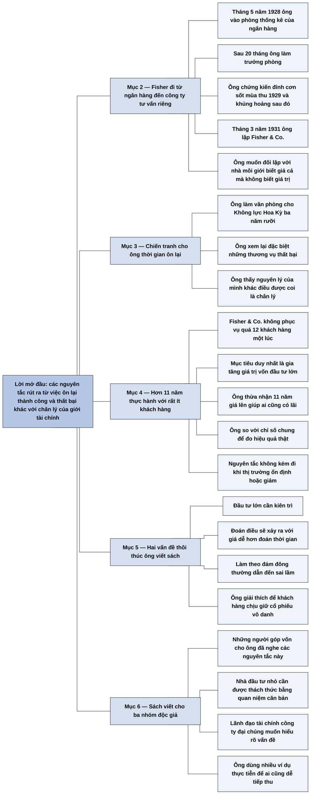

# Phần I, Lời mở đầu (Introduction)

## Ý chính

**Philip Fisher viết cuốn sách vì gần ba mươi năm làm nghề cho ông thấy các nguyên tắc đầu tư của mình khác xa những điều giới tài chính coi là chân lý, và các nguyên tắc đó hiệu quả cả khi thị trường tăng lẫn khi thị trường ổn định hoặc giảm.**

Ông vào nghề tháng 5 năm 1928, chứng kiến đỉnh cơn sốt chứng khoán năm 1929 và cuộc khủng hoảng sau đó. Tháng 3 năm 1931, ông lập Fisher & Co. để làm điều ngược với kiểu nhà môi giới biết giá cả của mọi thứ nhưng không biết giá trị của thứ gì.

Ba năm rưỡi làm văn phòng cho Không lực Hoa Kỳ là lúc ông ôn lại các thương vụ, nhất là các thương vụ thất bại. Từ đó ông nhận ra các nguyên lý riêng. Sau chiến tranh, hơn 11 năm, ông không phục vụ quá 12 khách hàng một lúc để thực hành chúng.

Hai điều thúc đẩy ông viết sách: đầu tư lớn cần kiên trì, vì đoán được điều gì sẽ xảy ra với giá cổ phiếu thì dễ hơn đoán bao giờ nó xảy ra; và thị trường hay đánh lừa người ta, nên làm theo đám đông thường dẫn đến sai lầm.

Sách hướng tới ba nhóm độc giả: khách hàng của ông, nhà đầu tư nhỏ, và lãnh đạo các công ty đại chúng.

## Sơ đồ

### Phần mở đầu của Lời mở đầu (không có tiêu đề mục) — vì sao lại thêm một cuốn sách về đầu tư (trang 28)

```text
       Fisher cho rằng một cuốn sách đầu tư mới cần được lý giải,
       nên ông kể chuyện riêng của mình
```

### Phần tự gom (trang 28–29) — quá trình hình thành các nguyên tắc

```text
       Tháng 5/1928: Fisher vào phòng thống kê của một đơn vị thuộc Ngân
       hàng quốc gia Crocker-Anglo ở San Francisco
       · 20 tháng sau ông làm trưởng phòng; công việc nay gọi là phân tích
         chứng khoán
                                │
                                ▼
       1929: ông chứng kiến cơn sốt chứng khoán và cuộc khủng hoảng sau đó
       · ông thấy cơ hội cho một công ty tư vấn đối lập với kiểu nhà môi
         giới biết giá cả mà không biết giá trị
                                │
                                ▼
       Tháng 3/1931: ông lập Fisher & Co., tập trung vào vài công ty tăng
       trưởng, và công ty phát đạt
                                │
                                ▼
       Chiến tranh thế giới thứ hai: ba năm rưỡi làm văn phòng cho Không lực
       · ông ôn lại các thương vụ thành công, nhất là thương vụ thất bại
       · ông nhận ra các nguyên lý khác xa điều giới tài chính coi là chân lý
                                │
                                ▼
       Sau chiến tranh: hơn 11 năm, không quá 12 khách hàng một lúc
       · mục tiêu duy nhất là gia tăng giá trị của vốn đầu tư lớn
       · ông thừa nhận 11 năm đó là giai đoạn giá lên, ai cũng có lãi
       · nhưng ông thấy các nguyên tắc hiệu quả rõ rệt hơn mười năm trước
         chiến tranh, và không kém đi khi thị trường ổn định hoặc giảm
```

### Phần tự gom (trang 29–31) — hai vấn đề thôi thúc ông viết và ba nhóm độc giả

```text
       Hai vấn đề rút ra từ kết quả đầu tư:
               ┌────────────────┴────────────────┐
               ▼                                 ▼
       CẦN KIÊN TRÌ                      THỊ TRƯỜNG ĐÁNH LỪA
       Đoán điều gì sẽ xảy ra với giá    Làm theo người khác và theo lời
       cổ phiếu dễ hơn đoán bao giờ      xúi giục thường dẫn đến sai lầm
       nó xảy ra
               └────────────────┬────────────────┘
                                ▼
       Ông giải thích nguyên tắc cho khách hàng, để họ hiểu vì sao ông mua
       cổ phiếu vô danh và không bán trước khi chúng đủ thời gian khẳng định
                                │
                                ▼
       Sách viết cho ba nhóm:
       1. người đang góp vốn cho ông, những người ông đã giải thích từ lâu
       2. nhà đầu tư nhỏ, hay tiếp thu những ý tưởng khiến họ trả giá đắt
          vì chưa từng bị thách thức bằng các quan niệm căn bản hơn
       3. chủ tịch hội đồng quản trị, phó chủ tịch tài chính, kế toán trưởng
          của các công ty đại chúng
                                │
                                ▼
       Ông dùng ví dụ thực tiễn và cách lý luận như khi giải thích cho
       khách hàng của mình, để mọi độc giả dễ tiếp thu
```

## Ba câu hỏi chương này trả lời

1. **Fisher lấy tư cách gì để viết sách?** Ông có gần ba mươi năm làm nghề: vào phòng thống kê của ngân hàng tháng 5 năm 1928, làm trưởng phòng sau 20 tháng, lập Fisher & Co. tháng 3 năm 1931, và hơn 11 năm sau chiến tranh chỉ phục vụ tối đa 12 khách hàng một lúc với mục tiêu gia tăng giá trị vốn lớn.
2. **Các nguyên tắc của ông đến từ đâu?** Từ ba năm rưỡi trong chiến tranh, khi ông dùng thời gian rỗi ôn lại các thương vụ của mình và của người khác trong mười năm trước, nhất là các thất bại. Ông kiểm nghiệm chúng trong 11 năm hậu chiến và thấy chúng hiệu quả cả khi thị trường không tăng.
3. **Điều gì khiến ông thấy cần viết sách?** Hai vấn đề: đầu tư lớn cần kiên trì vì thời điểm khó đoán hơn hướng đi của giá, và làm theo đám đông thường sai. Ngoài ra nhà đầu tư nhỏ hay hỏi ông nên bắt đầu thế nào, và lãnh đạo công ty đại chúng muốn hiểu rõ các vấn đề này.

## Khái niệm cần biết

- **Nhà phân tích chứng khoán (security analyst):** người nghiên cứu công ty và cổ phiếu để đánh giá giá trị. Fisher nói công việc ở phòng thống kê ngân hàng năm 1928 chính là nghề này theo cách gọi năm 1957.
- **Nhà môi giới chứng khoán (stockbroker):** người thực hiện lệnh mua bán cho khách và nhận hoa hồng. Fisher muốn công ty mình đối lập với kiểu môi giới chỉ biết giá.
- **Giá cả và giá trị:** giá cả là số tiền trả cho cổ phiếu hôm nay, giá trị là cái doanh nghiệp thật sự đáng giá. Phân biệt hai điều này là lý do ra đời của Fisher & Co.
- **Tư vấn đầu tư (investment counsel):** dịch vụ khuyên khách hàng nên đầu tư vào đâu. Fisher & Co. là công ty loại này.
- **Công ty tăng trưởng:** công ty có doanh thu và lợi nhuận tăng mạnh trong nhiều năm. Fisher & Co. tập trung vào vài công ty loại này, không dàn trải.
- **Giai đoạn giá lên:** thời kỳ giá cổ phiếu nói chung tăng. Fisher thừa nhận trong 11 năm hậu chiến ai đầu tư cũng có lợi nhuận, nên ông không lấy lợi nhuận tuyệt đối làm bằng chứng mà so với các chỉ số chung của thị trường.
- **Công ty đại chúng (public company):** công ty có cổ phiếu do công chúng nắm giữ. Lãnh đạo tài chính của các công ty này là nhóm độc giả thứ ba của sách.

## Nội dung chi tiết

### 1. Vì sao lại thêm một cuốn sách (trang 28)

Fisher nói việc xuất bản thêm một cuốn sách đầu tư cần một lời giải thích của tác giả, nên phần này phải mang tính riêng tư để lý giải sự mạo hiểm của ông.

### 2. Từ ngân hàng đến Fisher & Co. (trang 28)

Sau một năm học tại Stanford về quản trị kinh doanh, tháng 5 năm 1928 Fisher bắt đầu đi làm. Ông vào phòng thống kê của một trong những đơn vị hợp thành của Ngân hàng quốc gia Crocker-Anglo ở San Francisco, 20 tháng sau được bổ nhiệm làm trưởng phòng. Theo cách nói của năm 1957, ông là một nhà phân tích chứng khoán.

Tại đây ông tận mắt thấy cơn sốt chứng khoán lên đỉnh vào mùa thu năm 1929 và cuộc khủng hoảng sau đó. Từ quan sát này, ông tin Bờ biển phía Tây có chỗ cho một công ty tư vấn đầu tư đối lập với hình ảnh một số nhà môi giới: những người biết giá cả của mọi thứ nhưng không biết giá trị của bất cứ thứ gì.

Tháng 3 năm 1931, ông lập Fisher & Co., phục vụ công chúng nói chung nhưng tập trung chủ yếu vào vài công ty tăng trưởng. Công ty làm ăn rất phát đạt cho tới khi Chiến tranh thế giới thứ hai nổ ra.

### 3. Ba năm rưỡi ôn lại trong chiến tranh (trang 28–29)

Trong ba năm rưỡi làm công việc văn phòng cho Không lực Hoa Kỳ, ông dành toàn bộ thời gian rỗi ôn lại những thương vụ thành công và đặc biệt là những thương vụ thất bại của mình, cùng những gì ông chứng kiến trong mười năm trước đó. Từ đó ông nhận ra một số nguyên lý đầu tư khác xa một vài nguyên lý mà giới tài chính thừa nhận như chân lý.

### 4. Hơn 11 năm thực hành sau chiến tranh (trang 29)

Khi giải ngũ, ông quyết định thực hành các nguyên lý đó trong môi trường ít bị tác động từ bên ngoài nhất có thể. Thay vì phục vụ mọi đối tượng, hơn 11 năm Fisher & Co. chưa bao giờ phục vụ quá 12 khách hàng một lúc, và phần lớn khách hàng gắn bó lâu dài. Mọi hoạt động của công ty nhắm vào một mục tiêu là gia tăng giá trị của vốn đầu tư lớn.

Ông thừa nhận 11 năm đó là giai đoạn giá lên, ai tham gia cũng có lợi nhuận. Tuy nhiên, dựa trên kết quả các quỹ của ông đạt được so với các chỉ số chung của thị trường, ông nhận thấy các nguyên tắc này trong thời kỳ hậu chiến còn cho tác dụng rõ rệt hơn mười năm trước chiến tranh. Quan trọng hơn, tác dụng của chúng không giảm đi trong những năm thị trường ổn định hoặc sụt giảm so với khi thị trường tăng mạnh.

### 5. Hai vấn đề thôi thúc ông viết sách (trang 29–30)

Khi nghiên cứu kết quả đầu tư của mình và của người khác, ông thấy hai vấn đề.

Thứ nhất, muốn có lợi nhuận đầu tư lớn thì cần kiên trì. Đoán xem điều gì sẽ xảy ra với giá một cổ phiếu thường dễ hơn đoán bao lâu nữa nó xảy ra.

Thứ hai, thị trường chứng khoán có bản chất đánh lừa người tham gia. Làm theo người khác và làm theo lời xúi giục thường dẫn đến sai lầm.

Vì vậy, nhiều năm qua ông giải thích rất cụ thể cho những người góp vốn về các nguyên tắc sau mỗi hành động. Chỉ như thế họ mới hiểu vì sao ông đưa vào danh mục vài cổ phiếu hoàn toàn vô danh và nhất quyết không bán trước khi chúng đủ thời gian khẳng định mình.

### 6. Ba nhóm độc giả (trang 30–31)

Dần dần ông muốn xuất bản các nguyên tắc này và bắt đầu phác thảo sách. Rồi ông nghĩ tới nhiều người có số vốn nhỏ hơn khách hàng của ông rất nhiều, những người nhiều năm qua đã đến hỏi nhà đầu tư nhỏ nên bắt đầu thế nào để có lợi nhuận.

Ông nghĩ khó khăn của nhà đầu tư nhỏ là họ vô thức tiếp thu các ý tưởng có thể khiến họ trả giá đắt nhiều năm, vì chưa bao giờ được đặt trước thách thức của những quan niệm căn bản hơn.

Cuối cùng ông nghĩ tới các cuộc thảo luận với một nhóm khác, quan tâm tới vấn đề này từ một lập trường khác: chủ tịch hội đồng quản trị, phó chủ tịch tài chính và kế toán trưởng các công ty đại chúng. Nhiều người trong số họ thật sự muốn hiểu rõ các vấn đề này.

Vì thế ông cho rằng cuốn sách là cần thiết và muốn mọi độc giả dễ lĩnh hội. Ông dùng nhiều ví dụ thực tiễn, cách diễn đạt và suy luận giống như khi truyền đạt các khái niệm đó cho khách hàng, và mong người đọc bỏ qua những khiếm khuyết của sách vì giá trị của các ý tưởng. Lời mở đầu ký tên Philip A. Fisher, San Mateo, California, tháng 9 năm 1957.

## Luận điểm cốt lõi

1. Các nguyên tắc của Fisher đến từ việc ôn lại các thương vụ thành công và đặc biệt là thất bại, của ông và của những người ông chứng kiến.
2. Biết giá trị quan trọng hơn biết giá cả.
3. Đoán thời điểm khó hơn đoán hướng đi, nên đầu tư lớn đòi hỏi kiên trì.
4. Làm theo đám đông thường dẫn đến sai lầm.
5. Nhà đầu tư nhỏ cần được thách thức bằng các quan niệm căn bản, thay vì tiếp thu thói quen sẵn có.

## Thuật ngữ

| Tiếng Anh | Tiếng Việt (bản dịch) |
|---|---|
| Security analyst | Nhà phân tích chứng khoán |
| Stockbroker | Nhà môi giới chứng khoán |
| Investment counsel | Tư vấn đầu tư |
| Growth company | Công ty tăng trưởng |
| Statistical department | Phòng thống kê |
| Bull market | Giai đoạn giá lên |
| Generally accepted indices | Các chỉ số đã được thừa nhận chung |
| Financial community | Giới tài chính |

## Câu nói đáng nhớ

> "những người biết giá cả của mọi thứ nhưng lại không hề biết giá trị của bất cứ thứ gì." — trang 28

> "việc dự đoán điều gì sẽ xảy ra với giá của một cổ phiếu thường dễ dàng hơn là dự đoán bao lâu thì sự kiện đó sẽ xảy ra." — trang 29

## Đánh giá và phát hiện đáng chú ý

### Phần mạnh nhất là việc Fisher tự trừ đi may mắn của thị trường giá lên

Ông thừa nhận 11 năm hậu chiến là giai đoạn ai cũng có lãi, rồi mới đưa ra bằng chứng so với chỉ số chung và kết quả trong các năm thị trường không tăng. Đây là cách so sánh đúng, ít gặp ở sách đầu tư thời đó theo nhận định của người tổng hợp.

### Bằng chứng về hiệu quả không có con số

Lời mở đầu không đưa ra tỷ suất lợi nhuận, không có chỉ số nào cụ thể, không có năm nào cụ thể. Người đọc phải tin lời tác giả. Mẫu cũng rất nhỏ: tối đa 12 khách hàng, và người ta chỉ thấy phần ông kể.

### Điều kiện của Fisher khác xa nhà đầu tư nhỏ

Fisher làm việc toàn thời gian, với 12 khách hàng lớn, được tiếp cận lãnh đạo công ty. Sách muốn nói cho cả nhà đầu tư nhỏ, nhưng lời mở đầu chưa giải quyết khoảng cách đó. Chương 2 sẽ đề cập trực tiếp bằng cách khuyên nhà đầu tư nhỏ hiểu đủ để chọn và đánh giá người tư vấn.

### Tinh thần tự phản tỉnh khác hẳn việc khoe thành tích

Fisher nói ông ôn lại "đặc biệt là những hoạt động thất bại". Theo nhận định của người tổng hợp, đây là chìa khóa của toàn bộ Phần I: cả [Chương 8](P1-C08-nam-dieu-nha-dau-tu-nen-tranh.md) và [Chương 9](P1-C09-them-nam-dieu-nha-dau-tu-nen-tranh.md) đều là danh sách những điều nên tránh, và Phần III quay lại các sai lầm của ông.

### Về phía Graham và về câu nói giá cả, giá trị (theo hiểu biết của người tổng hợp, không tra cứu)

Câu "biết giá cả của mọi thứ mà không biết giá trị của thứ gì" vốn là định nghĩa về kẻ yếm thế của Oscar Wilde; Fisher mượn nó để nói về nhà môi giới. Về tư tưởng, Fisher cũng phân biệt giá và giá trị như Benjamin Graham, nhưng Graham đo giá trị chủ yếu từ số liệu công bố, còn Fisher tìm giá trị ở chất lượng doanh nghiệp. Việc Fisher đặt công ty ở Bờ Tây, xa phố Wall, cũng phù hợp với lập trường của ông là tránh tâm lý đám đông.

### Cách vận dụng cho nhà đầu tư cá nhân

- Ghi lại lý do mua mỗi cổ phiếu và định kỳ xem lại các thương vụ thất bại, như Fisher đã làm trong chiến tranh.
- Khi đánh giá kết quả của mình, so với một chỉ số chung, đừng chỉ nhìn số lãi trong thị trường đang tăng.
- Khi mua một cổ phiếu ít người biết, xác định trước thời gian kiên trì, vì hướng đi có thể đúng nhưng thời điểm đến muộn.

## Bản đồ tư duy

Toàn cảnh Lời mở đầu: các nhánh theo mục 2–6 của Nội dung chi tiết.



## Nguồn

Philip A. Fisher, *Cổ phiếu thường, lợi nhuận phi thường* (bản dịch Alpha Books, NXB Lao động – Xã hội), Phần I, Lời mở đầu, trang 28–31.

## Tác giả

Philip A. Fisher, sáng lập công ty tư vấn đầu tư Fisher & Co. năm 1931. Lời mở đầu viết tại San Mateo, California, tháng 9 năm 1957.

## Vị trí trong lập luận của cả cuốn sách

Phần trước là [lời giới thiệu và Lời tựa của Kenneth Fisher](00-gioi-thieu-va-loi-tua.md). Lời mở đầu cho biết nguồn gốc các nguyên tắc và đối tượng độc giả. Chương tiếp theo, [Chương 1](P1-C01-nhung-manh-moi-tu-qua-khu.md), bắt đầu lập luận bằng cách xem xét lịch sử để tìm phương pháp đầu tư hiệu quả nhất.

## Lưu ý

- **Mâu thuẫn về việc tốt nghiệp Stanford:** trang 28 viết "Sau một năm học tại trường Stanford, tốt nghiệp chuyên ngành Quản trị kinh doanh". Phần III, trang 290–291, cho biết ông vừa xong năm thứ nhất và nhận việc tại ngân hàng, dự định nếu không ổn sẽ quay lại học năm thứ hai. Nhiều khả năng ông chưa tốt nghiệp; Phần Nội dung chi tiết chỉ ghi "sau một năm học". Đây là nghi dịch sai vì không có nguyên tác.
- **Cách gọi người góp vốn:** trang 29–31 dùng "cổ đông góp vốn vào quỹ của tôi", "các quỹ tôi từng quản lý" trong khi Fisher & Co. được mô tả là công ty tư vấn với khách hàng. Có thể bản dịch dùng chữ cổ đông, quỹ cho khách hàng và tài khoản của họ. Đây là nghi vấn.
- **Câu nghi dịch chưa sát:** trang 30 "những trò lừa bịp vốn có của thị trường chứng khoán" và "những việc bạn bị xúi giục". Nghĩa có thể là thị trường dễ đánh lừa và điều người ta bị thôi thúc làm theo. Trang 29 "trong các chỉ số đã được thừa nhận chung": nghĩa hợp lý là so với các chỉ số đó. Các chỗ này là nghi vấn.
- **Tính ngày:** 20 tháng sau tháng 5 năm 1928 là khoảng đầu năm 1930. Từ 1928 đến 1957 là khoảng 29 năm. Các số này khớp với mô tả của Phần III về việc ông vào ngân hàng đầu mùa hè năm 1928.
- **Lỗi chính tả:** "Không lực Hoa kỳ" (trang 29) phải viết hoa chữ Kỳ; dấu phẩy thừa trong "Fisher & Co., chưa bao giờ" (trang 29).
- **Tên riêng:** Ngân hàng quốc gia Crocker-Anglo là tên theo thời điểm Fisher viết sách (1957), theo chữ bản dịch.
- Không có bảng hay hình bị mất; bản dịch không có tiêu đề mục trong phần này, nên các mục trên là phần tự gom.
