# Phần I, Chương 1 — Những manh mối từ quá khứ (Clues from the Past)

## Ý chính

**Fisher kết luận từ lịch sử đầu tư Mỹ rằng phần thưởng lớn nhất thuộc về người tìm được công ty tăng trưởng doanh thu và lợi nhuận trong nhiều năm rồi gắn bó lâu dài với nó, chứ không thuộc về người cố mua rẻ bán đắt theo chu kỳ kinh doanh.**

Lịch sử cho thấy hai cách kiếm tiền. Cuối thế kỷ XIX và đầu thế kỷ XX, nhiều người đặt cược vào chu kỳ kinh doanh và có lãi. Nhưng ngay trong giai đoạn từ khi có Cục Dự trữ Liên bang (1913) tới luật chứng khoán thời Roosevelt, người tìm công ty xuất sắc và giữ cổ phiếu qua biến động còn kiếm được nhiều hơn với rủi ro thấp hơn.

Fisher nêu bằng chứng: 10.000 đô-la đầu tư cách đây 25 đến 50 năm vào nhiều công ty nay thường thành 250.000 đô-la hoặc gấp vài lần. Những cơ hội đó không đòi hỏi mua đúng đáy; việc cần làm là lọc ra số ít công ty có triển vọng thật sự.

Ông cho rằng cơ hội năm 1957 còn tốt hơn trước, vì ba thay đổi. Thứ nhất, đội ngũ quản lý chuyên nghiệp hơn, không còn coi công ty như tài sản gia đình. Thứ hai, chi phí nghiên cứu tăng rất nhanh: 3,7 tỷ đô-la năm 1953, 7,3 tỷ đô-la năm 1957. Thứ ba, chính sách liên bang sau năm 1932 làm suy thoái ngắn hơn.

Nghiên cứu vừa tốn kém vừa rủi ro: một dự án sinh lời thường mất 7 đến 11 năm. Tuy vậy, không nghiên cứu còn đắt hơn.

Chính sách đó cũng khiến thâm hụt ngân sách và lạm phát tăng. Vì vậy trái phiếu xếp hạng cao không phải khoản đầu tư dài hạn tốt: tại Mỹ, đồng tiền mất giá 3,4% mỗi năm trong 1946–1956, trong khi trái phiếu chính phủ đầu giai đoạn chỉ trả khoảng 2,19%.

Quy mô công ty không phải yếu tố quyết định. Điều quyết định là đội ngũ quản lý quyết tâm tăng trưởng, có khả năng thực hiện, hiểu cách tổ chức nghiên cứu, và không để kế hoạch dài hạn làm hỏng công việc hằng ngày.

## Sơ đồ

### Phần mở đầu chương (trang 32) — động cơ mua cổ phiếu

```text
       Người ta mua cổ phiếu vì nhiều lý do: mong làm giàu như thời đầu của
       Ford và Aluminum Company of America, sợ lạm phát, nghe hàng xóm
       kiếm được tiền, nhận tài liệu chào mời
                                │
                                ▼
       Sau mọi lý do chỉ có một động cơ căn bản: mua cổ phiếu để kiếm tiền
                                │
                                ▼
       Vậy bước đầu tiên là xem người kiếm được nhiều tiền nhất đã làm gì
```

### Phần tự gom (trang 32–34) — hai phương pháp kiếm tiền trong lịch sử

```text
               ┌────────────────┴────────────────┐
               ▼                                 ▼
       ĐẶT CƯỢC VÀO CHU KỲ KINH DOANH    TÌM CÔNG TY THẬT SỰ NỔI BẬT
       Cuối thế kỷ XIX, đầu thế kỷ XX    Nhà đầu tư giữ cổ phiếu qua biến
       Nhà đầu tư mua lúc xấu, bán       động của thị trường
       lúc tốt
       Cách này đặc biệt có lợi cho
       người biết trước khó khăn của
       hệ thống ngân hàng
               └────────────────┬────────────────┘
                                ▼
       Trong giai đoạn 1913 tới luật chứng khoán thời Roosevelt, phương pháp
       thứ hai kiếm được nhiều tiền hơn với rủi ro thấp hơn
                                │
                                ▼
       Bằng chứng: 10.000 đô-la đầu tư cách đây 25–50 năm vào nhiều công ty
       nay thường thành 250.000 đô-la hoặc gấp vài lần
       · nhà đầu tư không cần mua đúng đáy
       · cổ phiếu sẵn có nhiều năm ở nhiều mức giá vẫn có lợi nhuận
                                │
                                ▼
       Việc cần làm: lọc ra số ít công ty có triển vọng xán lạn
```

### Phần tự gom (trang 34–35) — yếu tố thứ nhất: thay đổi trong quản lý

```text
       Fisher tin rằng cơ hội hiện nay tốt hơn 25 năm đầu thế kỷ XX
                                │
               ┌────────────────┴────────────────┐
               ▼                                 ▼
       THẾ HỆ TRƯỚC                      NGÀY NAY
       Lãnh đạo là người trong gia       Quản lý hàng đầu tự phân tích liên
       đình, coi tập đoàn như của        tục, tìm đổi mới, hỏi ý kiến chuyên
       riêng; ít chú ý cổ đông khác      gia
       Con cháu tiếp quản                Môi trường cạnh tranh buộc phải
       Người quản lý lâu năm chống       hoàn thiện
       cải cách, từ chối góp ý
               └────────────────┬────────────────┘
                                ▼
       Nguy cơ công ty mất vị trí dẫn đầu hoặc người trong công ty chiếm hết
       lợi ích vẫn còn, nhưng khó thành hiểm họa với nhà đầu tư cẩn trọng
```

### Phần tự gom (trang 35–37) — yếu tố thứ hai: nghiên cứu tăng nhanh

```text
       Cuối những năm 1920 chỉ khoảng nửa tá tập đoàn có tổ chức nghiên cứu
       đúng nghĩa; nghiên cứu công nghiệp bùng lên từ lo sợ Hitler
                                │
                                ▼
       Chi phí nghiên cứu và phát triển: 1953 là 3,7 tỷ đô-la; 1956 là 5,5
       tỷ; 1957 là 7,3 tỷ; dự tính 1960 là 9 tỷ
       · năm 1960 toàn ngành sản xuất kỳ vọng 10% doanh thu từ sản phẩm
         chưa thương mại hóa ba năm trước
                                │
               ┌────────────────┴────────────────┐
               ▼                                 ▼
       NGHIÊN CỨU RẤT TỐN KÉM            KHÔNG NGHIÊN CỨU CÒN ĐẮT HƠN
       · không có thước đo nhanh về      · nguyên liệu, máy móc mới thu hẹp
         khả năng sinh lợi               thị trường của công ty không theo
       · nhiều dự án không đem lại       kịp
         lợi ích, có thể tụ lại cùng     · máy tính và bức xạ đã đổi cách
         một lúc                         làm việc
       · dự án thường mất 7–11 năm
         mới sinh lợi
               └────────────────┬────────────────┘
                                ▼
       Công ty giữ được hiệu quả hằng ngày và đi đầu về dài hạn sẽ làm cổ
       đông "lời to"
```

### Phần tự gom (trang 37–40) — yếu tố thứ ba: chính sách của chính phủ liên bang

```text
       Trước 1932: cả hai đảng đều không chấp nhận chủ động tạo thâm hụt lớn
       để đỡ doanh nghiệp yếu
                                │
                                ▼
       Sau 1932: cả hai đảng sẵn sàng giảm thuế và dùng biện pháp tốn kém
       để chống suy thoái và thất nghiệp
                                │
                                ▼
       Cơ cấu ngân sách cũng đổi
       · khoảng 80% thu liên bang nay từ thuế thu nhập, nên kinh doanh sụt
         thì thu ngân sách sụt theo
       · trợ giá nông sản, trợ cấp thất nghiệp làm chi tăng đúng lúc đó
                                │
                                ▼
       Một cuộc suy thoái thật sự có thể tạo thâm hụt 25–30 tỷ đô-la mỗi
       năm, và thâm hụt đó làm lạm phát trầm trọng hơn
                                │
                                ▼
       Hệ quả: suy thoái có xu hướng ngắn hơn
       · công ty yếu tài chính hoặc yếu cạnh tranh vẫn chịu ảnh hưởng lớn
       · với công ty đủ sức chống đỡ một đến hai năm, suy thoái chỉ làm giá
         cổ phiếu chững lại tạm thời, không đe dọa sự tồn tại của khoản đầu tư
```

### Phần tự gom (trang 40–43) — trái phiếu không hợp với nhà đầu tư dài hạn

```text
       Mùa thu 1956: trái phiếu xếp hạng cao có giá rẻ nhất 25 năm; nhiều
       chuyên gia khuyên chuyển từ cổ phiếu sang trái phiếu
       · suy thoái làm lãi suất giảm và giá trái phiếu tăng, nên cách này
         có lợi trong ngắn hạn
                                │
                                ▼
       Fisher: trái phiếu xếp hạng cao tốt cho người đầu cơ, không tốt cho
       nhà đầu tư dài hạn
                                │
                                ▼
       Dữ liệu 1946–1956 (16 quốc gia giàu có, đồng tiền nào cũng mất sức mua)
       · Thụy Sỹ còn 85%; Chi Lê mất 95%; Mỹ mất 29%; Canada mất 35%
       · Mỹ mất 3,4% mỗi năm, Canada mất 4,2% mỗi năm
                                │
                                ▼
       TRÁI PHIẾU CHÍNH PHỦ MỸ so với mức mất giá 3,4% mỗi năm
       · mua đầu kỳ, lãi khoảng 2,19%: thực tế lỗ hơn 1% mỗi năm
       · mua cuối kỳ, lãi 3,27%: vẫn lỗ nhẹ
       · sáu tháng sau, lãi trên 3,5%: trừ ít nhất 20% thuế thì vẫn khó có lãi
       · trái phiếu đô thị miễn thuế: lãi quá thấp, không có lợi nhuận thật
                                │
                                ▼
       Hai khả năng tương lai
               ┌────────────────┴────────────────┐
               ▼                                 ▼
       DOANH NGHIỆP ĐỨNG VỮNG            SUY THOÁI XUẤT HIỆN
       Cổ phiếu tiếp tục hơn trái phiếu  Trái phiếu tạm thời hấp dẫn hơn; thâm
                                         hụt sau đó làm giảm sức mua của trái
                                         phiếu, khó chọn lúc bán
               └────────────────┬────────────────┘
                                ▼
       Trái phiếu hợp với ngân hàng, công ty bảo hiểm và cá nhân đầu tư ngắn
       hạn, vì không bù được mất sức mua cho nhà đầu tư dài hạn
```

### Phần tự gom (trang 43–44) — tóm tắt kết luận

```text
       Phần thưởng lớn nhất đến từ công ty tăng trưởng doanh thu và lợi nhuận
       trong nhiều năm; nhà đầu tư có được nhờ phán đoán hoặc may mắn
                                │
                                ▼
       Khi chắc đã tìm được công ty như vậy, nhà đầu tư nên gắn bó lâu dài
                                │
                                ▼
       Quy mô không quan trọng; quan trọng là đội ngũ quản lý
       · quyết tâm tăng trưởng và có khả năng hoàn thành kế hoạch
       · biết tổ chức nghiên cứu để mở thị trường và tạo sản phẩm mới
       · không để kế hoạch dài hạn cản trở việc kinh doanh hằng ngày
                                │
                                ▼
       Fisher tin hôm nay có nhiều cơ hội hơn 25 hay 50 năm trước
```

## Ba câu hỏi chương này trả lời

1. **Phương pháp nào kiếm được nhiều tiền nhất trong lịch sử?** Theo Fisher là tìm công ty thật sự nổi bật và giữ qua biến động. 10.000 đô-la bỏ vào nhiều công ty cách đây 25 đến 50 năm nay thường thành 250.000 đô-la hoặc gấp vài lần. Trong giai đoạn từ 1913 tới luật chứng khoán thời Roosevelt, cách này cho nhiều tiền hơn với rủi ro thấp hơn so với mua rẻ bán đắt theo chu kỳ kinh doanh.
2. **Vì sao cơ hội năm 1957 tốt hơn trước?** Vì ba thay đổi: đội ngũ quản lý chuyên nghiệp thay kiểu quản lý gia đình; nghiên cứu tăng từ 3,7 tỷ đô-la năm 1953 lên 7,3 tỷ đô-la năm 1957; và chính sách liên bang sau năm 1932 sẵn sàng chấp nhận thâm hụt để chống suy thoái, khiến suy thoái có xu hướng ngắn hơn, và với công ty tài chính mạnh thì suy thoái chỉ làm giá cổ phiếu chững lại tạm thời.
3. **Vì sao trái phiếu xếp hạng cao không hợp với nhà đầu tư dài hạn?** Vì lạm phát xóa hết phần lãi. Trong 1946–1956, đồng đô-la mất 3,4% mỗi năm, trong khi trái phiếu chính phủ Mỹ mua đầu kỳ trả khoảng 2,19%, và ngay mức lãi 3,27% đến trên 3,5% của cuối kỳ cũng không có lợi nhuận thật sau ít nhất 20% thuế.

## Khái niệm cần biết

- **Cổ phiếu thường (common stock):** phần sở hữu trong công ty; người giữ hưởng theo kết quả kinh doanh và không có khoản lãi cố định như trái phiếu.
- **Trái phiếu (bond):** giấy vay nợ. Người mua cho công ty hoặc chính phủ vay, nhận lãi định kỳ và nhận lại gốc. Fisher dùng loại này để so với cổ phiếu.
- **Trái phiếu xếp hạng cao (high-grade bond):** trái phiếu có rủi ro vỡ nợ thấp theo đánh giá của tổ chức xếp hạng. An toàn về mặt không vỡ nợ, nhưng vẫn mất sức mua khi có lạm phát.
- **Chứng khoán thu nhập cố định:** chứng khoán trả khoản thu cố định, như trái phiếu. Thu nhập không tăng khi giá cả tăng.
- **Trái phiếu đô thị miễn thuế (municipal bond):** trái phiếu do chính quyền địa phương phát hành, lãi không chịu thuế thu nhập nên lãi suất thấp hơn.
- **Chu kỳ kinh doanh (business cycle):** các đợt kinh tế mở rộng rồi suy giảm xen kẽ. Người đặt cược vào chu kỳ mua khi xấu, bán khi tốt.
- **Lạm phát (inflation):** giá cả nói chung tăng, nghĩa là mỗi đồng mua được ít hơn. Nếu sức mua giảm 29% thì 100 đô-la sau mười năm chỉ mua được lượng hàng trị giá 71 đô-la lúc đầu.
- **Sức mua của đồng tiền (purchasing power):** lượng hàng một đồng mua được. Đây là thước đo Fisher dùng để tính lãi thật của trái phiếu.
- **Lãi suất thực (real return):** lãi suất danh nghĩa trừ tỷ lệ mất giá của đồng tiền. Với 2,19% và 3,4%, lãi suất thực xấp xỉ −1,21%.
- **Thâm hụt ngân sách (budget deficit):** chính phủ chi nhiều hơn thu. Fisher cho rằng thâm hụt lớn làm lạm phát tăng.
- **Suy thoái (recession, depression):** giai đoạn hoạt động kinh tế sụt giảm kéo dài. Bản dịch dùng chữ suy thoái cho cả hai mức độ.
- **Nghiên cứu và phát triển (research and development):** chi tiêu để tạo sản phẩm và quy trình mới. Fisher coi đây là động lực chính của tăng trưởng công ty.
- **Thương mại hóa (commercialization):** đưa sản phẩm ra bán trên thị trường. Năm 1957, doanh nghiệp kỳ vọng 10% doanh thu 1960 đến từ sản phẩm chưa thương mại hóa ba năm trước.
- **Cổ đông thiểu số:** cổ đông không nắm quyền kiểm soát. Trong kiểu quản lý gia đình, họ ít được chú ý. Bản dịch viết "các cổ đông khác".
- **Nhà đầu tư cẩn trọng (conservative investor):** người ưu tiên bảo toàn vốn và mua có cân nhắc. Fisher cho rằng các nguy cơ quản lý kiểu cũ khó còn là hiểm họa với họ.
- **Quản lý tập quyền:** quyền quyết định tập trung trong tay một số ít người, thường đi cùng chống đổi mới.

## Nội dung chi tiết

### 1. Động cơ mua cổ phiếu (phần mở đầu chương, trang 32)

Fisher đặt người đọc vào tình huống có một khoản tiền ngân hàng và quyết định mua cổ phiếu thường. Lý do có thể khác nhau. Người đó muốn kiếm nhiều hơn các kênh khác. Có thể người đó nghĩ tới những năm đầu của Henry Ford với Ford Motor Company hay Andrew Mellon với Aluminum Company of America, và mong tìm được doanh nghiệp trẻ tiềm năng.

Người khác lại lo lạm phát và muốn một chốn an toàn khi sức mua đồng đô-la giảm. Cũng có thể vì nghe hàng xóm kiếm được tiền, hoặc nhận được tài liệu giải thích vì sao cổ phiếu của một công ty như Midwestern Pumpernickel là món hời.

Dù lý do nào, chỉ có một động cơ căn bản: mua cổ phiếu để kiếm tiền. Vì vậy, bước đầu tiên hợp lý là xem người kiếm được nhiều tiền nhất đã làm gì.

### 2. Hai phương pháp kiếm tiền (trang 32–34)

**Phương pháp thứ nhất là đặt cược vào chu kỳ kinh doanh.** Cuối thế kỷ XIX và đầu thế kỷ XX, nhiều người giàu lên theo cách này. Hệ thống ngân hàng khi đó bất ổn với các đợt bùng nổ và phá sản theo chu kỳ, nên mua lúc xấu, bán lúc tốt cho kết quả khả quan. Cách này đặc biệt có lợi cho người hiểu tài chính và biết trước khi hệ thống ngân hàng gặp khó.

**Phương pháp thứ hai là tìm công ty thật sự đáng chú ý và giữ cổ phiếu qua biến động.** Ngay trong giai đoạn bắt đầu từ khi Cục Dự trữ Liên bang ra đời năm 1913 và kết thúc khi luật chứng khoán và hối đoái được thông qua đầu thời Franklin D. Roosevelt, người dùng cách này vẫn kiếm được nhiều tiền hơn với rủi ro thấp hơn.

Từ đó Fisher nêu chìa khóa đầu tiên. Trong các cổ phiếu niêm yết tại Mỹ năm 1957, nhiều công ty mà nếu 25 đến 50 năm trước ai đó bỏ 10.000 đô-la thì nay thường thành 250.000 đô-la hoặc gấp vài lần. Suốt đời, hầu hết nhà đầu tư có vô số cơ hội như vậy cho bản thân và con cái.

Các cơ hội đó không đòi hỏi mua đúng lúc thị trường xuống đáy. Trong nhiều năm, cổ phiếu của các công ty này luôn có sẵn ở nhiều mức giá vẫn đem lại lợi nhuận. Việc cần làm là lọc ra số ít công ty có triển vọng từ rất nhiều công ty có tương lai bất định.

### 3. Yếu tố thứ nhất: thay đổi trong quản lý (trang 34–35)

Fisher đặt câu hỏi cơ hội như thế có còn không. Ông trả lời có, và cho rằng còn tốt hơn nhiều so với 25 năm đầu thế kỷ XX, do thay đổi căn bản trong quản lý doanh nghiệp.

Thế hệ trước, lãnh đạo các tập đoàn lớn thường là người trong gia đình. Họ coi tập đoàn là của riêng, ít chú ý tới cổ đông khác. Thường chỉ con trai hoặc cháu trai được đào tạo để tiếp quản, nên việc chọn người tài giỏi nhất để bảo vệ tiền của cổ đông hiếm khi được coi trọng.

Dưới kiểu quản lý tập quyền, người quản lý lâu năm chống đổi mới và từ chối nghe góp ý. Môi trường năm 1957 thì khác: cạnh tranh cao hơn, quản lý hàng đầu liên tục tự phân tích, tìm đổi mới, hỏi ý kiến chuyên gia.

Trước đây luôn có nguy cơ tập đoàn hấp dẫn nhất mất vị trí dẫn đầu, hoặc người trong công ty chiếm hết lợi ích. Các nguy cơ này chưa hết hẳn nhưng khó còn là hiểm họa với nhà đầu tư cẩn trọng.

### 4. Yếu tố thứ hai: nghiên cứu tăng nhanh (trang 35–37)

Thay đổi đáng kể khác trong quản lý là việc nghiên cứu doanh nghiệp đi cùng thử nghiệm công nghệ mới có thể đem lợi nhuận lớn cho cổ đông. Theo Fisher, rất ít nhà đầu tư hình dung được xu hướng này diễn ra nhanh thế nào, đi xa đến đâu, và ảnh hưởng ra sao tới chính sách đầu tư.

Cuối những năm 1920, chỉ khoảng nửa tá tập đoàn công nghiệp có tổ chức nghiên cứu đúng nghĩa, quy mô nhỏ so với năm 1957. Nghiên cứu công nghiệp chỉ thật sự phát triển khi lo sợ Adolf Hitler thúc đẩy nghiên cứu cho mục đích quân sự. Từ đó nó tăng liên tục.

Các khảo sát của McGraw-Hill, đăng trên Business Week và các ấn phẩm thương mại khác, cho các số sau:

| Năm | Chi phí nghiên cứu và phát triển của doanh nghiệp | Ghi chú |
|---|---|---|
| 1953 | 3,7 tỷ đô-la | Khảo sát năm 1956 |
| 1956 | 5,5 tỷ đô-la | Khảo sát năm 1956 |
| 1959 | 6,3 tỷ đô-la | Kế hoạch theo khảo sát năm 1956 |
| 1957 | 7,3 tỷ đô-la | Khảo sát mùa xuân năm 1957 |
| 1960 | 9 tỷ đô-la | Dự tính theo khảo sát năm 1957 |

Khảo sát năm 1956 còn cho thấy nhiều ngành dẫn đầu kỳ vọng từ 15% đến hơn 20% doanh thu năm 1959 đến từ sản phẩm chưa thương mại hóa vào năm 1956.

Khảo sát mùa xuân năm 1957 gây sốc hơn. Chi phí nghiên cứu đã tăng 20% so với năm trước, lên tới 7,3 tỷ đô-la, và theo Fisher đã tăng 100% trong bốn năm. Fisher cũng nêu rằng mức tăng thực tế trong 12 tháng là 1 tỷ đô-la, trong khi chỉ hơn một năm trước, số đó là mức tăng người ta định chi trong 36 tháng tiếp theo. Toàn bộ ngành sản xuất, không chỉ vài ngành được chọn, kỳ vọng 10% doanh thu năm 1960 đến từ sản phẩm mới chưa thương mại hóa ba năm trước. Một số ngành còn cao gấp nhiều lần tỷ lệ đó.

**Nghiên cứu rất rủi ro.** Chi phí lớn đến mức một tập đoàn nghiên cứu thất bại có thể lao đao vì gánh nặng dự án. Cả nhà quản lý lẫn nhà đầu tư đều không có tiêu chuẩn nhanh để đo khả năng sinh lợi của nghiên cứu. Nhiều dự án không đem lại lợi ích gì, và những dự án thất bại có thể ngẫu nhiên tụ lại một lúc, kể cả ở phòng thí nghiệm hoạt động hiệu quả. Từ khi một dự án được thai nghén tới khi sinh lợi thường mất bảy đến mười một năm, nên ngay dự án thành công cũng tốn nhiều tiền trước khi có lợi cho cổ đông.

**Nhưng không nghiên cứu còn tệ hơn.** Sau vài năm, nguyên liệu và máy móc mới sẽ thu hẹp thị trường của hàng nghìn công ty, thậm chí cả những ngành không theo kịp. Việc đưa máy tính vào lưu trữ dữ liệu và dùng bức xạ trong chế biến công nghiệp đã làm thay đổi căn bản cách làm việc.

Những công ty tỉnh táo nhận ra xu hướng và tận dụng công nghệ có doanh thu khổng lồ, đồng thời vẫn đạt hiệu quả cao nhất trong việc hằng ngày và đi đầu trong những vấn đề của tương lai. Cổ đông của các công ty này sẽ "lời to".

### 5. Yếu tố thứ ba: chính sách của chính phủ liên bang (trang 37–40)

Fisher hẹn sẽ bàn kỹ chu kỳ kinh doanh ở phần về thời điểm mua và bán. Ở đây ông nêu ngắn gọn một thay đổi chính sách căn bản từ năm 1932, có lợi cho người giữ một số loại cổ phiếu thường.

Trước và sau 1932, cả hai đảng đều nhận công về sự thịnh vượng lúc cầm quyền và bị buộc tội khi cổ phiếu sụt giá. Nhưng trước 1932, lãnh đạo cả hai đảng đều đặt nghi vấn về đạo đức và sự khôn ngoan chính trị của việc chủ động tạo thâm hụt lớn để đỡ các ngành yếu. Đảng nào cầm quyền cũng không nghiêm túc tính tới việc chống thất nghiệp bằng các biện pháp tốn kém như vậy.

Sau 1932 mọi thứ đảo ngược. Fisher nói Đảng Dân chủ không hẳn kém Đảng Cộng hòa về cân bằng ngân sách. Tuy vậy, trừ cựu Bộ trưởng Tài chính Humphrey, ban lãnh đạo Đảng Cộng hòa từ tổng thống Eisenhower trở xuống nhiều lần nói rằng nếu tình hình kinh doanh xấu đi, họ sẽ không do dự giảm thuế và dùng các biện pháp có thể gây thâm hụt để giữ thịnh vượng và chống thất nghiệp. Đây là điều rất khác học thuyết trước Đại suy thoái.

Ngay cả khi thay đổi chính sách trên không được đông đảo chấp thuận, những thay đổi khác trong cơ cấu ngân sách cũng dẫn tới kết quả tương tự, dù không ngay lập tức.

| | Trước những năm 1930 | Năm 1957 |
|---|---|---|
| Nguồn thu liên bang | Hầu hết từ thuế hải quan và thuế hàng nội địa; khiêm tốn nhưng ổn định | Khoảng 80% từ thuế thu nhập doanh nghiệp và cá nhân |
| Phản ứng khi kinh doanh sụt | Thu ít biến động | Thu ngân sách sụt theo |
| Các khoản chi | Sách không nêu | Trợ giá nông sản, trợ cấp thất nghiệp làm chi tăng khi kinh doanh sụt |

Thuế thu nhập có hiệu lực từ thời Wilson nhưng trước những năm 1930 không ảnh hưởng lớn tới nền kinh tế. Giờ đây, khi doanh nghiệp sụt giảm thì thu liên bang giảm tương ứng, đúng lúc chi tăng. Thêm quyết tâm đảo ngược xu hướng xấu bằng cắt thuế, xây công trình công cộng và cho doanh nghiệp vay, Fisher ước tính một cuộc suy thoái thật sự có thể khiến thâm hụt liên bang lên 25 đến 30 tỷ đô-la mỗi năm. Các đợt thâm hụt như vậy làm lạm phát nặng hơn, giống thâm hụt chiến phí từng đẩy giá cả sau chiến tranh.

Do đó, suy thoái có xu hướng kết thúc sớm hơn các cuộc đại suy thoái trước kia. Lạm phát giúp một số ngành nhưng làm một số ngành khác điêu đứng. Chu kỳ kinh doanh vẫn gây hại lớn cho cổ đông của công ty yếu về tài chính hay vị thế cạnh tranh.

Với công ty đủ mạnh tài chính hoặc vay được vốn để chống đỡ một đến hai năm, suy thoái chỉ làm giá cổ phiếu chững lại tạm thời. Nó không đe dọa sự tồn tại của khoản đầu tư như nguy cơ từng có trước năm 1932.

### 6. Trái phiếu trong thời lạm phát (trang 40–43)

Xu hướng lạm phát đã in sâu trong luật và trong quan điểm về trách nhiệm kinh tế của chính phủ. Từ đó sinh ra một xu thế khác: trái phiếu trở thành khoản đầu tư dài hạn không đáng mong đợi với nhà đầu tư trung bình.

Mùa thu năm 1956, lãi suất tăng nhiều năm khiến trái phiếu xếp hạng cao bán với giá rẻ nhất trong 25 năm. Nhiều chuyên gia khuyên chuyển từ cổ phiếu giá cao sang chứng khoán thu nhập cố định, vì lãi trái phiếu cao bất thường so với cổ tức. Fisher thừa nhận trong ngắn hạn, sớm muộn cách này sẽ có lợi, vì suy thoái nghiêm trọng gần như chắc chắn làm lãi suất giảm và giá trái phiếu tăng khi cổ phiếu khó tăng. Do đó nó hấp dẫn nhà đầu tư ngắn và trung hạn và người giỏi chọn thời điểm.

Kết luận của ông: trái phiếu xếp hạng cao chỉ tốt cho người đầu cơ, không tốt cho nhà đầu tư dài hạn. Điều này nghe trái với suy nghĩ thông thường về lạm phát, nhưng ông cho rằng hiểu đúng lạm phát sẽ thấy rõ lý do.

Ông dẫn báo cáo tháng 12 năm 1956 của The First National City Bank of New York về sức mua của đồng tiền ở 16 quốc gia giàu có trong mười năm 1946–1956. Đồng tiền nước nào cũng mất giá đáng kể. Lời văn chỉ nêu bốn nước:

| Quốc gia | Sức mua giảm trong 10 năm | Mức mất giá mỗi năm |
|---|---|---|
| Thụy Sỹ (giảm ít nhất) | 15% (còn 85%) | Không nêu |
| Mỹ | 29% | 3,4% |
| Canada | 35% | 4,2% |
| Chi Lê | 95% | Không nêu |

Fisher so mức mất giá này với lãi suất trái phiếu chính phủ Mỹ:

| Trường hợp | Lãi suất | So với mất giá 3,4% mỗi năm |
|---|---|---|
| Mua đầu giai đoạn mười năm | Khoảng 2,19% | Lãi thực âm hơn 1% (khoảng −1,2%) |
| Mua cuối giai đoạn | 3,27% (ước tính) | Vẫn lỗ nhẹ (khoảng −0,1%) |
| Sáu tháng sau báo cáo | Trên 3,5% | Trước thuế xấp xỉ hòa; sau thuế ít nhất 20% vẫn lỗ |

Fisher hỏi: nếu ngay từ đầu nhà đầu tư có được mức lãi cao nhất trong hơn 25 năm thì sao? Câu trả lời là trong đa số trường hợp vẫn khó thu về sức mua của vốn, thậm chí bị lỗ, vì hầu hết người mua trái phiếu phải trả ít nhất 20% thuế thu nhập trên phần lãi, và theo bản dịch mức 20% áp ngay từ 2.000 đến 4.000 đô-la tiền lãi ban đầu. Trái phiếu đô thị miễn thuế không thoát được: lãi của chúng thấp, nên cũng không mang lại lợi nhuận thật sự.

**Ví dụ hôm nay (minh hoạ tự nghĩ, số giả định):** một trái phiếu trả lãi 5% mỗi năm, thuế 20%, lạm phát 3,5%. Sau thuế còn 4%, trừ lạm phát còn 0,5% tăng sức mua mỗi năm. Nếu lạm phát lên 5%, người giữ trái phiếu mất 1% sức mua mỗi năm dù vẫn nhận đủ lãi.

Số liệu mười năm chỉ là kết luận cho giai đoạn đó, nhưng hiện tượng phổ biến trên thế giới nên xu hướng chính trị riêng nước nào khó xoay chuyển được. Điều quyết định là xu hướng đó có tiếp diễn không. Fisher cho rằng cơ chế lạm phát gắn với mở rộng tín dụng, do thâm hụt ngân sách nới rộng cơ sở tiền gửi của hệ thống ngân hàng. Thâm hụt lớn sau Chiến tranh thế giới thứ hai là ví dụ: người mua trái phiếu trước chiến tranh vẫn nhận thu nhập ổn định, nhưng mất hơn một nửa giá trị thực.

Ông nêu hai khả năng. Nếu doanh nghiệp đứng vững, cổ phiếu tiếp tục hơn trái phiếu. Nếu suy thoái xuất hiện, trái phiếu tạm thời hấp dẫn hơn cả cổ phiếu hàng đầu, nhưng các biện pháp gây thâm hụt sau đó làm giảm sức mua của trái phiếu, và suy thoái dẫn đến lạm phát tăng. Cái khó là biết khi nào bán lúc giá trái phiếu có xu hướng giảm.

Vì vậy, trái phiếu về cơ bản hợp với ngân hàng, công ty bảo hiểm và cá nhân đầu tư ngắn hạn. Chúng không trả cho nhà đầu tư dài hạn khoản lãi đủ bù sức mua bị mất.

### 7. Tóm tắt các manh mối (trang 43–44)

Fisher tóm tắt các dẫn chứng từ quá khứ. Phần thưởng lớn nhất luôn thuộc về người, nhờ phán đoán tuyệt vời hoặc nhờ may mắn, đầu tư vào công ty tăng mạnh cả doanh thu lẫn lợi nhuận trong nhiều năm. Khi chắc chắn đã tìm được công ty như vậy, nên quyết tâm gắn bó lâu dài.

Các công ty này không nhất thiết nhỏ hay mới thành lập. Quy mô không quan trọng. Điều quan trọng là đội ngũ quản lý quyết tâm tăng trưởng mạnh hơn và có khả năng hoàn thành kế hoạch.

Lịch sử cho thấy tăng trưởng thường gắn với hiểu biết về cách tổ chức nghiên cứu trong các ngành khoa học tự nhiên, để phát triển thị trường và tạo dòng sản phẩm mới. Đặc tính chung của các công ty này là đội ngũ quản lý không để kế hoạch dài hạn cản trở công việc kinh doanh hằng ngày. Cuối cùng, Fisher củng cố niềm tin rằng dù 25 hay 50 năm trước đã có nhiều cơ hội tuyệt vời, ngày nay chắc chắn còn nhiều hơn.

## Luận điểm cốt lõi

1. Tìm công ty xuất sắc và giữ lâu dài kiếm được nhiều hơn đặt cược vào chu kỳ kinh doanh, với rủi ro thấp hơn.
2. Nhà đầu tư không cần mua đúng đáy; cần chọn đúng số ít công ty.
3. Quản lý chuyên nghiệp, nghiên cứu tăng nhanh và chính sách liên bang sau năm 1932 làm cơ hội năm 1957 lớn hơn trước.
4. Nghiên cứu vừa đắt vừa rủi ro, nhưng không nghiên cứu còn đắt hơn.
5. Lạm phát do thâm hụt khiến trái phiếu xếp hạng cao không hợp với nhà đầu tư dài hạn.
6. Quy mô không quyết định; đội ngũ quản lý có quyết tâm, có khả năng và cân bằng được dài hạn với hằng ngày mới quyết định.

## Thuật ngữ

| Tiếng Anh | Tiếng Việt (bản dịch) |
|---|---|
| Common stock | Cổ phiếu thường |
| Business cycle | Chu kỳ kinh doanh |
| Federal Reserve | Cục dự trữ liên bang (FED) |
| Securities and Exchange Act | Luật chứng khoán và hối đoái |
| Management | Đội ngũ quản lý (chương này bản dịch viết bộ máy quản lý, ban lãnh đạo) |
| Research and development | Nghiên cứu và phát triển |
| Conservative investor | Nhà đầu tư cẩn trọng |
| High-grade bond | Trái phiếu được xếp hạng cao |
| Fixed-income security | Chứng khoán thu nhập cố định |
| Tax-free municipal bond | Trái phiếu đô thị miễn thuế |
| Purchasing power | Sức mua |
| Inflation | Lạm phát |
| Deficit | Thâm hụt ngân sách |
| Depression | Suy thoái, Đại suy thoái |

## Câu nói đáng nhớ

> "Dù vì bất kỳ lý do nào, và bằng bất cứ cách nào, bạn mua cổ phiếu thường là để kiếm tiền." — trang 32

> "Việc bạn cần làm là phải lọc ra một số ít những công ty có triển vọng đầu tư xán lạn từ rất nhiều công ty mà tương lai biến động khôn lường." — trang 34

> "Tuy nhiên, nếu một nghiên cứu sơ sài sẽ phải trả giá cao, thì việc hầu như không nghiên cứu sẽ còn phải trả giá đắt hơn." — trang 37

> "Tóm lại những trái phiếu được xếp hạng cao chỉ tốt cho những kẻ đầu cơ nhưng lại không tốt đối với các nhà đầu tư dài hạn." — trang 41

> "Quy mô công ty không quan trọng, mà quan trọng là ban lãnh đạo công ty không những phải quyết tâm tiếp tục đạt được tăng trưởng mạnh mẽ hơn, mà còn có khả năng hoàn thành các kế hoạch của mình." — trang 44

## Đánh giá và phát hiện đáng chú ý

### Bằng chứng 250.000 đô-la là bằng chứng nhìn lại từ người thắng cuộc

Fisher nói về "nhiều cổ phiếu" đã tăng 25 lần, nhưng không nói có bao nhiêu công ty cùng thời đã biến mất. Đây là sai lệch sống sót: nhìn danh sách niêm yết hôm nay chỉ thấy người còn lại. Ông cũng không đưa số liệu so sánh giữa hai phương pháp, nên câu "nhiều tiền hơn và ít rủi ro hơn" là nhận định, chưa phải bằng chứng.

Phép tính cũng làm con số bớt ấn tượng. Tăng 25 lần trong 25 năm là khoảng 13,7% mỗi năm, còn trong 50 năm chỉ khoảng 6,6% mỗi năm. Mức dưới của khoảng thời gian này không nhất thiết là khoản đầu tư phi thường.

### Luận điểm về trái phiếu đúng với 25 năm tiếp theo, rồi sai với gần 40 năm sau đó

Theo hiểu biết của người tổng hợp, không tra cứu, người giữ trái phiếu dài hạn Mỹ bị thiệt nặng từ cuối thập niên 1950 tới đầu thập niên 1980, đúng như Fisher dự báo. Sau đó lãi suất giảm kéo dài từ đầu thập niên 1980 tới khoảng 2020 và trái phiếu dài hạn có lợi suất rất tốt. Năm 2022, lạm phát quay lại và trái phiếu dài hạn mất giá mạnh. Nhận định của ông vì vậy phụ thuộc vào mức lãi suất lúc mua so với lạm phát sau đó, không phải đặc tính cố định của trái phiếu.

Luận điểm của ông cũng dựa vào một mẫu mười năm ngay sau chiến tranh, giai đoạn lạm phát đặc biệt. Bản thân ông thừa nhận đây chỉ là kết luận cho giai đoạn đó, rồi dùng cơ chế thâm hụt để lập luận cho tương lai.

### Dự báo về chính sách chống suy thoái khá chính xác

Fisher nhận ra sớm rằng thuế thu nhập và chi xã hội tự động làm ngân sách đổi chiều khi kinh tế yếu, điều mà sau này gọi là bộ ổn định tự động. Theo hiểu biết của người tổng hợp, không tra cứu, phản ứng chính sách năm 2008 và năm 2020 cho thấy chính phủ sẵn sàng chấp nhận thâm hụt lớn để chống suy thoái, phù hợp với lập luận của ông. Điều ông không nói là mức độ của can thiệp: nó có thể làm cổ phiếu định giá cao hơn và khiến người ta bớt thận trọng.

### Chương có một căng thẳng về may mắn và về nghiên cứu

Fisher viết phần thưởng lớn đến "nhờ khả năng phán đoán tuyệt vời, hoặc nhờ may mắn", nhưng phần còn lại của chương trình bày như thể phán đoán là đủ. Ông cũng nói không có thước đo nhanh về khả năng sinh lợi của nghiên cứu, nhưng lại dùng nghiên cứu làm dấu hiệu chính của công ty tăng trưởng. [Chương 3](P1-C03-nen-mua-gi-15-tieu-chi.md) sẽ phải giải quyết vấn đề này bằng các tiêu chí về hiệu quả nghiên cứu.

### So với Benjamin Graham, Fisher đặt trọng tâm ngược lại

Theo hiểu biết của người tổng hợp, không tra cứu, Graham trong *Nhà đầu tư thông minh* khuyên nhà đầu tư phòng thủ giữ một tỷ lệ cả cổ phiếu lẫn trái phiếu, và tìm biên an toàn từ giá mua. Fisher ở đây gần như bác bỏ trái phiếu với nhà đầu tư dài hạn và không nói tới giá mua. Graham nhìn thấy nguy hiểm ở việc trả giá quá cao; Fisher nhìn thấy nguy hiểm ở việc không sở hữu công ty xuất sắc. Lập luận của Fisher có giá trị với người chịu được biến động và biết chọn công ty; lập luận của Graham an toàn hơn với người không biết chọn.

### Điều đã đổi từ thời viết sách (theo hiểu biết của người tổng hợp, không tra cứu)

Quy mô nghiên cứu năm 1957 nhỏ so với hiện nay và đã chuyển nhiều sang phần mềm và dữ liệu. Tuy vậy lập luận chính vẫn còn: nghiên cứu vẫn tốn kém, khó đo lường, và thất bại thường tụ lại. Thêm vào đó, thuế suất và cơ cấu thuế đã đổi nhiều lần, nên phép tính sau thuế cần làm lại theo luật hiện hành.

### Cách vận dụng cho nhà đầu tư cá nhân

- Khi xét một khoản thu nhập cố định, trừ thuế và lạm phát trước khi kết luận nó sinh lời.
- Với cổ phiếu, hỏi công ty có đủ tiền hoặc khả năng vay để chịu một đến hai năm khó khăn không.
- Xem đội ngũ quản lý vừa chạy tốt việc hằng ngày vừa có kế hoạch cho nhiều năm tới hay không.
- Đừng dùng bằng chứng về người thắng cuộc để tin rằng chiến lược nào cũng cho kết quả như vậy.

## Bản đồ tư duy

Toàn cảnh Chương 1: sáu nhánh theo mục 1–7 của Nội dung chi tiết, ghi các con số then chốt.

```mermaid
%%{init: {"flowchart": {"curve": "step", "nodeSpacing": 18, "rankSpacing": 50}}}%%
flowchart LR
  classDef root fill:#b4c7e7,stroke:#333,color:#000,font-weight:bold
  classDef branch fill:#d4e0f0,stroke:#333,color:#000,font-weight:bold
  classDef leaf fill:#eef3fa,stroke:#333,color:#000
  n0["`Chương 1: phần thưởng lớn nhất thuộc về người tìm được công ty tăng trưởng nhiều năm và gắn bó với nó`"]
  n1["`Mục 1–2 — Người ta mua cổ phiếu để kiếm tiền, và lịch sử có hai cách`"]
  n0 --- n1
  n2["`Mọi lý do mua cổ phiếu quy về một động cơ kiếm tiền`"]
  n1 --- n2
  n3["`Bước đầu tiên là xem người kiếm nhiều nhất đã làm gì`"]
  n1 --- n3
  n4["`Đặt cược vào chu kỳ kinh doanh: mua lúc xấu, bán lúc tốt`"]
  n1 --- n4
  n5["`Cách này có lợi cho người biết trước khó khăn ngân hàng`"]
  n1 --- n5
  n6["`Tìm công ty nổi bật và giữ qua biến động kiếm được nhiều hơn`"]
  n1 --- n6
  n7["`Fisher so sánh trong giai đoạn từ năm 1913 tới luật chứng khoán thời Roosevelt`"]
  n1 --- n7
  n8["`10.000 đô-la thành 250.000 đô-la hoặc hơn sau 25 đến 50 năm`"]
  n1 --- n8
  n9["`Không cần mua đúng đáy, cổ phiếu có sẵn ở nhiều mức giá`"]
  n1 --- n9
  n10["`Việc cần làm là lọc ra số ít công ty có triển vọng`"]
  n1 --- n10
  n11["`Mục 3 — Yếu tố một: quản lý đã thay đổi`"]
  n0 --- n11
  n12["`Thế hệ trước quản lý theo gia đình, ít chú ý cổ đông khác`"]
  n11 --- n12
  n13["`Con cháu tiếp quản nên người giỏi nhất ít được chọn`"]
  n11 --- n13
  n14["`Quản lý tập quyền chống đổi mới và từ chối góp ý`"]
  n11 --- n14
  n15["`Quản lý hàng đầu năm 1957 tự phân tích và hỏi chuyên gia`"]
  n11 --- n15
  n16["`Nguy cơ cũ khó còn là hiểm họa với nhà đầu tư cẩn trọng`"]
  n11 --- n16
  n17["`Mục 4 — Yếu tố hai: nghiên cứu tăng nhanh`"]
  n0 --- n17
  n18["`Cuối thập niên 1920 chỉ khoảng nửa tá tập đoàn có tổ chức nghiên cứu`"]
  n17 --- n18
  n19["`Chi phí nghiên cứu: 3,7 tỷ năm 1953, 7,3 tỷ năm 1957`"]
  n17 --- n19
  n20["`Dự tính năm 1960 chi 9 tỷ đô-la`"]
  n17 --- n20
  n21["`Năm 1960 kỳ vọng 10% doanh thu từ sản phẩm mới`"]
  n17 --- n21
  n22["`Không có thước đo nhanh về khả năng sinh lợi của nghiên cứu`"]
  n17 --- n22
  n23["`Dự án thường mất 7 đến 11 năm mới sinh lợi`"]
  n17 --- n23
  n24["`Không nghiên cứu còn đắt hơn nghiên cứu sơ sài`"]
  n17 --- n24
  n25["`Mục 5 — Yếu tố ba: chính sách liên bang sau năm 1932`"]
  n0 --- n25
  n26["`Trước 1932 hai đảng ngại tạo thâm hụt lớn để đỡ doanh nghiệp`"]
  n25 --- n26
  n27["`Sau 1932 cả hai sẵn sàng giảm thuế để chống suy thoái`"]
  n25 --- n27
  n28["`Khoảng 80% thu liên bang đến từ thuế thu nhập`"]
  n25 --- n28
  n29["`Trợ giá và trợ cấp làm chi tăng đúng lúc thu giảm`"]
  n25 --- n29
  n30["`Suy thoái thật có thể gây thâm hụt 25 đến 30 tỷ đô-la một năm`"]
  n25 --- n30
  n31["`Suy thoái ngắn hơn nhưng lạm phát nặng hơn`"]
  n25 --- n31
  n32["`Công ty đủ sức chống đỡ một đến hai năm chỉ chững giá tạm thời`"]
  n25 --- n32
  n33["`Mục 6 — Trái phiếu không hợp với nhà đầu tư dài hạn`"]
  n0 --- n33
  n34["`Trái phiếu xếp hạng cao chỉ tốt cho người đầu cơ`"]
  n33 --- n34
  n35["`Sức mua 1946 đến 1956: Mỹ mất 29%, Canada 35%, Chi Lê 95%`"]
  n33 --- n35
  n36["`Thụy Sỹ mất ít nhất, còn 85%`"]
  n33 --- n36
  n37["`Đồng đô-la mất 3,4% mỗi năm`"]
  n33 --- n37
  n38["`Lãi 2,19% đầu kỳ: lãi thực âm hơn 1%`"]
  n33 --- n38
  n39["`Lãi 3,27% cuối kỳ vẫn lỗ nhẹ`"]
  n33 --- n39
  n40["`Lãi trên 3,5% sau ít nhất 20% thuế vẫn khó có lời`"]
  n33 --- n40
  n41["`Trái phiếu hợp với ngân hàng, bảo hiểm, nhà đầu tư ngắn hạn`"]
  n33 --- n41
  n42["`Mục 7 — Đội ngũ quản lý quyết định, không phải quy mô`"]
  n0 --- n42
  n43["`Công ty không nhất thiết nhỏ hay mới thành lập`"]
  n42 --- n43
  n44["`Đội ngũ quản lý cần quyết tâm và khả năng thực hiện`"]
  n42 --- n44
  n45["`Tăng trưởng gắn với cách tổ chức nghiên cứu`"]
  n42 --- n45
  n46["`Kế hoạch dài hạn không được cản trở kinh doanh hằng ngày`"]
  n42 --- n46
  n47["`Khi chắc đã tìm đúng công ty thì gắn bó lâu dài`"]
  n42 --- n47
  class n0 root
  class n1,n11,n17,n25,n33,n42 branch
  class n2,n3,n4,n5,n6,n7,n8,n9,n10,n12,n13,n14,n15,n16,n18,n19,n20,n21,n22,n23,n24,n26,n27,n28,n29,n30,n31,n32,n34,n35,n36,n37,n38,n39,n40,n41,n43,n44,n45,n46,n47 leaf
```



## Nguồn

Philip A. Fisher, *Cổ phiếu thường, lợi nhuận phi thường* (bản dịch Alpha Books, NXB Lao động – Xã hội), Phần I, Chương 1, trang 32–44.

## Tác giả

Philip A. Fisher, sáng lập công ty tư vấn đầu tư Fisher & Co. năm 1931. Chương này viết năm 1957 và các chữ "ngày nay", "hiện nay" đều chỉ thời điểm đó.

## Vị trí trong lập luận của cả cuốn sách

[Lời mở đầu](P1-00-loi-mo-dau.md) giải thích nguồn gốc các nguyên tắc. Chương này lấy lịch sử làm căn cứ để kết luận nên đầu tư vào đâu: công ty tăng trưởng xuất sắc, giữ lâu dài. Chương tiếp theo, [Chương 2](P1-C02-suc-manh-cua-phuong-phap-loi-don-dai.md), trả lời câu hỏi làm sao tìm được những công ty đó, và [Chương 3](P1-C03-nen-mua-gi-15-tieu-chi.md) đưa ra 15 tiêu chí.

## Lưu ý

- **Số chi phí nghiên cứu không khớp nhau (trang 35–36):** sách nói chi phí năm 1957 là 7,3 tỷ đô-la, tăng 20% so với năm trước, trong khi năm 1956 là 5,5 tỷ đô-la; thực tế 7,3 / 5,5 tăng khoảng 33%. Nếu tăng 20% thì năm trước phải khoảng 6,1 tỷ đô-la. Sách cũng nói mức tăng thực tế trong 12 tháng là 1 tỷ đô-la; theo 5,5 và 7,3 thì mức tăng là 1,8 tỷ đô-la. Kế hoạch ban đầu tăng từ 5,5 lên 6,3 tỷ đô-la trong 36 tháng là 0,8 tỷ đô-la, không phải 1 tỷ đô-la. Mức "tăng 100% trong bốn năm" gần đúng: 3,7 lên 7,3 là tăng khoảng 97%. Có thể các con số thuộc những phạm vi khảo sát khác nhau, nhưng lời văn không nói. Lời văn cũng không ghi rõ 7,3 tỷ đô-la là của năm nào; phần trên xếp vào năm 1957 vì sách nói "tăng 100% trong vòng bốn năm" so với 1953.
- **"Chi phí nghiên cứu và phát triển trung bình của các tập đoàn là 3,7 tỷ đô-la" (trang 35):** đây phải là tổng chi, không phải trung bình một tập đoàn. Phần trên ghi là chi phí của doanh nghiệp.
- **Dịch ngược nghĩa về thâm hụt (trang 38 và 43):** sách viết "giảm thuế và sử dụng bất kỳ biện pháp nào nhằm giảm thâm hụt ngân sách" và "các biện pháp nhằm giảm thâm hụt ngân sách"; giảm thuế không làm giảm thâm hụt, và phần còn lại của lập luận nói về thâm hụt tăng. Nghĩa có thể đúng là biện pháp gây thâm hụt. Phần Nội dung chi tiết viết theo nghĩa này; đây là nghi vấn vì không có nguyên tác.
- **"Lớn hơn âm 1%" (trang 42):** 2,19% trừ 3,4% là khoảng −1,21%, tức nhỏ hơn âm 1%. Nghĩa đúng có thể là tệ hơn âm 1%.
- **Câu về đảng phái trang 38 rất khó hiểu:** "ban lãnh đạo của cả hai đảng đều cần được nhìn nhận nghiêm túc về việc liệu có chút đạo đức..." Nghĩa có thể là trước 1932, lãnh đạo hai đảng đều nghi ngờ đạo đức và sự khôn ngoan của việc chủ động tạo thâm hụt. Câu "Không chắc là Đảng Dân chủ có ít công trạng hơn..." cũng mơ hồ. Nội dung chi tiết viết theo cách hiểu này và đây là nghi vấn.
- **"Đem lại khoản cổ tức lớn hơn cho những người sở hữu một số loại cổ phiếu thường năm 1932" (trang 38):** chữ "cổ tức" có thể mang nghĩa bóng là lợi ích, còn "năm 1932" thuộc về mốc thay đổi chính sách. Đây là nghi vấn.
- **Câu về thay đổi mẫu mã (trang 36):** "sản lượng bán ra cao gấp nhiều lần, đơn thuần là nhờ thay đổi về mẫu mã và phong cách" khó hiểu; câu có thể đang nói tỷ lệ doanh thu từ sản phẩm mới trong một số ngành cao gấp nhiều lần, không tính thay đổi mẫu mã đơn thuần. Phần Nội dung chi tiết chỉ giữ ý tỷ lệ cao hơn; đây là nghi vấn.
- **Cơ chế lạm phát (trang 43):** câu "lạm phát gia tăng kích thích tăng trưởng tín dụng" đặt lạm phát làm nguyên nhân, trong khi vế sau cho thấy thâm hụt mở rộng tín dụng rồi gây lạm phát. Nghĩa có thể bị đảo. Đây là nghi vấn.
- **Câu về trái phiếu trang 42:** "anh ta khó thu được vốn đầu tư" có thể là khó giữ được sức mua của vốn; "20% ngay từ 2000 đô-la đến 4000 đô-la tiền lãi ban đầu" không rõ, có thể nói thuế suất 20% áp dụng trên 2.000 đến 4.000 đô-la đầu tiên của thu nhập chịu thuế. Câu trang 32 "Vì bạn muốn thành công trên nước Mỹ" cũng chưa sát nghĩa.
- **"Trái phiếu tốt cho kẻ đầu cơ" và "phù hợp với ngân hàng, công ty bảo hiểm" (trang 41 và 43):** hai câu không mâu thuẫn, vì câu sau nói về tổ chức có nhu cầu ngắn hạn, nhưng người đọc cần phân biệt. Chữ "nhà cá nhân" ở trang 43 thiếu chữ "đầu tư".
- **Chữ "lợi nhuận" dùng cho lãi trái phiếu:** trang 40 "Lợi nhuận cao bất thường của trái phiếu" và trang 42 "lợi nhuận ước tính cao nhất" nhiều khả năng là lãi suất trái phiếu; trang 41 "lãi suất tiền gửi" nhiều khả năng là lãi suất nói chung. Phần trên viết lãi và lãi suất. Đây là nghi vấn.
- **Tên ngân hàng:** trang 41 viết "The First National City Bank, chi nhánh New York"; tên đúng có thể là First National City Bank of New York, như phần trên ghi. Đây là nghi vấn.
- **Bảng bị mất:** lời văn trang 41 nhắc một bảng 16 quốc gia của báo cáo First National City Bank, nhưng bản dịch không in bảng. Chỉ có Thụy Sỹ, Chi Lê, Mỹ và Canada được nêu số. Bảng trong phần trên được dựng từ lời văn.
- **Kiểm tính:** mức mất giá 3,4% mỗi năm của Mỹ (giảm 29% sau mười năm) và 4,2% của Canada (giảm 35%) đều khớp; 3,27% trừ 3,4% lỗ khoảng 0,13% khớp với "lỗ nhẹ".
- **Ebook:** sau "Roosevelt" (trang 33) và "Humphrey" (trang 38) có dấu cách thừa trước dấu phẩy, nhiều khả năng là chỗ của cước chú đã mất; không có nội dung cước chú trong sách.
- **Số liệu cũ:** toàn bộ số về nghiên cứu, thuế và ngân sách là số giữa thập niên 1950. Mức thâm hụt 25–30 tỷ đô-la là ước tính của Fisher theo quy mô kinh tế lúc đó.
- Fisher viết "Thụy Sỹ", "Chi Lê" theo chữ bản dịch. Bản dịch viết ban lãnh đạo, bộ máy quản lý; phần trên thống nhất là đội ngũ quản lý.
