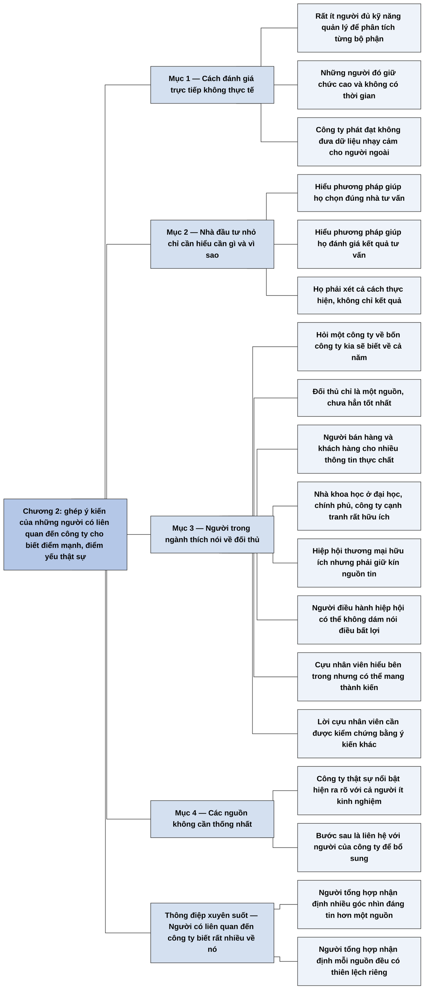

# Phần I, Chương 2 — Sức mạnh của phương pháp "lời đồn đại" (What "Scuttlebutt" Can Do)

## Ý chính

**Fisher khẳng định nhà đầu tư có thể biết được điểm mạnh, điểm yếu thật sự của một công ty mà không cần số liệu nội bộ, bằng cách ghép lại ý kiến của những người có liên quan đến công ty đó.** Đây là phương pháp "lời đồn đại".

Cách nghe hợp lý nhất là tìm các nhà quản lý cấp cao đi kiểm tra từng bộ phận của công ty, nhưng cách này không thực tế: rất ít người đủ năng lực, họ không có thời gian, và công ty tốt không đưa dữ liệu nhạy cảm cho người ngoài.

Phương pháp "lời đồn đại" dựa vào một thói quen phổ biến: người ta thích nói về công việc của mình và về đối thủ. Hỏi một công ty về bốn công ty cùng ngành, bạn sẽ biết nhiều điều đúng về cả năm.

Nguồn tin gồm đối thủ cạnh tranh, người bán hàng cho công ty, khách hàng, các nhà khoa học nghiên cứu và người điều hành hiệp hội thương mại. Cựu nhân viên cũng hữu ích nhưng cần kiểm chứng vì họ có thể mang thành kiến.

Nhà đầu tư nhỏ không tự làm được hết việc này. Họ chỉ cần hiểu cần gì và vì sao cần, để chọn được người tư vấn tốt và đánh giá được kết quả của người đó. Các nguồn tin không cần thống nhất với nhau: với công ty thật sự nổi bật, bức tranh đủ rõ ngay cả với người ít kinh nghiệm. Sau đó mới đến bước liên hệ với người của công ty để lấp phần còn thiếu.

## Sơ đồ

### Phần mở đầu chương (không có tiêu đề mục) — cách đánh giá lý tưởng không làm được (trang 45)

```text
       Chương này phác họa kiểu đầu tư đáng mơ ước và cách tìm công ty
       có thể tăng giá mạnh
                                │
                                ▼
       Cách nghe hợp lý: nhờ các nhà quản lý cao cấp đánh giá nhân sự, sản
       xuất, bán hàng, nghiên cứu của công ty
                                │
                                ▼
       Cách này không thực tế vì:
       · rất ít người có đủ kỹ năng quản lý để phân tích như vậy
       · những người đó giữ chức cao, không có thời gian
       · công ty phát đạt khó đưa dữ liệu quan trọng cho người ngoài
```

### Phần tự gom (trang 45–46) — phương pháp thay thế và vai trò của nhà đầu tư nhỏ

```text
       Phương pháp thay thế: "lời đồn đại". Làm đúng thì nhà đầu tư có đủ
       cơ sở để quyết định chính xác
                                │
                                ▼
       Nhà đầu tư vừa và nhỏ phản ứng: tôi không có cơ hội dùng cách này
                                │
                                ▼
       Fisher đáp: họ chỉ cần hiểu cần gì và vì sao cần
               ┌────────────────┴────────────────┐
               ▼                                 ▼
       Họ chọn được kiểu nhà tư vấn      Họ đánh giá được kết quả tư vấn,
       chuyên nghiệp phù hợp             xét cả cách thực hiện chứ không
                                         chỉ xét kết quả
```

### Phần tự gom (trang 46–48) — các nguồn tin của phương pháp

```text
       Người ta thích nói về việc mình làm và về đối thủ, nhất là khi tin
       rằng lời mình vô hại
       · ví dụ: hỏi một công ty về bốn công ty còn lại trong ngành, bạn thu
         được thông tin chi tiết về cả năm công ty
                                │
                                ▼
       ĐỐI THỦ CẠNH TRANH: một nguồn tin, chưa hẳn là nguồn tốt nhất
                                │
                                ▼
       NGƯỜI BÁN HÀNG CHO CÔNG TY VÀ KHÁCH HÀNG: cho nhiều thông tin thực chất
                                │
                                ▼
       NHÀ KHOA HỌC NGHIÊN CỨU ở đại học, chính phủ, công ty cạnh tranh; và
       người điều hành HIỆP HỘI THƯƠNG MẠI
       · nhà đầu tư phải giữ kín nguồn tin
       · người cung cấp tin dễ vướng rắc rối nên có thể không dám nói điều bất lợi
                                │
                                ▼
       CỰU NHÂN VIÊN: nhìn từ bên trong, nói thoải mái, nhưng có thể mang
       thành kiến nếu thấy mình bị sa thải oan hoặc bỏ việc vì bất mãn
       · nhà đầu tư cần kiểm chứng bằng ý kiến khác
```

### Phần tự gom (trang 48) — thông tin không cần thống nhất và bước tiếp theo

```text
       Các nguồn tin không nhất thiết phải thống nhất, và điều đó không cần thiết
                                │
                                ▼
       Với công ty thật sự nổi bật, sự vượt trội rõ đến mức nhà đầu tư ít
       kinh nghiệm cũng nhận ra
                                │
                                ▼
       Bước tiếp theo: nhà đầu tư liên hệ với người của công ty để bổ sung
       phần còn thiếu trong bức tranh
```

## Ba câu hỏi chương này trả lời

1. **Vì sao không thể đánh giá công ty theo cách trực tiếp nhất?** Vì rất ít người đủ kỹ năng quản lý để phân tích từng bộ phận, những người đó bận và được trả lương cao, và công ty phát đạt không cung cấp dữ liệu có giá trị cạnh tranh cho người ngoài không có trách nhiệm gì với công ty.
2. **Lấy thông tin ở đâu thay thế?** Từ đối thủ cạnh tranh, người bán hàng cho công ty, khách hàng, các nhà khoa học nghiên cứu, người điều hành hiệp hội thương mại và cựu nhân viên. Ví dụ của Fisher: khảo sát năm công ty trong một ngành, hỏi một công ty những câu thông minh về bốn công ty kia, sẽ biết chi tiết về cả năm.
3. **Nhà đầu tư nhỏ không làm được thì sao?** Họ chỉ cần hiểu cần gì và vì sao cần. Hiểu như vậy họ chọn được nhà tư vấn phù hợp và đánh giá được kết quả, xét cả cách thực hiện. Khi các nguồn mâu thuẫn, họ không cần lo: với công ty thật sự nổi bật, bức tranh vẫn đủ rõ.

## Khái niệm cần biết

- **Phương pháp "lời đồn đại" (scuttlebutt):** tìm hiểu một công ty bằng cách hỏi những người có liên quan tới nó bên ngoài ban lãnh đạo. Ví dụ là hỏi đối thủ về điểm mạnh của công ty đang xét. Phương pháp này quan trọng vì nó cho biết điều báo cáo tài chính không cho biết, như chất lượng bán hàng và nghiên cứu.
- **Hiệp hội thương mại (trade association):** tổ chức tập hợp các công ty cùng ngành. Người điều hành hiệp hội biết nhiều công ty nhưng phải thận trọng khi nói về từng thành viên.
- **Nhà tư vấn chuyên nghiệp:** người được trả tiền để khuyên nhà đầu tư. Nhà đầu tư nhỏ cần hiểu phương pháp để biết người tư vấn có làm đúng không.
- **Cựu nhân viên:** người từng làm cho công ty. Họ có cái nhìn từ bên trong nhưng có thể thiên lệch.
- **Thành kiến của nguồn tin:** xu hướng nói nghiêng về một phía vì lợi ích hoặc cảm xúc của mình. Fisher chỉ cảnh báo điều này ở cựu nhân viên, những người có thể bất mãn; việc đối thủ cũng có thể nói xấu là nhận định của người tổng hợp. Vì vậy cần nhiều nguồn để đối chiếu.

## Nội dung chi tiết

### 1. Cách đánh giá lý tưởng nhưng không thực tế (trang 45)

Fisher mở chương bằng câu hỏi nhà đầu tư tìm đúng cổ phiếu của công ty có thể tăng giá mạnh bằng cách nào. Cách nghĩ ngay tới là tìm các nhà quản lý cao cấp ở nhiều lĩnh vực, để họ điều tra chi tiết nhân sự, sản xuất, bán hàng, nghiên cứu và các chức năng chính khác, rồi kết luận công ty có tiềm năng nổi trội không.

Cách này nghe đơn giản nhưng không hợp với nhà đầu tư vừa và nhỏ. Rất ít người có kỹ năng quản lý cần thiết. Hầu hết họ giữ chức cao, được trả lương tương xứng nên không có thời gian. Ngay cả khi họ đồng ý, công ty làm ăn phát đạt cũng khó đưa cho người ngoài mọi dữ liệu cần thiết. Một số thông tin có giá trị quá lớn hoặc mang lại lợi thế cạnh tranh quá cao để đưa cho người không có trách nhiệm gì với công ty.

### 2. Phương pháp "lời đồn đại" và nhà đầu tư vừa và nhỏ (trang 45–46)

Fisher đưa ra cách thứ hai, phương pháp "lời đồn đại". Làm đúng thì nó cho nhà đầu tư cơ sở cần thiết để quyết định chính xác.

Ông đoán trước phản ứng của nhà đầu tư vừa và nhỏ: phương pháp có thể tốt với người khác, nhưng họ không có nhiều cơ hội áp dụng. Ông thừa nhận phần lớn nhà đầu tư không có điều kiện làm nhiều việc cần thiết. Tuy vậy, ông cho rằng họ chỉ cần hiểu sơ qua cần cái gì và tại sao cần.

Chỉ khi hiểu như vậy họ mới chọn được kiểu nhà tư vấn chuyên nghiệp hỗ trợ tốt nhất, và mới đánh giá chính xác kết quả tư vấn. Khi họ biết xét cả cách thức thực hiện chứ không chỉ kết quả, họ sẽ ngạc nhiên vì hết lần này đến lần khác nhà tư vấn giúp họ giàu lên và thu được nhiều lợi nhuận hơn.

### 3. Các nguồn tin (trang 46–48)

Những gì giới kinh doanh nói với nhau là một nguồn tin đặc biệt. Bức tranh về điểm mạnh, điểm yếu của từng công ty, rút ra từ các ý kiến của những người liên quan, chân thực tới mức đáng ngạc nhiên. Lý do nằm ở tâm lý: người ta thích nói về việc mình làm và thoải mái nói về đối thủ, nhất là khi tin rằng lời mình vô hại.

Fisher nêu một phép thử: khảo sát năm công ty trong một ngành, hỏi một công ty những câu thông minh về điểm mạnh, điểm yếu của bốn công ty còn lại, và bạn thu được thông tin chi tiết, xác thực về cả năm.

**Đối thủ cạnh tranh** chỉ là một nguồn, chưa hẳn là tốt nhất.

**Người bán hàng cho công ty và khách hàng của công ty** cũng cho lượng thông tin thực chất đáng ngạc nhiên.

**Các nhà khoa học nghiên cứu** ở đại học, trong chính phủ, trong công ty cạnh tranh, cùng **hiệp hội thương mại**, là những nguồn rất hữu ích.

**Với người điều hành hiệp hội thương mại và các tổ chức khác**, nhà đầu tư cần hiểu hai điều. Một là nguồn tin của anh ta không bao giờ được tiết lộ. Hai là người cung cấp tin dễ vướng vào rắc rối, nên có thể không dám đưa thông tin bất lợi.

**Cựu nhân viên** là nhóm có thể gây hại nhiều hơn lợi nếu nhà đầu tư không biết đánh giá và không kiểm chứng. Họ có cái nhìn từ bên trong về điểm mạnh, điểm yếu của công ty và nói rất thoải mái. Nhưng một số người, dù đúng hay sai, cảm thấy mình bị sa thải vô lý hoặc đã bỏ việc vì bất mãn, nên cái nhìn có thể mang thành kiến. Nhà đầu tư cần xem xét cẩn thận những gì họ nói.

### 4. Khi các nguồn tin không thống nhất (trang 48)

Ngay cả khi đã tập hợp đủ nguồn tin, chúng không nhất thiết thống nhất với nhau, và điều đó không cần thiết. Với công ty thật sự nổi bật, thông tin về sự vượt trội rõ ràng tới mức một nhà đầu tư không giàu kinh nghiệm cũng biết công ty nào hợp với mục tiêu của mình. Bước tiếp theo là liên hệ với người của công ty để bổ sung những phần còn thiếu trong bức tranh tổng thể.

**Ví dụ hôm nay (minh hoạ tự nghĩ, không phải của sách):** một nhà đầu tư xem xét một hãng sơn niêm yết. Anh hỏi ba đại lý vật liệu xây dựng xem loại sơn nào bán chạy và nhà thầu thích loại nào, hỏi một nhân viên bán hàng của hãng đối thủ xem họ ngại hãng này ở điểm gì, và hỏi một nhân viên cũ về văn hóa công ty. Nếu ba đại lý và đối thủ cùng nói hãng này được ưa chuộng thì ý kiến tiêu cực của một nhân viên cũ không đủ để đổi kết luận.

## Luận điểm cốt lõi

1. Thiếu dữ liệu nội bộ không ngăn nhà đầu tư hiểu công ty, vì người xung quanh công ty biết rất nhiều và sẵn lòng nói.
2. Ghép nhiều nguồn có góc nhìn khác nhau cho bức tranh đáng tin hơn một nguồn đơn lẻ (nhận định của người tổng hợp, suy từ việc Fisher yêu cầu kiểm chứng lời cựu nhân viên).
3. Mỗi nguồn có thiên lệch riêng, nên phải biết nguồn đó có lợi ích gì khi nói (nhận định của người tổng hợp; Fisher chỉ cảnh báo thành kiến ở cựu nhân viên).
4. Nhà đầu tư nhỏ không cần tự làm hết, nhưng phải hiểu đủ để chọn và đánh giá nhà tư vấn.
5. Công ty thật sự nổi bật được nhận ra dù các nguồn không hoàn toàn thống nhất.

## Thuật ngữ

| Tiếng Anh | Tiếng Việt (bản dịch) |
|---|---|
| Scuttlebutt | Phương pháp "lời đồn đại" |
| Business grapevine | "Tin vịt" trong kinh doanh (xem mục Lưu ý cuối chương) |
| Competitor | Đối thủ cạnh tranh |
| Vendor, customer | Người bán hàng, khách hàng |
| Research scientist | Nhà khoa học nghiên cứu |
| Trade association | Hiệp hội thương mại |
| Former employee | Cựu nhân viên, nhân viên cũ |
| Investment adviser | Nhà tư vấn chuyên nghiệp |

## Câu nói đáng nhớ

> "Thử khảo sát năm công ty trong một ngành nào đó, hỏi một công ty các câu hỏi thông minh về những điểm mạnh và điểm yếu của bốn công ty còn lại" — trang 46

> "Tuy nhiên, ý kiến của các đối thủ cạnh tranh chỉ là một nguồn cung cấp thông tin chứ chưa hẳn là nguồn tốt nhất." — trang 47

## Đánh giá và phát hiện đáng chú ý

### Chương ngắn nhưng làm thay đổi cách nghĩ về thông tin đầu tư

Fisher đặt trọng tâm vào sự hiểu biết về doanh nghiệp thu từ con người, không từ báo cáo. Theo hiểu biết của người tổng hợp, không tra cứu, cách làm này đối lập với phương pháp định lượng của Benjamin Graham, vốn dựa vào số liệu công bố và ít khi tiếp xúc ban lãnh đạo. Thuật ngữ scuttlebutt trở thành cách gọi quen thuộc trong giới đầu tư.

### Lập luận có một khoảng trống: cơ chế lọc tin giả rất mỏng

Chương nói người ta thích kể về đối thủ, nhưng không bàn việc đối thủ có động cơ nói xấu, chỉ cảnh báo thành kiến ở cựu nhân viên. Câu "bạn sẽ thu được... xác thực" là khẳng định từ kinh nghiệm, không kèm phương pháp kiểm tra. Ngoại lệ duy nhất được nêu là khi nguồn tin không dám nói điều bất lợi, nhưng điều này lại có nghĩa lời khen từ những nguồn đó ít có giá trị.

### Lời an ủi nhà đầu tư nhỏ không hoàn toàn thỏa đáng

Fisher nói nhà đầu tư nhỏ chỉ cần hiểu để chọn nhà tư vấn. Nhưng chính [Lời tựa](00-gioi-thieu-va-loi-tua.md) cho thấy Kenneth thử tự làm và thất bại với Pacific Lumber. Nhà tư vấn làm đúng phương pháp cũng không dễ tìm. Vấn đề chọn người tư vấn được dời sang [Chương 4](P1-C04-nen-mua-gi-ap-dung-vi-nhu-cau-cua-ban.md).

### Điều kiện "không cần thống nhất" chỉ đúng với công ty xuất sắc

Fisher chỉ nói trường hợp công ty thật sự nổi bật. Với công ty ở mức trung bình, các nguồn mâu thuẫn sẽ không tự giải quyết. Theo nhận định của người tổng hợp, cách hợp lý là coi tín hiệu lẫn lộn như một lý do để bỏ qua công ty; [Chương 10](P1-C10-tim-ra-co-phieu-tang-truong-nhu-the-nao.md) cũng khuyên gạt vấn đề sang một bên khi không tiếp cận được đủ nguồn.

### Điều đã đổi từ thời viết sách (theo hiểu biết của người tổng hợp, không tra cứu)

Internet làm phương pháp này dễ hơn và cũng nguy hiểm hơn. Đánh giá của người dùng, trang tuyển dụng, diễn đàn ngành, dữ liệu tải ứng dụng là những nguồn mới. Nhưng các nguồn này dễ bị thao túng. Quy định về thông tin nội bộ cũng chặt hơn, nên nhà đầu tư không được khai thác thông tin trọng yếu chưa công bố từ người có nghĩa vụ giữ bí mật.

### Cách vận dụng cho nhà đầu tư cá nhân

- Viết sẵn vài câu hỏi cho từng nhóm: khách hàng, đại lý, nhà cung cấp, đối thủ.
- Với mỗi lời nhận xét, ghi người nói có lợi ích gì.
- Tìm ít nhất hai nhóm nguồn độc lập trước khi tin một kết luận.
- Coi lời cựu nhân viên là gợi ý để kiểm tra tiếp, không phải kết luận.

## Bản đồ tư duy

Toàn cảnh Chương 2: bốn nhánh theo mục 1–4 của Nội dung chi tiết.



## Nguồn

Philip A. Fisher, *Cổ phiếu thường, lợi nhuận phi thường* (bản dịch Alpha Books, NXB Lao động – Xã hội), Phần I, Chương 2, trang 45–48.

## Tác giả

Philip A. Fisher, sáng lập công ty tư vấn đầu tư Fisher & Co. năm 1931, tác giả sách viết năm 1957–1958.

## Vị trí trong lập luận của cả cuốn sách

[Chương 1](P1-C01-nhung-manh-moi-tu-qua-khu.md) kết luận rằng phần thưởng lớn nhất đến từ việc tìm công ty tăng trưởng xuất sắc và giữ lâu dài. Chương này trả lời câu hỏi tiếp theo: tìm thông tin về công ty như thế nào. [Chương 3](P1-C03-nen-mua-gi-15-tieu-chi.md) cho biết nên tìm điều gì qua 15 tiêu chí, và phương pháp "lời đồn đại" là cách kiểm tra chúng. [Chương 10](P1-C10-tim-ra-co-phieu-tang-truong-nhu-the-nao.md) trình bày cách chính Fisher dùng phương pháp này.

## Lưu ý

- **Dùng từ sai sắc thái:** trang 46 viết "“Tin vịt” trong kinh doanh là một thứ hết sức đặc biệt". Trong tiếng Việt, "tin vịt" chỉ tin giả, trong khi câu đang ca ngợi một nguồn tin chân thực. Toàn sách chỉ dùng chữ này một lần. Nghĩa có thể là những gì giới kinh doanh truyền miệng với nhau; đây là nghi vấn vì không có nguyên tác. Thuật ngữ tiếng Anh ở bảng trên là theo hiểu biết của người tổng hợp.
- **"Người bán hàng" (trang 47):** có thể nghĩa là nhà cung cấp cho công ty, vì Lời tựa và Chương 10 đều nêu nhà cung cấp như một nguồn chính, còn chương này không nhắc nhà cung cấp. Đây là nghi vấn; phần trên viết "người bán hàng cho công ty" theo cách hiểu này.
- **Đoạn về hiệp hội thương mại (trang 47) rời rạc:** câu nói có "hai điều" nhưng chỉ có "Thứ nhất" và "Mặt khác". Câu "nhà đầu tư phải thích nghi với điều đó" và câu về "mức độ nguy hiểm của việc dễ dàng vướng vào rắc rối" không rõ nghĩa. Phần Nội dung chi tiết giữ cách hiểu gần chữ bản dịch nhất.
- **Danh sách trang 47 không nhất quán:** câu đầu đưa hiệp hội thương mại vào cùng nhóm nhà khoa học, nhưng chữ đúng có thể là hai nhóm tách rời (nhà khoa học; và người điều hành hiệp hội). Đây là nghi vấn.
- **"Liên lạc với nhân viên công ty" (trang 48):** Chương 10 nói bước này là tiếp cận ban quản trị, nên "nhân viên" ở đây có thể là người điều hành công ty. Đây là nghi vấn. Phần trên viết "người của công ty".
- **Câu trang 46 "hết lần này đến lần khác các chuyên gia tư vấn giúp họ giàu lên":** câu lủng củng; nghĩa có thể là nhà đầu tư thu được lợi nhuận lớn gấp nhiều lần. Phần trên giữ chữ bản dịch; đây là nghi vấn.
- **"Hỏi một công ty" (trang 46):** hỏi một công ty mà biết về cả năm thì khó khớp; nghĩa hợp lý là hỏi từng công ty về bốn công ty còn lại. Đây là nghi vấn; phần trên giữ chữ bản dịch.
- **"Thật sự nổi tiếng" (trang 48):** câu đang nói về sự vượt trội, nên phần trên viết "thật sự nổi bật"; đây là nghi vấn.
- **Chính tả:** "mới thể" (trang 46, thiếu chữ "có").
- Không có bảng hay hình. Các số trong chương chỉ có ví dụ năm công ty, bốn công ty; không có phép tính.
- Lời tựa nói chương này dài ba trang; trong bản này là trang 45–48.
