# Phần I, Chương 3 — Nên mua gì? (1) 15 tiêu chí chọn cổ phiếu thường (What to Buy: The Fifteen Points to Look for in a Common Stock)

## Ý chính

**Fisher đưa ra 15 câu hỏi để chọn công ty đáng giữ lâu dài, và phần lớn các câu hỏi đó nhắm vào chất lượng của đội ngũ quản lý và tương lai của công ty, không nhắm vào các con số quá khứ hay giá rẻ của cổ phiếu.** Một công ty không đạt hoàn toàn vài tiêu chí vẫn có thể là khoản đầu tư tốt, nhưng công ty hỏng nhiều tiêu chí thì không đáng mua.

Tiêu chí 1 đến 3 hỏi về tăng trưởng doanh thu. Công ty phải có thị trường đủ lớn để doanh thu tăng trong nhiều năm, đội ngũ quản lý phải quyết tâm tạo sản phẩm mới khi sản phẩm hiện tại hết đà, và bộ phận nghiên cứu phải làm việc hiệu quả. Hiệu quả nghiên cứu không đọc được từ ngân sách: giữa những công ty được quản lý tốt nhất, lợi nhuận thu về trên mỗi đô-la nghiên cứu vẫn chênh nhau tới 2 lần.

Tiêu chí 4 đến 6 hỏi doanh thu có biến thành lợi nhuận không. Công ty cần đội ngũ bán hàng được đào tạo kỹ. Biên lợi nhuận phải cao, và phải được giữ bằng cách cắt giảm chi phí một cách có kế hoạch, vì tăng giá bán chỉ giúp tạm thời.

Tiêu chí 7 đến 10 hỏi về con người và công cụ quản trị: quan hệ với người lao động, sự gắn kết trong cấp điều hành, chiều sâu quản lý thông qua ủy quyền, và khả năng phân tích chi phí của từng sản phẩm. Theo Fisher, ngưỡng doanh thu năm khoảng 15 đến 40 triệu đô-la là lúc công ty không thể lớn tiếp nếu thiếu những nhà điều hành giỏi.

Tiêu chí 11 đến 13 xét ba điều riêng: các khía cạnh đặc thù của từng ngành (thuê bất động sản, bảo hiểm, bằng sáng chế), việc công ty hy sinh lợi nhuận trước mắt vì lâu dài, và mức độ pha loãng khi phát hành thêm cổ phiếu. Fisher xếp tài chính thành một tiêu chí duy nhất vì công ty đạt 14 tiêu chí kia thường huy động được vốn dễ dàng.

Tiêu chí 14 và 15 là hai phép thử về tư cách. Đội ngũ quản lý im lặng khi công ty gặp khó khăn hoặc thiếu liêm khiết thì nhà đầu tư phải loại công ty đó, dù các tiêu chí khác xếp hạng cao đến đâu.

Công cụ xuyên suốt là phương pháp "lời đồn đại": hỏi đối thủ cạnh tranh, khách hàng, nhà nghiên cứu, rồi mới hỏi chính công ty. Fisher dùng phương pháp này cho những việc mà con số không đo được như tổ chức nghiên cứu, năng lực bán hàng và tính liêm khiết.

## Sơ đồ

### Phần mở đầu chương — 15 tiêu chí được dùng như thế nào (trang 49)

```text
       Fisher tổng kết 15 tiêu chí mà nhà đầu tư cần lưu ý
                                │
                                ▼
       Công ty không đạt hoàn toàn MỘT SỐ RẤT ÍT tiêu chí vẫn có thể là
       khoản đầu tư hiệu quả.
       Công ty không thỏa mãn NHIỀU tiêu chí thì không đáng đầu tư.
                                │
               ┌────────────────┴────────────────┐
               ▼                                 ▼
       Xét theo nội dung                 Xét theo nguồn thông tin
       · một số tiêu chí nói về          · một số tiêu chí phải kiểm chứng
         chính sách của công ty            rộng rãi bằng nguồn bên ngoài
       · một số tiêu chí nói về          · một số tiêu chí có thể hỏi trực
         cách thực thi chính sách          tiếp nhân viên của công ty
```

### Mục "Tiêu chí 1. Liệu công ty có những sản phẩm và dịch vụ có đủ tiềm năng thị trường đủ lớn để tăng doanh thu ít nhất trong vài năm tới không?" — ba kiểu lợi nhuận và hai nhóm công ty tăng trưởng (trang 49–56)

```text
       Ba kiểu cơ hội, từ nhỏ tới lớn
                                │
       ┌────────────────────────┼────────────────────────┐
       ▼                        ▼                        ▼
   KIỂM SOÁT CHI PHÍ       ĐỔI ĐIỀU KIỆN MỘT LẦN    TĂNG TRƯỞNG NHIỀU
   Doanh thu đứng yên       Doanh thu tăng mạnh       THẬP KỶ
   nhưng lợi nhuận tăng     vài năm rồi dừng.         Đây là đích của nhà
   nhờ cắt chi phí.         Hãng radio khi tivi       đầu tư muốn lợi
   Nhà đầu cơ và người      lan rộng: năm 1957 có     nhuận tối đa.
   săn cổ phiếu giá rẻ      90% hộ dùng điện ở Mỹ
   ưa cách này, lợi nhuận   có tivi, doanh thu ổn
   chỉ có một lần.          định trở lại.
                                                         │
                                                         ▼
       Tăng trưởng được đánh giá theo chu kỳ vài năm, không theo từng năm,
       vì sản phẩm mới và chu kỳ kinh doanh làm doanh thu tăng theo đợt.
                                │
                                ▼
       Công ty tăng trưởng qua nhiều thập kỷ chia thành hai nhóm
                                │
               ┌────────────────┴────────────────┐
               ▼                                 ▼
       "MAY MẮN VÀ CÓ NĂNG LỰC"          "MAY MẮN NHỜ HỌ CÓ NĂNG LỰC"
       Alcoa ở đúng ngành thuận          Năng lực tạo ra sản phẩm mới.
       lợi, thị trường nhôm lớn          · Du Pont đi từ thuốc nổ tới nylon,
       ngoài dự đoán của người             giấy bóng kính, doanh thu trên
       sáng lập trong 70 năm.              2 tỷ đô-la mỗi năm
       Năm 1957 cổ phiếu rớt gần         · General American Transportation
       40% so với đỉnh 1956, vẫn           thoát khỏi ngành thiết bị đường
       tăng 500% so với giá trung          sắt đi xuống nhờ sự nhạy bén
       bình năm 1947.
               └────────────────┬────────────────┘
                                ▼
       Cả hai nhóm đều bắt buộc có năng lực quản lý. Thiếu năng lực đó,
       doanh thu không thể tiếp tục tăng.
                                │
                                ▼
       Motorola là ví dụ lý tưởng: từ radio và tivi mở sang máy bộ đàm hai
       chiều, thiết bị bán dẫn, máy quay đĩa âm thanh nổi, tivi giá cao bán
       cùng Drexel, máy trợ thính. Giá cổ phiếu từ 45½ lên 122 đô-la.
                                │
                                ▼
       Corning Glass Works: năm 1947 giá khoảng 20 đô-la, ngành tivi thiếu
       bóng thủy tinh đèn hình. Sau chia tách 2½ và mười năm, giá hơn 100
       đô-la, tức một cổ phiếu cũ đáng hơn 250 đô-la, gấp hơn 12,5 lần.
```

### Mục "Tiêu chí 2. Bộ máy quản lý của công ty có quyết tâm tiếp tục phát triển các dòng sản phẩm hay những quy trình sản xuất, nhằm gia tăng hơn nữa tổng doanh thu trong khi tiềm năng tăng trưởng của các dòng sản phẩm hấp dẫn hiện tại đã bị khai thác quá nhiều?" — thái độ của đội ngũ quản lý trước tăng trưởng (trang 56–58)

```text
       Công ty chỉ có nhu cầu mới cho sản phẩm hiện tại, không có kế hoạch
       phát triển tiếp, thường chỉ mang lại lợi nhuận một lần.
                                │
                                ▼
       Lợi nhuận bền vững trong 10 hoặc 25 năm cần nghiên cứu khoa học và
       phát triển kỹ thuật để cải tiến sản phẩm cũ, tạo sản phẩm mới.
                                │
                                ▼
       Nghiên cứu nên mọc từ hoạt động chính, như cây vươn nhánh từ thân.
       Cách này tốt hơn nhiều so với kinh doanh sản phẩm mới không liên quan.
                                │
                                ▼
       Tiêu chí 2 không lặp tiêu chí 1:
       · tiêu chí 1 đo tiềm năng tăng trưởng của sản phẩm
       · tiêu chí 2 đo thái độ quản lý, tức công ty có nhận ra đúng lúc rằng phải
         tạo những thị trường hoàn toàn mới hay không
       Công ty có cả hai thuận lợi mới dễ mang lại lợi nhuận tối đa.
```

### Mục "Tiêu chí 3. Những nỗ lực nghiên cứu và phát triển của công ty sẽ ảnh hưởng như thế nào đến quy mô của nó?" — ngân sách nghiên cứu không đo được hiệu quả nghiên cứu (trang 58–65)

```text
       Nhà phân tích thường lấy chi phí nghiên cứu chia doanh thu rồi so
       với đối thủ và trung bình ngành. Con số này có thể sai lệch.
                                │
       ┌────────────────┬───────┴────────┬─────────────────┐
       ▼                ▼                ▼                 ▼
   CÁCH GHI SỔ      HIỆU QUẢ         SỰ PHỐI HỢP       HỢP ĐỒNG QUỐC
   KHÁC NHAU        CHÊNH LỆCH       BA TẦNG           PHÒNG
   Công ty này      Giữa các công    1. Trong nhóm     Tiền lấy từ
   tính thiết kế    ty quản lý tốt   các nhà khoa      ngân sách liên
   vào nghiên       nhất, lợi nhuận  học đa ngành      bang, biên lợi
   cứu; công ty     trên mỗi đô-la   2. Với sản xuất   nhuận thấp hơn
   kia tính nhà     nghiên cứu vẫn   và bán hàng       hợp đồng dân sự.
   máy thí điểm     chênh 2:1.       3. Với lãnh đạo
   vào chi phí                       cấp cao hiểu
   sản xuất.                         nghiên cứu.
                                                           │
                                                           ▼
       Giá trị của ba dự án quốc phòng đối với nhà đầu tư:
       · vũ khí của chính phủ, không có lợi thế khi đấu thầu sản xuất:
         hầu như không có giá trị
       · vũ khí tương tự nhưng công nghệ sản xuất phức tạp, công ty khác khó
         làm theo: giá trị vừa phải
       · học được kỹ thuật dùng được cho sản phẩm thương mại: giá trị lớn
         (Texas Instruments tăng gần 500%, Ampex tăng 700%)
                                │
                                ▼
       Chương trình cấp tốc và việc tăng giảm dự án theo năm tốt xấu làm
       tổng chi phí tăng so với lợi nhuận. Công ty nhỏ ngành điện tử không
       sợ công ty lớn chính vì công ty lớn hay dừng dự án giữa chừng.
                                │
                                ▼
       Nghiên cứu thị trường là cầu nối giữa nghiên cứu và doanh thu. Thị
       trường chỉ đủ bù chi phí nghiên cứu thì chưa đủ tốt.
                                │
                                ▼
       Cách đánh giá: hỏi bằng phương pháp "lời đồn đại" (người trong công
       ty, đối thủ, đại học, chính phủ), và xem doanh thu cùng lợi nhuận
       thuần mà nghiên cứu đã đóng góp trong khoảng mười năm trước đó.
```

### Mục "Tiêu chí 4. Cách thức tổ chức bán hàng của công ty đã hiệu quả chưa?" — bán hàng khó đo nên bị bỏ qua (trang 65–68)

```text
       Bán hàng là hoạt động cơ bản nhất của doanh nghiệp, nhưng nhà đầu tư
       ít quan tâm vì năng lực bán hàng không tính được bằng công thức.
                                │
                                ▼
       Cách giải quyết là phương pháp "lời đồn đại": đối thủ cạnh tranh và
       khách hàng biết câu trả lời chính xác nhất.
                                │
                                ▼
       Viết ngắn hơn phần nghiên cứu không có nghĩa là bán hàng kém quan
       trọng: giống như tim, phổi, tiêu hóa, cơ thể cần tất cả.
                                │
               ┌────────────────┴────────────────┐
               ▼                                 ▼
       DOW CHEMICAL                       IBM
       Chọn nhân viên bán hàng kỹ         Nhân viên bán hàng bình thường
       như chọn nhà hóa học; mời tới      dành 1/3 thời gian ở các trường
       Midland vài chuyến; huấn luyện     đào tạo do IBM tài trợ, để theo
       trước khi gặp khách hàng.          kịp công nghệ thay đổi nhanh.
               └────────────────┬────────────────┘
                                ▼
       Sản xuất hoặc nghiên cứu giỏi có thể tạo lợi nhuận một lần. Tăng
       trưởng bền vững cần đội ngũ bán hàng được đào tạo và tổ chức tốt.
```

### Mục "Tiêu chí 5. Biên lợi nhuận của công ty có cao không?" — doanh thu chỉ có giá trị khi tạo ra lợi nhuận (trang 68–70)

```text
       Doanh thu tăng không có nghĩa là lợi nhuận tăng tương ứng. Bước đầu
       tiên là xem biên lợi nhuận qua nhiều năm, không chỉ một năm.
                                │
                                ▼
       Năm thịnh vượng, công ty biên thấp tăng thu nhập theo phần trăm mạnh
       hơn công ty mạnh, nhưng phần thu nhập đó dễ mất khi kinh doanh đi
       xuống.
                                │
                                ▼
       Kết luận: công ty biên lợi nhuận thấp không cho lợi nhuận cao nhất
       trong dài hạn. Ở các công ty lớn lâu năm, lợi nhuận đầu tư đích thực
       đến từ công ty có biên khá rộng, thường là cao nhất ngành.
                                │
               ┌────────────────┴────────────────┐
               ▼                                 ▼
       NGOẠI LỆ 1                         NGOẠI LỆ 2
       Có dấu hiệu chắc chắn về thay      Công ty mới, hoặc đôi khi công ty
       đổi cốt lõi bên trong: hoạt        lâu năm, cố ý dùng lợi nhuận để
       động hiệu quả hơn hoặc sản         nghiên cứu và khuyến mại cho
       phẩm mới, không phải chỉ do        tương lai, nên biên tạm thời thấp
       kinh doanh tăng tạm thời.          hoặc bằng không.
               └────────────────┬────────────────┘
                                ▼
       Ngoài hai ngoại lệ đó, nhà đầu tư muốn lợi nhuận dài hạn cao nhất nên
       tránh công ty biên lợi nhuận thấp hoặc bằng không.
```

### Mục "Tiêu chí 6. Công ty đang làm gì để duy trì hoặc cải thiện biên lợi nhuận?" — biên lợi nhuận tương lai mới quan trọng (trang 70–72)

```text
       Kết quả đầu tư phụ thuộc vào điều xảy ra sau khi mua, nên biên lợi
       nhuận tương lai mới quan trọng.
                                │
                                ▼
       Mối đe dọa thường trực: tiền lương tăng, nguyên liệu tăng theo, thuế
       địa phương và thuế bất động sản tăng đều.
                                │
               ┌────────────────┴────────────────┐
               ▼                                 ▼
       TĂNG GIÁ BÁN (tạm thời)            GIẢM CHI PHÍ (lâu dài)
       Dễ làm khi nhu cầu cao, nhưng      · phòng cải thiện vốn, phòng thiết
       khả năng sản xuất cạnh tranh         kế sản phẩm chuyên tạo thiết bị
       mới sẽ xuất hiện.                    giảm chi phí
       · nhôm mùa thu 1956: thiếu hàng    · rà soát quy trình, nhất là kế
         đổi thành cạnh tranh bán gay       toán và xử lý sổ sách
         gắt trong vài tuần               · vận tải: công-ten-nơ mới, phương
       · đồng cuối 1956: giá cao làm        pháp mới, đặt thêm chi nhánh
         giảm cầu, hút nguồn cung mới       để tránh khoản không cần thiết
       Biên gộp cả ngành tăng do          Không làm nhanh được: cần nghiên
       tăng giá liên tục là dấu hiệu      cứu chặt chẽ và kế hoạch cho
       xấu với nhà đầu tư dài hạn.        tương lai.
               └────────────────┬────────────────┘
                                ▼
       "Lời đồn đại" giúp một phần, nhân sự công ty chỉ dẫn tốt hơn. Lãnh
       đạo hàng đầu thường thảo luận khá chi tiết về chủ đề này.
```

### Mục "Tiêu chí 7. Mối quan hệ giữa bộ máy lãnh đạo và người lao động trong công ty có tốt không?" — quan hệ lao động tạo chênh lệch lợi nhuận (trang 73–76)

```text
       Chênh lệch khả năng sinh lợi lớn hơn chi phí trực tiếp của đình công:
       · công nhân được đãi ngộ tốt làm năng suất tăng thuận lợi
       · người lao động trung thành làm giảm chi phí đào tạo người mới
                                │
                                ▼
       Không có tiêu chuẩn chung, phải xem nhiều yếu tố rồi rút ra cái nhìn
       tổng thể.
                                │
                                ▼
       Công đoàn và đình công phải đọc thận trọng:
       · công ty chưa có công đoàn lớn thường có chính sách nhân sự thành công
       · có công đoàn không có nghĩa là quan hệ xấu
       · đình công liên tục, kéo dài là chỉ báo xấu rõ ràng
       · không đình công chưa chắc tốt, có khi giống một ông chồng bị bắt nạt
                                │
                                ▼
       Con số và dấu hiệu cần xem:
       · tốc độ thay thế lao động so với công ty cùng lĩnh vực
       · danh sách ứng viên chờ vào làm, dài khác thường là tốt
       · công ty giải quyết nhanh lời phàn nàn
       · tiền công: công ty thu nhập trên trung bình cũng trả trên trung bình;
         công ty kiếm tiền nhờ trả công thấp sẽ gặp rắc rối nghiêm trọng
       · thái độ thật của lãnh đạo: có coi công nhân là một phần của công ty
         không, có thuê và sa thải hàng loạt theo biến động nhỏ không
```

### Mục "Tiêu chí 8. Đội ngũ lãnh đạo công ty có đoàn kết, đồng thuận cao không?" — không khí trong cấp điều hành (trang 76–77)

```text
       Quan hệ với người lao động quan trọng, không khí thẳng thắn ở cấp
       điều hành là vấn đề sống còn, vì nhóm này quyết định thành bại.
                                │
                                ▼
       Dấu hiệu của môi trường điều hành tốt:
       · niềm tin giữa các nhà điều hành và chủ tịch hội đồng quản trị
       · thăng tiến dựa trên khả năng, không dựa trên bè phái
       · không có kiểu gia đình trị
       · lương được xem xét thường xuyên, không cần đòi hỏi
       · lương phù hợp khung chuẩn của ngành và địa phương
       · việc quan trọng chỉ giao người ngoài khi trong công ty không có ai
       · bè phái không tránh khỏi, nhưng người bất hợp tác không được dung thứ
                                │
                                ▼
       Càng xa các tiêu chuẩn này, công ty càng khó thành khoản đầu tư nổi
       bật. Nhà đầu tư nắm được phần lớn mà không cần đặt quá nhiều câu hỏi
       trực tiếp cho nhà điều hành ở các cấp khác nhau.
```

### Mục "Tiêu chí 9. Công ty có thật sự có chiều sâu quản lý không?" — tăng trưởng cần nhiều hơn một người giỏi (trang 77–79)

```text
       Công ty nhỏ có thể làm nên điều phi thường dưới một người giỏi, nhưng
       năng lực con người có hạn, cần đề phòng người chủ chốt ra đi.
                                │
                                ▼
       Công ty tăng trưởng sẽ tới ngưỡng không thể lớn tiếp nếu thiếu các
       nhà điều hành giỏi, thường ở doanh thu năm 15 đến 40 triệu đô-la.
                                │
                                ▼
       Chiều sâu quản lý cần có chính sách phù hợp:
       · ỦY QUYỀN: mỗi cấp có thực quyền; không có quyền thì nhà điều hành
         như con thú khỏe bị nhốt trong cũi
       · lãnh đạo không can thiệp vào việc hằng ngày; một hai người không
         thể giải quyết mọi chi tiết khi công ty lớn
       · LẮNG NGHE ĐỀ XUẤT: cấp cao đón nhận đề xuất của nhân viên, kể cả
         kèm lời chỉ trích hoạt động quản lý hiện tại
```

### Mục "Tiêu chí 10. Công ty có kiểm soát tốt hệ thống kế toán và phân tích chi phí không?" — tiêu chí quan trọng mà nhà đầu tư khó kiểm tra (trang 79–80)

```text
       Không công ty nào thành công lâu dài nếu không biết chi phí của từng
       bước nhỏ trong mỗi hoạt động.
                                │
                                ▼
       Công ty có nhiều sản phẩm mà không biết chi phí thực của từng sản phẩm:
       · không đặt được giá để có lợi nhuận lớn nhất
       · không biết sản phẩm nào đáng đẩy mạnh doanh số
       · tệ nhất: tưởng hoạt động nào đó thành công trong khi nó gây thiệt hại
                                │
                                ▼
       Nhà đầu tư khó xác minh: "lời đồn đại" chỉ phát hiện công ty rất kém;
       đội ngũ quản lý thì luôn nói dữ liệu đầy đủ.
                                │
                                ▼
       Việc tốt nhất là thừa nhận giới hạn của mình và suy luận chung: công
       ty trên trung bình ở hầu hết lĩnh vực thường cũng trên trung bình về
       tính chi phí, miễn là cấp cao hiểu tầm quan trọng của việc này.
```

### Mục "Tiêu chí 11. Công ty có chú ý đến những khía cạnh kinh doanh khá khác biệt với tính chất của ngành những khía cạnh mang lại cho nhà đầu tư đầu mối quan trọng về mức độ nổi trội của công ty so với đối thủ cạnh tranh không?" — đầu mối riêng của từng ngành (trang 80–83)

```text
       Mỗi ngành có đầu mối riêng, quan trọng ở ngành này, không đáng kể ở
       ngành khác. "Lời đồn đại" cho bức tranh, tỷ lệ toán học để kiểm chứng.
                                │
       ┌────────────────────────┼────────────────────────┐
       ▼                        ▼                        ▼
   BẤT ĐỘNG SẢN             BẢO HIỂM                 BẰNG SÁNG CHẾ
   Ở ngành bán lẻ, chất     Ở một số ngành, chi      Công ty lớn: dựa vào
   lượng hợp đồng thuê      phí bảo hiểm tác động    bằng sáng chế để giữ
   có tầm quan trọng        tới biên lợi nhuận.      biên là dấu hiệu yếu
   hàng đầu. Kiểm chứng     Chi phí thấp thường      kém. Quy trình, bán
   bằng chi phí thuê        đi kèm kỹ năng quản      hàng, dịch vụ, sự tín
   trên mỗi đô-la doanh     lý: ít tai nạn, thiệt    nhiệm mới giữ vị thế.
   thu, tỷ lệ thất thu.     hại, lãng phí.           Công ty nhỏ: bằng sáng
                                                     chế che chắn những
                                                     năm đầu.
                                                         │
                                                         ▼
       Hãng điện tử non trẻ West Coast: công ty khổng lồ tung bản sao gần giống
       hệt nhưng còn lỗi; hãng nhỏ đưa ra bản đã sửa hết lỗi, công ty lớn phải
       rút lui. Kỹ thuật liên tục cải tiến bảo vệ công ty trẻ, bằng sáng chế
       thì không làm được điều đó.
```

### Mục "Tiêu chí 12. Công ty có triển vọng lợi nhuận ngắn hạn và dài hạn như thế nào?" — hy sinh lợi nhuận trước mắt (trang 84)

```text
       Có công ty tối đa hóa lợi nhuận trước mắt. Có công ty cắt bớt lợi
       nhuận trước mắt để xây dựng lòng tin và thu lợi nhuận lâu dài.
                                │
               ┌────────────────┴────────────────┐
               ▼                                 ▼
       VỚI NHÀ CUNG CẤP                   VỚI KHÁCH HÀNG
       Trả tiền trước, thậm chí trả       Chấp nhận rắc rối và phí tổn để
       vượt mức giá, để luôn có nguyên    chăm sóc khách hàng thường xuyên
       liệu và phụ kiện chất lượng cao    đang khó khăn. Lợi nhuận trước
       kể cả khi thị trường biến động.    mắt thấp hơn, dài hạn cao hơn.
               └────────────────┬────────────────┘
                                ▼
       "Lời đồn đại" phản ánh khá rõ khác biệt này. Nhà đầu tư muốn kết quả
       lớn nhất nên chọn công ty nhìn lợi nhuận dài hạn.
```

### Mục "Tiêu chí 13. Trong tương lai, nếu công ty có dự tính tăng trưởng dựa trên việc tăng vốn cổ phần bằng cách phát hành thêm cổ phiếu, thì lợi ích của các cổ đông hiện tại có giảm sút không?" — vì sao tài chính chỉ chiếm một tiêu chí (trang 84–87)

```text
       Sách đầu tư kinh điển dành nhiều trang cho tiền mặt và cơ cấu vốn.
       Fisher không làm vậy vì mục đích là mua cổ phiếu có thể sinh lợi lớn
       trong tương lai, không phải mua vì giá rẻ.
                                │
                                ▼
       Công ty đạt cao 14 tiêu chí kia vay được tới mức tối đa của ngành, và
       khi hết sức vay vẫn bán được cổ phiếu vì nhà đầu tư háo hức.
                                │
                                ▼
       Tiền mặt cộng khả năng vay có đủ khai thác cơ hội tương lai không?
                                │
               ┌────────────────┴────────────────┐
               ▼                                 ▼
       ĐỦ                                 KHÔNG ĐỦ
       Nhà đầu tư cổ phiếu thường         Phải tính kỹ: thu nhập tăng thêm
       không cần lo về tài chính.         có bù được phần pha loãng không?
                                          · tính như thể mọi chứng khoán
                                            chuyển đổi đã được chuyển đổi,
                                            mọi quyền chọn đã được dùng
                                          · giá chuyển đổi cao hơn thị trường
                                            10% đến 20% thường bị bỏ qua
               └────────────────┬────────────────┘
                                ▼
       Cấp vốn cổ phần nhiều năm mà lợi nhuận cổ đông chỉ tăng chút ít cho
       thấy quản lý tài chính yếu kém.
                                │
                                ▼
       Trình tự ưu tiên: công ty đạt 14 tiêu chí thường không cần xét kỹ tài
       chính; công ty không đạt 14 tiêu chí thì tài chính tốt cũng không cứu
       được.
```

### Mục "Tiêu chí 14. Bộ máy quản lý công ty có luôn minh bạch với các nhà đầu tư về tình hình công ty khi nó hoạt động tốt nhưng lại che giấu khi có vấn đề ?" — phép thử khi tin xấu đến (trang 87–88)

```text
       Công ty tốt nhất là công ty nghiên cứu nhiều sản phẩm mới, nên thất
       bại, trì hoãn và chi phí ngoài dự tính là điều chắc chắn xảy ra.
                                │
                                ▼
       Nhà đầu tư có khả năng suy xét coi đó là chi phí để đi tới thành công,
       và là điểm mạnh của công ty, không phải điểm yếu.
                                │
                                ▼
       Điều cần xem là đội ngũ quản lý phản ứng thế nào khi phải báo tin xấu.
                                │
                                ▼
       Im lặng chứng tỏ thiếu trách nhiệm với cổ đông, hoặc thiếu kế hoạch
       đối phó khó khăn bất ngờ. Không lý do nào biện minh cho việc không
       báo cáo kịp thời.
                                │
                                ▼
       Trong mọi hoàn cảnh, nhà đầu tư loại công ty cố che giấu tin xấu.
```

### Mục "Tiêu chí 15. Bộ máy quản lý công ty có liêm khiết không?" — tiêu chí không thể bù đắp (trang 88–89)

```text
       Đội ngũ quản lý ở gần tài sản công ty hơn cổ đông, nên có nhiều cách
       lách luật để tư lợi cho mình và gia đình.
                                │
                                ▼
       Bốn cách tư lợi:
       · tự trả tiền công vượt mức
       · bắt công ty mua hoặc thuê tài sản của chính họ với giá cao hơn thị
         trường (ở công ty nhỏ, giao dịch kiểu này đôi khi có lý do chính đáng
         là giải phóng vốn, nên khó phân biệt)
       · buộc đại lý bán hàng đi qua hãng môi giới của mình, họ hàng, bạn bè
         để lấy hoa hồng
       · lạm dụng phát hành quyền chọn, cách gây thiệt hại nhiều nhất
                                │
                                ▼
       Cách bảo vệ thật sự duy nhất là dùng phương pháp "lời đồn đại" để thu
       hẹp lựa chọn về công ty có ban quản trị đáng tin, ý thức rõ trách nhiệm
       với cổ đông.
                                │
                                ▼
       Công ty xếp hạng cao mà vẫn còn nghi ngờ về đội ngũ quản lý thì nhà
       đầu tư không nên đầu tư.
```

## Ba câu hỏi chương này trả lời

1. **Một công ty phải có những gì để đáng giữ cổ phiếu trong nhiều năm?** Công ty phải có thị trường đủ lớn để doanh thu tăng qua nhiều năm (tiêu chí 1), đội ngũ quản lý quyết tâm tạo sản phẩm mới (tiêu chí 2), tổ chức nghiên cứu hiệu quả (tiêu chí 3), đội ngũ bán hàng mạnh (tiêu chí 4), biên lợi nhuận cao và được bảo vệ bằng cách giảm chi phí (tiêu chí 5 và 6). Phía sau là con người: quan hệ lao động tốt, cấp điều hành gắn kết, chiều sâu quản lý, phân tích chi phí chính xác (tiêu chí 7 đến 10). Motorola minh họa điều này: từ hãng radio và tivi, đội ngũ quản lý mở sang bộ đàm hai chiều, thiết bị bán dẫn và máy trợ thính, và cổ phiếu tăng từ 45½ lên 122 đô-la giữa hai lần viết sách.
2. **Con số không đo được những điều đó thì nhà đầu tư tìm thông tin ở đâu?** Nhà đầu tư dùng phương pháp "lời đồn đại". Về nghiên cứu, họ hỏi người trong công ty, đối thủ, chuyên gia đại học và chính phủ, rồi xem doanh thu và lợi nhuận thuần mà nghiên cứu đã đóng góp trong khoảng mười năm trước. Về bán hàng, họ hỏi đối thủ cạnh tranh và khách hàng. Về giảm chi phí và quan hệ trong cấp điều hành, họ hỏi trực tiếp nhân sự công ty. Về lao động, họ so tốc độ thay thế lao động và độ dài danh sách ứng viên với công ty cùng ngành. Riêng kiểm soát chi phí, Fisher thừa nhận nhà đầu tư chỉ suy luận chung được.
3. **Khi nào phải loại một công ty dù các con số đẹp, và tài chính nằm ở đâu trong việc này?** Công ty phải bị loại khi đội ngũ quản lý che giấu tin xấu (tiêu chí 14) hoặc khi còn nghi ngờ về tính liêm khiết (tiêu chí 15), dù các tiêu chí khác xếp hạng cao. Tiêu chí 13 nói ngược lại về tài chính: tình trạng tiền mặt tốt không cứu được công ty không đạt 14 tiêu chí kia, còn công ty đạt 14 tiêu chí thường vay hoặc phát hành cổ phiếu được. Nhà đầu tư chỉ cần tính xem lợi nhuận tăng thêm có bù được phần pha loãng hay không, tính như thể mọi chứng khoán chuyển đổi đã được chuyển đổi.

## Khái niệm cần biết

- **Cổ phiếu thường:** phần sở hữu một công ty, cho người nắm giữ quyền hưởng phần lợi nhuận còn lại sau khi công ty đã trả các nghĩa vụ khác. Người mua kiếm lời khi công ty lớn lên và giá cổ phiếu tăng. Ví dụ: người mua cổ phiếu Corning Glass Works khoảng 20 đô-la năm 1947 trở thành người sở hữu một phần công ty đó. Khái niệm này quan trọng vì toàn bộ chương hỏi một câu duy nhất: công ty nào đáng để sở hữu lâu dài.
- **Doanh thu, lợi nhuận và lợi nhuận thuần:** doanh thu là tổng tiền bán hàng; lợi nhuận là phần còn lại sau khi trừ chi phí; lợi nhuận thuần là phần còn lại cuối cùng sau mọi chi phí và thuế. Ví dụ minh họa của người tổng hợp: bán được 100 đô-la, tốn 90 đô-la, lợi nhuận là 10 đô-la. Fisher tách hai khái niệm này vì doanh thu tăng không bảo đảm lợi nhuận tăng.
- **Biên lợi nhuận (profit margin):** phần lợi nhuận trên mỗi đồng doanh thu. Trong sách, đây là lợi nhuận hoạt động chia cho doanh thu. Ví dụ minh họa của người tổng hợp: lợi nhuận 10 đô-la trên doanh thu 100 đô-la cho biên 10%. Biên càng cao thì công ty càng chịu được chi phí tăng và giá giảm, nên đây là nội dung của tiêu chí 5 và 6.
- **Lợi nhuận một lần:** khoản lời có được từ một sự kiện không lặp lại. Ví dụ: công ty kiểm soát tốt chi phí nên lợi nhuận tăng một đợt, hoặc hãng radio bán chạy khi tivi lan rộng rồi doanh thu trở lại ổn định. Fisher phân biệt khái niệm này với tăng trưởng kéo dài hàng thập kỷ, vì chỉ kiểu sau mới cho lợi nhuận tối đa.
- **Phương pháp "lời đồn đại" (scuttlebutt):** thu thập thông tin về một công ty bằng cách trò chuyện với những người hiểu nó từ bên ngoài như đối thủ, khách hàng, nhà cung cấp, nhà nghiên cứu. Ví dụ: muốn biết năng lực bán hàng của một công ty, nhà đầu tư hỏi đối thủ và khách hàng của công ty đó. Phương pháp quan trọng vì phần lớn 15 tiêu chí không đọc được từ báo cáo tài chính.
- **Nhóm "may mắn và có năng lực" và nhóm "may mắn nhờ họ có năng lực":** hai cách gọi của Fisher cho công ty tăng trưởng qua nhiều thập kỷ. Nhóm đầu ở sẵn trong ngành thuận lợi rồi tận dụng tốt, như Alcoa. Nhóm sau tự tạo thuận lợi bằng năng lực, như Du Pont đi từ thuốc nổ sang nylon. Sự phân biệt giúp người đọc thấy rằng cả hai nhóm đều cần năng lực quản lý.
- **Chu kỳ kinh doanh:** các đợt nền kinh tế đi lên rồi đi xuống. Ví dụ: một năm kinh doanh thuận lợi khác thường làm hầu hết công ty có biên lợi nhuận rộng hơn. Vì chu kỳ này, Fisher so doanh thu theo vài năm một, không theo từng năm.
- **Nghiên cứu và phát triển (research and development):** công việc tạo sản phẩm, quy trình mới và cải tiến sản phẩm cũ. Tỷ lệ thường dùng là chi phí nghiên cứu chia cho doanh thu. Fisher cảnh báo tỷ lệ này chỉ là chỉ dẫn sơ sài, vì mỗi công ty ghi sổ khác nhau và hiệu quả có thể chênh nhau 2 lần.
- **Chương trình cấp tốc:** việc rút nhân sự chủ chốt khỏi dự án đang làm để dồn vào một nhiệm vụ gấp. Ví dụ: công ty lớn tạm dừng dự án để chạy mục tiêu ngắn hạn của lãnh đạo. Fisher xem đây là cách làm tăng tổng chi phí so với lợi nhuận.
- **Nghiên cứu thị trường:** việc tìm hiểu xem sản phẩm dự định làm có đủ khách mua không, trước khi dốc vốn vào nó. Fisher gọi đây là cầu nối giữa nghiên cứu phát triển và doanh thu.
- **Nhà thầu chính, nhà thầu phụ, đấu thầu:** nhà thầu chính ký hợp đồng trực tiếp với chính phủ, nhà thầu phụ làm một phần cho nhà thầu chính, còn đấu thầu là việc nhiều công ty cạnh tranh để giành hợp đồng. Khái niệm này cần thiết để hiểu vì sao nghiên cứu quốc phòng do chính phủ trả tiền có thể gần như vô giá trị với cổ đông.
- **Tốc độ thay thế lao động (labor turnover):** tỷ lệ người lao động rời đi và phải tuyển người thay trong một thời kỳ. Tốc độ cao hơn công ty cùng ngành cho thấy chính sách nhân sự kém và làm tăng chi phí đào tạo.
- **Công đoàn:** tổ chức đại diện cho người lao động khi thương lượng với chủ. Đình công là việc người lao động ngừng làm để gây sức ép. Fisher dặn không kết luận vội từ việc có hay không có hai hiện tượng này.
- **Chiều sâu quản lý:** việc công ty có nhiều người giỏi ở nhiều cấp, nên không lệ thuộc một hai người đứng đầu. Ví dụ: tới ngưỡng doanh thu năm từ 15 đến 40 triệu đô-la, công ty thiếu đội ngũ này sẽ không lớn thêm được.
- **Ủy quyền:** cấp trên giao thực quyền cho cấp dưới tự quyết cách làm một nhiệm vụ. Đây là điều kiện để chiều sâu quản lý phát huy.
- **Phân tích chi phí:** việc xác định chi phí thực của từng công đoạn và từng sản phẩm. Ví dụ: nếu không biết sản phẩm nào lãi thật, đội ngũ quản lý có thể đẩy mạnh một mặt hàng đang làm công ty thiệt.
- **Tỷ lệ thất thu:** phần doanh thu không thu được tiền. Fisher nêu tỷ lệ này cùng chi phí thuê trên mỗi đô-la doanh thu như con số để kiểm chứng tiêu chí 11.
- **Bằng sáng chế và cấp phép:** bằng sáng chế là quyền pháp lý độc quyền với một phát minh trong một thời hạn; cấp phép là cho người khác dùng phát minh đó để lấy phí. Fisher cho thấy công ty lớn thường cấp phép thay vì độc chiếm, vì bằng sáng chế chỉ hạn chế được một phần cạnh tranh.
- **Vốn cổ phần và phát hành thêm cổ phiếu:** vốn cổ phần là tiền do chủ sở hữu góp. Phát hành thêm là bán cổ phiếu mới để lấy tiền, làm tăng số cổ phiếu đang lưu hành.
- **Sức vay:** mức nợ tối đa mà một công ty có thể mang, được đánh giá theo chuẩn của ngành. Tiêu chí 13 bắt đầu bằng câu hỏi tiền mặt cộng sức vay có đủ cho cơ hội tương lai hay không.
- **Pha loãng:** phần lợi nhuận trên mỗi cổ phiếu bị giảm vì có thêm cổ phiếu mới. Ví dụ minh họa của người tổng hợp: công ty có 100 triệu cổ phiếu, lợi nhuận 200 triệu đô-la, tức 2 đô-la mỗi cổ phiếu. Phát hành thêm 20 triệu cổ phiếu mà lợi nhuận chỉ lên 220 triệu đô-la thì còn khoảng 1,83 đô-la mỗi cổ phiếu, tức cổ đông cũ thiệt. Lợi nhuận lên 300 triệu đô-la thì được 2,5 đô-la mỗi cổ phiếu, tức cổ đông cũ có lợi.
- **Chứng khoán cao cấp có khả năng chuyển đổi và giá chuyển đổi:** chứng khoán cao cấp được trả trước cổ phiếu thường; loại có khả năng chuyển đổi cho phép người nắm giữ đổi thành cổ phiếu thường ở một mức giá định trước, gọi là giá chuyển đổi. Sách cho biết giá này thường cao hơn thị giá khoảng 10% đến 20%. Khi tính pha loãng, nhà đầu tư nên tính như thể mọi chứng khoán loại này đã được đổi hết.
- **Quyền chọn, quyền mua và giấy bảo đảm:** các giấy tờ cho người nắm giữ quyền mua cổ phiếu ở một mức giá định trước. Khi được dùng, số cổ phiếu tăng lên. Tiêu chí 13 đưa chúng vào phép tính số cổ phiếu thực sự, còn tiêu chí 15 coi việc lạm dụng phát hành quyền chọn cho người trong cuộc là cách tư lợi gây thiệt hại nhiều nhất.
- **Chia tách cổ phiếu:** một cổ phiếu được đổi thành nhiều cổ phiếu, giá mỗi cổ phiếu giảm tương ứng, giá trị người nắm giữ không đổi. Ví dụ: Corning chia tách 2½, nên người có một cổ phiếu trở thành người có 2,5 cổ phiếu. Muốn so giá trước và sau chia tách phải nhân lại số cổ phiếu.
- **Niêm yết:** việc cổ phiếu được giao dịch trên một sở giao dịch. Ví dụ: Texas Instruments bắt đầu niêm yết trên Sàn giao dịch Chứng khoán New York năm 1953.

## Nội dung chi tiết

Số thứ tự của các mục trùng với số tiêu chí; mục 0 là phần mở đầu chương.

### 0. Phần mở đầu chương (trang 49)

Fisher nói chương này tổng kết 15 tiêu chí nhà đầu tư cần lưu ý khi tham gia thị trường chứng khoán. Ông đặt quy tắc dùng ngay từ đầu. Một công ty hoàn toàn không đạt một số rất ít tiêu chí vẫn có thể là khoản đầu tư hiệu quả. Một khoản đầu tư không thỏa mãn nhiều tiêu chí thì ông không nghĩ là đáng giá.

Các tiêu chí khác nhau ở hai phương diện. Về nội dung, một số liên quan đến chính sách của công ty, số khác liên quan đến cách thực thi chính sách. Về nguồn thông tin, một số phải kiểm chứng rộng rãi bằng nguồn bên ngoài, số còn lại có thể thu thập trực tiếp từ nhân viên công ty.

### 1. Tiêu chí 1: Sản phẩm và dịch vụ có đủ tiềm năng thị trường để doanh thu tăng trong vài năm tới không (trang 49–56)

**Ba loại cơ hội.** Fisher thừa nhận có cách kiếm lợi nhuận một lần từ công ty có doanh thu không tăng, thậm chí đi xuống. Kiểm soát chi phí tốt có thể làm lợi nhuận thuần tăng đủ để đẩy thị giá cổ phiếu lên. Nhà đầu cơ và người săn cổ phiếu giá rẻ ưa cách này, nhưng nó không đủ hấp dẫn với người muốn lợi nhuận tối đa từ vốn của mình.

Loại thứ hai đôi khi cho khoản lớn hơn nhiều, dù vẫn không phải lợi nhuận tối đa. Một điều kiện thay đổi mở ra vài năm doanh thu tăng mạnh rồi ngừng. Khi tivi xuất hiện, doanh thu của nhiều hãng sản xuất radio tăng liên tục trong vài năm. Đến năm 1957, 90% hộ gia đình sử dụng điện ở Mỹ đã có tivi và đường doanh thu ổn định trở lại. Người mua sớm kiếm được lợi nhuận rất lớn, còn sau đó cổ phiếu ngành này không còn hấp dẫn như trước.

Loại thứ ba là công ty tăng trưởng trên mức bình thường trong một thời gian dài. Ngay cả công ty nổi tiếng nhất cũng không phải năm nào doanh thu cũng cao hơn năm trước. Fisher hẹn giải thích ở chương khác rằng các rắc rối của nghiên cứu thương mại và tiếp thị sản phẩm mới làm doanh thu tăng theo đợt, không đều qua từng năm. Chu kỳ kinh doanh cũng làm so sánh giữa các năm kém chính xác. Vì vậy nhà đầu tư nên đánh giá tăng trưởng theo chu kỳ vài năm một.

**Hai nhóm công ty tăng trưởng.** Fisher chia công ty tăng trưởng từ thập kỷ này sang thập kỷ khác thành nhóm "may mắn và có năng lực" và nhóm "may mắn nhờ họ có năng lực". Ông nói mình gọi vậy vì chưa tìm được cụm từ thích hợp hơn. Cả hai nhóm đều bắt buộc có năng lực quản lý: không có khả năng kinh doanh xuất sắc được duy trì liên tục, công ty không tận dụng được vận may và không đánh bại được đối thủ.

Alcoa thuộc nhóm đầu. Những người sáng lập có tầm nhìn xa và sớm thấy tầm quan trọng của sản phẩm mới, nhưng không ai lúc đó đoán được quy mô thị trường nhôm trong 70 năm tiếp theo. Sự kết hợp giữa phát triển khoa học kỹ thuật và kinh tế đã cho công ty nhiều lợi thế hơn đối thủ. Công ty vẫn phải có kỹ năng cao để khuyến khích và tận dụng xu hướng này. Nếu không có điều kiện khách quan ấy, Alcoa vẫn phát triển, chỉ chậm hơn.

Năm 1957, cổ phiếu Alcoa rớt gần 40% so với mức cao nhất của năm 1956. Ngay ở mức giá "thấp" đó, cổ phiếu vẫn tăng 500% so với giá giao dịch trung bình, không phải mức thấp nhất, của năm 1947, tức chỉ mười năm trước.

Du Pont thuộc nhóm sau. Ban đầu công ty không kinh doanh nylon, giấy bóng kính xenlôfan, licite, neoprene, vải ooclông, milar hay các sản phẩm hấp dẫn sau này. Trong nhiều năm công ty sản xuất thuốc nổ, và thời bình có mức tăng trưởng tương đương ngành khai mỏ. Những năm gần đây công ty phát triển nhanh hơn nhờ có thêm doanh thu gắn với xây dựng cầu đường. Hoạt động kinh doanh nổi bật, óc tài chính và chuyên môn xuất sắc đã đưa doanh thu lên trên 2 tỷ đô-la mỗi năm. Công ty áp dụng kỹ năng từ thời kinh doanh thuốc nổ để liên tục đưa ra sản phẩm mới.

Nhà đầu tư ít kinh nghiệm thường cho rằng các công ty hóa chất có định giá cao chỉ tình cờ sản xuất những sản phẩm tăng trưởng hấp dẫn nhất. Fisher nói họ nhầm nguyên nhân với kết quả. Lịch sử của Du Pont, Dow và Union Carbide cho thấy các công ty này tự tạo ra thuận lợi của mình.

General American Transportation là ví dụ rõ nhất của nhóm sau. Gần 50 năm trước, ngành cung cấp thiết bị đường sắt có vẻ đầy hứa hẹn, nhưng vài năm gần đây ngành này đi xuống. Công ty phát triển mạnh nhờ nhạy bén và linh hoạt trong sản phẩm chuyên chở hàng hóa, rồi tận dụng kỹ năng từ hoạt động chính để bước sang các lĩnh vực khác có khả năng tăng trưởng lớn hơn. Bài học Fisher rút ra là nhà đầu tư luôn phải xét năng lực quản lý có ở mức tốt nhất không, vì thiếu nó doanh thu không thể tiếp tục tăng.

**Đừng đánh giá đường doanh thu một cách thiển cận.** Các hãng radio và tivi vốn tăng đột phá nhờ một đợt nhu cầu. Sau đó nhiều hãng dùng chuyên môn điện tử để mở sang các mảng khác như truyền thông thiết bị, truyền thông tự động hóa và điện tử quân sự, với triển vọng ổn định dài hạn. Tại một số công ty như Motorola, các mảng này còn quan trọng hơn sản xuất tivi.

Fisher còn nêu hai cải tiến tiềm năng có thể làm các mẫu tivi đầu thập niên 1960 lỗi thời là tivi màu và tivi dạng màn hình nhờ công nghệ bán dẫn và vi mạch in. Nếu những cải tiến này thành công về thương mại, một số ít hãng ứng dụng tốt có thể có doanh thu tăng đột biến, lớn hơn và kéo dài hơn trước. Ông nói rõ đây chỉ là điều rất có khả năng xảy ra, không chắc chắn. Với công ty được quản lý tốt trong ngành chú trọng nghiên cứu, nhà đầu tư nên hiểu rằng đội ngũ quản lý có thể tạo ra đường doanh thu lý tưởng trong tương lai.

**Hai ví dụ về phần thưởng.** Motorola trở thành hãng dẫn đầu máy bộ đàm hai chiều, ban đầu dành cho xe cảnh sát và xe tắc xi, sau đó mở rộng tới công ty xe tải, đoàn xe giao hàng, ngành công cộng, dự án xây dựng lớn và đường ống. Sau vài năm phát triển tốn kém, công ty lập bộ phận thiết bị bán dẫn. Công nghệ bán dẫn trở thành nền tảng cho máy quay đĩa âm thanh nổi. Nhờ liên hệ với nhà sản xuất đồ nội thất Drexel, công ty bán được nhiều tivi giá cao. Một vụ mua lại đưa công ty vào máy trợ thính.

Fisher nói những bước đột phá lớn cho dòng sản phẩm phát thanh truyền hình ban đầu chưa xảy ra, nhưng đội ngũ quản lý không ngừng tận dụng nguồn lực và kỹ năng sẵn có để tăng trưởng. Thị trường đã đáp lại: khi ông viết xong ấn bản đầu tiên, cổ phiếu Motorola có giá 45½ đô-la, còn lúc viết đoạn này giá là 122 đô-la.

Năm 1947, một người bạn của Fisher ở phố Wall khảo sát ngành truyền hình non trẻ, nghiên cứu hơn mười nhà sản xuất linh kiện chính. Anh ta kết luận ngành sẽ cạnh tranh ngày càng gay gắt và vị trí dẫn đầu sẽ đổi chủ. Cuộc điều tra cũng cho thấy ngành thiếu nhiều bóng thủy tinh đèn hình, và Corning Glass Works là nhà sản xuất thành công nhất mặt hàng này. Nghiên cứu sâu về kỹ thuật cho thấy đây là thế mạnh của công ty, và các dòng sản phẩm khác cũng có triển vọng thuận lợi, nên phân tích đánh giá cổ phiếu này lý tưởng cho cả đầu tư cá nhân lẫn tổ chức.

| Mốc | Con số trong sách |
|---|---|
| Giá khoảng năm 1947 | khoảng 20 đô-la |
| Chia tách | 2½ cổ phiếu mới cho 1 cổ phiếu cũ |
| Giá sau mười năm | hơn 100 đô-la |
| Giá trị của 1 cổ phiếu cũ | 100 × 2,5 = hơn 250 đô-la |
| Mức tăng | 250 / 20 = hơn 12,5 lần |

Bảng trên dùng phép tính lại từ các số của sách. Con số mức tăng do bản dịch ghi khác với phép tính này, như đã nêu ở mục Lưu ý cuối chương.

### 2. Tiêu chí 2: Đội ngũ quản lý có quyết tâm phát triển sản phẩm và quy trình mới không (trang 56–58)

Công ty có triển vọng vài năm nhờ nhu cầu mới với sản phẩm hiện tại, nhưng không có kế hoạch phát triển tiếp, thường chỉ mang lại lợi nhuận một lần. Những công ty này không đưa nhà đầu tư tới lợi nhuận bền vững trong 10 hoặc 25 năm, trong khi đây là con đường chắc chắn nhất. Muốn tăng trưởng như vậy, công ty cần nghiên cứu khoa học và phát triển kỹ thuật để cải tiến sản phẩm cũ và tạo sản phẩm mới. Đội ngũ quản lý không thỏa mãn với bước tăng nhất thời sẽ hiểu tăng trưởng là một quá trình liên tục.

Nhà đầu tư thường thu lợi cao nhất từ công ty coi trọng nghiên cứu để tạo dòng sản phẩm mới có liên quan đến phạm vi hoạt động hiện có. Fisher nói điều này không đòi hỏi công ty phải có nhiều bộ phận làm những sản phẩm hoàn toàn khác nhau. Ông muốn nghiên cứu nằm ở trung tâm mỗi bộ phận, giống một cái cây vươn nhiều nhánh từ thân. Cách đó tốt hơn nhiều so với công ty kinh doanh sản phẩm không liên quan, vì những sản phẩm ấy nếu thành công cũng nằm trong ngành hoàn toàn khác.

Tiêu chí 2 có vẻ lặp tiêu chí 1 nhưng thực tế khác. Tiêu chí 1 đánh giá tiềm năng tăng trưởng doanh thu nhờ sản phẩm. Tiêu chí 2 xét thái độ quản lý: công ty có nhận ra đúng lúc rằng thị trường hiện tại sẽ tới hạn và muốn lớn tiếp phải tạo những thị trường hoàn toàn mới hay không. Công ty có cả hai thuận lợi thì có nhiều khả năng mang lại lợi nhuận tối đa.

### 3. Tiêu chí 3: Nỗ lực nghiên cứu và phát triển có hiệu quả ra sao so với quy mô công ty (trang 58–65)

**Tỷ lệ chi phí nghiên cứu trên doanh thu dễ tính nhưng dễ sai.** Nhà đầu tư lấy được chi phí nghiên cứu hằng năm và doanh thu, rồi tính phần trăm. Nhà phân tích chuyên nghiệp hay so con số này với công ty cùng lĩnh vực hoặc trung bình ngành, và với số tiền nghiên cứu trên mỗi cổ phiếu. Fisher nói số liệu này chỉ cho thấy công ty làm nhiều hay ít nghiên cứu, và có thể sai lệch nếu người đọc thiếu hiểu biết sâu.

Lý do thứ nhất là cách ghi sổ. Một công ty tính khoản thiết kế vào chi phí nghiên cứu vì nó giúp điều chỉnh sản phẩm hiện tại. Công ty khác lại tính chi phí vận hành nhà máy sản xuất thí điểm sản phẩm hoàn toàn mới vào chi phí sản xuất, dù hầu hết chuyên gia xem đó là chức năng nghiên cứu thuần túy. Nếu mọi công ty báo cáo trên cùng một cơ sở, số liệu sẽ khác với những gì đang được lưu hành.

**Hiệu quả nghiên cứu chênh lệch rất lớn.** Giữa những công ty được quản lý tốt nhất, tỷ lệ chênh lệch dường như lên tới 2:1. Một số công ty hoạt động tốt thu lãi gấp đôi trên mỗi đô-la nghiên cứu so với công ty cũng hoạt động tốt khác. Với công ty hoạt động trung bình, khoảng cách còn lớn hơn rất nhiều.

Nguyên nhân là tiến bộ không còn phụ thuộc vào một người tài. Nó đến từ nhóm các nhà khoa học nhiều chuyên môn như nhà hóa học, nhà vật lý, nhà luyện kim, nhà toán học, cùng một trưởng nhóm kết hợp công việc của họ. Vì vậy số lượng và uy tín từng chuyên gia không quan trọng bằng hiệu quả làm việc theo nhóm. Việc quản lý nhằm kết hợp các chuyên gia thành một nhóm chặt chẽ và khuyến khích mỗi người làm việc tốt nhất.

**Hai kiểu phối hợp còn lại.** Nhóm nghiên cứu phải gắn chặt với người hiểu sản xuất và bán hàng. Thiếu mối liên hệ này, sản phẩm mới sẽ không được thiết kế để sản xuất với giá rẻ nhất có thể, hoặc thất bại trong việc đạt thị phần tối đa.

Nhóm nghiên cứu cũng cần lãnh đạo cấp cao hiểu bản chất nghiên cứu thương mại. Mở rộng dự án trong năm thuận lợi và cắt mạnh trong năm khó khăn sẽ làm tổng chi phí tăng gấp bội. Chương trình cấp tốc đôi khi cần thiết nhưng thường tốn kém, vì người chủ chốt bị rút khỏi dự án đang làm để sang một nhiệm vụ không đáng để gián đoạn dự án đó. Điều cốt yếu là chọn nhiệm vụ có khả năng đem lợi nhuận cao gấp nhiều lần chi phí, rồi không để việc cân nhắc ngân quỹ hay yếu tố phát sinh thường xuyên cắt giảm hoặc thúc nhanh dự án.

Một số công ty hàng đầu lại không chú ý điều này. Lãnh đạo vài công ty điện tử nhỏ nhưng thành công nói với Fisher rằng họ không sợ cạnh tranh với những người khổng lồ trong ngành. Họ không đánh giá thấp nhà nghiên cứu của công ty lớn hay số tiền công ty lớn chi. Họ không sợ vì công ty lớn thường tạm dừng dự án để chạy chương trình cấp tốc cho mục tiêu ngắn hạn của lãnh đạo.

Fisher cũng kể rằng vài năm trước, một trường đại học công nghệ nổi tiếng khuyên sinh viên sắp tốt nghiệp không nộp đơn vào một công ty dầu khí. Công ty này thuê nhân viên trình độ cao cho những dự án khoảng năm năm, nhưng sau ba năm đã hết hứng thú và đình chỉ một dự án. Việc đó vừa lãng phí tiền của, vừa tạo ấn tượng xấu với người định xin việc.

**Nghiên cứu theo hợp đồng quốc phòng.** Các chương trình này lấy tiền từ ngân sách liên bang, và một số nhà thầu phụ cũng nghiên cứu cho nhà thầu chính. Fisher hỏi nhà đầu tư có nên xem các khoản này ngang với nghiên cứu do công ty tự trả không, và trả lời rằng không có công thức cứng nhắc, mỗi trường hợp một khác. Biên lợi nhuận hợp đồng quân sự luôn nhỏ hơn hợp đồng dân sự, vì hợp đồng vũ khí mới thường qua đấu thầu cạnh tranh. Ông dùng ba dự án giả định để minh họa:

| Dự án giả định | Điều xảy ra | Giá trị với nhà đầu tư |
|---|---|---|
| Vũ khí mới không được dùng cho mục đích dân sự, quyền sử dụng thuộc chính phủ | Công ty đã nghiên cứu không có lợi thế nào khi đấu thầu sản xuất | Hầu như không có |
| Vũ khí tương tự nhưng công nghệ sản xuất phức tạp hơn | Công ty không nghiên cứu từ đầu rất khó sản xuất, nên công ty này tiếp tục được chính phủ hỗ trợ | Vừa phải, dù lợi nhuận không cao |
| Vũ khí mà khi làm, công ty học được nguyên tắc và kỹ thuật dùng được cho sản phẩm thương mại | Công ty có kết quả nghiên cứu dân sự với chi phí thấp hoặc bằng không | Lớn |

Trường hợp thứ ba tạo ra thành công rực rỡ nhất gần đây của vài công ty. Đây là một trong những lý do chính giúp Texas Instruments tăng gần 500% trong vòng bốn năm, từ mức 5¼ đô-la khi bắt đầu niêm yết trên Sàn giao dịch Chứng khoán New York năm 1953. Trong giai đoạn đó, cổ phiếu Ampex cũng tăng 700% nhờ yếu tố này.

**Nghiên cứu thị trường.** Hoạt động này thường bị bỏ qua khi xét nghiên cứu phát triển, dù nó là cầu nối giữa nghiên cứu và doanh thu. Lãnh đạo phải tránh cám dỗ dồn vốn vào một sản phẩm hấp dẫn khi thị trường của nó không đủ để thu lại lợi nhuận tương xứng. Fisher cho rằng không nên thỏa mãn với thị trường chỉ đủ bù chi phí nghiên cứu. Một tổ chức nghiên cứu tốt cần biến dự án thành công về kỹ thuật nhưng không tự trả nổi chi phí thành dự án có thị trường đủ rộng để bù chi phí gấp ba lần. Điều đó nâng giá trị công ty trong mắt nhà đầu tư.

**Cách đánh giá.** Chi phí nghiên cứu hằng năm hay số nhân viên có bằng cấp chỉ là chỉ dẫn sơ sài. Nhà đầu tư dùng phương pháp "lời đồn đại", đặt câu hỏi thông minh cho người trong công ty, đối thủ, chuyên gia đại học và chính phủ, và sẽ bất ngờ về độ hoàn chỉnh của bức tranh thu được. Cách đơn giản và đáng giá hơn là xem doanh thu và lợi nhuận thuần mà tổ chức nghiên cứu đã đóng góp cho công ty trong khoảng mười năm trước. Tổ chức nào đã tạo được dòng sản phẩm sinh lợi trong một chu kỳ kinh doanh thì có thể tiếp tục hữu ích nếu vẫn làm theo những phương pháp chung đó.

### 4. Tiêu chí 4: Tổ chức bán hàng có hiệu quả không (trang 65–68)

Chỉ một số ít sản phẩm của vài công ty được tiêu thụ tối đa trong thị trường tiềm năng, và điều đó thường nhờ đội ngũ bán hàng. Fisher coi xúc tiến bán hàng là hoạt động cơ bản nhất của doanh nghiệp, và việc lặp lại sự thỏa mãn của khách hàng là chuẩn mực đầu tiên của thành công. Dù vậy, hiệu quả của bán hàng, quảng cáo và phân phối nhận được ít quan tâm hơn sản xuất, nghiên cứu hay tài chính, kể cả từ nhà đầu tư cẩn trọng.

Lý do là các tỷ lệ về chi phí sản xuất, chi phí nghiên cứu và cơ cấu tài chính dễ tìm, còn năng lực bán hàng khó lượng hóa. Fisher nói càng nghiên cứu càng thấy các con số kia chỉ là gợi ý ban đầu, nhưng nhà đầu tư vẫn thích dựa vào chúng. Vì bán hàng không tính được bằng công thức, nhiều người bỏ qua nó dù nó rất cơ bản trong việc xác định giá trị đầu tư thực tế.

Cách giải quyết lại là phương pháp "lời đồn đại". Không hoạt động nào dễ tìm hiểu hơn cách tổ chức bán hàng của một công ty trong cùng ngành, vì đối thủ và khách hàng có cái nhìn chính xác nhất. Nhà đầu tư cẩn trọng bỏ thời gian tìm hiểu thường được đền đáp xứng đáng.

Fisher nói việc viết phần này ngắn hơn phần nghiên cứu không có nghĩa là nó ít quan trọng. Hỏi phần nào quan trọng hơn cũng giống hỏi tim, phổi hay tiêu hóa quan trọng nhất trong cơ thể. Ông mời người đọc nhìn các công ty thu hút đầu tư quanh mình và nhận thấy chúng thường xuyên cải thiện tổ chức bán hàng.

Dow Chemical chọn và đào tạo nhân sự bán hàng kỹ như tuyển nhà hóa học. Sinh viên mới tốt nghiệp được mời vài chuyến tới Midland để cả hai bên chắc chắn về sự phù hợp. Trước khi gặp khách hàng tiềm năng, người này dự một khóa huấn luyện đặc biệt chia thành nhiều đợt trong năm, và đây mới là khởi đầu của nhiều đợt đào tạo sau đó. Một số nỗ lực lớn nhất của Dow là tìm cách thu hút khách hàng bằng dịch vụ và hệ thống phân phối.

Một lãnh đạo cấp cao của IBM nói với Fisher rằng nhân viên bán hàng bình thường của công ty dành 1/3 thời gian ở các trường đào tạo do IBM tài trợ, để theo kịp công nghệ thay đổi nhanh. Fisher kết luận rằng kỹ năng sản xuất hay nghiên cứu có thể tạo lợi nhuận một lần mà không cần tổ chức phân phối mạnh, nhưng công ty như vậy rất dễ bị tổn hại. Tăng trưởng bền vững cần đội ngũ bán hàng được đào tạo và tổ chức tốt.

### 5. Tiêu chí 5: Biên lợi nhuận có cao không (trang 68–70)

Giới tài chính coi đây là xương sống của quyết định đầu tư, vì doanh thu chỉ có giá trị khi làm tăng lợi nhuận. Bước đầu tiên là nghiên cứu biên lợi nhuận qua nhiều năm, không chỉ một năm, vì các công ty trong cùng ngành khác nhau rất lớn.

Trong thời kỳ thịnh vượng khác thường, hầu hết công ty có biên rộng hơn. Công ty biên nhỏ lại tăng biên theo tỷ lệ nhiều hơn công ty chi phí thấp, nên công ty yếu thế thường tăng phần trăm thu nhập cao hơn công ty mạnh. Fisher nhắc rằng thu nhập kiếm nhanh kiểu đó dễ sụt khi kinh doanh đi xuống.

**Ví dụ hôm nay (minh họa của người tổng hợp, không phải số của sách):**

| | Công ty mạnh | Công ty yếu |
|---|---|---|
| Doanh thu năm thường | 100 | 100 |
| Lợi nhuận năm thường | 10 (biên 10%) | 2 (biên 2%) |
| Lợi nhuận khi năm tốt cộng thêm 2 điểm biên | 12 (tăng 20%) | 4 (tăng 100%) |
| Lợi nhuận khi năm xấu trừ đi 2 điểm biên | 8 (giảm 20%) | 0 (giảm 100%) |

Vì vậy Fisher tin rằng không thể đạt lợi nhuận cao nhất trong dài hạn khi đầu tư vào công ty biên thấp. Trong số các công ty lớn có thâm niên, hầu hết lợi nhuận đầu tư đích thực đến từ công ty có biên khá rộng, thường thuộc nhóm cao nhất ngành.

**Ngoại lệ thứ nhất** là khi có dấu hiệu chắc chắn về thay đổi cốt lõi trong công ty. Biên cải thiện vì lý do bên trong như hoạt động hiệu quả hơn hoặc sản phẩm mới, không phải chỉ vì lượng kinh doanh mở rộng tạm thời. Khi đó công ty thoát khỏi nhóm biên thấp theo đúng nghĩa, vì lý do thật sự để mua là hiệu quả hoạt động hoặc sản phẩm mới. Nếu các khía cạnh khác đạt chuẩn đầu tư dài hạn, đây là mục tiêu thật sự hấp dẫn.

**Ngoại lệ thứ hai** chủ yếu thuộc về công ty mới và đôi khi công ty lâu năm. Ở một giai đoạn nào đó, họ dùng toàn bộ hoặc phần lớn lợi nhuận để nghiên cứu hoặc khuyến mại nhằm đẩy tăng trưởng, nên biên tạm thời không tăng, thậm chí bằng không. Điều cần xác định là các khoản chi đó có thật sự cần cho tăng trưởng và tạo được kết quả tương xứng với số vốn bỏ ra. Nếu đúng vậy, công ty biên nhỏ có thể là khoản đầu tư rất hấp dẫn. Ngoài hai ngoại lệ này, nhà đầu tư muốn lợi nhuận dài hạn cao nhất nên tránh xa công ty biên thấp hoặc bằng không.

### 6. Tiêu chí 6: Công ty làm gì để duy trì hoặc cải thiện biên lợi nhuận (trang 70–72)

Kết quả đầu tư phụ thuộc vào điều xảy ra sau khi mua, không phụ thuộc vào thông tin chung tại thời điểm mua. Vì vậy biên lợi nhuận tương lai mới là thứ quan trọng.

Biên lợi nhuận luôn bị đe dọa. Tiền lương tăng từng năm, nhiều hợp đồng lao động dài hạn còn đẩy chi phí này lên trong vài năm tới. Chi phí lao động tăng kéo giá nguyên liệu thô tăng, thuế địa phương và thuế bất động sản cũng tăng đều.

**Cách thứ nhất là tăng giá bán.** Một số công ty làm được nhờ nhu cầu rất cao hoặc nhờ sản phẩm cạnh tranh bán đắt hơn. Fisher nói cách này thường chỉ có tác dụng tạm thời, vì khả năng sản xuất cạnh tranh mới sẽ xuất hiện. Đến lúc đó chi phí tăng không còn đẩy được giá lên và biên bắt đầu giảm.

- Thị trường nhôm mùa thu 1956 đổi từ thiếu hàng sang cạnh tranh bán hàng gay gắt chỉ trong vài tuần. Trước đó giá nhôm đã tăng theo chi phí. Nếu nhu cầu không tăng nhanh hơn khả năng sản xuất, tốc độ tăng giá sẽ chậm lại.
- Các nhà sản xuất thép lớn nhất ngần ngại nâng giá những loại thép khan hiếm lên hết mức thị trường chịu được. Điều đó phản ánh phần nào suy nghĩ dài hạn về rủi ro của việc tăng biên bằng tăng giá.
- Các nhà sản xuất đồng hàng đầu trong sáu tháng cuối năm 1956 là minh họa rõ nhất. Họ tự kiềm chế, có lúc bán dưới giá thế giới trong thời gian dài để giữ giá không tăng quá cao. Giá đồng vẫn tăng đáng kể, làm giảm cầu và thu hút nguồn cung mới. Việc đóng cửa kênh đào Suez làm tiêu thụ của Tây Âu giảm mạnh, khiến cung cầu càng mất cân đối. Biên lợi nhuận năm 1957 có thể thấp hơn do biên năm 1956 quá cao.

Fisher kết luận: khi biên lợi nhuận gộp của cả ngành tăng do tăng giá liên tục, đó là dấu hiệu không tốt với nhà đầu tư dài hạn.

**Cách thứ hai thông minh hơn và kéo dài hơn.** Một số công ty, kể cả công ty trong cùng ngành đó, duy trì phòng cải thiện vốn hoặc phòng thiết kế sản phẩm với chức năng duy nhất là thiết kế thiết bị giảm chi phí, để bù toàn bộ hoặc một phần xu hướng tăng lương. Nhiều công ty thường xuyên rà soát quy trình để tìm công đoạn tiết kiệm được, và kế toán cùng xử lý sổ sách là mảng rất phong phú cho việc này.

Trong vận tải, cước phí phải tăng cao hơn hầu hết các phí tổn khác vì chi phí lao động của ngành cao. Công ty giảm được chi phí nhờ dùng công-ten-nơ mới, áp dụng phương pháp ít phổ biến trong ngành, hoặc đặt thêm chi nhánh để tránh những khoản không cần thiết.

Không cách nào trong số này làm nhanh được. Tất cả đều cần nghiên cứu chặt chẽ và kế hoạch phù hợp cho tương lai. Nhà đầu tư nên chú ý các ý tưởng mới về cắt giảm chi phí. Phương pháp "lời đồn đại" cho một số thông tin có giá trị, nhưng không bằng chỉ dẫn trực tiếp từ nhân sự công ty, và lãnh đạo hàng đầu thường thảo luận khá chi tiết về chủ đề này. Công ty thành công nhất theo hướng này xây dựng được một tổ chức biết cách tiếp tục làm như vậy, nên được kỳ vọng mang lại phần thưởng lớn nhất cho cổ đông lâu năm.

### 7. Tiêu chí 7: Quan hệ giữa ban lãnh đạo và người lao động có tốt không (trang 73–76)

Nhà đầu tư có thể không đánh giá hết lợi ích của quan hệ lao động tốt, nhưng ai cũng thấy hậu quả của quan hệ xấu. Đình công liên tục và kéo dài hiện rõ ngay trên báo cáo tài chính. Fisher nói chênh lệch khả năng sinh lợi giữa hai loại công ty còn lớn hơn chi phí trực tiếp của đình công. Công nhân được đãi ngộ tốt thì năng suất dễ tăng, người lao động trung thành thì chi phí đào tạo người mới giảm đáng kể. Biến động nhân sự bất thường là khoản chi phí mà quản lý tốt có thể tránh.

Không có tiêu chuẩn chung áp dụng cho mọi trường hợp. Fisher khuyên xem xét nhiều yếu tố rồi rút ra cái nhìn tổng thể.

| Dấu hiệu | Cách đọc của Fisher |
|---|---|
| Công ty chưa có công đoàn hoặc không gia nhập hiệp hội công đoàn quốc tế | Thường giữ tốt quan hệ với người lao động, nếu không thì công đoàn đã hình thành từ lâu. Ông giải thích bằng chính sách nhân sự thành công |
| Công ty có công đoàn | Không phải biểu hiện của quan hệ xấu. Một số công ty và công đoàn đã học cách chung sống dựa trên tin tưởng và tôn trọng |
| Đình công liên tục, kéo dài | Chỉ báo xấu rõ ràng |
| Hoàn toàn không có đình công | Chưa hẳn là dấu hiệu tốt. Có thể do nỗi sợ xung đột chi phối, giống một ông chồng bị bắt nạt |
| Tốc độ thay thế lao động so với công ty cùng lĩnh vực | Con số cho thấy chất lượng chính sách nhân sự |
| Danh sách ứng viên muốn vào làm | Ở lĩnh vực không dư lao động, công ty có danh sách dài khác thường thường đáng đầu tư |
| Tốc độ xử lý lời phàn nàn | Công ty quan hệ tốt nỗ lực giải quyết nhanh. Bất bình cá nhân kéo dài và bị xem nhẹ sẽ bùng phát |
| Mức tiền công | Công ty thu nhập trên trung bình mà trả công trên trung bình thường có quan hệ tốt. Công ty kiếm được phần lớn thu nhập nhờ trả công dưới trung bình sẽ gây rắc rối nghiêm trọng cho nhà đầu tư |

Fisher thêm rằng hầu hết nhà đầu tư chỉ quan tâm đến cảm nhận của công nhân, không quan tâm nguyên nhân, vì câu trả lời quá phức tạp. Cuối cùng, nhà đầu tư cần nhạy cảm với thái độ của lãnh đạo cấp cao. Sau cách đối đãi hòa nhã, một số nhà quản lý vẫn thiếu trách nhiệm với công nhân. Họ chỉ muốn trích ít doanh thu cho người lao động, và làm gì thêm cũng chỉ vì áp lực bắt buộc từ công đoàn.

Công nhân bị thuê và sa thải hàng loạt theo biến động nhỏ của triển vọng bán hàng hay lợi nhuận, và gia đình họ cũng chịu ảnh hưởng. Nếu đội ngũ quản lý không làm gì để công nhân thấy mình có ích, là một phần của công ty, và không xây dựng lòng tự trọng của họ, thì thái độ đó không phải là cơ sở tin cậy cho nhà đầu tư.

### 8. Tiêu chí 8: Đội ngũ lãnh đạo có đoàn kết, đồng thuận cao không (trang 76–77)

Quan hệ với người lao động quan trọng, còn không khí thẳng thắn ở cấp lãnh đạo là vấn đề sống còn. Nhận định, tài năng và kỹ năng làm việc nhóm của nhóm này quyết định thành bại của công ty, và họ rất dễ căng thẳng trong công việc. Nếu va chạm khiến một giám đốc điều hành tài năng phải rời đi, hoặc ở lại mà không phát huy được, thì đó không phải cơ hội đầu tư tốt.

Công ty mang lại cơ hội lớn nhất có một môi trường điều hành hiệu quả với các đặc điểm sau:

- Giữa các nhà điều hành và chủ tịch hội đồng quản trị có niềm tin.
- Người ở mọi cấp cảm thấy thăng tiến dựa trên khả năng, không dựa trên bè phái.
- Mô hình gia đình trị không tồn tại, vì nó không giúp người có khả năng phát triển.
- Lương được xem xét thường xuyên, để nhà điều hành thấy được trả xứng đáng mà không cần đòi hỏi.
- Lương nằm trong khung chuẩn của ngành và địa phương.
- Việc quan trọng không giao cho người ngoài, trừ khi trong công ty không ai đảm nhận được.
- Lãnh đạo hàng đầu biết bè phái và va chạm không tránh khỏi, nhưng không chấp nhận những người bất hợp tác, để giảm xung đột tới mức tối đa.

Nhà đầu tư có thể nắm hầu hết điều này mà không cần đặt quá nhiều câu hỏi trực tiếp cho nhà điều hành ở các cấp khác nhau. Công ty càng rời xa những tiêu chuẩn này thì càng khó thành khoản đầu tư nổi bật.

### 9. Tiêu chí 9: Công ty có thật sự có chiều sâu quản lý không (trang 77–79)

Một doanh nghiệp nhỏ có thể làm nên điều phi thường dưới tay một người giỏi. Nhưng năng lực con người có hạn, nên ngay với công ty nhỏ, nhà đầu tư cũng cần có cách đề phòng việc người chủ chốt không còn tham gia. Fisher nói rủi ro này đã giảm so với trước, vì gần đây công ty lớn nhiều kinh nghiệm quản lý có khuynh hướng thôn tính công ty nhỏ có tiềm năng.

Công ty đáng đầu tư lâu dài là công ty tiếp tục tăng trưởng, và sớm hay muộn nó sẽ đến ngưỡng không thể lớn hơn nếu thiếu những nhà điều hành xuất sắc. Thời điểm này tùy ngành và trình độ của người điều hành, thường xuất hiện khi doanh thu năm đạt khoảng 15 đến 40 triệu đô-la. Môi trường điều hành như đã nói ở tiêu chí 8 là cần thiết, nhưng đội ngũ quản lý chỉ phát huy được khi có thêm một số chính sách.

Chính sách quan trọng nhất là ủy quyền. Nếu mỗi cấp từ trên xuống không được giao thực quyền để làm nhiệm vụ theo cách mình cho là hiệu quả, nhà điều hành giống con thú khỏe mạnh bị nhốt trong cũi không cựa quậy được. Công ty có lãnh đạo can thiệp vào việc hằng ngày hiếm khi trở nên hấp dẫn, vì cắt quyền hạn của các cấp quản lý làm giảm uy tín của các cấp đó. Một hai nhà điều hành không thể tự giải quyết mọi chi tiết khi công ty đã lớn, và sẽ gặp rắc rối khi tăng trưởng đặt ra vấn đề mới.

Chính sách thứ hai là lắng nghe. Nhà đầu tư cần xem lãnh đạo cấp cao có sẵn sàng đón nhận và đánh giá đúng đề xuất của nhân viên không, kể cả đề xuất kèm lời chỉ trích hoạt động quản lý hiện tại. Cạnh tranh buộc nhà quản lý phải bỏ tính kiêu căng và sự thờ ơ, vì chúng ngăn họ tìm ra những đề xuất có giá trị như mỏ vàng. Công ty không làm được điều này không phù hợp nhất với nhà đầu tư. Fisher kết thúc bằng ý rằng việc gia tăng số lượng giám đốc điều hành trẻ luôn hết sức cần thiết.

### 10. Tiêu chí 10: Công ty có kiểm soát tốt kế toán và phân tích chi phí không (trang 79–80)

Không công ty nào thành công vang dội lâu dài nếu không phân tích chi phí chi tiết, chính xác, đầy đủ tới từng bước nhỏ của mỗi hoạt động. Chỉ như vậy đội ngũ quản lý mới biết điều gì cần chú ý nhất và cách xử lý có phù hợp không.

Công ty thành công nhất thường làm nhiều sản phẩm, nên càng cần biết chi phí thực của từng sản phẩm so với nhau. Thiếu hiểu biết này, công ty không đặt được chính sách giá để có lợi nhuận lớn nhất và khó biết sản phẩm nào đáng đẩy doanh số. Điều tệ nhất là đội ngũ quản lý không biết rằng một số hoạt động tưởng thành công lại không hiệu quả và làm kết quả chung giảm đi. Khi đó không thể lập kế hoạch thông minh.

Tiêu chí này quan trọng, nhưng nhà đầu tư thường không nắm được tình hình thật. Phương pháp "lời đồn đại" đôi khi phát hiện công ty thật sự thiếu năng lực này, nhưng không cho nhiều thông tin rõ hơn. Đội ngũ quản lý thường trả lời dữ liệu chi phí là hoàn toàn đầy đủ và trình ra các bảng tính chi tiết, trong khi những bảng đó không đưa ra được con số quan trọng chính xác.

Việc tốt nhất nhà đầu tư cẩn trọng có thể làm là thừa nhận tầm quan trọng của vấn đề và giới hạn của chính mình. Thông thường anh ta chỉ rút ra kết luận chung: công ty trên trung bình ở hầu hết lĩnh vực kinh doanh thì kỹ năng tính chi phí cũng trên trung bình, miễn là lãnh đạo cấp cao hiểu tầm quan trọng căn bản của việc này.

### 11. Tiêu chí 11: Những khía cạnh riêng của ngành cho thấy công ty nổi trội thế nào so với đối thủ (trang 80–83)

Tiêu chí này bao quát nhiều vấn đề, vì các vấn đề loại này khác nhau theo từng ngành. Một yếu tố có thể rất quan trọng ở ngành này và gần như không có vai trò ở ngành khác. "Lời đồn đại" cho nhà đầu tư bức tranh rõ nét, còn các tỷ lệ toán học dùng để kiểm chứng nếu tiêu chí đó đáng nghiên cứu kỹ.

**Bất động sản và uy tín.** Ở ngành bán lẻ, khả năng xử lý vấn đề bất động sản, chẳng hạn chất lượng hợp đồng thuê, có tầm quan trọng hàng đầu. Ở ngành khác, khả năng này ít quan trọng hơn. Tương tự, giữ gìn uy tín rất quan trọng với một số công ty và không mấy quan trọng với công ty khác. Con số kiểm chứng gồm chi phí thuê trên mỗi đô-la doanh thu và tỷ lệ thất thu.

**Bảo hiểm.** Ở một số ngành, tổng chi phí bảo hiểm chiếm phần quan trọng trong mỗi đô-la doanh thu và đủ lớn để làm biên lợi nhuận tăng giảm. Nhà đầu tư nên nghiên cứu tỷ lệ này và thảo luận với người có nguồn tin đảm bảo. Con số này cũng giúp kiểm tra chất lượng quản lý, vì chi phí bảo hiểm thấp thường đi kèm kỹ năng tốt. Xử lý tích cực vấn đề nhân sự, hàng tồn kho và tài sản cố định làm giảm tai nạn, thiệt hại và lãng phí.

**Bằng sáng chế.** Với công ty lớn, bằng sáng chế giúp hạn chế cạnh tranh gay gắt, góp phần tăng biên lợi nhuận và kéo dài dòng đời sản phẩm. Nó cũng có thể cho chủ sở hữu, dù chỉ là công ty nhỏ, cách sản xuất rẻ nhất và dễ nhất, buộc đối thủ đi đường vòng.

Tuy vậy, trong thời đại bí quyết công nghệ phổ biến khắp nơi, công ty lớn hiếm khi hưởng nhiều lợi ích từ độc quyền, vì bằng sáng chế chỉ hạn chế được một phần cạnh tranh. Nhiều công ty lớn vì vậy cấp phép cho đối thủ với giá vừa phải và mong đối thủ cũng làm như thế. Phương thức sản xuất, tổ chức bán hàng và dịch vụ, sự tín nhiệm của khách hàng và hiểu biết về vấn đề của khách hàng tác động lớn hơn. Công ty lớn chủ yếu dựa vào bằng sáng chế để giữ biên là dấu hiệu yếu kém: khi không còn bằng sáng chế bảo trợ, lợi nhuận sẽ giảm mạnh.

Công ty mới vào ngành thì khác. Ở giai đoạn đầu, khi họ mới xây dựng sản xuất, bán hàng và dịch vụ, sản phẩm của họ có thể bị doanh nghiệp lớn có sẵn kênh bán hàng bắt chước. Nhà đầu tư nên xem xét vai trò của bằng sáng chế ở doanh nghiệp nhỏ trong những năm đầu và tìm nguồn tin đáng tin cậy về tầm ảnh hưởng của chúng. Dù vậy, công nghệ được cải tiến liên tục tỏ ra vượt trội hơn sự bảo hộ tĩnh tại của bằng sáng chế.

Vài năm trước, khi còn nhỏ hơn nhiều, hãng điện tử non trẻ West Coast (cách gọi của bản dịch) đã giới thiệu thành công một sản phẩm mới. Một người khổng lồ của ngành tung ra bản sao gần giống hệt dưới thương hiệu nổi tiếng, nhưng còn nhiều lỗi kỹ thuật. Trong khi đó West Coast đưa ra sản phẩm đã loại bỏ hoàn toàn các điểm yếu kỹ thuật, và công ty lớn phải rút khỏi lĩnh vực này. Fisher kết luận rằng kỹ thuật mới là nền tảng bảo vệ công ty trẻ, nên nhà đầu tư không được đánh giá quá cao bằng sáng chế mà quên các nhân tố quyết định.

### 12. Tiêu chí 12: Công ty nhắm tới lợi nhuận ngắn hạn hay dài hạn (trang 84)

Một số công ty hoạt động để đạt lợi nhuận tối đa trước mắt. Những công ty khác cắt bớt lợi nhuận trước mắt để xây dựng lòng tin và thu lợi nhuận lâu dài. Điều này lộ ra trong cách cư xử với hai phía.

Với nhà cung cấp, có công ty trả tiền trước, thậm chí trả vượt mức giá, để nguyên liệu thô và phụ kiện chất lượng cao luôn sẵn có kể cả khi thị trường biến động. Với khách hàng, sự khác biệt dễ thấy nhất: công ty chấp nhận rắc rối và phí tổn để chăm sóc một khách hàng thường xuyên đang khó khăn thì lợi nhuận trước mắt thấp hơn nhưng lợi nhuận dài hạn cao hơn.

Phương pháp "lời đồn đại" phản ánh khá rõ sự khác biệt về chính sách này. Nhà đầu tư muốn kết quả lớn nhất nên ủng hộ công ty nhìn vào lợi nhuận dài hạn.

### 13. Tiêu chí 13: Phát hành thêm cổ phiếu có làm giảm lợi ích cổ đông hiện tại không (trang 84–87)

Sách đầu tư kinh điển thường dành nhiều trang cho tiền mặt, cơ cấu tổ chức và tỷ lệ vốn hóa của các loại chứng khoán. Fisher giải thích vì sao ông không làm vậy: mục đích của cuốn sách là giúp nhà đầu tư thông minh mua cổ phiếu vì lợi nhuận lớn trong tương lai, không mua vì giá rẻ.

Chỉ một tỷ lệ nhỏ công ty đạt cao 14 tiêu chí kia. Những công ty này dễ vay thêm tới mức tối đa của ngành. Khi đã chạm giới hạn nợ mà vẫn cần tiền, chúng phát hành được cổ phiếu, với điều kiện chúng bảo đảm được tương lai về doanh thu, biên lợi nhuận, trình độ quản lý và nghiên cứu, vì nhà đầu tư luôn háo hức tham gia.

| Tình huống | Điều nhà đầu tư cần làm |
|---|---|
| Tiền mặt cộng khả năng vay đủ cho các cơ hội tương lai, và công ty sẵn sàng vay trong giới hạn | Không cần lo. Vốn được cấp sẽ làm lợi nhuận tăng |
| Sức vay không đủ, cần cấp vốn cổ phần | Tính cẩn thận xem thu nhập tăng thêm có làm giảm lợi ích cổ đông hiện tại hay không |
| Phát hành chứng khoán cao cấp có khả năng chuyển đổi | Tính pha loãng như thể đã chuyển đổi hoàn toàn. Giá chuyển đổi thường cao hơn thị trường 10% đến 20% và thường được bỏ qua trong phép tính |
| Có các chứng khoán chuyển đổi cũ, giấy bảo đảm, quyền chọn | Tính số cổ phiếu thường thực sự như thể tất cả đã được chuyển đổi và sử dụng |
| Công ty được cấp vốn cổ phần liên tục nhiều năm mà lợi nhuận cổ đông chỉ tăng chút ít | Lý do hợp lý duy nhất là quản lý tài chính yếu kém, công ty không còn đáng mong đợi |

Fisher giải thích việc bỏ qua giá chuyển đổi bằng tầm nhìn. Nhà đầu tư không nên tham gia cơ hội chỉ thu lợi 10% đến 20%. Nếu một cơ hội có thể đem lại mức tăng gấp 10 hay 100 lần trong các chu kỳ kế tiếp thì chênh lệch 10% đến 20% đó không còn quan trọng.

Kết luận của ông là một trình tự ưu tiên. Ngoại trừ trường hợp quản lý tài chính yếu kém vừa nói, nhà đầu tư không cần xét kỹ khả năng tài chính, vì đa phần doanh nghiệp đạt 14 tiêu chí đều hứa hẹn khoản đầu tư rất khả quan. Ngược lại, người muốn lợi nhuận cao nhất qua nhiều năm không bao giờ nên chọn doanh nghiệp không đạt 14 tiêu chí đó, kể cả khi nó có lợi thế tài chính và tiền mặt tốt.

### 14. Tiêu chí 14: Đội ngũ quản lý có chỉ cởi mở khi thuận lợi và che giấu khi có vấn đề không (trang 87–88)

Khó khăn ngoài ý muốn xảy ra với mọi doanh nghiệp, kể cả công ty xử lý giỏi nhất: lợi nhuận hạn chế, nhu cầu giảm trong một giai đoạn. Công ty đáng mua nhất lại thường là công ty sống bằng nghiên cứu để sản xuất và bán sản phẩm mới. Theo quy luật bình quân, chắc chắn một số sản phẩm sẽ thất bại nặng nề, một số bị trì hoãn và tốn những khoản khổng lồ trong giai đoạn đầu thử nghiệm sản xuất. Chi phí ngoài dự tính làm sai lệch dự báo lợi nhuận. Nhà đầu tư có khả năng suy xét coi đây là chi phí để tiến tới thành công, và là điểm mạnh của công ty.

Câu hỏi cốt lõi là đội ngũ quản lý phản ứng thế nào. Họ thường không thoải mái khi báo tin xấu và có thể giữ im lặng, vì những lý do riêng hoặc vì chưa có kế hoạch đối phó. Sự im lặng gây hoang mang và chứng tỏ họ không ý thức đầy đủ trách nhiệm với cổ đông. Không lý do nào biện minh cho việc không báo cáo kịp thời tin xấu. Nhà đầu tư loại trừ trong mọi hoàn cảnh các công ty cố che giấu thông tin không tốt.

### 15. Tiêu chí 15: Đội ngũ quản lý có liêm khiết không (trang 88–89)

Đội ngũ quản lý tiếp xúc gần với tài sản công ty hơn cổ đông, và có nhiều cách lách luật để tư lợi cho mình và gia đình, làm hại cổ đông bình thường.

| Cách tư lợi | Mô tả |
|---|---|
| Tiền công vượt mức | Người quản lý tự trả tiền công cho mình cao quá mức |
| Giao dịch tài sản với công ty | Lợi dụng chức vụ bắt công ty mua hoặc thuê tài sản của chính họ với giá cao hơn hẳn thị trường |
| Hoa hồng qua môi giới | Buộc đại lý bán hàng đi qua hãng môi giới của chính họ, họ hàng hay bạn bè |
| Lạm dụng quyền chọn | Phát hành quyền chọn theo các phương án có lợi nhất cho người trong cuộc. Fisher coi đây là cách gây thiệt hại nhiều nhất |

Ở các tập đoàn nhỏ, giao dịch tài sản khó phân biệt, vì đôi khi gia đình hoặc nhân sự chủ chốt mua bán và thuê bất động sản không phải để kiếm lợi bất chính, mà để giải phóng vốn hoạt động có hạn cho việc khác của công ty.

Fisher nói chỉ có một cách bảo vệ thật sự: dùng phương pháp "lời đồn đại" để thu hẹp lựa chọn về những công ty có ban quản trị đáng tin cậy và ý thức rõ trách nhiệm với cổ đông. Kể cả khi công ty xếp hạng cao, nhà đầu tư cũng không nên đầu tư nếu vẫn còn nghi ngờ về đội ngũ quản lý.

## Luận điểm cốt lõi

Lợi nhuận lớn nhất từ cổ phiếu thường đến từ việc giữ lâu dài những công ty có khả năng tiếp tục tăng doanh thu và lợi nhuận qua nhiều thập kỷ, và khả năng đó nằm chủ yếu ở đội ngũ quản lý. Người đọc cần tìm một tổ chức biết tạo sản phẩm mới, bán chúng tốt, giữ biên lợi nhuận bằng cách giảm chi phí, đối xử tốt với người của mình và trung thực với cổ đông.

Các con số quá khứ và sức khỏe tài chính chỉ là phần phụ. Những điều quyết định phải tìm bằng cách trò chuyện với người hiểu công ty, không tìm được từ bảng tính. Cổ phiếu giá rẻ hay tiền mặt dồi dào không bù được một công ty kém, còn sự thiếu liêm khiết thì không gì bù được.

## Thuật ngữ

| Tiếng Anh | Tiếng Việt (bản dịch) |
|---|---|
| Fifteen points | 15 tiêu chí |
| Common stock | cổ phiếu thường |
| Scuttlebutt | phương pháp "lời đồn đại" |
| Sales | doanh thu |
| Net income, net profit | lợi nhuận thuần |
| Profit margin | biên lợi nhuận |
| Gross margin | biên lợi nhuận gộp |
| Management | đội ngũ quản lý, bộ máy quản lý, ban quản lý |
| Business cycle | chu kỳ kinh doanh |
| Research and development | nghiên cứu và phát triển |
| Pilot plant | nhà máy sản xuất thí điểm |
| Crash program | chương trình cấp tốc |
| Market research | nghiên cứu thị trường |
| Prime contractor, subcontractor | nhà thầu chính, nhà thầu phụ |
| Sales organization | tổ chức bán hàng |
| Labor turnover | tốc độ thay thế lao động |
| Union, unionization | công đoàn, công đoàn hóa |
| Strike | đình công |
| Depth of management | chiều sâu quản lý |
| Delegation of authority | ủy quyền |
| Cost analysis, accounting controls | phân tích chi phí, kiểm soát hệ thống kế toán |
| Patent | bằng sáng chế |
| Licensing | cấp phép sử dụng |
| Equity financing | cấp vốn cổ phần |
| Dilution | pha loãng |
| Convertible senior securities | chứng khoán cao cấp có khả năng chuyển đổi |
| Warrants, options | giấy tờ bảo đảm, quyền chọn |
| Stock split | chia tách cổ phiếu |
| Conservative investor | nhà đầu tư cẩn trọng |

## Câu nói đáng nhớ

> "Không công ty nào có thể tăng trưởng trong thời gian dài chỉ nhờ may mắn." (trang 51)

> "Cả đối thủ cạnh tranh và khách hàng của doanh nghiệp đều biết các đáp án mà nhà đầu tư cần tìm." (trang 66)

> "Trên quan điểm của nhà đầu tư, doanh thu chỉ có giá trị khi làm tăng lợi nhuận." (trang 68)

> "Do đó, biên lợi nhuận trong tương lai mới đóng vai trò quan trọng đối với nhà đầu tư." (trang 70)

> "Đôi khi công ty không có các cuộc đình công cũng giống như một ông chồng bị bắt nạt." (trang 74)

> "Sự thất vọng là không thể tránh khỏi kể cả với những công ty thành công nhất." (trang 87)

> "Kể cả khi công ty đó có thứ hạng cao, nhà đầu tư cũng không nên đầu tư vào nếu vẫn còn những nghi ngờ về bộ máy quản lý." (trang 89)

## Đánh giá và phát hiện đáng chú ý

### Bảy trong 15 tiêu chí thực chất là câu hỏi về đội ngũ quản lý

Nhận định của người tổng hợp: nếu xếp theo đối tượng được hỏi, tiêu chí 2, 7, 8, 9, 12, 14 và 15 hỏi trực tiếp về thái độ hoặc tư cách của đội ngũ quản lý. Tiêu chí 3, 4, 6 và 10 hỏi về năng lực tổ chức do đội ngũ đó xây dựng. Chỉ tiêu chí 1, 5, 11 và 13 gần với đặc điểm của doanh nghiệp và ngành, và ngay tiêu chí 1 cũng kết luận rằng thiếu năng lực quản lý thì doanh thu không tăng tiếp.

Vì thế "15 tiêu chí" dễ gây hiểu lầm là một danh sách phân tích doanh nghiệp, trong khi thực chất đây là cách đánh giá con người thông qua dấu vết họ để lại trong sản phẩm, bán hàng, quan hệ lao động và cách báo tin xấu.

### Hai tiêu chí có câu trả lời "có" là xấu, và tiêu chí 15 có quyền phủ quyết

Với phần lớn câu hỏi, trả lời "có" là tốt. Tiêu chí 13 và 14 thì ngược lại: "có" ở tiêu chí 13 nghĩa là cổ đông thiệt, và "có" ở tiêu chí 14 nghĩa là đội ngũ quản lý chỉ nói khi tin tốt. Người dùng danh sách như bảng chấm điểm rất dễ đánh dấu nhầm.

Các tiêu chí cũng không ngang nhau. Fisher nói bỏ qua được vài tiêu chí nhưng không nói bao nhiêu và tiêu chí nào. Từ cách ông viết có thể suy ra thứ bậc: tiêu chí 14 và 15 loại công ty ngay, tiêu chí 13 đứng cuối vì phụ thuộc vào 14 tiêu chí kia. Đây là nhận định của người tổng hợp, sách không xếp hạng.

### Danh sách đòi hỏi nhiều thông tin mà Fisher không phải lúc nào cũng cho biết cách lấy

Bảng dưới đây do người tổng hợp lập từ lời trong chương.

| Tiêu chí | Nguồn Fisher chỉ ra | Khả năng tự kiểm tra của nhà đầu tư cá nhân |
|---|---|---|
| 1, 2 | Khảo sát ngành, thái độ quản lý | Khó, cần hiểu ngành |
| 3 | "Lời đồn đại", đóng góp doanh thu và lợi nhuận của nghiên cứu trong mười năm | Phần số làm được, phần hỏi chuyên gia khó |
| 4 | Đối thủ, khách hàng | Làm được một phần |
| 5 | Biên lợi nhuận nhiều năm | Dễ |
| 6 | Nhân sự công ty, lãnh đạo hàng đầu | Cần tiếp cận được công ty |
| 7 | Tốc độ thay thế lao động, danh sách ứng viên, tiền công | Một phần |
| 8 | Trao đổi với nhà điều hành các cấp | Khó |
| 9 | Sách chỉ nêu dấu hiệu, không nêu cách lấy thông tin | Khó |
| 10 | Fisher thừa nhận nhà đầu tư chỉ suy luận chung được | Gần như không |
| 11 | "Lời đồn đại", các tỷ lệ theo ngành | Làm được một phần |
| 12 | "Lời đồn đại" | Một phần |
| 13 | Tính số cổ phiếu sau pha loãng | Dễ |
| 14 | Sách không nêu cách kiểm tra | Xem lại các lần công ty gặp khó đã báo tin ra sao |
| 15 | "Lời đồn đại" | Khó |

Điểm mạnh của Fisher là sự thẳng thắn ở tiêu chí 10 và việc ông nêu chỉ báo cụ thể ở tiêu chí 7. Điểm yếu là ông coi "lời đồn đại" như chìa khóa cho gần như mọi việc, trong khi Chương 2 đã thừa nhận phần lớn nhà đầu tư không có điều kiện làm nhiều việc cần thiết, và chỉ khuyên họ hiểu đủ để chọn nhà tư vấn chuyên nghiệp phù hợp.

### Bằng chứng của chương gồm toàn người thắng cuộc

Motorola, Corning, Texas Instruments, Ampex, Dow, IBM và Du Pont đều được chọn sau khi đã thành công, nên đó là minh họa, không phải kiểm định. Chương không nêu trường hợp nào công ty đạt các tiêu chí rồi thất bại, cũng không nêu tỷ lệ thành công của cách chọn này. Các ví dụ tiêu cực về công ty cụ thể đều không nêu tên: một công ty dầu khí và một người khổng lồ ngành điện tử.

Fisher cũng không đưa ra thang đo cho từ "cao" ở biên lợi nhuận hay "đủ lớn" ở thị trường. Chỉ có vài ngưỡng định lượng: 2:1 cho hiệu quả nghiên cứu, 15 đến 40 triệu đô-la cho ngưỡng quản lý, 10% đến 20% cho giá chuyển đổi, và mức bù chi phí gấp ba lần.

### Ví dụ General American Transportation mâu thuẫn với tiêu chí 2

Ở tiêu chí 1, Fisher khen General American vì đã bước sang "các lĩnh vực khác không liên quan" có khả năng tăng trưởng lớn hơn. Ở tiêu chí 2, ngay sau đó, ông nói nghiên cứu phải mọc từ thân như cành cây, và tốt hơn nhiều so với kinh doanh sản phẩm không liên quan. Chương về thời điểm bán ra cũng nói nhiều đội ngũ quản lý nhận thấy mình không có lợi thế khi đi vào lĩnh vực không liên quan.

Có thể dung hòa bằng cách hiểu rằng kỹ năng vẫn là thứ được chuyển giao, như ông nói rõ ở General American và Du Pont. Như vậy chữ "liên quan" nên hiểu là liên quan về kỹ năng, không phải về sản phẩm. Sách không tự làm rõ điểm này.

### Lập trường về nợ và phát hành thêm cổ phiếu đã thận trọng hơn ở các phần sau

Ở tiêu chí 13, Fisher khá thoải mái: công ty tốt có thể vay tới mức tối đa của ngành, và cổ đông không cần lo nếu tiền mặt cộng khả năng vay là đủ. Ở Phần II của cùng tập sách, ông đòi công ty có biên lợi nhuận đủ để tự tài trợ phần lớn tăng trưởng, nhằm tránh cả pha loãng lẫn gánh nặng nợ làm tăng rủi ro cho cổ đông. Phụ lục cũng lặp lại ý tránh phụ thuộc quá nhiều vào vốn huy động. Người đọc nên lấy các phần sau làm bản cập nhật cho tiêu chí 13.

Tiêu chí 13 còn có một giả định mạnh: công ty tốt luôn huy động được vốn vì nhà đầu tư háo hức. Giả định này đúng ở thị trường thuận lợi, nhưng có thể sai đúng lúc công ty cần tiền nhất.

### Chương này không nói gì về giá, và đây là khác biệt lớn nhất so với Benjamin Graham

Chương này không nhắc tên Graham, nhưng câu "không mua vì giá rẻ" ở tiêu chí 13 và lời về "người săn cổ phiếu giá rẻ" ở tiêu chí 1 đặt Fisher ở phía đối lập với cách đầu tư dựa trên tài sản và giá thấp. Theo hiểu biết của người tổng hợp, không tra cứu, Graham bắt đầu từ biên an toàn và các con số tài chính, còn Fisher xếp các con số đó xuống cuối. Warren Buffett thường được nhắc đến như người kết hợp hai cách nghĩ này.

Cả hai cách đều có điểm mù. Cách của Fisher có thể khiến người ta trả quá nhiều cho một công ty tốt, vì 15 tiêu chí không có tiêu chí nào về định giá. Câu hỏi đó được bàn ở chương về thời điểm mua và các chương về thành tố thứ tư ở Phần II, nên đọc riêng Chương 3 sẽ thiếu. Cách của Graham thì không phân biệt được công ty rẻ vì kém với công ty rẻ vì bị hiểu sai.

### Điều đã đổi so với thời viết sách (theo hiểu biết của người tổng hợp, không tra cứu)

- **Tiếp cận thông tin:** ở Mỹ, Quy định công bố công bằng (Regulation FD, năm 2000) hạn chế việc công ty cung cấp thông tin quan trọng riêng cho một số người, và các quy định về giao dịch nội gián nghiêm hơn. Các cuộc trò chuyện với nhân sự công ty vì thế bị giới hạn hơn thời Fisher. Bù lại, nhà đầu tư có báo cáo công khai, biên bản họp công bố kết quả, đánh giá của nhân viên và khách hàng trên mạng.
- **Lao động:** tỷ lệ công đoàn hóa ở Mỹ giảm mạnh, nên chỉ báo về công đoàn của tiêu chí 7 ít giá trị. Tỷ lệ nghỉ việc và mức độ giữ chân nhân tài là bản tương ứng hiện nay.
- **Vốn và cổ phiếu:** nhiều công ty lớn nay mua lại cổ phiếu thay vì phát hành, và phần trả thưởng bằng cổ phiếu cho nhân viên là nguồn pha loãng thường xuyên ở công ty công nghệ. Phép tính "số cổ phiếu thực sự" của tiêu chí 13 và cảnh báo về quyền chọn ở tiêu chí 15 vì thế còn quan trọng hơn.
- **Công bố nghiên cứu:** báo cáo hiện nay phần lớn nêu riêng chi phí nghiên cứu, nhưng vấn đề khác biệt trong cách ghi sổ vẫn còn, ví dụ khi so một công ty chi nghiên cứu với một công ty mua lại công nghệ.
- **Ngành công nghiệp:** với phần mềm và nền tảng số, mở rộng doanh thu tốn ít chi phí, nên ngưỡng 15 đến 40 triệu đô-la và các ví dụ biên lợi nhuận của ngành nhôm, đồng, thép không còn đại diện.
- **Số phận các ví dụ:** Motorola đã tách làm hai năm 2011 sau khi mảng điện thoại suy yếu. Ampex nộp đơn phá sản năm 2008. Du Pont sáp nhập với Dow năm 2017 rồi tách thành nhiều công ty. Alcoa cũng tách năm 2016. Corning, IBM và Texas Instruments vẫn tồn tại, trong đó Corning và IBM từng có những giai đoạn suy giảm rõ rệt. Điều này không bác bỏ Fisher, vì chương về thời điểm bán ra đòi nhà đầu tư bán khi công ty không còn đạt tiêu chí, nhưng nó cho thấy lợi thế không kéo dài vô hạn.

### Vận dụng cho nhà đầu tư cá nhân

- Dùng danh sách để loại trước, không để chấm điểm. Hỏi tiêu chí 15 và 14 đầu tiên: đọc lại cách công ty giải trình khi gặp khó, xem thù lao và giao dịch với người liên quan.
- Tính những gì tính được trước khi đi hỏi: biên lợi nhuận nhiều năm so với đối thủ, số cổ phiếu sau pha loãng, chi phí nghiên cứu trên doanh thu.
- Khi xem nghiên cứu, ưu tiên cách đơn giản Fisher nêu: phần doanh thu đến từ sản phẩm ra đời trong mười năm qua.
- Làm "lời đồn đại" ở quy mô nhỏ: bản thân là khách hàng, hỏi người làm trong ngành, đọc đánh giá của khách hàng và nhân viên, nhưng coi đó là tín hiệu chứ không phải kết luận.
- Ghi lại câu trả lời cho từng tiêu chí lúc mua, để biết khi nào công ty không còn đạt mức đó.
- Sau khi công ty đạt yêu cầu, vẫn phải trả lời câu hỏi về giá, vì chương này không trả lời câu đó.

## Bản đồ tư duy

Toàn cảnh chương trên một trang: sáu nhánh đi theo các mục 0–15 của phần Nội dung chi tiết, mỗi nhánh ghi luận điểm, quy tắc và con số của nhóm tiêu chí đó; nhánh cuối là thông điệp xuyên suốt.

```mermaid
%%{init: {"flowchart": {"curve": "step", "nodeSpacing": 18, "rankSpacing": 50}}}%%
flowchart LR
  classDef root fill:#b4c7e7,stroke:#333,color:#000,font-weight:bold
  classDef branch fill:#d4e0f0,stroke:#333,color:#000,font-weight:bold
  classDef leaf fill:#eef3fa,stroke:#333,color:#000
  n0["`Chương 3: 15 tiêu chí chọn công ty tăng trưởng lâu dài, trọng tâm là đội ngũ quản lý, không phải giá rẻ`"]
  n1["`Mục 0–2 — Tăng trưởng doanh thu phải kéo dài nhiều năm`"]
  n0 --- n1
  n2["`Vài tiêu chí không đạt thì còn chấp nhận được, hỏng nhiều tiêu chí thì không đáng đầu tư`"]
  n1 --- n2
  n3["`Cắt chi phí khi doanh thu đứng yên chỉ cho lợi nhuận một lần`"]
  n1 --- n3
  n4["`Hãng radio tăng vài năm nhờ tivi, đến 1957 có 90% hộ dùng điện đã có tivi`"]
  n1 --- n4
  n5["`Đánh giá tăng trưởng theo chu kỳ vài năm, không theo từng năm`"]
  n1 --- n5
  n6["`Nhóm may mắn và có năng lực: Alcoa ở đúng ngành thuận lợi`"]
  n1 --- n6
  n7["`Năm 1957 rớt gần 40% so với đỉnh 1956, vẫn tăng 500% so với trung bình 1947`"]
  n6 --- n7
  n8["`Nhóm may mắn nhờ họ có năng lực: Du Pont từ thuốc nổ sang nylon, doanh thu trên 2 tỷ đô-la`"]
  n1 --- n8
  n9["`Motorola mở sang bộ đàm và bán dẫn, cổ phiếu từ 45½ lên 122 đô-la`"]
  n1 --- n9
  n10["`Corning: 20 đô-la năm 1947, chia tách 2½, sau mười năm gấp hơn 12,5 lần`"]
  n1 --- n10
  n11["`Tiêu chí 2 xét thái độ quản lý: chủ động tạo thị trường mới trước khi sản phẩm cũ hết đà`"]
  n1 --- n11
  n12["`Nghiên cứu nên mọc từ hoạt động chính như cành từ thân cây`"]
  n1 --- n12
  n13["`Mục 3–4 — Nghiên cứu và bán hàng không đo được bằng ngân sách`"]
  n0 --- n13
  n14["`Tỷ lệ nghiên cứu trên doanh thu sai lệch vì mỗi công ty ghi sổ khác nhau`"]
  n13 --- n14
  n15["`Giữa các công ty quản lý tốt nhất, lợi nhuận trên mỗi đô-la nghiên cứu vẫn chênh 2:1`"]
  n13 --- n15
  n16["`Hiệu quả đến từ nhóm khoa học đa ngành, gắn với sản xuất và bán hàng`"]
  n13 --- n16
  n17["`Chương trình cấp tốc và cắt dự án theo năm làm tổng chi phí tăng`"]
  n13 --- n17
  n18["`Nghiên cứu quốc phòng chỉ có giá trị lớn khi dùng được cho sản phẩm thương mại`"]
  n13 --- n18
  n19["`Texas Instruments tăng gần 500% từ 5¼ đô-la, Ampex tăng 700%`"]
  n18 --- n19
  n20["`Thị trường chỉ đủ bù chi phí nghiên cứu thì chưa đủ tốt`"]
  n13 --- n20
  n21["`Cách đơn giản: xem nghiên cứu đã đóng góp gì trong mười năm trước`"]
  n13 --- n21
  n22["`Bán hàng khó lượng hóa nên bị bỏ qua, đối thủ và khách hàng biết câu trả lời`"]
  n13 --- n22
  n23["`Dow chọn nhân viên bán hàng kỹ như nhà hóa học, IBM dành 1/3 thời gian đào tạo`"]
  n13 --- n23
  n24["`Mục 5–6 — Doanh thu chỉ có giá trị khi tạo ra lợi nhuận`"]
  n0 --- n24
  n25["`Xem biên lợi nhuận qua nhiều năm và so với công ty cùng ngành`"]
  n24 --- n25
  n26["`Năm tốt công ty biên thấp tăng mạnh hơn, nhưng thu nhập đó dễ mất khi kinh doanh xấu đi`"]
  n24 --- n26
  n27["`Lợi nhuận đầu tư đích thực ở công ty lớn đến từ công ty có biên thuộc nhóm cao nhất ngành`"]
  n24 --- n27
  n28["`Ngoại lệ: thay đổi cốt lõi bên trong đang cải thiện biên`"]
  n24 --- n28
  n29["`Ngoại lệ: công ty cố ý dùng lợi nhuận cho nghiên cứu và khuyến mại vì tương lai`"]
  n24 --- n29
  n30["`Biên tương lai mới quan trọng vì lương, nguyên liệu, thuế luôn tăng`"]
  n24 --- n30
  n31["`Tăng giá chỉ giúp tạm thời vì khả năng sản xuất cạnh tranh mới sẽ xuất hiện`"]
  n24 --- n31
  n32["`Nhôm mùa thu 1956 đổi từ thiếu hàng sang cạnh tranh gay gắt trong vài tuần`"]
  n31 --- n32
  n33["`Đồng cuối 1956: giá cao làm giảm cầu và hút nguồn cung mới`"]
  n31 --- n33
  n34["`Giảm chi phí có kế hoạch mới là cách lâu dài, nhưng không làm nhanh được`"]
  n24 --- n34
  n35["`Mục 7–9 — Con người tạo ra lợi nhuận mà báo cáo không cho thấy`"]
  n0 --- n35
  n36["`Chênh lệch sinh lợi do quan hệ lao động lớn hơn chi phí đình công`"]
  n35 --- n36
  n37["`Có công đoàn không phải là xấu, không đình công chưa chắc là tốt`"]
  n35 --- n37
  n38["`Xem tốc độ thay thế lao động và danh sách ứng viên so với đối thủ`"]
  n35 --- n38
  n39["`Công ty kiếm tiền nhờ trả công thấp sẽ gặp rắc rối nghiêm trọng`"]
  n35 --- n39
  n40["`Không khí thẳng thắn ở cấp điều hành là vấn đề sống còn`"]
  n35 --- n40
  n41["`Thăng tiến dựa trên khả năng, không bè phái, không gia đình trị`"]
  n35 --- n41
  n42["`Ngưỡng doanh thu năm 15 đến 40 triệu đô-la đòi hỏi nhiều nhà điều hành giỏi`"]
  n35 --- n42
  n43["`Ủy quyền thực sự: không có quyền thì nhà điều hành như thú khỏe bị nhốt`"]
  n35 --- n43
  n44["`Cấp cao phải nghe đề xuất, kể cả đề xuất kèm lời chỉ trích`"]
  n35 --- n44
  n45["`Mục 10–13 — Công cụ quản trị, đầu mối ngành và tài chính`"]
  n0 --- n45
  n46["`Không biết chi phí từng sản phẩm thì không đặt giá và lập kế hoạch được`"]
  n45 --- n46
  n47["`Nhà đầu tư khó kiểm tra tiêu chí 10, chỉ suy luận chung được`"]
  n45 --- n47
  n48["`Mỗi ngành có đầu mối riêng: hợp đồng thuê ở bán lẻ, bảo hiểm ở một số ngành`"]
  n45 --- n48
  n49["`Công ty lớn dựa vào bằng sáng chế để giữ biên là dấu hiệu yếu kém`"]
  n45 --- n49
  n50["`Công ty nhỏ cần bằng sáng chế lúc đầu, nhưng cải tiến liên tục bảo vệ tốt hơn`"]
  n45 --- n50
  n51["`Công ty chấp nhận lợi nhuận trước mắt thấp để giữ nhà cung cấp và khách hàng thì thắng dài hạn`"]
  n45 --- n51
  n52["`Tài chính chỉ chiếm một tiêu chí vì công ty đạt 14 tiêu chí kia huy động vốn dễ`"]
  n45 --- n52
  n53["`Khi phải phát hành cổ phiếu, tính pha loãng như thể mọi chứng khoán đã chuyển đổi`"]
  n45 --- n53
  n54["`Cấp vốn nhiều năm mà lợi nhuận cổ đông tăng ít cho thấy quản lý tài chính yếu kém`"]
  n45 --- n54
  n55["`Tài chính tốt không cứu được công ty không đạt 14 tiêu chí`"]
  n45 --- n55
  n56["`Mục 14–15 — Hai phép thử có thể loại công ty ngay`"]
  n0 --- n56
  n57["`Công ty nghiên cứu nhiều chắc chắn có sản phẩm thất bại và trì hoãn`"]
  n56 --- n57
  n58["`Thất bại như vậy là chi phí để đi tới thành công, không phải điểm yếu`"]
  n56 --- n58
  n59["`Điều cần xem là công ty báo tin xấu kịp thời hay im lặng`"]
  n56 --- n59
  n60["`Công ty che giấu tin xấu bị loại trong mọi hoàn cảnh`"]
  n56 --- n60
  n61["`Bốn cách tư lợi: lương vượt mức, giao dịch tài sản, hoa hồng môi giới, quyền chọn`"]
  n56 --- n61
  n62["`Lạm dụng quyền chọn là cách gây thiệt hại nhiều nhất`"]
  n56 --- n62
  n63["`Công ty xếp hạng cao mà còn nghi ngờ về quản lý thì không đầu tư`"]
  n56 --- n63
  n64["`Thông điệp xuyên suốt`"]
  n0 --- n64
  n65["`Phương pháp lời đồn đại thay cho con số ở những việc không đo được`"]
  n64 --- n65
  n66["`Đánh giá tương lai của công ty, không đánh giá bằng giá rẻ hay tiền mặt hôm nay`"]
  n64 --- n66
  n67["`Năng lực quản lý là điều kiện của mọi tiêu chí còn lại`"]
  n64 --- n67
  n68["`Chương này không xét định giá, nên chưa đủ để quyết định mua`"]
  n64 --- n68
  class n0 root
  class n1,n13,n24,n35,n45,n56,n64 branch
  class n2,n3,n4,n5,n6,n7,n8,n9,n10,n11,n12,n14,n15,n16,n17,n18,n19,n20,n21,n22,n23,n25,n26,n27,n28,n29,n30,n31,n32,n33,n34,n36,n37,n38,n39,n40,n41,n42,n43,n44,n46,n47,n48,n49,n50,n51,n52,n53,n54,n55,n57,n58,n59,n60,n61,n62,n63,n65,n66,n67,n68 leaf
```



## Nguồn

Philip A. Fisher, *Cổ phiếu thường, lợi nhuận phi thường* (bản dịch Alpha Books, NXB Lao động – Xã hội), Phần I, Chương 3, trang 49–89.

## Tác giả

Philip A. Fisher (1907–2004, năm sinh năm mất theo hiểu biết của người tổng hợp), nhà đầu tư và nhà tư vấn đầu tư người Mỹ. Ông viết Phần I, tức cuốn *Common Stocks and Uncommon Profits*, năm 1958.

## Vị trí trong lập luận của cả cuốn sách

Chương 1 ([P1-C01-nhung-manh-moi-tu-qua-khu.md](P1-C01-nhung-manh-moi-tu-qua-khu.md)) xem xét quá khứ để tìm nơi cổ phiếu thường mang lại lợi nhuận lớn. Chương 2 ([P1-C02-suc-manh-cua-phuong-phap-loi-don-dai.md](P1-C02-suc-manh-cua-phuong-phap-loi-don-dai.md)) đưa ra phương pháp "lời đồn đại" làm công cụ thu thập thông tin.

Chương 3 nói công cụ đó phải tìm những gì. Đây là trung tâm của Phần I, vì các chương sau đều quay lại 15 tiêu chí: Chương 4 ([P1-C04-nen-mua-gi-ap-dung-vi-nhu-cau-cua-ban.md](P1-C04-nen-mua-gi-ap-dung-vi-nhu-cau-cua-ban.md)) áp dụng chúng theo nhu cầu của từng nhà đầu tư, Chương 5 ([P1-C05-thoi-diem-mua-vao.md](P1-C05-thoi-diem-mua-vao.md)) bàn thời điểm mua khi công ty đạt yêu cầu, Chương 6 ([P1-C06-thoi-diem-ban-ra.md](P1-C06-thoi-diem-ban-ra.md)) nói nên bán khi công ty không còn đạt mức tiêu chí lúc mua, và Chương 10 ([P1-C10-tim-ra-co-phieu-tang-truong-nhu-the-nao.md](P1-C10-tim-ra-co-phieu-tang-truong-nhu-the-nao.md)) kể quy trình thực tế dùng 15 tiêu chí.

Phần II ([P2-C01-thanh-to-dau-tien.md](P2-C01-thanh-to-dau-tien.md)) rút một phần các tiêu chí thành những thành tố của khoản đầu tư an toàn, và Phụ lục ([PL-cac-nhan-to-chinh-khi-danh-gia-doanh-nghiep.md](PL-cac-nhan-to-chinh-khi-danh-gia-doanh-nghiep.md)) đưa ra danh sách muộn hơn cùng tinh thần.

## Lưu ý

- **Sai số học, trang 56:** sách viết Corning "gấp 250 lần của giá mua vào". Theo chính các số của sách, giá 20 đô-la, chia tách 2½, giá sau đó hơn 100 đô-la, nên giá trị một cổ phiếu cũ là hơn 250 đô-la, tức gấp hơn 12,5 lần giá mua (lời khoảng 1.150%). Số 250 có vẻ là giá đô-la bị đọc thành số lần. Bản tổng hợp dùng 12,5 lần.
- **Phân số bị mất định dạng:** sách in "451/2 đô-la" (trang 56), "21/2" (trang 56), "51/4 đô-la" (trang 63). Ngữ cảnh cho thấy đây là 45½, 2½ và 5¼, cách ghi giá cổ phiếu Mỹ thời đó. Ảnh trang cho thấy lỗi có sẵn trong bản ebook.
- **Mức tăng phần trăm mơ hồ:** "tăng lên 500%" (Alcoa, trang 51), "tăng trưởng gần 500%" (Texas Instruments, trang 63) và "tăng 700%" (Ampex, trang 63) không rõ là tăng thêm hay bằng 500%, 700% giá cũ. Bản tổng hợp giữ nguyên số. Với Texas Instruments, nếu là tăng thêm thì giá khoảng 31,5 đô-la, nếu là bằng 500% thì khoảng 26 đô-la.
- **Mốc thời gian lẫn lộn:** chương dùng số liệu 1956–1957, nhưng có đoạn so sánh với giá Motorola "khi tôi viết xong ấn bản đầu tiên" (trang 55–56) và nói về mẫu tivi đầu thập niên 1960 (trang 54). Đây là dấu vết phần bổ sung của ấn bản sau; bản dịch không ghi năm của ấn bản. Từ "ngày nay", "gần đây" trong chương không phải lúc nào cũng chỉ một năm.
- **Tiêu đề nghi dịch lệch nghĩa (nghi vấn, không có nguyên tác để đối chiếu):**
  - Tiêu chí 3 (trang 58) ghi nghiên cứu "sẽ ảnh hưởng như thế nào đến quy mô của nó", nhưng nội dung nói về hiệu quả nghiên cứu so với quy mô công ty. Bản tổng hợp đặt tên mục theo nội dung.
  - Tiêu chí 11 (trang 80) ghi "khá khác biệt với tính chất của ngành", nhưng nội dung nói về khía cạnh đặc thù của từng ngành. Tiêu đề này còn thiếu dấu câu giữa hai vế.
  - Tiêu chí 12 (trang 84) ghi "triển vọng lợi nhuận ngắn hạn và dài hạn", nhưng nội dung nói về việc công ty nhắm tới lợi nhuận ngắn hạn hay dài hạn.
- **Câu nghi dịch sai hoặc vô nghĩa (nghi vấn):**
  - Trang 52: Du Pont "mở rộng sang lĩnh vực xây dựng cầu đường". Theo mạch văn về thuốc nổ, nghĩa có thể là doanh thu thuốc nổ tăng nhờ ngành xây dựng cầu đường mở rộng, không phải Du Pont tự làm cầu đường.
  - Trang 53: General American "lắp ráp xe ôtô chuyên chở hàng hóa". Vì công ty thuộc ngành thiết bị đường sắt, "xe" có thể là toa xe hàng. Câu này cũng nói ngành đi xuống "làm nảy sinh ý tưởng", và mạch thời gian khá rối.
  - Trang 54: "tivi dạng màn hình có kích cỡ và hình dạng khác với tivi treo tường ngày nay một chút" là câu lạ với thời đó, nghĩa có thể là màn hình phẳng giống khung tranh treo tường.
  - Trang 56: bạn của Fisher kết luận "cổ phiếu của một số ngành sẽ trở nên hấp dẫn", rồi câu sau mở bằng "Tuy nhiên". Mạch văn gợi ý nghĩa ngược lại, tức cổ phiếu ngành này ít hấp dẫn. Bản tổng hợp bỏ vế này khỏi nội dung. Cũng ở đây, "vào giai đoạn thuận lợi trong năm" có thể là "trong phần lớn một năm".
  - Trang 59 và 65: "chu kỳ tài chính", "chu trình tài chính" có vẻ là "giới tài chính". Bản tổng hợp diễn đạt theo nghĩa này.
  - Trang 64: "bù đắp chi phí tăng gấp ba lần" được giữ đúng ý chữ, nhưng cấu trúc câu rối.
  - Trang 66: "Hãy cố tìm ra một công ty không có sự phân phối chồng chéo và thường xuyên cải thiện..." có vẻ là lời thách thức tìm một công ty thành công mà thiếu tổ chức bán hàng tốt. Bản tổng hợp chỉ giữ ý rằng các công ty này thường xuyên cải thiện tổ chức bán hàng.
  - Trang 69: "đem lại nhiều việc nghiên cứu, khuyến mại… hơn tỷ lệ vốn cấp" không rõ nghĩa. Bản tổng hợp hiểu là kết quả phải tương xứng với số vốn.
  - Trang 70: "Năng suất mới sẽ trở nên quan trọng hơn khoản lợi nhuận gia tăng" đứng sau câu về khả năng sản xuất mới, nên "năng suất" có thể là công suất. Trang 71: "để cung cấp cho 'tất cả các thị trường có thể sinh lợi'" có thể ý là mức giá cao nhất thị trường chịu được.
  - Trang 72: "đặt thêm các chi nhánh đều để tránh những khoản không cần thiết" không nói rõ khoản gì. Theo mạch vận tải, đó có thể là cước vận chuyển.
  - Trang 73: "các doanh nghiệp chưa có công đoàn hoặc có công đoàn vẫn duy trì tốt" có thể là công đoàn riêng của công ty, vì câu sau nói về việc không gia nhập hiệp hội công đoàn quốc tế.
  - Trang 75: "Mối quan tâm hàng đầu của họ là làm sao để không phải trích nhiều doanh thu cho người lao động, chứ không phải là những áp lực mang tính bắt buộc" khó hiểu. Nghĩa có thể là họ không trả cho người lao động nhiều hơn mức áp lực công đoàn buộc phải trả. Bản tổng hợp hiểu theo nghĩa này.
  - Trang 76: "Do tỷ lệ vốn góp cho công ty cao, nên họ rất dễ rơi vào trạng thái căng thẳng" không hợp lý, có thể là do những gì đang đặt cược trong công việc rất lớn. Bản tổng hợp bỏ vế lý do.
  - Trang 76: "Những nhà điều hành chiếm được niềm tin của chủ tịch hội đồng quản trị" có thể là chiều ngược lại. Bản tổng hợp ghi là có niềm tin giữa hai bên.
  - Trang 76: "Mức lương thấp nhất cũng nên nằm trong khung chuẩn" có thể là "lương ít nhất cũng nên".
  - Trang 77: "mà không cần đặt quá nhiều câu hỏi trực tiếp" có thể nghĩa là chỉ cần hỏi vài câu các nhà điều hành. Phần trên giữ chữ bản dịch.
  - Trang 78: "Cắt giảm quyền hạn của các khâu quản lý khác nhau sẽ làm giảm uy tín của công ty" có thể chỉ uy tín của các cấp quản lý. Trang 79: câu "bất cứ khi nào gia tăng số lượng giám đốc điều hành trẻ cũng hết sức cần thiết" không nối được với ý trước.
  - Trang 79: "tổng doanh thu bị suy giảm nhiều hơn là tăng lên" có vẻ phải là tổng lợi nhuận. Bản tổng hợp ghi "kết quả chung".
  - Trang 80: "nó thường xuyên hoạt động không hiệu quả khiến cho nhà đầu tư lâm vào tình trạng không thể nắm được" có thể nghĩa là nhà đầu tư bên ngoài khó xem xét việc này, không phải hệ thống kế toán hỏng.
  - Trang 81: đoạn bảo hiểm lấy ví dụ "kỹ năng xử lý các vấn đề bất động sản tốt sẽ làm giảm chi phí đi thuê trung bình", không khớp với ý chi phí bảo hiểm. Bản tổng hợp không đưa ví dụ đó vào mục bảo hiểm.
  - Trang 82: "Các bằng sáng chế hoạt động độc lập" đứng trước ý về việc hết bảo trợ, nên có thể đang nói bằng sáng chế hết hạn.
  - Trang 83: "West Coast" được viết như tên hãng, nhưng có thể chỉ là hãng điện tử ở Bờ Tây nước Mỹ. Cụm "bản sao Trung Quốc" được bản tổng hợp ghi là bản sao gần giống hệt. Câu này hàm ý sao chép nguyên cả lỗi.
  - Trang 84: "Một số công ty thỏa thuận lỏng lẻo với các nhà cung cấp" đứng đối lập với công ty trả trước, nên có thể là ép giá nhà cung cấp hết mức. Bản tổng hợp không dùng vế này.
  - Trang 85–86: câu "Tuy vậy, nếu khoản đầu tư bị giới hạn" và "Trừ khi tình trạng này là phổ biến trên thị trường" có cấu trúc rối. Bản tổng hợp diễn giải vế sau thành "ngoại trừ trường hợp quản lý tài chính yếu kém", đây là cách hiểu của người tổng hợp.
  - Trang 88: "Vì họ có thể đưa ra những phương án có lợi nhất cho họ dựa trên tổng số quyền mua" không rõ cơ chế lạm dụng. Sách không nói thêm về quy mô hay điều kiện phát hành.
  - Trang 87: câu mở tiêu chí 14 viết "Cách hành xử này gần như là việc làm rất tự nhiên", nhưng chưa có hành vi nào được nêu. Theo các câu sau, điều tự nhiên là việc doanh nghiệp gặp khó khăn. Bản tổng hợp hiểu theo nghĩa này.
- **Lỗi chính tả và đánh máy:** "đủ tiềm năng thị trường đủ lớn" (trang 49); "kếch sù" (trang 50); "nhà đầu đầu tư" (trang 52); "bởi hết các công ty" (trang 58); "Đối so sánh", "các phẩm mới" (trang 59); "bởi bởi" (trang 61); "khác khác" (trang 62); "rất nhiều ký hợp đồng" thiếu chủ ngữ (trang 70); "năm năm 1956" (trang 71); "danh sánh" (trang 74); "muốn tham ứng tuyển" (trang 75); "đề phòng" (trang 77); "lợi thế cạnh giúp" (trang 81); "bằng sáng này" (trang 82); thiếu dấu chấm ở cuối đoạn đầu tiêu chí 3 (trang 58).
- **Tên sản phẩm phiên âm lạ:** trang 52 ghi "licite" (có lẽ Lucite), "ooclông" (có lẽ Orlon), "milar" (có lẽ Mylar).
- **Bảng, hình:** chương không có bảng hay hình nào trong sách.
- **Số liệu cũ:** mọi số liệu thị trường, giá cổ phiếu và ngưỡng doanh thu là của thập niên 1950, đầu 1960, tính bằng đô-la Mỹ thời đó.
- **Đã tính lại:** 100 × 2,5 = 250 và 250 / 20 = 12,5 (Corning); 122 / 45,5 ≈ 2,68 lần (Motorola); các ví dụ minh họa do người tổng hợp đặt đều đã tính.
