# Phần I, Chương 4 — Nên mua gì? (2) Áp dụng vì nhu cầu của bạn (What to Buy: Applying This to Your Own Needs)

## Ý chính

**Fisher cho rằng 15 tiêu chí chỉ có ích khi mỗi người xác định được mình tự làm hay thuê người làm, rồi chia tiền giữa công ty tăng trưởng lớn và công ty trẻ theo đúng hoàn cảnh gia đình mình.**

Hình ảnh thiên tài đầu tư là người hướng nội ngồi tính số liệu là một quan niệm sai và nguy hiểm. Cách tính toán ấy tìm được các món hời, nhưng món hời bị định giá thấp có giới hạn, lâu mới điều chỉnh, và có thể che giấu rắc rối kinh doanh. Cổ phiếu tăng trưởng tăng vài trăm phần trăm mỗi thập kỷ nên mang lại nhiều hơn hẳn.

Câu hỏi đúng về việc tự đầu tư là nhà đầu tư có đủ thời gian, năng khiếu tiếp xúc người lạ, khả năng phán đoán, và có sống gần các trung tâm công nghiệp hay không. Ai thiếu một trong các điều kiện đó vẫn đầu tư được, với điều kiện tìm được nhà tư vấn thật sự giỏi.

Chọn nhà tư vấn dễ hơn chọn bác sỹ hay luật sư, vì thành tích đầu tư đo được sau khoảng năm năm. Nhà đầu tư phải loại người dưới năm năm kinh nghiệm, kiểm tra tính trung thực, phân tích xem thành tích đến từ đâu, và chỉ chọn người có quan điểm giống mình.

Cổ phiếu đạt 15 tiêu chí có hai loại. Cổ phiếu công ty lớn như Dow, Du Pont, IBM đã tăng gần năm lần trong mười năm 1946–1956; khoản lỗ khi mua đúng cách chỉ là tạm thời, theo lời Fisher. Công ty nhỏ, trẻ như Ampex có thể tăng vài nghìn phần trăm trong một thập kỷ, nhưng một lần sai có thể mất toàn bộ tiền.

Vì vậy từ 60% đến 100% tiền đầu tư nên nằm ở công ty lớn hoặc công ty có chất lượng tương đương, phần còn lại mới vào công ty trẻ. Lợi nhuận dài hạn của nhóm an toàn phải đủ bù lỗ cho nhóm rủi ro.

Nhà đầu tư nhỏ phải giữ tiền dự phòng và tiền cho mục đích đã định, ví dụ học đại học của con, ngoài thị trường chứng khoán. Chọn cổ tức hiện tại hay tăng trưởng là quyết định cá nhân. Các nghiên cứu trong ba mươi lăm năm đều cho thấy cổ phiếu tăng trưởng cổ tức thấp vượt cổ phiếu cổ tức cao sau năm hay mười năm, kể cả về thu nhập từ cổ tức.

## Sơ đồ

Sách không đặt tiêu đề mục trong chương này. Tám phần dưới đây do người tổng hợp tự gom theo mạch ý, trùng với tám mục của phần Nội dung chi tiết.

### Phần mở đầu chương — hình ảnh sai lầm về chuyên gia đầu tư (trang 90–91)

```text
       Công chúng hình dung thiên tài đầu tư là người hướng nội, ham đọc,
       giỏi tính toán, ngồi cả ngày với bản cân đối kế toán và số liệu thống kê
                                │
                                ▼
       Fisher gọi hình ảnh đó là nguy hiểm với ai muốn lợi nhuận cao nhất
       trong dài hạn từ cổ phiếu thường
                                │
                                ▼
       Lý do: như 15 tiêu chí đã cho thấy, nhà đầu tư thành công dựa trên
       nhiều cách, và chỉ một số ít vấn đề được giải quyết nhờ tính toán ẩn dật
                                │
                                ▼
       Có nhiều cách kiếm tiền, nhưng cuốn sách chỉ nhắm tới một cách:
       cách kiếm được nhiều tiền nhất với ít rủi ro nhất
```

### Đoạn tự gom — vì sao món hời thua cổ phiếu tăng trưởng (trang 91)

```text
       HOẠT ĐỘNG THỐNG KÊ – KẾ TOÁN TÌM RA MÓN HỜI
                                │
               ┌────────────────┴────────────────┐
               ▼                                 ▼
       Món hời thật                      Món hời giả
       · mức định giá thấp có giới hạn   · rắc rối kinh doanh không lộ ra
       · cần thời gian khá lâu để giá      qua số liệu thống kê thông thường
         trở về giá trị thực             · cổ phiếu xuống dốc thảm hại trong
       · sau một thời gian như năm năm,    những năm sau đó
         lợi nhuận chỉ là một phần nhỏ
         so với lợi nhuận của người
         đánh giá đúng công ty tăng
         trưởng được quản lý xuất sắc
               └────────────────┬────────────────┘
                                ▼
       Cổ phiếu tăng trưởng tăng vài trăm phần trăm mỗi thập kỷ, còn món hời
       hiếm khi tăng quá 50%. Tác động lũy kế của chênh lệch này rất rõ
```

### Đoạn tự gom — nhà đầu tư có nên tự làm không (trang 91–93)

```text
       Câu hỏi đúng: nhà đầu tư có đủ điều kiện để tự tìm khoản đầu tư
       phù hợp với mục tiêu của mình không?
                                │
                                ▼
       ĐIỀU KIỆN 1: thời gian để tìm kiếm và nói chuyện với nhiều kiểu người,
       chứ không phải vài giờ mỗi tuần đọc tài liệu ở nhà
                                │
                                ▼
       ĐIỀU KIỆN 2: năng khiếu tiếp xúc người lạ, gợi được hứng thú và chiếm
       được lòng tin để họ nói ra điều họ biết
                                │
                                ▼
       ĐIỀU KIỆN 3: khả năng suy xét tốt; thiếu điều này thì mọi thông tin
       thu được đều vô nghĩa
                                │
                                ▼
       ĐIỀU KIỆN 4: vị trí địa lý
       · người ở gần Detroit dễ hiểu các công ty phụ tùng ôtô hơn người
         ở Oregon
       · người ở trung tâm công nghiệp lớn có nhiều cơ hội hơn người ở
         nông thôn
                                │
                                ▼
       Thiếu điều kiện nào thì vẫn đầu tư được, bằng cách tìm một chuyên gia
       thật sự. Nhà đầu tư cần biết nguyên tắc đầu tư để phân biệt chuyên gia
       với kẻ lừa đảo
```

### Đoạn tự gom — cách chọn nhà tư vấn đầu tư (trang 93–95)

```text
       Ngành tư vấn đầu tư không có rào cản như ngành luật và y
       · chưa có trường đào tạo được công nhận, chưa thống nhất nguyên tắc
       · giấy phép không có uy tín như giấy phép luật sư hay bác sỹ
       · tỷ lệ người kém có lẽ cao hơn ngành luật và y tế
                                │
                                ▼
       Bù lại, thành tích nhà tư vấn đo được
       · tỷ lệ bệnh nhân chết hay số vụ thắng kiện không nói lên tài năng
         của bác sỹ hay luật sư
       · bảng thành tích đầu tư phản ánh trình độ sau tối đa khoảng năm năm
                                │
                                ▼
       BƯỚC 1: loại người có dưới năm năm kinh nghiệm hành nghề
                                │
                                ▼
       BƯỚC 2: tìm người đã mang lại kết quả tốt cho nhiều khách hàng, rồi so
       giá cổ phiếu họ tư vấn với bảng giá cổ phiếu cùng thời kỳ
                                │
                                ▼
       BƯỚC 3: nhà tư vấn phải hoàn toàn trung thực, không bị nghi ngờ
                                │
                                ▼
       BƯỚC 4: phân tích nguồn gốc thành tích
       · thắng lúc giá rớt chỉ vì giữ nhiều trái phiếu hạng cao: không phải
         kỹ năng
       · thắng sau thời kỳ tăng giá nhờ mua công ty có rủi ro về biên lợi
         nhuận: các công ty này sẽ sớm bộc lộ yếu kém
       · thắng cả hai giai đoạn nhờ dự đoán thị trường: chỉ tốt trong thời
         gian ngắn
                                │
                                ▼
       BƯỚC 5: chỉ nhận người có quan điểm quản lý tài chính bền vững giống
       mình
```

### Đoạn tự gom — hai loại cổ phiếu tăng trưởng (trang 95–97)

```text
       Cổ phiếu đạt 15 tiêu chí có đặc tính đầu tư khác nhau tùy quy mô công ty
               ┌────────────────┴────────────────┐
               ▼                                 ▼
       CÔNG TY LỚN                       CÔNG TY NHỎ VÀ MỚI
       Dow, Du Pont, IBM                 doanh thu 1 đến 6–7 triệu đô-la/năm
       · tài chính mạnh, thị trường      · quản lý xuất sắc đi cùng nhà khoa
         dồi dào, được công ty bảo         học tài năng, tiên phong trong lĩnh
         hiểm và quỹ ủy thác mua           vực mới
       · mỗi cổ phiếu gấp gần năm lần    · Ampex: phát hành cổ phiếu lần đầu
         trong 1946–1956                   năm 1953, tăng hơn bảy lần trong
       · Dow: lợi suất ban đầu 2½%,        bốn năm
         mười năm sau đạt 8–9%           · có thể tăng vài nghìn phần trăm
         trên vốn ban đầu                  sau một thập kỷ
       · lỗ chỉ là tạm thời nếu          · mắc một lỗi thì mất hết tiền
         mua đúng thời điểm
               └────────────────┬────────────────┘
                                ▼
       Công ty nhỏ cho lợi nhuận cao hơn, nhưng cổ phiếu an toàn nhất
       thường vẫn tăng gấp ít nhất vài lần vốn ban đầu
```

### Đoạn tự gom — chia tiền giữa hai nhóm cổ phiếu (trang 97–99)

```text
       Nguyên tắc: "phần lớn" tiền, từ 60% đến 100%, nằm ở công ty lớn hoặc
       công ty có chất lượng cổ phiếu gần tương đương
                                │
       ┌────────────────────────┼─────────────────────────┐
       ▼                        ▼                         ▼
   Góa phụ không con     Góa phụ ba con,           Doanh nhân một vợ, hai con
   thừa kế 500.000       thừa kế 1 triệu           đầu tư hiện có 400.000
   đô-la                 đô-la, muốn tăng          đô-la, tiết kiệm 10.000
   · toàn bộ vào         tài sản                   đô-la mỗi năm sau thuế
     công ty lớn         · tối đa 15% vào          · 400.000 đô-la vào công ty
                           công ty trẻ, chọn         tăng trưởng ổn định
                           cẩn trọng               · phần tiết kiệm hằng năm
                                                     được phép mạo hiểm hơn
       └────────────────────────┼─────────────────────────┘
                                ▼
       Điều kiện chung: lợi nhuận dài hạn của nhóm an toàn phải đủ bù lỗ
       cho nhóm rủi ro cao hơn
                                │
                                ▼
       Công ty trẻ chọn đúng thì lớn dần tới mức cổ phiếu hết rủi ro cao
       và được các tổ chức mua
```

### Đoạn tự gom — bài toán riêng của nhà đầu tư nhỏ (trang 99–100)

```text
       Nhà đầu tư lớn sống được bằng cổ tức dù toàn bộ tiền nằm ở cổ phiếu
       tăng trưởng. Nhà đầu tư nhỏ không sống được bằng thu nhập đầu tư
                                │
                                ▼
       Nhà đầu tư nhỏ phải chọn giữa vài trăm đô-la mỗi năm ngay bây giờ
       và cơ hội có thu nhập gấp nhiều lần về sau
                                │
                                ▼
       TRƯỚC KHI MUA CỔ PHIẾU, phải để riêng:
       · vài ngàn đô-la cho ốm đau và rắc rối bất ngờ
       · tiền cho mục đích đã định, ví dụ cho con học đại học
                                │
                                ▼
       Lựa chọn tùy hoàn cảnh
       · người trẻ, hoặc người lớn tuổi có người thừa kế: bỏ 30–40 đô-la cổ
         tức mỗi tháng để nhắm lợi nhuận gấp mười lần sau mười lăm năm
       · người cao tuổi không còn phải lo cho con cái: thích khoản thu ngay
       · người thu nhập thấp, chịu áp lực tài chính: không được phép chọn
                                │
                                ▼
       Quyết định mang tính cá nhân và phụ thuộc tâm lý từng người
```

### Đoạn tự gom — kỹ năng, vận may và bằng chứng (trang 100–101)

```text
       Thành công phụ thuộc hai nhân tố: kỹ năng đầu tư và vận may
                                │
                                ▼
       Một phát minh tình cờ, hay năm năm nghiên cứu không kết quả, có thể làm
       lợi nhuận gấp ba hoặc mất một nửa
                                │
                                ▼
       Vì thế nhà đầu tư trung bình vẫn có lợi thế: có vài khoản đầu tư tốt
       thì may rủi được san đều
                                │
                                ▼
       Ba mươi lăm năm nghiên cứu so sánh cổ phiếu cổ tức cao với cổ phiếu
       cổ tức thấp của công ty tăng trưởng tái đầu tư lợi nhuận
                                │
                                ▼
       Theo Fisher, mọi nghiên cứu đều thống nhất: cổ phiếu tăng trưởng thắng
       sau năm hay mười năm, cả về giá trị vốn lẫn thu nhập cổ tức
```

## Ba câu hỏi chương này trả lời

**1. Ai nên tự đầu tư theo 15 tiêu chí, và ai nên thuê nhà tư vấn?**

Người nên tự làm phải có đủ bốn điều kiện: thời gian đi gặp nhiều người, năng khiếu khiến người lạ tin và chia sẻ, khả năng suy xét tốt, và vị trí địa lý thuận lợi. Ví dụ người sống gần Detroit dễ tìm hiểu công ty phụ tùng ôtô hơn người ở Oregon, dù cả hai đều chăm chỉ và phán đoán tốt.

Ai thiếu điều kiện thì nên thuê nhà tư vấn, và Fisher đưa ra các bước chọn: có ít nhất năm năm kinh nghiệm, có thành tích so được với bảng giá cổ phiếu cùng kỳ, trung thực tuyệt đối, thành tích không đến từ việc né thị trường bằng trái phiếu hay từ dự đoán thị trường, và có quan điểm giống nhà đầu tư.

**2. Nên chọn cổ phiếu của công ty lớn hay công ty nhỏ?**

Fisher trả lời bằng cách chia tiền theo tỷ lệ. Công ty nhỏ như Ampex tăng hơn bảy lần trong bốn năm, nhưng một lần sai có thể mất hết tiền. Cổ phiếu công ty lớn như Dow, Du Pont, IBM tăng gần năm lần trong mười năm, và theo Fisher khoản lỗ nếu có chỉ là tạm thời khi mua đúng quy tắc.

Từ 60% đến 100% tiền nên vào nhóm lớn. Góa phụ không con thừa kế 500.000 đô-la có thể đặt toàn bộ vào nhóm này. Góa phụ ba con thừa kế 1 triệu đô-la và muốn tăng tài sản chỉ nên đặt tối đa 15%, tức 150.000 đô-la, vào công ty trẻ. Doanh nhân có 400.000 đô-la giữ phần này an toàn và chỉ mạo hiểm với tiền tiết kiệm hằng năm.

**3. Nhà đầu tư nhỏ có nên bỏ qua cổ tức để theo đuổi tăng trưởng không?**

Trước hết người đó phải giữ riêng vài ngàn đô-la dự phòng và tiền cho mục đích cụ thể như học đại học của con. Với phần còn lại, Fisher coi đây là quyết định cá nhân: người trẻ hoặc người có người thừa kế có thể bỏ 30–40 đô-la cổ tức mỗi tháng để nhắm lợi nhuận gấp mười lần sau mười lăm năm, còn người thu nhập thấp không có quyền chọn.

Bản thân Fisher chọn tăng trưởng. Ông dẫn các nghiên cứu trong ba mươi lăm năm cho thấy, sau năm hay mười năm, cổ phiếu tăng trưởng cổ tức thấp thắng cổ phiếu cổ tức cao, kể cả về tiền cổ tức nhận được.

## Khái niệm cần biết

**Món hời (bargain).** Món hời là cổ phiếu đang bán dưới giá trị thực, thường được phát hiện bằng phân tích số liệu thống kê và kế toán. Ví dụ, sách cho biết món hời cần khá lâu để trở về giá trị thực, và sau một thời gian như năm năm, người săn món hời giỏi nhất cũng chỉ thu được một phần nhỏ so với người chọn đúng công ty tăng trưởng. Khái niệm này quan trọng vì Fisher dùng nó làm đối thủ so sánh với cổ phiếu tăng trưởng.

**Cổ phiếu tăng trưởng (growth stock).** Đây là cổ phiếu của công ty có lợi nhuận mỗi cổ phần tăng mạnh qua nhiều năm, vượt xa mức chung, thường nhờ tái đầu tư lợi nhuận thay vì trả cổ tức. Ví dụ, cổ phiếu Dow, Du Pont và IBM gấp gần năm lần trong mười năm 1946–1956. Khái niệm này là trung tâm của cả phương pháp Fisher.

**Cổ tức và lợi suất cổ tức.** Cổ tức là phần lợi nhuận công ty trả bằng tiền cho cổ đông. Lợi suất cổ tức là cổ tức một năm chia cho giá cổ phiếu. Ví dụ, cổ phiếu giá 100 đô-la trả 2,5 đô-la mỗi năm có lợi suất 2,5% (số giá là minh hoạ của người tổng hợp). Nếu sau mười năm công ty trả 8–9 đô-la, người mua giá 100 đô-la thu 8–9% trên vốn gốc, đúng kiểu kết quả sách nêu với Dow. Khái niệm này giải thích vì sao cổ tức thấp hôm nay chưa hẳn là thu nhập thấp về sau.

**Nhà đầu tư tổ chức.** Đây là các tổ chức đầu tư khoản tiền lớn: công ty bảo hiểm, quỹ ủy thác, quỹ đầu tư. Sách cho biết họ mua cổ phiếu công ty lớn để nếu sai về giá thì vẫn tránh được khoản lỗ lớn hơn ở công ty suy yếu. Việc tổ chức bắt đầu mua là dấu hiệu công ty trẻ đã trưởng thành.

**Nhà tư vấn đầu tư.** Đây là người hoặc công ty được nhà đầu tư ủy thác việc chọn cổ phiếu. Ví dụ theo sách, người chưa đủ năm năm kinh nghiệm thì không nên được giao tiền tiết kiệm. Việc chọn đúng người quan trọng vì đó là con đường duy nhất cho người thiếu thời gian hoặc kỹ năng.

**Công ty có rủi ro về biên lợi nhuận.** Biên lợi nhuận là phần lợi nhuận còn lại trên mỗi đồng doanh thu. Công ty có biên lợi nhuận yếu thường lãi lớn lúc kinh tế thuận lợi rồi lộ điểm yếu về sau. Sách dùng khái niệm này để giải thích vì sao thành tích đẹp ngay sau thời kỳ tăng giá chưa chứng minh được kỹ năng của nhà tư vấn.

**Tái đầu tư.** Tái đầu tư là việc công ty giữ lợi nhuận lại để xây nhà máy, nghiên cứu, mở rộng, thay vì chia cho cổ đông. Nghiên cứu mà sách dẫn so sánh chính hai cách làm này, và cổ phiếu của công ty tái đầu tư thắng sau năm hay mười năm.

## Nội dung chi tiết

### 1. Hình ảnh sai lầm về chuyên gia đầu tư (trang 90–91)

Fisher mở đầu bằng nhận xét về nhà đầu tư vừa và nhỏ: họ không chuyên, chỉ dành chút thời gian ngoài công việc hằng ngày, nên hay nhặt được sự thật nửa vời. Sai lầm phổ biến nhất liên quan đến phẩm chất của một thiên tài đầu tư. Công chúng hình dung người đó hướng nội, ham đọc, giỏi tính, ngồi cả ngày với bản cân đối kế toán, báo cáo doanh thu và số liệu thống kê, rồi rút ra điều người thường không thấy.

Fisher nói hình ảnh này nguy hiểm với ai muốn lợi nhuận cao nhất trong dài hạn. Khi bàn về 15 tiêu chí, ông đã cho thấy nhà đầu tư thành công dựa trên nhiều cách, và chỉ một số ít vấn đề giải quyết được bằng tính toán ẩn dật.

Ông thừa nhận có nhiều phương pháp giúp người đủ kỹ năng kiếm tiền trong nhiều năm, đôi lúc kiếm được khoản rất lớn. Nhưng cuốn sách không nhằm liệt kê mọi cách. Mục đích của sách là chỉ ra cách tốt nhất, tức cách kiếm nhiều tiền nhất với ít rủi ro nhất.

### 2. Món hời so với cổ phiếu tăng trưởng (trang 91)

Công việc thống kê và kế toán vẫn được số đông xem là mấu chốt của đầu tư. Fisher thừa nhận nếu có nỗ lực và khả năng phân tích thì cách này đem về lợi nhuận đáng kể, và vài khoản là món hời thật sự.

Tuy nhiên cách này có hai hạn chế. Thứ nhất, nhiều trường hợp ẩn chứa rắc rối kinh doanh mà nghiên cứu thống kê thông thường không thấy, nên thay vì là món hời, cổ phiếu xuống dốc thảm hại trong những năm sau. Thứ hai, ngay cả món hời thật cũng chỉ bị định giá thấp ở mức có giới hạn, và phải mất khá lâu mới trở về giá trị thực.

Theo quan sát của Fisher, trong khoảng thời gian dài như năm năm, người săn món hời giỏi thống kê nhất cũng chỉ thu được một phần nhỏ so với người dùng trí thông minh để đánh giá đặc trưng kinh doanh của công ty tăng trưởng được quản lý xuất sắc.

Lý do nằm ở số học. Cổ phiếu tăng trưởng mang lại vài trăm phần trăm sau mỗi thập kỷ, trong khi 50% đã là con số bất thường ở phía còn lại (mục Lưu ý cuối chương giải thích cách hiểu câu này). Theo Fisher, tác động lũy kế của hai con số đơn giản này quá rõ ràng.

### 3. Nhà đầu tư có đủ điều kiện tự làm không? (trang 91–93)

Fisher đề nghị nhà đầu tư thôi hỏi mình có phẩm chất thiên tài hay không, mà xem lại lượng thời gian cần thiết để xác định khoản đầu tư phù hợp với mục tiêu. Ông nêu lần lượt các tình huống.

Người thứ nhất vui vẻ dành vài giờ mỗi tuần ở nhà đọc tài liệu, tin rằng tài liệu sẽ mở cửa tới lợi nhuận lớn, nhưng không có thời gian đi tìm và nói chuyện với nhiều kiểu người. Mà việc đi gặp và nói chuyện đó là cần thiết để tối đa hóa lợi nhuận.

Người thứ hai có thời gian nhưng thiếu năng khiếu tìm và trò chuyện với những người phần lớn chưa quen. Nói chuyện thôi chưa đủ: nhà đầu tư phải gợi được hứng thú và chiếm được lòng tin tới mức họ nói ra điều họ biết. Người thành công thường là người đặc biệt quan tâm đến chuyện kinh doanh, và chính sự quan tâm đó khơi dậy hứng thú của người đối diện. Dĩ nhiên họ còn phải suy xét tốt, nếu không thì thông tin thu được là vô nghĩa.

Người thứ ba có thời gian, ham tìm kiếm và phán đoán tốt mà vẫn không đạt kết quả tối đa, vì địa lý. Người sống gần Detroit có cơ hội hiểu các công ty phụ kiện và phụ tùng ôtô, điều không dễ với người chăm chỉ cùng khả năng nhưng sống ở Oregon. Nhiều công ty, ngoài ngành sản xuất, tổ chức hệ thống phân phối toàn quốc xoay quanh một số thành phố chính, nên người ở trung tâm công nghiệp lớn hoặc vùng ngoại ô lân cận có nhiều cơ hội hơn. Fisher thừa nhận điều này thiếu công bằng với người ở nông thôn.

Dù vậy, những người ở vùng hẻo lánh và đa số nhà đầu tư thiếu thời gian, suy xét hay khả năng vẫn có thể sở hữu các khoản đầu tư đáng giá. Đầu tư đủ chuyên môn và phức tạp đến mức người làm nó phải tập trung hoàn toàn, không thể đồng thời làm chuyên gia ở nhiều lĩnh vực khác. Điều cần là nhà đầu tư biết các nguyên tắc liên quan, để tìm được chuyên gia thật chứ không phải kẻ lừa đảo.

### 4. Cách chọn nhà tư vấn đầu tư (trang 93–95)

Việc chọn nhà tư vấn có hai mặt. Mặt xấu là ngành này phát triển mạnh trong thời gian gần đây nên chưa có tiêu chí thống nhất về ranh giới giữa kiến thức thật và điều vô nghĩa. Tài chính không có rào cản loại bỏ người dốt và kém như luật và y tế. Các nhà chức trách cũng chưa thống nhất về nguyên tắc đầu tư, vì không có trường đào tạo chuyên gia thực hành được công nhận như trường luật và trường y. Do đó giấy phép tư vấn đầu tư không có uy tín như giấy phép luật sư hay bác sỹ. Tỷ lệ nhà tư vấn tài chính trình độ kém có lẽ cao hơn ngành luật và y tế.

Mặt tốt là người không chuyên lại dễ tìm được nhà tư vấn có khả năng hơn tìm một bác sỹ hay luật sư giỏi. Bác sỹ có tỷ lệ bệnh nhân chết thấp nhất chưa chắc xuất sắc nhất. Số vụ thắng thua cũng không nói lên kỹ năng luật sư. Hầu hết ca điều trị không phải chuyện sống chết ngay lập tức, và luật sư giỏi thường tránh kiện tụng, nên hai nghề này ít có kết quả rõ ràng để đo. Nhà tư vấn thì khác: sau một thời gian, bảng ghi thành tích phản ánh trình độ. Đôi khi phải mất năm năm, nhưng thường không lâu đến vậy.

Fisher đưa ra các bước kiểm tra:

| Bước | Việc phải làm | Lý do |
|---|---|---|
| 1 | Không giao tiền cho người có ít hơn năm năm kinh nghiệm hành nghề, dù người đó tự đầu tư hay tư vấn cho người khác | Chưa đủ dữ liệu để đánh giá; Fisher gọi việc giao tiền như vậy là điên rồ |
| 2 | Tìm người đã mang lại kết quả tốt cho nhiều khách hàng, rồi so giá các cổ phiếu được tư vấn với bảng giá cổ phiếu cùng thời kỳ | Phép so sánh chứng tỏ khả năng thật sự |
| 3 | Xác nhận nhà tư vấn hoàn toàn trung thực, không bị nghi ngờ | Đây là điều kiện bắt buộc trước khi ủy thác trách nhiệm |
| 4 | Xem thành tích đến từ đâu | Kết quả tốt có thể không đến từ kỹ năng |
| 5 | Tìm hiểu quan điểm cơ bản về quản lý tài chính và chỉ nhận người có quan điểm bền vững giống mình | Fisher tin quan điểm trong sách là đúng và nhiều quan điểm cổ điển như "mua khi giá thấp, bán khi giá cao" trái ngược hẳn với nó |

Ở bước 4, Fisher mô tả ba kiểu nhà tư vấn có thành tích đẹp mà không đáng tin. Người thứ nhất vượt trung bình trong giai đoạn giá rớt chỉ vì luôn giữ phần lớn quỹ ở trái phiếu hạng cao. Người thứ hai vượt trung bình sau thời kỳ giá cổ phiếu tăng nhờ thiên về công ty có rủi ro về biên lợi nhuận, loại công ty chỉ tốt trong một thời kỳ rồi dần lộ yếu kém. Người thứ ba làm tốt cả hai giai đoạn nhờ cố dự đoán diễn biến của thị trường, điều này chỉ cho kết quả tuyệt vời trong thời gian ngắn, không kéo dài vô hạn.

**Ví dụ hôm nay (minh hoạ của người tổng hợp):** một quỹ báo cáo thắng chỉ số thị trường trong năm giá giảm. Trước khi tin, nhà đầu tư kiểm tra quỹ giữ bao nhiêu phần trăm tiền mặt và trái phiếu năm đó. Nếu quỹ giữ 60% tiền mặt thì kết quả cho biết quỹ đã né được đợt giảm, chưa cho biết quỹ chọn cổ phiếu giỏi.

### 5. Hai loại cổ phiếu tăng trưởng (trang 95–97)

Với người muốn đầu tư lâu dài và thu lợi nhuận lớn, mà Fisher tin là mục đích của hầu hết giao dịch mua cổ phiếu thường, sau khi quyết định dùng nhà tư vấn hay tự làm, cần biết cổ phiếu đạt đủ 15 tiêu chí có đặc tính đầu tư khác nhau.

**Công ty lớn.** Các công ty quy mô lớn, triển vọng tăng trưởng nổi bật, tài chính vững và thị trường dồi dào thường được công ty bảo hiểm, quỹ ủy thác và nhà đầu tư tổ chức mua. Những người mua này nghĩ rằng nếu sai về giá thị trường, dù phải bán ở mức thấp, họ vẫn tránh được khoản lỗ lớn hơn so với khi mua công ty có khả năng cạnh tranh giảm sút.

Dow Chemical, Du Pont và IBM là điển hình. Fisher nối lại với thời kỳ 1946–1956 mà Chương 1 nói tới, khi trái phiếu hạng cao chỉ đem lại lợi nhuận thấp. Cuối thời kỳ đó, cổ phiếu của ba công ty này có giá trị gấp gần năm lần ban đầu, và cổ đông không phải chịu áp lực về thu nhập hiện tại (mục Lưu ý cuối chương giải thích vì sao ở đây viết "cổ phiếu" khác với bản dịch).

Cổ phiếu Dow là một trong những loại có lợi suất thấp nhất thị trường khi mua, chỉ 2½%, trong một giai đoạn mà bản dịch nói lãi suất của mọi loại trái phiếu đều cao, nhưng mười năm sau đã tăng tới mức nhà đầu tư thu được 8% đến 9%. Ba công ty này không chỉ tăng trong mười năm đó. Thập kỷ nối thập kỷ, dù bị gián đoạn bởi cuộc đại suy thoái trên thị trường chứng khoán 1929–1932 và Chiến tranh thế giới thứ hai, chúng vẫn tăng trưởng mạnh.

**Công ty nhỏ.** Nhà đầu tư còn có thể thu lợi nhuận đáng kinh ngạc từ công ty nhỏ, khá mới, tổng doanh thu chỉ 1 đến 6–7 triệu đô-la mỗi năm, có sản phẩm hứa hẹn đột phá. Để đạt 15 tiêu chí, các công ty này thường có bộ máy quản lý xuất sắc đi cùng đội ngũ nhà khoa học tài năng, tiên phong trong lĩnh vực mới. Ampex phát hành cổ phiếu lần đầu năm 1953 là ví dụ, và trong bốn năm giá trị cổ phiếu tăng hơn bảy lần.

**So sánh.** Giả sử cả hai loại đều đang ở thời điểm nên mua (vấn đề thời điểm thuộc chương sau), nhà đầu tư nên chọn loại nào? Cổ phiếu công ty mới có thể mang lại lợi nhuận cao nhất, đôi khi vài nghìn phần trăm sau một thập kỷ. Nhưng ngay cả người lão luyện cũng có lúc mắc lỗi, và lỗi ở loại cổ phiếu này nghĩa là mất hết tiền.

Ngược lại, nếu mua theo các quy tắc về thời điểm của chương sau, khoản lỗ từ cổ phiếu tăng trưởng công ty lớn chỉ là tạm thời do thị trường giảm ngoài dự kiến. Lợi nhuận dài hạn từ công ty lớn thấp hơn công ty nhỏ, song tổng lợi nhuận vẫn lớn (mục Lưu ý cuối chương nói về câu này), và ngay cả loại an toàn tăng trưởng thận trọng nhất thường cũng tăng gấp ít nhất vài lần vốn ban đầu.

| | Công ty lớn (Dow, Du Pont, IBM) | Công ty nhỏ, mới (Ampex) |
|---|---|---|
| Kết quả dẫn trong sách | Gần gấp 5 trong 10 năm | Hơn gấp 7 trong 4 năm |
| Tốc độ bình quân năm (tính của người tổng hợp) | Khoảng 17,5% | Khoảng 63% |
| Trường hợp xấu nhất nếu mua đúng cách | Lỗ tạm thời khi thị trường giảm | Mất hết tiền |

### 6. Chia tiền giữa hai nhóm cổ phiếu (trang 97–99)

Ai đầu tư một khoản lớn so với bản thân và gia đình thì phải tuân theo nguyên tắc: "phần lớn" khoản tiết kiệm nằm ở công ty lớn. Nếu đầu tư vào công ty nhỏ hơn Dow, Du Pont hay IBM, thì cổ phiếu đó ít nhất phải gần giống loại này và tốt hơn cổ phiếu của công ty mới và nhỏ. Tùy nhu cầu từng người, "phần lớn" là từ 60% đến 100% tổng số tiền đầu tư. Fisher nêu ba trường hợp:

| Người đầu tư | Tình huống | Cách chia tiền |
|---|---|---|
| Góa phụ không con | Thừa kế 500.000 đô-la | Có thể đặt toàn bộ vào cổ phiếu tăng trưởng ít rủi ro của công ty lớn |
| Góa phụ có ba con | Thừa kế 1 triệu đô-la, muốn tăng tài sản mà không ảnh hưởng đến cuộc sống gia đình | Tối đa 15% tổng tài sản, tức 150.000 đô-la, vào công ty trẻ, quy mô nhỏ được chọn cẩn trọng |
| Doanh nhân có vợ và hai con | Đầu tư hiện có 400.000 đô-la, tiết kiệm sau thuế 10.000 đô-la mỗi năm | 400.000 đô-la vào công ty tăng trưởng ổn định; tiền tiết kiệm hằng năm được phép vào cổ phiếu rủi ro hơn (mục Lưu ý cuối chương nói về con số 50% trong câu này) |

Dù trường hợp nào, lợi nhuận dài hạn của nhóm an toàn cũng phải đủ bù lỗ cho nhóm rủi ro hơn. Nếu chọn đúng, cổ phiếu càng rủi ro thì lợi nhuận càng cao. Đến một lúc nào đó, các công ty trẻ lớn tới mức cổ phiếu không còn rủi ro cao nữa, thậm chí được các tổ chức mua.

**Ví dụ hôm nay (minh hoạ của người tổng hợp):** một người có 1 tỷ đồng để đầu tư, chọn giới hạn 15% như góa phụ ba con. Người đó đặt 850 triệu đồng vào các công ty lớn đạt tiêu chí và 150 triệu đồng vào công ty trẻ. Nếu toàn bộ 150 triệu đồng mất trắng mà nhóm 850 triệu đồng chỉ tăng 18%, tổng tài sản vẫn trở lại khoảng 1 tỷ đồng. Phép tính này cho thấy ý nghĩa của yêu cầu "nhóm an toàn đủ bù lỗ".

### 7. Bài toán riêng của nhà đầu tư nhỏ (trang 99–100)

Fisher cho rằng ở một khía cạnh, nhà đầu tư nhỏ gặp bài toán khó hơn. Nhà đầu tư lớn có thể không để ý đến cổ tức khi nhắm tăng trưởng cao nhất, vì dù đầu tư toàn bộ tài sản như vậy, cổ tức vẫn đủ cho mức sống mong muốn, hoặc đủ khi cộng với thu nhập khác. Hầu hết nhà đầu tư nhỏ không thể sống bằng thu nhập đầu tư dù thu nhập đó cao đến đâu, vì tổng tài sản chưa đủ lớn. Cổ tức buộc họ chọn giữa vài trăm đô-la mỗi năm ngay lúc này và cơ hội có thu nhập gấp nhiều lần về sau.

Trước quyết định đó, tiền đầu tư cổ phiếu thường phải là tiền dư, không ảnh hưởng tới chi phí sống hằng ngày. Trừ trường hợp bất thường, nhà đầu tư nên giữ lại vài ngàn đô-la cho ốm đau hay rắc rối bất ngờ trước khi mua thứ nhiều rủi ro như cổ phiếu thường. Tiền cho mục đích cụ thể trong tương lai, như cho con học đại học, cũng không nên đưa vào thị trường chứng khoán. Chỉ sau khi lo đủ các khoản này mới nên xét đến cổ phiếu thường.

Việc dùng tiền tiết kiệm thế nào tùy hoàn cảnh và các nguồn thu nhập khác:

| Người đầu tư | Xu hướng lựa chọn |
|---|---|
| Thanh niên, hoặc người lớn tuổi đã có con hay người thừa kế | Có lẽ bỏ qua 30–40 đô-la cổ tức mỗi tháng để nhắm lợi nhuận gấp mười lần sau mười lăm năm |
| Người cao tuổi, không còn phải lo cho con cái | Thường thích khoản thu lớn hơn ngay bây giờ |
| Người thu nhập tương đối thấp, chịu áp lực tài chính lớn | Không được phép chọn, vì phải đáp ứng nhu cầu thiết yếu |

Fisher nói đa số quyết định về thu nhập của nhà đầu tư nhỏ lẻ mang tính cá nhân và phụ thuộc nhiều vào tâm lý. Ông nói rõ quan điểm riêng: một khoản thu nhập thêm nhỏ sau thuế không sánh được với khoản đầu tư có thể sau vài năm đem lại cuộc sống sung túc cho các con ông. Ông cũng thừa nhận người khác có thể nghĩ khác.

### 8. Kỹ năng, vận may và bằng chứng về cổ phiếu tăng trưởng (trang 100–101)

Thành công khi dùng các tiêu chí trên dựa vào hai nhân tố: kỹ năng và vận may. Trong một giai đoạn, phòng thí nghiệm có thể tình cờ khám phá ra một phát minh ngay ngày mai, hoặc năm năm nghiên cứu có thể chẳng đem lại kết quả gì. Lợi nhuận của nhà đầu tư vì thế có thể gấp ba hoặc mất một nửa. Vận may đóng vai trò cực kỳ quan trọng, và đây cũng là lý do người đầu tư ở mức trung bình vẫn có lợi thế: có vài khoản đầu tư tốt thì may rủi được san đều.

Chương kết thúc bằng bằng chứng dành cho nhà đầu tư lớn và nhỏ mong muốn có thu nhập lớn hơn sau vài năm. Theo Fisher, các chuyên gia tài chính trong ba mươi lăm năm qua đã có vô số nghiên cứu so sánh việc mua cổ phiếu thường cổ tức cao với cổ phiếu cổ tức thấp của công ty tăng trưởng tập trung tái đầu tư. Theo ông biết, mọi người tham gia nghiên cứu đều nhất trí rằng cổ phiếu tăng trưởng, qua năm hay mười năm, mang lại mức tăng giá trị đáng kinh ngạc. Kết luận của ông là cổ phiếu tăng trưởng hơn hẳn về giá trị vốn, và về lâu dài còn đem lại nhiều cổ tức hơn.

## Luận điểm cốt lõi

- Điều quyết định việc tự đầu tư là thời gian, năng khiếu tiếp xúc, phán đoán và vị trí địa lý, không phải tài tính toán.
- Món hời có giới hạn tăng giá và lâu mới điều chỉnh; cổ phiếu tăng trưởng tăng vài trăm phần trăm mỗi thập kỷ.
- Nhà đầu tư không cần chuyên môn sâu để chọn nhà tư vấn, vì thành tích đo được sau khoảng năm năm, miễn là phân tích được thành tích đến từ đâu.
- Từ 60% đến 100% tiền nên nằm ở công ty lớn hoặc gần tương đương, vì lỗ ở công ty lớn mua đúng cách chỉ là tạm thời còn lỗi ở công ty trẻ có thể mất hết tiền.
- Tiền dự phòng và tiền cho mục đích đã định phải đứng ngoài thị trường cổ phiếu.
- Vận may có vai trò lớn trong từng khoản đầu tư và được san đều khi có vài khoản đầu tư tốt.
- Cổ tức thấp của công ty tăng trưởng về lâu dài lại cho nhiều cổ tức hơn.

## Thuật ngữ

| Tiếng Anh | Bản dịch dùng |
|---|---|
| bargain | món hời |
| growth stock | cổ phiếu tăng trưởng |
| statistical/accounting work | hoạt động thống kê – kế toán |
| investment counselor | nhà tư vấn đầu tư, nhà tư vấn tài chính |
| institutional investor | nhà đầu tư tổ chức |
| insurance company, trust fund | công ty bảo hiểm, quỹ ủy thác |
| high-grade bond | trái phiếu hạng cao |
| profit margin | biên lợi nhuận |
| dividend | cổ tức |
| conservative investor | nhà đầu tư cẩn trọng |
| fifteen points | 15 tiêu chí |

## Câu nói đáng nhớ

> "Thật điên rồ nếu giao tiền tiết kiệm cho một người tự tư vấn cho bản thân hay cho những người khác, có ít hơn năm năm kinh nghiệm hành nghề." — trang 94

> "Đừng bao giờ quên rằng, nếu mắc một lỗi trong việc đầu tư vào loại cổ phiếu thường này, thì bạn sẽ mất hết tiền." — trang 97, nói về cổ phiếu tăng trưởng của các công ty mới

> "Yếu tố may mắn sẽ được san đều nếu bạn có vài khoản đầu tư tốt." — trang 101

## Đánh giá và phát hiện đáng chú ý

### Điểm mạnh nhất của chương là biến câu hỏi "tôi có giỏi không" thành câu hỏi về nguồn lực cụ thể

Phần lớn sách đầu tư thời đó và cả bây giờ nói nhà đầu tư cần kiến thức gì. Fisher hỏi người đọc có thời gian không, có gặp được người trong ngành không, và sống ở đâu. Đó là các câu hỏi trả lời được ngay, và chúng cho phép nhiều người tự kết luận rằng phương pháp "lời đồn đại" không dành cho mình. Một tác giả viết sách bán phương pháp của chính mình mà nói thẳng điều này là khá trung thực.

Điều kiện địa lý đã giảm nhiều (theo hiểu biết của người tổng hợp, không tra cứu): báo cáo công ty, cuộc họp với nhà đầu tư và mạng nghề nghiệp đều có trên Internet. Nhưng lợi thế tiếp xúc trực tiếp với khách hàng, nhà cung cấp và đối thủ thì vẫn còn.

### Tuyên bố "nhiều tiền nhất với ít rủi ro nhất" không có bằng chứng định lượng tương xứng

Fisher so sánh món hời và cổ phiếu tăng trưởng bằng quan sát của mình và con số phỏng chừng, không có một mẫu so sánh nào. Các ví dụ Dow, Du Pont, IBM, Ampex đều được chọn sau khi đã thành công, nên chúng không cho biết bao nhiêu công ty từng hứa hẹn tương tự đã thất bại.

Ampex là minh hoạ tốt cho cảnh báo của chính ông: theo hiểu biết của người tổng hợp, không tra cứu, công ty này về sau sa sút và phải xin bảo hộ phá sản năm 2008. Người đọc nên coi bảng so sánh công ty lớn và nhỏ là lập luận về cơ chế, chưa phải kết quả thống kê.

### Câu "khoản lỗ ở công ty lớn chỉ là tạm thời" quá lạc quan

Sách nói khoản lỗ ở cổ phiếu tăng trưởng công ty lớn chỉ tạm thời nếu mua đúng cách. Chương 6 lại dành cả một lý do bán cổ phiếu cho trường hợp công ty mất đi các phẩm chất từng có. Hai ý này chỉ khớp khi nhà đầu tư theo dõi sát và chịu bán. Công ty lớn hàng đầu một thời vẫn có thể suy giảm vĩnh viễn (theo hiểu biết của người tổng hợp, nhiều tên tuổi lớn của thập niên 1950 đã không còn giữ vị thế), nên "an toàn" ở đây là an toàn tương đối so với công ty trẻ.

### Quan hệ với Benjamin Graham: phân loại người đầu tư giống nhau, cách lọc cổ phiếu ngược nhau

Fisher không nêu tên Graham, nhưng người săn món hời bằng thống kê trong chương này chính là kiểu đầu tư gắn với trường phái của Graham (theo hiểu biết của người tổng hợp). Hai người gặp nhau ở chỗ phân biệt người đầu tư theo công sức bỏ ra: Graham chia nhà đầu tư phòng thủ và nhà đầu tư năng động.

Họ khác nhau ở lời khuyên cho người ít thời gian. Graham đưa quy tắc đơn giản và danh mục đa dạng, còn Fisher bảo tìm nhà tư vấn giỏi. Lập luận "món hời có giới hạn" của Fisher là mạnh, nhưng ông bỏ qua ưu điểm của Graham: biên an toàn bằng giá mua giúp nhà đầu tư bớt phụ thuộc vào việc đánh giá đúng tương lai.

### Phép lọc nhà tư vấn của Fisher chưa loại được may rủi, và nay người đọc có thêm lựa chọn thứ ba

Năm năm là mẫu ngắn. Theo các nghiên cứu về hiệu quả quỹ (theo hiểu biết của người tổng hợp, không tra cứu), thắng thị trường năm năm liền không đủ phân biệt kỹ năng với may mắn. Phần phân tích nguồn gốc thành tích trong sách lại rất hiện đại: ý tưởng tách kết quả do giữ nhiều trái phiếu khỏi kỹ năng chọn cổ phiếu chính là tinh thần của phân tích phân bổ lợi nhuận ngày nay.

Fisher chỉ thấy hai đường: tự làm hoặc thuê người giỏi. Sau đó quỹ chỉ số ra đời (theo hiểu biết của người tổng hợp, từ thập niên 1970), tạo con đường thứ ba cho người thiếu thời gian với chi phí thấp. Người đọc nên so nhà tư vấn với lựa chọn đó, thay vì chỉ so với bảng giá chung.

### Vận dụng cho nhà đầu tư cá nhân

- Trước khi mua cổ phiếu riêng lẻ, hãy liệt kê thật: mỗi tuần có bao nhiêu giờ, quen ai trong ngành, tiếp cận được khách hàng và đối thủ của công ty không.
- Viết sẵn giới hạn tỷ lệ cho nhóm công ty trẻ trước khi mua. Con số 15% của góa phụ ba con là mốc tham khảo tốt cho người có gia đình phụ thuộc.
- Đặt tiền dự phòng và tiền học của con ngoài cổ phiếu là lời khuyên vẫn nguyên giá trị.
- Với cổ tức, hãy tính trên giá mua sau 10–15 năm chứ không chỉ nhìn lợi suất hôm nay, và kiểm tra công ty có dùng lợi nhuận giữ lại hiệu quả không.

## Bản đồ tư duy

Toàn cảnh Chương 4: tám mục của Nội dung chi tiết được gom thành sáu nhánh, từ quan niệm sai về chuyên gia, điều kiện tự làm, cách chọn nhà tư vấn, tới hai loại cổ phiếu, cách chia tiền và bài toán của nhà đầu tư nhỏ.

```mermaid
%%{init: {"flowchart": {"curve": "step", "nodeSpacing": 18, "rankSpacing": 50}}}%%
flowchart LR
  classDef root fill:#b4c7e7,stroke:#333,color:#000,font-weight:bold
  classDef branch fill:#d4e0f0,stroke:#333,color:#000,font-weight:bold
  classDef leaf fill:#eef3fa,stroke:#333,color:#000
  n0["`Chương 4: 15 tiêu chí chỉ có ích khi mỗi người biết nên tự làm hay thuê người, và chia tiền theo hoàn cảnh riêng`"]
  n1["`Mục 1–2 — Thiên tài tính toán là hình ảnh sai`"]
  n0 --- n1
  n2["`Công chúng tưởng thiên tài đầu tư là người hướng nội ngồi tính số liệu`"]
  n1 --- n2
  n3["`Chỉ một số ít vấn đề giải được bằng tính toán ẩn dật`"]
  n1 --- n3
  n4["`Món hời bị định giá thấp có giới hạn và cần khá lâu để điều chỉnh`"]
  n1 --- n4
  n5["`Rắc rối kinh doanh không lộ ra qua số liệu thống kê thông thường`"]
  n1 --- n5
  n6["`Cổ phiếu tăng trưởng tăng vài trăm phần trăm mỗi thập kỷ, món hời tăng 50% đã hiếm`"]
  n1 --- n6
  n7["`Mục 3 — Bốn điều kiện để tự đầu tư`"]
  n0 --- n7
  n8["`Có thời gian đi gặp nhiều kiểu người, không chỉ đọc tài liệu ở nhà`"]
  n7 --- n8
  n9["`Có năng khiếu khiến người lạ tin và chia sẻ điều họ biết`"]
  n7 --- n9
  n10["`Có khả năng suy xét tốt, nếu không thông tin thành vô nghĩa`"]
  n7 --- n10
  n11["`Sống gần trung tâm công nghiệp: người ở Detroit dễ hiểu công ty phụ tùng ôtô hơn người ở Oregon`"]
  n7 --- n11
  n12["`Thiếu điều kiện thì tìm chuyên gia thật sự thay vì bỏ đầu tư`"]
  n7 --- n12
  n13["`Mục 4 — Chọn nhà tư vấn bằng thành tích đã phân tích`"]
  n0 --- n13
  n14["`Ngành thiếu rào cản, giấy phép kém uy tín hơn luật và y`"]
  n13 --- n14
  n15["`Thành tích đầu tư đo được sau khoảng năm năm, khác bác sỹ và luật sư`"]
  n13 --- n15
  n16["`Không giao tiền cho người dưới năm năm kinh nghiệm`"]
  n13 --- n16
  n17["`Trung thực tuyệt đối là điều kiện bắt buộc`"]
  n13 --- n17
  n18["`Thắng lúc giá rớt nhờ giữ trái phiếu hạng cao không phải kỹ năng`"]
  n13 --- n18
  n19["`Thắng nhờ công ty rủi ro biên lợi nhuận hoặc dự đoán thị trường chỉ tốt ngắn hạn`"]
  n13 --- n19
  n20["`Chỉ nhận người có quan điểm bền vững giống mình`"]
  n13 --- n20
  n21["`Mục 5 — Hai loại cổ phiếu tăng trưởng`"]
  n0 --- n21
  n22["`Dow, Du Pont, IBM gấp gần 5 lần trong 1946–1956`"]
  n21 --- n22
  n23["`Dow có lợi suất 2½% lúc mua, mười năm sau thu 8–9%`"]
  n21 --- n23
  n24["`Lỗ ở công ty lớn mua đúng cách chỉ là tạm thời`"]
  n21 --- n24
  n25["`Công ty nhỏ doanh thu 1 đến 6–7 triệu đô-la có quản lý xuất sắc và nhà khoa học tài năng`"]
  n21 --- n25
  n26["`Ampex tăng hơn 7 lần trong 4 năm từ 1953`"]
  n21 --- n26
  n27["`Công ty nhỏ có thể tăng vài nghìn phần trăm, nhưng một lỗi là mất hết tiền`"]
  n21 --- n27
  n28["`Mục 6 — Từ 60% đến 100% tiền nằm ở nhóm an toàn`"]
  n0 --- n28
  n29["`Góa phụ không con có 500.000 đô-la đặt toàn bộ vào công ty lớn`"]
  n28 --- n29
  n30["`Góa phụ ba con có 1 triệu đô-la đặt tối đa 15% vào công ty trẻ`"]
  n28 --- n30
  n31["`Doanh nhân giữ 400.000 đô-la an toàn, chỉ mạo hiểm với tiền tiết kiệm hằng năm`"]
  n28 --- n31
  n32["`Lãi dài hạn của nhóm an toàn phải đủ bù lỗ nhóm rủi ro`"]
  n28 --- n32
  n33["`Công ty trẻ thành công sẽ hết rủi ro cao và được tổ chức mua`"]
  n28 --- n33
  n34["`Mục 7–8 — Nhà đầu tư nhỏ, vận may và bằng chứng`"]
  n0 --- n34
  n35["`Nhà đầu tư nhỏ không sống được bằng cổ tức, nên phải chọn hiện tại hay tương lai`"]
  n34 --- n35
  n36["`Giữ riêng vài ngàn đô-la dự phòng và tiền học của con ngoài cổ phiếu`"]
  n34 --- n36
  n37["`Bỏ 30–40 đô-la mỗi tháng để nhắm gấp mười lần sau mười lăm năm là quyết định cá nhân`"]
  n34 --- n37
  n38["`Vận may có thể làm lợi nhuận gấp ba hoặc mất một nửa`"]
  n34 --- n38
  n39["`Có vài khoản đầu tư tốt thì may rủi được san đều`"]
  n34 --- n39
  n40["`Ba mươi lăm năm nghiên cứu cho thấy cổ phiếu tăng trưởng thắng cổ phiếu cổ tức cao sau 5–10 năm`"]
  n34 --- n40
  class n0 root
  class n1,n7,n13,n21,n28,n34 branch
  class n2,n3,n4,n5,n6,n8,n9,n10,n11,n12,n14,n15,n16,n17,n18,n19,n20,n22,n23,n24,n25,n26,n27,n29,n30,n31,n32,n33,n35,n36,n37,n38,n39,n40 leaf
```



## Nguồn

Philip A. Fisher, *Cổ phiếu thường, lợi nhuận phi thường* (bản dịch Alpha Books, NXB Lao động – Xã hội), Phần I, Chương 4, trang 90–101.

## Tác giả

Philip A. Fisher (1907–2004) là nhà đầu tư và nhà tư vấn đầu tư người Mỹ, nổi tiếng với phương pháp nghiên cứu sâu từng công ty và nắm giữ cổ phiếu tăng trưởng rất lâu dài. *Common Stocks and Uncommon Profits* xuất bản năm 1958. (Thông tin năm sinh, năm mất theo hiểu biết của người tổng hợp.)

## Vị trí trong lập luận của cả cuốn sách

Chương 3 ([P1-C03-nen-mua-gi-15-tieu-chi.md](P1-C03-nen-mua-gi-15-tieu-chi.md)) đưa ra 15 tiêu chí để đánh giá một công ty, nhưng chưa nói ai dùng chúng và dùng thế nào. Chương 2 ([P1-C02-suc-manh-cua-phuong-phap-loi-don-dai.md](P1-C02-suc-manh-cua-phuong-phap-loi-don-dai.md)) đã mô tả phương pháp "lời đồn đại", và chương này giải thích vì sao không phải ai cũng làm được.

Chương 4 đưa 15 tiêu chí về đời sống của từng người: tự làm hay thuê người làm, chia tiền giữa công ty lớn và công ty trẻ, giữ gì ngoài thị trường.

Chương 5 ([P1-C05-thoi-diem-mua-vao.md](P1-C05-thoi-diem-mua-vao.md)) trả lời câu hỏi Chương 4 để ngỏ là mua lúc nào. Chương 7 ([P1-C07-nhung-nham-lan-ve-co-tuc.md](P1-C07-nhung-nham-lan-ve-co-tuc.md)) đào sâu vấn đề cổ tức mà chương này mới chạm tới. Mục đầu Chương 9 ([P1-C09-them-nam-dieu-nha-dau-tu-nen-tranh.md](P1-C09-them-nam-dieu-nha-dau-tu-nen-tranh.md)) bàn tiếp về đa dạng hóa, nối với ý "vài khoản đầu tư tốt" ở cuối chương này.

## Lưu ý

- **Tiêu đề chương:** bản dịch ghi "Áp dụng vì nhu cầu của bạn" (trang 90). Nghĩa hợp lý là "áp dụng vào nhu cầu của bạn". File này giữ nguyên chữ bản dịch ở tiêu đề.
- **Nhầm "trái phiếu" với cổ phiếu (trang 96), nghi vấn vì không có nguyên tác:** bản dịch viết "mỗi trái phiếu Dow, Du Pont, và IBM" có giá trị gấp gần năm lần và "các cổ đông", "trái phiếu của Dow", "trái phiếu của ba người khổng lồ". Trái phiếu không tăng giá gần năm lần và không có cổ đông, câu mở đoạn cũng gọi chúng là "chứng khoán tăng trưởng". Bản tổng hợp hiểu đây là cổ phiếu. Chữ "trái phiếu hạng cao" đầu đoạn vẫn hợp lý, vì Chương 1 có nói về lợi suất trái phiếu 1946–1956.
- **"Lãi suất" dùng cho cổ phiếu (trang 96):** các con số 2½% và 8–9% của Dow được hiểu là lợi suất cổ tức, con số sau tính trên giá mua ban đầu. Cụm "đây là một giai đoạn mà lãi suất của tất cả các loại trái phiếu đều cao" cũng nghi nói về lợi suất chung, không kiểm chứng được.
- **Lỗi phân số trong ebook:** trang 96 ghi "21/2%", phải đọc là 2½%, ảnh trang cũng in như vậy.
- **Câu về món hời (trang 91), nghi vấn:** bản dịch viết "Ngược lại, chúng là khoản đầu tư bất thường nếu chỉ mang lại 50% lợi nhuận", chữ "chúng" làm câu hiểu thành cổ phiếu tăng trưởng. Theo mạch so sánh, nghĩa có thể đúng là một món hời tăng tới 50% đã là bất thường. Bản tổng hợp theo cách hiểu này. Vì câu trước nói mức độ bị đánh giá thấp có giới hạn, câu này cũng có thể muốn nói món hời bị định giá thấp tới 50% đã là bất thường.
- **Con số 50% của doanh nhân (trang 98), nghi vấn:** bản dịch viết "khoản tiết kiệm 10.000 đô-la mỗi năm vào những cổ phiếu khác với mức độ rủi ro hơn 50%". "Rủi ro hơn 50%" không có nghĩa rõ. Có thể con số chỉ 50% tiền tiết kiệm hằng năm, tức 5.000 đô-la, được đưa vào cổ phiếu rủi ro hơn. Bản tổng hợp không khẳng định con số.
- **Giấy phép tư vấn (trang 94), nghi vấn:** câu "những nhà tư vấn có chứng chỉ này lại thường bị mang tiếng là nợ nần và thiếu trung thực chứ không phải là thiếu đào tạo hay kỹ năng" nghe lạ. Nghĩa có thể đúng là giấy phép chỉ sàng lọc về nợ nần và tính trung thực, không kiểm tra đào tạo hay kỹ năng. Bản tổng hợp chỉ giữ ý giấy phép kém uy tín.
- **Câu về nhà tư vấn thứ nhất (trang 95):** câu mở "nhà tư vấn tài chính đó phải đạt được kết quả trên mức trung bình" đọc như một yêu cầu, nhưng mạch sau cho thấy đây là tình huống cần nghi ngờ. Bản tổng hợp theo mạch sau.
- **"Một ngày sau đó" (trang 99), nghi vấn:** câu "cơ hội kiếm được khoản thu nhập gấp nhiều lần chỉ một ngày sau đó" có lẽ nghĩa là một ngày nào đó về sau, nên bản tổng hợp viết "về sau".
- **"Tổng giá trị của chúng lại lớn hơn" (trang 97), nghi vấn:** câu này đi ngay sau câu nói lợi nhuận dài hạn từ công ty lớn ít hơn công ty nhỏ, nên hai câu chống nhau nếu hiểu theo chữ. Nghĩa có thể đúng là tổng lợi nhuận từ công ty lớn vẫn lớn. Bản tổng hợp theo cách hiểu này.
- **"Vài trăm đô-la một năm nếu bán ngay bây giờ" (trang 99), nghi vấn:** chữ "nếu bán" không khớp với mạch nói về cổ tức; bản tổng hợp hiểu là khoản cổ tức vài trăm đô-la mỗi năm nhận được ngay lúc này.
- **Câu "chí ít cổ phiếu của chúng cũng phải gần giống và tốt hơn" (trang 98):** câu này gọn và khó hiểu; bản tổng hợp hiểu là gần giống nhóm công ty lớn, và tốt hơn nhóm công ty mới, nhỏ.
- **"Định giá các khoản vốn" (trang 101), nghi vấn:** theo mạch câu, cụm này có lẽ chỉ việc tăng giá trị vốn, không phải hoạt động định giá.
- **Người cao tuổi (trang 100):** "những khoản lợi nhuận lớn hơn" ở đây được hiểu là thu nhập hiện tại cao hơn, vì câu đối lập với người chấp nhận bỏ cổ tức.
- **Thiếu dấu câu:** trang 92 có chỗ thiếu dấu chấm ("khi thảo luận về chúng Đương nhiên").
- **Số liệu cũ:** các mức tiền (vài ngàn đô-la dự phòng, 30–40 đô-la cổ tức mỗi tháng, tài sản 400.000 đến 1 triệu đô-la) theo giá trị đồng đô-la cuối thập niên 1950. Ba mươi lăm năm nghiên cứu tính tới thời điểm viết sách; sách không nêu tên công trình nào. Các phép tính trong chương (15% của 1 triệu đô-la; tốc độ bình quân năm) do người tổng hợp tính, sách không nêu.
- Chương không có bảng hay hình bị mất.
