# Phần I, Chương 5 — Thời điểm mua vào (When to Buy)

## Ý chính

**Fisher cho rằng thời điểm tốt để mua cổ phiếu tăng trưởng không đến từ dự báo kinh tế, mà đến từ chính diễn biến bên trong công ty: lúc lợi nhuận sắp cải thiện nhưng giá cổ phiếu chưa phản ánh điều đó.**

Chọn đúng cổ phiếu mà mua sai lúc thì vẫn có lãi nếu giữ đủ lâu, nhưng khó đạt lợi nhuận tối đa. Người mua cổ phiếu tốt mùa hè năm 1929 là ví dụ cực đoan: hai mươi năm sau, kết quả vẫn khiêm tốn so với người biết chọn thời điểm.

Cách truyền thống là phân tích dữ liệu kinh tế để đoán xu hướng kinh doanh ngắn và trung hạn. Fisher phản đối vì với kiến thức thời đó, dự báo như vậy chưa đủ tin cậy để đặt cược tiền tiết kiệm. Ông so nó với thuật giả kim thời Trung cổ.

Cơ hội mua sinh ra từ bản chất công ty tăng trưởng. Sản phẩm mới đi từ phòng thí nghiệm, qua nhà máy thử nghiệm, tới nhà máy thương mại đầu tiên. Khâu cuối thường trục trặc và tốn kém, làm thu nhập giảm và người mua hào hứng trước đó quay sang bán. Giá giảm đúng lúc vấn đề sắp được giải quyết tạo ra cơ hội mua, và các nhà máy thứ hai, thứ ba sau đó không còn gặp khó khăn tương tự.

Ba ví dụ minh hoạ. American Cyanamid được mua giá 22⅞ (đã điều chỉnh chia tách) khi nhà máy Fortier còn vướng, rồi thị giá lên 60. Cổ phiếu Food Machinery (FMCC) tăng từ 25¼ lên 51 khi giới tài chính nhận ra mảng hóa phẩm đã cải thiện. Một công ty ở vùng Trung Tây Mỹ tạo hai điểm mua A và B khi đình công và sai lầm làm giá giảm tạm thời.

Không phải cơ hội nào cũng đến từ rắc rối. Ở ngành cần nhiều vốn, chi thêm 15% vốn có thể tăng 40% sản lượng, và thời điểm tốt là ngay trước khi thu nhập tăng lên.

Người đã có nhiều cổ phiếu mua ở giá tốt nên bỏ qua dự báo và mua ngay khi có cơ hội, trừ những năm đầu cơ hiếm hoi như 1928–1929. Người mới có tiền, hoặc chuyển từ cổ phiếu không tăng trưởng, nên mua một phần rồi trải phần còn lại trong vài năm.

Chu kỳ kinh doanh chỉ là một trong năm nguồn lực tác động đến giá cổ phiếu. Vì các nguồn lực này phức tạp và đa dạng, cách an toàn nhất là đầu tư dựa trên điều mình biết về công ty.

## Sơ đồ

Sách không đặt tiêu đề mục trong chương này. Mười phần dưới đây do người tổng hợp tự gom theo mạch ý, trùng với mười mục của phần Nội dung chi tiết.

### Phần mở đầu chương — thời điểm mua có quan trọng không (trang 102)

```text
       Đầu tư thành công là tìm ra vài cổ phiếu có lợi nhuận trên mỗi cổ phần
       tăng mạnh trong nhiều năm. Vậy thời điểm mua có còn quan trọng?
                                │
                                ▼
       Ví dụ: mua cổ phiếu chọn kỹ vào mùa hè năm 1929, ngay trước vụ sụp đổ
       lớn nhất lịch sử chứng khoán Mỹ
                                │
                                ▼
       Hai mươi năm sau, khoản mua đó chỉ cho phần trăm lợi nhuận nhỏ
                                │
                                ▼
       Kết luận: chọn đúng cổ phiếu và giữ đủ lâu thì có lãi, còn muốn lợi
       nhuận tối đa thì phải cân nhắc thời điểm
```

### Đoạn tự gom — vì sao không dựa vào dự báo kinh tế (trang 102–104)

```text
       CÁCH TRUYỀN THỐNG: phân loại dữ liệu kinh tế, kết luận về tình hình
       kinh doanh ngắn và trung hạn
       · dự đoán không xấu thì mua
       · dự đoán không thuận lợi thì hoãn hoặc hủy kế hoạch mua
                                │
                                ▼
       Fisher không nói cách này sai về lý thuyết. Ông nói kiến thức hiện có
       không đủ để áp dụng, cơ may không đáng đem tiền tiết kiệm ra cược
                                │
                                ▼
       Máy tính có thể cải thiện dự báo trong tương lai; nếu vậy, nghệ thuật
       đầu tư cổ phiếu phải chỉnh sửa lại
                                │
                                ▼
       Hiện tại, kinh tế học dự báo giống thuật giả kim thời Trung cổ
                                │
                                ▼
       Bằng chứng: tờ Commercial & Financial Chronicle của bất kỳ năm nào sau
       Thế chiến II đều cho thấy chuyên gia hàng đầu bất đồng sâu sắc, và
       nhiều lập luận thuyết phục về sau sai hoàn toàn
                                │
                                ▼
       Công sức dành cho dự báo chu kỳ sẽ cho kết quả tốt hơn nếu dùng vào
       việc hữu ích hơn
```

### Đoạn tự gom — cơ hội mua sinh ra từ vòng đời sản phẩm mới (trang 105–107)

```text
       Câu trả lời cho thời điểm mua nằm trong bản chất cổ phiếu tăng trưởng
                                │
                                ▼
       Sản phẩm mới đi qua: phòng thí nghiệm ─ sản xuất thí điểm ─ bước đầu
       thương mại hóa. Khâu nào cũng tốn chi phí và làm giảm lợi nhuận
                                │
                                ▼
       Hai điều nhà đầu tư phải nhớ:
       1. không có thời gian biểu nào được bảo đảm
       2. công ty quản lý giỏi nhất vẫn có lúc thất bại
                                │
                                ▼
       DIỄN BIẾN GIÁ CỔ PHIẾU ĐIỂN HÌNH
       Tin sản phẩm mới ........... người mua hào hứng, giá tăng
       Nhà máy thử nghiệm tốt ..... giá tăng cao hơn
       Nhà máy thương mại vướng ... chi phí ngoài dự tính, thu nhập giảm
       Tin đồn nhà máy có vấn đề .. người mua hào hứng thành người bán, giá trượt
       Nhà máy chạy trơn tru ...... giá phục hồi vài ngày
       Chi phí bán hàng đặc biệt .. lợi nhuận giảm thêm, giá thấp nhất vài năm
                                │
                                ▼
       Ở điểm này, cổ phiếu là cơ hội mua rất lớn
       · bán hàng thêm đã đủ trả cho nhà máy đầu tiên, doanh thu tiếp tục lên
         chỉ cần nỗ lực bán hàng thông thường
       · nhà máy thứ hai đến thứ năm không gặp chi phí đặc biệt như nhà máy đầu
       · khi nhà máy thứ năm đạt công suất tối đa, công ty đủ lớn để làm tiếp
         sản phẩm mới mà thu nhập không sụt giảm
```

### Đoạn tự gom — ví dụ American Cyanamid (trang 108–111)

```text
       Trước đó: P/E thấp hơn nhiều so với các công ty hóa phẩm lớn; Lederle
       dẫn đầu dược phẩm nhưng nhiều nhà máy hóa phẩm tốn kém, kém hiệu quả
                                │
                                ▼
       Bộ máy quản lý mới cơ cấu lại, đặt cược vốn lớn vào nhà máy hóa học
       hữu cơ ở Fortier, Louisiana; dự án hòa vốn chậm nhiều tháng
                                │
                                ▼
       Trước bầu cử quốc hội năm 1954, các quỹ mua bình quân 45¾,
       tương đương 22⅞ sau khi chia tách năm 1957
                                │
                                ▼
       Fortier có lãi. Thu nhập mỗi cổ phiếu: 1,48 đô-la (1954), 2,10 đô-la
       (1956), kỷ lục 2,42 đô-la (1957). P/E tăng vì Phố Wall đánh giá lại
                                │
                                ▼
       Trong ba năm, sách ghi 37% thu nhập tăng thêm đẩy giá tăng khoảng 85%
       Sau đó giá lên 60: sách ghi thu nhập tăng 70%, thị giá tăng 163%
                                │
                                ▼
       Các quỹ bán giá bình quân khoảng 49 đô-la mùa xuân 1959, lãi 110%
       · lý do 1: thấy công ty khác có viễn cảnh tốt hơn
       · lý do 2: lo về biên lợi nhuận và mảng sợi acrylic
                                │
                                ▼
       Fisher xem việc bán có thể là sai lầm: Lederle có triển vọng lớn nhờ
       một kháng sinh tốt và vắc xin uống phòng bại liệt
```

### Đoạn tự gom — ví dụ Food Machinery Chemical Corporation (trang 111–115)

```text
       Trước chiến tranh: đa dạng hóa máy móc, là khoản đầu tư rất thành công
       Trong chiến tranh: sản xuất đồ quân nhu, bước vào hóa phẩm để làm ổn định
       tính chu kỳ của mảng máy móc
                                │
                                ▼
       Đến năm 1952: mua lại bốn công ty hóa phẩm, chất lượng rất chênh lệch
                                │
                                ▼
       Giới tài chính đánh giá cao mảng máy móc, nhưng chờ bằng chứng biên
       lợi nhuận hóa phẩm cao hơn rồi mới mua
                                │
                                ▼
       Đội ngũ quản lý xây đội ngũ cao cấp mới, hiện đại hóa nhà máy cũ, xây
       nhà máy mới, tăng nghiên cứu
       · chi phí nghiên cứu năm 1956 tăng hơn 50% so với 1955
       · chi bất thường 1955–1957 vẫn không làm giảm thu nhập mảng hóa chất
                                │
                                ▼
       Fisher dự đoán: đến 1958–1959, giá tăng vì lợi nhuận cải thiện và vì P/E
       cao hơn sau khi giới tài chính đánh giá lại
                                │
                                ▼
       Kết quả: suy thoái 1958, công ty vẫn đạt kỷ lục 2,39 đô-la mỗi cổ phần
       Giá từ 25¼ đô-la (cuối 9/1957) lên 51 đô-la, tăng hơn 102%
                                │
                                ▼
       Năm 1959, giải thưởng quản lý ngành hóa phẩm của McGraw-Hill trao cho
       công ty hóa phẩm của tập đoàn FMCC
       · hội đồng 10 người: 4 đại học, 3 tổ chức đầu tư, 3 công ty tư vấn
```

### Đoạn tự gom — ví dụ công ty ở Trung Tây: điểm mua A và B (trang 115–118)

```text
       Công ty nổi tiếng quan hệ lao động tốt, lớn lên thì đổi cách đối đãi
       nhân viên, đình công kéo dài, thêm sai lầm đánh giá thị trường sản phẩm
                                │
                                ▼
       Thu nhập giảm mạnh, giá cổ phiếu giảm
                                │
                                ▼
       Đội ngũ quản lý giỏi vạch kế hoạch trong vài tuần, thực hiện lâu hơn
                                │
                                ▼
       ĐIỂM MUA A: kế hoạch bắt đầu hiện ra qua thu nhập trên cổ phiếu
       · giá đã mất 24% sau vài tháng so với đỉnh ban đầu
       · một năm sau, giá tăng 55–60%
                                │
                                ▼
       Đình công ngắn, ít thiệt hại, gây tin đồn quan hệ lao động xấu đi
                                │
                                ▼
       ĐIỂM MUA B: giá tụt 20% dù lãnh đạo chủ chốt mua vào mạnh
       · nhân viên quỹ ủy thác biết tình thế tốt nhưng không dám đề xuất mua
                                │
                                ▼
       Vài tháng sau: giá cao hơn điểm B 50%, cao hơn điểm A hơn 90%
                                │
                                ▼
       Bài học: mua khi rắc rối là tạm thời, có thể giải quyết trong vài tháng
       chứ không phải vài năm
```

### Đoạn tự gom — cơ hội không đến từ rắc rối và điểm chung (trang 118–119)

```text
       Ngành cần nhiều vốn như hóa phẩm có cơ hội theo kiểu khác
                                │
                                ▼
       Nhà máy xây hết 10 triệu đô-la. Một hai năm sau, kỹ sư đề xuất chi
       thêm 1,5 triệu đô-la để tăng sản lượng khoảng 40%
                                │
                                ▼
       Thêm 15% vốn tạo thêm 40% sản lượng. Nếu đủ lớn so với cả công ty, thời
       điểm tốt là ngay trước khi thu nhập cải thiện và giá phản ánh
                                │
                                ▼
       ĐIỂM CHUNG: công ty tốt, lợi nhuận đang cải thiện, giá chưa tăng theo
                                │
                                ▼
       Nếu không có tình huống đó, mua công ty có tiếng vẫn kiếm được tiền
       dài hạn, nhưng chậm hơn và lợi nhuận ban đầu ít hơn
```

### Đoạn tự gom — có cần lo suy thoái không (trang 119–120)

```text
       Câu hỏi: có nên đầu tư 100% khi tìm được cổ phiếu và điểm mua, dù suy
       thoái có thể làm cổ phiếu tốt giảm 40–50%?
                                │
                                ▼
       Với người đã có nhiều cổ phiếu mua ở thời điểm tốt: bỏ qua dự đoán và
       đầu tư ngay khi cơ hội xuất hiện
       · ngoại lệ: năm đầu cơ hiếm hoi kiểu 1928–1929
                                │
                                ▼
       HAI LỢI THẾ của cách này
       1. đánh cược vào điều mình biết về công ty, không phải phỏng đoán
       2. chỉ mua công ty sắp tăng mạnh thu nhập
          · tình hình tốt: cổ phiếu tăng hơn mức trung bình
          · thị trường sụp đổ: cổ phiếu giảm ít hơn cổ phiếu cùng loại
```

### Đoạn tự gom — người chưa có sẵn cổ phiếu mua giá tốt (trang 120–121)

```text
       Nhóm này gồm người lần đầu có tiền nhàn rỗi, hoặc người muốn chuyển từ
       trái phiếu, cổ phiếu không tăng trưởng, sau khi thị trường đã tăng lâu
                                │
                                ▼
       Họ sợ đặt hết tiền gần đỉnh, ngay trước khi giá giảm mạnh
                                │
                                ▼
       Lời giải: bắt đầu mua khi chắc đã chọn được cổ phiếu tốt, rồi trải
       phần vốn còn lại trong vài năm
                                │
               ┌────────────────┴────────────────┐
               ▼                                 ▼
       Thị trường giảm mạnh              Thị trường không giảm
       · vẫn còn tiền để mua giá thấp    · các lần mua sớm đã có lãi
               └────────────────┬────────────────┘
                                ▼
       Lãi từ lần mua trước là tấm đệm, bù phần lớn hoặc toàn bộ thiệt hại
       nếu giá giảm ngay sau lần mua cuối
                                │
                                ▼
       Lợi ích thêm: có thời gian kiểm chứng kỹ năng của mình hay của nhà
       tư vấn trước khi dùng hết tiền
```

### Đoạn tự gom — năm nguồn lực chi phối giá cổ phiếu (trang 121–122)

```text
       Giá cổ phiếu chịu tác động của năm nguồn lực
       1. giai đoạn hiện hành của chu kỳ kinh doanh
       2. xu hướng lãi suất
       3. quan điểm của chính phủ về đầu tư và doanh nghiệp tư nhân
       4. xu hướng dài hạn của gia tăng lạm phát
       5. phát minh và công nghệ mới tác động tới các ngành
                                │
                                ▼
       Các nguồn lực tác động qua tâm lý số đông hoặc trực tiếp vào nền kinh
       tế, và hiếm khi cùng đẩy giá về một hướng
                                │
                                ▼
       Hướng đi an toàn nhất lại trông có vẻ rủi ro nhất: đầu tư vào công ty
       dựa trên điều mình biết, không dao động vì sợ hãi hay hy vọng
```

## Ba câu hỏi chương này trả lời

**1. Vì sao Fisher không dùng dự báo kinh tế để chọn lúc mua?**

Ông không nói dự báo sai về lý thuyết. Ông nói kiến thức thời đó chưa đủ để dự báo xu hướng kinh doanh vài năm với độ tin cậy đáng đặt cược tiền tiết kiệm, và ông so nó với thuật giả kim.

Bằng chứng là tờ *Commercial & Financial Chronicle*: bất kỳ năm nào sau Thế chiến II, các chuyên gia hàng đầu đều bất đồng sâu sắc, và nhiều lập luận thuyết phục lúc đó về sau sai hoàn toàn. Giá cổ phiếu còn chịu thêm bốn nguồn lực khác: lãi suất, quan điểm chính phủ, lạm phát và công nghệ mới.

**2. Dấu hiệu nào cho biết đúng thời điểm mua cổ phiếu tăng trưởng?**

Dấu hiệu chung là công ty tốt có lợi nhuận sắp cải thiện nhưng giá chưa phản ánh. Có ba dạng. Thứ nhất, nhà máy thương mại đầu tiên trục trặc rồi sắp ổn định, như Fortier của American Cyanamid: các quỹ mua ở 22⅞ và giá sau đó lên 60.

Thứ hai, rắc rối tạm thời giải quyết được trong vài tháng, như công ty Trung Tây với điểm A và B: sau đó giá cao hơn điểm A hơn 90%. Thứ ba, một khoản chi thêm nhỏ mang lại sản lượng lớn: thêm 1,5 triệu đô-la trên nhà máy 10 triệu đô-la làm sản lượng tăng 40%.

**3. Nếu đang lo suy thoái thì nên đầu tư ngay hay chờ?**

Tùy nhà đầu tư đang có gì. Người đã giữ nhiều cổ phiếu mua giá tốt, có lãi lớn làm đệm, nên đầu tư ngay khi có cơ hội, trừ những năm đầu cơ hiếm hoi như 1928–1929.

Người mới có tiền nên mua một phần khi đã chắc về cổ phiếu, rồi trải phần còn lại trong vài năm. Nếu thị trường giảm, họ còn tiền để mua. Nếu không giảm, phần mua sớm có lãi và bù được phần lớn thiệt hại nếu đợt giảm đến ngay sau lần mua cuối.

## Khái niệm cần biết

**Chỉ số P/E.** P/E là giá một cổ phiếu chia cho thu nhập mỗi cổ phiếu trong một năm. Ví dụ, cổ phiếu giá 30 đô-la và thu nhập 2 đô-la một cổ phần có P/E 15 lần (số minh hoạ của người tổng hợp). Sách dùng P/E để cho thấy giá tăng từ hai nguồn: thu nhập tăng và thị trường sẵn lòng trả nhiều hơn cho mỗi đồng thu nhập. Với American Cyanamid, thu nhập tăng 37% đi cùng giá tăng khoảng 85%, phần chênh là do P/E tăng.

**Thu nhập mỗi cổ phần (lợi nhuận trên mỗi cổ phần).** Đây là lợi nhuận của công ty chia cho số cổ phần đang lưu hành. Ví dụ, American Cyanamid có 1,48 đô-la năm 1954 và 2,10 đô-la năm 1956. Đây là con số mà Fisher dùng để đo tăng trưởng thật sự.

**Chia tách cổ phiếu.** Đây là việc công ty chia một cổ phần thành nhiều cổ phần, giá giảm theo tỷ lệ, tổng giá trị không đổi. Cổ phiếu American Cyanamid chia một thành hai năm 1957 nên giá mua 45¾ tương đương 22⅞ sau chia tách. Phải điều chỉnh như vậy thì mới so được giá các năm.

**Nhà máy thử nghiệm và nhà máy thương mại.** Nhà máy thử nghiệm sản xuất quy mô nhỏ để kiểm tra quy trình. Nhà máy thương mại sản xuất quy mô đầy đủ để bán. Fisher so sánh rằng chạy nhà máy thử nghiệm giống lái ôtô 10km/giờ trên đường làng ngoằn ngoèo, còn chạy nhà máy thương mại là 100km/giờ. Khoảng cách này giải thích vì sao nhà máy đầu tiên hay trục trặc.

**Điểm hòa vốn.** Đây là mức hoạt động mà doanh thu vừa đủ bù chi phí, chưa có lãi. Fortier đạt điểm này chậm hơn nhiều tháng so với kế hoạch. Với nhà đầu tư, tin chậm hòa vốn thường làm giá giảm dù vấn đề chỉ tạm thời.

**Biên lợi nhuận.** Đây là tỷ lệ lợi nhuận trên doanh thu. Nếu công ty bán 100 đô-la hàng và lãi 8 đô-la, biên lợi nhuận là 8% (số minh hoạ của người tổng hợp). Trong ví dụ FMCC, giới tài chính chờ biên lợi nhuận mảng hóa phẩm tăng rồi mới chịu mua.

**Giới tài chính đánh giá lại (nhận định của giới tài chính).** Đây là việc thị trường đổi nhìn nhận về chất lượng công ty, khiến họ trả P/E cao hơn. Giá cổ phiếu vì thế tăng nhanh hơn thu nhập. Fisher coi đây là nguồn lợi nhuận thứ hai của người mua trước khi nhận định đó thay đổi.

**Chu kỳ kinh doanh.** Đây là sự lên xuống lặp lại của hoạt động kinh tế giữa thịnh vượng và suy thoái. Sách nói trong suy thoái, ngay cả cổ phiếu đắt giá nhất cũng có thể giảm 40–50% so với đỉnh.

**Đa dạng hóa (ở nghĩa mở rộng ngành nghề của công ty).** Đây là việc công ty bước vào lĩnh vực khác với lĩnh vực chính để giảm phụ thuộc. FMCC vào hóa phẩm để ổn định tính chu kỳ của mảng máy móc.

## Nội dung chi tiết

### 1. Thời điểm mua có quan trọng không? (trang 102)

Các chương trước đã nói đầu tư thành công là tìm ra vài cổ phiếu có lợi nhuận trên mỗi cổ phần tăng mạnh trong nhiều năm. Từ đó nảy sinh câu hỏi: khi đã chắc chắn tìm được cổ phiếu có giá trị, liệu có lúc mua nào tốt hơn chính lúc đó? Fisher nói câu trả lời phụ thuộc vào mục tiêu và bản tính của nhà đầu tư.

Ông nêu trường hợp mua những cổ phiếu được chọn kỹ vào mùa hè năm 1929, ngay trước vụ sụp đổ lớn nhất lịch sử chứng khoán Mỹ. Hai mươi năm sau, khoản mua đó chỉ cho phần trăm lợi nhuận nhỏ. Việc chọn đúng cổ phiếu vì thế đưa lại kết quả khiêm tốn hơn nhiều so với khi nhà đầu tư bỏ thêm chút công sức nắm các nguyên tắc chọn thời điểm. Nói cách khác, chọn đúng và giữ đủ lâu thì có lãi, nhưng muốn lợi nhuận tối đa thì phải cân nhắc thời điểm.

### 2. Vì sao không dựa vào dự báo kinh tế (trang 102–104)

Fisher gọi cách chọn thời điểm truyền thống là không khoa học. Theo cách này, người ta phân loại hàng núi dữ liệu kinh tế để kết luận về tình hình kinh doanh ngắn và trung hạn. Người khôn ngoan hơn còn xét biến động của dòng tiền. Nếu dự đoán không xấu, họ mua cổ phiếu mong muốn; nếu không thuận lợi, họ hoãn hoặc hủy.

Ông phản đối không phải vì sai về lý thuyết, mà vì với kiến thức khi đó không thể dùng nó dự đoán xu hướng kinh doanh, nhất là trong ngắn hạn vài năm. Cơ may thành công không đáng để đem tiền tiết kiệm ra cược. Có người giỏi đang dùng máy tính để xử lý dữ liệu phức tạp, và nếu tiến bộ đạt được thì nghệ thuật đầu tư cổ phiếu phải chỉnh sửa. Trước khi đạt được điều đó, Fisher tin kinh tế học giải thích xu hướng tương lai cũng giống như thuật giả kim thời Trung cổ, tiền thân của ngành hóa học: nguyên tắc cơ bản bắt nguồn từ những điều bí hiểm, chưa đủ làm cơ sở an toàn cho kế hoạch hành động.

Ai quá tin vào dự đoán kinh tế của mình nên mở tập lưu các số báo của tạp chí *Commercial & Financial Chronicle* ở bất kỳ năm nào sau Thế chiến II. Năm nào cũng có nhiều bài của chuyên gia hàng đầu về viễn cảnh sắp tới. Biên tập viên chọn cả quan điểm lạc quan lẫn bi quan nên ý kiến trái ngược không có gì lạ. Điều gây ngạc nhiên là mức độ bất đồng, và việc một số lập luận thuyết phục lúc viết về sau sai hoàn toàn.

Fisher nói thêm về sự lãng phí. Thời thuật giả kim, người phương Tây sống với mong ước viển vông và tập trung vào những điều vô bổ. Nếu nửa công sức ấy được dùng để chống đói, bệnh tật và lòng tham thì kết quả sẽ khác. Tương tự, một phần trí lực giới đầu tư dùng để đoán chu kỳ kinh doanh sẽ có kết quả tốt hơn nhiều nếu đặt vào việc hữu ích hơn.

### 3. Cơ hội mua sinh ra từ vòng đời sản phẩm mới (trang 105–107)

Nếu dự báo kinh tế không cho biết lúc nào mua, câu trả lời nằm ở bản chất của cổ phiếu tăng trưởng. Các công ty khoa học công nghệ đưa sản phẩm mới từ phòng thí nghiệm, qua sản xuất thí điểm, tới bước đầu thương mại hóa. Mọi khâu đều tốn kém và làm giảm lợi nhuận. Ở giai đoạn đầu thương mại hóa, chi phí bán hàng còn tăng, và có thể vượt chi phí giai đoạn thử nghiệm.

Từ đó có hai điều quan trọng cho nhà đầu tư. Một là không có thời gian biểu nào được bảo đảm trong vòng đời sản phẩm mới. Hai là ngay công ty quản lý giỏi nhất cũng có lúc thất bại và phát sinh chi phí, giống nhà vô địch thể thao vẫn thua một số trận.

Quá trình mới cũng cần được xem xét theo cách đó, và thời điểm cần chú ý là lúc xí nghiệp thương mại đầu tiên đi vào sản xuất. Ngay cả một nhà máy mới cho sản phẩm và quy trình truyền thống cũng cần khoảng 6–8 tuần thích nghi tốn kém. Nếu quy trình thay đổi mạnh, giai đoạn chỉnh sửa có thể kéo dài hơn ước tính của kỹ sư bi quan nhất trong công ty. Khi vấn đề đã xong, cổ đông vẫn chưa có lợi nhuận ngay, vì công ty còn dùng lợi nhuận từ dây chuyền cũ để quảng cáo thuyết phục khách hàng.

Nếu doanh thu sản phẩm khác đang tăng thì việc lợi nhuận giảm có thể không làm cổ đông bận tâm. Nhưng thường diễn biến ngược lại:

| Giai đoạn | Điều xảy ra | Giá cổ phiếu |
|---|---|---|
| Tin về sản phẩm mới từ phòng thí nghiệm | Người mua hào hứng | Tăng |
| Nhà máy thử nghiệm chạy tốt | Hào hứng hơn, hầu như không ai nghĩ tới khác biệt giữa thử nghiệm và thương mại | Tăng cao hơn |
| Nhà máy thương mại gặp chướng ngại hết tháng này qua tháng khác | Chi phí ngoài dự tính, thu nhập mỗi cổ phần giảm đáng kể | Bắt đầu giảm |
| Tin đồn nhà máy có vấn đề, không ai biết khi nào xong | Người mua hào hứng thành người bán bất đắc dĩ | Trượt dốc, càng kéo dài càng giảm |
| Công bố nhà máy chạy trơn tru | Tin tốt | Phục hồi vài ngày |
| Quý sau, chi phí bán hàng đặc biệt làm lợi nhuận thuần giảm mạnh hơn | Giới đầu tư được báo rằng hệ thống quản lý có sai sót | Thấp nhất trong vài năm |

Fisher cho rằng ở điểm này cổ phiếu trở thành cơ hội rất lớn. Khi nỗ lực bán hàng đã mang lại đủ doanh thu để trả cho nhà máy đầu tiên, chỉ cần nỗ lực thông thường là doanh thu tiếp tục đi lên nhiều năm. Với cùng một quy trình, nhà máy thứ hai, ba, bốn, năm không gặp trì hoãn hay chi phí đặc biệt như nhà máy đầu. Khi nhà máy thứ năm đạt công suất tối đa, công ty đã đủ lớn để áp dụng quy trình cho sản phẩm mới khác mà thu nhập và giá cổ phiếu không giảm. Người nắm giữ từ đúng thời điểm có lợi nhuận tăng trưởng trong nhiều năm.

### 4. Ví dụ American Cyanamid (trang 108–111)

Fisher trích lại đoạn đã viết trong ấn bản đầu. Vài năm trước bầu cử quốc hội năm 1954, cổ phần American Cyanamid được bán ở P/E thấp hơn nhiều so với hầu hết công ty hóa phẩm lớn. Chi nhánh Lederle được xem là một trong những tổ chức dược phẩm hàng đầu thế giới, nhưng hoạt động hóa phẩm công nghiệp và nông nghiệp quy mô lớn để lại một loạt nhà máy tốn kém và kém hiệu quả. Công ty vì thế không được coi là khoản đầu tư hấp dẫn.

Ít ai chú ý rằng bộ máy quản lý mới đang kiên định cơ cấu lại tổ chức và loại bỏ những thứ vô ích (mục Lưu ý cuối chương nói về chữ "không cắt giảm chi phí" trong bản dịch). Mọi người chỉ thấy công ty đặt cược khoản vốn lớn so với quy mô vào nhà máy hóa học hữu cơ đồ sộ ở Fortier, bang Louisiana. Thiết kế phức tạp nên dự án đạt điểm hòa vốn chậm hơn kế hoạch nhiều tháng. Lúc vấn đề Fortier chưa giải quyết xong, một số quỹ đã mua với giá bình quân 45¾, tương đương 22⅞ sau khi cổ phiếu chia tách một thành hai năm 1957.

Sau khi giai đoạn chi phí bất thường năm 1954 qua đi, Fortier bắt đầu có lợi nhuận đáng kể. Trong khi hầu hết lợi nhuận ngành hóa phẩm (trừ dược phẩm) giảm, Phố Wall thấy việc đầu tư vào hóa phẩm nông nghiệp và công nghiệp của công ty là thỏa đáng, nên chỉ số P/E tăng đáng kể.

| Mốc | Thu nhập mỗi cổ phiếu | Giá cổ phiếu (đã điều chỉnh chia tách) |
|---|---|---|
| Khi các quỹ mua (1954) | 1,48 đô-la | Bình quân 22⅞ |
| 1956 | 2,10 đô-la | |
| 1957, kỷ lục | 2,42 đô-la | Khi viết ấn bản đầu: tăng khoảng 85% so với giá mua, kèm 37% thu nhập tăng thêm |
| Mùa xuân 1959, các quỹ bán | | Bình quân khoảng 49 đô-la, sách ghi lãi 110% |
| Khi viết bản cập nhật | 1959 hứa hẹn vượt 2,42 đô-la | 60, sách ghi thu nhập tăng 70%, thị giá tăng 163% |

Fisher không dừng ở tin tốt. Các quỹ đó đã bán với giá bình quân khoảng 49 đô-la. Việc bán không vì đã có lãi, mà vì hai động cơ. Thứ nhất, viễn cảnh của một công ty khác có vẻ khả quan hơn, và ông cho biết đó là một trong các lý do bán cổ phiếu. Báo giá của hai cổ phiếu tới lúc đó ủng hộ nhận định này, dù chưa đủ thời gian để kết luận.

Động cơ thứ hai đáng ra nên được nhìn lại sớm hơn. Người bán lo rằng một công ty danh tiếng về dược phẩm như American Cyanamid không có khả năng tăng biên lợi nhuận mảng hóa học, không đưa ra được các dòng sản phẩm có lợi nhuận như mong đợi, và không chắc chịu được chi phí khi kinh doanh sợi acrylic trong ngành dệt cạnh tranh gay gắt. Fisher nói lập luận này có thể chuẩn xác mà vẫn dẫn tới quyết định sai, vì chi nhánh Lederle có viễn cảnh sáng: một loại kháng sinh tác dụng tốt, và thị trường lớn cho vắc xin uống phòng bại liệt, nơi công ty luôn dẫn đầu.

Ông nói chỉ tương lai mới trả lời được việc bán có đúng hay không. Ông coi rút kinh nghiệm từ sai lầm hữu ích hơn hồi tưởng thành công, và khuyên người muốn nâng trình độ đọc lại câu chuyện này sau khi đọc chương "Thời điểm bán ra".

### 5. Ví dụ Food Machinery Chemical Corporation (trang 111–115)

Ví dụ thứ hai là FMCC vào nửa cuối năm 1957. Nhiều nhà đầu tư tổ chức thích công ty, nhưng đa số muốn có chứng cứ cụ thể rồi mới mua.

Trước Thế chiến II, công ty đã đa dạng hóa dây chuyền máy móc, và nhờ quản lý tài ba cùng thiết kế tốt nên trở thành một trong những khoản đầu tư thành công nhất thời kỳ đó. Trong chiến tranh, ngoài đồ quân nhu, công ty bước vào hóa phẩm với mong muốn làm ổn định tính chu kỳ của mảng máy móc, nhờ sản phẩm tiêu dùng và nghiên cứu.

Đến năm 1952, FMCC đã mua lại bốn công ty và chuyển thành bốn chi nhánh, sau này là năm. Các chi nhánh này chiếm chưa tới một nửa tổng doanh thu nếu tính cả hàng quân nhu, và hơn một nửa nếu chỉ tính hàng dân dụng. Chất lượng rất chênh lệch: một đơn vị dẫn đầu về tăng trưởng, có biên lợi nhuận lớn và uy tín kỹ thuật; đơn vị khác có nhà máy lạc hậu, biên lợi nhuận thấp, đối xử không tốt với nhân viên. Nhìn chung FMCC vẫn giữ vị trí đáng nể so với các công ty hóa học hàng đầu.

Giới tài chính kết luận khá chính xác rằng mảng máy móc là khoản đầu tư được đánh giá cao nhất: chi phí sản xuất thấp hơn ngành, tăng trưởng 9–10% mỗi năm, và bộ phận thiết kế năm nào cũng tung ra sản phẩm mới. Nhưng họ không muốn đầu tư vào doanh nghiệp đa ngành này chừng nào mảng hóa phẩm chưa có biên lợi nhuận cao hơn và thêm bằng chứng về giá trị nội tại.

Trong lúc đó, đội ngũ quản lý xử lý vấn đề. Họ xây dựng đội ngũ quản lý cao cấp bằng cả thăng cấp nội bộ lẫn tuyển ngoài. Đội ngũ này chi tiền hiện đại hóa nhà máy cũ, xây nhà máy mới và phát triển nghiên cứu. Điều bất ngờ là các khoản chi bất thường năm 1955, 1956, 1957 không làm giảm thu nhập mảng hóa chất, chứng tỏ công ty đi đúng hướng.

Fisher nhận xét rằng nếu dự án được lên kế hoạch chính xác thì hiệu quả đạt được sẽ lớn hơn chi phí phát sinh. Chi phí nghiên cứu năm 1956 tăng hơn 50% so với 1955, dù năm 1955 chi phí nghiên cứu hóa học đã gần mức trung bình ngành và nghiên cứu máy móc đã cao hơn hầu hết công ty khác. Dù vậy, nửa cuối năm 1957 công ty vẫn đạt lợi nhuận như mong đợi. Giữa năm 1957, các nhà máy clo ở Nam Charleston, Tây Virginia đi vào hoạt động đúng kế hoạch, không gặp sự cố thường thấy, nên lợi nhuận hứa hẹn tăng mạnh từ đầu năm 1958.

Fisher dự đoán nhà đầu tư tổ chức chỉ nhìn bề nổi và tránh xa cổ phiếu cho tới khi thấy biên lợi nhuận hóa phẩm tăng mạnh trong một khoảng thời gian. Đến năm 1958 và 1959, giới tài chính mới dần nhận ra sự cải thiện đã bắt đầu từ vài năm trước. Lúc đó giá sẽ tăng một phần do lợi nhuận mỗi cổ phần cải thiện, và tăng nhanh hơn do P/E cao hơn.

Thực tế xác nhận dự đoán. Trong suy thoái năm 1958, gần như mọi công ty hóa phẩm và máy móc đều sụt thu nhập, còn FMCC đạt mức cao nhất từ trước tới nay, 2,39 đô-la mỗi cổ phần, hơn cả các năm kinh tế thịnh vượng. Mảng hóa phẩm cuối cùng ngang tầm mảng máy móc. Năm 1959 càng quan trọng vì bộ phận quân nhu chuyển sang sản xuất xe tăng bọc nhôm thay vì bọc thép, để có thể thả dù, nên gần như không đóng góp lợi nhuận, thế mà mức lợi nhuận kỷ lục vẫn được duy trì. Thu nhập 9 tháng đầu năm 1959 tăng đáng kể so với cùng kỳ 1958.

Giá cổ phiếu cuối tháng 9/1957 là 25¼ đô-la, khi Fisher viết bản cập nhật là 51 đô-la, tăng hơn 102%.

Một sự kiện đẩy nhanh phản ứng thị trường là giải thưởng thường niên về thành tựu quản lý ngành hóa phẩm do nhà xuất bản McGraw-Hill đề xuất năm 1959. Ban giám khảo mười người gồm bốn người từ các trường đại học hàng đầu về quản trị kinh doanh, ba người từ các tổ chức đầu tư nắm nhiều cổ phần ngành hóa, ba người đại diện ba công ty tư vấn hóa phẩm. Giải không trao cho các đại gia được Phố Wall chú ý, mà cho công ty hóa phẩm của tập đoàn FMCC, nơi hai năm trước người mua cổ phiếu theo cách truyền thống còn xem là khoản đầu tư vô bổ.

Fisher nêu hai lý do giải thưởng quan trọng với nhà đầu tư dài hạn. Một là người hiểu ngành sẽ không trao giải cho công ty thiếu bộ phận nghiên cứu và đội ngũ kỹ sư giỏi, nên thu nhập có cơ sở tăng trong những năm tới, bất kể xu hướng kinh doanh chung. Hai là giải thưởng để lại dấu ấn trong giới đầu tư, và người giữ cổ phiếu mong nhất là thu nhập tăng được thị trường định giá cao hơn.

### 6. Ví dụ công ty ở Trung Tây: hai điểm mua A và B (trang 115–118)

Ngoài sản phẩm mới và nhà máy phức tạp, còn những vấn đề khác tạo cơ hội mua. Một công ty điện tử vùng Trung Tây vốn nổi tiếng quan hệ rất tốt với người lao động. Khi công ty lớn lên, riêng quy mô đã làm đổi cách đối đãi nhân viên. Đình công kéo dài xảy ra ở chính nơi từng có quan hệ nhân lực tốt và năng suất cao. Cùng lúc, công ty đánh giá sai thị trường tiềm năng của sản phẩm mới. Thu nhập giảm mạnh và giá cổ phần giảm theo.

Đội ngũ quản lý giỏi có thể vạch kế hoạch cải thiện trong vài tuần, nhưng thực hiện tốn nhiều thời gian. Khi kế hoạch bắt đầu thể hiện qua thu nhập tăng lên, điểm mua A xuất hiện. Phải mất một năm rưỡi thì mọi lợi ích mới hiện hết trên lợi nhuận.

Cuối giai đoạn này, một cuộc đình công nữa nổ ra. Giải quyết ổn thỏa vụ đình công là bước cuối cùng để công ty lấy lại khả năng cạnh tranh, và vụ việc ngắn, ít thiệt hại. Tuy vậy, nó gây tin đồn trong giới tài chính rằng vấn đề lao động xấu đi. Dù các lãnh đạo chủ chốt mua vào mạnh, giá vẫn giảm. Đó là điểm mua B.

Khi tính lợi nhuận, Fisher không dùng giá thấp nhất trong tháng, vì chỉ vài trăm cổ phần giao dịch ở mức đó và ai mua được cũng chỉ nhờ may mắn. Ông dùng mức cao hơn, nơi hàng nghìn cổ phần có sẵn để mua:

| Mốc | Biến động giá |
|---|---|
| Điểm mua A | Giá đã mất 24% sau vài tháng so với đỉnh ban đầu |
| Một năm sau điểm A | Tăng 55–60% so với giá mua tại A |
| Điểm mua B | Cổ phiếu tụt 20%, giá đó được duy trì vài tuần sau khi đình công kết thúc |
| Vài tháng sau khi Fisher viết đoạn này | Cao hơn điểm B 50%, cao hơn điểm A hơn 90% |

Một chi tiết cho thấy vì sao cơ hội tồn tại. Một nhân viên có trình độ của quỹ ủy thác đầu tư lớn nói với Fisher rằng anh ta biết tình thế tốt ra sao và điều gì chắc sẽ xảy ra, nhưng không đề xuất mua. Anh ta giải thích các thành viên hội đồng sẽ hỏi đồng nghiệp ở Phố Wall, rồi quay lại khiển trách anh ta vì làm mất thời gian với một doanh nghiệp bị cho là quản lý kém và quan hệ lao động không thể cứu vãn.

Fisher nói tiếp rằng tương lai công ty vẫn hứa hẹn tăng trưởng ngoạn mục trong nhiều năm, như trước khi các vụ việc không may tạo ra điểm A và B. Người mua ở hai điểm này đã chọn đúng công ty vào đúng thời điểm.

Fisher tóm lại: nên mua công ty có đội ngũ quản lý trình độ cao. Một số hoạt động sẽ thất bại, số khác gặp rắc rối trước khi thành công. Nhà đầu tư phải chắc rằng rắc rối là tạm thời. Nếu rắc rối làm giá giảm đáng kể nhưng giải quyết được trong vài tháng, chứ không phải vài năm, thì đây là lúc thích hợp để mua.

### 7. Cơ hội không đến từ rắc rối, và điểm chung của mọi ví dụ (trang 118–119)

Không phải thời điểm mua nào cũng xuất hiện khi doanh nghiệp gặp vấn đề. Trong các ngành cần nhiều vốn cho mỗi đô-la doanh thu, như hóa phẩm, cơ hội có thể đến theo kiểu khác. Giả sử xây một nhà máy hết 10 triệu đô-la. Một hai năm sau khi chạy hết công suất, kỹ sư xem xét và đề xuất chi thêm 1,5 triệu đô-la, tức 15% vốn, để sản lượng tăng khoảng 40%.

Lợi nhuận từ 40% sản lượng thêm mà chỉ cần thêm 15% vốn là rất lớn. Nếu đề án đủ lớn để ảnh hưởng thu nhập toàn công ty, thời điểm tốt để mua là ngay trước khi thu nhập cải thiện và phản ánh vào giá.

Điểm chung của các ví dụ là công ty tốt có lợi nhuận đang cải thiện nhưng chưa làm giá tăng. Fisher tin đó là lúc nên cân nhắc đầu tư. Ngay cả khi tình huống này không xảy ra, mua công ty có tiếng vẫn kiếm được tiền dài hạn, chỉ là phải kiên nhẫn hơn, lâu hơn và lợi nhuận ít hơn so với khoản mua đúng lúc.

### 8. Có cần lo suy thoái không? (trang 119–120)

Fisher đặt câu hỏi: có phải người có tiền cứ đầu tư 100% khi tìm được cổ phiếu đúng và điểm mua thích hợp, bất kể chu kỳ kinh doanh? Suy thoái có thể đến ngay sau đó, và cổ phiếu giảm 40–50% so với đỉnh là chuyện thường, kể cả cổ phiếu đắt giá nhất.

Câu trả lời đầu tiên dành cho người đã có sẵn nhiều cổ phiếu mua ở thời điểm tốt. Nếu chọn đúng, các cổ phiếu đó đã mang lại khoản lãi đáng kể. Có thể họ muốn đầu tư mới vì có cổ phiếu nên bán, hoặc có thêm vốn. Trừ những năm hiếm hoi đầu cơ liên tục kèm dấu hiệu biến động kinh tế lớn như 1928–1929, họ nên bỏ qua mọi dự đoán về kinh tế hay thị trường và đầu tư ngay khi có cơ hội.

Lý do là đánh giá công ty có tỷ lệ sai nhỏ hơn rất nhiều so với dự đoán kinh doanh hay thị trường, và điều này cho họ hai lợi thế. Một là họ đặt cược vào điều biết chứ không phải phỏng đoán. Hai là họ chỉ mua khi biết thu nhập sắp tăng mạnh. Nếu tình hình tốt, cổ phiếu tăng hơn mức trung bình. Nếu rơi đúng trước khi thị trường sụp đổ, thu nhập tăng sẽ giúp cổ phiếu giảm ít hơn các cổ phiếu cùng loại.

### 9. Người chưa có sẵn cổ phiếu mua giá tốt (trang 120–121)

Nhiều người không có may mắn đó. Có thể đây là lần đầu họ có tiền nhàn rỗi, hoặc họ đang giữ trái phiếu hay cổ phiếu không tăng trưởng và muốn chuyển sang cổ phiếu hứa hẹn. Nếu thị trường đã tăng lâu, họ có nên phớt lờ nguy cơ suy thoái không? Họ sẽ rất không vui nếu đặt hầu hết tài sản gần đỉnh, ngay trước đợt giảm mạnh.

Lời giải chỉ đòi hỏi kiên nhẫn. Họ nên bắt đầu mua khi đã chắc chọn được một hoặc một số cổ phiếu tốt, nhưng lập kế hoạch để chờ vài năm mới đầu tư hết phần vốn còn lại. Nếu thị trường giảm mạnh trong thời gian đó, họ còn tiền để tận dụng. Nếu không giảm và các lần mua sớm đúng hướng, họ có lãi trên số cổ phiếu đã giữ.

Khoản lãi ấy là tấm đệm. Nếu đợt giảm đến vào lúc xấu nhất, ngay sau khi họ đầu tư đồng tiền cuối cùng, lãi từ các lần mua trước sẽ bù phần lớn hoặc toàn bộ thiệt hại, nên khoản đầu tư ban đầu không bị thiệt đáng kể.

Lý do thứ hai cũng quan trọng không kém. Trải tiền giúp nhà đầu tư hoặc nhà tư vấn tích lũy kỹ năng qua thực tế trước khi dùng hết tiền. Nếu chưa có thành tích, ít nhất tài sản chưa bị chuyển đổi hết trước khi họ nhận tín hiệu cảnh báo để xem lại trình độ hoặc giao quyền cho người khác.

**Ví dụ hôm nay (minh hoạ của người tổng hợp):** một người có 400 triệu đồng chia bốn lần mua trong ba năm, mỗi lần 100 triệu đồng. Giả sử ba lần đầu đã tăng bình quân 40%, tức lãi 120 triệu đồng. Ngay sau lần mua thứ tư, thị trường giảm 25% trên toàn bộ danh mục giá trị 520 triệu đồng, tức mất 130 triệu đồng, còn 390 triệu đồng. Thiệt hại trên vốn gốc chỉ 10 triệu đồng. Nếu đặt 400 triệu đồng một lần ngay trước đợt giảm, người đó mất 100 triệu đồng.

### 10. Năm nguồn lực chi phối giá cổ phiếu (trang 121–122)

Chương kết thúc bằng một nguyên tắc để mối lo về chu kỳ không cản trở quyết định đúng: ở giữa thế kỷ XX, giai đoạn hiện hành của chu kỳ kinh doanh chỉ là một trong năm nguồn lực chi phối. Mọi nguồn lực đều có thể ảnh hưởng lớn tới giá cổ phiếu qua tâm lý số đông hoặc trực tiếp qua nền kinh tế.

| Nguồn lực | Nội dung |
|---|---|
| 1 | Giai đoạn hiện hành của chu kỳ kinh doanh |
| 2 | Xu hướng lãi suất |
| 3 | Quan điểm tổng quát của chính phủ về đầu tư và doanh nghiệp tư nhân |
| 4 | Xu hướng dài hạn của gia tăng lạm phát |
| 5 | Phát minh và công nghệ mới tác động trực tiếp đến các ngành, được Fisher gọi là nguồn lực có ảnh hưởng lớn nhất |

Các nguồn lực này hiếm khi cùng lúc đẩy giá về một hướng, và sách nói xét trong dài hạn không tác nhân nào quan trọng hơn những tác nhân còn lại (mục Lưu ý cuối chương nói về câu này). Vì chúng phức tạp và đa dạng, hướng đi an toàn nhất lại là hướng thoạt nhìn nhiều rủi ro nhất: đầu tư vào công ty dựa trên điều mình biết, không dao động vì sợ hãi hay hy vọng xuất phát từ phỏng đoán.

## Luận điểm cốt lõi

- Chọn đúng cổ phiếu là điều kiện cần, chọn đúng thời điểm mới đưa tới lợi nhuận tối đa.
- Dự báo kinh tế chưa đủ tin cậy, nên không dùng làm căn cứ mua cổ phiếu.
- Thời điểm mua tốt nhất là khi công ty tốt có lợi nhuận sắp cải thiện mà giá chưa phản ánh.
- Rắc rối tạm thời, giải quyết được trong vài tháng, tạo cơ hội mua vì giới tài chính phản ứng thái quá.
- Người mua trước khi nhận định của giới tài chính đổi được hưởng hai lần: thu nhập tăng và P/E tăng.
- Người đã có lãi lớn làm đệm nên đầu tư ngay khi có cơ hội; người mới bắt đầu nên trải tiền trong vài năm.
- Chu kỳ kinh doanh chỉ là một trong năm nguồn lực, nên điều đáng căn cứ là điều nhà đầu tư biết về công ty.

## Thuật ngữ

| Tiếng Anh | Bản dịch dùng |
|---|---|
| business cycle | chu kỳ kinh doanh |
| earnings per share | thu nhập mỗi cổ phiếu, lợi nhuận trên mỗi cổ phần |
| P/E ratio | chỉ số P/E |
| financial community's appraisal | nhận định của giới tài chính |
| pilot plant | nhà máy thử nghiệm |
| commercial plant | nhà máy thương mại, xí nghiệp thương mại |
| break-even point | điểm hòa vốn |
| profit margin | biên lợi nhuận, lợi nhuận biên |
| stock split | chia tách cổ phiếu |
| institutional investor | nhà đầu tư tổ chức |
| investment trust | quỹ ủy thác đầu tư |
| recession | suy thoái |
| alchemy | thuật giả kim |
| intrinsic value | giá trị nội tại |

## Câu nói đáng nhớ

> "Cũng như trong thể thao, nhà vô địch tài năng nhất vẫn có thể thua trong một số trận đấu." — trang 105

> "Anh ta đánh cược vào những điều mà anh ta biết chứ không chỉ dựa vào phỏng đoán." — trang 120

> "Do tính phức tạp và đa dạng của chúng nên hướng đi an toàn nhất lại chính là hướng đi thoạt nhìn thấy nhiều rủi ro nhất." — trang 122

> "Đó là đầu tư vào công ty được đảm bảo bởi những điều mà bạn biết, không nao núng bởi nỗi sợ hãi hay hy vọng dựa trên những phỏng đoán, kết luận hay ước đoán." — trang 122

## Đánh giá và phát hiện đáng chú ý

### Đóng góp lớn nhất của chương là đổi câu hỏi "thị trường sẽ đi đâu" thành "công ty sắp có gì mà thị trường chưa thấy"

Hầu hết cách chọn thời điểm nhìn ra ngoài công ty. Fisher nhìn vào trong: lịch vận hành nhà máy, thời gian khắc phục rắc rối, độ lệch giữa điều đã xảy ra trong công ty và điều giới tài chính tin. Đây là một lập luận có cơ chế rõ, vì nó giải thích được ai bán rẻ và tại sao: người mua hào hứng thất vọng, còn nhà đầu tư tổ chức sợ bị đồng nghiệp khiển trách.

Câu chuyện nhân viên quỹ ủy thác là bằng chứng hay nhất của chương. Anh ta biết đúng nhưng không dám đề xuất. Cơ hội của nhà đầu tư cá nhân tồn tại một phần vì người chuyên nghiệp có động cơ nghề nghiệp để đi theo số đông.

### Ví dụ American Cyanamid là phần trung thực nhất và cũng làm yếu thông điệp của Chương 6

Fisher kể cả việc các quỹ bán ở khoảng 49 đô-la khi giá sau đó là 60, và thừa nhận lập luận có thể đúng mà quyết định vẫn sai. Điều này trực tiếp thử thách Chương 6: đây chính là trường hợp bán để chuyển sang cổ phiếu tốt hơn, lý do bán thứ ba mà ông cho phép. Khoản bán lãi hơn gấp đôi trong khoảng năm năm vẫn có thể là sai, tức người thực hành giỏi cũng khó áp dụng kỷ luật "hầu như không bao giờ bán".

Ông còn thừa nhận phải có thêm thời gian mới biết kết quả. Sách viết điều này ngay trong khi đang dùng cổ phiếu ấy làm ví dụ thành công, một cách trình bày hiếm gặp.

### Các con số chứng minh đều đến sau và được chọn lọc

Ba ví dụ đều thắng, kể cả các ví dụ cập nhật. Sách không có ví dụ nào về rắc rối tưởng tạm thời nhưng hóa ra vĩnh viễn, là rủi ro chính của phương pháp. Điều kiện "vài tháng, chứ không phải vài năm" nghe rõ, nhưng lúc đó nhà đầu tư chưa thể biết chắc. Chính Fortier cũng chậm nhiều tháng và nhà máy thương mại được mô tả là vượt cả ước tính bi quan nhất.

Phép mua theo phương pháp này đòi hỏi thông tin nội bộ ngành từ phương pháp "lời đồn đại", và với người ngoài cuộc thì khó phân biệt được tạm thời hay lâu dài. Chương cũng dùng chữ "đảm bảo chắc chắn" cho việc thu nhập FMCC tăng nhờ một giải thưởng quản lý, đây là cách nói quá: giải thưởng phản ánh chất lượng quá khứ, không bảo đảm tương lai.

### Điểm mua A và B tính lợi nhuận một cách cẩn thận, nhưng người đọc vẫn dễ đánh giá quá cao mức khả thi

Fisher cố ý không dùng giá thấp nhất tháng, một điểm thận trọng hiếm thấy trong sách đầu tư, và các con số tự khớp nhau. Lấy giá A là 100, tăng 55–60% thành 155–160, giảm 20% thành 124–128, tăng 50% thành 186–192, phù hợp với "hơn 90%" ở đầu cao của khoảng. Tuy vậy, điểm A và B được xác định sau khi mọi việc đã xong; lúc đang diễn ra chẳng có gì báo rằng giá đã xuống tới đáy.

### Lời khuyên "trải tiền trong vài năm" có lý do khác với chiến lược bình quân giá thông thường

Chiến lược bình quân giá thường được bảo vệ bằng lập luận về giá trung bình. Fisher đưa hai lý do khác: lãi từ lần mua đầu tạo tấm đệm tâm lý và tài chính, và nhà đầu tư có thời gian kiểm chứng kỹ năng của mình. Lý do thứ hai là ý hay nhất của chương mà ít người nhắc tới: tiền chỉ nên tăng dần theo bằng chứng về năng lực.

Điểm yếu là thị trường tăng bền thì người chờ mất cơ hội. Fisher chấp nhận điều đó vì ông ưu tiên khả năng chịu đựng. Có một sự căng thẳng nhỏ với lời khuyên dành cho nhóm trước, là đầu tư ngay khi có cơ hội, nhưng hai lời khuyên dành cho hai tình trạng tài sản khác nhau nên không mâu thuẫn.

### So với Benjamin Graham: cùng khai thác tâm lý thị trường, khác nhau ở chỗ mua cái gì

Theo hiểu biết của người tổng hợp, không tra cứu, Graham cũng tin thị trường phản ứng thái quá và cũng không tin dự báo kinh tế. Hai người gặp nhau ở chỗ mua khi đám đông bi quan. Điểm khác là Graham tìm sự bảo vệ trong giá so với tài sản và thu nhập hiện tại, còn Fisher tìm nó trong việc hiểu công ty sắp tốt lên ra sao. Fisher vì vậy chịu mua công ty có lợi nhuận đang giảm và P/E cao, miễn là biết lý do tạm thời. Nếu ông sai về công ty thì không có tài sản nào đỡ, đúng điểm Graham muốn tránh.

### Những gì đã thay đổi từ thời viết sách (theo hiểu biết của người tổng hợp, không tra cứu)

Dự báo vĩ mô đã có máy tính và dữ liệu lớn như Fisher hình dung, nhưng dự báo suy thoái và thị trường vẫn không đáng tin hơn nhiều, nên phần "thuật giả kim" đứng vững lâu hơn ông có thể dự liệu. Cơ hội kiểu nhà máy đầu tiên vẫn còn nhưng chuyển sang dạng khác: nhà máy pin, dược phẩm sinh học, chip, phần mềm chuyển đổi sang thuê bao.

Thông tin ngày nay lan nhanh hơn, nên khoảng cách giữa thay đổi trong công ty và nhận định của giới tài chính thường ngắn hơn hai năm của FMCC. Đổi lại, áp lực kết quả từng quý làm nhà đầu tư tổ chức có khi còn ngại cổ phiếu đang gặp rắc rối hơn thời Fisher.

### Vận dụng cho nhà đầu tư cá nhân

- Khi một công ty giỏi báo kết quả xấu, hãy viết ra nguyên nhân và hỏi: công ty cần bao lâu để sửa, và bằng chứng nào sẽ cho biết đã sửa xong?
- Đừng mua vì giá đã giảm. Mua khi có dấu hiệu kế hoạch sửa chữa đã bắt đầu vào thu nhập, như điểm A.
- Ghi lại nhận định của thị trường về công ty và so với thực tế bạn biết. Không có khác biệt thì không có lý do đặc biệt để mua lúc này.
- Với tiền lớn mới có, hãy lập lịch mua trong vài năm và tăng tỷ trọng khi kết quả của mình đã được kiểm chứng.

## Bản đồ tư duy

Toàn cảnh Chương 5: gốc là luận điểm về thời điểm mua; các nhánh đi theo các mục 1–10 của Nội dung chi tiết, từ việc bác bỏ dự báo kinh tế, cơ chế tạo cơ hội, ba ví dụ có số, tới cách xử lý nỗi lo suy thoái.

```mermaid
%%{init: {"flowchart": {"curve": "step", "nodeSpacing": 18, "rankSpacing": 50}}}%%
flowchart LR
  classDef root fill:#b4c7e7,stroke:#333,color:#000,font-weight:bold
  classDef branch fill:#d4e0f0,stroke:#333,color:#000,font-weight:bold
  classDef leaf fill:#eef3fa,stroke:#333,color:#000
  n0["`Chương 5: thời điểm mua tốt nhất là khi công ty tốt sắp cải thiện lợi nhuận mà giá chưa phản ánh`"]
  n1["`Mục 1–2 — Không dùng dự báo kinh tế để chọn lúc mua`"]
  n0 --- n1
  n2["`Mua cổ phiếu tốt mùa hè 1929, hai mươi năm sau lợi nhuận vẫn nhỏ`"]
  n1 --- n2
  n3["`Chọn đúng và giữ lâu thì có lãi, muốn tối đa thì cần thời điểm`"]
  n1 --- n3
  n4["`Dự báo kinh doanh không sai về lý thuyết nhưng chưa đủ tin cậy để cược tiền tiết kiệm`"]
  n1 --- n4
  n5["`Fisher so dự báo kinh tế với thuật giả kim thời Trung cổ`"]
  n1 --- n5
  n6["`Commercial & Financial Chronicle cho thấy chuyên gia bất đồng sâu sắc mỗi năm`"]
  n1 --- n6
  n7["`Nhiều lập luận thuyết phục về sau sai hoàn toàn`"]
  n1 --- n7
  n8["`Máy tính có thể đổi kết luận này trong tương lai`"]
  n1 --- n8
  n9["`Mục 3 — Vòng đời sản phẩm mới tạo cơ hội mua`"]
  n0 --- n9
  n10["`Phòng thí nghiệm, sản xuất thí điểm, thương mại hóa đều làm giảm lợi nhuận`"]
  n9 --- n10
  n11["`Không có thời gian biểu nào được bảo đảm`"]
  n9 --- n11
  n12["`Công ty giỏi nhất vẫn có lúc thất bại`"]
  n9 --- n12
  n13["`Chạy nhà máy thử nghiệm như lái xe 10km/giờ, chạy nhà máy thương mại như lái xe 100km/giờ`"]
  n9 --- n13
  n14["`Nhà máy đầu tiên trục trặc làm thu nhập giảm và tin đồn lan ra`"]
  n9 --- n14
  n15["`Người mua hào hứng trở thành người bán bất đắc dĩ`"]
  n9 --- n15
  n16["`Nhà máy thứ hai đến thứ năm không gặp chi phí đặc biệt như nhà máy đầu`"]
  n9 --- n16
  n17["`Mục 4 — American Cyanamid: mua khi Fortier còn vướng`"]
  n0 --- n17
  n18["`P/E thấp vì nhà máy hóa phẩm kém hiệu quả dù Lederle dẫn đầu dược phẩm`"]
  n17 --- n18
  n19["`Bộ máy quản lý mới cơ cấu lại, Fortier hòa vốn chậm nhiều tháng`"]
  n17 --- n19
  n20["`Các quỹ mua bình quân 45¾, tương đương 22⅞ sau chia tách 1957`"]
  n17 --- n20
  n21["`Thu nhập 1,48 đô-la năm 1954, 2,10 đô-la năm 1956, kỷ lục 2,42 đô-la năm 1957`"]
  n17 --- n21
  n22["`P/E tăng vì Phố Wall đánh giá lại công ty`"]
  n17 --- n22
  n23["`Sách ghi 37% thu nhập thêm đẩy giá tăng khoảng 85%`"]
  n17 --- n23
  n24["`Giá lên 60, sách ghi tăng 163%`"]
  n17 --- n24
  n25["`Các quỹ bán khoảng 49 đô-la mùa xuân 1959, lãi 110%`"]
  n17 --- n25
  n26["`Fisher thừa nhận việc bán có thể sai vì Lederle có kháng sinh và vắc xin bại liệt`"]
  n17 --- n26
  n27["`Mục 5 — FMCC: giới tài chính chờ bằng chứng nên giá chậm phản ánh`"]
  n0 --- n27
  n28["`Công ty máy móc vào hóa phẩm, đến năm 1952 đã mua bốn công ty`"]
  n27 --- n28
  n29["`Mảng máy móc được đánh giá cao, mảng hóa phẩm chênh lệch chất lượng`"]
  n27 --- n29
  n30["`Quản lý xây đội ngũ mới, hiện đại hóa nhà máy, tăng nghiên cứu hơn 50% năm 1956`"]
  n27 --- n30
  n31["`Chi bất thường 1955–1957 không làm giảm thu nhập mảng hóa chất`"]
  n27 --- n31
  n32["`Năm suy thoái 1958 vẫn đạt kỷ lục 2,39 đô-la mỗi cổ phần`"]
  n27 --- n32
  n33["`Giá từ 25¼ đô-la lên 51 đô-la, tăng hơn 102%`"]
  n27 --- n33
  n34["`Giải quản lý của McGraw-Hill năm 1959 làm giới đầu tư đổi cách nhìn`"]
  n27 --- n34
  n35["`Giá tăng từ hai nguồn: lợi nhuận cải thiện và P/E cao hơn`"]
  n27 --- n35
  n36["`Mục 6–7 — Rắc rối tạm thời và khoản chi nhỏ cho kết quả lớn`"]
  n0 --- n36
  n37["`Công ty Trung Tây gặp đình công và đánh giá sai thị trường sản phẩm mới`"]
  n36 --- n37
  n38["`Điểm A: kế hoạch sửa chữa bắt đầu hiện ra qua thu nhập, giá đã mất 24%`"]
  n36 --- n38
  n39["`Một năm sau điểm A, giá tăng 55–60%`"]
  n36 --- n39
  n40["`Đình công ngắn tạo tin đồn, điểm B giá tụt 20% dù lãnh đạo mua mạnh`"]
  n36 --- n40
  n41["`Vài tháng sau, giá cao hơn B 50% và cao hơn A hơn 90%`"]
  n36 --- n41
  n42["`Nhân viên quỹ biết tình thế tốt nhưng sợ đồng nghiệp khiển trách nên không đề xuất`"]
  n36 --- n42
  n43["`Rắc rối phải giải quyết được trong vài tháng, không phải vài năm`"]
  n36 --- n43
  n44["`Thêm 1,5 triệu đô-la trên nhà máy 10 triệu đô-la làm sản lượng tăng 40%`"]
  n36 --- n44
  n45["`Mua ngay trước khi thu nhập cải thiện phản ánh vào giá`"]
  n36 --- n45
  n46["`Không có tình huống đó thì vẫn lãi dài hạn, nhưng chậm và ít hơn`"]
  n36 --- n46
  n47["`Mục 8–9 — Xử lý nỗi lo suy thoái theo tài sản đang có`"]
  n0 --- n47
  n48["`Suy thoái có thể làm cổ phiếu tốt giảm 40–50% so với đỉnh`"]
  n47 --- n48
  n49["`Người đã có lãi lớn nên bỏ qua dự đoán và mua ngay khi có cơ hội`"]
  n47 --- n49
  n50["`Ngoại lệ là năm đầu cơ hiếm hoi kiểu 1928–1929`"]
  n47 --- n50
  n51["`Đánh giá công ty có tỷ lệ sai nhỏ hơn dự đoán thị trường rất nhiều`"]
  n47 --- n51
  n52["`Thu nhập tăng giúp cổ phiếu giảm ít hơn khi thị trường sụp đổ`"]
  n47 --- n52
  n53["`Người mới có tiền bắt đầu mua khi đã chắc, rồi trải phần còn lại trong vài năm`"]
  n47 --- n53
  n54["`Lãi của lần mua sớm là tấm đệm cho đợt giảm sau lần mua cuối`"]
  n47 --- n54
  n55["`Trải tiền còn giúp kiểm chứng kỹ năng trước khi dùng hết vốn`"]
  n47 --- n55
  n56["`Mục 10 — Năm nguồn lực chi phối giá cổ phiếu`"]
  n0 --- n56
  n57["`Chu kỳ kinh doanh chỉ là một trong năm nguồn lực`"]
  n56 --- n57
  n58["`Bốn nguồn lực còn lại: lãi suất, quan điểm chính phủ, lạm phát, công nghệ mới`"]
  n56 --- n58
  n59["`Các nguồn lực hiếm khi cùng đẩy giá về một hướng`"]
  n56 --- n59
  n60["`Hướng an toàn nhất là đầu tư dựa trên điều mình biết về công ty`"]
  n56 --- n60
  class n0 root
  class n1,n9,n17,n27,n36,n47,n56 branch
  class n2,n3,n4,n5,n6,n7,n8,n10,n11,n12,n13,n14,n15,n16,n18,n19,n20,n21,n22,n23,n24,n25,n26,n28,n29,n30,n31,n32,n33,n34,n35,n37,n38,n39,n40,n41,n42,n43,n44,n45,n46,n48,n49,n50,n51,n52,n53,n54,n55,n57,n58,n59,n60 leaf
```



## Nguồn

Philip A. Fisher, *Cổ phiếu thường, lợi nhuận phi thường* (bản dịch Alpha Books, NXB Lao động – Xã hội), Phần I, Chương 5, trang 102–122.

## Tác giả

Philip A. Fisher (1907–2004) là nhà đầu tư và nhà tư vấn đầu tư người Mỹ, nổi tiếng với phương pháp nghiên cứu sâu từng công ty và nắm giữ cổ phiếu tăng trưởng rất lâu dài. Chương này chứa cả phần viết cho ấn bản đầu (1958) và phần ông cập nhật về sau, khoảng cuối năm 1959. (Thông tin năm sinh, năm mất và mốc cập nhật theo hiểu biết của người tổng hợp và theo các mốc thời gian trong chương.)

## Vị trí trong lập luận của cả cuốn sách

Chương 3 ([P1-C03-nen-mua-gi-15-tieu-chi.md](P1-C03-nen-mua-gi-15-tieu-chi.md)) nói mua công ty nào. Chương 4 ([P1-C04-nen-mua-gi-ap-dung-vi-nhu-cau-cua-ban.md](P1-C04-nen-mua-gi-ap-dung-vi-nhu-cau-cua-ban.md)) nói ai mua và chia tiền ra sao, và để ngỏ câu hỏi mua lúc nào.

Chương 5 trả lời câu hỏi đó. Các tiêu chí về quản lý, nghiên cứu và biên lợi nhuận của Chương 3 chính là thứ giúp nhà đầu tư phân biệt rắc rối tạm thời với suy yếu thật sự.

Chương 6 ([P1-C06-thoi-diem-ban-ra.md](P1-C06-thoi-diem-ban-ra.md)) là mặt còn lại, và chính Fisher đề nghị đọc lại câu chuyện bán American Cyanamid sau khi đọc chương đó. Chương 8 ([P1-C08-nam-dieu-nha-dau-tu-nen-tranh.md](P1-C08-nam-dieu-nha-dau-tu-nen-tranh.md)) bàn về P/E cao, và Chương 9 ([P1-C09-them-nam-dieu-nha-dau-tu-nen-tranh.md](P1-C09-them-nam-dieu-nha-dau-tu-nen-tranh.md)) có các mục về nỗi sợ chiến tranh, về việc xét thời điểm cùng với giá, và về đi theo đám đông, tiếp nối các ý trong chương này.

## Lưu ý

- **Phân số bị mất trong ebook:** trang 108 ghi "453/4", "227/8"; trang 114 ghi "251/4". Ảnh trang in đúng như vậy. Đọc là 45¾, 22⅞, 25¼. Tỷ lệ chia tách "1:2" được hiểu là một cổ phần thành hai cổ phần.
- **Thu nhập American Cyanamid không khớp phần trăm (trang 109):** sách ghi trong ba năm thu nhập tăng 37%. Từ 1,48 lên 2,10 đô-la là tăng 41,9%; từ 1,48 lên 2,42 đô-la là tăng 63,5%. Không có cặp số nào trong sách cho đúng 37%. Có thể con số dựa trên một ước tính thu nhập khác, sách không nói rõ.
- **Phần trăm tăng giá của American Cyanamid:** từ 22⅞ lên 60 là +162,3%, sách ghi 163% (trang 109). Từ 22⅞ lên 49 là +114,2%, sách ghi 110% (trang 109). Hai sai lệch này nhỏ. Mức thu nhập +70% (so với 1,48 đô-la) ứng với khoảng 2,52 đô-la, hợp với câu thu nhập 1959 hứa hẹn vượt 2,42 đô-la.
- **Mốc thời gian (trang 109), nghi vấn:** câu "trong vòng năm năm kể từ khi ấn bản đầu tiên của cuốn sách này xuất bản" không hợp lý, vì khoảng năm năm tính từ năm mua 1954, không phải từ ấn bản đầu. Trang 108 viết "bản thảo đầu tiên" và các trang sau viết "ấn bản đầu tiên" cho cùng một văn bản.
- **"Không cắt giảm chi phí" (trang 108), nghi vấn:** câu "bộ máy quản lý mới kiên định trong việc không cắt giảm chi phí, sẵn sàng loại bỏ những thứ vô ích" trái với mạch ý, vì cả đoạn khen việc làm công ty hiệu quả hơn. Nghĩa có thể đúng là kiên định cắt giảm chi phí. Bản tổng hợp chỉ giữ ý cơ cấu lại và loại bỏ thứ vô ích.
- **"Giới tài chính tin rằng đã đến thời điểm mua vào" (trang 108), nghi vấn:** câu này và câu ngay trước ("cổ phần của American Cyanamid lại được chú ý") trái với mạch cả đoạn, vì cơ hội của các quỹ đến từ việc giới tài chính coi thường cổ phiếu khi Fortier còn vướng. Bản tổng hợp không dùng hai câu này và viết rằng các quỹ mua lúc vấn đề Fortier chưa giải quyết xong.
- **Câu mua năm 1929 (trang 102), nghi vấn:** bản dịch viết "vụ mua lại những công ty" và "Thời điểm đó thương vụ đem lại kết quả tốt". Mua ngay trước sụp đổ thì không thể tốt ngay lúc đó. Nghĩa có thể là mua cổ phiếu chọn kỹ, và dù về sau có kết quả tốt, tỷ lệ lợi nhuận vẫn nhỏ. Bản tổng hợp chỉ giữ phần chắc chắn.
- **Thuật giả kim (trang 103), nghi vấn:** câu "ngành hóa học không đưa ra một tiêu chí..." theo mạch phải nói về thuật giả kim, không phải ngành hóa học hiện đại.
- **"Một món hàng mang tính giật gân" (trang 107), nghi vấn:** theo mạch, ý là cổ phiếu ở điểm này trở thành một món hời rất lớn. Bản tổng hợp viết "cơ hội rất lớn".
- **"Các chương cuối" (trang 111), nghi vấn:** câu khuyên chú ý tới "các chương cuối và đọc lại" theo mạch có lẽ là các đoạn cuối, tức câu chuyện bán American Cyanamid. Bản tổng hợp hiểu theo cách này.
- **Giải thưởng McGraw-Hill (trang 115), nghi vấn:** sách viết "22 công ty được đề cử và 14 công ty được nhận giải", nhưng sau đó nói giải trao cho một công ty. Con số 14 có thể chỉ số công ty lọt vào vòng xét. Sách viết "McGraw-hill". Bản tổng hợp không nêu số 22 và 14 trong phần chính để tránh hiểu sai.
- **Địa danh (trang 113), nghi vấn:** bản dịch ghi "Nam Charleston, và Tây Virginia" như hai nơi. South Charleston là thành phố thuộc bang Tây Virginia (theo hiểu biết của người tổng hợp), nên bản tổng hợp bỏ dấu phẩy thừa theo ý một địa điểm.
- **Tên công ty:** bản dịch ghi "Food Machinery Chemical Corporation (FMCC)". Tên đầy đủ theo hiểu biết của người tổng hợp là Food Machinery and Chemical Corporation. "Công ty điện tử Middle Western" (trang 115) nhiều khả năng không phải tên riêng mà là cách gọi một công ty vùng Trung Tây Mỹ được giấu tên, nên bản tổng hợp gọi là công ty ở Trung Tây.
- **Tăng trưởng 9–10% (trang 112):** cụm "tỷ lệ tăng trưởng nội bộ ngành từ 9-10% mỗi năm (so với ngành hóa chất nói chung)" khó hiểu, có thể là tốc độ tăng trưởng của ngành mà mảng này phục vụ. Bản tổng hợp chỉ ghi con số.
- **Hai lợi ích của giải thưởng (trang 115):** chữ "đảm bảo chắc chắn" là của bản dịch, bản tổng hợp viết "có cơ sở".
- **Đoạn thứ hai của lý do trải tiền (trang 121), khó hiểu:** câu "Một lý do quan trọng không kém giải thích tại sao các nhà đầu tư không tạo ra các khoản đầu tư thỏa đáng hoặc có đủ vốn để thay đổi các món hàng nên làm như vậy" bị rối. Bản tổng hợp hiểu theo phần sau của đoạn.
- **"Thu nhập" nghĩa là lãi (trang 121):** "khoản thu nhập ổn định trên số cổ phiếu nắm giữ" theo mạch là lãi trên giá mua, không phải cổ tức.
- **"Quan trọng hơn" và "lớn nhất" (trang 122), nghi vấn:** sách gọi công nghệ mới là nguồn lực có ảnh hưởng lớn nhất, câu ngay sau lại nói dài hạn không tác nhân nào quan trọng hơn. Nghĩa có thể là không tác nhân nào giữ được vị trí quan trọng nhất lâu dài.
- **Lỗi chính tả và thiếu chữ:** trang 104 thiếu dấu chấm cuối đoạn "cho phép thực hiện sự so sánh trên"; trang 117 viết "sẵn sang"; trang 118 có cụm "Những người mua vào các tại thời điểm trên".
- **Số liệu cũ:** mọi số liệu là của thập niên 1950. Tốc độ 10km/giờ và 100km/giờ dùng đơn vị của bản dịch.
- Chương không có bảng hay hình bị mất. Phần trăm 15% của phương án nhà máy đúng (1,5 trên 10 triệu đô-la). Giá FMCC từ 25¼ lên 51 là +101,98%, tức khoảng 102% như sách, nhưng chữ "hơn" trong "tăng hơn 102%" hơi dư. Giá sau chia tách 22⅞ đúng. Chuỗi điểm A, B tự khớp.
