# Phần I, Chương 6 — Thời điểm bán ra (When to Sell: And When Not To)

## Ý chính

**Fisher cho rằng cổ phiếu đã mua đúng cách chỉ nên bán vì ba lý do, và kết luận: nếu việc mua được làm đúng, thời điểm để bán là hầu như không bao giờ.**

Lý do cá nhân như mua nhà hay giúp con cái là chính đáng, nhưng nằm ngoài phạm vi sách. Sách chỉ xét việc bán nhằm đạt lợi ích lớn nhất từ số tiền đầu tư ban đầu.

Lý do thứ nhất là mua sai ngay từ đầu. Cái khó nằm ở "cái tôi": không ai muốn nhận sai, nên người ta giữ cổ phiếu chờ hòa vốn và mất thêm cả tiền lẫn cơ hội. Nếu mục tiêu là lãi hàng trăm phần trăm, chênh lệch giữa lỗ 20% và lãi 5% không phải vấn đề lớn.

Lý do thứ hai là công ty không còn đạt 15 tiêu chí ở mức lúc mua, vì đội ngũ quản lý xuống cấp hoặc vì thị trường đã bão hòa. Nhà đầu tư kiểm tra bằng câu hỏi: tại đỉnh chu kỳ kinh doanh sắp tới, thu nhập mỗi cổ phần có cao hơn nhiều so với đỉnh hiện tại không? Nếu có thì giữ, nếu không thì bán.

Lý do thứ ba rất hiếm: tìm thấy cơ hội rõ ràng tốt hơn, ví dụ công ty tăng 20% mỗi năm so với công ty tăng 12%. Nhà đầu tư phải rất cẩn trọng, vì mình biết rõ cổ phiếu cũ nhưng có thể đánh giá sai cổ phiếu mới.

Fisher bác ba lý do bán phổ biến. Sợ thị trường giá xuống là sai, vì nhà đầu tư không biết lúc nào mua lại và còn phải nộp thuế. Cổ phiếu bị định giá cao cũng chưa đủ lý do, vì không ai ước tính chính xác được, trong khi nếu công ty tăng gấp bốn trong mười năm thì 35% định giá cao không đáng kể. Cổ phiếu đã tăng nhiều cũng không phải lý do, vì công ty tốt không có giới hạn tự nhiên như vậy.

Phép so sánh với bạn học minh hoạ ý cuối: không ai bán hợp đồng hưởng một phần tư thu nhập trọn đời của người bạn thành đạt nhất chỉ vì người đó đã đi trước. Công ty còn hơn con người ở chỗ có thể sống qua nhiều thế hệ, như Du Pont.

## Sơ đồ

Sách không đặt tiêu đề mục trong chương này. Tám phần dưới đây do người tổng hợp tự gom theo mạch ý, trùng với tám mục của phần Nội dung chi tiết.

### Phần mở đầu chương — phạm vi của chương (trang 123)

```text
       Có nhiều lý do cá nhân chính đáng để bán: mua nhà, giúp con làm ăn
                                │
                                ▼
       Những lý do đó nằm ngoài phạm vi sách, vì đây là chuyện cuộc sống
       hạnh phúc hơn là lợi ích tài chính
                                │
                                ▼
       Chương chỉ xét một động cơ: đạt lợi ích lớn nhất từ số tiền đầu tư
                                │
                                ▼
       Với cổ phiếu đã chọn đúng nguyên tắc, chỉ có ba lý do để bán
```

### Đoạn tự gom — lý do thứ nhất: mua sai (trang 123–125)

```text
       Nhà đầu tư nhận ra tình trạng thực tế của công ty kém xa lúc mua
                                │
                                ▼
       Cách xử lý đúng phụ thuộc vào khả năng thành thật với chính mình
                                │
                                ▼
       Sai lầm là điều chắc chắn có, vì quá trình tìm lợi nhuận lớn rất phức tạp
       Lợi nhuận dài hạn của cổ phiếu tốt vượt khoản lỗ, nhất là khi phát hiện sớm
                                │
                                ▼
       TRỞ NGẠI LÀ "CÁI TÔI"
       · bán có lãi chút ít thì không thấy mình ngu ngốc
       · bán lỗ chút ít thì thấy bế tắc
       · giữ để chờ hoàn vốn, cuối cùng mất nhiều hơn
                                │
                                ▼
       Khoản lỗ thực gồm cả lợi nhuận bỏ lỡ nếu chuyển tiền sang nơi khác
                                │
                                ▼
       Với mục tiêu lãi hàng trăm phần trăm, lỗ 20% hay lãi 5% không quan trọng
                                │
                                ▼
       Không hoảng hốt, không xem nhẹ: tìm nguyên nhân phán đoán sai để
       không lặp lại
```

### Đoạn tự gom — lý do thứ hai: công ty không còn đạt 15 tiêu chí (trang 125–127)

```text
       Công ty không còn đạt 15 tiêu chí ở mức lúc mua, nên phải theo sát
       công ty đang nắm giữ
               ┌────────────────┴────────────────┐
               ▼                                 ▼
       QUẢN LÝ XUỐNG CẤP                 THỊ TRƯỜNG BÃO HÒA
       · người điều hành tự mãn,         · sau tăng trưởng vượt bậc, công ty
         tính ì thay cho nhiệt tình        chỉ tăng bằng nền kinh tế
       · người mới kém người tiền        · không phải lỗi quản lý: đi vào
         nhiệm, bỏ chính sách cũ           lĩnh vực không liên quan thì
                                           không có lợi thế
       · BÁN NGAY, bất kể thị trường     · BÁN TỪ TỪ, có thể giữ đến khi
         tốt hay thuế lớn thế nào          tìm được nơi tốt hơn
               └────────────────┬────────────────┘
                                ▼
       BÀI THỬ: tại đỉnh chu kỳ kinh doanh sắp tới, thu nhập mỗi cổ phần
       (đã tính lãi cổ phiếu và chia tách, không tính cổ phần mới phát hành
       để huy động vốn) có tăng nhiều so với đỉnh hiện tại không?
       · có: giữ
       · không: bán
```

### Đoạn tự gom — lý do thứ ba: có nơi tốt hơn nhiều (trang 127–128)

```text
       Cơ hội hấp dẫn rất hiếm và khó trùng lúc có sẵn tiền, nên nhà đầu tư
       có thể đã gửi tiền vào công ty tốt nhưng không phải tốt nhất
                                │
                                ▼
       Nếu về sau tìm thấy cơ hội rõ ràng hơn, chuyển vốn có thể xứng đáng
       ngay cả sau khi nộp thuế
       · ví dụ: công ty tăng 12%/năm rất tốt, nhưng công ty tăng 20%/năm
         tạo chênh lệch lớn
                                │
                                ▼
       CẢNH GIÁC: có thể đánh giá sai một nhân tố lớn của công ty mới
       · người đã giữ cổ phiếu cũ biết cả mặt tốt lẫn mặt hạn chế của nó
       · trước khi chuyển phải cẩn trọng ở mức tối đa
```

### Đoạn tự gom — không bán vì sợ thị trường giá xuống (trang 128–129)

```text
       Nguyên tắc: mua đúng và xem xét kỹ thì chỉ thỉnh thoảng mới có lý do bán
                                │
                                ▼
       Giới tài chính đưa nhiều lý do bán, chủ yếu vì tin thị trường sắp đi xuống
                                │
                                ▼
       Nếu không nên hoãn mua vì sợ thị trường, thì càng không nên bán vì sợ
                                │
                                ▼
       Cơ hội đúng còn hẹp hơn vì phải nộp thuế trên khoản lãi lớn
                                │
                                ▼
       Bán rồi biết khi nào mua lại?
       · thường thị trường giá xuống không xảy ra, cổ phiếu cứ tăng
       · nếu xảy ra, Fisher chưa thấy ai mua lại trước khi giá vượt giá đã bán
       · họ chờ giá thấp hơn nữa, hoặc sợ điều khác sẽ xảy ra
```

### Đoạn tự gom — không bán vì định giá cao (trang 129–131)

```text
       Lập luận phổ biến: cổ phiếu tốt đang bị định giá cao thì nên bán
                                │
                                ▼
       "Định giá cao" nghĩa là P/E cao hơn dự tính, hoặc cao hơn cổ phiếu
       khác có triển vọng giống nhau. Cổ phiếu tốt vốn nên có P/E cao
                                │
                                ▼
       Đây là cố đo chính xác hơn mức có thể
       · không ai biết chắc thu nhập hai năm nữa
       · chỉ ước được "khoảng cùng mức", "tăng khá nhiều", "tăng rất nhiều"
                                │
                                ▼
       Ví dụ: P/E từ 25 lên 30 lần. Có thể thị trường chưa thấy hết sản phẩm mới,
       có thể không có sản phẩm đó. Nếu mười năm nữa công ty gấp bốn, việc
       định giá cao hơn 35% có đáng lo không?
                                │
                                ▼
       Bán lại tốn thuế khổng lồ và mất vị thế lâu dài. Giữ an toàn và rẻ hơn,
       dù giá có thể tạm giảm 35%
```

### Đoạn tự gom — không bán vì đã tăng nhiều: phép so sánh bạn học (trang 131–134)

```text
       Lập luận lố bịch nhất: cổ phiếu đã tăng nhiều nên đã hết tiềm năng,
       phải đổi sang cổ phiếu chưa tăng
                                │
                                ▼
       PHÉP SO SÁNH: ngày tốt nghiệp, các bạn nam cần tiền
       · bạn đưa mỗi người 10 lần thu nhập 12 tháng đầu đi làm
       · người đó trả lại 1/4 thu nhập hằng năm suốt đời
       · bạn chỉ đủ tiền cho ba người
                                │
                                ▼
       Bạn đánh giá bạn cùng lớp chỉ theo khả năng kiếm tiền và loại người
       mình không hiểu, giống như mua cổ phiếu khôn ngoan
                                │
                                ▼
       Mười năm sau: một người thăng tiến liên tục, có thể lên chức cao nhất
       Có người trả 600% khoản đầu tư ban đầu cho hợp đồng này
                                │
                                ▼
       Bán hợp đồng để ký với người bạn có thu nhập vẫn như lúc ra trường là
       ngớ ngẩn. Bán cổ phiếu tốt vì "đã đi trước thị trường" cũng vậy
                                │
                                ▼
       Công ty còn hơn con người: có thể đào tạo quản lý và truyền sức mạnh
       qua nhiều thế hệ, như Du Pont ở thế kỷ thứ hai
```

### Phần kết chương — một câu tóm lại (trang 134)

```text
       Nếu quá trình mua cổ phiếu được làm đúng đắn, thời điểm để bán
       là hầu như không bao giờ
```

## Ba câu hỏi chương này trả lời

**1. Khi nào nhà đầu tư thật sự nên bán?**

Có ba lý do. Thứ nhất, lần mua đầu là sai và sự thật về công ty kém xa dự kiến. Thứ hai, công ty không còn đạt 15 tiêu chí ở mức lúc mua, do đội ngũ quản lý xuống cấp hoặc thị trường bão hòa. Bài thử là hỏi xem tại đỉnh chu kỳ kinh doanh sắp tới, thu nhập mỗi cổ phần có tăng nhiều so với đỉnh hiện tại không.

Thứ ba, hiếm hơn, là khi có bằng chứng rõ ràng về một cơ hội tốt hơn nhiều, ví dụ công ty tăng 20% mỗi năm so với công ty tăng 12%, và lợi ích đủ để trả thuế trên khoản lãi.

**2. Vì sao không nên bán khi sợ thị trường giá xuống hoặc khi cổ phiếu bị định giá cao?**

Với nỗi sợ thị trường giá xuống, Fisher nêu ba lý do. Không ai đoán đúng, việc bán tốn thuế, và người bán không biết khi nào mua lại. Ông nói chưa từng thấy nhà đầu tư nào mua lại được trước khi giá vượt mức đã bán.

Với định giá cao, không ai ước tính thu nhập đủ chính xác để nói chắc. Ví dụ, nếu công ty sẽ gấp bốn lần trong mười năm thì khả năng cổ phiếu bị định giá cao hơn 35% so với giá trị thực là không đáng kể so với rủi ro mất vị thế dài hạn, và còn phải nộp khoản thuế lớn.

**3. Một cổ phiếu đã tăng rất nhiều có nên bán để mua cổ phiếu chưa tăng không?**

Fisher gọi đây là lập luận lố bịch nhất. Ông so với việc bạn đưa ba bạn học số tiền bằng 10 lần thu nhập năm đầu để được hưởng 1/4 thu nhập của họ suốt đời. Mười năm sau, một người thăng tiến liên tục ở một công ty lớn và có thể giữ chức cao nhất trong mười năm nữa, và có người trả 600% vốn ban đầu cho hợp đồng ấy.

Không ai bán hợp đồng ấy để ký với người bạn có thu nhập vẫn như lúc ra trường. Công ty tốt còn có lợi thế hơn con người, vì nó có thể tồn tại qua nhiều thế hệ như Du Pont.

## Khái niệm cần biết

**Thuế đánh vào lợi nhuận khi bán khoản đầu tư (capital gains tax).** Đây là thuế tính trên phần chênh lệch giữa giá bán và giá mua. Ví dụ minh hoạ của người tổng hợp: mua 20, bán 100, nếu thuế 25% thì nộp 20 và còn 80 để đầu tư tiếp. Fisher dùng chi phí này như một lý do mạnh chống việc bán cổ phiếu tăng trưởng đã tăng nhiều.

**Thị trường giá xuống và thị trường giá lên.** Thị trường giá xuống là giai đoạn giá cổ phiếu nói chung giảm kéo dài. Thị trường giá lên là giai đoạn ngược lại. Sách nói ở thị trường giá lên tiếp theo, cổ phiếu tốt tăng lên đỉnh mới cao hơn nhiều, nên người bán để né giảm dễ mất cả chu kỳ tăng.

**Định giá cao.** Cổ phiếu định giá cao là cổ phiếu có giá vượt giá trị thực. Fisher giải thích người ta thường đo bằng tỷ lệ giá trên thu nhập: bán ở 30 lần thu nhập thay vì 25 lần như thường lệ. Điều ông muốn nhấn mạnh là phép đo này thiếu chính xác, vì thu nhập tương lai không biết trước.

**Đỉnh của chu kỳ kinh doanh.** Đây là lúc hoạt động kinh doanh của công ty và nền kinh tế đạt mức cao nhất của một chu kỳ. So hai đỉnh với nhau giúp tách tăng trưởng thật khỏi việc chu kỳ đang lên. Bài thử của Fisher dựa vào phép so sánh này.

**Lãi cổ phiếu và chia tách cổ phiếu.** Lãi cổ phiếu là việc công ty trả cổ tức bằng cổ phiếu thay vì tiền. Chia tách là tách một cổ phần thành nhiều cổ phần. Cả hai làm tăng số cổ phần mà không đổi giá trị công ty, nên khi so thu nhập mỗi cổ phần qua các năm phải điều chỉnh. Cổ phần mới phát hành để huy động vốn thì không điều chỉnh, vì chúng làm công ty có thêm tiền và pha loãng phần của cổ đông cũ (giải thích của người tổng hợp).

**Chi phí cơ hội.** Đây là khoản lợi nhuận bị bỏ lỡ khi tiền nằm một chỗ thay vì chỗ tốt hơn. Sách không dùng thuật ngữ này nhưng có ý đó khi nói khoản lỗ thực gồm cả lợi nhuận nhà đầu tư đáng ra được hưởng nếu chuyển tiền đi. Khái niệm này giải thích vì sao giữ cổ phiếu chờ hòa vốn đắt hơn nhiều so với khoản lỗ nhìn thấy.

**Quyền mua cổ phiếu.** Đây là quyền được mua cổ phiếu công ty ở giá định sẵn, thường là phần thưởng cho lãnh đạo. Người bạn học thành đạt được hưởng quyền này cùng các khoản thưởng lớn, nên một phần tư thu nhập của anh ta rất giá trị.

## Nội dung chi tiết

### 1. Phạm vi của chương (trang 123)

Có nhiều lý do chính đáng để bán cổ phiếu, ví dụ mua nhà hay hỗ trợ tài chính cho con cái làm ăn. Các lý do đó hợp lý nếu xét theo cuộc sống hạnh phúc, nhưng chúng mang tính cá nhân chứ không vì lợi ích tài chính, nên nằm ngoài phạm vi sách. Chương này chỉ xét một động cơ: đạt lợi ích lớn nhất có thể từ số tiền đầu tư ban đầu. Fisher cho rằng với cổ phiếu đã chọn theo nguyên tắc của ông, chỉ có ba lý do để bán.

### 2. Lý do thứ nhất: mua sai (trang 123–125)

Lý do này ai cũng biết: nhà đầu tư đã sai ở lần mua đầu, và thực tế của công ty ngày càng kém so với điều họ tưởng. Cách giải quyết tùy vào khả năng tự điều chỉnh cảm xúc và thành thật với chính mình.

Đầu tư cổ phiếu thường cho lợi nhuận cao, nhưng đòi hỏi kỹ năng, kiến thức và phán đoán. Quá trình đó phức tạp nên việc mua chắc chắn sẽ có sai sót. May là lợi nhuận dài hạn từ cổ phiếu tốt có thể vượt khoản lỗ từ các sai lầm, nhất là khi phát hiện kịp thời. Khi phát hiện sớm, thiệt hại nhỏ hơn nhiều so với cổ phiếu mua sai bị giữ lâu. Quan trọng hơn, số vốn bị kẹt được giải phóng để đặt vào nơi có thể sinh lợi bền vững.

Nhân tố làm việc này khó là "cái tôi". Không ai muốn nhận mình sai. Nếu mua sai mà vẫn bán được với khoản lãi nhỏ, người ta không thấy mình ngu ngốc. Nếu bán mà lỗ một chút, họ thấy bế tắc. Phản ứng ấy tự nhiên nhưng nguy hiểm: nhà đầu tư giữ cổ phiếu mình không còn mong đợi, chờ hoàn vốn, và cuối cùng mất nhiều tiền hơn. Khoản lỗ thực còn lớn hơn khi cộng phần lợi nhuận đáng ra có nếu đưa tiền sang nơi sinh lợi hơn ngay khi phát hiện sai.

Fisher nói từ chối chịu lỗ nhỏ là phi logic. Nếu mục tiêu là thu về hàng trăm phần trăm sau vài năm, thì lỗ 20% hay lãi 5% không phải vấn đề. Vấn đề là những khoản lợi nhuận đáng giá có hiện thực hóa được hay không.

Nhà đầu tư không nên hoảng hốt hay đau buồn, nhưng cũng không xem nhẹ các khoản lỗ. Họ nên xem xét kỹ, tìm nhân tố chính gây phán đoán sai, để không lặp lại ở lần sau.

### 3. Lý do thứ hai: công ty không còn đạt 15 tiêu chí (trang 125–127)

Nên bán cổ phiếu của công ty mà theo thời gian không còn đạt 15 tiêu chí ở mức nó đạt được lúc mua. Vì vậy nhà đầu tư phải tỉnh táo và theo sát công ty đang nắm giữ. Có hai nguyên nhân chính: đội ngũ quản lý kém đi, hoặc công ty không còn khả năng tăng thị phần cho sản phẩm theo cách từng thành công.

**Quản lý kém đi.** Đôi khi những người điều hành chủ chốt tự mãn về thành công, sự lanh lợi và nhiệt tình nhường chỗ cho tự cao và tính ì. Đội ngũ mới có thể không đạt tiêu chuẩn của người tiền nhiệm, hoặc bỏ các chính sách đã làm nên thành công, hoặc không đủ khả năng thực thi chúng. Khi điều đó xảy ra, nên bán ngay, bất kể thị trường chung tốt thế nào và thuế lớn đến đâu.

**Thị trường bão hòa.** Sau thời gian tăng trưởng vượt bậc, công ty có thể bước vào giai đoạn chỉ phát triển bằng tốc độ nền kinh tế. Nguyên nhân có thể không phải quản lý. Nhiều đội ngũ quản lý giỏi phát triển sản phẩm liên quan để tận dụng lợi thế, nhưng cũng biết đi vào lĩnh vực không liên quan thì không có lợi thế. Vì vậy, sau nhiều năm dẫn đầu ngành mới, thị trường dần bão hòa và cổ phiếu tụt xa so với 15 tiêu chí. Nhà đầu tư nên bán.

Ở trường hợp này, quá trình bán diễn ra lâu hơn. Nhà đầu tư có thể giữ đến khi tìm được nơi sinh lợi hơn. Dù thế, họ nên hiểu công ty đó không còn hợp với khoản đầu tư giá trị lớn. Thuế lớn đến đâu cũng khó ngăn việc chuyển tiền sang nơi phát triển với tốc độ mà công ty cũ từng có.

**Bài thử.** Fisher đưa một bài thử hữu hiệu: tại đỉnh mới của chu kỳ kinh doanh, không tính những gì đang xảy ra trong giai đoạn đó, thu nhập mỗi cổ phần có thể tăng nhiều so với hiện tại, thời điểm đang được coi là đỉnh, hay không? Thu nhập mỗi cổ phần phải tính sau khi điều chỉnh lãi cổ phiếu và chia tách, nhưng không điều chỉnh cổ phần mới phát hành để huy động thêm vốn. Nếu câu trả lời là có thì giữ. Nếu không thì bán.

**Ví dụ hôm nay (minh hoạ của người tổng hợp):** một công ty có thu nhập mỗi cổ phần ở đỉnh chu kỳ trước là 5.000 đồng, đỉnh hiện tại là 9.000 đồng. Nhà đầu tư ước tính đỉnh sau chỉ khoảng 9.500 đồng vì thị trường đã bão hòa. Mức tăng rõ ràng chậm lại nhiều, nên theo bài thử, cổ phiếu không còn đạt yêu cầu tăng trưởng.

### 4. Lý do thứ ba: có nơi tốt hơn nhiều (trang 127–128)

Với người tuân thủ nguyên tắc khi mua, lý do thứ ba rất ít xảy ra, và chỉ nên dùng khi họ chắc về lập trường. Cơ hội hấp dẫn rất hiếm, và khó trùng với lúc có sẵn tiền. Nhà đầu tư có thể đã đặt tiền vào công ty hoạt động tốt, có triển vọng rõ rệt, nhưng về sau tìm thấy khoản hấp dẫn hơn. So với khoản mới, công ty đang giữ có tốc độ tăng trung bình năm chậm hơn và trở nên kém hấp dẫn.

Nếu bằng chứng rõ ràng và nhà đầu tư hoàn toàn chắc, họ sẽ được thưởng xứng đáng ngay cả sau khi nộp thuế để chuyển sang nơi hứa hẹn hơn. Công ty tăng trung bình 12% mỗi năm trong nhiều năm đã rất tốt, nhưng chênh lệch với công ty tăng 20% mỗi năm đủ lớn để cân nhắc cả khoản thuế.

| Sau 10 năm, chưa tính thuế về sau (tính của người tổng hợp) | Giá trị từ 100 |
|---|---|
| Giữ công ty tăng 12%/năm | 311 |
| Bán, nộp thuế 20 (giả định lãi 80, thuế 25%), đưa 80 vào công ty tăng 20%/năm | 495 |

Tuy nhiên, Fisher cảnh báo: luôn có rủi ro đánh giá sai một nhân tố lớn của khoản mới, và nếu vậy vốn có thể không quay về nguyên vẹn. Người đã giữ một cổ phiếu có giá trị biết cả mặt tốt lẫn mặt hạn chế của nó. Vì thế, trước khi bán để đổi lấy một cổ phiếu tốt hơn, phải cẩn trọng tối đa khi đánh giá.

### 5. Không bán vì sợ thị trường giá xuống (trang 128–129)

Fisher nêu một nguyên tắc mà ông cho là chỉ một số ít nhà đầu tư thành công hiểu: khi đã chọn đúng cổ phiếu và xem xét kỹ một thời gian, chỉ thỉnh thoảng mới có lý do bán. Giới tài chính thì đưa ra hàng loạt lý do khác, chủ yếu vì tin thị trường sắp đi xuống.

Ông đã lập luận rằng trì hoãn mua cổ phiếu hấp dẫn vì sợ thị trường gây thiệt hại lớn sau nhiều năm. Nếu việc mua không nên bị nỗi lo ấy chi phối, thì lý lẽ chống việc bán vì nỗi lo ấy còn mạnh hơn. Cơ hội đúng khi bán lại càng hẹp vì thuế: cổ phiếu nổi bật giữ vài năm thường có lãi rất lớn, nên thuế làm tăng chi phí của việc bán.

Còn một lý do tốn kém hơn. Nếu công ty tốt, thị trường giá lên tiếp theo sẽ đưa cổ phiếu lên đỉnh mới cao hơn nhiều. Nhà đầu tư biết khi nào mua lại? Về lý thuyết là sau đợt giảm, nếu biết nó kết thúc lúc nào. Fisher kể đã chứng kiến rất nhiều người bán cổ phần mà về sau mang lại khoản thu khổng lồ chỉ vì sợ thị trường giá xuống.

Thông thường, thị trường giá xuống không xảy ra và cổ phiếu cứ tăng. Khi nó xuất hiện, ông chưa thấy ai mua lại trước khi cổ phiếu vượt giá họ đã bán. Họ cứ chờ giá xuống thấp hơn nữa, hoặc khi giá đang giảm thì lại sợ điều khác xảy ra.

### 6. Không bán vì định giá cao (trang 129–131)

Một nguyên nhân khác khiến người có thiện chí mà thiếu suy xét bỏ lỡ lợi nhuận lớn là họ cho rằng cổ phiếu tốt đang bị định giá quá cao nên phải bán. Lập luận này nghe rất logic.

Fisher đề nghị xem bản chất vấn đề. Cổ phiếu tốt nên bán ở tỷ lệ cao so với thu nhập hiện thời, chứ không phải tỷ lệ cố định trong khi thu nhập tăng. Nói định giá cao có thể nghĩa là P/E cao hơn dự tính, hoặc cao hơn cổ phiếu khác có triển vọng tương tự. Cả hai đều cố đo chính xác hơn mức có thể.

Nhà đầu tư không biết chắc công ty sẽ thu được bao nhiêu trên mỗi cổ phần trong hai năm nữa. Họ chỉ đánh giá được bằng các mức chung chung, như "khoảng cùng mức", "tăng lên khá nhiều", "tăng lên rất nhiều", hoặc "tăng lên một mức khổng lồ". Ngay bộ máy quản lý cấp cao cũng không làm tốt hơn. Họ có thể đoán thu nhập trung bình có tăng trong vài năm tới, nhưng tăng bao nhiêu và vào năm nào thì phụ thuộc quá nhiều biến số.

Vậy ai có thể nói tương đối chính xác rằng một công ty nổi tiếng về tăng trưởng đang bị định giá cao? Giả sử cổ phiếu bán ở 30 lần thu nhập thay vì 25 lần như thường lệ. Có thể giới đầu tư chưa thấy hết tầm quan trọng của sản phẩm mới, cũng có thể sản phẩm đó không có. Nếu tốc độ tăng trưởng rất tốt và mười năm nữa công ty gấp bốn lần, có cần quan tâm tới khả năng cổ phiếu hiện bị định giá cao hơn 35% so với giá trị thực không? Điều cốt lõi là không làm gián đoạn một cơ hội về sau sẽ rất lớn.

Thuế cũng phải tính đến. Cổ phiếu tăng trưởng bị đề xuất bán vì định giá cao gần như luôn khiến người giữ phải nộp thuế khổng lồ. Ngoài rủi ro mất vị thế lâu dài trong công ty liên tục tăng trưởng, họ còn gánh nghĩa vụ thuế. Fisher hỏi: chẳng phải an toàn và rẻ hơn sao, nếu chỉ chấp nhận rằng tạm thời cổ phiếu có thể cao hơn giá trị thật? Nhà đầu tư đã có khoản lãi đáng kể. Nếu trong thời gian ngắn giá mất, giả sử 35% mức hiện thời, đó có thật là vấn đề lớn so với việc giữ được vị thế không?

**Ví dụ tính lại (minh hoạ của người tổng hợp):** nếu thu nhập gấp 4 trong mười năm và P/E trở về 25 từ 30, giá vẫn gấp khoảng 3,3 lần. Nếu định giá cao 35% và giá về đúng giá trị thực, giá vẫn gấp khoảng 3 lần. Người bán để né đợt giảm thì mất phần tăng đó, trừ khi mua lại được.

### 7. Không bán vì đã tăng nhiều: phép so sánh bạn học (trang 131–134)

Lý giải khác, mà Fisher gọi là lố bịch nhất, cho rằng cổ phiếu đã tăng rất nhiều nên có lẽ đã hết tiềm năng, nên phải bán để mua loại chưa tăng. Ông nói các công ty có tiếng, loại duy nhất ông tin nên mua, không hoạt động như vậy, và đưa ra một phép so sánh.

Giả sử hôm nay bạn tốt nghiệp đại học, hoặc trung học, kết quả cũng như nhau. Các bạn nam trong lớp cần tiền mặt gấp. Nếu bạn đưa mỗi người số tiền bằng 10 lần thu nhập mười hai tháng đầu đi làm, người đó sẽ trả bạn 1/4 thu nhập hằng năm suốt đời. Bạn thấy đề nghị rất tốt, nhưng chỉ đủ tiền cho ba người.

Cách suy nghĩ của bạn lúc này giống người đầu tư theo nguyên tắc. Bạn đánh giá bạn cùng lớp, không xét họ dễ chịu hay thông minh, mà chỉ xét họ sẽ kiếm được bao nhiêu. Lớp đông thì bạn loại phần lớn vì không hiểu đủ về họ, giống hệt cách mua cổ phiếu thường khôn ngoan.

Cuối cùng bạn chọn ba người và ký thỏa thuận. Mười năm sau, một trong ba người thành công đáng kinh ngạc: anh ta làm ở công ty lớn, thăng tiến liên tục, được đồn đang lọt vào mắt chủ tịch, và mười năm nữa có thể giữ chức cao nhất, kèm thưởng lớn, quyền mua cổ phiếu và lợi ích hưu trí.

Bây giờ có người trả bạn 600% khoản đầu tư ban đầu cho hợp đồng ấy. Ngay cả tác giả các báo cáo thị trường hay giục bán lấy lãi ở những cổ phiếu giá trị nhất "đang đi trước thị trường" cũng sẽ thấy việc bán này là lạ. Bạn sẽ thấy ai khuyên bạn bán để ký với một người bạn có thu nhập vẫn như lúc ra trường mười năm trước cần kiểm tra lại đầu óc. Lý giải rằng người thành công đã đi trước còn người chưa thành công vẫn còn tiềm năng nghe thật ngớ ngẩn. Fisher nói nếu bạn hiểu cổ phiếu của mình tốt như vậy, nhiều lý do bán cổ phiếu tốt cũng ngớ ngẩn không kém.

Người đọc có thể phản đối rằng bạn học không phải cổ phiếu thường. Fisher trả lời: có khác biệt, nhưng nó còn củng cố kết luận. Bạn học là con người hữu hạn, còn công ty có thể chọn và đào tạo quản lý có chiều sâu, cùng chính sách, phương thức và kỹ năng để truyền sức mạnh và tinh thần doanh nghiệp qua nhiều thế hệ. Du Pont đang ở thế kỷ thứ hai và tồn tại nhiều năm sau khi nhà sáng lập qua đời. Trong thời đại nhu cầu con người vô hạn và thị trường vượt sức tưởng tượng, ông cho rằng doanh nghiệp không có giới hạn phát triển.

### 8. Một câu tóm lại (trang 134)

Fisher gói chương thành một câu: nếu việc mua cổ phiếu được tiến hành đúng đắn, thời điểm để bán là hầu như không bao giờ.

## Luận điểm cốt lõi

- Chỉ có ba lý do tài chính để bán: mua sai, công ty không còn đạt 15 tiêu chí, hoặc có nơi tốt hơn rõ rệt.
- Nhận sai sớm rẻ hơn nhiều so với giữ để chờ hòa vốn; rào cản nằm ở cái tôi.
- Quản lý xuống cấp thì bán ngay; thị trường bão hòa thì bán dần.
- Bài thử là so thu nhập mỗi cổ phần ở đỉnh chu kỳ sắp tới với đỉnh hiện tại.
- Chuyển sang cổ phiếu tốt hơn phải rất cẩn trọng, vì cổ phiếu mới luôn ít được hiểu rõ hơn cổ phiếu cũ.
- Bán vì sợ thị trường, vì định giá cao, hay vì đã tăng nhiều đều sai và đều tốn thuế.
- Công ty tốt không có giới hạn tăng trưởng tự nhiên, nên mức tăng trong quá khứ không chứng minh tiềm năng đã hết.

## Thuật ngữ

| Tiếng Anh | Bản dịch dùng |
|---|---|
| bear market | thị trường giá xuống |
| bull market | thị trường giá lên |
| capital gains tax | thuế đánh vào lợi nhuận khi bán các khoản đầu tư, thuế đánh vào khoản thu từ việc bán các khoản đầu tư |
| overpriced, overvalued | định giá cao, định giá quá cao |
| stock dividend | lãi cổ phiếu |
| stock split | chia tách cổ phiếu |
| business cycle | chu kỳ kinh doanh (đoạn bài thử bản dịch viết "vòng đời kinh doanh") |
| earnings per share | thu nhập trên mỗi cổ phần |
| management | đội ngũ quản lý, bộ máy quản lý |
| stock option | quyền mua cổ phiếu |
| financial community | giới tài chính |
| depth of management | bộ máy quản lý có trình độ về chiều sâu |

## Câu nói đáng nhớ

> "Không ai trong chúng ta muốn thừa nhận mình đã mắc sai lầm." — trang 124

> "Vấn đề không phải là bị lỗ hay không mà là liệu những khoản lợi nhuận đáng giá có được hiện thực hóa không." — trang 124

> "Vấn đề cốt lõi ở đây là không được làm gián đoạn một cơ hội mà sau này sẽ mang lại một khoản rất lớn." — trang 131

> "Nếu quá trình mua cổ phiếu được tiến hành một cách đúng đắn, thời điểm để bán nó là hầu như không bao giờ cả." — trang 134

## Đánh giá và phát hiện đáng chú ý

### Điểm mạnh nhất của chương là bản phân tích tâm lý, ra đời trước khi tài chính hành vi có tên gọi

Mô tả việc người ta dễ bán khi lãi chút ít mà không chịu bán khi lỗ chút ít là mô tả chính xác điều giới nghiên cứu về sau gọi là hiệu ứng nắm giữ khoản lỗ (theo hiểu biết của người tổng hợp, không tra cứu). Fisher còn đưa ra cách chữa: so sánh khoản lỗ với mục tiêu vài trăm phần trăm thay vì với giá mua. Giá mua là con số nhà đầu tư nhớ, nhưng thị trường không biết tới nó.

### "Hầu như không bao giờ" là kết luận có điều kiện, nhưng hay bị trích như một mệnh lệnh

Câu kết phụ thuộc vào vế "nếu quá trình mua được tiến hành đúng đắn". Trong cùng chương, Fisher nói sai lầm khi mua là điều chắc chắn có và công ty tốt có thể xuống cấp. Vì vậy người đọc thực chất nhận được quy tắc: bán khi có lý do thuộc về công ty, không bán vì lý do thuộc về giá.

Ranh giới giữa "công ty tệ đi" và "tạm thời" lại phụ thuộc phán đoán chủ quan, đúng thứ ông thừa nhận khó ở Chương 5.

### Phép so sánh bạn học thuyết phục, nhưng có chỗ yếu về con số

Với thu nhập không đổi, đưa 10 lần thu nhập năm đầu để nhận 1/4 thu nhập mỗi năm thì phải 40 năm mới hoàn vốn, chưa tính giá trị thời gian của tiền. Đề nghị đó chỉ "tuyệt vời" nếu thu nhập người bạn tăng rất mạnh, và không thể biết trước điều đó ngay từ đầu. Fisher không tính điều này (nhận định của người tổng hợp).

Phép so sánh còn ngầm giả định nhà đầu tư có thông tin rất tốt về người bạn đang thành công. Với cổ phiếu, thông tin đó thường ít hơn, và giá cổ phiếu đã tăng có thể đã phản ánh thành công. Trong ví dụ, giá 600% do một người mua đơn lẻ trả, không phải giá thị trường đã tính đầy đủ tiền đồ. Đó là chỗ mà một cổ phiếu định giá quá cao khác với người bạn.

### Lập luận về định giá cao có giá trị dưới một giới hạn, Fisher không nói giới hạn đó ở đâu

Ví dụ của ông nói tới P/E 25 lên 30 và định giá cao 35%. Thực tế tính được: thu nhập gấp 4 trong mười năm vẫn bù được. Nhưng lập luận này không đúng với mọi mức giá. Nếu P/E là 100 và thu nhập gấp 4, trong khi P/E sau mười năm về 25, giá chỉ đứng yên.

Theo hiểu biết của người tổng hợp, không tra cứu, cổ phiếu tăng trưởng thời "Nifty Fifty" đầu thập niên 1970 và cổ phiếu công nghệ năm 2000 là các trường hợp định giá vượt xa mức Fisher thảo luận. Người đọc nên giữ nguyên tắc "đừng bán vì chênh lệch nhỏ", đừng mở rộng thành "giá nào cũng giữ". Chương 8 cũng bàn cách suy nghĩ về P/E cao của cổ phiếu tăng trưởng; hai chương cùng hướng, cùng thiếu một ngưỡng rõ ràng.

### Ngay trong sách có một ca đi ngược tinh thần chương này

Trong Chương 5, các quỹ bán American Cyanamid ở khoảng 49 đô-la để chuyển sang công ty khác, đúng lý do thứ ba, và ông thừa nhận đó có thể là sai vì Lederle có viễn cảnh tốt. Đây là bằng chứng thực tế cho lời cảnh báo trong chương này rằng người ta biết rõ cổ phiếu cũ hơn cổ phiếu mới, và chuyển vốn là việc nguy hiểm.

### So với Benjamin Graham: hai cách trả lời đối lập cho câu hỏi "khi nào bán"

Theo hiểu biết của người tổng hợp, không tra cứu, Graham khuyên bán khi giá đạt giá trị hợp lý hoặc theo quy tắc lợi nhuận và thời gian, vì lợi nhuận của ông đến từ khoảng chênh giữa giá và giá trị. Fisher bán dựa trên công ty và gần như bỏ qua giá. Cả hai đều nhất quán: nếu nguồn lợi là khoảng chênh thì khi khoảng chênh đóng phải bán; nếu nguồn lợi là tăng trưởng của công ty thì bán sớm đánh mất nguồn đó. Nhà đầu tư phải biết mình mua vì lý do nào, thì mới biết quy tắc bán nào áp dụng.

### Những gì đã thay đổi từ thời viết sách (theo hiểu biết của người tổng hợp, không tra cứu)

Lập luận thuế phụ thuộc mỗi nơi. Ở Mỹ, thuế trên lợi nhuận vốn vẫn là lý do để giữ, nhưng tài khoản hưu trí hoãn thuế làm nó yếu đi. Ở thị trường đánh thuế theo giá bán thay vì theo lãi, hoặc tài khoản không chịu thuế, chi phí thuế khi đổi cổ phiếu khác hẳn, nên một phần lập luận của Fisher không áp dụng nguyên vẹn.

Câu "không có giới hạn phát triển" cũng cần thận trọng: Du Pont đã trải qua nhiều lần tái cấu trúc, sáp nhập với Dow và tách công ty từ năm 2017. Tốc độ lụi tàn của công ty đầu ngành trong nền kinh tế công nghệ thường nhanh hơn thời Fisher.

### Vận dụng cho nhà đầu tư cá nhân

- Khi mua, viết lý do mua và điều gì sẽ chứng minh lý do đó sai. Khi xem lại, so với ghi chép, không so với giá mua.
- Khi muốn bán, tự hỏi lý do thuộc nhóm nào: về công ty, hay về giá và thị trường. Lý do về giá cần ngưỡng rất cao.
- Theo dõi sát mọi thay đổi trong đội ngũ quản lý, vì quản lý xuống cấp là trường hợp Fisher khuyên bán ngay.
- Khi đổi cổ phiếu, hãy tính cả thuế, phí và rủi ro mình hiểu cổ phiếu mới kém hơn cổ phiếu cũ.

## Bản đồ tư duy

Toàn cảnh Chương 6: gốc là kết luận của chương; các nhánh đi theo các mục của Nội dung chi tiết, gồm ba lý do nên bán và ba lý do không nên bán, cuối cùng là khác biệt giữa công ty và con người.

```mermaid
%%{init: {"flowchart": {"curve": "step", "nodeSpacing": 18, "rankSpacing": 50}}}%%
flowchart LR
  classDef root fill:#b4c7e7,stroke:#333,color:#000,font-weight:bold
  classDef branch fill:#d4e0f0,stroke:#333,color:#000,font-weight:bold
  classDef leaf fill:#eef3fa,stroke:#333,color:#000
  n0["`Chương 6: mua đúng thì thời điểm bán là hầu như không bao giờ, trừ ba lý do thuộc về công ty và cơ hội`"]
  n1["`Mục 2 — Lý do bán 1: đã mua sai`"]
  n0 --- n1
  n2["`Sai sót khi mua là điều chắc chắn có, vì quá trình phức tạp`"]
  n1 --- n2
  n3["`Phát hiện sớm thì thiệt hại nhỏ và vốn được giải phóng`"]
  n1 --- n3
  n4["`Cái tôi khiến người ta giữ chờ hòa vốn và mất nhiều hơn`"]
  n1 --- n4
  n5["`Khoản lỗ thực gồm cả lợi nhuận bỏ lỡ ở nơi khác`"]
  n1 --- n5
  n6["`Với mục tiêu vài trăm phần trăm, lỗ 20% hay lãi 5% không quan trọng`"]
  n1 --- n6
  n7["`Phải tìm nguyên nhân phán đoán sai để không lặp lại`"]
  n1 --- n7
  n8["`Mục 3 — Lý do bán 2: công ty không còn đạt 15 tiêu chí`"]
  n0 --- n8
  n9["`Nhà đầu tư phải theo sát công ty đang nắm giữ`"]
  n8 --- n9
  n10["`Người điều hành tự mãn hoặc người mới kém hơn thì bán ngay`"]
  n8 --- n10
  n11["`Thị trường bão hòa, công ty chỉ tăng bằng nền kinh tế thì bán dần`"]
  n8 --- n11
  n12["`Đi vào lĩnh vực không liên quan thì quản lý giỏi cũng không có lợi thế`"]
  n8 --- n12
  n13["`Bài thử: thu nhập mỗi cổ phần ở đỉnh chu kỳ sắp tới có cao hơn nhiều so với đỉnh hiện tại không`"]
  n8 --- n13
  n14["`Thu nhập điều chỉnh theo lãi cổ phiếu và chia tách, không theo cổ phần mới huy động vốn`"]
  n8 --- n14
  n15["`Mục 4 — Lý do bán 3: có nơi tốt hơn rõ rệt`"]
  n0 --- n15
  n16["`Cơ hội hiếm và khó trùng với lúc có tiền`"]
  n15 --- n16
  n17["`Công ty tăng 12%/năm đã rất tốt, nhưng 20%/năm có thể đáng để trả thuế`"]
  n15 --- n17
  n18["`Chỉ chuyển khi bằng chứng rõ ràng và hoàn toàn chắc`"]
  n15 --- n18
  n19["`Người giữ biết rõ cổ phiếu cũ, nhưng có thể đánh giá sai cổ phiếu mới`"]
  n15 --- n19
  n20["`Mục 5 — Không bán vì sợ thị trường giá xuống`"]
  n0 --- n20
  n21["`Giới tài chính đưa nhiều lý do bán, chủ yếu vì tin thị trường sắp đi xuống`"]
  n20 --- n21
  n22["`Không nên hoãn mua vì sợ, nên càng không nên bán vì sợ`"]
  n20 --- n22
  n23["`Thuế trên khoản lãi lớn làm việc bán tốn thêm`"]
  n20 --- n23
  n24["`Thường thị trường giá xuống không xảy ra và cổ phiếu cứ tăng`"]
  n20 --- n24
  n25["`Fisher chưa thấy ai mua lại trước khi giá vượt giá đã bán`"]
  n20 --- n25
  n26["`Mục 6 — Không bán vì định giá cao`"]
  n0 --- n26
  n27["`Cổ phiếu tốt vốn nên có tỷ lệ cao so với thu nhập hiện thời`"]
  n26 --- n27
  n28["`Thu nhập hai năm tới chỉ ước được ở mức chung chung`"]
  n26 --- n28
  n29["`Ngay bộ máy quản lý cấp cao cũng không dự báo chính xác hơn`"]
  n26 --- n29
  n30["`Giả định P/E từ 25 lên 30 lần không chứng minh được bị định giá cao`"]
  n26 --- n30
  n31["`Công ty gấp 4 trong mười năm thì định giá cao 35% không đáng lo`"]
  n26 --- n31
  n32["`Giữ an toàn và rẻ hơn bán rồi nộp thuế khổng lồ`"]
  n26 --- n32
  n33["`Mục 7–8 — Không bán vì đã tăng nhiều`"]
  n0 --- n33
  n34["`Fisher gọi lập luận cổ phiếu đã hết tiềm năng là lố bịch nhất`"]
  n33 --- n34
  n35["`Đưa bạn học 10 lần thu nhập năm đầu để nhận 1/4 thu nhập suốt đời`"]
  n33 --- n35
  n36["`Chọn ba người chỉ theo khả năng kiếm tiền, giống mua cổ phiếu khôn ngoan`"]
  n33 --- n36
  n37["`Không ai bán hợp đồng với người bạn thành đạt ở giá 600% để đổi lấy người bạn kém`"]
  n33 --- n37
  n38["`Công ty có thể truyền sức mạnh qua nhiều thế hệ, còn con người hữu hạn`"]
  n33 --- n38
  n39["`Du Pont ở thế kỷ thứ hai là ví dụ`"]
  n33 --- n39
  class n0 root
  class n1,n8,n15,n20,n26,n33 branch
  class n2,n3,n4,n5,n6,n7,n9,n10,n11,n12,n13,n14,n16,n17,n18,n19,n21,n22,n23,n24,n25,n27,n28,n29,n30,n31,n32,n34,n35,n36,n37,n38,n39 leaf
```



## Nguồn

Philip A. Fisher, *Cổ phiếu thường, lợi nhuận phi thường* (bản dịch Alpha Books, NXB Lao động – Xã hội), Phần I, Chương 6, trang 123–134.

## Tác giả

Philip A. Fisher (1907–2004) là nhà đầu tư và nhà tư vấn đầu tư người Mỹ, nổi tiếng với phương pháp nghiên cứu sâu từng công ty và nắm giữ cổ phiếu tăng trưởng rất lâu dài. (Thông tin năm sinh, năm mất theo hiểu biết của người tổng hợp.)

## Vị trí trong lập luận của cả cuốn sách

Chương 3 ([P1-C03-nen-mua-gi-15-tieu-chi.md](P1-C03-nen-mua-gi-15-tieu-chi.md)) cung cấp 15 tiêu chí, là thước đo của lý do bán thứ hai. Chương 5 ([P1-C05-thoi-diem-mua-vao.md](P1-C05-thoi-diem-mua-vao.md)) lập luận không nên trì hoãn mua vì sợ thị trường, và Chương 6 mở rộng lập luận đó sang việc bán.

Chương 6 khép lại phần trình bày cốt lõi về cách mua, mua lúc nào và bán lúc nào. Chương 7 ([P1-C07-nhung-nham-lan-ve-co-tuc.md](P1-C07-nhung-nham-lan-ve-co-tuc.md)) chuyển sang các hiểu lầm về cổ tức, rồi Chương 8 ([P1-C08-nam-dieu-nha-dau-tu-nen-tranh.md](P1-C08-nam-dieu-nha-dau-tu-nen-tranh.md)) và Chương 9 ([P1-C09-them-nam-dieu-nha-dau-tu-nen-tranh.md](P1-C09-them-nam-dieu-nha-dau-tu-nen-tranh.md)) liệt kê các sai lầm cần tránh, trong đó có chuyện P/E cao và đa dạng hóa.

Chương 11 ([P1-C11-tom-luoc-va-ket-luan.md](P1-C11-tom-luoc-va-ket-luan.md)) nhắc lại kết luận của chương này kèm đúng điều kiện: không bao giờ bán, với điều kiện công ty vẫn duy trì được tính chất của một doanh nghiệp thành công.

## Lưu ý

- **Mức 35% không khớp ví dụ P/E (trang 131):** từ 25 lên 30 lần thu nhập là cao hơn 20%, không phải 35%. Muốn cao hơn 35% thì P/E phải khoảng 33,75 lần. Sách có thể đang nêu giả định riêng, hoặc con số 30 sai. Ảnh trang in đúng "30 lần" và "35%".
- **Hai nghĩa của 35% (trang 131):** định giá cao 35% so với giá trị thực thì về giá trị thực là giảm khoảng 25,9% so với giá hiện thời, không phải 35%. Câu sau của sách "thiệt hại, giả sử 35% mức báo giá hiện thời" là giả định khác, mạnh hơn.
- **Câu về 12% và 20% (trang 127), nghi vấn:** bản dịch viết chênh lệch "sẽ làm nảy sinh vấn đề mới cần quan tâm và khoản thuế đánh vào lợi nhuận do bán các khoản đầu tư". Theo mạch đoạn trước, nghĩa có thể là chênh lệch đủ lớn để bù khoản thuế. Bản tổng hợp hiểu theo hướng đó.
- **Bài thử (trang 126–127), nghi vấn:** bản dịch viết "vòng đời kinh doanh" và "đỉnh của quá trình kinh doanh"; chữ thống nhất ở các chương là chu kỳ kinh doanh. Bản dịch chỉ nói thu nhập "có thể tăng nhiều so với hiện tại". Bài thử có thể nhằm so mức tăng sắp tới với mức tăng từ đỉnh trước tới đỉnh hiện tại, điều này không kiểm chứng được vì không có nguyên tác. Hiểu theo cách đó thì bài thử chặt hơn.
- **"Hai trong số các yếu tố" (trang 123), khó hiểu:** câu "Hai trong số các yếu tố cần thiết để đầu tư cổ phiếu thường là lợi nhuận cao kết hợp với trình độ kỹ năng..." rối. Bản tổng hợp hiểu là đầu tư cổ phiếu đem lại lợi nhuận cao và đòi hỏi kỹ năng, phán đoán.
- **Lý do thứ hai (trang 125):** sách viết "Có một hoặc hai nguyên nhân", rồi thực tế nêu hai nguyên nhân và trình bày thành hai trường hợp, bản tổng hợp ghi là hai nguyên nhân. Sách cũng gọi đây là tiêu chuẩn nêu ở "Chương hai và Chương ba".
- **"Sụt xuống thấp hơn mức sụt giảm thực tế" (trang 129):** nghĩa có thể là họ chờ giá giảm thấp hơn mức nó thật sự giảm tới.
- **Từ dùng cho thỏa thuận (trang 132–133):** bản dịch dùng lẫn "cho vay" và "hợp đồng". Thỏa thuận này hưởng theo thu nhập, gần với góp vốn hơn cho vay. Câu "thu nhập hàng năm của anh ta chỉ bằng mức khi anh ta ra trường cách đó mười năm" được hiểu là thu nhập không tăng trong mười năm.
- **Du Pont (trang 134):** câu "tồn tại trong thế kỷ thứ hai của nó và những năm sau khi nhà sáng lập qua đời" là giữ nguyên ý, không có số năm. Bản tổng hợp không thêm năm thành lập.
- **Thiếu dấu phẩy:** trang 125 ("xem nhẹ các khoản lỗ hãy xem xét") thiếu dấu ngăn câu.
- **Số liệu cũ:** thuế và phương thức đánh thuế là của Mỹ thời viết sách; sách không nêu thuế suất. Mức thuế 25% trong ví dụ do người tổng hợp giả định.
- Chương không có bảng hay hình bị mất. Các số 10 lần, 1/4 và 600% là giả định của Fisher, không có phép tính nào trong sách để kiểm lại.
