# Phần I, Chương 7 — Những nhầm lẫn về cổ tức (The Hullabaloo About Dividends)

## Ý chính

**Fisher cho rằng nhà đầu tư coi trọng cổ tức quá mức: với người đang có tiền tích lũy, đồng lợi nhuận được một đội ngũ quản lý giỏi tái đầu tư vào cơ hội tốt có giá trị hơn đồng cổ tức đã bị thuế và phí môi giới cắt bớt, và phẩm chất cần nhất ở cổ tức là tính thường xuyên và tính tin cậy, không phải mức cao.**

Ngôn ngữ tài chính đã nghiêng về một phía. Khi tăng cổ tức, ban giám đốc nói mình đã "làm một cái gì đó" cho cổ đông, trong khi tái đầu tư vào nhà máy hay dây chuyền sản phẩm mới có thể đem lại cho họ nhiều hơn.

Thu nhập giữ lại không tự động có ích. Cổ đông không được lợi khi đội ngũ quản lý tích trữ tiền vượt nhu cầu, hoặc khi người quản lý kém dùng tiền mở rộng các dây chuyền hoạt động yếu. Nhà đầu tư theo 15 tiêu chí tránh được hai trường hợp này ngay từ khâu chọn công ty.

Có hai trường hợp thu nhập giữ lại là cần thiết nhưng vẫn không làm tăng giá trị cổ phần: khoản chi cạnh tranh bắt buộc (như điều hòa nhiệt độ ở cửa hàng bán lẻ) và phần bù cho khấu hao không đủ thay thế tài sản khi giá tăng. Trường hợp thứ hai tác động nhẹ hơn tới công ty tăng trưởng, vì tài sản của họ mới hơn.

Ý kiến phổ biến rằng giữ cổ tức thấp chỉ có lợi cho cổ đông lớn là một sự thật nửa vời. Điều quyết định ai được lợi là cổ đông có đang dành tiền đầu tư thêm hay không, không phải mức thu nhập của họ. Cổ đông nhỏ nhất, sau mức miễn trừ 50 đô-la, vẫn chịu thuế tối thiểu 20% và thêm phí môi giới, nên chưa tới 80% tiền cổ tức có thể tái đầu tư.

Cổ tức cao không phải yếu tố an toàn. Theo các nghiên cứu Fisher tự làm, đa số cổ phiếu có biến động giá xấu nằm trong nhóm trả cổ tức cao hơn là nhóm trả thấp.

Một công ty tốt nên công bố chính sách cổ tức rồi giữ nó, tăng tiền trả chỉ khi có quỹ dự phòng cho cơ hội mới và tin mức mới duy trì được, chỉ giảm trong trường hợp tồi tệ nhất. Chính sách ổn định thu hút một nhóm cổ đông ưa thích nó, giống nhà hàng giữ được khách nhờ phong cách nhất quán.

Rohm&Haas là bằng chứng thực tế: bán ra công chúng năm 1949 ở mức 41,25 đô-la với cổ tức thấp, sau đó lên tới 400 đô-la. Fisher kết luận rằng sau 5–10 năm, mức cổ tức lớn nhất thường đến từ công ty có tỷ lệ cổ tức khá thấp, và người ít quan tâm tới cổ tức nhất lại thu được cổ tức nhiều nhất.

## Sơ đồ

Trong bản dịch, chương này không chia mục có tiêu đề. Các đoạn dưới đây do người tổng hợp tự gom theo mạch lập luận và ghi rõ số trang.

### Phần mở đầu chương — ngôn từ về cổ tức đã thiên lệch (trang 135)

```text
       Nhà đầu tư điển hình nhầm lẫn thường xuyên về tầm quan trọng của cổ tức
                                │
                                ▼
       Sự nhầm lẫn đi vào cả cách chọn từ:
       · công ty lâu nay trả ít, nay trả cổ tức ổn định
       · ban giám đốc nói đã đến lúc "làm một cái gì đó" cho cổ đông
                                │
                                ▼
       Fisher phản bác: đưa lợi nhuận vào nhà máy mới, dây chuyền sản phẩm
       mới hoặc trang thiết bị tốn kém ở nhà máy cũ có thể đem lại cho cổ
       đông nhiều lợi ích hơn việc trả cổ tức
                                │
                                ▼
       Dù vậy, tăng cổ tức luôn bị xem là tín hiệu "đáng mong đợi", còn cắt
       giảm hay không trả cổ tức bị xem là tín hiệu "không tốt"
```

### Đoạn tự gom — vì sao công chúng nhầm về thu nhập giữ lại (trang 135–136)

```text
       Lợi ích của thu nhập giữ lại rất khác nhau tùy trường hợp
                                │
         ┌──────────────────────┼──────────────────────┐
         ▼                      ▼                      ▼
   Cổ đông không           Cổ đông chỉ thu        Cổ đông thu được
   được lợi gì             được "khoản âm":       lợi lớn, và mức lợi
                           nếu công ty không      khác nhau giữa các
                           giữ lại, giá trị       cổ đông
                           cổ phiếu sẽ giảm;
                           giữ lại chỉ để
                           giá trị không giảm
         └──────────────────────┼──────────────────────┘
                                ▼
       Mỗi lần thu nhập bị giữ lại, nhà đầu tư phải kiểm tra điều gì thật
       sự đang diễn ra
```

### Đoạn tự gom — khi nào cổ đông không được lợi từ thu nhập giữ lại (trang 136–137)

```text
   TRƯỜNG HỢP 1: TÍCH TRỮ TIỀN        TRƯỜNG HỢP 2: QUẢN LÝ KÉM
   · đội ngũ quản lý giữ tiền mặt     · đây là trường hợp nghiêm trọng hơn
     và tài sản có khả năng thanh     · công ty chỉ thu được khoản dưới
     toán vượt nhu cầu hiện tại và      mức trung bình trên tổng vốn đầu tư
     tương lai                        · lợi nhuận giữ lại được dùng mở rộng
   · họ có thể không có ý đồ bất        các dây chuyền kém hiệu quả thay vì
     chính, chỉ thấy an toàn hơn        cải thiện chúng
   · luật thuế ngày nay có xu hướng   · người quản lý còn nâng được lương
     ngăn hành vi này                   với lý do công việc lớn hơn
                └──────────────┬──────────────┘
                               ▼
       Cả hai không ảnh hưởng tới người theo nguyên tắc của cuốn sách:
       · công ty quản lý kém không thỏa mãn 15 tiêu chí
       · công ty thỏa mãn thì đa phần tìm được cách dùng hiệu quả lợi nhuận
         thặng dư thay vì chỉ dự trữ
```

### Đoạn tự gom — khoản giữ lại cần thiết nhưng không làm tăng giá trị cổ phần (trang 137–139)

```text
       KHẢ NĂNG 1: khoản chi bắt buộc do cạnh tranh
       · khách hàng đổi nhu cầu, các công ty phải mua "tài sản" không làm
         tăng doanh thu; công ty không chi thì mất khách
       · ví dụ: cửa hàng bán lẻ lắp điều hòa nhiệt độ đắt tiền; khi mọi cửa
         hàng đều lắp, doanh thu không tăng, nhưng cửa hàng không lắp sẽ vắng
         khách trong ngày hè nóng
       · kế toán và luật thuế không phân biệt tài sản không sinh lợi với tài
         sản thật sự làm tăng giá trị kinh doanh
                                │
                                ▼
       KHẢ NĂNG 2 (quan trọng hơn): sai lầm của hệ thống kế toán
       · sức mua đồng tiền biến động, nhưng kế toán coi tiền có giá trị cố định
       · khấu hao về lý thuyết đủ để thay tài sản khi hết giá trị sử dụng
       · chi phí thay thế tăng dần nên tổng khấu hao hiếm khi đủ
       · thu nhập giữ lại phải bù phần chênh lệch để công ty chỉ tiếp tục
         hoạt động như trước
                                │
                                ▼
       Tác động này ít hơn ở công ty có khả năng tăng trưởng:
       · công ty mua tài sản mới nhanh nên nhiều tài sản được khấu hao gần
         với giá hiện thời
       · tài sản cũ có khấu hao thấp chỉ chiếm một phần nhỏ
```

### Đoạn tự gom — ví dụ giả tưởng XYZ: ai thật sự có lợi khi cổ tức không tăng (trang 139–142)

```text
       CÔNG TY XYZ: quản lý rất tốt, lợi nhuận tăng ổn định nhiều năm
       · bốn năm trước, cổ tức bằng 50% lợi nhuận
       · số tiền cổ tức không đổi, nay chỉ còn bằng 25% lợi nhuận năm hiện tại
       · nhóm quản lý A muốn tăng cổ tức
       · nhóm quản lý B nói chưa bao giờ có nhiều lĩnh vực hấp dẫn để đầu tư
         như hiện nay, và chỉ giữ nguyên cổ tức mới đón hết được cơ hội
                                │
                                ▼
       SỰ THẬT NỬA VỜI: không tăng cổ tức chỉ có lợi cho cổ đông lớn
       (vì cổ đông lớn chịu thuế cao, giữ lại được tỷ lệ nhỏ của cổ tức)
                                │
                                ▼
       Fisher sửa lại: điều quyết định là cổ đông có đang DÀNH TIỀN ĐẦU TƯ
       THÊM hay không, không phải mức thu nhập
       · hàng triệu cổ đông thu nhập thấp vẫn để dành mỗi năm: tăng cổ tức
         đi ngược lợi ích của họ
       · cổ đông lớn đang cần tiền mặt gấp có thể được lợi khi tăng cổ tức
                                │
                                ▼
       Chi phí của việc nhận cổ tức rồi tự đầu tư lại:
       · miễn trừ thuế cổ tức 50 đô-la; sau đó thuế tối thiểu 20%
       · phí môi giới, tỷ lệ cao hơn khi mua lượng nhỏ
       · tiền thật sự tái đầu tư được thấp hơn 80% tiền nhận
       · người thu nhập cao còn tái đầu tư được ít hơn
                                │
                                ▼
       Ngoại lệ: tổ chức giáo dục và quỹ hưu trí không chịu thuế thu nhập; cá
       nhân có cổ tức dưới 50 đô-la (nhóm này nắm lượng cổ phần khá nhỏ)
                                │
                                ▼
       Lý do thứ hai, áp dụng cả cho người không chịu thuế: chọn đúng cổ
       phiếu rất khó, nên để đội ngũ quản lý giỏi tái đầu tư thường ít rủi
       ro hơn tự đi tìm một khoản đầu tư mới hấp dẫn không kém
```

### Đoạn tự gom — vai trò đúng của cổ tức và ảo tưởng an toàn của cổ tức cao (trang 142–143)

```text
       Với người muốn lợi nhuận cao nhất, cổ tức nhanh chóng mất đi tầm quan
       trọng mà giới tài chính thường gán cho nó
       · điều này đúng với nhà đầu tư cẩn trọng chọn cổ phiếu tăng trưởng
       · điều này cũng đúng với người chấp nhận rủi ro cao hơn
                                │
                                ▼
       Tỷ lệ cổ tức cao không bảo đảm an toàn
       · nghiên cứu của Fisher: đa số cổ phiếu có biến động giá xấu đến từ
         nhóm trả cổ tức cao, không phải nhóm trả thấp
                                │
                                ▼
       Công ty tốt tăng cổ tức và bỏ cơ hội tái đầu tư giống người chủ nông
       trại bán vật nuôi ngay khi chúng lớn: có tiền ngay nhưng chịu một
       khoản chi phí đáng kể
                                │
                                ▼
       Phạm vi của lập luận:
       · Fisher nói về công ty TĂNG cổ tức, không nói về công ty trả cổ tức
         nói chung
       · hầu như ai cũng cần một khoản thu nhập nào đó
       · hiếm khi công ty danh tiếng có cơ hội lớn tới mức không trả được gì
       · nhà đầu tư tự quyết định bỏ bao nhiêu vào công ty không có cổ tức
       · điều quan trọng nhất: đừng mua công ty có xu hướng trả cổ tức cao
         vì việc đó hạn chế tiềm năng phát triển
```

### Đoạn tự gom — tính thường xuyên, tính tin cậy và chính sách cổ tức (trang 143–145)

```text
       Khía cạnh quan trọng nhất của cổ tức: TÍNH THƯỜNG XUYÊN VÀ TÍNH TIN CẬY
       · nhà đầu tư thông minh lập kế hoạch theo số thu nhập của mình
       · nhà đầu tư muốn tránh thu nhập giảm làm hỏng kế hoạch
       · nhà đầu tư muốn tự chọn loại công ty: tái đầu tư gần hết, hay phát
         triển ổn định chậm hơn và tái đầu tư ít hơn
                                │
                                ▼
       Công ty khôn ngoan đặt quy định về cổ tức, thông báo cho cổ đông và
       không có ý định đổi; số tiền cổ tức có thể đổi, chính sách thì không
                                │
                                ▼
       Chính sách dựa trên tỷ lệ thu nhập cần giữ lại để tăng trưởng cao nhất
       · công ty trẻ, phát triển nhanh: nhiều năm không trả, về sau trả 25–40%
         lợi nhuận
       · công ty lâu đời: mức trả khác nhau tùy công ty
                                │
                                ▼
       Không nên để tỷ lệ phần trăm quyết định chính xác số tiền từng năm, vì
       cổ tức dao động khiến cổ đông không lập được kế hoạch dài hạn
       Cổ đông muốn một khoản cố định, trả đều theo quý, nửa năm hoặc năm
                                │
                                ▼
       Chỉ tăng số tiền trả khi có đủ HAI điều kiện:
       a) có sẵn nguồn quỹ khác cho các cơ hội phát triển mới
       b) có lý do tin mức mới duy trì được lâu dài, sau khi tính tới suy
          thoái kinh doanh và cơ hội phát triển mới
                                │
                                ▼
       Tăng cổ tức với sự cẩn trọng tối đa; chỉ giảm trong trường hợp tồi tệ
       nhất; khoản tăng một lần ngoài dự tính không tác động lâu dài tới thị
       giá và đi ngược mong muốn của nhà đầu tư dài hạn
```

### Đoạn tự gom — mỗi chính sách có nhóm cổ đông riêng: ví dụ nhà hàng (trang 145–146)

```text
       Chính sách hợp lý hay ngớ ngẩn, miễn kiên trì, đều tìm được người ưa
       · người muốn cổ tức cao      · người muốn cổ tức thấp
       · người không cần cổ tức     · người thích cổ tức thấp kèm khoản nhỏ
                                       ổn định hàng năm
                                │
                                ▼
       Nhà hàng có thể thành công bằng giá cao, bằng món ngon giá thấp, hoặc
       bằng món Hungary, Trung Quốc, Ý; mỗi cách có lượng khách riêng
                                │
                                ▼
       Nhà hàng đổi kiểu phục vụ mỗi ngày mà không báo trước sẽ không giữ được
       khách. Công ty luôn đổi chính sách cổ tức cũng không giữ được cổ đông
       trung thành và cổ phần của nó không tạo ra khoản đầu tư dài hạn
```

### Đoạn tự gom — Rohm&Haas và kết luận chương (trang 146–147)

```text
       Khi chính sách đã thống nhất, cổ tức chỉ còn là một phần nhỏ của bức
       tranh đầu tư. Quan điểm số đông không giải thích được vì sao nhiều cổ
       phiếu có mức thu nhập dưới trung bình nhiều năm lại đem lợi ích lớn
                                │
                                ▼
       ROHM&HAAS
       · 1949: nhóm ngân hàng đầu tư mua lô lớn của Alien Property Custodian
         và bán rộng rãi với giá 41,25 đô-la
       · lúc đó công ty trả 1 đô-la cổ tức, thanh toán bằng cổ phiếu bổ sung
       · nhiều nhà đầu tư thấy cổ tức thấp nên không thu hút
       · công ty trả và tăng cổ tức tiền mặt đều đặn, giá lên tới 400 đô-la
       · người mua ban đầu nhận 4% mỗi năm từ 1949 đến 1955, 3% năm 1956,
         và sách ghi số tiền thu được gấp mười lần vốn bỏ ra
                                │
                                ▼
       KẾT LUẬN CHƯƠNG
       · không nên quan tâm quá nhiều tới cổ tức khi chọn cổ phiếu
       · người ít quan tâm tới cổ tức nhất lại thu được cổ tức nhiều nhất
       · sau 5–10 năm, mức cổ tức lớn nhất đến từ công ty có tỷ lệ cổ tức khá
         thấp, không phải công ty có tỷ lệ cổ tức cao
```

## Ba câu hỏi chương này trả lời

1. **Khi nào giữ lại lợi nhuận có lợi cho cổ đông, khi nào không?** Giữ lại có lợi khi tiền được đội ngũ quản lý giỏi đưa vào nhà máy mới và sản phẩm mới có lợi suất tốt. Cổ đông không được lợi khi công ty tích trữ tiền vượt nhu cầu hoặc khi người quản lý kém dùng tiền mở rộng các dây chuyền yếu. Có hai trường hợp giữ lại là cần thiết mà vẫn không làm tăng giá trị: khoản chi cạnh tranh bắt buộc như điều hòa ở cửa hàng bán lẻ, và phần bù cho khấu hao không đủ thay thế tài sản khi giá tăng. Vì vậy, Fisher yêu cầu kiểm tra từng trường hợp.
2. **Ai được lợi khi công ty không tăng cổ tức để tái đầu tư?** Người đang dành tiền đầu tư thêm được lợi, bất kể giàu hay nghèo. Sau mức miễn trừ 50 đô-la, cổ đông nhỏ nhất vẫn chịu thuế tối thiểu 20% và trả phí môi giới, nên chưa tới 80% tiền cổ tức có thể tái đầu tư. Người lớn cần tiền mặt gấp có thể được lợi hơn từ cổ tức. Ở ví dụ XYZ, cổ tức từ 50% lợi nhuận giảm xuống còn 25% trong bốn năm, nhưng Fisher vẫn ủng hộ giữ nguyên nếu có nhiều cơ hội đầu tư hấp dẫn.
3. **Một chính sách cổ tức tốt trông như thế nào?** Chính sách được công bố và giữ nguyên. Công ty trẻ phát triển nhanh có thể không trả trong nhiều năm rồi về sau trả 25–40% lợi nhuận. Số tiền trả được giữ đều, chỉ tăng khi có sẵn quỹ khác cho cơ hội mới và tin mức mới duy trì được lâu dài, chỉ giảm trong trường hợp tồi tệ nhất. Fisher so công ty hay đổi chính sách với nhà hàng đổi kiểu món mỗi ngày: cả hai không giữ được người quen.

## Khái niệm cần biết

- **Cổ tức (dividend):** phần lợi nhuận công ty trả cho cổ đông, thường bằng tiền mặt. Ví dụ: Rohm&Haas năm 1949 trả 1 đô-la mỗi cổ phiếu có giá 41,25 đô-la. Khái niệm này quan trọng vì cổ tức là khoản cổ đông nhận trực tiếp, nhưng cũng là khoản rời khỏi công ty và không còn được tái đầu tư.
- **Cổ tức bằng cổ phiếu (stock dividend):** công ty trả cổ đông bằng cổ phiếu mới thay vì tiền mặt. Người giữ 100 cổ phiếu nhận cổ tức 4% sẽ có 104 cổ phiếu, còn tiền vẫn ở lại công ty (số minh hoạ của người tổng hợp). Khái niệm này quan trọng vì nó không đưa tiền về túi cổ đông, và ví dụ Rohm&Haas có dùng hình thức này.
- **Thu nhập giữ lại (retained earnings; bản dịch cũng gọi là lợi nhuận giữ lại):** phần lợi nhuận không chia mà để lại công ty. Ở ví dụ XYZ, phần giữ lại tăng từ 50% lên 75% lợi nhuận khi số tiền cổ tức không đổi. Đây là nguồn vốn cho tăng trưởng và là đối tượng phân tích chính của chương.
- **Tỷ lệ cổ tức (dividend rate, payout, yield):** bản dịch dùng một cụm này cho ba ý khác nhau, người đọc cần tách ra. Thứ nhất là số tiền cổ tức trên mỗi cổ phiếu; thứ hai là phần trăm lợi nhuận đem chia (XYZ: 50% rồi 25%); thứ ba là cổ tức chia cho giá cổ phiếu (Rohm&Haas năm 1949: 1 / 41,25, khoảng 2,4%, phép tính của người tổng hợp). "Cổ phiếu có tỷ lệ cổ tức cao" trong chương thường mang nghĩa thứ hai hoặc thứ ba.
- **Khấu hao (depreciation):** phần giá trị tài sản được tính dần vào chi phí mỗi năm trong thời gian sử dụng. Về lý thuyết, tổng khấu hao đủ để mua tài sản thay thế. Khái niệm này quan trọng vì khi giá tăng, khấu hao theo giá mua cũ không đủ, nên lợi nhuận báo cáo cao hơn phần thật sự có thể chia.
- **Tài sản không sinh lợi (non-productive asset):** tài sản công ty buộc phải có nhưng không làm doanh thu tăng. Ví dụ của Fisher là hệ thống điều hòa của cửa hàng bán lẻ khi mọi đối thủ cũng lắp. Kế toán ghi nó như mọi tài sản khác, nên báo cáo không cho biết khoản giữ lại này không tạo thêm giá trị.
- **Công ty có khả năng tăng trưởng và cổ phiếu tăng trưởng (growth company, growth stock):** công ty có doanh số và lợi nhuận tăng nhanh nhờ tái đầu tư vào cơ hội mới, và cổ phiếu của nó. Cổ phiếu loại này thường trả cổ tức ít so với lợi nhuận. Lập luận của chương chỉ mạnh với công ty kiểu này, vì tái đầu tư ở đó sinh lợi tốt.
- **15 tiêu chí (fifteen points):** bộ câu hỏi Fisher đưa ra ở Chương 3 để đánh giá công ty, gồm triển vọng doanh thu, nghiên cứu, bán hàng, biên lợi nhuận và phẩm chất quản lý. Công ty quản lý yếu không vượt qua được bộ tiêu chí này.
- **Thuế thu nhập trên cổ tức:** cổ tức cá nhân nhận được bị tính thuế thu nhập. Theo chương này, phần trên mức miễn trừ 50 đô-la chịu thuế tối thiểu 20%, nên 100 đô-la cổ tức tăng thêm còn nhiều nhất 80 đô-la. Khoản lợi nhuận công ty giữ lại thì không chịu lớp thuế này ở tay cổ đông.
- **Phí môi giới (brokerage commission):** khoản phí trả cho người thực hiện lệnh mua bán. Khi mua lượng cổ phiếu nhỏ, chi phí này chiếm tỷ lệ cao hơn. Khoản phí này cùng với thuế làm người nhận cổ tức tái đầu tư được ít hơn số tiền công ty chia.
- **Chỉ số P/E (price/earnings):** giá cổ phiếu chia cho lợi nhuận trên mỗi cổ phiếu, cho biết nhà đầu tư trả bao nhiêu cho một đồng lợi nhuận. Cổ phiếu giá 30 đô-la có lợi nhuận 2 đô-la thì P/E là 15 (số minh hoạ của người tổng hợp). Fisher nêu rằng chính sách cổ tức ổn định góp phần giúp cổ phiếu có P/E cao hơn.
- **Chính sách cổ tức (dividend policy):** quy tắc công ty tự đặt và công bố về việc trả cổ tức. Một chính sách tốt theo Fisher giúp cổ đông lập kế hoạch trước, kể cả khi quy tắc đó là không trả cổ tức.
- **Khoản cổ tức tăng thêm một lần (extra dividend):** khoản trả thêm trong một lần, không cam kết lặp lại. Fisher cho rằng khoản này không có tác động lâu dài tới thị giá và không đáp ứng nhu cầu của nhà đầu tư dài hạn.

## Nội dung chi tiết

### 1. Ngôn từ về cổ tức đã thiên lệch (trang 135)

Fisher mở chương bằng nhận xét rằng đầu tư cổ phiếu thường có nhiều suy nghĩ sai lệch và sự thật nửa vời, và cổ tức là chủ đề nhà đầu tư điển hình nhầm lẫn thường xuyên nhất. Sự nhầm lẫn sâu tới mức nó nằm trong cả từ ngữ thường dùng. Một công ty lâu nay không trả hoặc trả rất ít cổ tức, rồi chủ tịch yêu cầu ban giám đốc trả cổ tức ổn định. Ban lãnh đạo mô tả việc đó là đã đến lúc "làm một cái gì đó" cho cổ đông.

Theo Fisher, cách nói này sai về bản chất. Nếu đội ngũ quản lý tái đầu tư lợi nhuận để xây nhà máy mới, vận hành dây chuyền sản phẩm mới hoặc lắp trang thiết bị tốn kém ở nhà máy cũ, cổ đông có thể được lợi nhiều hơn. Thế nhưng dù lợi nhuận được dùng thế nào, tăng cổ tức vẫn được xem là tín hiệu "đáng mong đợi". Fisher thừa nhận việc cắt giảm hay không trả cổ tức bị coi là tín hiệu "không tốt" có thể vì một lý do chính đáng hơn, nhưng ông không nói rõ lý do ấy.

### 2. Vì sao công chúng nhầm về thu nhập giữ lại (trang 135–136)

Một nguyên nhân chính là lợi ích của thu nhập giữ lại khác nhau rất lớn giữa các trường hợp. Có lúc nhà đầu tư không được gì từ phần giữ lại. Có lúc họ chỉ nhận một khoản âm theo nghĩa sau: nếu công ty không giữ lại thì giá trị cổ phiếu sẽ suy giảm, còn giữ lại cũng chưa chắc làm giá trị tăng, nên họ thấy mình chẳng được gì.

Trong nhiều trường hợp khác, cổ đông lại thu được lợi lớn, và mức lợi khác nhau tùy từng người. Sự pha trộn đó khiến nhà đầu tư khó có một kết luận chung. Vì thế, Fisher yêu cầu mỗi lần thu nhập bị giữ lại phải kiểm tra điều gì thật sự đang xảy ra, rồi đi vào từng trường hợp.

### 3. Khi nào cổ đông không được lợi từ thu nhập giữ lại (trang 136–137)

Trường hợp thứ nhất là tích trữ. Đội ngũ quản lý giữ tiền mặt và tài sản có khả năng thanh toán nhiều hơn nhu cầu kinh doanh hiện tại và tương lai. Họ có thể không có ý đồ bất chính, chỉ thấy tự tin hơn khi có nhiều tiền. Fisher chỉ ra rằng họ có được cảm giác an toàn đó bằng khoản tiền đáng ra cổ đông được hưởng và tự dùng vào mục đích của mình. Ông cũng nói luật thuế thời đó có xu hướng ngăn hành vi này, nên nó không còn ảnh hưởng như trước.

Trường hợp thứ hai nghiêm trọng hơn. Ở doanh nghiệp có đội ngũ quản lý không đủ trình độ, công ty chỉ thu được khoản dưới mức trung bình trên tổng vốn đầu tư, và lợi nhuận giữ lại bị dùng để mở rộng các dây chuyền kém hiệu quả thay vì cải thiện chúng. Những người quản lý này còn thường nâng được lương cho mình với lý do công việc lớn lao và vất vả hơn. Cổ đông nhận được rất ít, hoặc hầu như không nhận được gì.

Fisher kết luận rằng hai tình huống trên không ảnh hưởng tới người theo đúng nguyên tắc của cuốn sách, vì họ mua cổ phiếu do giá trị chứ không chỉ do giá rẻ. Đội ngũ quản lý kém không thể giúp công ty thỏa mãn 15 tiêu chí. Công ty thỏa mãn 15 tiêu chí thì chắc chắn đa phần sẽ tìm ra cách dùng hiệu quả lợi nhuận thặng dư thay vì chỉ dự trữ.

### 4. Khoản giữ lại cần thiết nhưng không làm tăng giá trị cổ phần (trang 137–139)

Có những khoản giữ lại rất cần thiết mà vẫn không làm tăng giá trị cổ phần. Fisher nêu hai khả năng.

Khả năng thứ nhất xảy ra khi nhu cầu khách hàng thay đổi, buộc các công ty cạnh tranh phải chi cho những "tài sản" không làm tăng doanh thu, trong khi công ty không chi sẽ bị lỗ. Ví dụ điển hình là cửa hàng bán lẻ lắp hệ thống điều hòa nhiệt độ đắt tiền. Khi mọi cửa hàng đã lắp, doanh thu không tăng, nhưng cửa hàng nào không lắp thì những ngày hè nóng hầu như không có khách.

Hệ thống kế toán và luật thuế không phân biệt tài sản không sinh lợi với tài sản thật sự làm tăng giá trị kinh doanh. Cổ đông vì thế nghĩ mình bị đối xử tệ: công ty chi thêm mà thu nhập không tăng, và họ cũng không thấy giá trị gia tăng từ phần giữ lại.

Khả năng thứ hai quan trọng hơn và nằm ở sai lầm của hệ thống kế toán. Trong khi sức mua của đồng tiền biến động nhanh, kế toán chuẩn mặc nhiên coi tiền có giá trị cố định. Nhân viên kế toán cho rằng đó là tất cả những gì nghề của họ phải làm. Fisher nói điều này có thể đúng, nhưng nếu bảng cân đối kế toán không liên quan tới giá trị thực của tài sản, nó gây nhầm lẫn giống kỹ sư tính toán trong không gian ba chiều bằng hình học hai chiều.

Về lý thuyết, mức khấu hao cho phép phải đủ để thay tài sản khi nó hết giá trị sử dụng kinh tế. Điều đó chỉ đúng nếu tỷ lệ khấu hao tính đúng và chi phí thay thế giữ nguyên. Chi phí lại tăng dần, nên tổng khấu hao hiếm khi đủ. Thu nhập giữ lại khi đó chỉ vừa bù phần chênh lệch để doanh nghiệp tiếp tục hoạt động như trước.

**Ví dụ minh họa (số do người tổng hợp đặt, không có trong sách):**

| Khoản | Số tiền (đô-la) |
|---|---:|
| Giá mua máy 10 năm trước | 100.000 |
| Tổng khấu hao tích lũy sau 10 năm | 100.000 |
| Giá mua máy tương đương hôm nay | 150.000 |
| Phần phải lấy từ thu nhập giữ lại | 50.000 |

Công ty có 50.000 đô-la lợi nhuận giữ lại trong ví dụ này, nhưng sau khi thay máy thì năng lực sản xuất vẫn như cũ. Tác động này ảnh hưởng tới mọi nhà đầu tư, song thường nhẹ hơn với cổ đông công ty có khả năng tăng trưởng. Lý do là công ty như vậy mua tài sản mới nhanh tới mức ngày càng nhiều tài sản được khấu hao gần với giá hiện thời. Tài sản lắp từ nhiều năm trước có khấu hao thấp chỉ chiếm một phần nhỏ trong tổng số.

### 5. Ví dụ giả tưởng XYZ: ai thật sự có lợi khi cổ tức không tăng (trang 139–142)

Fisher đi sâu vào trường hợp lợi nhuận được giữ lại để xây nhà máy mới và tung sản phẩm mới, vì hai lý do: vấn đề này luôn gây hiểu lầm trong giới tài chính, và hiểu nó giúp đánh giá đúng tầm quan trọng của cổ tức.

Công ty giả tưởng XYZ có đội ngũ quản lý rất tốt và lợi nhuận tăng ổn định nhiều năm, nhưng số tiền cổ tức không đổi:

| Thời điểm | Cổ tức so với lợi nhuận năm đó |
|---|---:|
| Bốn năm trước | 50% |
| Năm hiện tại, cùng số tiền cổ tức | 25% |

Hai con số này cho thấy lợi nhuận đã tăng gấp đôi trong bốn năm, tương đương khoảng 18,9% mỗi năm (phép tính của người tổng hợp). Một số nhà quản lý muốn tăng cổ tức. Những người khác cho rằng công ty chưa bao giờ có nhiều lĩnh vực hấp dẫn để đầu tư thu nhập giữ lại như hiện nay, và chỉ khi giữ nguyên cổ tức, công ty mới đón hết cơ hội và đạt mức tăng trưởng tối đa.

Trong cuộc tranh luận này, chắc chắn có người đưa ra sự thật nửa vời phổ biến nhất về cổ tức: nếu XYZ không tăng cổ tức, công ty chỉ làm lợi cho cổ đông lớn bằng chi phí của cổ đông nhỏ. Lập luận dựa trên việc cổ đông lớn ở tầng thu nhập cao, sau thuế chỉ giữ được tỷ lệ nhỏ hơn nhiều của cổ tức, nên họ không muốn cổ tức tăng, còn cổ đông nhỏ thì muốn.

Fisher bác bỏ lập luận đó. Người được lợi hơn phụ thuộc vào việc cổ đông có đang ở thời điểm dành tiền đầu tư thêm hay không, không phụ thuộc vào mức thu nhập. Hàng triệu cổ đông thu nhập thấp vẫn xoay sở dành dụm mỗi năm một khoản dù nhỏ để đầu tư thêm. Với họ, tăng cổ tức khi đang có cơ hội tái đầu tư tức là đi ngược lợi ích của họ, vì họ phải nộp thuế thu nhập. Ngược lại, một cổ đông lớn đang cần tiền mặt gấp có thể được lợi khi cổ tức tăng.

Hầu như ai có tiền dư để mua cổ phiếu thường cũng ít nhất ở tầng chịu thuế thấp nhất. Sau khi dùng hết khoản miễn trừ thuế cổ tức 50 đô-la, cổ đông nhỏ nhất vẫn phải trả thuế tối thiểu 20% trên mỗi khoản cổ tức tăng thêm. Người đó còn trả phí môi giới, và khi mua lượng nhỏ, các chi phí lẻ cùng hoa hồng tối thiểu chiếm tỷ lệ lớn hơn. Kết quả là số vốn thật sự tái đầu tư được thấp hơn 80% tiền nhận về. Người ở tầng thu nhập cao hơn còn tái đầu tư được ít hơn.

**Ví dụ minh họa (giả định của người tổng hợp, chỉ thuế 20% là số trong sách; không tính thuế khi bán cổ phiếu sau này):** công ty có 1.000 đô-la lợi nhuận thuộc phần của một cổ đông, và phí mua cổ phiếu bằng 2% số tiền đem mua.

| Phương án | Tiền được đầu tư | Giá trị sau 10 năm với lợi suất 10% mỗi năm |
|---|---:|---:|
| Công ty giữ lại và tái đầu tư | 1.000 | 2.594 |
| Công ty chia cổ tức, cổ đông nộp thuế 20% và trả phí 2% rồi mua thêm cổ phiếu | 784 | 2.033 |

Fisher nêu ngoại lệ: tổ chức giáo dục và quỹ hưu trí không nộp thuế thu nhập, và có cá nhân nhận cổ tức dưới mức miễn trừ 50 đô-la, dù nhóm này nắm lượng cổ phần khá nhỏ. Với các nhóm đó, phép cân bằng khác đi. Tuy nhiên, phần lớn cổ đông, bất kể quy mô, không tránh được thực tế sau: nếu họ tiết kiệm thay vì tiêu khoản thu nhập ấy, và đã chọn đúng cổ phiếu, họ thu lợi nhiều hơn khi công ty tái đầu tư so với khi công ty chia cổ tức để họ tự đầu tư lại.

Fisher còn thêm một lý do ngoài chênh lệch giữa 100% tiền được làm việc và phần còn lại sau thuế và phí (về câu dịch ở chỗ này, xem mục Lưu ý cuối chương). Chọn đúng cổ phiếu thường không dễ. Nếu công ty đang xét là công ty tốt, nhà đầu tư đã chọn khôn ngoan. Khi đó để đội ngũ quản lý giỏi đầu tư thêm thường ít rủi ro hơn tự đầu tư và phạm sai lầm khi đi tìm khoản đầu tư mới hấp dẫn không kém.

Công ty càng tốt, nhân tố này càng quan trọng. Vì thế, cả cổ đông không nộp thuế thu nhập hay không tiêu khoản thu nhập đó cũng thấy công ty giữ lại lợi nhuận để tận dụng cơ hội mới mang lại lợi ích cho mình, giống như với người nộp thuế.

### 6. Vai trò đúng của cổ tức và ảo tưởng an toàn của cổ tức cao (trang 142–143)

Với người muốn lợi nhuận cao nhất, cổ tức nhanh chóng mất đi tầm quan trọng mà giới tài chính thường gán cho nó. Điều này đúng với nhà đầu tư cẩn trọng chọn cổ phiếu tăng trưởng, và cũng đúng với người sẵn sàng chấp nhận rủi ro cao để có lợi nhuận lớn hơn.

Có quan điểm cho rằng tỷ lệ cổ tức cao là yếu tố đảm bảo an toàn, dựa trên lý thuyết rằng cổ phiếu trả nhiều như vậy không thể bị định giá quá cao hay quá thấp. Fisher đáp lại bằng các nghiên cứu về cổ tức do chính ông tiến hành: đa số cổ phiếu có biến động giá xấu đến từ nhóm trả cổ tức cao hơn là nhóm có tỷ lệ cổ tức thấp. Sách không đưa số liệu của các nghiên cứu này.

Khi một công ty quản lý tốt tăng cổ tức và hy sinh cơ hội tái đầu tư, Fisher ví nó như người quản lý nông trại bán hết vật nuôi đẹp ngay khi chúng lớn, thay vì nuôi tới lúc đạt mức giá cao nhất so với chi phí. Người đó có tiền ngay nhưng chịu một khoản chi phí đáng kể.

Fisher giới hạn lập luận của mình: ông đang nói về công ty tăng cổ tức, không phải công ty trả cổ tức nói chung. Một số ít nhà đầu tư không chuyên có thể không cần thu nhập, nhưng hầu như ai cũng cần. Chỉ trong vài trường hợp hiếm, cơ hội tăng trưởng lớn tới mức đội ngũ quản lý công ty danh tiếng không có tiền trả cho cổ đông và phải tận dụng cơ hội bằng lợi nhuận giữ lại cùng các hoạt động tài chính khác.

Mỗi nhà đầu tư tự quyết định bỏ bao nhiêu tiền vào công ty phát triển bất thường mà không có cổ tức, tùy nhu cầu của mình. Điều quan trọng nhất, theo Fisher, là không mua cổ phiếu của công ty có xu hướng trả cổ tức cao, vì việc này hạn chế tiềm năng phát triển.

### 7. Tính thường xuyên, tính tin cậy và chính sách cổ tức (trang 143–145)

Từ đó Fisher đi tới khía cạnh quan trọng nhất của cổ tức mà ít người quan tâm: tính thường xuyên và tính tin cậy. Nhà đầu tư thông minh lập kế hoạch theo số thu nhập của mình. Họ không bận tâm tới thu nhập tăng trong thời gian ngắn, nhưng muốn tránh thu nhập giảm vì kế hoạch có thể đổ vỡ. Họ cũng muốn tự chọn loại công ty: công ty tái đầu tư phần lớn hay toàn bộ thu nhập giữ lại, hoặc công ty phát triển ổn định và chậm hơn với khoản tái đầu tư nhỏ hơn.

Những người hoạch định chính sách khôn ngoan, và muốn có P/E cao hơn nhờ chính sách đó, thường tránh lối nghĩ không rõ ràng. Họ đặt ra quy định về cổ tức, không có ý định thay đổi, rồi thông báo cho cổ đông. Số tiền cổ tức có thể thay đổi đáng kể, nhưng chính sách thì không.

Chính sách dựa trên tỷ lệ phần trăm thu nhập cần giữ lại để đạt tăng trưởng cao nhất. Công ty trẻ phát triển nhanh thường không trả cổ tức trong nhiều năm, về sau mới trả cổ đông 25–40% lợi nhuận. Công ty lâu đời hơn có mức trả khác nhau. Tuy nhiên, tỷ lệ phần trăm không nên quyết định chính xác số tiền trả, vì như vậy cổ tức sẽ thay đổi hàng năm và cổ đông không thể lập kế hoạch dài hạn.

Cổ đông muốn một khoản cố định, trả đều theo quý, nửa năm hoặc năm. Khi thu nhập tăng, số tiền trả sẽ tăng để giữ gần tỷ lệ đã định, nhưng chỉ khi có đủ hai điều kiện:

- có sẵn các nguồn quỹ khác mà đội ngũ quản lý chưa cần dùng, để sẵn sàng đón cơ hội phát triển mới;
- có lý do tin rằng mức mới sẽ duy trì lâu dài, sau khi đã tính tới khả năng suy thoái kinh doanh và cơ hội phát triển mới.

Nhà đầu tư có hiểu biết đồng tình với đội ngũ quản lý cẩn trọng tối đa khi tăng cổ tức, chỉ tăng khi thấy rõ khả năng duy trì, và chỉ giảm trong trường hợp tồi tệ nhất. Fisher ngạc nhiên vì nhiều chuyên gia tài chính doanh nghiệp vẫn đồng ý trả khoản tăng một lần. Các khoản ngoài dự tính ấy không có tác động lâu dài tới thị giá, và chúng cho thấy cách làm này trái với mong muốn của nhà đầu tư dài hạn.

### 8. Mỗi chính sách có nhóm cổ đông riêng: ví dụ nhà hàng (trang 145–146)

Dù chính sách cổ tức hợp lý hay ngớ ngẩn, nếu công ty kiên trì theo đuổi, nó vẫn tìm được nhà đầu tư ưa thích chính sách ấy. Nhiều người mong tỷ lệ cổ tức cao, bất kể điều đó có tối ưu hay không. Một số người mong tỷ lệ thấp. Một số không mong gì. Một số thích tỷ lệ thấp cộng một khoản nhỏ ổn định hàng năm. Người khác không mong đợi cổ tức từ cổ phiếu đó. Đội ngũ quản lý chọn chính sách phù hợp với nhu cầu thực tế sẽ tạo được nhóm cổ đông muốn công ty giữ chính sách ấy, và đội ngũ quản lý thông minh tôn trọng điều này.

Fisher so việc này với mở nhà hàng. Chủ nhà hàng có thể làm ăn tốt với giá cao, với món ngon giá thấp nhất tại địa điểm hấp dẫn, hoặc với món Hungary, Trung Quốc, Ý. Mỗi cách thu hút một lượng khách nhất định. Nhưng anh ta không tạo được khách ổn định nếu hôm nay phục vụ bữa đắt nhất, hôm sau bữa rẻ nhất, hôm sau nữa món nước ngoài mà không báo trước. Công ty liên tục đổi chính sách cổ tức cũng không giữ được cổ đông trung thành, và cổ phần của nó không tạo ra khoản đầu tư dài hạn.

### 9. Rohm&Haas và kết luận chương (trang 146–147)

Nếu chính sách cổ tức nhất quán để nhà đầu tư lập được kế hoạch, cổ tức chỉ còn là một phần nhỏ trong bức tranh đầu tư. Fisher cho rằng số đông trong giới tài chính không giải thích được vì sao nhiều cổ phiếu trong nhiều năm chỉ có mức thu nhập dưới trung bình cho cổ đông mà vẫn đem lại lợi ích lớn.

Ông nêu Rohm&Haas. Cổ phiếu này được bán rộng rãi lần đầu năm 1949, khi một nhóm ngân hàng đầu tư mua lô lớn do Alien Property Custodian nắm giữ và bán lại ra công chúng.

| Mốc | Dữ kiện trong sách |
|---|---|
| Giá bán ra công chúng năm 1949 | 41,25 đô-la |
| Cổ tức lúc đó | 1 đô-la, thanh toán bằng cổ phiếu bổ sung |
| Nhận định của nhiều nhà đầu tư | Cổ tức thấp nên cổ phiếu không thu hút và không đảm bảo |
| Diễn biến sau đó | Công ty trả và tăng cổ tức tiền mặt đều đặn |
| Giá về sau | 400 đô-la một cổ phiếu |
| Người mua ban đầu nhận | 4% mỗi năm từ 1949 đến 1955 và 3% năm 1956 |
| Kết quả theo sách | Gấp mười lần vốn bỏ ra |

Fisher kết luận rằng không nên quan tâm quá nhiều tới cổ tức khi chọn cổ phiếu tốt. Điều lạ nhất là người ít quan tâm tới cổ tức nhất lại thu được cổ tức nhiều nhất. Ông nhắc lại rằng sau 5–10 năm, mức cổ tức lớn nhất không đến từ công ty có tỷ lệ cổ tức cao mà từ công ty có tỷ lệ cổ tức khá thấp.

Đội ngũ quản lý giỏi có thể tạo ra những hoạt động kinh doanh sinh lợi lớn trong khi chỉ trả một phần nhỏ thu nhập, và số tiền cổ đông thật sự nhận được vẫn vượt xa khoản từ cổ phần có tỷ lệ cổ tức cao. Fisher khép chương bằng câu hỏi: vì sao xu hướng hợp lý và logic này lại không tiếp diễn trong tương lai?

## Luận điểm cốt lõi

### Mệnh đề

Với nhà đầu tư không cần tiêu hết thu nhập, giá trị của cổ tức nằm ở độ tin cậy của nó, không nằm ở mức cao. Lợi nhuận được đội ngũ quản lý giỏi tái đầu tư vào cơ hội tốt có giá trị lớn hơn cổ tức, và lâu dài còn tạo ra cổ tức lớn hơn.

### Giả định

- Công ty được nói tới đã thỏa mãn 15 tiêu chí, tức đội ngũ quản lý có năng lực và có cơ hội tái đầu tư thật.
- Cổ đông đang dành tiền đầu tư thêm, không phải đang cần tiền tiêu.
- Thuế và phí môi giới thực sự cắt bớt cổ tức trước khi tái đầu tư, như luật thuế Mỹ năm 1958.
- Nhà đầu tư khó tự tìm được cơ hội tốt ngang với tái đầu tư của một công ty đã được chọn đúng.

### Cơ chế

1. Công ty giữ lại lợi nhuận và đầu tư trước khi cổ đông phải nộp thuế trên phần ấy.
2. Công ty tốt dùng số tiền đó xây nhà máy, phát triển sản phẩm mới, và lợi nhuận tăng.
3. Lợi nhuận tăng làm giá trị cổ phần tăng, và về sau số tiền cổ tức tăng dù tỷ lệ chi trả thấp.
4. Chính sách cổ tức ổn định giúp cổ đông lập kế hoạch, tạo nhóm cổ đông trung thành và hỗ trợ P/E.

### Bằng chứng và ví dụ Fisher đưa ra

- Cửa hàng bán lẻ lắp điều hòa cho thấy có khoản giữ lại cần thiết mà không làm tăng doanh thu.
- Ví dụ giả tưởng XYZ cho thấy cổ tức giảm từ 50% xuống 25% lợi nhuận trong bốn năm vẫn có thể là đúng nếu cơ hội tái đầu tư lớn.
- Thuế tối thiểu 20% sau miễn trừ 50 đô-la cộng phí môi giới làm phần tái đầu tư thấp hơn 80% tiền nhận.
- Các nghiên cứu của Fisher, không kèm số liệu, cho thấy đa số cổ phiếu biến động giá xấu đến từ nhóm trả cổ tức cao hơn.
- Rohm&Haas đi từ 41,25 đô-la năm 1949 lên 400 đô-la dù ban đầu bị chê cổ tức thấp.

### Kết luận và hàm ý cho nhà đầu tư

- Không dùng cổ tức cao làm tiêu chí an toàn.
- Mỗi lần công ty giữ lại lợi nhuận, cần hỏi tiền đó đi đâu và có sinh lợi hơn mức trung bình không.
- Nhà đầu tư cần thu nhập thường xuyên nên chọn công ty có chính sách cổ tức nhất quán và đặt tỷ lệ tiền bỏ vào công ty không trả cổ tức theo nhu cầu của mình.

## Thuật ngữ

| Tiếng Anh | Tiếng Việt | Giải thích ngắn |
|---|---|---|
| dividend | cổ tức | phần lợi nhuận trả cho cổ đông |
| stock dividend | cổ tức bằng cổ phiếu (bản dịch: cổ tức thanh toán bằng cổ phiếu bổ sung) | trả bằng cổ phiếu mới thay vì tiền mặt |
| retained earnings | thu nhập giữ lại, lợi nhuận giữ lại | phần lợi nhuận để lại công ty |
| dividend rate, payout, yield | tỷ lệ cổ tức | bản dịch dùng chung một cụm cho cả ba ý |
| depreciation | khấu hao | phân bổ giá trị tài sản vào chi phí theo thời gian |
| purchasing power | sức mua | lượng hàng một đồng tiền mua được |
| balance sheet | bảng cân đối kế toán | báo cáo tài sản, nợ và vốn |
| brokerage commission | phí môi giới, phí hoa hồng | phí trả cho người thực hiện lệnh |
| income tax | thuế thu nhập | thuế đánh vào thu nhập, gồm cổ tức |
| growth stock | cổ phiếu tăng trưởng | cổ phiếu của công ty tăng trưởng mạnh dài hạn |
| financial community | giới tài chính | những người tham gia và nhận định trên thị trường |
| management | đội ngũ quản lý (bản dịch đôi chỗ viết bộ máy quản lý, ban quản lý) | những người điều hành công ty |
| conservative investor | nhà đầu tư cẩn trọng | người đầu tư theo hướng thận trọng |
| fifteen points | 15 tiêu chí | bộ tiêu chí chọn công ty của Fisher |
| dividend policy | chính sách cổ tức | quy tắc trả cổ tức công ty đặt ra |
| half-truth | sự thật nửa vời | điều đúng một phần nhưng dẫn tới kết luận sai |

## Câu nói đáng nhớ

> "Điều này dẫn dắt chúng ta đến khía cạnh quan trọng nhất của cổ tức mà ít người quan tâm. Đó là tính thường xuyên và tính tin cậy." — trang 143

> "Những công ty luôn thay đổi chính sách cổ tức không thể thành công trong việc giữ chân cổ đông trung thành." — trang 146

> "Trên thực tế, tôi nghĩ rằng không nên quan tâm quá nhiều tới vấn đề cổ tức khi muốn lựa chọn những cổ phiếu giá trị." — trang 147

> "Điều lạ lùng nhất là ở chỗ những người ít quan tâm đến vấn đề cổ tức nhất lại thu được cổ tức nhiều nhất." — trang 147

## Đánh giá và phát hiện đáng chú ý

### Phần mạnh nhất của chương là tách câu hỏi "ai được lợi" khỏi chuyện giàu nghèo

Lập luận thông thường chia cổ đông theo mức thu nhập. Fisher đổi trục phân tích sang hành vi: người đang tích lũy và người đang tiêu dùng có lợi ích khác nhau, dù giàu hay nghèo. Cách đặt vấn đề này vẫn đúng khi luật thuế đổi, vì nó dựa vào chi phí của việc đưa tiền ra khỏi công ty rồi đưa trở lại.

Điểm yếu là Fisher coi việc tái đầu tư lại là mặc định tốt. Phép so sánh chỉ đúng khi lợi suất tái đầu tư của công ty đủ cao để bù rủi ro tập trung vào một công ty, và lập luận phụ thuộc vào giả định đã chọn đúng công ty. Ở mục 3, chính Fisher mô tả các công ty dùng lợi nhuận giữ lại rất tệ, nên kết luận chung của chương chỉ áp dụng cho nhóm đã qua sàng lọc.

### Bằng chứng về cổ tức cao là phần yếu nhất vì không có số liệu

Câu "mọi nghiên cứu về cổ tức mà tôi đã tiến hành" không nêu mẫu, thời kỳ hay kết quả. Rohm&Haas là một ví dụ được chọn sau khi đã biết kết quả, và Fisher không nêu các công ty từng giữ cổ tức thấp nhưng thất bại. Vì vậy, kết luận "cổ tức lớn nhất đến từ công ty có tỷ lệ cổ tức thấp" chỉ đáng xem là quan sát kinh nghiệm của tác giả.

Câu hỏi khép chương cũng đảo gánh chứng minh: Fisher hỏi vì sao xu hướng không tiếp diễn, thay vì chứng minh nó sẽ tiếp diễn.

### Chương giữ được sự nhất quán với Phần III, nhưng Phần III dè dặt hơn

Trong Phần III, Chương 3, Fisher kể ông dần hình thành quan điểm này qua nhiều năm quan sát, không nhờ một sự kiện cụ thể. Ở đó ông nói thêm rằng nhiều tổ chức như quỹ hưu trí không chịu thuế trên cổ tức và không mua công ty trừ khi nó trả một mức cổ tức nào đó, dù nhỏ, nên nhiều công ty có tiềm năng trả một khoản kha khá để giữ nhóm người mua này.

Ông cũng thừa nhận thỉnh thoảng thấy cơ hội rất hấp dẫn ở công ty trả cổ tức cao. Vậy lời khuyên "không mua công ty có xu hướng trả cổ tức cao" ở chương này nên đọc là xu hướng, không phải luật tuyệt đối. Chương 4 của Phần I cũng có cùng tinh thần: quyết định về thu nhập phụ thuộc hoàn cảnh từng nhà đầu tư, như người lớn tuổi không còn phải lo cho con cái có thể thích thu nhập ngay.

### So với Graham, Fisher đặt câu hỏi vào cơ hội tái đầu tư, còn Graham đặt vào kỷ luật và độ an toàn (theo hiểu biết của người tổng hợp, không tra cứu)

Benjamin Graham coi lịch sử trả cổ tức dài và liên tục là một tiêu chí cho nhà đầu tư phòng thủ, và cho rằng cổ tức đều đặn là dấu hiệu lợi nhuận có thật, đồng thời hạn chế ban lãnh đạo tiêu xài sai. Fisher không phủ nhận vấn đề người quản lý tiêu sai, nhưng xử lý nó ở khâu đánh giá con người thay vì buộc công ty trả tiền ra.

Hai cách này phục vụ hai người đọc khác nhau. Nhà đầu tư không có thời gian đánh giá đội ngũ quản lý có lý do để coi trọng cổ tức hơn Fisher khuyên. Người sẵn sàng làm phần việc phân tích sâu có thể chấp nhận cổ tức thấp.

### Nhận xét về khấu hao và lạm phát đi trước nhiều tranh luận về lợi nhuận thật

Mục 4 nói rằng thu nhập giữ lại có thể chỉ giữ cho công ty đứng yên. Đây chính là ý tưởng Warren Buffett về sau trình bày qua khái niệm lợi nhuận của chủ sở hữu, trong đó trừ đi phần chi tiêu vốn cần để giữ vị thế cạnh tranh (theo hiểu biết của người tổng hợp, không tra cứu). Ví dụ điều hòa cũng cho thấy khoản chi cạnh tranh bắt buộc không tạo thêm giá trị, dù kế toán ghi nó là tài sản.

Nhà đầu tư cá nhân nên áp dụng ý này khi đọc báo cáo: so tổng chi đầu tư với khấu hao qua nhiều năm, và hỏi doanh thu có tăng tương xứng hay không.

### Những gì đã thay đổi từ năm 1958 (theo hiểu biết của người tổng hợp, không tra cứu)

- Mức miễn trừ thuế cổ tức 50 đô-la đã không còn, và cổ tức đủ điều kiện ở Mỹ hiện chịu thuế gần với lãi vốn dài hạn, nên chênh lệch thuế nhỏ hơn thời Fisher viết sách.
- Phí môi giới bán lẻ đã giảm rất mạnh, nhiều nơi gần bằng không, và nhiều chương trình tái đầu tư cổ tức tự động. Vì vậy, phần phí trong lập luận của Fisher nay nhẹ hơn nhiều, phần thuế còn tùy luật từng nước.
- Mua lại cổ phiếu trở thành cách phổ biến để trả tiền cho cổ đông, nên ngày nay "tỷ lệ chi trả" cần tính cả khoản này.
- Lý thuyết Modigliani–Miller năm 1961 cho rằng, trong thị trường không có thuế và chi phí giao dịch, chính sách cổ tức không ảnh hưởng tới giá trị; cuộc tranh luận chuyển sang chi phí đại diện, và phần Fisher viết về người quản lý tích trữ tiền phù hợp với hướng đó.
- Chuẩn mực kế toán vẫn dùng giá gốc cho nhiều tài sản, nên cảnh báo về khấu hao của Fisher vẫn còn giá trị, nhất là khi lạm phát cao.

### Vận dụng cho nhà đầu tư cá nhân

- Trước khi mua cổ phiếu cổ tức cao, hãy kiểm tra cổ tức có được lợi nhuận và dòng tiền chi trả hay không, và công ty còn cơ hội tái đầu tư nào không.
- Với công ty không trả cổ tức, hãy nhìn lợi nhuận trên vốn qua nhiều năm: nếu thấp, thu nhập giữ lại đang rơi vào trường hợp Fisher chê.
- Nhà đầu tư còn trong giai đoạn tích lũy có thể ưu tiên tái đầu tư. Người sống bằng cổ tức nên ưu tiên độ tin cậy của khoản trả.
- Coi thay đổi chính sách cổ tức đột ngột như một tín hiệu cần tìm hiểu nguyên nhân, không coi nó là tin tốt hay tin xấu theo mặc định.

## Bản đồ tư duy

Toàn cảnh Chương 7 đi theo các mục của phần Nội dung chi tiết: thu nhập giữ lại khi nào có ích, ai được lợi trong ví dụ XYZ, vai trò đúng của cổ tức, chính sách cổ tức, và kết luận từ Rohm&Haas.

```mermaid
%%{init: {"flowchart": {"curve": "step", "nodeSpacing": 18, "rankSpacing": 50}}}%%
flowchart LR
  classDef root fill:#b4c7e7,stroke:#333,color:#000,font-weight:bold
  classDef branch fill:#d4e0f0,stroke:#333,color:#000,font-weight:bold
  classDef leaf fill:#eef3fa,stroke:#333,color:#000
  n0["`Chương 7: cổ tức được coi trọng quá mức; tái đầu tư tốt có giá trị hơn, cổ tức cần tin cậy chứ không cần cao`"]
  n1["`Mục 1–2 — Ngôn từ thiên lệch và lý do nhầm lẫn`"]
  n0 --- n1
  n2["`Ban giám đốc gọi trả cổ tức là làm một cái gì đó cho cổ đông`"]
  n1 --- n2
  n3["`Tái đầu tư vào nhà máy và sản phẩm mới có thể lợi hơn cho cổ đông`"]
  n1 --- n3
  n4["`Tăng cổ tức bị xem là tốt, cắt cổ tức bị xem là xấu, bất kể tiền được dùng ra sao`"]
  n1 --- n4
  n5["`Lợi ích của thu nhập giữ lại khác nhau rất lớn giữa các trường hợp`"]
  n1 --- n5
  n6["`Mỗi lần giữ lại phải kiểm tra điều gì thật sự xảy ra`"]
  n1 --- n6
  n7["`Mục 3–4 — Thu nhập giữ lại không tự động có ích`"]
  n0 --- n7
  n8["`Tích trữ tiền vượt nhu cầu: cổ đông không được lợi`"]
  n7 --- n8
  n9["`Quản lý kém mở rộng dây chuyền yếu, còn tự nâng lương: nghiêm trọng hơn`"]
  n7 --- n9
  n10["`Người theo 15 tiêu chí tránh được hai trường hợp này`"]
  n7 --- n10
  n11["`Khoản chi cạnh tranh bắt buộc không làm tăng giá trị`"]
  n7 --- n11
  n12["`Cửa hàng bán lẻ lắp điều hòa: doanh thu không tăng, không lắp thì mất khách`"]
  n11 --- n12
  n13["`Khấu hao theo giá cũ không đủ thay tài sản khi chi phí tăng`"]
  n7 --- n13
  n14["`Thu nhập giữ lại chỉ bù phần chênh lệch để công ty hoạt động như cũ`"]
  n13 --- n14
  n15["`Công ty tăng trưởng chịu ít hơn vì tài sản mới được khấu hao gần giá hiện thời`"]
  n13 --- n15
  n16["`Mục 5 — Ví dụ XYZ: ai được lợi khi cổ tức không tăng`"]
  n0 --- n16
  n17["`Cổ tức từ 50% xuống 25% lợi nhuận trong bốn năm, số tiền không đổi`"]
  n16 --- n17
  n18["`Sự thật nửa vời: không tăng cổ tức chỉ lợi cho cổ đông lớn`"]
  n16 --- n18
  n19["`Điều quyết định là cổ đông có đang dành tiền đầu tư thêm hay không`"]
  n16 --- n19
  n20["`Miễn trừ 50 đô-la, sau đó thuế tối thiểu 20%, thêm phí môi giới`"]
  n16 --- n20
  n21["`Phần tái đầu tư được thấp hơn 80% tiền cổ tức nhận`"]
  n20 --- n21
  n22["`Cổ đông lớn đang cần tiền mặt có thể được lợi khi cổ tức tăng`"]
  n16 --- n22
  n23["`Tổ chức giáo dục, quỹ hưu trí không nộp thuế thu nhập là ngoại lệ`"]
  n16 --- n23
  n24["`Chọn đúng cổ phiếu rất khó, để quản lý giỏi tái đầu tư thường ít rủi ro hơn`"]
  n16 --- n24
  n25["`Mục 6 — Vai trò đúng của cổ tức`"]
  n0 --- n25
  n26["`Với người muốn lợi nhuận cao nhất, cổ tức mất dần tầm quan trọng`"]
  n25 --- n26
  n27["`Cổ tức cao không bảo đảm an toàn`"]
  n25 --- n27
  n28["`Nghiên cứu của Fisher: đa số cổ phiếu biến động giá xấu thuộc nhóm trả cao`"]
  n27 --- n28
  n29["`Bỏ cơ hội để tăng cổ tức giống bán vật nuôi ngay khi chúng lớn`"]
  n25 --- n29
  n30["`Hầu như ai cũng cần một khoản thu nhập, nhà đầu tư tự cân theo nhu cầu`"]
  n25 --- n30
  n31["`Không mua công ty có xu hướng trả cổ tức cao vì hạn chế tiềm năng phát triển`"]
  n25 --- n31
  n32["`Mục 7–8 — Chính sách cổ tức`"]
  n0 --- n32
  n33["`Tính thường xuyên và tính tin cậy là khía cạnh quan trọng nhất`"]
  n32 --- n33
  n34["`Công ty công bố chính sách rồi giữ nguyên`"]
  n32 --- n34
  n35["`Công ty trẻ nhiều năm không trả, về sau trả 25–40% lợi nhuận`"]
  n32 --- n35
  n36["`Cổ đông muốn khoản cố định trả đều, không dao động từng năm`"]
  n32 --- n36
  n37["`Chỉ tăng khi có quỹ khác cho cơ hội mới và tin mức mới duy trì được`"]
  n32 --- n37
  n38["`Chỉ giảm trong trường hợp tồi tệ nhất`"]
  n32 --- n38
  n39["`Khoản tăng một lần không có tác động lâu dài tới thị giá`"]
  n32 --- n39
  n40["`Mỗi chính sách có nhóm cổ đông riêng, như nhà hàng có khách riêng`"]
  n32 --- n40
  n41["`Nhà hàng đổi kiểu mỗi ngày mất khách, công ty đổi chính sách mất cổ đông`"]
  n40 --- n41
  n42["`Mục 9 — Rohm&Haas và kết luận`"]
  n0 --- n42
  n43["`Năm 1949 bán ra công chúng ở 41,25 đô-la, cổ tức 1 đô-la bằng cổ phiếu`"]
  n42 --- n43
  n44["`Nhiều nhà đầu tư chê cổ tức thấp`"]
  n42 --- n44
  n45["`Giá sau đó lên 400 đô-la, sách ghi gấp mười lần vốn`"]
  n42 --- n45
  n46["`Sau 5–10 năm, cổ tức lớn nhất đến từ công ty có tỷ lệ cổ tức thấp`"]
  n42 --- n46
  n47["`Người ít quan tâm tới cổ tức nhất lại thu được cổ tức nhiều nhất`"]
  n42 --- n47
  n48["`Thông điệp xuyên suốt`"]
  n0 --- n48
  n49["`Đánh giá tiền giữ lại đi đâu, đừng đánh giá công ty theo mức cổ tức`"]
  n48 --- n49
  n50["`Người đang tích lũy và người đang tiêu dùng có lợi ích khác nhau`"]
  n48 --- n50
  class n0 root
  class n1,n7,n16,n25,n32,n42,n48 branch
  class n2,n3,n4,n5,n6,n8,n9,n10,n11,n12,n13,n14,n15,n17,n18,n19,n20,n21,n22,n23,n24,n26,n27,n28,n29,n30,n31,n33,n34,n35,n36,n37,n38,n39,n40,n41,n43,n44,n45,n46,n47,n49,n50 leaf
```



## Nguồn

Philip A. Fisher, *Cổ phiếu thường, lợi nhuận phi thường* (bản dịch Alpha Books, NXB Lao động – Xã hội), Phần I, Chương 7 "Những nhầm lẫn về cổ tức", trang 135–147.

## Tác giả

Philip A. Fisher (1907–2004), nhà đầu tư Mỹ, người sáng lập công ty tư vấn đầu tư Fisher & Co. và là tác giả *Common Stocks and Uncommon Profits* (1958). (Thông tin năm sinh, năm mất và tên công ty theo hiểu biết của người tổng hợp.)

## Vị trí trong lập luận của cả cuốn sách

Các chương 3 và 4 ([P1-C03-nen-mua-gi-15-tieu-chi.md](P1-C03-nen-mua-gi-15-tieu-chi.md), [P1-C04-nen-mua-gi-ap-dung-vi-nhu-cau-cua-ban.md](P1-C04-nen-mua-gi-ap-dung-vi-nhu-cau-cua-ban.md)) đặt tiêu chí chọn công ty và cách áp dụng theo nhu cầu riêng. Chương 5 ([P1-C05-thoi-diem-mua-vao.md](P1-C05-thoi-diem-mua-vao.md)) và Chương 6 ([P1-C06-thoi-diem-ban-ra.md](P1-C06-thoi-diem-ban-ra.md)) bàn về thời điểm mua và bán.

Chương 7 xử lý một tiêu chí mà số đông dùng và Fisher muốn hạ thấp: cổ tức. Chương giải thích vì sao công ty đã qua 15 tiêu chí thường không nên bị đánh giá theo mức trả cổ tức. Chương tiếp theo ([P1-C08-nam-dieu-nha-dau-tu-nen-tranh.md](P1-C08-nam-dieu-nha-dau-tu-nen-tranh.md)) chuyển sang các sai lầm cụ thể cần tránh, trong đó có một điểm liên quan trực tiếp: đừng từ chối cổ phiếu tốt chỉ vì P/E có vẻ cao.

## Lưu ý

- **Thuật ngữ trong bản dịch không phân biệt ba ý của "tỷ lệ cổ tức".** Cùng một cụm được dùng cho số tiền cổ tức (trang 139, "tỷ lệ cổ tức vẫn không thay đổi"), phần trăm lợi nhuận đem chia, và cổ tức so với giá. Trang 139 viết "chia cho cổ đông 50% cổ tức", đọc trong mạch thì là cổ tức bằng 50% lợi nhuận, vì câu sau nói cùng khoản đó chỉ còn 25% thu nhập.
- **Câu nghi dịch sai, trang 135:** "việc tăng cổ tức hoặc không trả cổ tức của công ty trên đều không đem lại lợi ích gì cho các cổ đông". Câu này quá tuyệt đối so với phần sau của chương. Nghĩa có thể đúng là việc trả hay tăng cổ tức chưa hẳn đã "làm một cái gì đó" có ích. Đây là nghi vấn vì không có nguyên tác.
- **Câu nghi dịch sai, trang 136:** "mình đang chống chọi với cảm giác an toàn của chính bản thân". Nghĩa hợp mạch là họ tạo cảm giác an toàn cho mình bằng tiền của cổ đông, và bản tổng hợp hiểu theo nghĩa đó.
- **Câu nghi dịch sai, trang 141:** "Sử dụng 100% ngân quỹ vào những việc khác thay vì nhận một khoản nhỏ duy nhất sau khi nộp thuế thu nhập và chi phí môi giới chưa chắc đã là quyết định đúng đắn." Câu này trái với lập luận ngay trước đó. Mạch văn cho thấy ý có thể đúng là: việc 100% tiền được đem đầu tư thay vì phần còn lại sau thuế và phí chưa phải là lý do duy nhất, còn một lý do nữa. Bản tổng hợp theo cách hiểu đó và ghi rõ đây là nghi vấn.
- **Câu mơ hồ, trang 143:** "(điển hình cho lối nghĩ đó là thủ quỹ hay phó giám đốc tài chính của công ty)". Không rõ ngoặc đơn nói ai có lối nghĩ không rõ ràng, nên bản tổng hợp bỏ chi tiết này khỏi nội dung.
- **Cụm "hoạt động tài chính cấp cao", trang 143:** nghi dịch từ khái niệm huy động vốn bằng công cụ được ưu tiên hơn cổ phiếu thường (như vay nợ, cổ phiếu ưu đãi). Bản tổng hợp ghi chung là "các hoạt động tài chính khác".
- **Câu khó hiểu, trang 144:** "chỉ đến khi tài sản của chúng ty đạt mức khấu hao lớn hơn rất nhiều, thì mới trả cho cổ đông từ 25-40% lợi nhuận". Ý về khấu hao không rõ nên bản tổng hợp chỉ giữ ý công ty về sau mới trả 25–40%.
- **Mạch câu về tỷ lệ phần trăm, trang 144:** "tỷ lệ phần trăm sẽ không quyết định đến lượng tiền chính xác mà công ty sẽ trả; chính điều này làm cho cổ tức thay đổi tùy theo từng năm". Câu nối này nghịch lý vì cổ tức dao động xảy ra khi tỷ lệ phần trăm quyết định số tiền. Bản tổng hợp hiểu là tỷ lệ phần trăm không nên quyết định số tiền từng năm.
- **Câu mơ hồ, trang 145:** "Một số thích tỷ lệ thấp cùng với một khoản nhỏ cổ tức ổn định hàng năm. Số khác không mong đợi cổ tức có được từ cổ phiếu mà ưa chuộng tỷ suất thấp hơn." Khoản nhỏ ở đây có thể là cổ tức bằng cổ phiếu. Nghi vấn vì không có nguyên tác.
- **Từ nghi dịch sai, trang 146:** "mức thu nhập dưới mức trung bình" và "mặc dù doanh thu vẫn ở mức thấp". Trong mạch nói về cổ tức, hai chỗ này nhiều khả năng là tỷ lệ cổ tức so với giá, không phải doanh thu công ty. Bản tổng hợp ghi theo nghĩa thu nhập cho cổ đông và không khẳng định doanh thu Rohm&Haas thấp.
- **Số liệu Rohm&Haas, trang 146–147:** riêng giá, 400 / 41,25 cho khoảng 9,7 lần, gần với "gấp mười lần". Nếu 4% và 3% là cổ tức bằng cổ phiếu (bản dịch không nói rõ), người mua ban đầu có thêm khoảng 35,5% số cổ phiếu (1,04 mũ 7 nhân 1,03) và giá trị đạt khoảng 13,1 lần. Sách cũng không cho biết thời điểm giá đạt 400 đô-la. Bản dịch viết "Người chủ cũ của Rohm&Haas"; theo mạch, bản tổng hợp hiểu là người mua cổ phiếu ban đầu. Câu "phần tiền anh ta thu được" không nói rõ là giá trị nắm giữ hay tiền mặt nhận được.
- **Tên riêng:** "Alien Property Custodian" được giữ nguyên tiếng Anh trong bản dịch, là cơ quan của chính phủ Mỹ quản lý tài sản của đối tượng nước ngoài bị tịch thu (theo hiểu biết của người tổng hợp).
- **Lỗi đánh máy:** "chắn chắn" (trang 137), "liệt kê liệt kê" (trang 138), "chúng ty" (trang 144), xuống dòng giữa câu trước "Rohm&Haas" (trang 146).
- **Số liệu cũ:** mức miễn trừ 50 đô-la và thuế tối thiểu 20% là luật thuế Mỹ thời sách ra đời, không còn áp dụng theo hiểu biết của người tổng hợp.
- **Kiểm tra bảng và hình:** chương không có bảng hay hình.
