# Phần I, Chương 8 — Năm điều nhà đầu tư nên tránh (Five Don'ts for Investors)

## Ý chính

**Fisher nêu năm sai lầm khiến nhà đầu tư đánh giá cổ phiếu theo bề ngoài: mua công ty chưa có nền tảng hoạt động, từ chối cổ phiếu tốt vì chưa niêm yết, tin vào vẻ đẹp của báo cáo hàng năm, sợ P/E cao mà không xét tăng trưởng tương lai, và mặc cả từng bước giá nhỏ rồi bỏ lỡ cổ phiếu tốt.**

Điều thứ nhất: không mua cổ phiếu của công ty đang trong quá trình hình thành và phát triển. Ở công ty đã ổn định, dù doanh số chỉ khoảng một triệu đô-la mỗi năm, nhà đầu tư quan sát được sản xuất, bán hàng, chi phí, đội ngũ quản lý và ý kiến của người có trình độ. Ở công ty mới, họ chỉ có thể dự đoán. Vì có nhiều cơ hội tốt ở công ty đã có lịch sử, cá nhân không chuyên không nên mua nhóm này.

Điều thứ hai: không bỏ qua cổ phiếu tốt chỉ vì nó giao dịch OTC. Thị trường thập niên 1950 đã có ít nhà đầu cơ hơn thập niên 1920, nên khả năng bán của cổ phiếu trung bình giảm. Chênh lệch lớn trong giao dịch OTC khuyến khích người buôn chứng khoán giữ hàng và tìm người mua, nên Fisher cho rằng cổ phiếu OTC thường thanh khoản hơn cổ phiếu của nhiều sàn nhỏ.

Điều thứ ba: không mua cổ phiếu chỉ vì thích báo cáo hàng năm. Báo cáo phản ánh phong cách của đội ngũ quản lý nhưng cũng phản ánh kỹ năng quan hệ công chúng, và thường quá lạc quan. Ngoại lệ là báo cáo thiếu thông tin quan trọng, vì đó là dấu hiệu xấu.

Điều thứ tư: không mặc định rằng P/E cao nghĩa là tăng trưởng tương lai đã được tính hết vào giá. Công ty XYZ giả tưởng có P/E gấp đôi chỉ số Dow Jones và dự báo tăng gấp đôi thu nhập trong năm năm. Nếu công ty tiếp tục tạo nguồn tăng trưởng mới, P/E gấp đôi có thể kéo dài và giá cổ phiếu cũng tăng gấp đôi.

P/E cao chỉ nguy hiểm khi đợt tăng lợi nhuận là ngắn hạn và công ty không có nguồn tăng lợi nhuận tiếp theo. Vì vậy, câu hỏi phải là công ty sẽ làm gì trong những năm sắp tới, không phải P/E hiện cao hay thấp.

Điều thứ năm: không quá quan trọng hóa các bước giá 1/8 hay 1/4. Một nhà đầu tư giỏi muốn tiết kiệm 50 đô-la nên đặt lệnh mua ở 35 đô-la thay vì 35 1/2 đô-la, không mua được, và bỏ lỡ tối thiểu 46.500 đô-la sau gần 25 năm. Người mua lượng lớn thì nên giao cho nhà môi giới giỏi một mức giá linh hoạt.

## Sơ đồ

### Mục "1. Không nên mua cổ phiếu ở các công ty đang trong quá trình hình thành và phát triển" — phân biệt công ty mới và công ty đã ổn định (trang 148–150)

```text
       Sức hút của công ty mới:
       · đầu tư thành công cần tìm công ty có sản phẩm, chu trình, thị trường mới
       · nhiều công ty lập ra để phát triển một phát minh, vào lĩnh vực như điện
         tử, hoặc tìm khoáng sản và tài nguyên
       · lập luận: vì sao không mua cổ phần đầu tiên thay vì để người khác giành?
                                │
                                ▼
       Fisher vạch ranh giới: công ty chưa qua 2–3 năm thương mại hóa và một
       năm có lợi nhuận KHÁC VỚI công ty đã ổn định, dù doanh số chỉ khoảng
       một triệu đô-la mỗi năm
               ┌────────────────┴────────────────┐
               ▼                                 ▼
       CÔNG TY ĐÃ ỔN ĐỊNH                CÔNG TY ĐANG HÌNH THÀNH
       · mọi chức năng chính đã          · chỉ có thể lên kế hoạch và
         đi vào hoạt động                  dự đoán khó khăn, lợi thế
       · quan sát được sản xuất,         · không có chuẩn chung để chọn
         doanh thu, chi phí, đội           công ty tốt
         ngũ quản lý                     · nguy cơ sai lầm cao hơn
       · có ý kiến của người quan        · người lãnh đạo giỏi một khâu,
         sát có trình độ                   thiếu kiến thức khâu khác
               └────────────────┬────────────────┘
                                ▼
       Điểm yếu điển hình: người bán hàng giỏi lại thiếu khả năng kinh doanh
       khác; sản phẩm tốt nhất vẫn cần marketing tốt như sản xuất
                                │
                                ▼
       Tài trợ cho nhóm này nên để chuyên gia có người quản lý đủ trình độ
       sửa khuyết điểm. Cá nhân thông thường không bao giờ nên mua, vì công
       ty lâu đời đã có rất nhiều cơ hội tuyệt vời
```

### Mục "2. Không nên bỏ qua các cổ phiếu tốt chỉ vì chúng chưa được niêm yết chính thức trên các sàn giao dịch (nhóm các cổ phiếu OTC)" — thị trường đã đổi, khả năng bán đã đổi (trang 150–152)

```text
       Câu hỏi then chốt: cổ phiếu có "bán được" khi cần không?
                                │
                                ▼
       THẬP NIÊN 1920                     THẬP NIÊN 1950
       · ít khách, tầng lớp thượng lưu    · thuế thu nhập, thuế thừa kế cao
       · mua lô lớn để bán lại giá cao    · khoảng cách giàu nghèo thu hẹp
       · đánh bạc là quy luật             · nhiều người mua nhỏ lẻ hơn
       · mua bằng tiền vay                · tổ chức (quỹ ủy thác, quỹ hưu trí,
                                            quỹ đầu tư cộng đồng) mua rất lớn
                                          · phần lớn mua bằng tiền mặt
                └──────────────┬──────────────┘
                               ▼
       Luật cũng đổi: Ủy ban chứng khoán và ngoại hối chống thao túng; quy
       định giới hạn mua bằng tiền vay; doanh nghiệp phù hợp với tăng trưởng
       dài hạn hơn là thương vụ chốc lát
                               │
                               ▼
       Thị trường tiến bộ hơn, nhưng thanh khoản của chứng khoán trung bình
       GIẢM: giao dịch trên Sở Giao dịch Chứng khoán New York sụt; người đánh
       bạc và đầu cơ không tốt cho kinh tế nhưng đã góp phần tạo ra thị trường
```

### Mục 2 (tiếp) — người môi giới, người buôn chứng khoán và cách OTC vận hành (trang 152–155)

```text
       NGƯỜI MÔI GIỚI (stock broker)      NGƯỜI BUÔN CHỨNG KHOÁN (salesman)
       · làm ở thị trường đấu giá         · phải thuyết phục khách, tốn thời gian
       · khớp lệnh, tốn ít thời gian      · cần hoa hồng cao hơn
       · hoa hồng mỗi cổ phần thấp        · phục vụ nhiều khách nhỏ lẻ
                └──────────────┬──────────────┘
                               ▼
       Sàn giao dịch vẫn là phương tiện của người môi giới. OTC khác nguyên tắc:
       · không có trung tâm giao dịch để báo giá thực hiện
       · chỉ có giá chào mua cao nhất và giá chào bán thấp nhất
       · phía chào bán có khoản chênh lệch gấp vài lần hoa hồng của cổ phiếu
         niêm yết cùng mức giá
                               │
                               ▼
       Người tham gia OTC mua ở giá chào mua, trả hoa hồng, vẫn còn lợi nhuận.
       Khách lớn có thể mua ở giá chào mua cộng một khoản tương đương hoa
       hồng trên sàn: "một thị trường phía người mua, hai thị trường phía
       người bán" (bán buôn và bán lẻ)
                               │
                               ▼
       Hệ thống có thể bị lạm dụng, nhưng hoạt động rất tốt nếu chọn cẩn thận
       người giao dịch; nhà đầu tư vừa và nhỏ nhận được sự cố vấn
```

### Mục 2 (tiếp) — so sánh khả năng bán và kết luận về cổ phiếu OTC (trang 155–157)

```text
       Với nhà đầu tư trình độ cao, lợi ích thật là TÍNH THANH KHOẢN:
       · chênh lệch lớn khiến nhiều người giữ sẵn cổ phiếu để mua bán
       · họ mua bán thêm 500 hay 1.000 cổ phần không do dự
       · lượng lớn hơn: họp giữa các thương nhân, có thể trả hoa hồng đặc biệt
                               │
                               ▼
       SO SÁNH KHẢ NĂNG BÁN THEO FISHER
       · cổ phiếu lớn, sôi động ở Sở Giao dịch Chứng khoán New York: giữ lợi thế
       · cổ phiếu ít giao dịch hơn ở New York: khá cao, đôi khi giá giảm khá lớn
       · cổ phiếu OTC có từ hai người giao dịch trình độ cao trở lên: thanh
         khoản hơn nhiều cổ phiếu ở các sàn nhỏ hơn
       · cổ phiếu niêm yết ở sàn nhỏ: khả năng bán cực kỳ thấp
                               │
                               ▼
       Sàn đã thêm công cụ "chào bán đặc biệt": báo cho mọi thành viên, trả hoa
       hồng cao hơn. Người môi giới khi đó hành động như người buôn chứng khoán
                               │
                               ▼
       Nguyên tắc cho cổ phiếu OTC giống cổ phiếu niêm yết:
       (1) chọn đúng chứng khoán (2) chọn nhà môi giới có khả năng và có lương tâm
```

### Mục "3. Không nên mua cổ phiếu chỉ bởi bạn thích các báo cáo hàng năm của nó" — bề ngoài không phải thực chất (trang 157–159)

```text
       Nhà đầu tư thường bị ảnh hưởng bởi nhận xét chung trong báo cáo
       mà không tự nhận ra
                               │
                               ▼
       Giọng điệu báo cáo có thể phản ánh triết lý, chính sách và mục tiêu,
       nhưng cũng phản ánh kỹ năng của bộ phận quan hệ công chúng
       · không xác định được ai viết thật
       · hình đẹp không chứng tỏ đội ngũ quản lý đoàn kết, nhiệt huyết
                               │
                               ▼
       Mua vì giọng văn giống mua hàng vì bảng quảng cáo. Với hàng giá thấp
       thì chấp nhận được; với cổ phiếu thì gần như không ai đủ giàu để làm vậy
                               │
                               ▼
       Báo cáo nhằm lôi kéo thiện chí cổ đông, ít bàn vấn đề thật, thường
       quá lạc quan. Nhà đầu tư cần tìm sự thật bên ngoài báo cáo
                               │
                               ▼
       Cảm xúc không vui khi đọc báo cáo cũng thường không có giá trị, vì đó
       là đánh giá nội dung qua lớp giấy bọc
       NGOẠI LỆ: báo cáo không cung cấp thông tin quan trọng là dấu hiệu xấu
```

### Mục "4. Không nên lo lắng khi chỉ số P/E quá cao, nó có thể là một dấu hiệu cơ bản chỉ ra rằng mức tăng cao hơn của khoản thu nhập trong tương lai phần lớn đã được phản ánh ở mức giá hiện tại" — P/E cao chưa chắc đã tính hết tăng trưởng (trang 159–162)

```text
       CÔNG TY GIẢ TƯỞNG XYZ
       · đáp ứng đủ 15 tiêu chí; 30 năm doanh số và lợi nhuận tăng liên tục
       · đang phát triển sản phẩm mới
       · nhiều năm P/E 20–30 lần, gấp đôi P/E của chỉ số Dow Jones
       · đội ngũ quản lý dự báo tăng gấp đôi thu nhập trong 5 năm
                               │
                               ▼
       KẾT LUẬN SAI CỦA NHIỀU NHÀ ĐẦU TƯ
       XYZ có P/E gấp đôi, cần 5 năm để lợi nhuận gấp đôi, nên giá hiện tại
       đã phản ánh thu nhập 5 năm tới và là quá cao
                               │
                               ▼
       LỖI LẬP LUẬN: giả định 5 năm nữa XYZ bán ở P/E bằng cổ phiếu trung bình
       · đã 30 năm XYZ giữ P/E gấp đôi
       · nếu công ty tiếp tục có sản phẩm mới, vì sao P/E gấp đôi lại mất?
       · P/E tương đối giữ nguyên, lợi nhuận gấp đôi thì giá gấp đôi
                               │
                               ▼
       CÔNG TY ABC: giống XYZ nhưng trẻ hơn; hai năm trước giới tài chính mới
       đánh giá cao; P/E gấp đôi trung bình. Nhà đầu tư khó thấy P/E đó phản
       ánh chất lượng thực, không phải tăng trưởng đã tính hết vào giá
                               │
                               ▼
               ĐIỀU THẬT SỰ QUAN TRỌNG: công ty sẽ làm gì những năm tới
               ┌───────────────┴───────────────┐
               ▼                               ▼
       Đợt tăng lợi nhuận ngắn hạn,    Công ty tiếp tục tạo nguồn tăng
       không có nguồn tiếp theo        thu nhập mới, ngành có triển vọng
       · P/E cao đã tính cả            · P/E 5–10 năm tới vẫn cao hơn
         lợi nhuận tương lai             P/E trung bình
       · sau đợt tăng, cổ phiếu        · cổ phiếu thoạt nhìn có giá cao
         về mức như cổ phiếu             nhất vẫn có thể là món hời lớn
         thông thường
```

### Mục "5. Không nên quá quan trọng hóa các bước giá nhỏ nhặt như 1/8 hay 1/4" — tiết kiệm nhỏ, mất lớn (trang 162–164)

```text
       VÍ DỤ CÓ THẬT, gần 25 năm trước
       · một nhà đầu tư giỏi muốn mua 100 cổ phiếu niêm yết ở New York
       · giá đóng cửa 35 1/2 đô-la, hôm sau vẫn vậy
       · ông muốn tiết kiệm 50 đô-la, đặt lệnh 35 đô-la và từ chối nâng
       · cổ phiếu không bao giờ còn bán ở 35 đô-la
       · nay, tính cả cổ tức và chia tách, cổ phiếu trị giá hơn 500 đô-la
                               │
                               ▼
       Bỏ qua khoản cổ phiếu trị giá 3.500 đô-la, mất tối thiểu 46.500 đô-la;
       46.500 gấp 930 lần 50, tức phải tiết kiệm 50 đô-la 930 lần mới bù được
                               │
                               ▼
       Fisher cố ý chọn cổ phiếu nhiều năm đi sau thị trường, không chọn cổ
       phiếu dẫn đầu
               ┌───────────────┴───────────────┐
               ▼                               ▼
       NHÀ ĐẦU TƯ NHỎ                  NHÀ ĐẦU TƯ LỚN (hàng nghìn cổ phần)
       (vài trăm cổ phần)              · lượng lưu hành hạn chế, mua nửa số
       · cổ phiếu tốt, giá hợp lý:       cần có thể làm giá tăng mạnh
         mua ngay                      · giá tăng thu hút người mua khác và
       · 1/8, 1/4, 1/2 đô-la không       khiến người bán giữ lại
         quan trọng                    · nói rõ số lượng với nhà môi giới
       · cổ phiếu không có tiềm          ủy quyền chào giá nhỏ, cho tự do nâng
         năng dài hạn: đừng mua          giá trên điểm bán gần nhất
                                       · không có nhà môi giới giỏi: tìm ngay
```

## Ba câu hỏi chương này trả lời

1. **Công ty mới và công ty nhỏ đã ổn định khác nhau chỗ nào?** Công ty đã ổn định, dù doanh số hàng năm chỉ khoảng một triệu đô-la, có sản xuất, bán hàng, chi phí và đội ngũ quản lý để nhà đầu tư quan sát, và có ý kiến của người có trình độ. Công ty chưa qua hai hay ba năm thương mại hóa và một năm có lợi nhuận chỉ cho phép dự đoán. Người sáng lập thường giỏi một khâu và thiếu các khâu khác. Vì vậy, Fisher khuyên cá nhân thông thường không bao giờ mua nhóm này.
2. **P/E cao có nghĩa là cổ phiếu quá đắt không?** Chưa chắc. XYZ có P/E gấp đôi chỉ số Dow Jones suốt ba thập kỷ và dự báo lợi nhuận tăng gấp đôi trong năm năm. Nếu công ty tiếp tục có nguồn tăng trưởng mới, P/E gấp đôi có thể được duy trì và giá cũng gấp đôi. P/E cao chỉ phản ánh hết tương lai khi đợt tăng lợi nhuận là ngắn hạn và công ty không có nguồn tiếp theo; khi đó cổ phiếu quay về mức giá như cổ phiếu thông thường.
3. **Có nên mặc cả vài xu khi mua cổ phiếu tốt không?** Với người mua vài trăm cổ phần thì không. Nhà đầu tư trong ví dụ của Fisher muốn tiết kiệm 50 đô-la nên không mua được 100 cổ phiếu ở 35 1/2 đô-la, và khoản đó sau gần 25 năm trị giá hơn 50.000 đô-la, tức bỏ lỡ tối thiểu 46.500 đô-la, gấp 930 lần số tiền tiết kiệm. Người mua hàng nghìn cổ phần thì để nhà môi giới có một khoảng linh hoạt về giá, sau khi bàn về khối lượng và diễn biến cổ phiếu.

## Khái niệm cần biết

- **Công ty đang trong quá trình hình thành và phát triển (promotional company):** công ty mới thành lập, chưa qua hai hay ba năm thương mại hóa và một năm có lợi nhuận. Ví dụ là công ty lập ra để phát triển một phát minh hoặc tìm khoáng sản. Khái niệm này quan trọng vì nhà đầu tư không có hoạt động thực tế để quan sát.
- **Thương mại hóa (commercial operation):** giai đoạn công ty đã bán sản phẩm trên thị trường, không chỉ nghiên cứu hay chuẩn bị. Fisher dùng thời gian này làm ranh giới giữa công ty mới và công ty ổn định.
- **Phát hành ra công chúng:** công ty bán cổ phiếu lần đầu cho nhà đầu tư rộng rãi. Sức hút là khả năng mua được từ đầu, trước khi giá tăng. Chương này cảnh báo đừng để lý do đó thay cho việc đánh giá hoạt động thực tế.
- **Sàn giao dịch và cổ phiếu niêm yết (listed stock):** sàn là nơi lệnh mua bán gặp nhau theo cơ chế đấu giá, và cổ phiếu niêm yết là cổ phiếu được giao dịch ở đó. Ví dụ lớn nhất là Sở Giao dịch Chứng khoán New York.
- **Cổ phiếu OTC (over the counter):** cổ phiếu không niêm yết trên sàn nào, được giao dịch qua người mua bán chứng khoán. Không có nơi tập trung lệnh nên không có giá khớp công khai, chỉ có báo giá. Fisher coi đây không phải dấu hiệu chất lượng kém.
- **Giá chào mua và giá chào bán (bid, offer):** giá chào mua là mức cao nhất người mua trả, giá chào bán là mức thấp nhất người bán chấp nhận. Ví dụ minh họa: chào mua 20 đô-la, chào bán 21 đô-la. Khoảng cách 1 đô-la là chi phí của người giao dịch ngay và là nguồn thu của người tạo thị trường.
- **Tính thanh khoản (liquidity; bản dịch cũng gọi là tính "có thể bán được"):** khả năng bán cổ phiếu nhanh mà giá không giảm nhiều. Cổ phiếu lớn ở New York có tính thanh khoản cao. Khái niệm này quan trọng vì nhà đầu tư phải bán được khi có lý do tài chính hay cá nhân.
- **Người môi giới chứng khoán và người buôn chứng khoán (stock broker, stock salesman):** người môi giới nhận lệnh và khớp lệnh trên thị trường đấu giá, ăn hoa hồng thấp. Người buôn chứng khoán chủ động thuyết phục khách mua, tốn thời gian hơn, nên cần hoa hồng cao hơn.
- **Hoa hồng (commission):** phí trả cho người thực hiện giao dịch. Trong OTC, chênh lệch giá đóng vai trò nguồn hoa hồng lớn, nên có động lực để người giao dịch giữ hàng và tìm người mua.
- **Chào bán đặc biệt:** công cụ do sàn cho phép khi khối lượng quá lớn để bán bình thường. Lệnh được báo tới mọi thành viên, và người bán trả hoa hồng cao hơn. Đây là cách sàn học theo thế mạnh của OTC.
- **Mua ăn theo chênh lệch giá bằng tiền vay (margin):** mua cổ phiếu một phần bằng tiền vay. Đây là phương thức phổ biến thập niên 1920 và sau đó bị quy định giới hạn. Vay làm tăng cả lãi lẫn lỗ, nên thị trường thời đó rất đầu cơ.
- **Báo cáo hàng năm (annual report; bản dịch cũng gọi là báo cáo thường niên):** tài liệu công ty gửi cổ đông mỗi năm, gồm số liệu tài chính và phần lời của ban lãnh đạo. Phần số liệu chính xác tới từng đồng xu, còn phần lời có thể do bộ phận quan hệ công chúng viết.
- **Chỉ số P/E (price/earnings):** giá cổ phiếu chia cho lợi nhuận trên mỗi cổ phiếu. XYZ có P/E 20–30 lần, tức trả 20–30 đô-la cho một đô-la lợi nhuận năm. P/E gấp đôi Dow Jones nghĩa là một đồng lợi nhuận của XYZ có giá gấp đôi so với cổ phiếu trong chỉ số.
- **Chỉ số Dow Jones (Dow Jones Average):** chỉ số bình quân của nhóm cổ phiếu lớn tại Mỹ, được Fisher dùng làm thước đo cổ phiếu trung bình. Nhờ so với chỉ số, P/E tương đối của XYZ tách khỏi trạng thái chung của thị trường.
- **Nhận định của giới tài chính (financial community's appraisal):** cách số đông người làm tài chính đánh giá một công ty, thể hiện qua P/E. Nhận định này làm P/E của XYZ giữ gấp đôi trong nhiều năm, và làm P/E của ABC tăng sau khi họ phát hiện công ty.
- **Bước giá (price tick; ví dụ 1/8 và 1/4):** khoảng chênh nhỏ nhất thường gặp trong giá cổ phiếu Mỹ thời đó, tính bằng phân số đô-la. 1/8 đô-la là 12,5 xu, nên với 100 cổ phiếu chỉ khoảng 12,5 đô-la.
- **Lệnh giới hạn (limit order):** lệnh chỉ mua ở mức giá đã định hoặc thấp hơn. Trong ví dụ của Fisher, lệnh 35 đô-la không được khớp. Lệnh này bảo vệ giá nhưng có thể khiến nhà đầu tư không mua được.
- **Chia tách cổ phiếu (stock split):** chia một cổ phiếu thành nhiều cổ phiếu, giá mỗi cổ phiếu giảm tương ứng. Khi so giá hôm nay với giá cũ, phải tính chia tách, như khoản 500 đô-la trong ví dụ.

## Nội dung chi tiết

### 1. Không nên mua cổ phiếu ở các công ty đang trong quá trình hình thành và phát triển (trang 148–150)

Chìa khóa thành công trong đầu tư là tìm những công ty đang phát triển sản phẩm mới, chu trình mới hoặc thị trường mới. Nhiều công ty mới được lập ra chính để làm điều đó: phát triển một phát minh, đi vào lĩnh vực tăng trưởng lớn như điện tử, hoặc tìm khoáng sản và tài nguyên thiên nhiên, nơi thành công được thưởng rất lớn. Vì thế, các công ty chưa có lợi nhuận này thoạt nhìn rất đáng đầu tư.

Lập luận hấp dẫn đi như sau. Vì sao không mua các cổ phần đầu tiên khi công ty phát hành ra công chúng? Mức giá phát hành lần đầu là cơ hội hiếm ở một doanh nghiệp về sau thành công (mục Lưu ý cuối chương nói về câu này), vậy sao phải chờ để người khác giành cơ hội? Vì sao không dùng cách đánh giá công ty lâu đời cho công ty mới?

Fisher trả lời bằng một khác biệt cơ bản. Có một ranh giới giữa công ty chưa trải qua hai hay ba năm thương mại hóa và một năm có lợi nhuận, với công ty đã ổn định, kể cả công ty nhỏ có doanh số hàng năm không quá một triệu đô-la. Ở công ty đã ổn định, mọi chức năng chính đã hoạt động. Nhà đầu tư quan sát được dây chuyền sản xuất, doanh thu, chi phí, đội ngũ quản lý và các mặt khác.

Có lẽ quan trọng hơn, họ tìm được nhận định của những nhà quan sát trình độ cao thường xuyên cân nhắc điểm mạnh và điểm yếu của công ty đó. Với công ty mới, việc duy nhất có thể làm là lên kế hoạch và dự đoán khó khăn cùng lợi thế. Việc này phức tạp hơn và dễ sai hơn nhiều.

Dù nhà đầu tư giỏi tới đâu, không có một chuẩn chung để chọn công ty mới có giá trị, vì đánh giá đúng chỉ áp dụng được cho tổ chức đã hoạt động bài bản. Công ty non trẻ thường có một vài cá nhân có tài ở một giai đoạn của chu trình kinh doanh, nhưng thiếu kiến thức ở các lĩnh vực quan trọng không kém. Họ có thể bán hàng giỏi nhưng thiếu các khả năng kinh doanh khác.

Những người tạo ra sản phẩm cũng có thể không biết rằng sản phẩm tốt nhất vẫn cần khâu marketing tốt như khâu sản xuất. Nhà đầu tư thường hiếm khi thuyết phục được họ rằng họ thiếu những kỹ năng ấy, và thậm chí không chỉ dẫn được họ tìm kỹ năng đó ở đâu.

Vì vậy, dù công ty hấp dẫn thế nào, việc tài trợ cho nó nên để các chuyên gia lo, vì họ có người quản lý đủ trình độ để sửa các khuyết điểm còn chưa được để ý. Người không có chuyên môn và không muốn thuyết phục đội ngũ quản lý mới dùng các trợ giúp đó sẽ thất vọng nặng nề. Công ty lâu đời đã có rất nhiều cơ hội tuyệt vời, nên nguyên tắc của cá nhân thông thường là không bao giờ mua cổ phần công ty mới đang trong giai đoạn phát triển, dù nó trông hấp dẫn tới đâu.

### 2. Không nên bỏ qua các cổ phiếu tốt chỉ vì chúng chưa được niêm yết chính thức trên các sàn giao dịch, nhóm các cổ phiếu OTC (trang 150–157)

**Khả năng bán là vấn đề thật (trang 150).** Sức hấp dẫn của cổ phiếu chưa niêm yết khác cổ phiếu niêm yết chủ yếu ở khả năng bán. Người mua thường chỉ mua những cổ phiếu có thể bán ngay khi xuất hiện lý do tài chính hay cá nhân. Thế nhưng nhiều nhà đầu tư không rõ cái gì đảm bảo bán được, và càng bối rối khi nghĩ tới cổ phiếu OTC.

**Thị trường đã đổi từ thập niên 1920 tới thập niên 1950 (trang 150–152).** Nguyên nhân của sự bối rối này là những thay đổi lớn trong việc mua cổ phiếu. Trong thập niên 1920, nhà môi giới có số khách khiêm tốn thuộc tầng lớp thượng lưu, và mỗi khoản mua thường có số lượng lớn, bội số của hàng nghìn cổ phần. Động cơ là bán lại cho ai đó với giá cao hơn. Đánh bạc là quy luật của thời đó, và mua bằng tiền vay rất phổ biến. Đến thập niên 1950, phần lớn việc mua dựa trên tiền mặt.

Nhiều yếu tố làm thay đổi thị trường: thuế thu nhập và thuế thừa kế cao, và quan trọng hơn là xu hướng khoảng cách giàu nghèo thu hẹp qua từng năm ở khắp nước Mỹ. Tầng lớp trung lưu tăng lên. Số người mua khối lượng lớn giảm dần, và người mua nhỏ lẻ tăng mạnh.

Bên cạnh đó, các tổ chức mua vào thường xuyên với khối lượng rất lớn: quỹ ủy thác đầu tư, quỹ ủy thác hưu trí, quỹ đầu tư cộng đồng và quỹ ủy thác của ngân hàng lớn. Các tổ chức này giao cho nhân viên quản lý chuyên nghiệp xử lý khoản tiết kiệm của vô số người mua nhỏ lẻ.

Luật pháp cũng đổi. Ủy ban chứng khoán và ngoại hối được lập để ngăn thao túng và các quỹ góp vốn đẩy giá kiểu đánh bạc. Các quy định giới hạn việc mua bằng tiền vay. Quan trọng nhất, doanh nghiệp ngày nay phù hợp làm phương tiện cho nhà đầu tư muốn tăng trưởng dài hạn hơn là cho các thương vụ chốc lát.

Thị trường vì thế tiến bộ, nhưng lại không có lợi cho khả năng "có thể bán được". Khả năng thanh khoản của chứng khoán trung bình giảm chứ không tăng. Dù kinh tế phát triển nhanh và cổ phiếu liên tục được chia tách, số thương vụ ở Sở Giao dịch Chứng khoán New York vẫn sụt. Người đánh bạc và nhà đầu cơ ngắn hạn không giúp kinh tế lành mạnh, nhưng họ góp phần tạo ra thị trường.

**Người môi giới và người buôn chứng khoán (trang 152–153).** Fisher nói không muốn chơi chữ, nhưng số người môi giới chứng khoán giảm dần và số người buôn chứng khoán tăng lên. Người môi giới làm việc ở thị trường đấu giá, nhận lệnh và khớp với lệnh của mình hay của nhà môi giới khác. Việc này tốn ít thời gian, nên hoa hồng mỗi cổ phần khiêm tốn vẫn cho một khoản lợi nhuận đáng kể cả năm nếu số lượng lớn.

Người buôn chứng khoán phải thuyết phục khách hàng, tốn nhiều thời gian hơn. Mỗi ngày có giới hạn, nên họ cần hoa hồng cao hơn, nhất là khi phục vụ nhiều khách nhỏ lẻ, mà trong bối cảnh ấy khách nhỏ lẻ là số đông.

**Cách OTC vận hành (trang 153–155).** Sàn giao dịch vẫn chủ yếu là phương tiện của người môi giới, và tỷ lệ hoa hồng tuy tăng nhưng chỉ tương đương các dịch vụ khác. Thị trường OTC vận hành theo nguyên tắc khác. Mỗi ngày, các thành viên của ủy ban phụ trách đăng giá một loạt chứng khoán không niêm yết hoạt động sôi động. Không như sàn giao dịch, giá này không phải giá đã thực hiện, vì không có trung tâm giao dịch để báo cáo. Chỉ có báo giá chào mua cao nhất và chào bán thấp nhất.

Trong báo giá này, phía chào bán thường có một khoản chênh lệch lớn gấp vài lần phí hoa hồng của cổ phiếu niêm yết ở cùng mức giá (mục Lưu ý cuối chương nói về cách hiểu câu này). Chênh lệch đó khuyến khích người tham gia OTC mua ở giá chào mua, trả một khoản hoa hồng tương xứng mà vẫn còn lợi nhuận. Ngược lại, một khách hàng, nhất là khách lớn, có thể mua không qua phần hoa hồng cho thương nhân. Người này thường trả giá chào mua, tức mức thấp hơn, cộng một khoản tương đương phí hoa hồng ở sàn.

Một người từng làm giao dịch OTC mô tả thị trường này có một thị trường ở phía người mua và hai thị trường ở phía người bán: bán buôn và bán lẻ, tùy số lượng và dịch vụ đi kèm.

**Ví dụ minh họa (số do người tổng hợp đặt, không có trong sách):**

| Khoản | Giá mỗi cổ phiếu (đô-la) |
|---|---:|
| Giá chào mua | 20,00 |
| Giá chào bán cho khách lẻ | 21,00 |
| Chênh lệch dành cho người giao dịch và hoa hồng | 1,00 |
| Khách lớn trả giá chào mua cộng khoản tương đương hoa hồng sàn (giả sử 0,20) | 20,20 |

Hệ thống này có thể bị lạm dụng nếu nằm trong tay người buôn chứng khoán tham lam, cũng như mọi hệ thống khác. Nhưng nếu chọn cẩn thận người giao dịch, nó hoạt động cực kỳ tốt. Nhà đầu tư vừa và nhỏ thường không có thời gian hay khả năng tự chọn chứng khoán, nên khoản phí đó cũng đáng để nhận sự cố vấn từ người buôn chứng khoán được giám sát chặt chẽ.

**So sánh khả năng bán (trang 155–157).** Với nhà đầu tư trình độ cao hơn, lợi ích thật của hệ thống không nằm ở khâu mua mà ở tính thanh khoản. Vì khoản chênh lệch khá lớn, nhiều người giữ sẵn một lượng cổ phiếu để mua bán, và họ không do dự mua hoặc bán thêm 500 hay 1.000 cổ phần. Khi số lượng lớn hơn, họ tổ chức gặp gỡ giữa các thương nhân, thường yêu cầu một mức hoa hồng tại một điểm nào đó. Cổ phiếu có từ hai người giao dịch OTC trình độ cao trở lên vì thế bán được theo yêu cầu, chỉ tốn một tỷ lệ nhỏ của giá bán và không gây hại tới thị trường.

| Loại cổ phiếu | Khả năng bán theo Fisher |
|---|---|
| Phát hành lớn, sôi động ở Sở Giao dịch Chứng khoán New York | Bán được lượng lớn trong thời gian ngắn, phí thấp, giá không giảm |
| Niêm yết ở New York nhưng ít giao dịch hơn | Khá cao, đôi khi giá giảm khá lớn, phí tùy thời điểm đặt lệnh lớn |
| Cổ phiếu OTC có ít nhất hai người giao dịch trình độ cao | Thanh khoản lớn hơn cổ phần của nhiều công ty ở sàn giao dịch chứng khoán Mỹ và các sàn khu vực |
| Niêm yết ở sàn nhỏ | Cực kỳ thấp |

Sàn giao dịch nhận thức được vấn đề và từng bước khắc phục. Khi một khối lượng được xem là quá lớn để bán theo cách thông thường, người ta được dùng công cụ "chào bán đặc biệt": thông báo lệnh tới mọi thành viên thị trường, và những người này nhận hoa hồng lớn hơn. Khi đó, người môi giới được trả để bán như người buôn chứng khoán.

Những điều này thu hẹp khoảng cách giữa thị trường niêm yết và OTC. Fisher không nói cổ phiếu có tiếng và sôi động ở New York không có lợi thế về khả năng bán so với cổ phiếu OTC. Ông chỉ nói cổ phiếu OTC có tính thanh khoản lớn hơn cổ phần của nhiều công ty ở các sàn nhỏ hơn. Ông biết các sàn lớn sẽ phản đối, nhưng vẫn tin nhận định này khách quan. Đó cũng là lý do một số công ty vừa và nhỏ tiến bộ hơn từ chối niêm yết ở sàn nhỏ, và chọn OTC cho tới khi đủ tầm niêm yết ở New York.

Tóm lại, nguyên tắc với chứng khoán OTC gần giống chứng khoán niêm yết. Trước hết, phải chắc đã chọn đúng chứng khoán. Sau đó, phải chọn nhà môi giới có khả năng và có lương tâm. Khi đã có hai điều này, nhà đầu tư không có gì phải sợ khi mua cổ phiếu chỉ vì nó giao dịch OTC.

### 3. Không nên mua cổ phiếu chỉ bởi bạn thích các báo cáo hàng năm của nó (trang 157–159)

Nhà đầu tư không phải lúc nào cũng phân tích kỹ vì sao mình mua cổ phiếu này thay vì cổ phiếu kia. Nếu xem kỹ, họ sẽ ngạc nhiên vì bị ảnh hưởng nhiều bởi những nhận xét chung trong báo cáo hàng năm. Giọng điệu của báo cáo có thể phản ánh chính xác triết lý kinh doanh, chính sách và mục tiêu của đội ngũ quản lý, giống như phần số liệu tài chính phản ánh kết quả tới từng đồng xu.

Tuy nhiên, báo cáo cũng phản ánh kỹ năng của bộ phận quan hệ công chúng. Người đọc không xác định được giám đốc tự viết hay nhân viên viết rồi giám đốc đứng tên. Hình ảnh hấp dẫn và bảng biểu màu mè không phải lúc nào cũng cho thấy đội ngũ quản lý đoàn kết, nhiệt huyết.

Để chữ nghĩa và giọng điệu báo cáo ảnh hưởng tới quyết định mua cổ phiếu cũng giống như mua sản phẩm vì hình ảnh trên bảng quảng cáo. Sản phẩm có thể tốt như quảng cáo, có thể không. Mua sản phẩm giá thấp kiểu này để tìm hiểu thì chấp nhận được, nhưng với cổ phiếu, hầu như không ai đủ giàu để mua theo cảm nhận bốc đồng.

Báo cáo thường niên ngày nay chủ yếu nhằm tạo thiện chí của cổ đông. Giống các công cụ hỗ trợ bán hàng, chúng giúp công việc kinh doanh trôi chảy, ít khi bàn thấu đáo về các vấn đề thật và thường nhuốm màu quá lạc quan. Nhà đầu tư cần tìm sự thật bên ngoài các báo cáo đó.

Ngược lại, cảm xúc không vui khi đọc báo cáo có đáng ảnh hưởng tới quyết định không? Thường là không, vì đó cũng là đánh giá nội dung của cái hộp qua lớp giấy bọc. Ngoại lệ quan trọng là báo cáo không cung cấp thông tin về những vấn đề quan trọng với nhà đầu tư. Công ty có chính sách báo cáo như vậy thường không phải nền tảng tốt cho khoản đầu tư thành công.

### 4. Không nên lo lắng khi chỉ số P/E quá cao (trang 159–162)

Fisher gọi đây là sai lầm có thể gây thiệt hại lớn và đáng được quan tâm đặc biệt. Sai lầm nằm ở chỗ cho rằng P/E cao tự nó có nghĩa là mức tăng thu nhập trong tương lai đã phản ánh hết vào giá hiện tại. Ông dùng ví dụ công ty giả tưởng XYZ, đáp ứng đủ 15 tiêu chí. Trong ba thập kỷ, doanh số và lợi nhuận của XYZ tăng liên tục, và công ty đang phát triển sản phẩm mới để đạt mức tăng trưởng tương tự.

Giới tài chính thấy rõ điều đó, nên cổ phiếu nhiều năm được bán ở P/E 20–30 lần, gấp đôi P/E của chỉ số Dow Jones. Hiện tại, P/E của XYZ vẫn gấp hai lần chỉ số. Nghĩa là một đồng lợi nhuận của XYZ có giá gấp đôi một đồng lợi nhuận của cổ phiếu trong chỉ số. Đội ngũ quản lý vừa dự báo thu nhập tăng gấp đôi trong năm năm, và dự báo có vẻ đáng tin.

Nhiều nhà đầu tư kết luận sai. Họ nói rằng vì XYZ có giá gấp đôi các cổ phiếu khác và phải năm năm mới tăng lợi nhuận gấp đôi, giá hiện tại đang phản ánh thu nhập của tương lai và quá cao.

Sai lầm xuất phát từ giả định rằng năm năm nữa XYZ sẽ bán ở cùng P/E với cổ phiếu trong chỉ số. Trong khi đó, XYZ giữ P/E gấp đôi suốt ba mươi năm nhờ những yếu tố đã làm nên tiếng tăm của nó. Nếu tiếp tục chính sách đó, năm năm nữa đội ngũ quản lý sẽ có nhóm sản phẩm mới làm tăng thu nhập trong thập kỷ tiếp theo, như sản phẩm hiện tại và các sản phẩm năm, mười, mười lăm, hai mươi năm trước đã làm.

Khi đó, vì sao cổ phiếu lại không còn P/E gấp đôi? Nếu tương quan giữa các cổ phiếu giữ nguyên, lợi nhuận gấp đôi trong năm năm sẽ làm giá cổ phiếu tăng gấp đôi. Theo cách nhìn này, cổ phiếu bán ở P/E thông thường của nó chưa hề tính trước thu nhập tương lai.

**Ví dụ minh họa (giả sử lợi nhuận mỗi cổ phiếu hiện là 1 đô-la, P/E chỉ số 15 và P/E XYZ 30; hai mức P/E nằm trong khoảng sách nêu, phép tính của người tổng hợp):**

| | Lợi nhuận mỗi cổ phiếu (đô-la) | P/E của XYZ | Giá (đô-la) | Thay đổi giá so với hiện tại |
|---|---:|---:|---:|---:|
| Hiện tại | 1 | 30 | 30 | |
| Sau 5 năm, nếu P/E rơi về mức chỉ số | 2 | 15 | 30 | 0% |
| Sau 5 năm, nếu P/E vẫn gấp đôi chỉ số | 2 | 30 | 60 | Gấp đôi, khoảng 14,9% mỗi năm |

Fisher mở rộng bằng công ty ABC. ABC giống XYZ, chỉ trẻ hơn. Hai năm trước, giới tài chính đánh giá rất cao sự phát triển của ABC, và cổ phiếu có P/E gấp đôi trung bình. Trong trường hợp này, nhà đầu tư càng khó nhận ra rằng P/E đó thể hiện chất lượng thực, không phải tăng trưởng tương lai đã được tính trước.

Điều thật sự quan trọng là nắm rõ tình trạng công ty và các dự định của nó trong những năm tới. Nếu đợt tăng lợi nhuận chỉ xảy ra trong thời gian ngắn và công ty không có nguồn tăng tiếp theo khi nguồn hiện tại cạn, vấn đề khác hẳn. Khi đó, P/E cao đã tính trước lợi nhuận tương lai, và sau đợt tăng, cổ phiếu sẽ quay về mức giá như cổ phiếu thông thường.

Nếu công ty tiếp tục phát triển nguồn lực mới, và ngành cũng có triển vọng tăng trưởng, P/E sau 5–10 năm chắc chắn vẫn cao hơn hẳn P/E cổ phiếu trung bình. Cổ phiếu loại này đã tính trước tương lai ít hơn nhà đầu tư lầm tưởng. Vì vậy, một số cổ phiếu thoạt nhìn có giá cao nhất vẫn có thể là món hời lớn sau khi phân tích.

### 5. Không nên quá quan trọng hóa các bước giá nhỏ nhặt như 1/8 hay 1/4 (trang 162–164)

Đây là ví dụ có thật, và Fisher cố ý chọn một cổ phiếu nhiều năm đi sau thị trường, không phải cổ phiếu dẫn đầu. Gần 25 năm trước, một người có khả năng đầu tư xuất sắc muốn mua 100 cổ phiếu niêm yết ở Sở Giao dịch Chứng khoán New York. Giá đóng cửa ngày ông quyết định mua là 35 1/2 đô-la, và hôm sau vẫn vậy. Ông muốn tiết kiệm 50 đô-la nên đặt lệnh ở 35 đô-la và từ chối nâng giá. Cổ phiếu không bao giờ còn bán ở 35 đô-la. Sau gần 25 năm, nhờ cổ tức và nhiều lần chia tách, khoản đó tương đương hơn 500 đô-la cho mỗi cổ phiếu ban đầu.

| Khoản | Số tiền (đô-la) |
|---|---:|
| Tiền định tiết kiệm (50 xu × 100 cổ phiếu) | 50 |
| Giá trị khoản mua tính ở 35 đô-la | 3.500 |
| Giá trị sau gần 25 năm (100 × 500) | hơn 50.000 |
| Lợi nhuận bỏ lỡ theo sách, tối thiểu | 46.500 |
| Số lần phải tiết kiệm 50 đô-la để bù (46.500 / 50) | 930 |

Fisher gọi đây là hành động điên rồ về mặt tài chính.

| Bước giá | Chênh lệch cho 100 cổ phiếu (đô-la) |
|---|---:|
| 1/8 đô-la | 12,50 |
| 1/4 đô-la | 25,00 |
| 1/2 đô-la | 50,00 |

Với nhà đầu tư nhỏ chỉ mua vài trăm cổ phần, nguyên tắc rất đơn giản. Nếu cổ phiếu thuộc loại tốt và mức giá hợp lý, hấp dẫn so với hiện tại thì mua ngay. Các bước giá 1/8, 1/4 hay 1/2 đô-la không quan trọng so với lợi nhuận sẽ bỏ lỡ. Nếu cổ phiếu không có tiềm năng phát triển dài hạn, ngay từ đầu không nên quyết định mua.

Với nhà đầu tư lớn muốn mua hàng nghìn cổ phần, vấn đề phức tạp hơn. Trừ một số ít, phần lớn cổ phiếu có lượng lưu hành hạn chế, nên chỉ mua một nửa khối lượng cần thiết đã có thể gây một đợt tăng giá lớn. Đợt tăng làm người mua khác quan tâm và cạnh tranh hơn, và khiến người định bán giữ lại với hy vọng giá còn tăng.

Fisher khuyên người mua lớn làm việc với nhà môi giới hoặc người giao dịch của mình. Họ nên nói chính xác lượng cổ phiếu muốn mua, yêu cầu mua càng nhiều càng tốt, và ủy quyền đưa một số chào giá ở mức nhỏ nếu việc mua kéo theo các lệnh mua cạnh tranh. Quan trọng nhất, họ nên để nhà môi giới tự do điều chỉnh giá tới một điểm cao hơn điểm bán gần nhất. Mức cao hơn bao nhiêu thì bàn với nhà môi giới, sau khi xét khối lượng cần mua, diễn biến cổ phiếu, mức độ háo hức của nhà đầu tư khác và các yếu tố liên quan.

Nếu thấy nhà môi giới của mình không đủ khả năng đánh giá hay khôn ngoan để xử lý những việc này, người đó nên tìm ngay một nhà môi giới khác có các phẩm chất đó. Suy cho cùng, thực hiện chính xác những việc này là nhiệm vụ căn bản của nhà môi giới hay người giao dịch chứng khoán.

## Luận điểm cốt lõi

### Mệnh đề

Quyết định đầu tư phải dựa trên chất lượng và tương lai của doanh nghiệp, không dựa trên các tín hiệu bề ngoài như sự mới mẻ, nơi niêm yết, vẻ đẹp của báo cáo, mức P/E đơn thuần hay chênh lệch giá vài xu.

### Giả định

- Nhà đầu tư cá nhân không có khả năng và người quản lý để sửa khuyết điểm của công ty mới.
- Công ty đã ổn định có đủ cơ hội tốt để không phải mạo hiểm với công ty mới.
- Người giao dịch OTC có động lực giữ sẵn cổ phiếu nhờ chênh lệch lớn.
- Công ty có nguồn tăng trưởng lặp lại sẽ giữ được P/E cao tương đối trong nhiều năm.
- Khoản mua được giữ rất lâu, nên chênh lệch nhỏ lúc mua không đáng kể so với khoản tăng về sau.

### Cơ chế

1. Sàng lọc đầu vào: loại công ty chưa có hoạt động để quan sát.
2. Không loại cổ phiếu tốt vì lý do hình thức: xét thanh khoản thật, không xét nhãn niêm yết.
3. Tìm thông tin ngoài báo cáo, nhưng coi báo cáo thiếu thông tin là tín hiệu xấu.
4. Đánh giá P/E theo chất lượng và độ bền của nguồn tăng trưởng.
5. Khi đã kết luận cổ phiếu tốt, mua dứt khoát, và để nhà môi giới linh hoạt khi mua lớn.

### Bằng chứng và ví dụ Fisher đưa ra

- Lập luận so sánh công ty chưa qua 2–3 năm thương mại hóa với công ty có doanh số khoảng một triệu đô-la.
- Sự khác biệt giữa thị trường thập niên 1920 và 1950, cùng sự sụt giảm giao dịch ở New York.
- So sánh khả năng bán giữa New York, OTC và các sàn nhỏ, đây là nhận định kinh nghiệm không có số liệu.
- Ví dụ giả tưởng XYZ và ABC cho điều thứ tư.
- Ví dụ thật 100 cổ phiếu ở 35 1/2 đô-la: tiết kiệm 50 đô-la, bỏ lỡ tối thiểu 46.500 đô-la.

### Kết luận và hàm ý cho nhà đầu tư

- Cá nhân thông thường nên tránh công ty chưa có nền tảng hoạt động.
- Khi xét cổ phiếu ít thanh khoản, hãy hỏi cụ thể ai sẽ mua khi mình cần bán.
- Đọc báo cáo để lấy thông tin, không lấy cảm xúc.
- Với P/E cao, câu hỏi đúng là công ty lấy gì để tăng trưởng sau đợt hiện tại.
- Khi đã mua cổ phiếu để giữ nhiều năm, tránh đặt lệnh sát giá chỉ vì khoản tiết kiệm nhỏ.

## Thuật ngữ

| Tiếng Anh | Tiếng Việt | Giải thích ngắn |
|---|---|---|
| promotional company | công ty đang trong quá trình hình thành và phát triển | công ty mới, chưa có lịch sử hoạt động có lãi |
| initial public offering | phát hành ra công chúng lần đầu | bán cổ phiếu lần đầu cho công chúng |
| listed stock | cổ phiếu niêm yết | cổ phiếu giao dịch trên sàn |
| over the counter (OTC) | cổ phiếu OTC, cổ phiếu chưa niêm yết | cổ phiếu giao dịch ngoài sàn |
| marketability, liquidity | khả năng bán, tính "có thể bán được", tính thanh khoản | khả năng bán nhanh mà giá ít bị ảnh hưởng |
| stock broker | người môi giới chứng khoán | người nhận và khớp lệnh |
| stock salesman | người buôn chứng khoán | người thuyết phục khách mua |
| commission | phí hoa hồng | phí trả cho người giao dịch |
| bid, offer | giá chào mua, giá chào bán | mức giá mua cao nhất, bán thấp nhất |
| special offering | chào bán đặc biệt | công cụ bán khối lượng lớn trên sàn |
| margin trading | mua ăn theo chênh lệch bằng tiền vay | mua cổ phiếu một phần bằng tiền vay |
| Securities and Exchange Commission | Ủy ban chứng khoán và ngoại hối | cơ quan quản lý chứng khoán Mỹ |
| New York Stock Exchange | Sở Giao dịch Chứng khoán New York | sàn lớn nhất của Mỹ |
| annual report | báo cáo hàng năm, báo cáo thường niên | tài liệu công ty gửi cổ đông mỗi năm |
| public relations | quan hệ công chúng | bộ phận lo hình ảnh công ty |
| price/earnings ratio | chỉ số P/E | giá chia cho lợi nhuận mỗi cổ phiếu |
| discounted | đã phản ánh vào giá | thị trường đã tính sự kiện tương lai vào giá hiện tại |
| financial community's appraisal | nhận định của giới tài chính | cách số đông làm tài chính đánh giá công ty |
| stock split | chia tách cổ phiếu | tách một cổ phiếu thành nhiều cổ phiếu |
| limit order | lệnh ở mức giá định trước | lệnh mua không vượt một mức giá |

## Câu nói đáng nhớ

> "Đánh bạc, chứ không phải đầu tư thật sự, là quy luật của thời đó." — trang 151, về thị trường thập niên 1920

> "Tuy nhiên, đối với cổ phiếu thì hầu như chẳng ai trong chúng ta đủ giàu để có thể mua chỉ vì cảm nhận bốc đồng của mình." — trang 158

> "Đây là lý do vì sao một số cổ phiếu thoạt nhìn có vẻ có mức giá cao nhất nhưng sau khi phân tích thì vẫn có tiềm năng mang lại một món hời lớn." — trang 162

> "Hiển nhiên đó là hành động điên rồ xét về mặt tài chính." — trang 163

## Đánh giá và phát hiện đáng chú ý

### Điều thứ tư là đóng góp lớn nhất của chương, và cũng là điều cần đọc cẩn thận nhất

Fisher chỉ ra lỗi logic rất phổ biến: so P/E của công ty tốt với P/E trung bình nhưng ngầm giả định mọi cổ phiếu sẽ hội tụ về mức trung bình. Câu hỏi đúng là P/E cao tương đối có bền hay không. Điểm mạnh của ví dụ là nó tách lợi nhuận tăng khỏi thay đổi P/E. Bảng trong mục 4 cho thấy cùng lợi nhuận gấp đôi, kết quả đi từ 0% tới gấp đôi tùy P/E.

Điểm yếu là XYZ được dựng để lập luận thắng: 30 năm tăng liên tục và đủ 15 tiêu chí. Rất ít công ty như vậy, và nhà đầu tư thường tự thuyết phục rằng công ty mình thích thuộc nhóm đó. Theo hiểu biết của người tổng hợp, không tra cứu, nhóm cổ phiếu "Nifty Fifty" đầu thập niên 1970 là ví dụ phản biện: nhiều công ty tốt thật, nhưng trả P/E quá cao vẫn cho kết quả kém trong nhiều năm.

Fisher cũng chỉ so sánh với chỉ số Dow Jones, nên lập luận không tính trường hợp P/E của cả thị trường giảm. Cả Chương 5 và Phần II của sách đều cho thấy nhận định của giới tài chính thay đổi được, vì vậy điều thứ tư cần đọc cùng phần về mức giá mua hợp lý.

### So với Graham, điều thứ tư và điều thứ năm là chỗ khác biệt rõ nhất (theo hiểu biết của người tổng hợp, không tra cứu)

Graham đặt trần cho P/E của nhà đầu tư phòng thủ và coi biên độ an toàn nằm ở giá mua thấp so với giá trị. Fisher đặt biên an toàn ở chất lượng tăng trưởng. Với Graham, chênh lệch nhỏ về giá chỉ quan trọng khi nó ăn vào biên an toàn; với Fisher, cổ phiếu tốt thì chênh lệch nhỏ không đáng kể. Ở điều thứ nhất, hai người gần nhau: Graham cũng nghi ngờ các đợt phát hành mới trong giai đoạn thị trường hưng phấn.

### Nguyên tắc tuyệt đối ở điều thứ nhất cần đọc cùng các chương khác

Câu "không bao giờ mua" nghe tuyệt đối, nhưng Chương 4 của Phần I lại chấp nhận cho một phần tiền vào công ty trẻ rủi ro, như một góa phụ có ba con chỉ đầu tư tối đa 15% tài sản vào công ty trẻ, quy mô nhỏ đã được chọn cẩn trọng. Chương 4 cũng dùng Ampex làm ví dụ: phát hành cổ phiếu lần đầu năm 1953, tăng hơn bảy lần trong bốn năm.

Hai chỗ không mâu thuẫn nếu giữ đúng ranh giới của Fisher: ông cấm mua công ty chưa có hoạt động để quan sát, chứ không cấm công ty nhỏ hay công ty mới phát hành cổ phiếu mà đã có lịch sử kinh doanh. Chương 4 mô tả nhóm công ty ấy là công ty nhỏ có doanh số từ 1 đến 6–7 triệu đô-la mỗi năm, tức nhóm đã nằm ở phía công ty đã ổn định theo ranh giới của điều thứ nhất.

### Điều thứ ba thống nhất với tiêu chí về sự minh bạch, nhưng để lại một khoảng trống

Ngoại lệ ở cuối điều thứ ba gắn với Tiêu chí 14 của Chương 3: đội ngũ quản lý có minh bạch khi có vấn đề hay không. Ngoài việc nói báo cáo chỉ là một phần, chương này không chỉ dẫn cụ thể người đọc phải tìm thông tin ở đâu. Phương pháp "lời đồn đại" ở Chương 2 chính là phần trả lời, nên nhà đầu tư cần đọc hai chương cùng nhau.

### Ví dụ 46.500 đô-la thuyết phục về mặt tâm lý, nhưng là một ví dụ được chọn sau khi biết kết quả

Fisher cố ý chọn cổ phiếu đi sau thị trường để không ai nói ông chọn cổ phiếu tốt nhất, đây là cách lập luận trung thực. Tuy nhiên, ví dụ chỉ cho một cổ phiếu tăng khoảng 14 lần, tức khoảng 11,2% mỗi năm trong 25 năm (phép tính của người tổng hợp). Ví dụ không nói tới các trường hợp lệnh chờ giúp mua được rẻ hơn và không gây hậu quả gì.

Lập luận đúng hơn là về sự bất đối xứng: phần tiết kiệm được có giới hạn rất nhỏ, còn phần bỏ lỡ nếu không mua được cổ phiếu tốt thì lớn. Phần III, Chương 2 của sách cho thấy chính Fisher cũng từng mắc thói quen này khi mới vào nghề. Ông kể một khách hàng đặt lệnh mua Food Machinery ở 33,25 đô-la khi giá 34,50 đô-la, từ chối nâng 1/4 điểm, và cổ phiếu tăng hơn 50% trong vài tuần.

### Những gì đã thay đổi từ năm 1958 (theo hiểu biết của người tổng hợp, không tra cứu)

- Phần lớn thị trường OTC mà Fisher mô tả không còn nguyên dạng. NASDAQ ra đời năm 1971 và đưa nhiều cổ phiếu vào hệ thống điện tử. Ngày nay, cổ phiếu ngoài sàn ở Mỹ thường là công ty rất nhỏ và kém thanh khoản, nên điều thứ hai không nên áp dụng theo nghĩa đen.
- Phí hoa hồng cố định ở Mỹ chấm dứt năm 1975, và phí môi giới bán lẻ về sau giảm rất mạnh.
- Giá cổ phiếu Mỹ chuyển sang số thập phân năm 2001. Vấn đề 1/8 không còn, nhưng bài học vẫn áp dụng cho chênh lệch nhỏ ở mọi thị trường.
- Người mua lớn ngày nay chia nhỏ lệnh bằng thuật toán, và khách lẻ giao dịch cổ phiếu lớn gần như không ảnh hưởng tới giá.
- Quy định công bố thông tin đã chặt hơn, báo cáo có phần thảo luận của ban lãnh đạo và các rủi ro. Dù vậy, phần lời vẫn mang tính quảng bá, nên cảnh báo của điều thứ ba còn nguyên.
- Tổ chức đầu tư ngày nay chiếm tỷ trọng lớn hơn nhiều, đúng xu hướng Fisher mô tả.

### Vận dụng cho nhà đầu tư cá nhân

- Với công ty mới phát hành, hãy kiểm tra công ty có doanh thu thật, chi phí thật và ít nhất một năm có lãi hay chưa.
- Với cổ phiếu ít giao dịch, hãy đo thanh khoản bằng khối lượng giao dịch thực tế so với số tiền mình định bỏ vào, không chỉ nhìn nhãn sàn.
- Đọc báo cáo từ các phần về rủi ro và thay đổi trong năm, so lời hứa năm trước với kết quả năm sau.
- Với cổ phiếu P/E cao, hãy viết ra nguồn tăng trưởng sau đợt hiện tại, và thử xem lợi nhuận mỗi năm cần bao nhiêu nếu P/E giảm một nửa.
- Khi đã quyết định mua để giữ lâu, đừng để lệnh ở mức sát thị trường làm mất cơ hội. Khi mua cổ phiếu ít thanh khoản, lệnh giới hạn hợp lý vẫn cần thiết để tránh trả quá cao.

## Bản đồ tư duy

Toàn cảnh Chương 8 đi theo năm điều trong phần Nội dung chi tiết: mỗi nhánh ghi quy tắc, lý do và con số then chốt; nhánh cuối là thông điệp xuyên suốt.

```mermaid
%%{init: {"flowchart": {"curve": "step", "nodeSpacing": 18, "rankSpacing": 50}}}%%
flowchart LR
  classDef root fill:#b4c7e7,stroke:#333,color:#000,font-weight:bold
  classDef branch fill:#d4e0f0,stroke:#333,color:#000,font-weight:bold
  classDef leaf fill:#eef3fa,stroke:#333,color:#000
  n0["`Chương 8: đừng đánh giá cổ phiếu theo bề ngoài mà bỏ qua chất lượng và tương lai của doanh nghiệp`"]
  n1["`Mục 1 — Tránh công ty đang hình thành`"]
  n0 --- n1
  n2["`Công ty mới hấp dẫn vì phát minh, điện tử, khoáng sản`"]
  n1 --- n2
  n3["`Ranh giới: chưa qua 2–3 năm thương mại hóa và một năm có lợi nhuận`"]
  n1 --- n3
  n4["`Công ty ổn định, dù doanh số khoảng một triệu đô-la, có hoạt động để quan sát`"]
  n1 --- n4
  n5["`Công ty mới chỉ cho phép dự đoán và dễ sai`"]
  n1 --- n5
  n6["`Người sáng lập giỏi một khâu, thiếu các khâu khác như marketing`"]
  n1 --- n6
  n7["`Tài trợ công ty mới nên để chuyên gia có người sửa khuyết điểm`"]
  n1 --- n7
  n8["`Cá nhân thông thường không bao giờ mua, vì công ty lâu đời đã có nhiều cơ hội`"]
  n1 --- n8
  n9["`Mục 2 — Đừng bỏ qua cổ phiếu OTC tốt`"]
  n0 --- n9
  n10["`Thập niên 1920: đánh bạc, mua lô lớn bằng tiền vay`"]
  n9 --- n10
  n11["`Thập niên 1950: thuế cao, trung lưu tăng, tổ chức mua lớn, mua bằng tiền mặt`"]
  n9 --- n11
  n12["`Ít đầu cơ làm thanh khoản của chứng khoán trung bình giảm`"]
  n9 --- n12
  n13["`Người môi giới khớp lệnh ăn hoa hồng thấp`"]
  n9 --- n13
  n14["`Người buôn chứng khoán tốn thời gian thuyết phục nên cần hoa hồng cao`"]
  n9 --- n14
  n15["`OTC chỉ có giá chào mua và chào bán, không có giá khớp công khai`"]
  n9 --- n15
  n16["`Chênh lệch lớn khuyến khích nhiều người giữ sẵn hàng`"]
  n15 --- n16
  n17["`Họ mua bán thêm 500 hay 1.000 cổ phần không do dự`"]
  n15 --- n17
  n18["`Cổ phiếu lớn ở New York giữ lợi thế; OTC tốt thanh khoản hơn nhiều cổ phiếu sàn nhỏ`"]
  n9 --- n18
  n19["`Sàn đã thêm chào bán đặc biệt với hoa hồng cao hơn`"]
  n9 --- n19
  n20["`Hai nguyên tắc: chọn đúng chứng khoán và chọn nhà môi giới có khả năng, có lương tâm`"]
  n9 --- n20
  n21["`Mục 3 — Đừng mua vì thích báo cáo hàng năm`"]
  n0 --- n21
  n22["`Giọng điệu phản ánh cả quan hệ công chúng, không chỉ đội ngũ quản lý`"]
  n21 --- n22
  n23["`Không xác định được ai thật sự viết báo cáo`"]
  n21 --- n23
  n24["`Mua vì giọng văn giống mua hàng vì bảng quảng cáo`"]
  n21 --- n24
  n25["`Báo cáo nhằm tạo thiện chí, thường quá lạc quan`"]
  n21 --- n25
  n26["`Tìm sự thật ở bên ngoài báo cáo`"]
  n21 --- n26
  n27["`Báo cáo gây khó chịu cũng thường không có giá trị đánh giá`"]
  n21 --- n27
  n28["`Ngoại lệ: báo cáo thiếu thông tin quan trọng là dấu hiệu xấu`"]
  n21 --- n28
  n29["`Mục 4 — P/E cao chưa chắc đã tính hết tương lai`"]
  n0 --- n29
  n30["`XYZ 30 năm tăng liên tục, P/E 20–30, gấp đôi chỉ số Dow Jones`"]
  n29 --- n30
  n31["`Dự báo thu nhập tăng gấp đôi trong 5 năm`"]
  n29 --- n31
  n32["`Lỗi: giả định 5 năm nữa XYZ bán ở P/E trung bình`"]
  n29 --- n32
  n33["`P/E tương đối giữ nguyên thì lợi nhuận gấp đôi làm giá gấp đôi`"]
  n29 --- n33
  n34["`Minh họa: P/E rơi về mức chỉ số thì giá đứng yên dù lợi nhuận gấp đôi`"]
  n33 --- n34
  n35["`ABC giống XYZ nhưng trẻ hơn: P/E cao có thể phản ánh chất lượng thực`"]
  n29 --- n35
  n36["`Nguy hiểm khi đợt tăng ngắn hạn và không có nguồn tiếp theo`"]
  n29 --- n36
  n37["`Sau đợt tăng, cổ phiếu quay về mức như cổ phiếu thông thường`"]
  n36 --- n37
  n38["`Nguồn tăng trưởng mới liên tục giữ P/E cao sau 5–10 năm`"]
  n29 --- n38
  n39["`Mục 5 — Đừng mặc cả 1/8 hay 1/4`"]
  n0 --- n39
  n40["`Muốn mua 100 cổ phiếu ở 35 1/2 đô-la, đặt lệnh 35 đô-la để tiết kiệm 50 đô-la`"]
  n39 --- n40
  n41["`Lệnh không khớp, gần 25 năm sau trị giá hơn 500 đô-la mỗi cổ phiếu ban đầu`"]
  n39 --- n41
  n42["`Bỏ lỡ tối thiểu 46.500 đô-la, gấp 930 lần tiền tiết kiệm`"]
  n39 --- n42
  n43["`Fisher cố ý chọn cổ phiếu nhiều năm đi sau thị trường`"]
  n39 --- n43
  n44["`Nhà đầu tư nhỏ: cổ phiếu tốt, giá hợp lý thì mua ngay`"]
  n39 --- n44
  n45["`Nhà đầu tư lớn: mua nhanh có thể đẩy giá và khiến người bán giữ lại`"]
  n39 --- n45
  n46["`Nói rõ số lượng và cho nhà môi giới tự do nâng giá trong khoảng đã bàn`"]
  n45 --- n46
  n47["`Nhà môi giới không đủ giỏi thì tìm người khác ngay`"]
  n45 --- n47
  n48["`Thông điệp xuyên suốt`"]
  n0 --- n48
  n49["`Bề ngoài dễ thấy nhưng ít nói về giá trị thật`"]
  n48 --- n49
  n50["`Cả năm điều đều quy về việc hiểu doanh nghiệp và tương lai của nó`"]
  n48 --- n50
  class n0 root
  class n1,n9,n21,n29,n39,n48 branch
  class n2,n3,n4,n5,n6,n7,n8,n10,n11,n12,n13,n14,n15,n16,n17,n18,n19,n20,n22,n23,n24,n25,n26,n27,n28,n30,n31,n32,n33,n34,n35,n36,n37,n38,n40,n41,n42,n43,n44,n45,n46,n47,n49,n50 leaf
```



## Nguồn

Philip A. Fisher, *Cổ phiếu thường, lợi nhuận phi thường* (bản dịch Alpha Books, NXB Lao động – Xã hội), Phần I, Chương 8 "Năm điều nhà đầu tư nên tránh", trang 148–164.

## Tác giả

Philip A. Fisher (1907–2004), nhà đầu tư Mỹ, người sáng lập công ty tư vấn đầu tư Fisher & Co. và là tác giả *Common Stocks and Uncommon Profits* (1958). (Thông tin năm sinh, năm mất và tên công ty theo hiểu biết của người tổng hợp.)

## Vị trí trong lập luận của cả cuốn sách

Chương 3 ([P1-C03-nen-mua-gi-15-tieu-chi.md](P1-C03-nen-mua-gi-15-tieu-chi.md)) đưa ra tiêu chí tích cực. Chương 5 và Chương 6 ([P1-C05-thoi-diem-mua-vao.md](P1-C05-thoi-diem-mua-vao.md), [P1-C06-thoi-diem-ban-ra.md](P1-C06-thoi-diem-ban-ra.md)) bàn về thời điểm. Chương 7 ([P1-C07-nhung-nham-lan-ve-co-tuc.md](P1-C07-nhung-nham-lan-ve-co-tuc.md)) hạ thấp một tín hiệu mà số đông coi trọng là cổ tức.

Chương 8 mở phần "những điều nên tránh", nói từ phía ngược lại: các phép lọc sai khiến người đọc mua nhầm hoặc bỏ lỡ cổ phiếu tốt. Chương 9 ([P1-C09-them-nam-dieu-nha-dau-tu-nen-tranh.md](P1-C09-them-nam-dieu-nha-dau-tu-nen-tranh.md)) tiếp tục danh sách đó, và Chương 10 ([P1-C10-tim-ra-co-phieu-tang-truong-nhu-the-nao.md](P1-C10-tim-ra-co-phieu-tang-truong-nhu-the-nao.md)) cho thấy Fisher tìm cổ phiếu tăng trưởng ra sao.

## Lưu ý

- **Thuật ngữ then chốt nghi dịch sai ở điều thứ tư (trang 159–162).** Bản dịch dùng các cách nói "giảm thu nhập trong tương lai", "làm giảm lợi nhuận thu được trong tương lai", "giảm mức phát triển trong tương lai". Nghĩa này không hợp mạch: P/E không làm lợi nhuận của công ty giảm. Nhiều khả năng từ gốc là "discount", nghĩa là tính trước vào giá. Bản tổng hợp hiểu theo nghĩa "đã phản ánh vào giá", cũng là nghĩa của cụm "đã được phản ánh ở mức giá hiện tại" ở tiêu đề. Đây là nghi vấn vì không có nguyên tác.
- **Tiêu đề điều thứ tư tự mâu thuẫn trong bản dịch (trang 159).** "Không nên lo lắng khi chỉ số P/E quá cao, nó có thể là một dấu hiệu cơ bản chỉ ra rằng..." đọc như P/E cao có thể là dấu hiệu tăng trưởng đã tính hết, tức một lý do để lo. Nội dung chương cho thấy ý đúng là: đừng cho rằng P/E cao nhất thiết là dấu hiệu đó. Tên tiêu đề được giữ đúng chữ ở mục Sơ đồ.
- **Câu nghi dịch sai, trang 160:** "Chẳng ai có thể lý luận rằng cổ phiếu có giá đã phản ánh thu nhập trong năm năm tới là đang bị định giá quá cao." Câu này đi ngược câu ngay trước và có thể mang nghĩa ngược lại: nếu giá đã phản ánh thu nhập năm năm tới thì khó ai cãi rằng có thể đã cao, và sai lầm chỉ nằm ở giả định về P/E sau đó. Bản tổng hợp bỏ câu này khỏi nội dung.
- **Câu mơ hồ, trang 161:** "Rõ ràng điều đó là không thể. Hãy quan sát xung quanh và xem xét các nhà đầu tư tài tình tự giải quyết vấn đề lựa chọn P/E..." không rõ chủ ngữ, bản tổng hợp không dựa vào câu này.
- **Thời gian sai, trang 150–151:** "trong 25 năm cuối của thế kỷ XX" không thể đúng với sách xuất bản năm 1958 và ngay sau đó so sánh thập niên 1950 với thập niên 1920. Nghĩa đúng nhiều khả năng là khoảng 25 năm gần đây tính tới thời viết sách.
- **Câu không rõ nghĩa, trang 148:** "Doanh nghiệp thành công thi thoảng có bán các cổ phần ở mức giá như lần đầu tiên nó phát hành ra công chúng" không làm nên lập luận "tại sao phải chờ". Nghĩa có thể đúng là cổ phần của doanh nghiệp thành công về sau bán ở giá cao hơn nhiều so với giá phát hành lần đầu. Bản tổng hợp chỉ giữ ý rằng giá phát hành lần đầu trông như một cơ hội không nên bỏ lỡ. Đây là nghi vấn vì không có nguyên tác.
- **Nghi dịch sai từ, trang 149:** "nhà đầu tư hoặc nhà sản xuất có thể không biết rằng thậm chí những sản phẩm có chất lượng tốt nhất cũng cần phải có khâu marketing". Trong mạch nói về người sáng lập công ty mới, "nhà đầu tư" nhiều khả năng là nhà phát minh (inventor). Bản tổng hợp viết "những người tạo ra sản phẩm".
- **Nghi dịch sai, trang 150:** "vấn đề tài chính của nó cũng nên để các chuyên gia thẩm định" nhiều khả năng nói việc tài trợ vốn cho công ty mới nên để các nhóm chuyên gia đảm nhiệm, nên bản tổng hợp viết như vậy.
- **Cụm khó hiểu, trang 151:** "cấp số nhân của hàng nghìn cổ phần" nhiều khả năng là bội số của một nghìn cổ phần. Cụm "quỹ đầu tư cộng đồng" nhiều khả năng là quỹ tương hỗ.
- **Câu không hợp mạch, trang 152:** "Hầu như người ta không còn thực hiện các khoản giao dịch giá trị quá nhỏ nữa" không ăn khớp với đoạn về số người mua nhỏ lẻ tăng. Bản tổng hợp chỉ giữ ý giao dịch ở New York sụt.
- **Cơ quan nghi dịch sai, trang 153:** "các thành viên trong ủy ban chứng khoán và sàn giao dịch toàn quốc" nhiều khả năng chỉ ủy ban của hiệp hội các nhà giao dịch chứng khoán quốc gia Mỹ, không phải cơ quan nhà nước (theo hiểu biết của người tổng hợp). Bản tổng hợp viết "các thành viên của ủy ban phụ trách".
- **Câu khó hiểu, trang 154:** "Bên bán hay bên chào bán thường đưa ra mức hoa hồng cho mỗi cổ phần giao dịch tại cùng mức giá cao hơn vài lần so với bên mua." Nghĩa có thể đúng là khoản chênh lệch ở phía chào bán lớn gấp vài lần phí hoa hồng của cổ phiếu niêm yết cùng mức giá. Câu tiếp theo về khách lớn cũng nói "mức giá trả", bản tổng hợp hiểu là mức giá thấp hơn cộng một khoản tương đương hoa hồng sàn. Cả hai là nghi vấn, và số trong ví dụ minh họa OTC là số tự đặt.
- **Chú thích của người dịch, trang 156:** câu "(giống như giao dịch thỏa thuận trên các sàn niêm yết chính thức tại Việt Nam)" không thuộc nguyên tác. Theo cách mô tả ở đoạn này, chào bán đặc biệt là bán cho thành viên thị trường với hoa hồng tăng, nên so sánh đó chỉ gần đúng. Bản tổng hợp không dùng nó.
- **Tên cơ quan, trang 152:** "Ủy ban chứng khoán và ngoại hối" là chữ bản dịch cho Securities and Exchange Commission; chữ Exchange ở đây nhiều khả năng là sàn giao dịch, không phải ngoại hối (theo hiểu biết của người tổng hợp). Bản tổng hợp giữ chữ bản dịch.
- **Tên sàn nghi dịch sai, trang 157:** "sàn giao dịch chứng khoán Mỹ" nhiều khả năng là tên riêng American Stock Exchange, không phải các sàn Mỹ nói chung, vì ngay câu trước đã so với New York.
- **Câu nghi dịch sai, trang 158:** "các bản thông báo về tài chính đã được chỉnh sửa" nhiều khả năng là báo cáo tài chính đã kiểm toán.
- **Số viết sai, trang 162:** "351/2 đô-la" trong bản dịch thực chất là 35 1/2 đô-la, do phân số bị dính vào số nguyên. Bản tổng hợp ghi 35 1/2.
- **Số liệu, trang 163:** 100 × 35,50 = 3.550 đô-la, nhưng sách ghi "các cổ phiếu trị giá 3.500 đô-la" và lợi nhuận mất "tối thiểu là 46.500 đô-la", tức tính 50.000 trừ 3.500. Tính theo giá thực nếu mua là 46.450 đô-la. Lệch nhỏ và lời sách đã nói "tối thiểu", các phép tính 46.500 / 50 = 930 và 100 × 50 xu = 50 đô-la đều đúng.
- **Câu nghi dịch sai, trang 163:** "Tất nhiên anh ta vẫn có thể kiếm được 46.500 đô-la do có các cổ phần khác trong công ty đó vì đã mua tại mức thấp hơn." Câu này không ăn khớp, vì nhà đầu tư trong ví dụ không mua được. Bản tổng hợp bỏ câu này khỏi nội dung.
- **Câu về giá sau 25 năm, trang 162:** "tạo ra mức giá hơn 500 đô-la" được hiểu là giá trị tương đương của mỗi cổ phiếu ban đầu sau chia tách và cổ tức, vì phép tính của sách chỉ khớp với 100 × 500. Tên công ty không được nêu.
- **Lỗi đánh máy và xưng hô:** "chứng chứng khoán" (trang 151), "bạn việc mua" (trang 158); nhân vật ở điều thứ năm lúc là "ông ta", lúc là "anh ta" (trang 162). Ở trang 155, con số "1.000 cổ phần" bị xuống dòng tách khỏi "500 hay".
- **Số liệu cũ:** phí hoa hồng, sàn nhỏ, bước giá phân số và tình trạng OTC mô tả thị trường Mỹ thập niên 1950.
- **Kiểm tra bảng và hình:** chương không có bảng hay hình. Mọi phép tính khác trong sách đều đúng, kể cả P/E chỉ số suy ra từ 20–30 lần là 10–15 lần.
