# Phần I, Chương 9 — Thêm năm điều nhà đầu tư nên tránh (Five More Don'ts for Investors)

## Ý chính

**Fisher nêu năm sai lầm khiến nhà đầu tư bỏ lỡ phần lợi nhuận lớn nhất. Theo cách gom của người tổng hợp, cả năm sai lầm có chung một gốc: người ta để nỗi sợ, con số dễ tìm hoặc ý kiến số đông thay cho hiểu biết thực về doanh nghiệp và tương lai của nó.**

Điều thứ nhất là đừng đa dạng hóa quá mức. Mua công ty mình không hiểu còn nguy hiểm hơn đa dạng hóa chưa đủ. Fisher đưa ra mức tối thiểu cụ thể: tối đa 20% vốn ban đầu cho một cổ phiếu tăng trưởng lớn đã được lựa chọn (nhóm A), 8–10% cho công ty có đội ngũ quản lý tốt, doanh số 15–100 triệu đô-la (nhóm B), và 5% cho công ty nhỏ rủi ro rất cao (nhóm C), với số tiền mình chịu mất được.

Điều thứ hai là đừng e ngại mua vì lo sợ chiến tranh. Trong thế kỷ XX, cổ phiếu Mỹ giảm mạnh khi chiến tranh nổ ra hay có nguy cơ nổ ra, nhưng khi chiến tranh kết thúc, phần lớn cổ phiếu đứng ở mức cao hơn trước chiến tranh. Lý do là chiến tranh buộc chính phủ tăng lượng tiền, làm đồng tiền mất giá. Nhà đầu tư nên mua khi có sợ hãi: mua chậm nếu mới chỉ có nguy cơ, mua nhanh hơn nhiều nếu chiến tranh thật sự xảy ra.

Điều thứ ba là đừng sa vào những vấn đề không thật sự quan trọng, nhất là giá cao nhất, giá thấp nhất và thu nhập trên mỗi cổ phần của 5–10 năm trước. Ví dụ trung tâm là Texas Instruments: năm 1956 cổ phiếu có giá 14 đô-la, tức 20 lần thu nhập dự tính, và trông đắt theo số liệu quá khứ. Hơn ba năm sau, giá đã gấp khoảng mười lần (phép tính nằm ở mục Lưu ý cuối chương), vì thu nhập trên mỗi cổ phần tăng từ 0,70 đô-la lên mức dự kiến 3,50 đô-la và chỉ số P/E cũng tăng.

Điều thứ tư là đừng chỉ nhìn giá mà quên thời điểm khi mua một cổ phiếu tăng trưởng thật sự. Nếu có dấu hiệu rất rõ về một đợt tăng giá trị lớn trong tương lai, nhà đầu tư nên chọn thời điểm mua gắn với cột mốc của doanh nghiệp, thay vì chờ một mức giá có thể không bao giờ quay lại.

Điều thứ năm là đừng chạy theo đám đông. Giới tài chính có thể đổi nhận định về cùng một sự kiện, và sự thay đổi thuần tâm lý này làm chỉ số P/E của cả ngành lên xuống trong nhiều năm, như đã xảy ra với toàn bộ cổ phiếu năm 1947–1949, ngành quốc phòng, ngành dược, ngành hóa phẩm và ngành máy công cụ.

Cơ hội dễ thấy nhất cho người mới là một công ty được thay đội ngũ quản lý giỏi nhưng ít tiếng tăm. Giới tài chính thường chỉ phản ứng với thay đổi gây tiếng vang, nên công ty này còn bị định giá thấp trong một thời gian dài.

## Sơ đồ

### Mục "1. Không nên đa dạng hóa quá mức các khoản mục đầu tư" — phần đặt vấn đề: bao nhiêu là đủ (trang 165–167)

```text
       Ai cũng sợ đặt tất cả trứng vào một giỏ, nhưng rất ít người
       nghĩ tới tác hại của việc đặt trứng vào quá nhiều giỏ
                                │
               ┌────────────────┴────────────────┐
               ▼                                 ▼
       Quá nhiều giỏ khiến nhà           Mua công ty mình không hiểu
       đầu tư rơi vào những giỏ          nguy hiểm hơn việc đa dạng
       kém hấp dẫn và không thể          hóa chưa đủ
       canh chừng hết                    · họ mua quá ít công ty mình
       · nhiều người có danh mục           hiểu rõ và quá nhiều công
         từ 25 cổ phiếu trở lên            ty mình không biết gì
         mà chỉ hiểu rõ rất ít mã
               └────────────────┬────────────────┘
                                ▼
       Ví von bó súng: hai khẩu súng không xếp vững, năm hay sáu khẩu
       thì vững, và năm khẩu vững chẳng kém gì năm mươi khẩu
                                │
                                ▼
       Khác biệt: số súng không phụ thuộc loại súng, còn mức đa dạng
       hóa cần thiết lại phụ thuộc bản chất từng cổ phiếu
                                │
       ┌────────────────────────┼────────────────────────┐
       ▼                        ▼                        ▼
  Đa dạng hóa nội tại      Chiều rộng và chiều      Tính chu kỳ của
  của công ty: công ty     sâu của bộ máy quản      ngành: cổ phiếu
  hóa phẩm bán cho         lý: công ty một          chu kỳ cao cần
  nhiều ngành khác         người cầm đầu cần        đa dạng hóa nhiều
  nhau nên tự giảm rủi     nhà đầu tư đa dạng       hơn cổ phiếu ít
  ro                       hóa nhiều hơn            chịu chu kỳ
       └────────────────────────┼────────────────────────┘
                                ▼
       Quan hệ giữa các ngành cũng quyết định: mười cổ phiếu mà có
       tám ngân hàng thì chưa đủ; mười cổ phiếu ở mười ngành khác nhau
       thì lại nhiều hơn mức cần thiết
                                │
                                ▼
       Không có nguyên tắc chuẩn xác, nên Fisher chỉ đưa ra mức tối
       thiểu cho hầu hết nhà đầu tư, theo ba nhóm A, B, C
```

### Mục 1, nhóm A — cổ phiếu tăng trưởng đã được lựa chọn (trang 167–168)

```text
       NHÓM A: cổ phiếu tăng trưởng đã được lựa chọn như Dow, Du Pont,
       IBM
                                │
                                ▼
       Tối thiểu năm cổ phiếu, mỗi cổ phiếu không quá 20% VỐN BAN ĐẦU
                                │
               ┌────────────────┴────────────────┐
               ▼                                 ▼
       Giới hạn 20% chỉ áp dụng          Năm công ty phải có dòng
       lúc mua: nếu sau mười năm         sản phẩm chỉ tương đồng rất
       một cổ phiếu chiếm 40% giá        ít với nhau
       trị danh mục vì tăng nhanh        · Dow và Du Pont cùng ngành
       hơn, nhà đầu tư không cần lo        nhưng sản phẩm hầu như
                                           không trùng và không cạnh
                                           tranh trực tiếp
                                         · mua hai công ty tương tự
                                           vẫn có thể hợp lý và sinh
                                           lời, nhưng đa dạng hóa rất
                                           thấp, nên phải cảnh giác
                                           với rủi ro chung của ngành
```

### Mục 1, nhóm B — công ty có đội ngũ quản lý tốt, doanh số 15–100 triệu đô-la (trang 168–174)

```text
       NHÓM B: đội ngũ quản lý tốt (không phải một người), doanh số
       15–100 triệu đô-la một năm, chỗ đứng vững trong ngành
                                │
                                ▼
       Hai công ty nhóm B tương đương một công ty nhóm A: mỗi công ty
       10% vốn ban đầu, tức mười cổ phiếu nếu chỉ mua nhóm B;
       công ty rủi ro cao hơn thì nên chỉ 8%
                                │
       ┌────────────────────────┼────────────────────────┐
       ▼                        ▼                        ▼
  P.R. MALLORY             BERYLLIUM CORP.          BA VÍ DỤ NGẮN
  · linh kiện điện và      · nhà sản xuất chi       · Sprague Electric
    điện tử, kim loại        phí thấp, duy nhất       tăng gấp bốn lần
    đặc biệt, pin            làm hợp kim cao cấp      1947–1957
  · doanh thu gần gấp        đồng beryllium và      · Friden tăng gấp
    bốn trong mười năm,      nhôm beryllium           2,5 lần trong
    80 triệu đô-la 1957    · doanh thu tăng           chưa đầy ba năm
  · giá gấp năm 1946–        khoảng sáu lần,          sau khi phát hành
    1956, P/E thường 15      16 triệu đô-la 1957      năm 1954
  · giữ 1/3 Mallory-       · P/E khoảng 20          · Foote Minerals:
    Sharon Metals          · đạt 15 tiêu chí          100 cổ phần mua
    (titanium,               trừ một, yếu nhất        năm 1947 với giá
    zirconium)               là nghiên cứu            40 đô-la thành
  · thu nhập 2,06 đô-la    · hai năm sau:             2.400 cổ phần,
    (1957), 1,89 (1958),     khuôn bằng đồng          giá khoảng 50
    khoảng 2,75 (1959)       kém hấp dẫn, nhu         đô-la
  · hai năm sau: kém         cầu nguyên tử có
    thị trường, giá từ       thể giảm, nhưng
    35 lên 37 1/4 đô-la      hàng không mở ra
```

### Mục 1, nhóm C — công ty nhỏ, thành công lớn hoặc mất sạch (trang 174–177)

```text
       NHÓM C: công ty nhỏ, thất bại thì gần như mất sạch vốn
                                │
               ┌────────────────┴────────────────┐
               ▼                                 ▼
       Nguyên tắc 1: không bao           Nguyên tắc 2: nhà đầu tư lớn
       giờ bỏ vào đây số tiền            không dùng quá 5% vốn cho một
       mình không chịu được khi          công ty trong lần đầu tư đầu
       mất                               tiên
               └────────────────┬────────────────┘
                                ▼
       Nhà đầu tư nhỏ có rủi ro riêng: vốn quá ít nên khó vừa hưởng
       triển vọng này vừa đa dạng hóa đúng mức
                                │
               ┌────────────────┴────────────────┐
               ▼                                 ▼
       ELOX: giá 10 đô-la năm 1957,      AMPEX: tăng 700% trong bốn
       nay 7 5/8 đô-la, tức giảm         năm từ 1953; 20 đô-la khi xong
       khoảng 24%                        ấn bản đầu, nay 107 1/2 đô-la
                                         · 10.000 đô-la năm 1953 thành
                                           hơn 350.000 đô-la
                                         · không bán chỉ vì giá đã
                                           tăng lớn và tạm thời được
                                           định giá cao, khi đội ngũ
                                           quản lý tài giỏi và điều
                                           kiện cơ bản không đổi
               └────────────────┬────────────────┘
                                ▼
       Công ty nhóm C có thể lớn lên thành nhóm B, như Ampex năm
       1956–1957 khi quy mô tăng gấp ba
                                │
                                ▼
       Khi đó tỷ trọng lớn hơn trong danh mục không vi phạm nguyên tắc
       đa dạng hóa, và tỷ trọng lớn không phải lý do để bán
```

### Mục 1, phần cuối — mặt khác của vấn đề đa dạng hóa (trang 177–178)

```text
       Có nên đa dạng hóa nhiều hơn mức tối thiểu không?
       Được, nếu cổ phiếu thêm vào hấp dẫn, tăng trưởng, rủi ro tương
       đương và nhà đầu tư vẫn theo dõi được chúng
                                │
                                ▼
       Người có đầu óc thực tế nên tìm khoản đầu tư có giá trị
       thay vì chọn quá nhiều; người không chuyên thường thiếu thời
       gian theo dõi các công ty ít tên tuổi đã mua
                                │
                                ▼
       Danh sách dài thường cho thấy nhà đầu tư không tin vào bản thân
                                │
                                ▼
       Mục tiêu: đủ đa dạng hóa để một sai lầm không gây thiệt hại quá
       lớn, nhưng sở hữu những cổ phiếu tốt nhất chứ không phải nhiều
       cổ phiếu nhất
```

### Mục "2. Đừng e ngại mua vì lo sợ chiến tranh" — giá bằng tiền tăng vì chiến tranh làm tiền mất giá (trang 178–181)

```text
       Chiến tranh và nguy cơ chiến tranh tác động vào trí tưởng tượng:
       sợ tài sản bị phá hủy, thuế tăng, chính phủ can thiệp
                                │
                                ▼
       Thế kỷ XX: chiến tranh lớn nổ ra hoặc Mỹ tham chiến thì thị
       trường Mỹ thường giảm mạnh
       · ngoại lệ duy nhất: tháng 9/1939 tăng ngắn nhờ hợp đồng chiến
         tranh, rồi cũng giảm và thành hoảng loạn khi Đức thắng thế
                                │
                                ▼
       Khi Chiến tranh thế giới thứ nhất, thứ hai và Chiến tranh Triều
       Tiên kết thúc, hầu hết cổ phiếu đứng cao hơn nhiều so với trước
       chiến tranh; ít nhất mười cơn hoảng về nguy cơ đại chiến trong
       20 năm cũng giảm rồi phục hồi nhanh
                                │
                                ▼
       Nhà đầu tư quên rằng giá cổ phiếu là định giá thể hiện bằng tiền
                                │
                                ▼
       Chính phủ chi nhiều hơn số thuế thu được, lượng tiền tăng gấp
       bội, đồng đô-la mất giá, và cần nhiều đô-la hơn để mua cùng một
       cổ phiếu (một dạng lạm phát)
                                │
               ┌────────────────┴────────────────┐
               ▼                                 ▼
       Mới có NGUY CƠ chiến tranh:       Chiến tranh THẬT SỰ xảy ra:
       không đoán được giá giảm đến      giá chắc còn xuống thấp, nên
       đâu, nên mua chậm và ở quy mô     tăng tốc độ mua lên đáng kể
       nhỏ
               └────────────────┬────────────────┘
                                ▼
       Chỉ mua công ty có nhu cầu tăng trong chiến tranh hoặc chuyển
       được sang sản xuất thời chiến
                                │
                                ▼
       Giá trị thực của cổ phiếu tuỳ từng cuộc chiến
       · bên bại trận: tiền và cổ phiếu gần như hoặc hoàn toàn vô giá trị
       · Mỹ trong Chiến tranh thế giới thứ nhất: tiền tiết kiệm của Anh
         và Pháp đổ vào làm giá trị thực tăng, trường hợp không lặp lại
       · Mỹ trong Chiến tranh Triều Tiên và một cuộc đại chiến khác (mục
         Lưu ý cuối chương): thuế cao và sản xuất quốc phòng biên lợi
         nhuận thấp làm cổ phiếu kém hơn thời bình
       · lý do mua là tiền mất giá, không phải chiến tranh sinh lời
```

### Mục "3. Không nên sa vào những vấn đề không thật sự quan trọng" — vì sao giá và thu nhập quá khứ ít giá trị (trang 181–185)

```text
       Nhiều nhà đầu tư xem trước tiên bảng giá cao nhất, thấp nhất của
       5–10 năm rồi chọn một con số tròn làm giá định trả
                                │
                                ▼
       Giá hiện tại là đánh giá tổng hợp của mọi người mua và bán tiềm
       năng về triển vọng công ty, so với các công ty khác cùng thời điểm
       · bán để trả nợ hay thanh lý chỉ tạo dao động nhỏ, vì người săn
         cổ phiếu rẻ nhảy vào và giá tự điều chỉnh
                                │
                                ▼
       Tình hình công ty đổi thì đánh giá đổi; nếu đánh giá đúng hướng,
       xu hướng giá kéo dài; thêm yếu tố cùng loại thì giới tài chính
       dần nhận ra và giá biến động mạnh hơn
                                │
                                ▼
       Vậy giá cách đây bốn năm gần như không liên quan tới giá hiện tại:
       giá trị thực có thể gấp bốn, hoặc chỉ còn dưới 1/4
                                │
                                ▼
       Ảo tưởng: mọi cổ phiếu sẽ tăng tới cùng một mức, nên cổ phiếu
       "chưa tăng" là món hời và cổ phiếu đã tăng thì hết đường
                                │
                                ▼
       Câu hỏi đúng: đã có hoặc sẽ có đủ cải tiến để bảo đảm một mức giá
       cao hơn hẳn giá hiện thời hay không?
                                │
                                ▼
       Thu nhập trên mỗi cổ phần 4–5 năm trước cũng vậy; điều cần biết
       là thu nhập năm năm tới
       · người ta thích số liệu quá khứ vì dễ kiểm chứng và lấp đầy báo
         cáo, và vì không hình dung được công ty hiện đại đổi nhanh
         đến đâu
       · báo cáo quá khứ chỉ phản ánh tốt tương lai ở nhóm công ty ổn
         định, như dịch vụ công cộng
```

### Mục 3, ví dụ Texas Instruments (trang 185–189)

```text
       Mùa hè 1956: một số quan chức chủ chốt, cũng là cổ đông lớn, bán
       một phần cổ phiếu Texas Instruments ở giá 14 đô-la
       · lý do hợp lý: họ thành triệu phú trên giấy nhưng tài sản khác
         không đáng kể, nên cần đa dạng hóa tài sản
                                │
                                ▼
       Theo số liệu quá khứ, giá trông đắt
       · 14 đô-la bằng 20 lần thu nhập dự tính 70 xu của năm 1956
       · thu nhập 1952–1955: 39, 40, 48, 50 xu, lại được hưởng thuế thấp
         nhờ một vụ mua lại
       · công ty nhỏ phải đấu với các hãng lớn trong ngành bán dẫn
                                │
                                ▼
       Bản tin môi giới khuyên bán; một bản tin đồng tình với người bán.
       Người mua lớn chủ yếu là các tổ chức nắm thông tin chính xác
                                │
                                ▼
       12 tháng sau: mảng thiết bị định vị và điện tử quân sự vẫn tăng,
       mảng bán dẫn tăng nhanh hơn, đội ngũ quản lý tiến dài trong
       nghiên cứu, kế hoạch tiêu thụ và kênh phân phối
                                │
                                ▼
       Giới tài chính chấp nhận P/E cao hơn. Mùa hè 1957: thu nhập dự
       tính khoảng 1,10 đô-la, giá tăng khoảng 100%
                                │
                                ▼
       Fisher dự đoán: nếu tăng trưởng tiếp tục làm P/E tăng, giá sẽ
       tăng nhanh hơn thu nhập; đây là "sự tăng kép"
                                │
                                ▼
       Kết quả: thu nhập 1,11 đô-la (1957), 1,84 (1958), hứa hẹn 3,50
       (1959); IBM chọn công ty làm đối tác nghiên cứu năm 1958; năm
       1959 công bố đưa mạch điện hoàn chỉnh vào một chất bán dẫn cỡ
       bóng bán dẫn; giá gấp năm lần mức 26 1/2 đô-la của năm 1957
```

### Mục 3, phần cuối — số liệu quá khứ dùng vào việc gì (trang 189–190)

```text
       Sai lầm khác: tin xu hướng tăng đều 5–10 năm chắc chắn tiếp diễn
       · thời điểm nghiên cứu và chi phí tung sản phẩm mới khó đoán, nên
         công ty hàng đầu cũng có đợt thu nhập giảm kéo dài 1–3 năm
                                │
                                ▼
       Số liệu quá khứ không vô dụng, chỉ là công cụ hỗ trợ
               ┌────────────────┴────────────────┐
               ▼                                 ▼
       Thu nhập qua các năm cho          So thu nhập với khoảng giá
       biết tính chu kỳ của công         cho biết chỉ số P/E trước
       ty                                đây, làm cơ sở dự đoán P/E
                                         tương lai
```

### Mục "4. Đừng quên xem xét thời điểm cũng như giá khi mua một cổ phiếu tăng trưởng thật sự" — mua tại một thời điểm xác định (trang 190–193)

```text
       Tình huống: công ty đạt 15 tiêu chí, thu nhập sẽ tăng nhờ yếu tố
       giới tài chính chưa biết, nhưng giá đang 32 trong khi nếu không
       có yếu tố mới thì giá hợp lý là 20; năm năm nữa giá có thể là 75
                                │
                                ▼
       Lo ngại: mua ở 32 tức trả cao hơn 60%; nếu giá về 20 thì lỗ tạm
       thời và sở hữu ít cổ phiếu hơn người chờ được
                                │
                                ▼
       Nhiều nhà đầu tư cẩn trọng đợi gần 20, không được thì bỏ qua
       · con số 20 không phải mốc cố định vì nó bỏ qua yếu tố đẩy giá
         lên 75
                                │
                                ▼
       Quy tắc: mua không phải tại một mức giá xác định mà tại một thời
       điểm xác định
                                │
                                ▼
       Cách làm: xem các dự án thành công trước đây được phản ánh vào
       giá ở điểm nào, ví dụ khoảng một tháng trước giai đoạn sản xuất
       thí điểm; rồi lên kế hoạch mua ngay trước điểm đó của dự án mới
                                │
                                ▼
       Mua ở 20 cũng không bảo đảm giá không xuống tiếp, nên mua theo
       thời điểm có thể an toàn hơn mua theo giá
                                │
                                ▼
       Giá trị vẫn được tính tới: quy tắc này chỉ hợp lý khi có dấu hiệu
       rõ ràng về một đợt tăng giá trị cực lớn
```

### Mục "5. Đừng chạy theo đám đông" — thay đổi tâm lý và năm 1947–1949 (trang 193–195)

```text
       Đa số ảnh hưởng tới giá là sự việc có thật: biên lợi nhuận, quản
       lý, phát minh, luật thuế...
                                │
                                ▼
       Có một ảnh hưởng thuần tâm lý: giới tài chính nhìn cùng sự kiện
       theo cách khác, rồi trả chỉ số P/E khác cho cùng cổ phiếu
       · các xu hướng này như thời trang, kéo dài vài năm và làm lệch xa
         giá so với giá trị thực
                                │
                                ▼
       Năm 1948, chủ tịch Hiệp hội các nhà phân tích chứng khoán New
       York coi thu nhập cao của Dow là tạm thời sau chiến tranh, và
       muốn đợi suy thoái sau chiến tranh như sau Nội chiến và Chiến
       tranh thế giới thứ nhất
                                │
                                ▼
       1947–1949: cả giới tài chính tin một ảo tưởng; năm 1949 chỉ có
       suy thoái nhẹ; khi nhận ra, tâm lý đổi và nhiều cổ phiếu tăng hơn
       gấp đôi
```

### Mục 5, nhận định đổi theo ngành: quốc phòng, dược, hóa phẩm (trang 195–198)

```text
       Nhận định về từng ngành cũng đổi, dù sự kiện vẫn như cũ
                                │
       ┌────────────────────────┼────────────────────────┐
       ▼                        ▼                        ▼
  QUỐC PHÒNG               DƯỢC SO VỚI HÓA          NĂM SAU ĐÓ (1959)
  · cách nhìn xấu: một     PHẨM, 1950 VÀ 1958       · công ty hóa phẩm
    khách hàng, đơn hàng   · 1950: dược được          tốt hơn lấy lại
    thất thường, biên      định P/E như hóa           thu nhập trước,
    lợi nhuận thấp, kỹ       phẩm tốt nhất            nhận lại danh
    thuật đổi liên tục;    · một đơn vị gặp           tiếng
    giá rất thấp so với      vấn đề, cả ngành       · thuốc mới nâng vị
    thu nhập                 bị hạ P/E                thế cổ phiếu dược,
  · cách nhìn tốt: chi     · 1958: dược tăng cầu      đối trọng với
    tiêu quốc phòng lớn      và lợi nhuận, hóa        kiểm soát giá và
    và tăng dài hạn, ít      phẩm giảm vì dư thừa     chính sách độc
    chịu suy thoái; giá      năng suất; P/E dược      quyền sáng chế
    được định khác hẳn       tăng mạnh
```

### Mục 5, ví dụ ngành máy công cụ (trang 198–200)

```text
       Nhiều năm: ngành bị coi là không ổn định, P/E rất thấp, thu nhập
       tốt mấy cũng bị coi là bùng nổ ngắn
                                │
                                ▼
       Một trường phái mới: sau Chiến tranh thế giới thứ hai, ngành đã
       chuyển kế hoạch chi phí từ ngắn hạn sang dài hạn; tiền công cao
       xóa hình ảnh thiếu ổn định; tiến bộ kỹ thuật làm sản phẩm lỗi thời
       nhanh hơn; tự động hóa sẽ thúc đẩy tăng trưởng
                                │
               ┌────────────────┴────────────────┐
               ▼                                 ▼
       Nếu giới tài chính chấp           Nếu quan niệm không ổn định
       nhận rộng rãi: P/E cải thiện,     thắng trở lại: P/E xuống dưới
       cổ phiếu vượt thị trường          mức hiện nay
               └────────────────┬────────────────┘
                                ▼
       Bài học: xét quan điểm tài chính bằng sự thật về ngành và công ty
       · nhận định kém thuận lợi hơn thực tế: có lợi nếu mua ngược số đông
       · nhận định đang được ưa chuộng: cẩn thận, đừng trả quá cao cho
         xu hướng nhất thời
```

### Mục 5, phần cuối — cách đơn giản nhất để tự suy nghĩ (trang 200–201)

```text
       Xu hướng nhất thời kéo dài vài tháng hoặc vài năm, nhưng dài hạn
       thực tiễn sẽ xóa bỏ chúng, và cổ phiếu thường đi tiếp theo hướng
       ngược lại
                                │
                                ▼
       Giới tài chính không bắt kịp thay đổi căn bản, trừ khi có sự kiện
       gây tiếng vang mà ai cũng biết
                                │
               ┌────────────────┴────────────────┐
               ▼                                 ▼
       Công ty ABC quản lý tồi bầu       Công ty ABC được thay bằng
       một người danh tiếng làm          những người tài năng nhưng ít
       chủ tịch: cổ phiếu phản ứng       tiếng tăm: công ty vẫn mang
       ngay, thậm chí quá mức, bỏ        tiếng xấu và P/E thấp trong
       qua thời gian cần để tiến bộ      thời gian dài
               └────────────────┬────────────────┘
                                ▼
       Nhận ra tình huống thứ hai trước khi giới tài chính sửa nhận định
       là bước đầu tiên và đơn giản nhất để tự suy nghĩ
```

## Ba câu hỏi chương này trả lời

**1. Bao nhiêu cổ phiếu là đủ, và vì sao nhiều hơn lại có hại?**

Không có con số chung, vì mức cần thiết phụ thuộc đa dạng hóa nội tại của công ty, chiều sâu bộ máy quản lý, tính chu kỳ của ngành và quan hệ giữa các ngành. Fisher đưa ra mức tối thiểu: ít nhất năm cổ phiếu nhóm A như Dow, Du Pont, IBM, mỗi cổ phiếu tối đa 20% vốn ban đầu; hoặc khoảng mười cổ phiếu nhóm B, mỗi cổ phiếu 8–10%; cổ phiếu nhóm C tối đa 5% và chỉ bằng tiền chịu mất được.

Nhiều hơn không có hại tự thân nếu mọi cổ phiếu đều tốt và theo dõi được. Hại xảy ra vì người ta thường mua thêm những công ty mình không hiểu: một danh mục 25 cổ phiếu mà chỉ hiểu rõ rất ít mã thì rủi ro hơn một danh mục tập trung vào công ty đã nắm rõ.

**2. Vì sao Fisher khuyên mua, thay vì bán, khi có nỗi sợ chiến tranh?**

Vì giá cổ phiếu tính bằng tiền, và chiến tranh hiện đại làm tiền mất giá: chính phủ chi nhiều hơn số thuế thu được, lượng tiền tăng gấp bội, nên cần nhiều đô-la hơn để mua cùng một cổ phiếu. Sau Chiến tranh thế giới thứ nhất, thứ hai và Chiến tranh Triều Tiên, hầu hết cổ phiếu Mỹ có giá cao hơn nhiều so với trước chiến tranh, và ít nhất mười cơn hoảng về nguy cơ đại chiến trong 20 năm đều qua đi với giá phục hồi nhanh.

Giữ tiền mặt vì thế là lựa chọn sai vào đúng lúc tiền kém an toàn nhất. Cách làm: mua chậm và ít khi mới có nguy cơ, mua nhanh hơn nhiều khi chiến tranh nổ ra, và chỉ mua công ty có nhu cầu tăng hoặc chuyển đổi được sản xuất. Lập luận chỉ có giá trị với bên không bại trận, vì tiền và cổ phiếu của bên bại trận có thể mất gần hết giá trị.

**3. Nếu không nhìn giá và thu nhập quá khứ, nhà đầu tư dựa vào đâu để biết nên mua, và mua lúc nào?**

Nhà đầu tư dựa vào câu hỏi: đã có hoặc sẽ có đủ cải tiến để bảo đảm một mức giá cao hơn hẳn giá hiện thời không? Texas Instruments ở 14 đô-la năm 1956 trông đắt vì thu nhập 39–50 xu của các năm trước, nhưng người nhìn vào đội ngũ quản lý và ngành bán dẫn đã thấy thu nhập lên 1,11 đô-la năm 1957 và hứa hẹn 3,50 đô-la năm 1959.

Về thời điểm, nếu đã có dấu hiệu rõ về một đợt tăng giá trị lớn, nhà đầu tư nên mua tại một cột mốc của doanh nghiệp, chẳng hạn khoảng một tháng trước khi dự án mới vào sản xuất thí điểm, thay vì chờ giá quay về mức "hợp lý" 20 trong ví dụ giá 32 và tiềm năng 75. Số liệu quá khứ chỉ giữ vai trò phụ: cho biết tính chu kỳ và chỉ số P/E trước đây.

## Khái niệm cần biết

**Đa dạng hóa.** Đa dạng hóa là chia tiền vào nhiều khoản đầu tư để một khoản hỏng không làm hỏng cả danh mục. Trong sách, mười cổ phiếu với tám ngân hàng là chưa đủ đa dạng hóa, vì một vấn đề của ngành ngân hàng sẽ tác động tới tám phần mười số tiền. Khái niệm này quan trọng vì Fisher không phản đối đa dạng hóa, ông chỉ phản đối việc đa dạng hóa bằng những công ty mình không hiểu.

**Đa dạng hóa nội tại.** Đa dạng hóa nội tại là mức đa dạng có sẵn ngay trong một công ty, nhờ công ty có nhiều sản phẩm, nhiều nhóm khách hàng. Công ty hóa phẩm được xếp vào một ngành nhưng bán đầu vào cho nhiều ngành khác hẳn nhau; P.R. Mallory làm linh kiện điện và điện tử, kim loại đặc biệt và pin. Một cổ phiếu như vậy tự giảm bớt rủi ro, nên nhà đầu tư cần ít cổ phiếu hơn.

**Vốn ban đầu và giá trị danh mục.** Vốn ban đầu là số tiền bỏ ra lúc mua; giá trị danh mục là giá thị trường của toàn bộ cổ phiếu ở hiện tại. Quy tắc 20% của Fisher tính trên vốn ban đầu. Một cổ phiếu mua với 20% vốn có thể chiếm 40% giá trị danh mục sau mười năm vì tăng nhanh hơn các cổ phiếu còn lại. Sự phân biệt này quan trọng vì nó quyết định nhà đầu tư có phải bán cổ phiếu tốt nhất của mình hay không.

**Cổ phiếu tăng trưởng.** Đây là cổ phiếu của công ty có doanh thu và lợi nhuận được kỳ vọng tăng mạnh và kéo dài, thường nhờ nghiên cứu và sản phẩm mới. Dow, Du Pont và IBM là các ví dụ lớn; Ampex là ví dụ nhỏ và rủi ro. Với loại cổ phiếu này, giá trị tương lai có thể lớn hơn nhiều so với giá trị nhìn từ số liệu hiện tại, và đó là lý do các quy tắc định giá thông thường dễ đánh giá sai chúng.

**Cổ tức và cổ tức bằng cổ phiếu.** Cổ tức là phần công ty chia cho cổ đông, thường bằng tiền. Cổ tức cũng có thể trả bằng cổ phiếu mới, khi đó cổ đông có nhiều cổ phiếu hơn nhưng không nhận tiền. Trong ví dụ Foote Minerals, cổ tức và chia tách biến 100 cổ phần thành 2.400 cổ phần, nên phải tính theo số cổ phần sau cùng, không thể so giá đơn giản.

**Chia tách cổ phiếu.** Chia tách cổ phiếu là chia mỗi cổ phiếu thành nhiều cổ phiếu có giá thấp hơn; tổng giá trị của cổ đông không đổi vào thời điểm chia. Ampex chia tách theo tỷ lệ 2,5:1, tức mỗi 2 cổ phiếu cũ thành 5 cổ phiếu mới. Vì vậy, muốn so giá qua thời gian, phải dùng giá đã điều chỉnh theo các đợt chia tách.

**Giao dịch OTC và phát hành lần đầu (IPO).** Giao dịch OTC là mua bán cổ phiếu ngoài sàn, qua người giao dịch chứng khoán chứ không qua sở giao dịch. IPO là lần đầu công ty bán cổ phiếu ra công chúng. Foote Minerals phát hành năm 1947, giao dịch ngoài sàn, rồi niêm yết trên Sở Giao dịch Chứng khoán New York năm 1957. Điều này cho thấy một cổ phiếu chưa niêm yết không nhất thiết là cổ phiếu kém.

**Thu nhập trên mỗi cổ phần.** Đây là lợi nhuận của công ty chia cho số cổ phiếu. Texas Instruments có thu nhập trên mỗi cổ phần 50 xu năm 1955 và dự tính 70 xu năm 1956. Con số này là cơ sở của chỉ số P/E và là cách theo dõi lợi nhuận mà một cổ đông thật sự được hưởng.

**Chỉ số P/E.** Chỉ số P/E bằng giá cổ phiếu chia cho thu nhập trên mỗi cổ phần, cho biết nhà đầu tư trả bao nhiêu đồng cho một đồng thu nhập. Texas Instruments giá 14 đô-la với thu nhập 0,70 đô-la thì có P/E bằng 20. Chỉ số này đo cả công ty lẫn tâm lý: cùng một thu nhập có thể được định giá ở P/E rất khác nhau, tuỳ nhận định của giới tài chính.

**Sự tăng kép.** Sự tăng kép là lúc giá cổ phiếu được đẩy lên bởi hai lực cùng lúc: thu nhập tăng và chỉ số P/E cũng tăng. Giả sử (minh hoạ của người tổng hợp) thu nhập gấp đôi từ 1 lên 2 đô-la và P/E tăng từ 20 lên 30, thì giá từ 20 lên 60 đô-la, tức gấp ba trong khi thu nhập chỉ gấp đôi. Đây là cơ chế tạo ra phần tăng giá lớn nhất trong các ví dụ của Fisher.

**Biên lợi nhuận.** Biên lợi nhuận là phần lợi nhuận trên mỗi đồng doanh thu. Hợp đồng trực tiếp với chính phủ thường có biên lợi nhuận rất thấp, nên công ty chuyển từ hàng thời bình sang hàng quốc phòng có thể bận rộn hơn mà lãi kém đi. Khái niệm này giúp hiểu vì sao chiến tranh không tự động làm lợi cho cổ đông.

**Nhận định của giới tài chính.** Đây là cách nhìn chung của nhà phân tích, nhà môi giới, quỹ và nhà đầu tư lớn về một cổ phiếu hoặc một ngành. Năm 1948 họ tin suy thoái lớn chắc chắn tới, nên không coi trọng thu nhập của bất cứ cổ phiếu nào. Fisher coi đây là một lực thực sự tác động lên giá, tách biệt với sự thật về doanh nghiệp, và khoảng cách giữa hai thứ là nguồn cơ hội.

**Giá trị thực và giá bằng tiền.** Giá bằng tiền là con số đô-la được niêm yết; giá trị thực là sức mua mà con số đó đại diện. Nếu giá cổ phiếu tăng gấp đôi nhưng đồng tiền mất nửa sức mua (minh hoạ của người tổng hợp), nhà đầu tư có nhiều đô-la hơn mà không giàu hơn. Fisher dùng sự phân biệt này để nói rằng chiến tranh nâng giá cổ phiếu bằng tiền, chứ không nhất thiết nâng giá trị thực.

**Lạm phát.** Lạm phát là tình trạng lượng tiền tăng nhanh hơn hàng hóa khiến mỗi đồng tiền mua được ít hơn. Trong chiến tranh, chính phủ chi nhiều hơn số thuế thu được nên lượng tiền tăng gấp bội. Lạm phát làm tiền mặt mất giá, đó là lý do Fisher coi việc bán cổ phiếu lấy tiền mặt khi có chiến tranh là sai.

**Chu kỳ kinh doanh và cổ phiếu có tính chu kỳ.** Chu kỳ kinh doanh là các giai đoạn kinh tế mở rộng rồi suy giảm. Cổ phiếu có tính chu kỳ là cổ phiếu có lợi nhuận biến động mạnh theo các giai đoạn đó. Fisher nói chúng cần đa dạng hóa nhiều hơn, và số liệu thu nhập quá khứ hữu ích chính ở chỗ cho biết công ty chịu chu kỳ mạnh đến đâu.

**Sản xuất thí điểm.** Đây là giai đoạn chạy thử ở quy mô nhỏ, trước khi sản xuất đại trà. Trong quy tắc của mục 4, đây là một cột mốc có thể quan sát được, gắn với thời điểm mà các dự án trước đó của công ty bắt đầu được phản ánh vào giá.

**Mua theo thời điểm.** Đây là quyết định mua khi doanh nghiệp đạt một cột mốc đã định, chấp nhận giá lúc đó, thay vì đặt mua ở một mức giá định trước. Nó chỉ hợp lý khi có dấu hiệu rất rõ rằng giá trị sẽ tăng rất lớn. Theo lập luận của Fisher, với cổ phiếu mua được ở 32 và có thể lên 75, sai lầm lớn nhất là không mua, chứ không phải trả cao hơn mức 20.

## Nội dung chi tiết

### 1. Không nên đa dạng hóa quá mức các khoản mục đầu tư (trang 165–178)

#### Tác hại của quá nhiều giỏ

Đa dạng hóa là nguyên tắc được coi trọng nhất trong đầu tư, và ngay cả nhà đầu tư thông thường cũng biết phải làm ở mức vừa đủ, vì họ thấm bài học của những người đặt tất cả trứng vào một giỏ. Rất ít người để ý tới tác hại ngược lại: đặt trứng vào quá nhiều giỏ, nhiều giỏ không hấp dẫn, và không thể canh chừng được hết.

Fisher nêu một quan sát: trong số nhà đầu tư sở hữu danh mục cổ phiếu có giá trị thị trường mà bản dịch ghi là 200.000-50.000 đô-la (khoảng số này có vấn đề, mục Lưu ý cuối chương), tỷ lệ người có từ 25 cổ phiếu trở lên cao đến mức đáng sợ. Con số 25 tự nó không phải vấn đề. Vấn đề là trong hầu hết trường hợp, chỉ một phần rất nhỏ trong số đó là cổ phiếu hấp dẫn mà nhà đầu tư hoặc cố vấn của anh ta hiểu rõ. Sợ để quá nhiều trứng vào một giỏ, họ mua quá ít công ty mình hiểu và quá nhiều công ty mình không biết gì. Fisher kết luận: mua một công ty khi thiếu hiểu biết về nó còn nguy hiểm hơn đa dạng hóa chưa đủ.

#### Ví von bó súng và các yếu tố quyết định mức cần thiết

Fisher so sánh với lính bộ binh xếp súng trường thành bó. Hai khẩu không thể đứng vững; năm hay sáu khẩu xếp đúng cách thì vững; và năm khẩu vững không kém gì năm mươi khẩu. Khác biệt là số súng cần thiết gần như không phụ thuộc loại súng, còn số cổ phiếu cần thiết lại phụ thuộc bản chất từng cổ phiếu.

Ba yếu tố bên trong công ty quyết định điều đó. Thứ nhất là mức đa dạng hóa có sẵn trong công ty: phần lớn nhà máy sản xuất hóa phẩm có sản phẩm làm đầu vào cho những ngành không liên quan, gặp các vấn đề sản xuất khác nhau, và bán cho các nhóm khách hàng khác nhau. Ngay khi chỉ có một loại hóa phẩm, nếu nhóm khách hàng lớn của nó nằm rải rác nhiều ngành, công ty vẫn có yếu tố đa dạng hóa đáng kể.

Thứ hai là chiều rộng và chiều sâu của bộ máy quản lý, tức công ty đã tiến xa tới đâu so với giai đoạn chỉ có một người điều hành. Thứ ba là tính chu kỳ: cổ phiếu thuộc ngành biến động mạnh theo chu kỳ cần được cân bằng bằng đa dạng hóa nhiều hơn so với cổ phiếu ít chịu chu kỳ.

Vì các khác biệt đó, không thể có nguyên tắc cố định cho mức đa dạng hóa tối thiểu. Quan hệ giữa các ngành cũng quan trọng: một người có mười cổ phiếu giá trị bằng nhau mà tám là ngân hàng thì chưa đủ, trong khi người có mười cổ phiếu ở mười ngành khác nhau thì lại đa dạng hóa nhiều hơn mức cần thiết. Fisher nhấn mạnh không có công thức chuẩn xác, rồi đưa ra ba nhóm hướng dẫn cho hầu hết nhà đầu tư.

| Nhóm | Mô tả | Mức tối đa cho một công ty (trên vốn ban đầu) | Số cổ phiếu tối thiểu nếu chỉ mua nhóm này | Ví dụ |
|---|---|---|---|---|
| A | Cổ phiếu tăng trưởng đã được lựa chọn | 20% | 5 | Dow, Du Pont, IBM |
| B | Đội ngũ quản lý tốt, không phụ thuộc một người; doanh số 15–100 triệu đô-la; chỗ đứng vững trong ngành | 10% (8% với công ty rủi ro cao hơn) | 10 | P.R. Mallory, Beryllium Corp., Foote Minerals, Friden, Sprague Electric |
| C | Công ty nhỏ, thành công có thể lời lớn, thất bại gần như mất sạch | 5% trong lần đầu tư đầu tiên (nhà đầu tư lớn) | Không nêu; chỉ dùng tiền chịu mất được | Ampex, Elox, Litton Industries, Metal Hydrides |

#### Nhóm A

Toàn bộ danh mục có thể chỉ gồm cổ phiếu tăng trưởng đã được lựa chọn như Dow, Du Pont hay IBM. Khi đó nhà đầu tư cần tối thiểu năm cổ phiếu và không đặt quá 20% vốn ban đầu vào một cổ phiếu. Mức 20% không có nghĩa là phải lo khi một cổ phiếu tăng nhanh hơn các cổ phiếu còn lại và sau mười năm chiếm tới 40% tổng giá trị danh mục.

Năm công ty phải có dòng sản phẩm rất ít tương đồng với nhau. Nếu đã có Dow thì chọn thêm Du Pont vẫn dễ hiểu, vì sản phẩm của hai công ty hầu như không trùng và không cạnh tranh nhau. Mua Dow và một công ty khác cùng lĩnh vực hoạt động vẫn có thể hợp lý nếu có lý do xác đáng, và hai cổ phiếu tương tự có thể cùng sinh lời nhiều năm. Tuy nhiên, khi đó mức đa dạng hóa rất thấp, nên nhà đầu tư phải cảnh giác với những vấn đề tác động lên chung một ngành.

#### Nhóm B và ví dụ P.R. Mallory

Nhóm B gồm công ty có đội ngũ quản lý tốt chứ không chỉ do một người phụ trách, doanh số 15–100 triệu đô-la một năm và có chỗ đứng vững chắc trong ngành. Ít nhất hai công ty nhóm B mới tương đương một công ty nhóm A. Nếu chỉ mua nhóm B, nhà đầu tư bắt đầu với 10% vốn cho mỗi công ty, tức mười cổ phiếu. Vì mức rủi ro trong nhóm chênh lệch khá nhiều, nên khôn ngoan hơn là chỉ đặt 8% vào các công ty rủi ro cao hơn.

Nhóm này khó nhận ra hơn nhóm A, nên Fisher mô tả vài công ty ông đã quan sát sát sao, gồm cả nhận xét ở ấn bản đầu tiên và cập nhật hai năm sau. P.R. Mallory & Co. Inc. có mức đa dạng hóa nội tại đáng ngạc nhiên, với ba mảng cơ bản: linh kiện điện và điện tử, kim loại đặc biệt, và pin. Công ty là nhà sản xuất lớn ở các dòng sản phẩm quan trọng, phục vụ những lĩnh vực phát triển cực nhanh của công nghiệp Mỹ.

Trong mười năm, doanh thu tăng gần gấp bốn, đạt 80 triệu đô-la năm 1957, với khoảng 1/3 phần tăng từ các vụ mua lại bên ngoài và khoảng 2/3 từ tăng trưởng nội bộ. Biên lợi nhuận thấp hơn một chút so với mức mong muốn ở công ty nhóm B, một phần do chi cho nghiên cứu cao hơn trung bình, nhưng đã có dấu hiệu cải thiện. Dưới một giám đốc năng động, đội ngũ quản lý phát triển mạnh về chiều sâu. Cổ phiếu tăng gấp năm lần trong mười năm 1946–1956 và thường bán ở P/E khoảng 15.

Yếu tố quan trọng nhất có lẽ nằm ở phần sở hữu 1/3 trong Mallory-Sharon Metals Corporation. Công ty này ra đời từ việc hợp nhất Mallory-Sharon Titanium Corporation, trong đó P.R. Mallory sở hữu một nửa, với mảng nguyên liệu thô cùng ngành của National Distillers. Công ty mới được dự kiến là một trong những nhà sản xuất titanium chi phí thấp nhất, và năm 1958 hy vọng thương mại hóa zirconium, rồi tìm cách thương mại hóa các kim loại quý hiếm như tantalum và columbium. Fisher thấy ở đây tiềm năng dẫn đầu một loạt kim loại quan trọng cho thời đại nguyên tử, hóa học và tên lửa.

Hai năm sau, Fisher giảm bớt sự hào hứng về Mallory-Sharon Metals: những điều ông dự tính vẫn xảy ra, nhưng phát triển thị trường titanium đủ lớn sẽ mất nhiều thời gian hơn. Bù lại, ông đánh giá bản thân Mallory cao hơn. Quản lý theo chiều sâu tiến bộ rõ. Dù công ty cung cấp chi tiết cho các ngành hàng bền, là lĩnh vực chắc chắn bị thiệt hại, năm 1958 công ty vẫn giữ được thu nhập 1,89 đô-la mỗi cổ phần, so với đỉnh 2,06 đô-la một năm trước.

Năm 1959, thu nhập quay lại mức cũ và hứa hẹn đạt kỷ lục khoảng 2,75 đô-la, trong khi chi phí khởi động các chi nhánh mới dù giảm vẫn còn khá lớn. Nếu kinh tế chung vẫn tốt, lợi nhuận năm 1960 hứa hẹn tăng cao.

Dù vậy, Mallory là một trong số ít ví dụ của sách mà cổ phiếu cho đến nay kém hơn thị trường chung. Fisher nêu hai lý do. Mối đe dọa từ các công ty Nhật trong linh kiện điện tử đè lên cổ phiếu, dù Mallory cạnh tranh tốt hơn các đối thủ khác. Giới tài chính cũng không còn hứng thú với công ty khó xếp loại, liên quan tới quá nhiều ngành. Fisher cho rằng điều này có thể đổi, nhất là khi người ta thấy pin thu nhỏ tăng trưởng cùng xu hướng thu nhỏ trong ngành điện tử. Giá lúc ấn bản đầu xuất bản là 35 đô-la; sau khi trả 2% cổ tức, giá hiện tại là 37 1/4 đô-la.

#### Nhóm B: Beryllium Corporation và ba ví dụ ngắn

Beryllium Corporation có cái tên khiến người thiếu thông tin tưởng là công ty mới thành lập và rủi ro hơn thực tế. Thực ra đây là nhà sản xuất chi phí thấp, công ty duy nhất sản xuất hợp kim cao cấp đồng beryllium và nhôm beryllium. Công ty cũng vận hành nhà máy làm hợp kim thành que, thanh, dải, vật liệu ép và sản xuất công cụ thành phẩm. Doanh thu tăng khoảng sáu lần trong mười năm, đạt khoảng 16 triệu đô-la năm 1957.

Doanh thu từ ngành điện tử, máy tính và các ngành khác hứa hẹn tăng nhanh, trong khi các ứng dụng mới như khuôn dập bằng đồng beryllium bắt đầu tạo doanh thu đáng kể. Fisher coi tăng trưởng này biện minh cho P/E khoảng 20, mức cổ phiếu thường có trong năm năm trước đó.

Rand Corporation, được bản dịch giới thiệu là một chi nhánh nghiên cứu của Không lực Hoa Kỳ, dự đoán tại một cuộc họp báo về thập niên 1960 rằng kim loại beryllium sẽ trở thành vật liệu xây dựng, và đơn vị này từng đoán đúng sự phát triển của titanium. Trước khi thị trường đó hình thành, năm 1958 công ty sẽ sản xuất một sản phẩm khác: kim loại beryllium cho mục đích nguyên tử, tại một nhà máy riêng, theo hợp đồng dài hạn với Ủy ban Năng lượng Nguyên tử. Đội ngũ quản lý đã sẵn sàng, và công ty đạt 15 tiêu chí ở mọi khía cạnh trừ một khía cạnh đang được sửa.

Hai năm sau, Fisher đánh giá công ty vừa có điểm cộng vừa có điểm trừ, nhưng tăng trưởng vượt xa các tín hiệu xấu, và đây là khoản đầu tư đúng đắn. Điểm xấu: khuôn bằng đồng beryllium có vẻ mất sức hấp dẫn, phần chế tạo hợp kim thành phẩm sẽ không phát triển nhanh như ông mô tả, và nhu cầu nguyên tử trong những năm tới có thể ít hơn. Điểm tốt: nhu cầu kim loại beryllium cho nhiều mục đích hàng không tăng đáng kể, và các ứng dụng đang xuất hiện ở nhiều công ty.

Vì lĩnh vực quá hấp dẫn, Fisher cảnh báo một đột phá công nghệ cạnh tranh có thể đến từ các công ty ngoài ngành. May mắn là công ty có khả năng tiến dài ở tiêu chí yếu nhất trong 15 tiêu chí, là hoạt động nghiên cứu.

Fisher nêu thêm ba công ty ông không hiểu rõ bằng nhưng tin là ví dụ tốt của nhóm B. Số liệu của chúng như sau.

| Công ty | Số liệu trong sách |
|---|---|
| Sprague Electric Company | Giá trị tăng gấp bốn lần trong 1947–1957 |
| Friden Calculating Machine Co. Inc. | Cổ phiếu phát hành lần đầu năm 1954, chưa đầy ba năm tăng gấp 2,5 lần; năm 1957 bán ở giá gấp hơn bốn lần mức giao dịch OTC phổ biến một năm trước khi phát hành ra công chúng |
| Foote Minerals Company | IPO năm 1947 ở mức 40 đô-la, giao dịch ngoài sàn; niêm yết trên Sở Giao dịch Chứng khoán New York năm 1957; 100 cổ phần mua năm 1947 thành 2.400 cổ phần nhờ cổ tức và chia tách; giá khoảng 50 đô-la |

Với Foote Minerals, phép tính cho thấy 4.000 đô-la (100 cổ phần giá 40) đã thành khoảng 120.000 đô-la (2.400 cổ phần giá 50), tức gấp 30 lần. Sự tăng giá của Friden làm nhà đầu tư hài lòng nhưng vẫn không đáng kể so với mức này.

#### Nhóm C

Nhóm C là các công ty nhỏ, có thể đem lại lời lớn nếu thành công, nhưng gần như chắc chắn mất sạch vốn nếu thất bại. Số lượng loại này trong danh mục, nếu có, thay đổi theo hoàn cảnh và mục tiêu của từng người. Fisher đưa ra hai nguyên tắc. Một là không bao giờ bỏ vào đây số tiền mình không chịu được khi mất. Hai là nhà đầu tư lớn không dùng quá 5% vốn cho một công ty như vậy trong lần đầu tư đầu tiên. Nhà đầu tư nhỏ gặp một rủi ro riêng: vốn quá ít nên khó vừa hưởng triển vọng của nhóm này vừa đa dạng hóa đúng mức.

Ấn bản đầu tiên nêu Ampex (năm 1953) và Elox (năm 1956) là hai ví dụ có tiềm năng lớn và rủi ro rất cao. Kết quả sau đó rất khác nhau.

| Cổ phiếu | Trước | Sau | Thay đổi |
|---|---|---|---|
| Elox | 10 đô-la (năm 1957) | 7 5/8 đô-la | Giảm khoảng 24% (tính lại) |
| Ampex | 20 đô-la khi hoàn thành ấn bản đầu, sau chia tách 2,5:1 | 107 1/2 đô-la | Tăng 437% trong hơn hai năm |
| Ampex, tính từ năm 1953 | Đã tăng 700% trong bốn năm đầu | | Tăng hơn 3.500% trong sáu năm; 10.000 đô-la thành hơn 350.000 đô-la |

Ampex tăng nhờ doanh thu và thu nhập tăng liên tục, và 80% doanh thu hiện tại đến từ những thứ chưa có bốn năm trước. Trường hợp này minh chứng rằng khi đội ngũ quản lý tài giỏi đã chứng tỏ năng lực và điều kiện cơ bản không đổi, nhà đầu tư không bao giờ nên bán chỉ vì giá đã tăng rất lớn và tạm thời được định giá cao.

Fisher kể thêm Litton Industries và Metal Hydrides là những trường hợp ông tin thuộc nhóm này (chữ "tuy có thông tin hơn" của bản dịch được hiểu là ông có ít thông tin hơn, ghi ở mục Lưu ý cuối chương). Điều luôn phải nhớ với nhóm C là tính đa dạng hóa, vì rủi ro và triển vọng đều rất lớn: công ty có thể thất bại, cũng có thể phát triển về vị thế, quản lý và lợi thế cạnh tranh đến mức chuyển từ nhóm C sang nhóm B.

Khi đó, giá thường tăng nhanh tới mức cổ phiếu chiếm tỷ lệ đáng kể trong danh mục. Vì nhóm B an toàn hơn nhiều so với nhóm C, cổ phiếu có thể chiếm giá trị lớn hơn mà không cần từ bỏ đa dạng hóa, nên gần như không có lý do bán vì tỷ trọng quá lớn. Ampex năm 1956–1957 là ví dụ: quy mô tăng gấp ba, lợi nhuận tăng còn nhanh hơn, thị trường máy ghi âm và linh kiện mở rộng, nên công ty đủ sức mạnh nội tại để xếp vào nhóm B và không còn nhân tố rủi ro cao như lúc đầu.

#### Đa dạng hóa hơn mức tối thiểu

Nhà đầu tư có thể đa dạng hóa hơn mức tối thiểu, với điều kiện các cổ phiếu thêm vào tương đương về sức hấp dẫn, khả năng tăng trưởng và rủi ro, và nhà đầu tư vẫn theo dõi được chúng như các cổ phiếu đang giữ. Tuy nhiên, người có đầu óc thực tế thường thấy rằng nên tìm khoản đầu tư có giá trị thay vì chọn quá nhiều. Người không chuyên thường mua nhiều công ty ít tên tuổi hơn mức cần và không có đủ thời gian theo dõi chúng.

Theo Fisher, một danh sách dài thường là dấu hiệu của người không tin vào bản thân, không phải của nhà đầu tư thông minh. Nếu sở hữu quá nhiều công ty tới mức không thể giữ liên lạc trực tiếp hay gián tiếp với bộ máy quản lý, kết quả nhiều khả năng tệ hơn sở hữu một vài công ty. Nhà đầu tư thường mắc sai lầm, nên cần đủ đa dạng hóa để sự cố không gây thiệt hại quá lớn, nhưng phải tránh sở hữu nhiều cổ phiếu nhất, mà nên sở hữu những cổ phiếu tốt nhất.

**Ví dụ hôm nay (minh hoạ của người tổng hợp, số giả định).** Một người có 1 tỷ đồng muốn áp dụng hướng dẫn này. Người đó chọn ba công ty lớn mình hiểu rõ, mỗi công ty 200 triệu đồng (20%), bốn công ty cỡ vừa, mỗi công ty 90 triệu đồng (9%), còn lại 40 triệu đồng (4%) cho một công ty nhỏ nhiều rủi ro mà mất cũng chịu được. Tổng cộng tám cổ phiếu. Quy tắc tính trên vốn ban đầu nghĩa là nếu một công ty lớn sau này chiếm 40% danh mục, người đó không bán chỉ vì tỷ trọng. Người đó vẫn phải kiểm tra xem công ty có còn giữ được những điều kiện cơ bản lúc mua hay không.

### 2. Đừng e ngại mua vì lo sợ chiến tranh (trang 178–181)

Cổ phiếu thường hấp dẫn người giàu trí tưởng tượng, và trí tưởng tượng bị tác động mạnh bởi sự khủng khiếp của chiến tranh hiện đại. Do đó, mỗi lần căng thẳng quốc tế dẫn tới đe dọa chiến tranh hay chiến tranh thật sự, cổ phiếu đều phản ánh điều đó. Fisher coi đây là hiện tượng tâm lý gần như không liên quan tới tài chính.

Trong thời đại nguyên tử, ai cũng kinh hoàng trước chiến tranh và lo cho sự an toàn của mình và người thân. Nỗi lo về phá hủy tài sản, tăng thuế và chính phủ can thiệp vào kinh doanh choáng ngợp cách người ta nghĩ về tài chính, làm họ bỏ qua vài ảnh hưởng kinh tế căn bản.

Kết quả luôn giống nhau. Trong thế kỷ XX, gần như bất cứ khi nào chiến tranh lớn nổ ra ở đâu đó hoặc Mỹ tham chiến, thị trường Mỹ đều giảm mạnh. Ngoại lệ duy nhất là tháng 9/1939, khi thị trường tăng ngắn nhờ kỳ vọng hợp đồng chiến tranh lúc Mỹ còn trung lập, rồi nhanh chóng đi xuống và thành hoảng loạn vài tháng sau khi tin chiến thắng của phát xít Đức dồn dập.

Tuy vậy, khi Chiến tranh thế giới thứ nhất, Chiến tranh thế giới thứ hai và Chiến tranh Triều Tiên chấm dứt, hầu hết cổ phiếu bán ở giá cao hơn nhiều so với trước khi người ta nghĩ tới chiến tranh. Ít nhất mười lần trong 20 năm, tin về các cuộc khủng hoảng quốc tế khác tạo ra nguy cơ đại chiến. Lần nào cổ phiếu cũng giảm mạnh khi có nỗi lo, và phục hồi nhanh khi nỗi lo qua đi.

Điều nhà đầu tư bỏ qua là giá cổ phiếu là định giá thể hiện bằng tiền. Chiến tranh hiện đại khiến chính phủ chi nhiều hơn mức thu được từ thuế. Lượng tiền tăng gấp bội, mỗi đồng đô-la mất giá, và cần nhiều đô-la hơn để mua cùng một lượng cổ phiếu. Đó là một dạng thông thường của lạm phát. Vì chiến tranh luôn tác động xấu tới tiền, bán cổ phiếu lấy tiền mặt lúc có nguy cơ hay có chiến tranh là cách làm rất ngốc nghếch.

Nên làm ngược lại. Ai đã chuẩn bị mua một cổ phiếu mà giá sụt vì lo sợ chiến tranh tổng lực thì nên làm ngơ nỗi sợ và cương quyết mua. Khó khăn nằm ở tốc độ mua, vì không biết giá giảm đến đâu. Nếu giá giảm do nỗi lo về nguy cơ, không có cách nào đoán được; nếu chiến tranh thật sự nổ ra, giá chắc chắn còn xuống thấp, có thể thấp hơn nhiều. Vì vậy, khi mới có nguy cơ thì mua chậm và ở quy mô nhỏ, còn khi chiến tranh xảy ra thì tăng tốc độ mua đáng kể.

Điều kiện là cổ phiếu mua phải thuộc công ty có nhu cầu sản phẩm hay dịch vụ vẫn tăng trong chiến tranh, hoặc có thể chuyển cơ sở vật chất sang sản xuất thời chiến. Nhờ dây chuyền linh hoạt, phần đông công ty thời nay đạt được tiêu chuẩn này.

Cổ phiếu có thật sự đáng giá hơn trong chiến tranh không, hay chỉ tiền mất giá? Điều này tuỳ thuộc hoàn cảnh và vào việc thắng hay bại. Tiền và cổ phiếu của bên bại trận có thể gần như hoặc hoàn toàn vô giá trị. Trong Chiến tranh thế giới thứ nhất, khi tiền tiết kiệm khổng lồ trước chiến tranh của Anh và Pháp đổ vào Mỹ, hầu hết cổ phiếu có lẽ tăng giá trị thực cao hơn cả thời bình, nhưng đây là trường hợp không lặp lại.

Bản dịch viết tiếp rằng, tính theo giá trị thực, cổ phiếu Mỹ trong Chiến tranh thế giới thứ nhất và Chiến tranh Triều Tiên không thể hấp dẫn bằng nếu ở thời bình; chữ "thứ nhất" ở đây nhiều khả năng phải là "thứ hai" (mục Lưu ý cuối chương). Thuế rất cao, nhiều nỗ lực chuyển từ sản phẩm sinh lợi cao sang sản phẩm quốc phòng biên lợi nhuận rất thấp, và công sức nghiên cứu nếu dành cho sản phẩm thời bình có lẽ đã đem lại lợi nhuận cổ đông lớn hơn nhiều. Do đó, lý do mua không phải là chiến tranh sinh lợi cho cổ đông Mỹ, mà là tiền giảm giá trị nên giá cổ phiếu tính bằng tiền luôn tăng.

### 3. Không nên sa vào những vấn đề không thật sự quan trọng (trang 181–190)

#### Bảng giá quá khứ

Nhiều nhà đầu tư đặt sự chú ý quá mức vào các con số thống kê bề ngoài. Trước hết là bảng giá: khi xem xét mua, thứ đầu tiên họ muốn thấy là giá cao nhất và thấp nhất từng năm trong 5–10 năm, rồi tính toán chọn ra một con số tròn làm giá sẽ trả. Fisher gọi cách này là phi logic và nguy hiểm, vì nó đặt trọng tâm vào điều không quan trọng, khiến người ta bỏ qua khoản đầu tư sinh lợi cao và sa vào khoản lợi nhuận thấp hơn nhiều.

Giá bán của cổ phiếu là đánh giá tổng hợp tại thời điểm đó của mọi người mua và người bán tiềm năng về triển vọng của công ty, cân theo số cổ phiếu mỗi người định mua hoặc bán, và tương quan với đánh giá về các công ty khác. Đôi khi yếu tố thanh khoản tạo ra dao động nhỏ, như khi một cổ đông lớn bán để thanh lý tài sản hay trả nợ, nhưng người săn cổ phiếu giá rẻ thường nhảy vào và tình huống tự điều chỉnh.

Điều quan trọng là mức giá đó dựa trên nhận định hiện thời. Khi các thay đổi trong công ty được biết đến, nhận định trở nên tích cực hơn hoặc tiêu cực hơn, và cổ phiếu tăng hoặc giảm so với các cổ phiếu khác. Nếu nhận định đúng, xu hướng sẽ kéo dài; nếu có thêm yếu tố cùng loại, giới tài chính dần nhận ra và cổ phiếu biến động mạnh hơn.

Vì thế, giá cách đây bốn năm có thể gần như không liên quan tới giá hiện tại. Công ty có thể đã đào tạo được đội ngũ điều hành mới, phát triển sản phẩm mới có lợi nhuận cao, khiến giá trị thực so với các cổ phiếu khác tăng gấp bốn. Hoặc công ty rơi vào tay ban quản lý yếu, tụt lùi trong cạnh tranh, phải huy động nhiều vốn để cứu vãn, khiến cổ phiếu không còn đáng 1/4 giá cũ.

Điều đó lý giải vì sao nhiều người bỏ qua cổ phiếu có thể lời khổng lồ để giữ cổ phiếu có lợi nhuận tương lai giảm đi. Họ bị ám ảnh bởi câu "cổ phiếu vẫn chưa tăng giá" và mua với ảo tưởng rằng mọi cổ phiếu sẽ tăng tới cùng một mức. Việc cổ phiếu đã tăng hay chưa trong mấy năm trước không quan trọng. Điều quan trọng là đã có hoặc sẽ có đủ cải tiến để bảo đảm một mức giá cao hơn hẳn hiện tại hay không.

#### Thu nhập quá khứ

Nhiều người cũng dựa chủ yếu vào thu nhập trên mỗi cổ phần năm năm gần nhất. Fisher coi đó là lãng phí công sức: việc thu nhập 4–5 năm trước gấp bốn hay chỉ bằng 1/4 năm nay gần như không quyết định nên mua hay bán. Vấn đề cần quan tâm là thu nhập năm năm tới, không phải năm năm trước.

Người ta thích số liệu quá khứ vì ba lý do. Chúng dễ kiểm chứng. Báo cáo có nhiều khoảng trống cần lấp bằng dữ liệu không thể bàn cãi, dù quan trọng hay không. Và họ không hình dung nổi giá trị thực của một số công ty hiện đại có thể đổi lớn thế nào trong vài năm, nên tin báo cáo năm trước vẽ ra được năm tới. Điều đó có thể đúng với nhóm công ty đã ổn định như dịch vụ công cộng, nhưng có thể hoàn toàn sai với loại doanh nghiệp Fisher tin là sinh lợi cao nhất.

#### Ví dụ Texas Instruments

Mùa hè 1956, giới đầu tư có cơ hội mua một lượng lớn cổ phiếu Texas Instruments từ một số quan chức chủ chốt, cũng là cổ đông lớn. Nghiên cứu kỹ thì công ty không chỉ đạt mà còn vượt xa 15 tiêu chí. Lý do bán hợp pháp và hợp lý, và thường gặp ở công ty tăng trưởng thật sự: cổ phần của họ tăng tới mức một số người thành triệu phú trên giấy, còn tài sản khác không đáng kể, nên chỉ cần bán một lượng nhỏ là đa dạng hóa được tài sản cá nhân. Đây là hành động khôn ngoan với họ, dù tương lai công ty ra sao.

Mức giá thương lượng là 14 đô-la, gấp 20 lần thu nhập dự tính 70 xu của năm 1956. Người chỉ chú ý số liệu quá khứ thấy đây là lựa chọn kém, vì thu nhập trên mỗi cổ phần như sau.

| Năm | Thu nhập trên mỗi cổ phần | Ghi chú |
|---|---|---|
| 1952 | 39 xu | |
| 1953 | 40 xu | |
| 1954 | 48 xu | |
| 1955 | 50 xu | |
| 1956 | 70 xu (dự tính) | Giá 14 đô-la, P/E bằng 20 |
| 1957 | khoảng 1,10 đô-la (dự tính mùa hè), 1,11 đô-la (thực tế) | Giá tăng khoảng 100% so với 14 đô-la; mức giá 26 1/2 đô-la |
| 1958 | 1,84 đô-la | IBM chọn làm đối tác nghiên cứu chung |
| 1959 | Hứa hẹn 3,50 đô-la | Giá gấp năm lần 26 1/2 đô-la; công bố đột phá mạch điện hoàn chỉnh |

Con số còn xấu hơn vì trong phần lớn giai đoạn đó, công ty hưởng mức thuế thu nhập dưới bình thường nhờ các khoản chuyển từ một vụ mua lại, nên mọi mức giá tính trên số liệu cũ đều có vẻ cao hơn. Ngay cả khi tính thu nhập 1956, phân tích bề ngoài vẫn đặt ra nghi vấn: công ty cỡ này giữ được lợi thế trong ngành bán dẫn bao lâu trước những công ty lớn, lâu đời, tài chính mạnh?

Khi bản tin thường nhật của Ủy ban Chứng khoán và Giao dịch Mỹ (SEC, bản dịch ghi Ủy ban chứng khoán và ngoại hối Mỹ) đăng tin các ủy viên điều hành bán cổ phiếu, một làn sóng giao dịch lớn xảy ra với mức thay đổi giá rất nhỏ. Fisher nghi rằng phần lớn người bán làm theo đề xuất của nhà môi giới. Các bản tin nêu số liệu quá khứ, việc giá đã tăng, cạnh tranh sắp tới và việc người nội bộ bán ra; một bản tin còn đồng tình với người bán và khuyên mọi người làm theo. Trong giai đoạn này, người mua lớn thường là các tổ chức nắm thông tin chính xác.

Trong 12 tháng sau, mảng thiết bị định vị điện tử và điện tử quân sự, vốn bị bỏ qua trong các cuộc tranh luận, vẫn tăng trưởng. Mảng bán dẫn còn tăng nhanh hơn. Quan trọng hơn, đội ngũ quản lý đã tiến dài trong nghiên cứu, lập kế hoạch tiêu thụ và xây dựng kênh phân phối. Khi bằng chứng cho thấy kết quả 1956 không nhất thời, và công ty nhỏ này sẽ trở thành một trong những nhà sản xuất lớn nhất, chi phí thấp nhất của lĩnh vực tăng trưởng nhanh nhất, giới tài chính chấp nhận P/E cao hơn. Mùa hè 1957, đội ngũ quản lý dự tính thu nhập khoảng 1,10 đô-la, và giá đã tăng khoảng 100%.

Ở ấn bản đầu tiên, Fisher viết thêm rằng nếu các chi nhánh chính không đặt ở Dallas và Houston mà ở bờ bắc Atlantic hay trung tâm Los Angeles, nơi nhiều nhà phân tích và giám đốc quỹ dễ biết đến công ty hơn, thì P/E có lẽ đã cao hơn nữa. Ông muốn chờ xem tăng trưởng có làm P/E tăng thêm không, vì khi đó giá sẽ tăng nhanh hơn thu nhập, và sự tăng kép này luôn tạo ra mức tăng cao nhất trong giá cổ phiếu.

Kết quả xác nhận dự đoán. Sau khi được giới tài chính ngưỡng mộ năm 1957, năm 1958 công ty được IBM, tập đoàn máy tính điện tử lớn nhất thế giới, chọn làm đối tác nghiên cứu áp dụng bán dẫn vào máy tính, để đối phó sự cạnh tranh của các hãng lớn trong ngành. Năm 1959, công ty công bố đột phá dùng một chất bán dẫn cùng kích cỡ bóng bán dẫn cho cả một mạch điện hoàn chỉnh, khuấy động trí tưởng tượng về kỹ thuật thu nhỏ.

Gần hai năm sau, thu nhập gấp ba mức 1957, giá gấp năm lần mức 26 1/2 đô-la, và trong chưa đầy ba năm rưỡi giá đã tăng hơn 1.000% so với 14 đô-la. Fisher kết thúc bằng câu hỏi: doanh thu và lợi nhuận có còn tăng để tạo thêm một đợt tăng giá lớn nữa không?

#### Tin rằng xu hướng cũ chắc chắn tiếp diễn

Sai lầm khác là tin những gì đã xảy ra chắc chắn sẽ tiếp tục. Nhà đầu tư tìm cổ phiếu có thu nhập và giá tăng đều trong 5–10 năm và kết luận xu hướng gần như chắc chắn còn tiếp. Fisher đồng ý điều đó có thể xảy ra. Nhưng thời điểm nghiên cứu và chi phí tung sản phẩm mới tạo ra tăng trưởng lại rất khó xác định, nên ngay cả công ty hàng đầu cũng có đợt thu nhập giảm kéo dài 1–3 năm, làm giá giảm mạnh. Vì thế, không nên coi báo cáo thu nhập quá khứ quan trọng hơn tình hình kinh doanh tác động tới thu nhập tương lai.

Fisher không đòi bỏ hẳn thông tin quá khứ. Chúng có ích như công cụ hỗ trợ, không phải yếu tố chính để nhận định sức hấp dẫn của cổ phiếu. Thu nhập các năm trước cho thấy tính chu kỳ của công ty, tức lợi nhuận chịu tác động của chu kỳ kinh doanh ra sao. Quan trọng hơn, so thu nhập với khoảng giá sẽ cho biết chỉ số P/E trước đây, làm cơ sở dự đoán P/E tương lai. Dù vậy, tương lai mới quan trọng, không phải quá khứ.

### 4. Đừng quên xem xét thời điểm cũng như giá khi mua một cổ phiếu tăng trưởng thật sự (trang 190–193)

Giả sử một công ty đáp ứng rất tốt 15 tiêu chí. Một năm nữa thu nhập sẽ tăng nhờ những yếu tố giới tài chính chưa nhận ra, và có dấu hiệu mạnh rằng nguồn thu nhập mới này sẽ tăng đáng kể ít nhất vài năm. Bình thường thì rõ ràng nên mua. Nhưng thành công của các năm trước đã làm cổ phiếu hấp dẫn quá mức: nếu bỏ qua yếu tố mới, giá hợp lý là 20, trong khi cổ phiếu giao dịch ở 32. Giả định năm năm nữa yếu tố mới đẩy giá lên 75. Có nên mua ở 32, cao hơn giá trị thật 60%? Có khả năng phát triển mới không thuận lợi, thậm chí giá quay về 20.

Nhiều nhà đầu tư cẩn trọng sẽ theo dõi bảng báo giá. Nếu giá gần 20 thì hào hứng mua, nếu không thì bỏ. Fisher cho rằng con số 20 không bất di bất dịch, vì nó không tính yếu tố trong tương lai mà mình biết rõ còn hầu hết người khác chưa biết. Nỗi lo cũng có lý: mua ở 32 và giá xuống 20 không chỉ là lỗ tạm thời, mà còn có nghĩa khi giá lên 75, người mua chỉ có khoảng 60% số cổ phiếu so với nếu đợi mua ở 20, và khoảng chênh lệch càng lớn nếu giá lên tới 200.

Bảng sau tính lại mức chênh lệch đó trên cùng một số tiền 3.200 đô-la (phép tính của người tổng hợp từ các mức giá trong ví dụ của sách).

| Giá mua | Số cổ phiếu | Giá trị khi giá lên 75 | Giá trị khi giá lên 200 |
|---|---|---|---|
| 32 | 100 | 7.500 | 20.000 |
| 20 | 160 | 12.000 | 32.000 |
| Chênh lệch | 60 | 4.500 | 12.000 |

Fisher đưa ra hướng dẫn có thể tin cậy: mua cổ phiếu không phải tại một mức giá xác định mà tại một thời điểm xác định. Nghiên cứu các dự án thành công trước đây của công ty, nhà đầu tư có thể biết chúng được phản ánh vào giá cổ phiếu ở điểm nào trong quá trình phát triển, ví dụ trung bình khoảng một tháng trước khi dự án vào giai đoạn sản xuất thí điểm. Nếu dự án mới sẽ chạy thí điểm sau khoảng sáu tháng và giá vẫn ở 32, nhà đầu tư có thể lập kế hoạch mua sau năm tháng, ngay trước thời điểm đó.

Giá có thể xuống thấp hơn nữa, nhưng ngay cả mua ở 20 cũng không có gì bảo đảm giá không xuống tiếp. Nếu đã có cơ hội mua ở một mức thấp nhất có thể theo tình hình dự án, nhà đầu tư không nên bỏ lỡ chỉ vì đoán rằng thị trường sẽ giảm thêm do những yếu tố ai cũng biết. Trong những trường hợp như vậy, mua ở một thời điểm xác định có thể an toàn hơn mua tại một giá xác định.

Cách tiếp cận này không bỏ khái niệm giá trị. Nếu không có khả năng tăng giá trị cực lớn trong tương lai, quyết định mua theo thời điểm là phi logic. Chỉ khi có dấu hiệu rất rõ về một đợt tăng như vậy, việc quyết định thời điểm thay vì giá mới giúp nhà đầu tư có trong tay một cổ phiếu tăng trưởng rất cao, điều họ muốn khi mua cổ phiếu.

### 5. Đừng chạy theo đám đông (trang 193–201)

#### Thay đổi thuần tâm lý

Fisher nói có một quan niệm đầu tư rất khó nắm nếu thiếu kinh nghiệm, vì khó giải thích chính xác và không thể đúc thành công thức toán học. Những ảnh hưởng tới giá đã nêu trong sách, như biên lợi nhuận, thay đổi quản lý, phát minh, phát hiện mới, tỷ suất lợi nhuận (nghi là lãi suất, ghi ở mục Lưu ý cuối chương) hay luật thuế, đều là sự việc có thật trong thế giới bên ngoài. Có một ảnh hưởng khác thuần tâm lý, không phụ thuộc thay đổi bên ngoài: giới tài chính nhìn cùng tình huống từ lập trường khác, rồi trả mức giá hay P/E khác cho cùng cổ phiếu.

Thị trường chứng khoán có xu hướng nhất thời như thời trang phụ nữ, thường kéo dài vài năm và gây sai lệch lớn giữa giá hiện thời và giá trị thực.

Năm 1948, Fisher nói chuyện với một người có năng lực, chủ tịch Hiệp hội các nhà phân tích chứng khoán New York. Fisher vừa từ trụ sở Dow Chemical Company ở Midland, Michigan về và cho rằng thu nhập của năm tài chính có thể đạt mức cao mới, nên cổ phiếu rất đáng giá. Người này đáp rằng thu nhập đó không thật sự làm cổ phiếu hấp dẫn, vì công ty đang trải qua giai đoạn phát triển tạm thời sau chiến tranh. Ông ta nghĩ không thể đánh giá giá trị thật cho tới khi xảy ra cuộc suy thoái hậu chiến như sau Nội chiến và Chiến tranh thế giới thứ nhất. Cách nghĩ đó bỏ qua khả năng giá trị tăng tiếp nhờ nhiều sản phẩm mới hấp dẫn của công ty.

Lý do một nhà đầu tư giỏi rút ra kết luận khác hẳn so với những năm khác là trong ba năm 1947–1949, gần như toàn bộ giới tài chính theo đuổi một ảo tưởng. Fisher so sánh với nỗi sợ của thủy thủ tàu Santa Maria năm 1492: họ không ngủ được vì sợ con tàu rơi khỏi rìa trái đất. Năm 1948, giới đầu tư không coi trọng thu nhập của bất cứ cổ phiếu nào vì tin chắc sẽ có suy thoái lớn. Năm 1949 chỉ có một đợt suy thoái nhẹ. Khi nhận ra xu hướng tiếp theo là đi lên, tâm lý đổi lớn, và nhiều cổ phiếu có cải thiện rõ ràng về giá trị nền tảng đã tăng vượt xa mức gấp đôi.

#### Nhận định theo ngành

Đánh giá về từng ngành cũng đổi không ngừng, thường do đổi cách nhìn với cùng sự kiện. Với ngành vũ khí, một cách nhìn cho rằng ngành không hấp dẫn: chỉ có một khách hàng là chính phủ, năm đặt nhiều năm cắt giảm, có thể bị hủy hợp đồng lớn bất cứ lúc nào; việc trực tiếp với chính phủ có biên lợi nhuận rất thấp; luôn phải đấu thầu mẫu mới trong ngành kỹ thuật đổi liên tục, nên kỹ thuật tốt đến đâu cũng không đủ giữ lợi thế dài hạn; và luôn có nguy cơ kinh doanh sụt giảm khiến công ty phải ngừng hoạt động vĩnh viễn. Khi quan điểm này thắng thế, như nhiều lần trong 20 năm, cổ phiếu quốc phòng bán rất rẻ so với thu nhập.

Cũng các sự kiện đó dẫn tới kết luận khác: tình hình thế giới buộc phải chi lớn cho trang bị phòng không trong nhiều năm, và kỹ thuật tiến nhanh khiến lượng trang thiết bị đắt tiền cần có tăng dài hạn. Người nắm cổ phiếu ngành này sẽ thuộc số ít tránh được suy thoái mà ngành khác phải đối mặt ở chu kỳ tới. Dù có luật giới hạn biên lợi nhuận, công ty vận hành tốt vẫn có nhiều việc và tổng lợi nhuận thuần tăng. Khi quan điểm này thắng thế, cổ phiếu được định giá khác hẳn.

Năm 1950, giới tài chính coi cổ phiếu ngành dược hấp dẫn ngang ngành hóa phẩm, vì tăng trưởng nhờ nghiên cứu và mức sống cải thiện, nên dược có P/E như công ty hóa phẩm tốt nhất. Rồi một đơn vị sản xuất gặp vấn đề, và mọi người nhận ra công ty đang dẫn đầu ngành dược không chắc giữ vị trí đó. Toàn ngành bị đánh giá lại và bán ở P/E khác hẳn, không phải vì sự kiện đổi mà vì nhận định đổi.

Năm 1958, tình hình đảo ngược. Trong lúc kinh doanh đình trệ, dược là một trong số ít ngành có cầu tăng, lợi nhuận lên mức mới. Lợi nhuận hóa phẩm sụt mạnh, chủ yếu vì các đợt mở rộng lớn gây dư thừa năng suất. Giới tài chính nâng P/E dược lên cao hơn nhiều và thấy hóa phẩm không còn hấp dẫn. Fisher nói đây chỉ là thay đổi nhận định, không có nguyên do căn bản.

Năm sau, một phần cảm nhận này lại đảo chiều. Các công ty hóa phẩm tốt hơn là nhóm đầu tiên lấy lại thu nhập, lợi nhuận lên mức cao nhất và họ lấy lại danh tiếng. Số lượng thuốc thiết yếu mới chưa từng thấy có xu hướng nâng vị thế cổ phiếu dược, đối trọng với việc chính phủ chi phối giá và các chính sách về độc quyền sáng chế. Fisher để ngỏ việc vị thế vừa khôi phục đó sẽ được củng cố hay lại giảm sút.

#### Ngành máy công cụ

Ví dụ từ ấn bản đầu tiên là ngành máy công cụ. Nhiều năm, người ta coi ngành này không ổn định nên P/E rất thấp, và thu nhập tốt tới đâu cũng bị coi là bùng nổ ngắn. Rồi xuất hiện một trường phái nghĩ khác: từ sau Chiến tranh thế giới thứ hai, toàn ngành đã chuyển kế hoạch chi phí kinh doanh từ ngắn hạn sang dài hạn, nên các tác nhân gây biến động thất thường biến mất. Tiền công cao và tăng liên tục xóa hình ảnh thiếu ổn định, tiến bộ kỹ thuật làm sản phẩm lỗi thời nhanh hơn, và tự động hóa sẽ thúc đẩy tăng trưởng.

Theo quan điểm mới đó, nhận định về các cổ phiếu nổi trội của ngành tích cực hơn, nhưng P/E vẫn khá thấp vì quan niệm cũ dù giảm vẫn phổ biến. Nếu triển vọng tăng trưởng không chu kỳ được thừa nhận rộng rãi hơn, P/E sẽ cải thiện và cổ phiếu vượt thị trường. Nếu quan niệm không ổn định thắng trở lại, P/E sẽ thấp hơn hiện nay.

Từ đó, nhà đầu tư muốn có lợi ích cao nhất phải xét quan điểm tài chính bằng sự thật về ngành và về công ty mình định mua. Nếu nhận định của giới tài chính kém thuận lợi hơn thực tế, họ sẽ gặt hái nhiều hơn nhờ không chạy theo số đông. Nếu ngành hay công ty đang được ưa chuộng, họ phải cẩn thận hơn, xác định chắc khoản mua có cơ sở, và không trả quá cao cho một xu hướng nhất thời.

#### Cách đơn giản nhất để tự suy nghĩ

Xu hướng nhất thời và cách hiểu sai có thể kéo dài vài tháng hoặc vài năm. Về dài hạn, thực tế xóa bỏ chúng, và thường đến lúc cổ phiếu bị ảnh hưởng còn đi xa theo hướng ngược lại. Khả năng nhìn thấu quan điểm số đông để tìm sự thật là tố chất được trả công xứng đáng.

Không dễ đổi quan điểm chung của người có ảnh hưởng, nhưng có một điều ai cũng nhận ra được: giới tài chính không bắt kịp những thay đổi căn bản, trừ khi có một sự kiện gây tiếng vang mà mọi người đều biết. Lấy ví dụ công ty ABC, hoạt động trong ngành rất hấp dẫn nhưng giá thấp vì quản lý tồi. Nếu một người danh tiếng được bầu làm chủ tịch, cổ phiếu phản ứng ngay, thậm chí quá mức, vì lòng nhiệt tình lúc đầu bỏ qua thời gian cần để công ty tiến bộ.

Nếu ban quản lý được thay bằng những người tài năng nhưng ít tiếng tăm, công ty vẫn mang tiếng xấu trong thời gian dài và vẫn có P/E thấp. Nhận ra tình huống này trước khi giới tài chính sửa nhận định và giá tăng là bước đầu tiên, đơn giản nhất để nhà đầu tư mới học cách tự suy nghĩ thay vì chạy theo số đông.

**Ví dụ hôm nay (minh hoạ của người tổng hợp, không dựa trên số liệu thật).** Một ngân hàng cỡ vừa bị nợ xấu làm mất uy tín. Hội đồng quản trị thay tổng giám đốc bằng một người đến từ trong ngành nhưng ít ai biết tên. Trong hai năm sau, nợ xấu giảm dần và chi phí được kiểm soát, nhưng báo chí vẫn nhắc tới chuyện cũ và chỉ số P/E vẫn thấp hơn ngành. Người đọc kỹ báo cáo và trao đổi với khách hàng, nhân viên của ngân hàng có thể thấy thay đổi trước khi giới tài chính thừa nhận nó.

## Luận điểm cốt lõi

1. Rủi ro lớn nhất của danh mục không phải là có ít cổ phiếu, mà là có những cổ phiếu mình không hiểu. Đa dạng hóa cần đủ để một sai lầm không gây thiệt hại quá lớn, và không cần nhiều hơn mức mình theo dõi được.
2. Mức đa dạng hóa tối thiểu tuỳ loại công ty: tối đa 20% vốn ban đầu cho nhóm A, 8–10% cho nhóm B, 5% cho nhóm C. Tỷ trọng tăng lên nhờ giá tăng không phải lý do để bán.
3. Khi có chiến tranh hoặc nguy cơ chiến tranh, giữ tiền mặt là lựa chọn sai, vì chiến tranh làm tiền mất giá. Điều này đúng về giá tính bằng tiền, không nhất thiết đúng về giá trị thực, và không đúng với bên bại trận.
4. Giá và thu nhập của quá khứ chỉ là công cụ phụ. Điều quyết định là đã có hoặc sẽ có đủ cải tiến để bảo đảm một mức giá cao hơn hẳn hay không.
5. Lợi nhuận lớn nhất đến từ sự tăng kép, khi thu nhập tăng và chỉ số P/E cũng tăng, như Texas Instruments sau năm 1956.
6. Với cổ phiếu có dấu hiệu rất rõ về mức tăng giá trị lớn, thời điểm mua gắn với cột mốc của doanh nghiệp có thể quan trọng hơn phần chênh lệch trong giá mua.
7. Giới tài chính có thể đổi nhận định về cùng sự kiện, và thường chỉ phản ứng với thay đổi gây tiếng vang. Người nhìn ra thay đổi căn bản chưa được chú ý sẽ có lợi thế.

## Thuật ngữ

| Tiếng Anh | Tiếng Việt (theo bản dịch) |
|---|---|
| diversification | đa dạng hóa |
| inherent diversification | đa dạng hóa nội tại |
| growth stock | cổ phiếu tăng trưởng |
| institutional investor | nhà đầu tư tổ chức |
| common stock | cổ phiếu thường |
| conservative investor | nhà đầu tư cẩn trọng |
| management | đội ngũ quản lý, bộ máy quản lý, ban quản lý |
| earnings per share | thu nhập trên mỗi cổ phần |
| price/earnings ratio | chỉ số P/E |
| profit margin | biên lợi nhuận |
| financial community | giới tài chính |
| financial community's appraisal | nhận định của giới tài chính |
| stock split | chia tách cổ phiếu |
| over-the-counter (OTC) | giao dịch OTC, giao dịch ngoài sàn |
| initial public offering (IPO) | phát hành lần đầu |
| New York Stock Exchange | Sở Giao dịch Chứng khoán New York |
| Securities and Exchange Commission (SEC) | Ủy ban Chứng khoán và Giao dịch Mỹ (bản dịch ghi "Ủy ban chứng khoán và ngoại hối Mỹ") |
| inflation | lạm phát |
| business cycle | chu kỳ kinh doanh |
| pilot plant | sản xuất thí điểm, nhà máy thí điểm |
| semiconductor, transistor | bán dẫn, bóng bán dẫn |
| Atomic Energy Commission | Ủy ban Năng lượng Nguyên tử |
| fifteen points | 15 tiêu chí |
| fad | xu hướng nhất thời |
| machine tool | máy công cụ |

## Câu nói đáng nhớ

> "Dường như nhà đầu tư, hay tệ hơn là cố vấn của anh ta, chẳng bao giờ nhận thức được rằng mua cổ phần của một công ty mà không có đủ kiến thức về nó còn nguy hiểm hơn là không đa dạng hóa." — trang 165

> "Thông thường, một danh sách dài các chứng khoán không phải là một dấu hiệu của nhà đầu tư thông minh mà là dấu hiệu của người không tin vào bản thân." — trang 177

> "Nhắc tới cổ phiếu thường, rất nhiều khoản đầu tư quá nhỏ là một sự thay thế tồi cho một vài khoản đầu tư có giá trị." — trang 177–178

> "Nói cách khác, chiến tranh luôn tác động xấu đến tiền." — trang 179

> "Tuy nhiên, anh ta nên biết rằng vấn đề cần quan tâm là thu nhập trong vòng năm năm tới, chứ không phải của năm năm trước." — trang 184

> "Hướng dẫn đó như sau: mua cổ phiếu không phải tại một mức giá xác định mà tại một thời điểm xác định." — trang 192

> "Khả năng nhìn thấu những quan điểm của số đông để tìm ra sự thật đằng sau chúng là một tố chất sẽ mang lại phần thưởng giá trị trong lĩnh vực đầu tư cổ phiếu." — trang 200

## Đánh giá và phát hiện đáng chú ý

### Chương này chứa quy tắc định lượng rõ nhất về quy mô danh mục, và Fisher giữ gần như nguyên lập trường hơn hai mươi năm sau

Quy tắc 20%, 8–10% và 5% là phần cụ thể hiếm hoi trong một cuốn sách vốn chủ yếu bàn về đánh giá định tính. Từ các mức đó, một danh mục tối thiểu rơi vào khoảng năm tới mười hai cổ phiếu, vì 8% vốn cho mỗi công ty cho ra khoảng 12–13 cổ phiếu.

Ở Phần III, Chương 4, Fisher viết rằng với cá nhân, giữ trên 20 cổ phiếu là dấu hiệu thiếu khôn ngoan về tài chính và con số tốt hơn thường là 10 hoặc 12. Hai đoạn cách nhau khoảng hai thập kỷ khớp với nhau. Kenneth Fisher, trong Lời tựa, còn coi điều "không nên đa dạng hóa quá mức" là chìa khóa trong triết lý của Warren Buffett.

### Lý lẽ của Fisher về đa dạng hóa dựa trên giới hạn hiểu biết, khác với cách Graham nhìn đa dạng hóa

Bản dịch không nhắc tên Benjamin Graham ở bất cứ chỗ nào. Theo hiểu biết của người tổng hợp, không tra cứu, Graham coi đa dạng hóa là một phần của biên an toàn: mua nhiều cổ phiếu rẻ để quy luật số lớn phát huy tác dụng, không cần biết sâu từng công ty, và trong *Nhà đầu tư thông minh* ông gợi ý khoảng 10–30 cổ phiếu cho người phòng thủ.

Fisher đảo ngược: hiểu biết sâu mới là thứ giảm rủi ro, còn thêm cổ phiếu mình không hiểu làm tăng rủi ro. Cả hai đều đúng trong điều kiện riêng. Lập luận của Fisher chỉ đứng vững nếu nhà đầu tư thật sự có lợi thế hiểu biết, nghĩa là làm được phương pháp "lời đồn đại" và tiếp cận được đội ngũ quản lý. Người không có lợi thế đó mà tập trung vào vài mã thì chỉ gánh rủi ro.

### Các ví dụ thành công có thiên lệch, và chính các phần sau của sách cho thấy điều đó

Fisher trung thực khi ghi lại Mallory kém thị trường và Elox giảm giá. Ông cũng cập nhật cả điểm trừ của Beryllium. Tuy nhiên, chứng cứ của chương là các trường hợp ông chọn, đo trong vài năm, lúc các cổ phiếu công nghệ đang lên.

Phần II của sách đưa Ampex và Litton Industries vào danh sách các công ty mà nhận định của giới tài chính từng lệch xa điều kiện cơ bản xảy ra sau đó. Phần III kể rằng Texas Instruments từng giảm xuống mức thấp hơn 80% so với đỉnh năm 1962 trước khi tăng lại. Vậy lời khuyên "đừng bán Ampex" đúng trong sáu năm của chương này chưa chắc đúng trong sáu năm tiếp theo. Điều kiện "đội ngũ quản lý tài giỏi và điều kiện cơ bản không đổi" là phần phải kiểm tra thường xuyên, không phải câu đọc lướt.

### Lập luận về chiến tranh mạnh ở giá bằng tiền, nhưng yếu hơn như một lời khuyên về làm giàu thật sự

Fisher tự nêu giới hạn: chiến tranh không làm cổ đông giàu hơn về thực chất, nó chỉ làm tiền mất giá, và bên bại trận có thể mất tất cả. Chứng cứ của ông chỉ gồm thị trường Mỹ, quốc gia không bại trận trong cả ba cuộc chiến trên, nên có thiên lệch về người sống sót.

Lập luận còn đi xa hơn dữ liệu ở một chỗ: việc cổ phiếu cao hơn sau chiến tranh là kết quả của nhiều yếu tố, trong đó có tăng trưởng thời hậu chiến, chứ không riêng lạm phát. Theo hiểu biết của người tổng hợp, không tra cứu, thập niên 1970 cho thấy lạm phát cao có thể làm cổ phiếu mất giá trị thực trong nhiều năm, nên "tiền mất giá thì cổ phiếu là nơi trú ẩn" không phải quy luật chắc chắn.

Kenneth Fisher kể trong Lời tựa rằng ông đã dùng chính mục này khi khuyên mua năm 1990, lúc nguy cơ chiến tranh Trung Đông tăng, và nhận định đó đúng.

### Mục 3 và mục 4 tồn tại một căng thẳng: Fisher chê số liệu quá khứ nhưng vẫn dùng dữ kiện quá khứ làm công cụ chính

Chỉ vài trang sau khi coi giá quá khứ là không quan trọng, mục 4 khuyên nghiên cứu cách các dự án trước đây được phản ánh vào giá, và chỉ số P/E quá khứ được dùng để dự đoán P/E tương lai. Toàn chương cũng dùng thành tích giá quá khứ (Mallory gấp năm, Sprague gấp bốn, Foote gấp 30) làm bằng chứng đây là công ty tốt.

Có thể dung hòa: Fisher phản đối dùng con số quá khứ làm mốc neo cho giá, chứ không phản đối học từ hành vi của công ty và thị trường. Tuy vậy, người đọc nên hiểu lời khuyên đúng là "đừng dùng giá cũ làm mốc", không phải "đừng nhìn quá khứ". Lập luận về Texas Instruments cũng chịu lợi thế nhìn lại, vì câu hỏi về cạnh tranh với hãng lớn năm 1956 là câu hỏi hợp lý, và ai trả lời sai sẽ không xuất hiện trong sách như một ví dụ.

### Quy tắc "mua theo thời điểm" khó làm và dễ biến thành biện minh cho trả giá cao

Quy tắc đòi hỏi nhà đầu tư biết một điều hầu hết người khác chưa biết, biết dự án sẽ đạt mốc nào và khi nào, và có một lịch sử dự án đủ dài để xem giá phản ứng ra sao. Đây là thông tin Fisher có được nhờ quan hệ với doanh nghiệp. Nhà đầu tư cá nhân khó có điều kiện đó.

Câu "giá hợp lý là 20 nhưng 32 vẫn mua được" cũng dễ bị người khác dùng cho bất kỳ câu chuyện tăng trưởng nào. Fisher đã chặn sẵn bằng điều kiện có dấu hiệu rất rõ, nhưng điều kiện đó không có thước đo. Quy tắc nên được hiểu hẹp: chỉ dùng khi công ty đã đạt 15 tiêu chí và yếu tố tăng giá trị đã được kiểm chứng bằng phương pháp "lời đồn đại". Theo hiểu biết của người tổng hợp, luật hiện nay về giao dịch nội gián và công bố thông tin cũng hạn chế việc dùng thông tin chưa công bố.

### Trường hợp Texas Instruments có một chi tiết chương này không kể

Chương 9 trình bày chuyện năm 1956 như một quan sát bên ngoài ("tôi từng chứng kiến"). Phần III cho biết Fisher đã mua Texas Instruments lần đầu vào mùa hè năm 1955, và khoảng một năm sau giá đã gấp đôi, tức ông đã là người nắm giữ khi những người nội bộ bán ra.

Điều đó không làm sai dữ kiện, nhưng người đọc nên biết ông không phải người trung lập, và lập luận rằng người nội bộ bán vì lý do hợp lệ, cổ phiếu vẫn tốt, phù hợp với lợi ích của người đang giữ cổ phiếu. Việc người nội bộ bán ra đúng là không tự nó thành tín hiệu xấu, nhưng cũng cần được kiểm tra chứ không thể bỏ qua.

### Mục 5 là mô tả sớm về định giá theo tâm lý, và cũng là phần thách thức trực tiếp ý tưởng thị trường hiệu quả

Mục 3 nói giá là đánh giá tổng hợp của mọi người, mục 5 nói đánh giá tổng hợp đó có thể sai trong nhiều năm vì tâm lý. Hai ý này cùng dẫn tới Phần III, Chương 4, nơi Fisher bàn trực tiếp về thị trường hiệu quả. Tuy nhiên, các ví dụ của ông về ngành dược và hóa phẩm cho thấy người ta có thể nói "chỉ là thay đổi nhận định" sau khi sự việc xảy ra, còn lúc đó, một đơn vị sản xuất gặp vấn đề hoặc dư thừa năng suất cũng là sự kiện có thật.

Ranh giới giữa sự kiện mới và cách nhìn mới không rõ như Fisher trình bày. Đám đông cũng có thể đúng: nhiều cổ phiếu rẻ là rẻ có lý do. Fisher chỉ khuyên đi ngược đám đông sau khi đã xét sự thật về ngành và công ty, và đây là điều kiện nhiều người bỏ qua khi trích lời ông.

### Chuyện thủy thủ của Columbus là một ví von dựa trên điều nhiều khả năng là truyền thuyết

Theo hiểu biết của người tổng hợp, không tra cứu, người có học thời Columbus đã biết trái đất tròn, và chuyện thủy thủ sợ rơi khỏi rìa trái đất phần lớn là truyền thuyết về sau. Ví von này không ảnh hưởng tới lập luận, nhưng là một ví dụ thú vị về chính niềm tin đám đông mà mục 5 nói tới.

### Những gì đã thay đổi từ thời viết sách (theo hiểu biết của người tổng hợp, không tra cứu)

Quỹ chỉ số ra đời sau khi sách xuất bản và thay đổi bài toán đa dạng hóa: người không có thời gian hay lợi thế hiểu biết nay có thể mua cả thị trường với chi phí thấp, thay vì mua 25 cổ phiếu mình không hiểu. Lời phê phán của Fisher nhắm vào cách đa dạng hóa bằng những công ty không theo dõi được, nên vẫn đúng với danh mục tự chọn nhưng ít áp dụng cho quỹ chỉ số.

Một số dự đoán trong chương đã có kết cục. Mạch điện hoàn chỉnh trên một chất bán dẫn mà Fisher nhắc tới chính là mạch tích hợp, và nó thay đổi cả ngành điện tử. Pin thu nhỏ của Mallory cũng phát triển mạnh, và mảng pin này về sau gắn với thương hiệu Duracell.

Ngược lại, beryllium không trở thành vật liệu phổ biến, một phần vì độc tính và chi phí cao; Ampex cũng không giữ được vị thế lâu dài. Thông tin về doanh nghiệp nay được công bố rộng rãi và nhanh hơn, nên lợi thế từ chuyện công ty đặt trụ sở xa trung tâm tài chính đã nhỏ đi nhiều.

### Vận dụng cho nhà đầu tư cá nhân

- Hãy tự hỏi với từng mã trong danh mục: tôi có giải thích được công ty kiếm tiền thế nào và điều gì có thể làm nó hỏng không? Mã nào không trả lời được thì cần tìm hiểu thêm hoặc bán, thay vì coi đó là đa dạng hóa.
- Nếu không có thời gian và lợi thế hiểu biết, phần lớn tiền nên nằm ở quỹ đa dạng hóa rộng, và chỉ dành một phần nhỏ cho vài cổ phiếu tự chọn (nhận định của người tổng hợp).
- Đặt giới hạn theo vốn ban đầu thay vì giới hạn theo giá trị hiện tại, nhưng vẫn đánh giá lại khi một mã chiếm tỷ trọng rất lớn, vì Fisher có điều kiện là công ty vẫn giữ được các yếu tố cơ bản.
- Với tin chiến tranh, đừng bán trong hoảng loạn nếu công ty vẫn tốt; nếu mua thêm, hãy mua dần, và xét rủi ro riêng của nước mình, vì lập luận của Fisher không áp dụng cho nơi có thể bại trận hay bị cấm vận.
- Khi xem biểu đồ giá, đừng lấy giá cũ làm mốc neo, nhất là suy nghĩ "cổ phiếu này đã tăng nhiều rồi" hay "cổ phiếu kia còn rẻ so với đỉnh cũ".
- Theo dõi các công ty thay đổi đội ngũ quản lý mà báo chí ít nói tới. Kiểm tra bằng kết quả kinh doanh thực tế qua vài quý trước khi tin rằng thay đổi có tác dụng.

## Bản đồ tư duy

Toàn cảnh Chương 9: năm nhánh tương ứng với năm mục của phần Nội dung chi tiết, mỗi nhánh ghi quy tắc, cơ chế và con số then chốt; nhánh cuối là thông điệp xuyên suốt.

```mermaid
%%{init: {"flowchart": {"curve": "step", "nodeSpacing": 18, "rankSpacing": 50}}}%%
flowchart LR
  classDef root fill:#b4c7e7,stroke:#333,color:#000,font-weight:bold
  classDef branch fill:#d4e0f0,stroke:#333,color:#000,font-weight:bold
  classDef leaf fill:#eef3fa,stroke:#333,color:#000
  n0["`Chương 9: nhà đầu tư thua khi để nỗi sợ, số liệu quá khứ và số đông thay cho hiểu biết về doanh nghiệp và tương lai của nó`"]
  n1["`Mục 1 — Đa dạng hóa vừa đủ: mua công ty mình không hiểu nguy hiểm hơn đa dạng hóa chưa đủ`"]
  n0 --- n1
  n2["`Danh mục 25 cổ phiếu mà chỉ hiểu rõ vài mã là tác hại của quá nhiều giỏ`"]
  n1 --- n2
  n3["`Mức cần thiết phụ thuộc đa dạng hóa nội tại, chiều sâu quản lý, tính chu kỳ và quan hệ giữa các ngành`"]
  n1 --- n3
  n4["`Mười cổ phiếu có tám ngân hàng là chưa đủ, mười ngành khác nhau là nhiều hơn mức cần`"]
  n1 --- n4
  n5["`Nhóm A như Dow, Du Pont, IBM: tối thiểu năm cổ phiếu, mỗi cổ phiếu tối đa 20% vốn ban đầu`"]
  n1 --- n5
  n6["`Cổ phiếu tăng lên 40% danh mục sau mười năm thì không cần lo`"]
  n5 --- n6
  n7["`Năm công ty phải có dòng sản phẩm rất ít tương đồng`"]
  n5 --- n7
  n8["`Nhóm B: quản lý tốt, doanh số 15–100 triệu đô-la: 10% mỗi công ty, 8% nếu rủi ro cao hơn`"]
  n1 --- n8
  n9["`Mallory: doanh thu 80 triệu đô-la năm 1957, kém thị trường do lo cạnh tranh Nhật Bản`"]
  n8 --- n9
  n10["`Beryllium: đạt 15 tiêu chí trừ nghiên cứu, doanh thu 16 triệu đô-la`"]
  n8 --- n10
  n11["`Foote Minerals: 4.000 đô-la năm 1947 thành khoảng 120.000 đô-la, gấp 30 lần`"]
  n8 --- n11
  n12["`Nhóm C: công ty nhỏ, tối đa 5% và chỉ bằng tiền chịu mất được`"]
  n1 --- n12
  n13["`Elox giảm từ 10 xuống 7 5/8 đô-la, Ampex từ 20 lên 107 1/2 đô-la`"]
  n12 --- n13
  n14["`Khi Ampex lớn lên thành nhóm B, tỷ trọng cao không phải lý do để bán`"]
  n12 --- n14
  n15["`Danh sách dài thường cho thấy người không tin vào bản thân`"]
  n1 --- n15
  n16["`Mục 2 — Chiến tranh làm tiền mất giá nên giá cổ phiếu bằng tiền tăng`"]
  n0 --- n16
  n17["`Thị trường Mỹ giảm khi chiến tranh nổ ra, ngoại lệ ngắn tháng 9/1939`"]
  n16 --- n17
  n18["`Sau hai thế chiến và Chiến tranh Triều Tiên, hầu hết cổ phiếu cao hơn nhiều so với trước chiến`"]
  n16 --- n18
  n19["`Ít nhất mười cơn hoảng trong 20 năm đều giảm mạnh rồi phục hồi nhanh`"]
  n16 --- n19
  n20["`Chính phủ chi vượt thuế thu, lượng tiền tăng gấp bội, đồng đô-la mất giá`"]
  n16 --- n20
  n21["`Mới có nguy cơ thì mua chậm và ít, chiến tranh thật sự nổ ra thì tăng tốc mua`"]
  n16 --- n21
  n22["`Chỉ mua công ty có nhu cầu tăng hoặc chuyển được sang sản xuất thời chiến`"]
  n16 --- n22
  n23["`Bên bại trận có thể mất gần hết giá trị tiền và cổ phiếu`"]
  n16 --- n23
  n24["`Lý do mua là tiền mất giá, không phải chiến tranh sinh lời cho cổ đông`"]
  n16 --- n24
  n25["`Mục 3 — Giá và thu nhập quá khứ không quyết định việc mua`"]
  n0 --- n25
  n26["`Giá hiện tại là đánh giá tổng hợp về triển vọng, giá bốn năm trước gần như không liên quan`"]
  n25 --- n26
  n27["`Ảo tưởng: mọi cổ phiếu sẽ tăng tới cùng một mức nên cổ phiếu chưa tăng là món hời`"]
  n25 --- n27
  n28["`Câu hỏi đúng là có đủ cải tiến để bảo đảm giá cao hơn hẳn hay không`"]
  n25 --- n28
  n29["`Người ta thích số liệu quá khứ vì dễ kiểm chứng, nhưng cần thu nhập năm năm tới`"]
  n25 --- n29
  n30["`Texas Instruments mùa hè 1956: giá 14 đô-la, P/E 20, người nội bộ bán, môi giới khuyên bán`"]
  n25 --- n30
  n31["`Thu nhập 39, 40, 48, 50 xu khiến giá trông đắt`"]
  n30 --- n31
  n32["`Thu nhập lên 1,11 đô-la năm 1957, 1,84 năm 1958, hứa hẹn 3,50 năm 1959`"]
  n30 --- n32
  n33["`Giá gấp khoảng mười lần trong chưa đầy ba năm rưỡi nhờ sự tăng kép`"]
  n30 --- n33
  n34["`Thu nhập tăng đều trong quá khứ không bảo đảm: công ty hàng đầu vẫn có đợt giảm 1–3 năm`"]
  n25 --- n34
  n35["`Số liệu quá khứ chỉ hữu ích để biết tính chu kỳ và chỉ số P/E trước đây`"]
  n25 --- n35
  n36["`Mục 4 — Mua tại một thời điểm xác định, không tại một mức giá xác định`"]
  n0 --- n36
  n37["`Ví dụ: giá 32, giá hợp lý 20 nếu bỏ qua yếu tố mới, tiềm năng 75 sau năm năm`"]
  n36 --- n37
  n38["`Chờ giá 20 có thể bỏ lỡ cả đợt tăng, vì 20 không tính yếu tố mới`"]
  n36 --- n38
  n39["`Xem dự án cũ được phản ánh vào giá ở điểm nào, như một tháng trước sản xuất thí điểm`"]
  n36 --- n39
  n40["`Lên kế hoạch mua ngay trước cột mốc tương ứng của dự án mới`"]
  n36 --- n40
  n41["`Mua ở 20 cũng không bảo đảm giá không giảm tiếp`"]
  n36 --- n41
  n42["`Quy tắc chỉ hợp lý khi có dấu hiệu rõ về mức tăng giá trị cực lớn`"]
  n36 --- n42
  n43["`Mục 5 — Giới tài chính đổi nhận định về cùng sự kiện, tạo sai lệch giữa giá và giá trị thực`"]
  n0 --- n43
  n44["`Xu hướng nhất thời như thời trang, kéo dài vài năm và làm chỉ số P/E lệch xa`"]
  n43 --- n44
  n45["`Năm 1948 người ta coi nhẹ thu nhập vì sợ suy thoái lớn; năm 1949 suy thoái nhẹ, nhiều cổ phiếu tăng hơn gấp đôi`"]
  n43 --- n45
  n46["`Quốc phòng được định giá rẻ hay đắt tuỳ cách nhìn về cùng một khách hàng là chính phủ`"]
  n43 --- n46
  n47["`Dược và hóa phẩm đổi vị trí năm 1950, 1958 và 1959 mà nền tảng ít đổi`"]
  n43 --- n47
  n48["`Máy công cụ: P/E tăng nếu ngành được coi là tăng trưởng, giảm nếu lại bị coi là bất ổn`"]
  n43 --- n48
  n49["`Giới tài chính chỉ phản ứng với thay đổi gây tiếng vang`"]
  n43 --- n49
  n50["`Nhận ra công ty có quản lý mới giỏi nhưng ít tiếng tăm là bước tập tự suy nghĩ dễ nhất`"]
  n43 --- n50
  n51["`Thông điệp xuyên suốt`"]
  n0 --- n51
  n52["`Rủi ro lớn nhất là không hiểu mình đang sở hữu gì`"]
  n51 --- n52
  n53["`Giá trị nằm ở thu nhập tương lai, không nằm ở bảng giá quá khứ`"]
  n51 --- n53
  n54["`Sợ hãi và tiếng xấu thường tạo ra giá mua tốt khi nền tảng vẫn tốt`"]
  n51 --- n54
  class n0 root
  class n1 branch
  class n2 leaf
  class n3 leaf
  class n4 leaf
  class n5 leaf
  class n6 leaf
  class n7 leaf
  class n8 leaf
  class n9 leaf
  class n10 leaf
  class n11 leaf
  class n12 leaf
  class n13 leaf
  class n14 leaf
  class n15 leaf
  class n16 branch
  class n17 leaf
  class n18 leaf
  class n19 leaf
  class n20 leaf
  class n21 leaf
  class n22 leaf
  class n23 leaf
  class n24 leaf
  class n25 branch
  class n26 leaf
  class n27 leaf
  class n28 leaf
  class n29 leaf
  class n30 leaf
  class n31 leaf
  class n32 leaf
  class n33 leaf
  class n34 leaf
  class n35 leaf
  class n36 branch
  class n37 leaf
  class n38 leaf
  class n39 leaf
  class n40 leaf
  class n41 leaf
  class n42 leaf
  class n43 branch
  class n44 leaf
  class n45 leaf
  class n46 leaf
  class n47 leaf
  class n48 leaf
  class n49 leaf
  class n50 leaf
  class n51 branch
  class n52 leaf
  class n53 leaf
  class n54 leaf
```



## Nguồn

Philip A. Fisher, *Cổ phiếu thường, lợi nhuận phi thường* (bản dịch Alpha Books, NXB Lao động – Xã hội), Phần I, Chương 9, trang 165–201.

## Tác giả

Philip A. Fisher (theo hiểu biết của người tổng hợp, 1907–2004) là nhà đầu tư và nhà quản lý quỹ Mỹ, làm việc tại California, nổi tiếng với cách đầu tư dài hạn vào công ty tăng trưởng dựa trên nghiên cứu trực tiếp. Chương này gồm cả phần viết cho ấn bản đầu tiên và phần cập nhật hai năm sau, nên có những câu "hiện nay" chỉ khoảng năm 1959–1960.

## Vị trí trong lập luận của cả cuốn sách

Chương này nối tiếp [Chương 8 — Năm điều nhà đầu tư nên tránh](P1-C08-nam-dieu-nha-dau-tu-nen-tranh.md) và hoàn tất danh sách mười điều cần tránh. Sau khi đã biết nên mua gì ([Chương 3 — 15 tiêu chí](P1-C03-nen-mua-gi-15-tieu-chi.md)), mua loại nào theo nhu cầu ([Chương 4](P1-C04-nen-mua-gi-ap-dung-vi-nhu-cau-cua-ban.md)), khi nào mua ([Chương 5](P1-C05-thoi-diem-mua-vao.md)) và khi nào bán ([Chương 6](P1-C06-thoi-diem-ban-ra.md)), người đọc được cảnh báo về các sai lầm tâm lý có thể phá hỏng một phương pháp đúng.

Quy tắc nhóm A, B, C ở mục 1 làm cụ thể phần phân bổ giữa công ty lớn và công ty nhỏ ở Chương 4. Mục 4 mở rộng tư duy về thời điểm ở Chương 5, còn mục 5 đặt nền cho [Phần III, Chương 4 — Phải chăng đây là thị trường hiệu quả?](P3-C04-phai-chang-day-la-thi-truong-hieu-qua.md). Chương tiếp theo, [Chương 10 — Tìm ra cổ phiếu tăng trưởng như thế nào?](P1-C10-tim-ra-co-phieu-tang-truong-nhu-the-nao.md), chuyển từ điều cần tránh sang cách tìm kiếm cổ phiếu trong thực tế.

## Lưu ý

Số liệu không khớp hoặc cần tính lại:

- Trang 165: khoảng giá trị danh mục ghi là "200.000-50.000 đô-la", số đầu lớn hơn số sau. Đây là lỗi; không có nguyên tác nên không xác định được khoảng đúng.
- Trang 187: thu nhập từ 0,70 lên 1,10 đô-la được ghi là tăng 54%, tính ra là khoảng 57%.
- Trang 189: "gấp năm lần" 26 1/2 đô-la là 132,5 đô-la, tức gấp 9,5 lần 14 đô-la, tăng khoảng 846%, chưa tới "hơn 1.000%" (cần trên 154 đô-la). Hai con số chỉ gần nhau nếu "tăng hơn 1.000%" được hiểu lỏng là gần gấp mười lần. Phần trên dùng cách nói "gấp khoảng mười lần".
- Trang 175–176: 10.000 đô-la thành 350.000 đô-la là gấp 35 lần, tức tăng 3.400%; "hơn 3.500%" tương ứng trên 360.000 đô-la. Mức tăng 437% từ 20 lên 107 1/2 đô-la thì đúng (437,5%).
- Trang 191–192: giá 32 cao hơn 20 đúng là 60%. Nhưng người mua ở 32 có 62,5% số cổ phiếu so với người mua ở 20, không phải "60%"; tính theo tiền lời khi giá lên 75 thì tỷ lệ chỉ khoảng 49% (lãi 134% so với 275%). Phần trên dùng cách nói "khoảng 60% số cổ phiếu" theo sách.
- Các phép tính khác đã kiểm và đúng: 14 đô-la bằng 20 lần 70 xu; 3,50 đô-la gấp khoảng 3,15 lần 1,11 đô-la; Elox giảm khoảng 24%. Mức "gấp 30 lần" của Foote Minerals và bảng 3.200 đô-la không có trong sách, được tính từ các số của sách.
- Giữa các chương: mức tăng của Ampex trong bốn năm là "700%" ở đây và ở Chương 3, nhưng Chương 4 ghi "hơn bảy lần". Tăng 700% là gấp tám lần, nên hai cách ghi lệch nhau.
- Trang 171: "sau khi đã trả 2% cổ tức" nhiều khả năng là cổ tức 2% trả bằng cổ phiếu, vì nó được dùng để điều chỉnh giá. Đây là nghi vấn, không có nguyên tác để đối chiếu.
- Không có bảng hay hình trong chương. Các bảng ở phần trên được sắp xếp từ lời văn của sách, trừ những bảng đã ghi là tính lại.

Câu nghi dịch sai hoặc tối nghĩa (đều là nghi vấn, vì không có nguyên tác):

- Trang 165: câu trích ghi mua công ty thiếu hiểu biết "còn nguy hiểm hơn là không đa dạng hóa". Ngữ cảnh gợi ý nghĩa có thể đúng là đa dạng hóa chưa đủ, vì Fisher không khuyên bỏ đa dạng hóa. Phần trên viết "đa dạng hóa chưa đủ", câu trích giữ nguyên chữ bản dịch.
- Trang 168: nhóm B được mô tả là "các loại cổ phiếu của những công ty trẻ tăng trưởng với độ rủi ro rất cao và cổ phiếu được các tổ chức mua". Nghĩa có thể đúng là loại cổ phiếu ở khoảng giữa hai thái cực đó. Cách hiểu này khớp với mô tả về quản lý, doanh số và với câu trang 176 rằng nhóm B an toàn hơn nhiều so với nhóm C. Phần trên theo cách hiểu đó.
- Trang 174: nhóm C được mô tả là "không đảm bảo khả năng thu được tiền khi thành công". Nghĩa có thể đúng là có thể thu lời rất lớn khi thành công, khớp với chữ "tiềm năng khổng lồ" ở trang 175.
- Trang 171: "Tại bất cứ mức giá nào" nhiều khả năng là "dù sao đi nữa" (at any rate), và "luôn được bán ở mức 35" nhiều khả năng chỉ là "được bán ở mức 35".
- Trang 172–173: dấu ngoặc kép mở ở trang 172 (trích ấn bản đầu) không được đóng. Câu "Trường hợp Mallory, trong hai năm qua cổ phiếu có cả những lúc tăng và giảm" đứng trong phần bàn về Beryllium, nên nghĩa có thể đúng là "cũng như Mallory, hai năm qua có cả điểm cộng và điểm trừ". Phần trên hiểu đoạn này là cập nhật về Beryllium. Vì ngoặc không đóng, đoạn về Foote, Friden, Sprague ở trang 174 không rõ thuộc ấn bản nào, nên chữ "bây giờ" về Foote có thể chỉ năm 1957 hoặc khoảng năm 1959.
- Trang 172: "vật liệu xây dựng" (beryllium) có thể là vật liệu kết cấu, tức dùng làm bộ phận chịu lực trong hàng không và tên lửa. Trang 172 gọi Rand Corporation là "chi nhánh nghiên cứu" của Không lực Hoa Kỳ.
- Trang 175: "80% doanh thu hiện tại mà cách đây bốn năm không thể đạt được" được hiểu là 80% doanh thu đến từ sản phẩm chưa có bốn năm trước.
- Trang 181: "cả Chiến tranh thứ nhất và Chiến tranh Triều Tiên" mâu thuẫn với câu ngay trước, vốn nói Chiến tranh thế giới thứ nhất là trường hợp giá trị thực tăng. Nhiều khả năng phải là Chiến tranh thế giới thứ hai.
- Trang 181: theo hiểu biết của người tổng hợp, tiêu đề nguyên tác của mục 3 dẫn một câu trong nhạc kịch của Gilbert và Sullivan. Bản dịch đổi thành tiêu đề diễn nghĩa và không có chi tiết này.
- Trang 176: "Các trường hợp khác tuy có thông tin hơn nhưng tôi tin rằng có thể sẽ thuộc loại này" (Litton Industries, Metal Hydrides) không hợp mạch câu. Nghĩa có thể đúng là ông có ít thông tin hơn về các trường hợp này. Phần trên hiểu như vậy.
- Trang 180: "mua vào nhưng với tốc độ chậm dần lại" được hiểu là mua chậm, không phải tốc độ giảm dần.
- Trang 186: "một số khoản chuyển nợ" nhiều khả năng là khoản lỗ thuế được chuyển sang kỳ sau, vì câu nói về việc trả thuế thấp hơn bình thường.
- Trang 188: "để đối phó sự cạnh tranh từ một số đại gia" có thể đúng là IBM chọn Texas Instruments thay vì một số đại gia khác trong ngành. Phần trên giữ theo bản dịch.
- Trang 187: "bờ bắc Atlantic" nhiều khả năng chỉ vùng bờ biển Đại Tây Dương phía đông bắc nước Mỹ.
- Trang 192: "khoảng một tháng trước khi những dự án này đi vào giai đoạn sản xuất thí điểm" rồi "năm tháng kể từ ngày hôm nay, tức là một tháng ngay trước khi nhà máy đi vào hoạt động". Bản dịch thiếu vế nói nhà máy thí điểm dự kiến chạy sau sáu tháng; con số sáu tháng ở phần trên được suy ra từ phép đếm này. Câu "Nếu chúng ta có đủ cơ hội để mua tại mức giá thấp nhất có thể..." cũng rất rối, và phần trên diễn đạt theo mạch lập luận.
- Trang 193: "thay đổi trong tỷ suất lợi nhuận" đứng trong danh sách các sự kiện bên ngoài, cạnh luật thuế, và tách khỏi "biên lợi nhuận" đã nêu đầu câu. Nghĩa có thể đúng là thay đổi lãi suất.
- Trang 194: câu trả lời của chủ tịch hiệp hội ("chính là mối quan tâm đến lịch sử lâu đời và những con số thống kê...") tối nghĩa. Phần trên chỉ giữ ý chắc chắn. Trang 166 có hai câu tối nghĩa tương tự, về một loại hóa phẩm có nhóm khách hàng lớn và về bộ máy quản lý một người; trang 200 có cụm "quan điểm tài chính khoa học".
- Trang 186: tên cơ quan SEC được dịch là "Ủy ban chứng khoán và ngoại hối Mỹ"; chữ "ngoại hối" không đúng nghĩa, vì cơ quan này là Ủy ban Chứng khoán và Giao dịch Mỹ.

Lỗi chính tả và trình bày:

- Lỗi chữ: "các bản báo tài chính" (trang 181, thiếu "cáo"), "dòng sản thông thường" (trang 181), "các sản mới" (trang 183), "thông chính xác" (trang 187), "ziriconium" (trang 170, đúng là zirconium), "giới tài chình" (trang 195), "của của" (trang 198), "có thế" (trang 190), "còn vẫn còn" (trang 191), "chứ ko phải" (trang 168), "Texas Instrument" và "Texas Intruments" (trang 186, 188), "Đừng chạy theo theo đám đông" (trang 193, tiêu đề mục, phần trên bỏ chữ lặp).
- Phân số bị dính liền với số: "371/4" (trang 171), "75/8" và "1071/2" (trang 175), "261/2" (trang 189) là 37 1/4, 7 5/8, 107 1/2 và 26 1/2 đô-la.
- Trang 187: đoạn văn bị ngắt giữa câu ("Mùa hè / năm 1957").

Số liệu cũ: mọi con số về giá, thu nhập và doanh thu thuộc giai đoạn 1946–1959, tính bằng đô-la thời đó. Các công ty và mức giá chỉ có giá trị minh hoạ lịch sử, không phải gợi ý đầu tư.
