# Phần I, Chương 10 — Tìm ra cổ phiếu tăng trưởng như thế nào? (How I Go About Finding a Growth Stock)

## Ý chính

**Fisher mô tả quy trình tìm cổ phiếu tăng trưởng của chính ông gồm hai giai đoạn: chọn công ty đáng nghiên cứu, rồi nghiên cứu sâu để quyết định có mua ngay không. Đội ngũ quản lý là nơi ông đến sau cùng, khi đã có ít nhất 50% lượng thông tin cần thiết.**

Giai đoạn đầu dễ bị coi nhẹ, nhưng quyết định ở đây có thể khiến nhà đầu tư bỏ sót một cổ phiếu tăng gấp mười sau mười năm. Có hàng nghìn cổ phiếu mà thời gian chỉ đủ cho một phần nhỏ, nên người tìm kiếm buộc phải quyết định bỏ công vào đâu trước khi có đủ cơ sở để quyết định.

Một cuộc tự nghiên cứu làm Fisher bất ngờ. Ông từng tin rằng các nhà khoa học và ủy viên điều hành là nguồn ý tưởng chính, nhưng họ chỉ đem lại khoảng 1/5 số cuộc nghiên cứu sâu và 1/6 số vụ mua đáng giá. Gần 4/5 số cuộc khảo sát và gần 5/6 số khoản đầu tư lớn xuất phát từ một nhóm nhỏ nhà đầu tư có thành tích tốt.

Ở bước sàng lọc đầu, ông chỉ hỏi hai điều: công ty có ở trong hoặc đang hướng về lĩnh vực có cơ hội tăng doanh thu đột biến không, và người mới có dễ gia nhập để thay chân công ty dẫn đầu không.

Khi đã chọn được công ty, ông không gặp đội ngũ quản lý, không nghiền ngẫm báo cáo năm cũ và không hỏi nhà môi giới. Ông xem qua số liệu tài chính và bản cáo bạch, rồi dùng tối đa phương pháp "lời đồn đại". Nếu không tiếp cận được nguồn tin, ông bỏ công ty đó và chuyển sang công ty khác.

Tỷ lệ thực tế của Fisher: khoảng 250 công ty được cân nhắc khảo sát, 40–50 công ty được quan sát, 2–2,5 công ty được đến thăm thì có 1 công ty được mua.

Phần thưởng biện minh cho công sức: 10.000 đô-la có thể thành 40.000–150.000 đô-la sau mười năm. Ông cho rằng không thể đạt kết quả đó chỉ nhờ đọc tài liệu phổ thông hay trả 135 đô-la cho nhà môi giới đầu tiên gặp được.

## Sơ đồ

### Phần mở đầu chương — phương pháp hai giai đoạn và khó khăn của giai đoạn đầu (trang 202–203)

```text
       Fisher không khẳng định phương pháp của mình là duy nhất hay tốt nhất,
       nhưng ông đã theo nó nhiều năm và thu kết quả tuyệt vời
       · không có cách dễ và nhanh để chọn cổ phiếu sinh lợi cao
       · mỗi người tự quyết định bỏ bao nhiêu thời gian, tuỳ số tiền,
         mối quan tâm và khả năng
                                │
                                ▼
       Phương pháp có hai giai đoạn, và chất lượng quyết định ở cả hai giai
       đoạn đều tác động lớn tới kết quả tài chính
               ┌────────────────┴────────────────┐
               ▼                                 ▼
       GIAI ĐOẠN 1                       GIAI ĐOẠN 2
       Chọn công ty để nghiên cứu        Trả lời câu hỏi "Tôi có mua cổ
       · ít người thấy tầm quan trọng    phiếu này ngay bây giờ hay không?"
       · chọn sai thì có thể bỏ sót      · ai cũng thấy tầm quan trọng
         cổ phiếu tăng gấp mười
         sau mười năm
               └────────────────┬────────────────┘
                                ▼
       Nghịch lý của giai đoạn 1: có hàng nghìn cổ phiếu trong hàng chục
       ngành, nhưng thời gian chỉ đủ điều tra một phần nhỏ. Nhà đầu tư phải
       quyết định bỏ công vào đâu trước khi có đủ cơ sở để quyết định
```

### Đoạn tự gom (sách không có tiêu đề mục) — cuộc tự nghiên cứu về nguồn ý tưởng (trang 203–205)

```text
       Trước đây Fisher tin rằng mình lọc công ty nhanh nhờ quan hệ với các
       nhà khoa học và ủy viên điều hành quen từ các công ty ông khảo sát
                                │
                                ▼
       Ông áp dụng cho chính nghề của mình cách tự phân tích mà ông mong các
       công ty áp dụng, và tìm hiểu hai điều:
       · ông đã chọn công ty để khảo sát như thế nào?
       · nguồn ý tưởng nào cho tỷ lệ kết quả đáng giá cao hơn?
                                │
               ┌────────────────┴────────────────┐
               ▼                                 ▼
       NHÀ KHOA HỌC, ĐIỀU HÀNH           NGUỒN KHÁC, CHỦ YẾU LÀ MỘT
       (nguồn ông tưởng là chủ yếu)      NHÓM NHỎ NHÀ ĐẦU TƯ XUẤT SẮC
       · khoảng 1/5 số chỉ dẫn           · gần 4/5 số cuộc khảo sát
       · 1/6 số vụ mua đáng giá          · gần 5/6 số khoản đầu tư lớn
               └────────────────┬────────────────┘
                                ▼
       Fisher có thể bất đồng với kết luận của họ, thậm chí đôi khi ngờ độ
       cẩn thận, nhưng họ nhạy bén và có thành tích ấn tượng, nên ông luôn
       lắng nghe khi họ cho rằng một công ty có khả năng tăng giá mạnh
```

### Đoạn tự gom — hai câu hỏi sàng lọc và các nguồn chỉ dẫn khác (trang 205–207)

```text
       Hai vấn đề chủ chốt khi lọc nhanh, trong khuôn khổ 15 tiêu chí:
       1. Công ty có ở trong hoặc hướng về lĩnh vực có cơ hội tăng doanh
          thu đột biến không?
       2. Khi ngành phát triển, người mới có dễ gia nhập và thay chân đơn
          vị dẫn đầu không? Rào cản gia nhập thấp thì giá trị đầu tư thấp
                                │
                                ▼
       Giá trị của từng nguồn chỉ dẫn còn lại:
       · nhà đầu tư kém thành tích hơn: nghe ít nhất một lần để không bỏ
         sót người trẻ xuất sắc, nhưng thời gian dành cho họ giảm theo mức
         tin cậy
       · báo cáo đặc biệt của nhà môi giới đáng tin: đôi khi có ích
       · báo cáo công cộng: dễ thiếu chính xác và thường lặp điều giới tài
         chính đã biết
       · ấn phẩm tài chính, thương mại định kỳ: đôi khi có nhận định đáng
         giá nhưng khuôn khổ hạn chế
       · viện nghiên cứu cố vấn (Arthur D. Little, Viện nghiên cứu
         Stanford, Battelle): hiểu biết rất lớn, nhưng ngại nói vì phải giữ
         lòng tin của công ty khách hàng
```

### Đoạn tự gom — việc không làm và việc làm ở giai đoạn hai (trang 207–209)

```text
       Sau vài giờ thảo luận, Fisher đã chọn được một công ty hấp dẫn
                                │
               ┌────────────────┴────────────────┐
               ▼                                 ▼
       BA VIỆC CHƯA LÀM                  VIỆC LÀM NGAY
       · chưa tiếp cận đội ngũ quản lý   · xem qua số liệu để nắm tình hình
       · không bỏ hàng giờ xem báo cáo     vốn và vị thế tài chính
         năm cũ và các thay đổi nhỏ      · đọc kỹ bản cáo bạch nếu có
         trong bản kế toán               · dùng tối đa "lời đồn đại": khách
       · không hỏi nhà môi giới quen       hàng, nhà cung cấp, đối thủ, nhân
         nghĩ gì về cổ phiếu               viên cũ, nhà khoa học liên quan
               └────────────────┬────────────────┘
                                ▼
       Không tiếp cận được các nguồn tin thì bỏ công ty, chuyển sang công
       ty khác. Muốn kiếm nhiều tiền không cần có đáp án cho mọi cổ phiếu,
       chỉ cần đáp án đúng cho phần lớn những lần ít ỏi thật sự mua
                                │
                                ▼
       Có thông tin nhưng chỉ một, hai người thật sự hữu ích và họ chưa nói
       thoải mái thì nhờ ngân hàng thương mại của công ty đó:
       · hỏi thẳng muốn tìm hiểu về ai và vì sao
       · nhân viên ngân hàng phải tin bạn chỉ tìm tin để quyết định đầu tư
       · không tiết lộ người cung cấp tin
```

### Đoạn tự gom — vì sao gặp đội ngũ quản lý sau cùng (trang 209–212)

```text
       Đội ngũ quản lý tốt thường trả lời thẳng thắn, nhưng họ không thể tự
       nói ra một số điều quan trọng nhất
       · ví dụ: người được hỏi không thể tự nói mảng marketing do một phó
         giám đốc đứng đầu đã làm doanh số giảm
       · khi biết bạn đã biết điểm yếu, người đó có thể cho biết chính xác
         công ty đang khắc phục ra sao
                                │
                                ▼
       "Lời đồn đại" cho biết cần hỏi gì và cần gặp ai
       · đội ngũ quản lý có thể có năm người, không thể gặp hết ngay
       · một, hai người thường trội hơn hoặc kém hơn số còn lại
       · không có "lời đồn đại" thì dễ đánh giá sai cả đội ngũ
                                │
                                ▼
       NGUYÊN TẮC: chưa ghé thăm đội ngũ quản lý cho tới khi đã thu thập
       được ít nhất 50% lượng thông tin cần thiết để đầu tư
                                │
                                ▼
       Lý do thứ hai: công ty đánh giá năng lực của khách
       · khách được đánh giá cao thì được tiếp lâu hơn, bởi người cấp cao
         hơn, và nghe trả lời chi tiết hơn
       · nên nhờ khách hàng quan trọng, cổ đông lớn hay ngân hàng đầu tư
         giới thiệu, kèm đánh giá cao và lý do chính đáng
```

### Đoạn tự gom — tỷ lệ thật của Fisher và tóm lược quy trình (trang 212–214)

```text
       Bữa trưa với hai đại diện tổ chức đầu tư lớn: một người đoán Fisher
       mua 1 trên 250 công ty ông đến thăm, người kia đoán 1 trên 25
                                │
                                ▼
       Tỷ lệ thật cho mỗi công ty được mua:
       · khoảng 250 công ty được cân nhắc có thể khảo sát
       · 40–50 công ty được quan sát
       · 2–2,5 công ty được đến thăm
       · 1 công ty được mua
                                │
                                ▼
       Tỷ lệ đến thăm cao vì "lời đồn đại" đã loại phần lớn công ty kém
       hấp dẫn và ước lượng khá đúng công ty theo 15 tiêu chí
                                │
                                ▼
       Quy trình đầy đủ:
       1. lọc nhanh từ ý tưởng của bạn bè trong ngành (khoảng 1/5) và lựa
          chọn của nhà đầu tư có năng lực (4/5)
       2. xem xét khái quát các yếu tố cốt lõi trong bản cáo bạch
       3. dùng "lời đồn đại" để đo công ty theo 15 tiêu chí, loại dần công
          ty bình thường hoặc công ty không đủ bằng chứng
       4. công ty còn lại có nhiều thông tin lạc quan thì gặp đội ngũ quản lý
       5. gặp xong, kỳ vọng được xác minh và e ngại được xua tan thì mua
```

### Đoạn tự gom — có đáng bỏ công sức không? (trang 214–215)

```text
       Phản bác: sao phải tốn công như vậy để tìm một công ty, sao không tin
       ngay nhà đầu tư đầu tiên?
                                │
                                ▼
       Trả lời: 10.000 đô-la đầu tư trong một năm có thể thành 40.000–150.000
       đô-la sau mười năm, chỉ cần thỉnh thoảng kiểm tra đội ngũ quản lý
                                │
                                ▼
       Phần thưởng lớn không thể đến từ việc đọc tài liệu phổ thông hay trả
       135 đô-la cho nhà môi giới đầu tiên gặp được
                                │
                                ▼
       Cần nỗ lực, khả năng, quan điểm đúng đắn và tầm nhìn xa. Tìm được
       công ty đạt 15 tiêu chí mà giới tài chính chưa đánh giá cao thì sẽ
       có cổ phiếu tăng trưởng của tương lai
```

## Ba câu hỏi chương này trả lời

**1. Làm sao lọc từ hàng nghìn cổ phiếu xuống vài công ty đáng nghiên cứu?**

Fisher nghe ý tưởng từ nhiều nguồn, nhưng cuộc tự nghiên cứu cho thấy nguồn hiệu quả nhất là một nhóm nhỏ nhà đầu tư có thành tích tốt: nhóm này góp gần 4/5 số cuộc khảo sát và gần 5/6 số khoản đầu tư lớn. Ông dùng hai câu hỏi để lọc nhanh: công ty có cơ hội tăng doanh thu đột biến không, và đối thủ mới có dễ gia nhập để thay chân không. Rào cản gia nhập thấp thì giá trị đầu tư tương đối thấp. Tài liệu đã xuất bản hiếm khi là nguồn tốt vì chủ yếu lặp lại điều giới tài chính đã biết.

**2. Vì sao phải dùng "lời đồn đại" trước khi gặp đội ngũ quản lý?**

Có hai lý do. Một là đội ngũ quản lý không thể tự nói ra một số vấn đề quan trọng nhất; ví dụ, một lãnh đạo không thể tự nói mảng marketing do một phó giám đốc đứng đầu đã làm doanh số giảm, nhưng nếu người hỏi đã biết thì lãnh đạo đó có thể nói công ty đang khắc phục ra sao. Hai là công ty đánh giá năng lực của khách, rồi quyết định ai tiếp, tiếp bao lâu và nói sâu đến đâu. Vì vậy nguyên tắc là chưa ghé thăm trước khi có ít nhất 50% thông tin cần thiết.

**3. Công sức lớn như vậy có đáng không, khi cả quy trình chỉ chọn được một công ty?**

Fisher cho rằng có. Trên 250 công ty được cân nhắc, ông chỉ mua khoảng một, nhưng 10.000 đô-la đầu tư thành công có thể thành 40.000–150.000 đô-la sau mười năm, trong khi sau đó nhà đầu tư chỉ cần thỉnh thoảng kiểm tra đội ngũ quản lý. Ông cho rằng phần thưởng cỡ đó không thể đến từ việc đọc tài liệu phổ thông hay nghe nhà môi giới đầu tiên. Mức 4–15 lần trong mười năm tương đương khoảng 15–31% mỗi năm theo tính của người tổng hợp.

## Khái niệm cần biết

### Cổ phiếu tăng trưởng

Đây là cổ phiếu của công ty có doanh thu và lợi nhuận tăng nhanh hơn mức thông thường trong nhiều năm, nhờ đó giá cổ phiếu cũng tăng mạnh theo thời gian.

Trong chương này, Fisher nói tới những khoản đầu tư có thể tăng gấp mười sau mười năm. Khái niệm này quan trọng vì toàn bộ quy trình của ông nhắm vào rất ít công ty như thế, không nhắm vào những món lời nhỏ từ biến động giá.

### Phương pháp "lời đồn đại"

Đây là cách tìm hiểu một công ty bằng cách trò chuyện với những người ở quanh nó: khách hàng, nhà cung cấp, đối thủ cạnh tranh, nhân viên cũ, nhà khoa học trong lĩnh vực liên quan.

Ví dụ của sách: một người tìm hiểu năm công ty trong ngành có thể hỏi công ty này về điểm mạnh, điểm yếu của bốn công ty kia, nhờ đó có bức tranh về cả năm công ty. Trong Chương 10, phương pháp này quyết định phần lớn việc mua hay không mua, vì nó diễn ra trước khi gặp đội ngũ quản lý.

### 15 tiêu chí

Đây là bộ câu hỏi của Fisher để đánh giá một công ty, bao quát thị trường, nghiên cứu, bán hàng, biên lợi nhuận, con người, kế toán và tính liêm khiết của đội ngũ quản lý.

Chương này dùng bộ tiêu chí ở hai chỗ: lọc nhanh chỉ nhấn vào cơ hội tăng doanh thu và khả năng chống người mới gia nhập, còn "lời đồn đại" đo công ty đáp ứng các tiêu chí đến đâu.

### Rào cản gia nhập

Rào cản gia nhập là những khó khăn khiến công ty mới không dễ bước vào một ngành, chẳng hạn cần nhiều vốn, cần công nghệ khó, hay cần tiếng tăm lâu năm. Các ví dụ này do người tổng hợp nêu để giải thích; sách không liệt kê.

Fisher nói rõ ý nghĩa của nó: nếu ngành dễ gia nhập thì công ty đang tăng trưởng cũng có giá trị đầu tư tương đối thấp, vì tăng trưởng hôm nay có thể bị người mới chia mất.

### Bản cáo bạch

Bản cáo bạch là tài liệu công ty công bố khi chào bán chứng khoán, trong đó trình bày hoạt động kinh doanh, tài chính, ban lãnh đạo và rủi ro.

Fisher đọc kỹ tài liệu này trước khi đi hỏi "lời đồn đại". Ông tìm các dữ liệu về doanh thu, cạnh tranh, nhân sự và cổ đông lớn, thu nhập, biên lợi nhuận, mức độ nghiên cứu, và chi phí bất thường. Tài liệu này quan trọng vì nó được lập theo khuôn khổ công bố chính thức, nên thường chi tiết hơn bản giới thiệu thông thường (nhận định của người tổng hợp).

### Biên lợi nhuận

Biên lợi nhuận là phần lợi nhuận còn lại trên mỗi đồng doanh thu. Ví dụ tính nhẩm: công ty bán hàng 100 đô-la và còn lãi 15 đô-la thì biên lợi nhuận là 15%.

Fisher kiểm tra chỉ tiêu này ngay trong bản cáo bạch vì nó phản ánh sức mạnh của công ty so với đối thủ, và là một trong 15 tiêu chí.

### Nhận định của giới tài chính

Đây là cách thị trường đang đánh giá một công ty tại một thời điểm, thể hiện qua giá và mức P/E mà nhà đầu tư sẵn lòng trả.

Fisher kết luận rằng cổ phiếu tăng trưởng của tương lai nằm ở những công ty đạt 15 tiêu chí mà giới tài chính chưa đánh giá cao. Người tổng hợp nói thêm: khi đó lợi nhuận lớn đến từ cả công ty lớn lên lẫn sự thay đổi trong nhận định của giới tài chính; Chương 10 không tự nêu cơ chế này.

## Nội dung chi tiết

### 1. Hai giai đoạn và khó khăn của việc chọn nơi bỏ công (trang 202–203)

Fisher mở đầu bằng lời thừa nhận rằng tìm những cổ phiếu tăng giá kỷ lục cần rất nhiều thời gian, kỹ năng và sự cẩn trọng. Nhà đầu tư nhỏ có thể thấy công sức ấy quá lớn so với khoản tiền của mình. Ông nghi ngờ rằng có cách dễ và nhanh, nhưng để mỗi người tự quyết định mức thời gian tuỳ số tiền, mối quan tâm và khả năng.

Ông cũng không khẳng định phương pháp của mình là duy nhất hay tốt nhất, chỉ nói rằng đã theo nó nhiều năm với kết quả tuyệt vời. Những người có nền tảng kiến thức rộng, quan hệ tốt hay năng lực cao có thể đạt kết quả vượt trội, nhất là ở những giai đoạn đầu.

Phương pháp có hai giai đoạn. Tầm quan trọng của giai đoạn hai ai cũng thấy, vì đó là câu hỏi "Tôi có mua cổ phiếu này ngay bây giờ hay không?". Tầm quan trọng của giai đoạn một khó thấy hơn: nếu chọn sai nơi nghiên cứu, nhà đầu tư có thể bỏ sót khoản đầu tư tăng gấp mười sau mười năm mà không bao giờ biết.

Khó khăn nằm ở thứ tự thời gian. Có hàng nghìn cổ phiếu trong hàng chục ngành đáng nghiên cứu, và chỉ đếm chúng thôi đã mất nhiều công sức. Nhà đầu tư phải quyết định bỏ công vào đâu trước khi có đủ cơ sở để quyết định. Nếu làm kỹ từng trường hợp trước khi quyết định, thời gian sẽ hết sau rất ít công ty.

### 2. Cuộc tự nghiên cứu về nguồn ý tưởng (trang 203–205)

Fisher kể rằng vài năm trước ông sẽ trả lời thành thực nhưng sai: ông lọc rất nhanh nhờ quen biết nhiều nhà khoa học và ủy viên điều hành có năng lực. Quen biết này đến từ việc khảo sát công ty, nhất là những công ty ông tập trung phần lớn số vốn quản lý.

Ông áp dụng cho nghề của mình cách phân tích và tự thẩm định mà ông mong các công ty áp dụng. Cuộc nghiên cứu nhằm trả lời hai câu hỏi: ông đã chọn công ty để khảo sát như thế nào, và nhìn lại thì tỷ lệ kết quả đáng giá có khác nhau giữa các nguồn ý tưởng không.

| Nguồn ý tưởng | Tỷ trọng trong số cuộc khảo sát | Tỷ trọng trong số vụ mua đáng giá |
|---|---|---|
| Nhà khoa học và điều hành doanh nghiệp | Khoảng 1/5 | 1/6 |
| Các nguồn hoàn toàn khác, chủ yếu là nhóm nhà đầu tư xuất sắc | Gần 4/5 | Gần 5/6 |

Kết quả khiến ông bất ngờ, nhưng ông thấy hợp logic khi phân tích kỹ. Nguồn ông tin nhất chỉ cho khoảng 1/5 chỉ dẫn đủ để nghiên cứu sâu và không cho tỷ lệ thành công trên mức trung bình.

Nguồn ý tưởng thật sự là một nhóm nhỏ người ông quen dần khi đi dọc nước Mỹ. Ông khâm phục cách họ chọn cổ phiếu tăng trưởng. Trong nhiều trường hợp ông không đồng ý với kết luận của họ về cổ phiếu họ thích, và trong một, hai trường hợp ông còn ngờ độ cẩn thận của công việc họ làm.

Dù vậy, nhận định tài chính của họ nhạy bén và thành tích của họ ấn tượng, nên ông hào hứng nghe mọi chi tiết về công ty mà họ cho là có khả năng tăng giá mạnh. Vì họ là nhà đầu tư được đào tạo, ông rút ra rất nhanh các vấn đề chủ chốt từ ý kiến của họ.

### 3. Hai câu hỏi sàng lọc (trang 205)

Các vấn đề chủ chốt thuộc 15 tiêu chí, nhưng ở giai đoạn đầu Fisher nhấn mạnh hai câu hỏi.

- Công ty có đang ở trong hoặc hướng về lĩnh vực có cơ hội tăng doanh thu đột biến không?
- Khi ngành phát triển, thành viên mới có dễ gia nhập và thay chân những đơn vị dẫn đầu không?

Nếu ngành có ít rào cản với thành viên mới, giá trị đầu tư của các công ty tăng trưởng trong ngành tương đối thấp.

### 4. Các nguồn chỉ dẫn ban đầu khác (trang 205–207)

Fisher đi qua từng nguồn và cho biết giá trị của nó với ông.

| Nguồn | Đánh giá của Fisher |
|---|---|
| Nhà đầu tư ít thành tích hơn | Dùng tối đa nếu không có người tốt hơn. Ông nghe mọi nhà đầu tư ít nhất một lần để không bỏ qua người trẻ xuất sắc, nhưng thời gian cho công ty họ nêu giảm theo mức ông tin họ. |
| Báo cáo đặc biệt của nhà môi giới đáng tin cậy nhất | Đôi khi có ảnh hưởng tới ông; bản dịch ghi điều kiện "không được lưu hành trong phạm vi hẹp" (điều kiện này nghi dịch ngược, ghi ở mục Lưu ý cuối chương). |
| Báo cáo công cộng | Nhìn chung không hấp dẫn: có nguy cơ thiếu chính xác, và phần lớn lặp lại điều giới tài chính đã biết. |
| Ấn phẩm tài chính và thương mại định kỳ | Đôi khi có nhận định đáng giá, nhưng khuôn khổ ấn phẩm không đủ cho các vấn đề ông quan tâm. |
| Viện nghiên cứu cố vấn lớn: Arthur D. Little, Viện nghiên cứu Stanford, Battelle | Nhân viên hiểu biết rất lớn về phát triển chuyên môn và kinh doanh, có thể nảy sinh ý tưởng đầu tư, nhưng không sẵn lòng nói vì sợ ảnh hưởng tới lòng tin của công ty khách hàng. |

Với nguồn cuối cùng, Fisher để ngỏ một khả năng: ai tìm được cách tiếp cận mà không gây hại cho khách hàng của các viện này có thể cải thiện đáng kể phương pháp của ông. Ông cũng thừa nhận người có chuyên môn hay khả năng hơn ông có thể tận dụng nguồn này tốt hơn.

### 5. Ba việc chưa làm và việc đọc tài liệu (trang 207)

Sau vài giờ thảo luận, thường với một nhà đầu tư có tiếng, một nhà nghiên cứu hay ủy viên điều hành, Fisher đã có một công ty hấp dẫn để bắt đầu khảo sát. Ông khuyên ba điều không nên làm ở bước này.

- Không tiếp cận bất cứ ai trong đội ngũ quản lý.
- Không bỏ hàng giờ xem báo cáo năm cũ và các thay đổi nhỏ trong số liệu kế toán thường niên.
- Không hỏi nhà môi giới quen xem họ nghĩ gì về cổ phiếu.

Ông vẫn xem qua số liệu quyết toán để biết tình hình chung về vốn và vị thế tài chính. Nếu có bản cáo bạch, ông đọc cẩn thận các phần về doanh thu, cạnh tranh, nhân sự và cổ đông lớn, các dữ liệu về thu nhập, biên lợi nhuận, mức độ nghiên cứu, và chi phí bất thường của các năm trước. Câu sách ở đây có vài chỗ không rõ nghĩa, ghi ở mục Lưu ý cuối chương.

### 6. Dùng tối đa "lời đồn đại" và biết bỏ cuộc (trang 208)

Công việc thật sự chỉ bắt đầu từ đây. Fisher tìm đến những người trong nhóm nghiên cứu và điều hành mà ông coi trọng, không còn là những nguồn ý tưởng ban đầu. Ông cố gặp hoặc gọi cho khách hàng, nhà cung cấp, đối thủ cạnh tranh, nhân viên cũ, nhà khoa học liên quan, trực tiếp hoặc qua bạn bè.

Nếu không tiếp cận được, ông bỏ công ty ấy và chuyển sang công ty khác. Lý do của ông: muốn kiếm nhiều tiền không cần trả lời được mọi trường hợp đã xem xét, chỉ cần trả lời đúng phần lớn những lần ít ỏi thật sự mua. Khi thông tin không đủ nền tảng và khó có thêm, cách thông minh nhất là gác lại.

### 7. Nhờ ngân hàng thương mại giúp tiếp cận nguồn tin (trang 208–209)

Có trường hợp nguồn tin khá nhiều, nhưng sau khi gặp mọi người có thể gặp, nhà đầu tư chỉ thấy một, hai người thật sự hữu ích nếu họ chịu nói thoải mái. Khi đó Fisher tìm đến các ngân hàng thương mại mà công ty cần tìm hiểu là khách hàng.

Cách làm là hỏi thẳng muốn tìm hiểu về ai và lý do chính xác là gì. Fisher nói người hỏi sẽ ngạc nhiên về sự nhiệt tình của nhân viên ngân hàng. Điều kiện là nhân viên ngân hàng tin chắc người hỏi chỉ tìm thông tin để quyết định đầu tư. Trong mọi trường hợp, không được tiết lộ người cung cấp tin, vì việc đó có thể làm hại uy tín của người đó. Làm đúng như vậy, ngân hàng đôi khi giúp hoàn thành bước đầu tiên của quá trình khảo sát, mà nếu thiếu thì cuộc khảo sát không bao giờ đủ hoàn chỉnh để có giá trị.

### 8. Vì sao "lời đồn đại" phải đi trước cuộc gặp đội ngũ quản lý (trang 209–211)

Chỉ khi "lời đồn đại" đã đem lại phần lớn thông tin cần thiết, nhà đầu tư mới nên nghĩ tới việc tiếp cận đội ngũ quản lý. Đội ngũ quản lý của các công ty đáng đầu tư nhất thường trả lời thẳng thắn về điểm mạnh và điểm yếu, nhưng không ai trong số họ tự nói ra một số vấn đề quan trọng nhất.

Fisher nêu ví dụ. Nhà đầu tư hỏi một phó giám đốc còn điều gì nên biết về công ty. Vị này không thể trả lời rằng lãnh đạo cấp cao nhất vẫn ổn, nhưng mảng marketing do một phó giám đốc đứng đầu đã làm doanh số giảm vài năm nay. Ông cũng không thể nói thêm rằng việc này không nghiêm trọng lắm vì một người rất giỏi sắp thay vị trí đó và sẽ kiểm soát tình hình trong sáu tháng.

Khi biết người hỏi đã biết điểm yếu ở marketing, ông có thể trả lời khéo léo, đúng phong cách của người quản lý, và khá chính xác về việc công ty có đang khắc phục hay không. "Lời đồn đại" cho nhà đầu tư biết phải hỏi gì; thiếu nó thì không thể kết luận về tài năng của đội ngũ lãnh đạo cấp cao.

Cả công ty quy mô trung bình cũng có thể có đội ngũ quản lý năm người. Nhà đầu tư không thể gặp hết trong chuyến thăm đầu hay chuyến sau, hoặc gặp quá nhanh để có đủ cơ sở đánh giá. Một, hai người trong năm người thường trội hơn hoặc kém hơn số còn lại. Không có "lời đồn đại" chỉ dẫn, nhà đầu tư dễ đánh giá quá cao hoặc quá thấp cả đội ngũ. Có nó, nhà đầu tư biết khá rõ ai mạnh ai yếu, biết cần gặp ai, và có dịp xác nhận điều đã nghe.

Fisher đúc kết thành nguyên tắc. Phần thưởng khi chọn đúng và cái giá khi chọn sai đều rất lớn, nên không ai nên chọn cổ phiếu tăng trưởng chỉ qua các con số bề ngoài. Người tìm cổ phiếu tăng trưởng đúng cách không ghé thăm đội ngũ quản lý cho tới khi đã thu thập được ít nhất 50% lượng thông tin cần để đầu tư. Nếu không, họ biết quá ít điều cần tìm hiểu và có rất ít cơ hội nhận được câu trả lời chính xác.

### 9. Công ty cũng đánh giá khách đến thăm (trang 211–212)

Lý do quan trọng thứ hai liên quan tới cách công ty tiếp khách. Giới đầu tư liên tục xin đội ngũ quản lý của các công ty thuộc ngành hấp dẫn dành thời gian. Vì thị giá cổ phiếu quan trọng với các công ty này trên nhiều khía cạnh, họ vẫn tiếp. Công ty nào cũng lịch sự, nhưng thời lượng và vị trí người tiếp thì khác nhau, tuỳ công ty đánh giá năng lực của khách hơn là quy mô khoản đầu tư có thể có.

Quan trọng hơn, mức độ sẵn sàng cung cấp thông tin, trả lời câu hỏi và thảo luận các vấn đề sống còn phụ thuộc nhiều vào đánh giá ấy. Vì vậy, người đến thăm mà không chuẩn bị kỹ gặp bất lợi ngay từ trước chuyến đi: họ khó được người ra quyết định tiếp và khó được nghe nói sâu. Sách viết "hai trở ngại" mà không liệt kê; đây là cách hiểu theo đoạn văn trước đó.

Việc gặp được người thật sự ra quyết định rất quan trọng, nên cần chọn đúng người giới thiệu. Người giới thiệu phù hợp là khách hàng quan trọng, cổ đông lớn, hoặc ngân hàng đầu tư. Người giới thiệu nên đánh giá cao nhà đầu tư và nêu lý do chính đáng của chuyến thăm.

### 10. Tỷ lệ thật qua câu chuyện bữa trưa (trang 212–213)

Vài tuần trước khi viết đoạn này, Fisher ăn trưa với hai đại diện của một tổ chức đầu tư lớn, tổ chức đã cho vay hai công ty ông đang đầu tư. Biết ông nắm giữ ít công ty và giữ lâu, một người hỏi ông tỷ lệ giữa số công ty mới đến thăm và số công ty thật sự mua. Người này đoán 1 trên 250, người kia đoán 1 trên 25.

| Cách đếm | Số công ty cho mỗi công ty được mua |
|---|---|
| Công ty được cân nhắc là có thể khảo sát (dù có khảo sát thật hay không) | Khoảng 250 |
| Công ty được quan sát | 40–50 |
| Công ty được đến thăm | 2–2,5 |

Con số 1 trên 250 hóa ra gần đúng, nhưng cho một khái niệm khác. Điều người đoán 1 trên 250 bỏ qua là một chuyến thăm không có nhiều lợi ích cho tới khi đã thu đủ thông tin qua "lời đồn đại". Fisher thấy "lời đồn đại" nhiều lần giúp dự đoán khá đúng trình độ của công ty theo 15 tiêu chí. Vì vậy, khi ông sẵn sàng gặp đội ngũ quản lý thì khả năng mua đã khá lớn, còn công ty kém hấp dẫn đã bị loại trước đó.

### 11. Tóm lược quy trình (trang 213–214)

Khoảng 1/5 số công ty ông khảo sát đầu tiên đến từ ý tưởng của bạn bè trong ngành, 4/5 được chọn từ lựa chọn hấp dẫn của các nhà đầu tư có năng lực. Đây là một đánh giá nhanh để quyết định nên bỏ thời gian vào công ty nào.

Sau đó ông xem khái quát các yếu tố cốt lõi trong bản cáo bạch, rồi dùng "lời đồn đại" để xem công ty đáp ứng 15 tiêu chí tới đâu. Trong quá trình này ông loại dần các công ty: có công ty bị loại vì bằng chứng cho thấy nó rất bình thường, có công ty bị loại vì không đủ bằng chứng để chắc chắn điều gì.

Với công ty còn lại có nhiều thông tin lạc quan, ông mới đi bước cuối là gặp đội ngũ quản lý. Khi cuộc gặp xác minh kỳ vọng trước đó và câu trả lời xua tan e ngại, ông mới thấy nỗ lực đã bỏ ra sẽ được đền đáp xứng đáng.

### 12. Có đáng bỏ công sức như vậy không? (trang 214–215)

Fisher tự đặt câu hỏi của người đọc: sao phải bỏ nhiều thời gian để tìm một công ty, sao không tin ngay nhà đầu tư đầu tiên? Ông hỏi lại rằng còn cách nào đầu tư 10.000 đô-la trong một năm, chỉ thỉnh thoảng kiểm tra xem đội ngũ quản lý có làm tốt không, mà sau mười năm có 40.000–150.000 đô-la.

| Vốn ban đầu | Giá trị sau 10 năm | Số lần tăng | Lợi suất kép mỗi năm (người tổng hợp tính) |
|---|---|---|---|
| 10.000 đô-la | 40.000 đô-la | 4 lần | Khoảng 14,9% |
| 10.000 đô-la | 100.000 đô-la (mức "gấp mười" ở đầu chương) | 10 lần | Khoảng 25,9% |
| 10.000 đô-la | 150.000 đô-la | 15 lần | Khoảng 31,1% |

Ông cho rằng không hợp lý nếu ai cũng đạt phần thưởng đó chỉ nhờ đọc tài liệu giản đơn phổ biến, hay trả 135 đô-la cho nhà môi giới đầu tiên gặp được. Thị trường chứng khoán cũng như mọi lĩnh vực khác: phần thưởng lớn cần nỗ lực kết hợp với khả năng, quan điểm đúng đắn và tầm nhìn xa.

Kết luận của chương: áp dụng các thuộc tính đó và các quy tắc trên để chọn công ty phù hợp 15 tiêu chí mà giới tài chính chưa đánh giá cao, nhà đầu tư sẽ tìm được cổ phiếu tăng trưởng của tương lai, với điều kiện chịu làm việc chăm chỉ.

**Ví dụ hôm nay (minh hoạ tự nghĩ, không phải số liệu thật).** Một nhà đầu tư cá nhân có một ý tưởng về công ty phần mềm cho bệnh viện. Thay vì gọi cho bộ phận quan hệ nhà đầu tư, người này hỏi trước hai bệnh viện đang dùng sản phẩm, một nhân viên cũ của đối thủ và một nhà cung cấp dịch vụ triển khai. Nếu không ai trong số đó chịu nói, người này chuyển sang công ty khác. Nếu họ nói, người này đã biết cần hỏi lãnh đạo công ty câu gì.

## Luận điểm cốt lõi

- Việc chọn công ty để nghiên cứu quan trọng không kém việc quyết định mua, vì sai lầm ở bước đầu là sai lầm không nhìn thấy.
- Nguồn ý tưởng tốt nhất của Fisher không phải nguồn ông tưởng. Muốn biết nguồn nào tốt, phải đo kết quả, như một công ty tự phân tích hoạt động của mình.
- Câu hỏi lọc đầu tiên là cơ hội tăng doanh thu lớn và rào cản với người mới gia nhập.
- "Lời đồn đại" đi trước, đội ngũ quản lý đi sau, ít nhất 50% thông tin phải có trước khi gặp.
- Không tiếp cận được thông tin thì bỏ qua. Không cần đáp án cho mọi công ty, chỉ cần đáp án đúng cho vài lần mua.
- Lợi nhuận phi thường đòi hỏi nỗ lực phi thường, và điểm mua lý tưởng là công ty đạt 15 tiêu chí mà giới tài chính chưa đánh giá cao.

## Thuật ngữ

| Tiếng Anh | Tiếng Việt |
|---|---|
| growth stock | cổ phiếu tăng trưởng |
| scuttlebutt | phương pháp "lời đồn đại" |
| fifteen points | 15 tiêu chí |
| management | đội ngũ quản lý (bản dịch chương này cũng viết ban quản trị, ban quản lý) |
| prospectus | bản cáo bạch |
| financial community | giới tài chính |
| profit margin | biên lợi nhuận |
| commercial bank | ngân hàng thương mại |
| investment banker | ngân hàng đầu tư |
| broker | nhà môi giới |
| barriers to entry | rào cản gia nhập |

## Câu nói đáng nhớ

> "Để kiếm được nhiều tiền từ những khoản đầu tư, không nhất thiết phải đi tìm những câu trả lời cho mọi khoản đầu tư mà chúng ta xem xét." — trang 208

> "Những cách này chính là sự nỗ lực kết hợp với khả năng, và bên cạnh đó còn có quan điểm đúng đắn và tầm nhìn xa." — trang 214

> "Nhưng điều đó chỉ có được nếu bạn làm việc chăm chỉ." — trang 215

## Đánh giá và phát hiện đáng chú ý

### Giá trị lớn nhất của chương là một phép tự kiểm định, hiếm thấy ở sách đầu tư

Fisher không bảo vệ niềm tin của mình. Ông đo nguồn ý tưởng và phát hiện nguồn ông tưởng là chủ yếu chỉ đem lại khoảng 1/5 số cuộc khảo sát. Nhiều người đầu tư đánh giá nguồn tin theo cảm giác, trong khi cách làm đúng là ghi lại ý tưởng đến từ đâu và kết quả ra sao.

Con số của ông còn cho một phép tính ông không nêu (người tổng hợp tính): tỷ trọng 1/6 trên 1/5 bằng khoảng 0,83, còn 5/6 trên 4/5 bằng khoảng 1,04. Nhóm nhà đầu tư cho tỷ lệ thành công cao hơn nhóm nhà khoa học khoảng 1,25 lần. Khác biệt lớn nhất nằm ở số lượng ý tưởng, sự chênh lệch về chất lượng thì vừa phải, và sách không nêu quy mô mẫu.

### Cùng một nhóm người có vai trò khác nhau ở hai giai đoạn

Nhà khoa học và điều hành là nguồn ý tưởng kém hơn mong đợi, nhưng lại là nguồn kiểm chứng ở giai đoạn hai. Sách không tự nêu sự phân biệt này. Cách hiểu hợp lý là người trong ngành biết rõ một công ty nhưng không so sánh cổ phiếu trên toàn thị trường, còn nhà đầu tư giỏi thì ngược lại. Fisher nói kết quả "hợp logic" mà không giải thích vì sao.

### Quy trình chỉ dựa trên trường hợp của một người có mạng lưới đặc biệt

Fisher cần một nhóm nhà đầu tư giỏi chia sẻ ý tưởng, đồng thời được ngân hàng, khách hàng lớn và ngân hàng đầu tư giới thiệu. Nhà đầu tư nhỏ không có những thứ này. Chương 2 đã thừa nhận điều đó và gợi ý họ dùng hiểu biết về phương pháp để chọn cố vấn. Chương 10 chỉ nói lại rằng mỗi người tự quyết định mức thời gian.

Lập luận về phần thưởng cũng có chỗ yếu. Mức 40.000–150.000 đô-la là kết quả khi chọn thành công, mà sách không nêu tần suất thành công hay kết quả của các lần chọn sai. Con số 50% thông tin cũng không đo được, vì không ai biết trước tổng thông tin mình cần. Nó nên được đọc như một quy tắc về thứ tự, không phải một ngưỡng tính toán.

### So với Benjamin Graham, Fisher đảo ngược vai trò của báo cáo tài chính

Theo hiểu biết của người tổng hợp, không tra cứu, Graham đặt nền tảng phân tích trên số liệu công bố và biên độ an toàn giữa giá và giá trị, đồng thời khuyên nhà đầu tư không cần gần gũi đội ngũ quản lý. Fisher xem qua số liệu tài chính rất nhanh và dành phần lớn công sức cho thông tin định tính.

Hai cách cũng khác về quy mô: cách của Graham đa dạng hoá nhiều cổ phiếu rẻ, còn cách của Fisher chọn rất ít công ty với hiểu biết sâu. Tuy vậy, Fisher không bỏ hẳn số liệu, vì ông vẫn đọc kỹ bản cáo bạch trong khi nói không nghiên cứu các chi tiết kế toán nhỏ.

### Nhiều chỗ trong quy trình nay vướng luật và thông lệ mới

Những điều sau là theo hiểu biết của người tổng hợp, không tra cứu.

- Quy định Regulation FD của Mỹ (từ năm 2000) cấm công ty niêm yết tiết lộ có chọn lọc thông tin trọng yếu cho một số nhà đầu tư. Một cuộc gặp riêng không còn đem lại lợi thế thông tin như thời Fisher; nói rộng hơn, người nhận thông tin nội bộ chưa công bố có thể vi phạm luật giao dịch nội gián.
- Nhân viên ngân hàng thương mại nói về khách hàng với nhà đầu tư, như chương mô tả, nay khó được chấp nhận vì yêu cầu bảo mật thông tin khách hàng.
- Phí môi giới ở Mỹ được tự do hoá năm 1975 và nay rất thấp, nên con số 135 đô-la chỉ còn ý nghĩa lịch sử.
- Internet làm một phần "lời đồn đại" dễ hơn: bản ghi họp công bố kết quả, đánh giá của nhân viên, ý kiến khách hàng. Ngược lại, lợi thế từ thông tin phổ biến giảm, nên điều Fisher nói về báo cáo công cộng càng đúng.

### Cách vận dụng cho nhà đầu tư cá nhân

- Ghi lại mọi ý tưởng đầu tư kèm nguồn, rồi sau vài năm tính xem nguồn nào đem lại kết quả.
- Dùng hai câu hỏi của Fisher làm bộ lọc đầu tiên: doanh thu còn có thể tăng lớn không, và điều gì ngăn người khác làm được điều tương tự.
- Hỏi khách hàng, nhân viên, nhà cung cấp về thông tin công khai và trải nghiệm thực tế, không tìm thông tin nội bộ chưa công bố.
- Xem việc bỏ qua công ty mình không hiểu được là quyết định tốt, không phải thất bại.

## Bản đồ tư duy

Bản đồ dưới đây tóm tắt quy trình của Fisher theo thứ tự các mục ở phần Nội dung chi tiết.

```mermaid
%%{init: {"flowchart": {"curve": "step", "nodeSpacing": 18, "rankSpacing": 50}}}%%
flowchart LR
  classDef root fill:#b4c7e7,stroke:#333,color:#000,font-weight:bold
  classDef branch fill:#d4e0f0,stroke:#333,color:#000,font-weight:bold
  classDef leaf fill:#eef3fa,stroke:#333,color:#000
  n0["`Chương 10: tìm cổ phiếu tăng trưởng qua hai giai đoạn, gặp đội ngũ quản lý sau cùng`"]
  n1["`Mục 1 — Hai giai đoạn và khó khăn của việc chọn nơi bỏ công`"]
  n0 --- n1
  n2["`Không có cách dễ và nhanh để chọn cổ phiếu sinh lợi cao`"]
  n1 --- n2
  n3["`Giai đoạn 1 chọn công ty để nghiên cứu, giai đoạn 2 quyết định có mua ngay không`"]
  n1 --- n3
  n4["`Chọn sai ở giai đoạn 1 có thể bỏ sót cổ phiếu tăng gấp mười sau mười năm`"]
  n1 --- n4
  n5["`Phải quyết định bỏ công vào đâu trước khi có đủ cơ sở`"]
  n1 --- n5
  n6["`Mục 2–3 — Tự nghiên cứu nguồn ý tưởng và hai câu hỏi sàng lọc`"]
  n0 --- n6
  n7["`Nhà khoa học và điều hành chỉ đem lại khoảng 1/5 cuộc khảo sát, 1/6 vụ mua đáng giá`"]
  n6 --- n7
  n8["`Nguồn khác, chủ yếu là nhóm nhà đầu tư xuất sắc, đem lại gần 4/5 và gần 5/6`"]
  n6 --- n8
  n9["`Fisher có thể bất đồng với họ nhưng vẫn nghe vì thành tích ấn tượng`"]
  n6 --- n9
  n10["`Câu hỏi 1: công ty có cơ hội tăng doanh thu đột biến không`"]
  n6 --- n10
  n11["`Câu hỏi 2: người mới có dễ gia nhập và thay chân đơn vị dẫn đầu không`"]
  n6 --- n11
  n12["`Rào cản gia nhập thấp thì giá trị đầu tư tương đối thấp`"]
  n6 --- n12
  n13["`Mục 4 — Các nguồn chỉ dẫn khác`"]
  n0 --- n13
  n14["`Nhà đầu tư kém hơn: nghe một lần, thời gian giảm theo mức tin cậy`"]
  n13 --- n14
  n15["`Báo cáo công cộng dễ thiếu chính xác và lặp điều đã biết`"]
  n13 --- n15
  n16["`Ấn phẩm định kỳ đôi khi có ích nhưng khuôn khổ hạn chế`"]
  n13 --- n16
  n17["`Viện nghiên cứu hiểu biết lớn nhưng ngại nói vì giữ lòng tin khách hàng`"]
  n13 --- n17
  n18["`Mục 5–7 — Giai đoạn hai trước khi gặp đội ngũ quản lý`"]
  n0 --- n18
  n19["`Chưa gặp đội ngũ quản lý, chưa đọc kỹ báo cáo cũ, không hỏi nhà môi giới quen`"]
  n18 --- n19
  n20["`Xem qua vị thế tài chính và đọc kỹ bản cáo bạch`"]
  n18 --- n20
  n21["`Dùng tối đa lời đồn đại từ khách hàng, nhà cung cấp, đối thủ, nhân viên cũ`"]
  n18 --- n21
  n22["`Không tiếp cận được nguồn tin thì bỏ công ty`"]
  n18 --- n22
  n23["`Chỉ cần đáp án đúng cho phần lớn những lần ít ỏi thật sự mua`"]
  n18 --- n23
  n24["`Ngân hàng thương mại có thể mở đường nếu hỏi thẳng và giữ kín nguồn tin`"]
  n18 --- n24
  n25["`Mục 8–9 — Vì sao gặp đội ngũ quản lý sau cùng`"]
  n0 --- n25
  n26["`Quản lý không tự nói ra một số vấn đề quan trọng nhất`"]
  n25 --- n26
  n27["`Biết sẵn điểm yếu thì nhận được câu trả lời chính xác về cách khắc phục`"]
  n25 --- n27
  n28["`Một, hai người trong năm người quản lý thường trội hơn hoặc kém hơn`"]
  n25 --- n28
  n29["`Nguyên tắc: có ít nhất 50% thông tin trước khi ghé thăm`"]
  n25 --- n29
  n30["`Công ty đánh giá năng lực khách để quyết định ai tiếp và nói sâu đến đâu`"]
  n25 --- n30
  n31["`Người giới thiệu tốt: khách hàng quan trọng, cổ đông lớn, ngân hàng đầu tư`"]
  n25 --- n31
  n32["`Mục 10–11 — Tỷ lệ thật và quy trình đầy đủ`"]
  n0 --- n32
  n33["`Khoảng 250 công ty được cân nhắc cho mỗi công ty được mua`"]
  n32 --- n33
  n34["`40–50 công ty được quan sát cho mỗi công ty được mua`"]
  n32 --- n34
  n35["`2–2,5 công ty được đến thăm cho mỗi công ty được mua`"]
  n32 --- n35
  n36["`Tỷ lệ đến thăm cao vì lời đồn đại đã loại công ty kém hấp dẫn`"]
  n32 --- n36
  n37["`Công ty bị loại vì bình thường hoặc vì không đủ bằng chứng`"]
  n32 --- n37
  n38["`Mua khi cuộc gặp xác minh kỳ vọng và xua tan e ngại`"]
  n32 --- n38
  n39["`Mục 12 — Công sức có đáng không`"]
  n0 --- n39
  n40["`10.000 đô-la có thể thành 40.000–150.000 đô-la sau mười năm`"]
  n39 --- n40
  n41["`Mức đó tương đương khoảng 15–31% mỗi năm`"]
  n39 --- n41
  n42["`Phần thưởng lớn không đến từ tài liệu phổ thông hay 135 đô-la cho nhà môi giới`"]
  n39 --- n42
  n43["`Cần nỗ lực, khả năng, quan điểm đúng đắn và tầm nhìn xa`"]
  n39 --- n43
  n44["`Mục tiêu là công ty đạt 15 tiêu chí mà giới tài chính chưa đánh giá cao`"]
  n39 --- n44
  class n0 root
  class n1,n6,n13,n18,n25,n32,n39 branch
  class n2,n3,n4,n5,n7,n8,n9,n10,n11,n12,n14,n15,n16,n17,n19,n20,n21,n22,n23,n24,n26,n27,n28,n29,n30,n31,n33,n34,n35,n36,n37,n38,n40,n41,n42,n43,n44 leaf
```



## Nguồn

Philip A. Fisher, *Cổ phiếu thường, lợi nhuận phi thường* (bản dịch Alpha Books, NXB Lao động – Xã hội), Phần I, Chương 10, trang 202–215.

## Tác giả

Philip A. Fisher (1907–2004) là nhà đầu tư và nhà quản lý quỹ người Mỹ, thành lập công ty tư vấn đầu tư của mình tại San Francisco. Phần I của cuốn sách là tác phẩm gốc năm 1958. Thông tin năm sinh, năm mất và địa điểm theo hiểu biết của người tổng hợp.

## Vị trí trong lập luận của cả cuốn sách

Chương 9 ([P1-C09-them-nam-dieu-nha-dau-tu-nen-tranh.md](P1-C09-them-nam-dieu-nha-dau-tu-nen-tranh.md)) kết thúc danh sách những việc nhà đầu tư nên tránh và nhấn mạnh việc tự suy nghĩ thay vì chạy theo số đông. Chương 10 chuyển từ điều nên tránh sang điều nên làm, ghép phương pháp "lời đồn đại" ở [Chương 2](P1-C02-suc-manh-cua-phuong-phap-loi-don-dai.md) và 15 tiêu chí ở [Chương 3](P1-C03-nen-mua-gi-15-tieu-chi.md) thành một quy trình tuần tự.

Chương 11 ([P1-C11-tom-luoc-va-ket-luan.md](P1-C11-tom-luoc-va-ket-luan.md)) khép lại Phần I bằng lời nhắc về các nguyên tắc cơ bản và tính kỷ luật.

## Lưu ý

- **Chương không có tiêu đề mục.** Các mục ở phần Sơ đồ và Nội dung chi tiết được gom theo mạch sách, có ghi trang.
- **Lỗi chính tả, gõ lặp:** "của của quyết định" (trang 202); "làm sao anh anh ta" (trang 209).
- **Câu khó hiểu (trang 203):** đoạn "Bạn phải đưa ra những quyết định để kiểm tra độ thích hợp từ các tình huống điều tra nghiên cứu..." và câu kết "Chỉ có điều bạn sẽ không hề nhận ra là mình đã làm như vậy" không rõ nghĩa. Bản tổng hợp hiểu đây là nghịch lý về thứ tự: phải chọn nơi bỏ công trước khi có đủ cơ sở. Đây là cách hiểu nghi vấn vì không có nguyên tác.
- **Nghi dịch sai ở đoạn bản cáo bạch (trang 207):** bản dịch viết "sụt giảm tổng doanh thu", "trình độ của nhân viên hay của cổ đông lớn", "những khoản thu nhập được công bố có dấu hiệu sụt giảm giá trị (hay những khoản sụt giảm nếu có)". Ngữ cảnh gợi ý nghĩa có thể đúng là phân tích cơ cấu doanh thu, tỷ lệ nắm giữ của lãnh đạo và cổ đông lớn, cơ cấu thu nhập và khấu hao, vì một người đọc bản cáo bạch sẽ tìm các mục đó. Nghi vấn vì không có nguyên tác. Bản tổng hợp ghi trung tính là dữ liệu về doanh thu, nhân sự và cổ đông lớn, thu nhập.
- **Nghi dịch ngược (trang 206):** "nếu chúng không được lưu hành trong phạm vi hẹp" trái với lý do Fisher nêu ngay sau đó, rằng báo cáo công cộng chỉ lặp lại điều giới tài chính đã biết. Nghĩa có thể đúng là báo cáo không được lưu hành rộng rãi. Nghi vấn vì không có nguyên tác; bản tổng hợp giữ lời bản dịch và có nêu nghi vấn.
- **Nghi dịch sai (trang 209):** "những ban quản trị phù hợp nhất để quản lý những khoản đầu tư có giá trị" có thể có nghĩa là đội ngũ quản lý của những công ty đáng đầu tư nhất. Bản tổng hợp hiểu theo nghĩa này.
- **Người trong ví dụ phó giám đốc (trang 209–210):** bản dịch không rõ người được hỏi và người đứng đầu bộ phận marketing là một hay hai phó giám đốc. Bản tổng hợp giữ cách nói chung; ý chính không đổi.
- **Câu nói "hai trở ngại" (trang 212):** sách không liệt kê rõ hai trở ngại; bản tổng hợp suy từ đoạn trước.
- **Con số "135 đô-la" (trang 214):** sách không giải thích con số này. Ngữ cảnh gợi ý đây là phí môi giới cho giao dịch 10.000 đô-la, tức khoảng 1,35% (số phần trăm do người tổng hợp tính). Đây là suy đoán.
- **Dữ liệu cũ:** phí môi giới, Arthur D. Little, Viện nghiên cứu Stanford và Battelle phản ánh thời điểm viết sách. Viện nghiên cứu Stanford sau đó tách khỏi Đại học Stanford và đổi tên thành SRI International (theo hiểu biết của người tổng hợp, không tra cứu).
- **Số liệu tỷ lệ:** các tỷ lệ 1/5, 1/6, 4/5, 5/6 khớp nhau (1/5 + 4/5 và 1/6 + 5/6 đều bằng 1). Sách không có bảng hay hình trong chương này.
