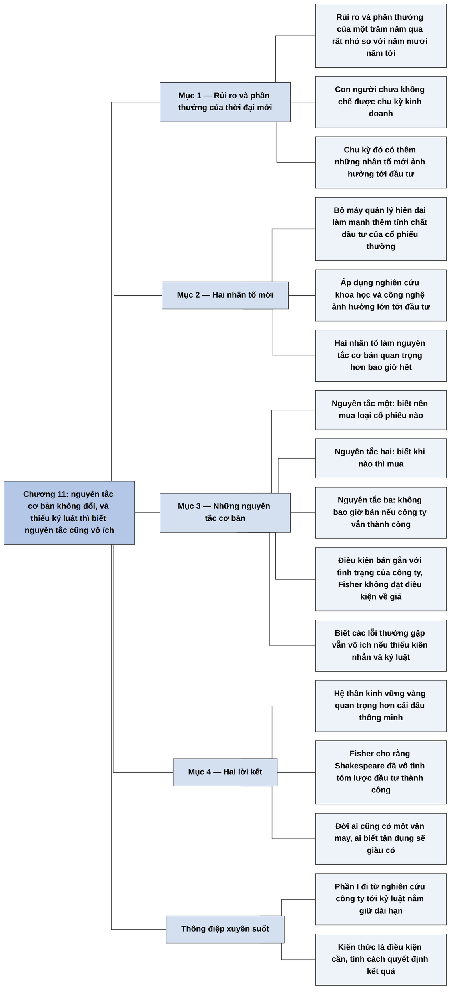

# Phần I, Chương 11 — Tóm lược và kết luận (Summary and Conclusion)

## Ý chính

**Fisher kết thúc Phần I bằng lời khẳng định rằng các nguyên tắc đầu tư cơ bản không đổi, thậm chí quan trọng hơn trước, và rằng biết nguyên tắc vẫn vô ích nếu thiếu kiên nhẫn và kỷ luật.**

Ông cho rằng rủi ro và phần thưởng của đầu tư trong một trăm năm đã qua còn rất nhỏ so với năm mươi năm tới. Chu kỳ kinh doanh chưa được khống chế, và có thêm hai nhân tố mới: bộ máy quản lý doanh nghiệp hiện đại, và việc áp dụng thành tựu nghiên cứu khoa học, công nghệ.

Cuốn sách chỉ ra nên mua loại cổ phiếu nào, khi nào mua, và đặc biệt là không bao giờ bán chừng nào công ty còn giữ được tính chất của doanh nghiệp thành công.

Câu kết của chương dựa vào hai lời: một hệ thần kinh vững vàng quan trọng hơn một cái đầu thông minh, và câu của Shakespeare về vận may của đời người.

## Sơ đồ

### Phần mở đầu chương — bối cảnh và những nhân tố mới (trang 216)

```text
       Rủi ro và phần thưởng của đầu tư trong một trăm năm qua còn rất nhỏ
       so với năm mươi năm tới
                                │
                                ▼
       Chu kỳ kinh doanh vẫn chưa được khống chế, và có thêm hai nhân tố mới
       ảnh hưởng tới nghệ thuật đầu tư cổ phiếu thường:
       · bộ máy quản lý của doanh nghiệp hiện đại, đã làm mạnh thêm tính
         chất đầu tư của cổ phiếu thường
       · việc áp dụng và kiểm soát thành tựu nghiên cứu khoa học, công nghệ
                                │
                                ▼
       Các nhân tố đó không đổi nguyên tắc cơ bản, mà làm các nguyên tắc
       trở nên quan trọng hơn bao giờ hết
```

### Đoạn tự gom (sách không có tiêu đề mục) — ba nguyên tắc và điều kiện về tính cách (trang 216–217)

```text
       Cuốn sách chỉ ra các nguyên tắc cơ bản:
       · nên mua loại cổ phiếu nào
       · khi nào thì mua
       · không bao giờ bán, với điều kiện công ty vẫn duy trì được các tính
         chất của một doanh nghiệp thành công
                                │
                                ▼
       Biết quy tắc và hiểu các lỗi thường gặp cũng vô ích với người thiếu
       kiên nhẫn và tính kỷ luật
                                │
               ┌────────────────┴────────────────┐
               ▼                                 ▼
       Một nhà đầu tư giỏi từng nói:     Shakespeare, theo Fisher, đã vô tình
       hệ thần kinh vững vàng quan       tóm lược quá trình đầu tư thành
       trọng hơn cái đầu thông minh      công: đời ai cũng có một vận may,
                                         ai biết tận dụng sẽ giàu có
```

## Ba câu hỏi chương này trả lời

**1. Những thay đổi của doanh nghiệp hiện đại có làm các nguyên tắc đầu tư lỗi thời không?**

Không. Fisher nêu hai nhân tố mới là bộ máy quản lý hiện đại và việc áp dụng nghiên cứu khoa học, công nghệ. Chúng không đổi nguyên tắc cơ bản mà làm nguyên tắc quan trọng hơn bao giờ hết, trong khi chu kỳ kinh doanh vẫn chưa được khống chế.

**2. Cả cuốn sách quy về những nguyên tắc nào?**

Có ba: nên mua loại cổ phiếu nào, khi nào thì mua, và không bao giờ bán khi công ty còn giữ được các tính chất của doanh nghiệp thành công. Fisher nhấn mạnh nguyên tắc thứ ba hơn cả. Phần về các lỗi thường gặp là phần bổ sung ông mong người đọc quan tâm.

**3. Biết các quy tắc đã đủ để thành công chưa?**

Chưa đủ. Với người thiếu kiên nhẫn và kỷ luật, các quy tắc chẳng giúp ích gì. Fisher dẫn lời một trong những nhà đầu tư giỏi nhất ông biết: trên thị trường chứng khoán, một hệ thần kinh vững vàng quan trọng hơn một cái đầu thông minh.

## Khái niệm cần biết

### Chu kỳ kinh doanh

Chu kỳ kinh doanh là sự lên xuống lặp lại của nền kinh tế, qua các giai đoạn mở rộng và suy giảm.

Fisher nói con người vẫn chưa khống chế được nó, và chương này không đưa ví dụ số. Khái niệm này quan trọng vì nhà đầu tư dài hạn phải chấp nhận rằng các đợt suy giảm vẫn xảy ra trong lúc họ giữ cổ phiếu.

### Bộ máy quản lý hiện đại

Đây là đội ngũ điều hành chuyên nghiệp của doanh nghiệp lớn, có thể tồn tại và cải thiện lâu dài, không phụ thuộc vào một người sáng lập.

Fisher coi đó là nhân tố làm mạnh thêm tính chất đầu tư của cổ phiếu thường, vì nó giúp một công ty tốt có thể tiếp tục tốt qua thời gian dài. Phần giải thích này do người tổng hợp nêu theo tinh thần các chương trước; Chương 11 chỉ nêu tên nhân tố.

### Nguyên tắc "không bao giờ bán" có điều kiện

Đây là quy tắc giữ cổ phiếu vô thời hạn, chừng nào công ty còn đạt các tính chất của một doanh nghiệp thành công.

Ý nghĩa của quy tắc nằm ở vế điều kiện. Fisher không nói giữ cổ phiếu bằng mọi giá. Người tổng hợp rút ra từ vế điều kiện đó rằng lý do bán phải đến từ sự thay đổi của công ty, không phải từ giá cổ phiếu đã tăng; Chương 11 không nói về giá.

## Nội dung chi tiết

### 1. Rủi ro và phần thưởng của thời đại mới (trang 216)

Fisher mở đầu từ thời điểm viết sách: nhân loại đang bước sang thập kỷ thứ hai của nửa sau thế kỷ XX, và chất lượng cuộc sống đã tăng rõ rệt so với năm nghìn năm trước. Rủi ro đầu tư của thời đã qua không nhỏ, phần thưởng cho người thành công còn lớn hơn nhiều. Tuy nhiên, ông cho rằng rủi ro và phần thưởng của một trăm năm vừa qua chỉ là rất nhỏ so với năm mươi năm tới.

Trong điều kiện đó, theo bản dịch, tốt nhất là nắm giữ những cổ phiếu đã mua. Con người vẫn chưa khống chế được chu kỳ kinh doanh, thậm chí không thể cải tạo được nó. Trái lại, chu kỳ đó có thêm những nhân tố mới. Câu "nắm giữ" này được bàn thêm ở mục Lưu ý cuối chương.

### 2. Hai nhân tố mới (trang 216)

| Nhân tố mới | Tác động theo Fisher |
|---|---|
| Bộ máy quản lý trong doanh nghiệp hiện đại | Tạo thế mạnh cho tính chất đầu tư của cổ phiếu thường |
| Việc áp dụng và kiểm soát thành tựu của nghiên cứu khoa học và công nghệ tiên tiến | Có ảnh hưởng quan trọng tới nghệ thuật đầu tư cổ phiếu thường |

Hai nhân tố này không đổi các nguyên tắc thành công cơ bản. Chúng khiến các nguyên tắc đó quan trọng hơn bao giờ hết.

### 3. Những nguyên tắc cơ bản của cuốn sách (trang 216–217)

Cuốn sách được viết để chỉ ra nên mua loại cổ phiếu nào, khi nào thì mua, và đặc biệt hơn cả là không bao giờ bán, với điều kiện công ty vẫn duy trì các tính chất của doanh nghiệp thành công.

Fisher hy vọng người đọc quan tâm tới những phần nói về các lỗi thông thường nhất của nhà đầu tư. Ông nhắc ngay rằng với người không đủ kiên nhẫn và kỷ luật, việc biết quy tắc và hiểu lỗi cũng chẳng giúp ích gì.

### 4. Hai lời kết (trang 217)

Nhiều năm trước, một trong những nhà đầu tư giỏi nhất Fisher từng biết nói với ông rằng trên thị trường chứng khoán, một hệ thần kinh vững vàng còn quan trọng hơn một cái đầu thông minh. Sách không nêu tên người này.

Fisher kết thúc bằng một câu Shakespeare mà ông cho là đã vô tình tóm lược quá trình đầu tư thành công: đời ai cũng có một vận may, và ai biết tận dụng sẽ trở nên giàu có.

## Luận điểm cốt lõi

- Nguyên tắc cơ bản không đổi, và thay đổi của thời đại làm chúng quan trọng hơn.
- Cả Phần I quy về ba việc: mua gì, mua khi nào, và không bán chừng nào công ty còn tốt.
- Kiến thức là điều kiện cần. Kiên nhẫn và kỷ luật quyết định việc kiến thức có thành kết quả hay không.

## Thuật ngữ

| Tiếng Anh | Tiếng Việt |
|---|---|
| business cycle | chu kỳ kinh doanh |
| common stock | cổ phiếu thường |
| management | bộ máy quản lý, đội ngũ quản lý |
| patience | kiên nhẫn |
| discipline | tính kỷ luật |
| research | nghiên cứu |

## Câu nói đáng nhớ

> "...một hệ thần kinh vững vàng còn quan trọng hơn là một cái đầu thông minh." — trang 217

> "Đời ai cũng có một vận may mà nếu ai biết tận dụng sẽ trở nên giàu có" — Shakespeare, Fisher dẫn, trang 217

## Đánh giá và phát hiện đáng chú ý

### Lời dự báo về năm mươi năm tới của Fisher đã thành sự thật ở phần lớn nội dung

Theo hiểu biết của người tổng hợp, không tra cứu, khoa học và công nghệ đúng là đã tạo ra nhiều công ty tăng trưởng lớn nhất từ thập niên 1960 trở đi, trong đó có các công ty bán dẫn, máy tính, dược phẩm và phần mềm. Lập luận của Fisher về nghiên cứu khoa học và quản lý chuyên nghiệp đi trước thời đại của ông.

### Nguyên tắc "không bao giờ bán" ở đây là bản rút gọn của một quy tắc dài hơn

Chương 6 nêu ba lý do bán: nhận ra đã mua sai, công ty không còn đạt yêu cầu như trước, và tìm được cổ phiếu hấp dẫn hơn nhiều. Chương 11 chỉ giữ một vế điều kiện về việc công ty có còn thành công hay không. Người chỉ đọc chương kết có thể hiểu quy tắc cứng hơn ý thật của tác giả.

### So với Benjamin Graham, hai người khác nhau về quy tắc nhưng gặp nhau ở tính cách

Theo hiểu biết của người tổng hợp, không tra cứu, Graham cũng coi tính khí của nhà đầu tư quan trọng hơn trí tuệ. Lời "hệ thần kinh vững vàng" của Fisher nói cùng một điều. Khác biệt là Graham bán khi giá đạt giá trị, còn Fisher giữ chừng nào công ty còn tốt.

### Cách vận dụng cho nhà đầu tư cá nhân

Viết sẵn trước khi mua điều kiện nào sẽ khiến mình bán, dựa trên tình trạng của công ty. Khi thị trường giảm mạnh, đọc lại điều kiện đó trước khi quyết định. Đây là cách biến "hệ thần kinh vững vàng" thành một việc làm cụ thể (nhận định của người tổng hợp).

## Bản đồ tư duy

Bản đồ dưới đây gói lại kết luận của Phần I theo các mục ở phần Nội dung chi tiết.



## Nguồn

Philip A. Fisher, *Cổ phiếu thường, lợi nhuận phi thường* (bản dịch Alpha Books, NXB Lao động – Xã hội), Phần I, Chương 11, trang 216–217.

## Tác giả

Philip A. Fisher (1907–2004) là nhà đầu tư và nhà quản lý quỹ người Mỹ. Phần I của cuốn sách là tác phẩm gốc năm 1958. Thông tin năm sinh, năm mất theo hiểu biết của người tổng hợp.

## Vị trí trong lập luận của cả cuốn sách

Chương 10 ([P1-C10-tim-ra-co-phieu-tang-truong-nhu-the-nao.md](P1-C10-tim-ra-co-phieu-tang-truong-nhu-the-nao.md)) mô tả quy trình tìm cổ phiếu tăng trưởng. Chương 11 khép lại Phần I, gom các chương về nên mua gì, thời điểm mua, thời điểm bán và các lỗi cần tránh thành vài nguyên tắc.

Sau đó sách chuyển sang Phần II ([P2-00-loi-gioi-thieu.md](P2-00-loi-gioi-thieu.md)), bàn về đầu tư cẩn trọng trong bối cảnh thị trường giá xuống của thập niên 1970.

## Lưu ý

- **Thời điểm viết:** câu "đang bước sang thập kỷ thứ hai của một nửa sau thế kỷ XX" (trang 216) chỉ khoảng năm 1960. Điều này cho thấy chương có thể lấy từ lần sửa sau bản 1958, vì theo hiểu biết của người tổng hợp sách có bản sửa năm 1960. Bản dịch không nói rõ.
- **Nghi dịch sai (trang 216):** "tốt nhất là chúng ta nên nắm giữ những cổ phiếu mà chúng ta đã mua" không theo logic của câu trước, vốn nói rủi ro và phần thưởng sẽ lớn hơn nhiều. Nghĩa có thể đúng là nên nắm vững điều mình đang làm. Nghi vấn vì không có nguyên tác; bản tổng hợp giữ lời bản dịch và có ghi "theo bản dịch".
- **Câu mơ hồ (trang 216):** "Chúng ta thậm chí không thể cải tạo được" và "chúng ta đã thêm vào chu kỳ đó những nhân tố mới" khó hiểu về mặt logic: hai nhân tố được nêu tiếp theo không phải của riêng chu kỳ kinh doanh, mà là của đầu tư cổ phiếu.
- **Câu của Shakespeare (trang 217):** theo hiểu biết của người tổng hợp, không tra cứu, đây là lời Brutus trong *Julius Caesar*, ví vận hội như con nước triều lên, nắm đúng lúc thì dẫn tới vận may. Bản dịch bỏ mất hình ảnh này, nên ý về việc nắm đúng lúc không còn rõ. Cùng lời dịch này xuất hiện lại ở Phần III, Chương 2.
- **Không có bảng, hình, phép tính** trong chương này.
