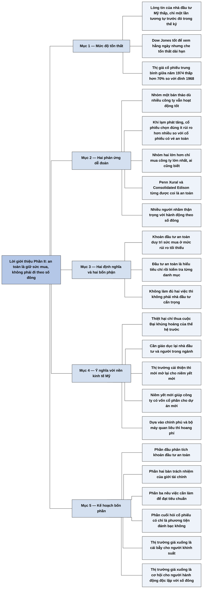

# Phần II, Lời giới thiệu — Giấc ngủ ngon cho các nhà đầu tư cẩn trọng (Introduction, *Conservative Investors Sleep Well*)

## Ý chính

**Fisher viết Phần II sau một đợt tổn thất rất nặng, để tách bạch hai điều thường bị lẫn: hành động thận trọng và hành động theo số đông. Theo ông, khoản đầu tư an toàn là khoản có khả năng duy trì sức mua ở mức rủi ro tối thiểu.**

Một chỉ số phản ánh các cổ phiếu thường có tính thanh khoản nhất cho thấy thị giá cổ phiếu trung bình giữa năm 1974 đã giảm 70% so với đỉnh năm 1968. Chỉ số bình quân công nghiệp Dow Jones che đi mức thiệt hại đó khi nhìn trong thời gian dài.

Nhà đầu tư phản ứng theo hai hướng dễ đoán. Một nhóm bán tháo cổ phiếu, kể cả cổ phiếu của công ty còn hoạt động tốt. Một nhóm lớn hơn quyết định từ nay sẽ thận trọng hơn, nghĩa là chỉ mua công ty lớn ai cũng biết. Penn Xural (cách viết của bản dịch) và Consolidated Edison cho thấy những cái tên quen thuộc không bảo đảm an toàn.

Muốn là nhà đầu tư cẩn trọng, phải làm đủ hai việc: hiểu các tiêu chí của một khoản đầu tư an toàn, và kiểm tra khoản đầu tư của mình có đạt các tiêu chí đó không.

Fisher đưa ra lý do rộng hơn lợi ích cá nhân. Nếu nhà đầu tư không yên tâm trở lại, thị trường sẽ không mở lại cho các đợt niêm yết mới, và công ty khó huy động vốn cổ phần cho các dự án mới.

## Sơ đồ

### Phần mở đầu — tổn thất và hai phản ứng của nhà đầu tư (trang 218–219)

```text
       Lòng tin của nhà đầu tư Mỹ thấp tới mức trong thế kỷ này chỉ có một
       lần tương tự trước đó
                                │
                                ▼
       Dow Jones hữu ích để xem biến động hằng ngày, nhưng trong thời gian
       dài nó che đi mức tổn thất thật
       · chỉ số về các cổ phiếu thanh khoản nhất: thị giá trung bình giữa
         năm 1974 thấp hơn 70% so với đỉnh năm 1968
                                │
               ┌────────────────┴────────────────┐
               ▼                                 ▼
       NHÓM BÁN THÁO                     NHÓM LỚN HƠN: "TỪ NAY SẼ THẬN TRỌNG"
       · bán cả khi nhiều công ty        · chỉ mua công ty lớn nhất, ai
         vẫn hoạt động tốt                 cũng biết tiếng
       · trong môi trường lạm phát       · Penn Xural vài năm trước và
         tăng, cổ phiếu được chọn          Consolidated Edison gần đây từng
         đúng ít rủi ro hơn nhiều          được coi là khoản đầu tư an toàn
               └────────────────┬────────────────┘
                                ▼
       Nhiều người nhầm lẫn giữa hành động thận trọng và hành động theo
       số đông
```

### Đoạn tự gom (sách không có tiêu đề mục) — hai định nghĩa (trang 219)

```text
       Định nghĩa 1 — KHOẢN ĐẦU TƯ AN TOÀN: khoản đầu tư có khả năng duy trì
       sức mua ở mức rủi ro tối thiểu
                                │
                                ▼
       Định nghĩa 2 — ĐẦU TƯ AN TOÀN: hiểu một khoản đầu tư an toàn gồm những
       gì, rồi với mỗi danh mục cụ thể tiến hành quy trình cần thiết để xác
       định các lựa chọn có đạt yêu cầu không
                                │
                                ▼
       Nhà đầu tư cẩn trọng (hoặc cố vấn của họ) phải làm đủ hai việc:
       1. hiểu các tiêu chí bắt buộc
       2. kiểm tra khoản đầu tư có thoả mãn các tiêu chí đó không
```

### Đoạn tự gom — vì sao vấn đề quan trọng với cả nền kinh tế (trang 219–220)

```text
       Thiệt hại của thế hệ nhà đầu tư hiện tại chỉ thua thiệt hại của thế
       hệ trải qua cuộc Đại khủng hoảng 40 năm trước
                                │
                                ▼
       Nước Mỹ có nhiều cơ hội cải thiện mức sống và đủ công nghệ, nhưng
       cần giáo dục lại nhiều nhà đầu tư và người trong ngành đầu tư
                                │
                                ▼
       Khi nhà đầu tư thấy an toàn hơn nhờ thị trường thật sự cải thiện,
       thị trường mới mở lại cho các đợt niêm yết mới, và công ty mới huy
       động thêm vốn cổ phần cho dự án mới
                                │
                                ▼
       Nếu không, mọi việc dựa vào nguồn tài trợ của chính phủ và bộ máy
       quan liêu cồng kềnh sẽ hoang phí và kém hiệu quả
```

### Đoạn tự gom — bốn phần của cuốn sách và thông điệp cuối (trang 220–221)

```text
       Fisher chia cuốn sách viết năm 1975 thành bốn phần:
       1. phân tích khoản đầu tư an toàn theo định nghĩa số một
       2. trách nhiệm của giới tài chính trong thị trường giá xuống hiện
          tại, để tránh sai lầm tương tự
       3. những việc cần làm để đạt tiêu chuẩn theo định nghĩa số hai
       4. câu hỏi: phải chăng cổ phiếu thường chỉ là phương tiện để đánh bạc?
                                │
                                ▼
       Thị trường giá xuống có thể là cái bẫy cho người khinh suất, và là
       cơ hội kỳ diệu cho người biết nghĩ cho lợi ích của mình và hành động
       độc lập với số đông
```

## Ba câu hỏi chương này trả lời

**1. Vì sao "thận trọng" như đa số vẫn có thể là sai?**

Vì đa số đồng nhất thận trọng với việc mua công ty lớn và quen tên. Sau tổn thất năm 1974, nhóm lớn quyết định từ nay chỉ mua công ty lớn nhất. Nhưng Penn Xural vài năm trước và Consolidated Edison gần đây đều từng được coi là khoản đầu tư an toàn theo tiêu chuẩn thông thường. Fisher gọi đó là nhầm lẫn giữa hành động thận trọng và hành động theo số đông.

**2. Khoản đầu tư an toàn là gì và nhà đầu tư cẩn trọng phải làm gì?**

Khoản đầu tư an toàn là khoản có khả năng duy trì sức mua ở mức rủi ro tối thiểu. Nhà đầu tư cẩn trọng phải hiểu các tiêu chí bắt buộc của khoản đầu tư như vậy, rồi kiểm tra các khoản của mình có đạt không. Fisher đo bằng sức mua, nên trong môi trường lạm phát gia tăng, một cổ phiếu được chọn đúng có thể ít rủi ro hơn nhiều so với lựa chọn có vẻ an toàn hơn.

**3. Vì sao nhầm lẫn này là vấn đề của cả nền kinh tế Mỹ?**

Vì thiệt hại của thế hệ nhà đầu tư năm 1974 chỉ thua thiệt hại của thế hệ Đại khủng hoảng. Khi nhà đầu tư chưa thấy an toàn, thị trường không mở lại cho các đợt niêm yết mới, công ty không huy động được vốn cổ phần cho dự án mới. Theo Fisher, nếu khi đó mọi việc dựa vào tài trợ của chính phủ và một bộ máy quan liêu thì sẽ hoang phí và kém hiệu quả.

## Khái niệm cần biết

### Sức mua

Sức mua là lượng hàng hoá và dịch vụ một khoản tiền mua được. Ví dụ tính nhẩm: nếu giá cả tăng gấp đôi mà số tiền không đổi, sức mua giảm một nửa.

Đây là điểm mấu chốt của định nghĩa. Fisher không đo an toàn bằng số tiền danh nghĩa được giữ nguyên, mà bằng việc tiền còn mua được bao nhiêu. Một khoản không mất đồng nào vẫn có thể lỗ về sức mua khi có lạm phát.

### Khoản đầu tư an toàn và đầu tư an toàn

Hai cách gọi này khác nhau. Khoản đầu tư an toàn là tài sản, tức thứ được mua. Đầu tư an toàn là hành động, tức hiểu tiêu chí rồi kiểm tra từng lựa chọn. Cách phân biệt này là của Fisher.

Ý nghĩa: một người có thể tình cờ nắm một khoản tốt mà vẫn không phải là nhà đầu tư cẩn trọng nếu chưa làm việc kiểm tra.

### Nhà đầu tư cẩn trọng

Đây là người hiểu các tiêu chí của khoản đầu tư an toàn và kiểm tra khoản đầu tư theo các tiêu chí đó. Cụm từ này không có nghĩa là người ngại rủi ro hay người chỉ mua công ty lớn.

### Chỉ số bình quân công nghiệp Dow Jones

Đây là chỉ số tính từ giá của một số ít cổ phiếu công nghiệp lớn của Mỹ, dùng để theo dõi thị trường. Fisher khen nó tốt để xem thay đổi hằng ngày nhưng nói nó che đi tổn thất dài hạn. Khi các công ty lớn giảm ít hơn cổ phiếu thường trung bình, chỉ số giảm ít hơn nhiều so với tài khoản của nhà đầu tư bình thường (phần cơ chế do người tổng hợp nêu).

### Thị trường giá xuống

Đây là giai đoạn giá cổ phiếu giảm kéo dài. Trong lời giới thiệu, đó là giai đoạn từ đỉnh năm 1968 tới giữa năm 1974.

### Lạm phát

Lạm phát là mức tăng chung của giá cả, làm sức mua của đồng tiền giảm dần. Fisher nói một cách chung rằng trong môi trường lạm phát gia tăng, cổ phiếu được chọn đúng ít rủi ro hơn nhiều.

### Niêm yết mới và vốn cổ phần

Niêm yết mới là việc công ty đưa cổ phiếu ra bán lần đầu cho công chúng hoặc bán thêm. Vốn cổ phần là tiền công ty nhận từ những người mua cổ phiếu, không phải tiền vay. Đây là mắt xích nối lòng tin của nhà đầu tư với khả năng đầu tư của doanh nghiệp.

## Nội dung chi tiết

### 1. Mức độ tổn thất (trang 218)

Fisher viết rằng rất khó đánh giá chuẩn xác, nhưng trong thế kỷ này chỉ có một lần duy nhất trước đó lòng tin của nhà đầu tư Mỹ giảm sút như lúc ông viết sách.

Dow Jones được biết tới rộng rãi như một chỉ số tuyệt vời về thay đổi hằng ngày. Khi xem trong thời gian dài, chỉ số này lại che đi mức tổn thất của người giữ cổ phiếu thường. Một chỉ số khác, theo dõi các cổ phiếu thường có tính thanh khoản nhất, cho thấy thị giá cổ phiếu trung bình giữa năm 1974 thấp hơn 70% so với đỉnh năm 1968.

### 2. Hai phản ứng dễ đoán (trang 218–219)

Nhóm thứ nhất bán tháo cổ phiếu, dù nhiều công ty vẫn hoạt động tốt một cách đáng ngạc nhiên. Fisher nhận xét rằng trong môi trường lạm phát ngày càng tăng là xu thế khó tránh, cổ phiếu được chọn đúng sẽ ít rủi ro hơn nhiều so với những cổ phiếu có vẻ an toàn hơn.

Nhóm thứ hai lớn hơn gồm những người quyết định từ nay sẽ thận trọng hơn. Họ thường chỉ mua cổ phiếu của công ty lớn nhất mà hầu hết mọi người biết tiếng. Rất ít nhà đầu tư Mỹ, và hầu như không ai ở vùng Đông Bắc, không biết Penn Xural và Consolidated Edison. Theo tiêu chuẩn thông thường, nhiều người coi Penn Xural vài năm trước và Consolidated Edison gần đây là khoản đầu tư an toàn.

Fisher cho rằng có quá nhiều sự hiểu nhầm giữa hành động thận trọng và hành động theo số đông. Vì vậy, với những người thật sự muốn bảo toàn tài sản, toàn bộ vấn đề cần được làm sáng tỏ, bắt đầu từ hai định nghĩa.

### 3. Hai định nghĩa và hai bổn phận (trang 219)

Định nghĩa thứ nhất: khoản đầu tư an toàn là khoản có khả năng duy trì sức mua ở mức rủi ro tối thiểu.

Định nghĩa thứ hai: đầu tư an toàn là hiểu khoản đầu tư an toàn gồm những gì, sau đó với mỗi danh mục cụ thể, tiến hành quy trình cần thiết để xác định các lựa chọn có phải khoản đầu tư an toàn không.

Theo đó, nhà đầu tư hoặc cố vấn của họ phải làm hai việc: hiểu các tiêu chí bắt buộc, rồi xem khoản đầu tư có thoả mãn các tiêu chí đó không. Không làm đủ thì người mua cổ phiếu thường không phải là nhà đầu tư với mục đích bảo toàn vốn.

### 4. Ý nghĩa với nền kinh tế Mỹ (trang 219–220)

Fisher coi việc loại bỏ triệt để những nhầm lẫn này là rất quan trọng, với cả cổ đông lẫn nền kinh tế Mỹ nói chung. Theo ông, thế hệ nhà đầu tư hiện tại chịu thiệt hại lớn, chỉ thua thiệt hại trong cuộc Đại khủng hoảng (1929) của thế hệ 40 năm trước. Nước Mỹ có vô số cơ hội cải thiện mức sống, có đủ nền tảng công nghệ và bí quyết kỹ thuật.

Tuy nhiên, muốn làm theo phương thức truyền thống quen thuộc của người Mỹ, cần giáo dục lại những điều cơ bản cho nhiều nhà đầu tư và nhiều người trong ngành. Chỉ khi nhiều nhà đầu tư thấy an toàn hơn vì thị trường thật sự cải thiện, thị trường mới mở lại cho các đợt niêm yết mới, giúp công ty huy động thêm vốn cổ phần cho dự án mới.

Nếu không như vậy, mọi việc nước Mỹ cố gắng và cần làm, ở trong hay ngoài nước, dựa trên tài trợ của chính phủ và sự điều hành của một bộ máy quan liêu cồng kềnh, sẽ chỉ hoang phí và không hiệu quả.

### 5. Kế hoạch bốn phần (trang 220–221)

| Phần | Nội dung Fisher hứa |
|---|---|
| Phần đầu | Phân tích khoản đầu tư an toàn theo định nghĩa số một |
| Phần thứ hai | Trách nhiệm của giới tài chính trong việc góp phần tạo thị trường giá xuống hiện nay. Mục đích không phải phê phán đơn thuần, mà giúp tránh sai lầm tương tự và làm sáng tỏ nguyên tắc cơ bản |
| Phần thứ ba | Những hành động cần làm để đạt tiêu chuẩn đầu tư an toàn theo định nghĩa số hai |
| Phần cuối | Giải quyết mối nghi ngờ rằng cổ phiếu thường không phải phương thức bảo toàn tài sản hữu hiệu, tức câu hỏi phải chăng cổ phiếu thường chỉ là phương tiện để đánh bạc |

Fisher kết thúc bằng mong muốn chỉ rõ hai khả năng do thị trường giá xuống vừa qua tạo ra. Quyền sở hữu cổ phiếu có thể chỉ là cái bẫy cho người khinh suất. Hoặc, như trong các thị trường giá xuống trước đây của lịch sử tài chính Mỹ, những vấn đề đó có thể tạo cơ hội kỳ diệu cho người có khả năng và kỷ luật để nghĩ cho lợi ích của mình và hành động độc lập với số đông.

## Luận điểm cốt lõi

- An toàn được đo bằng sức mua, không phải bằng độ quen thuộc của tên công ty.
- Cổ phiếu được chọn đúng có thể ít rủi ro hơn lựa chọn có vẻ an toàn, nhất là khi lạm phát tăng.
- Đầu tư cẩn trọng là một việc phải làm: hiểu tiêu chí và kiểm tra từng khoản.
- Lòng tin của nhà đầu tư ảnh hưởng tới khả năng huy động vốn và sức khoẻ của nền kinh tế.
- Thị trường giá xuống đem lại cơ hội cho người hành động độc lập với số đông.

## Thuật ngữ

| Tiếng Anh | Tiếng Việt |
|---|---|
| conservative investor | nhà đầu tư cẩn trọng |
| conservative investment | khoản đầu tư an toàn |
| purchasing power | sức mua |
| Dow Jones Industrial Average | chỉ số bình quân công nghiệp Dow Jones |
| bear market | thị trường giá xuống |
| inflation | lạm phát |
| financial community | giới tài chính |
| new issue | đợt niêm yết cổ phiếu mới |
| equity capital | vốn cổ phần |
| Great Depression | cuộc Đại khủng hoảng (chương sau viết Đại suy thoái) |

## Câu nói đáng nhớ

> "Khoản đầu tư an toàn là khoản đầu tư có khả năng duy trì sức mua ở mức rủi ro tối thiểu." — trang 219

> "Thật không may, có quá nhiều sự hiểu nhầm giữa hành động thận trọng và hành động theo số đông..." — trang 219

## Đánh giá và phát hiện đáng chú ý

### Định nghĩa bằng sức mua là phần sắc bén nhất và mới hơn cách hiểu thông thường

Nhiều người đồng nhất an toàn với việc giữ nguyên giá trị danh nghĩa. Fisher đo bằng sức mua, nên tiền mặt và trái phiếu không đương nhiên là an toàn khi có lạm phát. Định nghĩa này giải thích vì sao cả Phần II bàn về tăng trưởng dù mục tiêu là bảo toàn vốn.

Điểm yếu là "rủi ro tối thiểu" không được định nghĩa bằng số. Lời giới thiệu cũng không nói nhà đầu tư cẩn trọng nên đo rủi ro thế nào, ngoài việc đạt các tiêu chí ở các chương sau.

### Lời giới thiệu mở ra bốn phần, nhưng bản dịch chỉ có các chương về bốn thành tố

Bản dịch Phần II gồm sáu chương: bốn thành tố và hai chương bàn thêm về thành tố thứ tư. Sách không có các phần riêng về trách nhiệm của giới tài chính, về những việc cần làm, hay về câu hỏi đánh bạc, dù P/E và các sai lầm của giới tài chính có được bàn trong các chương về thành tố thứ tư. Lý do đã được kiểm chứng: Kenneth Fisher cho biết ấn bản Wiley 2003 bỏ các chương 7–14 của sách gốc năm 1975, nên ba phần còn lại của kế hoạch nằm ngoài bản này. Xem thêm ở mục Lưu ý cuối chương.

### Hai ví dụ cho thấy kích thước và uy tín không phải an toàn

Theo hiểu biết của người tổng hợp, không tra cứu, Penn Central (khả năng là tên đúng của Penn Xural) phá sản năm 1970, là một trong những vụ phá sản lớn nhất nước Mỹ lúc đó, còn Consolidated Edison cắt cổ tức năm 1974, gây sốc cho những người coi cổ phiếu tiện ích là an toàn. Fisher chọn hai ví dụ đúng lúc: chúng ở ngay trong trí nhớ của người đọc năm 1975.

### So với Benjamin Graham, Fisher đồng ý về sự nhầm lẫn nhưng đi tới kết luận khác

Theo hiểu biết của người tổng hợp, không tra cứu, Graham cũng cảnh báo rằng tên tuổi lớn và giá cao không đồng nghĩa với an toàn, và định nghĩa đầu tư gắn với an toàn của vốn. Nhưng Graham tìm an toàn ở biên độ giữa giá và giá trị. Fisher tìm an toàn ở chất lượng doanh nghiệp và khả năng tăng trưởng để giữ sức mua, như các chương về bốn thành tố cho thấy.

### Bối cảnh ngày nay khác, nhưng hiện tượng vẫn lặp lại

Theo hiểu biết của người tổng hợp, không tra cứu, nhiều giai đoạn sau đó có hiện tượng tương tự: các công ty lớn đẩy chỉ số lên trong khi cổ phiếu trung bình yếu hơn. Vì vậy, nhà đầu tư cần nhìn thêm số liệu rộng hơn một chỉ số gồm ít cổ phiếu lớn. Nhóm "cổ phiếu an toàn" được cả thị trường tin cũng thay đổi theo thời gian.

### Cách vận dụng cho nhà đầu tư cá nhân

Với mỗi khoản đầu tư, hãy tự hỏi hai câu: tiền của mình có giữ được sức mua sau khi trừ lạm phát không, và mình đã kiểm tra khoản đó theo tiêu chí nào. Nếu lý do duy nhất là "công ty lớn, ai cũng biết", đó là hành động theo số đông theo cách nói của Fisher.

## Bản đồ tư duy

Bản đồ dưới đây tóm tắt lời giới thiệu theo các mục ở phần Nội dung chi tiết.



## Nguồn

Philip A. Fisher, *Cổ phiếu thường, lợi nhuận phi thường* (bản dịch Alpha Books, NXB Lao động – Xã hội), Phần II, Lời giới thiệu, trang 218–221.

## Tác giả

Philip A. Fisher (1907–2004) là nhà đầu tư người Mỹ. Phần II lấy từ cuốn *Conservative Investors Sleep Well* (1975), viết sau đợt thị trường giá xuống 1973–1974. Lời giới thiệu ký tên ông, tại San Mateo, California. Thông tin năm sinh, năm mất theo hiểu biết của người tổng hợp.

## Vị trí trong lập luận của cả cuốn sách

Phần I khép lại ở [Chương 11](P1-C11-tom-luoc-va-ket-luan.md) với các nguyên tắc tìm và giữ cổ phiếu tăng trưởng. Phần II đặt cùng một phương pháp vào câu hỏi khác: làm thế nào để bảo toàn sức mua sau một đợt tổn thất rất nặng.

Lời giới thiệu đặt ra định nghĩa và mục tiêu. [Chương 1 của Phần II](P2-C01-thanh-to-dau-tien.md) bắt đầu phân tích thành tố đầu tiên của một khoản đầu tư an toàn.

## Lưu ý

- **Tên riêng nghi sai:** "Penn Xural" (trang 219, hai lần) khả năng là Penn Central, công ty đường sắt Mỹ (theo hiểu biết của người tổng hợp, không tra cứu). Bản tổng hợp giữ đúng chữ bản dịch ở phần tóm tắt nội dung sách.
- **Lỗi chính tả:** "Califonia" (trang 221), đúng là California.
- **Câu méo (trang 218):** "Một chỉ số ngầm chỉ ra những gì đã xảy đến... và không quá xem trọng vào số lượng đầu cổ phiếu tính trong nhóm chỉ số" không rõ loại chỉ số. Sách không nêu tên chỉ số. Nghĩa có thể là một chỉ số không gán tỷ trọng quá lớn cho số cổ phiếu trong nhóm. Nghi vấn vì không có nguyên tác.
- **Nghi dịch sai (trang 218):** "các cổ phiếu được lựa chọn đúng đắn sẽ ít rủi ro hơn nhiều so với các cổ phiếu có vẻ an toàn hơn khác" có thể ý là so với các lựa chọn có vẻ an toàn khác, kể cả những lựa chọn ngoài cổ phiếu.
- **Nghi dịch sai (trang 219):** "Nếu thiếu cả hai điều kiện đó" khiến nghĩa lệch: theo logic đoạn văn, chỉ cần thiếu một trong hai điều kiện thì đã không phải là nhà đầu tư cẩn trọng. Bản tổng hợp viết "không làm đủ".
- **Câu khó hiểu (trang 219–220):** "sẽ không thể chấp nhận việc những người nỗ lực hết sức để hiểu các nguyên tắc này phải chịu những thiệt hại nghiêm trọng" có thể mang nghĩa ngược, vì thiệt hại do thiếu hiểu biết mới là điều Fisher muốn tránh. Bản tổng hợp không dùng chi tiết này.
- **Nghi dịch sai (trang 221):** "nghĩ cho lợi ích của chính mình" đặt cạnh "hành động độc lập với... số đông" có thể là ý tự suy nghĩ bằng đầu óc của mình. Nghi vấn vì không có nguyên tác; bản tổng hợp giữ lời bản dịch.
- **Chênh năm (trang 220):** bản dịch viết Đại khủng hoảng (1929) cách "40 năm"; từ 1929 tới 1974 là 45 năm. Fisher có thể nói con số tròn.
- **Kế hoạch bốn phần không khớp với bản dịch:** lời giới thiệu hứa bốn phần (trang 220–221), nhưng Phần II của bản dịch dừng sau sáu chương về bốn thành tố. Không có phần riêng về trách nhiệm của giới tài chính, các hành động cần làm, hay câu hỏi đánh bạc. Từ "đánh bạc" không xuất hiện lại ở các chương sau của Phần II. Chương 6 của Phần II kết bằng lời hứa làm rõ một số câu hỏi "trong các chương sau", nhưng Phần II dừng ở đó. Đã tra nguồn: đây không phải bản dịch cắt bớt. Theo Kenneth L. Fisher, lời tựa *Philip A. Fisher Collected Works* (Wiley, 2012), [bản đọc thử](https://content.e-bookshelf.de/media/reading/L-629698-9f7ade61b1.pdf), các chương 7–14 của *Conservative Investors Sleep Well* bản tháng 2/1975 đã bị bỏ khỏi ấn bản Wiley 2003, vì nhà xuất bản không muốn sách dài thêm 117 trang và cho rằng các chương này quá gắn với thập niên 1970 và có thể trùng với *Common Stocks*; Kenneth không đồng ý với lý do thứ hai. Các chương bị bỏ gồm cổ tức (7), nguyên nhân khiến nhà đầu tư sai lầm cuối thập niên 1960 và đầu 1970 (8–9), cách tìm hiểu sự thật về công ty (10), năm câu hỏi (11), và cổ phiếu so với lạm phát, trái phiếu, vàng, bất động sản, cổ phiếu khi chính trị chuyển sang cánh tả (11–14). Lời tựa đó in lại đủ các chương này trong tuyển tập năm 2012; bản dịch không có.
- **Số liệu cũ:** mức giảm 70% là con số Fisher nêu; sách không cho tên chỉ số nên không kiểm chứng được.
