# Phần II, Chương 1 — Thành tố đầu tiên của một khoản đầu tư an toàn (The First Dimension of a Conservative Investment)

## Ý chính

**Thành tố đầu tiên của một khoản đầu tư an toàn là sự vượt trội của doanh nghiệp ở bốn việc: sản xuất chi phí thấp, marketing mạnh, nghiên cứu và áp dụng công nghệ nổi trội, và kỹ năng tài chính.**

Chi phí thấp đem lại hai điều kiện sống còn. Công ty sống sót qua năm tồi tệ của ngành và còn hưởng lợi khi đối thủ chi phí cao phải đóng dây chuyền. Công ty cũng tự tạo được phần lớn vốn cho tăng trưởng, nên tránh được việc pha loãng cổ đông hay gánh nặng nợ.

Công ty chi phí thấp kém hấp dẫn với nhà đầu cơ khi thị trường lên mạnh, và ví dụ của Fisher giải thích vì sao. Khi giá bán tăng từ 10 xu lên 12 xu, công ty A tăng lợi nhuận 50%, công ty B tăng mạnh hơn nhiều. Khi giá xuống 8 xu, công ty A vẫn có lãi, còn công ty B lỗ mỗi sản phẩm.

Marketing nghĩa là theo dõi nhu cầu đang thay đổi và làm cho khách hàng thấy lợi ích của chính họ. Nghiên cứu chỉ sinh lợi khi các nhà nghiên cứu hợp tác tốt với nhau và với bộ phận marketing, sản xuất.

Kỹ năng tài chính giúp biết chi phí từng sản phẩm, tạo hệ thống cảnh báo sớm và chọn dự án đầu tư tốt hơn.

Một công ty như vậy vẫn phải tăng trưởng dù mục tiêu là bảo toàn vốn. Fisher lập luận rằng trong một thế giới thay đổi không ngừng, công ty không tiến lên thì sẽ tụt hậu.

## Sơ đồ

### Phần mở đầu chương — bốn thuộc tính của thành tố đầu tiên (trang 222)

```text
       Doanh nghiệp đáp ứng một khoản đầu tư an toàn phải là tổ chức có
       cơ cấu hoàn chỉnh
                                │
                                ▼
       Thành tố đầu tiên là ưu thế trong bốn lĩnh vực:
       1. sản xuất (chi phí thấp)
       2. marketing
       3. nghiên cứu và áp dụng công nghệ
       4. kỹ năng tài chính
```

### Mục "Chi phí sản xuất thấp" — hai điều kiện sống còn và ví dụ A, B (trang 222–224)

```text
       Công ty phải có và duy trì dây chuyền chi phí thấp nhất, hoặc thấp
       bằng đối thủ
                                │
               ┌────────────────┴────────────────┐
               ▼                                 ▼
       ĐIỀU KIỆN 1: SỐNG SÓT             ĐIỀU KIỆN 2: TỰ TÀI TRỢ
       · năm tồi tệ, giá không ở         · biên lợi nhuận đủ để tạo phần
         dưới điểm hòa vốn lâu             lớn hoặc toàn bộ vốn cho tăng
       · đối thủ chi phí cao phải          trưởng
         đóng dây chuyền                 · tránh phát hành cổ phần mới
       · công ty chi phí thấp nhận         làm pha loãng cổ phần hiện có
         thêm đơn hàng và giá tăng       · tránh gánh nặng nợ và các
                                           khoản phải trả cố định
               └────────────────┬────────────────┘
                                ▼
       Đổi lại, cổ phiếu chi phí thấp kém hấp dẫn đầu cơ khi thị trường lên.
       Công ty A chi phí 6 xu, công ty B chi phí 9 xu:
       · giá 10 xu: A lãi 4 xu, B lãi 1 xu
       · giá 12 xu: A lãi 6 xu (tăng 50%), B lãi 3 xu (gấp 3 lần)
       · giá 8 xu: A vẫn lãi, B lỗ
                                │
                                ▼
       Công ty dịch vụ, bán buôn, bán lẻ, ngân hàng, bảo hiểm cũng theo quy
       tắc này, chỉ cần đổi "sản xuất" thành "hoạt động"
```

### Mục "Tổ chức marketing mạnh" — hiểu nhu cầu và thuyết phục khách hàng (trang 224–226)

```text
       Bước 1: theo dõi thay đổi trong nhu cầu của khách hàng
       · công ty xe độc mã đầu thế kỷ XX nên chuyển sang ôtô, không nên cải
         tiến xe độc mã
       · sau lệnh cấm vận dầu mỏ, một bộ phận ngành ôtô Mỹ không nhận ra
         nhu cầu chuyển sang xe nhỏ, ít hao xăng
                                │
                                ▼
       Bước 2: làm cho khách hàng tiềm năng thấy ưu thế của sản phẩm
       · hiểu họ muốn gì, kể cả điều họ chưa nhận ra
       · giải thích lợi ích của người mua, không phải lợi ích của người bán
                                │
                                ▼
       Công cụ tuỳ ngành: quảng cáo, nhân viên bán hàng, tổ chức nghiên cứu
       thị trường. Đội ngũ quản lý phải đo hiệu quả chi phí của từng công cụ
                                │
                                ▼
       Marketing yếu gây ba thiệt hại: mất thương vụ, chi phí quá cao, và
       không đạt lợi nhuận tối đa cho dòng sản phẩm. Dây chuyền hiệu quả mà
       marketing yếu chỉ đạt một phần nhỏ khả năng thật
```

### Mục "Có nhiều nỗ lực nghiên cứu và áp dụng công nghệ nổi trội" — hai mục tiêu và điều kiện hợp tác (trang 226–227)

```text
       Công nghệ không còn của riêng điện tử, không gian, dược, hoá phẩm;
       nó nay quan trọng cả với giày dép, ngân hàng, bán lẻ, bảo hiểm
                                │
                                ▼
       Hai mục tiêu:
       1. tạo sản phẩm mới tốt hơn
       2. cung cấp dịch vụ tốt hơn hoặc chi phí thấp hơn
       · ví dụ ngân hàng: thiết bị nhập dữ liệu điện tử và máy tính mini tạo
         thêm dịch vụ kế toán, ghi sổ cho khách hàng
                                │
                                ▼
       Năng lực của nhà nghiên cứu chỉ là một nhân tố. Cần thêm:
       · hợp tác giữa các chuyên gia nhiều lĩnh vực
       · chỉ phát triển sản phẩm khách hàng cần, bán được bằng đội ngũ
         marketing hiện có, với giá có lợi nhuận cao
       · nghiên cứu, marketing, sản xuất cộng tác hiệu quả
       · kiểm soát tốt nhưng không quá mức, để giữ động lực sáng tạo
```

### Mục "Kỹ năng tài chính" — biết chi phí và cảnh báo sớm (trang 227–228)

```text
       Công ty lớn nhiều sản phẩm khó biết chi phí của từng sản phẩm, vì
       nhiều chi phí không phải nhân công trực tiếp và nguyên vật liệu
                                │
                                ▼
       Kỹ năng tài chính tốt đem lại:
       · biết chi phí từng sản phẩm, tập trung vào nơi có lợi nhuận cao nhất
       · biết độ lớn từng nhân tố chi phí để giảm đúng chỗ
       · hệ thống cảnh báo sớm các ảnh hưởng xấu tới lợi nhuận dự kiến,
         tránh cú sốc cho nhà đầu tư (điều quan trọng hơn cả)
       · lựa chọn đầu tư vốn tốt hơn
       · kiểm soát tốt hơn khoản phải thu và hàng tồn kho
```

### Đoạn tự gom (sách không có tiêu đề mục) — tổng kết và vì sao vẫn cần tăng trưởng (trang 228–230)

```text
       Công ty đạt thành tố đầu tiên là công ty có chi phí rất thấp trong
       ngành, nổi trội về marketing và tài chính, biết tổ chức nghiên cứu.
       Trong một thế giới thay đổi, công ty đó có khả năng:
       1. phát triển sản phẩm mới hay dây chuyền hiệu quả hơn
       2. thiết kế dây chuyền chi phí thấp để lợi nhuận tăng ít nhất bằng
          doanh số, không thu hẹp nguy hiểm kể cả năm tệ nhất của ngành
       3. bán sản phẩm mới ở mức lợi nhuận ít nhất bằng sản phẩm hiện tại
                                │
                                ▼
       Phản bác: nếu mục tiêu là bảo toàn vốn, sao không giữ nguyên quy mô?
                                │
                                ▼
       Trả lời: không gì tồn tại quá lâu trong thế giới thay đổi. Một công ty
       hoặc tiến lên hoặc tụt hậu. Công nghệ, thói quen mua sắm và nhu cầu
       của chính phủ thay đổi ngày càng nhanh
```

## Ba câu hỏi chương này trả lời

**1. Vì sao chi phí thấp là điều kiện của một khoản đầu tư an toàn?**

Vì chi phí thấp tạo biên lợi nhuận đủ rộng cho hai việc. Thứ nhất, trong năm tồi tệ, đối thủ chi phí cao phải đóng dây chuyền, công ty chi phí thấp nhận thêm đơn hàng và giá bán có thể tăng. Thứ hai, công ty tự tạo được phần lớn hoặc toàn bộ vốn tăng trưởng, không cần phát hành cổ phần pha loãng hay gánh nợ. Trong ví dụ của Fisher, chi phí 6 xu thì giá 8 xu vẫn có lãi, còn chi phí 9 xu thì lỗ.

**2. Nghiên cứu và marketing liên quan với nhau thế nào?**

Một đội ngũ nghiên cứu xuất sắc có thể chỉ thành gánh nặng nếu phát triển sản phẩm không bán được. Để tối đa lợi nhuận, công ty chỉ nên phát triển sản phẩm khách hàng cần, bán được bằng đội ngũ marketing hiện có, ở mức giá thu lợi nhuận cao. Vì vậy, nghiên cứu, marketing và sản xuất phải cộng tác hiệu quả, còn việc kiểm soát không được làm mất động lực sáng tạo.

**3. Vì sao đầu tư an toàn vẫn cần công ty tăng trưởng?**

Vì trong một thế giới thay đổi không ngừng, không có gì tồn tại quá lâu. Fisher nói công ty hoặc tiến lên hoặc tụt hậu, và chỉ bằng cách tăng trưởng mạnh hơn mới tránh được tụt dốc. Ví dụ xe độc mã và ôtô lớn ngốn xăng cho thấy giữ nguyên sản phẩm cũng là một rủi ro. Tốc độ đổi mới công nghệ, thói quen mua sắm và nhu cầu mới của chính phủ làm áp lực này tăng dần.

## Khái niệm cần biết

### Biên lợi nhuận

Biên lợi nhuận là phần lợi nhuận trên doanh thu. Trong ví dụ của sách, công ty A bán 10 xu với chi phí 6 xu thì lãi 4 xu, tức biên lợi nhuận 40%; công ty B lãi 1 xu, tức 10% (phần trăm do người tổng hợp tính).

Biên lợi nhuận rộng là vùng đệm: giá bán giảm hay chi phí tăng thì công ty vẫn còn lãi.

### Điểm hòa vốn

Điểm hòa vốn là mức giá hoặc sản lượng mà doanh thu vừa đủ bù chi phí, không lãi không lỗ. Ví dụ: công ty chi phí 9 xu một chiếc thì hòa vốn ở giá bán 9 xu. Fisher dùng khái niệm này để nói giá sản phẩm không ở dưới điểm hòa vốn lâu, vì khi đó đối thủ yếu buộc phải đóng dây chuyền.

### Pha loãng cổ phần

Pha loãng là việc phát hành thêm cổ phần làm phần sở hữu của cổ đông hiện có nhỏ đi. Ví dụ tính nhẩm: công ty có 100 cổ phần và phát hành thêm 100 cổ phần, người giữ 10 cổ phần giảm từ 10% xuống 5%.

Đây là lý do Fisher đề cao công ty tự tạo được vốn tăng trưởng.

### Độ nhạy của lợi nhuận khi biên lợi nhuận mỏng

Công ty biên lợi nhuận mỏng có lợi nhuận rất nhạy với giá bán. Cùng mức tăng giá 2 xu, công ty B tăng lợi nhuận tính theo phần trăm mạnh hơn công ty A nhiều lần, chỉ vì lợi nhuận ban đầu nhỏ.

Khái niệm này giải thích vì sao cổ phiếu chất lượng thấp có thể tăng mạnh nhất trong thị trường giá lên, và cũng sụt mạnh nhất sau đó.

### Marketing

Trong chương này, marketing gồm hai việc: nhận ra thị trường đang muốn gì, và làm cho khách hàng tiềm năng thấy lợi ích của họ khi mua. Nó rộng hơn việc bán hàng hay quảng cáo.

### Khoản phải thu và hàng tồn kho

Khoản phải thu là tiền khách đã mua hàng nhưng chưa trả. Hàng tồn kho là hàng đã sản xuất hoặc đã mua nhưng chưa bán được. Cả hai làm tiền của công ty bị đọng lại; công ty kiểm soát tốt thì cần ít vốn hơn (phần giải thích này do người tổng hợp nêu). Bản dịch gọi hai khoản này là "giấy báo thu" và "bản kiểm kê" (xem mục Lưu ý cuối chương).

### Hệ thống cảnh báo sớm

Đây là việc lập ngân sách và kế toán tốt để sớm thấy lợi nhuận đang lệch khỏi dự kiến. Fisher coi đây là lợi ích quan trọng nhất của kỹ năng tài chính, vì nó giúp nhà đầu tư tránh những cú sốc gây thiệt hại lớn.

## Nội dung chi tiết

### 1. Bốn thuộc tính (trang 222)

Fisher mở đầu Phần II bằng việc phác hoạ một đặc trưng bắt buộc của khoản đầu tư an toàn. Doanh nghiệp có quy mô và loại hình phù hợp phải là một tổ chức có cơ cấu hoàn chỉnh. Thành tố đầu tiên chia thành bốn thuộc tính: chi phí sản xuất thấp, tổ chức marketing mạnh, nghiên cứu và áp dụng công nghệ nổi trội, và kỹ năng tài chính.

### 2. Chi phí sản xuất thấp (trang 222–224)

Muốn trở thành khoản đầu tư an toàn, công ty phải có và duy trì dây chuyền sản xuất có chi phí thấp nhất, hoặc thấp bằng đối thủ. Chỉ như vậy, biên lợi nhuận giữa chi phí và giá bán mới đủ rộng để tạo ra hai điều kiện sống còn.

**Điều kiện thứ nhất là vùng đệm trong cạnh tranh.** Khi ngành gặp một năm tồi tệ, giá bán sẽ không nằm dưới điểm hòa vốn lâu. Lỗ quá lớn khiến một số đối thủ chi phí cao phải đóng cửa dây chuyền. Công ty chi phí thấp còn lại tự động có thêm lợi nhuận: sản lượng tăng nhờ đơn hàng trước đây của nhà máy đã đóng, và giá tăng khi nguồn cung bớt dồi dào.

**Điều kiện thứ hai là tự tạo vốn.** Công ty phải có biên lợi nhuận đủ để tạo ra phần lớn hoặc toàn bộ khoản đầu tư cần cho tăng trưởng. Nhờ đó có thể tránh hai hậu quả của việc huy động vốn dài hạn: phải phát hành cổ phần mới, làm pha loãng và giảm giá trị cổ phần hiện có; và gánh nặng nợ với các khoản phải trả cố định, làm tăng rủi ro cho người giữ cổ phiếu.

**Cái giá của chi phí thấp.** Công ty chi phí thấp làm tăng độ an toàn và tính bảo toàn vốn, nhưng kém hấp dẫn đầu cơ khi thị trường lên mạnh. Lúc đó, công ty chi phí cao và rủi ro hơn luôn có tỷ lệ tăng lợi nhuận cao hơn nhiều. Fisher minh hoạ bằng hai công ty cùng quy mô, bán cùng sản phẩm, với chi phí và quy mô không đổi. Phần lãi ở giá 8 xu và các tỷ lệ phần trăm do người tổng hợp tính từ giả thiết của sách, trừ con số 50% của sách.

| Giá bán | Công ty A (chi phí 6 xu): lãi mỗi chiếc | Biên lợi nhuận A | Công ty B (chi phí 9 xu): lãi mỗi chiếc | Biên lợi nhuận B |
|---|---|---|---|---|
| 10 xu (thời kỳ bình thường) | 4 xu | 40% | 1 xu | 10% |
| 12 xu (nhu cầu tăng) | 6 xu (tăng 50%) | 50% | 3 xu (tăng 200%, gấp 3 lần) | 25% |
| 8 xu (thời kỳ khó khăn) | 2 xu | 25% | Lỗ 1 xu | Âm 12,5% |

Vì vậy, trong ngắn hạn, lợi nhuận của công ty chi phí cao đôi khi tăng mạnh hơn nhiều trong thời kỳ thị trường tăng giá. Vài năm sau, khi giá về 8 xu, công ty mạnh vẫn có lợi nhuận dù giảm. Với công ty chi phí cao, dù công ty chưa phá sản, một nhóm nhà đầu tư mới vẫn có thể bị tổn thương nặng (cách hiểu này được bàn ở mục Lưu ý cuối chương). Fisher nhận xét rằng nhà đầu tư, hay nhà đầu cơ tưởng mình là nhà đầu tư, luôn chắc rằng hệ thống đã sai, thay vì chính họ sai.

**Mở rộng sang dịch vụ.** Các quy tắc trên áp dụng được cho công ty bán buôn, bán lẻ, ngân hàng hay bảo hiểm, chỉ cần đổi "sản xuất" thành "hoạt động" và "chi phí sản xuất" thành "chi phí hoạt động".

### 3. Tổ chức marketing mạnh (trang 224–226)

Một nhân viên marketing giỏi luôn theo dõi thay đổi trong nhu cầu của khách hàng để công ty bán đúng thứ người ta muốn mua lúc này. Fisher nêu hai ví dụ.

- Bước sang thế kỷ XX, các công ty xe độc mã sẽ sai nếu cạnh tranh bằng cách cải tiến xe độc mã, thay vì chuyển sang ôtô hay đổi hẳn lĩnh vực.
- Sau lệnh cấm vận dầu mỏ ở A-rập, người Mỹ nhận ra xe lớn tốn xăng. Một bộ phận ngành ôtô đã sai khi không thấy nhập khẩu xe nhỏ ngày càng tăng, chứng tỏ nhu cầu chuyển sang xe rẻ hơn, ít hao xăng, dễ đỗ.

Nhận ra thay đổi và phản ứng kịp thời vẫn chưa đủ. Khách hàng không tự tìm tới chỉ vì công ty có sản phẩm tốt hơn (đoạn này bản dịch có vấn đề, ghi ở mục Lưu ý cuối chương). Vấn đề sống còn là khiến khách hàng tiềm năng thấy ưu thế của sản phẩm. Điều đó chỉ đạt được khi công ty hiểu họ muốn gì, đôi khi cả khi khách hàng chưa nhận ra vì sao lợi ích đó hấp dẫn, và giải thích lợi ích của người mua thay vì lợi ích của người bán.

Tuỳ ngành, việc này làm tốt nhất bằng quảng cáo, đội ngũ bán hàng, hoặc tổ chức độc lập nghiên cứu thị trường. Trong mọi trường hợp, đội ngũ quản lý phải giám sát sát sao và đánh giá chính xác hiệu quả chi phí của công cụ đang dùng.

Thiếu bộ máy tài năng trong lĩnh vực này sẽ dẫn tới ba thiệt hại: tuột mất nhiều thương vụ; chi phí phụ trội quá cao nên lợi nhuận thương vụ thấp đi; và không đạt lợi nhuận tối đa cho dòng sản phẩm, vì lợi nhuận của công ty được cấu thành từ nhiều yếu tố trong mỗi dòng sản phẩm. Dây chuyền sản xuất hay hệ thống điều hành hiệu quả mà marketing yếu chỉ thu được một phần nhỏ kết quả so với khả năng thật.

### 4. Nỗ lực nghiên cứu và áp dụng công nghệ nổi trội (trang 226–227)

Mới đây, công nghệ nổi trội chỉ xuất hiện trong vài ngành gắn với khoa học như điện tử, chinh phục không gian, dược phẩm và hoá phẩm. Khi các ngành này phát triển, công nghệ thâm nhập vào gần như mọi dây chuyền sản xuất và loại hình dịch vụ. Nay nghiên cứu công nghệ ngày càng quan trọng với nhà sản xuất giày, ngân hàng, công ty bán lẻ hay bảo hiểm.

Nỗ lực công nghệ nhằm hai mục tiêu: sản xuất sản phẩm mới tốt hơn, và cung cấp dịch vụ tốt hơn hoặc rẻ hơn. Vai trò của nhà khoa học trong mục tiêu thứ nhất rõ ở hoá phẩm hơn ở bách hoá tổng hợp, còn với mục tiêu thứ hai, trình độ công nghệ quan trọng như nhau ở các ngành. Trong dịch vụ, công nghệ còn mở ra dòng sản phẩm mới. Ở ngân hàng, thiết bị nhận dữ liệu đầu vào điện tử và máy tính mini chi phí thấp cho phép cung cấp thêm dịch vụ kế toán và ghi sổ cho khách hàng.

Lợi ích từ nghiên cứu khác nhau rất nhiều giữa các công ty. Tài năng của đội ngũ nghiên cứu chỉ là một nhân tố. Phát triển sản phẩm mới thường cần nhiều nhà nghiên cứu ở nhiều lĩnh vực, nên mức độ hợp tác, và khả năng người lãnh đạo khuyến khích sự hợp tác đó, quan trọng ngang tài năng cá nhân.

Muốn tối đa lợi nhuận, công ty phải chỉ phát triển sản phẩm mà khách hàng cần, tiêu thụ được nhờ đội ngũ marketing hiện có, và bán được ở mức giá có lợi nhuận cao. Do đó, nghiên cứu, marketing và sản xuất cần cộng tác hiệu quả. Một đội ngũ nghiên cứu xuất sắc có thể chẳng có giá trị gì, thậm chí thành gánh nặng, nếu tạo ra sản phẩm không tiêu thụ được. Công ty cần kiểm soát tốt các mối cộng tác đó, nhưng không quá mức, để không làm mất động lực và sự sáng tạo của nhân viên nghiên cứu.

### 5. Kỹ năng tài chính (trang 227–228)

Trong công ty lớn có nhiều dòng sản phẩm, không thể xác định chắc chắn chi phí của từng sản phẩm, vì nhiều chi phí nằm ngoài nhân công trực tiếp và nguyên vật liệu. Công ty có kỹ năng tài chính tốt có các lợi thế sau.

- Biết chi phí của từng sản phẩm, nên dồn nỗ lực vào nơi có lợi nhuận tối đa.
- Biết độ lớn của từng nhân tố chi phí, kể cả trong bán hàng và nghiên cứu, nên giảm chi phí đúng chỗ bằng cải tiến công nghệ hoặc cải thiện công việc của từng nhân viên.
- Quan trọng hơn cả, ngân sách và kế toán tốt tạo một hệ thống cảnh báo sớm, phát hiện kịp thời ảnh hưởng xấu tới lợi nhuận dự kiến, tránh cú sốc lớn cho nhà đầu tư.
- Có lựa chọn đầu tư vốn tốt hơn, tạo mức thu cao nhất trên vốn đầu tư của công ty.
- Kiểm soát tốt hơn khoản phải thu và hàng tồn kho, một việc ngày càng quan trọng trong những thời kỳ có tỷ suất cao (nghi là lãi suất cao, ghi ở mục Lưu ý cuối chương).

### 6. Tổng kết thành tố đầu tiên (trang 228–229)

Công ty đáp ứng thành tố đầu tiên là công ty sản xuất hoặc hoạt động với chi phí rất thấp trong ngành, có khả năng nổi trội về marketing và kỹ năng tài chính, có kỹ năng quản lý các vấn đề phức tạp để thu kết quả cao nhất từ nghiên cứu và công nghệ mới. Trong một thế giới thay đổi chóng mặt, công ty đó có ba khả năng.

- Phát triển hàng loạt sản phẩm mới hay dây chuyền sản xuất hiệu quả hơn việc cải tiến dây chuyền cũ, vốn sẽ lạc hậu khi đối thủ cải tiến công nghệ.
- Thiết kế dây chuyền sản xuất chi phí thấp, để dòng lợi nhuận tăng nhanh hơn hoặc bằng mức tăng doanh số, và kể cả trong năm ảm đạm nhất của ngành cũng không thu hẹp tới mức đe doạ an toàn của khoản đầu tư.
- Bán các sản phẩm mới và sản phẩm tương lai ở mức lợi nhuận ít nhất ngang bằng sản phẩm hiện tại.

Fisher gọi đây là bức tranh về một thành tố của khoản đầu tư khôn ngoan. Nếu không bị các thành tố khác ảnh hưởng, nhà đầu tư sẽ không thất vọng.

### 7. Vì sao bảo toàn vốn vẫn cần tăng trưởng (trang 229–230)

Fisher tự nêu phản bác: nếu mục tiêu là bảo toàn vốn, sao phải bàn nhiều về tăng trưởng và sản phẩm mới, sao không giữ nguyên quy mô và mức lợi nhuận hiện tại để tránh rủi ro của những nỗ lực mới?

Ông hứa trở lại câu hỏi này khi bàn về ảnh hưởng của lạm phát. Câu trả lời cơ bản là trong một thế giới thay đổi không ngừng, không có gì tồn tại quá lâu. Một công ty không thể đứng yên: nó hoặc tiến lên hoặc tụt hậu. Tấn công mạnh mẽ là cách phòng thủ tốt nhất. Chỉ bằng cách tăng trưởng mạnh hơn, công ty mới tránh được tụt dốc.

Điều này đúng trong quá khứ và sẽ càng đúng trong tương lai, vì tốc độ đổi mới công nghệ ngày càng nhanh, còn thói quen mua sắm và nhu cầu mới của chính phủ cũng thay đổi tới mức cả những ngành ì ạch nhất phải đổi theo.

**Ví dụ hôm nay (minh hoạ tự nghĩ, không phải số liệu thật).** Hai chuỗi cà phê bán một ly 50.000 đồng. Chuỗi A có chi phí 30.000 đồng, chuỗi B có chi phí 45.000 đồng. Nếu cả ngành tăng giá thêm 5.000 đồng, chuỗi A tăng lợi nhuận 25%, chuỗi B tăng 100%. Cổ phiếu B có thể gây chú ý hơn trong thời kỳ thuận lợi, nhưng nếu giá giảm 10.000 đồng, chuỗi A còn lãi 10.000 đồng và chuỗi B lỗ 5.000 đồng.

## Luận điểm cốt lõi

- Chi phí thấp vừa giúp sống sót vừa giúp tự tài trợ, và đối thủ yếu đi khi ngành khó khăn sẽ làm lợi cho công ty mạnh.
- Lợi nhuận tăng nhanh nhất trong thị trường lên thường thuộc về công ty yếu, và đó không phải dấu hiệu của khoản đầu tư an toàn.
- Marketing phải bắt đầu từ lợi ích của khách hàng, và phải đo được hiệu quả chi phí.
- Tài năng nghiên cứu chỉ có giá trị khi được tổ chức để tạo sản phẩm bán được với lợi nhuận cao.
- Kỹ năng tài chính là hệ thống cảnh báo sớm cho cả công ty lẫn nhà đầu tư.
- Với Fisher, an toàn đòi hỏi tăng trưởng, vì đứng yên trong một thế giới thay đổi là tụt hậu.

## Thuật ngữ

| Tiếng Anh | Tiếng Việt |
|---|---|
| dimension | thành tố |
| conservative investment | khoản đầu tư an toàn |
| low-cost production | chi phí sản xuất thấp |
| profit margin | biên lợi nhuận |
| break-even point | điểm hòa vốn |
| dilution | pha loãng |
| marketing organization | tổ chức marketing |
| research and development | nghiên cứu và phát triển |
| financial skills | kỹ năng tài chính |
| accounts receivable | khoản phải thu (bản dịch: giấy báo thu) |
| inventory | hàng tồn kho (bản dịch: bản kiểm kê) |
| speculative appeal | mức độ hấp dẫn đầu cơ |
| bull market | thị trường giá lên |

## Câu nói đáng nhớ

> "Một công ty hoặc là tiến lên hoặc là tụt hậu. Tấn công mạnh mẽ chính là cách phòng thủ tốt nhất." — trang 229

> "Chúng ta không thể đứng yên một chỗ." — trang 229

## Đánh giá và phát hiện đáng chú ý

### Ví dụ công ty A và B là phần sắc bén nhất, vì nó giải thích một nghịch lý của thị trường

Nhiều người thấy cổ phiếu chất lượng thấp tăng mạnh nhất trong thị trường giá lên và kết luận đó là cổ phiếu tốt. Phép tính của Fisher cho thấy điều này chỉ do lợi nhuận ban đầu nhỏ. Cùng mức tăng giá 2 xu, B tăng tỷ lệ gấp bốn lần A, nhưng cùng mức giảm 2 xu từ giá 10 xu, B từ lãi thành lỗ.

Phép tính cho thấy thêm một điều Fisher không nói: ở giá 12 xu, A vẫn lãi gấp đôi B tính trên mỗi chiếc. Tỷ lệ tăng của B ấn tượng, nhưng lợi nhuận tuyệt đối của A vẫn lớn hơn. Fisher cũng tính sai mức tăng của B (ghi ở mục Lưu ý cuối chương), dù kết luận của ông không đổi.

### Chương này gom lại nhiều tiêu chí đã có ở Phần I, nhưng đặt chúng vào câu hỏi về an toàn

Sản xuất chi phí thấp, biên lợi nhuận, bán hàng, nghiên cứu, kiểm soát chi phí đều đã có trong 15 tiêu chí của Phần I. Điểm mới là vai trò của chúng: trong Phần I chúng giúp tìm cổ phiếu tăng trưởng, ở đây chúng giúp giữ an toàn. Đây là cùng một bộ tiêu chuẩn được nhìn từ phía phòng thủ.

### So với Benjamin Graham, Fisher tìm an toàn ở chính doanh nghiệp

Theo hiểu biết của người tổng hợp, không tra cứu, Graham tìm an toàn ở khoảng cách giữa giá và giá trị, cùng các tiêu chí định lượng như tài sản, nợ và lịch sử lợi nhuận. Graham cũng cảnh báo việc mua cổ phiếu tăng trưởng ở giá cao. Fisher đảo lại: an toàn đến từ vị thế cạnh tranh và năng lực đổi mới. Chương này chưa bàn giá mua; thành tố thứ tư mới bàn. Đọc riêng chương này, người đọc có thể bỏ qua giá, trong khi Fisher không làm vậy.

### Lập luận "tấn công là phòng thủ" mạnh về logic nhưng thiếu điều kiện

Fisher đúng rằng đứng yên có rủi ro. Tuy nhiên, chương chỉ kể phía thành công. Tăng trưởng cũng có thể phá huỷ giá trị khi công ty đầu tư vào dự án kém, trả giá quá cao cho thâu tóm hay rời xa thế mạnh. Điều kiện để tấn công có lợi là công ty đã có chi phí thấp, marketing mạnh và kỷ luật tài chính. Một số công ty ở thị trường bão hoà tạo giá trị bằng cách trả tiền cho cổ đông thay vì mở rộng (nhận định của người tổng hợp).

Ví dụ xe độc mã cũng có tính chọn lọc: rất ít công ty xe độc mã chuyển sang ôtô thành công, nên "chuyển ngành" nghe dễ hơn thực tế.

### Những gì đã đổi từ năm 1975

Theo hiểu biết của người tổng hợp, không tra cứu:

- Với phần mềm và nền tảng số, chi phí biên rất thấp làm thước đo chi phí sản xuất khó dùng trực tiếp. Điều tương đương là chi phí phục vụ thêm một khách hàng và chi phí thu hút khách hàng.
- Công nghệ lan rộng đúng như Fisher dự đoán: nay gần như mọi ngành đều phụ thuộc vào công nghệ.
- Chương không bàn lợi thế về thương hiệu, mạng lưới người dùng hay chi phí chuyển đổi. Các lý thuyết về lợi thế cạnh tranh sau này nêu rõ những lợi thế đó và bổ sung cho chi phí thấp.

### Cách vận dụng cho nhà đầu tư cá nhân

- So biên lợi nhuận của công ty với đối thủ trong nhiều năm, gồm cả năm xấu nhất của ngành.
- Xem công ty có tự tài trợ cho tăng trưởng không, hay liên tục phát hành thêm cổ phiếu và vay nợ.
- Đừng coi mức tăng lợi nhuận phần trăm cao trong năm thuận lợi là dấu hiệu chất lượng, nhất là khi biên lợi nhuận mỏng.
- Xem sản phẩm mới có biên lợi nhuận ít nhất bằng sản phẩm cũ không.

## Bản đồ tư duy

Bản đồ dưới đây tóm tắt bốn thuộc tính của thành tố đầu tiên theo các mục ở phần Nội dung chi tiết.

```mermaid
%%{init: {"flowchart": {"curve": "step", "nodeSpacing": 18, "rankSpacing": 50}}}%%
flowchart LR
  classDef root fill:#b4c7e7,stroke:#333,color:#000,font-weight:bold
  classDef branch fill:#d4e0f0,stroke:#333,color:#000,font-weight:bold
  classDef leaf fill:#eef3fa,stroke:#333,color:#000
  n0["`Chương 1 Phần II: khoản đầu tư an toàn cần ưu thế về chi phí, marketing, nghiên cứu và tài chính`"]
  n1["`Mục 1–2 — Chi phí sản xuất thấp`"]
  n0 --- n1
  n2["`Công ty phải có chi phí thấp nhất hoặc thấp bằng đối thủ`"]
  n1 --- n2
  n3["`Năm tồi tệ làm đối thủ chi phí cao đóng dây chuyền`"]
  n1 --- n3
  n4["`Công ty chi phí thấp nhận thêm đơn hàng và giá bán có thể tăng`"]
  n1 --- n4
  n5["`Biên lợi nhuận đủ rộng giúp tự tạo vốn cho tăng trưởng`"]
  n1 --- n5
  n6["`Tự tạo vốn tránh pha loãng cổ phần và gánh nặng nợ`"]
  n1 --- n6
  n7["`Công ty chi phí thấp kém hấp dẫn đầu cơ khi thị trường lên`"]
  n1 --- n7
  n8["`Quy tắc áp dụng cho dịch vụ khi đổi sản xuất thành hoạt động`"]
  n1 --- n8
  n9["`Mục 2 — Ví dụ công ty A và B`"]
  n0 --- n9
  n10["`Giá 10 xu: A lãi 4 xu, B lãi 1 xu`"]
  n9 --- n10
  n11["`Giá 12 xu: A lãi 6 xu, tăng 50%`"]
  n9 --- n11
  n12["`Giá 12 xu: B lãi 3 xu, tăng 200%, sách ghi nhầm 300%`"]
  n9 --- n12
  n13["`Giá 8 xu: A lãi 2 xu, B lỗ 1 xu`"]
  n9 --- n13
  n14["`Tăng lợi nhuận phần trăm cao không chứng tỏ công ty mạnh`"]
  n9 --- n14
  n15["`Mục 3 — Tổ chức marketing mạnh`"]
  n0 --- n15
  n16["`Marketing theo dõi thay đổi trong nhu cầu của khách hàng`"]
  n15 --- n16
  n17["`Công ty xe độc mã không nên chỉ cải tiến xe độc mã`"]
  n15 --- n17
  n18["`Sau cấm vận dầu mỏ, nhu cầu chuyển sang xe nhỏ, ít hao xăng`"]
  n15 --- n18
  n19["`Phải giải thích lợi ích của người mua, không phải của người bán`"]
  n15 --- n19
  n20["`Đội ngũ quản lý phải đo hiệu quả chi phí của từng công cụ`"]
  n15 --- n20
  n21["`Marketing yếu làm mất thương vụ, tăng chi phí, giảm lợi nhuận`"]
  n15 --- n21
  n22["`Dây chuyền hiệu quả mà marketing yếu chỉ đạt một phần nhỏ khả năng`"]
  n15 --- n22
  n23["`Mục 4 — Nghiên cứu và áp dụng công nghệ`"]
  n0 --- n23
  n24["`Công nghệ nay quan trọng với giày dép, ngân hàng, bán lẻ, bảo hiểm`"]
  n23 --- n24
  n25["`Hai mục tiêu: sản phẩm mới tốt hơn, dịch vụ tốt hơn hoặc rẻ hơn`"]
  n23 --- n25
  n26["`Ngân hàng dùng máy tính mini để tạo dịch vụ kế toán mới`"]
  n23 --- n26
  n27["`Hợp tác giữa các nhà nghiên cứu quan trọng ngang tài năng cá nhân`"]
  n23 --- n27
  n28["`Chỉ phát triển sản phẩm cần thiết, bán được, có lợi nhuận cao`"]
  n23 --- n28
  n29["`Nghiên cứu xuất sắc có thể thành gánh nặng nếu sản phẩm không bán được`"]
  n23 --- n29
  n30["`Kiểm soát tốt nhưng không quá mức để giữ sự sáng tạo`"]
  n23 --- n30
  n31["`Mục 5 — Kỹ năng tài chính`"]
  n0 --- n31
  n32["`Công ty nhiều sản phẩm khó biết chi phí của từng sản phẩm`"]
  n31 --- n32
  n33["`Biết chi phí thì dồn nỗ lực vào nơi có lợi nhuận tối đa`"]
  n31 --- n33
  n34["`Ngân sách và kế toán tốt tạo hệ thống cảnh báo sớm`"]
  n31 --- n34
  n35["`Kỹ năng tốt giúp chọn dự án đầu tư vốn tốt hơn`"]
  n31 --- n35
  n36["`Kiểm soát khoản phải thu và hàng tồn kho tốt hơn`"]
  n31 --- n36
  n37["`Mục 6–7 — Tổng kết và lý do cần tăng trưởng`"]
  n0 --- n37
  n38["`Công ty phát triển sản phẩm mới hiệu quả hơn cải tiến dây chuyền cũ`"]
  n37 --- n38
  n39["`Lợi nhuận tăng ít nhất bằng doanh số`"]
  n37 --- n39
  n40["`Năm tệ nhất của ngành không đe doạ an toàn của khoản đầu tư`"]
  n37 --- n40
  n41["`Sản phẩm mới bán ở mức lợi nhuận ít nhất bằng sản phẩm hiện tại`"]
  n37 --- n41
  n42["`Công ty hoặc tiến lên hoặc tụt hậu`"]
  n37 --- n42
  n43["`Tấn công mạnh mẽ là cách phòng thủ tốt nhất`"]
  n37 --- n43
  n44["`Công nghệ, thói quen mua sắm, nhu cầu chính phủ đổi ngày càng nhanh`"]
  n37 --- n44
  class n0 root
  class n1,n9,n15,n23,n31,n37 branch
  class n2,n3,n4,n5,n6,n7,n8,n10,n11,n12,n13,n14,n16,n17,n18,n19,n20,n21,n22,n24,n25,n26,n27,n28,n29,n30,n32,n33,n34,n35,n36,n38,n39,n40,n41,n42,n43,n44 leaf
```



## Nguồn

Philip A. Fisher, *Cổ phiếu thường, lợi nhuận phi thường* (bản dịch Alpha Books, NXB Lao động – Xã hội), Phần II, Chương 1, trang 222–230.

## Tác giả

Philip A. Fisher (1907–2004) là nhà đầu tư người Mỹ. Phần II lấy từ cuốn *Conservative Investors Sleep Well* (1975). Thông tin năm sinh, năm mất theo hiểu biết của người tổng hợp.

## Vị trí trong lập luận của cả cuốn sách

[Lời giới thiệu Phần II](P2-00-loi-gioi-thieu.md) định nghĩa khoản đầu tư an toàn là khoản giữ được sức mua ở mức rủi ro tối thiểu. Chương này bắt đầu trả lời khoản đầu tư đó gồm những gì, bằng thành tố về kết quả hoạt động của doanh nghiệp.

Chương 2 ([P2-C02-thanh-to-thu-hai.md](P2-C02-thanh-to-thu-hai.md)) chuyển sang yếu tố con người tạo ra các kết quả đó. Chương 3 ([P2-C03-thanh-to-thu-ba.md](P2-C03-thanh-to-thu-ba.md)) bàn đặc trưng của ngành và công ty giúp giữ khả năng sinh lợi. Chương 4 ([P2-C04-thanh-to-thu-tu.md](P2-C04-thanh-to-thu-tu.md)) chuyển sang mức giá mua.

## Lưu ý

- **Sai số học (trang 223):** bản dịch viết công ty B "thu lợi nhuận là 3 xu/chiếc, tăng thêm 300%". Từ 1 xu lên 3 xu là tăng thêm 200%, tức bằng 300% mức cũ, hay gấp 3 lần. Mức tăng 50% của công ty A đúng. Bản tổng hợp dùng số đúng.
- **Nghi dịch sai (trang 223):** "những công ty chi phí cao, rủi ro hơn và mức biên lợi nhuận cao hơn" mâu thuẫn với ví dụ ngay sau đó, trong đó công ty chi phí cao có biên lợi nhuận thấp hơn (10% so với 40%). Nghĩa hợp lý là biên lợi nhuận thấp hơn; nghi vấn vì không có nguyên tác. Bản tổng hợp bỏ cụm này.
- **Câu méo (trang 222):** "độ trễ cần thiết nằm ở dưới điểm hòa vốn trong cạnh tranh" không rõ nghĩa. Ngữ cảnh gợi ý ý là vùng đệm so với điểm hòa vốn của đối thủ. Bản tổng hợp viết "vùng đệm trong cạnh tranh". Nghi vấn vì không có nguyên tác.
- **Nghi dịch sai (trang 223):** "các khoản cổ tức cố định phải trả" có thể là lãi hoặc các khoản phải trả cố định, vì đang nói về gánh nặng nợ. Bản tổng hợp viết "các khoản phải trả cố định".
- **Câu nghi sai logic (trang 224):** "Nếu như những công ty có chi phí sản xuất cao không bị phá sản, thì có thể một nhóm mới các nhà đầu tư sẽ bị tổn thương nặng nề" nghe như việc không phá sản gây tổn thương. Nghĩa có thể là "dù không phá sản". Cũng ở trang này, "giá quay về mức 8 xu" là cách dùng lỏng, vì ví dụ chưa từng có mức 8 xu.
- **Nghi dịch sai (trang 225):** "số lượng hợp đồng nhập khẩu thiết bị nhỏ" có thể là nhập khẩu xe nhỏ. Bản tổng hợp viết theo nghĩa này.
- **Nghi dịch sai (trang 225):** "khách hàng trên khắp thế giới sẽ không đơn giản đến gõ cửa công ty bạn chỉ bởi bạn có những mánh khóe lừa lọc" không hợp ngữ cảnh. Theo hiểu biết của người tổng hợp, câu này có thể dựa trên ngạn ngữ tiếng Anh về chiếc bẫy chuột tốt hơn, nghĩa là có sản phẩm tốt hơn thì người ta sẽ tự tìm tới. Nghi vấn vì không có nguyên tác.
- **Nghi dịch sai (trang 227):** "Trong lĩnh vực nghiên cứu và công nghệ, hiệu quả của hoạt động marketing giữa các công ty rất khác nhau" lạc khỏi đoạn văn, vốn nói về lợi ích từ nghiên cứu. Bản tổng hợp hiểu theo hướng lợi ích từ nghiên cứu. Lỗi chính tả "quá tình" ở cùng đoạn.
- **Nghi dịch sai (trang 227):** "chẳng có giá trị gì ngoài việc phải chịu trách nhiệm" có thể mang nghĩa thành một gánh nặng tài chính. Bản tổng hợp viết "gánh nặng".
- **Nghi dịch sai (trang 228):** "giấy báo thu và bản kiểm kê" nhiều khả năng là khoản phải thu và hàng tồn kho. "Những thời kỳ tỷ suất lợi nhuận ở mức cao" nhiều khả năng là thời kỳ lãi suất cao, vì giữ khoản phải thu và hàng tồn kho tốn chi phí vốn. Câu cuối Chương 6 Phần II cũng dùng "tỷ suất lợi nhuận" theo nghĩa có vẻ là lãi suất.
- **Lời hứa chưa thực hiện (trang 229):** Fisher nói sẽ thấy tầm quan trọng của tăng trưởng "khi thảo luận về ảnh hưởng của lạm phát". Trong Phần II của bản dịch, lạm phát chỉ được nhắc ngắn ở Chương 3 (về khả năng sinh lợi trong thời kỳ lạm phát), không có mục riêng. Lý do: ấn bản Wiley 2003 đã bỏ các chương 7–14 của sách gốc, trong đó có phần so sánh cổ phiếu với lạm phát (theo lời tựa của Kenneth Fisher năm 2012; xem Lưu ý ở [Lời giới thiệu Phần II](P2-00-loi-gioi-thieu.md)).
- **Số liệu cũ:** lệnh cấm vận dầu mỏ ở A-rập theo hiểu biết của người tổng hợp là năm 1973–1974; "máy tính mini" là thiết bị của thập niên 1970.
- **Thuật ngữ:** bản dịch dùng cả "thành tố" và "tiêu chí đầu tiên" (trang 228) cho cùng một khái niệm; bản tổng hợp dùng "thành tố". Bản dịch cũng viết "khoản đầu tư khôn ngoan" (trang 229) với nghĩa khoản đầu tư an toàn.
