# Phần II, Chương 2 — Thành tố thứ hai: Yếu tố con người (The Second Dimension)

## Ý chính

**Thành tố thứ hai của một khoản đầu tư an toàn là chất lượng con người và chính sách đứng sau kết quả kinh doanh: thành tố thứ nhất cho biết công ty đang làm tốt điều gì, còn thành tố thứ hai cho biết ai và cơ chế nào sẽ tiếp tục tạo ra những kết quả đó trong tương lai.**

Fisher bắt đầu từ ý của Edward H. Heller, một nhà đầu tư mạo hiểm: đằng sau doanh nghiệp thành công vượt trội thường có một người có "tinh thần mạnh mẽ". Ý này đúng khi công ty còn nhỏ. Khi công ty lớn lên thành một khoản đầu tư an toàn, một cá nhân xuất sắc không đủ, vì những người dưới quyền đôi lúc cũng cần phải đúng.

Dấu hiệu nhận biết là một đội ngũ quản lý theo đuổi tăng trưởng dài hạn, giao nhiều quyền chủ động cho người giỏi, không cạnh tranh nội bộ, và ở mỗi cấp đều đào tạo sẵn người kế nhiệm. Công ty tốt thường thăng chức từ nội bộ vì phương thức làm việc riêng của nó khó truyền cho người ngoài. Ngoại lệ hợp lý là khi công ty tăng trưởng quá nhanh hoặc cần chuyên môn mà nội bộ không có.

Fisher đưa ra hai dấu hiệu cảnh báo cụ thể. Một công ty lớn phải tìm giám đốc điều hành từ bên ngoài đang có bất ổn căn bản trong đội ngũ quản lý. Lương của người đứng đầu cao hơn nhiều so với hai, ba người kế tiếp cũng là tình trạng đáng báo động.

Motorola minh hoạ cách một công ty tự tạo ra nhân tài: năm 1967 hãng mở học viện đào tạo quản lý ở Oracle, Arizona. Một số thành viên ban quản lý nghi rằng toàn tập đoàn có chưa tới 100 người xứng đáng, nhưng đến giữa năm 1974 đã có khoảng 400 người học xong.

Dù chính sách mỗi công ty một khác, một cổ phiếu muốn là khoản đầu tư an toàn dài hạn phải có ba nhân tố. Thứ nhất, công ty liên tục tự thách thức trong một thế giới thay đổi ngày càng nhanh, như Dow Chemical. Thứ hai, công ty thật sự khiến nhân viên mọi cấp thấy đây là nơi đáng cống hiến, như chương trình "Những nhân viên làm việc hiệu quả" của Texas Instruments.

Thứ ba, đội ngũ quản lý giữ kỷ luật tăng trưởng: sẵn sàng hy sinh lợi nhuận ngắn hạn khi có cơ hội để một đô-la bỏ ra hôm nay thu về nhiều đô-la sau này. Ba nhân tố này dễ mô tả nhưng khó làm, và chính vì khó bắt chước nên chúng trở thành tài sản của công ty.

## Sơ đồ

Chương không có tiêu đề mục, chỉ có ba nhân tố đánh số. Các khối dưới đây giữ nguyên thứ tự sách; những khối không mang tên nhân tố là phần do người tổng hợp tự gom.

### Phần mở đầu chương — từ cá nhân xuất sắc đến tập thể (trang 231–232)

```text
       Thành tố thứ nhất nhìn vào KẾT QUẢ doanh nghiệp đạt được.
       Thành tố thứ hai nhìn vào những yếu tố đã và sẽ TẠO RA kết quả đó.
                                │
                                ▼
       Yếu tố con người là nguồn lực chủ yếu khiến công ty này là khoản
       đầu tư đáng giá, còn công ty khác chỉ trung bình hoặc tệ hại.
                                │
                                ▼
       Edward H. Heller, nhà đầu tư mạo hiểm: sau mỗi doanh nghiệp thành
       công vượt trội thường có một người có "tinh thần mạnh mẽ".
                                │
               ┌────────────────┴────────────────┐
               ▼                                 ▼
       Ý này đúng khi công ty          Ý này bị giới hạn khi công ty
       nhỏ lớn lên thành công ty       lớn lên thành khoản đầu tư an
       lớn và phát đạt.                toàn. Một doanh nhân có tiếng
                                       rất nghi ngờ việc đầu tư vào
                                       công ty của bạn thân, vì người
                                       bạn đó "luôn phải đúng".
               └────────────────┬────────────────┘
                                ▼
       Công ty lớn lên thì những người dưới quyền đôi lúc cũng phải đúng.
```

### Phần tự gom: dấu hiệu nhận biết thành tố thứ hai (trang 232)

```text
       Giám đốc điều hành theo đuổi mục tiêu tăng trưởng dài hạn.
                                │
                                ▼
       Giám đốc điều hành tìm người có tài và giao cho họ nhiều quyền chủ
       động để điều hành các chi nhánh và bộ phận.
                                │
                                ▼
       Những người này cống hiến thật sự, không cạnh tranh nội bộ, sát
       cánh cùng nhau vì mục tiêu của công ty.
                                │
                                ▼
       Lãnh đạo cấp cao dành thời gian tìm và đào tạo cấp trung, để có
       người tiếp quản bất cứ lúc nào cần thay thế.
                                │
                                ▼
       Mỗi cấp bên dưới cũng làm điều tương tự với cấp dưới của mình.
```

### Phần tự gom: thăng chức nội bộ, ngoại lệ, và giám đốc điều hành từ bên ngoài (trang 232–234)

```text
       Công ty đầu tư tốt có bắt buộc chỉ thăng chức từ nội bộ không?
                                │
               ┌────────────────┴────────────────┐
               ▼                                 ▼
       KHÔNG BẮT BUỘC:                 NHƯNG NHÌN CHUNG CÓ:
       · công ty tăng trưởng rất       · công ty tốt có chính sách và
         nhanh không kịp đào tạo         phương hướng riêng cho từng
       · cần chuyên môn khác hẳn         mục tiêu
         như luật, bảo hiểm, một       · phương cách có giá trị thì khó
         ngành khoa học xa lạ            sửa sang kiểu làm việc khác
       · người ngoài mang quan điểm    · người mới giữ vị trí càng cao,
         và ý tưởng mới                  việc thích nghi càng tốn kém
                                       · Fisher quan sát (không có số
                                         thống kê): nhiều người ngoài
                                         vào gần đỉnh rời đi sau vài năm
                                │
                                ▼
       Công ty lớn cần giám đốc điều hành mới từ bên ngoài là tín hiệu có
       bất ổn căn bản, dù báo cáo thu nhập hiện tại có đẹp đến đâu.
                                │
               ┌────────────────┴────────────────┐
               ▼                                 ▼
       Vị chủ tịch mới có thể làm      Quá trình tái cơ cấu có thể kéo
       tốt, và khi đó cổ phiếu có      dài và rủi ro cao. Nhà đầu tư
       thể rất đáng giá.               nên xem lại nền tảng của toàn
                                       bộ khoản đầu tư của mình.
```

### Phần tự gom: phép kiểm tra bằng tiền lương (trang 234)

```text
       Câu hỏi: ban quản trị là một cá nhân nổi bật hay một tập thể ăn ý?
                                │
                                ▼
       Công cụ: lương hằng năm của ban quản trị cấp cao được công bố
       trong báo cáo thường niên.
                                │
                                ▼
       Lương người cao nhất lớn hơn nhiều so với hai, ba người kế tiếp
       nghĩa là công ty đang trong tình trạng đáng báo động.
                                │
                                ▼
       Tập thể ăn ý vẫn chưa đủ với người muốn lợi nhuận tối đa: công ty
       cần càng nhiều người có "tinh thần mạnh mẽ" càng tốt.
```

### Phần tự gom: Motorola tự đào tạo nhân tài (trang 234–235)

```text
       1967: ban quản lý thấy tăng trưởng nhanh sẽ đòi hỏi mở rộng đội
       ngũ quản lý cấp cao, nên mở học viện tại Oracle, Arizona.
                                │
                                ▼
       Học viện đặt xa văn phòng và nhà máy để đạt hai mục đích:
       · người có triển vọng học những vấn đề ngoài công việc hằng ngày
       · cấp cao kiểm nghiệm phẩm chất của họ từ rất sớm
                                │
                                ▼
       Một số thành viên ban quản lý nghi ngờ: toàn tập đoàn có chưa tới
       100 người xứng đáng với khoá học.
                                │
                                ▼
       Thực tế: 5–6 khoá mỗi năm, mỗi khoá 14 học viên; giữa 1974 khoảng
       400 người hoàn thành, gồm cả một số phó chủ tịch hiện tại.
                                │
                                ▼
       Bài học cho nhà đầu tư: công ty tăng trưởng mạnh vẫn nên tự tăng
       số người xuất sắc từ nội bộ để tránh rủi ro của tuyển ngoài.
```

### Phần tự gom: mỗi công ty có phương thức riêng và ba nhân tố bắt buộc (trang 236)

```text
       Mỗi công ty có phương thức làm việc riêng, công ty càng thành công
       lâu thì khác biệt trong chính sách càng dễ thấy.
                                │
                                ▼
       Phương thức đó thay đổi do sự kiện bên ngoài và do phản ứng của
       những người lần lượt nắm các vị trí chủ chốt.
                                │
                                ▼
       Chính sách có thể khác nhau, nhưng cổ phiếu an toàn dài hạn phải
       có đủ ba nhân tố:
       1. luôn tự thách thức trong thế giới thay đổi ngày càng nhanh
       2. làm cho nhân viên mọi cấp thấy đây là nơi đáng cống hiến
       3. giữ nguyên tắc cần thiết cho sự phát triển bền vững
```

### Mục "1. Công ty phải luôn nhận thức được rằng nó đang hoạt động trong một thế giới thay đổi ngày càng nhanh" — ví dụ Dow Chemical (trang 236–239)

```text
       Tư duy và kế hoạch của công ty phải thách thức liên tục các hoạt
       động hiện tại. Công ty cứng nhắc thì tụt hậu.
                                │
                                ▼
       Dow Chemical là ví dụ điển hình, với ba bước đoạn tuyệt quá khứ:
                                │
       ┌────────────────────────┼────────────────────────┐
       ▼                        ▼                        ▼
  TỔ CHỨC LẠI             NGÂN HÀNG RIÊNG          Ô NHIỄM THÀNH
  Chia bộ máy thành       Lập ngân hàng do         SẢN PHẨM
  năm chi nhánh theo      công ty sở hữu toàn      Gắn động cơ lợi
  khu vực (Dow USA,       bộ, tài trợ cho          nhuận cho người
  Dow Europe, Dow         khách hàng ở thị         trực tiếp liên
  Canada...), để xử       trường xuất khẩu;        quan: biến phế liệu
  lý khác biệt vùng       bước chưa có tiền        thành hàng bán
  miền và tránh quan      lệ trong ngành           được, chi phí thấp,
  liêu                                             đôi khi có lãi
       └────────────────────────┬────────────────────────┘
                                ▼
       Điều quan trọng với nhà đầu tư: Dow đổi khi đang đi lên, không
       phải đổi để đối phó với khủng hoảng.
```

### Mục "2. Phải luôn có những nỗ lực tự thân và liên tục thể hiện bằng thực tế chứ không phải thông qua tuyên truyền, nhằm khiến từ nhân viên các cấp cho đến những người thuộc bộ máy quản lý cấp cao nhất đều cảm thấy công ty thật sự là nơi họ có thể làm việc và cống hiến hết mình" — lòng trung thành và ví dụ Texas Instruments (trang 239–243)

```text
       Người làm thuê bỏ thời gian cố định mỗi tuần làm việc người khác
       yêu cầu. Nếu họ tin công ty thật sự quan tâm, công ty nhận lại năng
       suất cao hơn và chi phí thấp hơn, giá trị hơn nhiều chi phí bỏ ra.
                                │
                                ▼
       BƯỚC ĐẦU: đối xử chân thành với mọi nhân viên.
       Ví dụ: báo đưa tin công nhân phải ăn trưa với tay dính dầu mỡ. Nếu
       đúng, Fisher cho rằng cổ phần đó không còn hợp với nhà đầu tư
       cẩn trọng.
                                │
                                ▼
       CÁC CON ĐƯỜNG KHÁC: tiền trợ cấp, phân chia lợi nhuận, giao tiếp
       hai chiều, bày tỏ bức xúc không sợ trù úm, xử lý bức xúc kịp thời
       (bức xúc âm ỉ lâu gây chi phí nhiều nhất).
                                │
                                ▼
       TEXAS INSTRUMENTS, chương trình "Những nhân viên làm việc hiệu quả"
       Thập niên 1950: dây chuyền bán dẫn dùng tay, công nhân đề xuất cải
       tiến, có họp và lớp học, có phân chia lợi nhuận và tuyên dương.
                                │
                                ▼
       Cơ khí hoá thu hẹp đóng góp cá nhân. Một số quản đốc lo ngại, cấp
       cao chuyển sang nỗ lực của nhóm: nhóm tự đánh giá, tự đặt mục tiêu.
                                │
                                ▼
       Kết quả: nhóm đặt mục tiêu cao hơn ban quản lý gợi ý, tự đề xuất cắt
       giờ nghỉ để gỡ vướng, áp lực đồng nghiệp thay cho kỷ luật. Kết quả
       như nhau ở Pháp, Nhật, Singapore, Curacao.
                                │
                                ▼
       Thước đo: chỉ số hiệu quả nguồn nhân lực, tỷ lệ doanh số thuần trên
       tổng lương. Giá bán dẫn giảm, tiền công tăng 7%/năm ở Mỹ đến 20% ở
       Ý và Nhật, chỉ số vẫn tăng từ 2,25 lên 2,5 cuối 1973; mục tiêu 3,1
       năm 1980. (Bản dịch ghi kèm dấu %.)
```

### Phần tự gom: ba ví dụ dễ kể nhưng khó làm (trang 243–244)

```text
       Motorola, Dow và Texas Instruments giống nhau ở một điểm: mô tả thì
       đơn giản, nhưng công ty khác làm từ đầu sẽ gặp rất nhiều vấn đề.
                                │
               ┌────────────────┴────────────────┐
               ▼                                 ▼
       LÀM SAI TRẢ GIÁ ĐẮT:            LÀM ĐÚNG THÀNH TÀI SẢN:
       · trường đào tạo chọn sai       · công ty tìm ra nhiều cách hơn
         người thì cấp trung giỏi        để thu lợi từ nguồn nhân lực
         nhất bỏ đi                    · chính sách và kỹ thuật riêng
       · công nhân không thấy mình       là tài sản của công ty, quan
         là một phần của tập thể         trọng với nhà đầu tư dài hạn
         hoặc lương không xứng thì
         kết quả gây thất vọng
```

### Mục "3. Đội ngũ quản lý phải luôn tuân thủ những nguyên tắc cần thiết để đạt đến sự phát triển bền vững" — hy sinh lợi nhuận ngắn hạn (trang 244–245)

```text
       Công ty chỉ có thể tiến lên hoặc tụt dốc. Đầu tư cho tăng trưởng
       vừa tạo lợi nhuận vừa tránh thiệt hại.
                                │
                                ▼
       Đội ngũ quản lý nào cũng nói công ty đang phát triển, nhưng thực tế
       có thể khác.
                                │
               ┌────────────────┴────────────────┐
               ▼                                 ▼
       CÔNG TY KHÔNG TĂNG TRƯỞNG:      CÔNG TY TĂNG TRƯỞNG THẬT:
       đưa mọi đồng xu vào dòng        lấy lợi nhuận hiện tại tài trợ
       cuối cùng của báo cáo mỗi       mở rộng, và cắt lợi nhuận ngắn
       kỳ kế toán.                     hạn khi có cơ hội lớn.
               └────────────────┬────────────────┘
                                ▼
       Những khoản chi đó gồm: sản phẩm và quy trình mới, thuê và đào tạo
       người cho quy mô sau này, bỏ lợi ích trước mắt để có khách hàng
       trung thành.
                                │
                                ▼
       Công ty hời hợt với các nguyên tắc này hoặc không thực hiện được
       thì không phải mục tiêu đầu tư phù hợp, dù nổi tiếng đến đâu.
```

## Ba câu hỏi chương này trả lời

**1. Vì sao một nhà quản lý xuất sắc chưa đủ để tạo ra khoản đầu tư an toàn?**

Vì khi công ty lớn lên, không một cá nhân nào có thể đúng trong mọi việc và làm thay mọi người. Fisher dẫn lời một doanh nhân rất nghi ngờ việc đầu tư vào công ty của bạn thân: người bạn đó luôn phải đúng, điều này có thể tốt ở công ty nhỏ, nhưng công ty lớn cần cả cấp dưới được đúng. Đội ngũ tốt được giao quyền, không tranh đấu nội bộ, và ở mọi cấp có người sẵn sàng thay thế. Fisher vẫn giữ ý của Heller: tập thể ăn ý chưa đủ cho lợi nhuận tối đa, công ty còn cần nhiều người có tinh thần mạnh mẽ. Motorola tạo ra những người như vậy bằng học viện riêng, với khoảng 400 người học xong vào giữa năm 1974, trong khi những người nghi ngờ từng cho rằng cả tập đoàn không có nổi 100 người.

**2. Nhà đầu tư bên ngoài nhận biết đội ngũ quản lý yếu bằng cách nào?**

Fisher cho hai tín hiệu dễ quan sát. Tín hiệu thứ nhất là công ty lớn phải tuyển giám đốc điều hành từ bên ngoài: điều đó cho thấy có bất ổn căn bản trong đội ngũ quản lý hiện tại, dù báo cáo thu nhập hiện tại có đẹp. Tín hiệu thứ hai là lương người cao nhất lớn hơn nhiều so với lương hai, ba người kế tiếp: khoảng cách đó gợi ý một cá nhân nổi bật hơn hẳn thay vì một tập thể. Trong phần về nhân viên, Fisher nêu thêm một trường hợp: nếu tin công nhân không có thời gian rửa tay trước bữa trưa là đúng, cổ phần của các công ty đó không còn phù hợp với nhà đầu tư cẩn trọng.

**3. Ba nhân tố mà mọi công ty muốn là khoản đầu tư an toàn dài hạn phải có là gì?**

Nhân tố thứ nhất là liên tục tự thách thức: Dow chia bộ máy thành năm chi nhánh theo khu vực khi không có khủng hoảng nào buộc phải làm, lập ngân hàng riêng tài trợ cho khách hàng xuất khẩu, và biến phế liệu gây ô nhiễm thành sản phẩm bán được.

Nhân tố thứ hai là khiến nhân viên thấy công ty đáng cống hiến: nhóm công nhân của Texas Instruments tự đặt mục tiêu cao hơn mức ban quản lý gợi ý, và tỷ lệ doanh số trên tổng lương tăng từ 2,25 lên 2,5 dù giá bán dẫn giảm và tiền công tăng 7% đến 20% một năm.

Nhân tố thứ ba là kỷ luật tăng trưởng: công ty chấp nhận cắt lợi nhuận ngắn hạn khi một đô-la bỏ ra hôm nay có thể thu về nhiều đô-la sau này, thay vì đưa mọi đồng xu vào báo cáo cuối kỳ.

## Khái niệm cần biết

**Thành tố (dimension).** Fisher chia một khoản đầu tư an toàn thành bốn thành tố, tức bốn mặt phải xét độc lập với nhau. Thành tố thứ nhất là ưu thế trong sản xuất, marketing, nghiên cứu và kỹ năng tài chính; thành tố thứ hai là con người; thành tố thứ ba là các đặc trưng giúp công ty sinh lợi trên mức trung bình; thành tố thứ tư là mức giá mua hợp lý. Cách chia này quan trọng vì một công ty có thể mạnh ở mặt này mà yếu ở mặt khác.

**Khoản đầu tư an toàn và nhà đầu tư cẩn trọng.** Fisher định nghĩa khoản đầu tư an toàn là khoản đầu tư có khả năng duy trì sức mua với mức rủi ro tối thiểu. Nhà đầu tư cẩn trọng là người hiểu một khoản đầu tư như vậy gồm những gì và kiểm tra từng cổ phiếu của mình theo các tiêu chí đó. Định nghĩa này không đồng nghĩa với mua công ty lớn nhất hay nổi tiếng nhất. Trong chương này, chữ "an toàn" gắn với chất lượng con người, chứ không gắn với quy mô.

**Ủy quyền và quyền chủ động.** Ủy quyền là việc cấp trên giao cho cấp dưới quyền tự quyết định trong phạm vi được giao, thay vì phải xin ý kiến từng việc. Ví dụ: giám đốc một chi nhánh tự quyết cách phục vụ thị trường của mình, như các chi nhánh theo khu vực của Dow. Ủy quyền quan trọng vì công ty lớn không thể chờ một người quyết mọi việc, và người giỏi chỉ phát huy được khi có quyền.

**Đào tạo người kế nhiệm.** Đây là việc lãnh đạo hiện tại chuẩn bị sẵn người có thể thay mình bất cứ lúc nào. Fisher đòi hỏi việc này diễn ra ở mọi cấp, không riêng cấp cao nhất. Một công ty làm tốt việc này không phụ thuộc vào một người, nên không bị xáo trộn khi có người nghỉ hưu hoặc ra đi.

**Báo cáo thường niên.** Đây là tài liệu công ty công bố hằng năm cho cổ đông về kết quả kinh doanh. Fisher dùng nó như một nguồn thông tin công khai về lương của ban quản trị cấp cao. Ví dụ tự nghĩ để minh hoạ: nếu người đứng đầu nhận 1 triệu đô-la và hai người kế tiếp nhận 800 nghìn đô-la thì khoảng cách nhỏ; nếu hai người đó chỉ nhận 200 nghìn đô-la thì đây là dấu hiệu Fisher coi là đáng báo động.

**Kế hoạch phân chia lợi nhuận.** Đây là cơ chế công ty trích một phần lợi nhuận chia cho nhân viên, ngoài tiền lương. Ở Texas Instruments, những người tham gia cải tiến nhận lợi ích tài chính qua cơ chế này và qua phần thưởng tuyên dương. Cơ chế này quan trọng vì nhân viên chỉ tiếp tục đóng góp khi họ thật sự hưởng lợi từ kết quả mình tạo ra.

**Chỉ số hiệu quả nguồn nhân lực.** Đây là thước đo của Texas Instruments, tính bằng doanh số thuần chia cho tổng mức lương phải trả. Chỉ số 2,5 có nghĩa là mỗi đô-la tiền lương đi cùng 2,5 đô-la doanh số. Thước đo này có ích vì nó biến một chủ đề khó đo như tinh thần làm việc thành một con số mà nhà đầu tư theo dõi được. Khi tiền công tăng và giá bán giảm mà chỉ số vẫn tăng, năng suất phải tăng nhanh hơn cả hai áp lực đó.

**Biên lợi nhuận và lợi nhuận ngắn hạn.** Biên lợi nhuận là phần lợi nhuận trên doanh thu. Lợi nhuận ngắn hạn là con số báo cáo trong kỳ kế toán hiện tại. Khoản chi cho nghiên cứu, đào tạo hay chăm sóc khách hàng làm con số đó thấp đi ngay, còn lợi ích đến sau. Fisher coi khả năng chấp nhận sự đánh đổi này là dấu hiệu phân biệt công ty tăng trưởng thật với công ty chỉ tuyên bố tăng trưởng.

## Nội dung chi tiết

### 1. Phần mở đầu chương: từ cá nhân xuất sắc đến tập thể (trang 231–232)

Thành tố thứ nhất chủ yếu hướng vào kết quả doanh nghiệp đã đạt được. Thành tố thứ hai liên quan đến những yếu tố đã tạo ra kết quả đó, và quan trọng hơn là sẽ tạo ra kết quả trong tương lai. Fisher khẳng định yếu tố con người là nguồn lực chủ yếu khiến một công ty trở thành khoản đầu tư đáng giá, trong khi công ty khác chỉ là khoản đầu tư trung bình hoặc tệ hại.

Fisher nhắc tới Edward H. Heller, một nhà đầu tư mạo hiểm hàng đầu, người có những chỉ dẫn ảnh hưởng tới nhiều quan điểm trong sách. Heller dùng thuật ngữ "tinh thần mạnh mẽ" cho kiểu người ông sẵn sàng hỗ trợ tài chính. Theo Heller, đằng sau mỗi doanh nghiệp thành công vượt trội thường là một tính cách mạnh, có tinh thần doanh nhân kiên định, có động lực, sáng kiến và kỹ năng để biến công ty thành khoản đầu tư đáng giá.

Fisher đồng ý hoàn toàn trong phạm vi các công ty nhỏ phát triển thành công ty lớn và tương đối phát đạt. Với công ty nhỏ đang lớn dần thành khoản đầu tư an toàn, ông đặt ý của Heller cạnh ý của một doanh nhân có tiếng khác. Doanh nhân này rất nghi ngờ việc đầu tư vào công ty do bạn thân của mình làm giám đốc. Lý do: người bạn ấy là một trong những người giỏi nhất ông từng biết, nhưng anh ta luôn phải đúng trong mọi việc. Ở công ty nhỏ điều đó có thể tốt, còn khi công ty lớn hơn thì những nhân viên dưới quyền đôi lúc cũng cần phải đúng.

### 2. Dấu hiệu nhận biết thành tố thứ hai (trang 232)

Fisher mô tả dấu hiệu nhận biết như sau. Giám đốc điều hành luôn theo đuổi mục tiêu tăng trưởng dài hạn, luôn tìm kiếm người có tài và giao cho họ nhiều quyền chủ động để điều hành các chi nhánh và bộ phận. Những người này phải thật sự cống hiến, không cạnh tranh trong nội bộ và làm việc sát cánh cùng nhau để đạt mục tiêu công ty.

Tại những doanh nghiệp sẽ trở thành khoản đầu tư tuyệt vời, lãnh đạo cấp cao dành thời gian tìm và đào tạo nhân viên cấp trung có trình độ và động lực, để họ tiếp quản công việc của đội ngũ quản lý cấp cao có thâm niên vào bất cứ lúc nào cần thay thế. Nhà đầu tư cũng cần xem mỗi cấp bên dưới có làm điều tương tự với cấp dưới của mình hay không.

### 3. Thăng chức nội bộ và những ngoại lệ (trang 232–233)

Fisher tự đặt câu hỏi: phải chăng công ty đạt tiêu chí an toàn chỉ nên thăng chức người trong công ty và không bao giờ tuyển từ bên ngoài, trừ ở cấp thấp nhất hoặc người mới vào nghề? Ông trả lời là không nhất thiết, và nêu ba trường hợp tuyển ngoài là hợp lý.

- Công ty tăng trưởng rất nhanh có thể không kịp đào tạo người trong nội bộ cho vị trí đó.
- Ngay cả công ty tốt nhất thỉnh thoảng cũng cần chuyên môn cao, khác hẳn hoạt động thông thường, như luật, bảo hiểm hoặc một lĩnh vực khoa học xa với hoạt động chính.
- Người ngoài có thể đem tới quan điểm mới về cách dùng người cho hội đồng quản trị, hoặc ý tưởng mới tạo ra phương pháp làm việc tốt hơn.

Dù vậy, nhìn chung các công ty thật sự có giá trị đầu tư thường thăng cấp từ nội bộ. Lý do là mọi công ty đáng đầu tư nhất (không nhất thiết lớn nhất hay tiếng tăm nhất) đều có một loạt chính sách và phương hướng riêng cho từng mục tiêu. Nếu những phương cách này thật sự có giá trị thì rất khó, thường là không thể, điều chỉnh chúng sang một kiểu làm việc hoàn toàn khác.

Người mới vào giữ vị trí càng cao thì sự điều chỉnh này càng tốn kém. Fisher thừa nhận không có số thống kê chứng minh, nhưng theo quan sát của ông, ở các công ty điều hành tốt, nhiều nhân viên điều hành tuyển từ bên ngoài vào những vị trí gần cao nhất có khuynh hướng rời công ty chỉ sau vài năm.

### 4. Giám đốc điều hành từ bên ngoài là tín hiệu bất ổn (trang 233–234)

Fisher gọi đây là điều nhà đầu tư có thể chắc chắn: một công ty lớn cần tuyển giám đốc điều hành mới từ bên ngoài là tín hiệu có bất ổn căn bản trong đội ngũ quản lý hiện tại, dù báo cáo thu nhập trông tốt đẹp đến đâu.

Ông không kết luận rằng cổ phiếu đó hỏng hẳn. Vị chủ tịch mới có thể làm rất tốt và kịp xây dựng một đội ngũ xuất sắc, để tổ chức không phải trải qua biến động nào nữa. Khi ông ta hoàn thành việc đó, cổ phiếu có thể rất đáng giá với nhà đầu tư khôn ngoan. Nhưng quá trình tái cơ cấu có thể kéo dài quá lâu và rủi ro quá cao. Vì vậy, nếu một cổ phiếu đang nắm giữ rơi vào tình huống này, nhà đầu tư phải xem lại toàn bộ hoạt động đầu tư của mình để xác định nền tảng của các khoản đầu tư vừa qua có vững chắc không.

### 5. Phép kiểm tra bằng tiền lương (trang 234)

Fisher cho rằng nhà đầu tư luôn dễ nhận ra một ban quản trị chỉ có một cá nhân nổi bật hay gồm một tập thể ăn ý. Công cụ là mức lương hằng năm của ban quản trị cấp cao, được công bố trong báo cáo thường niên của các công ty cổ phần. Nếu lương người cao nhất lớn hơn nhiều so với lương hai hoặc ba người ở cấp tiếp theo, công ty đang trong tình trạng đáng báo động.

Với người muốn thu lợi nhuận tối đa, việc ban quản lý làm việc như một tập thể và có khả năng lấp chỗ trống cấp cao vẫn chưa đủ. Công ty còn cần càng nhiều càng tốt những người có "tinh thần mạnh mẽ" như Heller nói: có tài năng, quyết tâm, không bao giờ hài lòng với hiện tại và luôn muốn vươn lên. Những người như vậy rất khó tìm.

### 6. Motorola tự đào tạo nhân tài (trang 234–235)

Fisher nói Motorola có những lúc không hề được giới tài chính quan tâm, nhưng hãng đã đi xa hơn dự đoán của mọi người trong việc tạo ra những con người nói trên. Năm 1967, ban quản lý thấy tốc độ tăng trưởng nhanh sẽ đòi hỏi mở rộng đội ngũ quản lý cấp cao, nên ngay trong năm đó đã tự mở học viện đào tạo quản lý tại Oracle, Arizona.

Học viện đặt xa hoạt động thường ngày ở văn phòng và nhà máy để đạt hai điều. Những nhân sự có triển vọng đặc biệt trong diện quy hoạch được đào tạo về các vấn đề ngoài công việc hằng ngày, để gánh trọng trách lớn hơn. Đội ngũ quản lý cấp cao thì kiểm nghiệm được phẩm chất của họ từ rất sớm.

| Dữ kiện về học viện Motorola | Con số |
|---|---|
| Năm thành lập | 1967 |
| Dự đoán của những người nghi ngờ | Chưa tới 100 người trong toàn tập đoàn xứng đáng |
| Số khoá mỗi năm | 5–6 khoá |
| Số học viên mỗi khoá | 14 người |
| Số người học xong tới giữa năm 1974 | Khoảng 400 người |

Thực tế đã bác bỏ sự nghi ngờ ban đầu. Nhiều người trong số đó, gồm một số phó chủ tịch hiện nay, có trình độ quản lý tốt hơn nhiều so với trước khi đi học. Hiệu quả các khoá học cũng tăng không ngừng. Với số nhân viên tăng dần và tốc độ tăng trưởng hiện tại, Motorola hoàn toàn tìm đủ người có triển vọng để duy trì học viện.

Theo Fisher, nhà đầu tư rút ra điều này: ngay cả công ty tăng trưởng rất mạnh cũng nên tăng số người xuất sắc từ nội bộ. Làm vậy công ty giữ được ưu thế cạnh tranh mà tránh được rủi ro, va chạm và thất bại thường thấy ở những công ty phải tìm nhân tài từ bên ngoài.

### 7. Phương thức làm việc riêng và ba nhân tố bắt buộc (trang 236)

Mỗi người có một cá tính, và mỗi công ty cũng có phương thức làm việc riêng, phân biệt nó với mọi công ty khác. Một phần phương thức này thành chính sách rõ ràng, phần còn lại thì không. Công ty càng thành công, nhất là thành công trong thời gian dài, thì điểm khác biệt trong chính sách càng dễ thấy.

Phương thức của công ty khác cá tính của một người ở chỗ nó chịu tác động của các sự kiện bên ngoài và của phản ứng từ nhiều cá nhân lần lượt nắm vị trí chủ chốt theo thời gian. Chính sách giữa các công ty có thể khác nhau, nhưng có ba nhân tố mà công ty luôn phải có nếu muốn cổ phiếu trở thành khoản đầu tư an toàn và dài hạn.

### 8. Nhân tố thứ nhất: nhận thức về một thế giới thay đổi ngày càng nhanh, ví dụ Dow Chemical (trang 236–239)

Mọi lối tư duy và kế hoạch của công ty phải tạo thách thức cho các hoạt động hiện tại, liên tục chứ không phải thỉnh thoảng. Cách tốt nhất là kiểm tra đi kiểm tra lại những phương thức đã quen. Để thích nghi, công ty phải chấp nhận rủi ro của phương pháp mới và không thể giữ một lề lối chỉ vì trước đây nó hữu hiệu và hợp truyền thống. Công ty cứng nhắc sẽ tụt hậu; công ty lớn luôn xem xét và cơ cấu lại bộ máy để bắt kịp thay đổi sẽ tạo ra giá trị lớn nhất cho cổ đông.

Dow Chemical Company là ví dụ điển hình. Fisher nói thành tựu mười năm qua của Dow vượt xa các công ty lớn khác cùng ngành ở Mỹ, có lẽ cả thế giới. Mốc quan trọng nhất có lẽ là khi Dow chia bộ máy quản lý cũ thành năm chi nhánh quản lý riêng theo khu vực địa lý (Dow USA, Dow Europe, Dow Canada và các chi nhánh khác). Dow tin rằng chỉ như vậy mới giải quyết nhanh các khác biệt vùng miền và tránh được tính quan liêu của bộ máy cồng kềnh.

Chủ tịch Dow Europe nhận xét rằng các chi nhánh trên toàn thế giới đang gặt hái nhiều kết quả từ thách thức của thời đại và tăng trưởng ở mức đưa công ty lên vị trí hàng đầu. Với nhà đầu tư, điểm quan trọng nhất không phải là việc Dow thay đổi, mà là thời điểm thay đổi: Dow làm điều đó khi tổng doanh số còn thấp hơn nhiều so với các công ty đa quốc gia khác vẫn đang thành công theo kiểu tổ chức cũ. Thay đổi phải xuất phát từ tư duy luôn đổi mới, không phải từ phản ứng bị động trước khủng hoảng (xem mục Lưu ý cuối chương về câu này).

Fisher nêu thêm hai ví dụ về Dow. Ví dụ thứ nhất là một bước đi chưa có tiền lệ trong ngành: Dow gây dựng một ngân hàng do công ty toàn quyền sở hữu để hỗ trợ tài chính cho nhu cầu của khách hàng ở thị trường xuất khẩu. Bản dịch đặt ngân hàng này tại Phần Lan, nhưng hồ sơ lưu trữ cho thấy ngân hàng của Dow ở Zürich, Thụy Sĩ (xem mục Lưu ý cuối chương). Đây là con đường rủi ro lúc đầu nhưng về sau làm tăng sức mạnh nội tại của công ty.

Ví dụ thứ hai là môi trường. Đi trước nhiều công ty khác rất lâu, Dow nhận ra phải chi những khoản lớn để tránh ô nhiễm, đồng thời đúc kết rằng muốn có kết quả thì phải làm việc thực chất thay vì hô hào, và cần sự hợp tác liên tục của các nhà quản lý cấp trung. Cách chắc chắn nhất là thu hút động cơ lợi nhuận của những người trực tiếp liên quan, nên công ty khuyến khích họ tìm cách sinh lợi từ việc biến phế liệu gây ô nhiễm thành sản phẩm bán được.

Với sự hỗ trợ của bộ máy cấp cao, ban quản lý nhà máy và đội ngũ kỹ sư hoá chất hàng đầu, Dow trở thành công ty dẫn đầu trong việc đẩy lùi ô nhiễm và được nhiều tổ chức bảo vệ môi trường ca ngợi. Quan trọng hơn, Dow tránh được sự thù nghịch ở hầu hết các cộng đồng có nhà máy của mình, với chi phí rất thấp, và trong một số trường hợp còn có lợi nhuận.

### 9. Nhân tố thứ hai: nỗ lực thật để nhân viên thấy công ty đáng cống hiến (trang 239–240)

Con người phải bỏ ra một lượng thời gian cố định mỗi tuần làm việc người khác yêu cầu để nhận lương, dù ai cũng muốn dùng thời gian đó để nghỉ ngơi. Nếu bộ máy quản lý khiến mọi người, từ lãnh đạo cấp cao đến toàn bộ nhân viên, hiểu rằng công ty đang cố gắng hết sức để tạo môi trường làm việc lý tưởng và quan tâm đến quyền lợi của họ, thì phần thưởng là năng suất cao hơn và chi phí thấp hơn, giá trị hơn rất nhiều so với chi phí của chính sách đó.

Bước đầu tiên là cam kết đối xử với mọi nhân viên bằng thái độ và sự quan tâm chân thành. Fisher kể khoảng một năm trước ông đọc một bài báo: một viên chức công đoàn phê phán các công ty lớn nhất nước đã bắt công nhân dây chuyền ăn trưa với tay còn dính đầy dầu mỡ, vì không có cả thời gian rửa tay. Ông không theo dõi các cổ phiếu đó, nên không xác minh được bài báo là sự thật hay chỉ là sản phẩm của cuộc đấu tranh tâm lý khi thương lượng tiền công lên đỉnh điểm. Nhưng nếu sự việc có thật, theo ông, cổ phần của các công ty đó không còn phù hợp với nhà đầu tư cẩn trọng.

Ngoài việc đối đãi tốt và tôn trọng phẩm giá, còn nhiều con đường gây dựng lòng trung thành.

- Tiền trợ cấp và kế hoạch phân chia lợi nhuận có vai trò đáng kể.
- Giao tiếp qua lại giữa các cấp rất quan trọng: với những vấn đề lợi ích chung, mọi người phải nắm chính xác công ty đang làm gì, và nhân viên phải hiểu vì sao cần xoá bỏ mọi xích mích.
- Hiểu suy nghĩ và tình cảm của mọi cấp, nhất là những quan điểm trái ngược, còn quan trọng hơn nhiều.
- Nếu mọi người có thể bày tỏ bức xúc với cấp trên mà không sợ bị trù úm thì rất có lợi, dù chính sách thông thoáng này không dễ duy trì, vì giải quyết bức xúc của những nhân viên gàn dở và thiếu hiểu biết rất mất thời gian.
- Khi có phàn nàn, công ty phải quyết định biện pháp kịp thời. Những bức xúc âm ỉ quá lâu gây chi phí nhiều nhất.

### 10. Texas Instruments và chương trình "Những nhân viên làm việc hiệu quả" (trang 240–243)

Ví dụ điển hình cho lợi ích của một mục tiêu thống nhất trong toàn bộ nhân viên là chương trình "Những nhân viên làm việc hiệu quả" của Texas Instruments. Fisher coi đây là bằng chứng cho sự tài tình của bộ máy quản lý, vì họ kiên trì hoàn thiện chính sách thông thoáng ngay cả khi tác động bên ngoài buộc phải sửa một số điểm.

Ngay từ khi thành lập, ban quản lý cấp cao đã tin rằng nếu có một hệ thống để mọi nhân viên tham gia vào các quyết định quản lý nhằm cải thiện công việc thì mọi người đều được lợi. Muốn giữ hứng thú, những người tham gia phải thật sự hưởng lợi từ kết quả đóng góp của mình.

Thập niên 1950, phần lớn dây chuyền chất bán dẫn dùng lao động tay chân, nên công nhân có nhiều cơ hội đề xuất cải tiến. Công ty thường xuyên tổ chức họp và lớp học để công nhân hiểu cách cá nhân hay nhóm đưa ra đề xuất. Qua kế hoạch phân chia lợi nhuận và phần thưởng tuyên dương, mọi người tham gia đều có lợi ích tài chính và thấy mình là thành viên không thể thiếu.

Sau đó, quá trình cơ khí hoá bắt đầu. Máy móc dần điều khiển hoạt động sản xuất trong một số lĩnh vực, làm hẹp cơ hội tham gia của từng cá nhân. Một số quản đốc thấy cấp dưới khó đóng góp ý kiến về quản lý. Ban quản trị cấp cao lại nhìn ngược lại: vai trò đóng góp của mọi người sẽ lớn hơn nhiều, nhưng từ nay là nỗ lực của nhóm. Mỗi nhóm tự đánh giá việc cần làm và tự đặt mục tiêu.

Vì công nhân cảm thấy mình thật sự được tham gia ý kiến thay vì chỉ nhận lệnh, và được thưởng vật chất cùng sự công nhận, kết quả rất lớn:

- Trong nhiều tình huống, các đội tự đặt mục tiêu cao hơn nhiều so với mục tiêu ban quản lý có thể gợi ý.
- Khi mục tiêu khó đạt hoặc đội có tranh cãi, công nhân tự đề xuất những việc chưa từng có, như cắt giờ nghỉ giải lao hoặc rút ngắn giờ ăn trưa để giải quyết dứt điểm vấn đề.
- Áp lực từ đồng nghiệp ngang cấp lên những người chậm chạp và lười biếng, những người đe doạ mục tiêu chung, giúp giảm các hình thức kỷ luật theo kiểu quản lý truyền thống.
- Thành quả không chỉ có ở công nhân Mỹ: kế hoạch cho kết quả như nhau tại nhà máy của tập đoàn ở Pháp, Nhật, ở Singapore với công nhân người châu Á, và ở Curacao, nơi phần lớn công nhân là người da đen.
- Tại hầu hết các nước, việc thành tích của tập thể được công bố và tán thưởng tạo ra giá trị tinh thần lớn.

Ý nghĩa với nhà đầu tư được chủ tịch công ty Mark Shepherd, Jr. giải thích tại đại hội cổ đông năm 1974. Công ty lập chỉ số hiệu quả nguồn nhân lực, bằng doanh số thuần như công bố chia cho tổng mức lương phải trả. Có hai áp lực khiến người ta có thể dự đoán chỉ số giảm dù hiệu quả có tiến bộ. Thứ nhất, chất bán dẫn, dòng sản phẩm lớn nhất, là một trong số ít sản phẩm có giá đơn vị giảm trong thế giới lạm phát. Thứ hai, tiền công tại các nhà máy tăng từ 7% một năm ở Mỹ đến 20% ở Ý và Nhật Bản.

| Chỉ số hiệu quả nguồn nhân lực | Bản dịch ghi | Đọc như bội số | Tiền lương chiếm bao nhiêu doanh số (phép tính của người tổng hợp) |
|---|---|---|---|
| Mức trước | 2,25% | 2,25 lần | 44,4% |
| Cuối năm 1973 | 2,5% | 2,5 lần | 40,0% |
| Mục tiêu năm 1980 | 3,1% | 3,1 lần | 32,3% |

Chỉ số vẫn tăng, từ 2,25 lên 2,5, tức tăng 11%. Mục tiêu 3,1 cao hơn mức cuối năm 1973 khoảng 24%, tương đương khoảng 3,1% mỗi năm trong bảy năm. Công ty có kế hoạch cụ thể để đạt mục tiêu này, và kết quả là quỹ phân chia lợi nhuận ngày càng tăng. Fisher nói nếu đạt mục tiêu thì công ty sẽ là nơi đầu tư sinh lợi rất tốt, và cho biết Texas Instruments nhiều năm nay thường công bố những mục tiêu dài hạn đầy tham vọng rồi tiếp tục theo đuổi.

### 11. Điểm chung của ba ví dụ: dễ mô tả, khó làm (trang 243–244)

Fisher gom ba chương trình hướng vào con người của Motorola, Dow và Texas Instruments lại. Mô tả chúng chung chung thì rất đơn giản. Nhưng một công ty khác muốn áp dụng từ đầu sẽ gặp rất nhiều vấn đề, không chỉ là thuyết phục ban giám đốc. Lập công thức thì dễ, làm thì khó, và sai lầm có thể phải trả giá đắt.

Fisher đưa hai giả định. Nếu một trường đào tạo như của Motorola chọn sai người để thăng cấp, các nhà quản lý cấp trung tài năng nhất sẽ rời công ty với ấn tượng xấu. Nếu một công ty theo đuổi kế hoạch hiệu quả nguồn nhân lực mà không tạo được môi trường khiến công nhân thấy mình là một phần của tập thể, hoặc trả lương không xứng đáng, kết quả sẽ gây thất vọng. Theo bản dịch, áp dụng sai có thể phá huỷ hoàn toàn công ty (xem mục Lưu ý cuối chương).

Ngược lại, công ty thực hiện hoàn hảo sẽ tìm ra thêm nhiều cách thu lợi từ nguồn nhân lực của mình. Với những công ty này, chính sách và kỹ thuật riêng là tài sản của họ, nên cũng rất quan trọng với nhà đầu tư dài hạn.

### 12. Nhân tố thứ ba: nguyên tắc cần thiết cho sự phát triển bền vững (trang 244–245)

Trong thế giới thay đổi chóng mặt, công ty chỉ có thể tiến lên hoặc tụt dốc, không thể đứng yên. Mục tiêu thật sự của đầu tư cho tăng trưởng không chỉ là tạo ra lợi nhuận mà còn là tránh thiệt hại. Hầu như đội ngũ quản lý nào cũng tuyên bố công ty mình đang phát triển, nhưng thực tế có thể không như vậy.

Rất nhiều công ty bị thôi thúc phải có báo cáo lợi nhuận cao nhất có thể vào cuối mỗi kỳ kế toán, nên đưa mọi đồng xu vào dòng cuối cùng. Công ty tăng trưởng không làm vậy. Họ dồn lực kiếm lợi nhuận hiện tại đủ để tài trợ cho việc mở rộng. Sau khi đã có đủ mức tăng thu nhập cần thiết, công ty đáng đầu tư dài hạn ưu tiên cắt lợi nhuận ngắn hạn khi có cơ hội tuyệt vời để bắt đầu hay phát triển sản phẩm và quy trình mới, hoặc để làm mọi việc giúp một đô-la bỏ ra hôm nay thu về rất nhiều đô-la trong tương lai.

Những hành động đó rất đa dạng, có thể là thuê và đào tạo nhân lực mới cho quy mô sau này, hoặc bỏ qua lợi ích trước mắt để xây dựng đội ngũ khách hàng trung thành. Nhà đầu tư cẩn trọng cần xem xét chúng để xác định bộ máy quản lý có thật sự tạo dựng lợi nhuận dài hạn hay không. Dù nổi tiếng đến đâu, công ty hời hợt với các nguyên tắc này, hoặc theo đuổi mà không thực hiện được, đều không phải mục tiêu đầu tư phù hợp.

**Ví dụ hôm nay (minh hoạ tự nghĩ, số giả định).** Hai chuỗi bán lẻ cùng có doanh thu 1.000 tỷ đồng và lợi nhuận 80 tỷ đồng trước khi xét khoản chi đào tạo 30 tỷ đồng cho đội ngũ quản lý cửa hàng tương lai. Chuỗi thứ nhất cắt khoản này và báo cáo lợi nhuận 80 tỷ đồng. Chuỗi thứ hai giữ khoản chi và báo cáo 50 tỷ đồng. Năm nay chuỗi thứ nhất trông tốt hơn 60%, nhưng hai năm sau chuỗi thứ hai có người để mở thêm cửa hàng. Theo Fisher, nhà đầu tư cần nhìn xem con số thấp hơn đến từ đâu, thay vì chỉ đọc dòng cuối cùng.

## Luận điểm cốt lõi

1. Kết quả hiện tại do con người tạo ra, nên nhà đầu tư phải đánh giá những con người và chính sách sẽ tạo ra kết quả tương lai.
2. Người có tinh thần mạnh mẽ cần thiết để công ty lớn lên, nhưng một công ty lớn an toàn cần một tập thể được giao quyền, không tranh đấu nội bộ, có người kế nhiệm ở mọi cấp.
3. Công ty tốt thường thăng chức từ nội bộ, vì phương thức làm việc có giá trị khó truyền cho người ngoài. Công ty lớn phải tìm giám đốc điều hành bên ngoài là tín hiệu bất ổn.
4. Chênh lệch lương lớn giữa người đứng đầu và những người kế tiếp là dấu hiệu đáng báo động.
5. Công ty đầu tư tốt tự thách thức liên tục và thay đổi khi đang mạnh, không chờ khủng hoảng.
6. Đối xử thật lòng với nhân viên, cho họ tham gia và chia lợi ích với họ đem lại năng suất cao hơn chi phí bỏ ra.
7. Công ty tăng trưởng thật sẵn sàng cắt lợi nhuận ngắn hạn để đầu tư cho dài hạn.
8. Những chính sách về con người dễ mô tả, khó làm và rủi ro khi làm sai, nên công ty làm tốt có một tài sản khó bắt chước.

## Thuật ngữ

| Tiếng Anh | Tiếng Việt trong bản dịch |
|---|---|
| dimension | thành tố |
| conservative investment | khoản đầu tư an toàn |
| conservative investor | nhà đầu tư cẩn trọng |
| venture capitalist | nhà đầu tư mạo hiểm |
| strong spirit (phỏng đoán, không có nguyên tác) | tinh thần mạnh mẽ |
| management | đội ngũ quản lý, bộ máy quản lý, ban quản lý |
| chief executive | giám đốc điều hành |
| middle management | nhân viên cấp trung, nhà quản lý cấp trung |
| promotion from within | thăng cấp từ nội bộ |
| annual report | báo cáo thường niên |
| financial community | giới tài chính |
| pension | tiền trợ cấp |
| profit-sharing plan | kế hoạch phân chia lợi nhuận |
| grievance | bức xúc, phàn nàn |
| People Effectiveness | "Những nhân viên làm việc hiệu quả"; hiệu quả nguồn nhân lực |
| people effectiveness index | chỉ số hiệu quả nguồn nhân lực |
| net sales billed | doanh số thuần như công bố |
| payroll | tổng mức lương phải trả |
| peer pressure | áp lực từ phía các đồng nghiệp ngang cấp |
| short-term profit | lợi nhuận ngắn hạn |
| growth company | công ty tăng trưởng |

## Câu nói đáng nhớ

> "Trong một công ty nhỏ điều này có thể tốt. Nhưng khi công ty phát triển lớn hơn, đôi lúc những nhân viên dưới quyền bạn cũng cần phải đúng." — lời một doanh nhân có tiếng được Fisher dẫn, trang 231–232

> "Có một điều mà nhà đầu tư có thể chắc chắn: việc một công ty lớn cần tuyển giám đốc điều hành mới từ bên ngoài chính là tín hiệu cho thấy có sự bất ổn căn bản trong đội ngũ quản lý hiện tại của công ty" — trang 233

> "Nếu lương của người cấp cao nhất lớn hơn nhiều so với lương của hai hay ba người ở cấp tiếp theo, thì công ty đó đang trong tình trạng đáng báo động." — trang 234

> "Rất dễ lập công thức cho những chương trình kiểu này, nhưng việc thực hiện lại không hề đơn giản." — trang 244

> "Như tôi đã nói ở trên, trong thế giới không ngừng thay đổi chóng mặt này, các công ty chỉ có thể hoặc tiến lên hoặc tụt dốc, chứ không thể đứng yên một chỗ." — trang 245

## Đánh giá và phát hiện đáng chú ý

### Chương mạnh nhất ở chỗ Fisher tự giới hạn ý của người đã ảnh hưởng nhiều tới quan điểm của mình

Fisher không dừng ở khẩu hiệu "con người là quan trọng nhất". Ông tách hai giai đoạn: tinh thần mạnh mẽ đúng cho công ty nhỏ đang lớn, còn công ty muốn thành khoản đầu tư an toàn cần cấp dưới có quyền đúng. Sau đó ông lại đưa tinh thần mạnh mẽ trở về, nhưng dưới dạng số nhiều: càng nhiều người như vậy trong tập thể càng tốt.

Cách lập luận này giải quyết một mâu thuẫn thật trong quản trị. Một công ty do nhà sáng lập mạnh dẫn dắt thường tăng trưởng nhanh nhưng phụ thuộc vào một người. Một công ty do tập thể điều hành thì bền hơn nhưng dễ mất động lực. Fisher đòi cả hai, và Motorola cho thấy cách làm: đào tạo có hệ thống để tạo ra nhiều người có động lực.

### Chương mở rộng các Tiêu chí 2, 7, 8, 9 và 12 của Phần I và đặt chúng vào khung an toàn

Các ý trong chương không mới so với 15 tiêu chí của sách năm 1958. Tiêu chí 7 đã bàn về quan hệ với người lao động, gồm cả việc giải quyết phàn nàn nhanh. Tiêu chí 8 đã nói bộ máy quản lý không giao việc quan trọng cho người ngoài nếu trong công ty có người làm được. Tiêu chí 9 đã nói về ủy quyền và chiều sâu quản lý. Tiêu chí 12 đã phân biệt công ty tối đa hoá lợi nhuận trước mắt với công ty cắt lợi nhuận để xây dựng lâu dài.

Điểm khác là mục đích. Ở Phần I, các tiêu chí nhằm tìm khoản lợi nhuận lớn nhất. Ở Phần II, cùng các ý đó được dùng để trả lời câu hỏi cổ phiếu nào giữ được sức mua với rủi ro tối thiểu. Fisher cũng thêm công cụ mới so với Phần I: phép so sánh tiền lương, tín hiệu giám đốc điều hành từ bên ngoài, và ví dụ chỉ số hiệu quả nguồn nhân lực có số.

### Phép kiểm tra lương dễ dùng nhưng có thể sai theo cả hai chiều

Fisher nói nhà đầu tư "luôn có thể dễ dàng" nhận ra kiểu ban quản trị qua bảng lương. Đây là chỗ đơn giản hoá quá mức. Một nhà sáng lập nắm nhiều cổ phần có thể tự trả lương thấp mà vẫn chi phối mọi quyết định, nên phép thử báo an toàn sai. Ngược lại, thị trường lao động giám đốc điều hành ngày nay trả cho người đứng đầu gấp nhiều lần người kế tiếp ngay ở những công ty quản trị tốt, nên phép thử có thể báo động sai (theo hiểu biết của người tổng hợp, không tra cứu).

Tiêu chí 8 ở Phần I mô tả bầu không khí trong ban điều hành qua nhiều mặt, như thăng tiến theo khả năng, chế độ lương và mức độ bè phái, nên nó không quy về một con số. Nên xem chênh lệch lương là lý do để hỏi thêm, không phải kết luận.

### Niềm tin vào thăng chức nội bộ có một căng thẳng chưa được giải quyết với nhân tố thứ nhất

Nhân tố thứ nhất đòi công ty liên tục thách thức phương thức quen thuộc. Luận điểm thăng chức nội bộ lại dựa trên việc phương thức riêng khó truyền cho người ngoài. Hai ý này kéo về hai hướng: người lớn lên trong hệ thống dễ bảo vệ hệ thống đó. Fisher có thừa nhận người ngoài đem lại ý tưởng mới, nhưng chỉ xem đó là ngoại lệ.

Trường hợp IBM thuê Louis Gerstner năm 1993 thường được nhắc như một ca tuyển ngoài thành công (theo hiểu biết của người tổng hợp, không tra cứu). Ca này thật ra phù hợp với cả hai vế của Fisher: việc phải tìm người ngoài là tín hiệu bất ổn, và vị chủ tịch mới có thể làm tốt, sau đó cổ phiếu có thể rất đáng giá. Điều còn thiếu là một tiêu chí để phân biệt nội bộ giữ gìn giá trị với nội bộ bảo thủ. Câu "có thể chắc chắn" của Fisher cũng mạnh hơn bằng chứng ông có, vì ông tự thừa nhận không có số thống kê cho nhận xét liên quan.

### Ba ví dụ đều là minh hoạ chọn lọc, không phải bằng chứng thống kê

Motorola, Dow và Texas Instruments đều là những công ty Fisher theo dõi sát. Ở Phần III ông kể đã mua số lượng lớn cổ phiếu Texas Instruments và Motorola năm 1955. Ở Phần I, ông nhắc nhiều lần tới Dow và chuyến thăm trụ sở ở Midland. Người viết khen các công ty mình tin tưởng và không đưa ra ca nào đã làm đúng các điều này mà vẫn thất bại. Hai trường hợp thất bại trong chương chỉ là giả định.

Dữ liệu về chỉ số hiệu quả nguồn nhân lực cũng do chính chủ tịch công ty công bố tại đại hội cổ đông, và chỉ có hai điểm số cùng một mục tiêu. Người đọc nên coi đây là ví dụ về cách suy nghĩ, không phải chứng minh rằng các chính sách đó gây ra lợi nhuận.

### So với Benjamin Graham, thành tố này nằm hẳn ở vùng mà Graham không muốn dựa vào

Nhận định của người tổng hợp, theo hiểu biết, không tra cứu: Graham xây dựng độ an toàn từ con số kiểm chứng được, như tài sản, lịch sử lợi nhuận và giá mua thấp hơn giá trị. Chất lượng quản lý với ông là yếu tố khó đo và dễ bị định giá quá cao. Fisher làm ngược lại khi đặt an toàn lên chính những yếu tố định tính: văn hoá, sự giao quyền, lòng trung thành của nhân viên.

Hai cách nhìn có rủi ro khác nhau. Cách của Graham có thể bỏ lỡ công ty xuất sắc. Cách của Fisher dễ bị một đội ngũ quản lý giỏi kể chuyện đánh lừa. Fisher đòi nỗ lực của công ty phải thể hiện bằng thực tế chứ không thông qua tuyên truyền, nên nhà đầu tư cũng cần nhìn vào việc làm thay vì lời nói.

### Nhiều chi tiết trong chương đã thay đổi từ năm 1975 (theo hiểu biết của người tổng hợp, không tra cứu)

- Ở Mỹ, thông tin lương lãnh đạo chi tiết thường nằm trong tài liệu gửi cổ đông trước đại hội, bên cạnh báo cáo thường niên. Quy định công bố ở mỗi nước một khác.
- Dow sáp nhập với DuPont năm 2017 rồi tách thành nhiều công ty. Hình ảnh người dẫn đầu về môi trường của Dow cũng không trọn vẹn, vì công ty từng vướng tranh cãi về ô nhiễm dioxin và về sau mua lại Union Carbide, công ty liên quan tới thảm hoạ Bhopal. Người đọc nên coi lời khen trong chương là nhận định của năm 1975.
- Motorola sau nhiều thập kỷ phát triển đã tách thành hai công ty năm 2011.
- Việc công nhân tự cắt giờ nghỉ và gây áp lực lên đồng nghiệp chậm được Fisher xem là thành tựu. Ngày nay, người đọc có thể đặt câu hỏi về sức khoẻ và quyền lợi người lao động, và về nguy cơ đội nhóm tự bóc lột.
- Cách miêu tả công nhân theo màu da phản ánh ngôn ngữ của thời viết sách.

### Cách vận dụng cho nhà đầu tư cá nhân

- Xem người đứng đầu đến từ đâu. Khi công ty lớn đưa người ngoài vào vị trí cao nhất, hãy tìm hiểu vì sao nội bộ không có người kế nhiệm trước khi tin vào câu chuyện đổi mới.
- Đọc phần thù lao của ban lãnh đạo. So sánh người đứng đầu với hai, ba người kế tiếp, xem cấu trúc qua nhiều năm và coi đó là gợi ý để hỏi thêm.
- Tìm các bằng chứng hành động: tỷ lệ nghỉ việc, thời gian gắn bó của quản lý cấp trung, số quản lý được đề bạt từ nội bộ, chương trình đào tạo có kéo dài nhiều năm không.
- Tự tính doanh thu trên tổng chi phí nhân viên qua nhiều năm và so với đối thủ cùng ngành. Đây là phiên bản đơn giản của chỉ số Texas Instruments, nhưng phải điều chỉnh khi cơ cấu công ty thay đổi, như thuê ngoài nhiều hơn.
- Khi lợi nhuận kỳ này giảm, hãy xem tiền đi đâu. Lợi nhuận giảm vì chi đào tạo, nghiên cứu, chăm sóc khách hàng khác với lợi nhuận giảm vì kinh doanh kém. Ngược lại, lợi nhuận tăng nhờ cắt các khoản đó là tín hiệu xấu.
- Không dùng thành tố này một mình. Fisher đặt nó cạnh ba thành tố khác, gồm cả giá mua.

## Bản đồ tư duy

Toàn cảnh chương trên một trang: sáu nhánh đi theo các mục của phần Nội dung chi tiết, từ cá nhân và tập thể, thăng chức nội bộ và tín hiệu cảnh báo, Motorola, đến ba nhân tố bắt buộc; nhánh cuối là thông điệp xuyên suốt.

```mermaid
%%{init: {"flowchart": {"curve": "step", "nodeSpacing": 18, "rankSpacing": 50}}}%%
flowchart LR
  classDef root fill:#b4c7e7,stroke:#333,color:#000,font-weight:bold
  classDef branch fill:#d4e0f0,stroke:#333,color:#000,font-weight:bold
  classDef leaf fill:#eef3fa,stroke:#333,color:#000
  n0["`Chương 2: con người và chính sách quyết định kết quả tương lai của một khoản đầu tư an toàn`"]
  n1["`Mục 1–2 — Từ cá nhân xuất sắc đến tập thể`"]
  n0 --- n1
  n2["`Thành tố thứ nhất xét kết quả, thành tố thứ hai xét những yếu tố tạo ra kết quả`"]
  n1 --- n2
  n3["`Heller: sau doanh nghiệp vượt trội thường có một người tinh thần mạnh mẽ`"]
  n1 --- n3
  n4["`Ý của Heller đúng với công ty nhỏ đang lớn lên`"]
  n1 --- n4
  n5["`Công ty lớn lên thì cấp dưới đôi lúc cũng phải đúng`"]
  n1 --- n5
  n6["`Giám đốc điều hành theo đuổi tăng trưởng dài hạn và giao nhiều quyền chủ động`"]
  n1 --- n6
  n7["`Đội ngũ không cạnh tranh nội bộ, sát cánh vì mục tiêu chung`"]
  n1 --- n7
  n8["`Mỗi cấp đều đào tạo sẵn người kế nhiệm`"]
  n1 --- n8
  n9["`Mục 3–5 — Thăng chức nội bộ và tín hiệu cảnh báo`"]
  n0 --- n9
  n10["`Công ty tốt thường thăng cấp từ nội bộ`"]
  n9 --- n10
  n11["`Phương thức có giá trị khó sửa sang kiểu làm việc khác`"]
  n10 --- n11
  n12["`Người mới giữ vị trí càng cao, điều chỉnh càng tốn kém`"]
  n10 --- n12
  n13["`Fisher quan sát, không có số: nhiều người ngoài rời đi sau vài năm`"]
  n10 --- n13
  n14["`Tuyển ngoài hợp lý trong ba trường hợp`"]
  n9 --- n14
  n15["`Công ty tăng trưởng quá nhanh, không kịp đào tạo`"]
  n14 --- n15
  n16["`Cần chuyên môn khác hẳn như luật, bảo hiểm, khoa học`"]
  n14 --- n16
  n17["`Người ngoài mang quan điểm và ý tưởng mới`"]
  n14 --- n17
  n18["`Công ty lớn tuyển giám đốc điều hành ngoài là tín hiệu bất ổn căn bản`"]
  n9 --- n18
  n19["`Vị chủ tịch mới có thể thành công và cổ phiếu có thể rất đáng giá`"]
  n18 --- n19
  n20["`Tái cơ cấu có thể lâu và rủi ro, nhà đầu tư phải xem lại nền tảng`"]
  n18 --- n20
  n21["`Lương người cao nhất lớn hơn nhiều người kế tiếp là đáng báo động`"]
  n9 --- n21
  n22["`Tập thể ăn ý vẫn chưa đủ, cần nhiều người tinh thần mạnh mẽ`"]
  n9 --- n22
  n23["`Mục 6 — Motorola tự đào tạo nhân tài`"]
  n0 --- n23
  n24["`Năm 1967 mở học viện tại Oracle, Arizona, xa công việc hằng ngày`"]
  n23 --- n24
  n25["`Học viên học việc ngoài phạm vi thường ngày, cấp cao kiểm nghiệm họ sớm`"]
  n23 --- n25
  n26["`Người nghi ngờ nói chưa tới 100 người xứng đáng`"]
  n23 --- n26
  n27["`Thực tế 5–6 khoá mỗi năm, mỗi khoá 14 người`"]
  n23 --- n27
  n28["`Giữa 1974 khoảng 400 người học xong, gồm một số phó chủ tịch`"]
  n23 --- n28
  n29["`Công ty tăng trưởng mạnh nên tự tạo người giỏi để tránh rủi ro tuyển ngoài`"]
  n23 --- n29
  n30["`Mục 7–8 — Nhân tố 1: liên tục tự thách thức, ví dụ Dow`"]
  n0 --- n30
  n31["`Cổ phiếu an toàn dài hạn phải có đủ ba nhân tố`"]
  n30 --- n31
  n32["`Công ty cứng nhắc tụt hậu, phải kiểm tra lại phương thức quen thuộc`"]
  n30 --- n32
  n33["`Dow chia bộ máy thành năm chi nhánh theo khu vực để tránh quan liêu`"]
  n30 --- n33
  n34["`Dow đổi khi không có khủng hoảng, đây là điểm quan trọng nhất`"]
  n30 --- n34
  n35["`Dow lập ngân hàng riêng tài trợ cho khách hàng xuất khẩu`"]
  n30 --- n35
  n36["`Dow gắn động cơ lợi nhuận để biến phế liệu thành sản phẩm bán được`"]
  n30 --- n36
  n37["`Dow tránh được thù nghịch của cộng đồng với chi phí rất thấp`"]
  n30 --- n37
  n38["`Mục 9–10 — Nhân tố 2: công ty đáng cống hiến, ví dụ Texas Instruments`"]
  n0 --- n38
  n39["`Quan tâm thật lòng đem lại năng suất cao hơn và chi phí thấp hơn`"]
  n38 --- n39
  n40["`Bước đầu là đối xử chân thành, không để công nhân ăn trưa với tay dính dầu`"]
  n38 --- n40
  n41["`Trợ cấp, phân chia lợi nhuận, giao tiếp hai chiều gây dựng lòng trung thành`"]
  n38 --- n41
  n42["`Bức xúc âm ỉ quá lâu gây chi phí nhiều nhất`"]
  n38 --- n42
  n43["`Thập niên 1950 công nhân đề xuất cải tiến và được chia lợi ích`"]
  n38 --- n43
  n44["`Cơ khí hoá khiến Texas Instruments chuyển sang nỗ lực của nhóm`"]
  n38 --- n44
  n45["`Nhóm tự đặt mục tiêu cao hơn mức ban quản lý gợi ý`"]
  n38 --- n45
  n46["`Áp lực đồng nghiệp thay cho kỷ luật truyền thống`"]
  n38 --- n46
  n47["`Kết quả như nhau ở Pháp, Nhật, Singapore, Curacao`"]
  n38 --- n47
  n48["`Doanh số trên tổng lương tăng từ 2,25 lên 2,5, mục tiêu 3,1 năm 1980`"]
  n38 --- n48
  n49["`Chỉ số tăng dù giá bán dẫn giảm và tiền công tăng 7–20% một năm`"]
  n38 --- n49
  n50["`Mục 11–12 — Khó bắt chước và nhân tố 3: kỷ luật tăng trưởng`"]
  n0 --- n50
  n51["`Lập công thức thì dễ, thực hiện thì khó`"]
  n50 --- n51
  n52["`Trường đào tạo chọn sai người thì cấp trung giỏi nhất ra đi`"]
  n50 --- n52
  n53["`Công ty làm đúng biến chính sách thành tài sản`"]
  n50 --- n53
  n54["`Công ty chỉ có thể tiến lên hoặc tụt dốc, không thể đứng yên`"]
  n50 --- n54
  n55["`Nhiều công ty đưa mọi đồng xu vào báo cáo cuối kỳ`"]
  n50 --- n55
  n56["`Công ty tăng trưởng cắt lợi nhuận ngắn hạn khi có cơ hội lớn`"]
  n50 --- n56
  n57["`Một đô-la hôm nay phải có thể thu về nhiều đô-la sau này`"]
  n50 --- n57
  n58["`Khoản chi gồm sản phẩm mới, đào tạo người, khách hàng trung thành`"]
  n50 --- n58
  n59["`Thông điệp xuyên suốt`"]
  n0 --- n59
  n60["`Nỗ lực của công ty phải thể hiện bằng thực tế, không phải bằng tuyên truyền`"]
  n59 --- n60
  n61["`Công ty nổi tiếng mà hời hợt với các nguyên tắc này vẫn không phù hợp`"]
  n59 --- n61
  class n0 root
  class n1 branch
  class n2 leaf
  class n3 leaf
  class n4 leaf
  class n5 leaf
  class n6 leaf
  class n7 leaf
  class n8 leaf
  class n9 branch
  class n10 leaf
  class n11 leaf
  class n12 leaf
  class n13 leaf
  class n14 leaf
  class n15 leaf
  class n16 leaf
  class n17 leaf
  class n18 leaf
  class n19 leaf
  class n20 leaf
  class n21 leaf
  class n22 leaf
  class n23 branch
  class n24 leaf
  class n25 leaf
  class n26 leaf
  class n27 leaf
  class n28 leaf
  class n29 leaf
  class n30 branch
  class n31 leaf
  class n32 leaf
  class n33 leaf
  class n34 leaf
  class n35 leaf
  class n36 leaf
  class n37 leaf
  class n38 branch
  class n39 leaf
  class n40 leaf
  class n41 leaf
  class n42 leaf
  class n43 leaf
  class n44 leaf
  class n45 leaf
  class n46 leaf
  class n47 leaf
  class n48 leaf
  class n49 leaf
  class n50 branch
  class n51 leaf
  class n52 leaf
  class n53 leaf
  class n54 leaf
  class n55 leaf
  class n56 leaf
  class n57 leaf
  class n58 leaf
  class n59 branch
  class n60 leaf
  class n61 leaf
```



## Nguồn

Philip A. Fisher, *Cổ phiếu thường, lợi nhuận phi thường* (bản dịch Alpha Books, NXB Lao động – Xã hội), Phần II, Chương 2, trang 231–245.

## Tác giả

Philip A. Fisher (1907–2004, theo hiểu biết của người tổng hợp) là nhà đầu tư và cố vấn đầu tư Mỹ, được biết đến với phương pháp "lời đồn đại" và cách nắm giữ dài hạn các công ty tăng trưởng. Phần II của bản dịch là cuốn sách ông viết trong năm 1974–1975, sau đợt giảm giá mà ông mô tả là thiệt hại lớn nhất với nhà đầu tư Mỹ kể từ cuộc Đại khủng hoảng. Chương này do chính Philip Fisher viết; ý về tinh thần mạnh mẽ là của Edward H. Heller, được ông dẫn lại.

## Vị trí trong lập luận của cả cuốn sách

Phần II đặt câu hỏi một khoản đầu tư an toàn gồm những gì. [Lời giới thiệu Phần II](P2-00-loi-gioi-thieu.md) định nghĩa khoản đầu tư an toàn là khoản giữ được sức mua với rủi ro tối thiểu. [Thành tố đầu tiên](P2-C01-thanh-to-dau-tien.md) xét ưu thế trong sản xuất, marketing, nghiên cứu và kỹ năng tài chính.

Chương này xét những con người và chính sách tạo ra các ưu thế đó. [Thành tố thứ ba](P2-C03-thanh-to-thu-ba.md) xét đặc trưng giúp công ty duy trì khả năng sinh lợi trên trung bình, và [thành tố thứ tư](P2-C04-thanh-to-thu-tu.md) xét mức giá mua hợp lý. Về nội dung, chương này gắn với các Tiêu chí 2, 7, 8, 9 và 12 trong [15 tiêu chí](P1-C03-nen-mua-gi-15-tieu-chi.md) của Phần I.

## Lưu ý

- Chương không có tiêu đề mục, chỉ có ba nhân tố đánh số (trang 236, 239, 244). Bản tổng hợp tự chia các đoạn còn lại và ghi rõ là phần tự gom.
- Trang 243: chỉ số hiệu quả nguồn nhân lực được ghi là 2,25%, 2,5% và 3,1%. Theo định nghĩa ngay trong câu trước (doanh số thuần trên tổng lương), chỉ số này không thể chỉ vài phần trăm, vì tiền lương không thể gấp ba, bốn chục lần doanh số. Nghi vấn: nguyên tác là bội số 2,25; 2,5; 3,1, không có dấu phần trăm. Bản tổng hợp đọc theo bội số và vẫn ghi số của bản dịch trong bảng.
- Trang 243: "tiền công ... tăng tỷ lệ từ 7%/năm ở Mỹ đến 20% ở Ý và Nhật Bản" được hiểu là mức tăng dao động trong khoảng đó theo nước. Câu cũng viết "hiệu quả nguồn nhân lực có những tiến bộ" mà chủ ngữ chỉ số đến sau, khó đọc.
- Trang 238: bản dịch ghi Dow lập ngân hàng "tại Phần Lan". Đã tra nguồn: Kho lưu trữ báo chí kinh tế ZBW có [hồ sơ Dow Bank AG và Dow Banking Corp ở Zürich](https://pm20.zbw.eu/folder/co/0193xx/019338/about.en.html), báo cáo năm từ 1965. Vì vậy "Phần Lan" gần như chắc là dịch sai tên nước. Chưa thấy câu tương ứng của nguyên tác.
- Trang 235: số liệu học viện Motorola không khớp hẳn. Năm đến sáu khoá, mỗi khoá 14 người, tức 70–84 người một năm. Từ 1967 đến giữa 1974 (khoảng 6,5–7 năm) con số phải là 455–588 người, trong khi sách ghi khoảng 400 (tương đương khoảng 29 khoá, hơn 4 khoá mỗi năm). Có thể học viện chưa đạt nhịp đó trong những năm đầu; đây không hẳn là lỗi.
- Trang 236: "Khác với cá nhân − những đặc điểm tính cách cơ bản thay đổi nhưng rất hiếm khi đạt đến độ trưởng thành" có vẻ dịch ngược. Nghĩa có thể đúng là tính cách cơ bản của một người hiếm khi thay đổi sau tuổi trưởng thành, còn phương thức của công ty thì thay đổi. Bản tổng hợp bỏ vế về cá nhân và giữ vế về công ty.
- Trang 233: "quan điểm mới mẻ về cách dùng người cho hội đồng quản trị" không rõ nghĩa. Nghi vấn: người ngoài giúp hội đồng quản trị có thêm cách nhìn mới.
- Trang 235, câu cuối: "so với số lượng ít ỏi công ty hiện có" thiếu danh từ. Nghĩa có thể là những công ty phải tìm người ngoài nhiều hơn số người giỏi ít ỏi mà công ty đang có.
- Trang 237: câu "công ty đã thực hiện thay đổi khi nhận thấy Dow có tổng doanh số thấp hơn rất nhiều so với nhiều công ty đa quốc gia khác đang hoạt động rất thành công theo phương thức từ khi thành lập" thiếu ý. Bản tổng hợp hiểu là Dow đổi cách tổ chức dù quy mô còn nhỏ hơn nhiều công ty đa quốc gia vẫn thành công với kiểu tổ chức truyền thống. Câu trích lời chủ tịch Dow Europe ("Các chi nhánh đó, chứ không phải các đối thủ cạnh tranh của chúng tôi, đang tăng trưởng") cũng khó hiểu, nên bản tổng hợp chỉ giữ ý chung.
- Trang 239–240: "các công ty lớn nhất của nước mình" trong câu về viên chức công đoàn không nêu tên công ty. Câu sau dùng "các công ty này", nên bản tổng hợp giữ số nhiều.
- Trang 241: chương trình được gọi "Những nhân viên làm việc hiệu quả", trang 242 và 244 lại gọi "kế hoạch đạt mục tiêu thành tích" và "kế hoạch hiệu quả nguồn nhân lực". Nghi vấn: cùng một chương trình.
- Trang 243: "Curacao" đúng chính tả là Curaçao. "công nhân ... đã đề xuất và tình nguyện đưa ra những đề xuất" (trang 242) lặp chữ.
- Trang 244: "Áp dụng sai những chương trình như vậy có thể dẫn đến phá hủy hoàn toàn công ty" quá mạnh so với hai ví dụ trước đó. Nghi vấn: nguyên tác nói phá huỷ toàn bộ nỗ lực hoặc tinh thần trong công ty.
- Trang 245: "Sau khi điều chỉnh nhằm đạt được mức thu tài chính tăng thêm cần thiết" tối nghĩa. Bản tổng hợp hiểu là sau khi đã có đủ phần lợi nhuận tăng thêm cần cho tài chính của công ty.
- Trang 245: "Mục tiêu đầu tư thật sự cho sự tăng trưởng" có thể hiểu theo hai cách; bản tổng hợp hiểu là mục tiêu của khoản đầu tư vào tăng trưởng của công ty.
- Trang 245: "dòng cuối cùng của trang" là cách nói về dòng lợi nhuận ròng ở cuối báo cáo kết quả kinh doanh.
- Không có bảng hay hình nào bị mất trong chương. Mọi số liệu đều của thập niên 1950–1970.
