# Phần II, Chương 3 — Thành tố thứ ba: Các đặc trưng có khả năng sinh lợi của công ty (The Third Dimension)

## Ý chính

**Thành tố thứ ba của một khoản đầu tư an toàn là những đặc trưng giúp công ty duy trì khả năng sinh lợi trên trung bình trong nhiều năm, và phép thử gọn nhất là câu hỏi: công ty này có thể làm điều gì mà các công ty còn lại không thể?**

Thành tố thứ nhất nói về sự xuất sắc trong hoạt động, thành tố thứ hai nói về con người và chính sách. Thành tố thứ ba hỏi một việc khác: bản thân hoạt động kinh doanh có những đặc tính giúp lợi nhuận cao hơn mức trung bình bền vững hay không. Một công ty có người giỏi vẫn chưa đủ nếu những người đó không hướng công ty vào lĩnh vực có các đặc tính như vậy.

Khả năng sinh lợi trên trung bình quan trọng vì hai lý do. Tăng trưởng tốn tiền: nghiên cứu, marketing thử, nhà máy, hàng tồn kho và tiền khách hàng còn nợ đều phải được tài trợ. Trong thời kỳ lạm phát, công ty có biên lợi nhuận rộng chịu tổn thất ít hơn trong khoảng thời gian chưa kịp tăng giá.

Fisher so sánh hai cách đo và chọn biên lợi nhuận trên doanh thu làm thước đo của sự an toàn. Khoản thu trên tài sản mới là thước đo cơ bản, nhưng nhà đầu tư bên ngoài khó tính chính xác. Nếu chi phí của hai công ty cùng tăng 2% mà không tăng được giá, công ty có biên lợi nhuận 1% sẽ lỗ, còn công ty có biên lợi nhuận 10% chỉ mất 1/5 lợi nhuận.

Biên lợi nhuận cao giống như bình mật thu hút đàn sâu bọ: nó kéo đối thủ vào và cạnh tranh về giá sẽ làm nó giảm. Có hai cách bảo vệ. Độc quyền, nhất là qua bằng sáng chế, thường kết thúc đột ngột và không phải phương tiện đầu tư an toàn nhất. Cách tốt hơn là hiệu quả hoạt động vượt xa các công ty khác, đến mức đối thủ mất động cơ tham gia.

Đặc trưng phổ biến nhất là lợi thế nhờ quy mô, với điều kiện quản lý vượt trội, vì công ty càng lớn càng khó quản lý. Công ty đã nắm chắc vị trí dẫn đầu mà vẫn nhanh nhạy thì hầu như không bị hất ra, nên Fisher bác quan niệm mua công ty hạng hai, hạng ba. IBM, ngành dược và Campbell minh hoạ cách quy mô sinh ra danh tiếng, thị phần và không gian trưng bày. Campbell cũng cho thấy quy mô không bảo đảm mức lợi nhuận cao.

Có hai nguồn đặc trưng khác. Nguồn thứ nhất là công nghệ kết hợp nhiều nguyên tắc khoa học khác hẳn nhau, khiến công ty điện tử lớn cũng không có sẵn kỹ năng để vào. Nguồn thứ hai là vị thế marketing: sản phẩm thiết yếu, sai hỏng gây hậu quả nặng, chiếm phần rất nhỏ trong chi phí của khách, và khách là rất nhiều người mua nhỏ lẻ mà đối thủ không tiếp cận có lãi được.

Biên lợi nhuận không cần quá cao. Lợi nhuận quá lớn lại là nguồn nguy cơ, còn biên lợi nhuận chỉ cao hơn đối thủ lớn nhất 2% hoặc 3% doanh thu đã đủ tạo ra một khoản đầu tư giá trị. Công ty không làm được điều gì đặc biệt thì dù giá cổ phiếu rẻ vẫn không đạt tiêu chí của khoản đầu tư an toàn xét từ thành tố này.

## Sơ đồ

Chương không có tiêu đề mục. Mọi khối dưới đây, trừ phần mở đầu, là phần do người tổng hợp tự gom, giữ nguyên thứ tự sách.

### Phần mở đầu chương — thành tố thứ ba hỏi điều gì (trang 246)

```text
       Thành tố thứ nhất: sự xuất sắc trong các hoạt động quan trọng nhất
       với khả năng sinh lời.
                                │
                                ▼
       Thành tố thứ hai: trình độ những người kiểm soát các hoạt động đó
       và chính sách họ đề ra.
                                │
                                ▼
       Thành tố thứ ba: các đặc tính tạo ra khả năng sinh lợi trên trung
       bình trong khoảng thời gian có thể dự tính được.
       Các đặc tính này có thể có hoặc không có trong bản thân ngành
       kinh doanh.
```

### Phần tự gom: vì sao khả năng sinh lợi trên trung bình quan trọng (trang 246–247)

```text
       Khả năng sinh lợi trên trung bình vừa đem lại lợi nhuận lớn hơn,
       vừa bảo toàn khoản lợi nhuận đang có của nhà đầu tư.
                                │
               ┌────────────────┴────────────────┐
               ▼                                 ▼
       TĂNG TRƯỞNG TỐN TIỀN:           LẠM PHÁT LÀM VIỆC NÀY CẤP THIẾT:
       · thí nghiệm, sáng chế,         · công ty có thể tăng giá để bù
         marketing sản phẩm mới          chi phí, nhưng không thể ngay
       · phần chi không thu hồi được     lập tức
         của những nỗ lực thất bại     · trong thời gian quá độ, công ty
       · nhà máy, kho, thiết bị mới      biên lợi nhuận rộng mất một
         (còn tốn hơn)                   phần lợi nhuận nhỏ hơn so với
       · hàng tồn kho nhiều hơn          đối thủ chi phí cao
       · khoản khách hàng còn nợ
```

### Phần tự gom: hai cách đo khả năng sinh lợi (trang 247–248)

```text
       Cách 1: KHOẢN THU TRÊN TÀI SẢN ĐÃ ĐẦU TƯ
       · ban quản lý dùng để quyết định có làm sản phẩm, quy trình mới
       · nhà đầu tư chỉ thấy tổng thu nhập trên tổng tài sản
       · so sánh giữa các công ty bị méo khi chi phí trang thiết bị tăng
                                │
                                ▼
       Cách 2: BIÊN LỢI NHUẬN TRÊN MỖI ĐỒNG DOANH THU
       · hữu dụng hơn, nếu nhớ một nguyên tắc: công ty có doanh thu gấp ba
         lần tài sản có thể biên lợi nhuận thấp hơn mà kiếm nhiều tiền hơn
         công ty có doanh thu bằng tài sản
                                │
                                ▼
       Xét về đầu tư an toàn, chú ý phải đặt vào biên lợi nhuận trên doanh
       thu, vì nó cho biết công ty chịu được cú sốc chi phí đến đâu.
       ┌─────────────────────────────────────────────────────────────┐
       │ Hai công ty cùng tăng 2% chi phí và không tăng được giá:    │
       │ · công ty biên lợi nhuận 1%: bị lỗ, có thể bị bật khỏi ngành│
       │ · công ty biên lợi nhuận 10%: mất 1/5 lợi nhuận             │
       └─────────────────────────────────────────────────────────────┘
```

### Phần tự gom: bình mật và hai cách bảo vệ (trang 248–249)

```text
       Biên lợi nhuận hoặc mức thu hồi trên trung bình là "bình mật" thu
       hút đối thủ cạnh tranh tiềm năng.
                                │
                                ▼
       Cạnh tranh tiềm năng trở thành cạnh tranh thật sự, rồi cạnh tranh
       về giá kéo biên lợi nhuận xuống.
                                │
               ┌────────────────┴────────────────┐
               ▼                                 ▼
       CÁCH 1: ĐỘC QUYỀN               CÁCH 2: HIỆU QUẢ VƯỢT TRỘI
       · thường bất hợp pháp, chỉ      · công ty hoạt động hiệu quả hơn
         hợp pháp theo kiểu bảo hộ       hẳn các công ty còn lại
         bằng sáng chế                 · đối thủ hiện tại và tiềm năng
       · thường kết thúc đột ngột        mất động cơ cạnh tranh
       · không phải phương tiện
         đầu tư an toàn nhất
```

### Phần tự gom: lợi thế nhờ quy mô và giới hạn của nó (trang 249–250)

```text
       Đặc điểm chung nhất giữ biên lợi nhuận trên trung bình là lợi thế
       nhờ quy mô.
       Ví dụ: công ty làm 1 triệu đơn vị một tháng thường có chi phí đơn
       vị thấp hơn công ty làm 100 nghìn đơn vị một tháng.
                                │
                                ▼
       Chênh lệch chi phí khác nhau tuỳ ngành, có ngành không có.
                                │
                                ▼
       Công ty lớn chỉ có lợi thế tối đa khi quản lý vượt trội, vì công ty
       càng lớn càng khó quản lý.
       Lợi thế quy mô bị bào mòn bởi: bộ máy quan liêu, nhiều cấp trung
       gian, chậm ra quyết định, cấp cao không nắm được vướng mắc bên dưới.
```

### Phần tự gom: vị trí dẫn đầu và quan niệm mua công ty hạng hai (trang 250–251)

```text
       Công ty đã nắm chắc vị trí dẫn đầu cả về quy mô lẫn khả năng sinh
       lợi, với bộ máy quản lý thông minh và nhanh nhạy, hầu như không bị
       hất khỏi vị trí đó.
                                │
                                ▼
       Một quan niệm chủ trương mua công ty hạng hai, hạng ba vì "có thể
       lên dẫn đầu". Fisher không đồng ý khi vị trí dẫn đầu đã rõ ràng.
                                │
       ┌────────────────────────┼────────────────────────┐
       ▼                        ▼                        ▼
  Westinghouse không      Montgomery Ward         General Electric và
  vượt được General       không qua mặt           các nhà cung cấp
  Electric                được Sears              giảm giá không thay
                                                  được IBM ở máy tính
```

### Phần tự gom: cách giành lợi thế quy mô từ đầu, ví dụ IBM (trang 251)

```text
       Công ty có sản phẩm, dịch vụ mới thoả mãn nhu cầu khách hàng.
                                │
                                ▼
       Công ty hỗ trợ bằng marketing, dịch vụ, cải tiến sản phẩm, và đôi
       khi quảng cáo.
                                │
                                ▼
       Khách hàng mới tìm đến công ty dẫn đầu, vì công ty đã có danh tiếng
       và không ai phê phán được lựa chọn đó.
                                │
                                ▼
       IBM: nhiều khách chọn IBM dù biết thiết bị của công ty nhỏ có thể
       tốt và rẻ hơn. Động cơ là cảm giác an toàn: nếu máy hỏng, người mua
       IBM không bị đổ lỗi, người mua của công ty vô danh thì dễ bị chỉ trích.
```

### Phần tự gom: quy luật bất thành văn trong ngành dược (trang 251–252)

```text
       Loại dược phẩm mới thật sự giá trị được chia thị trường như sau:

       Công ty đi tiên phong        60%        doanh thu lớn
       Công ty kế tiếp              25%        lợi nhuận kha khá
       Ba công ty tiếp theo         10–15%     lợi nhuận bèo bọt
       Bất kỳ công ty nào khác                 kết thúc không tốt đẹp
                                │
                                ▼
       Không có công thức chính xác cho ngành khác, nhưng nhà đầu tư phải
       luôn nhớ tới sức mạnh của thương hiệu nổi tiếng.
```

### Phần tự gom: Campbell Soup, lợi thế nhiều mặt và giới hạn (trang 252–253)

```text
       Bốn nguồn sức mạnh của chi nhánh súp Campbell:
       1. dây chuyền hỗ trợ riêng mà công ty nhỏ không có, như đóng hộp
       2. nhà máy đặt khắp cả nước, rút ngắn đường vận chuyển từ người
          trồng rau tới nhà máy và từ nhà máy tới siêu thị (súp hộp nặng,
          cước vận chuyển lớn)
       3. khách muốn mua Campbell, nên đại lý dành chỗ trưng bày rộng đẹp
          và ngại nhập hàng đối thủ vô danh
       4. chi phí quảng cáo trên mỗi sản phẩm nhỏ hơn nhiều so với đối thủ
          sản lượng thấp
                                │
                                ▼
       Giới hạn: giá không được tăng cao hơn mức chung của ngành thực phẩm,
       nếu không khách chuyển sang thực phẩm khác hoặc bà nội trợ tự nấu súp.
                                │
                                ▼
       Kết luận: quy mô tạo lợi thế lớn và công ty hoạt động tốt vẫn không
       bảo đảm đạt mức lợi nhuận cao.
```

### Phần tự gom: công nghệ kết hợp nhiều nguyên tắc khoa học (trang 254–256)

```text
       Sản phẩm điện tử dựa trên một nền tảng duy nhất:
       · nhiều công ty có sẵn chuyên gia sao chép phần mềm và linh kiện
       · công ty lớn lâu đời có sẵn mạng lưới bảo hành
       · công ty nhỏ khó lập mạng lưới và khó thuyết phục khách rằng mình
         đủ tài chính duy trì lâu dài
       · chất bán dẫn chiếm phần ngày càng lớn trong bí quyết sản phẩm,
         nên công ty bán dẫn lớn cũng có thể vào, như Texas Instruments
         trong máy tính cỡ nhỏ
                                │
                                ▼
       Sản phẩm phải kết hợp thêm kỹ năng khác hẳn (kỹ thuật hạt nhân, hoá
       chất chuyên sâu):
       · công ty điện tử lớn không có sẵn kỹ năng để vào
       · công ty sáng tạo có cơ hội dẫn đầu trong dòng sản phẩm riêng
       · biên lợi nhuận lớn có xu hướng kéo dài nếu quản lý không suy yếu
                                │
                                ▼
       Fisher phỏng đoán: người dẫn đầu mới sẽ xuất hiện từ sự kết hợp với
       công nghệ sinh học, dù ông chưa thấy công ty nào đạt tới mức đó.
```

### Phần tự gom: vị thế marketing khó thay thế (trang 256–257)

```text
       Khách hàng quen tự động đặt lại sản phẩm của công ty; đối thủ muốn
       thay thế sẽ tốn kém và không hiệu quả. Cần hai điều kiện.
                                │
                                ▼
       ĐIỀU KIỆN 1: danh tiếng về chất lượng và độ tin cậy cho sản phẩm mà
       a) khách thấy thật sự cần thiết
       b) sản phẩm lỗi gây hậu quả nghiêm trọng
       c) không đối thủ nào có phân khúc đủ lớn, nên công ty gần như là
          nguồn cung duy nhất
       d) chi phí sản phẩm rất nhỏ trong tổng chi phí của khách
       Mức giảm giá vừa phải vì vậy không đáng để khách mạo hiểm.
                                │
                                ▼
       ĐIỀU KIỆN 2: khách là rất nhiều người mua nhỏ, không phải vài người
       mua lớn. Đối thủ không tiếp cận được bằng quảng cáo đại chúng, và
       người bán hàng đến từng khách thì phi kinh tế vì đơn hàng nhỏ.
                                │
                                ▼
       Kết quả: biên lợi nhuận trên trung bình khá bền vững, trừ khi công
       nghệ thay đổi lớn hoặc quản lý giảm hiệu quả. Công ty loại này
       thường thuộc ngành công nghệ cao và hay tổ chức hội thảo công nghệ.
```

### Phần tự gom: biên lợi nhuận vừa đủ và tóm lược thành tố (trang 257–258)

```text
       Biên lợi nhuận "trên trung bình" không cần phải rất cao.
                                │
               ┌────────────────┴────────────────┐
               ▼                                 ▼
       Lợi nhuận quá lớn là nguồn      Biên lợi nhuận chỉ hơn đối thủ
       nguy cơ, vì thúc đẩy đối        lớn nhất 2% hoặc 3% doanh thu
       thủ tranh giành "bình mật".     đã đủ tạo khoản đầu tư giá trị.
               └────────────────┬────────────────┘
                                ▼
       Công ty cần người chất lượng và cần những người đó hướng công ty
       vào lĩnh vực có đặc tính sinh lợi trên trung bình lâu dài.
                                │
                                ▼
       CÂU HỎI TÓM LƯỢC: Công ty này có thể làm điều gì mà các công ty còn
       lại không thể?
                                │
                                ▼
       Nếu gần như không có gì, và khi ngành phát đạt công ty khác có thể
       đổ xô vào, thì cổ phiếu dù rẻ vẫn không đạt thành tố thứ ba.
```

## Ba câu hỏi chương này trả lời

**1. Vì sao nhà đầu tư cẩn trọng phải quan tâm tới biên lợi nhuận, nếu mục tiêu là một khoản đầu tư an toàn?**

Vì biên lợi nhuận là khoảng đệm trước những cú sốc về chi phí. Fisher dùng phép tính: hai công ty cùng tăng 2% chi phí và không tăng được giá, công ty có biên lợi nhuận 1% sẽ lỗ và có thể bị bật khỏi ngành, còn công ty 10% chỉ mất 1/5 lợi nhuận. Biên lợi nhuận cũng là nguồn tiền cho tăng trưởng, mà tăng trưởng thì tốn kém ở mọi khâu: thí nghiệm, marketing, nhà máy, hàng tồn kho, tiền khách hàng còn nợ. Trong thời kỳ lạm phát, công ty không tăng giá kịp ngay, nên biên lợi nhuận rộng giúp qua được thời gian quá độ.

**2. Vì sao công ty dẫn đầu ngành thường giữ được lợi thế, và vì sao điều đó không phải lúc nào cũng đúng?**

Quy mô tạo chi phí thấp và danh tiếng, danh tiếng kéo khách hàng mới về. Khách chọn IBM dù biết máy của công ty nhỏ có thể tốt và rẻ hơn, vì người chọn IBM không bị đổ lỗi nếu máy hỏng. Trong ngành dược, công ty tiên phong thường giữ 60% thị trường, công ty kế tiếp 25%, ba công ty sau chia 10–15%. Campbell cộng dồn lợi thế về nhà máy, chỗ trưng bày và chi phí quảng cáo trên mỗi sản phẩm. Giới hạn nằm ở quản lý: công ty càng lớn càng khó quản lý, và vị trí dẫn đầu chỉ bền khi bộ máy vẫn thông minh và nhanh nhạy. Campbell cũng không tăng giá được vượt mức chung của ngành thực phẩm, nên quy mô không bảo đảm lợi nhuận cao.

**3. Ngoài quy mô, còn đặc trưng nào giúp biên lợi nhuận cao bền vững?**

Có hai đặc trưng chính. Đặc trưng thứ nhất là công nghệ kết hợp nhiều nguyên tắc khoa học khác hẳn nhau, như điện tử cùng kỹ thuật hạt nhân hoặc hoá chất chuyên sâu, vì công ty điện tử lớn không có sẵn những kỹ năng đó. Đặc trưng thứ hai là vị thế marketing: sản phẩm cần thiết, lỗi thì hậu quả nặng, gần như chỉ có một nguồn cung, chiếm phần rất nhỏ trong chi phí của khách, và khách là nhiều người mua nhỏ. Đối thủ khi đó không tiếp cận được bằng quảng cáo đại chúng, còn cử người bán tới từng khách thì không có lãi. Fisher nhắc rằng biên lợi nhuận chỉ cần cao hơn đối thủ lớn nhất 2% hoặc 3% doanh thu, vì mức quá cao lại thu hút đối thủ.

## Khái niệm cần biết

**Khả năng sinh lợi.** Đây là mức độ một công ty tạo ra lợi nhuận so với doanh thu hoặc tài sản của nó. Fisher dùng hai thước đo trong chương. Khả năng sinh lợi "trên trung bình" nghĩa là cao hơn mức thông thường của ngành trong nhiều năm, chứ không phải một năm thuận lợi.

**Biên lợi nhuận.** Đây là phần lợi nhuận trên mỗi đồng doanh thu. Công ty bán 100 đồng hàng và lãi 10 đồng có biên lợi nhuận 10%. Con số này quan trọng vì nó cho biết chi phí có thể tăng bao nhiêu trước khi công ty lỗ. Trong ví dụ của sách, công ty có biên lợi nhuận 1% lỗ ngay khi chi phí tăng 2%, còn công ty có biên lợi nhuận 10% vẫn có lãi.

**Khoản thu trên tài sản.** Đây là lợi nhuận chia cho số tài sản đã đầu tư để tạo ra lợi nhuận đó. Ban quản lý dùng phép so sánh này khi quyết định có nên đầu tư vào sản phẩm mới. Nhà đầu tư bên ngoài chỉ thấy tổng thu nhập trên tổng tài sản, chứ không thấy từng bộ phận. Thước đo này cũng bị méo vì tài sản mua ở các thời điểm khác nhau được ghi theo giá khác nhau.

**Tỷ lệ doanh thu so với tài sản.** Đây là số lần doanh thu năm so với tài sản, cho biết tài sản được quay vòng nhanh hay chậm. Ví dụ của sách là công ty có doanh thu gấp ba lần tài sản so với công ty có doanh thu bằng tài sản. Tỷ lệ cao có thể bù cho biên lợi nhuận thấp, nên không thể chỉ nhìn biên lợi nhuận để kết luận công ty nào kiếm nhiều tiền hơn.

**Lạm phát và thời gian quá độ.** Lạm phát là tình trạng giá cả chung tăng lên, làm chi phí đầu vào của công ty tăng. Công ty thường tăng giá bán để bù, nhưng không làm được ngay, nên có một khoảng thời gian lợi nhuận bị ép. Biên lợi nhuận rộng giúp công ty qua khoảng thời gian đó.

**Hàng tồn kho và khoản khách hàng còn nợ.** Hàng tồn kho là hàng đã làm ra hoặc mua về nhưng chưa bán. Khoản khách hàng còn nợ là tiền hàng đã giao mà chưa thu được. Khi doanh nghiệp lớn lên, cả hai khoản đều tăng và đều giữ tiền của công ty, nên tăng trưởng cần tiền ngay cả khi không xây thêm nhà máy.

**Lợi thế nhờ quy mô.** Công ty làm nhiều hàng hơn thì chi phí trên mỗi đơn vị thấp hơn, vì nhiều khoản chi được chia cho nhiều sản phẩm. Ví dụ của sách là 1 triệu đơn vị so với 100 nghìn đơn vị mỗi tháng. Lợi thế này quan trọng vì nó cho phép công ty lớn giữ biên lợi nhuận cao hơn ở cùng mức giá. Quy mô cũng có mặt trái: bộ máy lớn thường chậm và quan liêu.

**Độc quyền và bằng sáng chế.** Độc quyền là tình trạng một công ty chiếm thị trường mà không có đối thủ đáng kể. Fisher nói độc quyền thường bất hợp pháp, trừ kiểu được bảo hộ bằng sáng chế, tức quyền pháp lý được độc quyền khai thác một phát minh trong một thời hạn. Ông không xem đây là phương tiện đầu tư an toàn nhất vì nó thường kết thúc đột ngột.

**Cạnh tranh về giá.** Đây là việc các công ty hạ giá để giành khách. Fisher mô tả chuỗi diễn biến: lợi nhuận cao thu hút đối thủ tiềm năng, đối thủ vào thị trường, thị trường của công ty thu hẹp, rồi cạnh tranh về giá kéo biên lợi nhuận xuống.

**Thị phần.** Đây là phần thị trường một công ty chiếm được. Quy luật ngành dược 60%, 25%, 10–15% là ví dụ về việc thị phần và lợi nhuận tập trung vào công ty đến sớm. Thị phần lớn quan trọng vì nó đem lại quy mô và danh tiếng.

**Công ty đa công nghệ.** Đây là công ty có sản phẩm phụ thuộc vào nhiều nguyên tắc khoa học khác nhau cùng lúc. Một công ty mạnh về một ngành khó sao chép sản phẩm đó vì thiếu kỹ năng ở ngành còn lại. Đây là một hàng rào tự nhiên khác với quy mô.

## Nội dung chi tiết

### 1. Thành tố thứ ba hỏi điều gì (trang 246)

Fisher nhắc lại hai thành tố trước. Thành tố đầu tiên là sự xuất sắc trong các hoạt động quan trọng nhất với tính sinh lời hiện tại và tương lai. Thành tố thứ hai là trình độ của những người kiểm soát các hoạt động đó và chính sách họ đề ra. Thành tố thứ ba đề cập một vấn đề khác hẳn: các đặc tính có thể tạo ra khả năng sinh lợi trên trung bình trong khoảng thời gian có thể dự tính được. Những đặc tính này có thể có hoặc không có trong bản thân ngành kinh doanh.

### 2. Vì sao khả năng sinh lợi trên trung bình quan trọng (trang 246–247)

Khả năng thu lợi nhuận trên mức trung bình vừa là nguồn lợi nhuận lớn hơn, vừa bảo toàn lợi nhuận hiện tại cho nhà đầu tư. Fisher đã bàn về vai trò sống còn của tăng trưởng ở các chương trước, và ở đây ông liệt kê tăng trưởng tốn tiền như thế nào.

- Một phần của những khoản đáng ra được xem là lợi nhuận phải chi cho thí nghiệm, sáng chế, marketing thử nghiệm, marketing sản phẩm mới và các chi phí mở rộng khác.
- Trong đó có cả những khoản không thể thu hồi, vì một tỷ lệ nhất định của các nỗ lực mở rộng sẽ thất bại.
- Xây thêm nhà máy, kho dự trữ hoặc trang bị thêm thiết bị còn tốn hơn.
- Doanh nghiệp lớn lên thì cần nhiều hàng tồn kho hơn để cung cấp cho các kênh bán hàng.
- Trừ số ít doanh nghiệp chỉ bán thu tiền mặt, hầu hết doanh nghiệp phải dành nguồn lực cho những khoản khách hàng còn nợ đang tăng dần (xem mục Lưu ý cuối chương về chữ dùng trong bản dịch).

Fisher kết luận rằng để làm được tất cả những việc đó, khả năng sinh lợi là yếu tố sống còn.

### 3. Lạm phát làm khả năng sinh lợi quan trọng hơn (trang 247)

Khi giá và chi phí tăng, doanh nghiệp thường có thể tăng giá sản phẩm để bù, nhưng không thể làm ngay. Trong thời gian quá độ, công ty có biên lợi nhuận rộng phải trích từ lợi nhuận của mình một phần nhỏ hơn so với các đối thủ có chi phí cao hơn đang phải chịu chi phí tăng.

### 4. Hai cách đo khả năng sinh lợi (trang 247–248)

Cách cơ bản nhất là khoản thu từ tài sản đã đầu tư, phép so sánh hầu hết các ban quản lý đều dùng. Nhân tố này quyết định công ty có nên làm sản phẩm hay quy trình mới hay không: phần vốn đầu tư vào đó kỳ vọng thu hồi bao nhiêu so với khi đầu tư theo cách khác?

Nhà đầu tư khó thực hiện phép so sánh này hơn nhiều so với nhà điều hành. Họ không thấy khoản thu trên số tiền dùng trong từng bộ phận, mà chỉ thấy tổng thu nhập trên tổng tài sản. Khi chi phí trang thiết bị tăng lên, so sánh tỷ lệ lợi nhuận trên tổng vốn giữa các công ty có thể bị méo, vì mức giá các khoản chi của mỗi công ty khác nhau (xem mục Lưu ý cuối chương).

Vì vậy, so sánh biên lợi nhuận trên mỗi đồng doanh thu có thể hữu dụng hơn, nếu nhớ một nguyên tắc: công ty có tỷ lệ doanh thu so với tài sản cao có thể sinh lời hơn công ty có biên lợi nhuận cao hơn nhưng vòng quay chậm hơn. Ví dụ, công ty có doanh thu hằng năm gấp ba lần tài sản có thể có biên lợi nhuận thấp hơn mà vẫn tạo ra nhiều tiền hơn công ty có doanh thu bằng tài sản.

Cả hai thước đo đều cần xem xét, nhưng xét trên quan điểm đầu tư an toàn, Fisher đặt toàn bộ chú ý vào tỷ lệ biên lợi nhuận trên doanh thu, và đưa ví dụ sau.

| Hai công ty cùng tăng 2% chi phí hoạt động, không tăng được giá | Biên lợi nhuận trước | Kết quả |
|---|---|---|
| Công ty thứ nhất | 1% | Rơi vào tình trạng lỗ, có thể bị bật khỏi ngành |
| Công ty thứ hai | 10% | Chi phí tăng chỉ làm giảm 1/5 lợi nhuận |

**Ví dụ hôm nay (minh hoạ tự nghĩ, số giả định).** Hai công ty cùng có 100 tỷ đồng tài sản. Công ty A có doanh thu 300 tỷ đồng và biên lợi nhuận 4%, lãi 12 tỷ đồng. Công ty B có doanh thu 100 tỷ đồng và biên lợi nhuận 10%, lãi 10 tỷ đồng. Lúc bình thường, A sinh lời nhiều hơn. Nếu chi phí tăng thêm 2% doanh thu mà không tăng được giá, A còn lãi 6 tỷ đồng, B còn 8 tỷ đồng. Ví dụ này cho thấy vì sao Fisher chấp nhận vế sinh lời của vòng quay nhanh nhưng vẫn dùng biên lợi nhuận để đo độ an toàn.

### 5. Bình mật và hai cách bảo vệ (trang 248–249)

Trong thế giới kinh doanh cạnh tranh và luôn thay đổi, công ty có biên lợi nhuận trên trung bình hoặc mức thu hồi cao trên tài sản trở thành đối tượng đáng khao khát, nên chắc chắn phải đối mặt với hàng loạt đối thủ tiềm năng. Khi đối thủ vào cuộc, thị trường của công ty thu hẹp lại. Thông thường, cạnh tranh tiềm tàng thành cạnh tranh thật sự thì cạnh tranh về giá theo sau, kéo biên lợi nhuận xuống. Fisher ví biên lợi nhuận cao như bình mật thu hút đàn sâu bọ háu đói.

Công ty có hai cách bảo vệ bình mật. Cách thứ nhất là độc quyền, thường bất hợp pháp, trừ kiểu bảo hộ bằng sáng chế. Độc quyền gần như luôn có xu hướng kết thúc đột ngột, và bản thân nó không phải phương tiện đầu tư an toàn nhất. Cách thứ hai là nâng hiệu quả hoạt động cao hơn hẳn các công ty còn lại, để triệt tiêu động cơ của cạnh tranh hiện tại và cạnh tranh tiềm năng có thể đảo lộn tình thế.

### 6. Lợi thế nhờ quy mô và giới hạn của nó (trang 249–250)

Fisher tạm gác khả năng sinh lợi tương đối để vào tâm điểm của thành tố thứ ba: các đặc tính cơ bản giúp những công ty quản lý tốt duy trì biên lợi nhuận trên mức trung bình. Có lẽ đặc điểm chung nhất là lợi thế nhờ quy mô. Công ty hoạt động rất tốt làm ra 1 triệu đơn vị một tháng thường có chi phí trên một đơn vị thấp hơn công ty chỉ làm 100 nghìn đơn vị.

Chênh lệch chi phí do khác biệt mười lần về sản lượng thay đổi đáng kể giữa các ngành, và có ngành không có chênh lệch nào. Quan trọng hơn, trong bất cứ ngành nào, công ty lớn hơn chỉ có lợi thế tối đa khi quản lý vượt trội, vì công ty càng lớn càng khó quản lý.

Lợi thế quy mô của công ty lớn thường bị hạn chế nhiều bởi sự phi hiệu quả của bộ máy quan liêu cồng kềnh, nhiều cấp quản lý trung gian, sự trì hoãn khi ra quyết định, và đôi khi ban điều hành cấp cao không nắm nhanh được cả những vướng mắc cần sửa ở các đơn vị bên dưới.

### 7. Vị trí dẫn đầu và quan niệm mua công ty hạng hai (trang 250–251)

Ngược lại, khi một công ty đã nắm chắc vị trí dẫn đầu trong lĩnh vực của mình, cả về quy mô tính bằng tiền (xem mục Lưu ý cuối chương) lẫn khả năng sinh lợi, thì nếu bộ máy quản lý vẫn thông minh và nhanh nhạy, nó hầu như không bao giờ bị hất khỏi vị trí đó. Những ban quản lý như vậy phải duy trì khả năng cải tiến phương thức làm việc, như đã bàn ở thành tố thứ hai.

Có một quan niệm đầu tư chủ trương mua cổ phần công ty đứng thứ hai hoặc thứ ba trong ngành, với lý do những công ty này có thể lên dẫn đầu còn công ty đang dẫn đầu có thể mất vị trí. Fisher thừa nhận trong một số ngành không có người dẫn đầu rõ ràng, nhưng nếu xác định được rõ thì ông hoàn toàn không đồng ý với quan điểm đó. Ông dẫn những gì mình quan sát trong nhiều năm:

- Dù nỗ lực, Westinghouse vẫn không vượt qua được General Electric.
- Montgomery Ward không qua mặt được Sears.
- Khi IBM sớm thiết lập vị trí thống trị thị trường máy tính, những công ty lớn nhất nước Mỹ, gồm cả General Electric, không thay thế được vị trí thị phần lớn nhất của IBM dù nỗ lực vượt bậc.
- Hàng loạt nhà cung cấp thiết bị phụ theo chiến lược giảm giá cũng không đẩy được IBM khỏi vị trí thống trị và phần lợi nhuận lớn nhất trong phân khúc đó.

### 8. Cách giành lợi thế quy mô từ đầu, ví dụ IBM (trang 251)

Trước tiên, công ty có sản phẩm và dịch vụ mới thoả mãn nhu cầu khách hàng, và hỗ trợ tích cực bằng marketing, dịch vụ, cải tiến sản phẩm, đôi khi bằng quảng cáo để giữ hứng thú của khách hiện tại và kéo họ quay lại. Từ đó hình thành một môi trường trong đó khách hàng mới thường tìm đến doanh nghiệp dẫn đầu, vì doanh nghiệp đó đã có danh tiếng đáp ứng tốt nhu cầu và không ai có thể phê phán lựa chọn này.

Trong thời kỳ nhiều công ty chen chân vào lĩnh vực máy tính của IBM, không ai ước tính nổi có bao nhiêu công ty cần trang bị máy tính tìm đến IBM trước tiên, dù biết thiết bị của đối thủ nhỏ có thể tốt và rẻ hơn. Động cơ đầu tiên của khách có thể là cảm giác an toàn. Nếu thiết bị sau này không hoạt động, người chọn IBM không bị đổ lỗi vì đã chọn công ty dẫn đầu ngành, còn người chọn một công ty nhỏ vô danh rất dễ bị chỉ trích gay gắt.

### 9. Quy luật bất thành văn trong ngành dược (trang 251–252)

Trong ngành dược, khi một loại thuốc mới thật sự giá trị ra đời, thị trường thường được chia như sau.

| Vị trí tham gia | Thị phần | Kết quả |
|---|---|---|
| Công ty đi tiên phong | 60% | Thu được hàng loạt khoản doanh thu lớn |
| Công ty kế tiếp đưa ra sản phẩm tương tự | 25% | Lợi nhuận kha khá |
| Ba công ty tiếp theo | 10–15% (chung) | Lợi nhuận bèo bọt |
| Bất cứ công ty nào khác | Phần còn lại | Thường kết thúc không tốt đẹp |

Xu hướng thay thuốc mang thương hiệu nổi tiếng bằng nhãn hiệu không tiếng tăm khó có thể thay đổi các tỷ lệ này. Fisher nói đây không phải công thức chính xác dùng được cho ngành khác. Điều cần nhớ là nhà đầu tư phải luôn nghĩ tới sức mạnh của thương hiệu nổi tiếng khi đánh giá công ty nào sẵn có khả năng sinh lợi và công ty nào không.

### 10. Campbell Soup: lợi thế nhiều mặt và giới hạn (trang 252–253)

Chi phí sản xuất thấp, khả năng thu hút khách mới và thương hiệu danh tiếng không phải là những cách duy nhất quy mô đem lại lợi thế. Fisher xét chi nhánh sản xuất súp của Campbell Soup Company.

Ngay từ đầu, công ty giảm được tổng chi phí nhờ các dây chuyền hỗ trợ mà công ty nhỏ không có, ví dụ một dây chuyền đóng hộp riêng cho nhu cầu của mình. Quan trọng hơn, Campbell xây nhà máy đóng hộp ở những địa bàn trọng điểm khắp cả nước, tạo lợi ích kép: rút ngắn đường rau từ người trồng tới nhà máy và đường hàng từ nhà máy tới siêu thị. Súp đóng hộp khá nặng nên chi phí vận chuyển tương đối lớn, và công ty nhỏ có một hoặc hai nhà máy chịu bất lợi lớn trên thị trường toàn quốc (xem mục Lưu ý cuối chương).

Có thể quan trọng nhất là khách biết và muốn mua sản phẩm Campbell khi vào siêu thị, nên đại lý bán lẻ tự động dành khu vực rộng và đẹp để trưng bày. Họ rất miễn cưỡng khi phải nhập hàng của đối thủ không tiếng tăm. Không gian trưng bày tốt vừa tăng doanh số, vừa củng cố vị trí hàng đầu, tạo lực cản lớn với mọi đối thủ tiềm năng. Ngân sách quảng cáo của Campbell cũng chỉ chiếm phần chi phí trên một sản phẩm nhỏ hơn rất nhiều so với đối thủ sản lượng thấp.

Nhờ vậy, công ty có nguồn lực mạnh để bảo vệ biên lợi nhuận, nhưng vẫn gặp hai tác động bất lợi. Khi chi phí riêng của Campbell tăng, có thể tăng rất nhiều trong thời kỳ lạm phát, giá của nó không được tăng cao hơn mức trung bình của ngành thực phẩm, nếu không khách sẽ thay súp bằng thực phẩm khác. Quan trọng hơn, Campbell có một "đối thủ cạnh tranh" lớn: các bà nội trợ Mỹ muốn tiết kiệm bằng cách tự nấu súp khi giá tăng. Fisher nêu việc này để chỉ ra rằng ngay cả khi quy mô tạo lợi thế lớn và công ty hoạt động tốt, điều đó vẫn không bảo đảm mức lợi nhuận cao.

### 11. Công nghệ kết hợp nhiều nguyên tắc khoa học (trang 254–256)

Quy mô không phải nhân tố duy nhất. Một nhân tố quan trọng khác là sự khó khăn khi cạnh tranh với một doanh nghiệp có tiếng trong lĩnh vực công nghệ phụ thuộc vào sự kết hợp hai, tốt hơn là một số nguyên tắc khoa học hoàn toàn khác nhau.

Fisher giả sử có người muốn phát triển một sản phẩm điện tử mở ra thị trường mới trong lĩnh vực máy tính hoặc thiết bị. Nhiều công ty trong hai lĩnh vực "nóng" đó đã có chuyên gia sao chép được phần mềm và linh kiện phần cứng. Nếu thị trường mới đủ lớn, họ nhanh chóng cạnh tranh, khiến công ty ít đổi mới hơn thu được rất ít lợi nhuận (xem mục Lưu ý cuối chương). Trong những lĩnh vực như vậy, công ty lớn thành công có lợi thế sẵn có rõ rệt.

Nhiều dòng sản phẩm không bán được nếu không có hệ thống sửa chữa ngay tại nơi khách hàng. Công ty lớn lâu đời thường có sẵn mạng lưới bảo hành. Công ty nhỏ mới phát triển sản phẩm thì khó và tốn kém khi lập mạng lưới đó, và càng khó thuyết phục khách rằng mình đủ tài chính duy trì mạng lưới ở mọi điểm bán trong tương lai lâu dài.

Khó khăn của người mới sẽ tăng thêm, vì chất bán dẫn đang chiếm phần ngày càng lớn trong sản phẩm và bí quyết công nghệ. Những công ty bán dẫn hàng đầu có kiến thức ít nhất ngang với các công ty dẫn đầu trong máy tính và thiết bị, nếu họ quyết định cạnh tranh ở các sản phẩm điện tử mới. Ví dụ cụ thể là thành công của Texas Instruments trong lĩnh vực máy tính cỡ nhỏ đang tăng trưởng rất nhanh, và khó khăn của một số công ty tiên phong trong lĩnh vực này (xem mục Lưu ý cuối chương).

Tình hình đổi khác nếu sản phẩm đòi hỏi kết hợp thêm những kỹ năng khác hẳn, như kỹ thuật hạt nhân hoặc lĩnh vực chuyên môn cao trong ngành hoá chất. Các công ty điện tử lớn không có sẵn kỹ năng để bước vào. Điều này cho công ty sáng tạo nhiều cơ hội dẫn đầu dòng sản phẩm đặc thù của mình, và biên lợi nhuận lớn có xu hướng kéo dài nếu năng lực quản lý không suy yếu.

Fisher tin rằng trong thời gian qua không ít công ty đa công nghệ như vậy đã là cơ hội đầu tư dài hạn tuyệt vời, và tương lai sẽ có nhiều hơn. Ông phỏng đoán đến một lúc nào đó, những công ty dẫn đầu mới sẽ xuất hiện nhờ sản phẩm và quy trình kết hợp các nguyên tắc khác với công nghệ sinh học, dù đến lúc đó ông chưa thấy công ty nào đạt trình độ này.

### 12. Vị thế marketing khó thay thế (trang 256–257)

Công nghệ và quy mô không phải là hai khía cạnh duy nhất. Những điều kiện đặc biệt cũng có thể tạo ra biên lợi nhuận cao bền vững, đôi khi ngay trong marketing hay bán hàng. Ví dụ, một công ty đã tạo cho khách thói quen tự động chọn sản phẩm của mình ở lần đặt hàng kế tiếp, đến mức đối thủ muốn thay thế sẽ tốn nhiều chi phí mà không hiệu quả. Có hai điều kiện để làm được điều đó.

Điều kiện thứ nhất là công ty phải xây dựng danh tiếng về chất lượng và độ tin cậy cho một sản phẩm thoả mãn bốn yêu cầu:

- Khách nhận ra sản phẩm thật sự cần thiết.
- Sản phẩm không đạt chuẩn hoặc có sai sót sẽ gây hậu quả nghiêm trọng.
- Không đối thủ nào chiếm được phân khúc đủ lớn, nên công ty chiếm ưu thế lớn nhất gần như là nguồn cung duy nhất.
- Chi phí của sản phẩm chỉ là phần rất nhỏ trong tổng chi phí của khách.

Vì vậy, một mức giảm giá vừa phải chỉ tiết kiệm được ít so với rủi ro khi mua của nhà cung cấp không tên tuổi. Điều này vẫn chưa đủ bảo đảm biên lợi nhuận trên trung bình trong nhiều năm.

Điều kiện thứ hai là sản phẩm phải dành cho rất nhiều khách hàng nhỏ thay vì vài khách hàng lớn. Khách phải phân tán tới mức đối thủ không thấy có thể tiếp cận họ bằng quảng cáo truyền thông như tạp chí hay tivi (xem mục Lưu ý cuối chương). Khi đó, chừng nào công ty chiếm ưu thế còn giữ chất lượng và dịch vụ ở mức đủ, nó chỉ có thể bị thay thế bởi người bán hàng hiểu biết tới chào hàng từng khách. Nhưng đơn hàng nhỏ lẻ khiến cách bán đó hoàn toàn phi kinh tế.

Nhờ marketing, công ty có những ưu thế này có thể giữ biên lợi nhuận trên trung bình khá bền vững, trừ khi có thay đổi lớn về công nghệ hoặc quản lý giảm hiệu quả. Những công ty loại này thường thuộc ngành công nghệ cao. Một đặc trưng của họ là thường xuyên tổ chức hội thảo công nghệ về cách dùng sản phẩm của mình, một công cụ marketing rất hữu hiệu khi đã có vị trí như vậy.

**Ví dụ hôm nay (minh hoạ tự nghĩ, không phải công ty thật).** Một hãng làm chất làm kín chuyên dụng bán cho hàng nghìn xưởng nhỏ. Mỗi xưởng chỉ tốn vài triệu đồng một năm cho sản phẩm này, nhưng nếu chất làm kín hỏng thì cả máy phải dừng. Đối thủ chào giá thấp hơn 10% chỉ giúp khách tiết kiệm vài trăm nghìn đồng, không đáng để mạo hiểm. Đối thủ cũng không thể cử người tới hàng nghìn xưởng nhỏ với đơn hàng quá bé.

### 13. Biên lợi nhuận vừa đủ (trang 257)

Fisher nhắc rằng biên lợi nhuận "trên trung bình" hoặc khoản thu trên đầu tư "lớn hơn so với mức bình thường" của ngành không cần, và thực ra không nên, quá cao (xem mục Lưu ý cuối chương). Lợi nhuận hay khoản thu hồi quá lớn cũng có thể là khởi nguồn của nguy cơ, vì nó thôi thúc đối thủ vào tranh giành một phần "bình mật". Ngược lại, biên lợi nhuận luôn chỉ cao hơn đối thủ lớn nhất 2% hoặc 3% doanh thu đã đủ đem lại một khoản đầu tư giá trị.

### 14. Tóm lược thành tố thứ ba (trang 258)

Fisher tóm lược: để trở thành khoản đầu tư an toàn, công ty cần có nhân sự chất lượng, và những người đó phải định hướng công ty vào các lĩnh vực có đặc tính giúp sinh lợi trên mức trung bình lâu dài. Ông gói thành tố này trong một câu hỏi: công ty này có thể làm điều gì mà các công ty còn lại không thể? Nếu câu trả lời là gần như không có gì, và khi ngành phát triển thịnh vượng các công ty khác có thể đổ xô vào hưởng cùng mức phát đạt, thì dù giá cổ phiếu có thể rẻ, nó vẫn không đạt tiêu chí của khoản đầu tư an toàn xét từ thành tố thứ ba.

## Luận điểm cốt lõi

1. Khả năng sinh lợi trên trung bình vừa tài trợ cho tăng trưởng, vừa bảo vệ công ty trước lạm phát và cú sốc chi phí.
2. Về độ an toàn, biên lợi nhuận trên doanh thu là thước đo cần chú ý nhất, dù khoản thu trên tài sản là thước đo cơ bản hơn.
3. Biên lợi nhuận cao thu hút cạnh tranh, nên điều quyết định là cách công ty bảo vệ nó. Hiệu quả vượt trội bền hơn độc quyền.
4. Lợi thế nhờ quy mô là đặc trưng phổ biến nhất, nhưng chỉ phát huy khi quản lý vượt trội.
5. Công ty dẫn đầu rõ ràng và được quản lý tốt hầu như không bị vượt, nên Fisher không mua công ty hạng hai, hạng ba với hy vọng chúng lên dẫn đầu.
6. Công nghệ kết hợp nhiều nguyên tắc khoa học và vị thế marketing với nhiều khách nhỏ tạo ra hàng rào ngoài quy mô.
7. Biên lợi nhuận không nên quá cao. Hơn đối thủ lớn nhất 2% hoặc 3% doanh thu đã đủ tốt.
8. Một công ty không làm được điều gì mà công ty khác không làm được thì không an toàn, dù giá rẻ.

## Thuật ngữ

| Tiếng Anh | Tiếng Việt trong bản dịch |
|---|---|
| profitability | khả năng sinh lợi, tính sinh lời |
| above-average profitability | khả năng sinh lợi trên trung bình |
| profit margin | biên lợi nhuận |
| return on assets | khoản thu từ tài sản đã đầu tư; mức thu hồi tính trên tài sản |
| return on investment | khoản thu hồi trên khoản đầu tư |
| sales-to-assets ratio, turnover | tỷ lệ doanh thu so với tài sản |
| inventory | hàng tồn kho |
| accounts receivable | bản dịch ghi "tài sản nợ" (nghi vấn, xem mục Lưu ý cuối chương) |
| potential competition | cạnh tranh tiềm năng, cạnh tranh tiềm tàng |
| price competition | cạnh tranh về giá |
| honey pot | bình mật |
| monopoly | độc quyền |
| patent protection | bảo hộ bằng sáng chế |
| economies of scale | lợi thế nhờ quy mô, lợi thế quy mô |
| bureaucracy | bộ máy quan liêu |
| market leader | công ty dẫn đầu |
| peripheral equipment supplier | nhà cung cấp thiết bị phụ |
| brand name | thương hiệu nổi tiếng |
| shelf space | không gian trưng bày |
| service network | mạng lưới dịch vụ, mạng lưới bảo hành |
| semiconductor | chất bán dẫn |
| biotechnology | công nghệ sinh học |

## Câu nói đáng nhớ

> "Có thể ví biên lợi nhuận cao như bình mật của một công ty đang phát triển thịnh vượng, chắc chắn sẽ thu hút đàn sâu bọ háu đói tìm mọi cách để ăn tươi nuốt sống." — trang 248–249

> "Công ty càng lớn càng khó quản lý hiệu quả." — trang 249

> "Trên thực tế, lợi nhuận hay khoản thu hồi từ đầu tư quá lớn cũng có thể là khởi nguồn của nguy cơ" — trang 257

> "Điều gì một công ty đặc biệt có thể làm mà các công ty còn lại không thể?" — trang 258

> "mặc dù giá cổ phiếu công ty có thể rẻ nhưng nó vẫn không đạt tiêu chí của một khoản đầu tư an toàn" — trang 258

## Đánh giá và phát hiện đáng chú ý

### Câu hỏi cuối chương là đóng góp lâu bền nhất, vì nó gói một lý thuyết về lợi thế cạnh tranh vào một câu dùng được ngay

Năm 1975, Fisher đã nêu gần như đủ các nguồn lợi thế bền vững: chi phí nhờ quy mô, danh tiếng, chi phí chuyển đổi của khách, mạng lưới dịch vụ, kênh phân phối, kỹ năng khó sao chép. Ông cũng chỉ ra cơ chế xói mòn: lợi nhuận cao hút đối thủ, cạnh tranh về giá kéo biên lợi nhuận xuống. Sau này Warren Buffett phổ biến hình ảnh "con hào kinh tế" và Michael Porter hệ thống hoá các lực cạnh tranh (theo hiểu biết của người tổng hợp, không tra cứu).

Điểm mạnh của Fisher là ông chuyển ý đó thành câu hỏi cho nhà đầu tư: nếu ngành thịnh vượng, ai có thể đổ xô vào? Câu hỏi này buộc người đọc gọi tên một khả năng cụ thể, thay vì dừng ở cảm giác "đây là công ty tốt".

### Lập luận về biên lợi nhuận đúng, nhưng Fisher bỏ qua phần giải thích nối hai vế

Fisher thừa nhận công ty quay vòng nhanh có thể kiếm nhiều tiền hơn với biên lợi nhuận thấp, rồi lập tức nói mọi chú ý phải đặt vào biên lợi nhuận. Đọc nhanh thì hai câu này như ngược nhau. Chúng khớp khi hiểu rằng ông đang đo hai thứ khác nhau: khoản thu trên tài sản đo mức sinh lời, còn biên lợi nhuận đo khả năng chịu đựng. Ví dụ hai công ty A và B ở phần Nội dung chi tiết cho thấy thứ tự hai công ty đảo lại ngay khi chi phí tăng.

Ví dụ của ông cũng là trường hợp cực đoan: biên lợi nhuận 1% so với 10%. Với những khác biệt nhỏ hơn và những ngành biên lợi nhuận thấp theo bản chất, như phân phối bán lẻ giỏi, biên lợi nhuận mỏng không đồng nghĩa với yếu. Vì vậy, nên so biên lợi nhuận trong cùng ngành, đúng như Fisher đã nói ở Tiêu chí 5 của Phần I.

### Chương này sửa lại Tiêu chí 5: biên lợi nhuận cao tốt, nhưng có mức trần

Tiêu chí 5 của Phần I gợi ý khoản lợi nhuận đích thực thường đến từ các công ty có biên lợi nhuận rộng, nằm trong số cao nhất ngành. Chương này bổ sung điều mà Tiêu chí 5 chưa nói: biên lợi nhuận quá cao là nguy cơ, và chỉ cần hơn đối thủ lớn nhất 2% hoặc 3% doanh thu.

Ý này có giá trị thực tế nhưng là một nhận định chứ chưa được chứng minh. Fisher không đưa con số nào cho thấy đâu là mức quá cao. Một công ty có hàng rào thật sự vẫn có thể giữ biên lợi nhuận rất cao trong nhiều thập kỷ. Vấn đề đúng hơn là biên lợi nhuận có tương xứng với độ bền của hàng rào hay không. Bản thân chương cũng có chỗ hơi lệch: ở phần công ty đa công nghệ, ông khen biên lợi nhuận "lớn" có thể kéo dài, rồi sau đó khuyên không nên quá lớn.

### Lập luận công ty dẫn đầu không bị hất có một điều kiện gần như không thể bác bỏ

Fisher nói công ty dẫn đầu "hầu như sẽ không bao giờ" mất vị trí, nếu quản lý vẫn thông minh và nhanh nhạy. Khi một công ty dẫn đầu sụp đổ, người ta luôn có thể nói quản lý đã suy yếu. Ba cặp ví dụ của ông cũng cho thấy bài học ngược lại nếu nhìn xa hơn (theo hiểu biết của người tổng hợp, không tra cứu): Sears sau đó bị các nhà bán lẻ mới vượt qua và phá sản năm 2018; General Electric tách thành nhiều công ty; IBM mất vị trí trung tâm khi máy tính cá nhân và phần mềm lên ngôi.

Những kẻ thắng thường không phải công ty hạng hai trong cùng mô hình kinh doanh, mà là người chơi mới với cách làm khác. Như vậy, Fisher vẫn đúng khi bác việc mua công ty hạng hai, nhưng rủi ro của công ty dẫn đầu đến từ ngoài cuộc đua mà ông mô tả. Vì vậy, kết luận này không nên áp dụng như một quy luật.

### Fisher tự giới hạn rất trung thực ở ví dụ Campbell

Sau khi liệt kê bốn lợi thế, ông chỉ ra rằng Campbell vẫn không tự do định giá, vì khách có thể thay bằng thực phẩm khác hoặc tự nấu. Đây là điểm nhiều cuốn sách về lợi thế cạnh tranh bỏ qua: hàng rào với đối thủ cùng ngành không phải là hàng rào với sản phẩm thay thế. Một công ty có vị trí tốt trong ngành vẫn có thể ở trong một ngành có giới hạn về giá.

Ý về chỗ trưng bày và quảng cáo trên mỗi sản phẩm cũng đáng giá, vì nó cho thấy quy mô tạo lợi thế ở phân phối, không chỉ trong nhà máy.

### Phần công nghệ cho thấy cả tầm nhìn và điểm mù

Dự đoán về công nghệ sinh học năm 1975 đi trước thời đại, vì làn sóng công ty công nghệ sinh học chỉ bắt đầu vào cuối thập niên đó (theo hiểu biết của người tổng hợp, không tra cứu). Luận điểm kết hợp nhiều ngành khoa học cũng hợp với những lĩnh vực có hàng rào kỹ thuật cao như thiết bị bán dẫn và dược sinh học.

Ví dụ Texas Instruments thì nên đọc thận trọng. Theo hiểu biết của người tổng hợp, biên lợi nhuận trong máy tính cỡ nhỏ sau đó giảm nhanh khi đối thủ Nhật vào cuộc, tức đúng cơ chế bình mật mà chính chương này mô tả. Fisher dùng ví dụ này để nói công ty bán dẫn mạnh có thể vào thị trường mới, nhưng ví dụ đó cũng chứng minh thị trường dễ vào thì lợi nhuận khó giữ.

### So với Benjamin Graham, câu kết của chương đặt độ an toàn vào doanh nghiệp thay vì vào giá

Nhận định của người tổng hợp, theo hiểu biết, không tra cứu: với Graham, biên an toàn đến từ khoảng cách giữa giá mua và giá trị ước tính, nên một cổ phiếu rất rẻ có thể an toàn dù doanh nghiệp bình thường. Fisher viết ngược lại rằng dù giá rẻ, công ty không có gì đặc biệt vẫn không đạt thành tố này. Bản dịch không nhắc tên Graham ở đây, nhưng câu đó rõ ràng thách thức cách nghĩ của trường phái mua rẻ.

Việc Fisher bác mua công ty hạng hai cũng đối lập với thói quen của Graham khi tìm cơ hội trong các công ty không dẫn đầu ngành nếu giá đủ thấp. Dù vậy, hai bên không loại trừ nhau hoàn toàn, vì Fisher vẫn giữ một thành tố riêng về giá mua. Ông chỉ không cho phép giá rẻ thay thế cho thành tố này.

### Những gì đã thay đổi từ năm 1975 (theo hiểu biết của người tổng hợp, không tra cứu)

- Điều kiện khách hàng nhỏ khó tiếp cận đã yếu đi nhiều. Quảng cáo số nhắm đúng đối tượng và sàn thương mại điện tử giúp đối thủ tiếp cận khách nhỏ với chi phí thấp, điều Fisher coi là phi kinh tế năm 1975.
- Không gian trưng bày, lợi thế lớn của Campbell, bớt quan trọng khi nhà bán lẻ làm hàng nhãn riêng và khách mua qua mạng.
- Ngành dược đổi nhiều: thuốc gốc được thúc đẩy bằng luật ở Mỹ từ thập niên 1980, nên khi bằng sáng chế hết hạn doanh số có thể giảm rất nhanh. Tỷ lệ 60%, 25%, 10–15% không nên dùng như quy tắc hiện nay.
- Phần mềm và nền tảng số thêm một loại lợi thế quy mô: chi phí làm thêm một đơn vị gần bằng không, và nhiều người dùng làm sản phẩm giá trị hơn với người dùng mới. Khái niệm chi phí đơn vị của Fisher chưa bao quát loại này.
- Tài sản vô hình làm khoản thu trên tài sản càng méo, cùng lý do Fisher nêu về so sánh tài sản nhưng ở quy mô lớn hơn.
- Câu ví về người mua không bị đổ lỗi khi chọn IBM vẫn đúng với nhiều nhà cung cấp phần mềm doanh nghiệp lớn hiện nay.

### Cách vận dụng cho nhà đầu tư cá nhân

- Viết ra bằng một câu công ty này làm được điều gì mà đối thủ không làm được. Nếu không viết được, hãy coi thành tố thứ ba chưa đạt.
- So biên lợi nhuận với đối thủ lớn nhất trong năm năm trở lên. Khoảng cách ổn định 2–3 điểm phần trăm thường đáng tin hơn một mức rất cao trong vài năm.
- Tự làm phép thử sốc: nếu chi phí tăng thêm 2% doanh thu và không tăng được giá thì lợi nhuận còn bao nhiêu?
- Với biên lợi nhuận cao bất thường, hãy hỏi cái gì đang giữ đối thủ ở ngoài. Nếu câu trả lời chỉ là bằng sáng chế, hãy xem ngày hết hạn.
- Khi xét công ty nhỏ trong ngành có người dẫn đầu rõ ràng, hãy hỏi vì sao nó có thể thắng. Giá rẻ hơn không phải câu trả lời.
- Xem cả sản phẩm thay thế ngoài ngành. Bài học Campbell là khách có thể bỏ cả loại sản phẩm đó.

## Bản đồ tư duy

Toàn cảnh chương trên một trang: sáu nhánh đi theo các mục của phần Nội dung chi tiết, từ lý do cần khả năng sinh lợi, cách đo, cơ chế bình mật, đến ba nguồn đặc trưng và câu hỏi tóm lược; nhánh cuối là thông điệp xuyên suốt.

```mermaid
%%{init: {"flowchart": {"curve": "step", "nodeSpacing": 18, "rankSpacing": 50}}}%%
flowchart LR
  classDef root fill:#b4c7e7,stroke:#333,color:#000,font-weight:bold
  classDef branch fill:#d4e0f0,stroke:#333,color:#000,font-weight:bold
  classDef leaf fill:#eef3fa,stroke:#333,color:#000
  n0["`Chương 3: công ty an toàn phải làm được điều mà các công ty còn lại không thể`"]
  n1["`Mục 1–3 — Vì sao cần khả năng sinh lợi trên trung bình`"]
  n0 --- n1
  n2["`Thành tố thứ ba xét đặc tính sinh lợi bền, không xét hoạt động hay con người`"]
  n1 --- n2
  n3["`Lợi nhuận trên trung bình vừa lớn hơn vừa bảo toàn lợi nhuận hiện có`"]
  n1 --- n3
  n4["`Tăng trưởng tốn tiền ở nhiều khâu`"]
  n1 --- n4
  n5["`Thí nghiệm, marketing thử và những nỗ lực thất bại không thu hồi được`"]
  n4 --- n5
  n6["`Nhà máy, kho và thiết bị mới còn tốn hơn`"]
  n4 --- n6
  n7["`Hàng tồn kho và tiền khách hàng còn nợ tăng theo quy mô`"]
  n4 --- n7
  n8["`Trong lạm phát, tăng giá không kịp ngay nên biên lợi nhuận rộng bảo vệ công ty`"]
  n1 --- n8
  n9["`Mục 4 — Hai cách đo khả năng sinh lợi`"]
  n0 --- n9
  n10["`Khoản thu trên tài sản là thước đo cơ bản của ban quản lý`"]
  n9 --- n10
  n11["`Nhà đầu tư chỉ thấy tổng thu nhập trên tổng tài sản`"]
  n9 --- n11
  n12["`So sánh bị méo khi chi phí trang thiết bị tăng`"]
  n9 --- n12
  n13["`Doanh thu gấp ba tài sản có thể bù cho biên lợi nhuận thấp`"]
  n9 --- n13
  n14["`Về độ an toàn phải chú ý biên lợi nhuận trên doanh thu`"]
  n9 --- n14
  n15["`Chi phí tăng 2%: công ty có biên lợi nhuận 1% bị lỗ`"]
  n9 --- n15
  n16["`Chi phí tăng 2%: công ty có biên lợi nhuận 10% chỉ mất 1/5 lợi nhuận`"]
  n9 --- n16
  n17["`Mục 5 — Bình mật và hai cách bảo vệ`"]
  n0 --- n17
  n18["`Lợi nhuận cao thu hút đối thủ tiềm năng`"]
  n17 --- n18
  n19["`Đối thủ vào cuộc rồi cạnh tranh về giá kéo biên lợi nhuận xuống`"]
  n17 --- n19
  n20["`Độc quyền thường bất hợp pháp, trừ bảo hộ bằng sáng chế`"]
  n17 --- n20
  n21["`Độc quyền thường kết thúc đột ngột, không an toàn nhất`"]
  n17 --- n21
  n22["`Hiệu quả vượt trội làm đối thủ mất động cơ cạnh tranh`"]
  n17 --- n22
  n23["`Mục 6–10 — Lợi thế nhờ quy mô và vị trí dẫn đầu`"]
  n0 --- n23
  n24["`Công ty làm 1 triệu đơn vị mỗi tháng thường có chi phí đơn vị thấp hơn công ty làm 100 nghìn`"]
  n23 --- n24
  n25["`Chênh lệch chi phí khác nhau tuỳ ngành`"]
  n23 --- n25
  n26["`Công ty càng lớn càng khó quản lý, cần quản lý vượt trội`"]
  n23 --- n26
  n27["`Công ty dẫn đầu rõ ràng, quản lý nhanh nhạy, hầu như không bị hất ra`"]
  n23 --- n27
  n28["`Fisher bác quan niệm mua công ty hạng hai, hạng ba`"]
  n23 --- n28
  n29["`Westinghouse không vượt General Electric, Montgomery Ward không qua mặt Sears`"]
  n23 --- n29
  n30["`Không công ty lớn nào thay được IBM ở máy tính`"]
  n23 --- n30
  n31["`Khách chọn IBM vì người mua không bị đổ lỗi`"]
  n23 --- n31
  n32["`Ngành dược: người tiên phong 60%, kế tiếp 25%, ba công ty sau 10–15%`"]
  n23 --- n32
  n33["`Campbell có bốn lợi thế`"]
  n23 --- n33
  n34["`Dây chuyền hỗ trợ riêng mà công ty nhỏ không có`"]
  n33 --- n34
  n35["`Nhà máy khắp nước giảm cước vận chuyển súp nặng`"]
  n33 --- n35
  n36["`Đại lý dành chỗ trưng bày đẹp cho hàng khách muốn mua`"]
  n33 --- n36
  n37["`Chi phí quảng cáo trên mỗi sản phẩm nhỏ hơn đối thủ`"]
  n33 --- n37
  n38["`Campbell không tăng giá được vượt mức chung của ngành thực phẩm`"]
  n23 --- n38
  n39["`Bà nội trợ tự nấu súp là đối thủ khi giá tăng`"]
  n23 --- n39
  n40["`Quy mô tốt vẫn không bảo đảm lợi nhuận cao`"]
  n23 --- n40
  n41["`Mục 11–12 — Hai nguồn đặc trưng ngoài quy mô`"]
  n0 --- n41
  n42["`Công nghệ kết hợp nhiều nguyên tắc khoa học khó bị sao chép`"]
  n41 --- n42
  n43["`Sản phẩm chỉ dựa trên điện tử dễ bị công ty lớn lấn vào`"]
  n41 --- n43
  n44["`Mạng lưới bảo hành là lợi thế sẵn có của công ty lớn lâu đời`"]
  n41 --- n44
  n45["`Kết hợp kỹ thuật hạt nhân hay hoá chất chuyên sâu giữ biên lợi nhuận lâu`"]
  n41 --- n45
  n46["`Fisher phỏng đoán người dẫn đầu mới đến từ công nghệ sinh học`"]
  n41 --- n46
  n47["`Vị thế marketing: sản phẩm cần thiết, lỗi thì hậu quả nặng`"]
  n41 --- n47
  n48["`Sản phẩm chiếm phần rất nhỏ trong chi phí nên giảm giá ít tác dụng`"]
  n41 --- n48
  n49["`Nhiều khách nhỏ khiến đối thủ không tiếp cận có lãi`"]
  n41 --- n49
  n50["`Công nghệ đổi lớn hoặc quản lý yếu đi mới phá được vị thế này`"]
  n41 --- n50
  n51["`Mục 13–14 — Biên lợi nhuận vừa đủ và câu hỏi tóm lược`"]
  n0 --- n51
  n52["`Biên lợi nhuận không cần và không nên quá cao`"]
  n51 --- n52
  n53["`Lợi nhuận quá lớn là nguồn nguy cơ`"]
  n51 --- n53
  n54["`Hơn đối thủ lớn nhất 2% hoặc 3% doanh thu là đủ`"]
  n51 --- n54
  n55["`Người giỏi phải hướng công ty vào lĩnh vực sinh lợi lâu dài`"]
  n51 --- n55
  n56["`Câu hỏi: công ty làm được gì mà công ty khác không thể?`"]
  n51 --- n56
  n57["`Nếu không có gì thì giá rẻ vẫn không đạt`"]
  n51 --- n57
  n58["`Thông điệp xuyên suốt`"]
  n0 --- n58
  n59["`Giá rẻ không thay được một công ty có điều đặc biệt`"]
  n58 --- n59
  n60["`Mọi lợi thế chỉ bền khi quản lý còn giỏi`"]
  n58 --- n60
  class n0 root
  class n1 branch
  class n2 leaf
  class n3 leaf
  class n4 leaf
  class n5 leaf
  class n6 leaf
  class n7 leaf
  class n8 leaf
  class n9 branch
  class n10 leaf
  class n11 leaf
  class n12 leaf
  class n13 leaf
  class n14 leaf
  class n15 leaf
  class n16 leaf
  class n17 branch
  class n18 leaf
  class n19 leaf
  class n20 leaf
  class n21 leaf
  class n22 leaf
  class n23 branch
  class n24 leaf
  class n25 leaf
  class n26 leaf
  class n27 leaf
  class n28 leaf
  class n29 leaf
  class n30 leaf
  class n31 leaf
  class n32 leaf
  class n33 leaf
  class n34 leaf
  class n35 leaf
  class n36 leaf
  class n37 leaf
  class n38 leaf
  class n39 leaf
  class n40 leaf
  class n41 branch
  class n42 leaf
  class n43 leaf
  class n44 leaf
  class n45 leaf
  class n46 leaf
  class n47 leaf
  class n48 leaf
  class n49 leaf
  class n50 leaf
  class n51 branch
  class n52 leaf
  class n53 leaf
  class n54 leaf
  class n55 leaf
  class n56 leaf
  class n57 leaf
  class n58 branch
  class n59 leaf
  class n60 leaf
```



## Nguồn

Philip A. Fisher, *Cổ phiếu thường, lợi nhuận phi thường* (bản dịch Alpha Books, NXB Lao động – Xã hội), Phần II, Chương 3, trang 246–258.

## Tác giả

Philip A. Fisher (1907–2004, theo hiểu biết của người tổng hợp) là nhà đầu tư và cố vấn đầu tư Mỹ, được biết đến với phương pháp "lời đồn đại" và cách nắm giữ dài hạn các công ty tăng trưởng. Ông viết Phần II của bản dịch trong năm 1974–1975, sau đợt thị trường giá xuống. Các ví dụ trong chương, nhất là về ngành điện tử, gắn với lĩnh vực ông theo dõi nhiều trong sự nghiệp (nhận định của người tổng hợp).

## Vị trí trong lập luận của cả cuốn sách

Chương này tiếp nối [thành tố thứ hai](P2-C02-thanh-to-thu-hai.md) về con người. Có người giỏi là điều kiện cần, nhưng người giỏi phải đưa công ty vào lĩnh vực có đặc tính sinh lợi trên trung bình lâu dài. Chương cũng đào sâu ý về chi phí thấp và biên lợi nhuận đã nêu ở [thành tố đầu tiên](P2-C01-thanh-to-dau-tien.md).

Ba thành tố này trả lời câu hỏi nên mua công ty nào. [Thành tố thứ tư](P2-C04-thanh-to-thu-tu.md) trả lời câu hỏi nên trả giá bao nhiêu. Về nội dung, chương gắn với Tiêu chí 5 và Tiêu chí 6 về biên lợi nhuận trong [15 tiêu chí](P1-C03-nen-mua-gi-15-tieu-chi.md), và được tóm lại trong [Phụ lục](PL-cac-nhan-to-chinh-khi-danh-gia-doanh-nghiep.md) về các nhân tố chính khi đánh giá doanh nghiệp.

## Lưu ý

- Chương không có tiêu đề mục. Các mục ở đây do bản tổng hợp tự chia theo chủ đề.
- Trang 247: "theo dõi các tài sản nợ đang ngày càng tăng". Nghi vấn: nguyên tác nói về khoản phải thu (tiền khách hàng còn nợ) mà doanh nghiệp phải tài trợ; bản tổng hợp hiểu theo nghĩa đó.
- Trang 247: "Khi chi phí trang thiết bị tăng lên như cách đây 40 năm". Nghi vấn: nghĩa đúng có thể là chi phí trang thiết bị đã tăng suốt 40 năm qua, nên công ty mua tài sản ở các thời điểm khác nhau có giá sổ sách khác nhau. Phụ lục cũng nói các mức chi phí lịch sử làm méo phép so sánh.
- Trang 247, đầu đoạn lạm phát: từ "Bởi vậy" không nối đúng với câu trước.
- Trang 248: "có tỷ lệ tăng doanh thu chậm hơn" nên hiểu là tỷ lệ doanh thu so với tài sản thấp hơn (vòng quay chậm), không phải doanh thu tăng chậm. Câu sau của sách xác nhận cách hiểu này.
- Trang 248: "Trong khi quan điểm khả năng sinh lợi khoản thu hồi trên khoản đầu tư cũng như biên lợi nhuận trên doanh thu cần phải được xem xét lại" nên hiểu là cả hai thước đo đều cần xem xét.
- Trang 248: phép tính được kiểm lại. Nếu chi phí tăng thêm 2% doanh thu: công ty 1% lỗ 1%; công ty 10% còn 8%, giảm đúng 1/5. Nếu hiểu là 2% của chính chi phí: công ty 10% còn 8,2%, giảm 18%, xấp xỉ 1/5. Sách viết "tăng 2% trong chi phí hoạt động", cách hiểu đầu khớp chính xác hơn.
- Trang 250: "không chỉ tính về lượng tiền mặt mà còn cả về khả năng sinh lợi". Nghi vấn: nguyên tác nói về quy mô doanh số tính bằng tiền, không phải lượng tiền mặt công ty giữ.
- Trang 251–252: tổng thị phần ngành dược là 95–100%, hợp lý với "công ty nào khác" nhận phần rất ít.
- Trang 252: "vượt xa những công ty sản xuất súp lớn nhất" có vẻ sai vì Campbell chính là công ty súp lớn nhất. Nghi vấn: nghĩa là ngay từ đầu Campbell đã lớn hơn xa các công ty khác. "Dây chuyền đóng hộp riêng" có thể là việc tự sản xuất vỏ hộp, không rõ vì không có nguyên tác.
- Trang 252: "Điều này khiến những công ty sản xuất đồ hộp nhỏ hơn sở hữu một đến hai nhà máy có lợi thế lớn" mâu thuẫn với lập luận. Nghĩa đúng phải là bất lợi lớn; bản tổng hợp sửa theo nghĩa đó.
- Trang 253: lỗi chữ "khi vào bước vào siêu thị", "để có để bảo vệ".
- Trang 254: "lĩnh vực máy tính hoặc cơ khí" và trang 255 "máy tính và dụng cụ máy móc". Nghi vấn: nguyên tác nói về máy tính và thiết bị đo lường hoặc thiết bị nói chung; bản tổng hợp ghi là thiết bị.
- Trang 254–255: "dây chuyền" nhiều chỗ nên hiểu là dòng sản phẩm (product line), không phải dây chuyền sản xuất, ví dụ "Rất nhiều dây chuyền như vậy sẽ không thể tiêu thụ được".
- Trang 255: "máy tính xách tay". Nghi vấn lớn: năm 1975 chưa có máy tính xách tay theo nghĩa hiện nay; theo hiểu biết của người tổng hợp, Texas Instruments khi đó nổi bật với máy tính bỏ túi (hand-held calculator). Bản tổng hợp ghi là máy tính cỡ nhỏ để tránh sai nghĩa.
- Trang 255: câu "nếu như những ảnh hưởng trước đây khiến các thành viên mới tham gia sản xuất..." rất rối; bản tổng hợp chỉ giữ ý chung là người mới sẽ ngày càng khó dẫn đầu.
- Trang 254: "khiến những công ty ít đổi mới hơn thu được lợi nhuận rất ít". Nghi vấn: lập luận của đoạn là sản phẩm dễ bị sao chép, nên nghĩa có thể là chính công ty đi đầu đổi mới thu được rất ít. Không có nguyên tác để kiểm; bản tổng hợp giữ chữ bản dịch.
- Trang 256–257: "Phải quan tâm đến đối tượng khách hàng này đủ để không cho đối thủ cạnh tranh cảm thấy có thể tiếp cận họ". Nghi vấn: nguyên tác nói khách hàng phải đủ phân tán. Câu sau của sách ủng hộ cách hiểu này.
- Trang 257: "không cần thiết phải − thực ra là không nên − khiến cổ phần của công ty trở thành khoản đầu tư hấp dẫn hơn hẳn". Nghi vấn dịch sai: câu sau nói lợi nhuận quá lớn là nguy cơ, nên nghĩa hợp lý là biên lợi nhuận không cần, và không nên, quá cao. Nếu đọc nguyên chữ bản dịch thì câu này ngược với cả chương.
- Trang 257: "biên lợi nhuận luôn ở mức chỉ 2% hoặc 3% doanh thu lớn hơn đối thủ" được hiểu là hơn đối thủ 2–3 điểm phần trăm doanh thu.
- Trang 258: "Điều gì một công ty đặc biệt có thể làm" được hiểu là điều mà công ty cụ thể đó có thể làm.
- Không có bảng hay hình bị mất. Tiêu đề chương ở trang 246 dùng chữ "đặc trưng", còn lời văn dùng "đặc tính"; hai chữ cùng một nghĩa.
