# Phần II, Chương 4 — Thành tố thứ tư: Mức giá mua hợp lý của một khoản đầu tư an toàn (The Fourth Dimension)

## Ý chính

**Thành tố thứ tư của khoản đầu tư an toàn là chỉ số P/E, và Fisher khẳng định mọi biến động lớn về giá của một cổ phiếu riêng lẻ so với thị trường chung đều do nhận định của giới tài chính về cổ phiếu đó thay đổi.** Giá vì vậy không đi theo điều đang thật sự xảy ra ở công ty, mà đi theo điều giới tài chính tin là đang xảy ra và sẽ xảy ra.

Ví dụ giả định về công ty G cho thấy sức mạnh của quy luật này. Lợi nhuận trên mỗi cổ phần tăng từ 1 đô-la lên 1,82 đô-la trong hai năm, nhưng P/E tăng từ 10 lên 22, nên giá tăng từ 10 đô-la lên 40 đô-la. Phần P/E tăng lên đóng góp nhiều hơn phần lợi nhuận tăng lên.

Nhận định mang tính chủ quan và có thể lệch xa thực tế trong nhiều năm, nhất là khi nhiều người trong giới tài chính "đi theo người dẫn đầu". Dù vậy, ba thành tố đầu tiên vẫn quan trọng, vì sớm hay muộn khoảng cách giữa nhận định và thực tế sẽ thu hẹp. Vấn đề chỉ nằm ở thời điểm.

Từ đó Fisher xếp cổ phiếu theo hai trục: chất lượng theo ba thành tố đầu tiên và khoảng cách giữa nhận định với chất lượng ấy. Tốt nhất là công ty xuất sắc đang bị đánh giá thấp. Tiếp đến là công ty xuất sắc được đánh giá đúng. Sau đó là công ty xuất sắc bị lý tưởng hóa.

Fisher vẫn khuyên giữ công ty xuất sắc đang bị định giá cao, vì tìm được công ty thay thế thật sự tốt rất khó, và người bán để chờ mua lại ít khi đạt được mục đích. Ai giữ phải chuẩn bị chịu những đợt giảm giá bất thường.

Công ty trung bình hoặc kém dù bị đánh giá thấp cũng chỉ là khoản đầu cơ, không phù hợp với nhà đầu tư cẩn trọng. Nhóm nguy hiểm nhất là công ty có hình ảnh tốt hơn hẳn thực tế, như Memorex, Ampex, Levitz Furniture, Mohawk Data Sciences, Litton Industries và Kalvar ở mức giá đỉnh.

Chương khép lại bằng hai định nghĩa. "Những biến động lớn về giá" loại trừ các dao động nhỏ do một lệnh bán hay lệnh mua lớn gây ra. "Giới tài chính" gồm mọi người có khả năng và đủ quan tâm để sẵn sàng mua hoặc bán cổ phiếu ở một mức giá nào đó, và mỗi người có trọng lượng theo sức mua hoặc sức bán thực tế của họ.

## Sơ đồ

### Phần mở đầu chương — P/E là thành tố thứ tư và cái giá của việc hiểu sai nó (trang 259–260)

```text
       Thành tố thứ tư của mọi khoản đầu tư cổ phiếu an toàn là chỉ số P/E:
       giá hiện tại chia cho thu nhập trên mỗi cổ phần
                                │
                                ▼
       Khó khăn: hầu hết nhà đầu tư, kể cả nhiều chuyên gia, không hiểu rõ
       nhân tố nào khiến giá một cổ phiếu tăng hoặc giảm mạnh
                                │
               ┌────────────────┴────────────────┐
               ▼                                 ▼
       Họ mua ở mức giá bất hợp lý       Họ bán sai thời điểm những cổ
       và thiệt hại hàng tỷ đô-la        phiếu lẽ ra đem lại lợi nhuận dài
                                         hạn rất lớn (thiệt hại này còn
                                         lớn hơn nhiều)
               └────────────────┬────────────────┘
                                ▼
       Hậu quả lan rộng: nhà đầu tư đổ lỗi cho thị trường, bỏ cổ phiếu
       thường; khả năng huy động vốn của công ty xứng đáng bị đe dọa;
       chất lượng sống của mọi người giảm sút
                                │
                                ▼
       Người đầu tư thành công có một điểm chung: họ không bán cổ phiếu
       đặc biệt chất lượng cao chỉ vì giá tăng nhanh làm P/E cao bất thường
```

### Tự gom, trang 260–261 — quy luật về nhận định và ví dụ công ty G

```text
       QUY LUẬT: Mọi biến động lớn về giá của một cổ phiếu riêng lẻ, so với
       thị trường chung, đều do nhận định của giới tài chính về cổ phiếu
       đó thay đổi
                                │
                                ▼
       Ví dụ giả định, công ty G
       · hai năm trước: bị coi là bình thường, lợi nhuận 1 đô-la mỗi cổ
         phần, P/E 10, giá 10 đô-la
       · trong hai năm: ngành đi xuống, nhưng sản phẩm mới và biên lợi
         nhuận cao hơn đưa lợi nhuận lên 1,40 rồi 1,82 đô-la
       · hiện nay: giới tài chính nhận ra G đáp ứng ba thành tố, P/E lên
         22, giá 22 × 1,82 ≈ 40 đô-la
                                │
                                ▼
       P/E 22 không hề cao khi so với cổ phiếu cùng chất lượng và cùng
       triển vọng
                                │
                                ▼
       Thành tích như vậy thường cho thấy bộ máy quản lý có thể duy trì
       tăng trưởng nhiều năm; khoảng 15% mỗi năm trong một hoặc hai thập
       kỷ có thể đem lại lợi nhuận hàng nghìn phần trăm
```

### Tự gom, trang 261–262 — nhận định là chủ quan, vậy ba thành tố đầu có ích gì

```text
       Nhận định mang tính chủ quan: nó xuất phát từ điều người nhận định
       tin là đang diễn ra, dù điều đó có thể khác xa sự thật
                                │
                                ▼
       Cổ phiếu tăng, giảm theo phỏng đoán chung của giới tài chính, không
       theo điều thật sự xảy ra với công ty
                                │
                                ▼
       Phản bác: nếu vậy thì ba thành tố đầu có ích gì? Tại sao không chỉ
       dựa vào các nhà phân tích tâm lý?
                                │
                                ▼
       Câu trả lời của Fisher nằm ở THỜI ĐIỂM
       · cổ phiếu có thể lệch xa giá trị thực chất trong một thời gian dài
       · nhiều người "đi theo người dẫn đầu", nhất là các ngân hàng lớn ở
         New York, nên giá sai có thể đứng lâu, thậm chí tăng tiếp
       · khoảng cách có thể tồn tại vài năm, nhưng trước sau gì cũng khép
```

### Tự gom, trang 262–263 — bong bóng vỡ, nhận định bi quan quá mức và tác dụng kép

```text
       Cổ phiếu bán ở giá quá cao do kỳ vọng không có thật
                                │
                                ▼
       Nhiều cổ đông mệt mỏi vì chờ đợi và bán ra; sức mua của người còn
       giữ nhận định cũ giảm nhanh
                                │
                                ▼
       Giá giảm mạnh. Đôi khi nhận định mới chính xác, nhưng thường nó
       được đưa ra dưới áp lực tâm lý nên tiêu cực hơn thực tế
                                │
                                ▼
       Nhận định tiêu cực duy trì một thời gian, rồi sau vài tháng hoặc
       vài năm, thu nhập đáng hài lòng tăng lên sẽ đảo ngược nó
                                │
                                ▼
       TÁC DỤNG KÉP cho cổ đông không bán sớm: lợi nhuận trên mỗi cổ phần
       tăng đồng thời với P/E tăng; mức tăng P/E thường quan trọng hơn cả
       mức tăng thu nhập (như công ty G)
```

### Tự gom, trang 263–265 — xếp hạng cổ phiếu theo chất lượng và nhận định

```text
       Ba thành tố đầu XUẤT SẮC
       1. Bị đánh giá thấp, P/E thấp hơn chất lượng
          · khoản đầu tư khôn ngoan có rủi ro thấp nhất, phù hợp nhất
       2. Được đánh giá đúng, P/E phù hợp với chất lượng
          · ít rủi ro, thường hoàn toàn phù hợp, vì công ty tiếp tục phát
            triển
       3. Được lý tưởng hóa, P/E cao hơn chất lượng
          · theo Fisher vẫn thường thích hợp với nhà đầu tư cẩn trọng
                                │
                                ▼
       Vì sao vẫn giữ nhóm 3 dù giá có vẻ quá cao
       · công ty thật sự tốt sớm hay muộn sẽ tăng thu nhập đủ để xứng với
         giá hiện tại và cả mức giá cao hơn
       · công ty thật sự hấp dẫn rất ít, cổ phiếu định giá thấp rất khó tìm
       · rủi ro đổi nhầm sang công ty chỉ có vẻ tốt lớn hơn nhiều rủi ro
         tạm thời khi giữ cổ phiếu tốt đang đắt
       · người bán để chờ mua lại thường chờ mức giảm lớn hơn thực tế xảy
         ra và lỡ đợt tăng; người giữ phải chuẩn bị cho đợt giảm bất thường
                                │
                                ▼
       Ba thành tố đầu TRUNG BÌNH HOẶC THẤP
       4. Nhận định thấp hơn hoặc tương đương chất lượng
          · có thể là khoản đầu cơ tốt, không phù hợp nhà đầu tư khôn ngoan,
            vì có quá nhiều nguy cơ bất lợi
       5. Hình ảnh tốt hơn, cao hơn hẳn thực tế (nguy hiểm nhất)
          · có thể lỗ cực lớn, đẩy nhà đầu tư rời bỏ thị trường
          · giá cao nhất: Memorex 173 7/8; Ampex 49 7/8; Levitz Furniture
            60 1/2; Mohawk Data Sciences 111; Litton Industries 101 3/4;
            Kalvar 176 1/2
```

### Tự gom, trang 265–267 — định nghĩa hai cụm từ trong quy luật

```text
       Thói quen đánh giá khoảng cách giữa nhận định và các thành tố cơ
       bản rất quan trọng, nên cần định nghĩa rõ quy luật
               ┌────────────────┴────────────────┐
               ▼                                 ▼
       "NHỮNG BIẾN ĐỘNG LỚN VỀ GIÁ"      "GIỚI TÀI CHÍNH"
       · loại trừ thay đổi nhỏ           · gồm mọi người có khả năng và
       · 20.000 cổ phần bị tung ồ ạt       đủ quan tâm để sẵn sàng mua
         làm giá giảm 1 hoặc 2 điểm,       hoặc bán một cổ phiếu ở một
         rồi hồi phục                      mức giá nào đó
       · tổ chức phải mua một mức tối    · trọng lượng của mỗi người được
         thiểu làm giá tăng nhỏ rồi        xác định bằng sức mua hoặc sức
         lắng xuống                        bán thực tế
```

## Ba câu hỏi chương này trả lời

**1. Nguyên nhân nào gây ra những biến động lớn về giá của một cổ phiếu riêng lẻ?**

Fisher trả lời rằng nguyên nhân là sự thay đổi trong nhận định của giới tài chính về cổ phiếu đó, không phải bản thân sự kiện ở công ty. Công ty G cho thấy cơ chế này. Lợi nhuận trên mỗi cổ phần lên gấp 1,82 lần trong hai năm, nhưng giá lên gấp 4 lần, từ 10 đô-la tới 40 đô-la, vì P/E tăng từ 10 lên 22. Giả sử P/E giữ nguyên ở mức 10, giá chỉ đạt 18,20 đô-la.

**2. Nếu giá đi theo nhận định, tại sao vẫn cần phân tích ba thành tố đầu tiên?**

Vì nhận định có thể sai trong nhiều năm nhưng không sai mãi. Giá quá cao do kỳ vọng không có thật sẽ giảm khi cổ đông mệt mỏi và bán ra. Giá quá thấp do bi quan sẽ tăng lại khi thu nhập đáng hài lòng tăng lên. Phân tích ba thành tố cho biết hiện tại nhận định đang cao hơn hay thấp hơn thực tế, còn tâm lý chỉ quyết định khi nào khoảng cách khép lại.

**3. Có nên bán một công ty xuất sắc khi giá của nó có vẻ quá cao không?**

Theo Fisher thì nên giữ. Công ty tốt sớm hay muộn sẽ tăng thu nhập đủ để xứng với mức giá ấy. Công ty thật sự hấp dẫn lại rất ít, nên rủi ro đổi nhầm sang một công ty chỉ có vẻ tốt lớn hơn rất nhiều so với rủi ro tạm thời khi giữ cổ phiếu tốt đang đắt. Người bán để chờ mua lại thường chờ một mức giảm lớn hơn thực tế xảy ra, nên vài năm sau họ đứng ngoài khi giá đã cao hơn nhiều. Cái giá của lựa chọn giữ là phải chấp nhận những đợt giảm giá thị trường bất thường.

## Khái niệm cần biết

**Chỉ số P/E.** Đây là giá một cổ phiếu chia cho thu nhập trên mỗi cổ phần của nó. Công ty G có thu nhập 1 đô-la mỗi cổ phần và bán ở giá 10 đô-la, nên P/E là 10. Con số này cho biết thị trường đang trả bao nhiêu đô-la cho mỗi đô-la thu nhập hiện tại. Fisher coi P/E là nơi thể hiện nhận định của giới tài chính về cổ phiếu.

**Thu nhập trên mỗi cổ phần.** Đây là lợi nhuận của công ty chia cho số cổ phần. Bản dịch gọi đại lượng này khi là "thu nhập trên mỗi cổ phần", khi là "lợi nhuận trên mỗi cổ phần". Công ty G đạt 1,82 đô-la năm nay. Đại lượng này quan trọng vì giá bằng P/E nhân với nó, nên giá có thể tăng qua cả hai con đường.

**Nhận định của giới tài chính.** Đây là cách những người có thể mua bán một cổ phiếu đang đánh giá công ty tại một thời điểm, gồm cả điều họ tin về hiện tại và về tương lai. Nhận định mang tính chủ quan và có thể sai. Các hoạt động tạo ra kết quả của công ty G đã được làm từ khá lâu, nhưng nhận định về công ty chỉ đổi muộn hơn nhiều. Với Fisher, khoảng cách giữa nhận định và thực tế là nơi nhà đầu tư tìm ra cơ hội hoặc rủi ro.

**Ba thành tố đầu tiên.** Đây là ba nhóm tiêu chí Fisher đã trình bày ở các chương trước của Phần II. Thành tố thứ nhất là ưu thế trong sản xuất, marketing, nghiên cứu và kỹ năng tài chính. Thành tố thứ hai là yếu tố con người. Thành tố thứ ba là các đặc trưng giúp công ty sinh lợi trên mức trung bình lâu dài. Chương này dùng ba thành tố đó làm thước đo thực tế để so với nhận định.

**Giá trị thực chất.** Đây là mức giá mà một cổ phiếu xứng đáng nếu đánh giá đúng các điều kiện thật của công ty. Fisher không đưa ra công thức cho nó. Một cổ phiếu có thể bán cao hơn hoặc thấp hơn nhiều so với giá trị thực chất trong thời gian khá dài.

**Tác dụng kép.** Đây là tình huống lợi nhuận trên mỗi cổ phần và P/E cùng tăng, nên giá tăng theo tích của hai mức tăng. Công ty G có lợi nhuận gấp 1,82 lần, P/E gấp 2,2 lần, giá gấp khoảng 4 lần. Chiều ngược lại cũng tồn tại: nếu cả hai cùng giảm, giá giảm rất mạnh (nhận định của người tổng hợp; chương này chỉ tả chiều tăng).

**Bảo toàn vốn.** Đây là mục tiêu giảm thiểu những rủi ro cơ bản mà khoản đầu tư nào cũng có. Trong chương này, Fisher đo mức bảo toàn vốn bằng cách kết hợp chất lượng công ty với mức nhận định hiện tại về nó.

**Đầu cơ.** Đây là khoản mua dựa vào khả năng giá tăng lại mà nền tảng công ty không đủ tốt để tự bảo vệ. Fisher xếp cổ phiếu chất lượng trung bình hoặc thấp đang bị đánh giá quá xấu vào nhóm này. Nó có thể là khoản đầu cơ tốt, nhưng không phù hợp với nhà đầu tư cẩn trọng.

**Giá ghi theo phân số.** Giá cổ phiếu Mỹ thời đó được yết bằng phần tám đô-la. Giá 173 7/8 có nghĩa là 173,875 đô-la.

## Nội dung chi tiết

### 1. Thành tố thứ tư và cái giá của sự hiểu lầm (trang 259–260)

Thành tố thứ tư của mọi khoản đầu tư cổ phiếu an toàn là chỉ số P/E, tức giá hiện tại chia cho thu nhập trên mỗi cổ phần. Fisher cho rằng khó khăn xuất hiện ngay khi nhà đầu tư muốn đánh giá P/E có phù hợp với giá trị thực của cổ phiếu hay không. Hầu hết nhà đầu tư, kể cả nhiều chuyên gia có kiến thức sâu rộng, không hiểu rõ nhân tố khiến giá một cổ phiếu cụ thể tăng hoặc giảm mạnh.

Sự hiểu lầm đó gây ra hai loại thiệt hại. Loại thứ nhất là thiệt hại hàng tỷ đô-la của những người sau này mới nhận ra mình đã mua ở giá hết sức bất hợp lý. Loại thứ hai còn lớn hơn rất nhiều: đó là thiệt hại của những người chọn sai thời điểm và vì lý do sai lầm đã bán đi cổ phiếu mà nếu giữ lại sẽ thành khoản lợi nhuận dài hạn rất lớn.

Fisher nối chuyện này với hậu quả xã hội. Nếu sự hiểu nhầm tái diễn, khả năng huy động vốn của những công ty xứng đáng sẽ bị đe dọa và chất lượng sống của mọi người sẽ giảm. Khi một cổ phiếu giảm mạnh, những người bị ảnh hưởng thường đổ lỗi cho thị trường thay vì nhận lỗi về mình hay về cố vấn của mình. Có người còn kết luận rằng không loại cổ phiếu thường nào phù hợp với khoản tiết kiệm của họ.

Ngược lại, nhiều người đã đầu tư thành công nhờ giữ cổ phiếu phù hợp trong thời gian tương đối dài, do hiểu các nguyên tắc cơ bản hoặc hoàn toàn do may mắn. Điểm chung của họ là không bán những cổ phiếu đặc biệt chất lượng cao chỉ vì giá tăng rất nhanh khiến P/E đột nhiên cao hơn hẳn mức giới đầu tư thường thấy.

### 2. Quy luật về nhận định của giới tài chính và ví dụ công ty G (trang 260–261)

Fisher ngạc nhiên vì tác động của vấn đề rất lớn mà hầu như không ai nhìn sâu vào nguồn gốc của biến động giá. Ông nêu một quy luật: mọi biến động lớn về giá của bất cứ cổ phiếu riêng lẻ nào, trong mối tương quan với thị trường chung, đều xảy ra do những thay đổi trong nhận định của giới tài chính về cổ phiếu đó.

Ông minh họa bằng công ty giả định G. Hai năm trước, mọi người coi G là công ty bình thường. Trong hai năm đó, hầu hết công ty cùng ngành có lợi nhuận đi xuống, còn G nhờ một loạt sản phẩm mới có giá trị lớn và biên lợi nhuận cao hơn ở sản phẩm cũ đã tăng lợi nhuận mạnh, hứa hẹn tăng tiếp trong những năm tới.

| Thời điểm | Lợi nhuận trên mỗi cổ phần | P/E | Giá cổ phiếu |
|---|---|---|---|
| Hai năm trước | 1,00 đô-la | 10 | 10 đô-la |
| Năm ngoái | 1,40 đô-la | không nêu | không nêu |
| Năm nay | 1,82 đô-la | 22 | khoảng 40 đô-la |

Fisher lưu ý rằng các hoạt động tạo ra kết quả này phải được tiến hành từ khá lâu trước đó, nếu không G đã không có được những sản phẩm mới ấy. Điều đổi trong hai năm là giới tài chính nhận ra muộn rằng G đáp ứng tốt ba thành tố đầu tiên. Khi so với các cổ phiếu có đặc tính trên mức trung bình của ngành và triển vọng phát triển tương đương, P/E 22 không hề cao.

Thành tích như của G thường còn cho thấy công ty có bộ máy quản lý đủ sức duy trì tăng trưởng nhiều năm. Fisher giả định mức tăng trưởng thấp nhất khoảng 15% trong một hoặc hai thập kỷ tới, và cho rằng mức ấy có thể đem lại lợi nhuận hàng nghìn phần trăm chứ không chỉ hàng trăm phần trăm.

*Ví dụ hôm nay (minh hoạ tự nghĩ, không phải số thật):* một công ty có lợi nhuận mỗi cổ phiếu 5 đô-la, P/E 8, giá 40 đô-la. Hai năm sau lợi nhuận đạt 7 đô-la và thị trường nâng P/E lên 14, giá thành 98 đô-la. Lợi nhuận chỉ tăng 40%, nhưng giá tăng 145%.

### 3. Nhận định là chủ quan và vai trò của ba thành tố đầu (trang 261–262)

Fisher coi "nhận định" là điểm cốt yếu để hiểu những thay đổi P/E có vẻ bất thường. Nhận định mang tính chủ quan. Nó không phản ánh thế giới thực, mà xuất phát từ điều người nhận định tin là đang diễn ra, dù đánh giá đó có thể khác xa sự thật. Vì thế, cổ phiếu tăng giảm theo phỏng đoán chung của giới tài chính lúc đó về điều đang và sẽ diễn ra, chứ không theo điều thật sự xảy ra với công ty.

Ông tự nêu phản bác của người đọc. Nếu những thay đổi giá lớn chỉ do nhận định, và nhận định đôi khi khác xa thực tế, thì ba thành tố của khoản đầu tư an toàn có tầm quan trọng gì? Tại sao phải tìm đến chuyên gia quản lý doanh nghiệp, khoa học kỹ thuật hay kế toán? Tại sao không dựa hoàn toàn vào các nhà phân tích tâm lý?

Câu trả lời liên quan đến thời điểm. Do nhận định khác xa sự thật, một cổ phiếu có thể bán cao hơn hoặc thấp hơn nhiều so với giá trị thực chất trong khoảng thời gian khá dài. Nhiều bộ phận trong giới tài chính còn có thói quen "đi theo người dẫn đầu", nhất là khi người dẫn đầu là một ngân hàng lớn ở New York. Nhờ đó, một cổ phiếu được nhận định quá cao mà không có cơ sở thực tế có thể đứng ở giá cao, thậm chí tăng tiếp, trong thời gian dài. Khoảng cách này có thể kéo dài vài năm, nhưng trước sau gì nó cũng biến mất.

### 4. Bong bóng vỡ, bi quan quá mức và tác dụng kép (trang 262–263)

Fisher mô tả quá trình điều chỉnh theo các bước. Khi cổ phiếu bán ở giá quá cao do kỳ vọng không có thật, sớm hay muộn nhiều cổ đông mệt mỏi vì chờ đợi và bán ra. Việc bán này nhanh chóng làm giảm mạnh sức mua của những người còn bám vào nhận định cũ, và giá giảm mạnh.

Đôi khi nhận định mới theo sau rất chính xác. Tuy nhiên, nhận định mới thường hình thành dưới áp lực tâm lý của giá đang giảm, nên nó tiêu cực hơn những gì xảy ra trên thực tế. Nhận định tiêu cực đó tồn tại một thời gian, rồi quá trình đảo ngược. Sau vài tháng hoặc vài năm, khi những khoản thu nhập đáng hài lòng tăng lên, một viễn cảnh thuận lợi hơn sẽ thay thế nó.

Những cổ đông không bán khi cổ phiếu bắt đầu tăng sẽ thu được khoản lợi khổng lồ nhờ tác dụng kép, vì lợi nhuận trên mỗi cổ phần và chỉ số P/E cùng tăng. Khi giới tài chính nhận ra đúng rằng các thành tố cơ bản của công ty có giá trị đầu tư cao hơn quan niệm trước đây, mức tăng P/E thường còn quan trọng hơn nhiều so với mức tăng thu nhập. Đó là điều đã xảy ra với công ty G.

### 5. Xếp hạng cổ phiếu theo chất lượng và nhận định (trang 263–265)

Fisher dùng phân tích trên để bàn về mức độ bảo toàn vốn, tức mức giảm thiểu những rủi ro cơ bản của mọi khoản đầu tư. Bảng sau gom cách xếp của ông.

| Nhóm | Ba thành tố đầu | Nhận định và P/E so với chất lượng | Đánh giá của Fisher |
|---|---|---|---|
| 1 | Tuyệt vời | Bị đánh giá thấp, P/E thấp hơn | Khoản đầu tư khôn ngoan có rủi ro thấp nhất và phù hợp nhất |
| 2 | Rất cao | Tương xứng | Ít rủi ro và thường hoàn toàn phù hợp, vì công ty sẽ tiếp tục phát triển nếu thật sự có các thuộc tính trên |
| 3 | Mạnh ngang hai nhóm trên | Được lý tưởng hóa, P/E cao hơn | Thường vẫn thích hợp với nhà đầu tư cẩn trọng |
| 4 | Trung bình hoặc tương đối thấp | Thấp hơn hoặc tương đương | Công ty bị nhận định tồi hơn thực tế có thể là khoản đầu cơ tốt, nhưng không phù hợp với nhà đầu tư khôn ngoan |
| 5 | Thực tế kém hơn hình ảnh | Cao hơn hẳn thực tế | Nguy hiểm nhất, có thể lỗ cực lớn |

Fisher đưa ra các lý do để luôn giữ cổ phiếu nhóm 3, ngay cả khi giá có vẻ quá cao. Thứ nhất, nếu công ty thật sự có những thành tố vững chắc, sớm hay muộn thu nhập sẽ tăng đủ để xứng đáng với giá hiện tại và cả mức giá cao hơn đáng kể trong tương lai. Thứ hai, công ty thật sự hấp dẫn xét trên ba thành tố tương đối ít, và cổ phiếu định giá thấp rất khó tìm.

Thứ ba, rủi ro của việc đổi nhầm sang một công ty có vẻ đạt cả ba thành tố nhưng thật ra không đạt lớn hơn rất nhiều so với rủi ro tạm thời khi giữ cổ phiếu chất lượng đang bị định giá cao, trong lúc chờ giá trị thực chất bắt kịp thị giá. Fisher nói rõ người theo quan điểm này phải chuẩn bị cho những đợt giảm giá thị trường bất thường của loại cổ phiếu ấy.

Ông nhận thấy người bán để chờ thời điểm tốt hơn và mua lại ít khi đạt mục đích. Họ thường chờ một mức sụt giảm lớn hơn mức thực tế xảy ra. Vài năm sau, khi cổ phiếu đã đạt đỉnh cao hơn nhiều so với giá họ bán, họ đã bỏ lỡ toàn bộ khoản lợi nhuận, và sau khi mua lại, phần nắm giữ thực sự của họ có thể giảm đáng kể.

Với nhóm 4, Fisher cho rằng trong thế giới thay đổi chóng mặt hiện nay, có quá nhiều nguy cơ phát triển bất lợi có thể ảnh hưởng rất xấu tới các cổ phiếu đó. Với nhóm 5, những khoản lỗ cực lớn có thể khiến hàng loạt nhà đầu tư từ bỏ thị trường và làm lung lay nền tảng của ngành đầu tư.

Fisher mời người đọc tự kiểm chứng bằng tài liệu ở thư viện hay ở Phố Wall: đọc lý do các nhà môi giới từng đề xuất mua những công ty này, rồi so triển vọng được mô tả với điều xảy ra sau đó. Ông kể một số tên kèm giá cao nhất, và cho rằng thêm ví dụ cũng chỉ làm rõ cùng một điểm.

| Công ty | Giá cao nhất (đô-la) | Dạng thập phân |
|---|---|---|
| Memorex | 173 7/8 | 173,875 |
| Ampex | 49 7/8 | 49,875 |
| Levitz Furniture | 60 1/2 | 60,5 |
| Mohawk Data Sciences | 111 | 111 |
| Litton Industries | 101 3/4 | 101,75 |
| Kalvar | 176 1/2 | 176,5 |

### 6. Định nghĩa "những biến động lớn về giá" và "giới tài chính" (trang 265–267)

Thói quen đánh giá khoảng cách giữa quan điểm của giới tài chính và các thành tố cơ bản của công ty rất quan trọng, nên Fisher định nghĩa lại hai cụm từ trong quy luật để tránh lẫn lộn về ngữ nghĩa.

Ông viết "những biến động lớn về giá" thay vì "những thay đổi về giá" để loại các thay đổi nhỏ. Ví dụ, một nhà môi giới thiếu kinh nghiệm tung ồ ạt 20.000 cổ phần ra thị trường có thể làm giá giảm một hoặc hai điểm, rồi giá thường hồi phục khi đợt bán kết thúc. Tương tự, một tổ chức trong tình huống mới có thể phải mua một lượng cổ phiếu tối thiểu, làm giá tăng nhỏ nhất thời rồi lắng xuống sau khi mua xong. Nếu nhận định chung không đổi mạnh, những động thái này không ảnh hưởng lớn hay dài hạn tới giá.

"Giới tài chính" trong quy luật bao gồm tất cả những người có khả năng và đủ quan tâm để luôn sẵn sàng mua hoặc bán một cổ phiếu cụ thể ở một mức giá nào đó. Khi xét tác động lên giá, tầm quan trọng của mỗi người được xác định bằng sức mua hoặc sức bán thực tế của họ. Như vậy nhận định của giới tài chính được cân theo số tiền, không đếm theo đầu người (nhận định của người tổng hợp).

## Luận điểm cốt lõi

- Giá một cổ phiếu riêng lẻ biến động lớn so với thị trường vì nhận định của giới tài chính thay đổi. Sự kiện ở công ty chỉ tác động tới giá khi nó được đưa vào nhận định.
- Nhận định có thể lệch xa thực tế trong nhiều năm, nhưng cuối cùng khoảng cách sẽ khép, và ba thành tố đầu tiên cho biết hướng khép lại.
- Sau khi giá giảm, nhận định mới thường bi quan quá mức. Nhận định lên hay xuống đều có xu hướng đi quá đà.
- Lợi nhuận lớn nhất đến từ tác dụng kép, khi lợi nhuận trên mỗi cổ phần và P/E cùng tăng.
- Rủi ro của một khoản đầu tư là sự kết hợp giữa chất lượng công ty và khoảng cách giữa nhận định với chất lượng ấy.
- Công ty xuất sắc nhưng đắt vẫn an toàn hơn công ty trung bình nhưng rẻ, và an toàn hơn nhiều so với công ty có hình ảnh đẹp hơn thực tế.

## Thuật ngữ

| Tiếng Anh | Tiếng Việt (theo bản dịch) |
|---|---|
| Price-earnings ratio (P/E) | Chỉ số P/E |
| Earnings per share | Thu nhập trên mỗi cổ phần, lợi nhuận trên mỗi cổ phần |
| Financial community | Giới tài chính |
| Financial community's appraisal | Nhận định của giới tài chính |
| Conservative investment | Khoản đầu tư an toàn |
| Conservative investor | Nhà đầu tư cẩn trọng |
| Dimension | Thành tố |
| Fundamentals | Các thành tố cơ bản, những điều kiện cơ bản |
| Intrinsic value | Giá trị thực chất, giá trị thực |
| Profit margin | Biên lợi nhuận |
| Follow the leader | Đi theo người dẫn đầu |
| Speculation | Đầu cơ |

## Câu nói đáng nhớ

> "Mọi biến động lớn về giá của bất cứ cổ phiếu riêng lẻ nào trong mối tương quan thị trường chung đều xảy ra là do những thay đổi trong nhận định của giới tài chính về cổ phiếu đó." — trang 260 (nhắc lại ở trang 266)

> "Rất khó để tìm ra một loại cổ phiếu định giá thấp." — trang 264

> "Họ thường có xu hướng chờ đợi một sự sụt giảm lớn hơn so với thực tế xảy ra." — trang 264

## Đánh giá và phát hiện đáng chú ý

### Quy luật về nhận định đúng về mặt cơ chế nhưng khó bác bỏ, vì thế cần đọc nó như một cách đặt câu hỏi

Nói rằng giá lớn đổi do nhận định đổi gần như đúng theo định nghĩa, vì giá chính là kết quả mua bán của những người có nhận định. Sức mạnh của quy luật nằm ở hệ quả: nhà đầu tư không hỏi "công ty tốt hay xấu" mà hỏi "công ty tốt hơn hay xấu hơn điều thị trường đang tin". Đó là câu hỏi đúng cho việc mua bán.

Phần yếu là Fisher không đưa ra cách đo nhận định. Ông nói P/E 22 của công ty G "không hề cao" bằng cách so với cổ phiếu tương tự, nhưng nếu cả nhóm đó đang được định giá quá cao thì phép so sánh không cứu được người mua.

### Bảng xếp hạng cho thấy Fisher đặt chất lượng lên trước giá, ngược với cách nghĩ của Benjamin Graham

Theo hiểu biết của người tổng hợp, không tra cứu: Graham lấy biên an toàn từ giá thấp so với tài sản và thu nhập, nên một công ty trung bình mà giá rất rẻ vẫn có thể là khoản đầu tư hợp lý. Fisher xếp đúng trường hợp đó vào đầu cơ, và xếp công ty xuất sắc bị định giá cao ở vị trí an toàn hơn.

Sự khác biệt đến từ cách định nghĩa rủi ro. Graham sợ trả quá giá. Fisher sợ sở hữu nhầm công ty trong một thế giới thay đổi nhanh, vì tài sản rẻ có thể mất giá trị khi công nghệ đổi. Nhà đầu tư cá nhân nên biết mình đang theo phe nào, vì hai cách này đòi hỏi kỹ năng khác nhau: cách của Fisher đòi hỏi đánh giá chất lượng đúng.

### Lời khuyên giữ cổ phiếu đắt phụ thuộc vào một điều kiện rất khó kiểm tra

Fisher ghi rõ "nếu công ty thật sự có những thành tố vững chắc". Nhưng nhóm 3 và nhóm 5 lúc đang lên trông rất giống nhau, vì cả hai đều được khen ngợi và có P/E cao. Điểm khác nhau chỉ lộ ra về sau.

Fisher không đưa ra dấu hiệu nhận biết nào để tách hai nhóm trong chương này. Người áp dụng lời khuyên giữ cổ phiếu mà chưa từng tự kiểm tra ba thành tố bằng nghiên cứu riêng có thể đang giữ nhóm 5 trong khi tin là nhóm 3.

### Fisher xếp Ampex và Litton vào nhóm nguy hiểm nhất, trong khi Phần I từng nêu chính những công ty đó như ví dụ tích cực

Ở [Phần I, Chương 9](P1-C09-them-nam-dieu-nha-dau-tu-nen-tranh.md), Ampex là bằng chứng cho lời dặn không bán cổ phiếu chỉ vì giá tăng rất lớn và tạm thời được định giá cao, còn Litton Industries được nêu như một trường hợp có thể thuộc cùng loại. Ở chương này, cả hai xuất hiện trong danh sách công ty có hình ảnh cao hơn hẳn thực tế.

Hai đoạn không nhất thiết mâu thuẫn, vì một công ty có thể chuyển từ nhóm tốt sang nhóm bị lý tưởng hóa khi điều kiện đổi. Nhưng chính điều này cho thấy lời khuyên "giữ mãi" không tuyệt đối, và ví dụ Ampex của năm 1958–1960 đã không còn đúng về sau. Fisher không tự nhắc lại mối liên hệ đó trong chương này.

### Thời đại đã đổi nhưng cơ chế "đi theo người dẫn đầu" vẫn còn

Theo hiểu biết của người tổng hợp, không tra cứu: ngày nay các ngân hàng lớn ở New York không còn giữ vai trò dẫn dắt như thập niên 1970, nhưng quỹ chỉ số, quỹ theo xu hướng và các nhóm trên mạng xã hội tạo ra hành vi bầy đàn tương tự. Giá cũng không còn yết theo phân số; Mỹ đã chuyển sang yết giá thập phân từ đầu thập niên 2000. Việc một lô 20.000 cổ phần làm giá giảm một hai điểm cũng ít xảy ra với cổ phiếu lớn hiện nay, vì thanh khoản đã cao hơn nhiều, nhưng ở cổ phiếu nhỏ hiện tượng này vẫn còn.

### Vận dụng cho nhà đầu tư cá nhân

- Trước khi mua, viết ra một câu về điều thị trường đang tin và một câu về điều mình tin. Nếu hai câu giống nhau, mình không có lợi thế về nhận định.
- Tách mức tăng giá trong quá khứ thành phần lợi nhuận và phần P/E. Nếu phần lớn đến từ P/E, cần hỏi nhận định đã đi quá xa chưa.
- Khi định bán một công ty tốt vì giá cao, hãy nêu rõ sẽ mua công ty nào thay thế và vì sao chắc chắn hơn. Không trả lời được thì lý do bán còn yếu.
- Với công ty kém nhưng rẻ, ghi rõ đây là khoản đầu cơ, giới hạn tỷ trọng theo đó.

## Bản đồ tư duy

Toàn cảnh Chương 4: năm nhánh theo các mục 2–6 của Nội dung chi tiết, mang quy luật, ví dụ công ty G, cơ chế lệch rồi khép của nhận định, bảng xếp hạng và hai định nghĩa, thêm một nhánh thông điệp xuyên suốt.

```mermaid
%%{init: {"flowchart": {"curve": "step", "nodeSpacing": 18, "rankSpacing": 50}}}%%
flowchart LR
  classDef root fill:#b4c7e7,stroke:#333,color:#000,font-weight:bold
  classDef branch fill:#d4e0f0,stroke:#333,color:#000,font-weight:bold
  classDef leaf fill:#eef3fa,stroke:#333,color:#000
  n0["`Chương 4: giá cổ phiếu biến động lớn theo nhận định của giới tài chính, nên giá hợp lý được đo bằng khoảng cách giữa nhận định và ba thành tố đầu`"]
  n1["`Mục 1 — Hiểu sai nguyên nhân biến động giá gây thiệt hại lớn`"]
  n0 --- n1
  n2["`Thành tố thứ tư là P/E: giá hiện tại chia cho thu nhập trên mỗi cổ phần`"]
  n1 --- n2
  n3["`Mua giá bất hợp lý gây thiệt hại hàng tỷ đô-la`"]
  n1 --- n3
  n4["`Bán sai thời điểm cổ phiếu tốt còn thiệt hại lớn hơn nhiều`"]
  n1 --- n4
  n5["`Người thành công không bán cổ phiếu tốt chỉ vì P/E tăng cao`"]
  n1 --- n5
  n6["`Mục 2 — Quy luật nhận định và ví dụ công ty G`"]
  n0 --- n6
  n7["`Biến động lớn so với thị trường chung đều do nhận định thay đổi`"]
  n6 --- n7
  n8["`G hai năm trước: lợi nhuận 1 đô-la, P/E 10, giá 10 đô-la`"]
  n6 --- n8
  n9["`G năm nay: lợi nhuận 1,82 đô-la, P/E 22, giá khoảng 40 đô-la`"]
  n6 --- n9
  n10["`Lợi nhuận gấp 1,82 lần, P/E gấp 2,2 lần, giá gấp khoảng 4 lần`"]
  n6 --- n10
  n11["`Nếu P/E giữ 10 thì giá chỉ đạt 18,20 đô-la`"]
  n6 --- n11
  n12["`P/E 22 không cao so với cổ phiếu cùng chất lượng và triển vọng`"]
  n6 --- n12
  n13["`Mục 3 — Nhận định chủ quan, nên ba thành tố đầu vẫn cần`"]
  n0 --- n13
  n14["`Giá đi theo điều giới tài chính tin, không theo điều thật sự xảy ra`"]
  n13 --- n14
  n15["`Khoảng cách giữa nhận định và thực tế có thể kéo dài vài năm`"]
  n13 --- n15
  n16["`Thói quen đi theo người dẫn đầu giữ giá sai đứng lâu`"]
  n13 --- n16
  n17["`Câu trả lời cho phản bác nằm ở thời điểm: khoảng cách trước sau gì cũng khép`"]
  n13 --- n17
  n18["`Mục 4 — Bong bóng vỡ, bi quan quá mức, tác dụng kép`"]
  n0 --- n18
  n19["`Cổ đông mệt mỏi bán ra làm giá giảm mạnh`"]
  n18 --- n19
  n20["`Nhận định mới dưới áp lực thường tiêu cực hơn thực tế`"]
  n18 --- n20
  n21["`Sau vài tháng hoặc vài năm, thu nhập tăng đảo ngược nhận định`"]
  n18 --- n21
  n22["`Tác dụng kép: lợi nhuận và P/E cùng tăng, phần P/E thường quan trọng hơn`"]
  n18 --- n22
  n23["`Mục 5 — Xếp hạng theo chất lượng và nhận định`"]
  n0 --- n23
  n24["`Nhóm 1: công ty xuất sắc bị đánh giá thấp, rủi ro thấp nhất`"]
  n23 --- n24
  n25["`Nhóm 2: công ty xuất sắc được đánh giá đúng, thường hoàn toàn phù hợp`"]
  n23 --- n25
  n26["`Nhóm 3: công ty xuất sắc bị lý tưởng hóa, vẫn thường thích hợp`"]
  n23 --- n26
  n27["`Nên giữ nhóm 3 vì công ty tốt rất ít, đổi nhầm rủi ro hơn nhiều`"]
  n23 --- n27
  n28["`Người bán chờ mua lại thường chờ mức giảm lớn hơn thực tế`"]
  n23 --- n28
  n29["`Người giữ phải chuẩn bị cho đợt giảm giá bất thường`"]
  n23 --- n29
  n30["`Nhóm 4: công ty trung bình hoặc kém bị đánh giá thấp chỉ là khoản đầu cơ`"]
  n23 --- n30
  n31["`Nhóm 5: hình ảnh cao hơn hẳn thực tế là nhóm nguy hiểm nhất`"]
  n23 --- n31
  n32["`Ví dụ giá đỉnh: Memorex 173 7/8, Kalvar 176 1/2, Mohawk 111`"]
  n23 --- n32
  n33["`Mục 6 — Hai định nghĩa của quy luật`"]
  n0 --- n33
  n34["`Biến động lớn loại trừ dao động nhỏ do một lệnh mua bán lớn`"]
  n33 --- n34
  n35["`Lô 20.000 cổ phần làm giá giảm 1–2 điểm rồi hồi phục`"]
  n33 --- n35
  n36["`Giới tài chính là mọi người sẵn sàng mua hoặc bán ở mức giá nào đó`"]
  n33 --- n36
  n37["`Trọng lượng mỗi người bằng sức mua hoặc sức bán thực tế`"]
  n33 --- n37
  n38["`Thông điệp xuyên suốt`"]
  n0 --- n38
  n39["`Câu hỏi đúng là công ty tốt hơn hay xấu hơn điều thị trường đang tin`"]
  n38 --- n39
  n40["`Chất lượng công ty đặt trước giá rẻ khi xét độ an toàn`"]
  n38 --- n40
  class n0 root
  class n1,n6,n13,n18,n23,n33,n38 branch
  class n2,n3,n4,n5,n7,n8,n9,n10,n11,n12,n14,n15,n16,n17,n19,n20,n21,n22,n24,n25,n26,n27,n28,n29,n30,n31,n32,n34,n35,n36,n37,n39,n40 leaf
```



## Nguồn

Philip A. Fisher, *Cổ phiếu thường, lợi nhuận phi thường* (bản dịch Alpha Books, NXB Lao động – Xã hội), Phần II, Chương 4, trang 259–267.

## Tác giả

Philip A. Fisher (1907–2004, theo hiểu biết của người tổng hợp), nhà đầu tư và nhà quản lý quỹ người Mỹ, người sáng lập Fisher & Co. Phần II của sách này là cuốn *Conservative Investors Sleep Well* xuất bản năm 1975.

## Vị trí trong lập luận của cả cuốn sách

[Lời giới thiệu Phần II](P2-00-loi-gioi-thieu.md) định nghĩa khoản đầu tư an toàn là khoản đầu tư có khả năng duy trì sức mua ở mức rủi ro tối thiểu. Ba chương trước mô tả ba thành tố về chất lượng công ty: [ưu thế trong sản xuất, marketing, nghiên cứu và tài chính](P2-C01-thanh-to-dau-tien.md), [yếu tố con người](P2-C02-thanh-to-thu-hai.md), và [các đặc trưng có khả năng sinh lợi](P2-C03-thanh-to-thu-ba.md).

Chương này chuyển từ câu hỏi "công ty có tốt không" sang câu hỏi "giá có hợp lý so với chất lượng đó không", với P/E là nơi thể hiện nhận định của giới tài chính. Nó cũng đặt nền cho hai chương tiếp theo, vì nhận định được tách thành ba phần: [Chương 5](P2-C05-ban-them-ve-thanh-to-thu-tu-1.md) bàn về nhận định đối với ngành, [Chương 6](P2-C06-ban-them-ve-thanh-to-thu-tu-2.md) bàn về nhận định đối với công ty và đối với cổ phiếu nói chung.

Lập luận của chương gắn với [Phần I, Chương 6](P1-C06-thoi-diem-ban-ra.md) về thời điểm bán ra, và với [Phần I, Chương 8](P1-C08-nam-dieu-nha-dau-tu-nen-tranh.md) về việc không nên lo lắng khi P/E quá cao. Sau này, [Phần III, Chương 4](P3-C04-phai-chang-day-la-thi-truong-hieu-qua.md) dùng cùng cách nhìn để bàn về thị trường hiệu quả.

## Lưu ý

- **Chương không có tiêu đề mục con.** Toàn bộ tên mục trong Sơ đồ và Nội dung chi tiết do người tổng hợp đặt.
- **Bảng xếp hạng năm nhóm do người tổng hợp gom lại** từ văn xuôi trang 263–265. Sách không đánh số nhóm.
- **Số sai về phần trăm, trang 260–261:** sách ghi giá từ 10 đô-la lên 40 đô-la là "tăng giá lên đúng 400%". Giá tăng lên 400% mức cũ, tức gấp 4 lần, nhưng mức tăng thêm là 300%. Phép nhân 22 × 1,82 ra 40,04 đô-la, sách làm tròn thành 40 đô-la.
- **Phép tính 15% trang 261:** với 15% mỗi năm và P/E không đổi, sau 10 năm giá gấp khoảng 4,05 lần (tăng 305%), sau 20 năm gấp khoảng 16,4 lần (tăng khoảng 1.537%). Câu "hàng nghìn phần trăm" đúng với hai thập kỷ, không đúng với một thập kỷ nếu P/E không tăng thêm.
- **Nghi vấn về dịch, trang 263:** câu "Cuối cùng, công ty ít rủi ro nhất..." mô tả nhóm 3, nhưng trước đó nhóm 1 đã được gọi là có "độ rủi ro thấp nhất". Nghĩa có thể đúng là nhóm cuối cùng trong số các nhóm rủi ro thấp, tức nhóm ít an toàn nhất trong ba nhóm. Không có nguyên tác để đối chiếu; bản tổng hợp hiểu theo nghĩa thứ hai.
- **Nghi vấn về dịch, trang 263–265:** cùng một ý được dịch lúc là "đầu tư khôn ngoan", lúc là "đầu tư an toàn", "nhà đầu tư cẩn trọng", có thể đều từ một chữ conservative. Bản tổng hợp giữ đúng chữ ở bảng xếp hạng và dùng "nhà đầu tư cẩn trọng" ở các chỗ khác.
- **Câu khó hiểu, trang 264:** "có thể rơi vào tình trạng giá trị thật sự của cổ phần họ nắm giữ sau khi mua lại sụt giảm đáng kể". Nghĩa có thể là người mua lại ở giá cao hơn chỉ giữ được ít cổ phần hơn trước. Đây là phỏng đoán.
- **Câu trang 263:** "(bây giờ được xem xét trong một quan điểm mới)" nằm giữa câu khá rối; bản tổng hợp diễn đạt theo nghĩa giới tài chính nhìn lại các thành tố cơ bản.
- **Giá cổ phiếu ở trang 265** in dính phân số vào phần nguyên ("1737/8", "497/8", "601/2", "1013/4", "1761/2"). Đã đối chiếu ảnh trang: bản in đúng như vậy. Đọc là 173 7/8, 49 7/8, 60 1/2, 101 3/4, 176 1/2. Sách không nêu năm đạt đỉnh và không nêu giá sau đó.
- **Số liệu cũ:** toàn bộ ví dụ thuộc bối cảnh trước năm 1975.
