# Phần II, Chương 5 — Bàn thêm về thành tố thứ tư (1) (More About the Fourth Dimension)

## Ý chính

**Nhận định về một cổ phiếu thực chất là kết quả của ba nhận định riêng rẽ: về tính hấp dẫn của cổ phiếu thường nói chung, về ngành của công ty, và về bản thân công ty. Chương này bàn về nhận định đối với ngành, và luận điểm của Fisher là hình ảnh một ngành có thể đổi mạnh dù nền tảng của ngành gần như không đổi.**

Có trường hợp P/E của ngành giảm vì lý do thật: công nghệ mới đe dọa ngành. Các công ty sản xuất đèn điện tử mất P/E cao khi chất bán dẫn thu hẹp thị trường của họ. Trường hợp này dễ hiểu. Điều khó thấy là hình ảnh ngành có thể đổi chỉ vì giới tài chính chuyển sự chú ý từ nhóm sự kiện này sang nhóm sự kiện khác.

Ví dụ trung tâm là ngành hóa chất. Từ cuộc Đại suy thoái tới giữa thập niên 1950, cổ phiếu hóa chất lớn có P/E rất cao vì được hình dung như một băng tải vô tận sản xuất phát minh. Đầu thập niên 1960, cũng ngành ấy bị coi là giống thép, xi măng, giấy, và P/E giảm đáng kể trong giai đoạn 1962–1972.

Fisher cho rằng nền tảng ngành gần như không đổi so với 30 năm trước. Mặt tốt và mặt xấu đều đã có sẵn từ đầu. Ngoại lệ quan trọng là tình trạng dư thừa năng lực sản xuất ở sản phẩm dệt tổng hợp vào nửa cuối thập niên 1960, vốn chỉ làm giảm tạm thời thu nhập của một số công ty đầu ngành như Du Pont. Điều thay đổi là sự nhấn mạnh, không phải thực tế.

Thực tế cũng có thể thay đổi. Từ khoảng giữa năm 1973, cổ phiếu hóa chất được ưa thích trở lại vì một cái nhìn mới về nền kinh tế khan hiếm hàng hóa. Nhà đầu tư lại phải tự hỏi cái nhìn mới có đúng không, và giá đã phản ánh nó quá mức hay chưa đủ.

Linh kiện máy tính năm 1969 là ví dụ thứ hai: triển vọng được coi là vô tận, sau đó mọi người bắt đầu nhận ra hai vấn đề của nhóm này. A. C. Nielsen năm 1958 là ví dụ thứ ba, theo hướng ngược lại: công ty dịch vụ không có nhà máy và hàng tồn kho khiến người mua e ngại, rồi về sau cả nhóm công ty dịch vụ lại được ưa chuộng quá mức.

Kết luận: nhà đầu tư cẩn trọng phải liên tục xem nhận định hiện thời về ngành thuận lợi hơn hay kém thuận lợi hơn so với các thành tố cơ bản.

## Sơ đồ

### Phần mở đầu chương — nhận định về một cổ phiếu gồm ba nhận định (trang 268)

```text
       Nhận định về một cổ phiếu không chỉ là ước lượng một tài sản đơn lẻ.
       Nó là kết quả của ba nhận định riêng rẽ:
               ┌────────────────┼────────────────┐
               ▼                ▼                ▼
       Cổ phiếu thường   Ngành mà công ty  Bản thân công ty
       nói chung         tham gia          đó
                                │
                                ▼
       Chương này bàn về nhận định đối với NGÀNH
```

### Tự gom, trang 268 — hai cách hình ảnh ngành thay đổi

```text
       Cách 1: thay đổi rõ ràng, dễ hiểu
       · ngành khởi đầu với tiềm năng lớn có P/E cao; ngành bị công nghệ
         mới đe dọa có P/E giảm
       · công ty đèn điện tử có P/E rất cao, rồi giảm mạnh khi chất bán
         dẫn thu hẹp thị trường
       · gần đây nhà sản xuất bộ nhớ cũng chịu chung số phận
                                │
                                ▼
       Cách 2: thay đổi khó thấy
       · hình ảnh ngành lên hay xuống vì giới tài chính tập trung vào một
         nhóm sự kiện hơn nhóm khác
       · cả hai nhóm sự kiện đều có ý nghĩa và đều báo hiệu tương lai
```

### Tự gom, trang 269–271 — ngành hóa chất đổi hình ảnh dù nền tảng gần như không đổi

```text
       Từ Đại suy thoái đến giữa thập niên 1950
       · công ty hóa chất lớn có P/E rất cao so với hầu hết cổ phiếu khác
       · hình ảnh băng tải vô tận: nhà khoa học chế tạo chất mới trong ống
         nghiệm, nhà máy khó bắt chước, đầu ra là ni lông, DDT, cao su tổng
         hợp và vô số sản phẩm khác
                                │
                                ▼
       Đầu thập niên 1960, hình ảnh đổi
       · ngành bị coi là giống thép, xi măng, giấy vì bán hàng loạt hàng
         hóa giống nhau
       · vốn lớn ép công ty chạy công suất cao, cạnh tranh giá quyết liệt
         làm giảm biên lợi nhuận
       · 1962–1972: P/E giảm đáng kể, tiến gần P/E của sắt, giấy, xi măng,
         dù vẫn cao hơn nhiều ngành khác
                                │
                                ▼
       Fisher: nền tảng ngành rất ít hoặc không đổi so với 30 năm trước
       · ngoại lệ: nửa cuối thập niên 1960 dư thừa năng lực ở sản phẩm dệt
         tổng hợp, thu nhập một số công ty đầu ngành giảm tạm thời, đặc
         biệt là Du Pont
               ┌────────────────┴────────────────┐
               ▼                                 ▼
       MẶT XẤU CÓ SẴN TỪ TRƯỚC           MẶT TỐT VẪN CÒN
       · luôn dùng nhiều vốn             · sản phẩm mới: thuốc trừ sâu,
       · bán theo tiêu chuẩn kỹ thuật,     chất liệu đóng gói, nguyên liệu
         khó tăng giá hơn đối thủ          dệt, dược phẩm
       · hóa chất cũ, số lượng lớn       · cơ hội không giới hạn để sắp
         cạnh tranh giá                    xếp lại các nguyên tử
                                         · công ty nhìn xa chế biến sản
                                           phẩm đầu thành sản phẩm phức
                                           tạp, giá cao, ít đối thủ
               └────────────────┬────────────────┘
                                ▼
       Điều thay đổi là sự nhấn mạnh vào một số nhân tố, không phải những
       gì xảy ra trên thực tế
```

### Tự gom, trang 271 — thực tế cũng có thể thay đổi

```text
       Từ khoảng giữa năm 1973, cổ phiếu hóa chất được ưa thích trở lại
                                │
                                ▼
       Cái nhìn mới: trong nền kinh tế khan hiếm hàng hóa, các nước công
       nghiệp lần đầu thấy năng lực sản xuất tăng chậm (không kể chiến
       tranh lớn), nên bức tranh trước thời cạnh tranh giá khốc liệt có
       thể quay lại
                                │
                                ▼
       Nhà đầu tư phải trả lời hai câu hỏi
       · thực tế ngành có chứng minh quan điểm này không?
       · nếu có, cổ phiếu hóa chất đã tăng quá hay chưa bằng mức tình thế
         mới có thể mang lại?
```

### Tự gom, trang 271–272 — linh kiện máy tính năm 1969

```text
       1969: cổ phiếu được ưa chuộng nhất là công ty làm linh kiện và thiết
       bị ngoại vi (máy in tốc độ cao, bộ nhớ mở rộng, thiết bị nhập liệu)
                                │
                                ▼
       Quan điểm thắng thế: triển vọng dường như vô tận; công ty nhỏ độc
       lập có thể vượt công ty lớn trong mảng phụ kiện
                                │
                                ▼
       Sau đó mọi người bắt đầu nhận ra hai điều
       · sản phẩm chủ yếu được cho thuê nhiều hơn bán
       · nhà sản xuất máy lớn quyết tâm giành lại thị trường sản phẩm gắn
         vào máy của họ
                                │
                                ▼
       Câu hỏi của Fisher: thành tố cơ bản đã đổi, hay nhận định về chúng
       đã đổi?
```

### Tự gom, trang 272–274 — A. C. Nielsen năm 1958 và nhóm công ty dịch vụ

```text
       Tháng 12/1958, Smith, Barney & Co. phát hành ra công chúng cổ phần
       A. C. Nielsen Co.
       · không nhà máy, không sản phẩm hữu hình, không hàng tồn kho
       · cung cấp thông tin nghiên cứu thị trường
                                │
                                ▼
       Khó so sánh: ngân hàng và công ty bảo hiểm được coi là an toàn vì
       tài sản ở dạng tiền, khoản đầu tư thanh khoản, khoản phải thu;
       công ty dịch vụ mới không có giá trị cốt lõi dự phòng đó
                                │
                                ▼
       Nghiên cứu cho thấy Nielsen có thành tố đặc biệt tốt: quản lý trung
       thực, có năng lực; vị thế cạnh tranh vững; triển vọng tăng trưởng
                                │
                                ▼
       Rủi ro thật nằm ở nhận định: liệu có mất nhiều năm để xóa nỗi lo
       thiếu thước đo giá trị quen thuộc? Người mua khi đó có cảm giác như
       trượt chân khỏi vách đá
                                │
                                ▼
       Vài năm sau: lợi nhuận tăng, Phố Wall có quan niệm mới, gộp nhiều
       công ty dịch vụ khác hẳn nhau thành một ngành hấp dẫn; một số bán
       với P/E cao hơn giá trị thực; về sau nhận định gộp nhóm sai đó nhạt
       dần
```

### Tự gom, trang 274 — kết luận

```text
       Nhà đầu tư cẩn trọng phải hiểu bản chất nhận định hiện thời về bất
       cứ ngành nào mình muốn đầu tư
                                │
                                ▼
       Phải liên tục xem nhận định đó thuận lợi hơn hay kém thuận lợi hơn
       nhiều so với các thành tố cơ bản
```

## Ba câu hỏi chương này trả lời

**1. Nhận định về một cổ phiếu gồm những phần nào?**

Nó gồm ba phần: nhận định về tính hấp dẫn của cổ phiếu thường trên thị trường nói chung, nhận định về ngành mà công ty tham gia, và nhận định về bản thân công ty. Vì vậy một công ty không đổi vẫn có thể có P/E thay đổi khi ngành của nó được ưa chuộng hơn hoặc kém ưa chuộng hơn.

**2. Làm sao một ngành có thể đổi P/E mạnh trong khi nền tảng gần như không đổi?**

Vì mỗi ngành luôn có cả mặt tốt và mặt xấu, còn giới tài chính thường chỉ tập trung vào một mặt tại một thời điểm. Ngành hóa chất luôn dùng nhiều vốn và bán theo tiêu chuẩn kỹ thuật, đồng thời luôn có khả năng tạo sản phẩm mới. Trước giữa thập niên 1950 giới tài chính nhìn vào mặt tốt nên P/E rất cao. Từ đầu thập niên 1960 họ nhìn vào mặt xấu, nên trong giai đoạn 1962–1972 P/E giảm đáng kể và tiến gần P/E của sắt, giấy, xi măng.

**3. Nhà đầu tư nên làm gì với một ngành mới chưa có thước đo quen thuộc?**

Trường hợp A. C. Nielsen năm 1958 cho thấy nhà đầu tư phải đánh giá các thành tố cơ bản của công ty trước, rồi chấp nhận rằng phản ứng của giới tài chính chưa biết trước được. Nielsen không có nhà máy và hàng tồn kho, nên thiếu giá trị cốt lõi để dự phòng như ngân hàng hay công ty bảo hiểm. Dù vậy, đội ngũ quản lý trung thực và có năng lực, vị thế cạnh tranh vững và triển vọng tăng trưởng khiến nó là công ty tốt. Sau vài năm lợi nhuận tăng, nhận định đã đổi theo. Nhà đầu tư cũng phải cảnh giác giai đoạn sau đó, khi nhiều công ty dịch vụ khác nhau bị gộp thành một nhóm và được định giá quá cao.

## Khái niệm cần biết

**Nhận định về ngành.** Đây là hình ảnh giới tài chính đang có về một ngành, được thể hiện trong mức P/E mà họ chịu trả cho cổ phiếu của ngành đó. Ngành hóa chất được hình dung như băng tải tạo phát minh thì có P/E cao, còn khi bị coi là giống ngành thép thì P/E giảm. Hiểu được nhận định về ngành giúp nhà đầu tư tách phần biến động do hình ảnh ngành khỏi phần biến động do bản thân công ty.

**Ngành tập trung nhiều vốn.** Đây là ngành cần đầu tư rất lớn vào nhà máy và thiết bị trước khi bán được hàng. Thép, xi măng, giấy, hóa chất là ví dụ trong sách. Chi phí cố định lớn ép công ty phải chạy ở công suất cao để trả dần khoản đầu tư, nên khi cung vượt cầu họ dễ giảm giá để giữ sản lượng.

**Cạnh tranh về giá và bán theo tiêu chuẩn kỹ thuật.** Khi sản phẩm của các công ty giống nhau theo một tiêu chuẩn kỹ thuật, người mua chỉ chọn theo giá. Công ty khó tăng giá cao hơn đối thủ, và biên lợi nhuận giảm. Hóa chất cơ bản số lượng lớn là ví dụ.

**Biên lợi nhuận.** Đây là phần lợi nhuận còn lại trên mỗi đồng doanh thu. Khi doanh thu 100 đồng để lại 10 đồng lợi nhuận, biên lợi nhuận là 10%. Biên lợi nhuận giảm là dấu hiệu công ty mất sức mạnh về giá.

**Năng lực sản xuất dư thừa.** Đây là tình trạng cả ngành có khả năng sản xuất nhiều hơn nhu cầu. Sản phẩm dệt tổng hợp nửa cuối thập niên 1960 là ví dụ, làm thu nhập của Du Pont và một số công ty đầu ngành giảm tạm thời.

**Sản phẩm độc quyền tạm thời.** Công ty chế biến hóa chất cơ bản thành sản phẩm phức tạp hơn có thể bán ở thế độc quyền trong một giai đoạn, với ít đối thủ. Khi sản phẩm dần phải cạnh tranh về giá, công ty lại tạo sản phẩm mới hơn. Fisher coi đây là cách công ty giỏi duy trì biên lợi nhuận trong một ngành có vẻ không hấp dẫn.

**Giá trị cốt lõi để dự phòng.** Đây là phần tài sản dễ định giá, như tiền, khoản đầu tư thanh khoản và khoản phải thu, tạo cảm giác có một mức giá trị bảo vệ người mua. Ngân hàng và công ty bảo hiểm có phần này, còn công ty dịch vụ như A. C. Nielsen thì không.

**Thiết bị ngoại vi.** Đây là phần thiết bị gắn thêm vào máy tính chính, như máy in tốc độ cao, bộ nhớ mở rộng, thiết bị nhập dữ liệu. Nhóm công ty làm các thiết bị này được ưa chuộng nhất năm 1969.

## Nội dung chi tiết

### 1. Ba nhận định riêng rẽ (trang 268)

Fisher cảnh báo rằng cuộc thảo luận trước có thể khiến người đọc nghĩ nhận định về cổ phiếu chỉ là sự ước lượng một loại tài sản đặc biệt. Thực tế nó là kết quả của ba nhận định riêng rẽ của giới tài chính đương thời: về tính hấp dẫn của cổ phiếu thường trên thị trường nói chung, về ngành mà công ty tham gia, và về bản thân công ty. Ông xem xét nhận định về ngành trước tiên.

### 2. Hai cách hình ảnh của ngành thay đổi (trang 268)

Ai cũng biết rằng về dài hạn, P/E mà giới tài chính trả cho một ngành có thể giảm đáng kể giữa lúc ngành khởi đầu với tiềm năng thị trường rộng mở và lúc ngành bị công nghệ mới đe dọa. Trong những năm đầu của ngành điện tử, công ty sản xuất đèn điện tử, nền tảng của cả ngành, có P/E rất cao. Khi chất bán dẫn phát triển và thu hẹp thị trường đèn điện tử, P/E của họ giảm mạnh. Gần đây các nhà sản xuất bộ nhớ cũng chịu chung số phận vì lý do tương tự.

Những trường hợp đó rõ ràng và dễ hiểu. Điều không rõ ràng là hình ảnh ngành có thể lên hay xuống không phải vì những ảnh hưởng lớn như vậy, mà vì tại thời điểm đó giới tài chính tập trung nhiều hơn vào một nhóm sự kiện so với nhóm khác. Cả hai nhóm đều có ý nghĩa vào một thời điểm nào đó và đều cho thấy dấu hiệu của tương lai.

### 3. Ngành hóa chất: từ băng tải phát minh đến ngành thép (trang 269)

Từ đỉnh điểm của cuộc Đại suy thoái đến giữa thập niên 1950, cổ phiếu các công ty hóa chất lớn nhất ở Mỹ được bán ở P/E rất cao so với hầu hết cổ phiếu khác. Fisher ví quan điểm của giới tài chính lúc đó với một bức tranh biếm họa về băng tải dài vô tận. Ở một đầu là nhà khoa học chế tạo những chất tổng hợp mới trong ống nghiệm. Qua những nhà máy huyền bí và khó bắt chước, đầu ra là ni lông, DDT, cao su tổng hợp, mực vẽ nhanh khô và vô số sản phẩm mới khác, hứa hẹn ngày càng làm giàu cho nhà sản xuất.

Đầu thập niên 1960, hình ảnh này thay đổi. Giới đầu tư thấy ngành hóa chất ngày càng giống ngành thép, xi măng hoặc giấy, vì các công ty đang bán hàng loạt hàng hóa giống nhau. Những ngành tập trung nhiều vốn chịu áp lực phải chạy công suất cao để trả dần khoản đầu tư cố định khổng lồ, nên cạnh tranh về giá thường xuyên và quyết liệt, làm biên lợi nhuận giảm.

Trong giai đoạn 1962–1972, hình ảnh mới khiến cổ phiếu các công ty hóa chất lớn bán ở P/E giảm đáng kể so với trước. P/E đó vẫn cao hơn nhiều so với nhiều ngành khác, nhưng ngày càng gần P/E của các ngành như sắt, giấy và xi măng.

### 4. Nền tảng ngành gần như không đổi (trang 269–271)

Fisher cho rằng điểm đáng lưu ý nhất là, trừ một ngoại lệ quan trọng, nền tảng căn bản của ngành trong thập niên 1960 rất ít hoặc không hề thay đổi so với 30 năm trước. Ngoại lệ đó là nửa cuối thập niên 1960, khi năng lực sản xuất dư thừa nhiều trong một số lĩnh vực như sản phẩm dệt tổng hợp. Điều này tạm thời làm giảm đáng kể thu nhập ở một số công ty đầu ngành, đặc biệt là Du Pont, nhưng chưa đủ để giải thích sự thay đổi mạnh trong cái nhìn của giới đầu tư.

Bảng sau đối chiếu hai mặt của ngành mà Fisher nêu ra. Theo ông, cả hai đều có mặt ở mọi giai đoạn.

| Mặt | Biểu hiện | Có từ khi nào |
|---|---|---|
| Không thuận lợi | Luôn sử dụng nhiều vốn | Luôn có |
| Không thuận lợi | Hầu hết sản phẩm bán theo tiêu chuẩn kỹ thuật, nên công ty cùng ngành ít khi tăng giá cao hơn đối thủ | Luôn có |
| Không thuận lợi | Hóa chất cũ, số lượng lớn, là bước chế biến đầu tiên từ nguyên liệu như muối hay hydrocarbon, bán dựa trên đặc tính kỹ thuật và cạnh tranh giá | Có ở cả giai đoạn được ưa thích và giai đoạn bị xem thường |
| Thuận lợi | Hàng loạt sản phẩm mới và cải tiến: thuốc trừ sâu, chất liệu đóng gói, nguyên liệu dệt, dược phẩm | Hứa hẹn cho thập niên 1960 và 1970 |
| Thuận lợi | Con người có cơ hội không giới hạn để sắp xếp lại các nguyên tử, tạo sản phẩm không có trong tự nhiên, tốt hơn và rẻ hơn sản phẩm từ nguyên liệu tự nhiên | Vẫn còn |
| Thuận lợi | Công ty nhìn xa chế biến sản phẩm bước đầu thành sản phẩm phức tạp, giá cao hơn rất nhiều, có thể bán ở thế độc quyền trong một giai đoạn; khi sản phẩm phải cạnh tranh về giá thì tạo sản phẩm mới hơn | Vẫn còn |

Fisher kết luận rằng mọi nhân tố thuận lợi vẫn tiếp tục tồn tại kể cả khi vị trí của ngành giảm đáng kể, còn những nhân tố không thuận lợi của thập niên 1960 đã có sẵn từ trước, khi hầu hết mọi người chưa để ý. Điều thay đổi là sự nhấn mạnh vào một số nhân tố, không phải những gì xảy ra trên thực tế.

### 5. Thực tế cũng có thể thay đổi: từ giữa năm 1973 (trang 271)

Fisher nói thêm rằng bản thân thực tế cũng có thể đổi. Khoảng từ giữa năm 1973, cổ phiếu hóa chất được giới tài chính ưa thích trở lại nhờ một cái nhìn mới. Trong nền kinh tế khan hiếm hàng hóa, lần đầu tiên trong lịch sử hiện đại, không kể những cuộc chiến tranh lớn, các nước công nghiệp phát triển chứng kiến năng lực sản xuất tăng chậm. Do đó bức tranh của những năm trước khi có cạnh tranh giá khốc liệt có thể quay lại.

Điều này đặt ra vấn đề mới cho nhà đầu tư cổ phiếu hóa chất: thực tế của ngành có chứng minh cho quan điểm ấy không, và nếu có, thì cổ phiếu hóa chất so với toàn thị trường đã tăng cao hơn hay chưa bằng mức mà tình thế mới có thể mang lại.

### 6. Linh kiện máy tính năm 1969 (trang 271–272)

Fisher nêu rằng lịch sử tài chính gần đây có vô số trường hợp P/E biến động lớn do nhận định về ngành thay đổi hoàn toàn, trong khi về căn bản ngành vẫn hoạt động như cũ. Năm 1969, cổ phiếu ngành linh kiện máy tính được thị trường ưa chuộng nhất. Đó là cổ phiếu của các công ty làm linh kiện và thiết bị ngoại vi đặc biệt gắn thêm vào máy tính để tăng tiện ích cho người dùng, như máy in tốc độ cao, bộ nhớ mở rộng và các thiết bị giúp nhập dữ liệu đỡ vất vả.

Quan điểm thắng thế lúc đó là triển vọng của những công ty này dường như vô tận. Sản xuất máy tính trung tâm chủ yếu do vài công ty lớn nắm giữ, nhưng công ty nhỏ độc lập vẫn có thể vượt các công ty đó ở mảng phụ kiện.

Ngày nay, theo Fisher, mọi người đã bắt đầu nhận ra hai đặc điểm: những công ty nhỏ này có sản phẩm chủ yếu để cho thuê nhiều hơn là bán, và các nhà sản xuất máy lớn quyết tâm giành lại thị trường của những sản phẩm "sống nhờ" vào máy của họ. Ông đặt câu hỏi để người đọc tự trả lời: những thành tố cơ bản đã thay đổi, hay nhận định về chúng đã thay đổi?

### 7. A. C. Nielsen năm 1958 và ngành dịch vụ (trang 272–274)

Việc đánh giá một ngành luôn là vấn đề đau đầu với mọi nhà đầu tư, vì phải xác định quan điểm hiện tại thuận lợi hơn, kém hơn hay ngang bằng thực tế. Ngay nhà đầu tư tinh tường nhất cũng thấy vấn đề này phức tạp. Fisher kể trường hợp tháng 12 năm 1958, khi Smith, Barney & Co., một ngân hàng đầu tư an toàn theo phương thức truyền thống, phát hành ra công chúng cổ phần của A. C. Nielsen Co. Ở thời điểm đó đây là bước đi tiên phong.

Nielsen không có nhà máy, không có sản phẩm hữu hình, nên không có hàng tồn kho. Công ty cung cấp thông tin nghiên cứu thị trường cho khách hàng. Năm 1958, các ngân hàng và công ty bảo hiểm có tiếng từ lâu đã được coi là rất phù hợp cho đầu tư an toàn, nhưng rất khó so sánh chúng với Nielsen. Tài sản của ngân hàng hay công ty bảo hiểm được tính bằng tiền, khoản đầu tư có tính thanh khoản hay các khoản phải thu, nên người mua dường như có một giá trị cốt lõi để dự phòng. Loại hình công ty dịch vụ mới không có điều đó.

Nghiên cứu cho thấy Nielsen có các thành tố đặc biệt tốt: đội ngũ quản lý trung thực và có năng lực, vị thế cạnh tranh mạnh và vững chãi, triển vọng tăng trưởng cao hơn trong nhiều năm. Nhưng chừng nào chưa biết phản ứng của giới tài chính, vẫn có lý do để e ngại. Có thể phải mất nhiều năm để một nhận định đúng xóa bỏ nỗi lo do thiếu những thước đo giá trị quen thuộc.

Fisher nói rằng ngày nay nỗi lo ấy có vẻ ngớ ngẩn, vì trong nhiều năm công ty như Nielsen đã có P/E thể hiện sự định giá đầu tư rất cao. Tuy vậy, những người quyết định mua lúc đó đã có cảm giác như trượt chân khỏi vách đá, không biết có bấu víu được vào đâu.

Sau vài năm, tình hình khác hẳn. Khi lợi nhuận Nielsen ngày càng tăng, một quan niệm mới xuất hiện trên Phố Wall. Nhiều công ty khác hẳn nhau về kinh tế cơ bản, chỉ giống nhau ở chỗ kinh doanh dịch vụ, được coi như các bộ phận của một ngành dịch vụ vô cùng hấp dẫn. Một số công ty bắt đầu bán với P/E cao hơn giá trị thực. Về sau, khi các thành tố được thị trường đặt lên hàng đầu, nhận định sai lầm dựa trên việc gộp nhóm này cũng nhạt dần.

### 8. Kết luận về nhận định đối với ngành (trang 274)

Fisher nhấn mạnh rằng nhà đầu tư cẩn trọng phải nhận thức được bản chất của những đánh giá hiện thời của giới tài chính về bất cứ ngành nào mình muốn đầu tư. Nhà đầu tư nên liên tục xem nhận định đó thuận lợi hơn hay kém thuận lợi hơn nhiều so với những gì các thành tố cơ bản thể hiện. Chỉ khi đánh giá đúng điểm này, nhà đầu tư mới nắm được một trong ba nhận định thành phần sẽ chi phối dài hạn thị giá cổ phiếu của ngành đó.

*Ví dụ hôm nay (minh hoạ tự nghĩ, không phải số thật):* một nhà đầu tư đang xem ngành bán lẻ điện máy. Lúc ngành được ưa chuộng, câu chuyện nói về tầng lớp trung lưu mở rộng. Lúc ngành bị chê, câu chuyện nói về biên lợi nhuận mỏng và cạnh tranh trực tuyến. Hai câu chuyện đều có thật từ đầu. Việc cần làm là liệt kê cả hai mặt và kiểm tra xem P/E đang trả tiền cho mặt nào.

## Luận điểm cốt lõi

- Nhận định về một cổ phiếu gồm ba phần: cổ phiếu thường nói chung, ngành, công ty.
- Một ngành luôn có cả mặt tốt và mặt xấu; P/E của ngành lên xuống theo mặt nào đang được chú ý.
- Cần tách hai trường hợp: thực tế của ngành đã đổi, như đèn điện tử gặp chất bán dẫn, và chỉ sự nhấn mạnh đã đổi, như ngành hóa chất 1962–1972.
- Thực tế cũng có thể đổi thật, nên nhà đầu tư phải kiểm tra lại, như cái nhìn về kinh tế khan hiếm từ giữa năm 1973.
- Ngành mới thiếu thước đo quen thuộc thường bị e ngại ở giai đoạn đầu, rồi có thể bị ưa chuộng quá mức khi cả nhóm được gộp lại.
- Việc gộp các công ty khác nhau vào một nhãn ngành hấp dẫn là nguồn gốc thường gặp của nhận định sai.

## Thuật ngữ

| Tiếng Anh | Tiếng Việt (theo bản dịch) |
|---|---|
| Financial community | Giới tài chính |
| Fundamentals | Các thành tố cơ bản |
| Vacuum tube | Đèn điện tử |
| Semiconductor | Chất bán dẫn |
| Capital-intensive industry | Ngành tập trung nhiều vốn, ngành sử dụng nhiều vốn |
| Excess capacity | Năng lực sản xuất quá dư thừa |
| Specification | Tiêu chuẩn kỹ thuật, đặc tính kỹ thuật |
| Synthetic textile | Sản phẩm dệt tổng hợp |
| Peripheral | Linh kiện, thiết bị ngoại vi |
| Mainframe | Máy tính trung ương, máy tính trung tâm, máy chủ cỡ lớn |
| Service company | Công ty dịch vụ |
| Liquid investments | Khoản đầu tư có tính thanh khoản |

## Câu nói đáng nhớ

> "Điều thay đổi ở đây chính là sự nhấn mạnh vào một số nhân tố chứ không phải là những gì xảy ra trên thực tế." — trang 271

> "Nhưng bản thân thực tế cũng có thể thay đổi." — trang 271

> "Nhà đầu tư cẩn trọng phải nhận thức được bản chất của những đánh giá của giới tài chính hiện thời về bất cứ ngành nào mà anh ta muốn đầu tư." — trang 274

## Đánh giá và phát hiện đáng chú ý

### Ví dụ hóa chất là phần mạnh nhất của chương vì nó tách hình ảnh khỏi nền tảng bằng một danh sách cụ thể

Fisher không chỉ nói "thị trường hay thay đổi". Ông liệt kê từng đặc điểm tốt và xấu rồi chỉ ra đặc điểm nào đã có từ trước. Cách làm này người đọc có thể áp dụng được: với bất kỳ ngành nào, hãy viết hai cột và hỏi cột nào mới xuất hiện, cột nào chỉ mới được chú ý.

### Lập luận "nền tảng không đổi" có một điểm yếu: ngoại lệ của Fisher có thể không chỉ là ngoại lệ

Fisher coi tình trạng dư thừa năng lực ở sản phẩm dệt tổng hợp là tạm thời và không đủ giải thích sự đổi hình ảnh. Tuy nhiên, khi hàng loạt sản phẩm mới đã trưởng thành, tốc độ ra đời phát minh lớn có thể chậm lại thật. Một P/E thấp hơn cho ngành sau thời kỳ phát minh dồn dập có thể là đánh giá đúng hơn, chứ không phải chỉ là đổi trọng tâm chú ý.

Fisher không đưa số liệu về biên lợi nhuận hay tỷ suất sinh lợi của ngành qua hai giai đoạn, nên người đọc phải tin vào nhận xét định tính. Theo hiểu biết của người tổng hợp, không tra cứu: về sau nhiều công ty hóa chất lớn ở các nước phát triển đã tách mảng hóa chất cơ bản ra khỏi mảng đặc biệt, và cho thấy khác biệt chất lượng trong ngành là có thật.

### Câu hỏi cuối mục linh kiện máy tính được để ngỏ, và chính Fisher cũng khó trả lời

Trong hai điểm yếu của công ty linh kiện năm 1969, việc cho thuê nhiều hơn bán có lẽ đã có sẵn từ đầu, nhưng sự phản công của nhà sản xuất lớn là một sự kiện mới, không chỉ là đổi nhận định. Vì vậy ví dụ này không gọn như ví dụ hóa chất. Ranh giới giữa "thực tế đổi" và "nhận định đổi" thường chỉ rõ sau khi sự việc đã qua, đây là giới hạn của phương pháp.

### Trường hợp Nielsen đặt Fisher đối diện trực tiếp với tư duy dựa vào tài sản

Theo hiểu biết của người tổng hợp, không tra cứu: tư duy của Benjamin Graham coi tài sản hữu hình và tài sản ngắn hạn là chỗ dựa của biên an toàn. "Giá trị cốt lõi để dự phòng" của ngân hàng và công ty bảo hiểm trong chương này chính là chỗ dựa đó, còn Nielsen không có.

Fisher cho rằng người mua Nielsen vẫn đúng vì chất lượng quản lý và vị thế cạnh tranh. Ngày nay, khi các công ty dịch vụ, phần mềm và dữ liệu chiếm tỷ trọng lớn trên thị trường, quan điểm của Fisher đã thành phổ biến. Bài học ngược lại ở cuối mục vẫn đúng: nhãn hấp dẫn của cả nhóm thường bị lạm dụng, như các đợt sốt nhãn ".com" hay các nhãn công nghệ về sau.

### Chương không cho biết Nielsen đã đem lại kết quả bao nhiêu

Fisher không nêu P/E, giá phát hành hay mức tăng cụ thể của Nielsen. Câu chuyện vì vậy là một minh họa có hậu, không phải một bằng chứng đo được. Người đọc nên coi đây là ví dụ về cách suy nghĩ.

### Vận dụng cho nhà đầu tư cá nhân

- Khi thấy cả ngành được đánh giá lại, liệt kê cái gì đã thực sự đổi trong số liệu của ngành. Nếu không đổi gì, phần lớn thay đổi là nhận định.
- Khi ngành bị coi là "giống ngành thép", tìm công ty trong ngành đang đi theo hướng sản phẩm phức tạp và giá cao, vì Fisher coi đây là khác biệt thực sự.
- Khi một nhãn ngành mới đang nóng, tách từng công ty ra và hỏi điểm chung ngoài cái nhãn là gì.
- Với công ty thiếu thước đo quen thuộc, ước tính xem mình chịu được bao lâu nếu thị trường mất nhiều năm mới chấp nhận nó.

## Bản đồ tư duy

Toàn cảnh Chương 5: sáu nhánh theo các mục 1–2, 3–4, 5, 6, 7 và 8 của Nội dung chi tiết, thêm nhánh thông điệp xuyên suốt.

```mermaid
%%{init: {"flowchart": {"curve": "step", "nodeSpacing": 18, "rankSpacing": 50}}}%%
flowchart LR
  classDef root fill:#b4c7e7,stroke:#333,color:#000,font-weight:bold
  classDef branch fill:#d4e0f0,stroke:#333,color:#000,font-weight:bold
  classDef leaf fill:#eef3fa,stroke:#333,color:#000
  n0["`Chương 5: hình ảnh một ngành có thể đổi mạnh dù nền tảng gần như không đổi, nên phải so nhận định về ngành với thành tố cơ bản`"]
  n1["`Mục 1 — Ba nhận định riêng rẽ`"]
  n0 --- n1
  n2["`Phần thứ nhất là nhận định về cổ phiếu thường nói chung`"]
  n1 --- n2
  n3["`Phần thứ hai là nhận định về ngành mà công ty tham gia`"]
  n1 --- n3
  n4["`Phần thứ ba là nhận định về bản thân công ty`"]
  n1 --- n4
  n5["`Mục 2 — Hai cách hình ảnh ngành thay đổi`"]
  n0 --- n5
  n6["`Công nghệ mới đe dọa ngành làm P/E giảm vì lý do thật`"]
  n5 --- n6
  n7["`Đèn điện tử mất P/E cao khi chất bán dẫn thu hẹp thị trường`"]
  n5 --- n7
  n8["`Cách khó thấy: giới tài chính chuyển chú ý sang nhóm sự kiện khác`"]
  n5 --- n8
  n9["`Cả hai nhóm sự kiện đều có ý nghĩa và báo hiệu tương lai`"]
  n5 --- n9
  n10["`Mục 3–4 — Ngành hóa chất đổi hình ảnh, nền tảng gần như không đổi`"]
  n0 --- n10
  n11["`Đến giữa thập niên 1950: P/E rất cao, hình ảnh băng tải phát minh`"]
  n10 --- n11
  n12["`Đầu thập niên 1960: ngành bị coi là giống thép, xi măng, giấy`"]
  n10 --- n12
  n13["`1962–1972: P/E giảm đáng kể, tiến gần sắt, giấy, xi măng`"]
  n10 --- n13
  n14["`Mặt xấu có sẵn: dùng nhiều vốn, bán theo tiêu chuẩn kỹ thuật`"]
  n10 --- n14
  n15["`Mặt tốt vẫn còn: sản phẩm mới như thuốc trừ sâu, đóng gói, dược phẩm`"]
  n10 --- n15
  n16["`Công ty nhìn xa làm sản phẩm phức tạp, giá cao, ít đối thủ`"]
  n10 --- n16
  n17["`Ngoại lệ: dư thừa năng lực dệt tổng hợp giảm tạm thời thu nhập Du Pont`"]
  n10 --- n17
  n18["`Điều thay đổi là sự nhấn mạnh, không phải thực tế`"]
  n10 --- n18
  n19["`Mục 5 — Thực tế cũng có thể đổi`"]
  n0 --- n19
  n20["`Từ giữa 1973 cổ phiếu hóa chất được ưa thích trở lại`"]
  n19 --- n20
  n21["`Cái nhìn mới: kinh tế khan hiếm, năng lực sản xuất tăng chậm`"]
  n19 --- n21
  n22["`Nhà đầu tư phải hỏi thực tế có chứng minh quan điểm đó không`"]
  n19 --- n22
  n23["`Và phải hỏi giá đã tăng quá hay chưa đủ`"]
  n19 --- n23
  n24["`Mục 6 — Linh kiện máy tính năm 1969`"]
  n0 --- n24
  n25["`Năm 1969 đây là nhóm được ưa chuộng nhất, triển vọng như vô tận`"]
  n24 --- n25
  n26["`Tin rằng công ty nhỏ có thể vượt công ty lớn ở mảng phụ kiện`"]
  n24 --- n26
  n27["`Sản phẩm của nhóm này chủ yếu được cho thuê nhiều hơn bán`"]
  n24 --- n27
  n28["`Nhà sản xuất máy lớn quyết tâm giành lại thị trường`"]
  n24 --- n28
  n29["`Fisher hỏi: thành tố cơ bản đổi hay nhận định đổi?`"]
  n24 --- n29
  n30["`Mục 7 — A. C. Nielsen năm 1958 và nhóm dịch vụ`"]
  n0 --- n30
  n31["`Tháng 12/1958 Smith, Barney phát hành cổ phần Nielsen ra công chúng`"]
  n30 --- n31
  n32["`Nielsen không có nhà máy, sản phẩm hữu hình, hàng tồn kho`"]
  n30 --- n32
  n33["`Ngân hàng, bảo hiểm có giá trị cốt lõi dự phòng, Nielsen thì không`"]
  n30 --- n33
  n34["`Nielsen có quản lý tốt, vị thế vững, triển vọng tăng trưởng`"]
  n30 --- n34
  n35["`Rủi ro chính là thị trường mất bao lâu để chấp nhận`"]
  n30 --- n35
  n36["`Vài năm sau công ty dịch vụ khác hẳn nhau bị gộp thành một ngành hấp dẫn`"]
  n30 --- n36
  n37["`Một số bán với P/E cao hơn giá trị thực`"]
  n30 --- n37
  n38["`Mục 8 — Kết luận`"]
  n0 --- n38
  n39["`Phải hiểu bản chất nhận định hiện thời về ngành mình đầu tư`"]
  n38 --- n39
  n40["`Phải liên tục so nhận định với các thành tố cơ bản`"]
  n38 --- n40
  class n0 root
  class n1,n5,n10,n19,n24,n30,n38 branch
  class n2,n3,n4,n6,n7,n8,n9,n11,n12,n13,n14,n15,n16,n17,n18,n20,n21,n22,n23,n25,n26,n27,n28,n29,n31,n32,n33,n34,n35,n36,n37,n39,n40 leaf
```



## Nguồn

Philip A. Fisher, *Cổ phiếu thường, lợi nhuận phi thường* (bản dịch Alpha Books, NXB Lao động – Xã hội), Phần II, Chương 5, trang 268–274.

## Tác giả

Philip A. Fisher (1907–2004, theo hiểu biết của người tổng hợp), nhà đầu tư và nhà quản lý quỹ người Mỹ, người sáng lập Fisher & Co. Phần II của sách này là cuốn *Conservative Investors Sleep Well* xuất bản năm 1975.

## Vị trí trong lập luận của cả cuốn sách

[Chương 4](P2-C04-thanh-to-thu-tu.md) nêu quy luật rằng biến động lớn về giá của một cổ phiếu riêng lẻ do nhận định của giới tài chính thay đổi. Chương này tách nhận định thành ba phần và bàn phần về ngành.

[Chương 6](P2-C06-ban-them-ve-thanh-to-thu-tu-2.md) bàn hai phần còn lại, tức nhận định về công ty và về cổ phiếu nói chung, rồi tóm lược toàn bộ thành tố thứ tư.

Việc nhận ra một ngành được đánh giá sai cũng liên quan tới [Phần I, Chương 9](P1-C09-them-nam-dieu-nha-dau-tu-nen-tranh.md), nơi Fisher khuyên không chạy theo đám đông.

## Lưu ý

- **Chương không có tiêu đề mục con.** Toàn bộ tên mục do người tổng hợp đặt. Bảng hai mặt của ngành hóa chất cũng do người tổng hợp gom từ văn xuôi trang 269–271.
- **Nghi vấn về dịch, trang 274:** "Không nên quá xem trọng điểm này" đứng ngay trước câu Fisher muốn nhấn mạnh, và câu sau lại giao nhiệm vụ "liên tục xem xét". Nghĩa có thể đúng là "không thể nhấn mạnh điểm này quá mức", tức ngược với chữ dịch. Bản tổng hợp hiểu theo nghĩa nhấn mạnh.
- **Nghi vấn về dịch, trang 274:** "cơ sở đảm bảo rằng một trong ba thành tố sẽ chi phối dài hạn thị giá" có vẻ nói về ba nhận định thành phần, không phải ba thành tố đầu tiên. Bản tổng hợp hiểu theo nghĩa ba nhận định thành phần ở câu cuối mục 8.
- **Nghi vấn về dịch, trang 270:** "Nói cách khác, sự ra đời của hàng loạt sản phẩm mới" nối giữa mặt xấu và mặt tốt của ngành. Nghĩa hợp lý hơn là "mặt khác".
- **Nghi vấn về dịch, trang 272:** câu "đã bắt đầu nhận ra xu hướng sinh lợi từ những công ty nhỏ với các sản phẩm chủ yếu để cho thuê" đặt trong đoạn nói về điểm yếu, nên "sinh lợi" có thể là cách dịch lệch; ý nói mọi người nhận ra những hạn chế hoặc tính chất lợi nhuận của mô hình cho thuê. Bản tổng hợp chỉ giữ dữ kiện cho thuê nhiều hơn bán.
- **Câu thiếu chữ, trang 273:** "nghiên cứu về tình hình của cho thấy A. C. Nielsen" thiếu từ sau "của". Đã đối chiếu ảnh trang: bản in đúng như vậy.
- **Nghi vấn thuật ngữ thời đại, trang 272:** bản dịch ghi "bộ nhớ mở rộng (RAM)", "bàn phím, con chuột" cho năm 1969. Chữ RAM và nhất là con chuột không khớp thị trường máy tính thời đó, nghi người dịch hiện đại hóa. Bản tổng hợp ghi "bộ nhớ mở rộng" và "thiết bị nhập liệu". Bản dịch cũng dùng nhiều chữ khác nhau cho một loại máy: "máy tính trung ương", "máy tính trung tâm", "máy chủ cỡ lớn", và "bảng mạch chính".
- **Trang 268:** "các nhà sản xuất bộ nhớ" có thể là một loại bộ nhớ cụ thể thời đó, không xác định được khi thiếu nguyên tác.
- **Trang 269:** "mực vẽ nhanh khô" có thể là sơn nhanh khô. **Trang 273:** "các khoản thu theo kế toán" được hiểu là khoản phải thu.
- **Mốc thời gian:** sách ghi "ngày nay" và "hiện nay" theo thời điểm viết, khoảng năm 1974–1975.
- **Không có bảng hay hình trong sách** ở chương này. Sách không có con số P/E cụ thể cho các ngành, nên bản tổng hợp không nêu được.
