# Phần II, Chương 6 — Bàn thêm về thành tố thứ tư (2) (Still More About the Fourth Dimension)

## Ý chính

**Giá một cổ phiếu tại mọi thời điểm được quyết định bởi nhận định hiện thời của giới tài chính về công ty, về ngành, và ở một mức độ nào đó về cổ phiếu nói chung. Cổ phiếu hấp dẫn hay không phụ thuộc chủ yếu vào khoảng cách giữa các nhận định đó với thực tế.** Đây là kết luận của ba chương về thành tố thứ tư.

Với P/E, nhận định về đặc trưng riêng của công ty quan trọng hơn rất nhiều so với nhận định về ngành. Nhà đầu tư tìm cổ phiếu định giá sai bằng cách xác định thực tế ở công ty tốt hơn hay xấu hơn bức tranh do giới tài chính vẽ ra.

Các phép so sánh P/E đơn giản dễ gây nhầm. Hai công ty cùng tăng trưởng 10% mỗi năm nhưng P/E 10 và P/E 20 không chắc chênh lệch giá trị như vẻ ngoài, vì mức nợ và rủi ro kinh doanh có thể khác nhau. Hai cổ phiếu cùng gấp đôi thu nhập trong bốn năm vẫn có thể cho kết quả rất khác: một cổ phiếu gấp đôi giá, cổ phiếu kia đứng yên, tùy vào điều giới tài chính tin về bốn năm tiếp theo.

Motorola ngày 13 tháng 5 năm 1974 là ví dụ về một nhận định đổi trong một ngày. Giá tăng từ 48 5/8 lên 60 khi công ty bán mảng tivi cho Matsushita, nhưng người đổ xô mua không khôn ngoan: mức tăng mất đi trong những tuần sau, khi thị trường chung đi xuống.

Fisher gọi việc coi mức giá quen thuộc là giá trị thực của cổ phiếu là một trong những mối nguy lớn nhất của đầu tư. Cách duy nhất để biết cổ phiếu đắt hay rẻ là so các thành tố cơ bản với nhận định hiện thời, không so giá hiện tại với giá trước đó.

Nhận định về cổ phiếu nói chung cũng có thể sai cực đoan. Giai đoạn 1927–1929 giới tài chính tin vào "kỷ nguyên mới", còn giai đoạn 1946–1949 họ tin suy thoái chắc chắn sẽ đến, nên P/E thấp nhất trong nhiều năm dù thu nhập rất tốt. Thị trường giá xuống 1972–1974 đặt lại câu hỏi đó.

Khác với mức P/E tương đối giữa các cổ phiếu, mức giá chung của cả thị trường còn chịu một nhân tố thuần tài chính, chủ yếu là lãi suất. Lãi suất cao kéo vốn khỏi cổ phiếu, lãi suất thấp đưa vốn vào. Tốc độ tiết kiệm và lượng cổ phiếu phát hành mới có ảnh hưởng nhỏ hơn nhiều.

## Sơ đồ

### Phần mở đầu chương — nhận định về công ty quan trọng hơn nhận định về ngành (trang 275)

```text
       Với P/E, nhận định về đặc trưng riêng của công ty quan trọng hơn
       rất nhiều so với nhận định về ngành
                                │
                                ▼
       Nhận định càng gần những đặc trưng lý tưởng của ba thành tố đầu
       thì P/E càng cao; nhận định càng thấp hơn thì P/E càng giảm
                                │
                                ▼
       Nhà đầu tư tìm cổ phiếu định giá quá cao hoặc quá thấp bằng cách
       xem sự kiện thực tế ở công ty tốt hơn hay xấu hơn bức tranh của
       giới tài chính
```

### Tự gom, trang 275–277 — sai lầm khi so sánh P/E đơn giản

```text
       Sai lầm 1: cho rằng hai công ty cùng tăng trưởng thì cổ phiếu P/E
       thấp hơn là rẻ hơn
       · hai công ty cùng dự kiến tăng lợi nhuận 10%/năm; P/E 10 và P/E 20
       · P/E 10 chưa chắc rẻ:
         - công ty đó có thể dùng nhiều nợ và cổ phần ưu đãi, nên tăng
           trưởng dễ bị gián đoạn
         - đảo lộn kinh doanh bất ngờ có thể lớn hơn nhiều ở một công ty
                                │
                                ▼
       Sai lầm 2: cho rằng hai cổ phiếu cùng tăng trưởng hiện tại thì kết
       quả giá phải giống nhau
       · hai cổ phiếu cùng P/E 20, cùng triển vọng gấp đôi thu nhập trong
         4 năm; cổ phiếu ổn định không tăng trưởng có P/E 10
       · sau 4 năm thu nhập cả hai đều gấp đôi
               ┌────────────────┴────────────────┐
               ▼                                 ▼
       Cổ phiếu 1: vẫn được tin sẽ       Cổ phiếu 2: được tin sẽ đứng
       gấp đôi trong 4 năm tiếp theo     yên trong 4 năm tiếp theo
       · P/E giữ 20                      · P/E giảm còn 10
       · giá gấp đôi                     · giá không đổi
               └────────────────┬────────────────┘
                                ▼
       Nguyên tắc: lợi nhuận tương lai càng tăng thì P/E nhà đầu tư chấp
       nhận trả càng cao
```

### Tự gom, trang 277 — thận trọng khi áp dụng nguyên tắc

```text
       Thay đổi về giá bắt nguồn từ điều giới tài chính tin sẽ xảy ra,
       không phải điều thật sự xảy ra
                                │
                                ▼
       Lúc lạc quan: P/E rất cao đã tính sẵn tăng trưởng mạnh nhiều năm,
       có vẻ không tính đến những trở ngại tạm thời mà công ty nào cũng gặp
                                │
                                ▼
       Lúc bi quan: giá của một số khoản đầu tư tốt nhất có thể bị hạ thấp
       ở mức cực kỳ nghiêm trọng
                                │
                                ▼
       Đây là cơ hội cho người kiên nhẫn, biết phân biệt quan điểm hiện
       thời với điều thật sự diễn ra: sở hữu cổ phiếu hứa hẹn lợi nhuận
       dài hạn lớn với rủi ro tương đối thấp
```

### Tự gom, trang 277–280 — Motorola ngày 13 tháng 5 năm 1974

```text
       Giá đóng cửa 48 5/8 ở phiên trước, rồi 60 vào ngày 13/5/1974 (tăng
       gần 25%)
       Tin: Motorola dừng kinh doanh tivi, bán nhà máy và kho tivi ở Mỹ cho
       Matsushita của Nhật, ở mức giá tương đương giá trị theo sổ sách
                                │
                                ▼
       Lý do bề mặt: mảng tivi đang lỗ nhỏ và làm giảm lợi nhuận phần còn
       lại của công ty
                                │
                                ▼
       Lý do sâu hơn: một số nhà đầu tư tin chi nhánh truyền thông đạt tiêu
       chuẩn đầu tư cao
       · Spencer Trask and Co. có báo cáo của Otis Barley so chi nhánh này
         với Hewlett-Packard và Perkin-Elmer
       · riêng chi nhánh truyền thông đã xứng với giá của cả Motorola
                                │
                                ▼
       Ấn tượng cũ: giới tài chính nghĩ Motorola là tivi rồi chất bán dẫn;
       Standard & Poor ghi "Radio và tivi: chất bán dẫn", bỏ qua chi nhánh
       truyền thông chiếm gần một nửa công ty
                                │
                                ▼
       Kỳ vọng: bỏ tivi thì ấn tượng đổi, P/E mới cao hơn rất nhiều
                                │
                                ▼
       Kết quả: người mua vội không khôn ngoan; những tuần sau cổ phiếu mất
       mức tăng, vì lãi suất ngắn hạn đổi hướng và thị trường chung đi xuống
```

### Tự gom, trang 280–281 — mối nguy khi coi mức giá quen thuộc là giá trị thực

```text
       Cổ phiếu bán lâu trong một khoảng giá, giả sử 38–43
       Mọi người coi khoảng đó là giá trị thực
               ┌────────────────┴────────────────┐
               ▼                                 ▼
       Giá giảm, giả sử còn 24           Giá tăng, giả sử 50, 60, 70
       · nhiều người mua vì thấy rẻ      · nhiều người muốn bán vì thấy
       · nếu thành tố cơ bản xấu tiếp      giá "cao"
         thì 24 vẫn còn cao              · giá phải trả có thể rất đắt
               └────────────────┬────────────────┘
                                ▼
       Lợi nhuận đáng giá chỉ đến với người giữ lượng rất lớn những cổ
       phiếu đã tăng nhiều lần so với chi phí ban đầu
                                │
                                ▼
       Cách duy nhất để thử đắt hay rẻ: xem thành tố cơ bản thuận lợi hơn
       hay kém hơn so với nhận định hiện thời, không so với giá cũ
```

### Tự gom, trang 281–283 — nhận định về cổ phiếu nói chung

```text
       1927–1929: "KỶ NGUYÊN MỚI"
       · thu nhập tăng đều, Herbert Hoover trúng cử Tổng thống
       · nhiều người nghĩ không thể lỗ, nên vay tiền mua cổ phiếu vượt xa
         khả năng
       · kết cục: Đại suy thoái và thị trường giá xuống 1929–1932
                                │
                                ▼
       Giữa 1946 – giữa 1949: quan điểm ngược lại, cũng sai
       · thu nhập tuyệt vời, nhưng P/E thấp nhất trong nhiều năm
       · giới tài chính nói thu nhập này "chẳng nói lên điều gì"
       · họ nhớ 1873–1879 sau Nội chiến; 1929 và sáu năm suy thoái sau Thế
         chiến thứ nhất; nên chờ suy thoái nặng hơn sau Thế chiến thứ hai
       · suy thoái không đến; cổ phiếu rất hời; một trong những giai đoạn
         thị trường giá lên dài nhất theo sau
                                │
                                ▼
       1972–1974: P/E thấp bằng mức 1946–1949
       · Fisher hỏi: chính nỗi lo có gây ra thị trường giá xuống này không,
         và sự kiện 1946–1949 có tái diễn không?
```

### Tự gom, trang 283–284 — nhân tố tài chính của mức giá chung

```text
       P/E của cổ phiếu này so với cổ phiếu khác: chỉ là vấn đề ấn tượng
       hiện thời về công ty và ngành
                                │
                                ▼
       Mức giá chung của cổ phiếu: một phần là ấn tượng, một phần là nhân
       tố thuần tài chính
                                │
                                ▼
       Lớn nhất: LÃI SUẤT
       · cao: vốn chảy vào thị trường tiền tệ, sức cầu cổ phiếu giảm
       · thấp: vốn chảy khỏi thị trường tiền tệ vào cổ phiếu
                                │
                                ▼
       Nhỏ hơn nhiều: TỶ LỆ TIẾT KIỆM
       · tiết kiệm tăng thì nhiều tiền vào quỹ vốn chung, giá cổ phiếu tăng
         mạnh hơn
                                │
                                ▼
       Nhỏ hơn nữa: PHÁT HÀNH CỔ PHIẾU MỚI
       · lượng phát hành là kết quả của tình hình, không phải nguyên nhân:
         cổ phiếu được ưa chuộng thì phát hành tăng, giá thấp thì giảm mạnh
```

### Tự gom, trang 284 — tóm lược thành tố thứ tư

```text
       Giá của một cổ phiếu tại mọi thời điểm do nhận định hiện thời về
       công ty, về ngành và ở mức độ nào đó về giá cổ phiếu chung quyết định
                                │
                                ▼
       Cổ phiếu hấp dẫn, không hấp dẫn hay ở giữa phụ thuộc chủ yếu vào
       khoảng cách giữa các nhận định đó và thực tế
                                │
                                ▼
       Ở phần chịu ảnh hưởng của mức giá chung, cần đánh giá đúng thay đổi
       sắp tới của các nhân tố tài chính, quan trọng nhất là lãi suất
```

## Ba câu hỏi chương này trả lời

**1. Vì sao hai cổ phiếu cùng tăng gấp đôi thu nhập lại có thể cho kết quả giá rất khác?**

Vì giá phụ thuộc vào điều giới tài chính tin về giai đoạn tiếp theo. Hai cổ phiếu cùng P/E 20 và cùng gấp đôi thu nhập trong bốn năm. Cổ phiếu thứ nhất vẫn được tin sẽ gấp đôi trong bốn năm sau, nên P/E giữ 20 và giá gấp đôi. Cổ phiếu thứ hai được tin sẽ đứng yên, nên P/E giảm còn 10, bằng cổ phiếu ổn định không tăng trưởng, và giá không đổi. Do đó người đầu tư cần nhìn tăng trưởng sau giai đoạn đang dự báo, chứ không chỉ giai đoạn đó.

**2. Làm sao biết một cổ phiếu đắt hay rẻ?**

Fisher nói chỉ có một cách: xem các thành tố cơ bản của công ty thuận lợi hơn hay kém thuận lợi hơn so với nhận định hiện thời của giới tài chính. So với giá trước đây là sai. Ví dụ, một cổ phiếu từng ở 38–43 giảm còn 24 không tự động rẻ, vì nếu nền tảng tiếp tục xấu thì 24 vẫn cao. Tương tự, giá lên 50, 60 hoặc 70 không tự động đắt.

**3. Điều gì khác biệt giữa yếu tố quyết định P/E tương đối giữa các cổ phiếu và yếu tố quyết định mức giá chung của thị trường?**

P/E tương đối giữa các cổ phiếu chỉ là vấn đề ấn tượng hiện thời về công ty và ngành. Mức giá chung của cổ phiếu thì vừa do ấn tượng, vừa do một nhân tố thuần tài chính, chủ yếu là lãi suất. Lãi suất cao kéo tiền khỏi cổ phiếu sang thị trường tiền tệ, lãi suất thấp làm ngược lại. Tỷ lệ tiết kiệm có ảnh hưởng nhỏ hơn nhiều. Lượng cổ phiếu phát hành mới có ảnh hưởng nhỏ hơn nữa, vì nó phản ứng theo thị trường chứ không dẫn dắt thị trường.

## Khái niệm cần biết

**Chỉ số P/E tương đối.** Đây là việc so P/E của một cổ phiếu với cổ phiếu khác hoặc với thị trường chung. Nó quan trọng vì P/E tuyệt đối có thể thay đổi theo cả thị trường, còn P/E tương đối cho thấy nhận định riêng về công ty và ngành.

**Khuếch trương vốn (đòn bẩy).** Bản dịch gọi là "mức khuếch trương các khoản vốn" và giải thích là lãi suất và cổ tức ưu đãi được trả trước khi chia lãi cho cổ đông giữ cổ phiếu thường. Một công ty dùng nhiều nợ và cổ phần ưu đãi có lợi nhuận cho cổ đông thường dao động mạnh hơn. Vì vậy P/E 10 của nó chưa chắc rẻ hơn P/E 20 của công ty ít nợ.

**Cổ tức ưu đãi.** Đây là khoản cổ tức cố định trả cho người giữ cổ phiếu ưu đãi, được trả trước cổ đông thường. Cổ tức nói chung là phần lợi nhuận công ty chia cho cổ đông.

**Giá trị theo sổ sách.** Đây là giá trị tài sản ghi trong sổ kế toán. Motorola bán mảng tivi cho Matsushita ở mức giá tương đương giá trị theo sổ sách, tức không có lãi hay lỗ lớn trên giá bán.

**Chi nhánh (bộ phận kinh doanh).** Một công ty có nhiều mảng hoạt động. Khi định giá từng mảng riêng, nhà phân tích có thể phát hiện thị trường đang che khuất một mảng tốt. Báo cáo về chi nhánh truyền thông Motorola dùng đúng cách này.

**Thị trường giá xuống và thị trường giá lên.** Thị trường giá xuống là giai đoạn giá cổ phiếu nói chung giảm kéo dài, như 1929–1932 và 1972–1974. Thị trường giá lên là giai đoạn ngược lại.

**Coi mức giá quen thuộc là giá trị thực.** Đây là hiện tượng người ta coi khoảng giá mà cổ phiếu đã bán lâu là giá trị thật của nó. Fisher gọi đây là một trong những tác nhân nguy hiểm nhất của đầu tư. Sách lấy ví dụ giả định khoảng 38–43.

**Thị trường tiền tệ ngắn hạn và dài hạn.** Đây là nơi tiền được cho vay với lãi suất, thay vì đầu tư vào cổ phiếu. Khi lãi suất ở đây cao, chúng cạnh tranh trực tiếp với cổ phiếu để hút vốn.

**Quỹ vốn chung.** Bản dịch dùng chữ này cho nơi gom tiền của nhiều người để đầu tư; nghĩa chính xác ở chương này còn nghi vấn, xem mục Lưu ý cuối chương. Khi công chúng muốn tăng tỷ lệ tiết kiệm trong thu nhập, tiền vào các quỹ này nhiều hơn và đẩy giá cổ phiếu lên.

**Lãi suất.** Đây là giá của tiền vay. Fisher coi đây là nhân tố thực tế quan trọng nhất đối với mức giá chung của cổ phiếu.

## Nội dung chi tiết

### 1. Nhận định về công ty (trang 275)

Đối với P/E, nhận định của giới tài chính về đặc trưng riêng của một công ty quan trọng hơn rất nhiều so với nhận định về ngành mà công ty tham gia. Những đặc trưng đáng mong đợi đã được bàn trong ba thành tố đầu tiên. Nhìn chung, nhận định càng gần những đặc trưng đó thì P/E càng tăng; nhận định càng thấp hơn thì P/E có xu hướng càng giảm.

Nhà đầu tư có thể xác định cổ phiếu nào đang bị định giá quá cao hoặc quá thấp bằng cách xác định chính xác xem sự kiện thực tế ở công ty thể hiện tình trạng đầu tư tốt hơn hay xấu hơn bức tranh do giới tài chính vẽ ra.

### 2. Sai lầm thứ nhất: hai công ty cùng tăng trưởng 10% (trang 275–276)

Khi so sức hấp dẫn của một hoặc hai cổ phiếu, nhà đầu tư dễ lẫn lộn nếu dùng phép toán quá đơn giản. Giả sử sau khi nghiên cứu kỹ, nhà đầu tư thấy lợi nhuận của hai công ty đều có triển vọng tăng 10% mỗi năm. Một công ty bán ở P/E 10, công ty kia ở P/E 20, nên cổ phiếu P/E 10 có vẻ rẻ hơn.

Điều này không chắc chắn. Công ty có vẻ rẻ hơn có thể có mức khuếch trương vốn rất cao, tức lãi vay và cổ tức ưu đãi phải trả trước khi chia lãi cho cổ đông thường, nên nguy cơ tăng trưởng bị gián đoạn có thể rất lớn. Xét về lý do kinh doanh thuần túy, dù 10% có thể là ước lượng nhiều khả năng xảy ra nhất cho cả hai, những đảo lộn bất ngờ ở một cổ phiếu có thể lớn hơn nhiều so với cổ phiếu kia.

### 3. Sai lầm thứ hai: hai cổ phiếu cùng gấp đôi thu nhập (trang 276–277)

Fisher nêu một cách dễ dẫn đến kết luận sai hơn nữa là dựa quá nhiều vào so sánh P/E đơn giản giữa các cổ phiếu có cơ hội tăng trưởng. Ông giả sử hai cổ phiếu cùng có triển vọng gấp đôi thu nhập trong bốn năm tới và cùng bán ở P/E 20, trong khi một số công ty ổn định không có triển vọng phát triển bán ở P/E 10. Giả sử P/E chung của thị trường không đổi sau bốn năm, nên các cổ phiếu ổn định vẫn ở P/E 10.

Lấy thu nhập ban đầu mỗi cổ phần là 1 đơn vị, kết quả như sau.

| | Ban đầu | Cổ phiếu 1 sau 4 năm | Cổ phiếu 2 sau 4 năm |
|---|---|---|---|
| Thu nhập mỗi cổ phần | 1 | 2 | 2 |
| Điều giới tài chính tin về 4 năm tiếp theo | Sẽ gấp đôi | Lại gấp đôi | Giữ ở mức ổn định |
| P/E | 20 | 20 | 10 |
| Giá cổ phiếu | 20 | 40 | 20 |
| Thay đổi giá | | Gấp đôi | Không đổi |

Người giữ cổ phiếu thứ hai không được thị trường chú ý dù thu nhập đã gấp đôi đúng như dự đoán. Fisher tóm lại thành một nguyên tắc căn bản: lợi nhuận trong tương lai càng tăng thì P/E nhà đầu tư chấp nhận trả càng cao.

### 4. Thận trọng khi áp dụng nguyên tắc (trang 277)

Những thay đổi thật sự về giá bắt nguồn từ điều giới tài chính tin sẽ xảy ra, không phải từ điều thật sự xảy ra. Trong thị trường lạc quan, một cổ phiếu có thể bán ở P/E rất cao vì giới tài chính đoán chắc nó sẽ tăng trưởng rất mạnh và lâu dài, trong khi phải mất nhiều năm mới đạt được mức tăng đó. P/E như vậy có vẻ không tính đến những trở ngại tạm thời hết sức phổ biến ở mọi công ty.

Khi thị trường chung bi quan, giá của một số khoản đầu tư tốt nhất có thể bị hạ thấp ở mức cực kỳ nghiêm trọng (bản dịch ghi là kiểu "không tính đến", xem mục Lưu ý cuối chương). Lúc đó, người có tính kiên nhẫn và biết phân biệt quan điểm hiện thời với điều thật sự diễn ra có cơ hội sở hữu cổ phiếu hứa hẹn lợi nhuận dài hạn lớn với rủi ro tương đối thấp.

### 5. Motorola ngày 13 tháng 5 năm 1974 (trang 277–280)

Fisher kể một ví dụ về việc các nhà đầu tư am tường thúc đẩy nhận định mới về Motorola. Giá đóng cửa hôm trước ở Sở Giao dịch Chứng khoán New York là 48 5/8. Ngày 13 tháng 5 năm 1974 giá đóng cửa là 60, tăng gần 25%. Nguyên nhân là sau giờ đóng cửa, có công bố rằng Motorola dừng kinh doanh tivi và bán nhà máy sản xuất cùng kho hàng tivi ở Mỹ cho tập đoàn Matsushita của Nhật, ở mức giá tương đương giá trị theo sổ sách.

| Mốc | Sự kiện | Giá đóng cửa |
|---|---|---|
| Hôm trước | Trước khi có tin | 48 5/8 |
| 13/5/1974 | Sau tin bán mảng tivi | 60 |
| Những tuần sau | Thị trường chung đi xuống | Mất mức tăng trước đó (sách không nêu giá) |

Mọi người đều biết mảng tivi đang chịu một khoản lỗ nhỏ và làm giảm lợi nhuận của phần còn lại. Tuy nhiên, Fisher cho rằng động cơ mua chính phức tạp hơn nhiều. Một số nhà đầu tư tin các chi nhánh có lợi nhuận của Motorola, đặc biệt là chi nhánh phương tiện truyền thông, đã đưa công ty vào số ít công ty điện tử Mỹ đạt tiêu chuẩn đầu tư cao.

Ví dụ, Spencer Trask and Co. đã phát hành báo cáo chi tiết của nhà phân tích Otis Barley về sức hấp dẫn của chi nhánh truyền thông. Báo cáo tính P/E hiện hành và dự tính chỉ riêng cho chi nhánh này, rồi so doanh thu dự tính và P/E của nó với Hewlett-Packard và Perkin-Elmer, những công ty hàng đầu ngành điện tử. Từ đó người đọc có thể suy ra, dù báo cáo không nói thẳng, rằng riêng chi nhánh truyền thông đã xứng với giá hiện thời của toàn Motorola.

Fisher giải thích cơn hào hứng như sau. Người theo dõi Motorola từ lâu biết giới tài chính không ưa cổ phiếu này vì ấn tượng về mảng tivi. Khi nghe "Motorola", hầu hết mọi người nghĩ ngay đến tivi rồi tới chất bán dẫn. Bản hướng dẫn cổ phiếu của Standard & Poor khi đó mô tả công ty là "Radio và tivi: chất bán dẫn". Mô tả đó không sai nhưng gây chệch hướng, vì nó bỏ qua chi nhánh truyền thông chiếm gần một nửa công ty.

Một số người mua chỉ vì đây là tin tốt. Phần lớn lý do mua lại dựa trên niềm tin rằng nhận định hiện tại đã đánh giá thấp nhiều tình hình thuận lợi thực tế của công ty. Trong mảng tivi, Motorola được biết đến như công ty "cũng kinh doanh lĩnh vực đó" hơn là công ty dẫn đầu như Zenith. Nếu tivi không còn che khuất các hoạt động khác, ấn tượng sẽ khác và một P/E mới, cao hơn rất nhiều sẽ xuất hiện.

Fisher khẳng định những người đổ xô mua ở mức giá cao hơn đó không hề khôn ngoan. Trong những tuần tiếp theo, cổ phiếu mất mức tăng. Khi thị trường đi xuống, nhận định xấu đi nhanh hơn nhiều so với lúc tốt lên. Những tuần ngay sau đó, xu hướng lãi suất ngắn hạn quay ngược, làm thị trường chung đi xuống và tạo tâm lý chờ giá giảm.

### 6. Mối nguy khi coi mức giá quen thuộc là giá trị thực (trang 280–281)

Fisher thêm một ảnh hưởng có lẽ cũng bất lợi cho người mua Motorola ngắn hạn, và ông xếp nó vào số những tác nhân nguy hiểm nhất trong đầu tư, đến mức nhà đầu tư am tường nhất cũng phải cảnh giác. Nếu một cổ phiếu bán lâu trong một khoảng giá, giả sử từ 38 đến 43, mọi người có xu hướng tất yếu coi khoảng đó là giá trị thực.

Khi tình hình thay đổi và cổ phiếu giảm còn 24 chẳng hạn, vô số nhà đầu tư đổ xô mua vì kết luận rằng giá đã rẻ. Nhưng nếu các thành tố cơ bản tiếp tục xấu đi thì 24 vẫn còn cao. Ngược lại, khi giá lên 50, 60 hoặc 70, nhiều người muốn bán để sinh lợi khi giá đang "cao". Cái giá của việc đầu hàng cám dỗ này có thể rất đắt, vì lợi nhuận thật sự đáng giá chỉ đến với người giữ một lượng rất lớn cổ phiếu đã tăng nhiều lần so với chi phí ban đầu.

Cách duy nhất để thử xem một cổ phiếu đắt hay rẻ là xem các thành tố cơ bản của công ty thuận lợi hơn hay kém thuận lợi hơn nhận định hiện thời của giới tài chính, không phải so giá hiện tại với giá trước đó, dù người ta đã rất quen với mức giá ấy.

### 7. Nhận định thứ ba: 1927–1929 và "kỷ nguyên mới" (trang 281)

Ngoài nhận định về ngành và công ty, còn nhận định thứ ba là quan điểm về cổ phiếu nói chung. Chỉ sau khi kết hợp cả ba mới có thể đánh giá giá cổ phiếu đắt hay rẻ ở một thời điểm. Fisher xem xét hai cách nhìn quá khích nhất trong thế kỷ này.

Trong giai đoạn 1927–1929, phần lớn giới tài chính thật sự tin rằng đang sống trong một "kỷ nguyên mới". Thu nhập hầu hết công ty Mỹ tăng đều trong nhiều năm. Khủng hoảng dường như chỉ còn là quá khứ, và Herbert Hoover, một kỹ sư và doanh nhân lớn, đã trúng cử Tổng thống. Nhiều người cho rằng không thể lỗ khi giữ cổ phiếu, và rất nhiều người vay tiền để nắm giữ cổ phiếu vượt xa khả năng của mình. Sau đó là nỗi kinh hoàng của thời kỳ Đại suy thoái và thị trường giá xuống những năm 1929–1932.

### 8. Quan niệm ngược lại: 1946–1949 (trang 282)

Từ giữa năm 1946 đến giữa năm 1949, giới đầu tư có quan điểm đối ngược về cổ phiếu thường, nhưng cũng nhầm lẫn không kém. Thu nhập hầu hết công ty ở mức tuyệt vời, nhưng cổ phiếu được bán ở P/E thấp nhất trong nhiều năm. Giới tài chính nói những khoản thu nhập này "chẳng nói lên điều gì", không tồn tại lâu và sẽ giảm rất nhanh hay mất hẳn khi cuộc suy thoái chắc chắn đến.

Lý lẽ của họ dựa trên tiền lệ, được tóm trong bảng sau.

| Sau cuộc chiến | Điều đã xảy ra |
|---|---|
| Nội chiến Mỹ | Nỗi kinh hoàng năm 1873, mở đầu cuộc suy thoái nghiêm trọng kéo dài đến năm 1879 |
| Chiến tranh thế giới thứ nhất | Sụp đổ năm 1929, tiếp theo là sáu năm Đại suy thoái |
| Chiến tranh thế giới thứ hai | Mọi người phỏng đoán thị trường giá xuống lớn hơn và suy thoái trầm trọng hơn, vì nền kinh tế bị biến dạng nhiều hơn |

Khi quan điểm này thống trị, hầu hết cổ phiếu rất hời. Về sau giới đầu tư nhận ra quan điểm trên hoàn toàn sai, không hề có suy thoái như dự đoán, và nước Mỹ chứng kiến một trong những giai đoạn thị trường giá lên dài nhất.

### 9. Câu hỏi về 1972–1974 (trang 282–283)

Thị trường giá xuống 1972–1974 dẫn đến một trong hai khoảng thời gian duy nhất của thế kỷ XX có P/E thấp bằng mức 1946–1949, nên câu hỏi về nguyên nhân lại hướng về quan điểm của giới tài chính. Fisher hỏi: nỗi lo sợ có phải đã dẫn tới giai đoạn lịch sử này không, và sự kiện 1946–1949 có tái diễn không? Ông nói sẽ cố làm rõ hơn ở các chương sau.

### 10. Nhân tố tài chính của mức giá chung (trang 283–284)

Fisher phân biệt hai loại nhân tố. Nhân tố ảnh hưởng tới P/E của một cổ phiếu so với cổ phiếu khác chỉ là ấn tượng hiện thời của giới đầu tư về công ty và ngành. Ở cấp độ chung, mức giá cổ phiếu vừa xuất phát từ nhận định hiện thời về sức hấp dẫn của cổ phiếu, vừa xuất phát từ một nhân tố thuần tài chính trong thực tế.

| Nhân tố | Cơ chế | Mức ảnh hưởng |
|---|---|---|
| Lãi suất | Lãi suất cao ở thị trường tiền tệ ngắn hạn, dài hạn hoặc cả hai thu hút vốn, người ta có thể bán cổ phiếu để chuyển tiền, sức cầu cổ phiếu giảm; lãi suất thấp có tác dụng ngược lại | Chủ yếu |
| Tỷ lệ tiết kiệm | Công chúng muốn tăng tỷ lệ tiết kiệm thì nhiều tiền chảy vào quỹ vốn chung, thúc đẩy giá cổ phiếu | Nhỏ hơn nhiều so với lãi suất |
| Phát hành cổ phiếu mới | Làm cạn kiệt phần vốn hiện có; khi cổ phiếu được ưa chuộng thì phát hành tăng, khi giá thấp thì nguồn cung giảm mạnh | Nhỏ hơn nữa; đây là kết quả chứ không phải nguyên nhân |

### 11. Tóm lược thành tố thứ tư (trang 284)

Fisher tóm lược rằng giá của một cổ phiếu riêng biệt tại mọi thời điểm được quyết định bởi nhận định hiện thời của giới tài chính về công ty, về ngành, và ở một mức độ nào đó về mức giá chung của cổ phiếu. Giá đó hấp dẫn, không hấp dẫn hay ở giữa phụ thuộc chủ yếu vào khoảng cách giữa các nhận định này và thực tế. Trong phạm vi chịu ảnh hưởng của mức giá chung, việc xác định còn phụ thuộc vào đánh giá đúng những thay đổi sắp tới của các nhân tố tài chính thuần túy, quan trọng nhất là lãi suất.

*Ví dụ hôm nay (minh hoạ tự nghĩ, không phải số thật):* một cổ phiếu dao động quanh 30 đô-la suốt hai năm, rồi giảm còn 18 đô-la. Nhà đầu tư cảm thấy rẻ vì nhớ mức 30 đô-la. Câu hỏi đúng là lợi nhuận và vị thế của công ty đã thay đổi thế nào so với điều thị trường đang tin, chứ không phải giá đã giảm bao nhiêu phần trăm.

## Luận điểm cốt lõi

- Nhận định về công ty quan trọng hơn nhận định về ngành đối với P/E.
- Nhà đầu tư không thể so P/E một cách đơn giản, vì mức nợ, rủi ro kinh doanh và triển vọng sau kỳ dự báo đều khác nhau.
- Giá phụ thuộc vào điều giới tài chính tin về tương lai tiếp theo, kể cả khi dự báo cũ đã thành hiện thực.
- Việc đổ xô mua ở mức giá vừa tăng mạnh sau tin tốt, như với Motorola, bị Fisher gọi là không khôn ngoan, dù lý do mua có thể có cơ sở.
- Giá trong quá khứ không cho biết cổ phiếu đắt hay rẻ.
- Nhận định về cổ phiếu nói chung có thể sai cực đoan theo cả hai chiều, như 1927–1929 và 1946–1949.
- Chỉ mức giá chung của thị trường mới chịu tác động của nhân tố thực tế là lãi suất; P/E tương đối giữa các cổ phiếu là vấn đề ấn tượng.

## Thuật ngữ

| Tiếng Anh | Tiếng Việt (theo bản dịch) |
|---|---|
| Leverage | Mức khuếch trương các khoản vốn |
| Preferred dividend | Cổ tức ưu đãi |
| Book value | Giá trị theo sổ sách |
| Division | Chi nhánh |
| Communications | Phương tiện truyền thông, truyền thông |
| Bull market | Thị trường giá lên |
| Bear market | Thị trường giá xuống |
| New era | Kỷ nguyên mới |
| Interest rate | Tỷ lệ lãi suất |
| Money market | Thị trường tiền tệ |
| Pool of savings | Quỹ vốn chung |
| New issue | Cổ phiếu mới phát hành |
| Panic | Nỗi kinh hoàng |

## Câu nói đáng nhớ

> "Lợi nhuận trong tương lai càng tăng thì P/E mà nhà đầu tư chấp nhận trả càng cao." — trang 277

> "Không bao giờ được quên rằng những thay đổi thật sự về giá bắt nguồn từ những điều giới tài chính tin sẽ xảy ra chứ không phải từ những gì thật sự xảy ra." — trang 277

> "Bởi khoản lợi nhuận thật sự đáng giá trong đầu tư cổ phiếu chỉ đến với người nào giữ một lượng rất lớn những cổ phiếu đã có rất nhiều lần tăng giá so với mức chi phí ban đầu của chúng." — trang 280

## Đánh giá và phát hiện đáng chú ý

### Ví dụ hai cổ phiếu là phần có giá trị lâu dài nhất của chương

Nguyên tắc về P/E thường được nói mơ hồ, còn Fisher chứng minh bằng một phép tính nhỏ: đúng dự báo chưa đủ. Nhà đầu tư có thể đúng hoàn toàn về thu nhập mà vẫn không lời đồng nào. Lập luận này gần với cách nhìn hiện đại rằng P/E là giá của tăng trưởng tương lai.

Điểm cần thêm là giả định của ví dụ khá khắc nghiệt: P/E cổ phiếu thứ hai giảm đúng bằng mức cổ phiếu không tăng trưởng, và thị trường chung giữ nguyên. Thực tế có thể nằm giữa hai trường hợp. Ví dụ dùng để chỉ ra cơ chế, không phải để dự báo.

### Motorola là ví dụ về một cổ phiếu Fisher sở hữu, và sách không nói rõ điều đó trong chương

Lời tựa của Kenneth Fisher giới thiệu đoạn Motorola trong chương này là điển hình cho phong cách của cha ông, và nói Motorola là phần tài sản cá nhân lớn nhất của Philip Fisher, cổ phiếu tăng hơn 30 lần sau 25 năm. Phần III cũng kể việc ông mua Motorola. Nhưng trong chương này Fisher viết như người quan sát, không nói mình đang nắm giữ.

Người đọc nên biết bối cảnh đó khi đọc nhận xét về chất lượng chi nhánh truyền thông. Lời tựa còn tóm tắt rằng chương này "chỉ ra tại sao" Fisher sẵn sàng giữ Motorola vì tương lai dài hạn. Chữ trong chương chỉ phân tích nhận định của thị trường và sự thiếu khôn ngoan của người mua vội; nó không nói về quyết định giữ của ông.

### Bài học Motorola ngược với suy nghĩ tự nhiên: nhận định đúng hướng vẫn có thể mua sai lúc

Fisher trình bày động cơ của phần lớn người mua là có cơ sở, vì mô tả phổ biến về Motorola đã bỏ qua chi nhánh truyền thông. Thế mà ông vẫn gọi họ không khôn ngoan. Lý do là họ mua sau cú tăng gần 25% trong một ngày, ngay trước một đợt thị trường chung đi xuống. Thật ra, lý do ông nêu (lãi suất ngắn hạn đổi hướng) là điều xảy ra sau đó, tức một yếu tố người mua khó biết trước, nên kết luận "không khôn ngoan" có phần dựa vào kết quả.

Mâu thuẫn nhẹ với Chương 4: ở đó Fisher khuyên không cố bán và chờ mua lại rẻ hơn. Ở đây ông ngầm cho rằng chờ một chút thì tốt hơn cho người chưa mua. Hai lời khuyên dành cho hai tình huống khác nhau, nhưng ranh giới không được ông giải thích.

### Fisher nêu trước khái niệm mà tài chính hành vi sau này gọi là hiệu ứng neo

Theo hiểu biết của người tổng hợp, không tra cứu: tâm lý học hành vi từ thập niên 1970 trở đi gọi hiện tượng lấy một con số quen thuộc làm điểm tham chiếu là hiệu ứng neo. Đoạn 38–43 của Fisher mô tả đúng hiện tượng này.

### Lập luận về lãi suất đúng hướng nhưng còn đơn giản so với hiện nay

Theo hiểu biết của người tổng hợp, không tra cứu: Fisher giải thích lãi suất qua dòng tiền chảy giữa hai thị trường. Tài chính hiện đại nói thêm rằng lãi suất cao làm giảm giá trị hiện tại của lợi nhuận tương lai, và ảnh hưởng này mạnh nhất ở cổ phiếu tăng trưởng, tức đúng loại cổ phiếu Fisher ưa thích. Điều đó có nghĩa là lãi suất có thể ảnh hưởng cả tới P/E tương đối, trái với tách biệt khá gọn của Fisher.

Thêm vào đó, lập luận cho rằng lượng cổ phiếu phát hành mới chỉ là kết quả ít được chú ý vẫn đúng một phần, nhưng các đợt phát hành hàng loạt ở đỉnh chu kỳ (như các đợt IPO) thường là dấu hiệu hữu ích về tâm lý thị trường, kể cả khi chúng không phải nguyên nhân.

### Các ví dụ lịch sử cho thấy nhận định sai có thể mang vẻ hợp lý

Điều giá trị trong các đoạn 1927–1929 và 1946–1949 là cả hai quan điểm sai đều có lý do nghe rất thuyết phục: một bên dựa trên thu nhập đang tăng, một bên dựa trên hai tiền lệ lịch sử. Fisher dùng chúng để nói rằng lý lẽ hợp lý chưa phải là bằng chứng.

Điểm yếu là cả hai đều được chọn theo kết quả đã biết. Nhà đầu tư năm 1948 không có cách nào biết chắc suy thoái không đến. Fisher cũng không cho công cụ để nhận biết cực đoan khi đang ở trong đó, ngoài việc so sánh P/E với thu nhập.

### Chương hứa làm rõ 1972–1974 trong "các chương sau", nhưng bản này không có những chương đó

Phần II trong bản dịch kết thúc ngay sau chương này. Lời giới thiệu Phần II nói cuốn sách có bốn phần riêng biệt, nhưng trong bản này chỉ có phần về khoản đầu tư an toàn. Theo Kenneth Fisher, ấn bản Wiley 2003 đã bỏ các chương 7–14 của sách gốc, nên câu hỏi về thị trường giá xuống 1972–1974 không được trả lời tại đây.

### Vận dụng cho nhà đầu tư cá nhân

- So hai cổ phiếu có P/E khác nhau thì kiểm tra nợ và độ ổn định kinh doanh trước khi gọi cổ phiếu nào đó là rẻ.
- Ghi lại mình kỳ vọng gì sau giai đoạn dự báo hiện tại. Nếu thị trường hết tin vào giai đoạn tiếp theo, P/E có thể giảm một nửa dù kết quả kinh doanh đúng dự báo.
- Không mua ngay sau cú tăng mạnh vì tin tốt. Nếu nhận định thay đổi là thật thì cơ hội vẫn còn khi không khí nguội đi.
- Bỏ thói quen dùng đỉnh cũ làm thước đo. Viết ra giá trị theo các thành tố cơ bản rồi mới nhìn giá.
- Theo dõi lãi suất như bối cảnh cho cả thị trường, không phải tín hiệu chọn từng cổ phiếu.

## Bản đồ tư duy

Toàn cảnh Chương 6: bảy nhánh theo các mục 1–3, 4, 5, 6, 7–9, 10 và 11 của Nội dung chi tiết, mang nguyên tắc, các con số của ví dụ và cơ chế của lãi suất.

```mermaid
%%{init: {"flowchart": {"curve": "step", "nodeSpacing": 18, "rankSpacing": 50}}}%%
flowchart LR
  classDef root fill:#b4c7e7,stroke:#333,color:#000,font-weight:bold
  classDef branch fill:#d4e0f0,stroke:#333,color:#000,font-weight:bold
  classDef leaf fill:#eef3fa,stroke:#333,color:#000
  n0["`Chương 6: giá do nhận định về công ty, ngành và cổ phiếu nói chung quyết định; sức hấp dẫn nằm ở khoảng cách giữa nhận định và thực tế`"]
  n1["`Mục 1–3 — Nhận định về công ty và sai lầm so P/E`"]
  n0 --- n1
  n2["`Với P/E, nhận định về công ty quan trọng hơn nhiều so với về ngành`"]
  n1 --- n2
  n3["`Hai công ty cùng tăng 10%/năm, P/E 10 chưa chắc rẻ hơn P/E 20`"]
  n1 --- n3
  n4["`Mức khuếch trương vốn cao và rủi ro đảo lộn kinh doanh có thể giải thích P/E thấp`"]
  n1 --- n4
  n5["`Hai cổ phiếu P/E 20 cùng gấp đôi thu nhập trong 4 năm`"]
  n1 --- n5
  n6["`Cổ phiếu 1 vẫn được tin tăng: P/E 20, giá gấp đôi`"]
  n1 --- n6
  n7["`Cổ phiếu 2 bị tin đứng yên: P/E 10, giá không đổi`"]
  n1 --- n7
  n8["`Nguyên tắc: lợi nhuận tương lai càng tăng thì P/E chấp nhận trả càng cao`"]
  n1 --- n8
  n9["`Mục 4 — Thận trọng khi áp dụng nguyên tắc`"]
  n0 --- n9
  n10["`Giá đi theo điều giới tài chính tin, không theo điều xảy ra`"]
  n9 --- n10
  n11["`Lúc lạc quan, P/E cao không tính đến trở ngại tạm thời`"]
  n9 --- n11
  n12["`Lúc bi quan, cổ phiếu tốt nhất có thể bị đánh giá quá thấp`"]
  n9 --- n12
  n13["`Người kiên nhẫn có cơ hội lợi nhuận lớn, rủi ro tương đối thấp`"]
  n9 --- n13
  n14["`Mục 5 — Motorola ngày 13/5/1974`"]
  n0 --- n14
  n15["`Giá tăng từ 48 5/8 lên 60 sau tin bán mảng tivi cho Matsushita`"]
  n14 --- n15
  n16["`Mảng tivi đang lỗ nhỏ và làm giảm lợi nhuận phần còn lại`"]
  n14 --- n16
  n17["`Chi nhánh truyền thông chiếm gần một nửa công ty bị che khuất`"]
  n14 --- n17
  n18["`Standard & Poor ghi Radio và tivi: chất bán dẫn`"]
  n14 --- n18
  n19["`Báo cáo Spencer Trask cho thấy riêng chi nhánh này xứng với giá cả công ty`"]
  n14 --- n19
  n20["`Người mua kỳ vọng một P/E mới cao hơn rất nhiều`"]
  n14 --- n20
  n21["`Những tuần sau cổ phiếu mất mức tăng khi thị trường chung đi xuống`"]
  n14 --- n21
  n22["`Fisher nói người đổ xô mua không hề khôn ngoan`"]
  n14 --- n22
  n23["`Mục 6 — Coi mức giá quen thuộc là giá trị thực`"]
  n0 --- n23
  n24["`Cổ phiếu bán lâu ở 38–43 khiến người ta coi đó là giá trị thực`"]
  n23 --- n24
  n25["`Giảm còn 24 có người mua, nhưng nền tảng xấu thì 24 vẫn cao`"]
  n23 --- n25
  n26["`Tăng lên 50, 60, 70 có người bán, và cái giá phải trả có thể rất đắt`"]
  n23 --- n26
  n27["`Lợi nhuận lớn đến từ việc giữ cổ phiếu đã tăng nhiều lần`"]
  n23 --- n27
  n28["`Cách duy nhất: so thành tố cơ bản với nhận định hiện thời`"]
  n23 --- n28
  n29["`Mục 7–9 — Nhận định về cổ phiếu nói chung`"]
  n0 --- n29
  n30["`1927–1929: tin vào kỷ nguyên mới, vay tiền mua cổ phiếu`"]
  n29 --- n30
  n31["`Kết cục: Đại suy thoái và thị trường giá xuống 1929–1932`"]
  n29 --- n31
  n32["`1946–1949: thu nhập tuyệt vời, P/E thấp nhất trong nhiều năm`"]
  n29 --- n32
  n33["`Giới tài chính nhớ tiền lệ 1873–1879 và 1929, chờ suy thoái nặng hơn`"]
  n29 --- n33
  n34["`Suy thoái không đến, cổ phiếu rất hời, thị trường giá lên rất dài`"]
  n29 --- n34
  n35["`1972–1974: P/E lại thấp bằng mức 1946–1949, Fisher đặt câu hỏi tái diễn`"]
  n29 --- n35
  n36["`Mục 10 — Nhân tố tài chính của mức giá chung`"]
  n0 --- n36
  n37["`P/E tương đối giữa cổ phiếu chỉ là vấn đề ấn tượng`"]
  n36 --- n37
  n38["`Mức giá chung còn chịu nhân tố thuần tài chính`"]
  n36 --- n38
  n39["`Lãi suất cao kéo vốn sang thị trường tiền tệ, sức cầu cổ phiếu giảm`"]
  n36 --- n39
  n40["`Lãi suất thấp đưa vốn vào cổ phiếu`"]
  n36 --- n40
  n41["`Tỷ lệ tiết kiệm có ảnh hưởng nhỏ hơn nhiều`"]
  n36 --- n41
  n42["`Lượng phát hành mới là kết quả, không phải nguyên nhân`"]
  n36 --- n42
  n43["`Mục 11 — Tóm lược thành tố thứ tư`"]
  n0 --- n43
  n44["`Giá do nhận định về công ty, ngành, mức giá chung quyết định`"]
  n43 --- n44
  n45["`Hấp dẫn hay không phụ thuộc chủ yếu vào khoảng cách với thực tế`"]
  n43 --- n45
  n46["`Cần đánh giá đúng thay đổi sắp tới của lãi suất`"]
  n43 --- n46
  class n0 root
  class n1,n9,n14,n23,n29,n36,n43 branch
  class n2,n3,n4,n5,n6,n7,n8,n10,n11,n12,n13,n15,n16,n17,n18,n19,n20,n21,n22,n24,n25,n26,n27,n28,n30,n31,n32,n33,n34,n35,n37,n38,n39,n40,n41,n42,n44,n45,n46 leaf
```



## Nguồn

Philip A. Fisher, *Cổ phiếu thường, lợi nhuận phi thường* (bản dịch Alpha Books, NXB Lao động – Xã hội), Phần II, Chương 6, trang 275–284.

## Tác giả

Philip A. Fisher (1907–2004, theo hiểu biết của người tổng hợp), nhà đầu tư và nhà quản lý quỹ người Mỹ, người sáng lập Fisher & Co. Phần II của sách này là cuốn *Conservative Investors Sleep Well* xuất bản năm 1975.

## Vị trí trong lập luận của cả cuốn sách

[Chương 4](P2-C04-thanh-to-thu-tu.md) nêu quy luật về nhận định của giới tài chính và xếp hạng cổ phiếu theo chất lượng cùng nhận định. [Chương 5](P2-C05-ban-them-ve-thanh-to-thu-tu-1.md) bàn phần nhận định về ngành. Chương này bàn nốt nhận định về công ty và về cổ phiếu nói chung, rồi tóm lược cả ba chương về giá.

Đây là chương cuối của Phần II. Sau đó, [Phần III, Chương 1](P3-C01-nguon-goc-cua-triet-ly.md) chuyển sang kể cách Fisher hình thành triết lý đầu tư, với một số ý có liên hệ trực tiếp, như việc chỉ số P/E thấp không đảm bảo điều gì. [Phần III, Chương 2](P3-C02-hoc-hoi-tu-kinh-nghiem.md) kể việc ông mua Motorola, còn [Phần III, Chương 4](P3-C04-phai-chang-day-la-thi-truong-hieu-qua.md) bàn tiếp câu hỏi thị trường có đánh giá đúng hay không.

Ý về P/E cao liên hệ với [Phần I, Chương 8](P1-C08-nam-dieu-nha-dau-tu-nen-tranh.md), còn ý về giá và thời điểm liên hệ với [Phần I, Chương 9](P1-C09-them-nam-dieu-nha-dau-tu-nen-tranh.md).

## Lưu ý

- **Chương không có tiêu đề mục con.** Toàn bộ tên mục do người tổng hợp đặt. Bảng so hai cổ phiếu dùng thu nhập ban đầu 1 đơn vị là cách minh hoạ của người tổng hợp; sách chỉ nêu P/E và tỷ lệ gấp đôi. Các bảng khác được gom từ văn xuôi.
- **Lời hứa không thực hiện trong bản này, trang 283:** "Tôi sẽ cố gắng làm rõ hơn về những câu hỏi này trong các chương sau." Phần II kết thúc ở trang 284. Lời giới thiệu Phần II (trang 220) nói sách chia bốn phần, nhưng bản dịch này chỉ có phần đầu; các phần phân tích trách nhiệm của giới tài chính và phần còn lại không có. Vì thế câu hỏi 1972–1974 bị bỏ ngỏ. Đã tra nguồn: các chương 7–14 bị Wiley bỏ từ ấn bản 2003, không phải do bản dịch cắt; chi tiết ở Lưu ý của [Lời giới thiệu Phần II](P2-00-loi-gioi-thieu.md).
- **Ngày tháng nghi sai, trang 277:** sách ghi giá đóng cửa ở Sở Giao dịch New York "một ngày trước đó" và công bố tin sau giờ đóng cửa "vào ngày 12". Theo lịch, ngày 13/5/1974 là thứ Hai, ngày 12/5/1974 là Chủ nhật, không có phiên giao dịch. Phiên liền trước hẳn là thứ Sáu 10/5. Chưa rõ lỗi ở nguyên tác hay bản dịch.
- **Phép tính trang 277:** từ 48 5/8 (48,625) lên 60 là tăng 23,4%. Sách viết "gần 25%", chấp nhận được nhưng hơi tròn lên.
- **Giá in dính phân số, trang 277:** "485/8" đọc là 48 5/8. Đã đối chiếu ảnh trang.
- **Lỗi ký hiệu, trang 280:** "quay ngược 1800" là 180 độ bị mất ký hiệu độ. Đã đối chiếu ảnh trang.
- **Nghi vấn về dịch, trang 284:** kết thúc chương ghi "nhân tố tỷ suất lợi nhuận", trong khi đoạn trước (trang 283) nói nhân tố quan trọng nhất là "tỷ lệ lãi suất". Khả năng cao đây là lãi suất, bản tổng hợp hiểu như vậy.
- **Nghi vấn về dịch, trang 278:** "người mua cổ phiếu của Motorola đã không thu được gì từ các chi nhánh khác" có lẽ đúng nghĩa là người mua không phải trả đồng nào cho các chi nhánh khác, vì riêng chi nhánh truyền thông đã xứng với giá. Câu "mặc dù hầu như chẳng có mức tăng nào thật sự xảy ra" cũng khó hiểu; có thể ý nói riêng việc bỏ khoản lỗ nhỏ không giải thích nổi mức tăng đó. Bản tổng hợp không dùng câu này.
- **Nghi vấn về tên riêng, trang 278:** "Otis Barley" được giữ đúng chữ bản dịch, không kiểm được; có thể là Otis Bradley. "Standard & Poor" giữ nguyên chữ bản dịch, tên thường dùng là Standard & Poor's.
- **Nghi vấn về dịch, trang 279:** "tin đồn của Matsushita" thực ra là tin công bố, không phải tin đồn. "đã giảm bớt rất nhiều tình hình thuận lợi thực tế" được hiểu là đánh giá thấp; chữ "giảm bớt" có thể dịch từ discount.
- **Nghi vấn về dịch, trang 277:** "những kiểu 'không tính đến' của một số khoản đầu tư tốt nhất" đứng trong đoạn nói thị trường bi quan. Nghĩa có thể là giá của những khoản đầu tư đó bị hạ thấp quá mức, và chữ dịch có thể xuất phát từ discount. Bản tổng hợp hiểu theo nghĩa này.
- **Câu rối, trang 282–283:** "một trong hai khoảng thời gian duy nhất trong thế kỷ XX mà P/E thấp bằng mức của giai đoạn 1946-1949" không rõ có tính chính giai đoạn 1946–1949 hay không. "nỗi lo sợ về P/E xảy ra từ trước đến nay" cũng khó hiểu, có thể muốn nói đến mức P/E thấp nhất từ trước tới nay. Câu này do Fisher viết năm 1975, nên "thế kỷ XX" chỉ tính đến thời điểm đó.
- **Trang 275:** bản dịch ghi "mức khuếch trương các khoản vốn" và tự giải thích trong ngoặc; đây có lẽ là đòn bẩy tài chính. Chữ "đòn bẩy" không xuất hiện trong bản dịch.
- **Trang 283:** "quỹ vốn chung" ở đây có thể là tổng tiền tiết kiệm sẵn có để đầu tư, không hẳn là quỹ đầu tư, vì nghĩa ở Phần III là các quỹ đầu tư. **Trang 284:** "vốn góp hiện có" được hiểu là nguồn vốn sẵn có trên thị trường.
- **Số liệu cũ:** toàn bộ ví dụ thuộc thời kỳ trước năm 1975. Về sau, đầu thập niên 1980 cũng có P/E rất thấp (theo hiểu biết của người tổng hợp, không tra cứu).
