# Phần III, Chương 1 — Nguồn gốc của triết lý (Origins of a Philosophy)

## Ý chính

**Philip Fisher kể rằng triết lý đầu tư của ông không sinh ra từ lý thuyết, mà được dựng dần qua một thời gian dài, chủ yếu từ những bài học cay đắng do sai lầm của chính ông.** Ông chọn kể theo trình tự thời gian vì đó là cách rõ nhất để giải thích vì sao mỗi nguyên tắc tồn tại.

Mục tiêu mà triết lý ấy phục vụ được nêu ngay đầu chương. Fisher & Co. chỉ nhắm vào rất ít công ty có đội ngũ quản lý nổi trội, tăng doanh thu và nhất là tăng lợi nhuận nhanh gấp nhiều lần mức chung của ngành, sẵn sàng hy sinh lợi nhuận ngắn hạn để có khoản thu dài hạn lớn hơn, và biết nhận sai khi khủng hoảng xảy ra.

Giai đoạn học ở Stanford năm 1927–1928 cho ông hai vốn liếng. Những chuyến xe đưa Giáo sư Boris Emmett đi thăm nhà máy dạy ông cách nhìn điểm mạnh yếu của đội ngũ quản lý. Hai nhà máy ở San Jose gợi cho ông ý niệm về công ty tăng trưởng từ trước khi giới tài chính có tên gọi đó. Emmett còn dạy rằng sản xuất giỏi chưa đủ nếu công ty không bán được hàng, và về sau Fisher mở rộng ý này thành marketing.

Năm 1928, ở bộ phận thống kê của một ngân hàng tại San Francisco, ông thấy "phân tích chứng khoán" thời đó chỉ là chép lại sách chỉ dẫn. Ông tự đi hỏi người trong ngành radio, viết báo cáo về ba đối thủ, và các cổ phiếu ông cảnh báo đã giảm liên tục dù thị trường đang lên. Bài học đầu tiên là báo cáo tài chính in sẵn không bao giờ đủ, phải tìm hiểu công ty từ những người có liên hệ trực tiếp với nó.

Năm 1929 cho ông bài học đau nhất. Tháng 4 ông báo trước với ngân hàng về một thị trường giá xuống lớn, vậy mà ông vẫn dồn vài nghìn đô-la tiết kiệm vào ba cổ phiếu có P/E rất thấp mà không tìm hiểu gì. Đến năm 1932 ông chỉ còn lại một tỷ lệ nhỏ số tiền ban đầu.

Từ đó ông rút ra hai điều. P/E thấp tự nó không đảm bảo gì và còn có thể là dấu hiệu công ty yếu kém; thứ cần so với giá là thu nhập vài năm tới, không phải thu nhập hiện tại. Một nhận định đúng về thị trường không có giá trị gì cho đến khi nó được chuyển thành giao dịch cụ thể.

Những năm khó khăn tiếp theo chuẩn bị cho nghề riêng của ông. Hãng môi giới nhận ông làm nhân viên thứ 76 vào mùa xuân năm 1930 bị đình chỉ giao dịch vì vỡ nợ ngay trước Giáng sinh. Ông khởi nghiệp trong một căn phòng không cửa sổ thuê 25 đô-la mỗi tháng, lợi nhuận trung bình 2,99 đô-la mỗi tháng trong năm 1932 và 29 đô-la mỗi tháng trong năm 1933.

Ông gọi hai năm đó là khoảng thời gian kiếm lời nhiều nhất đời mình, vì chúng tạo nền tảng cho một công việc sinh lợi cao. Lý do ông chọn khởi sự lúc đáy suy thoái là khách hàng khi đó sẵn sàng nghe người trẻ và doanh nhân có thời gian tiếp ông. Từ năm 1935 ông đã có một nhóm khách hàng rất trung thành.

## Sơ đồ

### Phần mở đầu chương — mục tiêu của Fisher & Co. và cách kể theo thời gian (trang 286–287)

```text
       MỤC TIÊU của mọi danh mục do Fisher & Co. giám sát:
       một số rất ít công ty có đội ngũ quản lý nổi trội, tăng doanh thu và
       nhất là tăng lợi nhuận gấp nhiều lần mức tăng chung của ngành
                                │
                                ▼
       ĐỘI NGŨ QUẢN LÝ phải có
       · chính sách luôn duy trì được thành quả, sẵn sàng hy sinh lợi nhuận
         ngắn hạn cho khoản thu dài hạn lớn hơn
                                │
               ┌────────────────┴────────────────┐
               ▼                                 ▼
       Đặc tính 1                        Đặc tính 2
       Áp dụng chính sách dài hạn        Khi khủng hoảng xảy ra (do theo
       trong khi vẫn đẩy mạnh hoạt       đuổi cải tiến, sản phẩm mới, hoặc
       động kinh doanh hàng ngày         do tự mãn), kịp thời nhận sai lầm
                                         và sửa chữa
               └────────────────┬────────────────┘
                                ▼
       PHẠM VI: Fisher tập trung vào doanh nghiệp sản xuất dùng công nghệ
       hàng đầu, vì đó là nhóm ông hiểu nhất
       · vài lần phá lệ hầu như không đạt kết quả mong đợi
       · ông tin các nguyên tắc vẫn đúng với bán lẻ, vận tải, tài chính nếu
         có nghiên cứu cần thiết
                                │
                                ▼
       TRIẾT LÝ hình thành qua thời gian dài từ ba nguồn:
       lập luận logic, quan sát người khác, và chủ yếu là bài học cay đắng
       từ sai lầm của chính mình
```

### Mục "Sự khởi đầu đầy hứng thú" — buổi chiều ở nhà bà ngoại và những đồng lời đầu tiên (trang 287–288)

```text
       Vừa tốt nghiệp cấp hai, Fisher nghe một ông bác bàn với bà ngoại về
       nền kinh tế và ảnh hưởng của nó tới cổ phiếu
                                │
                                ▼
       Cậu bé nhận ra: tiết kiệm tiền thì có thể mua cổ phiếu của bất kỳ
       doanh nghiệp lớn nào ở Mỹ, chọn đúng thì lợi nhuận rất lớn
                                │
                                ▼
       Về sau ông thấy bà chỉ lãi rất nhỏ và nhận định của ông bác nông cạn,
       nhưng buổi chiều đó khơi niềm hứng thú suốt đời
                                │
                                ▼
       Giữa thập niên 1920 ông kiếm được vài đô-la khi thị trường lên
       · cha ông cho rằng việc đó chỉ dạy thói quen đánh bạc
       · Fisher không nhận mình phó mặc cho may rủi
       · nhìn lại, số cổ phiếu ít ỏi đó không dạy ông gì về chính sách đầu tư
```

### Mục "Những kinh nghiệm hình thành triết lý" — Stanford 1927–1928 và Giáo sư Emmett (trang 288–290)

```text
       Khóa học dành 20% thời gian, mỗi tuần một ngày, tham quan các công ty
       lớn nhất vùng Vịnh San Francisco, do Giáo sư Boris Emmett đề ra
       · Emmett từng được một công ty đặt hàng qua bưu điện giao cứu các công
         ty đang suy sụp, nên ông biết khá nhiều về quản lý
       · sau khi xem nhà máy, ông hỏi đội ngũ quản lý những câu sắc sảo, qua
         đó sinh viên biết điểm mạnh và điểm yếu thật sự
                                │
                                ▼
       Fisher có ô tô, Emmett không có; Fisher xin đưa đón ông và mỗi tuần
       được nghe ông nhận xét riêng về một công ty
                                │
               ┌────────────────┴────────────────┐
               ▼                                 ▼
       NHẬN THỨC 1: tăng trưởng          NHẬN THỨC 2: bán hàng
       Hai nhà máy gần nhau ở San Jose   Sản xuất hiệu quả hay sản phẩm
       · John Bean Spray Pump Company:   hấp dẫn chưa đủ tạo doanh nghiệp
         máy bơm thuốc trừ sâu           "khỏe mạnh"; phải có người thuyết
       · Anderson-Barngrover: thiết bị   phục được người khác về giá trị
         cho nhà máy đồ hộp hoa quả      sản phẩm
       Fisher nói cả hai có thể lớn      · sau này ông nâng lên: công ty còn
       hơn nhiều so với hiện tại, trước  phải nhận định nhu cầu luôn thay
       khi có khái niệm công ty tăng     đổi của khách hàng
       trưởng; Emmett đồng ý             · gói lại trong một từ: marketing
```

### Mục "Những bài học đầu tiên từ thực tế" — làm "nhà thống kê" ở ngân hàng năm 1928 (trang 290–292)

```text
       Hè 1928, ngân hàng độc lập ở San Francisco xin trường một sinh viên
       đã tốt nghiệp về đầu tư; trường chưa có ai để gửi
       · Fisher thuyết phục trường gửi mình: làm tốt thì ở lại, không thì về
         học tiếp năm thứ hai
                                │
                                ▼
       Thời trước sụp đổ, nhà phân tích chứng khoán được gọi là nhà thống kê
       · ba năm giá giảm mạnh làm cái tên đó mang tiếng, nên nghề phải đổi tên
                                │
                                ▼
       Chi nhánh đầu tư bận bán trái phiếu mới phát hành để lấy hoa hồng
       khổng lồ; không ai đánh giá chất lượng trái phiếu hay cổ phiếu được bán
                                │
                                ▼
       "Bản phân tích chứng khoán" chỉ là chép dữ liệu từ sách chỉ dẫn như
       Moody's, Standard Statistics
       · công ty nào doanh số lớn đều được ghi là "quản lý tốt"
       · bối cảnh thúc đẩy kiểu phân tích này, vì ngân hàng muốn khách chuyển
         sang chứng khoán mình đang bán
```

### Mục "Xây dựng nền tảng" — báo cáo radio, dự báo tháng 4/1929 và ba cổ phiếu P/E thấp (trang 292–295)

```text
       Mùa thu 1928, Fisher tự đi hỏi ở các điểm bán lẻ tại San Francisco về
       ba đối thủ lớn trong ngành radio; các ý kiến giống nhau đến bất ngờ
                                │
                                ▼
       · Philco (tư nhân): mô hình hút khách, thị phần, lợi nhuận tuyệt vời
       · RCA: giữ được thị phần
       · công ty thứ ba được thị trường cổ phiếu ưa chuộng: sụt mạnh, có dấu
         hiệu gặp khó; tài liệu Phố Wall không nói một từ về việc này
                                │
                                ▼
       Năm sau, hầu hết cổ phiếu tăng, các cổ phiếu ông cảnh báo liên tục giảm
       BÀI HỌC ĐẦU TIÊN: đọc báo cáo tài chính in sẵn không bao giờ đủ, phải
       tìm hiểu công ty từ người có liên hệ trực tiếp
       · bước tiếp theo ông chưa đạt tới lúc đó: phải tìm hiểu về chính những
         người điều hành công ty
                                │
                                ▼
       Đầu 1929: thuyết "kỷ nguyên mới" đẩy giá lên, nhưng nhiều ngành cơ bản
       có vấn đề cung cầu
       Tháng 4/1929: Fisher báo cáo ngân hàng rằng trong sáu tháng tới sẽ bắt
       đầu thị trường giá xuống lớn nhất trong 25 năm
                                │
                                ▼
       NGHỊCH LÝ: vẫn bị thị trường cuốn đi, ông gom vài nghìn đô-la, chia ba
       phần bằng nhau, mua cổ phiếu "vẫn ở mức giá rẻ"
       ┌───────────────┬───────────────────┬──────────────┐
       ▼               ▼                   ▼
       Đầu máy xe lửa  Bảng dán thông cáo  Hãng tắc xi
       hàng đầu,       địa phương,         địa phương,
       P/E rất thấp,   P/E rất thấp        P/E rất thấp
       ngành có tính
       chu kỳ cao
       └───────────────┴─────────┬─────────┘
                                 ▼
       Ông không hề điều tra như đã làm với radio
       Đến 1932 chỉ còn lại một tỷ lệ nhỏ so với thị giá ban đầu
```

### Mục "Thị trường đầu cơ giá xuống trên quy mô lớn" — hai kết luận sau thất bại (trang 295–296)

```text
       Người thông minh học từ sai lầm của mình, kẻ ngu ngốc thì không
                                │
               ┌────────────────┴────────────────┐
               ▼                                 ▼
       KẾT LUẬN 1: về P/E                KẾT LUẬN 2: về hành động
       · P/E thấp không đảm bảo gì,      · Ông dự đoán đúng lúc bong bóng
         có khi là cảnh báo công ty        nổ và gần đúng các nguyên nhân
         yếu kém                         · Nhưng ngoài chút danh tiếng,
       · cổ phiếu rẻ hay không phải        điều đó không mang lại gì
         xét theo thu nhập vài năm       · Mọi lý giải đúng đều vô giá trị
         tới, không theo thu nhập          cho đến khi được chuyển thành
         hiện tại                          giao dịch cụ thể
```

### Mục "Cơ hội thực hiện dự định" — sang hãng môi giới mùa xuân 1930 (trang 296–297)

```text
       Mùa xuân 1930, 22 tuổi, Fisher nhận lời một hãng môi giới địa phương
       · lương khó từ chối, việc hấp dẫn hơn: toàn thời gian tìm chứng khoán
         đáng mua, đáng bán rồi viết báo cáo cho các nhà môi giới của hãng
                                │
                                ▼
       Tổng thống Hoover vừa nói sự thịnh vượng đang ở ngay trước mặt
       · đối tác của hãng tin vào điều đó; nhân viên đã giảm từ 125 xuống 75
       · Fisher sẽ là người thứ 76 và tin thị trường giá xuống còn kéo dài
                                │
                                ▼
       ĐIỀU KIỆN của Fisher: hãng được sa thải ông bất cứ lúc nào nếu không
       hài lòng về chất lượng công việc, nhưng khi cắt giảm thì không được
       xét đến thâm niên. Hãng đồng ý
```

### Mục "Trong muôn vàn gian khó vẫn có cơ hội" — hãng vỡ nợ và lý do khởi nghiệp lúc đáy (trang 297–298)

```text
       Tám tháng tiếp theo là kinh nghiệm giáo dục quý báu nhất đời kinh doanh
       của ông: hàng loạt ví dụ về lý do không nên đầu tư
                                │
                                ▼
       Ngay trước Giáng sinh 1930, cả hãng bị đình chỉ giao dịch trên Sở Giao
       dịch Chứng khoán San Francisco vì vỡ nợ
                                │
                                ▼
       Tháng 1/1931, việc duy nhất tìm được trong ngành chỉ là việc văn phòng
                                │
                                ▼
       Ông nhận ra đây là lúc hợp lý nhất để mở doanh nghiệp tư vấn thu phí,
       với hai lý do:
               ┌────────────────┴────────────────┐
               ▼                                 ▼
       Hầu như ai cũng thất vọng với     Doanh nhân giàu có quá ít việc,
       nhà môi giới hiện tại, sẵn sàng   sẵn sàng tiếp người tìm đến; thời
       nghe một cách tiếp cận khác,      bình ổn, ông không gặp nổi cả thư
       kể cả từ người trẻ                ký của họ
```

### Mục "Hình thành một nền tảng" — căn phòng 25 đô-la và hai năm khởi nghiệp (trang 298–299)

```text
       Văn phòng không cửa sổ, đủ một bàn hai ghế, 25 đô-la mỗi tháng
                                │
                                ▼
       Năm 1932: lợi nhuận trung bình 2,99 đô-la mỗi tháng
       Năm 1933: lợi nhuận trung bình 29 đô-la mỗi tháng,
                 xấp xỉ tiền người bán báo trên đường phố kiếm được
                                │
                                ▼
       Fisher vẫn gọi đó là hai năm sinh lợi nhất đời mình, vì chúng tạo nền
       tảng cho một công việc sinh lợi cao
                                │
                                ▼
       Từ 1935 ông có một nhóm khách hàng rất trung thành
       Kết luận của ông: khởi nghiệp ngay là sáng suốt, không ngồi chờ thời
       điểm thuận lợi hơn
```

## Ba câu hỏi chương này trả lời

1. **Fisher & Co. thực sự tìm kiếm loại công ty nào?** Rất ít công ty có đội ngũ quản lý nổi trội, tăng doanh thu và nhất là lợi nhuận gấp nhiều lần mức chung của ngành, sẵn sàng hy sinh lợi nhuận ngắn hạn cho khoản thu dài hạn lớn hơn. Đội ngũ đó phải vừa theo chính sách dài hạn vừa đẩy mạnh việc hàng ngày, và phải kịp thời nhận sai khi khủng hoảng xảy ra. Fisher tập trung vào doanh nghiệp sản xuất dùng công nghệ hàng đầu vì đó là nhóm ông hiểu nhất; vài lần ra ngoài nhóm này đều không đạt mong đợi, dù ông tin các nguyên tắc vẫn dùng được cho bán lẻ, vận tải, tài chính nếu nghiên cứu đủ.

2. **Fisher học được gì từ năm 1929?** Ông báo trước với ngân hàng về thị trường giá xuống từ tháng 4/1929, nhưng vẫn chia vài nghìn đô-la thành ba phần mua cổ phiếu có P/E rất thấp (đầu máy xe lửa, bảng dán thông cáo, tắc xi) mà không điều tra, và đến 1932 chỉ còn lại một phần nhỏ. Ông kết luận P/E thấp không đảm bảo gì, thậm chí có thể báo hiệu công ty yếu kém, và cổ phiếu rẻ hay không phải xét theo thu nhập vài năm tới. Ông cũng kết luận dự đoán đúng không có giá trị gì nếu không biến thành giao dịch cụ thể.

3. **Vì sao khởi nghiệp lúc đáy suy thoái lại là quyết định đúng?** Vì lúc đó hai rào cản lớn nhất của một người trẻ biến mất. Khách hàng thất vọng với nhà môi giới cũ nên chịu nghe cách tiếp cận mới, và doanh nhân giàu có rảnh rỗi nên chịu tiếp. Giá phải trả là thu nhập cực thấp: 2,99 đô-la mỗi tháng năm 1932, 29 đô-la mỗi tháng năm 1933, trong một căn phòng thuê 25 đô-la. Đổi lại, từ năm 1935 ông đã có một nhóm khách hàng rất trung thành.

## Khái niệm cần biết

- **Fisher & Co.:** công ty tư vấn đầu tư do Philip Fisher lập. Khách hàng trả phí để ông quản lý tiền, thay vì trả hoa hồng theo từng giao dịch như ở nhà môi giới. Quan trọng vì cách thu tiền này khác hẳn lối kiếm tiền của ngân hàng và hãng môi giới mà ông thấy trong chương.
- **Công ty tăng trưởng (growth company):** công ty có thể lớn hơn nhiều so với quy mô hiện tại trong nhiều năm. Trong thập niên 1920 giới tài chính chưa dùng khái niệm này, và Fisher lúng túng khi nói với Emmett rằng hai nhà máy ở San Jose có khả năng phát triển rất nhiều. Bản dịch chương này gọi là "công ty phát triển". Đây là loại công ty duy nhất mà triết lý của Fisher nhắm tới.
- **Đội ngũ quản lý (management):** những người điều hành công ty. Bản dịch chương này viết "bộ máy quản lý". Fisher coi họ là yếu tố phải tìm hiểu trực tiếp, vì con số trong báo cáo không nói được họ giỏi tới đâu.
- **Marketing:** khả năng bán sản phẩm cộng với khả năng nhận định nhu cầu luôn thay đổi của khách hàng. Ví dụ của Fisher là bài học từ Emmett: sản xuất hiệu quả mà không có người thuyết phục được khách hàng thì công ty không làm chủ được vận mệnh của mình. Với nhà đầu tư, điều này có nghĩa là một xưởng giỏi chưa phải một khoản đầu tư tốt.
- **Thị trường đầu cơ giá lên và thị trường đầu cơ giá xuống (bull market, bear market):** giai đoạn dài giá cổ phiếu nói chung đi lên, và giai đoạn dài giá đi xuống. Ví dụ của chương là cơn tăng giá thập niên 1920 và đợt giảm từ cuối năm 1929 tới năm 1932. Bản dịch có chỗ viết gọn là thị trường giá lên, thị trường giá xuống.
- **Nhà thống kê, nhà phân tích chứng khoán (statistician, security analyst):** người nghiên cứu chứng khoán cho ngân hàng và hãng môi giới. Trước vụ sụp đổ người ta gọi là nhà thống kê; ba năm giá giảm làm cái tên này mang tiếng nên nghề đổi tên. Fisher kể tên gọi này để nói rằng nghề khi đó chủ yếu là chép số liệu.
- **Trái phiếu (bond):** giấy nợ do công ty phát hành, người mua được trả lãi. Ngân hàng trong chương kiếm hoa hồng lớn bằng cách bán trái phiếu mới phát hành có lãi suất cao, mà không đánh giá chất lượng.
- **Hoa hồng (commission):** khoản người bán chứng khoán nhận trên mỗi giao dịch. Quan trọng vì nó giải thích động lực trong chương: người bán có lợi khi khách mua bán, bất kể chứng khoán tốt hay xấu.
- **Sách chỉ dẫn Moody's, Standard Statistics:** các ấn phẩm tổng hợp dữ liệu về công ty. Fisher kể rằng "bản phân tích" thời đó chỉ diễn giải lại nội dung trong các cuốn sách này.
- **Chỉ số P/E (price/earnings ratio):** giá cổ phiếu chia cho thu nhập mỗi cổ phiếu, cho biết người mua đang trả bao nhiêu đồng cho một đồng thu nhập. Ví dụ minh hoạ: giá 20 đô-la, thu nhập mỗi cổ phiếu 4 đô-la thì P/E là 5. Fisher từng mua ba cổ phiếu chỉ vì P/E rất thấp và mất phần lớn số tiền, nên ông không coi P/E thấp là bằng chứng cổ phiếu rẻ.
- **Cái bẫy đầu tư (ở đây là P/E thấp):** cổ phiếu trông rẻ vì P/E thấp, nhưng P/E thấp là do thị trường đã thấy công ty yếu kém hoặc thu nhập sắp giảm. Ba cổ phiếu năm 1929 của Fisher là ví dụ.
- **Ngành có tính chu kỳ (cyclical industry):** ngành có lợi nhuận và doanh số lên xuống mạnh theo nền kinh tế. Fisher coi sản xuất thiết bị đường sắt là một trong những ngành có tính chu kỳ nhất. P/E của công ty loại này trông thấp nhất đúng lúc thu nhập đang ở đỉnh, nên rất dễ gây nhầm (nhận định của người tổng hợp).
- **Phương pháp "lời đồn đại" (scuttlebutt):** tìm hiểu công ty bằng cách hỏi những người có liên hệ với nó, như khách hàng, đối thủ, nhân viên. Chương này không dùng tên gọi đó, nhưng chuyến đi hỏi về ngành radio năm 1928 chính là trường hợp sớm nhất của cách làm này (nhận định của người tổng hợp).
- **Bán hàng qua bưu điện (mail order):** công ty nhận đơn đặt hàng và gửi hàng qua đường bưu điện. Thời đó loại công ty này mua một tỷ trọng rất lớn hàng của các nhà cung cấp, với hợp đồng ít lãi cho nhà sản xuất. Đây là lý do Emmett có dịp hiểu sâu về quản lý.
- **Nhà tư vấn đầu tư (investment counselor):** người thu phí để quản lý hoặc tư vấn tiền của khách hàng. Fisher nói khi ông có ý định làm nghề này thì chưa ai dùng thuật ngữ đó.

## Nội dung chi tiết

### 1. Mục tiêu của Fisher & Co. và cách kể của chương (phần mở đầu chương, trang 286–287)

Fisher mở đầu Phần III bằng một lập luận: muốn hiểu một cách tiếp cận đầu tư có nguyên tắc thì trước hết phải hiểu mục tiêu của nó. Mục tiêu của mọi danh mục do Fisher & Co. giám sát là một số rất ít công ty có đội ngũ quản lý nổi trội, có khả năng tăng doanh thu và quan trọng hơn là tăng lợi nhuận gấp nhiều lần mức tăng chung của ngành.

Để đạt tiêu chí, đội ngũ quản lý phải có chính sách luôn duy trì được thành quả và sẵn sàng hy sinh lợi nhuận ngắn hạn cho các khoản thu dài hạn lớn hơn. Ông đòi thêm hai đặc tính:

- Đặc tính thứ nhất là áp dụng được chính sách dài hạn trong khi vẫn đẩy mạnh hoạt động kinh doanh hàng ngày.
- Đặc tính thứ hai liên quan đến khủng hoảng. Fisher cho rằng khủng hoảng đôi khi chắc chắn xảy ra, nếu đội ngũ quản lý theo đuổi những lợi ích hiếm hoi từ cải tiến và sản phẩm mới, hoặc nếu họ tự mãn sau thành công. Khi đó họ phải kịp thời nhận rõ sai lầm và sửa chữa.

Vì hiểu rõ nhất đặc tính của các công ty sản xuất, Fisher hướng hoạt động chính của công ty vào nhóm doanh nghiệp sản xuất kết hợp công nghệ hàng đầu với những đánh giá xuất sắc trong ngành. Trong những năm qua ông chỉ tập trung vào nhóm này, vì hầu như trong vài lần phá lệ kết quả đều không như mong đợi. Dù vậy, ông không thấy lý do nào khiến cùng những nguyên tắc đó không mang lại lợi nhuận tương đương ở bán lẻ, vận tải, tài chính, nếu có nghiên cứu cần thiết.

Ông nói không một triết lý đầu tư nào hoàn chỉnh trong một sớm một chiều, trừ khi đó là bản sao của ai đó. Triết lý của ông hình thành qua thời gian dài từ lập luận logic, từ quan sát thất bại và thành công của người khác, nhưng chủ yếu từ những bài học cay đắng do chính sai lầm của ông. Vì thế ông kể theo trình tự thời gian, bắt đầu từ những năm đầu.

### 2. Sự khởi đầu đầy hứng thú (trang 287–288)

Fisher biết đến thị trường chứng khoán từ khi còn bé. Cha ông là con út trong năm người con, mẹ ông là con út trong tám người con, nên khi ông ra đời chỉ còn bà ngoại, và ông rất gắn bó với bà. Một buổi chiều, khi vừa tốt nghiệp cấp hai, ông đến thăm bà. Một ông bác ghé qua để thảo luận về nền kinh tế những năm tới và ảnh hưởng của nó đến cổ phiếu.

Với cậu bé, đó là một thế giới mới. Chỉ cần tiết kiệm tiền là có thể mua cổ phiếu của bất kỳ doanh nghiệp nào trong hàng trăm doanh nghiệp quan trọng nhất nước Mỹ, và nếu chọn đúng thì lợi nhuận sẽ rất lớn. Ông nghĩ vấn đề là đánh giá điều gì làm một ngành trở nên hấp dẫn, và rằng nếu học được trò chơi này thì những thứ quen thuộc trước đây sẽ trở nên buồn tẻ. Cuộc nói chuyện kéo dài hàng giờ mà với ông như chỉ mười phút.

Nhiều năm sau ông nhận ra bà thu được lợi nhuận rất nhỏ từ cổ phiếu, và nhận định của ông bác có phần nông cạn. Dù vậy, cuộc nói chuyện đó đã khơi niềm hứng thú suốt đời ông.

Vào giữa thập niên 1920, hầu hết doanh nghiệp làm ăn khá thuận lợi, và ông kiếm được vài đô-la khi thị trường giá lên sôi động. Cha ông cho rằng việc đó chỉ dạy ông thói quen đánh bạc. Fisher nói tính cách ông không phải loại liều lĩnh phó mặc cho may rủi. Tuy nhiên, khi nhìn lại, ông thừa nhận lượng cổ phiếu ít ỏi đó không dạy ông điều gì về chính sách đầu tư.

### 3. Những kinh nghiệm hình thành triết lý (trang 288–290)

Trong những năm 1927–1928, Fisher học trường kinh doanh thuộc Đại học Stanford. Khóa học dành 20% thời gian, tức mỗi tuần một ngày, để tham quan thực tế các công ty lớn nhất vùng Vịnh San Francisco. Người đề ra hoạt động này là Giáo sư Boris Emmett.

Khi đó, hàng bán cho các công ty đặt hàng qua bưu điện chiếm tỷ trọng rất lớn trong doanh số của các nhà cung cấp. Hợp đồng thường bất lợi cho nhà sản xuất, ít lợi nhuận tới mức đôi khi họ gặp khó khăn tài chính trầm trọng, và bên đặt hàng cũng không được lợi bao nhiêu. Một công ty đặt hàng qua bưu điện đã giao Emmett nhiệm vụ cứu các công ty đang suy sụp, nhờ đó ông biết khá nhiều về quản lý.

Sau khi quan sát hoạt động vận hành, Emmett hỏi đội ngũ quản lý những câu sắc sảo, qua đó sinh viên biết điểm mạnh và điểm yếu thật sự của họ. Fisher nhận ra đây đúng là cơ hội học hỏi ông mong muốn và khéo léo nắm lấy. Thời đó ít người có ô tô. Fisher có xe, Emmett thì không, nên ông đề nghị đưa đón thầy. Mỗi tuần trên đường về Stanford, ông thường được nghe Emmett nhận xét về một công ty.

Cũng trong các chuyến tham quan, ông hình thành một nhận thức mà ông gọi là nền móng cho hoạt động kinh doanh sau này. Hai nhà máy gần nhau ở San Jose dẫn đầu thế giới trong lĩnh vực của mình: John Bean Spray Pump Company về máy bơm thuốc trừ sâu cho vườn cây ăn quả, Anderson-Barngrover Manufacturing Company về thiết bị cho nhà máy đồ hộp hoa quả. Trong thập niên 1920 chưa có khái niệm công ty tăng trưởng. Fisher lúng túng nói với Emmett rằng hai nhà máy này có thể lớn hơn hiện tại đến một mức ông không thấy ở bất cứ nhà máy nào đã tham quan, và Emmett đồng ý.

Fisher cũng hỏi Emmett về kinh nghiệm của thầy và học được tầm quan trọng của việc bán hàng để tạo nên một doanh nghiệp "khỏe mạnh". Một công ty có thể sản xuất rất hiệu quả hoặc có sản phẩm đặc biệt hấp dẫn, nhưng nếu không có những người thuyết phục được người khác về giá trị sản phẩm thì nó sẽ không bao giờ làm chủ được vận mệnh của mình.

Sau này Fisher đi xa hơn. Hệ thống bán hàng mạnh chưa đủ, một công ty muốn thành khoản đầu tư thật sự đáng giá còn phải nhận định được nhu cầu và mong muốn luôn thay đổi của khách hàng. Ông gói tất cả trong một từ: marketing.

### 4. Những bài học đầu tiên từ thực tế (trang 290–292)

Đầu mùa hè năm 1928, khi vừa học xong năm thứ nhất, Fisher gặp một cơ hội không thể bỏ qua. Lớp ông là khóa thứ ba trong lịch sử trường, chỉ có 19 sinh viên. Khóa trước có chín sinh viên, chỉ hai người được đào tạo về tài chính, và cả hai được các quỹ tín thác đầu tư ở New York thu nhận ngay. Một ngân hàng độc lập ở San Francisco nhờ trường gửi một sinh viên tốt nghiệp về đầu tư.

Trường rất muốn tận dụng dịp này, vì nếu một đại diện được nhận thì sinh viên khóa sau cũng có cơ hội, nhưng trường không còn ai đã tốt nghiệp để gửi. Fisher thuyết phục trường gửi mình, với suy nghĩ rằng làm tốt thì ở lại, không thì quay về học tiếp năm thứ hai.

Thời trước sụp đổ, người ta gọi nhà phân tích chứng khoán là nhà thống kê. Ba năm liền giá cổ phiếu giảm mạnh khiến công việc của nhà thống kê ở Phố Wall mang tai tiếng tới mức họ phải đổi tên.

Fisher làm nhà thống kê và thấy việc rất đơn giản. Chi nhánh đầu tư của ngân hàng chủ yếu bận bán các trái phiếu mới phát hành có lãi suất cao (bản dịch ghi "tỷ suất lợi nhuận cao", xem mục Lưu ý cuối chương) để nhận hoa hồng khổng lồ. Thị trường thuộc về người bán, người mua chấp nhận mọi mức giá, nên không ai nỗ lực đánh giá chất lượng trái phiếu hay cổ phiếu được bán.

Các nhà kinh doanh chứng khoán thông báo với khách rằng họ có bộ phận thống kê nghiên cứu chứng khoán khách đang giữ và sẽ gửi báo cáo về từng loại. Thực chất, "bản phân tích chứng khoán" chỉ là tìm dữ liệu trong sách chỉ dẫn như Moody's hay Standard Statistics rồi diễn giải lại. Công ty nào có doanh số lớn đều được ghi là "quản lý tốt". Fisher không trực tiếp khuyên khách chuyển sang chứng khoán ngân hàng đang muốn bán, nhưng toàn bộ bối cảnh tạo ra động lực cho kiểu phân tích đó.

### 5. Xây dựng nền tảng (trang 292–295)

Quy trình tầm thường đó thôi thúc Fisher tìm cách tốt hơn, và ông chủ thấu hiểu nên tạo điều kiện cho ông thử. Mùa thu năm 1928, nhiều người quan tâm đầu cơ cổ phiếu ngành radio. Ông đến một số địa điểm bán lẻ tại San Francisco, tự giới thiệu là nhân viên đầu tư của ngân hàng, và hỏi quan điểm của họ về ba đối thủ lớn trong ngành. Ông bất ngờ vì mọi người đều nói như nhau, và ông học được đặc biệt nhiều từ một kỹ sư làm tại một trong các công ty này.

Bức tranh thu được như sau. Philco, một công ty tư nhân, đã phát triển các mô hình có sức hút lớn, giữ thị phần với lợi nhuận tuyệt vời nhờ sản xuất hiệu suất cao. RCA giữ được thị phần của mình. Công ty thứ ba, vốn được thị trường cổ phiếu ưa chuộng, đang sụt mạnh và có dấu hiệu gặp khó.

Ngân hàng không quản lý cổ phiếu radio, nên việc này không thuộc hoạt động trực tiếp của nó, nhưng một báo cáo định giá có vẻ sẽ giúp Fisher nhiều trong ngân hàng. Trong toàn bộ tài liệu của các công ty ở Phố Wall, ông không thấy một từ nào về các vấn đề của những đợt phát hành cổ phiếu radio "nóng".

Trong năm tiếp theo, hầu hết cổ phiếu tăng, còn các cổ phiếu ông dự đoán có vấn đề liên tục xuống giá. Đây là bài học đầu tiên và là một phần trong triết lý cơ bản của ông về sau: đọc báo cáo tài chính in sẵn không bao giờ đủ, phải tìm hiểu tình hình công ty từ những người có liên hệ trực tiếp với nó.

Ông thừa nhận lúc đó chưa đi được bước logic tiếp theo: khi cân nhắc đầu tư, phải biết càng nhiều càng tốt về những người đang điều hành công ty, bằng cách làm quen với họ hoặc tìm đến một người đáng tin hiểu rõ về họ.

Đầu năm 1929, Fisher càng tin rằng cơn bùng nổ giá không bền. Cổ phiếu tăng liên tục nhờ thuyết "kỷ nguyên mới", theo đó thu nhập trên mỗi cổ phần tăng hàng năm là chuyện hiển nhiên. Khi xem xét các ngành công nghiệp cơ bản ở Mỹ, ông thấy một loạt ngành có vấn đề cung cầu đe dọa triển vọng. Tháng 4 năm 1929, ông nộp cho ngân hàng một báo cáo đặc biệt, dự đoán rằng trong sáu tháng tới sẽ bắt đầu thị trường giá xuống lớn nhất trong 25 năm.

Thế rồi chính ông bị thị trường cuốn đi. Dù thấy thị trường nói chung quá cao, ông vẫn đi tìm vài cổ phiếu "vẫn ở mức giá rẻ" vì "chúng vẫn chưa lên giá". Ông gom được vài nghìn đô-la từ lợi nhuận giao dịch vài năm trước, tiền tiết kiệm từ lương và một ít tiền kiếm được thời đi học. Số tiền được chia ba phần bằng nhau và đầu tư như sau:

| Cổ phiếu | Đặc điểm | Điều Fisher nhận ra về sau |
|---|---|---|
| Công ty đầu máy xe lửa hàng đầu | P/E rất thấp, thuộc một trong những ngành có tính chu kỳ nhất | Suy thoái phía trước tác động tới lợi nhuận và doanh số mạnh ngoài sức tưởng tượng |
| Công ty sản xuất bảng dán thông cáo địa phương | P/E rất thấp | Ông không điều tra dù việc tìm người hiểu rõ doanh nghiệp khá đơn giản |
| Hãng tắc xi địa phương | P/E rất thấp | Như trên |

Khác với lần nghiên cứu radio, ông không hề có hứng thú điều tra. Khi suy thoái trầm trọng dần, ông hiểu rất rõ vì sao các công ty này có P/E thấp như vậy. Đến năm 1932, chỉ còn một tỷ lệ nhỏ khoản đầu tư ban đầu trở về thị giá ban đầu; nói cách khác, ông mất phần lớn số tiền.

### 6. Thị trường đầu cơ giá xuống trên quy mô lớn (trang 295–296)

Fisher tin khác biệt cơ bản giữa người thông minh và kẻ ngu ngốc là người thông minh học từ sai lầm của mình. Ông dùng định nghĩa đó để buộc mình nhìn lại sai lầm và tránh lặp lại.

Kết luận thứ nhất là về P/E. Một cổ phiếu có thể hấp dẫn khi P/E thấp, nhưng bản thân P/E thấp không đảm bảo điều gì và thậm chí có xu hướng cảnh báo mức độ yếu kém của công ty. Bất chấp quan điểm phổ biến ở Phố Wall, ông thấy điều quan trọng là xác định cổ phiếu rẻ hay bị định giá thấp theo tỷ lệ giá trên thu nhập của vài năm tới, không theo thu nhập hiện tại. Nếu xác định được mức thu nhập đó, ông sẽ vừa tránh được thiệt hại vừa thu về khoản lợi nhuận rất lớn.

**Ví dụ hôm nay (minh hoạ của người tổng hợp, số tự đặt):**

| | Giá | Thu nhập mỗi cổ phiếu hiện tại | P/E hiện tại | Thu nhập mỗi cổ phiếu ba năm tới | P/E theo thu nhập ba năm tới |
|---|---|---|---|---|---|
| Công ty A (ngành có tính chu kỳ, đang ở đỉnh) | 10 đô-la | 2 đô-la | 5 | 0,5 đô-la | 20 |
| Công ty B (đang tăng trưởng nhanh) | 100 đô-la | 2 đô-la | 50 | 10 đô-la | 10 |

Nhìn theo thu nhập hiện tại, A rẻ gấp mười lần B. Nhìn theo thu nhập ba năm tới, B rẻ gấp đôi A. Ví dụ này minh hoạ cách nhìn mà Fisher rút ra sau sai lầm năm 1929.

Kết luận thứ hai quan trọng hơn. Ông đã dự đoán đúng thời điểm bong bóng nổ và gần đúng các yếu tố gây ra nó, nhưng ngoài chút danh tiếng, điều đó không mang lại gì. Từ đó ông hiểu rằng mọi lý giải chính xác về chính sách đầu tư, về việc mua hay bán một cổ phiếu cụ thể, đều không có giá trị cho đến khi được chuyển thành hành động để hoàn thành các giao dịch đó.

### 7. Cơ hội thực hiện dự định (trang 296–297)

Mùa xuân năm 1930, Fisher đổi chỗ làm. Một hãng môi giới địa phương hứa trả mức lương mà ở tuổi 22 và trong bối cảnh đó ông khó từ chối. Công việc cũng hấp dẫn hơn nhiều so với việc của "nhà thống kê": không phải chịu trách nhiệm nào khác, ông dành toàn bộ thời gian tìm các chứng khoán riêng lẻ đáng mua hoặc đáng bán, rồi viết báo cáo cho các nhà môi giới của hãng để họ kiếm tiền.

Lời mời đến ngay sau câu nói nổi tiếng của Tổng thống Herbert Hoover rằng sự thịnh vượng đang ở ngay trước mặt. Một vài đối tác của hãng tin vào điều này. Vụ sụp đổ năm 1929 đã làm nhân viên của hãng giảm từ 125 xuống 75 người, và ông sẽ là người thứ 76.

Ông đang chờ giá xuống, họ chờ giá lên, và ông chắc rằng thị trường giá xuống còn kéo dài. Vì thế ông đặt một điều kiện. Hãng có thể sa thải ông bất cứ lúc nào nếu không hài lòng về chất lượng công việc, nhưng khi cắt giảm nhân viên lúc thị trường xấu đi thì không được xét đến thâm niên. Họ đồng ý.

### 8. Trong muôn vàn gian khó vẫn có cơ hội (trang 297–298)

Tám tháng tiếp theo là kinh nghiệm giáo dục quý báu nhất trong đời kinh doanh của Fisher. Trước hết, ông thấy hàng loạt ví dụ về lý do không nên đầu tư. Năm 1930 cổ phiếu giảm không ngừng và vị trí của người làm thuê như ông ngày càng bấp bênh. Ngay trước Giáng sinh, toàn bộ hãng bị đình chỉ giao dịch trên Sở Giao dịch Chứng khoán San Francisco vì vỡ nợ.

Từ trước, ông đã lờ mờ có kế hoạch mở doanh nghiệp riêng, thu phí khách hàng khi quản lý tiền cho họ, nếu sự thịnh vượng quay lại. Đó là nghề tư vấn đầu tư, một thuật ngữ mà khi ấy chưa ai dùng. Tuy nhiên, vào tháng 1 năm 1931, khi hầu hết người trong ngành thắt chặt chi tiêu, công việc duy nhất ông tìm được là việc văn phòng, thứ ông không thấy thú vị.

Nhìn đúng tình thế, ông nhận ra đây lại là thời điểm hợp lý nhất để khởi sự, với hai lý do. Thứ nhất, sau một thời gian dài thị trường giá xuống, hầu như ai cũng thất vọng với mối quan hệ môi giới hiện có và sẵn sàng nghe bất cứ ai, kể cả người trẻ, đề xuất một cách quản lý tiền hoàn toàn khác. Thứ hai, khi kinh tế suy thoái sâu như năm 1932, nhiều doanh nhân giàu có không có nhiều việc để làm và sẵn sàng tiếp người tìm đến. Trong thời bình ổn, ông nói mình thậm chí không gặp nổi thư ký của họ.

### 9. Hình thành một nền tảng (trang 298–299)

Fisher làm việc trong một văn phòng nhỏ không có cửa sổ, chỉ đủ một bàn hai ghế, thuê 25 đô-la mỗi tháng. Các chi phí khác gồm văn phòng phẩm, bưu phí và thỉnh thoảng vài cuộc gọi đường dài. Cuốn sổ kế toán ông vẫn giữ cho thấy kết quả sau thời gian không ngừng nỗ lực:

| Năm | Lợi nhuận trung bình mỗi tháng | Quy ra cả năm (phép tính của người tổng hợp) | Ghi chú của Fisher |
|---|---|---|---|
| 1932 | 2,99 đô-la | 35,88 đô-la | Năm đầu trong sổ, sau thời gian nỗ lực không ngừng |
| 1933 | 29 đô-la | 348 đô-la | Xấp xỉ khoản người bán báo trên đường phố có thể kiếm |

Dù vậy, ông gọi hai năm đó là khoảng thời gian ông kiếm lời nhiều nhất trong đời, vì chúng tạo nền tảng cho một công việc sinh lợi cao. Từ năm 1935 ông đã có một nhóm khách hàng rất trung thành. Ông kết luận mình đã sáng suốt khi khởi nghiệp thay vì ngồi chờ thời điểm thuận lợi hơn, và chính hoàn cảnh chỉ còn duy nhất một việc văn phòng khó khăn đã đẩy ông dấn thân.

## Luận điểm cốt lõi

- Một triết lý đầu tư phải xuất phát từ mục tiêu rõ ràng; mục tiêu của Fisher là một số rất ít công ty có đội ngũ quản lý nổi trội, tăng lợi nhuận gấp nhiều lần ngành.
- Triết lý có giá trị được tích lũy dần, và nguồn chính là sai lầm của chính mình.
- Báo cáo tài chính in sẵn không đủ. Phải tìm hiểu công ty từ người có liên hệ trực tiếp, và phải hiểu những người điều hành.
- Marketing, gồm năng lực bán hàng và năng lực hiểu nhu cầu thay đổi của khách hàng, quyết định công ty có làm chủ được vận mệnh hay không.
- P/E thấp không đảm bảo gì. Cổ phiếu rẻ hay đắt phải xét theo thu nhập vài năm tới.
- Nhận định đúng không có giá trị nếu không được biến thành giao dịch cụ thể; hiểu thị trường mà không hành động đúng thì vẫn mất tiền.
- Lúc mọi người thất vọng nhất lại là lúc dễ khởi sự một cách làm mới nhất.

## Thuật ngữ

| Tiếng Anh | Tiếng Việt (theo bản dịch) |
|---|---|
| management | đội ngũ quản lý (chương này viết: bộ máy quản lý) |
| growth company | công ty tăng trưởng (chương này viết: công ty phát triển) |
| marketing | marketing |
| mail order house | công ty đặt hàng qua bưu điện |
| investment trust | quỹ tín thác đầu tư |
| statistician | nhà thống kê |
| security analyst | nhà phân tích chứng khoán |
| bull market | thị trường đầu cơ giá lên |
| bear market | thị trường đầu cơ giá xuống |
| new era | "kỷ nguyên mới" |
| price/earnings ratio (P/E) | chỉ số P/E |
| cyclical industry | ngành có tính chu kỳ |
| hot issue | lần phát hành "nóng" |
| broker | nhà môi giới |
| brokerage house | hãng môi giới |
| investment counselor | nhà tư vấn đầu tư |
| scuttlebutt | phương pháp "lời đồn đại" (tên này không xuất hiện trong chương) |

## Câu nói đáng nhớ

> "Ngoại trừ việc sao chép y nguyên phương pháp của ai đó, không một triết lý đầu tư nào có thể phát triển hoàn chỉnh chỉ trong một sớm một chiều." — Philip Fisher, trang 287

> "đọc các bản báo cáo tài chính in sẵn về một công ty không bao giờ là đủ." — Philip Fisher, trang 293

> "bản thân chỉ số P/E thấp không đảm bảo điều gì, thậm chí nó còn có xu hướng đưa ra tín hiệu cảnh báo về mức độ yếu kém trong công ty đó." — Philip Fisher, trang 295

> "người thông minh học hỏi từ những sai lầm của mình, trong khi đó kẻ ngu ngốc thì không." — Philip Fisher, trang 295

## Đánh giá và phát hiện đáng chú ý

### Câu chuyện năm 1929 mạnh vì Fisher tự kể mình sai ngay khi đang đúng

Phần hay nhất của chương là mâu thuẫn trong chính hành động của Fisher tháng 4/1929: ông viết báo cáo cảnh báo thị trường, rồi mua cổ phiếu cho mình. Nhiều nhà văn đầu tư kể chiến thắng; ông kể rằng dự báo đúng không cứu được túi tiền.

Bài học ở đây sâu hơn câu "đừng tin P/E thấp". Ông bỏ đúng phương pháp đã thành công với ngành radio chỉ vài tháng trước, tức là biết cách làm đúng vẫn chưa đủ để giữ kỷ luật khi thị trường sôi động. Người đọc nên ghi nhận điểm này: kỷ luật dễ gãy nhất khi ai cũng đang có lãi.

### Kết luận về P/E đúng nhưng được rút ra từ một mẫu quá nhỏ

Fisher khái quát từ ba cổ phiếu, mua đúng đỉnh chu kỳ, ngay trước suy thoái sâu nhất thế kỷ. Trong điều kiện đó, gần như mọi cổ phiếu đều giảm mạnh, nên thất bại của ba cổ phiếu này chưa chứng minh riêng P/E thấp là yếu tố gây lỗ. Câu "tôi sẽ tránh được thiệt hại và thu về các khoản lợi nhuận kếch xù" nếu đoán được thu nhập vài năm tới cũng có phần lạc quan, vì dự báo thu nhập xa chính là việc khó nhất.

Các nghiên cứu về sau cho thấy nhóm cổ phiếu P/E thấp nói chung có kết quả tốt trong dài hạn, dù có những giai đoạn kém (theo hiểu biết của người tổng hợp, không tra cứu). Cách đọc hợp lý là P/E thấp không đủ để quyết định, chứ không phải P/E thấp là dấu hiệu xấu.

### So với Benjamin Graham, hai người cùng trải qua 1929–1932 nhưng rút ra bài học ngược hướng

Theo hiểu biết của người tổng hợp, không tra cứu: Graham cũng thua lỗ nặng giai đoạn này, và ông kết luận phải đòi biên an toàn dựa trên số liệu quá khứ và tài sản, phân tán rộng. Fisher kết luận ngược lại: phải nhìn về thu nhập tương lai, hiểu sâu con người, tập trung vào rất ít công ty.

Ba cổ phiếu của Fisher năm 1929 cũng không phải cách làm của Graham. Graham phân tán rộng và cảnh báo về thu nhập đỉnh chu kỳ. Vì thế chương này bác bỏ việc mua theo P/E một cách cẩu thả, chưa bác bỏ phương pháp giá trị có kỷ luật.

### Câu chuyện radio là mầm của toàn bộ Phần I

Chuyến đi hỏi ở các điểm bán lẻ năm 1928 chính là phương pháp "lời đồn đại" của Phần I, 30 năm trước khi cuốn sách ra đời, dù tên gọi chưa xuất hiện trong chương. Việc nghe nhà bán lẻ và kỹ sư thay vì đọc sách chỉ dẫn cũng cho thấy cạnh tranh thông tin thời đó yếu đến mức nào. Ngày nay, luật về công bố thông tin chặt hơn và phân tích viên đông hơn, nhưng lợi thế từ việc đi hỏi khách hàng, nhà phân phối, nhân viên cũ vẫn còn, nhất là ở công ty nhỏ (theo hiểu biết của người tổng hợp, không tra cứu).

### Lập luận khởi nghiệp lúc đáy là có thật nhưng dễ bị đọc theo kiểu người sống sót

Hai lý do khởi nghiệp lúc suy thoái rất thực tế: khách hàng cởi mở hơn, người bận rộn rảnh hơn. Nhưng chỉ ai sống được qua hai năm lợi nhuận 2,99 và 29 đô-la mỗi tháng mới kể được câu chuyện này. Chương không nói Fisher sống bằng gì trong thời gian đó, khi lợi nhuận mỗi tháng năm 1932 chỉ bằng một phần nhỏ tiền thuê văn phòng 25 đô-la. Người đọc không nên coi đây là lời khuyên chung rằng cứ suy thoái là nên khởi nghiệp.

### Động cơ của người bán vẫn là bài học còn nguyên giá trị

Ngân hàng kiếm tiền từ hoa hồng nên "phân tích" được thiết kế để giúp bán hàng, không để đánh giá chất lượng. Ngành đã đổi nhiều: quy định về chứng khoán từ thập niên 1930 ra đời sau chính cuộc khủng hoảng này (theo hiểu biết của người tổng hợp, không tra cứu). Nhưng câu hỏi "người viết báo cáo này được trả tiền bằng cách nào" vẫn nên là câu hỏi đầu tiên của nhà đầu tư cá nhân.

### Vận dụng cho nhà đầu tư cá nhân

- Trước khi mua vì P/E thấp, hãy tự hỏi thị trường đang biết điều gì mà mình chưa biết, và thu nhập ba năm tới có khả năng ra sao.
- Với cổ phiếu ngành có tính chu kỳ, hãy so giá với thu nhập trung bình qua chu kỳ, không so với thu nhập năm đang đỉnh.
- Đừng để nhận định chung về thị trường thay cho việc tìm hiểu từng công ty, và đừng tách lời nói khỏi hành động: nếu tin thị trường quá cao, danh mục của mình phải phản ánh niềm tin đó.
- Ghi lại lý do mua để sau này đối chiếu, vì Fisher coi việc nhìn lại sai lầm là nguồn học chính.

## Bản đồ tư duy

Toàn cảnh Chương 1 Phần III trên một trang: các nhánh đi theo những mục của phần Nội dung chi tiết, từ mục tiêu của Fisher & Co., qua những bài học ở Stanford, ngân hàng, năm 1929, tới việc khởi nghiệp lúc đáy suy thoái.

```mermaid
%%{init: {"flowchart": {"curve": "step", "nodeSpacing": 18, "rankSpacing": 50}}}%%
flowchart LR
  classDef root fill:#b4c7e7,stroke:#333,color:#000,font-weight:bold
  classDef branch fill:#d4e0f0,stroke:#333,color:#000,font-weight:bold
  classDef leaf fill:#eef3fa,stroke:#333,color:#000
  n0["`Chương 1: triết lý của Fisher được dựng từ sai lầm thật, hướng tới rất ít công ty có quản lý nổi trội`"]
  n1["`Mục 1 — Mục tiêu của Fisher & Co.`"]
  n0 --- n1
  n2["`Chỉ chọn rất ít công ty tăng lợi nhuận gấp nhiều lần mức chung của ngành`"]
  n1 --- n2
  n3["`Đội ngũ quản lý sẵn sàng hy sinh lợi nhuận ngắn hạn cho khoản thu dài hạn lớn hơn`"]
  n1 --- n3
  n4["`Đội ngũ quản lý theo chính sách dài hạn mà vẫn đẩy mạnh việc hàng ngày`"]
  n1 --- n4
  n5["`Khi khủng hoảng xảy ra, đội ngũ quản lý phải kịp thời nhận sai và sửa chữa`"]
  n1 --- n5
  n6["`Fisher tập trung vào doanh nghiệp sản xuất công nghệ cao vì hiểu nhóm này nhất`"]
  n1 --- n6
  n7["`Vài lần phá lệ gần như đều không đạt kết quả mong đợi`"]
  n1 --- n7
  n8["`Triết lý đến từ logic, quan sát người khác, và chủ yếu từ sai lầm của mình`"]
  n1 --- n8
  n9["`Mục 2–3 — Tuổi trẻ và Stanford`"]
  n0 --- n9
  n10["`Một buổi chiều nghe ông bác bàn về cổ phiếu khơi niềm hứng thú suốt đời`"]
  n9 --- n10
  n11["`Vài đô-la lời giữa thập niên 1920 không dạy ông điều gì về đầu tư`"]
  n9 --- n11
  n12["`Khóa học dành 20% thời gian, mỗi tuần một ngày, đi tham quan công ty`"]
  n9 --- n12
  n13["`Giáo sư Emmett dạy cách hỏi để thấy điểm mạnh yếu của đội ngũ quản lý`"]
  n9 --- n13
  n14["`Fisher đưa đón Emmett bằng ô tô và được nghe nhận xét riêng mỗi tuần`"]
  n9 --- n14
  n15["`Hai nhà máy ở San Jose gợi ý niệm công ty tăng trưởng từ thập niên 1920`"]
  n9 --- n15
  n16["`Sản xuất giỏi chưa đủ nếu không thuyết phục được khách hàng về sản phẩm`"]
  n9 --- n16
  n17["`Công ty đáng đầu tư phải hiểu cả nhu cầu thay đổi, tức là marketing`"]
  n9 --- n17
  n18["`Mục 4–5 — Ngân hàng và báo cáo radio`"]
  n0 --- n18
  n19["`Năm 1928 Fisher làm nhà thống kê tại một ngân hàng ở San Francisco`"]
  n18 --- n19
  n20["`Ngân hàng bán trái phiếu lấy hoa hồng, không đánh giá chất lượng`"]
  n18 --- n20
  n21["`Bản phân tích chỉ chép từ Moody's và Standard Statistics`"]
  n18 --- n21
  n22["`Công ty doanh số lớn đều được ghi là quản lý tốt`"]
  n18 --- n22
  n23["`Fisher tự đi hỏi nơi bán lẻ về ba đối thủ ngành radio`"]
  n18 --- n23
  n24["`Philco lãi tốt, RCA giữ thị phần, công ty được ưa chuộng đang sụt mạnh`"]
  n18 --- n24
  n25["`Năm sau các cổ phiếu ông cảnh báo liên tục giảm dù thị trường tăng`"]
  n18 --- n25
  n26["`Bài học đầu tiên: báo cáo in sẵn không bao giờ đủ`"]
  n18 --- n26
  n27["`Phải tìm hiểu công ty từ người có liên hệ trực tiếp với nó`"]
  n18 --- n27
  n28["`Mục 5–6 — Sai lầm năm 1929 và hai kết luận`"]
  n0 --- n28
  n29["`Tháng 4/1929 Fisher báo trước thị trường giá xuống lớn nhất 25 năm`"]
  n28 --- n29
  n30["`Thuyết kỷ nguyên mới đẩy giá lên, nhưng nhiều ngành có vấn đề cung cầu`"]
  n28 --- n30
  n31["`Ông vẫn chia vài nghìn đô-la mua ba cổ phiếu P/E rất thấp`"]
  n28 --- n31
  n32["`Ba cổ phiếu: đầu máy xe lửa, bảng dán thông cáo, hãng tắc xi`"]
  n28 --- n32
  n33["`Ông không điều tra như đã làm với radio`"]
  n28 --- n33
  n34["`Đến năm 1932 chỉ còn lại một tỷ lệ nhỏ so với ban đầu`"]
  n28 --- n34
  n35["`P/E thấp không đảm bảo gì và có thể cảnh báo công ty yếu kém`"]
  n28 --- n35
  n36["`Cổ phiếu rẻ hay không phải xét theo thu nhập vài năm tới`"]
  n28 --- n36
  n37["`Dự báo đúng chỉ đem lại chút danh tiếng`"]
  n28 --- n37
  n38["`Lý giải đúng vô giá trị cho đến khi thành giao dịch cụ thể`"]
  n28 --- n38
  n39["`Mục 7–9 — Hãng môi giới, vỡ nợ và khởi nghiệp`"]
  n0 --- n39
  n40["`Mùa xuân 1930 Fisher, 22 tuổi, là nhân viên thứ 76 của một hãng môi giới`"]
  n39 --- n40
  n41["`Hãng từng có 125 người và còn 75 người sau vụ sụp đổ`"]
  n39 --- n41
  n42["`Ông đòi khi cắt giảm không được xét đến thâm niên, và hãng đồng ý`"]
  n39 --- n42
  n43["`Ngay trước Giáng sinh 1930 cả hãng bị đình chỉ giao dịch vì vỡ nợ`"]
  n39 --- n43
  n44["`Tháng 1/1931 việc duy nhất tìm được là việc văn phòng`"]
  n39 --- n44
  n45["`Khách hàng thất vọng nên chịu nghe cách tiếp cận mới`"]
  n39 --- n45
  n46["`Doanh nhân rảnh rỗi nên chịu tiếp một người trẻ`"]
  n39 --- n46
  n47["`Văn phòng không cửa sổ thuê 25 đô-la mỗi tháng`"]
  n39 --- n47
  n48["`Lợi nhuận trung bình 2,99 đô-la mỗi tháng năm 1932 và 29 đô-la năm 1933`"]
  n39 --- n48
  n49["`Từ năm 1935 ông có một nhóm khách hàng rất trung thành`"]
  n39 --- n49
  n50["`Thông điệp xuyên suốt`"]
  n0 --- n50
  n51["`Biết cách làm đúng chưa đủ, phải giữ được kỷ luật khi thị trường sôi động`"]
  n50 --- n51
  n52["`Sai lầm chỉ có giá trị nếu được nhìn lại và không lặp lại`"]
  n50 --- n52
  n53["`Thời điểm tệ nhất lại có thể là lúc dễ khởi đầu một cách làm mới`"]
  n50 --- n53
  class n0 root
  class n1,n9,n18,n28,n39,n50 branch
  class n2,n3,n4,n5,n6,n7,n8,n10,n11,n12,n13,n14,n15,n16,n17,n19,n20,n21,n22,n23,n24,n25,n26,n27,n29,n30,n31,n32,n33,n34,n35,n36,n37,n38,n40,n41,n42,n43,n44,n45,n46,n47,n48,n49,n51,n52,n53 leaf
```



## Nguồn

Philip A. Fisher, *Cổ phiếu thường, lợi nhuận phi thường* (bản dịch Alpha Books, NXB Lao động – Xã hội), Phần III "Hình thành một triết lý đầu tư", Chương 1 "Nguồn gốc của triết lý", trang 285–299.

## Tác giả

Philip A. Fisher, người sáng lập Fisher & Co. Toàn bộ chương là lời Philip Fisher kể ở ngôi thứ nhất; Kenneth L. Fisher không phát biểu ở đây. Phần III vốn là cuốn *Developing an Investment Philosophy* (1980), nên ông nhìn lại sự nghiệp từ khoảng năm 1980.

## Vị trí trong lập luận của cả cuốn sách

Phần I đưa ra phương pháp chọn cổ phiếu tăng trưởng, kết thúc ở [P1-C11-tom-luoc-va-ket-luan.md](P1-C11-tom-luoc-va-ket-luan.md). Phần II xây bốn thành tố của một khoản đầu tư an toàn, kết thúc ở [P2-C06-ban-them-ve-thanh-to-thu-tu-2.md](P2-C06-ban-them-ve-thanh-to-thu-tu-2.md), nơi Fisher bàn về nhận định của giới tài chính.

Phần III trả lời câu hỏi vì sao những nguyên tắc đó ra đời. Chương này cho thấy nguồn gốc của phương pháp "lời đồn đại" ([P1-C02-suc-manh-cua-phuong-phap-loi-don-dai.md](P1-C02-suc-manh-cua-phuong-phap-loi-don-dai.md)), của sự coi trọng marketing trong [15 tiêu chí](P1-C03-nen-mua-gi-15-tieu-chi.md), và của thái độ với P/E.

Chương tiếp theo, [P3-C02-hoc-hoi-tu-kinh-nghiem.md](P3-C02-hoc-hoi-tu-kinh-nghiem.md), kể cách Fisher áp dụng các bài học này vào Food Machinery Corporation và rút ra nguyên tắc ba năm.

## Lưu ý

- **Mâu thuẫn về kết quả dự báo năm 1929 (trang 294):** sau khi kể dự đoán tháng 4/1929, bản dịch viết "thực tế diễn ra theo hướng hoàn toàn ngược lại", trong khi trang 296 và trang 313 nói dự đoán đó chính xác. Theo mốc sáu tháng, thị trường sụp đúng vào mùa thu 1929. Nghi vấn: câu này có thể nói về hành động của chính Fisher, vì đoạn ngay sau kể ông vẫn mua cổ phiếu. Không có nguyên tác để kiểm tra. Bản tổng hợp theo nghĩa dự báo đúng.
- **Năm khởi nghiệp không khớp:** trang 298 viết "khởi nghiệp từ năm 1932", nhưng Lời mở đầu Phần I (trang 28) ghi Fisher & Co. thành lập tháng 3/1931, và trang 302 viết năm 1931 ông đã xoay xở tìm cơ hội cho doanh nghiệp mới. Có thể 1932 là năm đầu có sổ sách trọn vẹn. Đây là nghi vấn.
- **Thời điểm trong lý do khởi nghiệp (trang 298):** tháng 1/1931 mới cách vụ sụp đổ khoảng 15 tháng mà bản dịch viết "sau gần hai năm", và ví dụ "suy thoái sâu như năm 1932" nằm sau mốc quyết định đó. Có vẻ tác giả nói gộp cả giai đoạn. Bản tổng hợp viết "một thời gian dài".
- **Câu nghi dịch sai:**
  - trang 289, "chúng tôi chỉ tham quan nhà máy, chứ không phải các công ty": không rõ ý, bản tổng hợp bỏ câu này khỏi phần diễn giải chính;
  - trang 290, "nhà đầu tư có sản phẩm đặc biệt hấp dẫn": theo mạch văn phải là người sáng chế hoặc nhà sản xuất có sản phẩm hấp dẫn, không phải nhà đầu tư;
  - trang 290, "bán hàng theo đơn đặt hàng": mạch văn nói về năng lực bán hàng nói chung;
  - trang 292, "các khách hàng của chi nhánh sản xuất radio ở một số địa điểm bán lẻ": nghi là người phụ trách quầy radio ở các cửa hàng bán lẻ; bản tổng hợp chỉ ghi "các địa điểm bán lẻ";
  - trang 295, "sau này tất cả các quan điểm ở Phố Wall đều trái ngược": nghĩa có thể là bất chấp mọi quan điểm trái ngược ở Phố Wall, và bản tổng hợp hiểu theo nghĩa này;
  - trang 293, "tình trạng bất ổn của cơn bùng nổ về giá cả có khả năng sẽ tiếp tục": mạch văn cho thấy Fisher tin cơn bùng nổ không bền, và bản tổng hợp hiểu theo nghĩa này;
  - trang 291, "trái phiếu mới phát hành ở mức tỷ suất lợi nhuận cao": nghĩa có thể là lãi suất hoặc lợi suất của trái phiếu, và bản tổng hợp hiểu là lãi suất cao;
  - trang 298, "Nếu phân tích đúng tình thế, tôi có thể đã nhận ra": câu này có thể nói Fisher chỉ nhận ra hai lý do khi nhìn lại, không phải ngay năm 1931. Bản tổng hợp giữ cách kể ông nhận ra rồi khởi sự, vì sách không nói rõ hơn.
- **Câu trang 295 về khoản lỗ:** "chỉ một tỷ lệ nhỏ các khoản đầu tư ban đầu của tôi trên thị trường trở về thị giá ban đầu" không nói số phần trăm. Bản tổng hợp hiểu là ông mất phần lớn số tiền, và trang 302 viết ông "mất phần lớn khoản đầu tư".
- **Thời điểm vào đời:** Lời mở đầu Phần I (trang 28) ghi Fisher đi làm từ tháng 5/1928 và nêu tên ngân hàng là một đơn vị của Crocker-Anglo; chương này viết "đầu mùa hè năm 1928" và không nêu tên. Sai khác nhỏ, không ảnh hưởng nội dung.
- **Lỗi chính tả:** trang 289 "cứu vớt" (đúng là "cứu vãn").
- **Thuật ngữ khác với phần còn lại của sách:** chương này viết "bộ máy quản lý" và "công ty phát triển"; bản tổng hợp dùng "đội ngũ quản lý" và "công ty tăng trưởng" để thống nhất, trừ khi cần nêu đúng chữ.
- **Tiêu đề trang 285:** trang này chỉ có tên Phần III, nội dung chương bắt đầu từ trang 286.
- **Phép tính đã kiểm:** 20% thời gian khóa học tương ứng một ngày trong tuần năm ngày làm việc; nhân viên giảm từ 125 xuống 75 rồi Fisher là người thứ 76; tuổi 22 vào mùa xuân 1930 khớp năm sinh 1907 (năm sinh theo hiểu biết của người tổng hợp). Chương không có bảng hay hình bị mất.
- **Số liệu cũ:** các mức lương, phí và giá thuê là mức của thập niên 1930, không so trực tiếp với hôm nay được.
