# Phần III, Chương 2 — Học hỏi từ kinh nghiệm (Learning from Experience)

## Ý chính

**Philip Fisher dùng Food Machinery Corporation và các khoản đầu tư về sau để cho thấy lợi nhuận lớn nhất thuộc về người "rẽ trái khi đám đông rẽ phải", với điều kiện họ có cơ sở chắc chắn là mình đúng và đủ kiên trì để chờ thực tế xác nhận.** Chương biến những bài học thất bại ở chương trước thành các nguyên tắc làm việc cụ thể.

Cơ hội đến từ một sự nhầm lẫn của công chúng. Năm 1928 Food Machinery được tạo ra bằng việc sáp nhập, chào bán ở 21,50 đô-la, bị một quỹ vốn chung đẩy lên khoảng 50, rồi rơi xuống 4–5 đô-la, có giao dịch thấp nhất ở 3,75 đô-la vào đầu năm 1933. Công chúng xếp nó chung với hàng loạt công ty phát hành năm 1928 đã phá sản, trong khi Fisher tin đây là công ty dẫn đầu thế giới về quy mô và chất lượng sản phẩm.

Fisher đánh giá công ty qua bốn thứ: lợi thế quy mô, marketing mạnh, nghiên cứu sáng tạo, và quan trọng nhất là chất lượng con người. Ông chia chất lượng con người thành hai đặc điểm. Một là năng lực kinh doanh, gồm kỹ năng điều hành công việc hàng ngày và tầm nhìn lập kế hoạch dài hạn. Hai là tính trung thực, vì người quản lý luôn nắm thông tin nhiều hơn cổ đông và người tư lợi không xây được đội ngũ trung thành.

Quan điểm trái ngược tự nó chưa đủ. Mua cổ phiếu xe điện chỉ vì mọi người bỏ rơi nó, khi ô tô đang thay thế xe điện, sẽ phải trả giá đắt. Fisher hiểu mình có thể sai, nên đặt ra nguyên tắc ba năm: khách hàng phải cho ông ba năm để thẩm định, không đánh giá theo tháng hay năm.

Motorola năm 1955 cho thấy vì sao nguyên tắc này cần thiết. Cổ phiếu giảm 5–10% dưới giá mua và kéo dài hơn một năm, một khách hàng gọi nó là "con gà tây", một ngân hàng New York từ chối xếp hạng nó. Ba năm sau, nó vượt hẳn các cổ phiếu khác trong danh mục của một công ty bảo hiểm.

Fisher chỉ phá nguyên tắc đúng một lần, với Rogers Corporation giữa thập niên 1970. Ông tin vào Norman Greenman và hiểu lợi nhuận thấp là do chi phí cho một sản phẩm mới, nên mua thêm thay vì bán. Khi công ty dừng sản phẩm đó và bước ngoặt đến, cổ phiếu tăng theo.

Ông cũng kết luận mình không nên giao dịch theo chu kỳ. Ba lần giao dịch có lời ở California Packing tốn thời gian mà tổng số tiền không đáng kể so với lời của khách hàng ở Food Machinery, và lần thứ tư dễ thành tai họa. Vì thế, vào cuối Chiến tranh thế giới thứ hai, ông quyết định dồn mọi công sức vào các khoản lời lớn dài hạn.

Cuối cùng là chuyện mặc cả. Một khách hàng từ chối mua Food Machinery ở giá chênh chút ít so với giá đặt 33,25 đô-la, và cổ phiếu tăng hơn 50% trong vài tuần, không bao giờ về lại mức đó. Với cổ phiếu sẽ tăng gấp nhiều lần, một vài phần tư đô-la không đáng để lỡ cơ hội.

## Sơ đồ

### Phần mở đầu chương — Food Machinery ra đời giữa cơn đầu cơ năm 1928 (trang 300–302)

```text
       Năm 1928, John Bean, Anderson-Barngrover và Sprague Sells sáp nhập
       thành Food Machinery Corporation
                                │
                                ▼
       Cùng năm, ít nhất 20 công ty khác phát hành cổ phiếu mới ở vùng Vịnh
       · một công ty bán nước đóng chai bán cổ phần mà không có bộ báo cáo
         tài chính hoàn chỉnh, chỉ có ảnh nơi khai thác nước và vài địa chỉ
       · Food Machinery chào bán ở 21,50 đô-la, bị coi là một lời chào hấp
         dẫn như mọi lời chào khác
                                │
                                ▼
       Một QUỸ VỐN CHUNG ít kinh nghiệm quyết định "điều hành một hoạt động
       giao dịch" về cổ phiếu này
       · các thành viên bán qua lại cho nhau ở giá tăng dần để hút người mua
       · đầu thu 1929, cổ phiếu sắp trượt dốc, quỹ mua vào gần hết cổ phần;
         giá báo khoảng 50
                                │
                                ▼
       Suy thoái: các công ty phát hành năm 1928 lần lượt phá sản, số còn lại
       hầu hết báo lỗ, thị trường các cổ phần này gần như ngừng hoạt động
       · công chúng không phân biệt, coi tất cả là khoản đầu cơ nhỏ nhặt
                                │
                                ▼
       Đáy 1932–3/1933: Food Machinery còn 4–5 đô-la, có 100 cổ phần giao
       dịch ở mức thấp nhất từ trước đến nay, 3,75 đô-la
```

### Mục "Food Machinery – cơ hội đầu tư" — những gì Fisher nhìn thấy (trang 302–304)

```text
       Năm 1931, sau bài học từ hai công ty địa phương năm 1929, Fisher quyết
       không bỏ qua việc đánh giá đội ngũ quản lý; càng gặp người của Food
       Machinery ông càng kính trọng họ
                                │
       ┌───────────────┬────────┴────────┬───────────────┐
       ▼               ▼                 ▼               ▼
       QUY MÔ          MARKETING         NGHIÊN CỨU      CON NGƯỜI
       Nhỏ nhưng dẫn   Khách đánh giá    Máy gọt vỏ lê,  Yếu tố quan
       đầu thế giới    cao, tự kiểm      máy đóng lon,   trọng hơn cả
       về quy mô và    soát tổ chức      quy trình tạo
       chất lượng      bán hàng, có      màu cho cam
       sản phẩm; có    phân khúc đối
       thể có chi      thủ không chen
       phí thấp        vào được
                                │
                                ▼
       CHẤT LƯỢNG CON NGƯỜI gồm hai đặc điểm
               ┌────────────────┴────────────────┐
               ▼                                 ▼
       NĂNG LỰC KINH DOANH               TÍNH TRUNG THỰC
       · kỹ năng điều hành việc hàng     · người quản lý luôn nắm tình hình
         ngày trên mức trung bình          công ty hơn cổ đông
       · tầm nhìn và kế hoạch dài hạn    · thiếu trách nhiệm thì sớm muộn cổ
       · nhiều công ty có một trong        đông không nhận đủ phần của mình
         hai; thành công thật sự cần     · người tư lợi không xây được đội
         đủ cả hai                         ngũ nhiệt tình và trung thành
```

### Mục "Rẽ trái hay rẽ phải" — lợi nhuận đến từ khác biệt so với giới tài chính (trang 304–305)

```text
       Lợi nhuận lớn nhất thuộc về người rẽ đúng hướng khi giới tài chính
       rẽ hướng khác
                                │
                                ▼
       Nếu giới tài chính nhận định đúng Food Machinery, người mua giai đoạn
       1932–1934 đã có ít lợi nhuận hơn rất nhiều
       · công chúng coi nó là doanh nghiệp dễ phá sản, nên có thể mua lượng
         lớn ở giá vô lý
                                │
                                ▼
       1933–1937: cổ phiếu tăng từ từ rồi bùng thành thị trường giá lên
       1938: đổ vỡ quy mô lớn, một năm sau phục hồi
                                │
                                ▼
       Fisher mua cho khách hàng mà ông thuyết phục được, và coi đây là cơ
       hội cả đời chỉ có một lần
```

### Mục "Trái ngược nhưng đúng đắn" — quan điểm trái ngược thôi chưa đủ (trang 305–306)

```text
       Nhiều tài liệu đề cao quan điểm trái ngược, nhưng trái ngược thôi chưa
       đủ: bạn phải rất chắc chắn rằng mình đúng
                                │
                                ▼
       Ví dụ xe điện: khi ô tô rõ ràng sẽ thay thế phần lớn xe điện, ai mua
       cổ phiếu xe điện chỉ vì mọi người chê sẽ phải trả giá đắt
                                │
                                ▼
       Fisher thấy nguy cơ của chính mình: ông đang "trật bước" với giới tài
       chính; ông có thể sai, và giới tài chính có thể đúng
       · niềm tin mù quáng có thể giữ chặt một khoản tiền lớn không sinh lợi
                                │
                                ▼
       Do đó cần những lần thực tế kiểm chứng rằng rẽ trái là đúng
```

### Mục "Kiên trì và thực hiện" — nguyên tắc ba năm và Motorola (trang 306–309)

```text
       NGUYÊN TẮC BA NĂM
       · khách hàng không đánh giá kết quả theo tháng hay năm, mà cho ông ba
         năm để thẩm định; kết quả không tốt thì có thể sa thải ông
       · năm đầu tiên, thành công phần lớn phụ thuộc may mắn
       · nếu tin chắc cổ phiếu không có kết quả sau ba năm thì bán
       · nếu không có gì thay đổi quan điểm ban đầu về công ty thì giữ đủ
         ba năm, dù cổ phiếu kém thị trường một, hai năm
                                │
                                ▼
       NỬA CUỐI 1955: Fisher mua lớn hai công ty chưa từng đầu tư
       Giới tài chính coi cổ phiếu điện tử, trừ IBM, là đầu cơ quá cao
               ┌────────────────┴────────────────┐
               ▼                                 ▼
       TEXAS INSTRUMENTS                 MOTOROLA
       · Fisher tin họ cạnh tranh ít     · vị thế bán dẫn nhỏ bé
         nhất ngang General Electric,    · thống trị viễn thông di động,
         RCA, Westinghouse                 một ngành tiềm năng lớn
       · trái với hầu hết quan điểm      · giới tài chính chỉ thấy nhà sản
         ở Phố Wall                        xuất tivi và radio
       · trong một năm tăng khá lớn      · giảm 5–10% dưới giá mua, hơn một
                                           năm không khá lên
                                         · khách hàng gọi nó là "con gà tây"
               └────────────────┬────────────────┘
                                ▼
       Một ngân hàng New York xếp danh mục của công ty bảo hiểm thành ba nhóm
       nhưng từ chối đánh giá Motorola
                                │
                                ▼
       Ba năm sau, Motorola vượt hẳn các cổ phiếu khác trong danh mục đó
       Không có nguyên tắc ba năm, Fisher có thể đã không đủ kiên trì giữ
```

### Mục "Mọi nguyên tắc đều có ngoại lệ... nhưng không nhiều" — trường hợp Rogers (trang 309–311)

```text
       Câu hỏi 1: có bán vì nguyên tắc ba năm rồi hối tiếc không?
       · có vài lần, nhưng đa số do đã đổi quan điểm về công ty
       · số ít lần chỉ vì nguyên tắc thì ông hầu như không phải hối tiếc
                                │
                                ▼
       Câu hỏi 2: có vi phạm nguyên tắc không? Có, đúng một lần, giữa thập
       niên 1970, với Rogers Corporation (chuyên về chất polymer)
                                │
                                ▼
       Sau ba năm, cổ phiếu và thu nhập đều giảm. Hai yếu tố khiến ông coi
       đây là ngoại lệ:
               ┌────────────────┴────────────────┐
               ▼                                 ▼
       Norman Greenman, chủ tịch:        Lợi nhuận thấp vì chi quá nhiều
       năng lực phi thường, trung thực,  cho một sản phẩm mới, lấy mất tiền
       không giấu tin xấu                và người của các sản phẩm khác
               └────────────────┬────────────────┘
                                ▼
       Công ty dừng sản phẩm đó; các cải tiến khác mở ra thời kỳ phát triển,
       nhưng cần thời gian; cổ phiếu xuống mức không tương xứng với doanh số
       và tài sản
                                │
                                ▼
       Fisher mua thêm cho mình và khách hàng; bước ngoặt đến rất nhanh, thu
       nhập cải thiện và cổ phiếu tăng tương ứng
```

### Mục "Một cuộc thử nghiệm với việc xác định chính xác thời điểm của thị trường" — California Packing (trang 311–312)

```text
       Nghiên cứu Food Machinery buộc Fisher hiểu ngành đóng hộp rau quả,
       một ngành có tính chu kỳ cao do kinh doanh chung và thời tiết
                                │
                                ▼
       Ông dùng hiểu biết đó để giao dịch cổ phần California Packing, ba lần
       từ đáy suy thoái tới hết thập niên 1930; lần nào cũng có lời
                                │
                                ▼
       Nhìn lại ông gọi đó là hành động xuẩn ngốc
       · tốn thời gian và công sức của những việc hứa hẹn hơn
       · số tiền không đáng kể so với lời cho khách ở Food Machinery
       · thành công ba lần liên tiếp chỉ làm lần thứ tư dễ thành tai họa
       · rủi ro nhiều hơn việc giữ công ty tăng trưởng nhiều năm
                                │
                                ▼
       Cuối Thế chiến II: quyết định dồn mọi công sức vào khoản lời lớn dài
       hạn; ông coi đây là một trong những quyết định giá trị nhất đời mình
```

### Mục "Hãy quan tâm đến mức giá thị trường, cơ hội đang ở phía trước" — đừng mặc cả từng phần tám đô-la (trang 313–315)

```text
       Khi mới khởi nghiệp, số tiền nhỏ rất quan trọng nên Fisher hay do dự
       trước bước giá: nhà môi giới bảo 10 hay 10,25 đô-la chẳng đáng kể,
       ông vẫn đặt lệnh có giới hạn ở 10,12 đô-la
                                │
                                ▼
       Bài học từ một khách hàng quan trọng
       · Food Machinery đóng cửa ở 34,50 đô-la, ông ta đặt mua lớn ở 33,25
       · cổ phiếu luôn cao hơn giá đặt một chút; Fisher hai lần gọi xin nâng
         thêm 1/4 điểm; ông ta từ chối
       · trong vài tuần, cổ phiếu tăng hơn 50% và không bao giờ về lại
                                │
                                ▼
       Fisher khắc cốt không bao giờ lặp lại; dần dần vượt qua điểm yếu
       · với giao dịch lớn, cứng nhắc về chênh lệch giá có thể trả giá đắt
       · ông kiểm soát được việc này khi mua, chỉ một phần khi bán
                                │
                                ▼
       Lần gần đây: đặt lệnh bán giới hạn thay vì giá thị trường, ông lỡ một
       giao dịch chỉ chênh 1/4 điểm; lúc viết, cổ phiếu đã giảm 35% so với
       thời điểm đặt lệnh, và ông chỉ bán được một phần nhỏ
```

## Ba câu hỏi chương này trả lời

1. **Fisher nhìn thấy gì ở Food Machinery mà công chúng không thấy?** Công chúng thấy một công ty phát hành năm 1928 giống những công ty đã phá sản, giá từ khoảng 50 xuống 4–5 đô-la và có giao dịch ở 3,75 đô-la. Fisher thấy công ty dẫn đầu thế giới về quy mô và chất lượng dây chuyền sản phẩm, có thể sản xuất chi phí thấp, tự kiểm soát tổ chức bán hàng, có phân khúc đối thủ không chen vào được, có sản phẩm mới như máy gọt vỏ lê, máy đóng lon, quy trình tạo màu cho cam. Trên hết, ông thấy những con người ông kính trọng, có cả năng lực kinh doanh lẫn tính trung thực.

2. **Nguyên tắc ba năm hoạt động thế nào và vì sao cần nó?** Khách hàng không đánh giá kết quả theo tháng hay năm mà cho Fisher ba năm cho mỗi cổ phiếu, vì năm đầu phần lớn là may rủi. Ông vẫn bán nếu tin chắc cổ phiếu sẽ không cho kết quả sau ba năm, và giữ nếu không có gì làm thay đổi nhận định ban đầu về công ty. Nguyên tắc này tồn tại vì người rẽ trái thường đi ngược thị trường một thời gian dài và cần được thực tế kiểm chứng. Motorola mua năm 1955 giảm 5–10% dưới giá mua suốt hơn một năm, sau đó tăng vượt danh mục của một công ty bảo hiểm trong ba năm. Fisher nói không có nguyên tắc này thì ông có thể đã không giữ nổi.

3. **Vì sao Fisher bỏ giao dịch theo chu kỳ và không mặc cả từng bước giá?** Ba lần giao dịch California Packing đều có lời, nhưng tốn công sức, tiền thu được không đáng kể so với lời dài hạn ở Food Machinery, và thành công liên tiếp chỉ làm lần sau dễ thành tai họa. Vì thế cuối Thế chiến II ông dồn sức vào khoản lời lớn dài hạn. Với giá mua cũng vậy: một khách đặt 33,25 đô-la khi giá đóng cửa 34,50 đô-la, từ chối nâng 1/4 điểm, và cổ phiếu tăng hơn 50% trong vài tuần, không bao giờ về lại mức đó.

## Khái niệm cần biết

- **Phát hành ra công chúng (public offering) và người bảo lãnh phát hành (underwriter):** công ty bán cổ phiếu mới cho công chúng, thường qua tổ chức tài chính đứng ra phân phối. Ví dụ của chương: cổ phiếu bán nước đóng chai được chào mà không có bộ báo cáo tài chính hoàn chỉnh. Fisher kể chuyện này để cho thấy cơn cuồng năm 1928.
- **Quỹ vốn chung (pool):** nhóm nhà đầu tư góp sức giao dịch một cổ phiếu, thời đó hợp pháp. Các thành viên bán qua lại cho nhau ở giá tăng dần để hút người ngoài vào mua cao hơn. Ở Food Machinery, quỹ đẩy giá lên khoảng 50 nhưng rốt cuộc tự ôm gần hết cổ phần. Ở Phần II, Chương 6, bản dịch dùng cùng từ này cho loại quỹ nhận tiền tiết kiệm của công chúng, nên cần đọc theo ngữ cảnh.
- **Thao túng thị trường (market manipulation):** dùng giao dịch để tạo giá giả tạo. Fisher phân biệt những người thao túng lão luyện với nhóm điều hành quỹ Food Machinery, vốn không nhắm vào việc đó.
- **Lợi thế quy mô (scale advantage):** công ty lớn nhất ngành vừa có danh tiếng vừa có thể sản xuất với chi phí thấp. Food Machinery tuy nhỏ so với doanh nghiệp nói chung nhưng dẫn đầu thế giới trong lĩnh vực của mình.
- **Năng lực kinh doanh:** theo Fisher gồm hai kỹ năng. Kỹ năng điều hành là giải quyết công việc hàng ngày trên mức trung bình; kỹ năng thứ hai là nhìn xa và lập kế hoạch dài hạn. Nhiều công ty có một trong hai, thành công thật sự cần đủ cả hai.
- **Tính trung thực (integrity):** người quản lý làm đúng trách nhiệm với cổ đông. Fisher coi đây là đặc điểm thứ hai không thể thiếu, vì người quản lý luôn biết tình hình công ty hơn cổ đông.
- **Giới tài chính và nhận định của giới tài chính (financial community's appraisal):** cách những người chuyên nghiệp đang nhìn một công ty tại một thời điểm. Ví dụ: năm 1955 giới tài chính chỉ thấy Motorola là nhà sản xuất tivi và radio. Giá cổ phiếu chịu tác động của nhận định này, nên chênh lệch giữa nhận định và thực tế là nguồn lợi nhuận của Fisher.
- **Quan điểm trái ngược (contrary opinion):** đầu tư ngược số đông. Ví dụ phản diện của Fisher là mua cổ phiếu xe điện lúc ô tô đang thay thế xe điện. Quan điểm trái ngược chỉ có giá trị khi có cơ sở chắc chắn rằng mình đúng.
- **Rẽ trái khi đám đông rẽ phải:** hình ảnh của chính Fisher, chỉ việc đi đúng hướng trong khi giới tài chính đi hướng khác.
- **Nguyên tắc ba năm:** quy tắc Fisher đặt với khách hàng, cho mỗi cổ phiếu ba năm để thẩm định. Ví dụ: Motorola. Quan trọng vì nó cho ông một cơ chế kiểm tra sai lầm mà không đầu hàng trước biến động ngắn hạn.
- **Chất bán dẫn (semiconductor):** vật liệu và linh kiện nền tảng của điện tử. Trong chương, đây là lĩnh vực làm Texas Instruments tăng trưởng mạnh và là bước ngoặt của Motorola.
- **Giao dịch theo chu kỳ, xác định thời điểm của thị trường (market timing):** cố mua ở vùng thấp và bán ở vùng cao trong chu kỳ, thay vì giữ dài hạn. Ví dụ: ba lần giao dịch California Packing.
- **Lệnh có giới hạn (limit order):** lệnh chỉ khớp ở mức giá người đặt nêu hoặc tốt hơn. Ví dụ: khách hàng đặt mua ở 33,25 đô-la khi giá 34,50 đô-la nên không mua được. Ngược lại là lệnh theo giá thị trường, khớp ở giá hiện có.
- **Bước giá 1/4, 1/8 (quarter, eighth):** thời đó giá cổ phiếu Mỹ tính theo phân số đô-la, 1/4 điểm là 0,25 đô-la, 1/8 là 0,125 đô-la. Fisher nói không nên vì những khoản này mà lỡ cổ phiếu sẽ tăng gấp nhiều lần.
- **Chia tách cổ phiếu (stock split):** chia một cổ phiếu thành nhiều cổ phiếu, giá mỗi cổ phiếu giảm theo tỷ lệ, tổng giá trị không đổi. Vì vậy Fisher nói phải tính đến chia tách khi so giá qua các năm.

## Nội dung chi tiết

### 1. Food Machinery ra đời giữa cơn đầu cơ (phần mở đầu chương, trang 300–302)

Khi còn ở ngân hàng, Fisher chú ý tới tin về hai công ty gần San Jose từng khiến ông hứng thú thời sinh viên Stanford, trong các chuyến tham quan cùng Giáo sư Boris Emmett. Năm 1928, John Bean Manufacturing Co. và Anderson-Barngrover Manufacturing Co. sáp nhập với Sprague Sells Corporation, một hãng làm thiết bị đóng hộp ở Hoopeston, Illinois, thành Food Machinery Corporation.

Thời kỳ đó, cổ phiếu được mua ồ ạt, đến mức cổ phiếu Food Machinery phải tăng giá bán để cân bằng với lượng cầu khổng lồ. Năm 1928, ít nhất 20 công ty khác phát hành cổ phiếu mới, do các thành viên Sở Giao dịch Chứng khoán San Francisco bán cho người mua háo hức ở vùng Vịnh. Fisher gọi những lần phát hành không có cơ sở bền vững này là một sự kiện kinh hoàng.

Một nhân viên hãng giao dịch kể với ông rằng cổ phần của một công ty bán nước đóng chai được bán mà người bảo lãnh không có bộ báo cáo tài chính hoàn chỉnh, chỉ có một bức ảnh nơi khai thác nước và vài địa chỉ của cổ đông bán. Trong mắt mọi người, Food Machinery chỉ là một lời chào bán khá hấp dẫn của năm đó, không thua kém phần còn lại bao nhiêu. Giá chào bán là 21,50 đô-la.

Quỹ vốn chung nắm giữ cổ phần khi đó hoàn toàn hợp pháp. Một nhóm nhà đầu tư địa phương ít kinh nghiệm, do một người rất nhiệt tình với Food Machinery dẫn đầu, quyết định "điều hành một hoạt động giao dịch" về cổ phần công ty. Cách làm của mọi quỹ loại này về cơ bản giống nhau: các thành viên bán qua lại cho nhau ở giá tăng dần, và hoạt động đó thu hút người ngoài mua vào ở giá cao hơn.

Fisher nhắc rằng những người thao túng lão luyện có người kiếm được hàng triệu đô-la và từng đề nghị ông làm đối tác cấp dưới, nhưng thao túng không phải mục tiêu của nhóm điều hành quỹ Food Machinery. Đầu mùa thu năm 1929, khi cổ phiếu đứng trước nguy cơ trượt dốc, quỹ mua vào hầu hết cổ phần đã phát hành ra công chúng, với giá báo khoảng 50.

Những năm sau, kinh doanh ngày càng tồi tệ. Các công ty nhỏ phát hành năm 1928 lần lượt phá sản, hầu hết công ty còn lại báo lỗ, và thị trường của các cổ phần này phần lớn ngừng hoạt động. Một hoặc hai công ty trụ vững và có sức thu hút, nhưng công chúng không phân biệt, coi tất cả là khoản đầu cơ nhỏ nhặt.

Thị trường chạm đáy cuối cùng năm 1932 và giữ mức đó tới khi toàn bộ hệ thống ngân hàng Mỹ đóng cửa, trùng thời điểm Tổng thống Franklin D. Roosevelt nhậm chức ngày 4/3/1933. Food Machinery xuống 4–5 đô-la, thậm chí có 100 cổ phần giao dịch ở mức thấp nhất từ trước đến nay, 3,75 đô-la.

| Thời điểm | Giá cổ phiếu Food Machinery | So với giá chào bán 21,50 đô-la (phép tính của người tổng hợp) |
|---|---|---|
| Chào bán năm 1928 | 21,50 đô-la | Giá gốc |
| Đầu thu 1929, do quỹ vốn chung nắm | khoảng 50 | gấp khoảng 2,3 lần |
| Đáy 1932–1933 | 4–5 đô-la | giảm khoảng 77–81% |
| Giao dịch thấp nhất từ trước đến nay | 3,75 đô-la | giảm khoảng 83% |

### 2. Food Machinery, cơ hội đầu tư (trang 302–304)

Năm 1931, Fisher xoay xở tìm cơ hội cho doanh nghiệp mới và quan sát Food Machinery với hứng thú ngày càng tăng. Nhớ hậu quả của việc không đánh giá đội ngũ quản lý ở hai công ty địa phương năm 1929, ông quyết không lặp lại sai lầm đó. Càng tiếp xúc với người của Food Machinery, ông càng kính trọng họ. Ông nói hãng này, khi đã qua thời kỳ gay cấn nhất của Đại suy thoái, chính là mô hình thu nhỏ của loại cơ hội ông sẽ tìm kiếm những năm sau.

Ông thấy ba thế mạnh về kinh doanh:

- **Quy mô.** Dù tương đối nhỏ, hãng dẫn đầu thế giới về quy mô và chất lượng dây chuyền sản phẩm. Điều này cho hãng lợi thế: vừa có danh tiếng của nhà sản xuất lớn, hiệu quả, vừa có thể sản xuất với chi phí thấp.
- **Marketing.** Khách hàng đánh giá cao sản phẩm, hãng tự kiểm soát tổ chức bán hàng, và dây chuyền đóng hộp với nhiều máy móc chiếm một số phân khúc đối thủ không chen vào được.
- **Nghiên cứu sáng tạo.** Đây là phần gây hứng thú nhất. Hãng đã hoàn thiện các thiết bị mới như máy gọt vỏ lê, máy đóng lon, quy trình tạo màu cho cam, và Fisher dự đoán những sản phẩm này sẽ thành công lớn.

Tuy nhiên, ông nhận thức rằng những lĩnh vực đó dù hấp dẫn tới đâu cũng không tự đảm bảo thành công lớn. Chất lượng con người trong công ty mới là yếu tố quan trọng, và ông dùng từ "chất lượng" để chỉ hai đặc điểm hoàn toàn khác nhau.

Đặc điểm thứ nhất là năng lực kinh doanh, gồm hai kỹ năng. Một là kỹ năng điều hành, tức giải quyết công việc hàng ngày và việc của tương lai gần ở mức trên trung bình. Hai là năng lực nhìn xa và lập kế hoạch dài hạn để tạo bước phát triển đáng kể về sau. Rất nhiều công ty có đội ngũ quản lý thỏa mãn một trong hai, nhưng thành công thật sự cần cả hai.

Đặc điểm thứ hai là tính trung thực. Ai đã thấm bài học về thế giới kinh doanh trước vụ sụp đổ 1929 đều thấy tầm quan trọng của nó. Người chủ và người quản lý luôn tiếp cận công việc của doanh nghiệp nhiều hơn cổ đông. Nếu họ không thật sự làm đúng trách nhiệm với cổ đông thì sớm hay muộn cổ đông sẽ không nhận đúng phần mình đáng nhận. Người quản lý tư lợi cũng không xây được đội ngũ nhân viên nhiệt tình và trung thành, thứ rất cần khi mở rộng quy mô.

### 3. Rẽ trái hay rẽ phải (trang 304–305)

Fisher khẳng định lợi nhuận lớn nhất thuộc về người rẽ đúng hướng trong khi giới tài chính rẽ hướng khác. Nếu giới tài chính đã nhận định đúng tương lai của Food Machinery, người mua trong giai đoạn 1932–1934 sẽ lãi ít hơn rất nhiều. Vì công chúng coi hãng là một trong những doanh nghiệp dễ phá sản phát hành lúc đầu cơ cao điểm, người mua có thể gom lượng lớn ở mức giá vô lý. Theo ông, giữ vững tinh thần, không a dua, rẽ trái khi đám đông rẽ phải là một trong những nhân tố quan trọng nhất của đầu tư thành công.

Giai đoạn 1933–1937, cổ phiếu nói chung tăng từ từ rồi bùng thành thị trường giá lên, tiếp theo là một vụ đổ vỡ quy mô lớn năm 1938, một năm sau thì phục hồi. Tin rằng Food Machinery sẽ tốt hơn thị trường, Fisher mua cổ phần cho những khách hàng ông thuyết phục được, và nói chuyện với bất cứ khách hàng tiềm năng nào ông tiếp cận được.

Ông coi đây là cơ hội cả đời chỉ có một lần và tự động viên bằng một câu của Shakespeare, với ý rằng đời ai cũng có một vận may và người biết tận dụng sẽ giàu có, trong những năm mà túi tiền và danh tiếng của ông trong giới tài chính hầu như không có gì.

### 4. Trái ngược nhưng đúng đắn (trang 305–306)

Nhiều tài liệu đầu tư nói về tầm quan trọng của quan điểm trái ngược, nhưng Fisher nói chỉ trái ngược thôi chưa đủ. Ông đã thấy nhiều nhà đầu tư bị ám ảnh bởi việc đi ngược số đông mà quên hậu quả: khi suy nghĩ trái hẳn với xu hướng hiện thời, bạn phải rất chắc chắn rằng mình đúng.

Ví dụ của ông: khi đã rõ ô tô sẽ thay thế phần lớn xe điện và cổ phần ngành đường sắt địa phương từng được ưa chuộng bắt đầu có P/E thấp hơn hẳn, ai mua chứng khoán xe điện chỉ vì mọi người cho rằng chúng đang xuống và chắc sẽ hấp dẫn lại thì sẽ trả giá đắt. Lợi nhuận khổng lồ chờ người rẽ trái, với điều kiện họ có cơ sở thật sự chắc chắn.

Ngay từ đầu, Fisher nhận ra mình đang đối mặt nguy cơ "trật bước". Ông mua Food Machinery và một loạt công ty khác trong khi giới tài chính không đánh giá cao giá trị thật sự của chúng. Ông có thể sai và giới tài chính có thể đúng. Nếu vậy, không gì tệ hơn cho khách hàng và cho chính ông bằng việc để niềm tin mù quáng giữ chặt một khoản tiền lớn không sinh lợi. Vì vậy, ông cần những lần thực tế kiểm chứng rằng rẽ trái là đúng.

### 5. Kiên trì và thực hiện (trang 306–309)

Từ quan điểm đó, Fisher lập nguyên tắc ba năm. Ông nhắc đi nhắc lại với khách hàng rằng khi ông mua một cổ phiếu cho họ, họ không được đánh giá kết quả trong một tháng hay một năm, mà phải cho ông ba năm để thẩm định. Nếu trong thời gian đó ông không mua được cổ phiếu mang lại giá trị cao, họ có thể sa thải ông. Năm đầu tiên, thành công hay không phần lớn phụ thuộc may mắn.

Ông áp dụng nguyên tắc này cho từng cổ phiếu, có ngoại lệ. Nếu tin chắc một cổ phiếu sẽ không có kết quả gì sau ba năm thì ông bán. Một cổ phiếu kém thị trường trong một hoặc hai năm là điều ông không muốn, nhưng nếu không có gì làm thay đổi quan điểm ban đầu về công ty thì ông vẫn giữ đủ ba năm.

Nửa cuối năm 1955, ông mua lượng khá lớn cổ phần của hai công ty chưa từng đầu tư, và đây là ví dụ điển hình về lợi thế cũng như rắc rối của việc đi ngược quan điểm phổ biến. Năm 1955 mở đầu giai đoạn gần 15 năm mà Fisher gọi là "thời kỳ hoàng kim đầu tiên của cổ phiếu ngành điện tử". Tới năm 1969, các hãng như IBM, Texas Instruments, Varian, Litton Industries và Ampex sẽ làm giới tài chính choáng ngợp, nhưng năm 1955 chưa có gì xảy ra. Khi đó, ngoại trừ IBM, người ta cho rằng các cổ phiếu này đầu cơ quá cao, không đáng để nhà đầu tư bảo thủ và tổ chức lớn quan tâm.

Fisher giải thích riêng từng khoản mua. Theo ông, lúc viết sách Texas Instruments là nhà sản xuất chất bán dẫn lớn nhất thế giới, Motorola đứng ngay thứ hai.

| | Texas Instruments | Motorola |
|---|---|---|
| Vị thế năm 1955 | Tương lai bán dẫn tăng trưởng mạnh, ai cũng thấy | Vị thế bán dẫn rất nhỏ, thống trị viễn thông di động |
| Lý do Fisher mua | Yêu mến và tôn trọng con người; tin họ cạnh tranh ít nhất ngang General Electric, RCA, Westinghouse | Ấn tượng với con người và với ngành có tiềm năng lớn |
| Quan điểm phổ biến | Công ty nhỏ có tính đầu cơ, sẽ bị các hãng lớn cạnh tranh gay gắt | Chỉ là nhà sản xuất tivi và radio |
| Diễn biến sau khi mua | Trong một năm tăng giá trị khá lớn | Giảm dưới giá mua 5–10%, kéo dài khoảng hơn một năm |

Một khách hàng lớn bực mình tới mức chỉ gọi Motorola là "con gà tây mà anh mua cho tôi". Khi giới tài chính bắt đầu thấy tầm quan trọng của ngành truyền thông mà Motorola hướng tới, cùng bước ngoặt trong chất bán dẫn, cổ phiếu tiến triển khá ngoạn mục.

Khi mua Motorola, Fisher kết hợp với một công ty bảo hiểm lớn. Công ty này báo cho bộ máy quản lý Motorola biết họ cũng rất quan tâm tới những kết luận Fisher đưa ra sau chuyến thăm đầu tiên, rồi mua một lượng đáng kể. Ít lâu sau, công ty bảo hiểm đưa toàn bộ danh mục tới một ngân hàng ở New York để thẩm định. Ngân hàng chia danh mục thành ba nhóm: hấp dẫn nhất, kém hấp dẫn hơn, kém hấp dẫn nhất, nhưng từ chối xếp Motorola vào nhóm nào vì đó không phải loại công ty họ quan tâm. Một nhân viên công ty bảo hiểm sau này nói với Fisher rằng ba năm sau, Motorola đã vượt hẳn các cổ phiếu khác trong danh mục.

Fisher kết luận rằng nếu không có nguyên tắc ba năm, ông có thể đã không đủ kiên trì giữ Motorola trước thị trường tiêu cực và lời phê bình của khách hàng.

### 6. Mọi nguyên tắc đều có ngoại lệ... nhưng không nhiều (trang 309–311)

Fisher tự đặt hai câu hỏi. Câu thứ nhất: ông có bao giờ bán cổ phiếu vì nguyên tắc ba năm rồi hối tiếc khi nó tăng mạnh không? Ông nói có vài lần. Trong hầu hết trường hợp, việc ông bán là do đã đổi quan điểm sau khi kiểm tra thêm. Trong số ít trường hợp mà nguyên tắc là lý do duy nhất, ông hầu như không phải hối tiếc.

Câu thứ hai: ông có bao giờ vi phạm nguyên tắc không? Có, đúng một lần, vào giữa thập niên 1970. Ba năm trước đó ông mua một lượng lớn cổ phần của Rogers Corporation, công ty chuyên về chất polymer, tin rằng họ sắp phát triển các sản phẩm độc quyền có doanh số tăng mạnh trong rất nhiều năm. Đến cuối ba năm, cổ phiếu và thu nhập đều giảm. Ông quyết định đây là ngoại lệ vì hai yếu tố.

Yếu tố thứ nhất là Norman Greenman, chủ tịch công ty. Fisher có cảm tình với ông và tin chắc ông có khả năng phi thường, quyết tâm giải quyết các vấn đề, tính cách trung thực, không giấu giếm tin xấu.

Yếu tố thứ hai cơ bản hơn. Lợi nhuận quá thấp là do Rogers đã chi một khoản không cân xứng để phát triển một sản phẩm mới độc đáo có vẻ hứa hẹn, lấy mất tiền và nhân lực của các sản phẩm khác có tiềm năng. Công ty đã đưa ra quyết định đúng là dừng mọi nỗ lực vào sản phẩm này. Không lâu sau, cùng vài cải tiến khác, tình hình trở nên hứa hẹn và mở ra một thời kỳ phát triển mạnh, nhưng cần thời gian.

Trong lúc chờ, cổ phiếu xuống mức không tương xứng với doanh số, tài sản hay bất cứ mức thu nhập bình thường nào. Fisher coi đây là ví dụ điển hình của rẽ trái khi giới tài chính rẽ phải, nên ông tăng số cổ phần cho mình và khách hàng, dù một số khách e ngại. Ông nói trong những tình huống như vậy, bước ngoặt đến rất nhanh. Khi thu nhập có dấu hiệu tăng trưởng thật sự trong nhiều năm, không chỉ một hay hai năm, cổ phiếu tăng theo.

### 7. Một cuộc thử nghiệm với việc xác định chính xác thời điểm của thị trường (trang 311–312)

Hầu hết hoạt động của Food Machinery phụ thuộc vào ngành đóng hộp rau quả, nên Fisher nghiên cứu kỹ các nhân tố tác động tới ngành này. Đây là ngành có tính chu kỳ cao, do điều kiện kinh doanh chung thay đổi và do thời tiết ảnh hưởng tới vụ mùa.

Khi đã quen với đặc điểm ngành, ông quyết định tận dụng kiến thức đó, không phải để đầu tư dài hạn như ở Food Machinery, mà để giao dịch cổ phần California Packing Corporation, sau này là một công ty độc lập và là xưởng đóng hộp rau quả lớn nhất. Từ thời điểm nghiêm trọng nhất của Đại suy thoái tới cuối thập kỷ đó, ông mua cổ phần công ty này ba lần, và mỗi lần đều bán có lời.

Vài năm sau, khi phân tích những hành động khôn ngoan và không khôn ngoan, ông thấy đó là việc xuẩn ngốc vì nhiều lý do:

- Các giao dịch chiếm thời gian và công sức đáng lẽ dành cho những việc hứa hẹn hơn.
- Tổng số tiền, xét trong tương quan với rủi ro, không đáng kể so với lợi nhuận ông mang lại cho khách hàng ở Food Machinery, nơi ông mua để chờ tăng dài hạn và giữ khá lâu.
- Ông đã chứng kiến đủ loại giao dịch, có cả của những cá nhân xuất sắc, và biết rằng thành công ba lần liên tiếp chỉ làm tăng khả năng lần thứ tư kết thúc trong tai họa.
- Rủi ro cao hơn so với việc mua lượng cổ phần tương tự của những công ty đủ hứa hẹn để giữ qua nhiều năm tăng trưởng.

Vì thế, vào giai đoạn cuối Chiến tranh thế giới thứ hai, khi triết lý của ông đã được đúc kết khá nhiều, ông đưa ra điều ông coi là một trong những quyết định giá trị nhất đời mình: tập trung mọi công sức vào một mục đích duy nhất là những khoản lời lớn trong dài hạn.

### 8. Hãy quan tâm đến mức giá thị trường, cơ hội đang ở phía trước (trang 313–315)

Fisher nhắc lại rằng dự đoán đúng về đợt giảm từ 1929 đã không đem lại gì cho ông, vì lý giải đúng về thế giới vô giá trị nếu không chuyển thành hành động. Bài học tiếp theo là về cách hành động: đừng để tiểu tiết về giá cản trở một quyết định đúng.

Khi mới khởi nghiệp giữa Đại suy thoái, khoản tiền nhỏ đặc biệt quan trọng, và có thể vì vậy hoặc vì cá tính, ông thường do dự trước các bước giá. Những nhà môi giới hiểu biết nói với ông rằng nếu tin một cổ phiếu sẽ tăng gấp mấy lần trong vài năm tới, thì mua ở 10 hay 10,25 đô-la chẳng đáng kể. Dù vậy, ông vẫn đặt lệnh có giới hạn và nhất quyết chỉ trả 10,12 đô-la. Ông thừa nhận điều đó vô lý về logic và là thói quen xấu đã ăn sâu vào nhiều người.

Ông nhận rõ nguy cơ của thói quen này nhờ sai lầm của người khác. Một lần tình cờ gặp một khách hàng quan trọng, ông nói vừa ghé thăm Food Machinery, triển vọng chưa bao giờ tốt như lúc này, và ông nghĩ khách nên mua thêm. Khách hoàn toàn đồng ý và hỏi giá đóng cửa chiều đó. Giá là 34,50 đô-la. Khách đặt lệnh số lượng lớn nhưng chỉ trả 33,25 đô-la, không cao hơn.

Vài ngày sau, cổ phiếu dao động luôn cao hơn giá đặt một chút và không bao giờ xuống tới mức đó. Fisher gọi điện hai lần, thúc khách nâng thêm 1/4 điểm để mua được. Khách nhất quyết: "Không, đó là giá đặt mua của tôi." Chỉ trong vài tuần, cổ phiếu tăng hơn 50%, và kể cả sau khi tính chia tách, giá không bao giờ về gần mức khách đặt.

| Mốc | Giá | Tính lại (phép tính của người tổng hợp) |
|---|---|---|
| Giá đóng cửa | 34,50 đô-la | |
| Giá đặt | 33,25 đô-la | thấp hơn 1,25 đô-la, khoảng 3,6% |
| Fisher xin nâng thêm | 1/4 điểm | khoảng 0,75% trên giá đặt |
| Vài tuần sau | tăng hơn 50% | trên 51,75 đô-la nếu tính từ 34,50 đô-la |

**Ví dụ hôm nay (minh hoạ của người tổng hợp, khối lượng tự đặt):** giả sử khách hàng định mua 1.000 cổ phiếu. Nếu chấp nhận giá 34,50 đô-la thay vì 33,25 đô-la, ông ta trả thêm 1.250 đô-la. Cổ phiếu tăng 50% thì ông ta lãi 17.250 đô-la từ giá 34,50 đô-la. Khoản tiết kiệm 1.250 đô-la phải đổi lấy khoản lãi lớn gấp khoảng 14 lần, chưa kể mức tăng về sau.

Câu chuyện khiến Fisher ghi tâm khắc cốt rằng không bao giờ lặp lại sai lầm đó, và dần dần ông vượt qua điểm yếu của mình. Ông thừa nhận người mua một lượng lớn không thể hoàn toàn bỏ qua 1/4 hay 1/8 đô-la, nhưng với giao dịch giá trị lớn, cứng nhắc về những chênh lệch không đáng kể có thể phải trả giá đắt.

Ông nói mình đã kiểm soát hoàn toàn được việc này khi mua, nhưng khi bán thì chỉ một phần. Gần đây, do đặt lệnh bán ở giá giới hạn thay vì giá thị trường, ông lỡ một giao dịch chỉ chênh 1/4 điểm. Lúc viết những dòng này, cổ phiếu đã giảm 35% so với khi ông đặt lệnh, và ở các mức giữa giới hạn của ông với giá hiện tại, ông chỉ bán được một phần nhỏ số cổ phiếu nắm giữ.

## Luận điểm cốt lõi

- Lợi nhuận lớn nhất đến từ khác biệt đúng so với nhận định của giới tài chính, không đến từ việc đi cùng đám đông.
- Quan điểm trái ngược không có giá trị tự thân; người rẽ trái phải có cơ sở thật sự chắc chắn.
- Chất lượng con người gồm năng lực kinh doanh (điều hành hàng ngày và tầm nhìn dài hạn) cùng tính trung thực, và đó là yếu tố quan trọng hơn quy mô, marketing, nghiên cứu.
- Nhận định đi ngược thị trường cần thời gian để được kiểm chứng; nguyên tắc ba năm tạo ra thời gian đó và cũng tạo ra giới hạn cho sai lầm.
- Giao dịch theo chu kỳ, kể cả khi có lời, là dùng sai thời gian và công sức của nhà đầu tư dài hạn.
- Với cổ phiếu tăng trưởng thực sự, không nên để chênh lệch nhỏ về giá ngăn một quyết định đúng.

## Thuật ngữ

| Tiếng Anh | Tiếng Việt (theo bản dịch) |
|---|---|
| pool | quỹ vốn chung |
| underwriter | người bảo lãnh phát hành |
| market manipulator | người thao túng thị trường chứng khoán |
| management | đội ngũ quản lý (chương này viết: bộ máy quản lý) |
| executive skill | kỹ năng điều hành |
| business ability | năng lực kinh doanh |
| integrity | tính trung thực |
| financial community | giới tài chính |
| contrary opinion | quan điểm trái ngược |
| out of step | "trật bước" |
| three-year rule | nguyên tắc ba năm (có chỗ viết quy tắc ba năm) |
| semiconductor | chất bán dẫn |
| mobile communications | viễn thông di động |
| market timing | xác định chính xác thời điểm của thị trường |
| limit order | lệnh có giới hạn |
| market order | lệnh theo mức giá thị trường |
| stock split | chia tách cổ phiếu |
| turkey | "con gà tây" |

## Câu nói đáng nhớ

> "Tuy nhiên, để thành công thật sự cần phải hội tụ đầy đủ cả hai." — Philip Fisher, về kỹ năng điều hành hàng ngày và tầm nhìn dài hạn, trang 304

> "khi bạn suy nghĩ trái ngược hẳn với xu hướng đầu tư hiện thời, bạn phải chắc chắn, rất chắc chắn rằng mình đúng." — Philip Fisher, trang 305

> "Tôi có thể sai, giới tài chính có thể đúng." — Philip Fisher, trang 306

> "thành công ba lần liên tiếp chỉ làm tăng khả năng rằng lần thứ tư sẽ kết thúc trong tai họa." — Philip Fisher, trang 312

## Đánh giá và phát hiện đáng chú ý

### Nguyên tắc ba năm là một quy tắc về hành vi hơn là một quy tắc về đầu tư

Con số ba năm không được chứng minh bằng dữ liệu. Fisher chỉ nói năm đầu phần lớn là may rủi; có thể hiểu con số này đủ dài để qua khỏi may rủi đó, đủ ngắn để không giữ mãi một sai lầm. Giá trị thật của nó nằm ở chỗ ông ràng buộc mình và khách hàng từ trước, nên khi cổ phiếu giảm, cả hai đã có sẵn câu trả lời.

Đây là một kỹ thuật mà ngày nay nhà đầu tư cá nhân cũng dùng được: viết sẵn thời hạn và điều kiện kết luận trước khi mua. Cụm "nguyên tắc ba năm" chỉ xuất hiện ở chương này. Phần I bàn việc bán theo lý do về công ty ([P1-C06](P1-C06-thoi-diem-ban-ra.md)), không theo thời hạn, nên đây là một bổ sung sau này của tác giả.

### Trường hợp Rogers cho thấy nguyên tắc có một lối thoát nguy hiểm

Fisher kể lần phá lệ này như một chiến thắng, nhưng đó đúng là hành vi nguyên tắc ba năm đặt ra để ngăn: giữ và mua thêm một cổ phiếu đang xuống vì quý người lãnh đạo. Ông nêu cả "mối cảm tình" dành cho Greenman như một lý do.

Điểm cứu vãn là yếu tố thứ hai: ông có một lời giải thích cụ thể cho lợi nhuận thấp, và công ty đã có quyết định rõ ràng là dừng dự án. Người đọc nên giữ lại tiêu chuẩn đó: ngoại lệ chỉ hợp lý khi nguyên nhân cụ thể đã được xử lý, không chỉ vì tin vào con người. Một câu chuyện phá lệ thắng không chứng minh rằng phá lệ là khôn ngoan, và ta không nghe về những công ty có người lãnh đạo tốt mà vẫn không hồi phục.

### Bằng chứng của chương là chuỗi ca thắng được chọn lọc

Food Machinery, Texas Instruments, Motorola và Rogers đều là những ca kết thúc tốt, được kể lại sau nhiều thập kỷ. Fisher có nhắc tới sai lầm, nhưng trong chương này không có ca nào ông giữ đủ ba năm rồi thua lỗ nặng. Ngay cả câu "tôi hầu như không phải hối tiếc" cũng không có số liệu đi kèm. Đọc chương như một mô tả về quy trình thì tốt, đọc như bằng chứng thống kê thì không đủ.

Lời nói về Motorola cũng có giá trị được đối chiếu ở chỗ khác: phần giới thiệu của bản dịch ([00-gioi-thieu-va-loi-tua.md](00-gioi-thieu-va-loi-tua.md)) ghi khoản mua năm 1955 và việc ông giữ tới khi qua đời, lời tựa của Kenneth Fisher trong cùng file nói cổ phiếu tăng hơn 30 lần trong 25 năm ông giữ, còn chương [P2-C06](P2-C06-ban-them-ve-thanh-to-thu-tu-2.md) tiếp tục phân tích cách giới tài chính nhìn Motorola.

### Fisher và Benjamin Graham cùng đi ngược đám đông nhưng theo hai lý do khác nhau

Theo hiểu biết của người tổng hợp, không tra cứu: Graham mua khi giá thấp hơn nhiều so với giá trị đo được bằng tài sản và thu nhập, phân tán rộng để biên an toàn bảo vệ ông. Food Machinery năm 1932–1933 có thể đã lọt vào mắt cả hai người, vì giá đã giảm khoảng 80% so với giá chào bán.

Khác biệt nằm ở lý do mua và lý do giữ. Fisher mua vì tăng trưởng tương lai và con người, tập trung, giữ dài hạn. Năm 1955, khi Motorola và Texas Instruments không còn rẻ theo các thước đo thông thường, cách của Fisher vẫn cho phép mua, còn cách của Graham thì nhiều khả năng không. Đây là chỗ hai phương pháp thực sự rẽ hướng.

### Câu chuyện mặc cả giá có thể gây hiểu sai nếu áp dụng máy móc

Lời khuyên đúng khi tiền đề đúng: cổ phiếu thực sự sẽ tăng gấp nhiều lần. Đối với đa số quyết định mua, người mua không biết trước điều đó. Câu chuyện khách hàng cũng được chọn vì kết cục ấn tượng, trong khi những lệnh giới hạn đã giúp tiết kiệm tiền thì không ai kể.

Lời khuyên này khớp với mục về bước giá ở [P1-C08](P1-C08-nam-dieu-nha-dau-tu-nen-tranh.md), nơi Fisher kể một ca khác (giá 35,50 đô-la, đặt 35 đô-la, 100 cổ phiếu) và khuyên nhà đầu tư lớn nên để nhà môi giới có khoảng linh hoạt về giá. Ngày nay giá cổ phiếu Mỹ tính theo xu thay vì phân số, phí giao dịch thấp hơn nhiều, nên phần tính toán đã đổi; nhưng thói quen neo vào một con số vẫn còn nguyên (theo hiểu biết của người tổng hợp, không tra cứu).

### Những gì đã đổi từ thời viết sách (theo hiểu biết của người tổng hợp, không tra cứu)

- Quỹ vốn chung kiểu thập niên 1920 và việc bán qua lại để đẩy giá đã bị luật chứng khoán Mỹ từ thập niên 1930 coi là thao túng; đọc đoạn này nên hiểu là lịch sử.
- Thứ hạng "Texas Instruments lớn nhất, Motorola thứ hai" là của khoảng năm 1980. Motorola sau này tách mảng bán dẫn và không còn ở vị trí đó; ngành chip giờ do những tên tuổi khác dẫn đầu.
- Công ty đầu tư vào sản phẩm mới mà lợi nhuận tạm giảm, như Rogers, nay được phân tích kỹ hơn nhiều, nhưng tình huống "chi tiêu lớn làm lợi nhuận xấu đi" vẫn thường gây nhận định sai.

### Vận dụng cho nhà đầu tư cá nhân

- Trước khi mua ngược đám đông, hãy viết một câu trả lời cho câu hỏi: đám đông sai ở điểm cụ thể nào, và điều gì sẽ cho thấy mình sai?
- Đặt một thời hạn đánh giá trước khi mua, và tách câu hỏi "giá có giảm không" khỏi câu hỏi "lý do mua có còn đúng không".
- Khi quyết định mua thêm một cổ phiếu đang giảm, đừng dừng ở chỗ tin vào ban lãnh đạo; hãy nêu nguyên nhân cụ thể và bước xử lý đã diễn ra.
- Khi giao dịch ngắn hạn có lời, hãy tính lời đó so với thời gian bỏ ra, không chỉ so với số vốn.

## Bản đồ tư duy

Toàn cảnh Chương 2 Phần III trên một trang: các nhánh đi theo những mục của phần Nội dung chi tiết, từ Food Machinery, tới rẽ trái, nguyên tắc ba năm, trường hợp Rogers, và bài học về giao dịch cùng mặc cả giá.

```mermaid
%%{init: {"flowchart": {"curve": "step", "nodeSpacing": 18, "rankSpacing": 50}}}%%
flowchart LR
  classDef root fill:#b4c7e7,stroke:#333,color:#000,font-weight:bold
  classDef branch fill:#d4e0f0,stroke:#333,color:#000,font-weight:bold
  classDef leaf fill:#eef3fa,stroke:#333,color:#000
  n0["`Chương 2: lợi nhuận lớn nhất thuộc về người rẽ trái khi có cơ sở chắc chắn và đủ kiên trì chờ kiểm chứng`"]
  n1["`Mục 1 — Food Machinery giữa cơn đầu cơ`"]
  n0 --- n1
  n2["`Năm 1928 ba công ty sáp nhập thành Food Machinery Corporation`"]
  n1 --- n2
  n3["`Ít nhất 20 công ty khác phát hành cổ phiếu mới cùng năm ở vùng Vịnh`"]
  n1 --- n3
  n4["`Một công ty nước đóng chai bán cổ phần không có báo cáo tài chính hoàn chỉnh`"]
  n1 --- n4
  n5["`Food Machinery chào bán ở 21,50 đô-la`"]
  n1 --- n5
  n6["`Quỹ vốn chung bán qua lại ở giá tăng dần, giá báo khoảng 50 đầu thu 1929`"]
  n1 --- n6
  n7["`Các công ty phát hành năm 1928 lần lượt phá sản hoặc báo lỗ`"]
  n1 --- n7
  n8["`Công chúng không phân biệt, coi tất cả là đầu cơ nhỏ nhặt`"]
  n1 --- n8
  n9["`Đáy 1932–1933 giá còn 4–5 đô-la, thấp nhất 3,75 đô-la`"]
  n1 --- n9
  n10["`Mục 2 — Fisher đánh giá Food Machinery`"]
  n0 --- n10
  n11["`Dẫn đầu thế giới về quy mô và chất lượng sản phẩm, có thể sản xuất chi phí thấp`"]
  n10 --- n11
  n12["`Marketing mạnh: khách đánh giá cao, tự kiểm soát tổ chức bán hàng`"]
  n10 --- n12
  n13["`Nghiên cứu: máy gọt vỏ lê, máy đóng lon, quy trình tạo màu cho cam`"]
  n10 --- n13
  n14["`Các lợi thế này không tự đảm bảo thành công lớn`"]
  n10 --- n14
  n15["`Chất lượng con người gồm năng lực kinh doanh và tính trung thực`"]
  n10 --- n15
  n16["`Năng lực kinh doanh gồm kỹ năng điều hành và tầm nhìn dài hạn`"]
  n10 --- n16
  n17["`Thành công thật sự cần đủ cả hai kỹ năng`"]
  n10 --- n17
  n18["`Người quản lý nắm tình hình hơn cổ đông nên phải trung thực`"]
  n10 --- n18
  n19["`Người tư lợi không xây được đội ngũ nhiệt tình và trung thành`"]
  n10 --- n19
  n20["`Mục 3–4 — Rẽ trái và điều kiện để rẽ trái`"]
  n0 --- n20
  n21["`Lợi nhuận lớn nhất đến từ rẽ đúng khi giới tài chính rẽ hướng khác`"]
  n20 --- n21
  n22["`Giới tài chính nhận định đúng thì người mua 1932–1934 đã lãi ít hơn nhiều`"]
  n20 --- n22
  n23["`Trái ngược thôi chưa đủ, phải rất chắc chắn rằng mình đúng`"]
  n20 --- n23
  n24["`Mua cổ phiếu xe điện chỉ vì bị chê, khi ô tô thay thế xe điện, sẽ trả giá đắt`"]
  n20 --- n24
  n25["`Fisher thừa nhận ông có thể sai và giới tài chính có thể đúng`"]
  n20 --- n25
  n26["`Niềm tin mù quáng có thể giữ chặt một khoản tiền không sinh lợi`"]
  n20 --- n26
  n27["`Mục 5 — Nguyên tắc ba năm và Motorola`"]
  n0 --- n27
  n28["`Khách hàng cho ba năm để thẩm định, không đánh giá theo tháng hay năm`"]
  n27 --- n28
  n29["`Năm đầu tiên kết quả phần lớn phụ thuộc may mắn`"]
  n27 --- n29
  n30["`Tin chắc cổ phiếu không có kết quả sau ba năm thì bán`"]
  n27 --- n30
  n31["`Quan điểm về công ty không đổi thì giữ đủ ba năm`"]
  n27 --- n31
  n32["`Nửa cuối 1955 Fisher mua lớn Texas Instruments và Motorola`"]
  n27 --- n32
  n33["`Giới tài chính coi cổ phiếu điện tử, trừ IBM, là đầu cơ quá cao`"]
  n27 --- n33
  n34["`Texas Instruments tăng khá lớn trong một năm`"]
  n27 --- n34
  n35["`Motorola giảm 5–10% dưới giá mua, kéo dài hơn một năm`"]
  n27 --- n35
  n36["`Một khách hàng gọi Motorola là con gà tây`"]
  n27 --- n36
  n37["`Ba năm sau Motorola vượt hẳn danh mục của công ty bảo hiểm`"]
  n27 --- n37
  n38["`Mục 6 — Ngoại lệ Rogers`"]
  n0 --- n38
  n39["`Fisher chỉ vi phạm nguyên tắc đúng một lần, giữa thập niên 1970`"]
  n38 --- n39
  n40["`Rogers: sau ba năm cổ phiếu và thu nhập đều giảm`"]
  n38 --- n40
  n41["`Ông tin Norman Greenman có năng lực phi thường và trung thực`"]
  n38 --- n41
  n42["`Lợi nhuận thấp vì chi quá nhiều cho một sản phẩm mới`"]
  n38 --- n42
  n43["`Công ty dừng sản phẩm đó, Fisher mua thêm dù khách e ngại`"]
  n38 --- n43
  n44["`Bước ngoặt đến rất nhanh, thu nhập và cổ phiếu cùng tăng`"]
  n38 --- n44
  n45["`Mục 7 — Thử nghiệm xác định thời điểm thị trường`"]
  n0 --- n45
  n46["`Ngành đóng hộp rau quả có tính chu kỳ cao do kinh doanh chung và thời tiết`"]
  n45 --- n46
  n47["`Fisher giao dịch California Packing ba lần, lần nào cũng có lời`"]
  n45 --- n47
  n48["`Các giao dịch tốn công sức của những việc hứa hẹn hơn`"]
  n45 --- n48
  n49["`Số tiền không đáng kể so với lời cho khách ở Food Machinery`"]
  n45 --- n49
  n50["`Thành công ba lần liên tiếp làm lần thứ tư dễ thành tai họa`"]
  n45 --- n50
  n51["`Cuối Thế chiến II ông dồn mọi công sức vào khoản lời lớn dài hạn`"]
  n45 --- n51
  n52["`Mục 8 — Không mặc cả từng bước giá`"]
  n0 --- n52
  n53["`Ông từng chỉ chịu trả 10,12 đô-la thay vì 10,25 đô-la`"]
  n52 --- n53
  n54["`Khách hàng đặt mua 33,25 đô-la khi giá đóng cửa 34,50 đô-la`"]
  n52 --- n54
  n55["`Khách từ chối nâng 1/4 điểm dù Fisher gọi hai lần`"]
  n52 --- n55
  n56["`Vài tuần sau cổ phiếu tăng hơn 50% và không về lại mức đặt`"]
  n52 --- n56
  n57["`Fisher kiểm soát được thói quen này khi mua, chỉ một phần khi bán`"]
  n52 --- n57
  n58["`Lỡ một lệnh bán chênh 1/4 điểm, cổ phiếu sau đó giảm 35%`"]
  n52 --- n58
  n59["`Thông điệp xuyên suốt`"]
  n0 --- n59
  n60["`Rẽ trái cần cơ sở chắc chắn cộng thời gian để kiểm chứng`"]
  n59 --- n60
  n61["`Con người là yếu tố quyết định hơn các lợi thế kinh doanh`"]
  n59 --- n61
  n62["`Thời gian và sự chú ý của nhà đầu tư nên dành cho khoản lời lớn dài hạn`"]
  n59 --- n62
  class n0 root
  class n1,n10,n20,n27,n38,n45,n52,n59 branch
  class n2,n3,n4,n5,n6,n7,n8,n9,n11,n12,n13,n14,n15,n16,n17,n18,n19,n21,n22,n23,n24,n25,n26,n28,n29,n30,n31,n32,n33,n34,n35,n36,n37,n39,n40,n41,n42,n43,n44,n46,n47,n48,n49,n50,n51,n53,n54,n55,n56,n57,n58,n60,n61,n62 leaf
```



## Nguồn

Philip A. Fisher, *Cổ phiếu thường, lợi nhuận phi thường* (bản dịch Alpha Books, NXB Lao động – Xã hội), Phần III "Hình thành một triết lý đầu tư", Chương 2 "Học hỏi từ kinh nghiệm", trang 300–315.

## Tác giả

Philip A. Fisher, người sáng lập Fisher & Co. Toàn bộ chương là lời Philip Fisher kể ở ngôi thứ nhất; Kenneth L. Fisher không phát biểu ở đây. Phần III vốn là cuốn *Developing an Investment Philosophy* (1980), nên "ngày nay" trong chương là khoảng năm 1980.

## Vị trí trong lập luận của cả cuốn sách

Chương trước, [P3-C01-nguon-goc-cua-triet-ly.md](P3-C01-nguon-goc-cua-triet-ly.md), kể những sai lầm đầu nghề của Fisher đến khi ông mở doanh nghiệp riêng. Chương này cho thấy ông dùng các bài học đó ra sao: đánh giá đội ngũ quản lý trước khi mua, tìm hiểu kỹ công ty, và biến nhận định thành giao dịch.

Chương cũng cho thấy căn nguyên của các nội dung ở Phần I và II: tiêu chí về con người trong [15 tiêu chí](P1-C03-nen-mua-gi-15-tieu-chi.md), lời khuyên về bước giá trong [P1-C08](P1-C08-nam-dieu-nha-dau-tu-nen-tranh.md), cổ phiếu FMCC trong [P1-C05](P1-C05-thoi-diem-mua-vao.md) (Food Machinery về sau), yếu tố con người ở [P2-C02](P2-C02-thanh-to-thu-hai.md), và nhận định của giới tài chính ở [P2-C06](P2-C06-ban-them-ve-thanh-to-thu-tu-2.md).

Chương sau, [P3-C03-mot-triet-ly-hoan-hao.md](P3-C03-mot-triet-ly-hoan-hao.md), kể triết lý được hoàn thiện từ giai đoạn Chiến tranh thế giới thứ hai trở đi, nối tiếp quyết định ở cuối chương này là chỉ theo đuổi các khoản lời lớn dài hạn.

## Lưu ý

- **Câu nghi dịch sai về nguyên tắc ba năm (trang 307):** "Nếu cổ phiếu đó hoạt động kém hơn so với thị trường trong một hoặc hai năm, tôi sẽ không muốn nó nữa." Câu ngay sau lại nói ông vẫn giữ ba năm nếu quan điểm không đổi, và ca Motorola cũng vậy. Nghĩa có thể đúng là ông không thích điều đó nhưng vẫn giữ. Bản tổng hợp hiểu theo nghĩa này.
- **Đoạn trả lời câu hỏi thứ nhất trang 309 rối nghĩa:** "Không phải vì hầu như rất ít lần các khoản mua đó không thể mang lại một mức tăng giá lớn, mà chính vì mục tiêu tôi đã chọn chúng" không có nghĩa rõ ràng; câu "khiến tôi mua và rồi bán chúng" có vẻ thừa chữ "mua". Bản tổng hợp chỉ giữ phần rõ nghĩa.
- **Sprague Sells (trang 300):** bản dịch gọi là "hãng sản xuất rau đóng hộp hàng đầu". Đã tra nguồn: [lịch sử Food Machinery Corporation](https://vasonabranch.com/packing_houses/index.php/Food_Machinery_Corporation) ghi Sprague-Sells là hãng thiết bị đóng hộp nhập vào công ty này, nên chữ của bản dịch là sai và bản tổng hợp ghi theo nghĩa đúng. Các nguồn lệch nhau về mốc sáp nhập (1928 hoặc mùa xuân 1929); bản tổng hợp giữ năm 1928 của sách.
- **Tên công ty không nhất quán:** trang 289 viết John Bean Spray Pump Company, trang 300 viết John Bean Manufacturing Co. Trang 311 viết "California Packing Corporatio" (thiếu chữ n ở cuối, đã đối chiếu ảnh trang). Trang 311 "sau này là một công ty độc lập" nghĩa không rõ.
- **Giá 50 và "không có một cổ phiếu nào rơi vào tay công chúng" (trang 301):** câu này mâu thuẫn với câu liền trước (quỹ mua vào "hầu hết" cổ phần). Bản dịch cũng ghi "mức 50" không có đơn vị; bản tổng hợp hiểu là khoảng 50 đô-la. Câu về người thao túng ("từng đề nghị tôi làm đối tác cấp dưới") rối nghĩa, nên chỉ giữ ở mức bản dịch nói.
- **Đổ vỡ 1938 (trang 305):** bản dịch ghi đổ vỡ năm 1938. Theo hiểu biết của người tổng hợp, đợt giảm lớn bắt đầu từ năm 1937 và tới đáy năm 1938. Lời tựa của Kenneth Fisher (trang 22) cũng viết "Đại suy thoái 1937-1938". Có lẽ chỉ là cách ghi gọn.
- **Câu trích Shakespeare (trang 305):** câu được dịch thoáng; theo hiểu biết của người tổng hợp, có lẽ là đoạn "There is a tide in the affairs of men" trong *Julius Caesar*. Không có nguyên tác để kiểm tra, nên bản tổng hợp chỉ diễn đạt ý chung.
- **Đoạn "trật pha" (trang 306):** "Tôi đã mua 'trật pha' các khoản mua gần đây" dịch vụng; bản tổng hợp diễn đạt lại.
- **"Ngành đường sắt địa phương" và "xe điện" (trang 305–306):** hai cụm được dùng lẫn cho cùng một ngành; nghi cùng chỉ loại xe điện chạy trên ray trong thành phố.
- **Câu về khách hàng lớn và 1/4 đô-la (trang 314):** "nếu một người muốn mua một lượng cổ phiếu lớn, anh ta không thể bỏ qua vấn đề 1/4 đô-la hay 1/8 đô-la, bởi khi mua một số cổ phiếu, anh ta có thể đề ra mức giá có lợi cho mình" rồi lại nói giao dịch lớn không nên cứng nhắc. Nghi dịch chưa sát. Chương Năm điều nhà đầu tư nên tránh (trang 163–164) giải thích rõ hơn: người mua lớn nên linh hoạt với nhà môi giới vì mua nhanh có thể đẩy giá lên.
- **Trang 313:** "Thật may tôi không nằm trong số đó" mâu thuẫn với việc ông vừa kể chính mình có thói quen này; trang 314 mới nói ông dần vượt qua. Câu "tôi luôn đặt các lệnh có giới hạn vì những quyết định bảo thủ của tôi chỉ trả ở mức 10,12 đô-la" cũng dịch vụng.
- **Tiêu đề mục trang 313** "Hãy quan tâm đến mức giá thị trường, cơ hội đang ở phía trước" nghe như khuyên chú ý đến giá, trong khi nội dung khuyên không nên quá cứng nhắc về giá.
- **Sai cụm từ trang 310:** "nguồn tiền của và nhân lực" thiếu chữ, đã đối chiếu ảnh trang. Trang 312 "trong những trường hợp" thiếu chữ, nghĩa có lẽ là "trong những trường hợp đó".
- **Giá 10,12 đô-la (trang 313):** bằng 10 đô-la cộng 1/8 (đúng là 10,125 đô-la), được làm tròn. Giá 1/4 điểm so với 33,25 đô-la là khoảng 0,75%.
- **"Ngày nay" (trang 307):** Texas Instruments lớn nhất và Motorola thứ hai về bán dẫn là tình hình khoảng năm 1980, không còn đúng.
- **Thuật ngữ:** chương này viết "bộ máy quản lý" và có một chỗ viết "quy tắc ba năm"; bản tổng hợp thống nhất là "đội ngũ quản lý", "nguyên tắc ba năm".
- **Phép tính đã kiểm:** 1955 tới 1969 là 14 năm, khớp "gần 15 năm". Các tỷ lệ giảm giá của Food Machinery và các số trong câu chuyện 33,25 đô-la là do người tổng hợp tính từ giá sách cho, sách không nêu tỷ lệ. Chương không có bảng hay hình bị mất; kiểm ảnh các trang 304, 305, 306, 308, 310, 311, 312 khớp chữ.
