# Phần III, Chương 3 — Một triết lý hoàn hảo (A Philosophy Matures)

## Ý chính

**Philip Fisher kể rằng mỗi sai lầm trong những năm thuận lợi đều dạy ông một bài học mới, và ông kết luận nên giữ cổ phiếu của công ty thật sự tốt qua các đợt giảm giá ngắn hạn, vì đánh giá một công ty tốt dễ hơn nhiều so với đoán giá trong vài tháng tới.**

Trong ba năm rưỡi tại ngũ (1942–1945), Fisher rút ra hai kết luận: chỉ phục vụ một nhóm nhỏ khách hàng lớn theo đuổi tăng trưởng, và ngành hóa chất sẽ tăng trưởng mạnh sau chiến tranh. Kết luận thứ hai đưa ông tới quyết định mua Dow Chemical vào mùa xuân năm 1947. Các lý do ông kể ra chủ yếu thuộc về con người và chính sách của Dow.

Fisher so sánh ba giai đoạn cổ phiếu rẻ bất thường: Đại suy thoái, những năm 1947–đầu thập niên 1950, và cuối thập niên 1970. Hai giai đoạn đầu đã trả thưởng lớn cho người kiên trì, nên ông đặt câu hỏi liệu nỗi sợ của năm 1979 có thật sự nặng hơn hai nỗi sợ trước không.

Những sai lầm được kể trong chương cho thấy ba kiểu lỗi khác nhau. Mua một hãng dược theo lời giới thiệu mà không kiểm tra; mua một công ty thiết bị tốt ở mức giá của cơn sốt năm 1969; đầu tư ra ngoài lĩnh vực mình hiểu, sang các công ty hàng tiêu dùng.

Luận điểm về việc giữ hay bán được tính bằng hai xác suất: người hiểu biết phân biệt được công ty xuất sắc với độ chính xác đến 90%, còn dự đoán giá ngắn hạn khó đúng quá 60%. Fisher kết luận không nên bỏ vị thế có khả năng đúng 90% vì một phán đoán đúng tối đa 60%.

Ví dụ thử thách lập luận này là Texas Instruments và một công ty mà ông đặt tên giả là Central California Electronics. Năm 1962 cả hai đều tăng khoảng 15 lần, ông cảnh báo khách hàng rằng giá quá cao nhưng vẫn khuyên giữ. Texas Instruments sau đó giảm 80% rồi tăng gấp đôi đỉnh cũ. Central California Electronics giảm gần 60% và lộ ra vấn đề về bộ máy quản lý.

Về cổ tức, Fisher thay đổi quan điểm dần qua quan sát: công ty có nhiều cơ hội tốt nên giữ lại lợi nhuận, cổ đông không cần thu nhập nên xem nhẹ cổ tức, còn cổ đông sống bằng cổ tức có nhu cầu chính đáng khác. Các cơ hội hấp dẫn nhất thường nằm ở nhóm trả cổ tức thấp hoặc không trả.

## Sơ đồ

### Phần mở đầu chương — thời gian tại ngũ và hai kết luận (trang 316–317)

```text
       Đầu năm 1942, Fisher nhận nhiệm vụ văn phòng ở Không lực Hoa Kỳ
       và ngừng kinh doanh ba năm rưỡi
       · ông tự giễu rằng mình "bảo vệ" Arkansas, Texas, Kansas, Nebraska
       · việc ít nên ông có thời gian phân tích lại quá trình khởi nghiệp
                                │
               ┌────────────────┴────────────────┐
               ▼                                 ▼
       KẾT LUẬN 1: KHÁCH HÀNG            KẾT LUẬN 2: NGÀNH
       Trước chiến tranh ông phục vụ     Ngành hóa chất sẽ tăng trưởng
       mọi tầng lớp khách hàng.          mạnh sau chiến tranh, nên ông ưu
       Sau chiến tranh ông giới hạn      tiên tìm công ty hóa chất lớn hấp
       ở một nhóm nhỏ có khoản đầu tư    dẫn nhất và mua một lượng lớn.
       lớn và chỉ nhắm công ty tăng
       trưởng, vì lý do thuế.
               └────────────────┬────────────────┘
                                ▼
       Năm đầu trở lại công việc, ông hỏi nhà phân phối, giáo sư hóa học,
       người của các công ty xây nhà máy hóa phẩm, rồi kết hợp với phân
       tích số liệu tài chính
                                │
                                ▼
       Chỉ ba tháng là thu hẹp xong lựa chọn; bước quyết định cuối chậm
       và khó hơn; mùa xuân năm 1947 ông chọn Dow Chemical Company
```

### Mục "Một quốc gia của nhiều dân tộc" — vì sao Fisher chọn Dow Chemical (trang 317–320)

```text
       Câu hỏi Fisher đặt cho mọi lãnh đạo cấp cao trong lần gặp đầu:
       vấn đề dài hạn quan trọng nhất của công ty là gì?
                                │
                                ▼
       Chủ tịch Dow trả lời: phải có kỷ luật như quân đội khi quy mô lớn
       lên, đồng thời giữ quan hệ thân tình, các phòng ban tiếp xúc không
       hình thức mà vẫn không hỗn loạn
                                │
                                ▼
       CHÍNH SÁCH CỦA DOW KHIẾN FISHER ĐỒNG Ý
       · chỉ làm dòng sản phẩm mà Dow là hoặc tin sẽ là nhà sản xuất
         hiệu quả nhất
       · coi nghiên cứu sáng tạo là điều kiện để dẫn đầu và giữ vị thế
       · sớm phân loại người giỏi, kiểm tra họ, người không hợp thì được
         giao việc khác
                                │
               ┌────────────────┴────────────────┐
               ▼                                 ▼
       TIẾN SĨ DOW, CÂU 1                TIẾN SĨ DOW, CÂU 2
       Đừng thăng chức người chưa        Không làm tốt hơn người khác
       từng mắc sai lầm nghiêm trọng,    thì đừng làm.
       vì họ chưa từng làm gì.
               │                                 │
               ▼                                 ▼
       Công ty dám tiên phong sẽ có      Thuế cao, can thiệp của chính
       lúc thất bại, thu nhập giảm và    phủ, công đoàn và thị hiếu đổi
       P/E giảm theo. Nếu bộ máy quản    liên tục khiến việc nắm giữ cổ
       lý giỏi, đó là lúc cổ phiếu có    phiếu chỉ đáng khi công ty cạnh
       thể thành món hời.                tranh vượt trội, nhất là khi có
                                         lạm phát.
```

### Mục "Lịch sử luôn lặp lại" — ba giai đoạn cổ phiếu rẻ bất thường (trang 320–322)

```text
       GIAI ĐOẠN 1: ĐẠI SUY THOÁI
       · giá thấp nhất thế kỷ XX so với giá trị thực
       · người ta sợ hệ thống doanh nghiệp tư nhân của Mỹ không tồn tại
       · hệ thống đứng vững, người mua được thưởng lớn
                                │
                                ▼
       GIAI ĐOẠN 2: 1947 ĐẾN ĐẦU THẬP NIÊN 1950
       · kinh doanh trôi chảy, thu nhập vẫn tăng
       · giới đầu tư so sánh: sau Nội chiến có cơn hoảng loạn 1873 và gần
         sáu năm suy thoái; sau Thế chiến I có vụ sụp đổ 1929
       · chi phí chiến tranh mỗi ngày của Thế chiến II gấp mười Thế chiến I,
         nên họ cho rằng thu nhập hiện tại không có ý nghĩa gì
       · suốt năm 1949, giá trị thanh lý của nhiều công ty lớn hơn nhiều
         giá trị thị trường
       · cuộc suy thoái lớn không đến, chỉ có hai cuộc suy thoái nhỏ trong
         thập niên 1950
                                │
                                ▼
       GIAI ĐOẠN 3: CUỐI THẬP NIÊN 1970 (lúc Fisher viết)
       · lần thứ ba nhiều cổ phiếu có giá cực thấp
       · so với giá trị ghi sổ báo cáo thì chưa rẻ bằng sau Thế chiến II,
         nhưng quy theo giá trị đồng đô-la thì có thể rẻ hơn cả hai lần trước
       · nỗi sợ: chi phí nhiên liệu cao, chủ nghĩa cực tả, khủng hoảng tín dụng
                                │
                                ▼
       Câu hỏi của Fisher: nỗi sợ này có thật sự nghiêm trọng hơn hai lần
       trước không? Nếu không, thập niên 1980 có thể trả thưởng tương tự.
```

### Mục "Bài học từ những năm 'được mùa'" — hai sai lầm trong giai đoạn thành công (trang 322–326)

```text
       Giai đoạn 1954–1969: phần lớn cổ phiếu Fisher nắm giữ tăng mạnh hơn
       thị trường, nhưng ông vẫn mắc sai lầm; chính sai lầm mới đáng quan tâm
                                │
               ┌────────────────┴────────────────┐
               ▼                                 ▼
       SAI LẦM 1: HÃNG DƯỢC              SAI LẦM 2: CÔNG TY THIẾT BỊ
       (đầu thập niên 1960)              (năm 1969)
       Thiếu cổ phiếu ngành dược, ông    Cơn sốt cổ phiếu công nghệ
       nghe một chuyên gia khen dòng     1968–1969: ai cũng tin công ty
       thuốc mới, chỉ hỏi thêm một       nào dính tới máy tính cũng có
       nhân viên và vài nhà đầu tư.      tương lai. Ông tìm được công ty
       Không kiểm tra với hãng khác.     thực sự tốt, chủ tịch thông minh
       Giá đã cao.                       và trung thực.
               │                                 │
               ▼                                 ▼
       Giá giảm 20%, rồi trên 50%.       Đánh giá công ty đúng: nó tăng
       Hãng bị bán cho một công ty       trưởng thật.
       lớn ở mức giá thấp đó.            Sai ở MỨC GIÁ. Vài năm sau ông
       Thuốc mới không như kỳ vọng,      bán với lợi nhuận nhỏ, không
       quản lý có vấn đề.                bù được lạm phát.
               │                                 │
               ▼                                 ▼
       Bài học: khảo sát kỹ cả khi       Bài học: sự phấn khích làm mức
       mọi chuyện thuận lợi. Lỗ ít       giá mua ban đầu phi thực tế.
       chỉ vì khoản mua đầu rất nhỏ.
```

### Mục "Chỉ nên tập trung vào lĩnh vực mà bạn nắm rõ" — sai lầm do đi ra ngoài hiểu biết (trang 326–327)

```text
       Fisher biết cần tìm gì ở công ty phục vụ thị trường công nghiệp và
       công ty công nghệ phục vụ nhà sản xuất
                                │
                                ▼
       Công ty bán hàng tiêu dùng cần kỹ năng khác: sản phẩm gần giống nhau,
       thị phần phụ thuộc thị hiếu công chúng và hiệu quả quảng cáo
                                │
                                ▼
       Khả năng chọn công ty công nghệ không giúp ông đánh giá loại công
       ty đó, và sai lầm này có khi phải trả bằng rất nhiều tiền
                                │
                                ▼
       Nhà phân tích phải hiểu giới hạn hiểu biết của mình và kiểm soát
       phạm vi hoạt động
```

### Mục "Giữ nguyên hay bán tháo trước dự đoán có nguy cơ xảy ra cơn suy thoái?" — lập luận 90% và 60% (trang 327–332)

```text
       Quan điểm phổ biến: đã lãi lớn và sợ giá giảm thì chốt lời, rút lui
       Quan điểm thiểu số của Fisher: vẫn giữ nếu tin dài hạn rất hấp dẫn
                                │
               ┌────────────────┴────────────────┐
               ▼                                 ▼
       NHẬN RA CÔNG TY XUẤT SẮC          ĐOÁN GIÁ SÁU THÁNG TỚI
       Khó tìm vì hiếm, nhưng người      Phải đoán chu kỳ kinh doanh,
       áp dụng đúng nguyên tắc phân      mức độ và thời gian suy thoái,
       biệt được với độ chính xác        tâm lý số đông, nhận định của
       đến 90%.                          giới tài chính.
                                         Khó đúng quá 60%.
               └────────────────┬────────────────┘
                                ▼
       Đừng rời vị thế có 90% khả năng đúng vì một phán đoán đúng tối đa 60%
                                │
                                ▼
       Tỷ lệ rủi ro so với lợi nhuận cũng nghiêng về giữ: cổ phiếu tốt sụt
       tạm thời rồi vượt đỉnh cũ; người bán mà không mua lại mất phần tăng
       dài hạn lớn hơn khoản né được
                                │
                                ▼
       VÍ DỤ 1962
       ┌───────────────────────────────┬───────────────────────────────┐
       │ Texas Instruments             │ Central California Electronics│
       │                               │ (tên giả do Fisher đặt)       │
       ├───────────────────────────────┼───────────────────────────────┤
       │ gấp 15 lần giá mua sau 7 năm  │ tăng mức tương tự             │
       │ giảm 80% so với đỉnh 1962     │ giảm gần 60%                  │
       │ vài năm sau gấp đôi đỉnh 1962 │ hồi phục kém, quản lý lộ điểm │
       │                               │ yếu, nhân sự thay đổi         │
       │ người giữ được thưởng         │ bán ở mức hơn nửa đỉnh, vẫn   │
       │                               │ được 7–10 lần vốn ban đầu     │
       └───────────────────────────────┴───────────────────────────────┘
                                │
                                ▼
       Sai lầm ở Central California Electronics không phải là giữ qua đợt
       giảm. Sai lầm là tự mãn: chỉ nghe lãnh đạo cấp cao, không kiểm chứng
       với cấp thấp hơn và khách hàng
                                │
                                ▼
       Sửa sai bằng cách chuyển sang công ty điện tử khác, chủ yếu Motorola
```

### Mục "Mua bán liên tục hàng ngày có thể làm cạn kiệt nguồn tiền" — vị khách muốn chốt lời Texas Instruments (trang 332–333)

```text
       Mùa hè 1955: Fisher mua Texas Instruments cho mục tiêu dài hạn
                                │
                                ▼
       Khoảng một năm sau giá gấp đôi. Một tài khoản mới của các chủ doanh
       nghiệp gây sức ép đòi bán, lý do: sẽ mua lại rẻ hơn khi giá giảm
                                │
                                ▼
       Lợi nhuận đạt 125% so với chi phí ban đầu: ông thỏa thuận giữ một
       phần, bán phần còn lại
                                │
                                ▼
       Vài năm sau cổ phiếu sụt 80% so với đỉnh, nhưng đáy đó vẫn cao hơn
       mức khách muốn bán gần 40%
                                │
                                ▼
       Kết luận: giá ngắn hạn khó lường; lợi nhuận khổng lồ thuộc về người
       nắm đúng cổ phiếu trong dài hạn, không thuộc về giao dịch hàng ngày
```

### Mục "Những trăn trở về cổ tức" — quan điểm hình thành dần (trang 333–336)

```text
       Ban đầu: Fisher xem cổ tức là lợi ích hiển nhiên cho cổ đông
                                │
                                ▼
       Quan sát 1: công ty có nhiều ý tưởng nghiên cứu nhưng thiếu nguồn
       lực; giữ lại tiền để tái đầu tư có thể tốt hơn trả cổ tức
                                │
                                ▼
       Quan sát 2: cổ đông không giống nhau
               ┌────────────────┴────────────────┐
               ▼                                 ▼
       CẦN THU NHẬP ĐỂ TIÊU DÙNG         CÓ THU NHẬP DƯ, TIẾT KIỆM ĐƯỢC
       Thích cổ tức hiện tại, nên chọn   Cổ tức bị đánh thuế thu nhập
       doanh nghiệp không cần gấp vốn.   cao; để công ty tái đầu tư có
                                         lợi hơn.
               └────────────────┬────────────────┘
                                ▼
       Quan sát 3: công ty tăng trưởng mạnh ngốn vốn cho sản phẩm mới,
       marketing, nhà máy, hàng tồn kho và các khoản thu
                                │
                                ▼
       Lợi ích tự nhiên trùng nhau: nhà đầu tư không cần thu nhập thêm hợp
       với công ty không trả cổ tức, thu nhập cao, nhiều cơ hội tái đầu tư
                                │
                                ▼
       Chỗ phức tạp: quỹ hưu trí, quỹ phân chia lợi nhuận không chịu thuế cổ
       tức và thường chỉ mua công ty có trả cổ tức, nên nhiều công ty tiềm
       năng trả một ít để giữ chân họ
                                │
                                ▼
       Kết luận: người không cần khoản thu nhập đó nên xem nhẹ cổ tức; cơ
       hội hấp dẫn thường ở nhóm cổ tức thấp hoặc không trả, nhưng đôi khi
       cũng có ở công ty trả cao
```

## Ba câu hỏi chương này trả lời

1. **Vì sao nên giữ một cổ phiếu tốt ngay cả khi tin rằng giá sắp giảm mạnh?** Vì hai phán đoán có độ tin cậy khác nhau. Fisher tin rằng người áp dụng đúng nguyên tắc phân biệt được công ty xuất sắc với độ chính xác đến 90%, còn dự đoán giá ngắn hạn khó đúng quá 60%. Ngoài ra, cổ phiếu tốt rồi sẽ vượt đỉnh cũ, còn người đã bán thường không mua lại. Năm 1962, Texas Instruments đã tăng 15 lần so với giá mua bảy năm trước; ông báo khách hàng giá quá cao nhưng vẫn khuyên giữ. Cổ phiếu giảm 80% rồi trong vài năm lên gấp đôi đỉnh năm 1962.

2. **Những sai lầm của một nhà đầu tư thành công trông như thế nào?** Chúng xảy ra khi mọi việc đang thuận lợi. Fisher mua một hãng dược chỉ vì lời khen của một chuyên gia, không kiểm tra chéo, và thấy giá giảm trên 50%. Năm 1969 ông đánh giá đúng một công ty thiết bị nhưng trả giá của cơn sốt, nên giữ nhiều năm chỉ lãi nhỏ. Ông đi ra ngoài hiểu biết sang công ty hàng tiêu dùng. Ông tự mãn với Central California Electronics, nghe lãnh đạo cấp cao mà không hỏi cấp dưới và khách hàng.

3. **Cổ tức có lợi cho cổ đông không?** Tùy cổ đông. Người cần thu nhập để tiêu dùng có lý do chính đáng thích cổ tức. Người có tiền dư thì cổ tức bị đánh thuế thu nhập cao, trong khi khoản giữ lại ở công ty tăng trưởng có thể sinh lợi nhiều hơn cho sản phẩm mới, marketing, nhà máy, hàng tồn kho. Vì vậy nhà đầu tư tăng trưởng nên xem nhẹ cổ tức. Tuy nhiên các quỹ hưu trí thường chỉ mua công ty có trả cổ tức, nên nhiều công ty tiềm năng vẫn trả một phần nhỏ, và kỹ năng dùng lợi nhuận giữ lại trở thành yếu tố phân biệt công ty tốt.

## Khái niệm cần biết

- **Cổ phiếu thường (common stock):** phần sở hữu một công ty, người nắm giữ được chia kết quả kinh doanh sau các chủ nợ. Mọi quyết định trong chương đều nói về loại tài sản này.
- **Công ty tăng trưởng, cổ phiếu tăng trưởng (growth stock):** công ty có khả năng tăng doanh số và lợi nhuận trên mức trung bình trong nhiều năm. Quan trọng vì Fisher sau chiến tranh chỉ tập trung vào nhóm này, và ông nêu lý do về thuế. Cách hiểu của người tổng hợp: phần giá trị tích lũy trong giá cổ phiếu không bị đánh thuế hằng năm như cổ tức.
- **Chỉ số P/E:** giá cổ phiếu chia cho thu nhập trên mỗi cổ phần. Cổ phiếu giá 40 đô-la, thu nhập 2 đô-la thì P/E là 20. Chỉ số này đo số tiền nhà đầu tư chấp nhận trả cho một đồng thu nhập, nên phản ánh niềm tin của thị trường.
- **Nhận định của giới tài chính (financial community's appraisal):** cách số đông người làm tài chính đánh giá một công ty tại một thời điểm. Khi một dự án lớn thất bại, thu nhập giảm và niềm tin giảm cùng lúc, nên giá giảm mạnh hơn thu nhập; đó là cơ hội Fisher tìm kiếm.
- **Giá trị ghi sổ (book value):** tài sản trừ nợ theo số liệu kế toán. Trong lạm phát, con số này có thể thấp so với giá trị thật vì tài sản được ghi theo giá cũ; vì thế Fisher lưu ý nên quy nó ra giá trị đồng đô-la khi so sánh giữa các thời kỳ.
- **Giá trị thanh lý (liquidating value):** số tiền thu được nếu bán hết tài sản và trả hết nợ. Năm 1949, giá trị này của nhiều công ty lớn hơn giá trị thị trường, tức toàn bộ cổ phiếu được bán rẻ hơn tài sản ròng.
- **Thị trường đầu cơ giá xuống (bear market):** giai đoạn giá giảm kéo dài trên diện rộng. Cách gọi ngược lại của bản dịch là thị trường đầu cơ giá lên (bull market). Fisher khẳng định cổ phiếu thật sự có giá trị vượt qua được cả các giai đoạn này.
- **Biên lợi nhuận (profit margin):** phần lợi nhuận trên mỗi đồng doanh số. Fisher cho rằng khi có lạm phát, biên lợi nhuận phải đủ rộng thì công ty mới tự tài trợ được tăng trưởng.
- **Lạm phát (inflation):** mặt bằng giá tăng làm sức mua của đồng tiền giảm. Bán một cổ phiếu với lãi nhỏ sau nhiều năm nghĩa là thực chất có thể đã mất sức mua; Fisher nêu điều này ở khoản đầu tư năm 1969.
- **Cổ tức (dividend):** phần lợi nhuận công ty trả bằng tiền cho cổ đông. Tỷ lệ trả cao nghĩa là công ty giữ lại ít hơn để đầu tư.
- **Lợi nhuận giữ lại (retained earnings):** phần lợi nhuận không chia cho cổ đông mà để công ty dùng tiếp. Fisher coi kỹ năng dùng khoản này khôn ngoan là yếu tố phân biệt công ty đầy tiềm năng với các công ty còn lại.
- **Các khoản thu, hàng tồn kho (receivables, inventories):** tiền khách còn nợ và hàng chưa bán. Công ty bán sản phẩm mới phải bỏ vốn vào hai khoản này trước khi thu được tiền; đây là lý do công ty tăng trưởng khó trả cổ tức.
- **Quỹ hưu trí, quỹ phân chia lợi nhuận (pension funds, profit-sharing funds):** các tổ chức quản lý tiền cho người lao động, không phải nộp thuế trên cổ tức. Vì nhiều quỹ chỉ mua công ty có trả cổ tức, các công ty tiềm năng thường trả một khoản nhỏ để giữ chân.
- **Giao dịch hàng ngày (trading):** mua bán liên tục để kiếm từ biến động giá ngắn hạn, đối lập với nắm giữ dài hạn. Fisher không tin cách này tạo ra lợi nhuận lớn.

## Nội dung chi tiết

### 1. Thời gian tại ngũ và hai kết luận (phần mở đầu chương, trang 316–317)

Philip Fisher kể rằng đầu năm 1942 ông nhận nhiệm vụ làm nhân viên văn phòng cho Không lực Hoa Kỳ và ngừng kinh doanh ba năm rưỡi. Ông tự giễu rằng nghĩa vụ này không có giá trị gì nhiều cho nước Mỹ: Hitler và Nhật hoàng Hirohito không thể xâm phạm các "lãnh địa" ông bảo vệ, gồm Arkansas, Texas, Kansas và Nebraska. Vì ít việc, ông có thời gian phân tích từng chi tiết quá trình khởi nghiệp, và triết lý đầu tư dần thành một hệ thống rõ ràng hơn.

Giai đoạn này cho ông hai kết luận. Thứ nhất, trước chiến tranh ông phục vụ mọi tầng lớp khách hàng với nhiều mục tiêu khác nhau, dù phần lớn công việc đã là tìm công ty tăng trưởng trên mức trung bình. Sau chiến tranh ông giới hạn khách hàng ở một nhóm nhỏ có khoản đầu tư lớn, chỉ nhắm các công ty tăng trưởng, vì xét về thuế thì tăng trưởng có nhiều khả năng đem lại lợi ích cho khách hàng hơn.

Thứ hai, ông kết luận ngành hóa chất sẽ tăng trưởng mạnh sau chiến tranh, nên ưu tiên tìm công ty hấp dẫn nhất trong các công ty hóa chất lớn rồi dùng quỹ đang quản lý mua một lượng cổ phần lớn.

Trong năm đầu trở lại kinh doanh, ông dành nhiều thời gian nói chuyện với bất kỳ ai hiểu ngành hóa chất: nhà phân phối của một hai công ty lớn, giáo sư khoa hóa có kiến thức sâu về ngành, cả những người ở các công ty xây dựng từng xây nhà máy hóa phẩm. Kết hợp các nguồn này với phân tích số liệu tài chính, ông chỉ mất ba tháng để thu hẹp lựa chọn. Bước còn lại chậm và khó hơn. Mùa xuân năm 1947, ông chọn Dow Chemical Company.

### 2. Một quốc gia của nhiều dân tộc: vì sao chọn Dow Chemical (trang 317–320)

Fisher kể lý do chọn Dow vì đây là ví dụ cụ thể về những gì ông tìm ở số ít công ty muốn đầu tư. Dấu hiệu đầu tiên là không khí bên trong: mức tăng trưởng vừa đạt tạo ra sự phấn khích ở nhiều cấp quản lý, và niềm tin rằng tăng trưởng còn lớn hơn đang lan khắp tổ chức.

Trong lần gặp đầu, ông hỏi mọi chuyên viên điều hành cấp cao rằng vấn đề dài hạn quan trọng nhất của công ty là gì. Chủ tịch Dow trả lời làm ông rất ấn tượng: khi quy mô lớn lên, công ty phải luôn giữ áp lực để hoạt động có kỷ luật như quân đội, đồng thời duy trì quan hệ thân tình giữa mọi người ở mọi cấp, các phòng ban tiếp xúc với nhau không theo lễ nghi hình thức mà vẫn không gây hỗn loạn trong quản lý.

Fisher đồng ý với các chính sách cơ bản của Dow. Công ty chỉ hoạt động trong những dòng sản phẩm hóa học mà nó đã là, hoặc có cơ sở tin sẽ là, nhà sản xuất hiệu quả nhất với khối lượng lớn hơn. Công ty coi trọng nghiên cứu sáng tạo để dẫn đầu và giữ vị thế đó. Công ty đánh giá cao con người: sớm phân loại người có khả năng đặc biệt, dẫn dắt họ vào chính sách và quy trình riêng của Dow, kiểm tra xem họ có làm tốt ở vị trí đó không, nếu không thì giao việc khác phù hợp với tính cách hơn.

Nhà sáng lập, Tiến sĩ Herbert Dow, đã mất 17 năm nhưng quan điểm của ông vẫn được tôn trọng. Fisher lấy hai quan điểm áp dụng vào việc chọn cổ phiếu.

Quan điểm đầu là đừng bao giờ thăng chức người chưa từng mắc sai lầm nghiêm trọng, vì người đó chưa từng làm gì. Fisher suy ra từ đây một cơ hội đầu tư. Công việc giá trị trong kinh doanh đòi hỏi những bước đi tiên phong, nhất là khi kiếm lợi nhuận từ nghiên cứu công nghệ dẫn đầu, và người giỏi đến đâu cũng có lúc thất bại nặng. Khi đó thu nhập năm ấy giảm nhiều so với dự tính vì thêm chi phí của dự án thất bại, giới đầu tư bắt đầu đánh giá thấp bộ máy quản lý, và P/E cũng giảm xuống mức thấp nhất từ trước tới nay.

Hai tác động chồng lên nhau khiến giá giảm mạnh. Nhưng nếu bộ máy quản lý từng rất thành công thì trong tương lai nó vẫn có nhiều khả năng duy trì tỷ lệ thành công như trước, nên cổ phần của các công ty được điều hành xuất sắc có thể thành món hời lớn đúng lúc có sai sót nghiêm trọng. Ngược lại, công ty không tiên phong, luôn đi theo đám đông, chỉ là khoản đầu tư tầm thường trong thế giới cạnh tranh khốc liệt.

**Ví dụ hôm nay (minh hoạ của người tổng hợp, số giả định):** một công ty thu nhập 2 đô-la mỗi cổ phần, P/E 20, giá 40 đô-la. Một dự án thất bại làm thu nhập năm đó còn 1,5 đô-la, tức giảm 25%. Nếu thị trường mất niềm tin và P/E còn 12, giá là 18 đô-la, tức giảm 55%. Thu nhập giảm một phần tư mà giá giảm hơn một nửa. Nếu bộ máy quản lý vẫn giỏi thì phần giảm do P/E chính là phần có thể hồi lại.

Quan điểm thứ hai của Tiến sĩ Dow là nếu không thể làm một việc tốt hơn người khác thì tốt nhất đừng làm. Fisher áp dụng như sau: trong thời đại chính phủ can thiệp sâu vào kinh doanh, thuế cao, công đoàn mạnh, thị hiếu đổi liên tục, rủi ro khi nắm cổ phiếu thường hầu như không xứng đáng trừ phi công ty có tinh thần cạnh tranh cao và thành công trong cách hoạt động. Biên lợi nhuận phải đủ rộng để đáp ứng nhu cầu tăng trưởng, và điều này càng đúng trong các giai đoạn lạm phát mạnh, khi các khoản lợi nhuận trên báo cáo bị giảm.

### 3. Lịch sử luôn lặp lại: ba giai đoạn cổ phiếu rẻ bất thường (trang 320–322)

Fisher thấy điểm tương đồng giữa thời ông khởi nghiệp trong Đại suy thoái và thời kỳ từ năm 1947 đến đầu thập niên 1950. Cả hai đều khó đem lại kết quả ngắn hạn cho khách hàng vì chủ nghĩa bi quan ám ảnh hầu hết mọi người, và cả hai đều thưởng lớn cho người kiên trì.

Trong thời kỳ đầu, giá cổ phiếu xuống mức thấp nhất của thế kỷ XX so với giá trị thực, một phần do hậu quả kinh tế, phần khác do nhiều người lo hệ thống doanh nghiệp tư nhân của Mỹ không còn tồn tại. Hệ thống đó đứng vững, và người có khả năng và sẵn sàng đầu tư nhận được phần thưởng lớn bất ngờ.

Chỉ vài năm sau Thế chiến II, một nỗi sợ khác lại đẩy giá xuống thấp tương tự, dù kinh doanh vẫn trôi chảy và thu nhập tăng ổn định. Giới đầu tư bám vào một phép so sánh đơn giản. Sau Nội chiến có giai đoạn thịnh vượng tạm thời, tiếp đó là cơn hoảng loạn năm 1873 và cuộc suy thoái gần sáu năm. Sau Thế chiến I cũng có thịnh vượng, tiếp đó là vụ sụp đổ năm 1929 và suy thoái sâu. Trong Thế chiến II, chi phí chiến tranh mỗi ngày gấp mười lần Thế chiến I, nên họ cho rằng thu nhập hấp dẫn hiện tại không có nghĩa lý gì và một vụ sụp đổ kinh hoàng sắp tới.

Thu nhập trên mỗi cổ phần của nhiều doanh nghiệp vẫn tăng năm này qua năm khác. Năm 1949 được người ta gọi là thời mà ngành kinh doanh của Mỹ đang chết dần thay vì hồi phục. Khi đó giá trị thanh lý của nhiều công ty lớn hơn nhiều giá trị thị trường, đến mức cổ phiếu tăng đột ngột ngay khi có tin công ty sẽ chấm dứt hoạt động. Dần dần giới đầu tư nhận ra giá đang bị giữ thấp vì những điều hoang đường. Suy thoái lớn không đến; chỉ có hai cuộc suy thoái nhỏ trong thập niên 1950, và thời kỳ này dành món quà lớn cho nhà đầu tư dài hạn.

Fisher viết những dòng này vào những tuần cuối trước thập niên 1980 và ngạc nhiên vì không ai xem lại các năm từ nửa cuối 1946 để tìm điểm giống hiện tại. Đây là lần thứ ba ông thấy nhiều cổ phiếu có giá cực thấp theo tiêu chí từ trước tới nay. So với giá trị ghi sổ được báo cáo, chúng chưa rẻ bằng thời sau Thế chiến II; nhưng nếu quy giá trị ghi sổ ra giá trị đồng đô-la, chúng có thể rẻ hơn hai giai đoạn trước.

Ông đặt câu hỏi: những nỗi sợ hiện tại như chi phí nhiên liệu cao, nguy cơ từ chủ nghĩa cực tả, khủng hoảng tín dụng có thật sự nghiêm trọng hơn và cản trở tăng trưởng của nước Mỹ nhiều hơn hai nỗi sợ trước không? Nếu không, một khi các vấn đề mở rộng tín dụng quá mức được giải quyết, thập niên 1980 và giai đoạn sau có thể mang lại phần thưởng tương tự hai lần trước.

### 4. Bài học từ những năm "được mùa": hai sai lầm khi đang thành công (trang 322–326)

Với Fisher, 15 năm từ 1954 đến 1969 rất giá trị: phần lớn cổ phiếu ông nắm giữ tăng mạnh hơn thị trường. Ông cho rằng thành công này đến từ việc kiên trì áp dụng cách tiếp cận đã nêu, nhưng chọn kể sai lầm vì mỗi sai lầm dạy một bài mới. Những sai lầm ông hổ thẹn nhất, dù không gây thiệt hại lớn nhất, đến từ việc áp dụng chủ quan một nguyên tắc đúng.

**Sai lầm với hãng dược.** Đầu thập niên 1960, Fisher đã đầu tư vào công nghệ qua điện tử, hóa học, luyện kim, máy móc nhưng chưa có khoản nào ở ngành dược đầy hứa hẹn, nên ông tìm kiếm. Một chuyên gia xuất sắc trong ngành rất ấn tượng với dòng thuốc mới của một hãng ở Trung Tây và tin nó sẽ cải thiện thu nhập so với các hãng cùng ngành. Sau đó ông chỉ nói chuyện với một nhân viên của hãng và vài nhà đầu tư cũng hào hứng với triển vọng này. Ông không kiểm tra với các hãng dược khác hay các chuyên gia khác xem có bằng chứng trái ngược không.

Giá đã cao hơn nhiều so với giá trị của hãng nếu chưa tính dòng thuốc mới, dù vẫn chỉ là một phần nhỏ của giá trị tiềm năng nếu mọi lời dự đoán thành hiện thực. Ông mua rồi thấy giá giảm 20%, sau đó trên 50%. Cuối cùng toàn bộ hãng được bán lấy tiền mặt ở mức giá thấp này cho một hãng lớn ngoài ngành đang muốn vào lĩnh vực dược. Ông nhận ra ngay cả ở mức giá chưa bằng nửa giá ông đã trả, bên mua vẫn thua lỗ. Dòng thuốc không đạt kỳ vọng, và hãng còn có vấn đề về quản lý. Ông tin rằng khảo sát kỹ hơn sẽ phơi bày cả hai ngay.

Từ đó ông cố chú tâm khảo sát kỹ cả trong những giai đoạn mọi chuyện đều thuận lợi. Ông không chịu tổn thất nặng chỉ nhờ cẩn trọng về quy mô: vì mới quen sơ với ban quản lý, ông chỉ đầu tư một khoản nhỏ và định mua thêm khi hiểu rõ hơn, và vấn đề của hãng bùng ra trước khi ông kịp mua thêm.

**Sai lầm với công ty thiết bị năm 1969.** Fisher mô tả cơn sốt với cổ phiếu công nghệ cuối giai đoạn thị trường tăng. Cổ phần các công ty công nghệ, nhất là công ty nhỏ, tăng mạnh hơn hẳn thị trường. Trong 1968–1969, nhiều công ty được dự đoán rất thành công; một số có tiềm năng thật, nhưng rất khó phân biệt. Nhiều người tin bất cứ công ty nào dính đến máy tính đều có tương lai, và quan điểm này lan sang lĩnh vực máy móc và khoa học.

Ông đã kiềm chế được việc chạy theo các công ty phát hành cổ phiếu ra công chúng ở giá cao. Nhưng vì thường xuyên tiếp xúc với những người bảo lãnh phát hành, ông vẫn tìm một công ty thật sự hấp dẫn. Năm 1969 ông tìm được một công ty thiết bị ở một lĩnh vực công nghệ mới, có cơ sở thực tế để tồn tại, chủ tịch thông minh và trung thực. Sau bữa trưa với vị chủ tịch, ông phân vân về mức giá, suy nghĩ kỹ rồi quyết định mua.

Ông đúng về tiềm năng: công ty thật sự tăng trưởng trong những năm sau. Nhưng đó là khoản đầu tư tồi vì mức giá ông trả. Vài năm sau, khi công ty đã tăng trưởng đáng kể, ông bán vì cho rằng công ty đã đạt đỉnh và khó tăng trưởng cao hơn, và chỉ thu lợi nhuận nhỏ sau nhiều năm nắm giữ. Ông nhận định đó không phải cách kiếm lời hay chống lại lạm phát. Hành động đáng thất vọng này đến từ sự phấn khích khiến quyết định mua ban đầu ở mức giá phi thực tế.

### 5. Chỉ nên tập trung vào lĩnh vực mà bạn nắm rõ (trang 326–327)

Sai lầm kiểu khác đến từ đánh giá sai về chính sách: Fisher tự cho mình những kỹ năng ngoài tầm hiểu biết và đầu tư vào các ngành hoạt động hoàn toàn khác. Với công ty phục vụ thị trường công nghiệp hay công ty công nghệ dẫn đầu phục vụ nhà sản xuất, ông tin mình biết cần tìm gì, cả điểm mạnh lẫn cạm bẫy. Đánh giá công ty sản xuất và bán hàng cho người tiêu dùng lại cần kỹ năng khác.

Khi sản phẩm của các đối thủ về cơ bản giống nhau, và thay đổi thị phần chủ yếu phụ thuộc thị hiếu công chúng hay hiệu quả quảng cáo, khả năng chọn công ty công nghệ nổi bật không giúp ông xác định được yếu tố làm nên thành công. Có sai lầm kiểu này đã khiến ông trả giá bằng rất nhiều tiền. Fisher chốt: nhà phân tích phải hiểu giới hạn hiểu biết của mình và kiểm soát các hoạt động mình tham gia.

### 6. Giữ nguyên hay bán tháo trước dự đoán suy thoái (trang 327–332)

Câu hỏi là có nên bán một cổ phiếu tốt khi thị trường có nguy cơ xấu đi. Fisher tự nhận mình thuộc thiểu số. Nhiều người nắm lượng cổ phần lớn cho rằng khi đã lãi lớn và lo giá chắc chắn giảm thì nên chốt lời và rút lui. Ông thì không bán, kể cả khi cổ phiếu ở mức cao nhất và có thể giảm mạnh trong tương lai gần, nếu tin công ty rất hấp dẫn trong dài hạn và giá sẽ cao hơn nhiều so với hiện tại trong vài năm tới.

Lập luận dựa trên hai xác suất. Công ty có triển vọng khác thường rất hiếm, nhưng người hiểu biết và áp dụng nguyên tắc đúng phân biệt được công ty thật sự nổi bật với công ty tầm thường với độ chính xác đến 90%. Dự đoán cổ phiếu trong sáu tháng tới còn khó hơn. Nó bắt đầu từ đánh giá kinh tế về xu hướng kinh doanh chung, trong khi các chuyên gia có thể sai nghiêm trọng về việc suy thoái có xảy ra không, và sai hơn nữa về mức độ và thời gian.

Hơn nữa thị trường và từng cổ phiếu không đi giống các biến động trong kinh doanh; tâm lý số đông và cách giới tài chính nhận định có thể quan trọng hơn cả và đổi theo những hướng không đoán được. Vì vậy ông tin khó dự đoán ngắn hạn chính xác hơn 60%, và mức đó có thể còn lạc quan. Do đó không có lợi khi rời vị thế có đến 90% khả năng đúng vì một phán đoán chỉ đúng tối đa 60%.

Fisher thêm yếu tố tỷ lệ rủi ro so với lợi nhuận. Với công ty hoạt động tốt và tiềm lực tài chính đủ mạnh, ngay cả các thị trường đầu cơ giá xuống lớn nhất cũng không làm hao mòn giá trị đang nắm giữ, và theo thời gian cổ phiếu có giá trị thật sự đạt đỉnh cao hơn nhiều so với đỉnh trước. Giữ cổ phiếu hợp lý qua các đợt giảm tạm thời, dù lớn, thì mức xấu nhất là giá tạm thời thấp hơn đỉnh trước 40% rồi tăng mạnh; còn bán và không mua lại thì bỏ lỡ khoản lời dài hạn lớn hơn nhiều so với khoản né được.

Theo quan sát của ông, rất khó xác định đúng thời điểm, nên lợi nhuận từ số ít lần bán đúng và mua lại rẻ hơn bị bù trừ bởi lợi nhuận mất đi khi đoán sai. Rất nhiều người bán quá sớm và không bao giờ mua lại, hoặc hoãn mua lại quá lâu nên không giành lại được khoản lời.

**Ví dụ hôm nay (minh hoạ của người tổng hợp, số giả định):** cổ phiếu giá 100, năm năm sau sẽ là 300. Người giữ có 3 lần tiền. Người bán ở 100 vì đoán giá sắp giảm 30%: nếu đúng (xác suất 60%) thì mua lại ở 70 và cuối cùng có 300 / 70, khoảng 4,29 lần; nếu sai (xác suất 40%) thì không mua lại và chỉ có 1 lần tiền. Kết quả bình quân là 0,6 × 4,29 + 0,4 × 1, khoảng 2,97 lần. Như vậy ngay cả khi dùng mức 60% được Fisher coi là lạc quan, người đoán đúng thời điểm cũng không hơn người giữ, và còn kém hơn sau khi nộp thuế khoản lãi và phí giao dịch.

**Ví dụ năm 1962.** Hai khoản đầu tư chính của Fisher trong ngành điện tử đã tăng tới mức nguy hiểm. Texas Instruments bán ở giá gấp 15 lần giá ông mua bảy năm trước. Một công ty khác mua sau đó một năm hoặc hơn, mà ông gọi bằng tên tưởng tượng Central California Electronics, cũng tăng tương tự. Ông báo khách hàng rằng giá hai cổ phiếu quá cao so với thực chất và khuyên không nên dùng các mức giá đó để tính tài sản ròng hiện tại. Ông hiếm khi làm vậy, chỉ làm khi chắc chắn giá sắp giảm đáng kể. Dù thế, ông vẫn khuyên khách hàng giữ vì tin vài năm sau cả hai sẽ cao hơn nhiều.

| Mốc | Texas Instruments | Central California Electronics |
|---|---|---|
| Thời điểm mua | Mùa hè năm 1955 | Sau đó một năm hoặc hơn |
| Giá năm 1962 | Gấp 15 lần giá mua, sau bảy năm | Tăng mức tương tự |
| Đợt giảm sau đó | Thấp hơn đỉnh năm 1962 tới 80% | Thấp hơn đỉnh gần 60% |
| Vài năm tiếp theo | Bán ở giá gấp đôi đỉnh năm 1962 | Không hồi phục tốt; vấn đề quản lý lộ rõ, nhân sự thay đổi |
| Kết cục | Người kiên trì được thưởng | Ông bán sau một năm, giá chỉ hơn nửa đỉnh năm 1962; khách vẫn nhận 7–10 lần vốn ban đầu |

Đợt giảm sâu hơn ông dự tính, và ông gọi đó là thử thách khắc nghiệt với đánh giá của mình. Với Central California Electronics, khi thị trường hồi phục, ông xem xét lại và đưa ra hai kết luận không vui: ông đã đánh giá sai bộ máy quản lý trước đó, và không đủ tin vào bộ máy mới để tiếp tục giữ.

Fisher nhấn mạnh sai lầm ở đây không phải là giữ qua đợt giảm, mà là tự mãn: ông quá hài lòng với thành công vang dội, chú ý quá nhiều tới lời lãnh đạo cấp cao và không kiểm chứng lại với người cấp thấp hơn và khách hàng của công ty. Khi nhận ra và sửa kịp thời, ông vẫn kiếm được khoản lời mong đợi bằng cách chuyển sang các công ty điện tử khác, chủ yếu là Motorola, và các khoản này sau đó tăng gấp nhiều lần đỉnh cũ của Central California Electronics.

### 7. Mua bán liên tục hàng ngày có thể làm cạn kiệt nguồn tiền (trang 332–333)

Lần đầu Fisher mua Texas Instruments là mùa hè năm 1955, như một khoản đầu tư dài hạn. Khoảng một năm sau giá tăng gấp đôi. Hầu hết chủ tài khoản đã quen cách làm của ông nên không đòi chốt lời, trừ một tài khoản tương đối mới của các chủ doanh nghiệp, những người quen tăng tồn kho khi giá thấp và giảm tồn kho khi giá cao.

Khi giá gấp đôi, sức ép bán trở nên rất lớn. Khi cổ phiếu tăng thêm 25%, đạt lợi nhuận 125% so với chi phí ban đầu, họ càng ép. Họ nói đồng ý với ông và rất thích công ty, nhưng lúc nào cũng có thể mua lại giá tốt hơn khi giá giảm. Cuối cùng ông thuyết phục họ giữ một phần và bán phần còn lại. Vài năm sau, khi cổ phiếu giảm 80% so với đỉnh, đáy đó vẫn cao hơn gần 40% so với mức nhà đầu tư này từng rất muốn bán.

| Mốc của Texas Instruments | Giá so với giá mua (giá mua tính là 1) |
|---|---|
| Mùa hè 1955, mua | 1 |
| Khoảng một năm sau, gấp đôi | 2 |
| Lợi nhuận đạt 125%, khách đòi bán | 2,25 |
| Đỉnh năm 1962 | 15 |
| Đáy sau đó, giảm 80% so với đỉnh | 3 |

Bảng trên do người tổng hợp lập từ các con số trong lời kể.

Fisher rút ra rằng sau một đợt tăng mạnh, người ít kinh nghiệm luôn thấy cổ phiếu bị định giá rất cao. Bán một cổ phần còn triển vọng phi thường chỉ vì đã lãi khá và giá tạm thời cao tạo ra một rủi ro riêng: khi biết mình sai, những người này ít khi chịu mua lại ở giá cao hơn nên mất các khoản lời lớn về sau. Ông nhắc lại rằng biến động ngắn hạn quá khó lường, nên không tin có thể giao dịch hàng ngày mà thu được lợi nhuận khổng lồ. Các khoản đó chỉ dành cho người thật sự nắm đúng cổ phiếu trong dài hạn.

### 8. Những trăn trở về cổ tức (trang 333–336)

Fisher nói không có sự kiện cụ thể nào, sai lầm hay cơ hội, cho ông bài học về cổ tức; quan điểm hình thành qua nhiều năm quan sát. Ban đầu ông xem cổ tức là điều mang lại nhiều lợi ích cho cổ đông và luôn được chào đón. Sau đó ông thấy những công ty có nhiều ý tưởng hấp dẫn từ phòng nghiên cứu nhưng thiếu nguồn lực để thực hiện, vì nguồn lực khan hiếm hoặc quá đắt. Ông nghĩ tốt hơn cho cổ đông nếu công ty giữ lại tiền để tái đầu tư vào sản phẩm cải tiến.

Ông cũng nhận ra cổ đông không giống nhau. Một số cần cổ tức để tiêu dùng; họ thích cổ tức hiện tại hơn là lợi nhuận và giá trị cổ phần lớn hơn trong tương lai, và nên đầu tư vào doanh nghiệp không có nhu cầu bức thiết sử dụng nguồn vốn đó. Còn người có thu nhập vượt nhu cầu và có tiền tiết kiệm thì sao? Với họ, có lẽ tốt hơn nếu công ty không trả cổ tức, vốn chịu thuế thu nhập cao, mà tái đầu tư khoản đó để tăng trưởng, không phải chịu thuế.

Không lâu sau Thế chiến II, khi tập trung vào tăng trưởng lớn và dài hạn, ông thấy thêm một khía cạnh: công ty có triển vọng mạnh nhất chịu áp lực nặng để không trả cổ tức vì nhu cầu vốn quá lớn. Chi phí phát triển sản phẩm mới chỉ là khoản đầu tiên. Sau đó là chi phí marketing để đưa sản phẩm đến người dùng. Khi thành công, công ty phải mở rộng nhà máy. Khi dòng sản phẩm mới chạy, lại cần vốn cho hàng tồn kho và các khoản thu.

Fisher thấy có sự phù hợp tự nhiên: nhà đầu tư tìm lợi nhuận lớn nhất, không cần thêm thu nhập và không muốn trả thuế không cần thiết, nên chủ yếu đầu tư vào công ty không trả cổ tức, thu nhập cao, nhiều cơ hội tái đầu tư. Đó là những khách hàng ông muốn phục vụ.

Tuy nhiên tình hình không rõ ràng như vậy. Các tổ chức ngày càng thành lực lượng chính trong giao dịch cổ phiếu. Quỹ hưu trí hay quỹ phân chia lợi nhuận không phải nộp thuế trên cổ tức, và về phương pháp, nhiều tổ chức chỉ đầu tư vào công ty có trả một ít cổ tức, dù khoản đó nhỏ đến đâu. Để thu hút họ, nhiều công ty tiềm năng trả một khoản chiếm tỷ lệ khá nhỏ trong thu nhập hằng năm, trong khi một số công ty tăng trưởng đã giảm mức trả đáng kể. Vì vậy kỹ năng đầu tư khôn ngoan lợi nhuận giữ lại trở nên quan trọng hơn nhiều trong việc phân biệt công ty tiềm năng.

Kết luận của ông là: với người không cần khoản thu nhập đó, cổ tức là yếu tố nên xem nhẹ. Nói chung cổ phiếu không trả hoặc trả thấp có nhiều cơ hội hấp dẫn hơn. Tuy nhiên những người quyết định chính sách cổ tức thường tin trả cổ tức có lợi cho nhà đầu tư (đúng với một số người), và thỉnh thoảng ông cũng thấy cơ hội rất hấp dẫn ở công ty trả cổ tức cao, dù không thường xuyên.

## Luận điểm cốt lõi

### Mệnh đề

Người đầu tư dài hạn nên bám vào điều mình đánh giá được với độ tin cậy cao là chất lượng công ty, không đổi vị thế theo điều mình đoán kém là giá ngắn hạn; và phải chủ động tìm lỗi của mình trong những lúc thuận lợi, khi sự tự mãn dễ làm bỏ qua các bước kiểm tra.

### Giả định

- Nhà đầu tư thật sự có khả năng phân biệt công ty xuất sắc với độ chính xác cao.
- Công ty xuất sắc giữ được chất lượng đủ lâu để giá vượt đỉnh cũ sau đợt giảm.
- Thị trường có những đợt định giá sai lớn do nỗi sợ về vĩ mô, và các đợt đó không kéo dài vô hạn.
- Thuế đánh trên cổ tức nặng hơn so với để giá trị tích lũy trong cổ phiếu.
- Công ty giữ lại lợi nhuận có cơ hội tái đầu tư với kết quả tốt hơn cổ đông tự làm.

### Cơ chế

1. Thu hẹp phạm vi vào ngành và loại công ty mình hiểu, rồi kiểm tra chéo qua nhiều nguồn ngoài công ty.
2. Chọn công ty theo chính sách, con người, khả năng tốt hơn đối thủ, và chấp nhận rằng công ty dám tiên phong sẽ có lúc thất bại.
3. Mua nhiều hơn khi nỗi sợ chung hoặc một thất bại tạm thời làm cả thu nhập và P/E giảm.
4. Giữ qua các đợt giảm, chỉ bán khi kết luận về chất lượng công ty thay đổi.
5. Khi sai về con người, bán và chuyển sang công ty tốt hơn trong lĩnh vực đã hiểu.
6. Bỏ qua cổ tức nếu không cần thu nhập, tập trung vào cách công ty dùng lợi nhuận giữ lại.

### Bằng chứng và ví dụ Fisher đưa ra

- Dow Chemical: chọn mùa xuân năm 1947 sau ba tháng thu hẹp danh sách và một giai đoạn khảo sát chậm.
- Năm 1949: giá trị thanh lý nhiều công ty lớn hơn giá trị thị trường, suy thoái lớn không đến.
- Hãng dược đầu thập niên 1960: giá giảm trên 50%, lỗ ít vì khoản mua nhỏ.
- Công ty thiết bị năm 1969: tăng trưởng thật nhưng khoản đầu tư chỉ lãi nhỏ vì giá mua quá cao.
- Texas Instruments: 15 lần giá mua, giảm 80%, rồi gấp đôi đỉnh năm 1962.
- Central California Electronics: giảm gần 60%, bán ở hơn nửa đỉnh, vẫn được 7–10 lần vốn.
- Vị khách khoảng năm 1956: muốn bán ở lợi nhuận 125%; đáy sau đợt giảm 80% vẫn cao hơn mức đó gần 40%.

### Kết luận và hàm ý cho nhà đầu tư

- Lo về giá ngắn hạn không phải lý do bán; lo về chất lượng công ty mới là lý do.
- Đánh giá đúng công ty vẫn có thể thành khoản đầu tư tồi nếu trả giá của cơn sốt.
- Lúc thuận lợi cần kiểm tra kỹ hơn, không phải ít đi.
- Ở giai đoạn bi quan cực độ, nên hỏi nỗi sợ hiện tại có thật sự nặng hơn các nỗi sợ trước không.

### Trong ngôn ngữ tài chính doanh nghiệp

Chương này gộp ba luận điểm: lập luận về chi phí cơ hội của việc xác định thời điểm của thị trường (market timing), trong đó độ chính xác của phán đoán ngắn hạn được so với độ chính xác của phân tích cơ bản; hiệu ứng nhân đôi khi thu nhập giảm kéo theo P/E giảm; và lập luận về chính sách cổ tức theo lớp cổ đông (clientele effect), trong đó cổ đông chịu thuế cao chọn công ty tái đầu tư còn cổ đông miễn thuế và cổ đông cần thu nhập chọn công ty trả cổ tức. Phần vận dụng thuế dựa trên ưu thế trì hoãn thuế của lãi trong giá cổ phiếu so với cổ tức. Các thuật ngữ tiếng Anh ở đoạn này do người tổng hợp đưa vào, không có trong sách.

## Thuật ngữ

| Tiếng Anh | Tiếng Việt (theo bản dịch) | Giải thích ngắn |
|---|---|---|
| common stock | cổ phiếu thường | Phần sở hữu công ty |
| growth stock | cổ phiếu tăng trưởng | Cổ phiếu của công ty tăng trưởng trên mức trung bình nhiều năm |
| management | bộ máy quản lý, ban quản lý | Những người điều hành công ty |
| financial community | giới tài chính | Những người làm tài chính, đầu tư |
| P/E ratio | chỉ số P/E | Giá chia thu nhập mỗi cổ phần |
| profit margin | biên lợi nhuận | Lợi nhuận trên doanh số |
| book value | giá trị ghi sổ | Tài sản trừ nợ theo kế toán |
| liquidating value | giá trị thanh lý | Số thu được nếu bán hết tài sản |
| bear market | thị trường đầu cơ giá xuống | Giai đoạn giá giảm kéo dài |
| bull market | thị trường đầu cơ giá lên | Giai đoạn giá tăng kéo dài |
| business cycle | chu kỳ kinh doanh | Các pha mở rộng và suy thoái |
| trading | giao dịch hàng ngày | Mua bán liên tục theo giá ngắn hạn |
| dividend | cổ tức | Lợi nhuận trả cho cổ đông |
| retained earnings | lợi nhuận giữ lại | Lợi nhuận không chia |
| underwriter | người bảo lãnh | Tổ chức đưa cổ phiếu mới ra công chúng |
| pension fund | quỹ hưu trí | Quỹ tiền hưu của người lao động |
| profit-sharing fund | quỹ phân chia lợi nhuận | Quỹ lợi nhuận chia cho người lao động |
| research | hoạt động nghiên cứu | Phát triển sản phẩm và công nghệ mới |

## Câu nói đáng nhớ

- "Không bao giờ thăng chức cho những người chưa bao giờ vấp phải một sai lầm nghiêm trọng nào, bởi nếu làm thế, anh đang tiến cử một người chưa từng làm gì cả." — Tiến sĩ Herbert Dow, Philip Fisher dẫn lại (trang 319)
- "Nếu anh không thể làm một việc tốt hơn những người còn lại, tốt nhất là đừng làm việc đó" — Tiến sĩ Herbert Dow, Philip Fisher dẫn lại (trang 320)
- "Mỗi sai lầm đều mang lại những bài học mới." — Philip Fisher (trang 323)
- "Vận may có thể khiến con người trở nên thiếu thận trọng." — Philip Fisher (trang 323)
- "có vẻ như không hề có lợi chút nào khi chúng ta rút ra khỏi vị trí mà bạn có đến 90% khả năng đúng vì một ảnh hưởng mà bạn chỉ có khả năng đúng tối đa 60%." — Philip Fisher (trang 328)

## Đánh giá và phát hiện đáng chú ý

### Lập luận 90% và 60% thuyết phục về hướng đi nhưng các con số không phải số đo

Cấu trúc lập luận rất tốt: so sánh độ tin cậy của hai phán đoán thay vì tranh luận chung chung. Nhưng 90% và 60% là ước lượng của Fisher, không có dữ liệu đi kèm. Hai con số cũng trả lời hai câu hỏi khác nhau. Con số 90% nói về việc nhận ra công ty nổi bật, không nói về lợi nhuận của cổ phiếu.

Chính chương này có các phản ví dụ: ông đánh giá sai bộ máy quản lý của Central California Electronics sau nhiều năm nắm giữ, và công ty thiết bị năm 1969 được đánh giá đúng mà vẫn là khoản đầu tư tồi. Nên đọc lập luận này như một quy tắc ưu tiên: khi không chắc về giá ngắn hạn, đừng để nó lấn át điều mình hiểu rõ hơn.

### Chương tự mâu thuẫn về mức giảm tối đa của cổ phiếu tốt

Fisher viết rằng người giữ cổ phiếu hợp lý chịu mức xấu nhất tạm thời là thấp hơn đỉnh trước 40%, nhưng ngay sau đó kể Texas Instruments giảm 80% và Central California Electronics giảm gần 60%. Có thể bản dịch sai, hoặc ông đang nói mức thông thường, nhưng người đọc không nên lấy 40% làm chuẩn. Một cổ phiếu tăng trưởng đã tăng 15 lần vẫn có thể giảm 80%, và nhà đầu tư cần chuẩn bị tinh thần lẫn tài chính cho mức đó.

### Fisher rút bài học về giá từ kinh nghiệm nhưng không đưa ra một quy tắc giá

Đây là điểm yếu lớn nhất so với Benjamin Graham (so sánh của người tổng hợp; sách không nhắc tới Graham). Graham dùng biên an toàn để chống lại việc trả quá đắt. Fisher thừa nhận sai ở giá năm 1969 nhưng không đưa ra thước đo nào ngoài việc cảnh giác với sự phấn khích, và ở Texas Instruments ông lại giữ dù biết giá quá cao.

Như vậy cùng một dấu hiệu "giá quá cao" dẫn đến hai cách xử lý khác nhau: không mua, nhưng không bán. Điều này có lý do thuế và chi phí cơ hội, tuy người đọc phải tự hiểu vì chương không phân tích rõ. Chính sự bất đối xứng này là điều hay bị bỏ sót khi tóm tắt Fisher.

### Bài học về khoản đầu tư năm 1969 bổ sung cho quy tắc bán ở Phần I

[Phần I, Chương 6](P1-C06-thoi-diem-ban-ra.md) nêu ba lý do bán: mua sai, công ty không còn đạt tiêu chí, hoặc có cơ hội tốt hơn. Chương này cho ví dụ thật: Central California Electronics là trường hợp mua sai về quản lý, và việc chuyển khoản tiền đó sang Motorola là trường hợp có cơ hội tốt hơn. Trường hợp năm 1969 khó hơn: công ty không sai, ông bán vì cho rằng nó đã đạt đỉnh tăng trưởng và thừa nhận lợi nhuận nhỏ. Quy tắc bán chỉ giải quyết được khi nhà đầu tư đã mua ở giá hợp lý.

### Các sai lầm của Fisher đều là sai lầm về quy trình, và điều đó khiến chúng có ích cho người đọc

Fisher không đổ lỗi cho thị trường. Hãng dược là bỏ qua kiểm tra chéo, Central California Electronics là chỉ nghe lãnh đạo cấp cao, hàng tiêu dùng là vượt phạm vi hiểu biết, năm 1969 là để phấn khích quyết định giá. Mỗi lỗi tương ứng với một bước kiểm tra cụ thể có thể lập thành danh sách trước khi mua. Đây là phần có giá trị thực hành cao nhất của chương.

Câu chuyện hãng dược còn cho thấy một quy tắc quản lý rủi ro ít được nhắc: khi hiểu biết còn sơ sài thì mua khoản nhỏ, chỉ tăng khi hiểu rõ hơn. Quy tắc này làm giảm thiệt hại của chính sai lầm mà Fisher hổ thẹn nhất.

### Dự đoán về thập niên 1980 đã đúng nhưng cách suy luận cần thận trọng

Fisher viết cuối năm 1979 rằng thập niên 1980 có thể đem lại phần thưởng như hai lần trước. Thị trường Mỹ thực tế tăng mạnh trong thập niên đó (theo hiểu biết của người tổng hợp, không tra cứu). Dù vậy ba trường hợp là mẫu rất nhỏ, và đều lấy từ một nước có nền kinh tế đi lên suốt thế kỷ XX.

Câu hỏi "nỗi sợ này có thật nặng hơn không?" là công cụ tư duy tốt, nhưng người đầu tư ở thị trường từng thật sự bị gián đoạn không có cùng bằng chứng. Ngoài ra Fisher cho rằng phải giải quyết xong việc mở rộng tín dụng quá mức trước; đó là một điều kiện, không phải lời hứa.

### Quan điểm về cổ tức vẫn đúng về nguyên tắc nhưng đã đổi về chi tiết

Phần lập luận về nhu cầu vốn của công ty tăng trưởng vẫn đứng vững và khớp với [Phần I, Chương 7](P1-C07-nhung-nham-lan-ve-co-tuc.md), nơi Fisher nói không nên quan tâm quá nhiều tới cổ tức khi chọn cổ phiếu. Điều đã đổi (theo hiểu biết của người tổng hợp, không tra cứu): ở Mỹ, từ đầu thập niên 2000, cổ tức đủ điều kiện được áp thuế thấp hơn trước nhiều; mua lại cổ phiếu đã thành kênh trả tiền lớn cho cổ đông.

Nhiều công ty công nghệ lớn vừa tăng trưởng vừa tạo ra tiền mặt vượt nhu cầu đầu tư, nên câu hỏi hiện nay thường là công ty có dùng khoản tiền đó tốt không, thay vì có đủ tiền đầu tư không. Với nhà đầu tư cá nhân, cần tính cụ thể theo thuế và chi phí giao dịch ở nước mình; ví dụ người cần tiền từ công ty không trả cổ tức phải bán bớt cổ phiếu, và việc bán đó tốn phí.

### Điều đã đổi với những công ty được nhắc tới

Theo hiểu biết của người tổng hợp, không tra cứu: Dow Chemical sáp nhập với DuPont năm 2017 rồi tách thành nhiều công ty; Motorola tách thành hai công ty năm 2011; Texas Instruments vẫn hoạt động lớn trong ngành bán dẫn. Những công ty từng được coi là chuẩn mực của tăng trưởng cũng thay đổi cơ cấu qua vài thập kỷ, nên quy tắc "giữ đến khi bản chất công ty thay đổi" đòi hỏi theo dõi liên tục, không phải mua rồi quên.

### Cách vận dụng cho nhà đầu tư cá nhân

- Trước khi bán vì lo thị trường giảm, hãy viết ra: mình đang đoán về công ty hay về giá? Nếu về giá, hãy tự hỏi mình từng đoán đúng bao nhiêu lần.
- Khi bán một cổ phiếu, hãy lên kế hoạch mua lại ngay từ đầu. Fisher quan sát rằng rất nhiều người bán quá sớm và không mua lại.
- Trước khi mua theo lời giới thiệu, hãy tìm ít nhất một nguồn độc lập có quan điểm trái ngược và hỏi người ngoài công ty như khách hàng, nhà cung cấp, đối thủ.
- Khi hiểu biết còn sơ sài, mua khoản nhỏ.
- Chỉ áp dụng cách giữ qua giảm 80% nếu khoản tiền đó không cần dùng trong nhiều năm.

## Bản đồ tư duy

Toàn cảnh Chương 3 của Phần III: các nhánh đi theo các mục 1–8 của phần Nội dung chi tiết, mỗi nhánh ghi quy tắc, con số và ví dụ then chốt; nhánh cuối là thông điệp xuyên suốt.

```mermaid
%%{init: {"flowchart": {"curve": "step", "nodeSpacing": 18, "rankSpacing": 50}}}%%
flowchart LR
  classDef root fill:#b4c7e7,stroke:#333,color:#000,font-weight:bold
  classDef branch fill:#d4e0f0,stroke:#333,color:#000,font-weight:bold
  classDef leaf fill:#eef3fa,stroke:#333,color:#000
  n0["`Chương 3: triết lý chín dần từ sai lầm; giữ công ty tốt, vì đánh giá công ty dễ hơn đoán giá ngắn hạn`"]
  n1["`Mục 1 — Thời gian tại ngũ 1942–1945 cho Fisher hai kết luận`"]
  n0 --- n1
  n2["`Sau chiến tranh ông chỉ phục vụ nhóm nhỏ khách lớn theo đuổi tăng trưởng, vì lý do thuế`"]
  n1 --- n2
  n3["`Ngành hóa chất sẽ tăng trưởng mạnh sau chiến tranh`"]
  n1 --- n3
  n4["`Ông hỏi nhà phân phối, giáo sư hóa học, người xây nhà máy hóa phẩm`"]
  n1 --- n4
  n5["`Mùa xuân năm 1947 ông chọn Dow Chemical`"]
  n1 --- n5
  n6["`Mục 2 — Dow Chemical là mẫu công ty Fisher muốn mua`"]
  n0 --- n6
  n7["`Câu hỏi đầu tiên: vấn đề dài hạn quan trọng nhất của công ty là gì`"]
  n6 --- n7
  n8["`Chủ tịch Dow muốn kỷ luật như quân đội mà vẫn giữ quan hệ thân tình`"]
  n6 --- n8
  n9["`Dow chỉ làm sản phẩm mà nó là hoặc sẽ là nhà sản xuất hiệu quả nhất`"]
  n6 --- n9
  n10["`Dow sớm phân loại người giỏi và kiểm tra họ trong công việc`"]
  n6 --- n10
  n11["`Đừng thăng chức người chưa từng sai lầm nghiêm trọng, vì họ chưa làm gì`"]
  n6 --- n11
  n12["`Thất bại khiến thu nhập và P/E cùng giảm, nên công ty giỏi có thể thành món hời`"]
  n6 --- n12
  n13["`Không làm tốt hơn người khác thì đừng làm`"]
  n6 --- n13
  n14["`Mục 3 — Ba giai đoạn cổ phiếu rẻ bất thường`"]
  n0 --- n14
  n15["`Đại suy thoái: người ta sợ doanh nghiệp tư nhân Mỹ không tồn tại`"]
  n14 --- n15
  n16["`Sau Thế chiến II: người ta sợ một vụ sụp đổ như 1873 và 1929`"]
  n14 --- n16
  n17["`Năm 1949 giá trị thanh lý nhiều công ty lớn hơn giá trị thị trường`"]
  n14 --- n17
  n18["`Suy thoái lớn không đến, chỉ có hai cuộc suy thoái nhỏ thập niên 1950`"]
  n14 --- n18
  n19["`Cuối thập niên 1970: sợ nhiên liệu, chủ nghĩa cực tả, khủng hoảng tín dụng`"]
  n14 --- n19
  n20["`Nếu nỗi sợ không nặng hơn, thập niên 1980 có thể thưởng như hai lần trước`"]
  n14 --- n20
  n21["`Mục 4 — Hai sai lầm trong những năm thuận lợi 1954–1969`"]
  n0 --- n21
  n22["`Hãng dược: tin một chuyên gia, không kiểm tra với hãng khác`"]
  n21 --- n22
  n23["`Giá giảm 20% rồi trên 50%, thuốc kém kỳ vọng, quản lý có vấn đề`"]
  n21 --- n23
  n24["`Ông lỗ ít chỉ vì mới mua khoản nhỏ khi còn hiểu sơ`"]
  n21 --- n24
  n25["`Năm 1969: công ty thiết bị tốt thật, chủ tịch thông minh và trung thực`"]
  n21 --- n25
  n26["`Khoản đầu tư vẫn tồi vì giá mua quá cao do phấn khích`"]
  n21 --- n26
  n27["`Bán sau nhiều năm chỉ lãi nhỏ, không chống được lạm phát`"]
  n21 --- n27
  n28["`Mục 5 — Sai lầm khi đi ra ngoài hiểu biết`"]
  n0 --- n28
  n29["`Fisher hiểu công ty công nghiệp và công nghệ phục vụ nhà sản xuất`"]
  n28 --- n29
  n30["`Công ty hàng tiêu dùng phụ thuộc thị hiếu và quảng cáo, cần kỹ năng khác`"]
  n28 --- n30
  n31["`Nhà phân tích phải biết giới hạn của mình`"]
  n28 --- n31
  n32["`Mục 6 — Giữ cổ phiếu tốt qua đợt giảm`"]
  n0 --- n32
  n33["`Phân biệt công ty xuất sắc đúng đến 90%, đoán giá sáu tháng khó quá 60%`"]
  n32 --- n33
  n34["`Đừng rời vị thế đúng 90% vì phán đoán đúng tối đa 60%`"]
  n32 --- n34
  n35["`Cổ phiếu tốt sụt tạm thời rồi vượt đỉnh cũ`"]
  n32 --- n35
  n36["`Người bán thường không mua lại, nên mất phần tăng dài hạn`"]
  n32 --- n36
  n37["`Texas Instruments gấp 15 lần giá mua, giảm 80%, rồi gấp đôi đỉnh 1962`"]
  n32 --- n37
  n38["`Central California Electronics giảm gần 60%, bán hơn nửa đỉnh, vẫn thu 7–10 lần vốn ban đầu`"]
  n32 --- n38
  n39["`Sai lầm thật là tự mãn: chỉ nghe lãnh đạo cấp cao, không hỏi cấp dưới và khách hàng`"]
  n32 --- n39
  n40["`Sửa sai bằng cách chuyển sang Motorola`"]
  n32 --- n40
  n41["`Mục 7 — Giao dịch hàng ngày không tạo lợi nhuận lớn`"]
  n0 --- n41
  n42["`Vị khách đòi bán Texas Instruments ở lợi nhuận 125%`"]
  n41 --- n42
  n43["`Lý do của khách: sẽ mua lại rẻ hơn khi giá giảm`"]
  n41 --- n43
  n44["`Đáy sau đợt giảm 80% vẫn cao hơn mức khách muốn bán gần 40%`"]
  n41 --- n44
  n45["`Lợi nhuận lớn thuộc về người nắm đúng cổ phiếu dài hạn`"]
  n41 --- n45
  n46["`Mục 8 — Quan điểm về cổ tức hình thành qua quan sát`"]
  n0 --- n46
  n47["`Công ty nhiều ý tưởng thiếu nguồn lực nên giữ tiền để tái đầu tư`"]
  n46 --- n47
  n48["`Người cần thu nhập để tiêu dùng có lý do chính đáng thích cổ tức`"]
  n46 --- n48
  n49["`Người có tiền dư chịu thuế cao trên cổ tức nên hợp công ty tái đầu tư`"]
  n46 --- n49
  n50["`Tăng trưởng ngốn vốn cho sản phẩm mới, marketing, nhà máy, tồn kho, các khoản thu`"]
  n46 --- n50
  n51["`Quỹ hưu trí thường đòi có cổ tức, nên nhiều công ty trả một phần nhỏ`"]
  n46 --- n51
  n52["`Cơ hội tốt thường ở nhóm cổ tức thấp, đôi khi có ở nhóm trả cao`"]
  n46 --- n52
  n53["`Thông điệp xuyên suốt`"]
  n0 --- n53
  n54["`Mỗi sai lầm là một bước kiểm tra bị bỏ qua khi đang thuận lợi`"]
  n53 --- n54
  n55["`Khi lo về giá, hãy hỏi mình đang đoán về công ty hay về thị trường`"]
  n53 --- n55
  n56["`Đúng về công ty mà sai về giá vẫn là khoản đầu tư tồi`"]
  n53 --- n56
  class n0 root
  class n1,n6,n14,n21,n28,n32,n41,n46,n53 branch
  class n2,n3,n4,n5,n7,n8,n9,n10,n11,n12,n13,n15,n16,n17,n18,n19,n20,n22,n23,n24,n25,n26,n27,n29,n30,n31,n33,n34,n35,n36,n37,n38,n39,n40,n42,n43,n44,n45,n47,n48,n49,n50,n51,n52,n54,n55,n56 leaf
```



## Nguồn

Philip A. Fisher, *Cổ phiếu thường, lợi nhuận phi thường* (bản dịch Alpha Books, NXB Lao động – Xã hội), Phần III, Chương 3 "Một triết lý hoàn hảo", trang 316–336.

## Tác giả

Philip A. Fisher (1907–2004), nhà đầu tư và người sáng lập công ty quản lý đầu tư Fisher & Co. Toàn bộ chương này là lời của Philip Fisher, viết ở ngôi thứ nhất vào những tuần cuối trước thập niên 1980. Năm sinh và năm mất theo hiểu biết của người tổng hợp.

## Vị trí trong lập luận của cả cuốn sách

Phần III kể lại quá trình hình thành triết lý đầu tư của Fisher theo thời gian. [Chương 1](P3-C01-nguon-goc-cua-triet-ly.md) nói về nguồn gốc của triết lý trong những năm đầu nghề. [Chương 2](P3-C02-hoc-hoi-tu-kinh-nghiem.md) kể các bài học từ kinh nghiệm, gồm các lần đi ngược số đông như việc mua Texas Instruments và Motorola năm 1955.

Chương 3 đưa triết lý tới độ chín: chọn khách hàng và ngành, tiêu chí chọn công ty qua ví dụ Dow, những sai lầm trong thời thuận lợi, quy tắc giữ qua đợt giảm, quan điểm về cổ tức. Các ví dụ này cung cấp trải nghiệm thực tế cho những nguyên tắc đã trình bày trong [Phần I, Chương 6](P1-C06-thoi-diem-ban-ra.md) về thời điểm bán, [Phần I, Chương 7](P1-C07-nhung-nham-lan-ve-co-tuc.md) về cổ tức.

[Chương 4](P3-C04-phai-chang-day-la-thi-truong-hieu-qua.md) dùng triết lý đã định hình đó để phản bác lý thuyết thị trường hiệu quả và tóm tắt tám điểm kết luận.

## Lưu ý

- **Tiêu đề mục không khớp nội dung (trang 317):** mục "Một quốc gia của nhiều dân tộc" chỉ nói về Dow Chemical. Bản tổng hợp giữ nguyên tiêu đề của bản dịch, nhưng nghi tiêu đề bị dịch sai.
- **Câu thiếu chữ, lỗi chính tả:** "hoạt động kinh kinh doanh" (trang 317); "quá trình lựa đầu tư" thiếu chữ, có lẽ là "lựa chọn đầu tư" (trang 320).
- **Nghi "một trong ba công ty" (trang 317):** bản dịch viết ông thu hẹp "xuống chỉ còn một trong ba công ty", rồi sau đó quá trình còn chậm và khó. Nghĩa có thể đúng là thu hẹp còn ba công ty. Nghi vấn vì không có nguyên tác. Bản tổng hợp chỉ ghi là thu hẹp lựa chọn.
- **Nghi về thu nhập và P/E (trang 319):** bản dịch viết thu nhập thấp tạo ra P/E thấp nhất, "điều đó càng làm mức thu nhập đang giảm lại giảm mạnh". Về logic, cái giảm mạnh phải là giá cổ phiếu, không phải thu nhập. Bản tổng hợp hiểu theo hướng giá giảm. Nghi vấn.
- **Nghi về tỷ lệ thành công (trang 319):** câu "tỷ lệ thành công và thất bại là ngang nhau" được hiểu là tỷ lệ thành công như trước kia sẽ tiếp tục, vì nếu thành công chỉ bằng thất bại thì lập luận không đứng được. Nghi vấn.
- **Nghi câu về biên lợi nhuận (trang 320):** câu "Trong trường hợp khác, mức biên lợi nhuận thường đủ lớn..." ngược với mạch văn, có thể nghĩa đúng là nếu không như vậy thì biên lợi nhuận sẽ không đủ lớn. Bản tổng hợp chỉ giữ ý biên lợi nhuận phải đủ rộng.
- **Nghi về năm 1949 (trang 321):** câu "thay vì hồi phục, ngành kinh doanh của Mỹ đang chết dần" và câu cổ phiếu tăng đột ngột khi công ty "sẽ phá sản" không hợp nhau về logic. Vì ngay sau đó sách nói giá trị thanh lý cao hơn giá thị trường, nên nghĩa có thể đúng là công ty sẽ được thanh lý, và doanh nghiệp "chết" còn đáng giá hơn "sống". Nghi vấn vì không có nguyên tác; bản tổng hợp viết là "chấm dứt hoạt động".
- **Câu rất dài và khó hiểu (trang 322):** câu về "tính thanh khoản được phục hồi" gần như không đọc được. Bản tổng hợp chỉ giữ các nỗi sợ được nêu tên.
- **Nghi tên riêng "Midwestern" (trang 323):** "nhà sản xuất Midwestern" có thể không phải tên hãng mà chỉ một hãng ở miền Trung Tây nước Mỹ. Bản tổng hợp viết "một hãng ở Trung Tây". Nghi vấn.
- **Nghi "ngành hóa phẩm" (trang 324):** bên mua được gọi là hãng "không thuộc ngành hóa phẩm", trong khi đoạn này nói về dược phẩm; có thể là ngành dược. Bản tổng hợp viết "ngoài ngành".
- **Nghi "thị trường đầu cơ giá xuống" (trang 325):** câu "thị trường đầu cơ giá xuống kéo dài và đạt đến đỉnh điểm cuối cùng vào năm 1969" đặt trong đoạn tả cơn sốt tăng giá, nên có lẽ phải là thị trường đầu cơ giá lên. Bản tổng hợp hiểu là giai đoạn thị trường tăng.
- **Nghi "mức giá khác biệt" (trang 326):** bản dịch viết ông bán "với mức giá khác biệt so với mức giá ban đầu", nhưng câu sau nói "mức lợi nhuận nhỏ", nên có lẽ là giá không khác mấy. Câu giải thích vì sao ông bán cũng rối; bản tổng hợp chỉ giữ ý ông cho rằng công ty đã đạt đỉnh và lãi nhỏ.
- **Nghi "bất động sản" (trang 327):** đoạn đang nói về công ty hàng tiêu dùng nhưng câu kết viết "các hoạt động liên quan đến bất động sản". Có thể dịch sai hoặc nguyên tác có ý khác; bản tổng hợp viết chung là yếu tố làm nên thành công.
- **Nghi "có thể bỏ qua" (trang 327):** câu "sai lầm này có thể bỏ qua" mâu thuẫn với câu trước đó "phải trả giá bằng một lượng tiền rất lớn" (trang 326); có thể nghĩa đúng là sai lầm này có thể tránh được. Câu "Các hoạt động thuộc các khu vực đầu tư khác nhau có thể vẫn diễn ra suôn sẻ" (trang 327) cũng không rõ nghĩa và không được đưa vào.
- **Nghi nghĩa ngược (trang 328):** câu "mức độ mà các chuyên gia dự đoán về những thay đổi trong chu kỳ kinh doanh thường không có giới hạn" trái với hai câu sau; có lẽ nghĩa đúng là khả năng dự đoán của họ rất hạn chế. Bản tổng hợp theo mạch lập luận.
- **Cách dùng "lá phiếu quyết định" (trang 329):** cụm này khó hiểu. Theo mạch văn, Fisher nói cả xác suất lẫn tỷ lệ rủi ro so với lợi nhuận đều nghiêng về giữ. Bản tổng hợp trình bày theo cách này.
- **Mâu thuẫn số liệu (trang 329 và 330):** trang 329 nói mức sụt tối đa thấp hơn đỉnh 40%; trang 330 kể Texas Instruments thấp hơn đỉnh 80% và Central California Electronics gần 60%. Sách ghi cả hai, không giải thích. Có thể là lỗi dịch hoặc lời khái quát của tác giả.
- **"Giá trị thuần hiện tại" (trang 330):** ở đây chỉ tổng giá trị tài sản ròng của khách hàng, không phải khái niệm chiết khấu dòng tiền NPV. Bản tổng hợp viết "tài sản ròng hiện tại".
- **Tên giả:** "Central California Electronics" là tên tưởng tượng do chính Fisher đặt, sách không nêu tên thật.
- **Câu về tài khoản mới (trang 332):** câu "dùng để gia tăng lượng cổ phiếu trong kho khi thị trường ở mức thấp" có vẻ muốn nói chủ tài khoản là những người kinh doanh quen tăng tồn kho lúc giá thấp, giảm lúc giá cao. Bản tổng hợp hiểu theo cách này. Nghi vấn.
- **Phép tính "gần 40%" (trang 333):** nếu lấy giá mua là 1, mức khách đòi bán là 2,25 (lợi nhuận 125%), đỉnh là 15, đáy giảm 80% là 3. Đáy cao hơn mức bán 33%, không phải "gần 40%". Sách ghi "gần 40%", tính theo các số tròn trong sách là 33%; chênh lệch có thể do các số trong lời kể đã được làm tròn. Với mức bán 2 lần giá mua thì đáy cao hơn 50%.
- **Nhất quán với các chương khác:** thời điểm mua Texas Instruments mùa hè năm 1955 khớp với Phần III, Chương 2 (nửa cuối năm 1955). Con số "7–10 lần" khớp với "hơn nửa đỉnh" của mức 15 lần. Khoảng 15 năm 1954–1969 và 17 năm từ khi Tiến sĩ Dow mất tới 1947 khớp về số học với năm 1930 (năm mất theo hiểu biết của người tổng hợp).
- **"Cổ đông đầu tư theo phương thức truyền thống" (trang 335):** ngữ cảnh là quỹ hưu trí, quỹ phân chia lợi nhuận, nên cụm này có thể là nhà đầu tư tổ chức. Bản tổng hợp viết "các tổ chức".
- **Câu "bị đánh giá rất thấp" (trang 336):** "nó là một nhân tố ảnh hưởng sẽ bị đánh giá rất thấp" được hiểu là nên xem nhẹ cổ tức.
- **Số liệu cũ:** thuế cổ tức, vai trò các quỹ, các nỗi sợ năm 1979 đều là bối cảnh Mỹ cuối thập niên 1970.
