# Phần III, Chương 4 — Phải chăng đây là thị trường hiệu quả? (Is the Stock Market Efficient?)

## Ý chính

**Philip Fisher cho rằng khái niệm thị trường hiệu quả hoàn toàn là sai với nhà đầu tư dài hạn: thị trường có thể khó thắng trong ngắn hạn, nhưng giá cả không phản ánh đúng giá trị của từng công ty, và chính những sai lệch đó tạo ra cơ hội lớn nhất cho người có hiểu biết và kiên trì.**

Mỗi thập kỷ từ 1930 đến 1970, trừ thập niên 1960, đều có một lúc người ta tin rằng các lực bên ngoài quá lớn khiến đầu tư cổ phiếu trở thành điên rồ. Mỗi thập kỷ đó vẫn có rất nhiều cổ phiếu đem lại lợi nhuận hàng trăm, thậm chí hàng nghìn phần trăm sau mười năm.

Fisher chấp nhận một phần lý thuyết: rất khó kiếm tiền từ giao dịch hàng ngày dựa trên dự đoán ngắn hạn, nên thị trường có lẽ hiệu quả theo nghĩa hẹp. Ông bác bỏ phần còn lại: giá không hiệu quả đối với nhà đầu tư dài hạn, kiên trì và có hiểu biết.

Bằng chứng đầu tiên là bài tập ở Đại học Stanford năm 1961. Từ cuối năm 1956 đến ngày 13 tháng 10 năm 1961, chỉ số Dow Jones tăng 41%, nhưng trong 140 cổ phiếu lấy mẫu có 38 cổ phiếu lỗ, 6 cổ phiếu mất trên 50%, gần một phần tư lãi từ 100% trở lên. Đầu tư 10.000 đô-la vào 5 cổ phiếu tốt nhất thành 70.260 đô-la; vào 5 cổ phiếu tồi nhất còn 3.180 đô-la.

Bằng chứng thứ hai là Raychem. Cuối năm 1975 cổ phiếu trên 42,5 đô-la, gấp 25 lần thu nhập dự tính. Sản phẩm Stilan thất bại, công ty xóa khoản đầu tư với số tiền 9,3 triệu đô-la, thu nhập giảm mạnh, đồng thời tái cơ cấu tổ chức. Cuối năm 1976 giá khoảng 14,75 đô-la, chỉ còn một phần ba.

Ban quản lý giải thích công khai đây là tạm thời và ngày 26 tháng 1 năm 1978 họp một ngày với giới đầu tư khi giá là 23,25 đô-la. Giá không phản ứng trong những tuần sau đó. Một hai năm sau thu nhập tăng đúng như họ nói và giá tăng hơn gấp đôi. Với Fisher, thông tin công khai đã không được phản ánh vào giá.

Chương kết thúc bằng tám điểm tóm tắt triết lý đầu tư: mua công ty tăng trưởng dài hạn có lợi thế khó sao chép, mua khi không được ưa chuộng, giữ đến khi bản chất thay đổi, xem nhẹ cổ tức, chấp nhận sai lầm và sửa nhanh, tập trung danh mục, suy xét độc lập với số đông, và làm việc chăm chỉ, thông minh, trung thực.

## Sơ đồ

### Phần mở đầu chương — sự lặp lại qua các thập kỷ (trang 337–338)

```text
       Đến đầu thập niên 1970, triết lý của Fisher đã được khẳng định;
       các ví dụ trong sách phần lớn là lần đầu mỗi loại sự kiện xảy ra
                                │
                                ▼
       ĐIỂM CHUNG CỦA CÁC THẬP KỶ (thập niên 1960 là ngoại lệ)
       Hầu hết mọi người tin tác động bên ngoài vượt quá tầm kiểm soát của
       bộ máy quản lý, nên đầu tư cổ phiếu trở thành việc điên rồ
       · 1930: Đại suy thoái
       · 1940: cỗ máy chiến tranh của Đức và Thế chiến II
       · 1950: khẳng định sẽ có đại suy thoái khác
       · 1970: lạm phát, hành động chống đối chính phủ
                                │
                                ▼
       Mỗi thập kỷ vẫn có rất nhiều cổ phiếu lãi hàng trăm phần trăm sau
       mười năm, một số lãi hàng nghìn phần trăm
                                │
                                ▼
       Cơ hội lớn nhất luôn đến từ tình huống hấp dẫn bị đánh giá thấp vì
       giới tài chính nhận định sai nghiêm trọng
                                │
                                ▼
       Thành ngữ Pháp: sự việc càng thay đổi, càng trở về trạng thái cũ;
       Fisher tin thập niên 1980 cũng sẽ như vậy
```

### Mục "Quan niệm sai lầm về thị trường hiệu quả" — lý thuyết và bài tập Stanford (trang 338–343)

```text
       "HIỆU QUẢ" KHÔNG NÓI VỀ:          "HIỆU QUẢ" NÓI VỀ:
       · tốc độ đặt lệnh                 Tại mọi thời điểm, giá phản ánh
       · cơ chế giá điều chỉnh theo      đầy đủ mọi điều mọi người biết
         áp lực mua bán                  về công ty; chỉ thông tin nội bộ
                                         bất hợp pháp mới tạo lợi thế
                                │
                                ▼
       Nếu vậy, chênh lệch lợi nhuận giữa các cổ phiếu riêng lẻ không thể lớn
                                │
               ┌────────────────┴────────────────┐
               ▼                                 ▼
       FISHER ĐỒNG Ý                     FISHER PHẢN ĐỐI
       Trường phái Random Walkers:       Hầu hết chúng ta nên là nhà đầu
       chiến lược phân tích kỹ thuật     tư, không phải người buôn bán cổ
       khó thắng sau chi phí giao        phiếu. Giá không hiệu quả với nhà
       dịch. Thị trường có lẽ hiệu       đầu tư dài hạn, kiên trì và có
       quả theo nghĩa hẹp.               hiểu biết.
               └────────────────┬────────────────┘
                                ▼
       BÀI TẬP STANFORD (mùa thu 1961)
       Hai nhóm sinh viên lấy cổ phiếu theo vần A và T trên Sở Giao dịch
       New York, mỗi sinh viên bốn cổ phiếu, từ cuối 1956 tới 13/10/1961
       · chỉ số Dow Jones từ 499 lên 703, tăng 41%
       · 140 cổ phiếu: 38 lỗ (27%), 6 lỗ trên 50% (4%), gần 1/4 lãi lớn
                                │
                                ▼
       10.000 ĐÔ-LA CHIA ĐỀU VÀO 5 CỔ PHIẾU
       · 5 tốt nhất:             70.260
       · 5 trong 10 tốt nhất:    52.070
       · 5 trong 10 tồi nhất:     4.270
       · 5 tồi nhất:              3.180
       Chênh lệch giữa khôn ngoan và kém khôn ngoan: khoảng 48.000 đô-la
                                │
                                ▼
       Lặp lại năm rưỡi sau với hai chữ cái khác: mức biến động gần như nhau
                                │
                                ▼
       Fisher: một số khác biệt do điều bất ngờ, nhưng hầu hết dự đoán được,
       ít nhất về hướng đi và mức lãi lỗ so với thị trường
```

### Mục "Trường hợp tập đoàn Raychem" — vì sao thị trường trả giá cao (trang 343–345)

```text
       Bốn nguyên tắc điều hành của Robert M. Halperin:
       1. không làm sản phẩm công nghệ thấp, dễ bắt chước
       2. tự thiết kế, sản xuất và bán tới tay người dùng
       3. không làm sản phẩm không có bảo hộ bằng sáng chế
       4. chỉ làm sản phẩm mới khi tin sẽ dẫn đầu ngách thị trường đó
                                │
                                ▼
       Giữa thập niên 1970, các tổ chức lớn sở hữu nhiều cổ phiếu vì tin
       công ty có sức cạnh tranh hiếm có
                                │
                                ▼
       Sức hút lớn nhất: tổ chức nghiên cứu có thể liên tục tạo sản phẩm
       quan trọng, tăng doanh số và lợi nhuận không ngừng
       · sản phẩm mới chủ yếu cạnh tranh gián tiếp với sản phẩm cũ
       · giúp lao động lương cao làm việc nhanh hơn, khách tiết kiệm tiền,
         công ty có biên lợi nhuận tốt
                                │
                                ▼
       Cuối năm 1975: giá trên 42,5 đô-la, gấp 25 lần thu nhập dự tính
       của năm tài chính kết thúc 30/6/1976
```

### Mục "Raychem, những kỳ vọng tiêu tan và sự sụp đổ" — hai cú sốc (trang 345–349)

```text
       CÚ SỐC 1: STILAN
       Hợp chất cao phân tử độc quyền bọc dây kim loại cho ngành máy bay;
       sản phẩm đầu tiên Raychem làm từ bước hóa học cơ bản; vốn nghiên cứu
       cao nhất lịch sử công ty
                                │
                                ▼
       Sản phẩm của đối thủ, dù kỹ thuật kém hơn, đủ phù hợp và rẻ hơn nhiều
                                │
                                ▼
       Ban quản lý ngừng sản xuất và xóa khoản đầu tư: 9,3 triệu đô-la;
       thu nhập mỗi cổ phiếu giảm tới 0,8 đô-la
                                │
                                ▼
       Giới tài chính mất lòng tin vào khả năng nghiên cứu, quên rằng sản
       phẩm mới nào cũng có thể thất bại; quý cuối năm 1976 giá khoảng
       14,75 đô-la, bằng 1/3 đỉnh cũ
                                │
                                ▼
       CÚ SỐC 2: TÁI CƠ CẤU
       Chuyển phân nhánh từ theo quy trình sản xuất sang theo ngành phục vụ,
       để hợp với công ty lớn; biết chắc lợi nhuận giảm, trùng lúc bỏ Stilan,
       vẫn không hoãn: dấu hiệu ban quản lý ưu tiên dài hạn
                                │
                                ▼
       Thực tế dễ hơn dự tính: quý đầu thu nhập thấp, sau quý hai chi phí
       ngắn hạn phần lớn đã được bù đắp
                                │
                                ▼
       LỢI ÍCH ẨN CỦA VIỆC BỎ DỰ ÁN
       Tiền được phân bổ nơi khác, nhà nghiên cứu chính được giải phóng;
       một đến hai năm sau, số dự án hấp dẫn tăng nhiều so với quy mô công ty
```

### Mục "Raychem và thị trường hiệu quả" — phép thử của lý thuyết (trang 349–351)

```text
       Lý thuyết: giá tự điều chỉnh theo mọi thông tin, chỉ thông tin nội
       gián bất hợp pháp mới có lợi
                                │
                                ▼
       Thực tế: ban quản lý công khai giải thích thu nhập thấp là tạm thời
                                │
                                ▼
       26/1/1978: họp một ngày tại trụ sở; mười lãnh đạo cấp cao nói thẳng
       về triển vọng và vấn đề; giá lúc đó 23,25 đô-la
                                │
                                ▼
       Những tuần sau: giá không có tín hiệu tích cực; nhiều người vẫn chịu
       ảnh hưởng của cú sốc kép và không tin ban quản lý
                                │
                                ▼
       Một đến hai năm sau: thu nhập tăng đúng như đã nói, giá tăng hơn gấp đôi
                                │
                                ▼
       Người tin thuyết thị trường hiệu quả: sinh viên ít kinh nghiệm và nhiều
       giám đốc quỹ lớn; nhà đầu tư cá nhân ít quan tâm
                                │
                                ▼
       Fisher: cổ phiếu công nghệ cuối thập niên 1970 có ngày càng nhiều cơ
       hội ở công ty lớn do các tổ chức chi phối; mỗi quan niệm sai của thời
       đại tạo cơ hội, như quan niệm "thị trường hai giá" trước đây
```

### Mục "Kết luận" — tám điểm chính (trang 351–354)

```text
       1. MUA GÌ: công ty có kế hoạch chặt để tăng trưởng lợi nhuận dài hạn,
          có đặc tính ngăn người mới tham gia
       2. MUA KHI NÀO: khi không được ưa chuộng, giá thấp hơn nhiều so với
          mức đạt được khi giá trị thực được thừa nhận
       3. GIỮ ĐẾN KHI NÀO: bản chất công ty thay đổi, hoặc công ty không còn
          phát triển nhanh hơn nền kinh tế; không bán vì lý do ngắn hạn;
          bán khi bộ máy quản lý không theo kịp tốc độ tăng trưởng
       4. CỔ TỨC: không coi trọng nếu mục tiêu là tăng giá trị vốn
       5. SAI LẦM: là chi phí tất yếu, như nợ xấu của tổ chức cho vay; chấp
          nhận lỗ nhỏ, để lợi nhuận tăng; nhận ra sớm, hiểu nguyên nhân
       6. TẬP TRUNG: ít công ty nổi bật; cá nhân trên 20 cổ phiếu là không
          khôn ngoan, 10 hoặc 12 thường tốt hơn; công ty nhỏ cần đa dạng hơn
       7. ĐỘC LẬP: không theo số đông mà cũng không chống số đông cho có;
          hiểu sâu hơn và can đảm khi nhận định chỉ ra mình đúng
       8. PHẨM CHẤT: làm việc chăm chỉ, thông minh, trung thực
                                │
                                ▼
       May mắn có xu hướng phân bổ đều; tương lai thuộc về người có kỷ luật
```

## Ba câu hỏi chương này trả lời

1. **Fisher đồng ý và không đồng ý với lý thuyết thị trường hiệu quả ở điểm nào?** Ông đồng ý với trường phái Random Walkers rằng các chiến lược phân tích kỹ thuật khó đem lại lợi nhuận xứng đáng sau khi trừ chi phí giao dịch, và cho rằng thị trường có lẽ hiệu quả theo nghĩa hẹp đó. Ông không đồng ý rằng giá luôn phản ánh đầy đủ mọi điều đã biết về công ty, vì giới tài chính có thể đánh giá sai nghiêm trọng và trong nhiều năm, như với Raychem.

2. **Bài tập ở Stanford chứng minh điều gì?** Bài tập cho thấy khác biệt giữa các cổ phiếu quan trọng hơn hướng đi chung của thị trường. Trong gần năm năm chỉ số Dow Jones tăng 41%, nhưng 27% số cổ phiếu mẫu lỗ. 10.000 đô-la vào 5 trong 10 cổ phiếu tốt nhất thành 52.070 đô-la, vào 5 trong 10 cổ phiếu tồi nhất còn 4.270 đô-la, chênh lệch khoảng 48.000 đô-la. Fisher suy ra từ đây rằng phần lớn khác biệt đó dự đoán được; đây là bước suy luận mà bài tập tự nó chưa chứng minh được.

3. **Triết lý đầu tư của Fisher tóm lại là gì?** Tám điểm: mua công ty có kế hoạch tăng trưởng dài hạn và khó bị cạnh tranh; mua khi không được ưa chuộng; giữ đến khi bản chất công ty đổi hoặc công ty không còn tăng nhanh hơn nền kinh tế; không coi trọng cổ tức nếu mục tiêu là tăng giá trị vốn; chấp nhận sai lầm như chi phí và cắt lỗ sớm; tập trung vào 10 hoặc 12 cổ phiếu, không quá 20 đối với cá nhân; suy xét độc lập; và thành công nhờ chăm chỉ, thông minh, trung thực.

## Khái niệm cần biết

- **Thị trường hiệu quả (efficient market):** quan niệm cho rằng tại mọi thời điểm giá cổ phiếu đã phản ánh đầy đủ mọi điều mọi người biết về công ty, nên không thể kiếm chênh lệch từ thông tin công khai. Ví dụ: nếu lý thuyết đúng tuyệt đối, cuộc họp công khai của Raychem năm 1978 phải được phản ánh vào giá ngay. Quan trọng vì nếu lý thuyết đúng thì phân tích công ty vô ích.
- **Random Walkers:** tên trường phái học thuật được sách nêu, coi biến động giá ngắn hạn như những bước nhảy ngẫu nhiên, nên giá quá khứ không giúp đoán giá tương lai. Đây là nguồn gốc của lý thuyết thị trường hiệu quả.
- **Phân tích kỹ thuật (technical analysis):** dự đoán giá dựa trên giá và khối lượng quá khứ, không dựa trên phân tích công ty. Fisher đồng ý rằng cách này khó thắng sau chi phí.
- **Thông tin nội bộ, thông tin nội gián (inside information):** thông tin quan trọng chưa công bố do người trong công ty nắm. Dùng để giao dịch là bất hợp pháp. Đây là ngoại lệ duy nhất mà lý thuyết thị trường hiệu quả thừa nhận.
- **Chỉ số bình quân Dow Jones (Dow Jones Average):** chỉ số giá của một nhóm cổ phiếu lớn trên thị trường Mỹ, dùng để đo diễn biến chung. Trong bài tập, chỉ số tăng từ 499 lên 703, tức 41%.
- **Cổ phiếu ưu đãi (preferred stock):** loại cổ phiếu được trả cổ tức cố định trước cổ phiếu thường, gần giống trái phiếu hơn. Fisher loại nhóm này khỏi bài tập vì xem là một loại khác.
- **Phân tách cổ phiếu (stock split):** chia một cổ phiếu thành nhiều cổ phiếu giá thấp hơn, tổng giá trị không đổi. Vì vậy giá lịch sử phải được điều chỉnh mới so sánh được; giá 42,5 đô-la của Raychem là giá đã điều chỉnh.
- **Quyền mua (rights):** quyền cổ đông hiện hữu được mua cổ phiếu mới, thường ở giá ưu đãi. Fisher bỏ qua trong bài tập vì tác động quá nhỏ.
- **Chỉ số P/E:** giá chia cho thu nhập mỗi cổ phần. Raychem cuối năm 1975 có P/E khoảng 25 tính trên thu nhập dự tính. P/E cao nghĩa là thị trường đặt nhiều kỳ vọng, nên dễ giảm mạnh khi kỳ vọng tan vỡ.
- **Năm tài chính (fiscal year):** kỳ kế toán 12 tháng của công ty, không nhất thiết trùng năm dương lịch. Năm tài chính của Raychem kết thúc ngày 30 tháng 6.
- **Xóa khoản đầu tư (write-off):** ghi nhận phần chi phí đã bỏ vào dự án thất bại là khoản mất. Với Stilan, số tiền này là 9,3 triệu đô-la và làm thu nhập năm đó giảm mạnh dù tiền đã chi từ trước.
- **Tái cơ cấu tổ chức (reorganization):** thay đổi cách chia bộ phận. Raychem chuyển từ phân nhánh theo quy trình sản xuất sang phân nhánh theo ngành phục vụ. Quan trọng vì công ty lớn cần cách quản lý khác công ty nhỏ.
- **Thị trường hai giá (two-tier market):** cụm từ bản dịch dùng, sách không giải thích. Theo hiểu biết của người tổng hợp, đây là quan niệm đầu thập niên 1970 rằng một nhóm nhỏ cổ phiếu lớn xứng đáng P/E rất cao, còn phần lớn cổ phiếu khác thì không. Fisher coi đây là quan niệm ngờ nghệch đã tạo cơ hội cho người nhận ra.
- **Đa dạng hóa (diversification):** chia tiền vào nhiều khoản đầu tư để giảm rủi ro. Fisher chấp nhận ở mức vừa đủ: với cá nhân, trên 20 cổ phiếu là dấu hiệu không khôn ngoan.
- **Tăng giá trị vốn (capital appreciation):** lợi nhuận đến từ giá trị cổ phần tăng lên, đối lập với thu nhập từ cổ tức. Bản dịch gọi là "định giá cao về nguồn vốn".

## Nội dung chi tiết

### 1. Sự lặp lại qua các thập kỷ (phần mở đầu chương, trang 337–338)

Fisher nói đến đầu thập niên 1970, triết lý đầu tư của ông đã được khẳng định, đúc kết từ bốn thập kỷ. Các ví dụ khôn ngoan và xuẩn ngốc ông dẫn đều thuộc bốn thập kỷ đó, không phải vì thập niên 1970 không có sai lầm, mà vì ông thường chọn lần đầu một kiểu sự kiện xảy ra. Ông thừa nhận đôi khi ông vấp ngã nhiều lần với cùng một lỗi mới thật sự học được.

Ông chỉ ra sự tương đồng giữa các thập kỷ. Trừ thập niên 1960, thập kỷ nào cũng có giai đoạn hầu hết mọi người cho rằng tác động bên ngoài quá lớn, vượt quá tầm kiểm soát của bộ máy quản lý, đến mức khoản đầu tư cổ phiếu khôn ngoan nhất cũng trở nên điên rồ.

| Thập niên | Nỗi sợ chính |
|---|---|
| 1930 | Đại suy thoái; quan điểm tiêu cực ở mức nặng nhất |
| 1940 | Cỗ máy chiến tranh của Đức và hậu quả của Thế chiến II |
| 1950 | Khẳng định chắc chắn một cuộc đại suy thoái khác sẽ xảy ra |
| 1970 | Lạm phát, các hành động chống đối chính phủ |

Thế nhưng thập kỷ nào cũng có rất nhiều cổ phiếu thường mà mười năm sau đem lại lợi nhuận hàng trăm phần trăm cho người mua và kiên trì giữ, có trường hợp hàng nghìn phần trăm. Ngược lại, một số cổ phiếu được giới đầu cơ ưa chuộng lại là loại nguy hiểm nhất với người chạy theo số đông. Cơ hội lớn nhất luôn nảy sinh từ việc tìm tình huống hấp dẫn đang bị đánh giá thấp hơn giá trị thực, vì giới tài chính đánh giá sai nghiêm trọng.

Nhìn lại nửa thế kỷ dao động giữa lạc quan và bi quan, ông nhớ tới thành ngữ Pháp mà bản dịch giải nghĩa là sự việc càng thay đổi, nó càng có xu hướng trở về trạng thái cũ. Ông tin thập niên 1980 sẽ tiếp tục như vậy.

### 2. Quan niệm sai lầm về thị trường hiệu quả và bài tập Stanford (trang 338–343)

Fisher gọi khái niệm "thị trường hiệu quả hoàn toàn" là hoàn toàn sai và cho rằng, như các quan niệm sai của các thời kỳ khác, nó mở ra cơ hội cho người nhận thức rõ.

Ông giải thích "hiệu quả" ở đây không phải tính hiệu quả cơ học: đặt lệnh chỉ trong vài phút. Cũng không phải cơ chế tinh vi làm giá tăng giảm theo thay đổi nhỏ về áp lực mua bán. Quan niệm này nghĩa là tại bất kỳ thời điểm nào, giá được xem là phản ánh đầy đủ mọi sự việc mọi người biết về công ty. Trừ người có thông tin nội bộ quan trọng bằng đường bất hợp pháp, không ai có thể thu chênh lệch thật sự, vì những yếu tố thuận lợi đã nằm trong giá.

Nếu đúng như vậy, và nếu cơ hội mua hay lý do bán quan trọng không thường xuất hiện, thì lợi nhuận từ cổ phiếu không thể khác nhau lớn như thực tế. Ông nhấn mạnh rằng ông nói về sự khác biệt giữa cổ phiếu này với cổ phiếu khác, không nói về giá toàn thị trường.

Lý thuyết hình thành từ trường phái học thuật Random Walkers, những người thấy rất khó vạch chiến lược giao dịch dựa trên phân tích kỹ thuật mà sau khi trừ chi phí vẫn có lợi nhuận hấp dẫn tương ứng với rủi ro. Fisher không phản đối: ông vốn tin rất khó kiếm tiền từ giao dịch hàng ngày dựa trên dự đoán ngắn hạn, và thị trường có lẽ hiệu quả theo nghĩa hẹp này.

Nhưng hầu hết chúng ta là, hoặc nên là, nhà đầu tư chứ không phải người buôn bán cổ phiếu. Chúng ta nên tìm cơ hội có triển vọng phi thường dài hạn và tránh cơ hội kém sáng sủa. Ông không tin giá cả hiệu quả đối với nhà đầu tư dài hạn, kiên trì và có hiểu biết.

**Bài tập Stanford.** Mùa thu năm 1961 và mùa xuân năm 1963, Fisher dạy khóa đầu tư cao cấp ở trường kinh doanh Đại học Stanford. Khái niệm thị trường hiệu quả khi ấy chưa phổ biến và không liên quan tới bài tập; mục đích là để sinh viên không bao giờ quên rằng dao động của toàn thị trường không quan trọng bằng khác biệt về biến động giá giữa các cổ phiếu.

Ông chia lớp thành hai nhóm. Nhóm đầu lấy cổ phiếu theo thứ tự chữ cái trên Sở Giao dịch Chứng khoán New York bắt đầu từ chữ A, nhóm hai từ chữ T, bỏ cổ phiếu ưu đãi và cổ phiếu các ngành phục vụ công cộng. Mỗi sinh viên nhận bốn cổ phiếu, theo dõi giá đóng cửa phiên cuối năm 1956 đã điều chỉnh theo cổ tức và phân tách, không tính quyền mua vì tác động không đáng kể, rồi so với giá thứ Sáu ngày 13 tháng 10 và ghi phần trăm tăng giảm. Chỉ số Dow Jones tăng từ 499 lên 703, tương đương 41%. Tổng mẫu có 140 cổ phiếu.

| Phần trăm vốn lãi hoặc lỗ | Số cổ phiếu trong nhóm | Tỷ trọng |
|---|---|---|
| 200% đến 1020% lãi | 15 | 11% |
| 100% đến 199% lãi | 18 | 13% |
| 50% đến 99% lãi | 14 | 10% |
| 25% đến 49% lãi | 21 | 15% |
| 1% đến 24% lãi | 31 | 22% |
| Không thay đổi | 3 | 2% |
| 1% đến 49% lỗ | 32 | 23% |
| 50% đến 74% lỗ | 6 | 4% |
| Tổng cộng | 140 | 100% |

Trong khi chỉ số tăng 41%, 38 cổ phiếu (27%) lỗ vốn, trong đó 6 cổ phiếu (4%) mất trên 50%. Gần một phần tư số cổ phiếu đạt mức lãi rất lớn.

Fisher tính thêm kết quả nếu đầu tư 10.000 đô-la chia đều vào 5 cổ phiếu trong gần năm năm đó:

| Cách chọn 5 cổ phiếu | Giá trị cuối kỳ từ 10.000 đô-la | Thay đổi (người tổng hợp tính) |
|---|---|---|
| 5 cổ phiếu tốt nhất | 70.260 đô-la | +602,6% |
| 5 trong 10 cổ phiếu tốt nhất | 52.070 đô-la | +420,7% |
| 5 trong 10 cổ phiếu tồi nhất | 4.270 đô-la | −57,3% |
| 5 cổ phiếu tồi nhất | 3.180 đô-la | −68,2% |

Ông nói hai mức cực đoan rất ít khả năng xảy ra, và cả may rủi lẫn kỹ năng đầu tư đều có thể đưa người ta tới đó. Nhưng người có phán đoán thực tế chọn được 5 trong 10 cổ phiếu tốt nhất là điều không có gì khó hiểu, cũng như người luôn chọn sai vì lý do sai chọn phải 5 trong 10 cổ phiếu tồi nhất là điều không phi thực tế. Như vậy chưa đầy năm năm có thể tạo chênh lệch 48.000 đô-la giữa một chương trình đầu tư khôn ngoan và một chương trình kém khôn ngoan.

Một năm rưỡi sau, ông lặp lại bài tập với hai chữ cái khác, ngày bắt đầu và kết thúc khác, cũng trong năm năm, và mức biến động gần như giống nhau. Ông tin rằng hầu hết các giai đoạn năm năm đều cho kết quả cổ phiếu khác hẳn nhau. Một số khác biệt đến từ thông tin mới không thể đoán trước. Nhưng theo ông, hầu hết khác biệt có thể dự đoán được, ít nhất về hướng đi và mức lãi lỗ so với thị trường.

### 3. Trường hợp tập đoàn Raychem (trang 343–345)

Fisher dùng một ví dụ chỉ cách đây vài năm. Đầu thập niên 1970, cổ phần Raychem có danh tiếng và được bán ở P/E tương đối cao. Một lý do là quan điểm điều hành của Phó Chủ tịch điều hành Robert M. Halperin, gồm bốn điểm:

1. Raychem không làm sản phẩm có độ phức tạp công nghệ thấp, tức sản phẩm đối thủ tiềm năng dễ bắt chước.
2. Raychem không làm sản phẩm mà nó không tự kiểm soát theo chiều dọc: công ty phải thiết kế, sản xuất và bán tận tay người dùng.
3. Raychem không làm sản phẩm không có bảo hộ bằng sáng chế, và trong trường hợp đó sẽ không đầu tư nghiên cứu dù dự án phù hợp với khả năng của mình.
4. Raychem chỉ nghiên cứu và sản xuất sản phẩm mới khi tin mình có thể dẫn đầu thị trường ở bất cứ ngách nào sản phẩm nhắm tới, dù ngách nhỏ hay lớn.

Giữa thập niên 1970, những người quản lý các quỹ lớn thấy công ty có tiềm lực, và người tin vào sức cạnh tranh của Raychem đã sở hữu lượng lớn cổ phiếu. Sức hút lớn nhất, có lẽ cũng là nguyên nhân của P/E cao, là niềm tin rằng Raychem, với tỷ lệ chi cho phát triển sản phẩm trên mức trung bình, đã hoàn thiện một tổ chức nghiên cứu có thể tạo ra các dòng sản phẩm quan trọng và duy trì xu hướng tăng doanh số, lợi nhuận.

Fisher cho rằng hợp lý khi các sản phẩm đang nghiên cứu là sức hút chủ yếu, vì nhiều sản phẩm mới chỉ cạnh tranh gián tiếp với sản phẩm cũ của các công ty khác. Ban đầu, sản phẩm mới giúp những lao động lương cao làm công việc cũ trong ít thời gian hơn. Kết quả là khách hàng vẫn tiết kiệm được tiền và hài lòng với mức giá mang lại biên lợi nhuận đáng mong đợi cho công ty.

Tất cả khiến cổ phiếu cuối năm 1975 đạt trên 42,5 đô-la (giá đã điều chỉnh theo các lần phân tách sau đó), gấp 25 lần thu nhập dự tính cho năm tài chính kết thúc ngày 30 tháng 6 năm 1976. Tính ngược, thu nhập dự tính khoảng 1,7 đô-la mỗi cổ phiếu (người tổng hợp tính).

### 4. Raychem, những kỳ vọng tiêu tan và sự sụp đổ (trang 345–349)

Gần cuối năm tài chính 1976, Raychem chịu hai tác động xấu lớn khiến giá sụt và uy tín giảm trong giới tài chính.

**Cú sốc thứ nhất: Stilan.** Giới tài chính rất ấn tượng với hợp chất cao phân tử độc quyền tên Stilan, có ưu điểm độc đáo trong việc bọc dây kim loại cho ngành máy bay, đang ở giai đoạn nghiên cứu cuối. Đây là sản phẩm đầu tiên Raychem đi từ bước cơ bản: thay vì mua nguyên liệu thô rồi pha chế, công ty tự làm các quy trình hóa học đầu tiên trong nhà máy. Công ty bỏ vào đây khoản vốn cao hơn nhiều so với các sản phẩm khác trong lịch sử. Giới tài chính cho rằng sau giai đoạn thử nghiệm nó sẽ mang lại lợi nhuận rất cao.

Mọi việc diễn ra ngược lại. Theo bộ máy quản lý, Stilan là thành quả khoa học nhưng thất bại kinh doanh. Sản phẩm cải tiến của một đối thủ, dù kỹ thuật kém hơn, tỏ ra đủ phù hợp và rẻ hơn nhiều. Ban quản lý nhận ra điều này và sau vài tuần quyết định ngừng sản xuất, xóa toàn bộ khoản đầu tư lớn. Số tiền phải trả trong năm tài chính là 9,3 triệu đô-la, khiến thu nhập, chưa kể một số khoản thu đặc biệt bù vào, giảm mạnh từ 7,95 đô-la mỗi cổ phiếu năm trước xuống còn 0,8 đô-la. Con số 7,95 đô-la có vấn đề; xem mục Lưu ý cuối chương.

Giới tài chính thất vọng vì mất lòng tin vào khả năng nghiên cứu và vì thu nhập giảm lớn. Họ không để tâm tới nguyên tắc cơ bản rằng phát triển sản phẩm mới luôn có khả năng thất bại. Ở công ty tốt, thất bại đó sẽ được bù bằng khoản lớn hơn từ các sản phẩm thành công. Vận rủi có thể khiến dự án thất bại đúng là dự án tốn nhiều tiền nhất. Quý cuối năm 1976, cổ phiếu xuống khoảng 14,75 đô-la, bằng một phần ba đỉnh cũ. Chỉ một phần nhỏ được mua bán ở điểm thấp đó, nhưng nhiều tháng sau vẫn có rất nhiều cổ phiếu giao dịch ở mức chỉ cao hơn một chút.

| Mốc của Raychem | Giá cổ phiếu (đô-la, đã điều chỉnh) | Bối cảnh |
|---|---|---|
| Cuối năm 1975 | Trên 42,5 | P/E 25 trên thu nhập dự tính |
| Quý cuối năm 1976 | Khoảng 14,75 | Sau Stilan và tái cơ cấu |
| 26 tháng 1 năm 1978 | 23,25 | Ngày họp với giới đầu tư |
| Một đến hai năm sau | Hơn gấp đôi 23,25 | Thu nhập tăng đúng như ban quản lý nói |

**Cú sốc thứ hai: tái cơ cấu.** Fisher nói một trong những việc khó nhất với người điều hành công ty đang lớn là đổi cơ cấu quản lý, vì quản lý công ty nhỏ và quản lý công ty lớn đòi hỏi khác nhau. Trước đó bộ máy Raychem chia nhánh chủ yếu theo quy trình sản xuất. Hệ thống này tốt khi công ty nhỏ nhưng không phục vụ khách hàng hiệu quả nhất khi công ty lớn lên.

Khoảng cuối năm tài chính 1975, ban lãnh đạo bắt đầu nghĩ tới cơ cấu của "công ty lớn": chia nhánh theo ngành phục vụ thay vì theo quy trình vật lý và hóa học. Việc triển khai trùng với thời điểm bỏ Stilan, điều không ai tính trước.

Mọi người ở Raychem biết lợi nhuận sẽ giảm khi cơ cấu đổi. Lương của từng người hầu như không đổi, nhưng ai cũng phải phối hợp với cấp trên, cấp dưới và đồng cấp mới, nên chắc chắn có một thời gian kém hiệu quả. Fisher cho rằng không có dấu hiệu nào rõ hơn về niềm tin dài hạn và việc không quan tâm kết quả ngắn hạn bằng quyết định làm theo kế hoạch thay vì hoãn lại một tác động lớn thứ hai lên thu nhập hiện tại.

Thực tế thay đổi này dễ hơn dự tính. Thu nhập quý đầu năm tài chính mới thấp hơn nhiều so với trường hợp không cải cách, nhưng sau quý hai chi phí ngắn hạn phần lớn đã được bù đắp. Theo nhận định của nhà phân tích, bước này sẽ làm tăng giá cổ phần: Raychem ở vị thế có thể điều chỉnh sự phát triển đúng hướng, đã vượt qua rào cản về cơ cấu và có xu hướng làm lu mờ các công ty hấp dẫn khác. Giới tài chính lại chỉ xem đợt giảm thu nhập tạm thời là thêm một lý do bán.

Việc bỏ Stilan còn có lợi ích ít người thấy, mà Fisher từng chứng kiến ở các công ty khác sau khi dừng một dự án lớn thất bại. Khoản tiền lớn được giải phóng cho nơi khác. Quan trọng hơn, thời gian của các nhà nghiên cứu chính được giải phóng cho lĩnh vực khác. Trong một đến hai năm sau, công ty có số dự án nghiên cứu hấp dẫn lớn hơn nhiều so với trước, tính theo quy mô.

### 5. Raychem và thị trường hiệu quả (trang 349–351)

Theo lý thuyết, cổ phiếu tự động điều chỉnh theo mọi thông tin về công ty, nên chỉ người có thông tin nội gián bất hợp pháp mới có lợi. Trong trường hợp này, ban quản lý đã nhanh chóng giải thích cho mọi người quan tâm rằng giai đoạn thu nhập thấp chỉ là tạm thời.

Khi lợi nhuận đã đạt đỉnh mới, ban quản lý còn làm nhiều hơn. Ngày 26 tháng 1 năm 1978, họ tổ chức một cuộc họp cả ngày tại trụ sở, Fisher có tham dự. Họ mời đại diện các tổ chức, nhà môi giới và cố vấn đầu tư quan tâm đến Raychem. Mười lãnh đạo cấp cao nhất giải thích, theo Fisher là hoàn toàn thẳng thắn và cụ thể, về triển vọng, các vấn đề và tình trạng của chúng.

Một hai năm sau, thu nhập tăng đúng như ban quản lý nói, và cổ phiếu tăng hơn gấp đôi mức 23,25 đô-la của ngày họp. Nhưng trong những tuần ngay sau đó, giá không có tín hiệu tích cực cụ thể nào. Một số người dự họp đã rất ấn tượng, nhưng quá nhiều người vẫn chịu ảnh hưởng của cú sốc kép một hai năm trước và không tin ban quản lý. Với Fisher, đây là phản bác trực tiếp lý thuyết: thông tin công khai, đúng đắn, không được phản ánh trong giá.

Người chấp nhận lý thuyết rơi vào hai nhóm: sinh viên với kinh nghiệm thực tế tối thiểu, và, đáng ngạc nhiên, nhiều giám đốc của các quỹ đầu tư lớn. Nhà đầu tư cá nhân dường như ít quan tâm.

Từ kinh nghiệm của mình, Fisher tổng kết rằng trong cổ phiếu công nghệ, khi thập niên 1970 sắp kết thúc, cơ hội hấp dẫn ngày càng xuất hiện nhiều ở các công ty lớn hơn, nơi các tổ chức chiếm ưu thế, hơn là ở công ty công nghệ nhỏ nơi nhà đầu tư tư nhân có vai trò lớn hơn. Vài thập kỷ trước đó, người nhận ra sự ngờ nghệch của khái niệm "thị trường hai giá" đã có lợi. Mỗi thập kỷ, các quan niệm sai tạo cơ hội cho người nhận thức đúng.

### 6. Kết luận: tám điểm chính (trang 351–354)

Fisher nói triết lý hình thành qua hơn nửa thế kỷ kinh nghiệm của mình và tóm thành tám điểm.

**Điểm 1, mua gì.** Mua cổ phiếu của công ty có kế hoạch chặt chẽ để tăng trưởng lợi nhuận dài hạn, và có những đặc điểm khiến người mới khó tham gia chia phần tăng trưởng đó. Có rất nhiều chi tiết cần xem xét; Fisher dẫn người đọc tới Phần II, cuốn *Giấc ngủ ngon cho các nhà đầu tư cẩn trọng*, và tới bản tóm lược trong Phụ lục.

**Điểm 2, mua lúc nào.** Tập trung mua khi công ty không được ưa chuộng: do điều kiện thị trường chung hoặc do giới tài chính nhận định sai, cổ phiếu bán ở giá thấp hơn nhiều so với mức sẽ đạt khi giá trị thực được thừa nhận rõ hơn.

**Điểm 3, giữ đến khi nào.** Giữ cho đến khi có thay đổi cơ bản về bản chất công ty, ví dụ nhân sự thay đổi làm bộ máy quản lý yếu đi, hoặc khi công ty không còn phát triển nhanh hơn nền kinh tế. Chỉ bán trong các trường hợp đặc biệt đó, vì xu hướng kinh tế và thị trường rất khó đoán. Không bao giờ bán các cổ phiếu hấp dẫn nhất chỉ vì lý do ngắn hạn. Ông thêm: nhiều công ty hiệu quả khi nhỏ nhưng không đổi được phong cách quản lý khi lớn; khi bộ máy quản lý không theo kịp tốc độ tăng trưởng, hãy bán.

**Điểm 4, cổ tức.** Với người chủ yếu tìm tăng giá trị vốn, không nên coi trọng cổ tức. Cơ hội hấp dẫn nhất thường ở nơi sinh lợi cao nhưng cổ tức thấp hoặc không trả. Cơ hội đặc biệt rất ít khi xuất hiện ở công ty trả tỷ lệ lợi nhuận cao cho cổ đông.

**Điểm 5, sai lầm.** Mắc sai lầm là chi phí tất yếu khi đầu tư để đạt lợi nhuận lớn, giống như nợ xấu không thể tránh ở những tổ chức cho vay tốt nhất. Điều quan trọng là nhận ra sớm, hiểu nguyên nhân và học cách không lặp lại. Sẵn sàng chịu lỗ nhỏ ở một số cổ phiếu và để lợi nhuận tăng ở cổ phiếu hứa hẹn là dấu hiệu quản lý đầu tư tốt. Chốt lời nhỏ ở khoản tốt và để khoản xấu lỗ ngày càng lớn là dấu hiệu đầu tư tồi.

**Điểm 6, tập trung.** Rất ít công ty thật sự nổi bật, và thường không mua được ở giá hấp dẫn. Vì vậy khi giá thuận lợi, hãy tận dụng tối đa và tập trung vốn vào cơ hội đáng mong đợi nhất.

| Đối tượng | Mức đa dạng hóa theo Fisher |
|---|---|
| Vốn đầu cơ và công ty nhỏ, ví dụ doanh số hằng năm dưới 25 triệu đô-la | Cần đa dạng hóa ở mức cao hơn |
| Công ty lớn hơn | Đầu tư vào các ngành có đặc điểm kinh tế khác nhau |
| Cá nhân | Trên 20 cổ phiếu là dấu hiệu không khôn ngoan; 10 hoặc 12 thường tốt hơn |
| Cá nhân đang có khoảng 20 cổ phiếu | Gần như đã đến lúc chuyển từ cổ phiếu kém hấp dẫn nhất sang cổ phiếu hấp dẫn hơn |

Các tổ chức và một số loại quỹ có thể khác với cá nhân. Đôi khi chi phí thuế cho thấy nên dành vài năm để dần tập trung thay vì làm ngay.

**Điểm 7, độc lập.** Một thành tố cơ bản là không bao giờ chấp nhận mà không suy xét quan điểm chính thống của giới tài chính, cũng không bác bỏ quan điểm đó chỉ để đối lập với số đông. Cần hiểu biết sâu hơn, đánh giá chất lượng hơn về tình huống cụ thể và đủ can đảm "đối lập với số đông" khi nhận định chỉ ra mình đúng.

**Điểm 8, phẩm chất.** Trong quản lý cổ phiếu thường, cũng như mọi hoạt động của con người, thành công phần lớn phụ thuộc vào sự kết hợp giữa làm việc chăm chỉ, trí thông minh và tính trung thực. Một số người sinh ra có thể nổi bật hơn, nhưng ai cũng có thể phát triển nếu rèn tinh thần kỷ luật và thật sự nỗ lực.

Fisher kết: vận may chỉ là một phần và có xu hướng phân bổ đều. Thành công đòi hỏi kỹ năng và sự kiên trì áp dụng các nguyên tắc vững chắc. Trong giới hạn tám điểm trên, tương lai chủ yếu thuộc về người có tinh thần kỷ luật tốt.

## Luận điểm cốt lõi

### Mệnh đề

Giá thị trường phản ánh nhận định của giới tài chính, và nhận định đó có thể sai nghiêm trọng về một công ty cụ thể trong nhiều năm; người đầu tư dài hạn có hiểu biết kiếm được lợi nhuận lớn bằng cách mua công ty xuất sắc khi chúng bị đánh giá thấp và giữ đủ lâu.

### Giả định

- Khác biệt lớn về kết quả giữa các cổ phiếu phần lớn dự đoán được, không phải do ngẫu nhiên.
- Tâm lý và trí nhớ về cú sốc gần đây ảnh hưởng tới giá mạnh hơn thông tin mới, ít nhất trong một thời gian.
- Có thể đánh giá đúng ban quản lý qua tiếp xúc trực tiếp và lời nói của họ đáng tin.
- Nhà đầu tư đủ kiên nhẫn và tài chính để chờ một đến hai năm hoặc lâu hơn.

### Cơ chế

1. Tìm công ty có lợi thế bền và ban quản lý ưu tiên dài hạn.
2. Chờ một sự kiện làm giới tài chính thất vọng: dự án thất bại, thu nhập giảm tạm thời, tái cơ cấu.
3. Phân biệt khó khăn tạm thời với thay đổi bản chất, qua kiểm tra kế hoạch và gặp ban quản lý.
4. Mua khi giá vẫn thấp dù thông tin tốt đã công khai, vì nhiều người chưa tin.
5. Giữ đến khi thu nhập chứng minh, và tiếp tục giữ cho đến khi bản chất công ty thay đổi.

### Bằng chứng và ví dụ Fisher đưa ra

- Các thập kỷ 1930, 1940, 1950, 1970 đều có nỗi sợ lớn và đều có cổ phiếu lãi hàng trăm phần trăm sau mười năm.
- Bài tập Stanford: Dow Jones tăng 41%, 27% số cổ phiếu mẫu lỗ; 5 cổ phiếu tốt nhất biến 10.000 đô-la thành 70.260 đô-la, 5 cổ phiếu tồi nhất còn 3.180 đô-la.
- Bài tập lặp lại năm rưỡi sau cho mức biến động gần như nhau.
- Raychem: giá từ trên 42,5 xuống khoảng 14,75 đô-la; ở 23,25 đô-la ngày 26 tháng 1 năm 1978 không phản ứng ngay; sau đó tăng hơn gấp đôi.

### Kết luận và hàm ý cho nhà đầu tư

- Không cần thắng thị trường ở ngắn hạn; chỉ cần đúng về một số ít công ty trong dài hạn.
- Khoảng thời gian sau một cú sốc kép là lúc đáng xem xét nhất, nếu nền tảng công ty không đổi.
- Không nên chống quan điểm số đông chỉ vì muốn khác; phải có hiểu biết sâu hơn.

### Trong ngôn ngữ tài chính doanh nghiệp

Fisher chấp nhận dạng yếu của giả thuyết thị trường hiệu quả (giá quá khứ không giúp thắng) và bác bỏ dạng bán mạnh (giá phản ánh mọi thông tin công khai), bằng bằng chứng về độ phân tán lợi nhuận chéo giữa các cổ phiếu và một nghiên cứu tình huống về phản ứng chậm với thông tin công khai. Trong thuật ngữ hiện đại, đây là lập luận về phản ứng dưới mức (underreaction) sau cú sốc thu nhập và về sai lầm dựa vào thông tin gần nhất. Các thuật ngữ tiếng Anh ở đoạn này do người tổng hợp đưa vào, không có trong sách.

## Thuật ngữ

| Tiếng Anh | Tiếng Việt (theo bản dịch) | Giải thích ngắn |
|---|---|---|
| efficient market | thị trường hiệu quả | Giá phản ánh đầy đủ thông tin đã biết |
| random walk | Random Walkers, bước nhảy ngẫu nhiên | Giá ngắn hạn biến động ngẫu nhiên |
| technical analysis | phân tích kỹ thuật | Dự đoán giá từ giá quá khứ |
| inside information | thông tin nội bộ, thông tin nội gián | Thông tin chưa công bố |
| transaction costs | chi phí giao dịch | Chi phí mua bán |
| New York Stock Exchange | Sở Giao dịch Chứng khoán New York | Sàn giao dịch lớn ở Mỹ |
| Dow Jones Average | chỉ số bình quân Dow Jones | Chỉ số giá cổ phiếu lớn |
| preferred stock | cổ phiếu ưu đãi | Cổ tức cố định, ưu tiên hơn cổ phiếu thường |
| stock split | phân tách cổ phiếu | Chia nhỏ cổ phiếu |
| rights | quyền mua | Quyền mua cổ phiếu mới |
| utilities | các ngành phục vụ công cộng | Điện, nước, khí đốt |
| patent | bằng sáng chế | Quyền độc quyền về sáng chế |
| fiscal year | năm tài chính | Kỳ kế toán 12 tháng |
| two-tier market | thị trường hai giá | Quan niệm chia cổ phiếu thành hai nhóm định giá |
| diversification | đa dạng hóa | Chia tiền vào nhiều khoản |
| bad debts | nợ xấu | Khoản cho vay khó thu hồi |
| venture capital | vốn đầu cơ | Vốn đầu tư vào công ty mới, nhỏ |
| contrary opinion | đối lập với số đông | Đi ngược quan điểm phổ biến |

## Câu nói đáng nhớ

- "Thay vì là những tay buôn bán cổ phiếu, hầu hết chúng ta là hoặc nên là nhà đầu tư." — Philip Fisher (trang 340)
- "Tôi không tin rằng giá cả mang tính hiệu quả đối với nhà đầu tư dài hạn, kiên trì và có hiểu biết." — Philip Fisher (trang 340)
- "một thành quả về khoa học nhưng lại là một sự thất bại trong kinh doanh" — bộ máy quản lý Raychem nói về Stilan, Philip Fisher dẫn lại (trang 346)
- "Không bao giờ được bán các cổ phiếu hấp dẫn nhất mà bạn đang sở hữu chỉ vì những lý do ngắn hạn." — Philip Fisher (trang 352)
- "Mắc sai lầm là một chi phí tất yếu khi đầu tư để đạt lợi nhuận lớn" — Philip Fisher (trang 352)
- "thành công phần lớn phụ thuộc vào sự kết hợp giữa làm việc chăm chỉ, trí thông minh và tính trung thực." — Philip Fisher (trang 354)

## Đánh giá và phát hiện đáng chú ý

### Bài tập Stanford chứng minh độ phân tán, không chứng minh giá sai

Đây là điểm yếu quan trọng nhất của chương. Cổ phiếu khác nhau nhiều về kết quả sau năm năm hoàn toàn tương thích với thị trường hiệu quả: thông tin mới xuất hiện theo thời gian và giá phản ứng khác nhau. Lý thuyết không nói các cổ phiếu phải có kết quả giống nhau, mà nói không thể biết trước cổ phiếu nào sẽ hơn dựa trên thông tin công khai.

Fisher viết rằng hầu hết khác biệt "có thể dự đoán", nhưng không đưa ra bằng chứng; cổ phiếu trong bài tập được lấy theo vần chữ cái, còn nhóm tốt nhất và tồi nhất chỉ xác định được sau khi đã biết kết quả. Giả định người có phán đoán tốt chọn được 5 trong 10 cổ phiếu tốt nhất từ 140 cổ phiếu cũng là một giả định rất mạnh. Điều bài tập thật sự cho thấy là phần thưởng của việc chọn đúng rất lớn, nên công sức phân tích đáng bỏ ra nếu có khả năng chọn.

Nghiên cứu sau này về phân phối lợi nhuận cổ phiếu cũng cho thấy một phần nhỏ cổ phiếu tạo ra phần lớn của cải thị trường (theo hiểu biết của người tổng hợp, không tra cứu). Kết quả đó đồng thời ủng hộ Fisher về tầm quan trọng của việc chọn đúng và ủng hộ người mua quỹ chỉ số, vì danh mục tập trung có thể bỏ lỡ chính các cổ phiếu đó.

### Raychem là bằng chứng mạnh hơn, nhưng vẫn là một trường hợp được chọn sau khi biết kết quả

Trường hợp này trực tiếp thử nghiệm "thông tin công khai có vào giá ngay không". Thế nhưng Fisher kể sau khi đã thấy thu nhập tăng và giá gấp đôi. Nếu ban quản lý nói sai, câu chuyện sẽ không xuất hiện ở đây.

Một chi tiết làm yếu đi lập luận: ở ngày họp, giá 23,25 đô-la đã cao hơn khoảng 58% so với mức 14,75 đô-la, nên thị trường không hoàn toàn bỏ qua sự phục hồi. Ngoài ra, thị trường cũng có thể đã chiết khấu rủi ro hợp lý vì ban quản lý vừa thất bại với dự án lớn nhất của mình. Fisher lại có mặt tại cuộc họp và trình bày như người trong cuộc; sách không nói ông có nắm cổ phiếu hay không, nên người đọc không biết ông có lợi ích liên quan hay không.

Bài học thực dụng vẫn đứng được: khi niềm tin vừa bị tổn thương, người ta có xu hướng không tin lời ban quản lý dù lời đó đúng.

### Phép tính P/E của Raychem cho thấy cổ phiếu chưa hề rẻ theo thu nhập đang giảm

Nếu 0,8 đô-la cùng cơ sở điều chỉnh với giá, thì ở đáy khoảng 14,75 đô-la P/E vẫn khoảng 18 lần trên thu nhập năm xấu. Vì vậy cơ hội không nhìn thấy được qua chỉ số P/E hiện tại. Người mua phải tin vào thu nhập bình thường hóa, tức thu nhập khi đã hết chi phí một lần. Đây là chỗ khác biệt lớn với cách làm của Benjamin Graham (so sánh của người tổng hợp; sách không nhắc tới Graham), vốn dựa trên giá thấp so với tài sản và thu nhập đã có thay vì dựa vào đánh giá con người.

### Fisher tấn công một phiên bản cực đoan, nhưng ông cũng thừa nhận phần đúng của lý thuyết

Ông dùng từ "thị trường hiệu quả hoàn toàn" và phân tích như thể mọi cổ phiếu luôn đúng giá. Các học giả nghiêm túc hiểu lý thuyết như một mức khó khai thác có hệ thống, không phải một khẳng định rằng giá luôn đúng (theo hiểu biết của người tổng hợp, không tra cứu). Tuy vậy, cách ông chia đôi vấn đề rất rõ ràng và hữu ích: thị trường có thể khó thắng theo ngắn hạn mà vẫn cho phép một số ít người hiểu sâu thắng trong dài hạn. Bằng chứng hiện đại về mức thắng của nhà quản lý quỹ sau phí khá bất lợi cho đại đa số; kết quả đó không bác bỏ Fisher, nhưng cho thấy rất ít người làm được.

### Ý về cơ hội ở công ty lớn do tổ chức chi phối đáng chú ý vì đi ngược trực giác

Người ta hay nghĩ cơ hội nằm ở công ty nhỏ ít người theo dõi. Fisher lại nói cuối thập niên 1970 cơ hội trong cổ phiếu công nghệ ngày càng ở công ty lớn nơi các tổ chức chi phối. Ông không nêu lý do. Cách hiểu của người tổng hợp: tổ chức di chuyển theo số đông, nên khi thất vọng thì đồng loạt rời bỏ, giống Raychem. Ý này có thể áp dụng ở các thị trường mà quỹ lớn chiếm tỷ trọng cao và có áp lực kết quả theo quý.

### Tám điểm có một số chỗ căng với các phần khác của sách

Điểm 3 nêu hai lý do bán, trong khi [Phần I, Chương 6](P1-C06-thoi-diem-ban-ra.md) nêu ba lý do, gồm mua sai lúc đầu và có cơ hội tốt hơn. Hai cách nêu này không mâu thuẫn hẳn vì điểm 5 và điểm 6 ở chương này bổ sung phần còn lại: sửa sai, và chuyển từ cổ phiếu kém hấp dẫn sang cổ phiếu hấp dẫn hơn. Người đọc cần ghép chúng lại mới có quy tắc bán đầy đủ.

Điểm 6 đặt 10 hoặc 12 cổ phiếu là con số tốt, trong khi [Phần I, Chương 9](P1-C09-them-nam-dieu-nha-dau-tu-nen-tranh.md) nêu ví dụ tối thiểu năm cổ phiếu tăng trưởng lớn, mỗi cổ phiếu không quá 20% vốn ban đầu. Đây là hai mức trong cùng một tinh thần: danh mục tập trung, mức sàn và mức khuyên dùng khác nhau.

Điểm 5 khen "chấp nhận lỗ nhỏ, để lời tăng", nhưng chương trước kể ông giữ Texas Instruments qua mức giảm 80%. Hai điều này chỉ khớp nếu "lỗ" được hiểu là sai lầm về công ty, không phải giá giảm.

### Điểm 1 và điểm 7 là phần ít bị lỗi thời nhất

Khái niệm "người mới khó tham gia chia phần tăng trưởng" chính là khái niệm lợi thế cạnh tranh bền vững được nói nhiều hiện nay (theo hiểu biết của người tổng hợp). So với Benjamin Graham (so sánh của người tổng hợp; sách không nhắc tới Graham): Graham nói về việc đặt thị trường làm người phục vụ, không làm người chỉ đạo; Fisher nói về việc không theo số đông mà cũng không chống cho có. Hai ông gặp nhau ở tính độc lập, khác nhau ở thước đo: Graham lấy giá so với tài sản, Fisher lấy chất lượng công ty.

### Những gì đã đổi kể từ năm 1980

Theo hiểu biết của người tổng hợp, không tra cứu: quỹ chỉ số chi phí thấp đã trở thành lựa chọn lớn, làm cho ai không muốn chọn cổ phiếu đều có lựa chọn tốt; các quỹ lớn có dữ liệu nhiều hơn và nhanh hơn; quy định công bố thông tin công bằng ở Mỹ từ năm 2000 hạn chế việc doanh nghiệp tiết lộ riêng cho nhà phân tích, nên một phần "lợi thế tiếp xúc" của Fisher thu hẹp. Raychem sau đó được một tập đoàn khác mua lại cuối thập niên 1990. Dù vậy, lợi thế về thời gian (dám chờ hai năm khi người khác chỉ nhìn một quý) vẫn còn.

### Cách vận dụng cho nhà đầu tư cá nhân

- Trước khi kết luận "thị trường sai", hãy viết ra điều gì mình biết mà thị trường chưa phản ánh, và vì sao người khác chưa tin.
- Sau cú sốc thu nhập, tách chi phí một lần khỏi khả năng kiếm lời bình thường của công ty.
- Xem việc ban quản lý chấp nhận giảm kết quả ngắn hạn để làm điều đúng như một dấu hiệu tốt, nhưng kiểm tra lại bằng kết quả các quý sau.
- Nếu không đủ thời gian nghiên cứu và không có kỷ luật, quỹ chỉ số là lựa chọn hợp lý; tám điểm của Fisher đòi hỏi công sức thật.
- Giữ danh mục vừa sức hiểu biết của mình: trên 20 cổ phiếu là tín hiệu nên rà soát lại.

## Bản đồ tư duy

Toàn cảnh Chương 4 của Phần III: các nhánh đi theo các mục 1–6 của phần Nội dung chi tiết, ghi lập luận, số liệu của bài tập Stanford, diễn biến Raychem và tám điểm kết luận; nhánh cuối là thông điệp xuyên suốt.

```mermaid
%%{init: {"flowchart": {"curve": "step", "nodeSpacing": 18, "rankSpacing": 50}}}%%
flowchart LR
  classDef root fill:#b4c7e7,stroke:#333,color:#000,font-weight:bold
  classDef branch fill:#d4e0f0,stroke:#333,color:#000,font-weight:bold
  classDef leaf fill:#eef3fa,stroke:#333,color:#000
  n0["`Chương 4: thị trường có thể khó thắng ngắn hạn, nhưng giá không hiệu quả với nhà đầu tư dài hạn có hiểu biết`"]
  n1["`Mục 1 — Mỗi thập kỷ đều có nỗi sợ lớn và cơ hội lớn`"]
  n0 --- n1
  n2["`Thập niên 1930 sợ Đại suy thoái, 1940 sợ chiến tranh, 1950 sợ suy thoái mới, 1970 sợ lạm phát`"]
  n1 --- n2
  n3["`Mỗi thập kỷ vẫn có nhiều cổ phiếu lãi hàng trăm phần trăm sau mười năm`"]
  n1 --- n3
  n4["`Cơ hội lớn nhất đến từ tình huống bị giới tài chính đánh giá sai`"]
  n1 --- n4
  n5["`Sự việc càng thay đổi, càng trở về trạng thái cũ`"]
  n1 --- n5
  n6["`Mục 2 — Thị trường hiệu quả và bài tập Stanford`"]
  n0 --- n6
  n7["`Hiệu quả nghĩa là giá phản ánh đầy đủ mọi điều đã biết về công ty`"]
  n6 --- n7
  n8["`Chỉ thông tin nội bộ bất hợp pháp mới tạo lợi thế theo lý thuyết`"]
  n6 --- n8
  n9["`Fisher đồng ý: phân tích kỹ thuật khó thắng sau chi phí giao dịch`"]
  n6 --- n9
  n10["`Fisher phản đối: giá không hiệu quả với nhà đầu tư dài hạn`"]
  n6 --- n10
  n11["`Mẫu 140 cổ phiếu từ cuối 1956 tới 13 tháng 10 năm 1961`"]
  n6 --- n11
  n12["`Dow Jones tăng 41% nhưng 38 cổ phiếu lỗ, 6 cổ phiếu mất trên 50%`"]
  n6 --- n12
  n13["`15 cổ phiếu lãi 200% đến 1020%, 18 cổ phiếu lãi 100% đến 199%`"]
  n6 --- n13
  n14["`10.000 đô-la vào 5 cổ phiếu tốt nhất thành 70.260, tồi nhất còn 3.180`"]
  n6 --- n14
  n15["`5 trong 10 tốt nhất cho 52.070, 5 trong 10 tồi nhất còn 4.270`"]
  n6 --- n15
  n16["`Fisher tin hầu hết khác biệt dự đoán được, nhưng bài tập chưa chứng minh điều đó`"]
  n6 --- n16
  n17["`Mục 3 — Raychem được thị trường trả giá cao`"]
  n0 --- n17
  n18["`Không làm sản phẩm dễ bắt chước hoặc không có bằng sáng chế`"]
  n17 --- n18
  n19["`Tự thiết kế, sản xuất và bán; chỉ làm khi có thể dẫn đầu ngách`"]
  n17 --- n19
  n20["`Thị trường tin tổ chức nghiên cứu sẽ liên tục tạo sản phẩm quan trọng`"]
  n17 --- n20
  n21["`Cuối năm 1975 giá trên 42,5 đô-la, gấp 25 lần thu nhập dự tính`"]
  n17 --- n21
  n22["`Mục 4 — Hai cú sốc làm giá mất hai phần ba`"]
  n0 --- n22
  n23["`Stilan là thành quả khoa học nhưng thất bại kinh doanh`"]
  n22 --- n23
  n24["`Sản phẩm đối thủ kém kỹ thuật hơn nhưng đủ phù hợp và rẻ hơn nhiều`"]
  n22 --- n24
  n25["`Xóa khoản đầu tư 9,3 triệu đô-la, thu nhập xuống 0,8 đô-la mỗi cổ phiếu`"]
  n22 --- n25
  n26["`Quý cuối 1976 giá khoảng 14,75 đô-la, bằng 1/3 đỉnh cũ`"]
  n22 --- n26
  n27["`Tái cơ cấu từ theo quy trình sang theo ngành phục vụ, không hoãn dù trùng lúc`"]
  n22 --- n27
  n28["`Sau quý hai, chi phí ngắn hạn của tái cơ cấu phần lớn được bù đắp`"]
  n22 --- n28
  n29["`Bỏ dự án lớn giải phóng tiền và thời gian của nhà nghiên cứu chính`"]
  n22 --- n29
  n30["`Mục 5 — Thông tin công khai không vào giá ngay`"]
  n0 --- n30
  n31["`Ban quản lý công khai giải thích thu nhập thấp là tạm thời`"]
  n30 --- n31
  n32["`Họp cả ngày 26 tháng 1 năm 1978 khi giá 23,25 đô-la`"]
  n30 --- n32
  n33["`Những tuần sau giá không có tín hiệu tích cực vì nhiều người chưa tin`"]
  n30 --- n33
  n34["`Một đến hai năm sau thu nhập tăng đúng như nói, giá hơn gấp đôi`"]
  n30 --- n34
  n35["`Người tin lý thuyết chủ yếu là sinh viên và nhiều giám đốc quỹ lớn`"]
  n30 --- n35
  n36["`Cơ hội ngày càng ở công ty lớn nơi các tổ chức chi phối`"]
  n30 --- n36
  n37["`Mục 6 — Tám điểm của triết lý đầu tư`"]
  n0 --- n37
  n38["`Mua công ty tăng trưởng dài hạn mà người mới khó chen vào`"]
  n37 --- n38
  n39["`Mua khi không được ưa chuộng`"]
  n37 --- n39
  n40["`Giữ đến khi bản chất đổi hoặc không còn tăng nhanh hơn nền kinh tế`"]
  n37 --- n40
  n41["`Xem nhẹ cổ tức nếu mục tiêu là tăng giá trị vốn`"]
  n37 --- n41
  n42["`Sai lầm là chi phí tất yếu: lỗ nhỏ, để lời tăng`"]
  n37 --- n42
  n43["`Cá nhân không quá 20 cổ phiếu, 10 hoặc 12 thường tốt hơn`"]
  n37 --- n43
  n44["`Không theo số đông, cũng không chống số đông chỉ để khác`"]
  n37 --- n44
  n45["`Thành công nhờ chăm chỉ, thông minh và trung thực`"]
  n37 --- n45
  n46["`Thông điệp xuyên suốt`"]
  n0 --- n46
  n47["`Giá phản ánh nhận định của giới tài chính, và nhận định đó có thể sai nhiều năm`"]
  n46 --- n47
  n48["`May mắn phân bổ đều, kỷ luật mới tạo khác biệt`"]
  n46 --- n48
  n49["`Thắng dài hạn chỉ cần đúng về một số ít công ty`"]
  n46 --- n49
  class n0 root
  class n1,n6,n17,n22,n30,n37,n46 branch
  class n2,n3,n4,n5,n7,n8,n9,n10,n11,n12,n13,n14,n15,n16,n18,n19,n20,n21,n23,n24,n25,n26,n27,n28,n29,n31,n32,n33,n34,n35,n36,n38,n39,n40,n41,n42,n43,n44,n45,n47,n48,n49 leaf
```



## Nguồn

Philip A. Fisher, *Cổ phiếu thường, lợi nhuận phi thường* (bản dịch Alpha Books, NXB Lao động – Xã hội), Phần III, Chương 4 "Phải chăng đây là thị trường hiệu quả?", trang 337–354.

## Tác giả

Philip A. Fisher (1907–2004), nhà đầu tư và người sáng lập Fisher & Co. Toàn bộ chương là lời của Philip Fisher ở ngôi thứ nhất, viết khi thập niên 1970 sắp kết thúc. Năm sinh và năm mất theo hiểu biết của người tổng hợp.

## Vị trí trong lập luận của cả cuốn sách

Đây là chương cuối của Phần III và cũng là phần kết của cả cuốn sách trước Phụ lục. [Chương 3](P3-C03-mot-triet-ly-hoan-hao.md) đã kể cách triết lý của Fisher chín dần qua những sai lầm và quy tắc giữ cổ phiếu tốt. Chương 4 đối chất triết lý đó với lý thuyết đang thịnh hành nhất cuối thập niên 1970 và trả lời câu hỏi nền móng: nếu giá luôn đúng, phân tích công ty có còn ích gì?

Tám điểm kết luận gói lại những gì đã trình bày ở [Phần I](P1-00-loi-mo-dau.md) và [Phần II](P2-00-loi-gioi-thieu.md). [Phụ lục](PL-cac-nhan-to-chinh-khi-danh-gia-doanh-nghiep.md) tiếp theo là bản tóm lược các đặc điểm cần tìm ở công ty, tức phần mở rộng của điểm 1.

## Lưu ý

- **Thu nhập 7,95 đô-la của Raychem không khớp (trang 346):** bản dịch và ảnh trang đều ghi thu nhập năm trước là 7,95 đô-la mỗi cổ phiếu. Con số này không khớp với số khác trong sách: giá 42,5 đô-la gấp 25 lần thu nhập dự tính cho ra khoảng 1,7 đô-la (trang 345). Có thể 7,95 đô-la là chưa điều chỉnh theo phân tách, hoặc lỗi in hay lỗi dịch. Nếu cùng cơ sở thì thu nhập năm trước phải vào khoảng 1–2 đô-la. Không có nguyên tác để đối chiếu; bản tổng hợp giữ số của sách và cảnh báo.
- **Bảng trang 341:** bảng trong sách là một ảnh rất nhỏ và mờ, được chép đầy đủ ở Nội dung chi tiết. Tổng các dòng khớp 140 cổ phiếu và 100%. Dòng thứ bảy được ghi là "1% đến 49% lỗ" theo lôgic các khoảng; chữ in mờ nên số 49 chưa chắc chắn, có thể là 40.
- **Phép tính đã kiểm:** 703 / 499 cho 40,9%, sách làm tròn 41%. 38 / 140 cho 27,1%. 6 / 140 cho 4,3%. 52.070 − 4.270 cho 47.800 đô-la, sách làm tròn 48.000 đô-la. 14,75 / 42,5 cho 34,7%, sách ghi 1/3. Sách chỉ ghi "thứ Sáu ngày 13 tháng 10", không ghi năm; năm 1961 suy từ khóa dạy mùa thu năm đó, và ngày 13 tháng 10 năm 1961 đúng là thứ Sáu. Tổng thời gian từ cuối năm 1956 đến ngày đó là khoảng 4 năm 9 tháng; sách khi thì ghi "năm năm", khi thì "gần năm năm".
- **Thành ngữ tiếng Pháp (trang 338):** bản dịch in không dấu "Plus ca change, plus c'est la meme chose". Bản dịch giải nghĩa là sự việc càng thay đổi, càng có xu hướng trở về trạng thái cũ.
- **Câu rối (trang 339–340):** câu "thì mối liên hệ của những phân tích dẫn đến tính hiệu quả này hẳn là tương đối thấp" không rõ nghĩa; có thể muốn nói nếu thị trường hiệu quả thì phân tích không còn nhiều ý nghĩa. Bản tổng hợp không đưa vào.
- **Câu về hai mức cực đoan (trang 342):** "Những kết quả tồi tệ như thế rất ít khả năng xảy ra" đứng sau cả mức tốt nhất và tồi nhất; bản tổng hợp hiểu là các kết quả cực đoan.
- **"Không kết nối được với dây chuyền theo chiều dọc" (trang 344):** có vẻ là kiểm soát cả chuỗi từ thiết kế tới bán hàng. Bản tổng hợp diễn đạt theo phần giải thích ngay sau đó của bản dịch.
- **"Quỹ đầu tư theo phương thức truyền thống" (trang 344):** ngữ cảnh gợi ý các tổ chức đầu tư lớn. Nghi vấn vì không có nguyên tác.
- **Ý "Có quá nhiều điều liên quan đến lý thuyết về thị trường hiệu quả" (trang 350):** câu này có vẻ là một lời mỉa ở cuối đoạn, kiểu "lý thuyết thị trường hiệu quả đến đây là hết nghĩa", và bị dịch sát chữ. Bản tổng hợp diễn đạt theo mạch lập luận. Nghi vấn vì không có nguyên tác.
- **"Thị trường hai giá" (trang 351):** bản dịch nói "một vài thập kỷ trước", nhưng theo hiểu biết của người tổng hợp, quan niệm này phổ biến đầu thập niên 1970, gần thời Fisher viết hơn. Nghi vấn.
- **Lỗi đánh máy (trang 351):** "vào sự lĩnh vực tăng trưởng".
- **Nghi "các tiêu chí về vốn" (trang 351):** cụm "có các tiêu chí về vốn nhằm tạo rào cản" được hiểu là các đặc điểm vốn có. Nghi vấn vì không có nguyên tác; bản tổng hợp viết "đặc điểm".
- **"Ban đầu tìm kiếm sự định giá cao về nguồn vốn" (trang 352):** từ "ban đầu" có lẽ là "chủ yếu", "định giá cao về nguồn vốn" có lẽ là tăng giá trị vốn. Bản tổng hợp viết theo cách đó.
- **Câu cuối điểm 6 (trang 353):** "Cần nhớ rằng chính những hành động thiếu khôn ngoan sẽ khiến giá trị bị suy giảm" không rõ liên hệ với ý trước, nên không đưa vào phần diễn giải.
- **Thuế (trang 353):** "các chi phí về thuế lợi nhuận tài sản đầu tư" được hiểu là thuế đánh trên khoản lãi khi bán cổ phiếu.
- **Dẫn chiếu trong sách:** điểm 1 nhắc Phần II và Phụ lục; khớp với cấu trúc bản dịch, vì Phần II là *Giấc ngủ ngon cho các nhà đầu tư cẩn trọng*.
- **Ngoại lệ về thời gian (trang 337):** Fisher nói mọi ví dụ thuộc bốn thập kỷ trước, trừ một ví dụ. Sách không nêu ví dụ nào; có lẽ là Raychem, câu chuyện của thập niên 1970.
- **Số liệu cũ:** ngưỡng doanh số 25 triệu đô-la là tiền của cuối thập niên 1970, hiện tương đương mức cao hơn nhiều.
